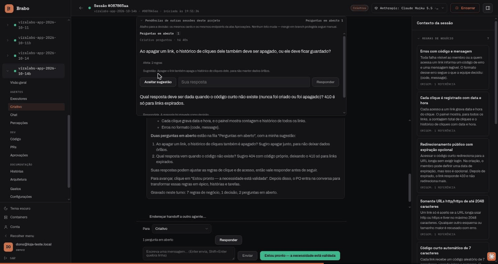
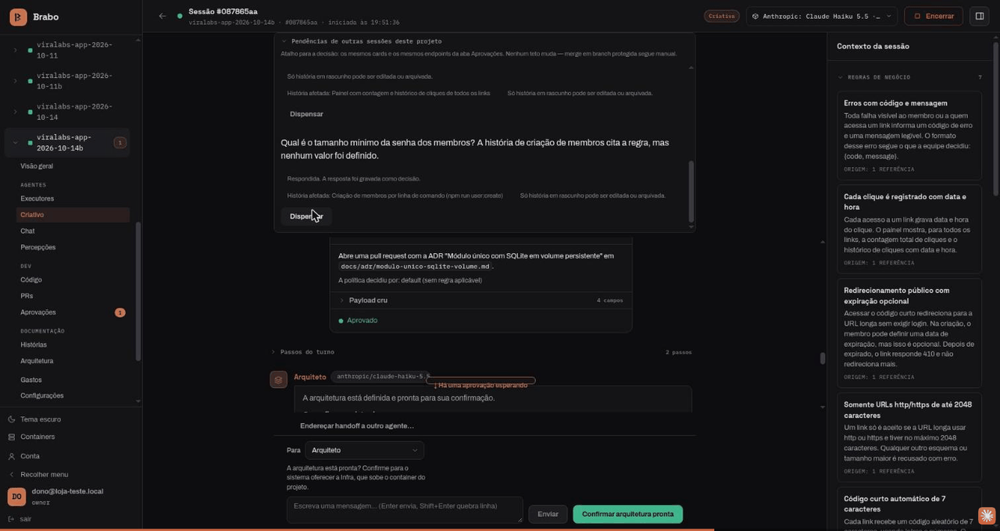
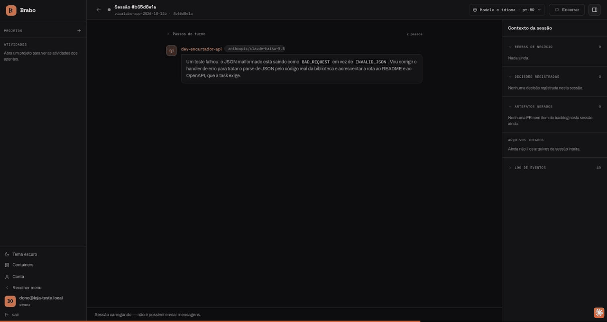
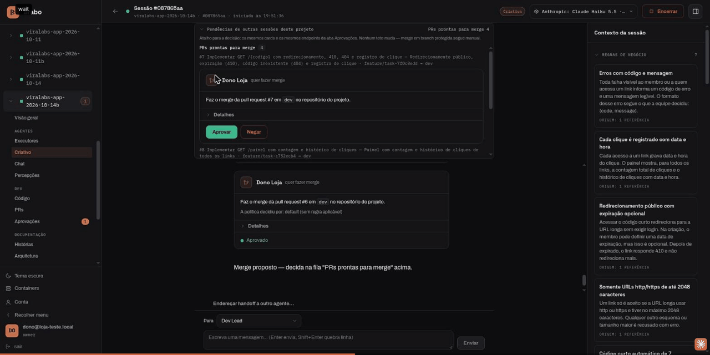

<div align="center">

**Português** · [English](README.en.md) · [Русский](README.ru.md) · [简体中文](README.zh-Hans.md)

<picture>
  <source media="(prefers-color-scheme: dark)" srcset="website/static/img/logo.svg" />
  <source media="(prefers-color-scheme: light)" srcset="website/static/img/logo.svg" />
  
</picture>

<h1>Brabo</h1>

**Um time de agentes de IA conduz sua aplicação do brief ao deploy.
A autoridade final continua sendo sua — por construção, não por convenção.**

[](https://github.com/daneiel/brabo/actions/workflows/ci.yml)
[](LICENSE)
[](CHANGELOG.md)
[](https://daneiel.github.io/brabo/)

[Documentação](https://daneiel.github.io/brabo/) · [Do zero ao entregável](https://daneiel.github.io/brabo/prd/tutorials/from-zero-to-deliverable) · [CHANGELOG](CHANGELOG.md) · [Segurança](SECURITY.md) · [Contribuir](CONTRIBUTING.md)



<sub>A ideia vira regras, e o que falta vira pergunta — o Criativo devolve as dúvidas no chat.</sub>

[Diferenciais](#diferenciais) · [Recursos](#recursos) · [O que é](#o-que-é) · [Começar](#começar-em-três-comandos) · [Documentação](#documentação) · [Licença](#licença)

</div>

---

## Diferenciais

<table>
  <tr>
    <td width="25%" valign="top">🛑 <b>Nada sai sem aprovação</b><br />Todo efeito externo nasce como <code>proposed_action</code> e passa pela política do projeto; merge em branch protegida é sempre seu.</td>
    <td width="25%" valign="top">🧱 <b>Agente não confiável por construção</b><br />Tetos de iteração, de correção e de orçamento no código. Prompt não é garantia; código é.</td>
    <td width="25%" valign="top">📜 <b>Tudo registrado e imutável</b><br />Event log append-only com numeração densa por sessão: custo auditável e backup verificável.</td>
    <td width="25%" valign="top">👥 <b>Um time do brief ao entregável</b><br />Criativo, PO, Arquiteto, Dev Lead, devs por módulo, Infra, QA e SecOps sobre um repositório git real.</td>
  </tr>
</table>

## Recursos

### A ideia vira regras, e o que falta vira pergunta


O Criativo devolve as dúvidas no chat, com sugestão e as regras que cada uma
afeta. Você responde ali mesmo, e as respostas viram regras de negócio.

### O Arquiteto decide por escrito



A decisão de arquitetura nasce como pull request, e a arquitetura só segue com a sua confirmação.

### Os devs trabalham dentro do container



Cada comando passa pela política do projeto, e o que o dev agent faz fica no fio
da sessão.

### O merge é sempre seu



As PRs que passam pelos gates chegam ao chat, e um clique em Aprovar confirma.

**Do zero ao entregável, numa execução real:** [o passo a passo com as gravações](https://daneiel.github.io/brabo/prd/tutorials/from-zero-to-deliverable) — 8 de 8 tarefas, 102/102 testes, US$ 1,07.

---

## O que é

O Brabo orquestra agentes especializados — Criativo, PO, Arquiteto, Dev Lead e
devs por módulo, Infra, QA, SecOps, Psicólogo e Anamnese — trabalhando sobre um
repositório git real, com Gitflow provisionado automaticamente.

Áreas (dev, QA, Infra) têm um **lead** como único endereço externo: quem manda um
handoff fala com o lead, e a delegação para os subagentes é assunto interno da
área.

O que o separa de um assistente de código:

**Nada com efeito externo acontece sozinho.** Comando de terminal, commit,
push, PR, merge, gasto de token — tudo nasce como `proposed_action`, passa pela
política do projeto (`deny` sempre vence `allow`) e só então executa. Dois casos
nem a política consegue liberar: **merge em branch protegida** e **mudança na
instrução de um agente**. São tetos aplicados depois de toda a política, não
defaults.

**O agente não é confiável por construção, e o sistema assume isso.** Teto de
iterações, teto de correções por task, orçamento que recusa a chamada, catálogo
fechado do que a Anamnese pode perfilar. Prompt não é garantia; código é.

**Tudo é registrado e imutável.** O event log é append-only com numeração densa
por sessão. É o que torna a evidência do Psicólogo rastreável, o custo auditável
e o backup verificável.

**O time melhora, com você no circuito.** O Psicólogo propõe hipóteses ancoradas
em eventos reais; a Anamnese deriva seu perfil de proficiência e propõe patches
de instrução versionados. Cada patch precisa do seu aval, e reverter cria versão
nova em vez de apagar histórico.

## Começar em três comandos

```bash
cp .env.example .env
pnpm install
pnpm dev
```

`pnpm dev` sobe o Docker Compose (Postgres 16 + pgvector, api, engine, web)
com hot reload. Na primeira subida a api e o engine aplicam as próprias
migrações. `pnpm --filter api seed` cria os usuários de demonstração.

| serviço | endereço | nota |
|---|---|---|
| Web | <http://localhost:5173> | login `owner@brabo.dev` / `brabo12345678` (do seed) |
| API | <http://localhost:3000> | `GET /health` |
| Engine | <http://localhost:4000> | `GET /health` |

`pnpm dev:down` derruba tudo. `pnpm dev:build` força rebuild.

### O menu, se você não quiser decorar comando

```bash
pnpm bootstrap
```

Os comandos do dia a dia moram em três lugares que não conversam: `package.json`
(os scripts pnpm), o `Makefile` (os alvos de Kubernetes) e scripts soltos em
`deploy/k8s/` e `docker/`. O menu é a porta única. Ele **não reimplementa nada** —
cada item chama exatamente o `pnpm`, o `make` ou o script que já existe.

| tecla | o que faz |
|---|---|
| `1`–`6` | escolhe o item, **sem Enter** |
| `v` | volta um nível |
| `q` | sai |
| `↓` | durante a execução, mostra a saída ao vivo |
| `↑` | volta para a tela "executando" |
| roda do mouse · `j`/`k` · `PgUp`/`PgDn` | com a saída à mostra, rola o log inteiro |
| `G` | volta ao fim do log (ao vivo) |
| `Ctrl+C` | aborta o comando em curso |

Os atalhos válidos aparecem no rodapé da tela em que você está — não é preciso
lembrar. O banner fica fixo no topo enquanto você navega, rola ou redimensiona a
janela.

**Rolar o log.** A saída expandida mostrava só o fim do arquivo; agora ela é uma
janela que anda para trás, e o log inteiro do comando é alcançável sem esperar
ele terminar. Duas consequências que o rodapé anuncia na hora:

- **Rolar para trás CONGELA a janela** (como o `less +F`), senão o redesenho de
  cinco vezes por segundo desfaria a rolagem antes de você ler a linha. `G`
  volta a acompanhar o fim.
- **Enquanto o comando roda, o menu liga o rastreio de mouse** para receber a
  roda — e com ele ligado, arrastar deixa de selecionar texto. **Segure `Shift`**
  para a seleção nativa do terminal. Fora dessa tela o rastreio fica desligado, e
  ele é desligado também na saída, inclusive por `Ctrl+C`.

**As quatro áreas.** `Create` provisiona o ambiente do zero, `Deploy` publica
código num ambiente que já existe (por isso é o único com escolha por serviço) e
`Destroy` derruba:

| área | itens |
|---|---|
| **1. Docker** | `Deploy` → All · Api · Engine · Web — `Create` — `Destroy` — `Reset total` — `Reconfigurar Ollama` — `Base de projetos` |
| **2. K8s** | `Deploy` → All — `Create` — `Destroy` |
| **3. Database** | `Generate` — `Migrate` — `Seed` — `Delete` |
| **4. Test** | All · Api · Engine · Web · Smoke · Docs |

Quatro coisas que o menu faz e vale saber:

- **`Docker › Destroy` preserva os volumes** (`down`, nunca `down -v`): destruir
  containers não é destruir dados.
- **No K8s só `All` funciona.** O bootstrap do cluster instala api, engine e web
  juntos; Api/Engine/Web aparecem no menu **desabilitados**, com o motivo. Sumir
  esconderia o limite; executar inventaria um caminho que não existe.
- **`Database › Delete` é a única tela que pede Enter**, e exige digitar o nome
  do banco. Ela zera o schema e **recria a extensão pgvector** — `init.sql` só
  roda na primeira inicialização do volume, então um `DROP SCHEMA` puro faria a
  migração seguinte falhar. Como o engine divide o mesmo banco, o script avisa
  que recuperar exige `pnpm db:migrate` **e** `pnpm engine:migrate`.
- **`Docker › Reset total` para a api e o engine antes de apagar** — esses
  dois, e nenhum outro: são os que mantêm conexão viva com o banco, e um
  `DROP SCHEMA` embaixo deles mata os processos sem que nada os reerga (o
  engine morre dentro do próprio drop, porque o `Rehydrator` consulta uma
  tabela que acabou de sumir). Depois de migrar ele sobe tudo de novo, espera
  ficar saudável e semeia; no fim **pergunta** o `/health` da api e do engine e
  o `/` do web antes de dizer qualquer coisa — se algum não responder, ele
  nomeia e sai com código 1, em vez de anunciar sucesso. É a segunda tela que
  pede confirmação (digitando `RESET`), e não remove volumes — e diz isso ao
  rodar, porque o outro lado é que um reset nunca reproduz um primeiro clone
  (defeito que só aparece com volume novo passa despercebido). Detalhes em
  [`docs/runbook.md`](docs/runbook.md#reset-total).

**Opções de linha de comando:**

```bash
pnpm bootstrap                                # abre o menu (precisa de terminal)
pnpm bootstrap --print-commands               # imprime a árvore inteira e sai
pnpm bootstrap --print-commands --path 1.1    # só uma subárvore
pnpm bootstrap --help                         # o cabeçalho de uso
```

`--print-commands` resolve cada folha do menu para o comando real **sem executar
nada** — é como se audita o que o menu faz, e é sobre ele que roda o teste
(`scripts/dev/bootstrap.spec.ts`). Sem terminal interativo o menu recusa abrir e
aponta para essa opção, em vez de travar esperando uma tecla que nunca vem. Pelo
mesmo motivo existe `--print-window <log> <linhas> <deslocamento>`: o recorte que
a rolagem faz no log é aritmética pura, e assim ele é testável sem TTY.

`NO_COLOR=1` desliga a cor; sem isso ele usa os tokens do design system em ANSI
24-bit e degrada para 256 cores onde o terminal não suportar.

> **`pnpm dev` e `make deploy-local` não coexistem.** Os dois publicam api e
> engine nas mesmas portas — de propósito, para o smoke test valer
> nos dois. Com o cluster local de pé, a **5173 não
> abre**, e o web fica em <http://localhost:8088>. `pnpm dev:preflight` diz em
> qual modo você está; `make k8s-down` volta para este. Detalhes em
> [Primeiros passos](docs/getting-started.md#os-dois-modos-locais-não-coexistem).

> Os containers de `api`, `web` e `engine` rodam com o MESMO UID/GID do seu
> usuário do host — nunca como root — para que `apps/api/dist` e o que mais
> o agente escrever no bind mount já nasçam com o SEU dono. Descubra o seu
> par com `id -u` e `id -g`; se não bater com o default (1000/1000, o mais
> comum em máquina Linux de desenvolvedor único), grave `DEV_UID`/`DEV_GID`
> no `.env` (ver `.env.example`) antes do primeiro `docker compose up`.
> Ambiente que já existia de antes desta mudança: os volumes nomeados de
> `node_modules`/`_build`/`deps`/`.mix`/`.hex` ainda têm conteúdo escrito por
> root nos containers antigos — rode uma vez
> `sudo chown -R $USER apps/api/dist apps/*/node_modules` (ou apague os
> volumes com `docker compose down -v` e deixe o próximo `up` recriá-los) para
> zerar o que ficou preso.

## Documentação

Versão atual: versão **v7.0.0** ([CHANGELOG](CHANGELOG.md)).

**📖 [daneiel.github.io/brabo](https://daneiel.github.io/brabo/)** — a mesma
documentação abaixo, navegável e com busca. O site lê de `docs/`, publica no
merge em `main`, e por isso fica um ciclo de promoção atrás do que está em
`dev`: para o estado mais recente, leia os arquivos aqui.

| documento | para |
|---|---|
| [Introdução](docs/intro.md) | o panorama |
| [Primeiros passos](docs/getting-started.md) | do clone ao primeiro turno de agente |
| [Arquitetura](docs/architecture.md) | code map, fronteiras, invariantes, dívida técnica |
| [Regras de negócio](docs/business-rules.md) | as 765 RNs, cada uma com `arquivo:linha` e o teste que a cobre |
| [Runbook](docs/runbook.md) | deploy, rollout, restore, rotação de chave, incidente de custo |
| [Glossário](docs/glossary.md) | harness, gate, handoff, DEK, outbox, ciclo K |
| [Observabilidade](docs/explanation/observability.md) | como se segue uma ação pelos três processos: trace, log e o caminho entre camadas |
| [Configuração](docs/reference/configuration.md) | todas as variáveis de ambiente |
| [Scripts](docs/reference/scripts.md) | todo comando `pnpm` e alvo do `Makefile`, extraídos da fonte |
| [Eventos](docs/reference/events.md) | os tipos do event log, broadcasts e spans |
| [Permissões](docs/reference/permissions.md) | o formato do `permissions.json` e a ordem da decisão |
| [Artefatos](docs/reference/artifacts.md) | os doze schemas e quem pode emitir cada um |
| [Providers de git](docs/reference/git-providers.md) | o contrato de quinze operações e as capabilities |
| [API interna](docs/reference/internal-api.md) | o contrato api ↔ engine |
| [Segurança](SECURITY.md) | como reportar uma vulnerabilidade |
| [Como contribuir](CONTRIBUTING.md) | fluxo, Definition of Done, o que é aceito |
| [Governança](GOVERNANCE.md) | modelo hoje (mantenedor único), os três papéis do modo `community` e o critério de quem entra em cada um |
| [Onde pedir ajuda](SUPPORT.md) | qual canal para cada tipo de assunto |
| [Código de conduta](CODE_OF_CONDUCT.md) | Contributor Covenant 2.1 |

## Stack

- **api** — NestJS, Drizzle, PostgreSQL 16 com pgvector
- **engine** — Elixir/OTP, Phoenix e Oban (filas no Postgres)
- **web** — React 19, Vite e TanStack
- **deploy** — Kubernetes com Kustomize; Docker Compose para desenvolvimento

Sem Redis: as filas moram no Postgres via Oban, e o rate limit é uma janela
deslizante em SQL.

## Licença

[MIT](LICENSE) © 2026 Daniel Souza — texto oficial, sem cláusulas adicionais.

A imagem do engine embute ferramentas de terceiros de que os gates dependem
(gitleaks, hadolint, semgrep, yamllint), **algumas sob GPL**. Executá-las como
processo separado não contamina nada, mas **publicar a imagem** num registry
cria obrigação de disponibilizar fonte. Está tudo levantado, com versão e
licença de cada uma, em [THIRD_PARTY_NOTICES.md](THIRD_PARTY_NOTICES.md) —
leia antes do primeiro push para registry.

A imagem do web embute as três fontes do design system, todas **OFL 1.1** — uma
licença permissiva, mas que exige distribuir o aviso de copyright junto do
binário. Ele está em `apps/web/public/fonts/LICENSE.txt`, servido com o resto do
estático, e a obrigação está registrada no mesmo arquivo de avisos.
