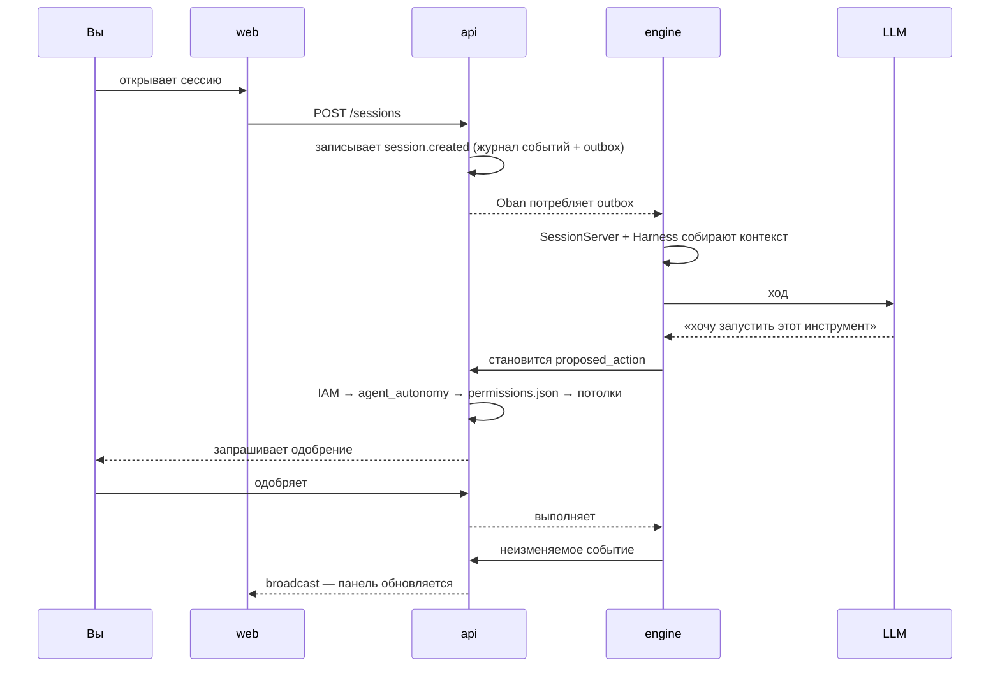

<div align="center">

[Português](README.md) · [English](README.en.md) · **Русский** · [简体中文](README.zh-Hans.md)

<picture>
  <source media="(prefers-color-scheme: dark)" srcset="website/static/img/logo.svg" />
  <source media="(prefers-color-scheme: light)" srcset="website/static/img/logo.svg" />
  
</picture>

<h1>Brabo</h1>

**Команда ИИ-агентов ведёт ваше приложение от брифа до деплоя.
Последнее слово остаётся за вами — по устройству системы, а не по договорённости.**

[](https://github.com/daneiel/brabo/actions/workflows/ci.yml)
[](LICENSE)
[](CHANGELOG.md)
[](https://daneiel.github.io/brabo/)

[Документация](https://daneiel.github.io/brabo/) · [С нуля до результата](https://daneiel.github.io/brabo/prd/ru/tutorials/from-zero-to-deliverable) · [CHANGELOG](CHANGELOG.md) · [Безопасность](SECURITY.md) · [Участие](CONTRIBUTING.md)


<sub>Идея превращается в правила, а то, чего не хватает, — в вопрос: Креатив возвращает сомнения в чат.</sub>

[Отличия](#отличия) · [Возможности](#возможности) · [Что это](#что-это) · [Начало](#начало-за-три-команды) · [Документация](#документация) · [Лицензия](#лицензия)

</div>

> Источник и проверяемая версия — [README.md](README.md) на португальском: в нём
> указаны текущая версия и количества (правил, решений, провайдеров). Этот
> перевод намеренно опускает числа.

---

## Отличия

<table>
  <tr>
    <td width="25%" valign="top">🛑 <b>Ничего без одобрения</b><br />Любой внешний эффект рождается как <code>proposed_action</code> и проходит политику проекта; merge в защищённую ветку — всегда ваше решение.</td>
    <td width="25%" valign="top">🧱 <b>Агенту не доверяют по устройству</b><br />Потолки итераций, исправлений и бюджета — в коде. Промпт не гарантия; код — гарантия.</td>
    <td width="25%" valign="top">📜 <b>Всё записано и неизменяемо</b><br />Журнал событий только на добавление, с плотной нумерацией в каждой сессии: проверяемая стоимость и проверяемый бэкап.</td>
    <td width="25%" valign="top">👥 <b>Одна команда от брифа до результата</b><br />Креатив, PO, Архитектор, Dev Lead, разработчики по модулям, Infra, QA и SecOps над настоящим git-репозиторием.</td>
  </tr>
</table>

## Возможности

### Идея превращается в правила, а то, чего не хватает, — в вопрос


Креатив возвращает сомнения в чат, с предложенным ответом и правилами, которые
затрагивает каждый вопрос. Вы отвечаете прямо там, и ответы становятся
бизнес-правилами.

### Архитектор решает письменно


ADR рождается как pull request, а архитектура идёт дальше только после вашего
подтверждения.

### Разработчики работают внутри контейнера


Каждая команда проходит политику проекта, а то, что делает dev-агент,
остаётся в ленте сессии.

### Merge всегда за вами


Pull request, прошедшие гейты, приходят в чат, и один клик на «Одобрить»
подтверждает merge.

**С нуля до результата, в реальном прогоне:** [пошаговый разбор с записями](https://daneiel.github.io/brabo/prd/ru/tutorials/from-zero-to-deliverable) — 8 из 8 задач, 102/102 тестов, US$ 1,07.

---

## Что это

Brabo оркестрирует специализированных агентов — Креатив, PO, Архитектор,
Dev Lead и разработчики по модулям, Infra, QA, SecOps, Психолог и Анамнез —
работающих над настоящим git-репозиторием с автоматически настроенным Gitflow.

У областей (dev, QA, Infra) есть **lead** — единственный внешний адрес: кто
передаёт handoff, говорит с lead, а делегирование субагентам — внутреннее дело
области.

Чем он отличается от ассистента для кода:

**Ничто с внешним эффектом не происходит само.** Команда терминала, commit,
push, PR, merge, расход токенов — всё рождается как `proposed_action`, проходит
политику проекта (`deny` всегда сильнее `allow`) и только потом выполняется.
Два случая не может разрешить даже политика: **merge в защищённую ветку** и
**изменение инструкции агента**. Это потолки, применяемые после всей политики,
а не значения по умолчанию.

**Агенту не доверяют по устройству, и система это учитывает.** Потолок
итераций, потолок исправлений на задачу, бюджет, отклоняющий вызов, закрытый
каталог того, что может профилировать Анамнез. Промпт не гарантия; код —
гарантия.

**Всё записано и неизменяемо.** Журнал событий — только на добавление, с
плотной нумерацией в каждой сессии. Именно это делает доказательства Психолога
отслеживаемыми, стоимость — проверяемой, а бэкап — проверяемым.

**Команда становится лучше, а вы остаётесь в контуре.** Психолог предлагает
гипотезы, опирающиеся на реальные события; Анамнез выводит ваш профиль
квалификации и предлагает версионированные патчи инструкций. Каждый патч
требует вашего согласия, а откат создаёт новую версию вместо удаления истории.

## Начало за три команды

```bash
cp .env.example .env
pnpm install
pnpm dev
```

`pnpm dev` поднимает Docker Compose (Postgres 16 + pgvector, api, engine, web)
с горячей перезагрузкой. При первом запуске api и engine применяют свои
миграции. `pnpm --filter api seed` создаёт демонстрационных пользователей.

| сервис | адрес | примечание |
|---|---|---|
| Web | <http://localhost:5173> | вход `owner@brabo.dev` / `brabo12345678` (из seed) |
| API | <http://localhost:3000> | `GET /health` |
| Engine | <http://localhost:4000> | `GET /health` |

`pnpm dev:down` останавливает всё. `pnpm dev:build` принудительно пересобирает.

### Меню, если не хочется запоминать команды

```bash
pnpm bootstrap
```

Повседневные команды живут в трёх местах, которые не связаны между собой:
`package.json` (скрипты pnpm), `Makefile` (цели Kubernetes) и отдельные скрипты
в `deploy/k8s/` и `docker/`. Меню — единая дверь. Оно **ничего не
переизобретает**: каждый пункт вызывает ровно тот `pnpm`, `make` или скрипт,
который уже существует.

| клавиша | действие |
|---|---|
| `1`–`6` | выбирает пункт, **без Enter** |
| `v` | на уровень назад |
| `q` | выход |
| `↓` | во время выполнения показывает вывод в реальном времени |
| `↑` | возвращает на экран «выполняется» |
| колесо мыши · `j`/`k` · `PgUp`/`PgDn` | при показанном выводе прокручивает весь лог |
| `G` | возвращает в конец лога (в реальном времени) |
| `Ctrl+C` | прерывает текущую команду |

Допустимые сочетания показаны в нижней строке текущего экрана — запоминать не
нужно. Баннер остаётся закреплённым сверху, пока вы перемещаетесь,
прокручиваете или меняете размер окна.

**Прокрутка лога.** Развёрнутый вывод раньше показывал только конец файла;
теперь это окно, которое движется назад, и весь лог команды доступен, не
дожидаясь её завершения. Два следствия, о которых сразу сообщает нижняя
строка:

- **Прокрутка назад ЗАМОРАЖИВАЕТ окно** (как `less +F`), иначе перерисовка
  пять раз в секунду отменила бы прокрутку раньше, чем вы прочтёте строку. `G`
  снова следует за концом.
- **Пока команда выполняется, меню включает отслеживание мыши**, чтобы
  получать колесо, — и с ним перетаскивание больше не выделяет текст.
  **Удерживайте `Shift`** для родного выделения терминала. Вне этого экрана
  отслеживание выключено, и оно выключается также при выходе, в том числе по
  `Ctrl+C`.

**Четыре области.** `Create` готовит окружение с нуля, `Deploy` публикует код в
уже существующее окружение (поэтому только у него есть выбор по сервисам), а
`Destroy` сносит:

| область | пункты |
|---|---|
| **1. Docker** | `Deploy` → All · Api · Engine · Web — `Create` — `Destroy` — `Reset total` — `Reconfigurar Ollama` — `Base de projetos` |
| **2. K8s** | `Deploy` → All — `Create` — `Destroy` |
| **3. Database** | `Generate` — `Migrate` — `Seed` — `Delete` |
| **4. Test** | All · Api · Engine · Web · Smoke · Docs |

Четыре вещи, которые делает меню и о которых стоит знать:

- **`Docker › Destroy` сохраняет тома** (`down`, никогда `down -v`): уничтожить
  контейнеры — не значит уничтожить данные.
- **В K8s работает только `All`.** Bootstrap кластера ставит api, engine и web
  вместе; Api/Engine/Web видны в меню **неактивными**, с причиной. Скрыть их —
  значит скрыть ограничение; выполнить — выдумать несуществующий путь.
- **`Database › Delete` — единственный экран, требующий Enter**, и он требует
  ввести имя базы. Он очищает схему и **заново создаёт расширение pgvector** —
  `init.sql` выполняется только при первой инициализации тома, поэтому голый
  `DROP SCHEMA` сломал бы следующую миграцию. Так как engine делит ту же базу,
  скрипт предупреждает, что для восстановления нужны `pnpm db:migrate` **и**
  `pnpm engine:migrate`.
- **`Docker › Reset total` останавливает api и engine перед удалением** —
  только эти два: именно они держат живое соединение с базой, и `DROP SCHEMA`
  под ними убивает процессы, а поднять их снова нечему (engine умирает внутри
  самого drop, потому что `Rehydrator` обращается к только что исчезнувшей
  таблице). После миграции он снова поднимает всё, ждёт здорового состояния и
  выполняет seed; в конце он **опрашивает** `/health` api и engine и `/` web,
  прежде чем что-либо сказать, — если кто-то не отвечает, он называет его и
  выходит с кодом 1 вместо объявления успеха. Это второй экран, требующий
  подтверждения (ввод `RESET`), и он не удаляет тома — и говорит об этом при
  запуске, потому что обратная сторона в том, что reset никогда не
  воспроизводит первый клон (дефект, проявляющийся только с новым томом,
  остаётся незамеченным). Подробнее в
  [`docs/runbook.md`](docs/runbook.md#reset-total).

**Параметры командной строки:**

```bash
pnpm bootstrap                                # открывает меню (нужен терминал)
pnpm bootstrap --print-commands               # печатает всё дерево и выходит
pnpm bootstrap --print-commands --path 1.1    # только одно поддерево
pnpm bootstrap --help                         # заголовок с использованием
```

`--print-commands` разворачивает каждый лист меню в настоящую команду, **ничего
не выполняя**, — так проверяют, что делает меню, и именно на нём работает тест
(`scripts/dev/bootstrap.spec.ts`). Без интерактивного терминала меню
отказывается открываться и указывает на этот параметр, вместо того чтобы
зависнуть в ожидании клавиши, которая никогда не придёт. По той же причине есть
`--print-window <log> <строки> <смещение>`: вырезка, которую прокрутка делает из
лога, — чистая арифметика, и так её можно тестировать без TTY.

`NO_COLOR=1` отключает цвет; иначе используются токены дизайн-системы в 24-битном
ANSI с деградацией до 256 цветов там, где терминал их не поддерживает.

> **`pnpm dev` и `make deploy-local` не сосуществуют.** Оба публикуют api и
> engine на одних и тех же портах — намеренно (ADR 0025), чтобы smoke-тест был
> верен для обоих. С поднятым локальным кластером **5173 не открывается**, а web
> находится на <http://localhost:8088>. `pnpm dev:preflight` скажет, в каком
> режиме вы находитесь; `make k8s-down` вернёт в этот. Подробнее в
> [Первых шагах](docs/getting-started.md#os-dois-modos-locais-não-coexistem).

> Контейнеры `api`, `web` и `engine` работают с ТЕМ ЖЕ UID/GID, что и ваш
> пользователь хоста, — никогда не от root, — чтобы `apps/api/dist` и всё, что
> агент пишет в bind mount, сразу принадлежало ВАМ. Узнайте свою пару через
> `id -u` и `id -g`; если она не совпадает со значением по умолчанию
> (1000/1000, самым частым на Linux-машине одного разработчика), запишите
> `DEV_UID`/`DEV_GID` в `.env` (см. `.env.example`) до первого
> `docker compose up`. Окружение, существовавшее до этого изменения: в
> именованных томах `node_modules`/`_build`/`deps`/`.mix`/`.hex` ещё лежит
> содержимое, записанное root в старых контейнерах, — выполните один раз
> `sudo chown -R $USER apps/api/dist apps/*/node_modules` (или удалите тома
> через `docker compose down -v` и дайте следующему `up` создать их заново),
> чтобы освободить застрявшее.

## Как работает ход



## Документация

**📖 [daneiel.github.io/brabo](https://daneiel.github.io/brabo/)** — та же
документация, что ниже, с навигацией и поиском. Сайт читает из `docs/`,
публикуется при merge в `main` и поэтому отстаёт на один цикл продвижения от
того, что есть в `dev`: для самого свежего состояния читайте файлы здесь.

| документ | для чего |
|---|---|
| [Введение](docs/intro.md) | общая картина |
| [Первые шаги](docs/getting-started.md) | от клона до первого хода агента |
| [Архитектура](docs/architecture.md) | карта кода, границы, инварианты, технический долг |
| [Бизнес-правила](docs/business-rules.md) | RN, каждое с `файл:строка` и покрывающим его тестом (количество — в [README на португальском](README.md)) |
| [Runbook](docs/runbook.md) | деплой, rollout, восстановление, ротация ключа, инцидент по стоимости |
| [Глоссарий](docs/glossary.md) | harness, gate, handoff, DEK, outbox, цикл K |
| [Наблюдаемость](docs/explanation/observability.md) | как проследить действие через три процесса: trace, лог и путь между слоями |
| [Конфигурация](docs/reference/configuration.md) | все переменные окружения |
| [Скрипты](docs/reference/scripts.md) | каждая команда `pnpm` и цель `Makefile`, извлечённые из исходников |
| [События](docs/reference/events.md) | типы журнала событий, broadcast и span |
| [Разрешения](docs/reference/permissions.md) | формат `permissions.json` и порядок решения |
| [Артефакты](docs/reference/artifacts.md) | схемы и кто может выпускать каждую |
| [Git-провайдеры](docs/reference/git-providers.md) | контракт операций и capabilities |
| [Внутренний API](docs/reference/internal-api.md) | контракт api ↔ engine |
| [ADR](docs/adr/index.md) | решения и причины каждого (количество — в [README на португальском](README.md)) |
| [Безопасность](SECURITY.md) | как сообщить об уязвимости |
| [Участие](CONTRIBUTING.md) | процесс, Definition of Done, что принимается |
| [Управление](GOVERNANCE.md) | текущая модель (один сопровождающий), три роли режима `community` и критерий допуска в каждую |
| [Где получить помощь](SUPPORT.md) | какой канал для какого вопроса |
| [Кодекс поведения](CODE_OF_CONDUCT.md) | Contributor Covenant 2.1 |

## Стек

| слой | технология |
|---|---|
| `apps/api` | NestJS 11 + Drizzle ORM + PostgreSQL 16 + pgvector |
| `apps/engine` | Elixir/OTP + Phoenix (каналы) + Oban (очереди в Postgres) |
| `apps/web` | React 19 + Vite + TanStack Query/Router; `mermaid` во время выполнения (только C4-диаграмма Архитектора, за динамическим `import()`) |
| auth | собственная в api (argon2id + access JWT Ed25519 + непрозрачный refresh с ротацией); RBAC в домене api |
| deploy | Kubernetes через Kustomize; Docker Compose для разработки |

Без Redis: очереди живут в Postgres через Oban, а rate limit — скользящее окно
на SQL.

## Структура

```
apps/
  api/      NestJS + Drizzle          → схема "public"
  engine/   Elixir/OTP + Phoenix      → схема "engine"
  web/      React + Vite
packages/
  shared/   общие типы TS (только import type)
design/     дизайн-система — источник истины для UI
docker/     compose для dev и prod, Dockerfile, smoke.sh
deploy/k8s/ base + overlays local/staging/prod (Kustomize)
docs/       эта документация, включая ADR
scripts/
  ci/       автоматизация релизов и политика веток (тесты на vitest)
  dev/      локальные инструменты — меню `pnpm bootstrap` и preflight
  docs/     генерация и проверка документации
website/    Docusaurus, читающий из docs/ — никогда из website/docs/
```

`apps/engine` находится вне pnpm-workspace (это проект Mix), а скрипты в корне
делегируют в `mix`:

```bash
pnpm engine:setup    # deps.get + ecto.create + ecto.migrate
pnpm engine:dev      # phx.server вне Docker
pnpm engine:test     # mix test
```

> **Elixir 1.20.4 / OTP 29.1.1** — версия проекта, та же в Dockerfile и в CI.
> `mix format` более новых версий даёт другой результат и делает
> `--check-formatted` в CI красным. Если на хосте другая версия, форматируйте
> через контейнер:
>
> ```bash
> docker run --rm -v "$PWD/apps/engine:/app" -w /app \
>   hexpm/elixir:1.20.4-erlang-29.1.1-alpine-3.24.2 mix format
> ```

## База данных

Один Postgres, одна база (`brabo`), две схемы, чтобы никогда не пересекаться:

- **api (Drizzle)** — домен в `public`; миграции в
  `apps/api/src/db/migrations/`, применяются через `pnpm db:migrate`
  (`pnpm db:generate` после изменения `apps/api/src/db/schema/<агрегат>.ts` —
  по файлу на агрегат начиная с [ADR 0121](docs/adr/0121-schema-dividido-por-agregado-de-dominio.md);
  `db/schema.ts` — просто barrel из `export *`).
- **engine (Ecto/Oban)** — домен и Oban в `engine`, через
  `migration_default_prefix`. Миграции в `apps/engine/priv/repo/migrations/`.

pgvector включается файлом `docker/postgres/init.sql`, который выполняется один
раз при создании тома.

## Тесты

```bash
pnpm --filter api test      # vitest
pnpm --filter web test      # vitest
pnpm engine:test            # ExUnit
```

Ни одна функция не входит без теста основного сценария **и** одного сценария
сбоя. Git-провайдеры проверяются **единым набором контрактных тестов**,
запускаемым против всех трёх (Local, GitHub, GitLab). Два теста стоит
упомянуть, потому что они защищают свойства, а не реализации:

- `apps/api/test/interfaces/route-surface.spec.ts` перечисляет маршруты во
  время выполнения и сверяет их с
  [`docs/security-surface.md`](docs/security-surface.md) — **новый маршрут без
  классификации ломает тест**.
- `apps/engine/test/engine_web/route_surface_test.exs` отправляет запрос без
  токена на каждый зарегистрированный маршрут и требует 401, кроме названных
  исключений.

## Здоровье и наблюдаемость

`GET /health` проверяет соединение с Postgres в обоих сервисах. В Kubernetes
проб **три**, потому что вопросы разные (ADR 0025): `/live` отвечает, не
трогая базу, — liveness, привязанный к Postgres, перезапустил бы все реплики
сразу при медленной базе, — `/health` — это readiness api, а `/ready` в engine
пропускает трафик только после завершения регидратации сессий.

Сессия — это **корневой trace**, проходящий через api и engine, а `trace_id`
рождается в браузере — три потока логов несут один и тот же id. Это работает
**без коллектора**: инструментирование и экспорт — отдельные решения, поэтому у
`pnpm dev` есть корреляция, даже когда в `monitoring` ничего не запущено.

Лог — одна строка JSON на событие в production и читаемый для человека в
разработке, где каждый запрос также даёт строку с **путём между слоями** и
длительностью каждого шага:

```
POST /projects/…/sessions — 34.1ms trace=4bf92f35
  interfaces        SessionsController.create         0ms
    ↳ application     CreateSessionUseCase.execute    31.2ms
      ↳ infrastructure  DrizzleOutboxRepository.append  2.1ms
```

Метрики Prometheus покрывают токены/мин и стоимость/час по проекту, очередь
Oban, активные сессии и долю одобрений. Дашборды Grafana поставляются как код.
Вся модель описана в [наблюдаемости](docs/explanation/observability.md).

## Production

Многоэтапные образы, **не от root**, rootfs только для чтения, без bind mount:
`docker/<app>/Dockerfile.prod`. api запускает `node main.js` поверх `dist`,
engine — `mix release` (без Mix и без исходников), а web отдаётся через nginx.

```bash
# Обязательно: этот compose работает с NODE_ENV=production, и api отказывается
# стартовать с примерным ключом из репозитория для любого из этих четырёх
# секретов (ADR 0059, RN-093/RN-114). `smoke.sh` генерирует свои сам.
export GIT_OAUTH_STATE_SECRET="$(openssl rand -base64 32)"
export AUTH_JWT_SECRET="$(openssl rand -base64 32)"
export BRABO_SERVICE_TOKEN="$(openssl rand -base64 32)"
export CREDENTIALS_MASTER_KEY="$(openssl rand -base64 32)"
export SECRET_KEY_BASE="$(openssl rand -base64 64)"

docker compose -f docker/docker-compose.prod.yml up -d --build --wait
bash docker/smoke.sh
docker compose -f docker/docker-compose.prod.yml down -v
```

`smoke.sh` проверяет, что три образа работают не от root, выполняет вход,
создаёт workspace → проект → сессию и проверяет health. Это тот же скрипт, что
и в CI.

**Два тома должны быть одинаковыми в api и engine:**

| путь | содержимое |
|---|---|
| `/data/project-workspaces` | рабочее дерево по проекту, worktree по агенту, `permissions.json` |
| `/data/git-repos` | локальные bare-репозитории (цель `git push` dev-агента) |

api хранит абсолютный путь bare-репозитория в базе, а engine использует его
буквально; монтирование в разные места ломает push с `remote unpack failed`.

## Деплой в Kubernetes

Манифесты в `deploy/k8s/` на **Kustomize** (base + overlays `local`, `staging`,
`prod`) — выбор описан в
[ADR 0025](docs/adr/0025-fase5-deploy-kubernetes-kustomize.md). Сторонние
операторы (External Secrets, CloudNativePG, Prometheus, prometheus-adapter)
ставятся через Helm, с версиями, закреплёнными bootstrap.

```bash
make deploy-local     # поднимает кластер k3d, ставит всё и запускает smoke
make hpa-test         # заполняет очередь Oban и доказывает, что HPA масштабирует
make rollout-test     # доказывает, что rollout engine не оставляет осиротевших сессий
make test-restore     # запускает настоящий бэкап, восстанавливает и проверяет
make test-restore-mutacao  # намеренно ломает restore и требует, чтобы проверка провалилась
make k8s-validate     # собирает и проверяет overlays (кластер не нужен)
make k8s-down         # удаляет кластер
```

engine масштабируется по **глубине очереди Oban**: `/metrics` отдаёт
`oban_queue_depth{queue,state}`, а HPA потребляет `state="available"`. Фильтр по
состоянию — не мелочь: три воркера перепланируют сами себя, поэтому
`oban_jobs` никогда не пуста, и HPA без фильтра масштабировался бы до максимума
в простаивающей системе.

Пошагово и с диагностикой — в [runbook](docs/runbook.md#deploy-local).

## CI

`.github/workflows/ci.yml` запускается на push в `feature/**` и на PR в `dev`:
lint в режиме проверки, тесты api/web/engine, проверка манифестов
(`kustomize build` + `kubeconform` + shellcheck), сборка образов с кэшем,
**Trivy** по образам, **gitleaks** по репозиторию, аудит зависимостей с гейтом
на критических и smoke-тест.

Гейт зависимостей проверили на подброшенной критической уязвимости: job упал и
снова прошёл после revert.

## Frontend

Собственный вход (`/login`, `/registrar`, `/esqueci-senha`, `/definir-senha`):
access token живёт в памяти, а refresh — в httpOnly-cookie, поэтому сессия
переживает перезагрузку без `localStorage`. Все четыре следуют одобренному
макету дизайн-системы, с логотипом над карточкой и версией артефакта в подвале
([ADR 0036](docs/adr/0036-telas-de-auth-fieis-ao-design-e-fontes-auto-hospedadas.md)).
После входа приложение работает с первым workspace пользователя:

- **Dashboard** (`/`) — сетка проектов и мастер «Новый проект»
- **Проект** (`/projects/:id`) — вкладки, выведенные из единого реестра
  (`apps/web/src/routes/project-tabs.ts`, а не из параллельных списков): Обзор
  (команда агентов, архитектура и C4-диаграмма), Исполнители, Креатив, Чат,
  Insights, Код, PR, Одобрения (очередь + таблица `permissions.json`), Бэклог,
  Архитектура, Расходы и Настройки (модели по агенту и по области, участники,
  учётные данные, потолок параллелизма)
- **Сессия** (`/projects/:id/sessions/:sid`) — чат со стримингом, выбор модели,
  живой `TokenMeter` и одобрение действий прямо в ленте

`/status` — единственный **публичный** маршрут вне auth: он опрашивает
`/health` api и engine, которые и так публичны, потому что их вызывает kubelet.

Стриминг агента приходит по каналу Phoenix `session:<id>` (`agent.delta`,
`agent.status`, `agent.done`); списки и счётчики используют TanStack Query.

Три семейства шрифтов дизайн-системы (Space Grotesk, Archivo, IBM Plex Mono)
**размещены у себя** в `apps/web/public/fonts/`. Это не предпочтение: CSP
production-образа — `font-src 'self' data:`, и прежний `<link>` на Google Fonts
молча блокировался — в production типографика падала на системный шрифт, и
заголовок с текстом становились неразличимы.

## Соглашения

- **Всегда** работайте в `feature/*` от `dev`. Постоянные ветки: `dev`, `qa`,
  `rc`, `main`.
- Conventional commits на **pt-BR**.
- Merge в защищённую ветку **всегда** ручной — автоматизировать нельзя, и это
  гарантирует тест.
- Commit агентов используют идентичность `<агент>[bot]` с пользователем как
  co-author.
- Любое доменное событие неизменяемо: никогда `UPDATE` в таблице событий.
- Значимые архитектурные решения становятся [ADR](docs/adr/index.md).

`CLAUDE.md` содержит полную детализацию, и именно его читают агенты —
содержимое разложено по частям в `.claude/contexto/` и импортируется им.

## Состояние

**Фазы с 1 по 26 завершены**; текущая версия — в
[README на португальском](README.md) и в [CHANGELOG](CHANGELOG.md). Конвейер
релизов проверен от начала до конца, собственная auth без Keycloak, несколько
LLM-провайдеров на единой основе и вся цепочка, доказанная против настоящего
GitHub: принятие репозитория, продвижение истории, dev-агент пишет код, PR
открыт, гейт выносит вердикт, и вердикт возвращается.

То, что пришло после фаз, взялось не из дорожной карты, а из **использования
продукта**. Программа 16–26 родилась из первого настоящего прохода по
приложению (восемь экранов дизайн-handoff, вкладка Код только для чтения,
контейнер на проект, решаемый Архитектором, расходы с двумя аудиториями), а
следующие раунды пришли из живых тестовых сессий, где каждая находка
становилась RN с `файл:строка` и тестом.

То, чего ещё нет, сказано там, где это важно, и это нужно прочитать:

- [известный технический долг](docs/architecture.md#divida-tecnica) — раздел
  документации, а не умолчание;
- [находки реального прогона](docs/explanation/achados-execucao-real.md) — что
  нашёл прогон против настоящего GitHub и что остаётся открытым **по
  решению**, включая два случая, где вывод был в том, что путь к автономии
  не лежит через ослабление политики;
- жизненный цикл контейнера на проект — **объявленное сокращение** фазы 25, а
  не забытое: пока он не поднимается, политика терминала из ADR 0055 действует
  как есть.

## Лицензия

[MIT](LICENSE) © 2026 Daniel Souza — официальный текст, без дополнительных
условий.

Образ engine включает сторонние инструменты, от которых зависят гейты
(gitleaks, hadolint, semgrep, yamllint), **часть из них под GPL**. Запуск их
отдельным процессом ничего не заражает, но **публикация образа** в registry
создаёт обязанность предоставить исходный код. Всё перечислено, с версией и
лицензией каждого, в [THIRD_PARTY_NOTICES.md](THIRD_PARTY_NOTICES.md) —
прочитайте перед первым push в registry.

Образ web включает три шрифта дизайн-системы, все под **OFL 1.1** — лицензией
разрешительной, но требующей распространять уведомление об авторском праве
вместе с бинарником. Оно лежит в `apps/web/public/fonts/LICENSE.txt`,
отдаётся вместе с остальной статикой, а обязанность записана в том же файле
уведомлений.
