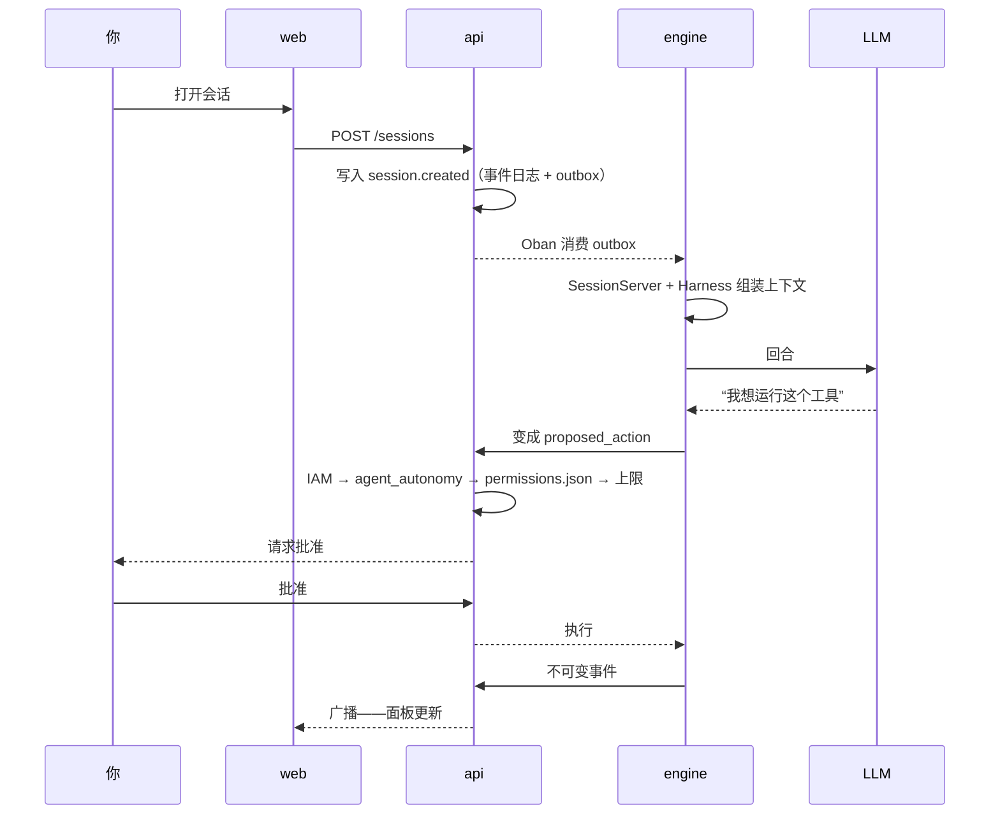

<div align="center">

[Português](README.md) · [English](README.en.md) · [Русский](README.ru.md) · **简体中文**

<picture>
  <source media="(prefers-color-scheme: dark)" srcset="website/static/img/logo.svg" />
  <source media="(prefers-color-scheme: light)" srcset="website/static/img/logo.svg" />
  
</picture>

<h1>Brabo</h1>

**一支 AI 智能体团队把你的应用从需求简报带到部署。
最终决定权始终在你手里——靠设计保证，而不是靠约定。**

[](https://github.com/daneiel/brabo/actions/workflows/ci.yml)
[](LICENSE)
[](CHANGELOG.md)
[](https://daneiel.github.io/brabo/)

[文档](https://daneiel.github.io/brabo/) · [从零到交付物](https://daneiel.github.io/brabo/prd/zh-Hans/tutorials/from-zero-to-deliverable) · [CHANGELOG](CHANGELOG.md) · [安全](SECURITY.md) · [参与贡献](CONTRIBUTING.md)


<sub>想法变成规则，缺少的部分变成问题——创意智能体在聊天中把疑问交还给你。</sub>

[亮点](#亮点) · [功能](#功能) · [它是什么](#它是什么) · [开始](#三条命令开始) · [文档](#文档) · [许可证](#许可证)

</div>

> 源文本和受校验的版本是葡萄牙语的 [README.md](README.md)：其中写有当前版本和各项数量（规则、决策、提供方）。本译文有意不写这些数字。

---

## 亮点

<table>
  <tr>
    <td width="25%" valign="top">🛑 <b>未经批准，什么都不会发生</b><br />每个外部效果都以 <code>proposed_action</code> 的形式产生，并经过项目策略；合并到受保护分支永远由你决定。</td>
    <td width="25%" valign="top">🧱 <b>智能体在设计上不被信任</b><br />迭代、修正和预算的上限都写在代码里。提示词不是保证，代码才是。</td>
    <td width="25%" valign="top">📜 <b>一切都被记录且不可变</b><br />只追加的事件日志，每个会话内编号连续：成本可审计，备份可验证。</td>
    <td width="25%" valign="top">👥 <b>一支团队，从简报到交付物</b><br />创意、PO、架构师、Dev Lead、按模块划分的开发者、Infra、QA 和 SecOps，工作在真实的 git 仓库上。</td>
  </tr>
</table>

## 功能

### 想法变成规则，缺少的部分变成问题


创意智能体在聊天中交还疑问，附上建议答案以及每个问题影响的规则。你就在那里回答，答案会变成业务规则。

### 架构师以书面方式做决定


ADR 以 pull request 的形式产生，架构只有在你确认后才继续推进。

### 开发者在容器内工作


每条命令都经过项目策略，开发智能体做的事情都留在会话记录中。

### 合并永远由你决定


通过各道关卡的 pull request 会出现在聊天中，点一下「批准」即可确认。

**从零到交付物，一次真实运行：** [带录屏的分步讲解](https://daneiel.github.io/brabo/prd/zh-Hans/tutorials/from-zero-to-deliverable)——8/8 个任务，102/102 个测试，US$ 1.07。

---

## 它是什么

Brabo 编排一组专业智能体——创意、PO、架构师、Dev Lead 与按模块划分的开发者、Infra、QA、SecOps、心理学家和 Anamnese（画像）——在真实的 git 仓库上工作，Gitflow 自动配置。

各个领域（dev、QA、Infra）都有一个 **lead** 作为唯一的对外地址：发起 handoff 的一方只与 lead 对话，而向子智能体委派是领域内部的事。

它与编程助手的区别：

**任何有外部效果的事情都不会自己发生。** 终端命令、commit、push、PR、合并、token 花费——一切都以 `proposed_action` 产生，经过项目策略（`deny` 永远压过 `allow`），然后才执行。有两种情况连策略也无法放行：**合并到受保护分支**和**修改智能体的指令**。它们是在整个策略之后施加的上限，而不是默认值。

**智能体在设计上不被信任，系统也按此假设。** 迭代上限、每个任务的修正上限、会拒绝调用的预算、Anamnese 可画像内容的封闭目录。提示词不是保证，代码才是。

**一切都被记录且不可变。** 事件日志只追加，每个会话内编号连续。正是这一点让心理学家的证据可追溯、成本可审计、备份可验证。

**团队在进步，而你始终在环路中。** 心理学家提出基于真实事件的假设；Anamnese 推导出你的熟练度画像，并提出带版本的指令补丁。每个补丁都需要你的同意，回滚会创建新版本，而不是抹掉历史。

## 三条命令开始

```bash
cp .env.example .env
pnpm install
pnpm dev
```

`pnpm dev` 启动 Docker Compose（Postgres 16 + pgvector、api、engine、web），支持热重载。首次启动时 api 和 engine 会各自执行迁移。`pnpm --filter api seed` 创建演示用户。

| 服务 | 地址 | 说明 |
|---|---|---|
| Web | <http://localhost:5173> | 登录 `owner@brabo.dev` / `brabo12345678`（来自 seed） |
| API | <http://localhost:3000> | `GET /health` |
| Engine | <http://localhost:4000> | `GET /health` |

`pnpm dev:down` 关闭全部服务。`pnpm dev:build` 强制重新构建。

### 菜单：不想记命令时用

```bash
pnpm bootstrap
```

日常命令分散在三个互不相通的地方：`package.json`（pnpm 脚本）、`Makefile`（Kubernetes 目标）以及 `deploy/k8s/` 和 `docker/` 中的零散脚本。菜单是唯一的入口。它**不重新实现任何东西**——每一项都恰好调用已经存在的 `pnpm`、`make` 或脚本。

| 按键 | 作用 |
|---|---|
| `1`–`6` | 选择条目，**无需回车** |
| `v` | 返回上一级 |
| `q` | 退出 |
| `↓` | 执行期间显示实时输出 |
| `↑` | 回到「执行中」界面 |
| 鼠标滚轮 · `j`/`k` · `PgUp`/`PgDn` | 显示输出时滚动整个日志 |
| `G` | 回到日志末尾（实时） |
| `Ctrl+C` | 中止当前命令 |

可用的快捷键显示在当前界面的底部——无需记忆。浏览、滚动或调整窗口大小时，横幅始终固定在顶部。

**滚动日志。** 展开的输出以前只显示文件末尾；现在它是一个可以向后移动的窗口，无需等待命令结束即可查看完整日志。底部会立即提示两个结果：

- **向后滚动会冻结窗口**（类似 `less +F`），否则每秒五次的重绘会在你读完一行之前撤销滚动。按 `G` 重新跟随末尾。
- **命令运行期间，菜单会开启鼠标追踪**以接收滚轮——开启后拖动不再选中文本。**按住 `Shift`** 使用终端原生的选择。离开该界面后追踪即关闭，退出时（包括 `Ctrl+C`）也会关闭。

**四个区域。** `Create` 从零准备环境，`Deploy` 把代码发布到已存在的环境（所以只有它可以按服务选择），`Destroy` 负责拆除：

| 区域 | 条目 |
|---|---|
| **1. Docker** | `Deploy` → All · Api · Engine · Web — `Create` — `Destroy` — `Reset total` — `Reconfigurar Ollama` — `Base de projetos` |
| **2. K8s** | `Deploy` → All — `Create` — `Destroy` |
| **3. Database** | `Generate` — `Migrate` — `Seed` — `Delete` |
| **4. Test** | All · Api · Engine · Web · Smoke · Docs |

菜单做的四件值得知道的事：

- **`Docker › Destroy` 保留数据卷**（`down`，从不 `down -v`）：销毁容器不等于销毁数据。
- **在 K8s 中只有 `All` 可用。** 集群的 bootstrap 会一起安装 api、engine 和 web；Api/Engine/Web 在菜单中显示为**禁用**并附上原因。隐藏它们会掩盖限制；执行它们则是虚构一条不存在的路径。
- **`Database › Delete` 是唯一需要回车的界面**，并要求输入数据库名。它会清空 schema 并**重新创建 pgvector 扩展**——`init.sql` 只在数据卷首次初始化时运行，因此单纯的 `DROP SCHEMA` 会让下一次迁移失败。由于 engine 共用同一个数据库，脚本会提示恢复需要 `pnpm db:migrate` **和** `pnpm engine:migrate`。
- **`Docker › Reset total` 在删除前先停止 api 和 engine**——只停这两个，不多不少：它们与数据库保持着活动连接，在它们底下执行 `DROP SCHEMA` 会杀死进程，而且没有东西会把它们重新拉起（engine 会在 drop 过程中死掉，因为 `Rehydrator` 查询了一张刚消失的表）。迁移后它会重新启动所有服务、等待其健康并执行 seed；最后在给出任何结论之前，它会**询问** api 和 engine 的 `/health` 以及 web 的 `/`——若有一个没有响应，它会点名并以退出码 1 结束，而不是宣布成功。这是第二个需要确认的界面（输入 `RESET`），它不删除数据卷——并在运行时说明这一点，因为另一面是 reset 永远无法复现首次克隆（只在新数据卷上出现的缺陷会被忽略）。详见 [`docs/runbook.md`](docs/runbook.md#reset-total)。

**命令行选项：**

```bash
pnpm bootstrap                                # 打开菜单（需要终端）
pnpm bootstrap --print-commands               # 打印整棵树后退出
pnpm bootstrap --print-commands --path 1.1    # 只打印一个子树
pnpm bootstrap --help                         # 用法说明
```

`--print-commands` 把菜单的每个叶子解析成真实命令，**但不执行任何东西**——这是审计菜单行为的方式，测试也基于它运行（`scripts/dev/bootstrap.spec.ts`）。没有交互式终端时，菜单会拒绝打开并指向这个选项，而不是卡住等待永远不会到来的按键。出于同样的原因还有 `--print-window <log> <行数> <偏移>`：滚动从日志中截取的片段是纯算术，这样就可以在没有 TTY 的情况下测试。

`NO_COLOR=1` 关闭颜色；否则它会以 24 位 ANSI 使用设计系统的 token，在终端不支持时降级为 256 色。

> **`pnpm dev` 与 `make deploy-local` 不能共存。** 两者把 api 和 engine 发布在相同端口上——这是有意的（ADR 0025），以便冒烟测试对两者都有效。本地集群运行时，**5173 打不开**，web 位于 <http://localhost:8088>。`pnpm dev:preflight` 会告诉你当前处于哪种模式；`make k8s-down` 切回本模式。详见[入门指南](docs/getting-started.md#os-dois-modos-locais-não-coexistem)。

> `api`、`web` 和 `engine` 容器以与你的主机用户**相同**的 UID/GID 运行——绝不以 root 运行——这样 `apps/api/dist` 以及智能体在 bind mount 中写入的其他内容一产生就归**你**所有。用 `id -u` 和 `id -g` 查看你的组合；如果与默认值（1000/1000，单人开发的 Linux 机器上最常见）不符，请在首次 `docker compose up` 之前把 `DEV_UID`/`DEV_GID` 写入 `.env`（参见 `.env.example`）。在此改动之前就已存在的环境：`node_modules`/`_build`/`deps`/`.mix`/`.hex` 的命名卷中仍有旧容器以 root 写入的内容——执行一次 `sudo chown -R $USER apps/api/dist apps/*/node_modules`（或用 `docker compose down -v` 删除这些卷，让下一次 `up` 重新创建）来清理被卡住的部分。

## 一个回合如何运作



## 文档

**📖 [daneiel.github.io/brabo](https://daneiel.github.io/brabo/)**——与下面相同的文档，可浏览、可搜索。站点读取 `docs/`，在合并到 `main` 时发布，因此比 `dev` 中的内容落后一个推进周期：想看最新状态，请直接阅读这里的文件。

| 文档 | 用途 |
|---|---|
| [简介](docs/intro.md) | 全景 |
| [入门指南](docs/getting-started.md) | 从克隆到第一个智能体回合 |
| [架构](docs/architecture.md) | 代码地图、边界、不变量、技术债 |
| [业务规则](docs/business-rules.md) | 各条 RN，每条都附 `文件:行号` 和覆盖它的测试（数量见[葡萄牙语 README](README.md)） |
| [Runbook](docs/runbook.md) | 部署、rollout、恢复、密钥轮换、成本事故 |
| [术语表](docs/glossary.md) | harness、gate、handoff、DEK、outbox、K 周期 |
| [可观测性](docs/explanation/observability.md) | 如何跨三个进程追踪一个动作：trace、日志和跨层路径 |
| [配置](docs/reference/configuration.md) | 所有环境变量 |
| [脚本](docs/reference/scripts.md) | 每个 `pnpm` 命令和 `Makefile` 目标，从源码提取 |
| [事件](docs/reference/events.md) | 事件日志的类型、广播和 span |
| [权限](docs/reference/permissions.md) | `permissions.json` 的格式和决策顺序 |
| [工件](docs/reference/artifacts.md) | 各个 schema 以及谁可以产生它们 |
| [Git 提供方](docs/reference/git-providers.md) | 操作契约和能力声明 |
| [内部 API](docs/reference/internal-api.md) | api ↔ engine 契约 |
| [ADR](docs/adr/index.md) | 各项决策及其理由（数量见[葡萄牙语 README](README.md)） |
| [安全](SECURITY.md) | 如何报告漏洞 |
| [参与贡献](CONTRIBUTING.md) | 流程、Definition of Done、接受什么 |
| [治理](GOVERNANCE.md) | 当前模式（单一维护者）、`community` 模式的三个角色及准入标准 |
| [获取帮助](SUPPORT.md) | 各类问题对应的渠道 |
| [行为准则](CODE_OF_CONDUCT.md) | Contributor Covenant 2.1 |

## 技术栈

| 层 | 技术 |
|---|---|
| `apps/api` | NestJS 11 + Drizzle ORM + PostgreSQL 16 + pgvector |
| `apps/engine` | Elixir/OTP + Phoenix（通道）+ Oban（队列在 Postgres 中） |
| `apps/web` | React 19 + Vite + TanStack Query/Router；运行时 `mermaid`（仅用于架构师的 C4 图，通过动态 `import()` 加载） |
| auth | api 自有（argon2id + Ed25519 access JWT + 带轮换的不透明 refresh）；RBAC 在 api 的领域中 |
| deploy | 通过 Kustomize 部署到 Kubernetes；开发用 Docker Compose |

没有 Redis：队列通过 Oban 存放在 Postgres 中，限流是 SQL 中的滑动窗口。

## 目录结构

```
apps/
  api/      NestJS + Drizzle          → schema "public"
  engine/   Elixir/OTP + Phoenix      → schema "engine"
  web/      React + Vite
packages/
  shared/   共享的 TS 类型（仅 import type）
design/     设计系统——UI 的事实来源
docker/     dev 和 prod 的 compose、Dockerfile、smoke.sh
deploy/k8s/ base + local/staging/prod overlays（Kustomize）
docs/       本文档，包括 ADR
scripts/
  ci/       发布自动化与分支策略（用 vitest 测试）
  dev/      本地工具——`pnpm bootstrap` 菜单和 preflight
  docs/     文档的生成与校验
website/    Docusaurus，读取 docs/——绝不读取 website/docs/
```

`apps/engine` 不在 pnpm workspace 中（它是 Mix 项目），根目录的脚本会委托给 `mix`：

```bash
pnpm engine:setup    # deps.get + ecto.create + ecto.migrate
pnpm engine:dev      # 在 Docker 外运行 phx.server
pnpm engine:test     # mix test
```

> **Elixir 1.20.4 / OTP 29.1.1** 是项目使用的版本，Dockerfile 和 CI 中相同。更新版本的 `mix format` 输出不同，会让 CI 的 `--check-formatted` 变红。如果你的主机版本不同，请通过容器格式化：
>
> ```bash
> docker run --rm -v "$PWD/apps/engine:/app" -w /app \
>   hexpm/elixir:1.20.4-erlang-29.1.1-alpine-3.24.2 mix format
> ```

## 数据库

一个 Postgres，一个数据库（`brabo`），两个 schema，永不冲突：

- **api（Drizzle）**——领域在 `public`；迁移位于 `apps/api/src/db/migrations/`，用 `pnpm db:migrate` 应用（修改 `apps/api/src/db/schema/<聚合>.ts` 后运行 `pnpm db:generate`——自 [ADR 0121](docs/adr/0121-schema-dividido-por-agregado-de-dominio.md) 起每个聚合一个文件；`db/schema.ts` 只是 `export *` 的 barrel）。
- **engine（Ecto/Oban）**——领域和 Oban 在 `engine`，通过 `migration_default_prefix`。迁移位于 `apps/engine/priv/repo/migrations/`。

pgvector 由 `docker/postgres/init.sql` 启用，它只在创建数据卷时运行一次。

## 测试

```bash
pnpm --filter api test      # vitest
pnpm --filter web test      # vitest
pnpm engine:test            # ExUnit
```

没有正常路径测试**和**一个失败用例，任何功能都不会合入。git 提供方由**同一套契约测试**针对三者（Local、GitHub、GitLab）进行验证。有两个测试值得一提，因为它们保护的是属性而不是实现：

- `apps/api/test/interfaces/route-surface.spec.ts` 在运行时枚举路由并与 [`docs/security-surface.md`](docs/security-surface.md) 对照——**没有分类的新路由会让测试失败**。
- `apps/engine/test/engine_web/route_surface_test.exs` 对每个已注册路由发送不带 token 的请求，并要求返回 401，具名例外除外。

## 健康检查与可观测性

`GET /health` 在两个服务中都会检查 Postgres 连接。在 Kubernetes 中探针有**三个**，因为问题不同（ADR 0025）：`/live` 不访问数据库就响应——与 Postgres 绑定的 liveness 会在数据库变慢时一次性重启所有副本——，`/health` 是 api 的 readiness，engine 上的 `/ready` 只有在会话再水合完成后才放行流量。

一个会话是一条贯穿 api 和 engine 的**根 trace**，`trace_id` 产生于浏览器——三条日志流携带同一个 id。这**无需采集器**也成立：埋点和导出是两个独立的决定，所以即使 `monitoring` 中什么都没运行，`pnpm dev` 也有关联。

生产环境中日志是每个事件一行 JSON，开发环境中则便于人读，每个请求还会输出一行**跨层路径**及每一步的耗时：

```
POST /projects/…/sessions — 34.1ms trace=4bf92f35
  interfaces        SessionsController.create         0ms
    ↳ application     CreateSessionUseCase.execute    31.2ms
      ↳ infrastructure  DrizzleOutboxRepository.append  2.1ms
```

Prometheus 指标涵盖按项目的 token/分钟和成本/小时、Oban 队列、活跃会话和批准率。Grafana 仪表板以代码形式配置。完整模型见[可观测性](docs/explanation/observability.md)。

## 生产环境

多阶段、**非 root**、只读 rootfs、无 bind mount 的镜像：`docker/<app>/Dockerfile.prod`。api 在 `dist` 上运行 `node main.js`，engine 运行 `mix release`（无 Mix、无源码），web 通过 nginx 提供。

```bash
# 必填：此 compose 以 NODE_ENV=production 运行，若这四个秘密中任何一个
# 使用仓库中的示例密钥，api 都会拒绝启动（ADR 0059，RN-093/RN-114）。
# `smoke.sh` 会自行生成。
export GIT_OAUTH_STATE_SECRET="$(openssl rand -base64 32)"
export AUTH_JWT_SECRET="$(openssl rand -base64 32)"
export BRABO_SERVICE_TOKEN="$(openssl rand -base64 32)"
export CREDENTIALS_MASTER_KEY="$(openssl rand -base64 32)"
export SECRET_KEY_BASE="$(openssl rand -base64 64)"

docker compose -f docker/docker-compose.prod.yml up -d --build --wait
bash docker/smoke.sh
docker compose -f docker/docker-compose.prod.yml down -v
```

`smoke.sh` 检查三个镜像以非 root 运行，登录，创建 workspace → 项目 → 会话并检查健康状态。它与 CI 使用的是同一个脚本。

**api 和 engine 中的两个数据卷必须完全一致：**

| 路径 | 内容 |
|---|---|
| `/data/project-workspaces` | 每个项目的工作树、每个智能体的 worktree、`permissions.json` |
| `/data/git-repos` | 本地 bare 仓库（开发智能体 `git push` 的目标） |

api 把 bare 仓库的绝对路径存入数据库，engine 按字面使用它；挂载到不同位置会让 push 以 `remote unpack failed` 失败。

## 部署到 Kubernetes

清单位于 `deploy/k8s/`，使用 **Kustomize**（base + `local`、`staging`、`prod` overlays）——选择理由见 [ADR 0025](docs/adr/0025-fase5-deploy-kubernetes-kustomize.md)。第三方 operator（External Secrets、CloudNativePG、Prometheus、prometheus-adapter）通过 Helm 安装，版本由 bootstrap 固定。

```bash
make deploy-local     # 启动 k3d 集群，安装全部内容并运行冒烟测试
make hpa-test         # 填满 Oban 队列并证明 HPA 会扩容
make rollout-test     # 证明 engine 的 rollout 不会留下孤儿会话
make test-restore     # 触发真实备份，恢复并验证
make test-restore-mutacao  # 故意破坏恢复，并要求验证失败
make k8s-validate     # 构建并校验 overlays（无需集群）
make k8s-down         # 删除集群
```

engine 按 **Oban 队列深度**扩缩：`/metrics` 暴露 `oban_queue_depth{queue,state}`，HPA 使用 `state="available"`。按状态过滤不是细节——有三个 worker 会自行重新调度，所以 `oban_jobs` 永远不会为空，不加过滤的 HPA 会在空闲系统上扩到最大。

分步说明和诊断见 [runbook](docs/runbook.md#deploy-local)。

## CI

`.github/workflows/ci.yml` 在推送到 `feature/**` 和向 `dev` 发起 PR 时运行：检查模式的 lint、api/web/engine 测试、清单校验（`kustomize build` + `kubeconform` + shellcheck）、带缓存的镜像构建、对镜像运行 **Trivy**、对仓库运行 **gitleaks**、以严重级别为门槛的依赖审计，以及冒烟测试。

依赖门槛用一个故意植入的严重漏洞验证过：job 失败了，revert 之后又重新通过。

## 前端

自有登录（`/login`、`/registrar`、`/esqueci-senha`、`/definir-senha`）：access token 保存在内存中，refresh 存放在 httpOnly cookie 里，因此会话在刷新页面后依然保留，无需经过 `localStorage`。这四个页面遵循设计系统已批准的样稿，标志位于卡片上方，页脚显示工件版本（[ADR 0036](docs/adr/0036-telas-de-auth-fieis-ao-design-e-fontes-auto-hospedadas.md)）。登录后应用在用户的第一个 workspace 上工作：

- **Dashboard**（`/`）——项目网格和「新建项目」向导
- **项目**（`/projects/:id`）——标签页由单一注册表派生（`apps/web/src/routes/project-tabs.ts`，而不是多份并行列表）：概览（智能体团队、架构和 C4 图）、执行者、创意、聊天、Insights、代码、PR、审批（队列 + `permissions.json` 表）、Backlog、架构、开销和设置（按智能体和按领域的模型、成员、凭据、并行上限）
- **会话**（`/projects/:id/sessions/:sid`）——流式聊天、模型选择器、实时 `TokenMeter` 以及内联的动作审批

`/status` 是 auth 之外唯一的**公开**路由：它查询 api 和 engine 的 `/health`，这两个本来就是公开的，因为 kubelet 要调用它们。

智能体的流式输出通过 Phoenix 通道 `session:<id>` 到达（`agent.delta`、`agent.status`、`agent.done`）；列表和计数器使用 TanStack Query。

设计系统的三个字体家族（Space Grotesk、Archivo、IBM Plex Mono）**自行托管**在 `apps/web/public/fonts/`。这不是偏好：生产镜像的 CSP 是 `font-src 'self' data:`，之前指向 Google Fonts 的 `<link>` 会被静默拦截——生产环境中字体会退回系统字体，标题和正文变得无法区分。

## 约定

- **始终**在从 `dev` 分出的 `feature/*` 上工作。永久分支：`dev`、`qa`、`rc`、`main`。
- 使用 **pt-BR** 的 Conventional commits。
- 合并到受保护分支**始终**是手动的——没有自动化选项，并由测试保证。
- 智能体的 commit 使用 `<智能体>[bot]` 身份，用户作为 co-author。
- 每个领域事件都不可变：事件表上绝不 `UPDATE`。
- 重要的架构决策会成为 [ADR](docs/adr/index.md)。

`CLAUDE.md` 包含完整细节，也是智能体所读的内容——内容按章节分成多部分存放在 `.claude/contexto/`，由它导入。

## 状态

**第 1 至 26 阶段已完成**；当前版本见[葡萄牙语 README](README.md) 和 [CHANGELOG](CHANGELOG.md)。发布流水线已端到端演练，自有 auth 无需 Keycloak，多个 LLM 提供方共用同一底座，整条链路已在真实 GitHub 上验证——仓库接管、故事推进、开发智能体写代码、PR 打开、关卡评判、结论返回。

阶段之后的工作不是来自路线图，而是来自**使用产品**。16–26 计划诞生于第一次真正使用应用（设计 handoff 的八个界面、只读的代码标签页、由架构师决定的每项目容器、面向两类受众的开销），之后的各轮来自现场测试会话，每个发现都变成带 `文件:行号` 和测试的 RN。

尚不存在的东西都在重要的地方写明了，值得一读：

- [已知技术债](docs/architecture.md#divida-tecnica)——文档中的一个章节，而不是遗漏；
- [真实运行中的发现](docs/explanation/achados-execucao-real.md)——在真实 GitHub 上运行发现了什么，以及哪些**出于决定**仍然开放，包括两个结论为「通往自主的道路不经过放松策略」的案例；
- 每项目容器的生命周期是第 25 阶段的**已声明的裁剪**，而不是遗忘：在它启动之前，ADR 0055 的终端策略照旧有效。

## 许可证

[MIT](LICENSE) © 2026 Daniel Souza——官方文本，无附加条款。

engine 镜像内置了关卡所依赖的第三方工具（gitleaks、hadolint、semgrep、yamllint），**其中一些采用 GPL**。以独立进程运行它们不会造成任何传染，但把**镜像发布**到 registry 会产生提供源码的义务。所有内容连同各自的版本和许可证都列在 [THIRD_PARTY_NOTICES.md](THIRD_PARTY_NOTICES.md) 中——首次推送到 registry 之前请先阅读。

web 镜像内置了设计系统的三种字体，均采用 **OFL 1.1**——这是一种宽松的许可证，但要求随二进制文件一起分发版权声明。它位于 `apps/web/public/fonts/LICENSE.txt`，与其余静态文件一同提供，相关义务记录在同一个声明文件中。
