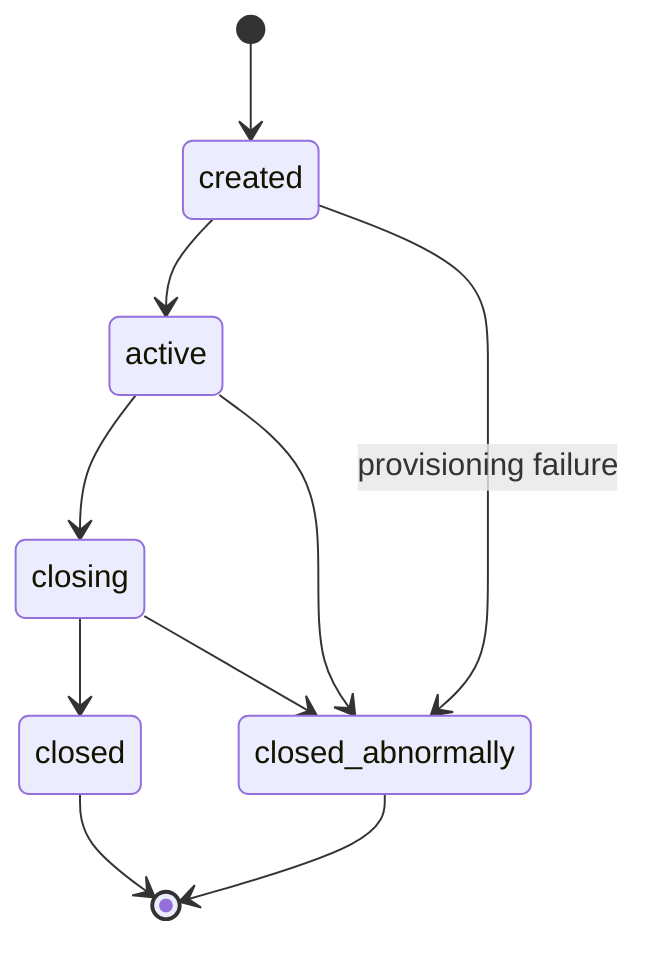
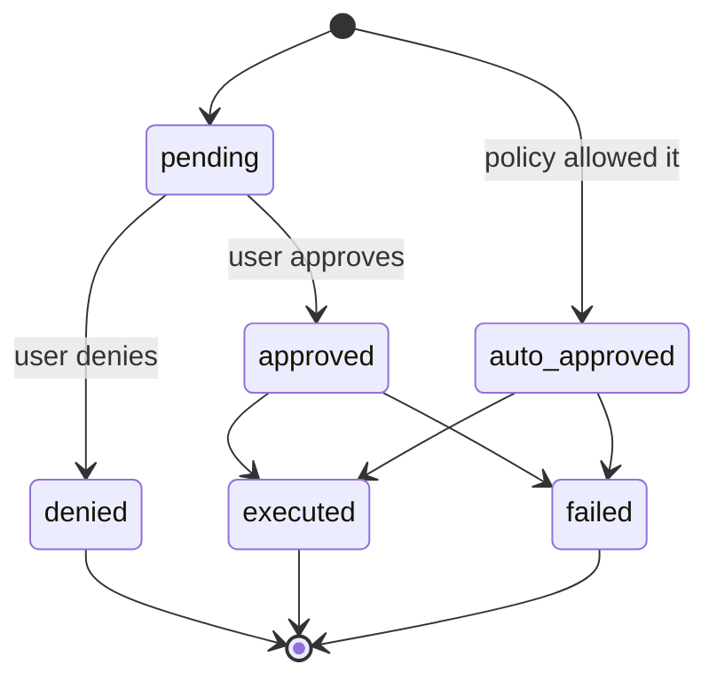
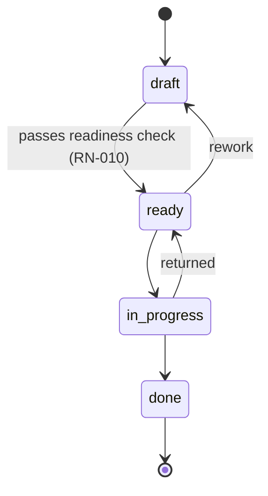
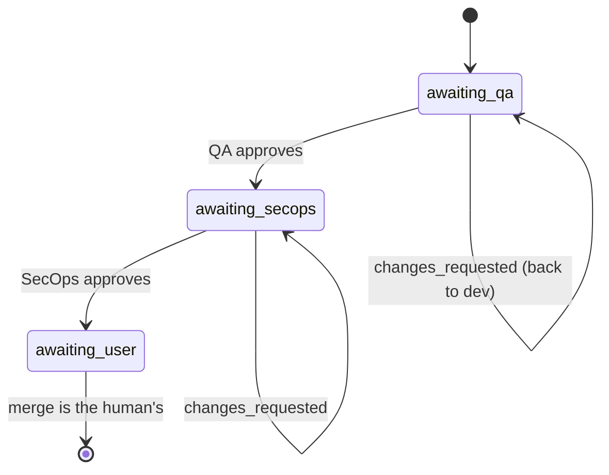

# API

## Session

Brabo executes engineering work through AI agents. Two forces shape virtually
every rule here:

**The agent is not trustworthy by construction.** It's a language model: it
can hallucinate, get stuck in a loop, or request something destructive. The
rules exist so the possible damage is bounded by structure, not by prompt
quality.

**Spend is real and continuous.** Every turn consumes a paid token. Budget,
ceiling, and metering aren't administrative conveniences — they're what
stops an agent loop from turning into a loss.

### Actors

| actor | who it is | authority |
|---|---|---|
| **User** | the person. Roles: `viewer`, `developer`, `maintainer`, `owner` | final decision on any action with external effect; merge is theirs exclusively |
| **Agent** | long-running process with a role (Creative, PO, Architect, Dev, Infra, QA, SecOps, Psychologist, Anamnesis) | proposes; never decides alone what policy doesn't allow |
| **System** | api and engine | enforces policy, records the event, measures cost |

The vocabulary is in the [glossary](../glossary.md).

---

## Business context

### RN-001 — The session has five states and closed transitions {#rn-001}

`created → active → closing → closed`, with `closed_abnormally` reachable
from any non-terminal state. **From `closing` there's never a way back to
`active`**, and terminal states have no exit.



- **Where:** `apps/api/src/domain/sessions/session-state-machine.ts:29`
- **Test:** `test/domain/sessions/session-state-machine.spec.ts`
- **Edge case:** `closing` is a **transient** state. A session stuck there
  means the drain started and didn't complete — there's an alert for that,
  see the [runbook](../runbook.md).

### RN-002 — Every session event is immutable and `seq` is dense {#rn-002}

There's never an `UPDATE` on `session_events`. `seq` is unique per session
(`unique(session_id, seq)`) and has no gaps: it starts at 1 and is contiguous.

- **Where:** `apps/api/src/db/schema/sessions.ts` (table `session_events`)
- **Test:** verified on restore — `docker/backup/restore.sh` fails if
  `count(*) ≠ max(seq) − min(seq) + 1` or `min(seq) ≠ 1`
- **Why:** it's what makes the Psychologist's evidence traceable and the
  backup verifiable. State that needs to change lives in its own table,
  alongside.

## Action approval

The heart of the system. Every action with an external effect is born as a
`proposed_action`.

### RN-003 — The action has six states, and denied is terminal {#rn-003}



- **Where:** `apps/api/src/domain/actions/action-state-machine.ts:36`
- **Test:** `test/domain/actions/action-state-machine.spec.ts`
- **Edge case:** an approved action that executed becomes `executed`,
  **not** still `approved`. Counting approvals by `status = 'approved'`
  gives the wrong number — the correct criterion is `decided_by IS NOT
  NULL`.

### RN-004 — The decision is evaluated in three stages, and `deny` wins immediately {#rn-004}

Order: **(a) IAM → (b) `agent_autonomy` → (c) `permissions.json`**. Each
stage can only **raise** permissiveness; a silent stage never lowers the
previous one. `deny` at any stage returns immediately.

- **Where:** `apps/api/src/domain/actions/decide.ts:118`
- **Test:** `test/domain/actions/decide.spec.ts` (10 KB — the largest in
  the domain)

### RN-005 — Minimum role per action type {#rn-005}

Before any policy, IAM: each `ActionType` requires a minimum effective
role. Without it, `deny` with an explicit reason.

- **Where:** `apps/api/src/domain/actions/decide.ts:115` (`MIN_ROLE_FOR_ACTION_TYPE`)
- **Test:** `test/domain/actions/decide.spec.ts`

### RN-006 — Ceiling: merge into a protected branch is never auto-approvable {#rn-006}

`dev`, `qa`, `rc`, and `main` are protected. A `git_merge` targeting one of
them is downgraded from `auto_approve` to `require_approval` **after** all
the policy has run. Neither `agent_autonomy` nor `permissions.json` can
promote it.

`rc` stays on the list even after the step left the policy
([ADR 0030](../adr/0030-politica-de-branches-mecanizada.md)) and the bootstrap
stopped creating it ([RN-029](#rn-029)). This list decides what the lock
**refuses**, and repositories bootstrapped by earlier versions still have
the branch: protecting one that doesn't exist costs nothing; unprotecting
one that exists costs dearly.

- **Where:** `apps/api/src/domain/actions/decide.ts:511` (`isProtectedBranch`, o teto da trava de merge) + `protected-branches.ts:4`
- **Test:** `test/domain/actions/decide.spec.ts`
- **Origin:** [ADR 0011](../adr/0011-infra-dev-agents-worktrees-merge-lock.md) §1
- **Note:** the equivalent protection **on the platform** (GitHub/GitLab)
  diverges between providers and isn't the gate — see
  [ADR 0028](../adr/0028-protecao-de-branch-divergencia-entre-providers.md).

### RN-007 — Ceiling: an instruction patch is never auto-approvable {#rn-007}

Changing an agent's instruction always requires a human decision. The
feature's value is in the human seeing the diff; auto-approving would be
the agent rewriting itself.

- **Where:** `apps/api/src/domain/actions/decide.ts:168`
- **Test:** `test/domain/actions/decide.spec.ts`
- **Origin:** [ADR 0016](../adr/0016-anamnese-proficiencia-patches-instrucao.md) §8

### RN-008 — Command matching is by pattern, not substring {#rn-008}

`permissions.json` matches a terminal command by structured pattern, with
the command properly tokenized — not by `includes()`.

- **Where:** `apps/api/src/domain/actions/command-matcher.ts`
- **Test:** `test/domain/actions/command-matcher.spec.ts`

---

## Backlog

### RN-009 — The story has four states, and `done` is terminal {#rn-009}

`draft → ready → in_progress → done`. Rework is allowed: `ready → draft` and
`in_progress → ready`.



- **Where:** `apps/api/src/domain/backlog/story-state-machine.ts:27`
- **Test:** `test/domain/backlog/story-state-machine.spec.ts`

### RN-010 — `draft → ready` requires four things, validated in the domain {#rn-010}

For a story to become `ready` it needs, **all of them**:

1. `dod` not empty — Definition of Done
2. `dor` not empty — Definition of Ready
3. at least 1 functional requirement (`rf`)
4. at least 1 linked business rule (`businessRuleIds`)

The error names **exactly what's missing**, not a generic "invalid".

- **Where:** `apps/api/src/domain/backlog/story-readiness.ts:39`
- **Test:** `test/domain/backlog/story-readiness.spec.ts`
- **Origin:** [ADR 0009](../adr/0009-agente-po-backlog-rastreabilidade.md) §3
- **Why:** it's what stops the PO from dumping a vague story into the dev
  queue.

### RN-011 — Business rule with no story is a finding, not an error {#rn-011}

Rule→story coverage is computed, and what has no story shows up as
**pending** — information, not a failure.

- **Where:** `apps/api/src/domain/backlog/coverage.ts`
- **Test:** `test/domain/backlog/coverage.spec.ts`

### RN-013 — The module graph cannot have a cycle {#rn-013}

- **Where:** `apps/api/src/domain/architecture/module-graph.ts`
- **Test:** `test/domain/architecture/module-graph.spec.ts`

---

## PR Gates

### RN-014 — The gate order is immutable and `awaiting_user` is terminal {#rn-014}

`awaiting_qa → awaiting_secops → awaiting_user`. Approving QA **never**
skips straight to the user. `changes_requested` sends it back to the dev
**on the same branch**, with no new PR.



- **Where:** `apps/api/src/domain/execution/pr-gate-state-machine.ts:24`
- **Test:** `test/domain/execution/pr-gate-state-machine.spec.ts`
- **Origin:** [ADR 0013](../adr/0013-gates-qa-secops-pr.md) §1
- **Edge case:** `awaiting_user` is terminal **by design** — the system
  never merges (RN-006).

### RN-015 — Cycle K: the correction ceiling is finite and inherited {#rn-015}

Every gate return consumes a lap. Once the ceiling is exhausted, the task
is **blocked** with a reason, instead of spinning forever. A subagent
created by parallelization **inherits** the base agent's ceiling.

Since Phase 8b the ceiling also applies to the QA AREA, with no code
change: `QaLeadServer` is the only caller of `record_gate_verdict`, so one
gate round — no matter how many specializations it consulted underneath —
still consumes exactly ONE lap. See
[RN-036](engine.md#rn-036).

- **Where:** `DEFAULT_MAX_GATE_CORRECTIONS = 3` in
  `apps/api/src/application/use-cases/execution/record-gate-verdict.use-case.ts:21`;
  applied in `activate-execution.use-case.ts:89` and, in the engine, in
  `qa_lead_server.ex:268` and `secops_agent_server.ex:142`
- **Test:** `apps/engine/test/engine/gates/qa_automacao_agent_test.exs`
  (the specialization returns `{:blocked, ...}` without calling the api)
  and `qa_lead_server_test.exs` (the Lead NEVER calls
  `record_gate_verdict` in that case — that's what stops the correction
  from being burned)
- **Origin:** [ADR 0017](../adr/0017-lock-de-workspace-e-monitor-de-dev-agents.md) §4

### RN-017 — Orçamento tem escopo exclusivo: projeto **ou** sessão {#rn-017}

Um `budget` referencia um projeto ou uma sessão, nunca os dois — garantido
por um `check` no banco de dados, não só no código.

- **Onde:** `apps/api/src/db/schema/llm.ts` (`budgets_scope_check`)
- **Teste:** a constraint é a garantia

### RN-018 — Notificação de orçamento em 70%, 90% e 100%, sem repetir {#rn-018}

Cada limiar dispara **uma vez**; o último notificado fica persistido em
`budgets.last_threshold_notified`.

- **Onde:** `apps/api/src/domain/llm/budget-threshold.ts:1`
- **Teste:** `test/domain/llm/budget-threshold.spec.ts`

### RN-019 — `policy = 'block'` recusa a chamada; `'allow'` só registra {#rn-019}

- **Onde:** `apps/api/src/domain/llm/budget-threshold.ts:4`
- **Caso de borda:** um projeto em `allow` **não se detém** no teto. É a
  causa mais comum de "o orçamento não segurou" — veja o
  [runbook](../runbook.md).

### RN-020 — O modelo é resolvido em cascata, do mais específico ao mais geral {#rn-020}

`session > agent > area > project > workspace`. Vence o primeiro que
existir. `area` entrou na FASE 23 — veja a [RN-102](#rn-102) para a posição
dela e o que muda para quem já leu esta cascata.

- **Onde:** `apps/api/src/domain/llm/binding-resolver.ts`
- **Teste:** `test/domain/llm/binding-resolver.spec.ts`

## Psicólogo e Anamnese

### RN-021 — Hipótese sem evidência válida não é gravada {#rn-021}

Os `evidenceEventIds` precisam apontar para eventos **que existem e pertencem à
sessão analisada**. A validação é atômica por lote: um id inválido reprova o
lote inteiro.

- **Onde:** `apps/api/src/domain/psychologist/hypothesis-evidence.ts`
- **Teste:** `test/domain/psychologist/hypothesis-evidence.spec.ts`
- **Origem:** [ADR 0015](../adr/0015-psicologo-real-toolloop-hipoteses-evidencia.md) §3

### RN-022 — O ciclo de vida da hipótese é compare-and-swap {#rn-022}

`proposed → accepted | dismissed`. Duas decisões concorrentes sobre a mesma
hipótese: uma vence, a outra recebe conflito — não 500, não silêncio.

- **Onde:** `apps/api/src/domain/psychologist/hypothesis-lifecycle.ts`
- **Teste:** `test/domain/psychologist/hypothesis-lifecycle.spec.ts`
- **Origem:** [ADR 0022](../adr/0022-fechamento-4b-psicologo.md) §7

### RN-024 — A Anamnese só perfila competência do catálogo — guarda-corpo estrutural {#rn-024}

Competências de processo são **seis**, fechadas: `git`, `agile`, `arquitetura`,
`testes`, `seguranca`, `infra`. Mais as stacks técnicas derivadas do
`module_map`. Qualquer outra coisa — "ansiedade", "saúde mental" — **não tem
caminho de escrita**: é erro no domínio, não instrução de prompt.

- **Onde:** `apps/api/src/domain/anamnese/competency-catalog.ts:16`
- **Teste:** `test/domain/anamnese/competency-catalog.spec.ts`
- **Origem:** [ADR 0016](../adr/0016-anamnese-proficiencia-patches-instrucao.md) §1
- **Por quê:** a Anamnese perfila **competência técnica**, não pessoa. O limite
  é estrutural porque uma instrução de prompt não é garantia.

### RN-025 — Apagar o perfil apaga de verdade, e o opt-out impede a re-derivação {#rn-025}

- **Onde:** `apps/api/src/domain/anamnese/proficiency-profile.entity.ts` +
  tabela `anamnese_opt_outs`
- **Origem:** [ADR 0016](../adr/0016-anamnese-proficiencia-patches-instrucao.md) §2

### RN-026 — Patch de instrução negado não é reproposto {#rn-026}

A comparação é sobre o conteúdo **normalizado**, não sobre o texto literal:
reindentar o mesmo patch não o transforma em proposta nova. Não há tabela de
dedup — a fonte é o próprio histórico de `proposed_action` com `actionType =
instruction_patch` e `status = denied`.

- **Onde:** `apps/api/src/domain/instructions/patch-dedup.ts:22`
- **Teste:** `test/domain/instructions/patch-dedup.spec.ts`

### RN-027 — Rollback de instrução é operação **para frente** {#rn-027}

Reverter cria uma versão nova com o conteúdo antigo; não apaga histórico. A
tabela de versões é append-only.

- **Onde:** `apps/api/src/domain/instructions/`
- **Origem:** [ADR 0016](../adr/0016-anamnese-proficiencia-patches-instrucao.md) §4

---

## Git

### RN-029 — O bootstrap de Gitflow é idempotente e retomável {#rn-029}

Cinco passos; cada um verifica antes de agir e pode ser retomado do ponto que
falhou. `skip` é sucesso, não erro.

Eram seis. O sexto criava a branch `rc`, degrau que o
[ADR 0030](../adr/0030-politica-de-branches-mecanizada.md) removeu da política —
o bootstrap continuou criando, protegendo e **documentando no repositório do
usuário** uma escada que o produto já tinha abandonado (achado #3 do primeiro
dogfooding). O valor `create_rc_branch` continua no enum `bootstrap_step`:
linhas antigas o referenciam, e passo que aconteceu de verdade não se apaga do
histórico.

- **Onde:** `apps/api/src/application/use-cases/git/bootstrap-steps.ts` +
  `domain/git/repo-bootstrap.entity.ts` (`RETIRED_BOOTSTRAP_STEPS`)
- **Teste:** `test/domain/git/repo-bootstrap-status.spec.ts`
- **Origem:** [ADR 0005](../adr/0005-repo-bootstrap-idempotent-steps.md)

---

### RN-030 — Reapresentar um refresh já usado revoga a família inteira {#rn-030}

Cada refresh consome o token apresentado e emite um filho com o **mesmo**
`family_id` e o mesmo `family_started_at`. Apresentar um token que já foi
consumido é a assinatura de um roubo — alguém está usando uma cópia — e a
resposta é revogar todos os tokens vivos daquela família, com evento de
segurança.

O usuário legítimo é deslogado junto. Isso é o comportamento correto, não um
defeito: do lado do servidor, um duplo-submit do cliente e um replay de ladrão
são idênticos.

- **Onde:** `apps/api/src/domain/auth/refresh-token.ts:50` +
  `application/use-cases/auth/refresh.use-case.ts:98`
- **Teste:** `test/application/use-cases/auth/rotacao-e-reuso.spec.ts`
- **Borda:** quem apresenta um token de família **já revogada** é vítima a
  jusante, não novo roubo: registra `refresh_revoked` e **não** dispara segunda
  cascata. Sem essa distinção, cada aba do usuário legítimo geraria um alarme
  falso durante o incidente.
- **Origem:** [ADR 0031](../adr/0031-auth-first-party-argon2id-e-rotacao-de-refresh.md)

### RN-031 — Falha de login é contada por e-mail e por IP, e o bloqueio escala {#rn-031}

Janela deslizante de 15 minutos no Postgres, sem Redis. Dois baldes por
tentativa e o mais restritivo vence: e-mail (5 falhas → 30s, 8 → 5min, 12 →
15min) e IP (20 → 30s, 30 → 2min). Um login bem-sucedido limpa o balde do
e-mail; o de IP drena só por tempo.

A chave do balde é o **e-mail normalizado**, nunca o id do usuário. Com id, o
balde só existiria depois de encontrar a conta, e o próprio lockout viraria
oráculo de existência.

- **Onde:** `apps/api/src/domain/auth/lockout-policy.ts:97` +
  `infrastructure/persistence/drizzle/drizzle-login-throttle.ts:74`
- **Teste:** `test/application/use-cases/auth/lockout.spec.ts`
- **Borda:** enquanto bloqueado, a tentativa **não** é registrada. Se fosse, um
  atacante manteria a conta da vítima travada para sempre só continuando a
  tentar — o lockout viraria negação de serviço contra quem ele protege.
- **Por quê:** o balde de IP não pode ser limpo no sucesso; quem tem uma conta
  válida zeraria a janela à vontade e pulverizaria palpites sem limite.
- **Origem:** [ADR 0031](../adr/0031-auth-first-party-argon2id-e-rotacao-de-refresh.md)

### RN-032 — Nenhuma resposta distingue conta existente de inexistente {#rn-032}

Qualquer resposta diferente da falha uniforme só é alcançável **depois** de uma
verificação de senha bem-sucedida. No login, e-mail inexistente, senha errada e
conta bloqueada devolvem o mesmo 401 e gastam o mesmo tempo — o ramo sem conta
verifica contra um hash dummy gerado com **os mesmos parâmetros** do real. No
registro e no pedido de reset, endereço conhecido e desconhecido devolvem 202.

- **Onde:** `apps/api/src/application/use-cases/auth/login.use-case.ts:79` +
  `register.use-case.ts:74`
- **Teste:** `test/application/use-cases/auth/enumeracao.spec.ts`
- **Borda:** a checagem de bloqueio por e-mail roda **depois** do argon2, não
  antes. Sair mais cedo é a otimização que qualquer revisor sugeriria, e é
  exatamente o vazamento — o teste fica vermelho se alguém a introduzir.
- **Borda:** o usuário MIGRADO do Keycloak (existe em `users`, sem linha em
  `auth_credentials`) também recebe o 401 uniforme — e o link de "definir
  senha" é disparado em silêncio. Responder `password_pending` confirmaria que
  o endereço existe **e** que é conta legada. Por isso `findByEmail` é um LEFT
  JOIN numa consulta só: duas consultas encadeadas fariam esse ramo pagar uma
  ida a mais ao banco, e o relógio revelaria o que o corpo esconde.
- **Por quê:** o que se afirma é "nenhum ramo pula o trabalho caro e nenhum
  produz resposta distinguível", **não** tempo constante. Ver as consequências
  no ADR.
- **Origem:** [ADR 0031](../adr/0031-auth-first-party-argon2id-e-rotacao-de-refresh.md),
  borda do migrado em
  [ADR 0032](../adr/0032-corte-do-keycloak-e-sessao-em-cookie.md)

### RN-033 — Token de verificação e de reset vale uma vez só {#rn-033}

Consumo por UPDATE condicional com `returning`: o próprio UPDATE é a guarda.
Zero linhas cobre inexistente, de outro propósito, já consumido, invalidado e
expirado — todos com a mesma resposta. Pedir um link novo invalida o anterior.
Concluir um reset revoga **todas** as sessões do usuário e não emite tokens.

- **Onde:** `apps/api/src/infrastructure/persistence/drizzle/account-token.repository.ts:76`
- **Teste:** `test/application/use-cases/auth/tokens-de-conta.spec.ts`
- **Borda:** dois envios simultâneos não passam os dois. A corrida é o caso
  **normal**, não a exceção: scanner de e-mail corporativo abre todo link de
  toda mensagem, então o robô costuma consumir o token antes do humano clicar.
- **Por quê:** o reset não emite sessão de propósito — logar direto a partir de
  um link recebido por e-mail faria comprometer o e-mail equivaler a tomar a
  conta, sem segundo passo.
- **Origem:** [ADR 0031](../adr/0031-auth-first-party-argon2id-e-rotacao-de-refresh.md)

### RN-034 — A sessão da web vive em cookie httpOnly, com CSRF {#rn-034}

O refresh token vai num cookie `brabo_refresh` (`httpOnly`, `SameSite=Strict`,
`Path=/auth`, `Secure` em produção) e **não** aparece no corpo de nenhuma
resposta. O access token, de 15 minutos, fica em memória no cliente e viaja no
`Authorization: Bearer`.

`/auth/refresh` e `/auth/logout` exigem `X-CSRF-Token` igual ao cookie
`brabo_csrf`, comparado em tempo constante.

- **Onde:** `apps/api/src/interfaces/http/auth/session-cookies.ts:53` +
  `interfaces/http/auth/auth.controller.ts`
- **Teste:** `test/interfaces/session-cookies.spec.ts`
- **Borda:** falha de CSRF é **403**, não 401. Com 401 o cliente tentaria
  renovar a sessão e entraria em laço — a credencial está boa, quem está errada
  é a requisição.
- **Por quê:** devolver o refresh também no corpo anularia o `httpOnly` —
  bastaria um XSS ler a resposta do login, e levaria a sessão longa em vez dos
  15 minutos do access.
- **Origem:** [ADR 0032](../adr/0032-corte-do-keycloak-e-sessao-em-cookie.md)

### RN-035 — O tráfego interno engine ↔ api exige o segredo de serviço {#rn-035}

As 32 rotas `/internal/*` são `@ServiceRoute()`: ficam fora do JWT de usuário e
fora do rate limit. Quem autentica é o `EngineServiceGuard`, comparando
`X-Brabo-Service-Token` com `BRABO_SERVICE_TOKEN` em tempo constante. O mesmo
segredo vale nos dois sentidos, e `BRABO_SERVICE_TOKEN_PREVIOUS` é aceito só na
verificação, para a rotação não ter janela de indisponibilidade.

- **Onde:** `apps/api/src/interfaces/http/auth/engine-service.guard.ts:44` +
  `infrastructure/security/service-token.ts` +
  `apps/engine/lib/engine_web/plugs/verify_service_token.ex`
- **Teste:** `apps/engine/test/engine_web/plugs/verify_service_token_test.exs`,
  `test/interfaces/route-surface.spec.ts` e, para a rotação do lado da api
  (anterior aceito só na verificação, quem chama manda o atual, removido o
  anterior o velho cai), `test/infrastructure/security/service-token.spec.ts`
  (describe "rotação do BRABO_SERVICE_TOKEN") e
  `test/interfaces/engine-service.guard.spec.ts` ([RN-597](#rn-597))
- **Borda:** a isenção de rate limit vem do METADADO da rota, não do guard. O
  `RateLimitGuard` é `APP_GUARD` e roda antes de qualquer guard de controller —
  quando ele decide, o `EngineServiceGuard` ainda não rodou.
- **Origem:** [ADR 0032](../adr/0032-corte-do-keycloak-e-sessao-em-cookie.md)

### RN-038 — Agente contado no resumo do workspace = gastou tokens este mês {#rn-038}

O resumo do dashboard de projetos ("N projetos ativos · M agentes · gasto
este mês") conta como "agente" quem tem pelo menos uma linha em
`token_usage` com `actor_kind = 'agent'` no mês corrente, somando todos os
projetos do workspace. Sem o filtro de `actor_kind`, um `user` mandando
chat ou um `system` registrando uso inflaria a contagem — `token_usage`
grava para qualquer tipo de ator, não só agente. O corte por mês usa
`created_at >= date_trunc('month', now())`; um agente que trabalhou só no
mês anterior não conta, mesmo que ainda apareça no roster de alguma
sessão. A contagem naturalmente inclui as subespecialidades de área da
Fase 8 (`qa-automacao`, `qa-performance-seguranca`, `infra-workflows`):
cada uma tem seu próprio `actor_id` quando gasta tokens.

- **Onde:** `apps/api/src/infrastructure/persistence/drizzle/token-usage.repository.ts`
  (`summarizeForWorkspaceThisMonth`)
- **Teste:** `test/application/use-cases/iam/get-workspace-summary.use-case.spec.ts`

---

### RN-040 — Binding de agente exige tool calling nativo {#rn-040}

Vincular um modelo a um **agente** (`scope = 'agent'`) só é permitido se o
modelo tiver `supports_tool_calling`. Um agente só existe dentro do
ToolLoop, e o ToolLoop só funciona se o modelo souber **pedir** ferramentas;
sem isso, a falha apareceria adiante como "o agente parou sem terminar",
que é exatamente o diagnóstico por eliminação que o
[ADR 0020](../adr/0020-destravar-gates-qa-secops.md) proibiu. A recusa é um
422 e a mensagem aponta para o filtro **"aptos para agentes"** — sem esse
apontamento a regra vira um beco sem saída.

O `ToolCallRecovery` do engine recupera chamadas que o modelo escreveu em
prosa, mas é um **resgate, não uma licença**: depende de o modelo acertar o
formato por acaso.

Só `agent` valida. `workspace` e `project` são o fallback do chat humano e
`session` é conversa — nenhum deles roda um ToolLoop, e travá-los proibiria
modelos só de chat no produto. O agente `context-manager` está coberto por
construção: é um slug **dentro** do escopo `agent`, não um escopo próprio.

**Nota aditiva — o filtro passou a vir MARCADO, e quem o liga é o ESCOPO.** O
parágrafo acima diz que a recusa aponta para o filtro "aptos para agentes",
"senão a regra vira beco sem saída" — e por muito tempo ela foi um: o prop que
abre o seletor com o filtro marcado existia desde a Fase 9c e **nenhuma tela de
produção o passava**. O seletor de um agente abria oferecendo modelo chat-only
cujo clique só existia para ser recusado. As duas telas que gravam num escopo
validado passam a abrir filtradas — `ModelsSection` (agente e a caixa
da área na linha do lead, RN-912) —, e a régua de quem liga não é a tela e sim
`assertModelFitsBindingScope`: onde a api RECUSA, o filtro vem marcado; onde ela
não recusa, quem escolhe é a pessoa. Por isso o seletor de SESSÃO continua sem
filtro — marcar ali esconderia modelo que a api aceita. **Isto não elimina o
422**: o filtro cobre uma das três causas, e as outras duas
([RN-043](#rn-043) — desativado no workspace, sumido do provider) seguem
alcançáveis, com o indisponível ainda LISTADO e marcado; o desfecho de recusa da
[RN-470](web.md#rn-470) continua sendo o que conta o que houve. E é estado INICIAL de
um checkbox, não trava: desmarcar volta a listar tudo.

**A consequência: o vigente que o filtro esconde é DITO.** `workspace` e
`project` nunca exigiram tool calling, e as rotas que resolvem o binding de um
agente ou de uma área chamam `ResolveModelBindingUseCase` **sem**
`exigeToolCalling` — então um padrão chat-only desses níveis é resolvido
normalmente e vira o vigente da linha. Com o filtro marcado, o gatilho mostrava
um nome que a lista aberta não continha, sem nenhuma opção marcada. O picker
agora nomeia o modelo e a causa; ele PODE nomear a causa porque só há um filtro
ali. Quando a lista inteira fica vazia, quem fala continua sendo o texto de
lista vazia, que já manda desmarcar — dois avisos sobre o mesmo checkbox seriam
ruído.

**Correção de fato, não do texto acima:** "Only `agent` validates" descreve a
Fase 9a. Desde o [ADR 0064](../adr/0064-escopo-de-area-na-cascata-e-o-binding-de-agente-global.md)
`area` entra na MESMA validação — ela não é fallback genérico, o único consumidor
do modelo de uma área é um agente dela ([RN-102](#rn-102)) —, e é por isso que
são DUAS as telas que ligam o filtro.

- **Onde:** `apps/api/src/domain/llm/model-capabilities.ts:38`;
  `apps/web/src/components/ModelPicker.tsx` (o filtro e o aviso de vigente
  escondido), `apps/web/src/routes/settings/ModelsSection.tsx` (quem o liga,
  no seletor do agente e no do lead que segue a área)
- **Teste:** `test/domain/llm/model-capabilities.spec.ts`,
  `test/application/use-cases/llm/set-model-binding.use-case.spec.ts`;
  `apps/web/src/routes/settings/filtro-de-aptos.test.tsx` e
  `apps/web/src/routes/SessionPage.filtro-de-aptos.test.tsx` (as duas telas que
  ligam, e a que não liga)
- **Origem:** [ADR 0041](../adr/0041-base-openai-compativel-e-contrato-de-llm-providers.md)

### RN-041 — Contagem de tokens que o provider não deu é marcada como estimada {#rn-041}

Quando a resposta do provider não traz `usage`, a base compatível com
OpenAI conta localmente com o tokenizer e emite o chunk com
`estimated: true`. O número ainda serve para cobrança, mas a marca preserva
a diferença entre **"o provider disse zero"** e **"o provider não disse
nada"** — e é o que permite à UI qualificar o custo em vez de mostrar um
valor sem procedência.

Os outros dois providers divergem, e a divergência é normalizada, não
escondida: o Ollama simplesmente não emite `usage` sem a linha `done`; o
Anthropic não pode omitir a contagem, porque `usage` é obrigatório no
`message_start` do protocolo dele. As três respostas estão em
[docs/reference/llm-providers.md](../reference/llm-providers.md#normalized-divergences).

- **Onde:** `apps/api/src/infrastructure/llm/openai-compatible-provider.ts:167`
- **Teste:** `test/contract/llm-provider.contract.ts` (cenário
  `sem_usage`, rodado contra os três providers)
- **Origem:** [ADR 0041](../adr/0041-base-openai-compativel-e-contrato-de-llm-providers.md)

### RN-042 — O metering registra quem ATENDEU a chamada, não só por onde ela entrou {#rn-042}

Quando a chamada passa por um hub que informa o provider real,
`token_usage` registra esse provider em `upstream_provider`, além do
provider de entrada. Sem hub — ou com um hub que não informou — o campo é
**`null`**, nunca string vazia: a consulta de custo por provider precisa
distinguir "não passou por hub" de "passou por um e o hub não disse".

Nas métricas, o rótulo `upstream_provider` repete o próprio provider quando
não há hub, de modo que `sum by (upstream_provider)` continua somando o
custo inteiro.

- **Onde:** `apps/api/src/application/use-cases/llm/record-llm-usage.use-case.ts:73`
- **Teste:** `test/application/use-cases/llm/record-llm-usage.use-case.spec.ts`
- **Origem:** [ADR 0041](../adr/0041-base-openai-compativel-e-contrato-de-llm-providers.md)

### RN-043 — Um modelo descoberto entra desabilitado; um modelo que desaparece é marcado, nunca apagado {#rn-043}

A sincronização do catálogo tem três desfechos, e nenhum é destrutivo:

1. **Um modelo novo** entra **sem linha de curadoria em nenhum workspace**,
   e a ausência de linha É o estado desabilitado. O catálogo de um provider
   tem centenas de linhas — despejá-las como ativas tornaria a escolha
   impossível e ligaria um modelo caro sem que ninguém decidisse. Ativar é a
   curadoria do owner, e vale só no workspace dele ([RN-052](#rn-052)).
2. **Um modelo que sumiu do catálogo remoto** recebe
   `availability = 'unavailable'` e **permanece na tabela**:
   `model_bindings` e `token_usage` apontam para a linha, e apagá-la levaria
   junto o histórico de custo.
3. **Um modelo que voltou** retorna a `available` com a curadoria
   **intacta** — a escolha do owner sobrevive a uma ausência temporária do
   provider.

Os dois eixos são deliberadamente independentes: a curadoria é decisão de
uma pessoa, `availability` é uma observação do provider. Nenhum escreve no
outro — e desde o [ADR 0049](../adr/0049-curadoria-de-modelo-por-workspace.md)
eles nem moram na mesma tabela, então a sincronização não tem campo de
curadoria para atropelar, mesmo que quisesse.

Três consequências no resto do sistema:

- um binding **NOVO** para um modelo inativo ou indisponível é recusado no
  domínio (`ModelNotBindableError`, 422). Os bindings que já existem
  permanecem;
- a **cascata** do `resolveBinding` pula o candidato indisponível, registra
  o que pulou em `skipped` e — quando o turno leva ferramentas — revalida
  `supports_tool_calling` em TODOS os níveis. Sem isso, o fallback pousaria
  um agente num modelo só de chat e violaria a [RN-040](#rn-040) em silêncio;
- **um provider que falhou não torna nada indisponível**: um 401 é "não sei
  o que há ali", não "não há nada ali". O provider é pulado, com a ORIGEM da
  falha (`infra` | `modelo`) no relatório — nunca diagnóstico por
  eliminação.

- **Onde:** `apps/api/src/application/use-cases/llm/sync-model-catalog.use-case.ts:160`,
  `apps/api/src/domain/llm/binding-resolver.ts:63`,
  `apps/api/src/domain/llm/model-capabilities.ts:49`
- **Teste:** `test/application/use-cases/llm/sync-model-catalog.use-case.spec.ts`,
  `test/domain/llm/binding-resolver.spec.ts`,
  `test/application/use-cases/llm/set-model-binding.use-case.spec.ts`
- **Origem:** [ADR 0042](../adr/0042-catalogo-vivo-ciclo-de-vida-do-modelo-e-preco-auditavel.md)

### RN-044 — O preço vale daqui para a frente, e o custo antigo continua conferindo {#rn-044}

Toda linha de `token_usage` registra o preço que produziu o seu
`cost_micros`. Mudar o preço de um modelo **não reprecifica o consumo
passado** — e mais que isso: o custo antigo continua **reproduzível**,
porque `tokens × preço registrado` bate com o custo registrado mesmo depois
de três correções na tabela `models`.

Toda mudança de preço grava uma linha em `model_price_changes`, append-only,
com o par antes/depois e a origem (`manual` | `sync`). O par é gravado junto
de propósito: reconstruir o "antes" a partir da linha anterior dependeria de
nenhuma escrita ter escapado do caminho auditado, que é exatamente o que a
auditoria existe para provar. Um preço igual ao atual é no-op — uma linha
dizendo "mudou de 10 para 10" transformaria o log em ruído.

A regra vale para **todo** caminho que muda preço, não só o da tela. Duas
escritas costumavam escapar dela: a sincronização do catálogo (que mudava o
preço via `upsert`, nunca produzindo a origem `sync` que o domínio declarava
desde a Fase 9c) e o `seed.ts` (que roda num banco já semeado —
`BRABO_FORCE_SEED=1` no `bootstrap.sh` do k8s — e portanto corrigia o preço
em silêncio). Ambos agora auditam, com o seed reaproveitando o próprio
`UpdateModelPricingUseCase`.

- **Onde:** `apps/api/src/application/use-cases/llm/update-model-pricing.use-case.ts:44`,
  `apps/api/src/application/use-cases/llm/sync-model-catalog.use-case.ts:213`,
  `apps/api/src/db/seed.ts:376`
- **Teste:** `test/application/use-cases/llm/update-model-pricing.use-case.spec.ts`,
  `test/application/use-cases/llm/sync-model-catalog.use-case.spec.ts`
- **Origem:** [ADR 0042](../adr/0042-catalogo-vivo-ciclo-de-vida-do-modelo-e-preco-auditavel.md)

### RN-045 — Um repositório adotado só é alterado por um plano aprovado {#rn-045}

Adotar um repositório existente **diagnostica sem agir**. A adoção valida o
acesso (`getRepo`), grava as linhas do projeto e produz um **plano**: a lista
serializada do que o bootstrap faria, obtida chamando o `check()` de cada
passo — o mesmo que dá idempotência desde a [RN-029](#rn-029)
— sem nunca executar a mutação correspondente.

Enquanto `repo_bootstraps.plan_decision` é **nulo**, nenhuma mutação roda. O
portão fica **antes** do executor, não dentro dele: o runner do bootstrap é o
mesmo da Fase 2, sem filtro, e simplesmente não é chamado. Somado à guarda
que já pulava branches protegidas, não há caminho de código que toque uma
branch fora de um plano aprovado.

Os dois desfechos:

- **aprovar** é tudo ou nada (aprovar passos soltos quebraria a cascata
  `dev←main, qa←dev`). O que executa é o plano **rederivado** no momento da
  execução: igual ou menor que o mostrado, **nunca maior** — uma branch que
  virou protegida nesse meio-tempo é pulada;
- **adotar como está** dispensa o bootstrap, registra a decisão e **não**
  mexe no cursor para fingir convergência. O plano é guardado como evidência
  do que foi deliberadamente não aplicado.

Decidir sobre um plano regenerado é recusado (409): a decisão carrega o
`planGeneratedAt` que o usuário viu, e um "sim" dado sobre outra coisa não
vale.

O provisionamento normal recusa (409) rodar num repositório adotado — sem
essa guarda, o caminho de retomada rodaria o bootstrap no repositório de
terceiros sem plano nenhum.

**Limite conhecido:** "proteção divergente" aqui é presença × ausência,
porque é só isso que o contrato expõe (`GitBranch.protected` é um booleano, e
o [ADR 0028](../adr/0028-protecao-de-branch-divergencia-entre-providers.md)
adiou uma `ProtectionPolicy` normalizada). Uma branch com proteção PARCIAL
conta como "desprotegida" e pode ser sobrescrita — mas só dentro de um plano
aprovado.

- **Onde:** `apps/api/src/application/use-cases/git/decide-bootstrap-plan.use-case.ts`,
  `apps/api/src/application/use-cases/git/bootstrap-plan.ts`,
  `apps/api/src/application/use-cases/git/bootstrap-steps.ts:112`
- **Teste:** `test/application/use-cases/git/decide-bootstrap-plan.use-case.spec.ts`,
  `test/application/use-cases/git/bootstrap-plan.spec.ts`
- **Origem:** [ADR 0044](../adr/0044-adocao-de-repositorio-existente.md)

### RN-046 — Todo repositório de projeto declara a sua origem {#rn-046}

`project_repositories.origin` e `repo_bootstraps.origin` dizem se o Brabo
**criou** o repositório (`created`) ou **adotou** um que já existia
(`adopted`). A origem é escrita explicitamente por quem grava a linha — não
pelo default da coluna — e não muda depois.

Não é decoração: é o que faz o produto tratar como caso legítimo o que a
Fase 10 precisou fazer à mão (inserir linhas em `project_repositories` e
`repo_bootstraps` para apontar um projeto para um fork). Um repositório
`adopted` tem política de branches própria, não passa pelo provisionamento e
só é alterado conforme a [RN-045](#rn-045).

O backfill da migration `0031` marca tudo que já existia como `created`, e
pode ser cego quanto a isso: a adoção não existia antes dela, então não há
linha adotada para classificar errado.

- **Onde:** `apps/api/src/db/schema/git.ts`, `apps/api/src/db/migrations/0031_special_winter_soldier.sql`,
  `apps/api/src/domain/git/repo-bootstrap.entity.ts`
- **Teste:** `test/application/use-cases/git/adopt-repository.use-case.spec.ts`
- **Origem:** [ADR 0044](../adr/0044-adocao-de-repositorio-existente.md)

### RN-048 — A promoção de story é do usuário por padrão; o modo muda quem dispara, nunca o que se valida {#rn-048}

`projects.story_promotion` escolhe QUEM promove uma story de `draft` para
`ready`:

- **`manual`**: o PO deixa a story completa e ela fica `draft` com
  `stories.proposed_ready = true`. **Nenhuma de suas tarefas é pegável** — o
  `claimNext` exige `story.status = 'ready'` — e é o usuário quem a promove,
  individualmente ou em lote, a partir do Backlog.
- **`auto`** (default de projeto novo desde a [RN-659](#rn-659)):
  o PO promove por conta própria ao terminar uma story completa. Esse era o
  comportamento anterior à Fase 12c; `manual` foi o default da 12c até a
  RN-659 (migration `0065`), que mudou só o default da coluna — projetos
  criados no meio do caminho continuam `manual`.

**O modo muda o gatilho, não o critério.** Os dois caminhos passam por
`assertPromotable` — prontidão (RF/DoD/DoR/regra) e módulos resolvidos contra
o `module_map` vigente — e é isso que o teste de simetria em
`story-promotion.spec.ts` trava: para toda story, `isPromotable` concorda com
o que `assertPromotable` levanta. Antes da fase, a validação era duplicada e
assimétrica (a criação chamava `canBecomeReady`, a transição chamava
`assertReady` + `assertModulesResolved`): duas portas para o mesmo estado,
com fechaduras diferentes. Tornar o gatilho configurável exigiu unificá-las
primeiro, senão "promover pela UI" e "promover na criação" seriam regras
distintas com o mesmo nome.

Uma story **incompleta** nunca é proposta. `proposed_ready` só liga quando a
story já passaria na validação — propor o que o domínio recusaria empurraria
o trabalho do PO para o usuário disfarçado de decisão.

A **recusa** devolve a story ao PO: grava `returned_reason`/`returned_at`,
desliga `proposed_ready`, emite `backlog.story_promotion_returned` e injeta o
motivo como mensagem FIXADA na sessão do PO, com a mesma redação de
precedência de um gate devolvido ao dev (lição do ADR 0020). A recusa é
gravada **antes** de falar com o engine, e o engine falhar não a desfaz — é o
inverso da ordem do rearme na [RN-047](engine.md#rn-047), e por um motivo: lá o evento
afirma algo SOBRE o engine, aqui ele afirma algo sobre o usuário, o que é
verdade haja ou não um PO de plantão para ouvir.

A promoção em lote **não é tudo ou nada**: cada story é a sua própria
transação, e uma que perdeu a prontidão entre a proposta e a decisão volta
`failed` com o motivo, sem derrubar as outras que o usuário acabou de
revisar.

O evento `backlog.story_transitioned` registra o **ator real** — `user` na
promoção manual, `agent/po` na automática. O event log é imutável e é o que a
auditoria lê: registrar o PO numa decisão do usuário apagaria exatamente a
etapa humana que a regra existe para devolver.

A migration `0033` faz um backfill **dirigido**, não cego: a coluna nasce
`manual` e todo projeto que já existia é movido para `auto`. O novo default
vale para quem vier depois; um projeto em andamento não pode parar de
produzir por causa de um deploy.

- **Onde:** `apps/api/src/domain/backlog/story-promotion.ts`,
  `apps/api/src/db/migrations/0033_absurd_domino.sql`,
  `apps/api/src/application/use-cases/backlog/promote-stories.use-case.ts`,
  `apps/api/src/application/use-cases/backlog/return-story.use-case.ts`,
  `apps/engine/lib/engine/agents/po_server.ex` (`revision_message/1`)
- **Teste:** `test/domain/backlog/story-promotion.spec.ts` (simetria),
  `test/db/story-promotion-migration.spec.ts` (backfill dirigido),
  `test/application/use-cases/backlog/promote-stories.use-case.spec.ts`,
  `test/application/use-cases/backlog/return-story.use-case.spec.ts`,
  `apps/engine/test/engine/agents/po_server_test.exs` (describe `revise/2`)
- **Origem:** [ADR 0046](../adr/0046-promocao-de-story-com-autoridade-do-usuario.md)

### RN-049 — Toda decisão sobre uma ação proposta fica no event log, com quem decidiu {#rn-049}

`proposed_action.created`, `.approved` e `.denied` são eventos de domínio em
`session_events`, além das linhas do outbox que os levam ao engine. O outbox
**não** é memória: ele é drenado, marcado com `processed_at` e podado.

`actor` é quem realmente decidiu — o **usuário** em `.approved`/`.denied`, o
**agente** que propôs em `.created`. E `created.payload.status` diz como a
ação nasceu (`pending`, `auto_approved`, `denied`).

Isso rende a distinção que dá a métrica: **decisão humana = evento
`proposed_action.approved`**; a política decidindo sozinha aparece apenas em
`.created` com `status: auto_approved` e ator agente, e nunca se confunde com
um clique. Essa contagem — "cliques de aprovação" — era exatamente o que a
Fase 10 queria medir e não conseguiu, porque a decisão não existia em lugar
consultável (achado #17). `approve_always` conta como aprovação porque
delega ao mesmo caso de uso, e emite `permission.granted` por cima.

Ficou de fora, por decisão: o `proposed_action.created` que o bootstrap do
repositório emite direto para o outbox. Essas mutações já são narradas por
`bootstrap.step_*` na mesma sessão, e duplicá-las contaria o mesmo fato duas
vezes numa métrica de aprovação.

- **Onde:** `apps/api/src/application/use-cases/actions/propose-action.use-case.ts`,
  `.../approve-action.use-case.ts`, `.../deny-action.use-case.ts`
- **Teste:** `test/application/use-cases/actions/approve-deny-action.use-case.spec.ts`
  (describe `the decision in the event log`)
- **Origem:** [ADR 0048](../adr/0048-decisao-no-log-e-a-ordem-do-gate.md)

### RN-051 — Um preço digitado à mão vence o catálogo do provider {#rn-051}

Uma linha de `models` com `manual_pricing = true` tem um número que alguém
digitou depois de ler a documentação do provider. A sincronização do catálogo
**não toca nele** — nem quando o catálogo remoto traz um preço próprio. Era
isso que o schema sempre dizia ("quem sincroniza preço NÃO PODE sobrescrever
uma linha marcada aqui sem decisão explícita") e o que o código não fazia: o
remoto sempre vencia quando trazia um preço, e a sincronização seguinte
desfazia a correção de quem tinha acertado um número errado.

A regra existe porque, para vários providers, o número digitado é o **único
que existe**: NVIDIA NIM e Bitdeer não publicam preço por token em
documentação nenhuma
([referência de providers](../reference/llm-providers.md)), e o valor
semeado é uma aproximação de mercado. Deixar o catálogo remoto sobrescrevê-lo
trocaria uma aproximação conhecida por outra, sem ninguém decidir.

Um modelo NOVO nasce com a flag vinda do catálogo, não de um default fixo:
descoberto **com** preço, `manual_pricing = false` (a fonte é a sincronização,
e é ela quem mantém a linha em dia); descoberto **sem** preço, `true` — a
linha está esperando alguém digitar um, e marcá-la já protege esse número do
primeiro catálogo que resolver informar um preço.

- **Onde:** `apps/api/src/application/use-cases/llm/sync-model-catalog.use-case.ts`
  (`resolverPreco`), `apps/api/src/db/schema/llm.ts:137`
- **Teste:** `test/application/use-cases/llm/sync-model-catalog.use-case.spec.ts`
  (`manually typed price beats a catalog that REPORTS a price`)
- **Origem:** [ADR 0042](../adr/0042-catalogo-vivo-ciclo-de-vida-do-modelo-e-preco-auditavel.md)

### RN-052 — A curadoria de modelos vale só no workspace que a decidiu {#rn-052}

Ligar ou desligar um modelo no seletor é uma decisão **daquele workspace**, e
não alcança o vizinho. O catálogo em si continua global — nome, preço,
janela e capabilities são fatos do provider, iguais para todos, e duplicá-los
por workspace criaria N verdades sobre o mesmo modelo, além de partir
`token_usage.model_id` ao meio.

Antes disso, `models.is_active` era uma coluna para a instalação inteira:
quem clicava em "ativar" decidia por todos os workspaces, e a tela não dava
sinal nenhum disso. O efeito prático era um workspace ligando um modelo caro
no seletor de outro — e o gasto aparecendo no orçamento de quem não decidiu
nada.

Três regras derivadas:

1. **A ausência de linha é o estado desabilitado.** Não há um estado separado
   de "nunca decidido"; um modelo que a sincronização descobriu não tem linha
   e não aparece no seletor ([RN-043](#rn-043)).
2. **Desabilitar é `UPDATE`, não `DELETE`.** Apagar a linha apagaria também
   quem decidiu e quando. As leituras tratam os dois casos como inativos; o
   registro existe para quem audita.
3. **Os escopos `agent` e `session` não conferem a curadoria.** Nenhum dos
   dois tem âncora de workspace — o binding de agente é por slug global. A
   checagem recebe `null` e confere só a disponibilidade, deixando a lacuna
   explícita em vez de adivinhar um workspace.

- **Onde:** `apps/api/src/db/schema/llm.ts` (`workspace_models`),
  `apps/api/src/application/use-cases/llm/set-models-active.use-case.ts`,
  `apps/api/src/application/use-cases/llm/set-model-binding.use-case.ts`
  (`workspaceDoEscopo`)
- **Teste:** `test/application/use-cases/llm/set-models-active.use-case.spec.ts`
  (`activating in one workspace does NOT turn on the model in its neighbor`)
- **Origem:** [ADR 0049](../adr/0049-curadoria-de-modelo-por-workspace.md)

### RN-053 — Reativar a execução acorda quem está parado, dentro da sessão que já existe {#rn-053}

Ativar a execução de um projeto que **já está executando** é reativação, não
um começo do zero: ela cai na sessão de execução atual e acorda os agentes
que estavam parados. Duas partes, uma de cada lado do sistema.

**A sessão é reaproveitada.** A ativação usa a sessão `active` do projeto
que já carrega um `execution.activated`; só cria uma quando não há nenhuma.
Não existe coluna dizendo "esta sessão é de execução" — o que distingue uma é
o evento que ela guarda, e é isso que se consulta. Fechar a sessão continua
sendo o jeito de recomeçar: uma fechada não é candidata, e a próxima
ativação abre uma nova.

Antes, o `create` era incondicional, e o engine **descarta** o novo
`session_id` quando o agente já está vivo. Cada clique em "ativar" deixava
para trás uma sessão ativa que recebia o `execution.activated` e mais nada —
os eventos dos agentes continuavam indo para a sessão da ativação anterior.

**O agente é acordado por wake, não por `work`.** Um começo do zero dispara o
ciclo (`:work` — emite `dev.started` e pega tarefa). Um agente que já estava
vivo recebe `{:wake, :became_claimable}`, e quem decide é a guarda de estado
do servidor:

| estado do agente | o que a reativação faz |
|---|---|
| `idle` | pega a próxima tarefa |
| `working`, `awaiting_gate`, `awaiting_approval` | nada — a tarefa em andamento não é abandonada |
| `idle_tripped` | nada — só o rearme explícito o destrava ([RN-047](engine.md#rn-047)) |

Disparar `:work` para todos seria pior que o defeito: ele pega tarefa
incondicionalmente, e para um agente em `awaiting_gate` significaria largar o
worktree que o gate está varrendo — além de contornar o circuit breaker com
um clique.

- **Onde:** `apps/api/src/application/use-cases/execution/activate-execution.use-case.ts`,
  `apps/api/src/infrastructure/persistence/drizzle/session.repository.ts`
  (`findActiveExecutionSession`),
  `apps/engine/lib/engine_web/controllers/execution_command_controller.ex`
  (`acordar/4`)
- **Teste:** `test/application/use-cases/execution/activate-execution.use-case.spec.ts`
  (describe `reactivation doesn't open an orphan session`),
  `test/infrastructure/persistence/session-execution.repository.spec.ts`,
  `apps/engine/test/engine_web/controllers/execution_command_controller_test.exs`
  (describe `reactivation`)
- **Origem:** achado #11 do
  [primeiro dogfooding](../explanation/primeiro-dogfooding.md)

## PR Gates

### RN-054 — External handoff addresses the area's lead or an agent with no area — never a subagent {#rn-054}

Whoever talks to an area **from outside** talks to the lead. A handoff
addressed to a subagent (`qa-automacao`, `qa-performance-seguranca`,
`infra-workflows`) is refused with a typed error that **names the lead**
the caller should have addressed — refusing without saying the right path
would just trade a hierarchy breach for a stuck agent.

The refusal happens **before** the INSERT. Refusing afterward would leave
a ghost handoff in the table and a `handoff.offered` — an immutable
event — asserting an offer the policy doesn't allow.

Internal delegation (lead → subagent) does **not** go through here: it's
private to the area, has its own table (`delegations`) and its own path
(`RecordDelegationUseCase`). The rule is about the area's external
boundary, not about what happens inside it.

ADR 0038 called for this validation, naming the place —
`CreateHandoffUseCase` is the only one in the system that writes
`toAgent` — and it had never been implemented (finding #12 of the first
dogfooding). The engine's `offer_handoff` passed `to_agent` through as a
free string, so until now nothing stopped an agent from breaching the
hierarchy.

**Area, lead, and members have ONE source** since PHASE 18:
`apps/api/src/domain/agents/agent-areas.ts`. The list used to be
hand-written in three places (api, web, engine) and the test only
compared api against web — the engine silently diverged. Now
`apps/web/src/lib/agent-areas.generated.ts` and
`apps/engine/lib/engine/agents/areas.ex` are produced by
`pnpm --filter api gerar:areas`, and the test fails what's stale on disk.
Since AT-046 the same generator also writes `SOLO_CONVERSATIONAL_AGENTS`
(RN-440) into the web file — and only there, since the engine has no reader
for it.
The list is still the CATALOG; `agent_areas` is the per-project STATE
(RN-094), and the two answer different questions.

- **Where:** `apps/api/src/domain/agents/agent-areas.ts`
  (`assertHandoffTargetAllowed`, `HandoffToSubagentError`),
  `apps/api/src/application/use-cases/agents/create-handoff.use-case.ts`
- **Test:** `test/domain/agents/agent-areas.spec.ts` (the rule + the check
  that the derived copies don't diverge from the source),
  `test/application/use-cases/agents/create-handoff.use-case.spec.ts`
  (refusal with no row and no event)
- **Origin:** [ADR 0038](../adr/0038-hierarquia-de-agentes.md), closed from
  finding #12 of the [first dogfooding](../explanation/primeiro-dogfooding.md)

---

## Credenciais

Chave de LLM e token de git do usuário vivem na mesma tabela
(`user_credentials`), sob o mesmo envelope encryption. Esta seção vale para as
duas.

### RN-055 — Credencial é sempre cifrada e gravada; verificar é ação à parte, com três respostas {#rn-055}

O cadastro **não julga a credencial**: cifra e grava, mesmo que o provider
fosse recusá-la. Verificar é uma ação explícita sobre a credencial **já
gravada** — a api decifra, chama o provider e devolve só o veredito. O texto
plano nunca volta em resposta nenhuma, nem em pedaço, nem no motivo da recusa.

Era o contrário: o cadastro testava antes de persistir e recusava a gravação
([ADR 0004](../adr/0004-git-credential-registration.md), estendido às chaves de
LLM na Fase 11a). O modo de falha real foi o oposto do previsto — como o campo
é write-only e a tela nunca reexibe o que foi digitado, uma recusa deixava o
usuário **sem credencial e sem o texto para corrigir**.

O veredito tem **três** valores, e o terceiro é obrigatório:

| | quando |
|---|---|
| `ok` | o provider aceitou |
| `recusado` | o provider rejeitou — carrega o motivo **dele** |
| `nao_suportado` | não há endpoint de teste verificado (`ollama`, `anthropic`, `openai`) |

Sem `nao_suportado`, um provider cujo tester é NO-OP voltaria `ok` e a tela
afirmaria uma verificação que nunca aconteceu. É a regra de capability do
[ADR 0041](../adr/0041-base-openai-compativel-e-contrato-de-llm-providers.md)
aplicada aqui: só se declara o que foi provado. Por isso o port declara
`supports()` — o silêncio de `test()` sozinho é ambíguo.

Chave ruim **não é exceção HTTP**: o caso de uso captura
`LLMCredentialConnectionTestFailedError`/`GitCredentialConnectionTestFailedError`
e devolve resultado, com 200. A única exceção é não existir credencial para
(usuário, provider) — 404, porque aí não há o que testar.

- **Onde:**
  `apps/api/src/application/use-cases/credentials/test-stored-credential.use-case.ts`,
  `apps/api/src/application/use-cases/llm/upsert-user-credential.use-case.ts`,
  `apps/api/src/application/use-cases/git/register-git-credential.use-case.ts`,
  `apps/api/src/application/ports/llm-credential-connection-tester.port.ts`
  (`supports`)
- **Teste:**
  `test/application/use-cases/credentials/test-stored-credential.use-case.spec.ts`
  (os três resultados, o despacho git×LLM, o 404 e a ausência do segredo na
  resposta); `test/application/use-cases/llm/upsert-user-credential.use-case.spec.ts`
  e `test/application/use-cases/git/register-git-credential.use-case.spec.ts`
  (a gravação incondicional, que é a inversão)
- **Origem:** [ADR 0050](../adr/0050-credencial-sempre-cifrada-verificacao-explicita.md)

---

### RN-056 — Faceta de capability vem do provider; silêncio preserva o que estava {#rn-056}

`supports_vision`, `supports_reasoning` e `generates_image` são **fato do
provider**, não opinião: saem do catálogo remoto no sync, com o mesmo fallback
de `supports_tool_calling` — remoto, depois local, depois `false`.

No OpenRouter (o único que publica isso hoje) as três saem de:
`architecture.input_modalities` contém `image`,
`supported_parameters` contém `reasoning`, e
`architecture.output_modalities` contém `image`. Aceitar imagem e **produzir**
imagem são eixos distintos: fundi-los mandaria o usuário para o modelo errado.

Antes, o sync lia `supportsVision` do que já estava GRAVADO e nunca consultava
o remoto — a coluna nascia `false` e não havia caminho para virar verdadeira.
Os 338 modelos do primeiro sync real ficaram todos `false`, incluindo 181 que o
provider declara como multimodais.

**Ausência de declaração não é declaração de ausência**
([ADR 0041](../adr/0041-base-openai-compativel-e-contrato-de-llm-providers.md)): o
parser OMITE o campo quando o provider se cala, e `undefined` preserva o valor
local. Por isso a tela usa as facetas só como filtro POSITIVO e nunca escreve
"não lê imagem" — `false` aqui quer dizer "o provider não declarou".

- **Onde:** `apps/api/src/infrastructure/llm/openrouter-provider.ts`
  (`temModalidade`, `parseCatalogoOpenRouter`),
  `apps/api/src/application/use-cases/llm/sync-model-catalog.use-case.ts`,
  `apps/api/src/db/schema/llm.ts` (`models`)
- **Teste:**
  `test/infrastructure/llm/openrouter-provider.contract.spec.ts`
  (`modalidade não declarada OMITE o campo em vez de afirmar false`);
  `test/application/use-cases/llm/sync-model-catalog.use-case.spec.ts`
  (`catálogo que se cala sobre modalidade preserva a faceta gravada`)
- **Origem:** [ADR 0051](../adr/0051-facetas-de-capability-e-curadoria-por-uso.md)

### RN-057 — "Para que serve" é curadoria do workspace, e marcar uso não liga o modelo {#rn-057}

Nenhum catálogo de provider publica "bom para código". Isso é **opinião de quem
opera**, descoberta usando — então mora em `workspace_models.uses`, ao lado da
outra decisão do workspace ([RN-052](#rn-052)), e não em `models`.

Vocabulário FECHADO — `codigo`, `documentacao`, `analise`, `imagem`,
`conversa` —, com prova de exaustividade em tempo de compilação nos dois lados.
Texto livre daria `code`, `coding` e `código` no mesmo filtro em uma semana.

Duas regras que mantêm os eixos separados:

1. **Marcar uso não liga o modelo.** `workspace_models.is_active` tem DEFAULT
   `true`, então a linha criada por uma marcação de uso é inserida com
   `is_active = false` explícito. Sem isso, opinar sobre um modelo o autorizaria
   a gastar, contra a [RN-043](#rn-043).
2. **Trocar o uso não desliga o que estava ligado.** `is_active` fica fora do
   `SET` do `ON CONFLICT`.

A lista de usos **substitui** a anterior, não soma: lista vazia é como se
desmarca tudo, e é um estado legítimo — "ninguém opinou" não é "não serve".

- **Onde:** `apps/api/src/domain/llm/model-uses.ts`,
  `apps/api/src/db/schema/llm.ts` (`workspace_models.uses`),
  `apps/api/src/infrastructure/persistence/drizzle/workspace-model.repository.ts`
  (`setUses`),
  `apps/api/src/application/use-cases/llm/set-model-uses.use-case.ts`
- **Teste:** `test/application/use-cases/llm/set-model-uses.use-case.spec.ts`
  (`marcar uso NÃO liga o modelo — a linha nova nasce inativa`,
  `trocar o uso não desliga o que já estava ligado`,
  `o uso vale só neste workspace`)
- **Origem:** [ADR 0051](../adr/0051-facetas-de-capability-e-curadoria-por-uso.md)

### RN-058 — A chave que o AGENTE gasta é a do owner do workspace {#rn-058}

Credencial de LLM pertence a uma pessoa (`user_credentials.user_id`), e agente
não é pessoa. O turno de agente resolve a chave pelo **owner do workspace**
(`workspaces.created_by`), não por quem abriu a sessão nem por quem criou o
projeto: quem banca a conta banca os agentes, e isso não muda quando outra
pessoa da equipe começa a sessão.

`created_by` e não `workspace_members.role = 'owner'`: pode haver vários
owners, e "qualquer um deles" faria a chave usada variar sem ninguém decidir.

Antes disto o turno passava o **slug do agente** (`agentId ?? sessionId`) na
coluna de usuário. A consulta ia ao banco com `user_id = 'criativo'`, o
Postgres recusava o UUID inválido, e o erro virava **resposta vazia** no fio —
sem métrica, sem evento de falha, sem nada na tela. O efeito prático, que só
uma execução real revelou: **nenhum agente jamais usou um provider com
credencial**. Só `ollama` funcionava, porque para ele a busca é pulada — e foi
com modelo local que a Fase 4, o dogfooding da Fase 10 e todas as demos
rodaram.

O chat humano nunca teve o defeito: ele usa `actor.id`, que é o usuário de
verdade.

- **Onde:**
  `apps/api/src/application/use-cases/llm/resolve-credential-owner.use-case.ts`,
  `apps/api/src/application/use-cases/llm/stream-llm-turn.use-case.ts`,
  `apps/api/src/application/use-cases/llm/run-llm-turn.use-case.ts`
- **Teste:** `test/application/use-cases/llm/resolve-credential-owner.use-case.spec.ts`
  (o owner vence quem criou o projeto; a chave encontrada é a dele; projeto
  inexistente é 404 e não erro de banco)
- **Origem:** execução real da FASE 13b

### RN-060 — O gasto das chaves é do owner, e só ele vê {#rn-060}

O relatório de consumo por credencial (`GET /workspaces/:id/credential-spend`)
exige **`owner`** no workspace. Não é `maintainer`: desde a
[RN-058](#rn-058) os agentes de todos os projetos gastam a credencial do dono,
e a fatura dele não é assunto de quem só opera um projeto.

O relatório agrupa por **provider**, porque é essa a unidade da credencial —
uma chave por provider, por pessoa. Um total único não bateria com fatura
nenhuma.

E separa **agente** de **pessoa**: as duas coisas saem da mesma chave desde a
RN-058, e "meus agentes estão caros?" é uma pergunta diferente de "eu uso muito
o chat?". Por isso este é o único agregado de custo do produto **sem** o filtro
`actor_kind = 'agent'` da [RN-038](#rn-038) — aqui a pergunta é quanto saiu da
chave, e o chat do próprio owner sai dela.

Gasto de credencial **já removida** continua no relatório, marcado: o consumo
aconteceu, e escondê-lo daria um total que não fecha com o extrato do provider.

Nenhum segredo atravessa: a resposta tem provider, tokens e custo — nunca a
chave, nem cifrada ([ADR 0050](../adr/0050-credencial-sempre-cifrada-verificacao-explicita.md)).

- **Onde:**
  `apps/api/src/application/use-cases/llm/get-credential-spend.use-case.ts`,
  `apps/api/src/interfaces/http/llm/budgets.controller.ts`,
  `apps/web/src/components/CredentialSpendSection.tsx`
- **Teste:** `test/application/use-cases/llm/get-credential-spend.use-case.spec.ts`
  (agrupa por provider; separa agente de pessoa; chave removida fica marcada);
  `apps/web/src/components/CredentialSpendSection.test.tsx`
- **Origem:** decisão do usuário junto com a RN-058

### RN-065 — Um module_map por SESSÃO; revisar é outra sessão {#rn-065}

`create_module_map` recusa uma segunda emissão **dentro da mesma sessão**,
com uma mensagem que diz o próximo passo. Entre sessões o mapa continua
versionando (`version + 1`, `findCurrent` devolve o mais alto) — revisar a
arquitetura é comportamento desejado.

A distinção é o ponto: entre sessões, uma nova emissão é uma **revisão**;
dentro da mesma, é o modelo **redecidindo do zero**. Numa execução real o
Arquiteto emitiu quatro mapas seguidos, com nomes e recortes diferentes a
cada vez — `greeting`, `hello_core`, `greeting`, `hello-api-core` — e o laço
só terminou porque a rede caiu (`%Req.TransportError{reason: :timeout}`).

A recusa volta ao modelo pelo tool-result ([RN-061](engine.md#rn-061)): ele lê que já
existe um e segue para `assign_story_modules`, que é o passo 2 do kickoff
dele. É por isso que o turno **não** termina quando o mapa é emitido — o
Arquiteto ainda tem três passos pela frente (vincular histórias, propor um
ADR, registrar tensões), e terminar ali mataria os três.

- **Onde:** `apps/api/src/application/use-cases/architecture/create-module-map.use-case.ts`
- **Teste:** `test/application/use-cases/architecture/create-module-map.use-case.spec.ts`
  (`refuses the SECOND map of the same session`; e o versionamento entre
  sessões continua provado ao lado)
- **Origem:** execução real da FASE 13b

### RN-066 — Toda resposta sobre módulos traz os nomes canônicos {#rn-066}

O Arquiteto **não tem ferramenta para ler** o module_map vigente. É por isso
que as três respostas que ele recebe sobre módulos precisam dizer os nomes:

1. Um `create_module_map` bem-sucedido devolve os módulos **como a api os
   gravou** — não apenas a versão.
2. Um `assign_story_modules` recusado lista os módulos **válidos**, além dos
   inexistentes.
3. Um `create_module_map` recusado pela [RN-065](#rn-065) diz **quais** módulos
   a sessão já definiu, não quantos.

Sem mapa nenhum não há nomes a oferecer, e uma lista vazia lê-se como
"chute de novo": esse caminho nomeia o problema real — falta o passo 1 do
kickoff.

O motivo é concreto. Numa execução real o Arquiteto emitiu o mapa
(`saudacao`, `api_http`), não conseguiu relê-lo e recorreu à força bruta: 18
chutes seguidos — `api`, `core`, `http`, `greeting`, `domain`, `web`,
`hello-api`, `hello`, `greeting-api`, `saudacao`, `app`, `server`, `publico`,
`public-api`, `api-publica` — até acertar **um por sorte**. Nas palavras dele
no event log: *"vou descobrir os nomes válidos testando candidatos
plausíveis"*.

O dano não foi o desperdício, foi o resultado: as **quatro** histórias
acabaram no mesmo módulo (`saudacao`), inclusive a do endpoint, `api_http`
ficou sem história nenhuma, e o desfecho afirmou *"Todas as 4 histórias foram
vinculadas a módulos com sucesso"*. Como a execução sobe **um dev agent por
módulo**, a arquitetura desenhada não seria a construída.

O laço da [RN-065](#rn-065) era um sintoma disso: o Arquiteto reemitia o mapa
justamente para tentar fixar nomes que não conseguia ler.

- **Onde:** `apps/api/src/application/use-cases/architecture/assign-story-modules.use-case.ts`,
  `apps/api/src/application/use-cases/architecture/create-module-map.use-case.ts`,
  `apps/engine/lib/engine/harness/tools/create_module_map.ex`
- **Teste:** `test/application/use-cases/architecture/assign-story-modules.use-case.spec.ts`
  (`the refusal lists the VALID modules`; `with no module_map, it directs
  creating the map`) e
  `create-module-map.use-case.spec.ts` (`the refusal says WHICH modules
  there are`)
- **Origem:** execução real da FASE 13b

### RN-067 — Toda sessão nasce emitindo `session.created` {#rn-067}

`CreateSessionUseCase` é o **único** lugar que cria uma sessão. Ele emite
`session.created` para o outbox **na mesma transação** do insert, e é esse
evento que faz o engine subir o `SessionServer` da sessão.

Quem chamou `sessions.create(...)` diretamente produziu uma sessão que o
engine nunca conheceu. O efeito é uma cascata silenciosa:

- o canal Phoenix responde `REFUSED JOIN` para sempre — a UI só reclama no
  console e continua tentando a cada 10 segundos;
- sem canal não há atualização ao vivo: o fio fica preso no indicador de
  digitação, mesmo com o agente já `idle`;
- ninguém bate o heartbeat, e como é o heartbeat que fecha a sessão
  ([RN-064](web.md#rn-064)), ela fica `active` **para sempre**.

Três caminhos faziam isso: `provision-repository` (duas chamadas),
`adopt-repository` e `activate-execution` — este último cria a sessão onde
rodam os **dev agents**.

A prova por contraste, de uma execução real: a sessão do assistente não tinha
`session.created`, tinha `engine.session_states` vazio e `REFUSED JOIN`; a
sessão aberta pela rota normal tinha o evento, a linha de estado e `JOINED`.

O teste é sobre a FONTE de propósito: um teste de comportamento provaria um
caminho por vez, e o defeito aqui é o caminho em que ninguém pensou.

- **Onde:** `apps/api/src/application/use-cases/sessions/create-session.use-case.ts`
  (o dono), `git/provision-repository.use-case.ts`,
  `git/adopt-repository.use-case.ts`,
  `execution/activate-execution.use-case.ts` (os chamadores)
- **Teste:** `test/application/use-cases/sessions/toda-sessao-emite-created.spec.ts`
  (`only CreateSessionUseCase calls sessions.create`)
- **Origem:** execução real da FASE 13b

### RN-068 — O dev agent lê o worktree sem pedir permissão {#rn-068}

Ativar a execução semeia duas famílias de comandos no `allow` do projeto:
**ler o próprio worktree** (`ls`, `pwd`, `find`, `cat`, `head`, `tail`,
`grep`, `wc`, `echo`, `git status`, `git diff`, `git log`) e **build e
teste**.

A segunda já existia: `ReportDone` só deixa uma PR abrir depois de um
`terminal` com `exit 0`. A primeira foi acrescentada porque o agente **olha
antes de construir**, e sem ela não conseguia nem começar.

O motivo é concreto. Uma ferramenta `:pipeline` pendente devolve
`proposed_action <id> status pending` como RESULTADO — não a saída do
comando — e o ToolLoop segue em frente. Num repositório recém-provisionado,
cada `ls -la` do agente caía em aprovação, não lhe ensinava nada e queimava
uma iteração. Numa execução real o desfecho foi
`toolloop.limit_reached {iteration: 8, max_iterations: 8}`, tarefa bloqueada
por "limite de iterações atingido", sem uma linha escrita — e as aprovações
que o usuário deu chegaram depois de o laço esgotado.

Liberar leituras não afrouxa o pipeline, e é isso que o teste afirma: `deny`
vence `allow`, os `BUILTIN_DENY_PATTERNS` continuam ativos, o casamento é por
prefixo de TOKEN (um `ls` permitido não permite `lsof`), e um comando
composto exige que TODO segmento case — `ls && rm -rf /` não passa por causa
do `ls`.

A allowlist é mitigação, não solução: é uma lista de comandos previstos e o
modelo inventa comandos. A correção estrutural — o agente ESPERAR a decisão em
vez de queimar iterações — está no
[ADR 0052](../adr/0052-dev-agent-espera-aprovacao-no-meio-do-laco.md).

- **Onde:** `apps/api/src/domain/actions/dev-terminal-patterns.ts`,
  semeado por `application/use-cases/execution/activate-execution.use-case.ts`
- **Teste:** `test/domain/actions/dev-terminal-patterns.spec.ts`
  (`allows ls -la`; `a composite command doesn't hitch a ride on the
  allowed segment`)
- **Origem:** execução real da FASE 13b

### RN-070 — Todo gate declarado aponta para a evidência que o prova {#rn-070}

Nenhuma entrada de `apps/api/config/gates.yml` existe sem `evidencia`, e o registro não
pode afirmar mais do que verifica: um gate `block` exige `verificacao:
script`, e um gate `planned` não carrega evidência de algo que ainda não
aconteceu.

Evidência é um **localizador**, não prosa: `event_log` traz os tipos de
evento e o filtro de payload que os distingue dos vizinhos; `teste` e `ci`
trazem o caminho, e um alvo que sumiu REPROVA. É o mesmo modo de falha que o
docmap chama de glob morto — uma regra que nunca dispara e finge cobertura.

**Essa última afirmação é sobre o REPOSITÓRIO, e nunca é avaliada em
runtime.** O registro é validado em duas camadas: `validarRegistro` (o
conteúdo — `block` precisa de `script`, os quatro gates humanos continuam
humanos, `active` precisa de evidência, nenhum id duplicado, nenhuma `entrada`
órfã) vale onde quer que o arquivo seja lido e é o que o loader da api chama;
`validarLocalizadores` (o arquivo alvo está em disco) só faz sentido dentro de
um checkout, e é cobrada pelo teste do arquivo real e pela fase 2 do
`validacao-gates.ts`.

As duas costumavam ser uma função só, e isso custou um defeito de produção,
medido na v6.1.0 instalada: `GET /gates` devolvia `500` com
`RegistroDeGatesInvalido` listando os onze alvos como ausentes — doze 5xx em
cerca de 55 minutos, em toda instalação. A imagem de produção leva
`/app/config/gates.yml` e mais nada; `apps/api/test/`, `scripts/ci/`
e `.github/` nunca entram nela. A regra não foi afrouxada — foi movida para
onde a pergunta existe. Não a ponha de volta no loader: `arquivoExiste` num
processo que não tem repositório responde sobre outra árvore.

A tela escondeu isso: a [RN-084](#rn-084) faz o `PrGateTimeline` cair no
pipeline completo quando a rota falha, então o 500 só aparecia nos logs da
api.

Três tipos porque nem todo gate vive no event log:
[`merge-protegida`](#rn-014) é um teto numa regra pura
que não emite evento próprio (o que a garante é um teste) e `backmerge` é CI
com estado em `.release/gate.json`. Rebaixá-los a `warn` por isso mentiria
sobre as travas mais duras do produto.

O filtro importa tanto quanto o tipo: `qa-verificada` e `secops-segura`
gravam o MESMO `pr.gate_changed`, e o mesmo tipo dispara na ABERTURA do gate,
sem `veredito` — sem o filtro, abrir contaria como passar. O mesmo vale para
os dois gates de PR de infra. É por isso que nenhum par (`event_types` +
`filtro`) pode se repetir.

O filtro só alcança o PAYLOAD, de propósito: aceitar uma coluna arbitrária
abriria a consulta inteira. Quem promoveu uma story (humano ou o PO) mora na
coluna `actor_kind` e fica fora do vocabulário declarativo.

- **Onde:** `apps/api/src/domain/gates/gate-registry.ts`
  (`validarRegistro` e `validarLocalizadores`), registrado em
  `apps/api/config/gates.yml`, medido em `apps/api/scripts/validacao-gates.ts`;
  o loader que deliberadamente chama só a primeira é
  `apps/api/src/infrastructure/gates/gate-registry.loader.ts`
- **Teste:** `apps/api/test/domain/gates/gate-registry.spec.ts`
  (`é válido: nenhum problema acumulado`; `todo alvo de prova citado
  existe no repositório`; `validarRegistro ignora o disco: alvo ausente
  não é problema DELE`; `nenhum par (event_types + filtro) se repete
  entre gates`) e
  `apps/api/test/infrastructure/gates/gate-registry.loader.spec.ts`
  (`carrega o registro real sem exigir os alvos que a imagem não leva`,
  contra uma raiz reconstruída como a árvore da imagem de produção)
- **Origem:** FASE 15a (ADR 0054); a divisão em duas camadas veio do 500 de
  `GET /gates` medido na v6.1.0 instalada (AT-086)

### RN-071 — Os quatro gates de autoridade do usuário não podem ser declarados automáticos {#rn-071}

`acao-aprovada`, `story-promovida`, `plano-de-adocao` e `merge-protegida`
têm `aprovacao_humana: true` por construção. A lista mora no DOMÍNIO
(`GATES_HUMANOS_IMUTAVEIS`), não no teste: mexer nela tem de ser um ato
deliberado, revisado como código.

`aprovacao_humana: true` significa que a decisão é do usuário — diretamente
por um clique, ou delegada por uma política que ele mesmo escreveu no
`permissions.json`. É isso que permite a `acao-aprovada` coexistir com
`status: auto_approved`: a política decidindo sozinha é o usuário tendo
decidido de antemão. `merge-protegida` é o caso em que nem a delegação
existe — o teto rebaixa `auto_approve` para `require_approval` mesmo com a
autonomia ligada.

O contrário também reprova: um id na lista sem gate correspondente é uma
regra morta, apontando para nada.

- **Onde:** `apps/api/src/domain/gates/gate-registry.ts`
  (`GATES_HUMANOS_IMUTAVEIS`); o teto em
  `apps/api/src/domain/actions/decide.ts`
- **Teste:** `apps/api/test/domain/gates/gate-registry.spec.ts`
  (`%s cannot have aprovacao_humana false`); o teto em
  `apps/api/test/domain/actions/decide.spec.ts`
- **Origem:** FASE 15a (ADR 0054)

### RN-072 — Sem escolha explícita, o modelo é o do agente Criativo {#rn-072}

Quando a cascata de bindings pousa no default do **workspace** — isto é,
ninguém decidiu nada para este projeto — o modelo herdado é o do agente
**Criativo**, não o default global.

O agente Criativo é sempre a porta de entrada de um projeto: é com ele que a
primeira conversa acontece, e o binding dele representa "o modelo que este
projeto usa para pensar".

A herança preenche a **lacuna**, nunca sobrescreve: bindings de sessão, de
agente ou de projeto são escolhas explícitas de alguém e continuam vencendo.
É por isso que é um passo DEPOIS da cascata e não um novo escopo dentro dela
— não disputa precedência. E o modelo herdado passa pelos mesmos filtros: sumido
do catálogo ou sem tool calling significa que não é herdado, pelo mesmo motivo
que a cascata os pula ([RN-043](#rn-043)).

O que isto conserta: o default do workspace é global e tende a ser um modelo
local pequeno. Uma sessão nova e um dev agent — que não têm binding próprio —
nasciam nele, e o [ADR 0020](../adr/0020-destravar-gates-qa-secops.md) proíbe
um modelo local pequeno no passo semântico. Numa execução real foi preciso
trocar o modelo à mão em cada sessão aberta, e os três dev agents subiram em
`llama3.2:1b` sem que ninguém tivesse pedido.

- **Onde:** `apps/api/src/domain/llm/binding-resolver.ts`
  (`herdarModeloDeStart`), aplicado em
  `application/use-cases/llm/resolve-model-binding.use-case.ts`
- **Teste:** `apps/api/test/domain/llm/binding-resolver.spec.ts`
  (`fills the gap`; `does NOT override %s's explicit choice`)
- **Origem:** achados B e O da execução real (FASE 13c, fase A)

### RN-075 — Comando de terminal é avaliado por onde toca, não só pelo verbo {#rn-075}

A pasta do projeto (`<PROJECT_WORKSPACES_ROOT>/<workspace_dir_name>` — o
UUID puro num projeto de antes do [RN-109](#rn-109), `<slug>-<8 chars do
id>` num projeto novo) é o **escopo**.
Um comando de `terminal` que toca qualquer caminho fora dela **nunca** é
auto-aprovado, por mais que o verbo esteja em `allow`. Dentro dela, `cd` deixa
de exigir permissão — ele é a declaração de escopo, não um verbo.

Quatro propriedades que os testes fixam:

- **Aperta:** `Terminal(cat)` liberado deixa de auto-executar
  `cat /workspace/apps/engine/.../git_executor.ex`. Era o achado U: o
  casamento é por VERBO, então o agente lia o código da plataforma que o
  executava, e alcançava o worktree de outros projetos.
- **Afrouxa:** `cd <dentro> && cat README.md` vira `auto_approve`. Era o
  defeito mais caro da escada — o dev agent emite sempre `cd <caminho> &&
  <verbo>`, `cd` não estava em `allow` nenhum, e comando composto exige que
  TODOS os segmentos casem.
- **Permite sem isentar:** dentro do escopo, verbo fora do `allow` continua
  pedindo. Estar na pasta do projeto não torna `curl … | sh` seguro.
- **Fora do escopo é `require_approval`, nunca `deny`:** o agente pode ter
  razão legítima para olhar fora, e a decisão continua sendo do usuário.

`deny` continua vencendo primeiro, e os dois tetos ([RN-006](#rn-006),
[RN-007](#rn-007)) seguem intocados. Sem raiz informada ao `decide()`, o
veredito é o de antes desta regra — nenhum chamador tem comportamento alterado
por omissão.

A normalização é **léxica**, não `realpath`: `<raiz>/../..` é resolvido e
reprovado, mas link simbólico de dentro apontando para fora não é detectado.
`decide()` é puro por contrato e resolver symlink exigiria IO no domínio.
Escopo é política; isolamento é outro problema, declarado em aberto no ADR.

**Sem regex sobre a entrada, de propósito.** Tirar as barras finais da raiz era
`.replace(/\/+$/, '')`, e o CodeQL apontou ReDoS polinomial
(`js/polynomial-redos`, HIGH): o padrão obriga o motor a tentar cada posição
inicial e varrer até o fim, degradando em O(n²). Hoje é varredura O(n),
equivalente inclusive no caso degenerado — a raiz `/` vira string vazia nos
dois, e é isso que faz `startsWith('/')` valer para todo caminho absoluto.
Quem for "simplificar" de volta para regex reabre o alerta.

- **Onde:** `apps/api/src/domain/actions/path-scope.ts`,
  `domain/actions/decide.ts` (teto do escopo e o `cd` no escopo),
  raiz derivada em
  `infrastructure/filesystem/project-workspaces-root.ts`
- **Teste:** `apps/api/test/domain/actions/path-scope.spec.ts` e
  `apps/api/test/domain/actions/decide.spec.ts`
  (describe `decide — escopo de caminho`)
- **Origem:** [ADR 0055](../adr/0055-escopo-de-caminho-na-politica-de-terminal.md),
  achado U, Fase F do [backlog](../explanation/backlog.md)

O escopo só vale enquanto ele próprio estiver dentro da raiz — quem garante isso
é a [RN-092](#rn-092).

### RN-078 — Falha em proteger branches pode ser reconhecida, e só ela {#rn-078}

`protect_branches` falha em repositório privado no plano gratuito do GitHub — e
o wizard **avisa isso antes de começar**. O usuário pode reconhecer a falha e
seguir; o bootstrap fecha e o projeto passa a ser alcançável.

**O que isso destrava é maior do que parece.** O único botão oferecido depois da
falha era "Tentar novamente", que falha sempre pelo mesmo motivo. E
`provision_failed` faz o dashboard **redirecionar o clique do projeto de volta
para a página de provisionamento** — o projeto ficava inalcançável para sempre,
preso num passo que não tem como suceder.

**Só a proteção pode ser reconhecida.** Ela é o ÚLTIMO passo e a única cuja
falha deixa um repositório utilizável: o repo existe, os arquivos foram
commitados, as branches foram criadas. Falhar em criar o repositório ou em
commitar é outra coisa — ali "seguir" produziria um projeto sem onde trabalhar,
e o botão seria uma segunda mentira em cima da primeira. A recusa diz isso, em
vez de só negar.

**A garantia do produto não muda.** A trava de merge ([RN-006](#rn-006)) é
aplicada em `decide.ts`, não pela proteção do provider. Seguir sem ela remove a
segunda camada, a do GitHub — não a do Brabo. É o que torna esta saída honesta
em vez de um atalho.

A decisão vai para o event log com o **usuário** como ator e o erro original no
payload: seguir sem proteção é escolha dele, e quem ler depois precisa saber o
que exatamente foi dispensado.

- **Onde:** `apps/api/src/application/use-cases/git/acknowledge-protection-failure.use-case.ts`,
  rota em `interfaces/http/git/git.controller.ts`, botão em
  `apps/web/src/routes/ProvisioningPage.tsx`
- **Teste:** `apps/api/test/application/use-cases/git/acknowledge-protection-failure.use-case.spec.ts`
  (destrava; a decisão no log com o ator; e a recusa para falha anterior)
- **Origem:** achado D, Fase D do [backlog](../explanation/backlog.md)

### RN-081 — História repetida: título igual recusa, justificativa igual avisa {#rn-081}

Duas respostas diferentes para dois problemas diferentes:

- **título idêntico** no projeto é erro, não escolha: a história é **recusada** e
  nada é criado;
- **mesma justificativa** — todas as regras de negócio que a história cita já
  estavam cobertas por outra — é suspeita, não erro. A história **é criada** e
  sai um `backlog.story_overlap_warned`. Um segundo recorte da mesma regra pode
  ser legítimo, então quem julga é o usuário; o produto só se recusa a deixar
  passar despercebido.

**Contido, não intersecção.** Duas histórias compartilharem uma regra é normal, e
avisar disso viraria ruído que ninguém lê. O sinal só existe quando a nova não
acrescenta cobertura nenhuma. História que não cita regra alguma não gera aviso:
tratar o conjunto vazio como subconjunto de tudo acusaria todas.

**O limite é o mesmo da [RN-080](engine.md#rn-080), e o par do achado o atravessa:**
"Endpoint público de saudação determinística" e "Endpoint público GET /hello que
responde saudação imediata" cobrem o mesmo endpoint com títulos e justificativas
diferentes — nada mecânico os liga, e eles continuam passando. Há teste
afirmando isso, para o limite ficar visível em vez de implícito.
Desde a [RN-681](#rn-681) o par é AVISADO por embedding — continua passando,
e o teste que afirma o limite DESTE mecanismo segue valendo.

- **Onde:** `apps/api/src/domain/backlog/story-overlap.ts`,
  `apps/api/src/application/use-cases/backlog/create-story.use-case.ts`
- **Teste:** `apps/api/test/domain/backlog/story-overlap.spec.ts`,
  `apps/api/test/application/use-cases/backlog/create-story.use-case.spec.ts`
- **Origem:** achado R, Fase E do [backlog](../explanation/backlog.md)

### RN-082 — A credencial de git de uma ação é a do OWNER do workspace {#rn-082}

Quando a api executa uma ação de git contra provider remoto (`pr_open`,
`git_merge`), o token vem do **owner do workspace** — o mesmo resolvedor da
[RN-058](#rn-058), não de quem decidiu a ação.

**Resolver por quem decidiu só funcionava com clique humano.** Ação
auto-aprovada por política não tem decisor: `decided_by` fica `NULL`, o token
fica `undefined`, e o GitHub responde `Requires authentication`. Na prática,
com autonomia ligada — que é o modo que o ADR 0055 existe para viabilizar —
**nenhum dev agent conseguia abrir PR em provider remoto**.

**O contraste que expôs o defeito** aconteceu dentro de uma execução só: no
mesmo run, `git_push` passou e `pr_open` falhou. O push é executado pelo
ENGINE, que já injetava a credencial do owner
([RN-076](engine.md#rn-076)); a PR é aberta pela API, que estava fora de simetria.

Não apareceu antes porque toda validação anterior usou o `LocalGitProvider`,
onde o token nem é consultado.

O princípio é o mesmo da RN-058, e vale repetir porque é o que impede as duas
regras de divergirem com o tempo: **quem banca a conta banca os agentes**, e
isso não muda conforme quem clica. Por isso o resolvedor é REUSADO em vez de
reimplementado.

- **Onde:** `apps/api/src/application/use-cases/actions/execute-git-action.use-case.ts`,
  reusando `application/use-cases/llm/resolve-credential-owner.use-case.ts`
- **Teste:** `apps/api/test/application/use-cases/actions/execute-git-action.use-case.spec.ts`
  (`pr_open` auto-aprovado, com `decidedBy: null`, pede a credencial do owner)
- **Origem:** achado AA, [validação real da 13b](../explanation/validacao-real.md)

### RN-083 — O lead decide o paralelismo; acima do teto, você autoriza {#rn-083}

Quantos agentes sobem deixa de ser um número no código: quem avalia é o **lead
da área**. Mas a decisão dele não é soberana sobre GASTO — até
`agent_areas.max_parallel` (nasce com **5** no `dev`, [RN-910](#rn-910)) ele sobe e segue; **acima disso vira
`proposed_action` do tipo `parallelize`**, pelo mesmo pipeline de toda ação com
efeito externo.

**O teto é da SESSÃO, não do módulo.** É a única parte da regra que não é
óbvia, e a que um refactor desatento desfaz: contar por módulo permitiria N
módulos × 2 agentes sem autorização nenhuma — o buraco anterior com outro nome.
Há teste afirmando exatamente isso.

**Teto zero ou negativo é configuração inválida, não "sem limite".** Tratá-lo
como ilimitado transformaria um erro de digitação em gasto irrestrito, que é o
oposto do que o pipeline existe para fazer.

**Quem PEDE é o lead; quem DECIDE é você.** A `proposed_action` nasce com o
lead como ator, e a decisão fica no event log com o seu nome — é essa distinção
que faz a história ser reconstituível depois ([ADR 0048](../adr/0048-decisao-no-log-e-a-ordem-do-gate.md)).

O motivo viaja no payload IMUTÁVEL, com os três números (quantos há, quantos
pede, qual o teto): quem ler daqui a seis meses precisa entender o que foi
autorizado sem reconstruir o estado da sessão.

`AcceptParallelizationUseCase` não muda: ele continua sendo quem EXECUTA, tanto
no caminho direto quanto quando a ação é aprovada. Absorvê-lo por dentro, em vez
de reescrevê-lo, é o que mantém a suite da Fase 4 verde sem modificação — que é
a prova de que a troca não vazou para o contrato externo.

**O teto é configurável por área, e só por você.** `PATCH
/projects/:projectId/agent-areas/:key/max-parallel` exige `maintainer` — o mesmo
papel de ativar a execução, e pelo mesmo motivo: mudar o teto é decidir quanto o
produto pode gastar sem perguntar. Não existe caminho automático de subi-lo. A
Anamnese pode PROPOR, quando notar que a autorização virou rotina, e a proposta
continua passando por esta rota depois que você aceita — um produto que eleva o
próprio teto de gasto é exatamente o que o pipeline de aprovação existe para
impedir.

Mudar o teto vale para os PRÓXIMOS pedidos. O que já está aguardando decisão
continua aguardando: a ação carrega no payload o teto vigente quando foi criada,
e reinterpretá-la sob o teto novo mudaria o que você está prestes a decidir
depois de ler.

- **Onde:** `apps/api/src/domain/execution/paralelismo.ts` (a regra pura),
  `application/use-cases/execution/request-parallelization.use-case.ts`,
  `application/use-cases/execution/set-area-max-parallel.use-case.ts`,
  exposto em `interfaces/http/execution/execution.controller.ts` e configurado
  em `apps/web/src/routes/settings/ParallelismSection.tsx`
- **Teste:** `apps/api/test/domain/execution/paralelismo.spec.ts`,
  `test/application/use-cases/execution/request-parallelization.use-case.spec.ts`,
  `test/application/use-cases/execution/set-area-max-parallel.use-case.spec.ts`
  e `apps/web/src/routes/ProjectSettingsTab.test.tsx` (`ParallelismSection`)
- **Gate:** `apps/api/config/gates.yml` (`paralelismo-autorizado`) — `status: active`
  desde a auditoria fluxo.yml × código (achado A1/B5); o mecanismo em si não
  mudou, só o registro que ficou `planned` por engano desde a FASE 14d, ver
  [gates.md](../explanation/gates.md#a-registry-can-age-in-the-wrong-direction--stale-not-inactive)
- **Origem:** [ADR 0053](../adr/0053-dev-lead-e-paralelismo-autorizado.md), FASE 14d

### RN-084 — A esteira exibida deriva do registro de gates {#rn-084}

O painel do time mostra a etapa em que uma PR está **derivando-a de
`apps/api/config/gates.yml`**, não de uma lista escrita na tela. Gate que sai do registro
some da esteira; gate `planned` nunca aparece.

**A regra existe por uma forma específica de envelhecimento.** Antes da FASE
15b a tela tinha as etapas fixas no componente, e o registro (FASE 15a)
descrevia os gates em outro lugar. Nada ligava os dois: acrescentar um gate ao
YAML não mudava a tela, e remover um deixava a tela mostrando uma etapa que já
não existia — sem nenhum teste falhar, porque as duas fontes estavam certas
cada uma por si. É o mesmo apodrecimento que o `docs/.docmap.yml` existe para
impedir, e a resposta é a mesma: uma fonte só, com o consumo cobrado.

Três decisões de borda, todas para a tela **degradar** em vez de sumir:

- gate de PR que a tela ainda não sabe desenhar é **ignorado**, não quebra o
  render — o registro pode ganhar um gate antes de a tela ganhar o rótulo;
- os **rótulos são de tela**, não do registro: o YAML descreve engenharia, e a
  tela fala com quem espera uma PR;
- **sem registro** (a rota falhou), mostra a esteira completa em vez de vazia —
  uma esteira genérica informa mais que nada.

- **Onde:** `apps/web/src/components/PrGateTimeline.tsx` (`etapasDaEsteira`),
  lendo `GET /gates` (`apps/api/src/interfaces/http/gates/gates.controller.ts`)
- **Teste:** `apps/web/src/components/PrGateTimeline.test.ts`
  (`gate que SAI do registro some da tela`, `gate de PR que a tela ainda não
  sabe desenhar é IGNORADO`, `sem registro, mostra a esteira completa`)
- **Origem:** [ADR 0054](../adr/0054-gates-como-registro-declarativo.md), FASE 15b

### RN-086 — Gastar com mais agentes nunca se auto-aprova {#rn-086}

As duas ações que mexem em **quanto o produto pode gastar sozinho** —
`parallelize` (ultrapassar o teto agora) e `raise_max_parallel` (mudar o teto)
— nunca são auto-aprováveis. Nem por `agent_autonomy`, nem por
`permissions.json`. É a mesma classe de garantia da trava de merge e do teto do
patch de instrução.

**Sem isto o teto da [RN-083](#rn-083) seria decorativo.** Um `permissions.json`
com `Parallelize()` no `allow` faria toda ultrapassagem se aprovar sozinha — a
regra que existe para EXIGIR a decisão do usuário passaria a dispensá-la. E
`raise_max_parallel` é o caso mais grave: seria o produto elevando o próprio
limite de gasto, exatamente o que o pipeline de aprovação existe para impedir.

**A Anamnese pode PROPOR, e é isso que ela faz.** Quando autorizar mais um
agente vira rotina, o teto está errado, e quem percebe primeiro é quem lê o
histórico. O sinal já chegava a ela: as decisões do usuário na janela vêm de
`proposed_actions`, com `actionType` e `status`.

O limiar é **três aprovações e nenhuma negação**, e as duas metades importam:

- **duas não são rotina — são duas.** Três é o que separa "aconteceu" de "está
  acontecendo sempre";
- **uma negação derruba o sinal inteiro**, por mais aprovações que haja. Se o
  usuário recusou alguma vez, o teto está fazendo o trabalho dele, e propor
  subi-lo seria ler o sinal ao contrário.

Propor um teto **igual ou menor** que o vigente é recusado pela api: a Anamnese
roda periodicamente e reproporia a mesma coisa a cada rodada, enchendo de ruído
uma fila que o usuário precisa ler.

Aprovar aplica o valor do **payload**, não um recalculado na hora — é o número
que você leu ao decidir.

- **Onde:** `apps/api/src/domain/actions/decide.ts` (o teto),
  `application/use-cases/execution/propose-max-parallel.use-case.ts`,
  `execute-max-parallel-raise.use-case.ts`,
  `apps/engine/lib/engine/anamnese/tools/propose_max_parallel.ex` e o limiar em
  `apps/engine/lib/engine/workers/anamnese_worker.ex` (`nota_de_paralelismo/1`)
- **Teste:** `apps/api/test/domain/actions/decide.spec.ts`
  (`decide — teto do paralelismo`),
  `test/application/use-cases/execution/propose-max-parallel.use-case.spec.ts`,
  `execute-max-parallel-raise.use-case.spec.ts`,
  `apps/engine/test/engine/anamnese/tools_test.exs` e
  `test/engine/workers/anamnese_worker_test.exs` (`duas aprovacoes NAO sao
  rotina`, `uma NEGACAO derruba o sinal`)
- **Origem:** [ADR 0053](../adr/0053-dev-lead-e-paralelismo-autorizado.md), FASE 14d

## Painel de projetos

### RN-090 — O dashboard lê o workspace, não um projeto de cada vez {#rn-090}

A grade de cards e os dots da barra lateral se alimentam de **uma** requisição
por ciclo — `GET /workspaces/:workspaceId/projects-summary` —, e o número de
requisições **não cresce com a quantidade de projetos**.

O card mostra provedor de git, status de provisionamento, orçamento, chips de
agentes e última atividade; a sidebar mostra o dot de status e o contador de
não lidos. Tudo isso vinha de sete consultas em POLL por projeto, o que fazia
23 projetos custarem 3.824 requisições por minuto contra um limite de 300
(`RateLimitGuard`) — a tela derrubava a si mesma em 429 antes de terminar de
carregar. A [RN-088](web.md#rn-088) fez a app parar de insistir quando isso acontece;
esta reduz o pedido.

Duas fronteiras que a regra fixa, e que não são detalhe de implementação:

- **A api responde fatos, não roster.** `roster` traz o que aconteceu no event
  log (execução ativada, módulos, gate já aberto, subagentes delegados, infra
  aceita). Quem é lead de área, que ícone cada agente tem e como os membros
  viram um chip continua sendo do web — e a regra de PRESENÇA é uma só
  (`rosterFromFacts`), compartilhada com o painel do time, para que um agente
  novo não apareça num lugar e falte no outro.
- **A gaveta do sino só busca quando aberta.** Ela era, até a
  [RN-091](#rn-091), a única leitura que continuava sendo uma requisição por
  projeto — o corte de "onde parei de ler" é `seq` guardado no navegador
  (`read-state`), que o servidor não conhece. Hoje o navegador **manda** esse
  corte, e a gaveta também é uma requisição só.

Efeito colateral aceito e desejado: `gatesEverOpened` e `delegatedSubagents`
passam a cobrir a sessão INTEIRA. O cliente derivava dos últimos 200 eventos e
perdia chips em sessão longa (ver
[ADR 0021](../adr/0021-fechamento-4a-infra-e-painel.md)) — o texto de
`deriveAgentRoster` sempre disse "já abriu alguma vez".

- **Onde:**
  `apps/api/src/application/ports/projects-summary-repository.port.ts`,
  `apps/api/src/infrastructure/persistence/drizzle/projects-summary.repository.ts`,
  `apps/api/src/interfaces/http/iam/workspaces.controller.ts`
  (`getProjectsSummary`), `apps/web/src/lib/hooks.ts` (`useProjectsSummary`),
  `apps/web/src/lib/agent-status.ts` (`rosterFromFacts`),
  `apps/web/src/routes/Dashboard.tsx`, `apps/web/src/routes/Shell.tsx`
- **Teste:** `apps/web/src/routes/Dashboard.fanout.test.tsx` (30 projetos
  custam o mesmo que 3; nenhum endpoint por projeto é chamado);
  `apps/api/test/infrastructure/persistence/drizzle/projects-summary.repository.spec.ts`
  (o número de consultas ao banco não cresce com N);
  `apps/web/src/lib/agent-status.test.ts` (os fatos da api produzem os mesmos
  chips que o event log)
- **Origem:** dashboard de 23 projetos medido no navegador — 3.824 req/min
  antes, 12 depois

### RN-091 — O navegador manda onde parou de ler; o sino é uma requisição {#rn-091}

Com a gaveta de notificações **aberta**, o conteúdo dela sai de **uma**
requisição por ciclo — `POST /workspaces/:workspaceId/unread-events` — e o
número de requisições **não cresce com a quantidade de projetos**.

É a metade que faltava da [RN-090](#rn-090). Aquela derrubou o dashboard de
3.824 para 12 req/min, mas o sino continuou buscando um projeto de cada vez:
23 projetos com a gaveta aberta mediam **286 req/min** contra o limite de 300
(`RateLimitGuard`). Passava, e sumia com um projeto a mais.

**O obstáculo, e por que a saída é esta.** Não existe "marcar como lido" no
servidor, de propósito: o corte é um `seq` por projeto guardado no
`localStorage` de cada navegador (`read-state`). Havia duas saídas, e a
diferença entre elas é de PRODUTO:

- parar de repolar enquanto a gaveta está aberta muda a atualidade do que o
  usuário vê — **recusada**, ninguém pediu essa troca;
- o navegador **mandar** o mapa `projeto → afterSeq` devolve exatamente os
  mesmos dados na mesma cadência. **É batelamento puro: nada muda para quem
  olha a tela**, nem a frescura nem o conteúdo.

**É `POST` sem mutar nada**, e a api responde `200` (nunca `201`) para dizer
isso. O verbo foi escolhido por ser o único com CORPO: são dezenas de pares, e
em query string isso vira URL longa — que proxy trunca — além de pôr id de
projeto do usuário em log de acesso, contra a regra de não passar dado pessoal
por query string.

Três garantias de semântica que a rota fixa, porque batelar leituras com cortes
diferentes é onde o erro fácil mora:

- **mapa vazio devolve vazio**, e sem tocar no banco. "Não perguntei nada" não
  é "me dê tudo";
- **cada projeto respeita o SEU corte** — `seq` estritamente maior que o dele;
- **o teto de 50 eventos é por projeto**, o mesmo que `GET .../events` aplica
  sem `limit`. Um limite na resposta inteira deixaria o projeto barulhento
  comer a cota dos calados.

Cursor apontando para projeto de outro workspace é **ignorado**, não recusado:
ele vem do armazenamento local de quem chama e pode ser sobra de um workspace
antigo.

- **Onde:**
  `apps/api/src/application/ports/projects-summary-repository.port.ts`
  (`unreadEventsForWorkspace`),
  `apps/api/src/infrastructure/persistence/drizzle/projects-summary.repository.ts`,
  `apps/api/src/interfaces/http/iam/workspaces.controller.ts`
  (`getUnreadEvents`), `apps/api/src/interfaces/http/iam/dto/unread-events.dto.ts`,
  `apps/web/src/lib/notifications.ts` (`useNotificationGroups`),
  `apps/web/src/lib/api-client.ts` (`getUnreadEvents`)
- **Teste:** `apps/web/src/routes/Dashboard.fanout.test.tsx` (com a gaveta
  ABERTA: uma requisição, e 30 projetos custam o mesmo que 3);
  `apps/api/test/infrastructure/persistence/drizzle/projects-summary.repository.spec.ts`
  (o número de consultas ao banco não cresce com N; mapa vazio, corte por
  projeto, teto por projeto e isolamento de workspace)
- **Origem:** residual medido da [RN-090](#rn-090) — 286 req/min com a gaveta
  aberta num workspace de 23 projetos

### RN-092 — O `projectId` é segmento de caminho, e o escopo nunca sai da raiz {#rn-092}

`projectScopeRoot()` **recusa** um `projectId` que não seja segmento de caminho
simples (`^[A-Za-z0-9_-]{1,64}$`), lançando em vez de montar o caminho.

O motivo é que o id chega de `@Param('projectId')` sem pipe de validação, e o
Express **decodifica o percent-encoding do segmento antes de entregá-lo**: um
`..%2F..%2Fetc` chega como `../../etc`, e o `join` resolveria para fora da raiz
sem reclamar. Os dois consumidores da função sofrem, e o segundo é o grave:

- o `permissions.json` seria lido **e escrito** em caminho arbitrário;
- o escopo da [RN-075](#rn-075) autoriza comando de `terminal` sob essa pasta.
  Um escopo que escapa da raiz é a política de aprovação apontando para o lugar
  errado — falha de SEGURANÇA, não de arquivo não encontrado.

A checagem é deliberadamente **mais larga que UUID** (aceita letra, dígito,
hífen e sublinhado) para não amarrar o formato do id, e estreita o bastante para
que o resultado nunca escape. E fica **onde a raiz é derivada**, não em cada
chamador, pela mesma razão que fez a função existir: as duas derivações têm que
concordar, e checagem duplicada é checagem que um dia diverge.

O caminho feliz não muda — todo id real é UUID vindo do banco.

- **Onde:** `apps/api/src/infrastructure/filesystem/project-workspaces-root.ts`
  (`projectScopeRoot`)
- **Teste:** `apps/api/test/infrastructure/filesystem/project-workspaces-root.spec.ts`
- **Origem:** [ADR 0058](../adr/0058-csp-fechado-na-api-e-escopo-de-projeto-contido.md),
  alertas `js/path-injection` do CodeQL

### RN-093 — Em produção, a api não sobe com a chave de exemplo do `state` de OAuth {#rn-093}

`resolveOauthStateSecret()` **derruba o boot** quando `NODE_ENV === 'production'`
e `GIT_OAUTH_STATE_SECRET` está ausente, é igual ao literal de exemplo do
repositório, ou tem menos de 16 caracteres. Fora de produção o default de
desenvolvimento continua valendo.

Essa chave assina o `state` do OAuth de git, e o `state` é o único que impede o
callback `GET /git/oauth/:provider/callback` — rota pública, por necessidade —
de ser forjado. Com a chave conhecida, qualquer um assina um `state` para
`{projectId, userId, provider}` à escolha e faz o callback gravar, no projeto
apontado por esse payload, o token de git obtido do provider.

**Por que rejeitar o literal, e não só o vazio.** O default estava no
`.env.example` de um repositório open source — é segredo publicado, não segredo
fraco. E o `docker-compose.prod.yml` o supria como fallback, então no caminho
real de erro a variável estava **definida**: uma verificação de "não vazia"
passaria por cima do defeito inteiro.

A resolução fica em função única, e não em cada chamador, pela mesma razão da
[RN-092](#rn-092) — eram duas cópias do mesmo literal, e cópias divergem.
Divergindo aqui, o callback recusaria todo `state` legítimo.

- **Onde:** `apps/api/src/infrastructure/security/oauth-state-secret.ts`
  (`resolveOauthStateSecret`), chamada no boot em `apps/api/src/main.ts`
- **Teste:** `apps/api/test/infrastructure/security/oauth-state-secret.spec.ts`
- **Origem:** [ADR 0059](../adr/0059-segredo-do-state-de-oauth-sem-default.md)

### RN-094 — A área de agentes nasce com o projeto {#rn-094}

Criar um projeto grava as três áreas (`dev`, `qa`, `infra`) em `agent_areas`,
com o lead de cada uma e os membros **enumeráveis** em `agent_area_members` —
na MESMA transação da criação. Se o seeding falha, o projeto não nasce: projeto
sem área é projeto onde a RN-083 lê tabela vazia e cai no default sem que
ninguém tenha decidido nada.

**Isto é a correção de um defeito, não uma capacidade nova.** `agent_areas`
existe desde a FASE 14d e nunca foi gravada — `AgentAreaRepository.upsert`
tinha teste e não tinha NENHUM chamador. Em produção a tabela estava vazia,
`GET /projects/:projectId/agent-areas` devolvia `[]`, e os quatro casos de uso
que a leem operavam sobre o nada. É a mesma falha da própria FASE 14d, escrita
no CLAUDE.md: **testar a peça não é testar o caminho até ela**. Por isso o
teste desta regra entra pelo caso de uso que a rota chama, com repositório
real: um fake aqui provaria exatamente o que já estava provado e quebrado.

**Semeia em DOIS lugares, e cada um responde uma pergunta diferente.** A
criação do projeto faz a área EXISTIR — a tela de Configurações lê num projeto
que nunca executou. A ativação da execução diz quem são os MEMBROS da área de
`dev`: um `dev-<modulo>` por módulo do `module_map`, que não existia quando o
projeto nasceu. Enquanto não há membros gravados, quem sustenta a regra de
endereçamento (RN-087) é o predicado `ehDevDeModulo`, que não consulta o banco.

**O seeding manda o teto de NASCENÇA, e só no INSERT.** Desde a
[RN-910](#rn-910) a área nasce com o valor do catálogo (dev 5, qa 4, infra 2),
mas o `upsert` o grava só quando a linha ainda não existe: a ativação é
repetível, e um teto que você subiu não volta ao valor de nascença em silêncio
— o produto desfazendo a sua decisão. A migração de backfill `0038` faz a área
existir e para aí; quem alinha os projetos existentes é a `0073` (RN-910).

Projetos criados antes disto são cobertos pela migração `0038`, com `ON
CONFLICT DO NOTHING` nas duas tabelas. Sem ela, o defeito ficaria corrigido só
para quem começasse do zero.

- **Onde:**
  `apps/api/src/application/use-cases/agents/seed-agent-areas.use-case.ts`,
  chamado por `application/use-cases/iam/create-project.use-case.ts` e
  `application/use-cases/execution/activate-execution.use-case.ts`;
  lista canônica em `apps/api/src/domain/agents/agent-areas.ts`;
  backfill em `apps/api/src/db/migrations/0038_wandering_lila_cheney.sql`
- **Teste:**
  `test/application/use-cases/iam/create-project-semeia-areas.spec.ts` (o
  caminho, contra o banco, incluindo a falha que derruba a criação),
  `test/db/agent-areas-backfill.spec.ts` (a migração rodada de verdade, duas
  vezes) e `test/application/use-cases/execution/activate-execution.use-case.spec.ts`
  (os membros de dev, e o teto nunca enviado)
- **Origem:** FASE 18, defeito achado na investigação do programa 16–26;
  a tabela vem do [ADR 0053](../adr/0053-dev-lead-e-paralelismo-autorizado.md)

### RN-095 — A leitura de repositório é contida ao projeto e limitada {#rn-095}

A superfície de leitura de código (`GET /projects/:projectId/code/{tree,file,search}`
e o diff de PR) tem **duas** garantias, e as duas são do mesmo tipo: o produto
recusando fazer o que o cliente pediu.

**Contenção.** Todo caminho de arquivo vindo do cliente passa por
`caminhoDeRepositorioContido()`, que ancora o pedido na pasta do projeto e
recusa o que sair dela — `../`, absoluto, ou byte NUL. Ela é uma função só, no
mesmo arquivo do `projectScopeRoot` da [RN-092](#rn-092), reusando as primitivas
do escopo de terminal (`normalizarCaminho`/`dentroDoEscopo`). **Nenhuma rota
valida caminho por conta própria**, e é isso que a regra afirma: quatro
implementações da mesma contenção seriam quatro chances de divergir, e o
CLAUDE.md já registra que a decisão foi manter a checagem central e pagar o
preço no painel do CodeQL (barreira em outra função ele não enxerga).

Ela devolve o caminho **normalizado**, e o chamador usa o que voltou. Devolver o
original permitiria conferir `b` e mandar `a/../b` ao provider — a forma mais
comum de a contenção existir e não valer.

O vetor não é "ler o arquivo errado". Em `github`/`gitlab` o caminho vira
segmento de URL da API do provider, então um `../` **troca de endpoint** com a
credencial do owner do workspace na mão ([RN-058](#rn-058)/[RN-082](#rn-082)).
Em `local` ele vira o lado direito de `git show <ref>:<path>`. A `ref` é
conferida no mesmo lugar, pelo mesmo motivo, e `..` nela é recusado porque para
o git `dev..main` é intervalo de commits, não revisão.

**Limite.** Árvore e diff já vêm cortados pelo contrato
(`GIT_TREE_ENTRY_LIMIT`, `GIT_DIFF_FILE_LIMIT`, FASE 26a). A **busca** não: ela
não é operação do contrato — é composta sobre `listTree` e `getFileContent`, e
é a única leitura cujo custo cresce com o TAMANHO do repositório em vez do
tamanho do pedido. Três orçamentos a param (diretórios percorridos, arquivos
abertos, casamentos devolvidos), um cache de TTL curto evita repetir as mesmas
chamadas, e `truncated` diz que o corte aconteceu. Sem eles, um `viewer`
gastaria a credencial e o rate limit do owner à vontade — a mesma família de
defeito dos 3.824 req/min do dashboard ([RN-090](#rn-090)).

Cortar é sempre **visível**: toda resposta que pode ter sido cortada diz isso
num campo. `filesScanned` vai junto na busca porque o custo que ninguém vê é o
que ninguém corrige.

**Ler não vira `proposed_action`.** Leitura não é efeito externo, e transformá-la
em ação de aprovação encheria a fila de ruído até ninguém mais ler as de
verdade. O congelamento da fase é o outro lado disso: a aba é só leitura, e
escrita — quando vier — nasce `proposed_action`.

- **Onde:**
  `apps/api/src/infrastructure/filesystem/project-workspaces-root.ts`
  (`caminhoDeRepositorioContido`),
  `apps/api/src/application/use-cases/git/read-project-code.use-case.ts`,
  `apps/api/src/domain/git/git-read-limits.ts`,
  `apps/api/src/domain/git/git-read-cache.ts`,
  `apps/api/src/interfaces/http/git/code.controller.ts`
- **Teste:**
  `apps/api/test/infrastructure/filesystem/project-workspaces-root.spec.ts`
  (a contenção isolada),
  `apps/api/test/application/use-cases/git/read-project-code.use-case.spec.ts`
  (o caminho malicioso recusado nas três rotas **antes** de o provider ser
  chamado, e cada um dos três orçamentos parando a busca),
  `apps/api/test/domain/git/git-read-cache.spec.ts`
- **Origem:** FASE 26b, item 34 do programa 16–26; a contenção estende a
  [RN-092](#rn-092) ([ADR 0058](../adr/0058-csp-fechado-na-api-e-escopo-de-projeto-contido.md))

## Session

### RN-097 — The session's kind is creation intent; execution stays an event {#rn-097}

The session is born `consultiva` (consultative) or `criativa` (creative),
chosen by **whoever opens it** and recorded in `sessions.kind`. `consultiva`
is just conversation; `criativa` is the one that produces — it opens ideation
with the Creative agent and is the **only** one that enters execution. The
kind **never changes**: there's no route that swaps it.

The risk in this rule isn't the field, it's the **second source of truth**.
The product already knew how to say whether a session is executing, and knew
it through another path: `findActiveExecutionSession` looks for the `active`
session that carries the `execution.activated` event (it's what makes
reactivation land on the session where the dev agents already are, finding
#11 of the first dogfooding). The two coexist under a rule that keeps them
from fighting:

- **`kind` classifies creation INTENT.** A `criativa` session that never
  activated execution **is not** the current execution session, and the
  event-based derivation keeps not looking at `kind` — if it started to, every
  open creative session would become a candidate to receive the dev agents.
- **The event classifies execution STATE**, as always.
- **`execution.activated` on a `consultiva` session is an ERROR** (409), never
  silent conversion. This is the point that decides which of the two sources
  wins: letting the event promote the kind would be exactly having them write
  over each other.

The guard lives in the **funnel** — `AppendSessionEventUseCase` — not in
`ActivateExecutionUseCase`, because both paths that write an event (the
user's route and the engine's `/internal/*`) go through it. The extra session
read is only paid when the event is the execution one. The refusal happens
**before** `incrementSeq`: a refused attempt can't consume `seq`, or
[RN-002](#rn-002) would break.

The column's DEFAULT is `consultiva` — the kind that can do **less**: a row
arriving through a path that doesn't go through the route (migration,
maintenance SQL) doesn't earn the right to execute. The migration's
**backfill** does the opposite and is deliberate, by the 0033 reasoning: at
the moment it runs, every session predates the distinction, and some are
sessions where dev agents are working — waking them up as `consultiva` would
make reactivating an in-progress project fail without anyone having decided
anything.

- **Where:** `apps/api/src/domain/sessions/session-kind.ts:50`
  (`podeAtivarExecucao`), `apps/api/src/db/schema/sessions.ts:68` (the column),
  `apps/api/src/application/use-cases/sessions/append-session-event.use-case.ts:53`
  (the guard)
- **Test:** `apps/api/test/application/use-cases/sessions/session-kind-e-nome.spec.ts`
- **Origin:** [ADR 0061](../adr/0061-tipo-da-sessao-na-criacao.md)

## Painel de projetos

### RN-100 — A ordem do sino é do SQL, não do front {#rn-100}

A gaveta de notificações mostra os eventos **do mais recente para o mais
antigo**, e quando um projeto tem mais não lidos que o teto de 50 os que
aparecem são os **mais NOVOS**.

**A ordenação é do banco por necessidade, não por gosto.** A consulta corta em
50 **por projeto** com uma função de janela
(`row_number() OVER (PARTITION BY session_id ORDER BY seq DESC)`), e é ela que
decide **quais** 50 eventos sobrevivem — não só em que ordem eles saem. Com
`ASC` sobreviviam os 50 mais **antigos**, e um `.sort()` no cliente ordenaria
por recência justamente a janela que a consulta já tinha escolhido errado:
num projeto com 300 não lidos, o 251º evento apareceria como "o mais recente".
É por isso que não há ordenação nenhuma no caminho do front, e o comentário no
componente diz que não pode haver.

**A consequência, e por que o corte de leitura não mudou.** O corte é um `seq`
por projeto no `localStorage`, e **não existe endpoint de marcar lido**, por
decisão registrada na [RN-091](#rn-091). Um corte por `seq` marca um
**prefixo**; a gaveta agora mostra um **sufixo**. Marcar como lidas "as 50
exibidas" é inexprimível sem um conjunto de lidos **por evento** — tabela nova,
fora de escopo. Os dois únicos cortes expressáveis continuam sendo "nada" e
"tudo até agora".

A saída não foi mudar a semântica (ela continua avançando para o último `seq`,
exatamente como antes), foi **parar de esconder o que esse avanço engole**:

- cada projeto mostra o **total** de não lidos, não o tamanho da janela, e
  declara quantos ficaram de fora (`+ N mais antigos`);
- o botão passa a dizer o que faz — `marcar as N como lidas` — quando há algo
  fora da janela;
- o número que falta sai de **subtração**, não de requisição: `latestSeq`
  menos o corte já vem no resumo do workspace ([RN-090](#rn-090)).

Como a semântica do corte não mudou, **não há ADR** nesta regra: o que mudou
foi qual janela a consulta escolhe e o que a gaveta declara sobre ela.

- **Onde:**
  `apps/api/src/infrastructure/persistence/drizzle/projects-summary.repository.ts`
  (`unreadEventsForWorkspace`),
  `apps/api/src/application/ports/projects-summary-repository.port.ts`,
  `apps/api/src/interfaces/http/iam/dto/iam.response.dto.ts`
  (`ProjectUnreadEventsResponseDto`),
  `apps/web/src/lib/notifications.ts` (`useNotificationGroups`),
  `apps/web/src/components/NotificationBell.tsx`
- **Teste:**
  `apps/api/test/infrastructure/persistence/drizzle/projects-summary.repository.spec.ts`
  ("com mais não lidos que o teto, voltam os MAIS RECENTES, do novo para o
  velho" — afirma o CONJUNTO antes da ordem);
  `apps/web/src/components/NotificationBell.test.tsx` (renderiza na ordem
  recebida, sem reordenar; o contador é o total; o botão diz quantas marca);
  `apps/web/src/lib/notifications.test.tsx` (o que ficou fora da janela sai
  por subtração, sem segunda requisição);
  `apps/web/src/routes/Dashboard.fanout.test.tsx` (a gaveta continua sendo
  UMA requisição)
- **Origem:** pedido do usuário na primeira navegação real — "Sino e
  notificações devem sempre ordenar para última data modificada em descendente
  para a mais antiga"

---

### RN-101 — O mesmo gasto, duas audiências: a fatura é do owner, o consumo é de quem gastou {#rn-101}

O produto responde **duas perguntas diferentes** sobre `token_usage`, e nenhuma
é recorte da outra.

**A do owner é por CREDENCIAL.** `GET /workspaces/:id/credential-spend` continua
como a [RN-060](#rn-060) o deixou — por provider, exigindo `owner`, respondendo
"quanto saiu da minha chave". Junto dele, `GET /workspaces/:id/spend-report`
(também `owner`) quebra o workspace por **modelo, provider, projeto, ator e
dia** — o eixo de provider entrou pela [RN-186](#rn-186). O owner vê os dois
porque é a única pessoa que pode ver os dois.

**A do membro é por ATOR.** `GET /projects/:id/spend/me` (papel `viewer`)
devolve, em tokens e custo **estimado**, o que **quem chamou** consumiu naquele
projeto, por sessão e por dia. Ela **não quebra por provider nem por
credencial** — a chave que rodou é a do owner ([RN-058](#rn-058)), e uma fatia
da fatura dele não é o que o membro está perguntando.

O ator **não é parâmetro**: sai do usuário autenticado, e não existe onde
escrever o id de outra pessoa. "Membro não vê linha de outro ator" é propriedade
da assinatura do caso de uso, não uma checagem que alguém pode esquecer de
chamar.

**Agente não entra na conta do membro.** `token_usage` registra quem GASTOU, não
quem mandou gastar; atribuir o agente a quem o iniciou seria inventar um dado
que a tabela não tem. Gasto de agente aparece no relatório do owner, de quem é a
chave.

**O eixo de `provider` existe, e o membro não o alcança.** Até o
[ADR 0076](../adr/0076-provider-volta-a-ser-dimensao-de-gasto.md) ele simplesmente
não existia na agregação, e era a ausência que continha a visão do membro. Hoje
`sumGroupedBy` tem seis dimensões (`model`, `provider`, `project`, `actor`,
`session`, `day`) e a contenção mudou de forma, não de força: quem contém é o
TIPO — ver [RN-186](#rn-186) e [RN-187](#rn-187). O que não mudou é que dois
providers servindo o mesmo nome de modelo continuam caindo numa linha só na
dimensão `model`.

- **Onde:**
  `apps/api/src/application/use-cases/llm/get-my-spend.use-case.ts`,
  `apps/api/src/application/use-cases/llm/get-workspace-spend-report.use-case.ts`,
  `apps/api/src/application/ports/token-usage-repository.port.ts`,
  `apps/api/src/interfaces/http/llm/spend.controller.ts`,
  `apps/web/src/routes/ProjectSpendTab.tsx`
- **Teste:** `apps/api/test/application/use-cases/llm/spend-audiencias.use-case.spec.ts`
  (o membro não enxerga linha de outro ator, nem de agente, nem do owner; o
  filtro é pelo par `(kind, id)`; a resposta não carrega provider);
  `apps/web/src/routes/ProjectSpendTab.test.tsx`
- **Origem:** [ADR 0063](../adr/0063-duas-audiencias-para-o-mesmo-gasto.md) (FASE 22),
  revisto pelo [ADR 0076](../adr/0076-provider-volta-a-ser-dimensao-de-gasto.md)

### RN-102 — O modelo da área é padrão herdável; divergir é decisão do agente, e voltar a herdar apaga a decisão {#rn-102}

A cascata de binding ganhou um nível: `sessão > agente > **área** > projeto >
workspace`. `area` fica ENTRE agente e projeto — é o PADRÃO que o lead e os
subagentes de uma área compartilham (`qa`/`qa-automacao`/
`qa-performance-seguranca`, `infra`/`infra-workflows`, `dev`/`dev-<módulo>`), e
o binding do próprio agente é a DIVERGÊNCIA que o sobrepõe. Se a área viesse
ACIMA do agente ela venceria sempre, e "padrão herdável" seria, na prática,
"padrão imposto" — nenhum agente conseguiria escolher outro modelo.

O nível novo entra na MESMA revalidação de capability da
[RN-041](#rn-041)/[RN-043](#rn-043): modelo da área que sumiu do provider ou
que não faz tool calling é PULADO e registrado em `skipped`, exatamente como
`agent` já era. `assertModelFitsBindingScope` (RN-040) passou a exigir
`supports_tool_calling` também no escopo `area` — ela nunca é lida por chat
humano, só por agente, então deixá-la passar adiaria a mesma falha silenciosa
em um nível.

**"Voltar a herdar" apaga o binding, nunca copia o modelo do nível de baixo
para o de cima.** Gravar no agente o modelo que a área decidiu pareceria igual
na tela e não é: viraria uma CÓPIA, e a próxima mudança da área deixaria esse
agente para trás sem ninguém notar. Herdar é a AUSÊNCIA de decisão própria, e
desfazer uma divergência é remover a linha — `DELETE
/projects/:id/agent-bindings/:slug` e `DELETE
/projects/:id/area-bindings/:key`, ambos 204, ambos 404 quando o escopo já
herda (idempotência que MENTIRIA se fosse 204 silencioso: apagar o que não
existia e apagar de verdade são respostas diferentes para a mesma tela).

Mudar o modelo da ÁREA exige `maintainer`, e não `developer` como o do agente
individual — pelo mesmo motivo do teto de paralelismo
([RN-083](#rn-083)): o binding da área alcança o lead e TODOS os subagentes de
uma vez, e escolher modelo é decidir quanto o produto gasta sem perguntar.

**A TELA passou a honrar os DOIS mínimos, e são dois.** Até aqui
`ModelsSection` — a tabela de modelo por agente — não checava papel nenhum: o
`ModelPicker` da coluna MODELO VIGENTE e o "voltar a herdar" da coluna ORIGEM
apareciam clicáveis para todo mundo, `viewer` incluído, e a api recusava com
403. A saída NÃO foi copiar o gate da seção irmã (`owner || maintainer`): isso
trocaria o defeito pelo INVERSO, trancando um `developer` fora de uma ação que
`PUT`/`DELETE .../agent-bindings/:slug` aceita — e o inverso é pior, porque
oferecer o que será recusado ao menos termina num toast, enquanto perder
capacidade é invisível para quem a perdeu. O mínimo é do ENDPOINT, não da
seção, e as duas seções são vizinhas na MESMA tela com mínimos diferentes. A
comparação saiu das telas e virou `roleAtLeast` (`apps/web/src/lib/roles.ts`),
sobre o `ROLE_ORDER` que já existia — mesmo nome da função do backend, porque é
a mesma regra dos dois lados do fio; escrever a hierarquia à mão
(`role === 'owner' || role === 'maintainer'`) acerta por acidente enquanto o
mínimo é alto e erra calada quando é baixo. Papel AUSENTE (consulta em voo, ou
que falhou) não alcança nada: errar para o lado de desabilitar se conserta
recarregando.

**Some o CONTROLE, nunca a INFORMAÇÃO** (ADR 0064). Quem não pode editar
continua vendo o modelo vigente no gatilho e a cadeia de origem inteira
([RN-470](web.md#rn-470)), e o "voltar a herdar" continua na linha, inerte — ele é o
que DIZ que aquele agente divergiu, e escondê-lo apagaria um estado que dá para
ler sem poder mudar. O motivo de estarem apagados é dito UMA vez, em texto, na
legenda da seção, e não por `title` em cada linha: tooltip em elemento
`disabled` não abre no Chromium (o navegador não despacha evento de mouse em
controle desabilitado), e uma explicação que não aparece é a mesma ausência com
mais código.

**Nada disso é fronteira de segurança, e o limite é declarado.** Quem recusa
continua sendo o `RolesGuard`. O papel que a tela lê é o do WORKSPACE
(`useCurrentWorkspaceWithRole`) e quem autoriza do outro lado é o papel EFETIVO
do PROJETO (`ResolveEffectiveRoleUseCase.forProject`), que uma linha de
`project_members` SOBREPÕE nos dois sentidos — então quem tem papel próprio no
projeto pode ver aqui um controle desabilitado que a api aceitaria. Fechar isso
exigiria uma consulta de papel POR PROJETO que o web ainda não tem, e é a mesma
lacuna que a caixa da área (RN-912) também carrega; inventar uma segunda fonte de papel
só numa seção seria pior que a lacuna.

> **Nota aditiva ([RN-471](web.md#rn-471)):** a lacuna do parágrafo
> acima é UMA, não uma por seção, e onde a tela JÁ faz a consulta de papel por
> projeto ela se fecha em vez de se declarar. A seção de **Membros** busca
> `listProjectMembers`, que é `findMemberRole` para todo mundo de uma vez, e
> compõe `projectRole ?? workspaceRole` — exatamente o que `forProject` faz.
> Isso não é a segunda fonte de papel que este parágrafo recusa: é a MESMA
> composição, a partir de dados que aquela seção já tem em mãos. As duas seções
> de modelo continuam com a aproximação por não terem esses dados. Cuidado ao
> ler "SOBREPÕE nos dois sentidos" acima: é literal, e três descrições de OpenAPI
> afirmam o contrário — ver a RN-471.

- **Onde:** `apps/api/src/domain/llm/binding-resolver.ts` (precedência),
  `apps/api/src/domain/llm/model-capabilities.ts` (capability de `area`),
  `apps/api/src/application/use-cases/llm/resolve-model-binding.use-case.ts`
  (a área do agente sai do catálogo `agent-areas.ts`, sem round-trip ao
  banco), `apps/api/src/application/use-cases/llm/clear-model-binding.use-case.ts`,
  `apps/api/src/interfaces/http/llm/model-bindings.controller.ts`
  (`area-bindings`, `DELETE` em `agent-bindings` e `area-bindings`),
  `apps/web/src/routes/settings/ModelsSection.tsx` (coluna Origem com
  "voltar a herdar"; desde a RN-912 o apagar da área é desmarcar a caixa do
  lead, e o gate de `maintainer` segue sobre `roleAtLeast` sem mudar de
  mínimo),
  `apps/api/src/interfaces/http/llm/model-bindings.controller.ts:273` e `:301`
  (`developer` nos dois endpoints de agente — estas linhas NÃO mudaram),
  `apps/web/src/lib/roles.ts:49` (`roleAtLeast` — a comparação que faltava),
  `apps/web/src/routes/settings/ModelsSection.tsx:93` (`podeEditar`, e por que
  `developer` e não `maintainer`), `:379` (o picker desabilitado), `:446` (o
  botão desabilitado, e por que o motivo não vai em `title`), `:546` (a legenda
  que diz o motivo)
- **Teste:** `test/domain/llm/binding-resolver.spec.ts`,
  `test/domain/llm/model-capabilities.spec.ts`,
  `test/application/use-cases/llm/resolve-model-binding.use-case.spec.ts`,
  `test/application/use-cases/llm/clear-model-binding.use-case.spec.ts`,
  `apps/web/src/routes/ProjectSettingsTab.test.tsx`,
  `apps/web/src/routes/settings/papel-na-tabela-de-agentes.test.tsx`
  (`viewer` não edita e o clique não chega na api; `developer` edita e o
  PUT/DELETE chega; papel ausente é inerte; a informação da linha sobrevive ao
  controle apagado; e o caso que impede "uniformizar" as duas seções — o mesmo
  `developer` vê a tabela de agentes habilitada e a de áreas desabilitada, ao
  mesmo tempo)
- **Origem:** [ADR 0064](../adr/0064-escopo-de-area-na-cascata-e-o-binding-de-agente-global.md) (FASE 23)

### RN-103 — O binding de agente é POR PROJETO, não mais global {#rn-103}

Até a FASE 23, `scope = 'agent'` guardava um SLUG global
(`scope_id = 'qa'`), e `PUT /projects/:id/agent-bindings/:slug` recebia
`:projectId` na rota e o DESCARTAVA de propósito — escolher o modelo do
Arquiteto na tela de um projeto mudava o modelo dele em TODOS os projetos.
Isso deixou de se sustentar quando a área virou padrão herdável (RN-102): a
área é por projeto, e um binding de agente global ACIMA de um padrão por
projeto faria o mesmo agente resolver modelos diferentes só onde existisse
área — e faria "voltar a herdar" apagar uma decisão que alcançava projetos
que ninguém está olhando.

A saída foi tornar `agent` por projeto também, e não rebaixar a área para
abaixo do agente: `scope_id` de `agent` e de `area` virou COMPOSTO —
`<projectId>:<slug do agente|chave da área>` — em vez de inventar uma tabela
nova só para guardar um projeto por binding. UUID de projeto e slug de agente
nunca contêm `:`, o que torna o primeiro `:` um separador não ambíguo; a
leitura corta nele, e não em todos, para um slug com `:` (nenhum existe hoje,
mas nada impede) não virar três pedaços.

`scope_id` sem o projeto (o formato antigo) é RECUSADO na escrita, não aceito
e ignorado: gravá-lo criaria um binding que a cascata nunca mais encontraria
— invisível, e não um erro. A migração 0040 espalha cada binding de agente
global existente para uma linha por projeto (preservando o que cada projeto
resolvia antes da mudança) e apaga o formato antigo; é ESPALHAR e não
apagar porque a linha global nunca guardou informação de a quem "pertencia" —
inventar um projeto dono seria inventar dado que não existia.

- **Onde:** `apps/api/src/domain/llm/binding-scope-id.ts` (formato e
  validação), `apps/api/src/application/use-cases/llm/set-model-binding.use-case.ts`
  (`workspaceDoEscopo` passou a derivar o workspace de `agent`/`area` também —
  a curadoria da RN-043 não era verificável neles antes), `apps/api/src/db/migrations/0040_tearful_night_nurse.sql`
- **Teste:** `test/domain/llm/binding-scope-id.spec.ts`,
  `test/application/use-cases/llm/set-model-binding.use-case.spec.ts`,
  `test/application/use-cases/llm/resolve-model-binding.use-case.spec.ts`
  ("o binding de agente é POR PROJETO: o vizinho não o enxerga")
- **Origem:** [ADR 0064](../adr/0064-escopo-de-area-na-cascata-e-o-binding-de-agente-global.md) (FASE 23)

### RN-105 — Sem imagem decidida pelo Arquiteto, o container não sobe e o Code não abre {#rn-105}

A aba Code (`GET /projects/:id/code/*`, [ADR 0060](../adr/0060-superficie-de-leitura-de-codigo.md))
responde **409** enquanto o projeto estiver em `sem_decisao` — o estado inicial
de todo projeto. `sem_decisao` vira `decidido` só quando o Arquiteto emite
`artifact.project_image` pela ferramenta `choose_project_image`, com imagem OCI
de tag explícita (`latest` recusado), `rationale` e postura de rede.

A checagem mora no MESMO funil que a contenção de caminho da
[RN-095](#rn-095) (`ReadProjectCodeUseCase.alvo`), e não em cada uma das sete
rotas (árvore, arquivo, busca, diff de PR, [blame](contracts.md#rn-110), [lista de
PRs](contracts.md#rn-111) e [branches detalhadas](contracts.md#rn-112), FASE 26b) — checagem
duplicada em sete chamadores é checagem que um dia diverge em um deles
([ADR 0058](../adr/0058-csp-fechado-na-api-e-escopo-de-projeto-contido.md)).
Contagem corrigida aqui: este registro dizia "quatro rotas" desde a FASE 26,
e ficou desatualizado quando a FASE 26b acrescentou as três últimas ao mesmo
funil sem que ninguém revisasse este número.

O artefato não tem tabela: é o próprio evento no event log, versionado
(`version` cresce a cada emissão, o vigente é o de maior `version`), do mesmo
jeito que `artifact.module_map`. Revisar a imagem é emitir uma versão nova,
nunca sobrescrever a anterior.

- **Onde:** `apps/api/src/domain/containers/project-container.ts`,
  `apps/api/src/application/use-cases/containers/decidir-imagem-do-projeto.use-case.ts`,
  `apps/api/src/application/use-cases/containers/obter-container-do-projeto.use-case.ts`,
  `apps/api/src/application/use-cases/git/read-project-code.use-case.ts` (método
  `portaoDoContainer`), `apps/engine/lib/engine/harness/tools/choose_project_image.ex`
- **Teste:**
  `apps/api/test/domain/containers/project-container.spec.ts`,
  `apps/api/test/application/use-cases/containers/container-do-projeto.use-case.spec.ts`,
  `apps/api/test/application/use-cases/git/read-project-code.use-case.spec.ts`
  (bloco "o portão do container")
- **Borda:** 409 e não 403 — nada está errado com quem pediu nem com a
  permissão dele; o recurso ainda não existe NESTE ESTADO. E não é 404: a aba
  existe, só não está liberada. A mensagem diz o que falta, para a tela mostrar
  o motivo em vez de um erro mudo (RN-088).
- **Origem:** [ADR 0065](../adr/0065-container-por-projeto-a-fronteira-deixa-de-ser-politica.md)

### RN-106 — `git push`, PR e deploy não saem pelo terminal — mesmo dentro do escopo do projeto {#rn-106}

**REVISADA pela [RN-418](#rn-418) (ADR 0102, decisão GLOBAL do dono do
produto)**: o `deny` que este registro descreve virou TETO ABSOLUTO
(`require_approval` incondicional) — o resto desta entrada é histórico,
fiel ao que valia até a revisão.

Dentro do container do projeto o agente é livre (ADR 0065): o allowlist de
verbos do [ADR 0055](../adr/0055-escopo-de-caminho-na-politica-de-terminal.md) não
converge (achados Z e AD — verbo, forma e invocação são espaços distintos), e a
saída é a parede, não uma lista mais longa. Mas três efeitos atravessam a
parede e chegam no mundo, e a decisão do usuário foi textual: *"agente livre
para o que quiser desde que não seja comandos de git ligado ao deploy e ao PR —
estas ações ainda devem ser humanas"*.

`decide()` reconhece `git push`, `git remote add/set-url`, `git merge`, os CLIs
de provider (`gh pr create`, `gh pr merge`, `glab mr create/merge`, releases e
workflow dispatch) e os comandos de deploy comuns (`kubectl apply`, `helm
upgrade`, `terraform apply`, `docker push`, `npm publish`, ...) por PREFIXO de
tokens, ignorando flags globais no meio (`git -C /tmp push` casa). Qualquer
segmento do comando composto que case é **`deny`** — não `require_approval`:
"sempre permitir" grava o padrão em `allow`, e um clique bastaria para a
segunda porta ficar aberta para sempre. `deny` vence `allow` em qualquer
estágio, e é aplicado ANTES de qualquer estágio permissivo em `decide()`.

Negar não tira poder do agente: a mensagem redireciona para a ação TIPADA
(`git_push`, `git_merge`, `pr_open`) — que nasce `proposed_action`, tem papel
mínimo próprio e registra no event log o que foi empurrado e para onde. É o
caminho que o dev agent já usa (`agent_io.ex` propõe `git_push`); o que muda é
que agora está garantido por `deny`, não só combinado por convenção.

- **Onde:** `apps/api/src/domain/actions/external-effect.ts`,
  `apps/api/src/domain/actions/decide.ts` (bloco "FRONTEIRA DO CONTAINER")
- **Teste:** `apps/api/test/domain/actions/external-effect.spec.ts`,
  `apps/api/test/domain/actions/decide.spec.ts` (describe "a fronteira do
  container")
- **Borda:** a fronteira NÃO se sobrepõe à trava de merge em branch protegida
  (RN-014, sempre manual) nem ao escopo de caminho (RN-095/ADR 0055) — as três
  regras coexistem, cada uma vetando por um motivo diferente.
- **Origem:** [ADR 0065](../adr/0065-container-por-projeto-a-fronteira-deixa-de-ser-politica.md)

### RN-109 — O nome de pasta do workspace é congelado na criação, e projeto antigo mantém o UUID {#rn-109}

A pasta física de um projeto em `PROJECT_WORKSPACES_ROOT` era o UUID puro —
ilegível ao abrir no disco. `projects.workspace_dir_name` (NOT NULL, UNIQUE)
passou a guardar o nome de verdade: `<slug>-<8 chars do id>` para projeto
NOVO (`workspaceDirNameFor` em
`apps/api/src/infrastructure/filesystem/project-workspaces-root.ts`), gerado
em código — o id nasce de `crypto.randomUUID()` no
`CreateProjectUseCase`, não do `defaultRandom()` do Postgres, porque o nome
da pasta precisa do id ANTES do insert. Os 8 caracteres seguem a mesma
convenção do rótulo de sessão (`apps/web/src/lib/session-label.ts`).

O nome é CONGELADO no momento da criação e nunca recalculado: `UpdateProjectUseCase`
permite editar o `slug` depois, e isso NÃO toca `workspace_dir_name` — reservar a
pasta física, com working tree e worktrees de agente possivelmente abertos, é
risco real que a decisão evita por construção, não por disciplina de quem
chama.

Projeto criado ANTES desta migração (0042) manteve a pasta física que já
tinha: o backfill grava `workspace_dir_name = id` para toda linha existente —
o mesmo valor que já era verdade no disco — e NUNCA renomeia diretório
nenhum. Um trigger `BEFORE INSERT` (`projects_workspace_dir_name_default_trg`)
aplica o MESMO fallback (`id::text`) para qualquer insert que chegue sem o
campo — rede de segurança para quem esquecer de gravá-lo (nunca o caminho
principal, que sempre grava explícito), e o que mantém as dezenas de
fixtures de teste existentes, que não conhecem este conceito, funcionando
sem precisar reescrever cada uma.

A derivação de caminho a partir do nome (`projectScopeRoot`, RN-092/RN-075)
passou a receber `workspace_dir_name` em vez do `projectId` cru — mesma
validação de charset, mesma pureza. O engine lê a MESMA coluna
(`Engine.Projects.Project.workspace_dir_name/1`) para resolver
`Engine.Actions.Workspace.workspace_dir/1`, nunca recomputando o nome a
partir do id: as duas derivações (api e engine) são, na prática, a mesma
leitura contra o mesmo banco — é o que garante que RN-075 (escopo de
terminal) e RN-092 (leitura de código) continuam apontando para a MESMA
pasta que o engine realmente usa.

- **Onde:** `apps/api/src/db/schema/iam.ts` (`projects.workspaceDirName`),
  `apps/api/src/db/migrations/0042_tough_captain_midlands.sql`,
  `apps/api/src/infrastructure/filesystem/project-workspaces-root.ts`
  (`workspaceDirNameFor`, `projectScopeRoot`),
  `apps/api/src/application/use-cases/iam/create-project.use-case.ts`,
  `apps/engine/lib/engine/projects/project.ex`
  (`workspace_dir_name/1`, `all_workspace_dirs/0`),
  `apps/engine/lib/engine/actions/workspace.ex` (`workspace_dir/1,2`),
  `apps/engine/lib/engine/dev/worktree_cleanup.ex`
- **Teste:**
  `apps/api/test/db/workspace-dir-name-migration.spec.ts` (trigger, backfill
  equivalente, unicidade),
  `apps/api/test/application/use-cases/iam/create-project-semeia-areas.spec.ts`
  (`workspaceDirName` nasce `<slug>-<8 chars>`, dois projetos com o mesmo
  slug em workspaces diferentes não colidem de pasta),
  `apps/api/test/infrastructure/filesystem/project-workspaces-root.spec.ts`
- **Borda:** o teto de paralelismo e o gate de merge não mudam — RN-109 é só
  NOME de pasta, nunca política. Renomear o slug depois da criação não
  renomeia a pasta; a pasta só se lê pelo `workspace_dir_name` gravado.
- **Origem:** ADR 0066 (revisa o ADR 0055).

### RN-114 — Os quatro segredos irmãos do `GIT_OAUTH_STATE_SECRET` também não sobem em produção com o valor de exemplo {#rn-114}

O [ADR 0059](../adr/0059-segredo-do-state-de-oauth-sem-default.md) fechou o
padrão para `GIT_OAUTH_STATE_SECRET` e deixou declaradamente aberto que o
mesmo modo de falha valia para quatro segredos irmãos, todos com default de
desenvolvimento no `docker-compose.prod.yml`: `AUTH_JWT_SECRET`,
`BRABO_SERVICE_TOKEN`, `CREDENTIALS_MASTER_KEY` e `SECRET_KEY_BASE`. Esta RN
fecha os quatro, replicando exatamente a mesma regra — não é decisão nova,
é a mesma decisão aplicada aos irmãos.

Em produção (`NODE_ENV === 'production'`), cada resolutor **derruba o boot**
quando a variável está ausente/só com espaços, é igual ao literal de exemplo
do repositório (que é público — está no `.env.example`), ou tem menos de 16
caracteres. Fora de produção o default de desenvolvimento continua valendo,
porque `docker compose up` sem `.env` tem que funcionar.

- `AUTH_JWT_SECRET` — deriva o par Ed25519 que assina o access token. Com o
  default público, qualquer um forja um access token válido.
- `BRABO_SERVICE_TOKEN` — autentica o tráfego interno api ↔ engine. Com o
  default público, qualquer um chama as rotas `/internal/*` sem passar pelo
  `EngineServiceGuard`.
- `CREDENTIALS_MASTER_KEY` — embrulha os DEKs que cifram as credenciais do
  usuário (chaves de LLM, tokens de git). Com o default público, qualquer um
  decripta o acervo. **Fora de escopo aqui**: qualquer mecanismo de rotação —
  esse já existe (`CREDENTIALS_MASTER_KEY_PREVIOUS` +
  `src/scripts/rewrap-deks.ts`) e não muda; esta é só a checagem de BOOT.
- `SECRET_KEY_BASE` (engine) — já derrubava o boot sem a variável
  (`runtime.exs`, bloco `:prod`, boilerplate padrão do Phoenix). O defeito
  real não era falta de checagem no Elixir: era o `docker-compose.prod.yml`
  suprir o literal público como fallback, o que fazia a variável chegar
  sempre DEFINIDA e mascarava o `raise` que já existia. A correção aqui foi
  só remover o fallback do compose — nenhuma linha de Elixir mudou.

Vale a mesma razão do ADR 0059 para rejeitar o literal, e não só o vazio: o
`docker-compose.prod.yml` supria os quatro literais como fallback, então no
caminho real de erro as variáveis estavam **definidas** — uma verificação de
"não vazia" passaria por cima do defeito inteiro.

- **Onde:** `apps/api/src/infrastructure/security/auth-key-material.ts`
  (`passphraseAtual`), `apps/api/src/infrastructure/security/service-token.ts`
  (`tokenDeServicoAtual`) e
  `apps/api/src/infrastructure/security/envelope-encryption.service.ts`
  (`EnvelopeEncryptionService`, checagem no construtor) — os dois primeiros
  chamados no boot em `apps/api/src/main.ts`, o terceiro exercitado quando o
  `NestFactory.create` monta o grafo de providers. `SECRET_KEY_BASE` em
  `apps/engine/config/runtime.exs` (inalterado) com o fallback removido de
  `docker/docker-compose.prod.yml`
- **Teste:** `apps/api/test/infrastructure/security/auth-key-material.spec.ts`,
  `apps/api/test/infrastructure/security/service-token.spec.ts` e o describe
  `validação de produção` em
  `apps/api/test/infrastructure/security/envelope-encryption.service.spec.ts`
- **Origem:** [ADR 0059](../adr/0059-segredo-do-state-de-oauth-sem-default.md)

### RN-127 — `ref`/`path` da aba Code recusam chegar como ARRAY, não só como caminho fora do escopo {#rn-127}

`@Query('ref') ref?: string` e `@Query('path') path?: string`
(`code.controller.ts`) extraem o valor cru sem DTO/`class-validator` no
meio, e o `ValidationPipe` global (`main.ts`) não ajuda: ele pula tipo
primitivo nativo (`String`) por desenho do Nest, então nada intercepta
`ref`/`path` antes de chegarem como argumento de método. O Express entrega
`?ref=a&ref=b` como **array**, não string — a anotação `string` do
TypeScript só existe em compile-time.

Um array escapava das DUAS checagens que a [RN-095](#rn-095) já fazia
tratando o valor como string: `ref.includes('..')` tem semântica de
ELEMENTO EXATO (não substring) em array, e `REF_VALIDO.test(ref)` chama
`.toString()` no array antes de casar — um valor como `['x/../y']`
continha `..` e ainda assim passaria pelas duas.

`garantirQueryEscalar(valor, criarErro)` recusa o array ANTES de qualquer
outra checagem, num lugar só, reusado pelos DOIS pontos que tratavam query
como string: `caminhoDeRepositorioContido` (mesmo arquivo da RN-092/095) e
`ReadProjectCodeUseCase.alvo` (`ref`). O erro concreto (`CaminhoForaDoEscopoError`
ou `BadRequestException`) é decidido por quem chama, passado como fábrica —
a função central não decide o tipo de erro, só a forma da checagem.

O caminho feliz não muda: todo `ref`/`path` legítimo já era string.

- **Onde:** `apps/api/src/infrastructure/filesystem/project-workspaces-root.ts`
  (`garantirQueryEscalar`, usada em `caminhoDeRepositorioContido`),
  `apps/api/src/application/use-cases/git/read-project-code.use-case.ts`
  (`alvo`, `ref`)
- **Teste:**
  `apps/api/test/infrastructure/filesystem/project-workspaces-root.spec.ts`
  (`garantirQueryEscalar` isolada e `caminhoDeRepositorioContido` recusando
  array), `apps/api/test/application/use-cases/git/read-project-code.use-case.spec.ts`
  (`ref`/`path` como array são 400 em `tree`, que todas as outras rotas
  reusam via `alvo`)
- **Origem:** alerta CRÍTICO do CodeQL (confusão de tipo em query param HTTP)
  bloqueando a promoção qa→main, achado durante a PR #256; estende a
  [RN-095](#rn-095)

### RN-128 — `sessionId`/`projectId`/`agent`/`agentId` são validados ANTES de virar segmento de URL da requisição interna ao engine {#rn-128}

`HttpApiToEngineClient` interpola estes valores em template string pra
montar a URL de `/internal/*` — sem DTO/`class-validator` no meio, igual
à [RN-127](#rn-127): eles chegam de `@Param`/lookup de sessão sem pipe de
validação em algum ponto da cadeia, e nada garante a forma deles antes da
interpolação. Um valor malicioso poderia injetar segmento de path extra
ou caracteres que quebram a URL montada — o `EngineServiceGuard` autentica
o CHAMADOR (RN-035), não CONFERE o que o chamador manda na URL.

`garantirSegmentoDeUrlInterna` reusa a mesma largura de
`NOME_DE_PASTA_VALIDO` (RN-092/109) — hex, hífen e sublinhado, 1 a 64
chars — e é chamada em DOIS lugares, cobrindo TODOS os métodos que
interpolam id em URL, não só os que o CodeQL reportou:

- dentro de `postCommand`, que a maioria dos métodos já usa
  (`startAgent`, `sendAgentMessage`, `confirmReadiness`, `cancelAgentTurn`,
  `offerInfraHandoff`, `invalidateInstructions`,
  `startExecution`, `acceptParallelization`, `rearmDevAgent`,
  `reviseStory`) — o chamador lista as tuplas `(nome, valor)` que já
  interpolou no `path`, e `postCommand` valida TODAS antes de montar a
  requisição;
- direto em `reanalyzeSession`/`runAnamnese`, que não passam por
  `postCommand` (precisam distinguir 503 de falha de transporte) e por
  isso eram os dois únicos pontos que o CodeQL alcançou.

O caminho feliz não muda: `sessionId`/`projectId` são sempre UUID vindo do
banco, e `agent`/`agentId` são sempre slug curto.

- **Onde:** `apps/api/src/infrastructure/http-clients/api-to-engine-client.ts`
  (`garantirSegmentoDeUrlInterna`, `postCommand`)
- **Teste:** `apps/api/test/infrastructure/http-clients/api-to-engine-client.spec.ts`
  (id malformado é recusado ANTES de tocar a rede — provado apontando
  `ENGINE_URL` pra uma porta que nada escuta — e o caminho feliz chega a
  fazer a requisição)
- **Origem:** alerta CRÍTICO do CodeQL (URL de requisição interna montada
  com valor não validado) bloqueando a promoção qa→main, achado durante a
  PR #256; mesmo padrão do [RN-092](#rn-092)

### RN-135 — Ativar a execução fecha a sessão de CHAT que originou o pedido {#rn-135}

`ActivateExecutionUseCase` sempre resolvia a sessão de EXECUÇÃO
(`findActiveExecutionSession`, ou criava uma `criativa` nova), mas nunca
transicionava a sessão de CHAT de onde veio o clique em "ativar execução" — a
conversa com o Dev Lead/PO, numa sessão separada. Ela ficava `active` para
sempre, mesmo com a execução já rodando sozinha em outra sessão, e continuava
aparecendo como conversa aberta na lista.

`execute()` ganhou `originSessionId`, opcional e por último — um chamador
antigo (hoje só a ativação pela Visão Geral, sem contexto de sessão) continua
funcionando de forma IDÊNTICA, sem fechar nada. Quando passado, no FIM do
método (depois de tudo o mais ter acontecido: module_map, áreas, autonomia,
`startExecution`, `execution.activated`):

- **nunca fecha a própria sessão de execução** — se `originSessionId` for
  igual à sessão que acabou de receber `execution.activated`, o fechamento é
  pulado, porque fechá-la destruiria o processo que os dev agents acabaram de
  ganhar;
- **só fecha o que está `active`** — a mesma cautela de
  `decide-bootstrap-plan.use-case.ts#fecharSessao`, nada a fazer se a sessão
  não existe mais ou já não está aberta;
- **reaproveita o `GetSessionPendingWorkUseCase`** ([RN-073](engine.md#rn-073)) — a
  MESMA guarda que segura o fechamento por heartbeat de inatividade: um
  handoff oferecido, uma `proposed_action` pendente ou um agente `working` sem
  `idle` posterior impedem o fechamento;
- passa por `closing` antes de `closed` — a máquina de estados
  (`active -> closing -> closed`) não permite o salto direto.

Uma falha ou estado pendente aqui NUNCA se propaga a quem chamou `execute()`: a
ativação da execução já aconteceu e é o efeito principal; fechar o chat de
origem é um efeito colateral *best-effort*.

- **Onde:** `apps/api/src/application/use-cases/execution/activate-execution.use-case.ts`
  (`closeOriginSession`), `apps/api/src/interfaces/http/execution/dto/activate-execution.dto.ts`
  (`originSessionId`), `apps/api/src/interfaces/http/execution/execution.controller.ts`
- **Teste:** `apps/api/test/application/use-cases/execution/activate-execution.use-case.spec.ts`,
  describe `fecha a sessão de origem (RN-135)` — fecha sem pendência,
  NÃO fecha com pendência, NÃO fecha sessão já não-`active`, chamador
  antigo sem o parâmetro não fecha nada, e nunca fecha a própria sessão de
  execução mesmo se `originSessionId` coincidir com ela
- **Origem:** achado de investigação de código — sessão criativa com
  execução ativada continuava `active` na lista mesmo com 35 eventos de
  dev agents dentro dela

### RN-139 — A aba Executores lê a sessão de execução VIGENTE, nunca a mais recente do projeto {#rn-139}

`ProjectExecutorsTab` buscava os eventos de dev agent/QA pela sessão que
`useLatestSession` devolvia — a de `createdAt` mais recente do projeto, sem
filtrar por `kind` nem exigir `execution.activated`. Funcionava só por
**coincidência**: a sessão de execução costuma ser a mais nova. Assim que
qualquer sessão nasce depois dela — uma ideação nova, um chat consultivo — a
aba passa a olhar essa sessão nova, vazia de eventos de execução, em
silêncio: nenhuma pista na tela dizia qual sessão estava sendo exibida.

A leitura correta já existia no backend: `findActiveExecutionSession`
(`SessionRepository`) — a sessão `active` mais recente que carrega
`execution.activated` — mas só era usada internamente por
`ActivateExecutionUseCase` para decidir se reativa ou cria. A correção expõe
o MESMO critério por HTTP, em vez de duplicá-lo no front:

- **`GET /projects/:projectId/execution/session`** (`role:viewer`) devolve a
  sessão vigente ou `null` — nunca infere pela mais recente;
- `ProjectExecutorsTab` troca `useLatestSession` por `useActiveExecutionSession`
  (novo hook sobre a rota acima) como fonte da sessão que a aba inteira lê;
- o cabeçalho da aba sempre mostra QUAL sessão está sendo exibida — o rótulo
  dela (hashtag + nome) linkando para `SessionPage`, ou "Nenhuma execução
  ativa" quando `null` — nunca mais implícito. Os três estados da
  [RN-088](web.md#rn-088) se aplicam à própria busca da sessão: carregando, erro
  (com `trace_id`) e vazio (`null`) são três renders distintos, nunca um
  `if (!sessão) return null` que os colapsa.

- **Onde:**
  `apps/api/src/application/use-cases/execution/get-active-execution-session.use-case.ts`,
  `apps/api/src/interfaces/http/execution/execution.controller.ts` (`getSession`),
  `apps/web/src/lib/hooks.ts` (`useActiveExecutionSession`),
  `apps/web/src/routes/ProjectExecutorsTab.tsx`
- **Teste:**
  `apps/web/src/routes/ProjectExecutorsTab.test.tsx` — mostra a sessão de
  execução mesmo com sessão mais recente existindo no projeto, estado
  "nenhuma execução ativa" explícito, e erro de rede tratado (não em branco)
- **Origem:** achado de investigação de código + teste ao vivo — a mesma
  classe de defeito que a RN-088 fechou para 429, agora para "qual sessão a
  tela está olhando"

### RN-143 — Um subcomando de git somente leitura só é permitido ancorado pela flag que torna a leitura inequívoca, nunca pelo verbo solto {#rn-143}

Consultando o banco de uma execução real, os dev agents queimaram dezenas de
aprovações manuais em subcomandos de exploração — `git branch -a`, `git
remote -v`, `git worktree list`, `git show origin/dev --stat`, `git log
--all --oneline --graph`, `git for-each-ref`, `git ls-tree -r origin/dev
--name-only`, `git config user.name` — nenhum coberto pela [RN-068](#rn-068),
que só permitia `git status`/`diff`/`log` (sem flags extras). Como o casamento
por prefixo de token exige que TODO segmento de um comando composto esteja em
`allow`, uma longa cadeia de exploração caía inteira em `require_approval` no
instante em que UM desses subcomandos aparecia no meio.

`DEV_TERMINAL_ALLOW_PATTERNS` ganhou
`git branch -a/-r/-v/--list/--show-current`, `git remote -v`/`git remote
show`, `git worktree list`, `git show`, `git for-each-ref`, `git
ls-tree`, `git rev-parse` e `git config --get`. O `git log` não precisou de
padrão novo: o casamento já é por PREFIXO de token (tokens finais extras são
permitidos), então `Terminal(git log)` já cobria `git log
--all --graph --oneline --decorate`.

**A cautela aqui é a mesma que a RN-068 já mostra para `ls`/`lsof`, aplicada
a verbos com um irmão MUTANTE que aceita a mesma forma truncada do padrão.**
`Terminal(git branch)` casaria `git branch -D nome` (apaga) tanto quanto `git
branch nome-nova` (cria) ou `git branch` sozinho — o padrão não vê o que vem
DEPOIS do prefixo que conferiu. É por isso que nenhum dos quatro verbos com
forma mutante (`branch`, `remote`, `worktree`, `config`) foi admitido pelo
verbo solto; cada um foi ANCORADO pela flag que torna a leitura inequívoca
independentemente do que vem depois:

- `git branch` — ancorado em `-a`/`-r`/`-v`/`--list`/`--show-current`, nunca
  no verbo sozinho; `-D`/`-d`/`-m`/`-M` (apagar/renomear) e um nome de branch
  solto (criar) ficam de fora.
- `git remote` — ancorado em `-v` e `show` (que só aceita um nome de remoto
  depois, sempre uma leitura); `add`/`remove`/`set-url` ficam de fora.
- `git worktree` — ancorado em `list`; `add`/`remove`/`prune` ficam de fora.
- `git config` — só `--get` foi admitido, porque é a única flag que o próprio
  git garante ser leitura independentemente do que vem depois (uma chave, ou
  uma chave + padrão de valor). `git config user.name`/`git config
  user.email` SEM `--get` foram deixados de fora deliberadamente: um segundo
  token depois da chave (`git config user.name "novo valor"`) é uma ESCRITA, e
  o casamento por prefixo não distingue "nenhum token a mais" de "um token a
  mais" sem inventar um novo parser de contagem de argumentos — a mesma
  limitação que já bloqueia um `git branch` solto. `--global`/`--system`
  nunca foram ancorados.

- **Onde:** `apps/api/src/domain/actions/dev-terminal-patterns.ts`
- **Teste:** `test/domain/actions/dev-terminal-patterns.spec.ts` (describe
  `read-only git subcommands (found live)` — cobre a cadeia composta
  observada ao vivo sendo auto-aprovada, e cada variante mutante com a MESMA
  palavra de comando — `git branch -D`, `git remote add`, `git worktree add`,
  `git config --global user.name` — permanecendo em `require_approval`)
- **Origem:** consulta ao banco de uma sessão real, achada durante o uso

### RN-145 — O Arquiteto também tem um botão de prontidão, e a MESMA confirmação oferece Infra e Dev Lead {#rn-145}

`OfferInfraHandoffUseCase` (`POST .../agents/arquiteto/handoff-infra`) já
existia desde a Fase 4a — grava `architecture.readiness_confirmed` e chama o
engine, que oferece o handoff ao Infra e, na MESMA confirmação, ao Dev Lead
(FASE 14d/ADR 0053). O que faltava era o jeito de chegar até ele: nenhum
lugar do frontend chamava o endpoint. O botão "Confirmar arquitetura pronta"
existe pro Criativo desde sempre ("Estou pronto para produzir",
[RN-131](web.md#rn-131)/[RN-142](engine.md#rn-142)) — o Arquiteto não tinha equivalente
nenhum, e sem o clique o handoff nunca nascia: a correção de prioridade do
card no fio ([RN-125](web.md#rn-125)) ficava sem efeito prático, porque não havia o
que mostrar.

`arquitetoActive` espelha `criativoActive` (existe um `agent.activated` pro
Arquiteto nesta sessão) e `arquiteturaJaDeclarada` espelha
`prontidaoJaDeclarada` (existe QUALQUER handoff saindo do Arquiteto — a prova
de que a confirmação já aconteceu, já que `OfferInfraHandoffUseCase` cria
pelo menos o de Infra na mesma chamada). O botão aparece no composer só
quando o primeiro é verdadeiro e o segundo não é — some depois do clique
pelo mesmo motivo que o do Criativo some depois da prontidão.

Ao contrário do Criativo, o Arquiteto NÃO tem guardrail de servidor
bloqueando a confirmação sem `module_map` — `ArquitetoServer.offer_infra_handoff`
não recusa nada, diferente de `CriativoServer.confirm_readiness`
([RN-142](engine.md#rn-142)). O botão só desabilita durante `streaming`; não replicar
aqui o `disabled={!hasModuleMap}` da Visão Geral é decisão deliberada, pelo
mesmo raciocínio que já vale para "Ativar execução" no card do Dev Lead
([RN-137](web.md#rn-137)) — quando este card existe, o Arquiteto já decidiu a
arquitetura.

- **Onde:** `apps/api/src/interfaces/http/agents/agents.controller.ts`
  (`handoffInfra`, rota preexistente), `apps/web/src/lib/api-client.ts`
  (`confirmArchitectureReadiness`), `apps/web/src/routes/SessionPage.tsx`
  (`arquitetoActive`, `arquiteturaJaDeclarada`, `handleArchitectureReadiness`,
  botão "Confirmar arquitetura pronta")
- **Teste:**
  `apps/web/src/routes/SessionPage.arquiteto-modelo-icone.test.tsx`, describe
  "problema 1" — botão ausente sem o Arquiteto ativo, caminho feliz chama o
  endpoint dedicado, falha mostra toast de erro, e o botão some com a
  arquitetura já declarada
- **Origem:** investigação de código — o endpoint e a lógica do engine
  existiam desde a Fase 4a/14d sem NENHUM caminho de UI até eles

### RN-146 — `agent.response` carrega o nome do modelo que gerou a resposta {#rn-146}

O nome do modelo só existia em `token_usage`, sem vínculo com o evento
`agent.response` específico que ele produziu — `SessionPage.tsx` mostrava a
string FIXA `"modelo"` ao lado do nome do agente, nunca o nome real.

A mudança atravessa as três camadas, todas com o MESMO nome de campo
(`modelName`), para que não seja preciso traduzir entre elas:

1. **api** — `StreamLlmTurnUseCase`/`RunLlmTurnUseCase` já resolviam o
   modelo (`resolveModelBinding` → `models.findById`) para chamar o
   provider; o frame `final`/`RunLlmTurnResult` ganham `modelName: string |
   null`. `null` só quando o turno falhou ANTES de resolver um modelo (sem
   binding, ou binding para modelo inexistente) — nos demais casos,
   inclusive orçamento excedido, o binding já tinha resolvido e o nome
   viaja mesmo no frame de erro.
2. **engine** — os quatro agentes conversacionais (`criativo_server.ex`,
   `po_server.ex`, `arquiteto_server.ex`, `dev_lead_server.ex`) extraem
   `Map.get(frame, "modelName")` do frame `final` e o incluem no payload de
   `emit_response`/`agent.response` (`%{content: content, modelName:
   model_name}`).
3. **web** — `SessionPage.tsx` lê `event.payload.modelName`. Evento
   GRAVADO antes desta mudança não tem a chave (`undefined`), e um turno
   cuja api não resolveu modelo nenhum grava `null` — os dois degradam para
   o rótulo genérico `"modelo"`, nunca para `undefined`/`null` na tela; o
   mesmo padrão que `text === ''` já usa para resposta anterior à RN-059.

- **Onde:** `apps/api/src/application/use-cases/llm/stream-llm-turn.use-case.ts`
  (`LlmTurnStreamEvent`), `apps/api/src/application/use-cases/llm/run-llm-turn.use-case.ts`
  (`RunLlmTurnResult`), `apps/api/src/interfaces/http/internal/dto/internal.response.dto.ts`
  (`LlmTurnResponseDto`/`LlmTurnStreamEventResponseDto`),
  `apps/engine/lib/engine/agents/{criativo,po,arquiteto,dev_lead}_server.ex`
  (`emit_response/3`), `apps/web/src/routes/SessionPage.tsx` (bloco
  `agent.response` da timeline)
- **Teste:** `apps/api/test/application/use-cases/llm/run-llm-turn.use-case.spec.ts`,
  `apps/api/test/application/use-cases/llm/stream-llm-turn.use-case.spec.ts`
  (`modelName` no caminho feliz, no erro do provider e sem binding),
  `apps/engine/test/engine/agents/{criativo,po,arquiteto,dev_lead}_server_test.exs`
  (`agent.response` carrega o nome do modelo; borda do frame sem a chave),
  `apps/web/src/routes/SessionPage.arquiteto-modelo-icone.test.tsx`, describe
  "problema 2" — nome real, evento antigo sem a chave, `modelName: null`
- **Origem:** investigação de código — confirmado que o dado já existia em
  `token_usage`, mas nunca chegava ao payload do evento

### RN-149 — O Container level do diagrama C4 é derivado do module_map, nunca redigitado pelo modelo {#rn-149}

`create_c4_diagram` (ferramenta nova do Arquiteto) gera as duas sintaxes
Mermaid do diagrama C4 (Context + Container, modelo de Simon Brown). O tool
call carrega só `system_name`/`system_description`/`actors` — os módulos e
as dependências do nível Container NÃO fazem parte da entrada: o caso de uso
busca o `module_map` VIGENTE do projeto (`ModuleMapRepository.findCurrent`,
mesma leitura de `GetArchitectureUseCase`) e deriva o Container level dele,
com os MESMOS nomes e dependências que `create_module_map` já validou sem
ciclo.

A alternativa óbvia — deixar o modelo descrever os módulos de novo no tool
call do diagrama, como ele já faz para `create_module_map` — foi descartada
de propósito: um segundo lugar onde o modelo escreve "os módulos são X, Y,
Z" é um segundo lugar onde essa lista pode divergir da primeira, e a
divergência seria SILENCIOSA — nada recusaria um diagrama com um módulo que
não existe mais no mapa real. Derivar do repositório fecha essa divergência
por construção: o diagrama pode ficar DESATUALIZADO se o `module_map` mudar
depois (reemitir é gerar de novo, sem trava — ver ADR 0068), mas nunca
MENTE sobre o que existia no momento em que foi gerado.

Sem `module_map` vigente, `create_c4_diagram` é recusado com 400 — não há
Container level sem módulos para desenhar, e a mensagem de erro instrui o
Arquiteto a chamar `create_module_map` primeiro (RN-061: a recusa volta
pelo tool-result, com o motivo inteiro).

O artefato `artifact.c4_diagram` é versionado no event log sem tabela
própria — mesmo desenho de `artifact.project_image` (ADR 0065): o vigente é
o de maior `version`, e revisar é gerar de novo, nunca sobrescrever.

- **Onde:** `apps/api/src/domain/architecture/c4-diagram.ts`
  (`gerarDiagramaContexto`/`gerarDiagramaContainer`, puras),
  `apps/api/src/application/use-cases/architecture/create-c4-diagram.use-case.ts`,
  `apps/api/src/application/use-cases/architecture/get-c4-diagram.use-case.ts`,
  `apps/engine/lib/engine/harness/tools/create_c4_diagram.ex`,
  `apps/web/src/components/C4DiagramView.tsx` (renderização, três estados —
  RN-088), `apps/web/src/lib/mermaid-render.ts` (o `mermaid` fica isolado
  aqui, `import()` dinâmico)
- **Teste:** `apps/api/test/domain/architecture/c4-diagram.spec.ts` (sintaxe
  Mermaid válida a partir de um `module_map` de exemplo, aresta pendurada
  ignorada, ids deduplicados),
  `apps/api/test/application/use-cases/architecture/create-c4-diagram.use-case.spec.ts`
  (sem module_map recusa com 400 e não grava nada; Container reflete os
  módulos/dependências reais; versiona ao reemitir),
  `apps/engine/test/engine/harness/tools/create_c4_diagram_test.exs`,
  `apps/web/src/components/C4DiagramView.test.tsx` (sucesso vira SVG, erro
  de sintaxe vira Alert legível sem quebrar a tela, diagrama vazio não tenta
  renderizar)
- **Origem:** pedido do usuário — diagrama C4 do Arquiteto na Visão Geral do
  projeto (ADR 0068)

### RN-151 — O badge de projeto na sidebar é aprovações pendentes, não atividade não lida {#rn-151}

O número ao lado do nome de cada projeto em `Shell.tsx` vinha de
`useProjectsUnread` — `latestSeq` (o `seq` mais recente já gravado na sessão)
menos o cursor de "última vez visto" que o navegador guarda em
`read-state.ts`. Isso conta QUALQUER evento novo — `tool.call`,
`agent.response`, chat — não só decisão pendente. Um projeto de teste
mostrava "392" na sidebar (atividade acumulada de uma execução real) enquanto
a aba Aprovações do MESMO projeto mostrava "8" (a contagem de verdade). Um
número que não corresponde a nada acionável ao clicar é pior que nenhum.

O read model do dashboard (`ProjectsSummaryRepository.summarizeForWorkspace`,
RN-090) ganhou `pendingApprovalsCount`: `COUNT(*)` de `proposed_actions` com
`status = 'pending'`, agregado por `project_id` numa consulta a mais no
`Promise.all` já existente — mesmo formato de `storiesAwaitingPromotion`
(RN-048), sem crescer o número de idas ao banco por projeto. A soma é do
projeto INTEIRO, todas as sessões — de propósito diferente da aba Aprovações
(`ProjectApprovalsTab.tsx`), que mostra só as pendências da sessão MAIS
RECENTE: o badge é por PROJETO, não por sessão, e uma pendência numa sessão
antiga continua sendo uma pendência.

`Shell.tsx` parou de importar `useProjectsUnread` — o único consumidor dele
ali era este badge. `Dashboard.tsx`/`ProjectCard.tsx` ganharam o mesmo fio:
o prop `unreadCount` de `ProjectCard` nunca tinha chamador (`ProjectCardContainer`
não o passava), e virou `pendingApprovalsCount` com o mesmo valor da sidebar
— duas telas, um número, uma fonte.

- **Onde:** `apps/api/src/application/ports/projects-summary-repository.port.ts`
  (`ProjectCardSummary.pendingApprovalsCount`),
  `apps/api/src/infrastructure/persistence/drizzle/projects-summary.repository.ts`
  (`summarizeForWorkspace`, consulta agregada sobre `proposed_actions`),
  `apps/web/src/routes/Shell.tsx`, `apps/web/src/routes/Dashboard.tsx`,
  `apps/web/src/components/ProjectCard.tsx`
- **Teste:**
  `apps/api/test/infrastructure/persistence/drizzle/projects-summary.repository.spec.ts`
  (`pendingApprovalsCount soma o projeto INTEIRO...`, só `pending` conta, não
  vaza entre projetos, número de consultas continua constante),
  `apps/web/src/routes/Shell.test.tsx` (badge de aprovações pendentes)
- **Origem:** achado do usuário navegando a app — badge da sidebar mostrando
  "392" contra "8" de verdade na aba Aprovações do mesmo projeto

---

### RN-153 — "Auto mode": o `ApprovalCard` liga autonomia pra QUALQUER ação futura de um agente {#rn-153}

> **Revista pela [RN-603](#rn-603)** (ADR 0167): `decide()` passou a receber
> também a ORIGEM da autonomia, e o modo automático (a curinga em
> `auto_approve`) não passa mais pelo teto de escopo de caminho. O que segue
> abaixo sobre `decide()` "não mudar" descreve o desenho original.

Antes deste RN, `agent_autonomy` só sabia conceder autonomia por
`(projeto, agente, TIPO de ação)` — uma linha por tipo, upsert de UMA regra
por vez (`SetAgentAutonomyUseCase`,
`apps/api/src/application/use-cases/actions/set-agent-autonomy.use-case.ts`).
Confiar amplamente num agente exigia uma linha por tipo — `terminal`,
`write_file`, `pr_open`… — e tipo novo nascia sem regra, de volta a
`require_approval`.

"Auto mode" é o valor especial `actionType: "*"` na MESMA tabela e no MESMO
endpoint (`PUT /projects/:projectId/agent-autonomy`) — não é mecanismo novo,
é a coluna existente (`agent_autonomy.action_type`, `text` livre, sem enum
nem FK — `apps/api/src/db/schema/agents.ts`) aceitando um valor a mais. A curinga
significa "autonomia pra qualquer tipo de ação DESTE agente" e é resolvida
em `DrizzleAgentAutonomyRepository.findMode`
(`apps/api/src/infrastructure/persistence/drizzle/agent-autonomy.repository.ts`):
busca a regra ESPECÍFICA e a curinga na mesma consulta, e a específica
sempre vence — gravar `terminal: deny` com `"*": auto_approve` já ligado
continua negando `terminal` desse agente, e liberando o resto. `decide()`
(`apps/api/src/domain/actions/decide.ts`) não muda: ele recebe o
`PermissionPolicy` já resolvido em `ctx.autonomyMode`, exatamente como antes
da curinga existir — é por isso que os tetos absolutos valem sem precisar
saber que "auto mode" existe (ver [RN-154](#rn-154)).

O `ApprovalCard` (`apps/web/src/components/ApprovalCard.tsx`) ganha o botão
"Modo automático" ao lado de "Sempre permitir", visível só quando: (a) a
ação está `pending`, (b) quem propôs é um AGENTE (`actor.kind === 'agent'` —
não há autonomia de agente para conceder a um usuário) e (c) quem chama
(`ProjectApprovalsTab.tsx`/`SessionPage.tsx`) já confirmou papel
`maintainer`/`owner` no workspace — mesma exigência do endpoint
(`@RequireRole('maintainer')`, inalterado). O prop `onActivateAutoMode` é
`undefined` para quem não tem o papel — o card ESCONDE o botão em vez de
mostrá-lo desabilitado, e a checagem mora em quem chama, não no card
(componente presentational, sem query própria).

**Desligar** reusa o toggle manual/auto que o card do agente já tinha (Fase
8d) — nenhuma tela nova. `AgentTeamGrid.tsx` passa a procurar a regra
curinga do agente ANTES da representativa (`autonomyActionTypeFor`): se
existir, o toggle do card reflete e edita a CURINGA, não mais o tipo
representativo — desligar é gravar a mesma curinga como
`require_approval`, e o toggle no card do agente é exatamente esse
"desligar".

- **Onde:** `apps/api/src/domain/actions/decide.ts`
  (`AGENT_AUTONOMY_ALL_ACTIONS`, `AgentAutonomyActionType`),
  `apps/api/src/infrastructure/persistence/drizzle/agent-autonomy.repository.ts`
  (`findMode` com precedência específica > curinga),
  `apps/api/src/interfaces/http/actions/dto/set-agent-autonomy.dto.ts`
  (aceita `"*"`), `apps/web/src/components/ApprovalCard.tsx` (botão "Modo
  automático"), `apps/web/src/components/AgentTeamGrid.tsx` (toggle
  passa a priorizar a curinga), `apps/web/src/routes/ProjectApprovalsTab.tsx`
  e `apps/web/src/routes/SessionPage.tsx` (`handleActivateAutoMode`, gate de
  papel via `useCurrentWorkspaceWithRole`)
- **Teste:**
  `apps/api/test/infrastructure/persistence/drizzle/agent-autonomy.repository.spec.ts`
  (precedência específica > curinga; curinga é por agente; desligar é
  regravar a curinga como `require_approval`),
  `apps/api/test/application/use-cases/actions/propose-action.use-case.spec.ts`
  (auto mode auto-aprova ação comum SEM bater em `permissions.json`; regra
  específica em `deny` vence a curinga),
  `apps/api/test/interfaces/http/actions/agent-autonomy.controller.spec.ts`
  (`PUT`/`GET` continuam exigindo `maintainer`; DTO aceita `"*"` e recusa
  string fora da lista), `apps/web/src/components/ApprovalCard.test.tsx`
  (botão some sem `onActivateAutoMode`; clique chama o callback; nota
  explica os tetos que continuam pedindo decisão)
- **Origem:** pedido do usuário — "Sempre permitir" só grava um padrão de
  comando específico, e `agent_autonomy` só cobria um tipo de ação por vez;
  faltava confiar amplamente num agente com um clique só

### RN-154 — Os três tetos absolutos continuam bloqueando MESMO com "auto mode" ligado {#rn-154}

> **Revista pela [RN-603](#rn-603)** (ADR 0167): os tetos listados aqui
> seguem valendo em modo automático; o que deixou de valer para ele foi o
> teto de ESCOPO DE CAMINHO (ADR 0055), que nunca esteve nesta lista.

O desenho do "auto mode" ([RN-153](#rn-153)) é deliberadamente incapaz de
furar os três tetos que já existiam em `decide()` — eles são aplicados por
ÚLTIMO, sobre `current.policy`, sem olhar de onde veio a permissividade
(`agent_autonomy` com tipo específico, curinga, ou `permissions.json` — a
função nunca soube distinguir as origens, e continua sem saber):

1. **Merge em branch protegida** (`git_merge` com destino em
   `dev`/`qa`/`rc`/`main`, [RN-006](#rn-006)) — a trava de merge
   (`isProtectedBranch`) rebaixa `auto_approve` para `require_approval`
   sempre, mesmo com `"*": auto_approve` ligado pro agente.
2. **`instruction_patch`** ([RN-007](#rn-007)) — mudar a instrução de outro
   agente exige o humano ver o diff; auto mode não muda isso.
3. **`parallelize`/`raise_max_parallel`** ([RN-086](#rn-086)) — subir o
   teto de paralelismo, ou pedir mais agente acima dele, continua decisão
   do usuário; um agente com auto mode ligado não consegue se auto-conceder
   mais poder de gasto.

A prova é por CONSTRUÇÃO, não por caso a caso: como os três tetos verificam
só `current.policy === 'auto_approve'` — nunca a origem —, e "auto mode" só
consegue chegar em `current.policy === 'auto_approve'` pelo MESMO caminho
que uma regra específica de `agent_autonomy` já usava
(`ctx.autonomyMode`), os tetos que já continham `agent_autonomy` continuam
contendo a curinga sem precisar de código novo. O risco real não era o
teto — era alguém, ao generalizar `agent_autonomy` pra aceitar `"*"`,
inserir a checagem da curinga ANTES dos tetos e reabrir a porta; por isso
`AGENT_AUTONOMY_ALL_ACTIONS` foi resolvido inteiramente no REPOSITÓRIO
(antes de `decide()` rodar), e `decide()` em si não ganhou nenhuma linha
nova — só o suficiente pra não ter onde a curinga furar.

- **Onde:** `apps/api/src/domain/actions/decide.ts` (os três blocos de teto,
  linhas ~207–258, inalterados por esta feature)
- **Teste:**
  `apps/api/test/application/use-cases/actions/propose-action.use-case.spec.ts`
  ("auto mode NÃO auto-aprova merge em branch protegida", "... instruction_patch",
  "... parallelize/raise_max_parallel" — os três com `agent_autonomy` "*"
  gravado como `auto_approve` e o veredito continuando `require_approval`)
- **Origem:** restrição de design confirmada pelo usuário ao pedir o "auto
  mode" — os três tetos são a garantia que não pode regredir

### RN-155 — ordenação da timeline usa o vínculo `proposed_action.created`, nunca `action.seq` cru {#rn-155}

A `timeline` de `SessionPage.tsx` ordena eventos e ações propostas por um
único eixo numérico comparável. Para eventos, é `event.seq` (gapless, por
sessão). Para ações, é o `seq` do evento `proposed_action.created` correlato
(achado por `payload.actionId === action.id`, gravado por
`ProposeActionUseCase` na MESMA transação que cria a ação) — nunca
`action.seq`, que é `bigserial` único e global de toda a tabela
`proposed_actions`, compartilhado por todas as sessões e projetos do
sistema, e portanto incomparável com `event.seq` (contraste deliberado, ver
`apps/api/src/db/schema/actions.ts`). Comparar os dois direto produzia ordem
imprevisível toda vez que um `ApprovalCard` entrava na mistura com eventos
normais. Ações sem esse vínculo (só o bootstrap de Gitflow —
`git_repo_create`/`git_branch_create`, que gravam apenas outbox) degradam
para uma posição interpolada por `createdAt`, ancorada no último evento
anterior.

- **Onde:** `apps/web/src/routes/SessionPage.tsx` (`ordemDaAcaoNaTimeline`)
- **Teste:** `apps/web/src/routes/SessionPage.ordenacao-e-avisos.test.tsx`
- **Origem:** achado de PR #286 — cards de aprovação apareciam fora de ordem
  na timeline, misturados com eventos normais

### RN-169 — O projeto escolhe onde o código mora: Local ou Container {#rn-169}

**REVISADA pela [RN-421](#rn-421) (ADR 0104)**: `workspace_mode`/`local`
viraram `execution_mode` de TRÊS valores (`container`/`mounted`/`runner`,
migração `0048`) — o resto desta entrada é histórico, fiel ao que valia até
a revisão.

Um projeto nasce com um **modo de workspace** (`projects.workspace_mode`,
migração `0043`), e é ele que decide de onde a raiz de escopo é derivada:

- **`container`** (DEFAULT, e o comportamento que sempre existiu): a pasta
  GERENCIADA pelo produto, `join(PROJECT_WORKSPACES_ROOT, workspace_dir_name)`
  ([RN-109](#rn-109));
- **`local`**: uma pasta DO USUÁRIO, no caminho absoluto de
  `projects.workspace_path`.

O par é amarrado por CHECK no banco
(`(workspace_mode = 'local') = (workspace_path IS NOT NULL)`), e não só pelo
caso de uso: a coluna é lida por DOIS processos (api e engine) e escrita por
scripts de seed/backfill que não passam por ele. `local` sem caminho seria
escopo de terminal apontando para lugar nenhum; `container` com caminho seria
uma segunda fonte de verdade esperando divergir da primeira.

A derivação continua **única** — `projectScopeRoot` passou a receber a
localização (`{workspaceDirName, workspaceMode, workspacePath}`) e escolhe o
ramo; nenhum dos quatro consumidores ([RN-092](#rn-092)) ganhou validação
própria. O engine resolve o mesmo localizador na CONSULTA (nome de pasta no
`container`, caminho absoluto no `local`) e distingue os dois pela barra
inicial, que é inequívoca porque o nome de pasta é validado contra
`^[A-Za-z0-9_-]{1,64}$`.

Duas consequências explícitas do modo `local`:

1. **O portão da imagem do Arquiteto ([RN-105](#rn-105)) NÃO vale.**
   **REVOGADO pela [RN-494](broker.md#rn-494) (ADR 0135)**: a
   dispensa terminou — os três modos passam a exigir a decisão de imagem
   antes de abrir a aba Code. O resto deste item é histórico. Projeto
   Local não sobe container, então a aba Code liberava sem esperar decisão
   que nunca ia acontecer. A dispensa morava no mesmo funil do portão na
   api, e a tela concordava: `ProjectCodeTab` nem chegava a perguntar o
   estado do container ([RN-107](web.md#rn-107)) quando o projeto era Local — se
   só a api dispensasse, a aba continuaria bloqueada na tela por uma
   decisão inexistente.
2. **O `permissions.json` mora na pasta do usuário**, junto com o código —
   porque a política tem que ser lida da MESMA raiz que o escopo de terminal
   autoriza.

`workspace_mode` não confunde com o `GitProviderName` `'local'`: um diz onde o
CÓDIGO mora em disco, o outro onde o REPOSITÓRIO git vive, e as duas escolhas
são ortogonais.

- **Onde:** `apps/api/src/db/schema/iam.ts` (`projects`),
  `apps/api/src/infrastructure/filesystem/project-workspaces-root.ts`
  (`projectScopeRoot`), `apps/api/src/domain/iam/project.entity.ts`,
  `apps/api/src/application/use-cases/git/read-project-code.use-case.ts`
  (`portaoDoContainer`), `apps/web/src/routes/ProjectCodeTab.tsx`,
  `apps/engine/lib/engine/projects/project.ex`,
  `apps/engine/lib/engine/actions/workspace.ex` (`workspace_dir/2`),
  `apps/engine/lib/engine/dev/worktree_cleanup.ex` (que era a segunda
  derivação escrita à mão, e passou a usar a única),
  `apps/web/src/routes/NewProjectWizard.tsx`
- **Teste:** `apps/api/test/infrastructure/filesystem/project-workspaces-root.spec.ts`
  (describe "projectScopeRoot no modo local"),
  `apps/api/test/infrastructure/filesystem/fs-permissions-file-store.spec.ts`
  (o permissions.json na pasta do usuário),
  `apps/api/test/application/use-cases/iam/create-project-modo-de-workspace.spec.ts`,
  `apps/api/test/application/use-cases/git/read-project-code.use-case.spec.ts`
  (projeto Local não passa pelo portão),
  `apps/api/test/interfaces/http/iam/project-dto-modo-de-workspace.spec.ts`
  (o modo é congelado: PATCH não o muda),
  `apps/web/src/routes/ProjectCodeTab.test.tsx` (a tela também dispensa o gate),
  `apps/engine/test/engine/actions/workspace_test.exs`
  (describe "workspace_dir/2 com o localizador já resolvido"),
  `apps/web/src/routes/NewProjectWizard.test.tsx`
- **Decisão arquitetural:** [ADR 0072](../adr/0072-projeto-local-ou-container.md)
- **Origem:** pedido do usuário (decisão dele, com a variante de caminho livre
  escolhida explicitamente)

### RN-170 — Caminho Local é validado na CRIAÇÃO, e a recusa ensina {#rn-170}

**REVISADA pela [RN-422](#rn-422) (ADR 0104)**: a validação de criação passou
a DIVERGIR por modo — `mounted` (o `local` renomeado) continua tocando disco
como descrito aqui, `runner` valida só o LÉXICO, sem I/O — o resto desta
entrada é histórico, fiel ao que valia até a revisão.

Criar um projeto no modo `local` com um caminho que a api não alcança produz um
projeto que **trava depois** — na primeira ferramenta do primeiro agente, longe
da tela onde a decisão foi tomada. Por isso a criação **recusa com 400**, e a
mensagem diz o que falta fazer.

O caminho precisa ser:

1. **absoluto**, sem `..` nem `.` em nenhum segmento (o caminho gravado é o
   caminho que se lê; `/srv/app/../../etc` é `/etc` e não parece);
2. **existente e uma pasta** dentro do container da api;
3. **gravável pelo processo** (`access(W_OK|X_OK)`) — as imagens rodam non-root
   ([ADR 0024](../adr/0024-fase5-imagens-producao-ci.md)), e pasta do host com
   outro dono chega montada como somente leitura na prática;
4. **fora da raiz e das pastas de sistema** (`/`, `/etc`, `/usr`, `/var`,
   `/data`… e tudo abaixo delas): a raiz do projeto é o escopo que AUTORIZA o
   terminal do agente ([ADR 0055](../adr/0055-escopo-de-caminho-na-politica-de-terminal.md)),
   e um projeto com raiz em `/etc` transforma "o agente escreve no projeto dele"
   em "o agente reescreve o container";
5. **sem sobreposição com o checkout do Brabo, nos DOIS sentidos** — a pasta que
   CONTÉM o monorepo e a pasta DENTRO dele. O segundo caso é o problema que o
   ADR 0055 relata acontecendo de verdade.

O caminho gravado é o **normalizado**, não a string crua: validar uma string e
gravar outra é como a validação deixa de valer no dia seguinte. `workspacePath`
enviado junto com `workspace_mode: container` é RECUSADO, não ignorado — campo
descartado em silêncio vira "mas eu configurei".

A parte LÉXICA (itens 1, 4 e 5) roda **também na leitura**, a cada derivação de
`projectScopeRoot`: o único jeito de burlar a criação é escrever direto no
banco, e o que se ganha ali é escopo de terminal em `/`. A parte de DISCO
(itens 2 e 3) roda só na criação, onde o usuário ainda pode corrigir.

A recusa por pasta ausente traz a instrução de montagem — o arquivo, os dois
serviços e a linha (`- <caminho>:<caminho>`), com o ponteiro para
[o runbook](../runbook.md). Montar só na api produz um projeto que a api aceita e o
engine não enxerga: ela valida o que ela vê, e não tem como saber o que está
montado no outro container.

- **Onde:** `apps/api/src/infrastructure/filesystem/project-workspaces-root.ts`
  (`validarCaminhoDeWorkspaceLocal`, `CaminhoLocalInvalidoError`),
  `apps/api/src/application/use-cases/iam/create-project.use-case.ts`
  (`caminhoValidado`), `apps/api/src/interfaces/http/iam/dto/create-project.dto.ts`,
  `apps/web/src/lib/wizard.ts` (`caminhoLocalParecePlausivel`)
- **Teste:** `apps/api/test/infrastructure/filesystem/project-workspaces-root.spec.ts`
  (describe "validarCaminhoDeWorkspaceLocal"),
  `apps/api/test/application/use-cases/iam/create-project-modo-de-workspace.spec.ts`
  (describe "a criação RECUSA o caminho que travaria depois"),
  `apps/web/src/lib/wizard.test.ts`, `apps/web/src/routes/NewProjectWizard.test.tsx`
- **Decisão arquitetural:** [ADR 0072](../adr/0072-projeto-local-ou-container.md)
- **Origem:** guarda exigida pela variante de caminho livre (ADR 0072)

---

### RN-186 — `provider` é dimensão do relatório do owner, e só dele {#rn-186}

`sumGroupedBy` aceita `provider` como dimensão, e
`GET /workspaces/:id/spend-report` devolve a lista `porProvider` ao lado de
modelo, projeto, ator e dia. O [ADR 0063](../adr/0063-duas-audiencias-para-o-mesmo-gasto.md)
tinha deixado o eixo de fora; o [ADR 0076](../adr/0076-provider-volta-a-ser-dimensao-de-gasto.md)
o devolveu **sem revogar o argumento**: quebrar gasto por provider continua
sendo quebrar por CREDENCIAL, e por isso o eixo mora numa rota que já exige
`owner` ([RN-060](#rn-060)) — a mesma régua de `credential-spend`, que segue
respondendo a pergunta da FATURA (por mês, com o vínculo à chave que existe
hoje).

`GET /projects/:id/spend/me` **não ganhou nada**. A assimetria é o desenho: as
duas respostas continuam não sendo recorte uma da outra ([RN-101](#rn-101)).

A dimensão `model` **não mudou**: dois providers servindo o mesmo nome de modelo
continuam numa linha só. Quem quer a quebra por credencial tem a lista própria,
e cruzar as duas dimensões multiplicaria as linhas do ranking sem responder
pergunta que as duas listas separadas já não respondam.

- **Onde:** `apps/api/src/application/ports/token-usage-repository.port.ts:150`
  (`SpendDimension`),
  `apps/api/src/infrastructure/persistence/drizzle/token-usage.repository.ts:255`
  (o `GROUP BY`), `apps/api/src/application/use-cases/llm/get-workspace-spend-report.use-case.ts:112`,
  `apps/api/src/interfaces/http/llm/spend.controller.ts:56`
- **Teste:** `apps/api/test/application/use-cases/llm/spend-audiencias.use-case.spec.ts`
  ("quebra por PROVIDER, e o mesmo nome de modelo em dois providers segue UMA
  linha")
- **Origem:** [ADR 0076](../adr/0076-provider-volta-a-ser-dimensao-de-gasto.md)

### RN-187 — A visão do membro não alcança `provider`, e quem garante é o TIPO {#rn-187}

Enquanto o eixo não existia, o que continha a visão do membro era a **ausência**
de argumento a passar. Com o eixo de volta, a contenção passou a ser da
assinatura: `sumGroupedBy` tem **duas sobrecargas**, e a que aceita um escopo com
`actor` — o da audiência do membro, e o único que ele tem — só recebe
`SpendDimensionDoAtor`, que é `Exclude<SpendDimension, 'provider'>`.
`sumGroupedBy('provider', escopoComAtor)` **não compila**.

Nem o repositório nem o caso de uso têm `if` sobre essa combinação, de
propósito: uma checagem em tempo de execução daria a impressão de que a garantia
é dinâmica, quando quem a sustenta é o compilador — e um `if` é o tipo de coisa
que a próxima refatoração remove sem que nenhum teste fique vermelho.

A barreira é dupla e as duas metades são independentes: a rota do membro
**também não tem parâmetro de dimensão** (só `projectId` e `dias`), então uma
query inventada como `?dimensao=provider` é descartada pelo Nest antes de
chegar ao handler.

`Exclude` em vez de uma segunda lista escrita à mão é deliberado: dimensão nova
nasce alcançável pelas duas audiências, e tirá-la do alcance do membro vira ato
explícito **neste ponto** — nunca um esquecimento em outro arquivo.

- **Onde:** `apps/api/src/application/ports/token-usage-repository.port.ts:121`
  (as duas sobrecargas), `:147` (`SpendDimensionDoAtor`), `:163`/`:173` (os dois
  escopos), `apps/api/src/application/use-cases/llm/get-my-spend.use-case.ts:73`,
  `apps/api/src/interfaces/http/llm/spend.controller.ts:98`
- **Teste:** `apps/api/test/application/use-cases/llm/spend-audiencias.use-case.spec.ts`
  ("não compila pedir `provider` com escopo de ator" — um `@ts-expect-error` que
  o `tsc` reprova como diretiva NÃO USADA se a barreira cair; e "só pede as
  dimensões `session` e `day`"),
  `apps/api/test/interfaces/spend.controller.spec.ts` (a rota do membro aceita
  `dias` e mais nada)
- **Origem:** [ADR 0076](../adr/0076-provider-volta-a-ser-dimensao-de-gasto.md)

### RN-188 — Pessoa e agente são partição da lista por ator, sem consulta a mais {#rn-188}

O relatório do owner traz `porOwner` (linhas de `actor_kind = 'user'`) e
`porAgente` (`actor_kind = 'agent'`) além de `porAtor`, que continua inteira.
Os dois blocos são **derivados** de `porAtor` no caso de uso — `actorKind` já
vem na linha desde a FASE 22 —, e não duas consultas com `where actor_kind`.
O motivo é medido: o [ADR 0063](../adr/0063-duas-audiencias-para-o-mesmo-gasto.md)
mostrou que o custo destas consultas cresce com o tamanho de `token_usage` e
não com o do pedido, então varrer a janela duas vezes a mais para separar o que
já está separado em memória seria caro pelo motivo errado.

`actor_kind` que não seja pessoa nem agente (hoje, `system`) **não entra em
nenhum dos dois blocos** e continua visível em `porAtor` e no total. Abrir um
terceiro bloco para ele diria que o produto tem uma audiência que ele não tem.

O rótulo "Por owner" é do handoff de design e vale pela [RN-058](#rn-058) — é a
chave do owner que todas essas linhas gastam. Quem é o dono do workspace
continua sendo o campo `ownerId`, não o `actorKind` de cada linha.

- **Onde:** `apps/api/src/application/use-cases/llm/get-workspace-spend-report.use-case.ts:120`
- **Teste:** `apps/api/test/application/use-cases/llm/spend-audiencias.use-case.spec.ts`
  ("separa PESSOA de AGENTE em dois blocos, sem perder a lista por ator")
- **Origem:** [ADR 0076](../adr/0076-provider-volta-a-ser-dimensao-de-gasto.md)

### RN-189 — O embedding devolve um vetor por entrada, ou um erro {#rn-189}

`embed` é uma operação em LOTE: recebe N textos e devolve N vetores, **na
mesma ordem**. A ordem é o único vínculo entre entrada e vetor, e é por isso
que uma resposta mais curta não serve — o i-ésimo vetor acabaria pertencendo
a outra frase, e o índice erraria em silêncio, com o sintoma aparecendo na
BUSCA, semanas depois e longe da causa.

Assim, o contrato recusa, em vez de degradar, três coisas: um lote
incompleto, um vetor vazio e dimensões diferentes na mesma resposta. Uma
lista de entradas vazia também é recusada antes de sair pela rede —
responder `[]` a ela faria o chamador gravar um índice vazio achando que
indexou algo.

O resultado traz quatro campos, e cada um responde a uma pergunta que já
custou caro em outro lugar do produto: `dimensions` é conferido contra o que
VOLTOU (nunca copiado do catálogo); `model` é o que o provider **disse** ter
usado, porque um alias resolve para uma versão datada e é esse nome que vai
para o metering, pela mesma razão do preço congelado ([RN-044](#rn-044)); e
`inputTokens` vem com `estimated`, preservando a distinção "o provider disse
zero" × "o provider não disse nada" da [RN-041](#rn-041).

O erro é **lançado**, normalizado por `code`, em vez de virar um chunk como
no `chat`. A razão do chunk é preservar o gasto de um turno em andamento;
aqui não há nada a preservar — ou o provider devolveu os vetores e cobrou,
ou não devolveu e não cobrou. É a mesma escolha do `listModels`, e a
taxonomia é a mesma: nenhum `LLMErrorCode` novo.

- **Onde:** `apps/api/src/application/ports/llm-provider.port.ts:61`,
  `apps/api/src/infrastructure/llm/embedding-result.ts:26`
- **Teste:** `test/contract/llm-provider.contract.ts` (cinco casos, rodados
  contra todo provider que declara a capability)
- **Origem:** [ADR 0075](../adr/0075-embeddings-no-contrato-de-llm-provider.md)

### RN-190 — O embedding tem uma capability em duas camadas, e a do modelo é exclusão {#rn-190}

Como no tool calling ([RN-040](#rn-040)), a capability tem duas camadas: o
PROVIDER (`capabilities.embeddings`, o teto) e o MODELO (`supportsEmbeddings`
na linha do catálogo). A diferença entre os dois casos é exatamente o que a
regra existe para afirmar:

- **tool calling é um gradiente** — um modelo que não pede ferramentas ainda
  conversa, e por isso só o binding de agente é recusado;
- **embedding é exclusão** — o `nomic-embed-text` não responde a uma pergunta
  e o `llama3.2` não devolve um vetor. São conjuntos disjuntos, e o daemon do
  Ollama prova isso respondendo **`501`** ("This server does not support
  embeddings") a um pedido de embedding com um modelo de chat.

`assertCanEmbed` confere os dois na ordem que falha melhor: primeiro o
provider, porque trocar de modelo não conserta um provider que não faz
embedding. Um modelo **sem declaração** também é recusado, com mensagem
diferente — ausência significa "o provider não disse"
([ADR 0041](../adr/0041-base-openai-compativel-e-contrato-de-llm-providers.md)),
nunca permissão, e a ação certa para quem lê é sincronizar o catálogo em vez
de trocar de modelo. Deduzir a capability pelo NOME do modelo é proibido:
seria um palpite vestido de dado.

- **Onde:** `apps/api/src/domain/llm/embedding-capability.ts:64`,
  `apps/api/src/infrastructure/llm/ollama-provider.ts:319`
- **Teste:** `test/domain/llm/embedding-capability.spec.ts`,
  `test/infrastructure/llm/ollama-provider.spec.ts`
- **Origem:** [ADR 0075](../adr/0075-embeddings-no-contrato-de-llm-provider.md)

### RN-191 — `embeddings: true` exige execução, não documentação {#rn-191}

A regra da casa ([ADR 0041](../adr/0041-base-openai-compativel-e-contrato-de-llm-providers.md)/[ADR 0043](../adr/0043-seis-providers-de-llm-e-o-fechamento-da-fase-9b.md))
aplicada à nova capability: **só o `ollama` declara `true`**, e a prova é o
`POST /api/embed` rodado contra o daemon real 0.32.1 com `nomic-embed-text` —
duas entradas, dois vetores de 768 dimensões, `prompt_eval_count: 10`.

Os outros oito declaram `false`, por dois motivos distintos:

- **falta de prova** (sete): não há chave para eles no ambiente, e o único
  smoke test pago que já rodou ([aceite](../explanation/aceite-providers.md))
  foi de CHAT — num hub, o embedding roteia para providers diferentes dos do
  chat, e a prova de um endpoint não é prova do outro;
- **operação ausente** (Anthropic): não há endpoint dedicado de embedding, e
  a documentação dele aponta para um terceiro, que é outro provider, com
  outra chave e outro dialeto.

O DIALETO da base OpenAI-compatível é provado à parte, com a suíte de
contrato rodando uma segunda vez sobre ela com a capability ligada. É isso
que torna barato virar um provider para `true` no dia em que a chave dele
existir: muda uma linha do literal, e o parsing já está exercitado. Um
provider que declara `false` e ainda expõe o método **recusa a chamada**
antes de tocar a rede.

- **Onde:** `apps/api/src/infrastructure/llm/ollama-provider.ts:73`,
  `apps/api/src/infrastructure/llm/openai-compatible-provider.ts:325`
- **Teste:** `test/contract/llm-provider.contract.ts`,
  `test/infrastructure/llm/openai-compatible-provider.contract.spec.ts`,
  `test/infrastructure/llm/ollama-provider.embeddings.smoke.spec.ts`
  (manual, contra o daemon real)
- **Origem:** [ADR 0075](../adr/0075-embeddings-no-contrato-de-llm-provider.md)

### RN-198 — Atividades agrupa por agente-base/instância REAL, nunca por contador inventado {#rn-198}

A seção Atividades da sidebar é a mesma lógica de agrupamento de
`AgentTimelineTree.tsx`/`timeline-tree.ts` (já usada na Visão geral do
projeto), movida para um lugar novo — não reescrita. `montarArvore` já
agrupa por `evento.actor.id`; a novidade é `agruparPorInstancia`
(`apps/web/src/lib/timeline-tree.ts`), que decide quais ramos formam um
grupo visual de dois níveis.

A "instância" não é um contador renumerado (`-01`/`-02`) — é o `agent_id`
REAL que o produto já escreve: `devAgentId`/`extraDevAgentId`
(`apps/api/src/application/use-cases/execution/activate-execution.use-case.ts:27-38`)
produzem `dev-<modulo>` e `dev-<modulo>-2` (sufixo sempre exatamente `-2`,
porque o teto é DOIS por módulo, [RN-154](#rn-154)). Um ramo só vira
"instância extra" de outro se o agente-base (sem o sufixo) TAMBÉM tiver um
ramo na mesma lista — senão ele é o próprio agente. Agente com uma instância
abre direto nos eventos; com duas, revela um segundo nível, uma linha por
instância, cada uma com sua própria contagem — reaproveitando
`getAgentLastSeenSeq`/`setAgentLastSeenSeq` (`read-state.ts`) que já existia
para o contador de novidade da árvore.

Escopo: só o projeto da ROTA ATUAL (`pathname`), não todos os projetos do
workspace — agregar todos exigiria uma consulta de eventos POR projeto, a
mesma classe de N+1 que a RN-090/091 fechou no dashboard. Reusa o MESMO par
de hooks que `AgentTimelineTree`/`SessionPage` já usam
(`useActiveExecutionSession` + `useSessionEvents`, mesma `queryKey`) — zero
requisição nova quando as duas telas estão montadas juntas.

O que abre/fecha é persistido em `brabo.sidebar.agents`, com o formato do
handoff adaptado aos ids reais: `agenteBase` (grupo aberto, ex.:
`dev-backend`) ou `${agenteBase}/${instancia}` (uma instância específica
aberta, ex.: `dev-backend/dev-backend-2`).

- **Onde:** `apps/web/src/lib/timeline-tree.ts` (`agruparPorInstancia`,
  `GrupoDeAgente`), `apps/web/src/routes/Shell.tsx:237-311`
  (`GrupoDeAtividade`, `InstanciaDeAgente`), `apps/web/src/routes/Shell.tsx:376-399`
  (escopo e persistência)
- **Teste:** `apps/web/src/lib/timeline-tree.test.ts` (describe
  "agruparPorInstancia"), `apps/web/src/lib/sidebar-state.test.ts`
- **Origem:** PROGRAMA 28, Onda 1/frente B0 (achado, sem código) e Onda
  2/frente B (implementação)

### RN-213 — Alerta de custo é leitura de `lastThresholdNotified`, nunca recálculo {#rn-213}

`alertaDeOrcamento` não reimplementa `crossedThresholds`
(`apps/api/src/domain/llm/budget-threshold.ts`): lê o campo que o backend
já grava no momento em que uma chamada real cruza 70/90/100%, e só decide
a cor (`warning` abaixo de 90, `danger` a partir de 90) e se o texto deve
avisar bloqueio ativo (`policy === 'block' && spentMicros >=
limitMicros`). Nenhuma regra de negócio nova — puramente apresentação de
um dado que já existe.

- **Onde:** `apps/web/src/lib/spend.ts` (`alertaDeOrcamento`)
- **Teste:** `apps/web/src/lib/spend.test.ts` (describe "alertaDeOrcamento
  (RN-213)"); `apps/web/src/routes/ProjectSpendTab.test.tsx` (describe "o
  orçamento do projeto")

### RN-219 — Os três escopos do índice de chunks são honestos, e mutuamente exclusivos por CHECK {#rn-219}

O índice do Chat RAG cobre só três fontes de texto que o produto já sabe de
onde vieram: `docs`, `adr` e `session`. Código-fonte e Pull Requests ficam
de fora de propósito — indexá-los sem um watcher de reindexação a cada
`push` faria o índice mentir sobre cobertura, a mesma classe de erro que o
ADR 0042 já recusa para capability de modelo. `session_id`/`source_path`
são mutuamente exclusivos por CHECK, não por convenção de aplicação, mesmo
padrão de `projects.workspace_mode`/`workspace_path` (ADR 0072): `scope =
'session'` exige `session_id` e recusa `source_path`; `docs`/`adr` exigem
`source_path` e recusam `session_id`. A trava fica no banco porque quem vai
escrever esta tabela é um pipeline (Onda 4) que não necessariamente passa
pelo mesmo caso de uso toda vez.

- **Onde:** `apps/api/src/db/schema/rag.ts` (`chunkScopeEnum` e os dois CHECK
  da tabela `chunks`)
- **Teste:** `apps/api/test/infrastructure/persistence/chunk.repository.spec.ts`
  ("recusa chunk de docs sem source_path — o CHECK da migração 0045, não
  validação de aplicação")
- **ADR:** [0079](../adr/0079-tabela-de-chunks-vetor-e-tsvector-juntos.md)

### RN-220 — Vetor e busca léxica vivem na mesma linha, nunca em tabelas separadas {#rn-220}

`chunks.embedding` (pgvector) e `chunks.search_vector` (tsvector) são
colunas irmãs da MESMA tabela, não duas tabelas ligadas por `chunk_id`.
Separar exigiria um JOIN em toda busca híbrida (Onda 4) e abriria espaço
para as duas divergirem — um trecho com vetor mas sem entrada léxica, ou
vice-versa — sem nenhum mecanismo do banco impedindo. Uma linha, uma fonte
de verdade para as duas metades da busca.

- **Onde:** `apps/api/src/db/schema/rag.ts` (tabela `chunks`)
- **Teste:** `apps/api/test/infrastructure/persistence/chunk.repository.spec.ts`
  (as três specs escrevem e leem as duas colunas na mesma linha)
- **ADR:** [0079](../adr/0079-tabela-de-chunks-vetor-e-tsvector-juntos.md)

### RN-221 — `search_vector` nunca é escrita pela aplicação — é coluna GENERATED {#rn-221}

`search_vector` é `GENERATED ALWAYS AS (to_tsvector('portuguese', content))
STORED`. Nenhum caso de uso, repositório ou script escreve nela — o
Postgres a mantém coerente com `content` por construção, pronta na mesma
transação do `INSERT`, sem depender de nenhum provider de LLM responder
(diferente de `embedding`, que só chega quando um pipeline de indexação
existir).

- **Onde:** `apps/api/src/db/schema/rag.ts` (coluna `search_vector`)
- **Teste:** `apps/api/test/infrastructure/persistence/chunk.repository.spec.ts`
  ("grava um chunk de docs com vetor e devolve o search_vector gerado pela
  GENERATED ALWAYS AS")
- **ADR:** [0079](../adr/0079-tabela-de-chunks-vetor-e-tsvector-juntos.md)

### RN-222 — A dimensão do vetor é documentada, não adivinhada, e `embedding` chega depois do chunk {#rn-222}

`chunks.embedding` é `vector(768)` — a dimensão real do `nomic-embed-text`
do Ollama, o único provider que hoje declara `capabilities.embeddings:
true` (RN-191, ADR 0075). Um índice vetorial tem dimensão FIXA: trocar de
modelo de embedding no futuro é migração nova, nunca parâmetro de runtime.
A coluna é NULLABLE: esta tabela guarda o CHUNK (texto recortado), e o
VETOR pode chegar depois via um pipeline de indexação assíncrono que ainda
não existe (Onda 4) — sem isso, chunking teria que esperar embedding,
misturando duas falhas de natureza diferente (parsing de documento contra
chamada de rede a um provider) numa escrita atômica só.

- **Onde:** `apps/api/src/db/schema/rag.ts` (coluna `embedding`)
- **Teste:** `apps/api/test/infrastructure/persistence/chunk.repository.spec.ts`
  ("grava um chunk de docs com vetor..." grava com `embedding` preenchido;
  as outras duas specs gravam sem ele, confirmando a nulabilidade)
- **ADR:** [0079](../adr/0079-tabela-de-chunks-vetor-e-tsvector-juntos.md); [RN-191](#rn-191)

### RN-223 — O índice vetorial é HNSW, não IVFFlat, porque a tabela nasce vazia {#rn-223}

IVFFlat precisa de linhas já carregadas para treinar as listas (`lists`) e
fica ruim se construído sobre tabela vazia — que é exatamente o estado
desta tabela ao nascer, sem pipeline de indexação ainda (Onda 4). HNSW
constrói o grafo incrementalmente, inserção por inserção, sem etapa de
treino — bom desde a primeira linha. `vector_cosine_ops` porque é a
métrica que embeddings de texto geralmente esperam (o ranking de
similaridade não deveria mudar com a magnitude do vetor).

- **Onde:** `apps/api/src/db/migrations/0045_shallow_randall.sql`
  (`chunks_embedding_idx`)
- **ADR:** [0079](../adr/0079-tabela-de-chunks-vetor-e-tsvector-juntos.md)

### RN-225 — Migração que pode exigir privilégio de operador nasce em `breaking/` {#rn-225}

Criar uma extensão exige que o role da aplicação tenha `CREATEDB` (ou que a
extensão esteja marcada "trusted" pelo DBA). Localmente o role é
superusuário, mas nada garante isso em produção — gerenciadores de
Postgres administrado frequentemente não dão superusuário à aplicação. Se
a migration falhar aí, é ação do OPERADOR antes do deploy (rodar `CREATE
EXTENSION vector;` uma vez, como superusuário), não bug do produto — o
critério do CLAUDE.md para nascer em `breaking/` em vez de
`feature/`/`bugfix/`.

- **Onde:** branch `breaking/tabela-de-chunks`,
  `apps/api/src/db/migrations/0045_shallow_randall.sql` (comentário que
  documenta a decisão dentro da própria migration)
- **ADR:** [0079](../adr/0079-tabela-de-chunks-vetor-e-tsvector-juntos.md)

### RN-226 — `ChunkRepository` cobre só escrita/leitura básica; `createMany` é operação de lote {#rn-226}

O port só tem `create`, `createMany`, `findById` e `listByProject` — busca
híbrida (vetor + léxico, pesos, limiar) é da Onda 4 (G2) e deliberadamente
NÃO entra aqui: o port guarda dado, o caso de uso decide o que fazer com
ele. `createMany` existe porque uma indexação recorta N trechos de um
documento/sessão de uma vez, evitando N round-trips por documento
indexado.

- **Onde:** `apps/api/src/application/ports/chunk-repository.port.ts`,
  `apps/api/src/infrastructure/persistence/drizzle/chunk.repository.ts`
- **Teste:** `apps/api/test/infrastructure/persistence/chunk.repository.spec.ts`
  ("createMany grava um lote e listByProject filtra por escopo, sem
  misturar docs e session")
- **ADR:** [0079](../adr/0079-tabela-de-chunks-vetor-e-tsvector-juntos.md)

## PROGRAMA 28 — Onda 4, frente G2: pipeline de indexação e busca híbrida do Chat RAG (RN-231..238, ADR 0080)

As RNs do auth first-party moram em
**[Regras de negócio — Autenticação](autenticacao.md)**.

Saíram daqui por TAMANHO, não por assunto: junto com Custo elas eram
metade de uma página de 640 KB. O conteúdo não mudou, e as âncoras
`#rn-NNN` são as mesmas — o que mudou foi o arquivo que as hospeda.

## Autenticação

### RN-231 — `ChunkRepository` ganha DELETE e as duas metades da busca híbrida {#rn-231}

O port da Onda 3 (RN-226) só cobria escrita/leitura básica. A Onda 4
acrescentou `deleteByScope`/`deleteBySession` (para reindexação idempotente
por full rebuild — apagar e recriar, nunca UPDATE) e
`searchByVector`/`searchByLexicalQuery` (as duas metades da busca híbrida,
cada uma uma consulta independente, aproveitando o índice feito para ela —
HNSW ou GIN). `deleteByScope` é tipado `Exclude<ChunkScope, 'session'>`:
apagar `session` por projeto inteiro apagaria sessões que não estão sendo
reindexadas agora, então sessão só apaga por `deleteBySession`.

- **Onde:** `apps/api/src/application/ports/chunk-repository.port.ts`
  (linhas 105-146), `apps/api/src/infrastructure/persistence/drizzle/chunk.repository.ts`
- **Teste:** `apps/api/test/infrastructure/persistence/chunk.repository.spec.ts`
  — describes "Onda 4 (G2)" (delete por escopo/sessão, busca por
  vetor/léxico, caso feliz e vazio de cada um)
- **ADR:** [0080](../adr/0080-busca-hibrida-pesos-limiar-e-citacao.md)

### RN-232 — Origem do texto indexado: `docs`/`adr` do repositório do PRÓPRIO projeto, `session` só de `chat.message`/`agent.response` {#rn-232}

`docs`/`adr` são indexados via `ReadProjectCodeUseCase` — a mesma superfície
da aba Code, com a mesma credencial do owner, o mesmo portão de container
(RN-105) e a mesma checagem de caminho (RN-095) — nunca a documentação do
Brabo enquanto produto. `session` indexa só dois tipos de evento
(`chat.message`, `agent.response`); o resto do event log (`tool.call`,
`agent.status`, `agent.error`...) é mecanismo/falha, não conhecimento
citável.

- **Onde:** `apps/api/src/application/use-cases/rag/index-project-docs.use-case.ts`
  (linhas 16-17, 64), `apps/api/src/application/use-cases/rag/index-session.use-case.ts`
  (linha 29, 45)
- **Teste:** `apps/api/test/application/use-cases/rag/index-project-docs.use-case.spec.ts`,
  `apps/api/test/application/use-cases/rag/index-session.use-case.spec.ts`
  (casos felizes + "projeto sem docs/" + "evento sem payload.text é
  ignorado")
- **ADR:** [0080](../adr/0080-busca-hibrida-pesos-limiar-e-citacao.md)

### RN-233 — Provider de embedding indisponível: grava sem vetor e declara a lacuna, nunca finge indexação completa {#rn-233}

Quando `ollama`/`nomic-embed-text` não responde, `RagEmbeddingService.embedMany`
não lança — devolve `available: false` e `null` por entrada pedida. O
pipeline grava os chunks mesmo assim (`embedding: null`; `search_vector` é
`GENERATED ALWAYS AS` e não depende de provider nenhum), e o relatório de
indexação declara a lacuna (`embedding: { available, embedded, skipped,
reason }`). A mesma degradação vale na busca: `HybridSearchUseCase` roda só
com o sinal léxico e `vectorAvailable: false` avisa.

- **Onde:** `apps/api/src/application/use-cases/rag/rag-embedding.service.ts`
  (linhas 53-58)
- **Teste:** `apps/api/test/application/use-cases/rag/rag-embedding.service.spec.ts`
  — "CASO DE FALHA: provider sem a capability..." e "CASO DE FALHA: provider
  que lança no meio do lote..."; `index-project-docs.use-case.spec.ts`/
  `index-session.use-case.spec.ts` — "CASO DE FALHA: provider de embedding
  indisponível grava os chunks SEM vetor..."; `hybrid-search.use-case.spec.ts`
  — "quando o embedding está indisponível, degrada para busca só léxica"
- **ADR:** [0080](../adr/0080-busca-hibrida-pesos-limiar-e-citacao.md)

### RN-234 — Busca híbrida: duas consultas independentes, fusão por peso (0.6/0.4), limiar 0.2, e o contrato de citação {#rn-234}

`searchByVector`/`searchByLexicalQuery` são consultas SEPARADAS (nunca um
JOIN), fundidas em `HybridSearchUseCase` por soma ponderada
(`RAG_SEARCH_WEIGHT_VECTOR = 0.6`, `RAG_SEARCH_WEIGHT_LEXICAL = 0.4` — as
escalas de cosseno e `ts_rank` normalizado não são comparáveis por
natureza) e cortadas em `RAG_SEARCH_SCORE_THRESHOLD = 0.2`. Nenhum dos
quatro números vem de calibração com dado real — são ponto de partida
documentado. A citação (`HybridSearchHit`) expõe
`chunkId`/`content`/scores separados (`null`, não zero, quando o sinal não
achou o chunk)/`origin` como união discriminada por `kind` (`file` com
`sourcePath`/`headingPath`, `session` com `sessionId`/`eventId`).

- **Onde:** `apps/api/src/application/use-cases/rag/hybrid-search.use-case.ts`
  (linhas 44-113), `apps/api/src/domain/rag/rag-search-limits.ts`
  (linhas 60-93), `apps/api/src/domain/rag/rag-citation.ts` (linhas 12-71)
- **Teste:** `apps/api/test/application/use-cases/rag/hybrid-search.use-case.spec.ts`
  (fusão/ordenação/limiar, query fora da faixa, degradação léxico-only,
  origin de sessão) e `apps/api/test/infrastructure/persistence/chunk.repository.spec.ts`
  (as consultas SQL de fato, contra pgvector/tsvector real)
- **ADR:** [0080](../adr/0080-busca-hibrida-pesos-limiar-e-citacao.md)

### RN-235 — Chunking: 1200 caracteres, 150 de sobreposição, por parágrafo/heading {#rn-235}

`CHUNK_TARGET_CHARS = 1200` (~300 tokens em português),
`CHUNK_OVERLAP_CHARS = 150` (12,5%), com corte preferindo quebra de
parágrafo, depois de palavra, dentro de uma janela de 200 caracteres.
Markdown (`docs`/`adr`) é dividido por HEADING antes de ser recortado por
tamanho, preservando `headingPath`. Números documentados como ponto de
partida ajustável, não calibrados contra dado real de qualidade de
recuperação (não existe, ainda, um corpo de perguntas reais rodado contra
este índice).

- **Onde:** `apps/api/src/domain/rag/chunking.ts` (linhas 30-31, 53 em
  diante)
- **Teste:** `apps/api/test/domain/rag/chunking.spec.ts` (texto que
  cabe/não cabe, texto vazio, sobreposição real, texto patológico sem
  espaço, headings aninhados, markdown sem heading)
- **ADR:** [0080](../adr/0080-busca-hibrida-pesos-limiar-e-citacao.md)

### RN-236 — Reindexação é sempre MANUAL, full rebuild idempotente {#rn-236}

Não há watcher por push nem por fechamento de sessão. `ReindexProjectUseCase`
roda `docs`/`adr` uma vez e uma `IndexSessionUseCase` por sessão do projeto,
cada indexação apagando o escopo/sessão antes de recriar — rodar duas vezes
seguidas não duplica. Disparado por `POST /projects/:projectId/rag/reindex`,
`role:maintainer`.

- **Onde:** `apps/api/src/application/use-cases/rag/reindex-project.use-case.ts`
  (linha 36)
- **Teste:** `apps/api/test/application/use-cases/rag/reindex-project.use-case.spec.ts`
  (agrega docs+sessões, embeddingAvailable falso quando qualquer rodada
  falha, projeto inexistente)
- **ADR:** [0080](../adr/0080-busca-hibrida-pesos-limiar-e-citacao.md)

### RN-237 — Cobertura do índice é contagem REAL, nunca "há N minutos" inventado {#rn-237}

`GetRagCoverageUseCase` conta arquivos `.md` reais no repositório do
projeto contra quantos têm chunk, e sessões do projeto contra quantas têm
chunk. Não existe coluna de timestamp de indexação por escopo, e a
resposta não inclui nenhum "reindexado há Xmin" — um número chutado
mentiria (mesma régua do ADR 0042 para nota de modelo).

- **Onde:** `apps/api/src/application/use-cases/rag/get-rag-coverage.use-case.ts`
  (linha 47)
- **Teste:** `apps/api/test/application/use-cases/rag/get-rag-coverage.use-case.spec.ts`
- **ADR:** [0080](../adr/0080-busca-hibrida-pesos-limiar-e-citacao.md)

### RN-238 — As três rotas HTTP do RAG dividem papel por quem MUDA o que o produto gasta {#rn-238}

`POST .../rag/search` e `GET .../rag/coverage` são `role:viewer` (leitura
pura); `POST .../rag/reindex` é `role:maintainer`, porque dispara N
chamadas ao repositório do projeto e ao provider de embedding — mesma
régua "muda o que o produto gasta sem perguntar" do teto de paralelismo de
área (RN-083).

- **Onde:** `apps/api/src/interfaces/http/rag/rag.controller.ts` (linhas
  50, 57, 81, 98), `docs/security-surface.md`
- **Teste:** `apps/api/test/interfaces/route-surface.spec.ts`
  (classificação de papel, tags fechadas, metadados OpenAPI das três
  rotas)
- **ADR:** [0080](../adr/0080-busca-hibrida-pesos-limiar-e-citacao.md)

## PROGRAMA 28 — Onda 4, frente E2: virtualização de linha e minimapa na aba Code (RN-239..242)

### RN-243 — O ciclo de vida do container é TABELA, e nenhuma linha dela chama Docker {#rn-243}

`project_containers` (migração `0046`) grava o ESTADO mutável do container
de um projeto — distinto de `artifact.project_image` no event log (ADR
0065), que é a DECISÃO imutável do Arquiteto. Nem
`RegistrarTransicaoDeContainerUseCase` nem
`ObterCicloDeVidaDoContainerUseCase` chamam um daemon Docker: nenhum
serviço do produto monta `/var/run/docker.sock` nem roda `privileged`
hoje, e conceder isso é decisão de segurança fora do escopo desta regra.
Um orquestrador real, quando existir, CONSOME esta tabela depois de agir
de verdade — nunca o contrário.

- **Onde:** `apps/api/src/domain/containers/container-lifecycle.ts`,
  `apps/api/src/application/use-cases/containers/registrar-transicao-de-container.use-case.ts`
- **Teste:** `apps/api/test/application/use-cases/containers/ciclo-de-vida-do-container.use-case.spec.ts`
- **ADR:** [0081](../adr/0081-ciclo-de-vida-do-container-tabela-sem-orquestrador.md)

### RN-244 — A máquina de estados do container: só `removed` sai reprovisionando {#rn-244}

`provisioning → running ⇄ stopped`, com `failed` alcançável de
`provisioning`/`running`/`stopped`, e `removed → provisioning` como a
ÚNICA saída de `removed` — nenhum estado é terminal de verdade, porque um
projeto pode reprovisionar com uma imagem revisada pelo Arquiteto.
Transição fora da tabela lança `InvalidContainerTransitionError`, que o
caso de uso traduz para 409 — mesmo formato de `session-state-machine.ts`
e `pr-gate-state-machine.ts`.

- **Onde:** `apps/api/src/domain/containers/container-lifecycle.ts`
  (`ALLOWED_TRANSITIONS`)
- **Teste:** `apps/api/test/domain/containers/container-lifecycle.spec.ts`
- **ADR:** [0081](../adr/0081-ciclo-de-vida-do-container-tabela-sem-orquestrador.md)

### RN-245 — A primeira transição exige a imagem já decidida, e CONGELA versão e recursos {#rn-245}

Não existe linha até a primeira chamada com `to: 'provisioning'`, e ela só
é aceita se o Arquiteto já tiver decidido a imagem do projeto (RN-105) —
o mesmo portão que já protege a aba Code, aplicado na origem em vez de
duplicado. A versão de `artifact.project_image` e os recursos declarados
naquele instante são CONGELADOS na linha nova (`image_version`, `cpus`,
`memory_mb`, `pids_limit`): uma revisão posterior do artefato não muda
retroativamente o que uma instância já provisionada promete.

- **Onde:** `apps/api/src/application/use-cases/containers/registrar-transicao-de-container.use-case.ts`
- **Teste:** `apps/api/test/application/use-cases/containers/ciclo-de-vida-do-container.use-case.spec.ts`
  — "a primeira transição (provisioning) cria a linha…" e "sem decisão de
  imagem do Arquiteto, não há o que provisionar"
- **ADR:** [0081](../adr/0081-ciclo-de-vida-do-container-tabela-sem-orquestrador.md)

### RN-246 — Projeto em modo `local` não tem ciclo de vida de container {#rn-246}

Um projeto com `workspace_mode: 'local'` (ADR 0072, RN-169) roda no
container do AGENTE de sempre — não sobe container próprio. Pedir
qualquer transição para um projeto `local` é recusado com 400 ANTES de
tocar a tabela, na origem, não filtrado depois na UI.

- **Onde:** `apps/api/src/application/use-cases/containers/registrar-transicao-de-container.use-case.ts`
- **Teste:** `apps/api/test/application/use-cases/containers/ciclo-de-vida-do-container.use-case.spec.ts`
  — "projeto em modo `local` não tem ciclo de vida de container (ADR 0072)"
- **ADR:** [0081](../adr/0081-ciclo-de-vida-do-container-tabela-sem-orquestrador.md)

### RN-247 — Uma linha por projeto: `project_id` é único {#rn-247}

Só existe UM container vigente por projeto de cada vez — o mesmo desenho
de `dev_agent_states` no engine (ADR 0045). A constraint única mora no
BANCO (`project_containers_project_id_unique`), não só no caso de uso:
`create` chamado duas vezes para o mesmo projeto falha na escrita, nunca
produz uma segunda linha silenciosa.

- **Onde:** `apps/api/src/db/migrations/0046_chilly_forgotten_one.sql`
- **Teste:** `apps/api/test/infrastructure/persistence/drizzle/container.repository.spec.ts`
  — "só uma linha por projeto — create duplicado viola a constraint única"
- **ADR:** [0081](../adr/0081-ciclo-de-vida-do-container-tabela-sem-orquestrador.md)

### RN-248 — Teto de recursos DECLARADO, não aplicado — o campo existe para quando houver orquestrador {#rn-248}

`cpus`/`memory_mb`/`pids_limit` gravam o que o artefato do Arquiteto
prometia no momento do provisionamento, mas nenhum processo hoje faz o
kernel respeitar esse teto — não há orquestrador chamando `docker run
--cpus … --memory … --pids-limit …`. O campo nasce mesmo assim porque
adiar a coluna para quando o orquestrador existir obrigaria uma migration
de correção no dia em que ele chegasse; declarar sem aplicar é honesto
enquanto a tabela não mentir sobre APLICAR (nenhuma tela ou resposta de
API hoje afirma "o container está limitado a X" — só "a intenção
registrada era X").

- **Onde:** `apps/api/src/db/schema/containers.ts` (`projectContainers`)
- **Teste:** `apps/api/test/infrastructure/persistence/drizzle/container.repository.spec.ts`
  — "create nasce em `provisioning`, com a versão e os recursos passados"
- **ADR:** [0081](../adr/0081-ciclo-de-vida-do-container-tabela-sem-orquestrador.md)

## PROGRAMA 28 — Onda 5, frente G3: a tela do Chat RAG (RN-252..254, ADR 0082)

### RN-267 — `GET /projects/:projectId/container/lifecycle` é a primeira exposição HTTP do ciclo de vida do container {#rn-267}

O ADR 0081 criou `ObterCicloDeVidaDoContainerUseCase` sem rota, de propósito
("expor uma seria adivinhar contrato" antes de existir um consumidor real).
A Onda 5/F2 é esse consumidor (RN-268), e a rota nasce como espelho fiel do
caso de uso: `null` quando o projeto nunca foi provisionado — o resultado
esperado hoje, porque nenhum orquestrador real transiciona
`project_containers` em produção (`RegistrarTransicaoDeContainerUseCase` não
tem chamador nenhum fora de teste) — ou o estado registrado
(`status`/`imageVersion`/`resources`/`failureReason`/`statusChangedAt`), NUNCA
confirmado contra um daemon Docker, porque não existe cliente Docker no
produto (RN-243). Mesma permissão da rota irmã (`GET
/projects/:projectId/container`): `viewer`, GET, sem `@Post` — quem
transicionaria o ciclo de vida é um orquestrador que ainda não existe.

- **Onde:** `apps/api/src/interfaces/http/containers/containers.controller.ts`
  (`cicloDeVida`), `apps/api/src/interfaces/http/containers/dto/containers.response.dto.ts`
  (`CicloDeVidaDoContainerResponseDto`)
- **Teste:** `apps/api/test/interfaces/http/containers/containers.controller.spec.ts`
- **Borda:** `id`/`projectId`/`containerId` da linha interna NÃO vazam na
  resposta — o contrato HTTP não é a mesma forma que a linha do banco.
- **ADR:** [0083](../adr/0083-terminal-mostra-estado-real-do-container.md)
  (revisa o [0081](../adr/0081-ciclo-de-vida-do-container-tabela-sem-orquestrador.md))

### RN-272 — O callback do login social decide em ORDEM: identidade conhecida, depois vínculo por e-mail, depois conta nova {#rn-272}

`SocialLoginCallbackUseCase` resolve a identidade do provider em três
passos, nesta ordem, e nunca fora dela: `(provider, providerUserId)`
já vinculada → login direto; sem vínculo mas o e-mail bate com uma conta
existente → decide por [RN-274](#rn-274)/[RN-275](#rn-275); nenhuma das
duas → provisiona conta nova ([RN-278](#rn-278)). A chave de busca do
primeiro passo é sempre `providerUserId`, nunca e-mail — evita que trocar
o e-mail no provider "perca" o vínculo.

- **Onde:** `apps/api/src/application/use-cases/auth/social-login-callback.use-case.ts`
- **Teste:** `apps/api/test/application/use-cases/auth/social-login-callback.use-case.spec.ts`
  — os sete casos de `SocialLoginCallbackUseCase`
- **ADR:** [0084](../adr/0084-login-social-github-e-gitlab.md)

### RN-273 — O `state` do login social tem propósito PRÓPRIO, mesmo assinado pela mesma chave do fluxo de conexão de git {#rn-273}

`domain/auth/social-oauth-state.ts` assina com `GIT_OAUTH_STATE_SECRET` —
a MESMA chave HMAC do `state` de "conectar git ao projeto X"
(`domain/git/oauth-state.ts`) — mas o payload carrega
`purpose: 'social_login'`, checado ANTES de qualquer outro campo. Um
`state` do fluxo de conexão de git, mesmo com assinatura válida, é
recusado aqui: sem o discriminante, aceitá-lo equivaleria a logar como o
`userId` de quem iniciou aquela conexão — escalação de privilégio.

- **Onde:** `apps/api/src/domain/auth/social-oauth-state.ts`
- **Teste:** `apps/api/test/domain/auth/social-oauth-state.spec.ts`
  — "RN-273: rejeita um state do fluxo de CONEXÃO de git, mesma chave"
- **ADR:** [0084](../adr/0084-login-social-github-e-gitlab.md)

### RN-274 — Vincular identidade social a conta existente exige e-mail VERIFICADO pelo provider {#rn-274}

Quando o e-mail devolvido pelo provider bate com uma conta já cadastrada,
o vínculo só acontece se o provider marca aquele e-mail como verificado
(`emailVerified: true`) — GitHub via `GET /user/emails`, GitLab via
`confirmed_at`. Um e-mail digitado mas não verificado não é prova de
identidade: qualquer um pode registrar um e-mail alheio num provider
OAuth. Aceitar o vínculo sem essa checagem abriria account takeover —
quem já tem `alguem@empresa.com` na Brabo não pediu para um GitHub
alheio, com aquele endereço só DIGITADO, herdar a conta. A recusa é
`403`, e nenhum vínculo é gravado.

- **Onde:** `apps/api/src/application/use-cases/auth/social-login-callback.use-case.ts`
  (`vincularAContaExistente`)
- **Teste:** `apps/api/test/application/use-cases/auth/social-login-callback.use-case.spec.ts`
  — "RECUSA vincular quando o e-mail bate mas NÃO está verificado pelo provider"
- **ADR:** [0084](../adr/0084-login-social-github-e-gitlab.md)

### RN-275 — Provisionar conta NOVA não exige e-mail verificado — só vincular a uma existente exige {#rn-275}

A verificação de e-mail da RN-274 protege uma conta que já existe; quando
não há conta correspondente, não há nada a proteger, só uma conta nova a
nascer. Exigir e-mail verificado nesse caso encareceria o caminho comum
(a maioria dos usuários de GitHub tem e-mail verificado, mas nem todos, e
recusar o login por isso seria atrito sem ganho de segurança
correspondente) sem reduzir risco nenhum — o pior caso é uma conta nova
com um e-mail não comprovado, o mesmo risco que o registro por senha já
aceita implicitamente até o clique no link de verificação.

- **Onde:** `apps/api/src/application/use-cases/auth/social-login-callback.use-case.ts`
  (`provisionarContaNova`)
- **Teste:** `apps/api/test/application/use-cases/auth/social-login-callback.use-case.spec.ts`
  — "provisiona conta nova mesmo com e-mail NÃO verificado"
- **ADR:** [0084](../adr/0084-login-social-github-e-gitlab.md)

### RN-276 — `providerUserId`, nunca e-mail ou login, é a chave de identidade social {#rn-276}

`social_identities` tem índice único em `(provider, provider_user_id)` —
o id NUMÉRICO e estável do provider. E-mail e login (username) podem
mudar de dono ou de valor no provider sem aviso; usá-los como chave
faria uma troca de e-mail no GitHub "perder" o vínculo de quem já tinha
conta, ou pior, herdar silenciosamente o vínculo de outra pessoa que
reusou aquele endereço depois.

- **Onde:** `apps/api/src/db/migrations/0047_complete_hannibal_king.sql`,
  `apps/api/src/application/ports/social-identity-repository.port.ts`
- **Teste:** `apps/api/test/application/use-cases/auth/social-login-callback.use-case.spec.ts`
  — "identidade já conhecida: login direto, sem criar segunda linha"
- **ADR:** [0084](../adr/0084-login-social-github-e-gitlab.md)

### RN-277 — Login social pede escopo MÍNIMO, nunca o de conexão de repositório {#rn-277}

`buildLoginAuthorizeUrl` pede `read:user user:email` (GitHub) e
`read_user` (GitLab) — nunca o `repo`/`api` que o fluxo de CONEXÃO de git
pede. Entrar na conta não deveria conceder acesso a repositório nenhum;
os dois fluxos reusam o MESMO app OAuth (RN-281) mas pedem autorizações
diferentes, decididas na hora da autorização, não na configuração do app.

- **Onde:** `apps/api/src/infrastructure/git/github-oauth-client.ts`,
  `apps/api/src/infrastructure/git/gitlab-oauth-client.ts`
  (`buildLoginAuthorizeUrl`)
- **Teste:** `apps/api/test/application/use-cases/auth/social-login-callback.use-case.spec.ts`
  — "StartSocialLoginUseCase › caminho feliz"
- **ADR:** [0084](../adr/0084-login-social-github-e-gitlab.md)

### RN-278 — Conta provisionada por login social nasce SEM senha — mesmo estado "pendente" da migração do Keycloak {#rn-278}

Provisionar por login social grava uma linha em `users` e NENHUMA em
`auth_credentials` — o mesmo par que a migração do Keycloak já deixava
para "conta sem senha ainda" (ver RN-032 e `migracao-keycloak.spec.ts`).
`LoginUseCase` e `ResetPasswordUseCase` já tratam esse estado; não foi
necessário um segundo mecanismo de "senha pendente" para o login social.

- **Onde:** `apps/api/src/application/ports/auth-credential-repository.port.ts`
  (`criarUsuarioSemCredencial`),
  `apps/api/src/infrastructure/persistence/drizzle/auth-credential.repository.ts`
- **Teste:** `apps/api/test/application/use-cases/auth/social-login-callback.use-case.spec.ts`
  — "caminho feliz: provisiona um usuário NOVO, sem senha (RN-278)"
- **ADR:** [0084](../adr/0084-login-social-github-e-gitlab.md)

### RN-279 — Vincular por e-mail verificado também verifica o e-mail da conta existente {#rn-279}

Quando uma conta registrada por senha (e nunca verificada) é vinculada a
uma identidade social cujo e-mail o provider marca como verificado, a
conta ganha `emailVerifiedAt` preenchido como efeito colateral. O
provider acabou de provar, por um caminho independente, exatamente o que
o clique no link de verificação provaria — não faz sentido a conta
continuar bloqueada do login por senha (RN-032) depois de provar posse
do e-mail por outro caminho igualmente forte.

- **Onde:** `apps/api/src/application/use-cases/auth/social-login-callback.use-case.ts`
  (`vincularAContaExistente`)
- **Teste:** `apps/api/test/application/use-cases/auth/social-login-callback.use-case.spec.ts`
  — "vincula a conta existente (…) e marca o e-mail dela como verificado (RN-274/279)"
- **ADR:** [0084](../adr/0084-login-social-github-e-gitlab.md)

### RN-280 — Login social recusa conta DESABILITADA, mesma régua do login por senha {#rn-280}

Identidade social vinculada a uma conta com `auth_credentials.disabled_at`
preenchido é recusada com `403`, tanto no login direto (identidade já
conhecida) quanto na tentativa de vincular. Desabilitar uma conta não
pode ser contornado trocando de método de entrada.

- **Onde:** `apps/api/src/application/use-cases/auth/social-login-callback.use-case.ts`
  (`entrarComIdentidadeConhecida`, `vincularAContaExistente`)
- **Teste:** `apps/api/test/application/use-cases/auth/social-login-callback.use-case.spec.ts`
  — "recusa login de identidade vinculada a conta DESABILITADA"
- **ADR:** [0084](../adr/0084-login-social-github-e-gitlab.md)

### RN-281 — O login social reusa o MESMO app OAuth da conexão de git — sem variável de ambiente nova {#rn-281}

`GITHUB_OAUTH_CLIENT_ID`/`_SECRET` e `GITLAB_OAUTH_CLIENT_ID`/`_SECRET`
continuam sendo os únicos client id/secret cadastrados. O que muda por
fluxo é o `redirect_uri` (`/auth/oauth/<provider>/callback` contra
`/git/oauth/<provider>/callback`) e o `scope` (RN-277) — os dois
decididos em tempo de requisição. Ação do OPERADOR continua necessária
(cadastrar o segundo callback URL no app de cada provider), documentada
em `.env.example` — é essa exigência, não uma env var nova, que justifica
o branch nascer `breaking/`.

- **Onde:** `.env.example`,
  `apps/api/src/application/use-cases/auth/start-social-login.use-case.ts`
- **Teste:** manual (cadastro no app OAuth) — não há como testar
  automaticamente uma configuração externa ao produto
- **ADR:** [0084](../adr/0084-login-social-github-e-gitlab.md)

### RN-282 — O access token do login social nunca viaja na URL nem no corpo do callback {#rn-282}

`GET /auth/oauth/:provider/callback` grava os cookies de sessão
(`definirCookiesDeSessao`, a MESMA função do login por senha) e
redireciona para `WEB_ORIGIN/`. O boot da web (`restaurarSessao()`,
chamado em toda carga de página) troca o refresh recém-gravado por um
access token — nenhum código novo do lado do cliente além dos botões e o
alias de rota de erro.

- **Onde:** `apps/api/src/interfaces/http/auth/auth.controller.ts`
  (`oauthCallback`)
- **Teste:** `apps/api/test/interfaces/route-surface.spec.ts` — cobre a
  classificação pública e os metadados OpenAPI da rota; o fluxo completo
  de cookie→boot é E2E, fora do escopo de teste de unidade
- **ADR:** [0084](../adr/0084-login-social-github-e-gitlab.md)

### RN-283 — Falha do callback de login social não vaza o motivo na URL {#rn-283}

Qualquer falha (`state` inválido, code rejeitado pelo provider, conta
desabilitada, e-mail não verificado) redireciona para
`WEB_ORIGIN/login?oauth_error=1` — um único sinal genérico, nunca o
motivo real. Mesmo padrão do callback de conexão de git
(`WEB_ORIGIN/git-error`).

- **Onde:** `apps/api/src/interfaces/http/auth/auth.controller.ts`
  (`oauthCallback`, bloco `catch`)
- **Teste:** `apps/api/test/application/use-cases/auth/social-login-callback.use-case.spec.ts`
  — cobre os desfechos de falha que o controller mapeia para o mesmo
  redirect genérico
- **ADR:** [0084](../adr/0084-login-social-github-e-gitlab.md)

---

## Analytics e delivery-metricas: os dois papéis viram RELATÓRIO (RN-320..322, ADR 0089)

Decisão consciente do dono do produto de ANTECIPAR a construção dos papéis
`analytics` e `delivery-metricas` (`packages/contracts/fluxo.yml`, `status: proposto`) sem
esperar o gatilho orgânico que cada um já declarava. Os dois viram um SCRIPT
só — `apps/api/scripts/analise-funil.ts` — no mesmo formato de
`medir-execucao.ts` (Fase 13b): `NestFactory.createApplicationContext`,
`--projeto <uuid>` obrigatório, leitura pura via Drizzle, sem escrita
nenhuma. A forma é a que o próprio fluxo já prescrevia: `analytics` é
"absorvido por `medicao`" e `delivery-metricas` "nunca vira agente" —
nenhum GenServer, nenhum agente de LLM.

### RN-320 — `analise-funil.ts` é script, nunca agente — mesmo esqueleto de `medir-execucao.ts` {#rn-320}

O comando é `pnpm --filter api analise:funil -- --projeto <uuid> [--json]`.
Só lê `proposed_actions` (filtrado por `actionType IN (git_commit, pr_open,
git_merge)`) e `projects`, nunca escreve. A guarda
`if (process.argv[1]?.endsWith('analise-funil.ts')) void main();` no fim do
arquivo é a mesma de `medir-execucao.ts`: sem ela, importar o módulo no
teste subiria o Nest inteiro e derrubaria o processo no `process.exit` do
parser de argumentos.

- **Onde:** `apps/api/scripts/analise-funil.ts:64-73` (`lerOpcoes`),
  `:256-319` (`main`), `:390` (guarda de execução)
- **Teste:** `apps/api/test/scripts/analise-funil.spec.ts` (só as funções
  puras — a parte que fala com o banco é exercitada por execução real,
  mesmo padrão de `medir-execucao.spec.ts`)
- **ADR:** [0089](../adr/0089-analytics-e-delivery-metricas-como-relatorio.md)

### RN-321 — O funil conta SESSÃO por etapa, só ação `executed`, e o lead time usa `updated_at` da execução {#rn-321}

`calcularFunil` conta quantas sessões produziram pelo menos um `git_commit`,
`pr_open` e `git_merge` com `status: 'executed'` — uma sessão com três
commits entra uma vez só em cada etapa que alcançou, nunca três. A taxa de
conversão de uma etapa é `sessões-da-etapa / sessões-da-etapa-anterior`, e é
`null` (não `0`, não `Infinity`) quando o denominador é zero — não há
"conversão de" nada para medir. `calcularLeadTimes` usa `updated_at` da
linha de `proposed_actions`, não `created_at`: é o instante em que
`ExecuteGitActionUseCase#record` gravou o `execution_result` de verdade
(`updateExecutionResult` bumba `updatedAt`), não quando a ação foi
PROPOSTA — a mesma distinção que `token_usage`/preço congelado já fazem em
outro contexto (RN-042). Merge cujo `updated_at` precede o do commit (duas
levas na mesma sessão, ou dado incoerente) é descartado, nunca vira lead
time negativo.

- **Onde:** `apps/api/scripts/analise-funil.ts:115-160` (`calcularFunil`),
  `:170-193` (`calcularLeadTimes`)
- **Teste:** `apps/api/test/scripts/analise-funil.spec.ts` (describe
  "calcularFunil", "calcularLeadTimes")
- **ADR:** [0089](../adr/0089-analytics-e-delivery-metricas-como-relatorio.md)

### RN-322 — Deployment frequency real filtra merge em branch PROTEGIDA; três métricas ficam DECLARADAS ausentes, nunca aproximadas {#rn-322}

`deploymentFrequencyPorDia` só conta `git_merge` `executed` cujo
`executionResult.targetBranch` está em `PROTECTED_BRANCHES`
(`apps/api/src/domain/actions/protected-branches.ts`) — merge numa branch de
feature não é deploy. Cruza por REFERÊNCIA com o gate `backmerge`
(`apps/api/config/gates.yml`): a evidência dele é CI, em `.release/gate.json`, fora do
alcance de um script que só lê o banco, então não há junção de dado, só o
mesmo recorte de branch que o gate observa.

Três métricas saem do relatório com uma seção "Não medido, de propósito" em
vez de um número aproximado:

1. **Funil de produto completo (ideação → commit).** `sessions` não tem
   `storyId` — [RN-230](web.md#rn-230) já declara a lacuna na aba Criativo.
   Fechá-la exige schema novo, fora do escopo desta frente (nenhuma
   migration).
2. **Evidência de adoção por feature.** Não é dado que falta coletar: o
   Brabo não instrumenta os projetos que ele CONSTRÓI, e não há caminho
   nenhum para essa telemetria existir hoje.
3. **MTTR e change failure rate.** Exigem sinal de INCIDENTE de produção
   real — a mesma dependência que `packages/contracts/fluxo.yml` já registra para
   `secops-runtime`/`platform` (`status: proposto`/`planned`, ativação
   sincronizada com `DEPLOY_ENABLED`).

- **Onde:** `apps/api/scripts/analise-funil.ts:220-247`
  (`deploymentFrequencyPorDia`), `:372-386` (seção "Não medido" impressa)
- **Teste:** `apps/api/test/scripts/analise-funil.spec.ts` (describe
  "deploymentFrequencyPorDia")
- **ADR:** [0089](../adr/0089-analytics-e-delivery-metricas-como-relatorio.md)

---

## O gate `implementavel` ativa — QA-estratégia como segundo momento do qa-lead (RN-340/341, ADR 0090)

### RN-340 — O gate `implementavel` decide a story ANTES do dev agent escrever código {#rn-340}

`apps/api/config/gates.yml` declarava o gate `implementavel` (dono `dev-lead`) desde a
FASE 14d com `status: planned` — nunca ativado. O [ADR 0090](../adr/0090-qa-estrategia-e-appsec-segundo-momento.md)
ativa: a ferramenta `assess_implementability` do Dev Lead propõe o **parecer
de implementabilidade** de uma story (`implementavel`/`inviavel` +
justificativa) como `proposed_action`, MESMO padrão de
`propose_execution_plan` ([RN-284](engine.md#rn-284)) — três desfechos
(`{:ok, texto} | {:pending, action_id} | {:error, texto}`), papel mínimo
`maintainer` em `decide.ts`, e DELIBERADAMENTE fora do bloco de tetos
absolutos (é decisão inicial, não ultrapassagem de teto).

**O parecer depende do plano de teste, que é um PRÉ-REQUISITO, não um
argumento.** `run_assessment/2` lê o `artifact.plano_de_teste` mais recente
da story no HISTÓRICO da própria sessão do Dev Lead (emitido pela
QA-estratégia, [RN-341](contracts.md#rn-341)):

1. **Sem plano ainda** — dispara `Engine.Gates.Dispatcher.run_qa_estrategia/3`
   (mesma indireção trocável em teste que `run_qa/2`/`run_secops/2` já usam)
   e devolve `{:error, texto}` pedindo para tentar de novo em instantes. Erro
   de ferramenta é ENTRADA do laço, não fim de linha ([RN-163](engine.md#rn-163)): o
   Dev Lead tem teto de 14 iterações para tentar de novo. A janela de espera
   é aceita e declarada — a QA-estratégia roda em processo separado
   (`qa-lead`), e um `run/2` síncrono não pode bloquear esperando o
   resultado sem acoplar os dois processos.
2. **Com plano** — monta o parecer com o plano de teste EMBUTIDO no payload
   (síntese e critérios executáveis), para o usuário decidir sem precisar
   abrir dois eventos, e propõe a ação.

**Desde a [RN-674](engine.md#rn-674) (ADR 0192) os dois passos acima NÃO valem mais.**
O plano de teste nasce DEPOIS da entrega do dev e alimenta o `qa-verificada`;
`run_assessment/2` não lê nem dispara plano, propõe o parecer na PRIMEIRA
chamada, sobre a história e o `module_map` que o Dev Lead já tem no contexto,
e o payload perdeu `planoDeTeste`/`criteriosExecutaveis`.
`Dispatcher.run_qa_estrategia/3` saiu. O resto desta regra (proposta, três
desfechos, papel mínimo, fora dos tetos absolutos) segue igual.

- **Onde:** `apps/engine/lib/engine/agents/dev_lead_tools.ex`
  (`run_assessment/2`, `spec_assess_implementability/0`),
  `dev_lead_server.ex` (`run_tool/3`); `apps/api/src/domain/actions/decide.ts`
  (`assess_implementability`); `apps/api/config/gates.yml` (`implementavel`,
  `status: active`)
- **Teste:** `apps/engine/test/engine/agents/dev_lead_tools_test.exs`
  (describe "assess_implementability"), `dev_lead_server_test.exs`
  (describe "suspensão em aprovação" — os dois testes novos),
  `apps/api/test/domain/actions/decide.spec.ts` (describe "parecer de
  implementabilidade do Dev Lead")
- **Origem:** [ADR 0090](../adr/0090-qa-estrategia-e-appsec-segundo-momento.md)

## `secops-runtime` — relatório de abuso sobre `rate_limit_hits` (RN-375..377, ADR 0091)

Decisão consciente do dono do produto de antecipar o papel `secops-runtime`
(`packages/contracts/fluxo.yml`, `camada_seguranca`), que nasceu `proposto` com o critério
de separação "produção com tráfego real (pós `DEPLOY_ENABLED` + `platform`
ativo)". Esse gatilho não disparou — não há tráfego de produção. O que existe
hoje é `rate_limit_hits` (`RateLimitGuard`, ADR 0027): uma linha por request
contado, gravada mesmo sob tráfego de dev/CI. `secops-runtime` entra como
SCRIPT (`pnpm --filter api relatorio:seguranca-runtime`), não agente LLM nem
`GenServer` — não há decisão a tomar, só dado a agregar.

### RN-375 — O relatório declara a janela, nunca finge um histórico maior {#rn-375}

`DomainGaugesCollector.pruneRateLimit`
(`apps/api/src/infrastructure/observability/domain-gauges.collector.ts:177-186`)
apaga hits mais velhos que `2 × RATE_LIMIT_WINDOW_MS` (240s com o default de
60s), a cada `METRICS_GAUGE_INTERVAL_MS` (15s por padrão) — a tabela nunca
guarda mais que uns poucos minutos. `relatorio-seguranca-runtime.ts` imprime
DUAS janelas, nunca uma só: a CONFIGURADA (o teto teórico da poda) e a
OBSERVADA (o que os dados efetivamente cobrem, do primeiro ao último
`occurred_at` lido). Quando as duas coincidem, o relatório diz explicitamente
que é sinal de poda — hits mais antigos podem ter existido e já foram
apagados — nunca "não houve mais hits que isso".

### RN-376 — O ranking trabalha só com o que `bucket_key` guarda: balde e quando {#rn-376}

`RateLimitGuard.registrarEContar`
(`apps/api/src/interfaces/http/shared/rate-limit.guard.ts:150-170`) grava só
`bucket_key` (`user:<uuid>` ou `ip:<endereço>`) e `occurred_at` — NÃO há
rota, método HTTP nem motivo do bloqueio. `rankingDeBaldes` e
`interpretarBalde` (`apps/api/scripts/relatorio-seguranca-runtime.ts`)
classificam por esses dois campos e só eles; um `bucket_key` fora do formato
`user:`/`ip:` cai em `desconhecido` em vez de estourar, para o script não
quebrar se um `RateLimitGuard` futuro gravar outro formato. Pedir "ranking de
IP por rota" seria inventar dimensão que a tabela nunca guardou.

## O papel `dbre` vira dois scripts mecânicos (RN-400..403, ADR 0093)

### RN-400 — O parecer de migração é análise ESTÁTICA de SQL, e ignora o padrão de risco quando ele só aparece em comentário {#rn-400}

`lintarConteudo` (o núcleo puro de `lint-migracao.ts`) varre cada `.sql` de
`apps/api/src/db/migrations/` linha a linha, sem depender de `--projeto`
nem de banco — o risco que ele acha é de SCHEMA, não de carga, e por isso
não depende de volume real de dados nenhum (o critério de separação que
`packages/contracts/fluxo.yml` já declarava para o papel). Cinco padrões, cada um com a
razão anexada ao achado: `DROP TABLE`/`TRUNCATE` (perda total,
irreversível), `DROP COLUMN` (perda da coluna, irreversível),
`ALTER COLUMN ... TYPE`/`SET DATA TYPE` (pode reescrever a tabela inteira)
e `ADD COLUMN ... NOT NULL` sem `DEFAULT` (falha contra tabela não-vazia —
o padrão que `0042_tough_captain_midlands.sql` evitou conscientemente,
com nullable-primeiro-depois-backfill-depois-`SET NOT NULL`).

Linha que começa com `--` (comentário) é ignorada de propósito: este
repositório explica em prosa, no próprio SQL, por que um padrão foi
EVITADO — analisar o texto do comentário acharia o padrão exatamente na
frase que descreve por que ele não foi usado.

- **Onde:** `apps/api/scripts/lint-migracao.ts` (`REGRAS`, linha 75;
  `lintarConteudo`, linha 126)
- **Teste:** `apps/api/test/scripts/lint-migracao.spec.ts` — cada padrão
  individualmente, combinação de vários na mesma migration, e "ignora o
  padrão de risco quando ele aparece só em COMENTÁRIO"
- **ADR:** [0093](../adr/0093-dbre-linter-de-migracao-e-relatorio-de-backup.md)

## Auditoria fluxo.yml × código — Onda 2: RN-160 no backend e delegação Dev Lead → dev (RN-404/405, ADR 0094)

Fecha os dois últimos achados da auditoria (seção D,
`docs/explanation/auditoria-fluxo-vs-codigo.md`): B6 (RN-160 garantida só no
cliente) e B1 (a delegação Dev Lead → `dev-<modulo>` declarada pelo ADR 0053
item 5 e nunca implementada).

### RN-404 — "Confirmar arquitetura pronta" (RN-160) é revalidada no BACKEND, não só desabilitada na UI {#rn-404}

[RN-160](web.md#rn-160) garantia a regra ("pelo menos 1 história promovida antes do
handoff duplo Arquiteto→Dev Lead/Infra") só desabilitando o botão em
`SessionPage.tsx` — uma chamada HTTP direta a
`POST /agents/arquiteto/handoff-infra`, sem passar pela UI, ignorava a regra
por completo. `OfferInfraHandoffUseCase.execute` agora consulta
`StoryRepository.findByProject(projectId)` e recusa com `BadRequestException`
quando NENHUMA história do projeto tem `status !== 'draft'` — a checagem vem
ANTES de gravar `architecture.readiness_confirmed` e ANTES de qualquer
chamada ao engine (`offerInfraHandoff`; o `offerDevHandoff` saiu na
[RN-672](#rn-672)): uma recusa não
pode deixar rastro de handoff meio-ofertado no event log, que é imutável.
`StoryRepository` foi escolhido (e não `ListBacklogUseCase`) por ser mais
leve — não precisa montar a árvore épico→história→tarefa para responder
"existe alguma não-draft?".

- **Onde:** `apps/api/src/application/use-cases/agents/offer-infra-handoff.use-case.ts`
  (linhas 27-34, a checagem; injeção de `StoryRepository` no construtor)
- **Teste:** `apps/api/test/application/use-cases/agents/offer-infra-handoff.use-case.spec.ts`
  — zero história promovida recusa com ZERO chamada ao engine e ZERO evento
  gravado; com ao menos uma `ready`/`in_progress`/`done`, segue o fluxo normal
- **ADR:** [0094](../adr/0094-delegacao-dev-lead-vira-dado.md)

## Auditoria fluxo.yml × código — Onda 6 (última): o gate `necessidade-validada` (RN-406, ADR 0095)

### RN-408 — `MAIL_TRANSPORT=smtp` deriva o boot pelo padrão da RN-114, sem o default público {#rn-408}

Fecha o item de backlog "SMTP real no MailSender" ([ADR 0096](../adr/0096-smtp-real-no-mailsender.md)).
`resolverConfigSmtp()` valida `SMTP_HOST`/`SMTP_USER`/`SMTP_PASSWORD`/
`SMTP_FROM` no MESMO formato da [RN-114](#rn-114) — em produção
(`NODE_ENV === 'production'`), cada um derruba o boot se estiver ausente, só
com espaços, ou (no caso de `SMTP_HOST`) igual ao literal de exemplo
publicado (comentado) em `.env.example`. `SMTP_FROM` tem uma checagem a
mais: precisa casar `"Nome <email@dominio>"` ou só `email@dominio`.
`SMTP_PORT` inválida (não numérica ou fora de 1–65535) também derruba o boot
em produção.

A diferença para a RN-114 original é estrutural, não de rigor: os quatro
segredos da RN-114 (`AUTH_JWT_SECRET` e companhia) TÊM um default de
desenvolvimento público, e é a existência desse default que torna "não
vazia" uma checagem insuficiente. Aqui não há default nenhum — `SMTP_HOST`
fica em branco se ninguém setar —, então a régua inteira só é aplicada
quando `NODE_ENV=production` E `MAIL_TRANSPORT=smtp`. Fora de produção, ou
com o transporte em `log` (o default, inclusive em produção), nenhuma das
cinco variáveis é exigida: enviar e-mail de verdade é opt-in do operador, e
sem esse opt-in explícito o comportamento continua sendo o log-only de
sempre — inclusive em produção, para quem já roda o produto hoje não
quebrar ao atualizar.

A validação roda dentro do construtor de `SmtpMailSender`, exercitado pelo
`useFactory` de `AuthUseCasesModule` na montagem do grafo de providers do
Nest (`NestFactory.create()`) — não por uma chamada eager em `main.ts`, como
os quatro segredos da RN-114 original. A diferença é deliberada: aqueles
quatro protegem caminho que QUALQUER requisição pode exercitar a qualquer
momento, então falhar antes de subir importa. `SmtpMailSender` só é
instanciado quando o operador optou por `smtp`, e `AuthUseCasesModule` é
importado incondicionalmente (via `AuthHttpModule`), então a validação
ainda acontece no boot — mesmo desenho que `CREDENTIALS_MASTER_KEY` já usa
(validada no construtor de `EnvelopeEncryptionService`, exercitado pela
mesma montagem de grafo).

- **Onde:** `apps/api/src/infrastructure/mail/smtp-config.ts`
  (`resolverConfigSmtp`, `resolverModoDeTransporte`),
  `apps/api/src/infrastructure/mail/smtp-mail-sender.ts` (`SmtpMailSender`,
  chama `resolverConfigSmtp()` no construtor),
  `apps/api/src/application/use-cases/auth/auth-use-cases.module.ts`
  (`useFactory` do `MailSender`)
- **Teste:** `apps/api/test/infrastructure/mail/smtp-config.spec.ts`
  (mesmo padrão de `auth-key-material.spec.ts`/`service-token.spec.ts`),
  `apps/api/test/infrastructure/mail/smtp-mail-sender.spec.ts`
- **Origem:** [ADR 0096](../adr/0096-smtp-real-no-mailsender.md), estendendo o
  padrão da [RN-114](#rn-114) (que por sua vez estende o
  [ADR 0059](../adr/0059-segredo-do-state-de-oauth-sem-default.md))

---

## Workspace pessoal automático no cadastro (RN-410)

Achado navegando o produto depois de um reset de banco: o botão "Novo
projeto"/"+" do dashboard não fazia NADA, sem erro nenhum. A causa raiz
estava em duas camadas. A visível: `Dashboard.tsx` só abre o
`NewProjectWizard` quando `useCurrentWorkspace()` acha um workspace
(`list[0]?.workspace` de `GET /workspaces`); sem nenhum, o clique não tem
onde ir. A funda: `RegisterUseCase` criava usuário e credencial mas NUNCA
um workspace, e o mesmo valia para `SocialLoginCallbackUseCase` no ramo
que provisiona conta nova — TODO cadastro novo, por senha ou por login
social, caía nessa parede. Só não tinha aparecido antes porque
`db/seed.ts` sempre cria um workspace junto dos dados de demonstração, e
nenhuma tela do produto chama `createWorkspace` (a rota, o caso de uso e
o client HTTP existem — só não têm chamador nenhum na UI).

### RN-410 — Toda conta NOVA nasce com um workspace pessoal, na MESMA transação da conta {#rn-410}

`RegisterUseCase` (registro por e-mail/senha) e `SocialLoginCallbackUseCase`
(provisionamento de conta nova via login social) criam o workspace e
adicionam o usuário como `owner` — mesmo par `create`/`addMember` que
`CreateWorkspaceUseCase` já usa — dentro da MESMA transação que já cria
usuário e credencial. Não é uma segunda chamada ao use case: ele abre a
PRÓPRIA transação, e o ponto é nunca existir usuário sem workspace se algo
falhar no meio.

Nome e slug saem de UMA função pura,
`nomeESlugDoWorkspacePessoal(nome, email, userId)`
(`apps/api/src/domain/auth/personal-workspace.ts`), reusada pelos dois
pontos de criação — para a regra não divergir em dois arquivos, o mesmo
motivo por trás de `normalizarEmail`/`exigirSenhaValida` morarem no
domínio. O nome usa o `nome` informado (login social usa o login do
provider), com o local-part do e-mail como fallback quando não há nome —
nunca inventa nenhum dos dois. O slug é kebab-case do mesmo texto, SEMPRE
sufixado com `userId.slice(0, 8)` (mesmo padrão de
`extraDevAgentId`/`workspaceDirName`/rótulo de sessão): `workspaces.slug`
é `UNIQUE` no banco e nada no produto faz retry-on-conflict, então dois
cadastros com nome ou local-part iguais colidiriam sem o sufixo. Nome ou
e-mail sem NENHUM caractere alfanumérico degradam para o literal
`workspace-<8 chars>`, nunca para uma string vazia.

- **Onde:** `apps/api/src/domain/auth/personal-workspace.ts`
  (`nomeESlugDoWorkspacePessoal`),
  `apps/api/src/application/use-cases/auth/register.use-case.ts`,
  `apps/api/src/application/use-cases/auth/social-login-callback.use-case.ts`
  (método `provisionarContaNova`)
- **Teste:** `apps/api/test/domain/auth/personal-workspace.spec.ts` (nome
  com/sem `nome`, fallback para o local-part do e-mail, acento/maiúscula
  virando kebab-case ASCII, fallback `workspace-<id>` sem caractere
  alfanumérico nenhum, slug sempre único por conta do sufixo);
  `apps/api/test/application/use-cases/auth/register.use-case.spec.ts`
  (conta nova ganha workspace com o usuário como `owner`, e-mail duplicado
  não cria um segundo); `apps/api/test/application/use-cases/auth/
  social-login-callback.use-case.spec.ts` (mesma prova no ramo que
  provisiona conta nova via login social)
- **ADR:** nenhum — correção de um caminho que devia ter feito isso desde
  o início, não decisão estrutural nova
- **Origem:** achado por uso real, navegando o produto — não item de
  backlog planejado

## "N agentes online" no dashboard — status AO VIVO, nunca presença histórica (RN-409, ADR 0097)

### RN-412 — `dev.awaiting_gate`/`dev.awaiting_approval` seguram a sessão; a janela efetiva de compactação é coerente com o transporte {#rn-412}

Achado por USO real ("nas PRs sempre está estourando entity too
large"), com dois defeitos que se encadeiam. O gate de QA/SecOps
morria com `413 request entity too large` → o dev agent que esperava o
veredito ficava preso em `dev.awaiting_gate` indefinidamente → esse
estado NÃO era um dos três que a [RN-411](ci.md#rn-411) segurava → o
heartbeat de 30s fechava a sessão por baixo → a aba Executores exigia
sessão ativa (`findActiveExecutionSession`) e apagava o roster inteiro,
mesmo com trabalho real pendurado.

**A causa do 413 era da própria api do Brabo, nunca do provider de
LLM** — ver [ADR 0098](../adr/0098-limites-de-transporte-e-janela-efetiva-de-compactacao.md).
Duas correções, as duas necessárias (uma sem a outra só adia o
estouro):

1. `apps/api/src/main.ts` nunca configurou limite de body do Express —
   valia o default de 100 KB, o gargalo mais estreito no sentido
   engine→api (o Phoenix aceita até 8 MB). `POST
   /internal/sessions/:sessionId/llm-turn` reenvia o histórico INTEIRO
   da conversa a cada iteração do `ToolLoop`, e 3-4 tool results de
   32 KiB (teto individual da RN-150) já somavam mais que 100 KB.
   `API_JSON_BODY_LIMIT` (default `10mb`) fecha essa ponta.
2. `Engine.Harness.ContextManager.Default` tinha dois defeitos que
   deixavam a compactação inalcançável antes do corpo estourar:
   `estimate/1` contava só `content`, então mensagens de `assistant`
   com `toolCalls` pesados custavam ~zero tokens na estimativa; e a
   janela de compactação usava só `context_window` (128.000 tokens nos
   agentes de gate — `qa_automacao_agent.ex`, `qa_performance_seguranca_agent.ex`,
   `qa_estrategia_agent.ex`, `appsec_agent.ex`, `dev_agent_server.ex`),
   dando ~350 KB antes de compactar (`threshold` 0.7 × janela). A
   janela EFETIVA agora é `min(context_window, teto_de_transporte)`
   (`transport_max_body_bytes`, config única, default 8 MiB), e o corte
   sempre acontece em FRONTEIRA DE ITERAÇÃO do `ToolLoop`
   (`group_by_iteration/1`) — nunca separando uma mensagem `assistant`
   com `toolCalls` dos `role: "tool"` que a respondem, que quebraria o
   protocolo de tool-use do provider.

**A régua de trabalho pendente** (`DEV_PENDING_TYPES`,
`get-session-pending-work.use-case.ts`) ganhou dois tipos:
`dev.awaiting_gate` (o argumento original — o gate agora não deveria
mais morrer, mas travar a sessão por causa dele nunca foi correto, é
defesa em profundidade) e `dev.awaiting_approval`, por um argumento
DIFERENTE do que a RN-411 tinha descartado: a decisão de
aprovação/negação grava `proposed_actions.status` de forma SÍNCRONA na
transação do `ApproveActionUseCase` (o segundo sinal já não vê mais
`pending` ali), mas a retomada do dev agent é ASSÍNCRONA — só depois de
`avisarQuemEsperava()` gravar `task.action_settled`/`task.pr_settled`
na outbox é que `Engine.Outbox.Drain` enfileira o job do Oban que
acorda `DevAgentServer`. Nessa janela, nada segurava a sessão: o mesmo
defeito da RN-411, um nível mais fundo.

**A aba Executores/Visão Geral** tinham o defeito irmão do lado web:
`executionActivated` era derivado de `events.some((e) => e.type ===
'execution.activated')` sobre a janela de só 200 eventos de
`useSessionEvents` (`{ limit: 200, latest: true }`) — `execution.activated`
é dos PRIMEIROS eventos de uma sessão de execução e saía da janela em
qualquer sessão real. O valor correto já existia, agregado sobre TODOS
os eventos (`bool_or(...)`, [RN-090](#rn-090)), no resumo do workspace
(`ProjectCardSummary.roster.executionActivated`) — `ProjectExecutorsTab.tsx`
e `ProjectOverviewTab.tsx` passaram a consumi-lo em vez de derivar da
janela. `gatesEverOpened` sofre da MESMA classe de defeito e ficou
DECLARADO como limitação conhecida, não corrigido aqui — corrigi-lo
exigiria mudar a assinatura de `deriveAgentRoster`/`rosterFactsFromEvents`,
fora do escopo desta correção.

- **Onde:** `apps/api/src/main.ts`, `apps/engine/lib/engine/harness/context_manager.ex`,
  `apps/engine/lib/engine/harness/tokenizer.ex`,
  `apps/api/src/application/use-cases/sessions/get-session-pending-work.use-case.ts`,
  `apps/web/src/routes/ProjectExecutorsTab.tsx`, `apps/web/src/routes/ProjectOverviewTab.tsx`
- **Teste:** `apps/api/test/main.spec.ts` (body de 1 MB aceito; acima do
  limite → 413); `apps/engine/test/engine/harness/context_manager_test.exs`
  (toolCalls pesados disparam compactação; `:pinned` sobrevive; teto de
  transporte força compactação mesmo com janela de modelo grande);
  `get-session-pending-work.use-case.spec.ts` (último evento
  `dev.awaiting_gate`/`dev.awaiting_approval` → `pending: true`);
  `ProjectExecutorsTab.test.tsx`/`ProjectOverviewTab.test.tsx` (sessão
  com >200 eventos ainda mostra o roster via resumo agregado)
- **Origem:** achado por uso real — "nas PRs sempre está estourando
  entity too large", investigado em conjunto com o dono do produto

---

### RN-416 — O grafo é memória DERIVADA, reconstruível por projeção da outbox {#rn-416}

A alternativa de o engine escrever no Neo4j direto foi RECUSADA — abriria
um segundo caminho de escrita além do event log, quebrando a garantia de
fonte única de verdade. `GraphProjector` (api) drena uma SEGUNDA linha de
outbox, mesma transação de sempre, `aggregateType: 'graph_projection'`
— valor que o `Engine.Outbox.Drain` do lado engine nunca casa (o filtro
dele é `aggregate_type IN ('session', 'task')`), evitando a corrida que
existiria se reusasse `'session'` (o engine já drena e marca esse tipo em
~2s). Mesmo padrão de `deny-action.use-case.ts`, que já grava em dois
`aggregateType` na mesma transação.

Instrumentado em dois pontos: `AppendSessionEventUseCase` (para
`handoff.offered`, `psychologist.hypothesis_proposed`,
`anamnese.profile_updated` — payload só `{eventId}`, o projector RELÊ o
envelope completo do event log na hora de projetar, nunca confia numa
cópia potencialmente velha) e `TransitionSessionUseCase` (para
`session.closed`/`session.closed_abnormally`, que não passam por
`session_events`). `GraphProjector` é um poller (~2s, mesmo formato do
`DomainGaugesCollector`) que chama os casos de uso de gravação já
existentes da fundação anterior — a idempotência mora NELES (chave
natural por tipo: `Hipotese.id`, `Handoff(sessionId,seq)`,
`PerfilAnamnese(userId,dimensao)`, `Interacao.sessionId` com extensão de
faixa). `GraphUnavailableError` no meio de um lote PARA o ciclo inteiro
(o resto falharia pelo mesmo motivo) — a linha fica não-processada e
tenta de novo sozinha no próximo ciclo, sem intervenção.

- **Onde:** `apps/api/src/application/graph-projection/graph-projector.ts`;
  `apps/api/src/domain/graph/graph-projection-events.ts`;
  `apps/api/src/application/use-cases/sessions/append-session-event.use-case.ts`,
  `transition-session.use-case.ts`
- **Teste:** `graph-projector.spec.ts` (caminho feliz dos quatro tipos;
  resolução evidência→seq de hipótese; `GraphUnavailableError` deixa a
  linha sem marcar e para o ciclo; ciclo seguinte reprocessa com
  sucesso; reprocessar a MESMA linha duas vezes não duplica no grafo);
  testes novos em `append-session-event.use-case.spec.ts`/
  `transition-session.use-case.spec.ts` (tipo projetável grava a segunda
  linha; tipo não-projetável não grava nada extra)
- **Origem:** ver [ADR 0101](../adr/0101-memoria-relacional-como-projecao-do-event-log.md)

---

### RN-418 — Efeito externo git e comando privilegiado (sudo/doas) viram teto absoluto, nunca `deny` {#rn-418}

**Revisada pela [RN-713](#rn-713)** (AT-385, 02/10): com o modo automático
(a curinga em `auto_approve`), push e PR são auto-aprovados.

**Revisada pela [RN-689](#rn-689)** (AT-347, decisão do dono de 01/10): o teto
abaixo vale também para as ações TIPADAS `git_push` e `pr_open`, que até ali
só tinham o papel mínimo e nasciam `auto_approved` pelo curinga, por regra
específica ou por `permissions.json`. O resto desta entrada continua valendo.

Revisa a [RN-106](#rn-106) por decisão GLOBAL e explícita do dono do
produto: `git push`, abertura de PR, deploy (a mesma detecção por
prefixo que a RN-106 já tinha) e `sudo`/`doas` (novo — casados por VERBO
em `comandoPrivilegiadoNoComando`, varrendo todos os segmentos do
comando) deixam de ser `deny` incondicional e viram TETO ABSOLUTO —
`require_approval` incondicional, no MESMO bloco final e MESMO padrão de
código dos outros tetos (merge protegida, `instruction_patch`,
`parallelize`/`raise_max_parallel`, escopo de caminho):
`current.policy === 'auto_approve'` → sobrescrito. Nunca auto-aprovável
por `agent_autonomy` (inclusive o curinga `"*"` do modo automático) nem
por `permissions.json`.

A condição que torna isto seguro — sem a qual o teto seria decorativo —
é a metade que fecha "sempre permitir" NA FONTE:
`ApproveAlwaysActionUseCase`/`patternsForAction` recusam gravar padrão em
`allow` pra ação de terminal com efeito externo git ou comando
privilegiado. A instância específica ainda pode ser aprovada pelo fluxo
normal (`ApproveActionUseCase`); só o clique que gravaria um padrão pra
sempre é recusado, com mensagem clara. É o mesmo argumento que a RN-106
original usava pra justificar `deny` — resolvido na origem, não mais
bloqueando o sintoma.

Um aviso automático de segurança sinalizou esta mudança durante a
implementação (reescrever uma regra que o produto documentava como
`deny` absoluto merece escrutínio) — o dono do produto confirmou
explicitamente, depois de revisar, que a decisão era essa.

- **Onde:** `apps/api/src/domain/actions/decide.ts` (bloco de tetos
  absolutos), `apps/api/src/domain/actions/external-effect.ts`
  (`comandoPrivilegiadoNoComando`, `mensagemDeComandoPrivilegiado`),
  `apps/api/src/application/use-cases/actions/approve-always-action.use-case.ts`
- **Teste:** `decide.spec.ts` (`git push` com auto mode `"*"` E com
  `allow` casando no `permissions.json` resolvem pra `require_approval`;
  `sudo` idem; os tetos anteriores continuam intactos — regressão
  completa); `approve-always-action.use-case.spec.ts` ("sempre permitir"
  sobre git com efeito externo/sudo não grava padrão; comando comum
  continua gravando normalmente — regressão); `external-effect.spec.ts`
- **Origem:** ver [ADR 0102](../adr/0102-revisao-do-adr-0065-teto-absoluto-substitui-deny.md)

---

## Onda 1 do ADR 0104 — `execution_mode` em três valores, workspace verificado pelo runner

O ADR 0072 (RN-169/RN-170) e o ADR 0103 (RN-419/RN-420) nunca se falaram: o
runner reusava a mesma flag `workspace_mode == 'local'` sem bind-mount
nenhum, então usar o runner de verdade continuava exigindo passar pela
validação de PASTA MONTADA. O ADR 0104 reconcilia os dois. Migração `0048`
recria o enum (`project_workspace_mode` → `project_execution_mode`,
`local` → `mounted`) numa transação só — `ALTER TYPE ... ADD VALUE` não
pode ser referenciado na mesma transação em que foi adicionado — e soma
`workspace_verified_at` (nullable).

### RN-421 — `execution_mode` tem TRÊS valores: `container`/`mounted`/`runner` {#rn-421}

`projects.workspace_mode` (dois valores) virou `projects.execution_mode`
(três): `container` (DEFAULT, inalterado), `mounted` (o antigo `local`,
RENOMEADO — mesmo comportamento, mesma validação de disco na criação) e
`runner` (NOVO: uma pasta do usuário sem bind-mount, confirmada pelo CLI
`brabo-runner`). O CHECK do banco passou a ser `(execution_mode <>
'container') = (workspace_path IS NOT NULL)` — cobre os dois modos não-
`container` com a MESMA condição, sem `OR` explícito por valor.

`projectScopeRoot`/`Project.workspace_dir_name` (api e engine) derivam a
raiz pela MESMA regra nos dois modos não-`container`: o caminho do usuário
é a raiz, distinguido do nome de pasta gerenciada pela barra inicial. O que
muda entre `mounted` e `runner` não é ONDE a raiz fica — é QUANDO/QUEM
confirma que ela existe de verdade ([RN-422](#rn-422)/[RN-423](runner.md#rn-423)).

- **Onde:** `apps/api/src/db/migrations/0048_quiet_iron_fist.sql`,
  `apps/api/src/db/schema/iam.ts` (`projectExecutionModeEnum`),
  `apps/api/src/domain/iam/project.entity.ts` (`PROJECT_EXECUTION_MODES`),
  `apps/api/src/infrastructure/filesystem/project-workspaces-root.ts`
  (`projectScopeRoot`), `apps/engine/lib/engine/projects/project.ex`
- **Teste:** `apps/api/test/infrastructure/filesystem/project-workspaces-root.spec.ts`
  (describe "projectScopeRoot nos modos mounted/runner"),
  `apps/engine/test/engine/projects/project_test.exs`
- **Decisão arquitetural:**
  [ADR 0104](../adr/0104-execution-mode-tres-valores-e-workspace-verificado-pelo-runner.md)
- **Origem:** reconciliação pedida pelo dono do produto, entre os ADRs 0072
  e 0103

### RN-422 — A validação de criação DIVERGE por modo: `mounted` toca disco, `runner` só o léxico {#rn-422}

`CreateProjectUseCase.caminhoValidado` ganhou um terceiro ramo. `mounted`
continua exatamente como `local` era (RN-170, histórico): recusa com `400`
o caminho que não existe, não é pasta ou não é gravável dentro do
container, com a instrução de montagem. `runner` valida só o
LÉXICO — mesma lista de proibições (absoluto, sem `..`, fora de raiz/pasta
de sistema, sem sobreposição com o checkout do Brabo) — sem tocar disco:
só o runner, rodando no HOST de verdade, tem autoridade para confirmar que
a pasta existe. O projeto nasce com `workspace_verified_at: null`.

`caminhoDeWorkspaceLocalValido` (o predicado léxico) foi EXPORTADO de
`project-workspaces-root.ts` para ser reusado nos dois lados que precisam
dele sem tocar disco: a criação de projeto `runner` e a confirmação do
runner ([RN-423](runner.md#rn-423)) — a mesma função, nunca duas cópias que um dia
divergem.

- **Onde:** `apps/api/src/application/use-cases/iam/create-project.use-case.ts`
  (`caminhoValidado`), `apps/api/src/infrastructure/filesystem/project-workspaces-root.ts`
  (`caminhoDeWorkspaceLocalValido`, exportada), `apps/api/src/interfaces/http/iam/dto/create-project.dto.ts`
- **Teste:** `apps/api/test/application/use-cases/iam/create-project-modo-de-workspace.spec.ts`
  (bloco `runner`), `apps/api/test/interfaces/http/iam/project-dto-modo-de-workspace.spec.ts`,
  `apps/web/src/lib/wizard.test.ts` (`canAdvanceFromWorkspace` para `runner`)
- **Decisão arquitetural:**
  [ADR 0104](../adr/0104-execution-mode-tres-valores-e-workspace-verificado-pelo-runner.md)
- **Origem:** reconciliação do ADR 0104

### RN-424 — PAT autentica SÓ `runner-ticket`, por construção — nunca dual-auth com JWT nessa rota {#rn-424}

Um Personal Access Token (`brb_…`) nunca autoriza nenhuma rota além de
`POST /projects/:projectId/runner-ticket`. A garantia não é um `if` que
uma rota nova poderia esquecer de checar: é estrutural. `@RequirePatAuth()`
marca o handler com `IS_PAT_ROUTE_KEY`; `JwtAuthGuard` (o `APP_GUARD`
global) checa esse metadado ANTES de tentar `verify()` de JWT e devolve
`true` sem validar nada — o mesmo formato de bypass que `IS_PUBLIC_KEY` e
`IS_SERVICE_ROUTE_KEY` já usam. `PatAuthGuard`, aplicado só nesse handler
via `@UseGuards()`, é quem de fato autentica: extrai o bearer, recusa
(401) qualquer valor que não comece com `brb_` sem consultar o
repositório — nunca tenta validar como JWT nessa rota, e nenhuma outra
rota aceita `brb_…` como bearer.

Depois que o `PatAuthGuard` popula `request.user`, `RolesGuard`/
`ResolveEffectiveRoleUseCase` continuam rodando, inalterados — cinto e
suspensório: se o dono do PAT perder papel suficiente no projeto pela via
normal (`ProjectMember`/workspace), o token para de autorizar mesmo sem
ter sido revogado explicitamente.

A alternativa considerada e recusada: o `JwtAuthGuard` global reconhecer
o prefixo `brb_` e popular `request.user` direto, pra QUALQUER rota. Isso
autorizaria o PAT a tudo que o papel do usuário permite no resto da api —
o escopo "só pede ticket de runner" viraria decorativo.

- **Onde:** `apps/api/src/interfaces/http/auth/pat-route.decorator.ts`
  (`IS_PAT_ROUTE_KEY`/`@RequirePatAuth()`),
  `apps/api/src/interfaces/http/auth/jwt-auth.guard.ts` (o terceiro
  early-out), `apps/api/src/interfaces/http/auth/pat-auth.guard.ts`
  (`PatAuthGuard`), `apps/api/src/interfaces/http/runner/runner-tickets.controller.ts`
  (`runnerTicket`, o único handler marcado)
- **Teste:** `apps/api/test/interfaces/pat-auth.guard.spec.ts`,
  `apps/api/test/interfaces/jwt-auth.guard.spec.ts` (`@RequirePatAuth()`
  passa sem tentar `verify()`), `apps/api/test/interfaces/http/runner/runner-tickets.controller.spec.ts`
  (`runnerTicket` tem o decorator, `terminalTicket` não)
- **Decisão arquitetural:**
  [ADR 0105](../adr/0105-personal-access-token-do-runner-escopado-por-construcao.md)

### RN-425 — Validação de PAT colapsa inexistente/revogado/expirado numa resposta só; escopo errado é 403; `last_used_at` nunca throttla {#rn-425}

`PersonalAccessTokenRepository.validarEUsar(hash)` é UMA query:
`UPDATE personal_access_tokens SET last_used_at = now() WHERE token_hash
= $1 AND revoked_at IS NULL AND (expires_at IS NULL OR expires_at >
now()) RETURNING id, user_id, project_id`. Zero linhas devolve `null`, e
o guard responde **401 pra "não existe", "revogado" e "expirado" com a
MESMA mensagem** — quem apresenta um token roubado ou expirado não
descobre qual dos três é o motivo (mesmo padrão de
`AccountTokenRepository.consumir()`).

Escopo de projeto incorreto é uma categoria DIFERENTE: se `project_id`
devolvido pela query não bate com `:projectId` da rota, é **403**, não
401 — o token autenticou de verdade, só não tem direito a ESTE projeto.

`last_used_at` é atualizado de forma INCONDICIONAL, na MESMA query de
validação — nunca com um throttle (ex.: "só se `last_used_at` for `NULL`
ou tiver mais de 5 minutos") no mesmo `WHERE`. Um throttle ali é um bug
real: um PAT reapresentado duas vezes em menos de 5 minutos cairia fora
do `WHERE` na segunda vez (porque `last_used_at` estaria "fresco
demais"), e a query devolveria zero linhas pra um token **válido** —
rejeitando com 401 uma reconexão legítima. O laço de retry do runner
reconecta em segundos, não minutos. O custo de não throttlar é um
`UPDATE` de uma linha por índice único a cada chamada — irrelevante no
pior caso real (até 10 tentativas seguidas, teto do runner).

- **Onde:** `apps/api/src/infrastructure/persistence/drizzle/personal-access-token.repository.ts`
  (`validarEUsar`), `apps/api/src/interfaces/http/auth/pat-auth.guard.ts`
- **Teste:** `apps/api/test/infrastructure/persistence/personal-access-token.repository.spec.ts`
  (inexistente/revogado/expirado → `null`; "toca `last_used_at` sempre
  que válido, sem throttle" — regressão do bug acima),
  `apps/api/test/interfaces/pat-auth.guard.spec.ts` (escopo errado → 403,
  não 401)
- **Decisão arquitetural:**
  [ADR 0105](../adr/0105-personal-access-token-do-runner-escopado-por-construcao.md)

### RN-426 — Listar/revogar PAT é escopado ao PRÓPRIO usuário, no WHERE da query — sem admin cross-user nesta onda {#rn-426}

`ListPersonalAccessTokensUseCase`/`RevokePersonalAccessTokenUseCase`
filtram por `userId` dentro da consulta SQL (`WHERE user_id = $1 AND ...`),
nunca trazendo tudo e filtrando depois em memória. Cada usuário só
enxerga e só revoga os PRÓPRIOS tokens — inclusive dentro de um projeto
onde ele é `maintainer`.

`revogar(id, userId, motivo)` é IDEMPOTENTE: se o `UPDATE` (com o mesmo
`WHERE user_id = $1`) não acha linha porque já estava revogado, uma
segunda consulta de desempate devolve a linha (revogar de novo não é
erro); se não acha porque o token não existe OU não é do usuário
chamador, devolve `null` — a MESMA resposta (404 no controller) pros
dois casos, pra não vazar a existência de um token alheio pelo código de
status.

**Fechado pela RN-427**: um `maintainer` revogar o PAT de outro usuário —
o caso de resposta a incidente (dev desligado com token vazando) — que
esta seção declarava fora de escopo saiu do backlog e está implementado.
Esta régua (autorevogação, escopo por `userId`) não mudou em nada.

- **Onde:** `apps/api/src/application/use-cases/auth/list-personal-access-tokens.use-case.ts`
  (`ListPersonalAccessTokensUseCase`), `apps/api/src/application/use-cases/auth/revoke-personal-access-token.use-case.ts`,
  `apps/api/src/infrastructure/persistence/drizzle/personal-access-token.repository.ts`
  (`listarDoUsuarioNoProjeto`, `revogar`)
- **Teste:** `apps/api/test/application/use-cases/auth/list-personal-access-tokens.use-case.spec.ts`,
  `apps/api/test/application/use-cases/auth/revoke-personal-access-token.use-case.spec.ts`,
  `apps/api/test/infrastructure/persistence/personal-access-token.repository.spec.ts`
  (revogar token de outro usuário → `null`)
- **Decisão arquitetural:**
  [ADR 0105](../adr/0105-personal-access-token-do-runner-escopado-por-construcao.md)

---

### RN-427 — `maintainer` revoga PAT de QUALQUER usuário do projeto, escopado por `project_id` — resposta a incidente {#rn-427}

Extensão do modelo da RN-426, não uma decisão de arquitetura nova: mesmo
padrão já usado para fechar a RN-407 (PO lendo métricas de produto) sobre
um modelo já decidido, sem ADR próprio. Fecha o corte que o ADR 0105
declarava "fora desta onda" — resposta a incidente real (dev desligado
com token vazando), onde esperar o próprio usuário revogar não é opção.

`ListPersonalAccessTokensAsMaintainerUseCase`/
`RevokePersonalAccessTokenAsMaintainerUseCase` são casos de uso NOVOS,
em rotas SEPARADAS (`GET .../personal-access-tokens/all`,
`DELETE .../personal-access-tokens/:tokenId/admin`, ambas
`@RequireRole('maintainer')`) — nunca um `if` dentro dos handlers de
self-service, mesmo princípio já usado no resto do produto para
autorização por nível (`OfferInfraHandoffUseCase`). A rota de
autorevogação (RN-426) não muda em nada.

`listarDoProjeto` traz TODOS os tokens do projeto — sem filtro de
`userId` — com um `innerJoin` em `users` pro e-mail do dono, mesmo padrão
que a listagem de membros do projeto já usa: sem o e-mail, um
`maintainer` vendo "revogar token de quem?" só teria um UUID cru, e o
próprio motivo do item (resposta a incidente) pede saber QUEM é o dono.

`revogarComoMaintainer(id, projectId, motivo)` é o mesmo desenho
idempotente de `revogar()` — `UPDATE` condicional seguido de `SELECT` de
desempate quando o `UPDATE` não acha linha —, mas o `WHERE` compara
`project_id`, nunca `user_id`: um `maintainer` revoga qualquer dono
DENTRO do projeto dele, nunca um token de outro projeto. Sem linha
nenhuma (token não existe OU é de outro projeto), devolve `null` — a
MESMA resposta (404) pros dois casos, mesma disciplina de não vazar
existência que a RN-426 já aplicava.

- **Onde:** `apps/api/src/application/use-cases/auth/list-personal-access-tokens-as-maintainer.use-case.ts`,
  `apps/api/src/application/use-cases/auth/revoke-personal-access-token-as-maintainer.use-case.ts`,
  `apps/api/src/infrastructure/persistence/drizzle/personal-access-token.repository.ts`
  (`listarDoProjeto`, `revogarComoMaintainer`),
  `apps/api/src/interfaces/http/runner/personal-access-tokens.controller.ts`
  (`listAllPats`, `revokePatAsMaintainer`),
  `apps/web/src/routes/settings/PersonalAccessTokensSection.tsx`
  (sub-lista visível só para `owner`/`maintainer`)
- **Teste:** `apps/api/test/application/use-cases/auth/list-personal-access-tokens-as-maintainer.use-case.spec.ts`,
  `apps/api/test/application/use-cases/auth/revoke-personal-access-token-as-maintainer.use-case.spec.ts`,
  `apps/api/test/infrastructure/persistence/personal-access-token.repository.spec.ts`
  (`listarDoProjeto`/`revogarComoMaintainer`),
  `apps/api/test/interfaces/http/runner/personal-access-tokens.controller.spec.ts`,
  `apps/web/src/routes/ProjectSettingsTab.test.tsx`
- **Decisão arquitetural:**
  [ADR 0105](../adr/0105-personal-access-token-do-runner-escopado-por-construcao.md)
  (extensão do modelo existente, sem ADR novo)

---

### RN-430 — PRs são project-wide; a decisão usa o sessionId da própria ação, nunca a mais recente {#rn-430}

A aba `prs` resolve o defeito de `ProjectApprovalsTab.tsx`, que escopava a
seção "PRs em revisão" a `usePendingActions(projectId, latestSession?.id)`
— a revisão pendente de uma sessão anterior desaparecia assim que uma
sessão nova nascia. A listagem vem direto do provider (`GET
/projects/:id/code/pull-requests`, já project-wide por desenho); o
cruzamento com a `proposed_action` correspondente (ex.: `git_merge`) usa
`ProposedActionRepository.findPendingByProject(projectId, actionType?)`,
novo, ao lado do já existente escopado por sessão. A decisão
(aprovar/negar/sempre permitir) usa o `sessionId` que a própria
`ProposedAction` carrega, nunca `latestSession` — a ação pode ter nascido
numa sessão diferente da atual.

A aba PRs é a primeira produtora real de `git_merge` pela UI (`actor.kind:
'user'`); a trava de branch protegida em `decide.ts` (RN-154) segue
absoluta independente de quem propõe. `git_merge` ganhou corpo próprio no
card de aprovação em vez do despejo de JSON cru (mesmo defeito que a
RN-096 já corrigiu para outros tipos).

- **Onde:** `apps/api/src/application/ports/proposed-action-repository.port.ts`,
  `apps/api/src/infrastructure/persistence/drizzle/proposed-action.repository.ts`,
  `apps/api/src/application/use-cases/actions/list-project-pending-actions.use-case.ts`,
  `apps/api/src/interfaces/http/actions/project-actions.controller.ts`
  (`GET /projects/:projectId/actions?status=pending&actionType=`),
  `apps/web/src/routes/ProjectPrsTab.tsx`, `apps/web/src/components/ApprovalCard.tsx`
- **Teste:** `list-project-pending-actions.use-case.spec.ts` (ação pendente
  de sessão antiga encontrada project-wide; filtro por actionType; nunca
  devolve ação decidida); `propose-action.use-case.spec.ts` (git_merge com
  payload real da aba PRs segue pending mesmo com `GitMerge()` em allow, e
  com agent_autonomy curinga ligado); `ProjectPrsTab.test.tsx` (PRs de
  múltiplas sessões aparecem juntas; decisão usa o sessionId da ação, não o
  da sessão mais recente); `ApprovalCard.test.tsx` (corpo próprio de
  `git_merge`)
- **ADR:** nenhum — extensão de um caminho de leitura já existente, sem
  mudar o pipeline de decisão
- **Origem:** pedido do dono do produto — "não há maneiras de gerir PRs"

---

## O explorador de pasta do Runner vira três colunas, e a criação de um projeto `runner` deixa de esperar o passo final (RN-436/436)

### RN-439 — `POST .../runner-ticket` autentica E autoriza no MESMO guard; `RolesGuard` (global) se abstém em rota `@RequirePatAuth()` {#rn-439}

`POST /projects/:projectId/runner-ticket` respondia `403 "Não autenticado"`
para TODO PAT, mesmo válido, recém-emitido, escopado ao projeto certo —
achado numa verificação AO VIVO do `brabo-runner` conectando a um projeto
real, nunca por teste automatizado. Causa raiz: `JwtAuthGuard` e
`RolesGuard` são os dois `APP_GUARD` — GLOBAIS — e um guard global SEMPRE
roda ANTES de um guard LOCAL de rota (`@UseGuards`), não importa a ordem dos
decorators no controller. `JwtAuthGuard` já sabia se abster nesta rota (o
desvio de `IS_PAT_ROUTE_KEY` já existia, sem popular `request.user`,
contando com `PatAuthGuard` pra autenticar depois); `RolesGuard` não sabia,
e recusava toda chamada com `request.user` ainda vazio — `PatAuthGuard`
nunca chegava a rodar. O comentário do controller descrevia a ordem ao
contrário ("`RolesGuard` roda DEPOIS do `PatAuthGuard`"), e nunca foi assim.

A correção seguiu o MESMO padrão que `JwtAuthGuard` já usava para este
problema: `RolesGuard` ganhou o desvio gêmeo (`IS_PAT_ROUTE_KEY` →
retorna `true` sem checar `request.user`), delegando a autorização inteira
para quem passa a ser o ÚNICO guard rodando depois de `request.user`
populado nesta rota — o próprio `PatAuthGuard`, que agora também lê
`@RequireRole` (via `Reflector`) e resolve o papel efetivo
(`ResolveEffectiveRoleUseCase.forProject`), recusando com a MESMA mensagem
que `RolesGuard` usaria ("Papel insuficiente para esta ação"). A lógica é
duplicada entre os dois guards de PROPÓSITO — `RolesGuard` mora em `iam`,
`PatAuthGuard` mora em `auth`, e uma dependência cruzada só para reusar
~10 linhas não valeria a pena.

Um SEGUNDO defeito ficou escondido atrás do primeiro, e só apareceu quando
o teste de integração passou a exercitar os dois guards JUNTOS: `PatAuthGuard`
comparava o token BRUTO direto contra `personal_access_tokens.token_hash`
em `validarEUsar` — que sempre espera o HASH (`hashDeToken`, HMAC-SHA256+
pepper, o mesmo que `TokenFactory`/`IssuePersonalAccessTokenUseCase` usam
para gravar). Corrigido para `this.tokens.validarEUsar(hashDeToken(token))`.
Enquanto `RolesGuard` recusava tudo antes, este segundo bug nunca chegava a
se manifestar — corrigir só o primeiro teria trocado um 403 sempre por um
401 sempre, e o runner continuaria nunca conectando de verdade.

- **Onde:** `apps/api/src/interfaces/http/iam/roles.guard.ts` (desvio
  `IS_PAT_ROUTE_KEY`); `apps/api/src/interfaces/http/auth/pat-auth.guard.ts`
  (autorização por papel + hash do token); `apps/api/src/interfaces/http/runner/runner-http.module.ts`
  (`IamUseCasesModule` importado, pelo `ResolveEffectiveRoleUseCase` que
  `PatAuthGuard` passou a precisar); comentário corrigido em
  `apps/api/src/interfaces/http/runner/runner-tickets.controller.ts`
- **Teste:** `apps/api/test/interfaces/pat-auth.guard.spec.ts` (autorização
  por papel isolada + hash do token); `apps/api/test/interfaces/roles.guard.spec.ts`
  (desvio `IS_PAT_ROUTE_KEY`); `apps/api/test/interfaces/http/runner/runner-tickets.guards.integration.spec.ts`
  (NOVO — sobe `JwtAuthGuard`+`RolesGuard`+`PatAuthGuard` num Nest real, com
  `supertest`, na MESMA ordem relativa do `AppModule`: é o teste que
  faltava, porque cada guard só era exercitado isolado antes disto).
  Verificado também AO VIVO: `brabo-runner` conectou de verdade a um
  projeto `runner` real com um PAT emitido depois da correção
- **ADR:** [0105](../adr/0105-personal-access-token-do-runner-escopado-por-construcao.md)
  — correção de bug na implementação da decisão já tomada lá (PAT
  autentica esta rota), não uma decisão nova
- **Origem:** achado rodando o `brabo-runner` de verdade contra um projeto
  real e isolando com `curl` direto — nunca por teste automatizado, porque
  nenhuma suíte exercitava `RolesGuard` e `PatAuthGuard` na mesma
  requisição

### RN-440 — `addressableAgents()` é o catálogo FECHADO do handoff manual, mais estrito que `assertHandoffTargetAllowed` {#rn-440}

Handoff manual a agente à escolha (backlog, ADR 0109): `assertHandoffTargetAllowed`
(ADR 0038) só recusa um SUBAGENTE de área — um agente citando "abc" como
alvo passaria por ela sem erro, porque uma AGENTE só cita alvos que ele já
conhece pela própria instrução. Isso deixa de ser verdade quando quem
escolhe é um HUMANO, num `<select>` alimentado por um cliente que pode
divergir do backend. `addressableAgents()` (`apps/api/src/domain/agents/agent-areas.ts`)
é o catálogo FECHADO — leads de área (`AGENT_AREAS.map(a => a.lead)`) ∪
`SOLO_CONVERSATIONAL_AGENTS` (`criativo`, `po`, `arquiteto`, `ux-designer`,
`staff`) — e `RequestManualHandoffUseCase` recusa com 400 qualquer
`toAgent` fora dele, ANTES de chamar `CreateHandoffUseCase`.

`SOLO_CONVERSATIONAL_AGENTS` é uma lista PRÓPRIA, não derivada do roster
`apps/web/src/lib/agents.ts` (que também lista agentes de gate e o
Psicólogo/Anamnese, nenhum endereçável por handoff). A direção da derivação
é a da api para o web: desde a AT-046 a cópia do web deixou de ser mirror
MANUAL e sai do MESMO gerador das áreas (`pnpm --filter api gerar:areas`,
Fase 18), em `apps/web/src/lib/agent-areas.generated.ts`, que `agents.ts`
só reexporta. `agent-areas.spec.ts` reprova quando o disco diverge do que o
gerador produz, e a lista gerada sai `as const satisfies readonly AgentKey[]`
— um nome que o roster do web não conhece quebra o build do web. O engine
NÃO recebe a lista (não há consumidor lá). Mesmo com as duas cópias
travadas, quem decide o que é aceito continua sendo o
`RequestManualHandoffUseCase`.

- **Onde:** `apps/api/src/domain/agents/agent-areas.ts` (`addressableAgents`,
  `SOLO_CONVERSATIONAL_AGENTS`); `apps/api/src/application/use-cases/agents/request-manual-handoff.use-case.ts`;
  `apps/api/scripts/gerar-areas.ts` (`renderWeb`, que escreve a lista no
  web); `apps/web/src/lib/agent-areas.generated.ts` (cópia GERADA,
  reexportada por `apps/web/src/lib/agents.ts`)
- **Teste:** `apps/api/test/domain/agents/agent-areas.spec.ts`
  (`describe('addressableAgents (ADR 0109)')` e
  `describe('a lista solo sai do gerador para o web (AT-046)')`, mais o
  aferidor de frescor do arquivo do web); `apps/api/test/application/use-cases/agents/request-manual-handoff.use-case.spec.ts`
  (recusa subagente E recusa agente desconhecido); `apps/web/src/lib/agents.test.ts`
- **ADR:** [0109](../adr/0109-handoff-manual-a-agente-a-escolha.md)
- **Origem:** backlog do modelo de time — item aberto desde a FASE 13c,
  fechado pelo caso real do Staff (ADR 0088) e do UX Designer (ADR 0087),
  os dois com plumbing de engine pronto e nenhum caminho humano até eles

---

### RN-441 — `POST .../sessions/:sessionId/handoffs` exige `developer`; handoff manual nasce `offered`, sem estado novo {#rn-441}

O único caminho para gravar `toAgent` continua sendo `CreateHandoffUseCase`
(ADR 0038) — não um segundo mecanismo. `RequestManualHandoffUseCase`
resolve `fromAgent` sozinho (o `agent.activated` mais RECENTE da sessão,
via `SessionEventRepository.listByTypeInSession` — mesmo critério de
`activeAgent` em `SessionPage.tsx`, achado 9-fix; sessão sem nenhum agente
ativado ainda cai no sentinela `"usuario"`, nunca um nome adivinhado) e
chama `CreateHandoffUseCase.execute` passando `actor: {kind: 'user', id:
userId}` — `CreateHandoffInput` ganhou o campo opcional `actor?: Actor`
para isso, com default `{kind:'agent', id: fromAgent}` preservando o
comportamento de sempre para o chamador interno (o engine). O handoff
nasce `offered`, do MESMO jeito que um automático, e o card de aceite
já existente (`offeredHandoff`/`handleAcceptHandoff` em `SessionPage.tsx`)
o pega sozinho no próximo poll de `useHandoffs` — sem NENHUMA mudança no
caminho de aceite. *(Não pegava, e ninguém viu até a AT-253: o card casava a
oferta pelo ATOR, e o ator do manual é a pessoa. Corrigido na
[RN-631](web.md#rn-631), que casa pelo `handoffId`.)*

A rota (`POST projects/:projectId/sessions/:sessionId/handoffs`) exige
papel `developer`, o mesmo de `handoffs/:handoffId/accept` (RN-136: quem
CONVERSA nesta tela). `ux-designer` e `staff` entraram em `AGENTES_DE_CHAT`
(`SessionPage.tsx`) na mesma mudança — as duas cláusulas de `message/2` já
existiam em `agent_command_controller.ex` (ADR 0087/0088), verificado por
leitura ANTES de escrever qualquer linha de web, e nenhuma delas tinha
caminho humano até si.

- **Onde:** `apps/api/src/interfaces/http/agents/agents.controller.ts`
  (`requestManual`); `apps/api/src/interfaces/http/agents/dto/request-manual-handoff.dto.ts`;
  `apps/api/src/application/use-cases/agents/create-handoff.use-case.ts`
  (`actor?: Actor`); `apps/web/src/routes/SessionPage.tsx`
  (`AGENTES_DE_CHAT`, `.manualHandoffRow`, `handleRequestManualHandoff`);
  `apps/web/src/lib/api-client.ts` (`requestManualHandoff`)
- **Teste:** `apps/api/test/interfaces/http/agents/agents.controller.spec.ts`
  (papel exigido); `apps/api/test/application/use-cases/agents/request-manual-handoff.use-case.spec.ts`
  (`fromAgent` derivado, sentinela `"usuario"`, `actor: user`);
  `docs/security-surface.md` + `apps/api/test/interfaces/route-surface.spec.ts`
  (classificação `role:developer` em runtime)
- **ADR:** [0109](../adr/0109-handoff-manual-a-agente-a-escolha.md)
- **Origem:** backlog do modelo de time (ver RN-440)

---

### RN-443 — Budget de área é ADITIVO ao de projeto/sessão, nunca cascata; só `maintainer` muda o teto {#rn-443}

Fecha o item "budget por área" do corte do ADR 0038, em aberto desde a
FASE 8. `agent_areas` ganha `budget_micros` (nullable — `null` é SEM
TETO, o default) e `spent_micros` (`NOT NULL DEFAULT 0`), espelhando
exatamente `max_parallel`: mesma linha, mesmo dono da decisão, mesmo
`AgentAreaRepository`. **Não é** a cascata de binding de modelo do ADR
0064 (`sessão > agente > área > projeto > workspace`, "o mais específico
vence") — os dois mecanismos usam a palavra "área" e não têm mais nada em
comum. Budget de área é um TERCEIRO teto independente ao lado dos de
projeto e sessão que já existiam: `CheckBudgetGateUseCase.execute` agora
resolve a área do `agentId` (via `areaDo`, função pura, sem tocar banco a
menos que ache correspondência) e checa os três em paralelo — qualquer um
bloqueado já recusa a chamada, sem hierarquia entre eles.

`RecordLlmUsageUseCase` incrementa `spent_micros` da área do ator SEMPRE
que ele pertence a uma (lead ou membro — `areaDo` devolve área pros dois),
com ou sem `budget_micros` configurado: o gasto real da área fica visível
antes mesmo de alguém configurar um teto. Ator sem área (usuário no chat,
agente fora de qualquer área) não grava nada — não é omissão silenciosa,
é o comportamento correto quando não há o que incrementar.

`SetAreaBudgetUseCase` exige `maintainer` (mesma régua de
`SetAreaMaxParallelUseCase` — mudar quanto o produto pode gastar sem
perguntar), converte dólar→micro-USD no controller (mesma convenção de
`BudgetsController`) e não emite evento de domínio (config de projeto, sem
sessão pra gravar — mesmo raciocínio já registrado em
`SetAreaMaxParallelUseCase`). `null` LIMPA o teto — campo obrigatório que
aceita `null` como valor válido (`ValidateIf`, não `IsOptional`), mesmo
padrão de `RenameSessionDto`.

- **Onde:** `apps/api/src/db/schema/agents.ts` (`agentAreas`, colunas
  `budgetMicros`/`spentMicros` e os dois CHECK); `apps/api/src/domain/llm/area-budget.ts`
  (`isAreaBudgetExceeded`); `apps/api/src/application/use-cases/llm/check-budget-gate.use-case.ts`;
  `apps/api/src/application/use-cases/llm/record-llm-usage.use-case.ts`;
  `apps/api/src/application/use-cases/execution/set-area-budget.use-case.ts`;
  `apps/api/src/infrastructure/persistence/drizzle/agent-area.repository.ts`
  (`setBudget`/`incrementSpent`); `apps/api/src/interfaces/http/execution/execution.controller.ts`
  (`PUT agent-areas/:key/budget`); `apps/web/src/routes/settings/BudgetSection.tsx`
- **Teste:** `apps/api/test/application/use-cases/llm/check-budget-gate.use-case.spec.ts`
  (describe `budget de área — aditivo, não cascata`: área excedida bloqueia
  com projeto/sessão OK e vice-versa, sem teto nunca bloqueia, agente sem
  área não é afetado); `apps/api/test/application/use-cases/llm/record-llm-usage.use-case.spec.ts`
  (describe `gasto por área`: incrementa pro membro e pro lead, não faz
  nada nocivo sem área, soma sem teto configurado);
  `apps/api/test/application/use-cases/execution/set-area-budget.use-case.spec.ts`
  (grava, limpa com `null`, recusa negativo/NaN/Infinity, zero é válido);
  `apps/api/test/infrastructure/persistence/drizzle/agent-area.repository.spec.ts`
  (`setBudget`/`incrementSpent`, atomicidade sob concorrência)
- **ADR:** [0110](../adr/0110-budget-por-area-aditivo-nao-cascata.md)
- **Origem:** item de backlog aprovado pelo dono do produto numa sessão de
  planejamento explícita — `docs/explanation/backlog.md`, tabela "Older
  backlog"

---

### RN-447 — Converter `execution_mode` de projeto EXISTENTE recusa (409) enquanto qualquer dev agent do projeto não está `idle` {#rn-447}

`ConvertProjectExecutionModeUseCase` (`PUT .../execution-mode`, papel
`maintainer`) lê `engine.dev_agent_states` DIRETO (cross-schema, mesmo
banco físico — mesmo caminho da RN-409) por `project_id`, em TODAS as
sessões do projeto, não só a mais recente. Qualquer status diferente de
`idle` (`working`/`blocked`/`idle_tripped`/`awaiting_gate`/
`awaiting_approval`) recusa a conversão: `Engine.Dev.DevAgentServer` NÃO
re-resolve o worktree sozinho — `workspace_root` é capturado UMA vez, na
criação do worktree, e trocar a coluna por baixo dele deixaria o agente
escrevendo num escopo que o `permissions.json` e a política de terminal
(ADR 0055) já abandonaram. A decisão é RECUSAR e explicar (mesmo padrão
"recusa e ensina" da RN-088/RN-422) — nunca drenar ou forçar a migração de
um agente vivo.

`idle_tripped` conta como ATIVO aqui, diferente da RN-409 (que o exclui de
`onlineAgentCount`): as duas perguntas são diferentes — "alguém está
olhando este agente trabalhar agora" (RN-409) contra "existe um ponteiro
de escopo que ficaria obsoleto" (aqui). Um agente com o circuit breaker
disparado ainda tem `workspace_root` capturado, esperando desbloqueio
humano — não é "ocioso" para efeito de conversão, mesmo não sendo
"online" para efeito de contagem.

Mesmo (modo, caminho) de hoje é NO-OP: a checagem de dev agent nem roda —
reenviar o formulário sem mudar nada não deveria custar uma varredura de
agentes ativos.

- **Onde:** `apps/api/src/application/use-cases/iam/convert-project-execution-mode.use-case.ts`;
  `apps/api/src/application/ports/dev-agent-activity.port.ts`;
  `apps/api/src/infrastructure/persistence/drizzle/dev-agent-activity.repository.ts`
- **Teste:** `apps/api/test/application/use-cases/iam/convert-project-execution-mode.use-case.spec.ts`
  (recusa com dev agent ativo, sem gravar nada; no-op não checa);
  `apps/api/test/infrastructure/persistence/drizzle/dev-agent-activity.repository.spec.ts`
  (`idle` não conta, todo o resto conta, isolamento entre projetos)
- **ADR:** [0111](../adr/0111-conversao-de-execution-mode-de-projeto-existente.md)
- **Origem:** correção registrada em `docs/explanation/backlog.md` durante
  a implementação da Onda 1 do runner (ADR 0104), fechada nesta Onda 2

---

### RN-448 — `permissions.json` é RELOCALIZADO na conversão — o conteúdo nunca muda, só o caminho {#rn-448}

`PermissionsFileStore.move(from, to)` lê o arquivo na localização ANTIGA
(`projectScopeRoot(localAntiga)`), grava o MESMO conteúdo na localização
NOVA e apaga o antigo (best-effort — se já não existir, não há o que
apagar). O conteúdo (padrões `allow`/`deny`/`ask`) não carrega caminho nem
modo dentro de si, então não há nada para REESCREVER, só para mover.
`from === to` (nenhuma raiz efetiva mudou) é no-op.

Confirmado por leitura de `projectScopeRoot` (`project-workspaces-root.ts`):
para `mounted`/`runner` a raiz É o `workspacePath`, tratado como caminho
DENTRO DO CONTAINER DA API — em `runner`, isso já era verdade ANTES desta
entrega (sem bind-mount, o arquivo mora numa pasta que só coincide em
STRING com a pasta real do usuário, desconectada dela). A conversão não
muda essa propriedade existente, só a relocaliza de forma consistente —
sem caso especial para `runner` além de usar `move()` como qualquer outro
par.

- **Onde:** `apps/api/src/application/ports/permissions-file-store.port.ts`
  (`move`); `apps/api/src/infrastructure/filesystem/fs-permissions-file-store.ts`
- **Teste:** `apps/api/test/infrastructure/filesystem/fs-permissions-file-store.spec.ts`
  (conteúdo sobrevive e é apagado da origem; origem sem arquivo grava vazio
  sem lançar; `from === to` é no-op)
- **ADR:** [0111](../adr/0111-conversao-de-execution-mode-de-projeto-existente.md)

---

### RN-449 — Saindo de `container`, o ciclo de vida do container é encerrado (`removed`) ANTES da coluna mudar {#rn-449}

`ConvertProjectExecutionModeUseCase` chama
`RegistrarTransicaoDeContainerUseCase` (ADR 0081) para levar a linha de
`project_containers` a `removed` — via `stopped` primeiro quando está
`running` (`container-lifecycle.ts` não tem aresta direta
`running -> removed`) — ANTES de gravar o novo `execution_mode`. A ordem é
obrigatória: `RegistrarTransicaoDeContainerUseCase` recusa (400) qualquer
transição num projeto que não esteja em `execution_mode = 'container'`
NO MOMENTO da chamada, então chamá-lo depois de trocar a coluna sempre
falharia. Sem linha de container (projeto que nunca provisionou), nenhuma
transição é disparada.

Entrar em `container` a partir de `mounted`/`runner` NÃO auto-provisiona
nada — o portão da imagem do Arquiteto (RN-105) e o ciclo de vida normal
valem a partir daí, como para qualquer projeto `container` — nunca um
atalho que pula o portão porque o projeto "já tinha código em algum
lugar".

- **Onde:** `apps/api/src/application/use-cases/iam/convert-project-execution-mode.use-case.ts`
  (`removerContainerSeExistir`)
- **Teste:** `apps/api/test/application/use-cases/iam/convert-project-execution-mode.use-case.spec.ts`
  (`running` passa por `stopped`; `provisioning` vai direto; sem linha,
  nenhuma transição; entrar em `container` nunca dispara transição)
- **ADR:** [0111](../adr/0111-conversao-de-execution-mode-de-projeto-existente.md)

---

### RN-450 — `workspaceVerifiedAt` zera em TODA conversão real, mesmo voltando para `runner` com o "mesmo" caminho {#rn-450}

Só faz sentido em `execution_mode: 'runner'` (RN-423): um timestamp
provando que um runner CONECTADO confirmou o caminho no host real.
Qualquer conversão que muda de fato o par (modo, caminho) — incluindo uma
que pousa de novo em `runner` com um caminho de aparência igual — zera o
campo, forçando confirmação NOVA: o timestamp antigo atesta uma
verificação que aconteceu sob um par DIFERENTE, e carregá-lo adiante
afirmaria uma confirmação que nunca aconteceu para o estado novo. O
no-op (RN-447) é a única exceção — nada muda, então nada zera.

- **Onde:** `apps/api/src/application/use-cases/iam/convert-project-execution-mode.use-case.ts`
- **Teste:** `apps/api/test/application/use-cases/iam/convert-project-execution-mode.use-case.spec.ts`
  (`runner -> container` zera; no-op preserva)
- **ADR:** [0111](../adr/0111-conversao-de-execution-mode-de-projeto-existente.md)

---

## Pasta local anexada vira o quarto escopo do índice RAG, lido pelo NAVEGADOR (RN-455..457, ADR 0113)

Pedido do dono do produto: anexar uma pasta da PRÓPRIA máquina do usuário a
um projeto como referência de leitura para os agentes — sem exigir o CLI
`brabo-runner` (ADR 0103), diferente de `execution_mode: runner`
(ADR 0104), que precisa de um caminho de HOST real porque roteia comando
para lá. O navegador lê o CONTEÚDO dos arquivos (`File.text()`) e o caminho
RELATIVO dentro da pasta escolhida (`File.webkitRelativePath`) — nunca um
caminho absoluto de máquina, porque a API de `File` do navegador não expõe
um, para nenhum site. O que atravessa a rede é texto que o navegador já
tinha o direito de ler, o mesmo modelo de confiança de qualquer upload de
arquivo comum.

### RN-455 — `chunks.scope` ganha `'local'`, reusando o pipeline de RAG inteiro {#rn-455}

`ChunkScope` passa de `'docs' | 'adr' | 'session'` para incluir `'local'`
(migração `0052`, `ALTER TYPE ... ADD VALUE`) — aditivo, sem migração de
dado, sem CHECK novo: os dois CHECK de `chunks` (migração `0045`) já são
escritos como "é `session` ou não é", então `local` cai do mesmo lado de
`docs`/`adr` (tem `source_path`, não tem `session_id`) sem mudança
nenhuma além do valor do enum. `origemDoChunk` (`domain/rag/rag-citation.ts`)
não precisou de nenhum ramo novo: um chunk `local` carrega `sourcePath`
exatamente como `docs`/`adr`, então cai no `kind: 'file'` que a citação já
sabia renderizar.

- **Onde:** `apps/api/src/db/schema/rag.ts` (`chunkScopeEnum`),
  `apps/api/src/db/migrations/0052_chunks_local_scope.sql`,
  `apps/api/src/application/ports/chunk-repository.port.ts` (`ChunkScope`),
  `apps/api/src/application/use-cases/rag/index-local-folder.use-case.ts`
- **Teste:** `apps/api/test/application/use-cases/rag/index-local-folder.use-case.spec.ts`
  (caminho feliz e full rebuild), `apps/api/test/interfaces/http/rag/rag.controller.spec.ts`
- **ADR:** [0113](../adr/0113-pasta-local-anexada-via-navegador-vira-chunks-scope-local.md)
- **Origem:** pedido do dono do produto

### RN-457 — `maintainer`, e reanexar é o MECANISMO de resincronizar — nunca o "Reindexar agora" genérico {#rn-457}

`POST .../rag/local` exige `maintainer`, mesma régua de `POST .../rag/reindex`
(RN-238): as duas chamam o provider de embedding e substituem o que o
projeto já tinha indexado. `ReindexProjectUseCase` NÃO foi estendido para
cobrir `local` — ele reindexa lendo de uma fonte que o SERVIDOR consegue
revisitar (o repositório do projeto, o event log), e `local` não tem
fonte nenhuma para revisitar: o texto só existe no navegador de quem
anexou, e o servidor nunca guardou caminho de host nenhum (não há um).
Chamar `deleteByScope(projectId, 'local')` no botão genérico apagaria a
referência anexada sem ter como recriá-la — reanexar a pasta (novo
upload) É o mecanismo de resincronizar, e é um botão deliberadamente
separado. Os dois casos de uso carregam comentário cruzado explicando o
porquê, para uma "correção" futura não religar os dois e apagar
silenciosamente o material do usuário.

- **Onde:** `apps/api/src/interfaces/http/rag/rag.controller.ts`
  (`anexarPastaLocal`, `@RequireRole('maintainer')`),
  `apps/api/src/application/use-cases/rag/reindex-project.use-case.ts`
  (comentário "Por que `local` NÃO entra aqui")
- **Teste:** `apps/api/test/interfaces/http/rag/rag.controller.spec.ts`
- **ADR:** [0113](../adr/0113-pasta-local-anexada-via-navegador-vira-chunks-scope-local.md)
- **Origem:** pedido do dono do produto

### RN-458 — Cobertura de `local` é forma PRÓPRIA, e `lastAttachedAt` é a ÚNICA exceção real ao "nunca Xmin" (RN-237) {#rn-458}

`RagCoverage.local` não reusa `RagFileCoverage` (RN-237, ADR 0080): não há
"total no repositório" pra comparar — uma pasta anexada não tem um total
que o servidor possa recontar. `RagLocalCoverage` mostra o que está
indexado AGORA (`filesIndexed`, `folderName`) e `lastAttachedAt`, um
`MAX(chunks.created_at)` REAL sobre o escopo — a única exceção declarada
à regra de nunca mostrar um "reindexado há Xmin" chutado, porque aqui o
valor real EXISTE e é barato de calcular (mesmo `todosOsChunks` que
`GetRagCoverageUseCase` já busca).

- **Onde:** `apps/api/src/application/use-cases/rag/get-rag-coverage.use-case.ts`
  (`RagLocalCoverage`), `apps/web/src/components/rag/RagCoveragePanel.tsx`
- **Teste:** `apps/api/test/application/use-cases/rag/get-rag-coverage.use-case.spec.ts`,
  `apps/web/src/components/rag/RagCoveragePanel.test.tsx`
- **ADR:** [0113](../adr/0113-pasta-local-anexada-via-navegador-vira-chunks-scope-local.md)
- **Origem:** pedido do dono do produto

## Ollama nativo no bootstrap dev e pull de modelo Hugging Face (RN-461..463, ADR 0114/0115)

### RN-462 — Pull de modelo Hugging Face exige confirmação explícita em duas etapas; nunca roda sozinho {#rn-462}

`POST .../huggingface/pull-requests` só CRIA o pedido, em
`pending_confirmation` — nenhum download começa. Somente uma chamada
SEPARADA, `POST .../pull-requests/:id/confirm`, move o pedido para
`confirmed` → `pulling` e de fato chama `OllamaProvider.pullModel`.
`ConfirmModelPullUseCase` RECUSA (409) confirmar um pedido que já não
esteja em `pending_confirmation` — a transição de estado É a segunda
confirmação, não uma flag à parte, e por isso não é reexecutável. Falha
do Ollama durante o pull marca o pedido `failed` com `failedReason`
prefixado pela origem (`infra`/`modelo`/`código`, vocabulário do ADR
0020) — nunca falha silenciosa, e nada é ativado no catálogo quando falha.

- **Onde:** `apps/api/src/application/use-cases/llm/huggingface/request-model-pull.use-case.ts:23`
  (`RequestModelPullUseCase`),
  `apps/api/src/application/use-cases/llm/huggingface/confirm-model-pull.use-case.ts:45`
  (`ConfirmModelPullUseCase`),
  `apps/api/src/interfaces/http/llm/huggingface-models.controller.ts:109-165`
  (as duas rotas, `role:maintainer`)
- **Teste:** `apps/api/test/application/use-cases/llm/huggingface/request-model-pull.use-case.spec.ts`
  (cria em `pending_confirmation`, nada além disso),
  `apps/api/test/application/use-cases/llm/huggingface/confirm-model-pull.use-case.spec.ts`
  (caminho feliz ativa no catálogo; falha do Ollama marca `failed` com a
  origem certa — `modelo`/`infra`; recusa reconfirmar um pedido que já
  saiu de `pending_confirmation`; 404 para pedido inexistente no
  workspace)
- **ADR:** [0115](../adr/0115-pedido-de-pull-de-modelo-huggingface-tabela-propria.md)
- **Origem:** pedido do dono do produto

### RN-463 — Allowlist de publishers oficiais; comunidade exige opt-in explícito com aviso de segurança {#rn-463}

Busca no Hugging Face Hub filtra para publishers OFICIAIS por padrão —
`HUGGINGFACE_OFFICIAL_PUBLISHERS`, vocabulário FECHADO e curado à mão
(`meta-llama`, `google`, `mistralai`, `microsoft`, `Qwen`, `deepseek-ai`,
`openai`, `nvidia`), comparado por igualdade EXATA de caixa — um reupload
minúsculo (`qwen/...`) não herda o selo da org oficial (`Qwen/...`).
`includeCommunity=true` traz todo o resto, cada resultado marcado
`official: true|false`, nunca ocultando a distinção. Na tela, o toggle de
comunidade nasce DESLIGADO e, enquanto ligado, mostra um aviso de
segurança (`Alert tone="danger"`) — o opt-in e o aviso são o mesmo gesto,
nunca uma preferência que o usuário liga uma vez e esquece que está
ligada.

- **Onde:** `apps/api/src/domain/llm/huggingface-official-publishers.ts:17-41`
  (`HUGGINGFACE_OFFICIAL_PUBLISHERS`/`isOfficialPublisher`),
  `apps/api/src/application/use-cases/llm/huggingface/search-huggingface-models.use-case.ts:28-39`
  (filtro por padrão), `apps/web/src/components/HuggingFaceModelBrowser.tsx:190-203`
  (toggle + `Alert` de aviso)
- **Teste:** `apps/api/test/domain/huggingface/huggingface-official-publishers.spec.ts`
  (reconhece publisher do allowlist; recusa reupload de terceiro;
  sensível a caixa; `repoId` sem `/` nunca casa),
  `apps/api/test/application/use-cases/llm/huggingface/search-huggingface-models.use-case.spec.ts`
  (só oficiais por padrão; `includeCommunity` traz todos marcados),
  `apps/web/src/components/HuggingFaceModelBrowser.test.tsx`
  (toggle nasce desligado e só mostra o aviso quando ligado; busca respeita
  `includeCommunity`)
- **ADR:** [0115](../adr/0115-pedido-de-pull-de-modelo-huggingface-tabela-propria.md)
- **Origem:** pedido do dono do produto

## Configuração do runner pelo navegador (RN-464..466, ADR 0118)

### RN-464 — Chave de dispositivo do runner: registro/revogação self-service; SEM visão de maintainer nesta rodada (corte declarado) {#rn-464}

> **Revisada pela [RN-687](web.md#rn-687) ([ADR 0203](../adr/0203-aposenta-o-fluxo-do-runner-pelo-navegador.md), 01/10):**
> o fluxo do navegador foi APOSENTADO, e o `POST .../runner-device-keys` saiu
> com ele — junto com `RegisterRunnerDeviceKeyUseCase` e o teste dele, citados
> abaixo como eram. Ficam `GET`/`DELETE` e a revogação self-service; a chave
> nova nasce no terminal (RN-551) e quem a registra é o instalador (RN-552). As
> chaves de projeto já registradas continuam valendo e revogáveis.

`runner_device_keys` guarda só a chave PÚBLICA Ed25519 de um dispositivo do
runner — gerada no navegador, nunca a privada. `POST/DELETE
.../runner-device-keys` exigem papel mínimo `developer` e são autenticadas
pelo JWT DE SESSÃO normal (diferente de `runner-ticket`: quem chama aqui é o
navegador já logado registrando o próprio dispositivo, não o runner rodando
sem sessão). `RegisterRunnerDeviceKeyUseCase` valida só a FORMA mínima da
JWK (`kty:"OKP"`, `crv:"Ed25519"`, `x` presente) — a validação profunda (é
mesmo um ponto Ed25519 válido) fica pro `jose.importJWK` no momento de usar,
na RN-465. `RevokeRunnerDeviceKeyUseCase` é IDEMPOTENTE e escopado ao
`userId` chamador — mesmo desenho de `revogar()` da RN-426 — e devolve 404
tanto para chave inexistente quanto para chave de outro usuário, mesma
disciplina de não vazar existência.

**Assimetria declarada com o PAT**: ao contrário da RN-427 (`maintainer`
revoga o PAT de QUALQUER usuário do projeto, resposta a incidente), a chave
de dispositivo NÃO tem hoje uma rota equivalente de `maintainer` — só
autorevogação. O docblock de `RunnerDeviceKeysController` declara isto
explicitamente como corte desta rodada, não esquecimento: estender o mesmo
padrão da RN-427 para chaves de dispositivo é trabalho futuro direto, se
vier a ser pedido.

- **Onde:** `apps/api/src/db/schema/auth.ts:338` (`runnerDeviceKeys`),
  `apps/api/src/application/use-cases/auth/register-runner-device-key.use-case.ts`,
  `apps/api/src/application/use-cases/auth/revoke-runner-device-key.use-case.ts`,
  `apps/api/src/interfaces/http/runner/runner-device-keys.controller.ts`
- **Teste:** `apps/api/test/application/use-cases/auth/register-runner-device-key.use-case.spec.ts`,
  `apps/api/test/application/use-cases/auth/revoke-runner-device-key.use-case.spec.ts`
- **ADR:** [0118](../adr/0118-configuracao-automatica-do-runner-pelo-navegador.md)
- **Origem:** pedido do dono do produto

### RN-465 — `POST .../runner-ticket` aceita PAT OU chave de dispositivo (Ed25519, TTL ≤60s) — segunda forma de credencial de DISPOSITIVO, nunca dual-auth com JWT de sessão (distinção da RN-439) {#rn-465}

> **Revisada pela [RN-687](web.md#rn-687) ([ADR 0203](../adr/0203-aposenta-o-fluxo-do-runner-pelo-navegador.md), 01/10):**
> nada desta RN mudou no guard — o `PatAuthGuard` continua aceitando o JWT de
> uma chave de PROJETO, e é por isso que um runner configurado pelo navegador
> antes do ADR 0203 não quebra. O que deixou de existir é criar uma chave de
> projeto NOVA: o navegador não gera mais o par.

`PatAuthGuard` ganhou um segundo caminho, ao lado do PAT (`brb_...`)
inalterado: um bearer no formato de JWT compacto (três segmentos) é tratado
como chave de dispositivo. O guard lê o `kid` do header (sem verificar
assinatura ainda), busca a chave pública ATIVA correspondente em
`runner_device_keys`, e só então verifica a assinatura EdDSA com
`jose.importJWK`/`jwtVerify`. TTL curto e OBRIGATÓRIO: `exp - iat` não pode
passar de 60s — checado contra a vida ASSINADA do token, não contra "agora",
fechando a janela de replay de um JWT vazado a partir do momento em que foi
assinado. `userId`/`projectId` usados para autorizar vêm sempre do REGISTRO
salvo no banco, nunca de claim do JWT — o token só precisa provar posse da
privada, nunca afirmar quem é o dono. `projectId` é conferido DUAS vezes
(claim do JWT contra a rota, e projeto registrado da chave contra a rota) —
mesma disciplina 401 vs 403 que o caminho PAT já usa: token/chave válida
para o projeto ERRADO é categoria diferente de token/chave inválida. O
runner assina esse JWT em `assinarTicketComChaveDeDispositivo`
(`apps/runner/src/auth.ts`), com a JWK privada já CARREGADA em memória —
nunca lendo arquivo ali, preservando a garantia "sem I/O de arquivo" de
`auth.ts` (quem lê o arquivo é o módulo separado da RN-466).

**Isto NÃO reabre a RN-439**: a RN-439 fechou a garantia de que
`runner-ticket` nunca aceita o JWT de LOGIN como credencial — ela continua
de pé. A chave de dispositivo é um JWT DIFERENTE, autoassinado pelo próprio
runner com uma chave que a api nunca viu a privada, sem `sub` de usuário
nenhum — só uma segunda forma de provar "sou o dispositivo de tal usuário
neste projeto", tão escopada quanto o PAT que ela complementa. Aceitar o JWT
de sessão aqui faria `RolesGuard`/`@RequireRole` autorizar esse usuário pra
tudo que o papel dele permite no resto da api, estourando o escopo
`runner:project:<id>` — exatamente o que a RN-439 impediu.

- **Onde:** `apps/api/src/interfaces/http/auth/pat-auth.guard.ts:104-216`
  (`autenticarChaveDeDispositivo`), `apps/runner/src/auth.ts:143-188`
  (`assinarTicketComChaveDeDispositivo`, `obterTicketDoRunnerComCredencial`)
- **Teste:** `apps/api/test/interfaces/pat-auth.guard.spec.ts` (describe
  "chave de dispositivo (JWT EdDSA autoassinado, ao lado do PAT)" — caminho
  feliz, assinatura inválida, chave revogada, `projectId` do claim não bate
  com a rota, chave registrada em outro projeto, TTL longo demais, `kid` sem
  chave correspondente), `apps/runner/src/auth.spec.ts` (describe
  "assinarTicketComChaveDeDispositivo"/"obterTicketDoRunnerComCredencial")
- **ADR:** [0118](../adr/0118-configuracao-automatica-do-runner-pelo-navegador.md)
- **Origem:** pedido do dono do produto

## Os dois tetos de rebaixamento em `project_members` (RN-472)

### RN-472 — Ninguém rebaixa o `owner` do workspace, e ninguém rebaixa a si mesmo {#rn-472}

A [RN-471](web.md#rn-471) registrou que `ResolveEffectiveRoleUseCase.forProject` é
`projectRole ?? workspaceRole` — a linha de projeto SOBREPÕE a de workspace, nos
dois sentidos. O que ela não guardou é a consequência:
`AddProjectMemberUseCase` era um passthrough de uma linha para o upsert, e
nenhum dos dois caminhos de escrita olhava para QUEM é o alvo. Qualquer
`maintainer` podia (a) rebaixar o **`owner` do workspace** a `viewer` num
projeto, tirando o dono do próprio projeto, e (b) **se rebaixar sem poder
desfazer**, porque desfazer é a mesma rota, que pede `maintainer`.

**A sobreposição FICA nos dois sentidos.** `forProject` não muda. Restringir
alguém num projeto sensível (workspace `developer` → `viewer` no projeto X) é
capacidade deliberada, e "o maior dos dois" a eliminaria — o
`resolve-effective-role.use-case.spec.ts` fixa a metade de subir desde a Fase 1.
O que entra são DOIS tetos, e só eles:

| teto | o que recusa | status |
|---|---|---|
| 1 | papel abaixo de `owner` para quem é `owner` do WORKSPACE | 403 |
| 2 | papel abaixo do que o CHAMADOR tem hoje, quando o alvo é ele mesmo | 403 |

**O `owner` é `workspace_members.role`, nunca `workspaces.created_by`.** Os dois
existem em `db/schema/iam.ts` e não são a mesma coisa: `created_by` é fato
histórico, e é o `role` que a autorização usa em todo o resto do sistema
(`forWorkspace` é `workspaces.findMemberRole`; `created_by` não aparece em
caminho de autorização nenhum). Ler `created_by` blindaria o criador que já
transferiu a propriedade e deixaria descoberto o `owner` corrente que não criou
nada — o buraco que o teto existe para fechar.

**O teto 2 é "a si mesmo", sem limiar** — não "abaixo de `maintainer`". A versão
com limiar copiaria um número do `@RequireRole` do controller para dentro do
domínio e envelheceria calada se a rota mudasse de mínimo. O preço, declarado: o
`owner` que quisesse se pôr como `maintainer` no próprio projeto (movimento
reversível) também é recusado, e passa a precisar de outro `maintainer`. **Subir**
o próprio papel não é rebaixamento e continua passando.

**Os tetos moram no CASO DE USO, com a regra no domínio — não no `RolesGuard`.**
O guard autoriza o CHAMADOR contra o `@RequireRole` da rota e não vê corpo
(`dto.role`) nem alvo (`dto.userId`); os dois tetos são sobre o ALVO e sobre a
relação ator↔alvo. A FORMA é a de `domain/actions/decide.ts` (RN-154/RN-418):
função pura, mensagem ao lado da condição, sem chave de configuração. O que não
se transporta é o desfecho — lá o teto vira `require_approval` sobre uma
`proposed_action` de agente, aqui a chamada já é humana e síncrona e não há fila
para onde mandá-la.

**403, não 409 nem 400:** é recusa de autorização — o chamador tem o papel da
rota e não tem autoridade para este movimento. Esperar não muda nada (não é
conflito de estado) e o corpo é válido (o mesmo corpo com outro alvo passaria).

**O que os tetos NÃO cobrem, e segue possível:** rebaixar outro `maintainer` que
não é `owner` de workspace; **auto-rebaixamento pela REMOÇÃO** —
`RemoveProjectMemberUseCase` não ganhou teto, e remover a própria linha derruba
o efetivo para o papel de workspace, que é benigno quando o workspace segura e
irreversível quando não segura (`maintainer` só pela linha de projeto, `viewer`
no workspace); auto-PROMOÇÃO, que já era possível antes; e rebaixar o `owner`
NO WORKSPACE (`POST workspaces/:workspaceId/members` segue sem teto). Os dois
casos da remoção estão FIXADOS em teste, inclusive o aberto.

**A tela fica para depois, e a recusa aparece.** `MembersSection` calcula o teto
2 sozinha, mas não o teto 1: `listProjectMembers` devolve o papel da LINHA DE
PROJETO, e o papel de workspace do alvo não está ao alcance do cliente. Meio
gate seria um `Select` honesto sobre uma recusa e calado sobre a outra — a
segunda fonte de papel contra a qual a RN-471 escreve. Enquanto isso,
`handleRoleChange` já mostra `mensagemDaApi(erro, …)` num toast (RN-471), e é a
frase da api que diz qual teto bateu.

- **Onde:** `apps/api/src/domain/iam/tetos-de-rebaixamento.ts`
  (`rebaixaOwnerDoWorkspace`, `ehAutoRebaixamento` e as duas mensagens),
  `apps/api/src/application/use-cases/iam/add-project-member.use-case.ts`
  (onde os dois são aplicados, antes do upsert),
  `apps/api/src/interfaces/http/iam/projects.controller.ts` (o `@CurrentUser()`
  que dá o ator, e as duas descrições corrigidas),
  `apps/api/src/interfaces/http/iam/dto/add-member.dto.ts` (a terceira),
  `apps/api/src/application/use-cases/iam/resolve-effective-role.use-case.ts`
  (INTOCADO — `projectRole ?? workspaceRole` segue como está),
  `apps/api/src/db/schema/iam.ts` (`workspaces.created_by` × `workspace_members.role`)
- **Teste:** `apps/api/test/application/use-cases/iam/tetos-de-rebaixamento.use-case.spec.ts`
  (os dois tetos recusando; `owner` de workspace recebendo `owner` de projeto
  passa; auto-rebaixamento também quando o papel do ator vem da linha de
  projeto; auto-promoção passa; as DUAS capacidades legítimas preservadas —
  rebaixar outra pessoa, e `viewer` de workspace virando `maintainer` no
  projeto; auto-remoção permitida; e a remoção que ainda rebaixa quem a chamou,
  fixada como lacuna declarada)
- **Origem:** [ADR 0127](../adr/0127-tetos-de-rebaixamento-em-project-members.md),
  sobre o achado da revisão da #444 registrado na RN-471

---

## O `kid` é o vínculo, e a recusa tem nome (RN-475)

### RN-477 — Provisionamento que falha DIZ que falhou, e a espera por ele tem teto {#rn-477}

O provisionamento de repositório roda **inteiro dentro do POST** — não há
worker nem fila atrás dele (a descrição de OpenAPI que prometia "continues in
the background" estava errada e foi corrigida). Uma falha, portanto, já
aconteceu quando a resposta chega. Esta RN é sobre a tela nunca afirmar
"provisionando" sobre um trabalho que já terminou mal.

**Toda falha vira estado DURÁVEL, e há dois caminhos que não viravam.** O
primeiro é `step.check()`, que ficava fora de todo `try/catch` no
`BootstrapRunner` e faz IO de rede: um 401 de token expirado, um 403 ou um
timeout subiam sem tocar a linha, que continuava `pending` com
`lastError: NULL`. O segundo é a recusa em `createRepo`, que acontece **antes
de a linha existir** — `repo_bootstraps` só nasce depois de o provider
confirmar o repositório, então o projeto ficava com ZERO linha. Agora o
primeiro grava `status: 'failed'` + `lastError` num lugar só (o `catch` da
etapa) e emite `bootstrap.step_failed`; e o segundo é lido pelo endpoint de
status a partir da `proposed_action` de `git_repo_create` que falhou.

**A falha de criação NÃO inventa um passo.** `failedStep` fica `null`: o
repositório não chegou a existir, então nenhum dos seis passos do Gitflow foi
tentado, e nomear um para preencher a frase seria trocar um silêncio por uma
informação errada. A tela tem um título próprio para esse caso, sem `{{step}}`.

**A tela mostra o motivo e oferece saída.** O `.catch(() => {})` de corpo vazio
da `ProvisioningPage` — cujo comentário afirmava que "a falha aparece via
bootstrapQuery", o que era falso nos dois caminhos acima — passa a guardar a
mensagem da api e exibi-la. O botão "Tentar novamente" deixa de depender de
`status === 'provision_failed'`: ele aparece também quando o POST recusou,
que é justamente quando não há status de falha para depender.

**A espera tem TETO e três estados que não colapsam**, exatamente como a
[RN-474](web.md#rn-474) e pelo mesmo motivo: o poll de 1s era infinito. Passados 3
minutos sem convergir, a tela diz que parou de acompanhar, **declara que isso
não prova fracasso** (o provisionamento roda dentro da requisição, e um
provider lento pode ainda estar trabalhando) e oferece "procurar de novo" —
que rearma a espera **sem** disparar um segundo POST, porque um segundo POST
criaria mais uma sessão de bootstrap.

**O card do dashboard sabe.** O read model consulta as ações `git_repo_create`
falhadas junto com as linhas de bootstrap, então um projeto que falhou antes de
existir cursor deixa de aparecer sem badge nenhum — e o clique volta a levar
para a tela de provisionamento, que só desviava em `provision_failed`.

- **Onde:** `apps/api/src/application/use-cases/git/bootstrap-runner.ts:181`
  (o `catch` da etapa, único lugar que declara o fracasso),
  `apps/api/src/domain/git/repo-bootstrap-status.ts:29` (o segundo argumento),
  `apps/api/src/application/use-cases/git/get-repo-bootstrap-status.use-case.ts:59`
  (a falha de criação lida da `proposed_action`),
  `apps/api/src/infrastructure/persistence/drizzle/projects-summary.repository.ts`
  (o badge do card), `apps/web/src/routes/ProvisioningPage.tsx` (motivo, retry
  e teto)
- **Teste:**
  `apps/api/test/application/use-cases/git/provision-repository.use-case.spec.ts`
  (falha no CHECK vira `failed` com motivo e evento; falha ao CRIAR não deixa
  linha mas o status reporta, com `failedStep` nulo),
  `apps/api/test/domain/git/repo-bootstrap-status.spec.ts` (sem linha com falha
  de criação; com linha a falha antiga é ignorada; `pending` puro),
  `apps/web/src/routes/ProvisioningPage.test.tsx` (o motivo aparece; o retry
  existe sem `provision_failed`; a espera para e diz o que não sabe; título sem
  passo não inventa um)
- **Origem:** uso real do dono do produto — o provisionamento ficou "Pendente"
  para sempre, e a causa (`permissão negada: /data/git-repos/exp001.git`, um
  volume Docker de desenvolvimento que nascia `root`) estava gravada só em
  `proposed_actions.execution_result`, que nenhuma tela lê

## A busca do RAG deixa rastro, e o rastro congela os pesos (RN-479..481)

### RN-478 — O `permissions.json` mora onde a api ALCANÇA, o escopo do terminal aponta para o HOST {#rn-478}

A raiz do projeto tinha **uma** derivação (`projectScopeRoot`) e **dois**
consumidores com necessidades opostas. Isso estava certo enquanto os dois modos
com pasta de usuário eram bind-mount; deixou de estar quando o modo `runner`
nasceu ([RN-423](runner.md#rn-423), [ADR 0104](../adr/0104-execution-mode-tres-valores-e-workspace-verificado-pelo-runner.md)),
porque ele é deliberadamente **sem** bind-mount.

| consumidor | precisa de | por quê |
|---|---|---|
| escopo de terminal ([ADR 0055](../adr/0055-escopo-de-caminho-na-politica-de-terminal.md)) | o caminho **do host** | é lá que o comando roda — na máquina do usuário, pelo runner |
| `permissions.json` (a api lê **e escreve**) | um caminho **que a api alcance** | ela o escreve de dentro do container dela |

**São duas derivações, e as duas moram no mesmo arquivo** — a fonte continua
única, o que se separou foi a pergunta. `projectScopeRoot` fica **inalterada**;
`permissionsFilePath` é nova e diverge dela em um único ponto: no modo
`runner` o arquivo vai para
`<PROJECT_WORKSPACES_ROOT>/<workspace_dir_name>/permissions.json`, a raiz
gerenciada, chaveada pelo nome que a [RN-109](#rn-109) congela na criação.
`container` e `mounted` não mudam — em `mounted` a pasta **é** bind-mount, e
mover o arquivo quebraria projetos que já o têm em disco sem ganhar nada.

**Por que a raiz gerenciada e não o disco do usuário**, já que o código está
lá: `permissions.json` é **política**, não código do projeto. Quem a lê é a
api; o runner nunca a lê (recebe comando já aprovado) e o engine não a toca em
ponto nenhum — todas as menções a ela em `apps/engine/lib` são comentário.
Guardá-la na máquina do usuário a tornaria editável por quem ela restringe, e
ilegível justamente quando o runner está desconectado, que é quando a decisão
precisa continuar valendo.

**O que isso corrigiu.** A ativação da execução é a primeira **escrita** do
arquivo, e ela fazia `mkdir -p` de um caminho do host dentro do container da
api: `EACCES: permission denied, mkdir '/home/<usuario>'` → **500**. A
**leitura** degradava calada (ENOENT → `EMPTY_PERMISSIONS_FILE`), e é por isso
que o efeito maior atravessou sem ser visto: **em projeto `runner` o
`permissions.json` nunca existiu**, e `decide()` sempre caiu em
`require_approval` por um arquivo que não estava lá.

**Custo declarado:** para projeto `runner`, o arquivo de política deixa de
morar ao lado do código — quem o procurar na pasta do projeto não vai achar.

**Recusa tipada, e 400 em vez de 500.** Os dois `throw new Error(...)` da
derivação viram `LocalizacaoDeProjetoInvalidaError`, no molde de
`CaminhoLocalInvalidoError`: `motivo` legível em pt-BR, e
`ActivateExecutionUseCase` o mapeia para **400**. Uma linha de projeto
incoerente (o par (modo, caminho) só se torna inválido sendo gravado por fora
da criação) passa a dizer o que corrigir em vez de virar 500 sem corpo. A tela
da Visão geral passa a mostrar essa mensagem — ela imprimia a constante
"Não foi possível ativar a execução" enquanto o botão gêmeo do chat da sessão
já usava `mensagemDaApi`: mesmo botão, dois diagnósticos.

**A lacuna que FICA, declarada:** o engine tem o **mesmo** defeito e ele não
foi corrigido aqui. `Engine.Actions.Workspace.ensure!/4` faz
`File.mkdir_p!(workspace_dir(project_id))`, que em projeto `runner` é o
caminho do host — o working tree do dev agent não tem onde nascer. Não vira
500 (o `rescue` de `ensure_remoto/2` devolve `{:error, …}`), vira dev agent que
não trabalha. Corrigi-lo isolado seria materializar worktree no host por um
caminho que a execução em container substitui; o que muda agora é só a
**mensagem**, que nomeia a causa em vez de repassar "permissão negada" cru.

- **Onde:**
  `apps/api/src/infrastructure/filesystem/project-workspaces-root.ts:231`
  (`projectScopeRoot`, inalterada) e `:319` (`permissionsFilePath`, a segunda
  derivação), com `LocalizacaoDeProjetoInvalidaError` em `:219`,
  `apps/api/src/infrastructure/filesystem/fs-permissions-file-store.ts:77`
  (o único chamador do caminho do arquivo),
  `apps/api/src/application/use-cases/execution/activate-execution.use-case.ts:176`
  (o 400), `apps/api/src/interfaces/http/execution/execution.controller.ts:74`
  (a anotação de OpenAPI, que prometia 409 para dois casos que nunca foram
  409), `apps/web/src/routes/ProjectOverviewTab.tsx:485`
  (`mensagemDaApi`), `apps/engine/lib/engine/actions/workspace.ex:61`
  (a mensagem da lacuna que fica)
- **Teste:**
  `apps/api/test/infrastructure/filesystem/project-workspaces-root.spec.ts`
  (`permissionsFilePath` nos três modos; e a **não-regressão** de
  `projectScopeRoot` continuar devolvendo o caminho do host em
  `runner`/`mounted` — unificar as duas de volta quebraria o ADR 0055),
  `apps/api/test/application/use-cases/execution/activate-execution.use-case.spec.ts`
  (com o `FsPermissionsFileStore` DE VERDADE: o arquivo cai na raiz gerenciada
  e a pasta do host fica intocada; linha incoerente vira 400 que ensina),
  `apps/web/src/routes/ProjectOverviewTab.test.tsx` (a mensagem da api na
  tela), `apps/engine/test/engine/actions/workspace_runner_test.exs` (a falha
  nomeia a causa em projeto `runner`, e passa intacta nos outros modos)
- **Origem:** uso real do dono do produto — "Ativar execução" respondendo 500
  no projeto `exp002`

---

### RN-479 — Toda busca híbrida grava uma linha em `rag_searches`, com os pesos CONGELADOS; e a telemetria nunca derruba a busca {#rn-479}

`apps/api/src/domain/rag/rag-search-limits.ts` declara, no próprio comentário,
que **nenhum** dos quatro números da busca híbrida (os dois pesos, o limiar e o
número de candidatos) vem de calibração com dado real. Não vinha porque não
havia como: a busca não deixava rastro nenhum — nem linha de tabela, nem evento.
Calibrar sem medir seria trocar um chute por outro.

`HybridSearchUseCase` passa a gravar, a cada busca, o que ela devolveu
(`hits`, com o **rank** 1-based de cada trecho), sob que condições
(`degraded`/`vector_available`), quanto demorou (`latency_ms`), quem buscou
(`actor_kind`/`actor_id`) e em que sessão — ou em NENHUMA.

**Por que TABELA e não só evento de sessão.** `session_events.session_id` é
`NOT NULL`, e uma busca vinda da aba de RAG é de PROJETO: não tem sessão.
Registrar só como evento perderia exatamente as buscas em que um humano olhou
os scores e julgou, que são as que carregam o sinal de verdade. É a mesma
classe de problema que forçou o corte do metering de embedding
([ADR 0075](../adr/0075-embeddings-no-contrato-de-llm-provider.md),
`token_usage.session_id NOT NULL`), e a saída é a mesma: tabela própria, com
`session_id` NULLABLE.

**`pesos` congelado na linha é o ponto.** `pesosVigentes()` copia os valores do
momento para dentro do registro — mesma disciplina do preço congelado no
metering ([ADR 0042](../adr/0042-catalogo-vivo-ciclo-de-vida-do-modelo-e-preco-auditavel.md))
e da `image_version` em `project_containers`. Sem a cópia, a primeira
calibração que mexer em `RAG_SEARCH_WEIGHT_VECTOR` faria toda a medição
anterior passar a significar outra coisa, calada — e "melhorou depois da
mudança?", a única pergunta que a telemetria existe para responder, ficaria
impossível de fazer.

**Gravar telemetria NUNCA derruba a busca, e também não falha CALADA.** Quem
pergunta não deveria perder a resposta porque o instrumento de medição caiu; e
o repositório é explícito sobre falha que vira silêncio ([RN-059](engine.md#rn-059)).
Então o INSERT que falha vira log com a origem classificada (`infra`,
[RN-023](engine.md#rn-023)) e `searchId: null` na resposta — que não é o mesmo que "não
houve resultado": é "não há a que anexar voto", e a tela precisa dos dois
separados para não oferecer um controle que a api recusaria
([RN-088](web.md#rn-088)).

`degraded` e `vector_available` são duas colunas de propósito, e a redundância
de hoje (`degraded = !vector_available`) está declarada no schema em vez de
escondida: `vector_available` é um fato sobre o PROVIDER — é ele que faz
`medir:rag` reprovar —, e `degraded` é a palavra do CONTRATO com o engine, cuja
definição pode crescer.

- **Onde:** `apps/api/src/domain/rag/rag-telemetry.ts` (`pesosVigentes`,
  `RagSearchHitTelemetry`), `apps/api/src/db/schema/rag.ts` (`ragSearches`),
  `apps/api/src/application/use-cases/rag/hybrid-search.use-case.ts`
  (`registrarBusca`),
  `apps/api/src/infrastructure/persistence/drizzle/rag-telemetry.repository.ts`
- **Teste:**
  `apps/api/test/application/use-cases/rag/hybrid-search.use-case.spec.ts`
  (a linha gravada com rank e pesos; os pesos serem CÓPIA e não o mesmo objeto;
  a busca da aba sem sessão; e o CASO DE FALHA — insert que falha não derruba a
  busca e devolve `searchId: null`)
- **ADR:** [0129](../adr/0129-telemetria-de-busca-do-rag-como-tabela.md) — por que
  é TABELA e não evento, e por que os pesos vão congelados;
  [0080](../adr/0080-busca-hibrida-pesos-limiar-e-citacao.md), cujos números esta
  RN **não** revisa: ela dá o instrumento para revisá-los depois
- **Origem:** plano do dono do produto, Parte 2 / Etapa 1

### RN-480 — O voto sobre um trecho é o único sinal de VERDADE da medição, e ele exige a referência que a busca devolveu {#rn-480}

Latência e taxa de degradação dizem se a busca RODOU; só o voto diz se ela
ACERTOU. `rag_feedback` guarda esse voto — dois valores (`util`/`irrelevante`)
e não uma escala de 1 a 5, porque escala fina convida a diferenças de régua
entre quem vota que nenhuma agregação recupera depois.

**A referência é obrigatória, e as duas recusas são 400 que ENSINAM.**
`searchId` que não existe naquele projeto, e `chunkId` que não estava entre os
hits daquela busca, são recusados antes de qualquer escrita. Não é rigor
decorativo: o **rank** do trecho votado é o que separa dois diagnósticos que a
`precision@1` confunde — índice pobre não devolve o trecho certo em posição
nenhuma, peso errado devolve o trecho certo em rank 7. Voto sem rank produz
número sem significado, que é pior que número nenhum.

A recusa vale nos dois caminhos: pela aba vira 400 na tela; pelo agente vira
**tool-result de erro** que o modelo pode corrigir na iteração seguinte
([RN-061](engine.md#rn-061)/[RN-163](engine.md#rn-163)), nunca crash.

**Um voto por ator por trecho por busca** (`unique (search_id, chunk_id,
actor_id)`, com `onConflictDoUpdate`): mudar de ideia sobrescreve o próprio
voto. Sem a trava, quem clicasse duas vezes pesaria o dobro na `precision@k` e
a métrica passaria a medir entusiasmo.

O papel é `viewer`, o MESMO de `search` — quem pode ler o resultado é quem pode
julgá-lo ([RN-102](#rn-102): o mínimo é do endpoint, e votar não gasta nem
configura nada). A ferramenta do agente é `:direct`, nunca `proposed_action`:
dar nota a um trecho não é efeito externo, e transformá-la em ação a aprovar
encheria a fila de ruído.

- **Onde:** `apps/api/src/db/schema/rag.ts` (`ragFeedback`, `ragVerdictEnum`),
  `apps/api/src/application/use-cases/rag/record-rag-feedback.use-case.ts`,
  `apps/engine/lib/engine/harness/tools/rag_feedback.ex`,
  `apps/web/src/components/rag/RagCitationCard.tsx` (os dois controles, onde o
  score já está)
- **Teste:**
  `apps/api/test/application/use-cases/rag/record-rag-feedback.use-case.spec.ts`
  (o rank devolvido; e os três CASOS DE FALHA — `searchId` desconhecido,
  `chunkId` fora dos hits, busca de outro projeto),
  `apps/engine/test/engine/harness/tools/rag_feedback_test.exs` (a recusa
  voltando como tool-result com a mensagem da api, nunca crash; `:direct`; e o
  registro nos seis agentes que já tinham `rag_search`),
  `apps/web/src/components/rag/RagCitationCard.test.tsx` (os três estados do
  controle, e a ausência dele sem `searchId`),
  `apps/api/test/scripts/medir-rag.spec.ts` (`precision@k` sobre o julgado)
- **ADR:** [0129](../adr/0129-telemetria-de-busca-do-rag-como-tabela.md)
- **Origem:** plano do dono do produto, Parte 2 / Etapa 1

### RN-486 — Estado REGISTRADO e estado OBSERVADO nunca se fundem, e "não olhei" tem motivo próprio {#rn-486}

`project_containers` guarda o que foi REGISTRADO. O daemon responde o que é
OBSERVADO. Antes do broker a tabela não tinha como mentir (`container_id` era
sempre `NULL`); agora tem, e a leitura diz isso em vez de escondê-lo.

**A rota de ciclo de vida devolve os dois, separados.** Container morto por fora
aparece como registrado `running` e observado `exited`, e é assim que tem de
aparecer. A reconciliação é NA LEITURA, não um daemon de fundo.

**`observado: null` sozinho não é resposta.** Ele significa duas coisas
diferentes, e `naoObservado` é o que as separa: `null` ali quer dizer que a
observação ACONTECEU e voltou vazia — a afirmação positiva "olhei e não há
container" —, enquanto `broker-nao-configurado`, `broker-sem-resposta` e
`broker-recusou` querem dizer que não deu para olhar, cada um com um conserto
diferente. Herdar o estado registrado nesses três casos é exatamente o que a
[RN-468](web.md#rn-468) proíbe: sinal de ambiente diz o que SABE, e proxy não vira
garantia.

**Nenhuma recusa do broker derruba a leitura.** O ciclo de vida registrado é
informação legítima por si só e existia antes do broker; perdê-lo porque o
broker está fora trocaria um dado que temos por um que não temos.

**Lacuna declarada:** container órfão de projeto que nunca teve linha de ciclo
de vida não aparece nessa rota — ela lê o registrado primeiro. Quem acha órfão é
a varredura por `brabo.managed=true`, e a página que a consome ainda não existe.

- **Onde:**
  `apps/api/src/application/use-cases/containers/obter-estado-observado-do-container.use-case.ts`
  (os três motivos e o `null` que não é motivo),
  `apps/api/src/interfaces/http/containers/containers.controller.ts` (a rota que
  devolve os dois),
  `apps/api/src/application/ports/container-broker.port.ts` (o `null` de
  `inspect` é ausência; a falha LANÇA)
- **Teste:**
  `apps/api/test/application/use-cases/containers/spec-e-observacao-de-container.use-case.spec.ts`
  ("olhei e não há" e "não consegui olhar" não colapsam; sem `BROKER_URL` o
  broker nem é chamado; recusa vira motivo com detalhe, nunca exceção)
- **ADR:** [0130](../adr/0130-broker-de-container.md)

### RN-487 — O Arquiteto roteia módulo por módulo, mas só CANDIDATA — quem elege é a Infra {#rn-487}

`route_modules_to_infra` produz UMA lista — um item `{modulo, imagemCandidata,
porque}` por módulo do `module_map` vigente — e ela vira o evento
`artifact.module_routing`, sem tabela: mesmo desenho de `artifact.module_map`/
`artifact.project_image`/`artifact.c4_diagram`, o evento É o artefato.

**A imagem candidata passa pela MESMA regra de `choose_project_image`,
aplicada por item.** `validarDecisaoDeImagem` já recusa imagem sem tag/digest
explícito, `latest`, e `rationale` com menos de 10 caracteres — reimplementar
essa regra por módulo criaria uma segunda versão dela para divergir da
primeira cedo ou tarde. `validarRoteamento`
(`domain/architecture/module-routing.ts`) delega, e só acrescenta o que é
PRÓPRIO da lista: vazia é recusada (não é uma decisão), e módulo repetido
também (duas imagens para o mesmo módulo são ambíguas — qual vale?).

**Módulo fora do `module_map` vigente é recusado nomeando os módulos
VÁLIDOS**, mesma régua de `AssignStoryModulesUseCase` (`missingModules`):
listar só o que está errado obrigaria o modelo a adivinhar contra um mapa que
ele não pode reler; listar os nomes certos encerra a busca na primeira
recusa.

**Sem `module_map` vigente, não há módulo — recusado com 400, nunca
inventado.** É a mesma recusa de `create_c4_diagram` quando falta module_map,
e pelo mesmo motivo: não há módulo, não há infra para rotear. O
`build_kickoff/1` do `ArquitetoServer` — o ÚNICO lugar de onde o modelo
aprende a ORDEM das ferramentas — lista `route_modules_to_infra` como o passo
que segue `create_module_map`.

**`:direct`, nunca `proposed_action`.** Rotear não tem efeito externo — não
sobe container, não muda nada fora do event log — e é decisão INTERNA de
arquitetura, do mesmo calibre de `choose_project_image`/`create_c4_diagram`.
Colocar isto na fila de aprovação misturaria um rascunho que a Infra ainda
vai revisar com decisões que já têm efeito real.

**Arquiteto candidata, Infra elege — e esta entrega é só a metade que
candidata.** A metade que ELEGE entre as candidaturas (ou recusa todas) é do
Infra Lead, com `proposed_action` própria, num PR à parte. O que existe aqui
é a lista auditável no event log, antes de a Infra ter ferramenta para agir
sobre ela — mesmo sequenciamento que já valeu para o `module_map` existir
antes de `create_c4_diagram` precisar dele.

- **Onde:** `apps/api/src/domain/architecture/module-routing.ts`
  (`validarRoteamento`, `EVENTO_MODULE_ROUTING`),
  `apps/api/src/application/use-cases/architecture/route-modules-to-infra.use-case.ts`,
  `apps/api/src/application/use-cases/architecture/get-module-routing.use-case.ts`,
  `apps/api/src/interfaces/http/internal/internal-sessions.controller.ts`
  (`POST .../module-routing`),
  `apps/engine/lib/engine/harness/tools/route_modules_to_infra.ex`,
  `apps/engine/lib/engine/agents/arquiteto_server.ex` (`build_kickoff/1`, passo 4)
- **Teste:**
  `apps/api/test/domain/architecture/module-routing.spec.ts` (lista vazia,
  módulo repetido, e a delegação a `validarDecisaoDeImagem` — `latest` e
  `rationale` curto),
  `apps/api/test/application/use-cases/architecture/route-modules-to-infra.use-case.spec.ts`
  (caminho feliz com dois módulos; sem module_map vigente; módulo fora do
  mapa; versionamento ao rotear de novo),
  `apps/engine/test/engine/harness/tools/route_modules_to_infra_test.exs`
  (`:direct`; normalização das chaves do tool call; recusa da api virando
  tool-result de erro, nunca crash — RN-061)
- **ADR:** [0131](../adr/0131-roteamento-de-modulos-para-infra.md)
- **Origem:** plano do dono do produto, Parte 1 / PR 1.4

### RN-490 — O golden-set de acerto do RAG mede por CAMINHO DE ARQUIVO, no TOP-5, nunca por chunk exato ou rank 1 {#rn-490}

O gate `rag-acertivo` (`apps/api/config/gates.yml`) mede se a busca híbrida devolve o
arquivo certo para 17 perguntas compostas a partir de RNs/ADRs reais deste
repositório (golden-set, molde do ADR 0123 aplicado ao RAG). O critério de
"acertou" tem duas decisões deliberadas, e as duas evitam medir a pergunta
errada:

- **Caminho de arquivo, nunca chunk exato.** O chunking (1200/150) é
  justamente um dos parâmetros que este programa existe para poder revisar
  (ADR 0080) — travar o golden-set no chunk faria QUALQUER ajuste de
  chunking quebrar os 17 casos, mesmo quando o arquivo certo continuasse
  sendo recuperado.
- **TOP-5, nunca só a primeira posição.** É assim que o produto usa o
  resultado: o Chat RAG cita VÁRIOS trechos por resposta
  (`RagCitationCard`, plural), não só o primeiro. Medir contra rank 1
  mediria uma pergunta que a UI não faz. `5`, e não o `RAG_SEARCH_RESULT_LIMIT`
  (10) da rota real, para não testar um k mais folgado que a maioria das
  buscas reais usa.

O critério é função PURA (`acertouCaminhoEsperado`/`rankDoCaminhoEsperado`),
consumida pelo seed (`seed-golden-set-rag.ts`) e testada isolada — a mesma
disciplina de `gate-registry.ts`: a decisão de "isto bateu" não depende de
como o resultado chegou.

O golden-set roda **manual** (`mix golden_set.rag`), nunca em `mix test`
comum — mesma decisão já registrada para o golden-set do QA (ADR 0123):
sem segredo de LLM de API ou infra nova, não havia como rodar Ollama de
verdade em CI. Excluído por tag PERMANENTE (`:golden_set_rag`) em
`test_helper.exs`, nunca por detecção de "Ollama alcançável" — mesmo motivo
do lado QA: esta máquina já tem Ollama de pé o tempo todo. O piso é RATCHET
(`>=`, nunca `>`), contagem e não porcentagem, chaveado pelo modelo de
EMBEDDING (`nomic-embed-text`, hoje o único que o produto suporta) e
escrito só por humano.

**Revisada pela RN-498:** "não há como rodar Ollama de verdade em CI" era
verdade na Etapa 2 e deixou de ser na Etapa 3 (ADR 0138) — um workflow
dedicado, agendado, agora roda `mix golden_set.rag` de verdade contra um
Ollama real em CI. A exclusão permanente em `test_helper.exs` acima
CONTINUA valendo como está: ela protege o `mix test` comum (e a máquina de
qualquer desenvolvedor com Ollama de pé), nunca o novo workflow, que invoca
a tag explicitamente, do mesmo jeito que sempre foi preciso.

- **Onde:** `apps/api/src/domain/rag/golden-set-criterio.ts`,
  `apps/api/scripts/seed-golden-set-rag.ts`,
  `apps/engine/test/engine/rag/rag_golden_test.exs`,
  `apps/engine/test/fixtures/golden_set_rag/floor.json`
- **Teste:** `apps/api/test/domain/rag/golden-set-criterio.spec.ts`
- **ADR:** [0132](../adr/0132-golden-set-de-acerto-do-rag.md)
- **Origem:** plano do dono do produto, Parte 2 / Etapa 2

### RN-493 — Terminal dentro do container real ganha PISO de auto-aprovação, sem tocar nos tetos absolutos {#rn-493}

Quando `containerExecutionActive` é verdadeiro (o mesmo `running` REGISTRADO
da RN-492, consultado por `ProposeActionUseCase` só para `actionType ===
'terminal'` em projeto `execution_mode: container`), o valor INICIAL de
`current` dentro de `decide()` deixa de ser `require_approval` e passa a ser
`auto_approve` — um PISO, não um teto novo: os estágios que seguem
(`agent_autonomy`, `permissions.json`) continuam podendo REBAIXAR esse piso
exatamente como já rebaixavam o `require_approval` default (um `deny`
explícito ou um `ask` casando o comando vencem do mesmo jeito), e os CINCO
tetos absolutos de `decide.ts` (escopo, git push/comando privilegiado, merge
protegido, `instruction_patch`, paralelismo) continuam rodando por CIMA,
byte a byte como estavam — inclusive quando o `auto_approve` veio do piso, e
não de uma regra explícita.

**A justificativa é uma SEGUNDA fronteira, não a ausência da primeira.** O
escopo léxico de terminal (`terminalNoEscopo`, ADR 0055) continua rodando
sobre os MESMOS caminhos de HOST de sempre — o `cwd`/`command` que chegam em
`decide()` NUNCA são traduzidos pra `/work` (essa tradução acontece só
depois, no engine — RN-492). Dentro do container real, some uma
fronteira MAIS forte por cima da léxica: o mount namespace do Docker, que o
processo fisicamente não atravessa, somado à validação de `/work` que o
broker já faz (`DiretorioForaDoEscopoError`). É defesa em profundidade — o
escopo léxico não é substituído, é redundante.

- **Onde:** `apps/api/src/domain/actions/decide.ts`
  (`DecideContext.containerExecutionActive`, o `current` inicial
  condicional), `apps/api/src/application/use-cases/actions/propose-action.use-case.ts`
- **Teste:** `apps/api/test/domain/actions/decide.spec.ts` (describe "decide
  — piso do container ativo do projeto": auto-aprova sem regra nenhuma;
  inalterado sem `containerExecutionActive`; não afeta ação não-terminal;
  `agent_autonomy`/`permissions.json` explícitos rebaixam o piso; IAM
  insuficiente nega antes do piso; escopo continua vencendo por cima;
  git push/sudo continuam `require_approval`),
  `apps/api/test/application/use-cases/actions/propose-action.use-case.spec.ts`
  (describe "piso do container ativo": terminal auto-aprova e EXECUTA com
  container running; não afeta `container_start`; sem linha `running`,
  inalterado; deny embutido/git push/sudo continuam vencendo)
- **ADR:** [0134](../adr/0134-dev-agents-executam-dentro-do-container.md)
- **Origem:** plano do dono do produto, Parte 1 / PR 1.6

### RN-495 — `container_stop`/`container_remove` nascem como `proposed_action`, e só `container_remove` entra no teto absoluto {#rn-495}

Fecha a lacuna que o comentário de `ContainerBrokerPort` (ADR 0130) e o
CLAUDE.md declaravam desde o PR 1.5: `stop`/`remove` tinham CLIENTE HTTP
pronto (`HttpContainerBrokerClient.stop`/`.remove`) e ZERO chamador — a
página global de containers (`/containers`, RN-496) é o primeiro. Os dois
NUNCA são ação de agente: só um humano clicando "Parar"/"Remover" numa linha
da tela propõe.

**`container_stop` segue o calibre EXATO de `container_start`** (RN-491):
`maintainer`, `require_approval` por padrão, PODE ser configurado
`auto_approve` (nunca semeado) — `ExecuteContainerStopUseCase` pede ao broker
para parar e, só quando o registrado ainda dizia `running`, registra a
transição `running -> stopped` (`container-lifecycle.ts`). Registrado já
`stopped`/`provisioning`/`failed`: o broker é chamado mesmo assim (é
idempotente — parar o que já não está rodando é no-op do lado do Docker),
mas NENHUMA transição é gravada — inventar uma que a máquina de estados não
descreveu de verdade seria o mesmo defeito que a RN-486 já nomeou para o
observado.

**`container_remove` é o MAIS destrutivo dos três — descarta o container e
exige reprovisionar do zero (`container-lifecycle.ts`: `removed` só sai
provisionando de novo, nunca "voltando à vida") — e por isso entra no MESMO
teto absoluto de `decide.ts` que git push/comando privilegiado (RN-418):
nunca auto-aprovável, nem por `agent_autonomy` nem por `permissions.json`,
mesmo com "modo automático" ligado.** A fresta de "sempre permitir" é
fechada NA FONTE, pelo mesmo mecanismo de RN-418: `ApproveAlwaysActionUseCase`
recusa (400) gravar o padrão para `container_remove` — o clique inteiro é
recusado, e quem quer remover aprova a instância pelo fluxo normal
(`POST .../approve`). No web, `ApprovalCard.podeSemprePermitir` esconde o
botão "sempre permitir" para `container_remove`, mesma régua que já vale
para `instruction_patch`.

**`ContainerBrokerPort.remove` é `docker rm --force`** — remove mesmo um
container `running`, numa chamada só. A máquina de estados NÃO tem
`running -> removed` direto (só `running -> stopped/failed`, e só DAÍ para
`removed`): `ExecuteContainerRemoveUseCase` registra os DOIS hops quando o
registrado ainda dizia `running` (`stopped`, depois `removed`), refletindo o
que aconteceu de verdade do lado do Docker sem alargar a máquina de estados
por um atalho que só existiria aqui.

**Nenhum dos dois decide imagem** — ao contrário de `container_start`, que
reusa `DecidirImagemDoProjetoUseCase` para emitir uma nova versão de
`artifact.project_image`. `stop`/`remove` só pedem ao broker para agir sobre
o container que já existe.

- **Onde:** `apps/api/src/domain/actions/decide.ts` (`ACTION_TYPES`,
  `MIN_ROLE_FOR_ACTION_TYPE`, teto absoluto de `container_remove`),
  `apps/api/src/domain/actions/command-matcher.ts` (`ACTION_TYPE_LABELS`),
  `apps/api/src/domain/containers/container-stop-remove-execution-result.ts`,
  `apps/api/src/application/use-cases/actions/execute-container-stop.use-case.ts`,
  `apps/api/src/application/use-cases/actions/execute-container-remove.use-case.ts`,
  `apps/api/src/application/use-cases/actions/approve-action.use-case.ts`,
  `apps/api/src/application/use-cases/actions/propose-action.use-case.ts`,
  `apps/api/src/application/use-cases/actions/approve-always-action.use-case.ts`,
  `apps/web/src/lib/aprovacoes.ts`, `apps/web/src/components/ApprovalCard.tsx`
  (`podeSemprePermitir`)
- **Teste:**
  `apps/api/test/domain/actions/decide.spec.ts` ("container_stop, a página
  global de containers" — CONSEGUE auto_approve; "teto de container_remove" —
  NUNCA consegue),
  `apps/api/test/application/use-cases/actions/execute-container-stop.use-case.spec.ts`,
  `apps/api/test/application/use-cases/actions/execute-container-remove.use-case.spec.ts`
  (os dois hops a partir de `running`; um hop só a partir de `stopped`/
  `failed`; idempotência; `BrokerRecusouError`/`BrokerIndisponivelError`
  nunca propagam),
  `apps/api/test/application/use-cases/actions/approve-always-action.use-case.spec.ts`,
  `apps/web/src/lib/aprovacoes.test.ts`,
  `apps/web/src/routes/ContainersPage.test.tsx`
- **Decisão arquitetural:** [ADR 0136](../adr/0136-pagina-global-de-containers.md)
- **Origem:** plano do dono do produto, Parte 1 / PR 1.8

### RN-496 — A página global de containers pergunta ao broker com TETO, e nunca funde registrado com observado {#rn-496}

Mesma família da RN-486/RN-468, aplicada a uma tela NOVA: `GET
workspaces/:workspaceId/containers` (`/containers`, cross-projeto) devolve
uma linha por projeto do workspace que já tem `project_containers`
(`ContainersOverviewRepository`, TRÊS consultas em lote, nunca uma por
projeto — mesmo espírito de `ProjectsSummaryRepository`), mas perguntar ao
broker o estado OBSERVADO é uma chamada de REDE por projeto, e não cabe
numa consulta SQL.

**O teto (ADR 0060) é por DUAS réguas, não uma.** Primeiro, só linhas
`provisioning`/`running` são ELEGÍVEIS — um container `stopped`/`failed`/
`removed` não precisa de confirmação do daemon para a tela fazer sentido
(ninguém espera que ele esteja de pé). Segundo, entre as elegíveis, no
máximo `TETO_DE_VERIFICACOES_POR_CARGA` (20, revisável) são perguntadas ao
broker POR CARREGAMENTO — em paralelo, nunca em série. O que sobra de fora
de qualquer uma das duas réguas carrega `naoVerificado`
(`fora_do_escopo_da_verificacao` | `teto_de_verificacoes_atingido`), um
campo PRÓPRIO da tela — nunca confundido com `naoObservado`
(`broker-nao-configurado`/`broker-sem-resposta`/`broker-recusou`), que é
sobre o broker TER SIDO perguntado e não ter respondido. Uma linha fora do
teto tem `observado`/`naoObservado`/`detalheDaObservacao` todos `null`: a
tela nunca inventa uma resposta que o broker não deu.

**A leitura da imagem é a CONGELADA, não a vigente.** `imageVersion` em
`project_containers` aponta para a versão de `artifact.project_image` que
estava vigente quando a linha nasceu — o Arquiteto pode ter revisado a
decisão DEPOIS. A tela resolve a imagem-texto buscando o evento
`artifact.project_image` cuja versão bate com `imageVersion`
(`decisaoNaVersao`, `domain/containers/project-container.ts`), nunca a
decisão mais recente — mostrar a mais recente mentiria sobre qual imagem o
container que subiu de verdade usa. `null` quando o evento daquela versão
não é encontrado (nunca inventada).

**A `proposed_action` pendente de container (se houver) viaja na MESMA
leitura em lote**, batida por `projectId IN (...)` como as outras duas — é
o que permite a tela trocar os três botões de ação pelo `ApprovalCard`
inline sem uma quarta consulta por projeto.

- **Onde:** `apps/api/src/application/ports/containers-overview-repository.port.ts`,
  `apps/api/src/infrastructure/persistence/drizzle/containers-overview.repository.ts`,
  `apps/api/src/application/use-cases/containers/obter-visao-geral-de-containers.use-case.ts`,
  `apps/api/src/domain/containers/project-container.ts` (`decisaoNaVersao`,
  `versaoDoPayload`), `apps/api/src/interfaces/http/containers/containers-overview.controller.ts`,
  `apps/web/src/routes/ContainersPage.tsx`, `apps/web/src/lib/hooks.ts`
  (`useContainersOverview`)
- **Teste:**
  `apps/api/test/infrastructure/persistence/drizzle/containers-overview.repository.spec.ts`
  (só entra projeto com `project_containers`; imagem CONGELADA, não a
  vigente; `acaoPendente` cross-sessão; número de consultas não cresce com a
  quantidade de projetos),
  `apps/api/test/application/use-cases/containers/obter-visao-geral-de-containers.use-case.spec.ts`
  (elegibilidade por status; teto por carga; `naoObservado` nunca confundido
  com `naoVerificado`),
  `apps/api/test/interfaces/http/containers/containers-overview.controller.spec.ts`,
  `apps/web/src/routes/ContainersPage.test.tsx`
- **Decisão arquitetural:** [ADR 0136](../adr/0136-pagina-global-de-containers.md)
- **Origem:** plano do dono do produto, Parte 1 / PR 1.8

## A base única dos projetos montados (RN-500)

### RN-500 — Existe UMA base para os projetos montados, ela é montada por identidade, e ausente quer dizer "não ofereça o modo" {#rn-500}

`BRABO_PROJECTS_BASE` é a **única** pasta do computador do operador que os
containers do Brabo enxergam. Ela é montada por **identidade** (`$X:$X`) nos
serviços `api` e `engine`, o que significa que o caminho é o MESMO no host e
dentro dos dois containers.

A identidade não é preferência de estilo. A string de `projects.workspace_path`
é digitada pelo usuário e mostrada de volta a ele; com host ≠ container o
produto teria que escolher qual das duas guardar, e qualquer escolha faz a tela
mentir para alguém. E é ela que faz `projectScopeRoot` (api) e
`Engine.Actions.Workspace.workspace_dir/2` (engine) continuarem corretos **sem
uma linha de código nova** — o discriminador da barra inicial segue valendo, e o
escopo de terminal do ADR 0055 continua autorizando exatamente a pasta que o
usuário vê.

**Ausente é estado NORMAL, não erro.** `baseDeProjetos()` devolve `null` quando
a variável não está definida ou está vazia, e NUNCA lança. `null` viaja até o
cliente por `GET /workspaces/:workspaceId/projects-base` (`maintainer`, o mesmo
mínimo de `POST .../projects`, porque é para decidir o que aquela rota oferece
que o valor existe) e é assim que a criação de projeto aprende a **não oferecer**
o modo Pasta montada. Oferecer um modo que a instalação não honra produz um
projeto que trava depois, na primeira ferramenta do primeiro agente, longe da
tela onde a decisão foi tomada — é a mesma lição da RN-170.

`dentroDaBaseDeProjetos` reusa `dentroDoEscopo`, a mesma função do escopo de
terminal, e não uma comparação de prefixo escrita de novo: a armadilha é
exatamente a que ela já resolve — `/home/voce/brabo2` **não** está dentro de
`/home/voce/brabo`, embora a string comece igual. A própria base conta como
dentro; com base `null`, nada está dentro.

**A base é variável PRÓPRIA**, nunca `PROJECT_WORKSPACES_HOST_DIR`. Os três
motivos estão no ADR, e o primeiro tem consequência de dados: workspace
gerenciado é nomeado por `workspace_dir_name` (UNIQUE) e projeto montado é
nomeado pelo usuário, então `<base>/loja` e um projeto `container` com
`workspace_dir_name = loja` cairiam na MESMA pasta física, com
`init_from_bare!` dando `git init` dentro do projeto do outro.

**A guarda do checkout mora no preflight, e é o único lugar onde ela é
possível.** `pnpm dev` **recusa subir** quando a base se sobrepõe ao checkout do
Brabo, nos dois sentidos. A api não consegue fazer essa checagem: ela compara
contra `process.cwd()`, que dentro do container dela é `/workspace`, e nunca vê
o caminho real no disco. Sem essa guarda, quem clona o Brabo em `$HOME/brabo` e
aponta a base para lá passa por toda validação existente e faz os dev agents
executarem dentro da árvore do próprio produto — a falha do ADR 0055 entrando
por uma porta que ele não vigia.

**O que esta RN NÃO faz:** ela não exige que um projeto `mounted` esteja dentro
da base. `caminhoDeWorkspaceLocalValido` e `projectScopeRoot` ficam intactos —
aquele predicado roda em toda LEITURA, e projeto montado legado fora da base
passaria a explodir ao ser lido. A base é regra de CRIAÇÃO e CONVERSÃO, e entra
na RN seguinte.

- **Onde:** `apps/api/src/infrastructure/filesystem/project-workspaces-root.ts:67`
  (`baseDeProjetos`) e `:92` (`dentroDaBaseDeProjetos`);
  `apps/api/src/interfaces/http/iam/workspaces.controller.ts:197`
  (`GET :workspaceId/projects-base`); `scripts/dev/base-de-projetos.mjs` e a
  chamada em `scripts/dev/preflight.mjs`; `docker/docker-compose.yml` e
  `docker/docker-compose.prod.yml` (serviços `api`, `engine`, `broker`)
- **Teste:**
  `apps/api/test/infrastructure/filesystem/project-workspaces-root.spec.ts`
  (`describe('baseDeProjetos / dentroDaBaseDeProjetos')`) e
  `scripts/dev/base-de-projetos.spec.ts`
- **ADR:** [0141](../adr/0141-base-unica-dos-projetos-montados.md)
- **Origem:** plano do dono do produto, PR 1

---

## A pasta montada nasce quando o container sobe (RN-501)

### RN-501 — `mounted` valida só o LÉXICO e a base na criação; a pasta é MATERIALIZADA depois, por quem tem autoridade sobre o disco {#rn-501}

A criação de um projeto `mounted` **deixou de tocar disco**. Ela exige duas
coisas, e as duas são léxicas:

1. o mesmo predicado que `runner` já usava (`caminhoDeWorkspaceLocalValido`) —
   absoluto, sem `..`, fora da raiz e das pastas de sistema, sem se sobrepor ao
   checkout do Brabo (RN-422/RN-423);
2. estar **dentro de `BRABO_PROJECTS_BASE`** ([RN-500](#rn-500)), que é a única
   pasta do computador que os containers da api e do engine enxergam.

O projeto nasce com `workspaceVerifiedAt: null`, exatamente como um `runner`.

**Por que adiar.** O requisito é do dono do produto e é literal: *"se for Pasta
montada, o bind-mount deve ser criado APÓS a decisão do arquiteto"*. A validação
de disco rodava na CRIAÇÃO, que é a primeira tela do fluxo, e a decisão do
Arquiteto acontece muitas sessões depois — exigir a pasta pronta na criação é
exigi-la antes de existir decisão nenhuma. E é o que impedia `mounted` de ser
escolha de primeira classe: um caminho SUGERIDO pelo assistente
(`<base>/<slug>`) é, por construção, um caminho que ainda não existe.

A diferença entre `mounted` e `runner` nunca foi *o que conta como caminho
válido* — é **quando e quem** confirma o disco. No `runner` é o CLI conectando;
no `mounted` é a materialização.

**Sem base configurada, o MODO não está disponível.** A recusa diz isso, com o
nome da variável e o que o operador precisa fazer — nunca finge que o caminho é
que estava errado. Fora da base, a recusa **nomeia a base** e **sugere**
`<base>/<nome que a pessoa pediu>`, nunca a base pelada, que ensinaria a colocar
o projeto na raiz de todos eles. As duas mensagens saem de UMA fonte
(`motivoDeForaDaBaseDeProjetos`), porque as duas portas que aplicam a regra —
criação/conversão e materialização — recusam pelo mesmo motivo.

**A materialização** (`materializarWorkspaceMontado`) é `mkdir -p` mais as três
perguntas de disco de sempre (existe? é pasta? dá para escrever?), com a recusa
por estar fora da base **antes** do `mkdir` — senão um caminho gravado por fora
do produto faria a api criar pasta em qualquer lugar que ela alcança. Dois
chamadores:

- **`ExecuteContainerStartUseCase`** — o normal. Quando a Infra sobe o
  container, a pasta é criada, provada gravável, e `workspace_verified_at` é
  carimbado pelo MESMO caminho que `ConfirmProjectWorkspaceUseCase` usa. Falhar
  é `failed` **NOMEADO**, nunca throw nem 500 — mesma disciplina de
  `BrokerIndisponivelError`/`RunnerNaoConectadoError` —, e o ciclo de vida
  **não** chega a ser marcado `provisioning`: marcá-lo e só então descobrir que
  não dá para escrever deixaria `project_containers` afirmando um estado que
  nunca existiu. A mensagem nomeia a variável, o caminho, a causa provável (dono
  da pasta no host; as imagens rodam non-root, ADR 0024) e o próximo passo
  ("aprove `container_start` de novo").
- **`ConvertProjectExecutionModeUseCase`** — a exceção, declarada. A conversão
  não tem passo de container onde pendurar o trabalho, e logo em seguida ela MOVE
  o `permissions.json` para `permissionsFilePath(localNova)`, que em `mounted` é a
  pasta do usuário. Mover arquivo para dentro de pasta inexistente falha, então
  aqui mkdir-na-decisão é o certo — antes da transação, para que a recusa não
  deixe transação aberta, e virando 400.

**O que esta RN NÃO faz, e é a regressão mais fácil de causar.** A regra da base
**não** entra em `caminhoDeWorkspaceLocalValido`. Esse predicado roda em TODA
LEITURA, por `projectScopeRoot` (escopo de terminal, `permissions.json`, aba
Code), e um projeto `mounted` LEGADO — criado quando o bind-mount era uma linha
de compose por projeto, portanto fora da base — passaria a explodir com
`LocalizacaoDeProjetoInvalidaError` ao ser simplesmente lido. A base é regra de
**criação e conversão**; o léxico é **para sempre**.

**Sem migration, e o CHECK do banco fica intacto.** `mounted` continua gravando
`workspace_path` NÃO-nulo, então
`(execution_mode <> 'container') = (workspace_path IS NOT NULL)` segue
satisfeito. Adiar a **verificação** nunca toca o invariante de **pareamento**.

**Consequência declarada:** entre criar o projeto e subir o container,
`workspace_path` aponta para uma pasta que pode não existir. Nada quebra
(`projectScopeRoot` é léxico; `permissions.json` degrada para
`EMPTY_PERMISSIONS_FILE`, que é `require_approval` em tudo), mas a tela precisa
DIZER — uma tela que mostra um caminho sem dizer que ele ainda não existe é uma
tela afirmando o que não sabe.

- **Onde:** `apps/api/src/application/services/workspace-location.ts:93`
  (léxico) e `:108` (base);
  `apps/api/src/infrastructure/filesystem/project-workspaces-root.ts:575`
  (`motivoDeForaDaBaseDeProjetos`), `:624`
  (`validarWorkspaceMontadoEmDisco`, o antigo `validarCaminhoDeWorkspaceLocal`)
  e `:705` (`materializarWorkspaceMontado`);
  `apps/api/src/application/use-cases/iam/convert-project-execution-mode.use-case.ts:139`;
  `apps/api/src/application/use-cases/actions/execute-container-start.use-case.ts:133`
  e `:334`
- **Teste:**
  `apps/api/test/infrastructure/filesystem/project-workspaces-root.spec.ts`
  (`describe('materializarWorkspaceMontado')` e a não-regressão "projeto
  mounted LEGADO, FORA da base, continua resolvendo sem lançar");
  `apps/api/test/application/use-cases/iam/create-project-modo-de-workspace.spec.ts`
  (`describe('mounted valida só o léxico + a base na criação')`);
  `apps/api/test/application/use-cases/iam/convert-project-execution-mode.use-case.spec.ts`;
  `apps/api/test/application/use-cases/actions/execute-container-start.use-case.spec.ts`
  (`describe` "ExecuteContainerStartUseCase — materialização do mounted")
- **ADR:** [0142](../adr/0142-validacao-de-workspace-montado-adiada.md), que
  referencia [0141](../adr/0141-base-unica-dos-projetos-montados.md)
- **Origem:** plano do dono do produto, PR 2

---

## Projeto montado sobe container pelo BROKER (RN-503)

### RN-503 — Projeto `mounted` sobe container pelo BROKER, e o que atravessa a rede é um localizador discriminado — nunca um caminho absoluto {#rn-503}

Um projeto no modo Pasta montada **não conseguia container nenhum** até aqui, e
por dois bloqueios independentes: `ExecuteContainerStartUseCase` mandava todo
modo diferente de `container` para o RUNNER (que exige um `brabo-runner`
conectado), e o broker recusava na fonte qualquer modo que não fosse
`container`, com `ModoDeExecucaoNaoSuportadoError`.

Os dois existiam pela mesma razão de GEOMETRIA, não pelo nome do modo: a pasta
de um projeto montado ficava num lugar arbitrário do disco do operador, que o
daemon Docker do servidor não tinha por que enxergar. O ADR 0141 (RN-500)
mudou essa geometria — todo projeto montado passa a morar sob **uma** base
montada por identidade —, e é isso, e só isso, que esta regra colhe.

**A ramificação passa a ser por DESTINO, não por modo.** `container` **e**
`mounted` vão ao BROKER; só `runner` vai ao runner, porque a pasta dele
continua numa máquina que este servidor não alcança (ADR 0137). Vale igual para
as três ações de ciclo de vida — `container_start`, `container_stop` e
`container_remove`: elas TÊM de mudar juntas, senão o container de um projeto
montado sobe no servidor e o pedido de parar vai procurá-lo na máquina do
usuário, deixando de pé, sem forma de parar, o que está de pé.

**O invariante do ADR 0130 não se mexe: nenhum caminho absoluto atravessa a
rede.** O broker é root-equivalente no host e COMPÕE o `-v` a partir das raízes
DELE; se a api mandasse `/home/voce/brabo/loja`, a contenção do bind-mount
passaria a depender de a api estar correta, que é exatamente a dependência que
o broker existe para não ter. O que muda é que agora existem DUAS raízes do
lado de lá, então a spec precisa DIZER contra qual delas o pedaço relativo
vale — e diz, num localizador discriminado:

| `localizacao.tipo` | segmento | raiz do broker |
|---|---|---|
| `gerenciada` | `workspace_dir_name` (RN-109) | `PROJECT_WORKSPACES_HOST_ROOT` |
| `montada` | o caminho RELATIVO sob a base | `BRABO_PROJECTS_HOST_BASE` |
| `indisponivel` | — (há `motivo`) | nenhuma |

**Três estados e não dois**, porque o terceiro existe de verdade e tem dois
consertos diferentes: projeto `runner` (a pasta está noutra máquina — o
conserto é o runner, do lado de lá) e projeto `mounted` LEGADO criado fora da
base (o conserto é mover a pasta). Colapsá-los num `null` faria a mesma
ausência mandar quem opera para o lugar errado. A pasta que É a própria base
também cai aqui, e não vira segmento vazio: `<raiz>/` montaria a base inteira
— a pasta de TODOS os projetos montados — dentro do container de um só.

**A falta de uma raiz nunca é suprida pela outra.** Sem
`BRABO_PROJECTS_HOST_BASE`, um `start` de projeto montado recusa **nomeando a
variável** (`BaseDeProjetosNaoConfiguradaError`, origem `infra`, 503) e não
toca container nenhum — mesmo molde de `RaizDeWorkspacesNaoConfiguradaError`.
Cair na outra raiz por omissão seria o pior desfecho possível: a raiz
gerenciada é nomeada por `workspace_dir_name` e a base é nomeada pelo usuário,
então o mesmo nome aponta para pastas diferentes e o container subiria com a
pasta de OUTRO projeto, sem nada indicando por quê. Pelo mesmo motivo, a lista
de modos que o broker atende é de PERMITIDOS: um modo novo no enum nasce
recusado, com mensagem, em vez de aceito por omissão.

**A composição continua passando por três barreiras, não uma.** A api recusa o
que não está sob a base (`segmentoSobABaseDeProjetos`); o broker recusa o
segmento que não é relativo (`segmentoDeProjetoValidado` — `..`, absoluto,
vazio, barra dupla, NUL); e o resultado da concatenação ainda passa por
`raizDeProjetoValidada` antes de virar `-v`. Validar o segmento e não validar a
concatenação seria confiar na aritmética de strings.

**`mounted` ELEGE a imagem, como `container` — não lê a vigente como o runner.**
Não é simetria estética: é o único desenho que funciona. O broker compõe a
partir de `artifact.project_image`, indo BUSCÁ-LO na api. Uma eleição da Infra
que não fosse gravada nesse artefato seria inerte — o container subiria com a
imagem que o Arquiteto decidiu, o payload que o humano aprovou diria outra, e
nada no registro denunciaria a diferença. O caminho do runner pode ler a
vigente justamente porque ali a api MANDA os campos da spec pelo canal; lá o
artefato não é a fonte que o outro lado consulta.

**O que esta regra NÃO faz:** não materializa pasta nenhuma — quem cria a pasta
do projeto montado é a [RN-501](#rn-501), no MESMO caso de uso e **antes** desta
ramificação, justamente porque o daemon do servidor precisa da pasta existindo
para montá-la. Também não toca o portão da imagem (RN-105 já vale para os três
modos desde a RN-494) e não muda quem PROPÕE `container_start` — o Infra Lead
segue podendo propor para um projeto sem runner conectado e sem imagem
decidida, a lacuna declarada desde a RN-494.

- **Onde:**
  `apps/api/src/application/use-cases/containers/obter-spec-de-container.use-case.ts`
  (`LocalizacaoDoProjeto`, `localizacaoDoProjeto`);
  `apps/api/src/infrastructure/filesystem/project-workspaces-root.ts`
  (`segmentoSobABaseDeProjetos`);
  `apps/api/src/interfaces/http/internal/dto/container-spec-internal.response.dto.ts`;
  `apps/api/src/application/use-cases/actions/execute-container-start.use-case.ts`,
  `…/execute-container-stop.use-case.ts`, `…/execute-container-remove.use-case.ts`
  (a ramificação `!== 'runner'`);
  `packages/docker-port/src/docker-port.ts` (`segmentoDeProjetoValidado`);
  `apps/broker/src/config.ts` (`baseDeProjetosNoHost`) e
  `apps/broker/src/operacoes.ts` (`raizDoProjetoNoHost`,
  `garantirModoSuportado`, `BaseDeProjetosNaoConfiguradaError`,
  `LocalizacaoIndisponivelError`)
- **Teste:**
  `apps/api/test/application/use-cases/containers/spec-e-observacao-de-container.use-case.spec.ts`
  (`describe('… o localizador discriminado (RN-503)')`);
  `apps/api/test/application/use-cases/actions/execute-container-{start,stop,remove}.use-case.spec.ts`;
  `packages/docker-port/src/docker-port.spec.ts`
  (`describe('segmentoDeProjetoValidado')`); `apps/broker/src/operacoes.spec.ts`
  e `apps/broker/src/config.spec.ts`
- **ADR:** [0130](../adr/0130-broker-de-container.md),
  [0141](../adr/0141-base-unica-dos-projetos-montados.md)
- **Origem:** plano do dono do produto, PR 3

---

## O artefato de decisão dos conversacionais (RN-505)

### RN-508 — `container_start_via_runner`: segundo tipo de ação para subir o container, exclusivo de `runner`, e o Infra Lead recusa às cegas ANTES de propor {#rn-508}

`container_start` (ADR 0130/0133) exige `imagem`/`network`/`resources`/
`rationale` — a Infra ELEGE uma candidata do roteamento do Arquiteto. Até
esta entrega, o mesmo tipo de ação também atendia `execution_mode: runner`
(`ExecuteContainerStartUseCase.executeViaRunner`), mas o caminho do runner
NUNCA lia nenhum desses quatro campos: a imagem que sobe é a que já estiver
DECIDIDA (não há roteamento contra o qual eleger, porque o broker nunca
alcança a pasta de um projeto `runner`). Pedir 4 campos que o dispatch sempre
descartava é o defeito que motiva nascer uma AÇÃO separada em vez de uma
`container_start` "inteligente" ramificando por modo.

**`container_start_via_runner` só tem `rationale` (opcional).** Mesmo calibre
de `container_start` (`maintainer`, `require_approval` por padrão, nunca
semeado em auto-aprovação, configurável em `permissions.json` como as
demais três ações de container — não entra no teto absoluto de
`container_remove`). `ExecuteContainerStartUseCase` perde o ramo `runner`
inteiro (`executeViaRunner`, `ApiToEngineClient`/`ObterSpecDeContainerUseCase`
saem do construtor) — fica exclusivo de `container`/`mounted`, os dois pelo
BROKER (RN-503). O código extraído vira
`ExecuteContainerStartViaRunnerUseCase`, mesmo arquivo-irmão. A dança de
ciclo de vida (`provisioning -> running`) que os dois caminhos compartilhavam
por cópia vira `SubirCicloDeVidaDoContainerUseCase`
(`apps/api/.../containers/`) — extraída para não duplicar o racional da
máquina de estados nos dois arquivos.

**O Infra Lead consulta LOCALMENTE, sem HTTP, antes de propor.** A tool nova
(`Engine.Infra.Tools.ProposeContainerStartViaRunner`) é interceptada por
`Engine.Infra.InfraLeadServer.dispatch_calls/2`, que lê `Project.get/1`
(execution_mode) e `Engine.Runners.Registry.connected?/1` (runner conectado)
— as DUAS leituras já são locais, no mesmo processo BEAM — ANTES de chamar
`propose_action`. Recusa com motivo NOMEADO (nunca propõe às cegas) quando o
projeto está em `container` (usa `propose_container_start`), em `mounted`
(idem, desde a RN-503) ou em `runner` sem runner conectado agora. Esta
lacuna — "propor sem saber se dá certo" — é a MESMA que `propose_container_start`
tem desde a RN-494, declarada e aceita para aquela tool (tocar o prompt/
instrução do Infra Lead ficaria fora do escopo de API/domínio); a tool NOVA
nasce sem ela, porque nasce sabendo negar.

**A especificação que a api compõe é a que o runner VALIDA, e isso passou a
ser provado.** `EspecificacaoDeContainerParaRunner` são os campos de
`EntradaDeEspecificacao` (`packages/docker-port`) menos `raizDoProjeto`, que
só o runner conhece — DEZ, não nove. Ela nasceu com nove, sem `projectId`, e
a consequência foi que este caminho NUNCA subiu container nenhum desde que
existe: o engine repassa o mapa opacamente, o runner o entrega a
`especificacaoValidada`, que exige `projectId` como texto não vazio, e a ação
terminava `failed` com *"especificação de container recusada em `projectId`:
esperava texto não vazio, recebi undefined"* — e daí o bloqueio CORRETO da
[RN-507](runner.md#rn-507)/[RN-502](engine.md#rn-502) fazia o resto, sem nenhum dev agent
reivindicando tarefa. O dado sempre existiu (`SpecDeContainer.projectId`, o
mesmo que o BROKER recebe por `GET .../container-spec`, e é por isso que só o
modo `runner` quebrou); só não era copiado. Três suítes verdes não pegaram
porque cada uma montava o próprio fixture: o teste do caso de uso afirmava o
que ele mesmo esperava, o do runner montava um fixture COM `projectId`, e o
engine não olha o mapa. O que passa a ser garantido é a CORRENTE — o payload
que `ExecuteContainerStartViaRunnerUseCase` compõe, atravessando o
`especificacaoValidada` de verdade —, e o teste também trava o conjunto de
campos: `raizDoProjeto` é o único que a api não manda, então campo novo de um
lado sem o outro reprova.

- **Onde:** `apps/api/src/domain/actions/decide.ts` (`container_start_via_runner`);
  `apps/api/src/application/use-cases/actions/
  execute-container-start-via-runner.use-case.ts` (novo);
  `apps/api/src/application/use-cases/containers/
  subir-ciclo-de-vida-do-container.use-case.ts` (novo);
  `apps/api/src/application/use-cases/actions/propose-action.use-case.ts`;
  `apps/api/src/application/use-cases/actions/approve-action.use-case.ts`;
  `apps/api/src/application/ports/api-to-engine-client.port.ts`
  (`EspecificacaoDeContainerParaRunner`, os dez campos);
  `apps/web/src/lib/aprovacoes.ts`;
  `apps/engine/lib/engine/infra/tools/propose_container_start_via_runner.ex`
  (novo); `apps/engine/lib/engine/infra/infra_lead_server.ex`
- **Teste:**
  `apps/api/test/application/use-cases/actions/execute-container-start.use-case.spec.ts`,
  `apps/api/test/application/use-cases/actions/
  execute-container-start-via-runner.use-case.spec.ts` (novo),
  `apps/api/test/contract/
  especificacao-de-container-para-runner.contract.spec.ts` (a CORRENTE —
  o payload composto pela api contra o `especificacaoValidada` de verdade),
  `apps/web/src/lib/aprovacoes.test.ts`,
  `apps/engine/test/engine/infra/tools/
  propose_container_start_via_runner_test.exs` (novo),
  `apps/engine/test/engine/infra/infra_lead_server_test.exs`
- **ADR:** [0145](../adr/0145-docker-pre-requisito-do-runner.md)
- **Origem:** decisão do dono do produto — Docker vira pré-requisito real do
  modo `runner`, sem fallback pro host

---

## O navegador de pastas servido pela api (RN-504)

### RN-509 — "Sempre permitir" de um Dev Agent de módulo escopa a `agent_autonomy`, POR AGENTE — não mais o `permissions.json` de projeto inteiro {#rn-509}

`ApproveAlwaysActionUseCase` sempre gravou em `permissions.json/allow` —
escopo de **PROJETO INTEIRO**, compartilhado por qualquer ator. Isso
significava que "sempre permitir" um comando pro `dev-checkout` liberava o
MESMO comando pro `dev-auth`, pro `dev-lead`, e pra qualquer agente futuro
do projeto: a intenção de quem clicou ("confio NESTE agente com ISTO") não
tinha como ser expressa — só existia "confio em qualquer um com isto".

**A gravação passa a se ramificar pelo ATOR**, dentro do MESMO use case (não
um novo — duplicar as duas guardas de teto absoluto de terminal fora de
escopo/`git_push`/`sudo` e de `container_remove` em dois lugares seria o
mesmo defeito que RN-418/RN-495 já existem para evitar):

- Ator `agent` cujo id é `dev-<modulo>` (ADR 0053/FASE 14d — a área
  DINÂMICA de `dev`, um agente por módulo do `module_map`): grava em
  `agent_autonomy(projectId, agentId, actionType) = auto_approve`, pelo
  MESMO `AgentAutonomyRepository.upsert` que
  `activate-execution.use-case.ts` já chama pra semear as três ações git
  por módulo. `permissions.json` fica intocado.
- Qualquer outro ator — `user`, `system`, agente `agent` que não é
  dev-de-módulo, e o `dev-lead` — continua indo pro `permissions.json/allow`
  de sempre, escopo de projeto inteiro, exatamente como antes.

**`dev-lead` é a exceção que precisa de nome próprio.** `ehDevDeModulo`
(`agent-areas.ts`) é `agentId.startsWith('dev-')` PURO, de propósito — e
isso classifica `dev-lead` como `true`. Quem exclui o lead da própria área
é `ehMembroDe`, não `ehDevDeModulo` sozinho ("o lead não é membro da própria
área" vale pra qualquer área — duplicar a exclusão dentro do predicado
deixava as duas cópias inalcançáveis por teste, achado registrado no
comentário do próprio `agent-areas.ts`). Por isso o branch usa
`ehDevDeModulo(actor.id) && actor.id !== DEV_LEAD`: sem o segundo termo,
"sempre permitir" clicado numa ação do `dev-lead` gravaria autonomia de
módulo sob o agentId do LEAD por acidente — um agente que não é membro de
`dev`, que não tem módulo, e que a área nunca olha via `agent_area_members`.

**Os dois tetos absolutos de `decide.ts` continuam rodando ANTES do branch,
sem mudar de ordem.** Terminal com efeito externo git (`git push`, `gh pr
create`) ou privilegiado (`sudo`/`doas`) — RN-106/RN-418 — e
`container_remove` — RN-495 — seguem recusando o clique INTEIRO (400, ação
nem aprovada), pra QUALQUER ator, antes mesmo do projeto ser buscado.
Escopar a gravação por agente não é uma segunda porta pro mesmo teto: os
dois `if` de recusa ficam onde estavam, e o branch novo entra depois.

**O evento `permission.granted` carrega um payload OU outro, nunca um
fingindo ser o outro.** `{ pattern }` continua sendo o formato do caminho de
`permissions.json` (o padrão de texto gravado no arquivo); o caminho novo
emite `{ agentId, actionType }` — não há "padrão" nenhum pra mostrar quando
a gravação é uma linha de tabela chaveada por agente.

**Sem migração de dados.** Entradas antigas de "sempre permitir" gravadas
para um dev-de-módulo em `permissions.json`, de antes desta regra existir,
continuam lá exatamente como estavam — só não recebem MAIS entradas desse
tipo dali pra frente. Decisão consciente do dono do produto, não lacuna
esquecida.

- **Onde:**
  `apps/api/src/application/use-cases/actions/approve-always-action.use-case.ts`
  (o branch `ehAgenteDeModulo`), `apps/api/src/domain/agents/agent-areas.ts`
  (`ehDevDeModulo`, `DEV_LEAD` — consumidos, não alterados),
  `apps/api/src/application/ports/agent-autonomy-repository.port.ts`
  (`upsert`, já existente, sem método novo)
- **Teste:**
  `apps/api/test/application/use-cases/actions/approve-always-action.use-case.spec.ts`
  (descreve `escopo por Dev Agent de módulo (RN-509)`: caminho feliz
  `dev-checkout` grava `agent_autonomy` e não vaza pra `dev-auth`; os DOIS
  tetos absolutos recusando o clique inteiro pra um ator dev-de-módulo;
  `dev-lead` e ator `user` — inclusive com id começando em `dev-` —
  continuam no caminho antigo)
- **Origem:** plano do dono do produto, Frente 2

---

## O destino do espelho é por projeto (RN-515)

### RN-515 — O destino do espelho é declarado POR PROJETO e nunca é global; `null` é o estado normal; e a api valida SÓ o léxico, dizendo que é só o léxico {#rn-515}

A capacidade `espelho` ([RN-514](engine.md#rn-514), [ADR 0147](../adr/0147-agente-local-com-capacidades.md))
copia o trabalho dos agentes para uma pasta do usuário **fora** da base
montada — que é a razão de ela existir, porque bind mount não atravessa rede
nem alcança caminho fora do que foi montado. Esta regra decide **onde esse
destino mora e como o usuário o declara**; ela **não** copia arquivo nenhum.

**Por PROJETO, nunca global.** O destino é a coluna `projects.mirror_path` e o
campo `mirrorPath` do projeto, escrito por
`PUT /projects/:projectId/mirror-path` (`maintainer`, o mesmo mínimo de
`execution-mode` e de `projects-base`: a rota fala de um caminho do computador
do operador). Nunca configuração global no runner, nunca variável de ambiente:
um destino global faria o artefato do projeto B aterrissar na pasta do projeto
A, e o usuário descobriria isso **pelo conteúdo, não por um erro** (ADR 0147,
ponto 4).

**`null` é o estado NORMAL, não uma pendência.** A coluna é nullable e nasce
nula; projeto sem espelho é a maioria, e o produto nunca escolhe um destino
sozinho. Limpar é `{"mirrorPath": null}` — a chave é **obrigatória**, e
omiti-la é **400**: um corpo que omite o campo seria indistinguível de "limpe",
e limpar em silêncio é justamente o defeito. Limpar funciona **sempre**,
inclusive num projeto `container`, senão uma linha convertida ficaria presa no
estado que a regra proíbe.

**Só o LÉXICO, e a api DIZ que é só o léxico.** A api **não enxerga** a máquina
onde o destino vai existir — é a situação do modo `runner`
([RN-423](runner.md#rn-423)), não a do `mounted`, onde a pasta acaba dentro da base que
a api alcança de verdade. Ela reusa `caminhoDeWorkspaceLocalValido`, o **mesmo**
predicado da criação e da conversão (absoluto, sem `..`/`.`, nunca a raiz nem
pasta de sistema, nunca sobreposto ao checkout do Brabo), em vez de uma quarta
cópia da mesma régua — e **não** exige `BRABO_PROJECTS_BASE`, porque o destino
do espelho é por definição a pasta que a base não cobre. A mensagem de recusa
declara que o disco não foi verificado e quem o verifica.

**Os dois sentidos do mesmo laço.** Destino **dentro** do `workspacePath` e
destino que **contém** o `workspacePath` são a mesma recusa vista de dois lados
(ADR 0147, ponto 2): escrever o espelho dentro da origem faz o espelho copiar o
próprio espelho, e uma origem dentro do destino aninha a cópia a cada rodada.
Recusar um e permitir o outro seria fechar a porta e deixar a janela. A
comparação é por **SEGMENTO** (`dentroDoEscopo`), nunca `startsWith` cru:
`/base-outra` **não** está dentro de `/base`, e recusá-lo taxaria uma pasta
irmã perfeitamente legítima.

**Esta é a metade LÉXICA da guarda, e só ela.** A outra é `realpath`, e é do
RUNNER (`espelho-guard.ts`, ADR 0147 ponto 2), na máquina onde os dois caminhos
existem de verdade. Um symlink em qualquer segmento do destino apontando de
volta para a origem passa por aqui sem ser visto — a api não tem disco onde
resolvê-lo. **A api não garantiu o laço**; ela impediu o laço ESCRITO.

**`container` é recusado, e a recusa é NOMEADA.** A origem de um projeto
`container` é um volume gerenciado **no servidor**, e quem copiaria é um
processo na máquina do **usuário**, que não a enxerga. Aceitar e nunca copiar
seria pior que recusar, porque pareceria configurado. `mounted` e `runner`
podem. Pelo mesmo motivo, **converter o modo ZERA o destino**
([RN-447](#rn-447)..450): em `container` ele não poderia existir, e mesmo entre
`mounted` e `runner` a conversão MOVE a origem contra a qual os dois sentidos
do laço foram validados.

**O valor volta em toda leitura de projeto** (`ProjectResponseDto.mirrorPath`),
para a implementação do espelho e a tela de estado não precisarem de rota nova.
Não há endpoint de leitura dedicado.

**E ele NÃO é `proposed_action`.** A escrita do espelho é configuração que o
usuário declarou, não um agente pedindo para agir — o ADR 0147 é explícito
disso, e sincronizar por comando de terminal cairia no escopo do
[ADR 0055](../adr/0055-escopo-de-caminho-na-politica-de-terminal.md) e viraria
fila de aprovações rotineiras.

- **Onde:** `apps/api/src/db/schema/iam.ts` (coluna `mirror_path`, nullable,
  sem CHECK — a recusa de `container` mora no caso de uso porque o modo é
  CONVERSÍVEL); `apps/api/src/db/migrations/0056_lovely_firelord.sql`;
  `apps/api/src/domain/iam/project.entity.ts` (`mirrorPath`);
  `apps/api/src/application/services/workspace-location.ts`
  (`validarDestinoDeEspelho` — o léxico reusado, a recusa de `container` e os
  dois sentidos do laço);
  `apps/api/src/application/use-cases/iam/set-project-mirror-path.use-case.ts`;
  `apps/api/src/application/use-cases/iam/convert-project-execution-mode.use-case.ts`
  (a conversão zerando o destino);
  `apps/api/src/interfaces/http/iam/dto/set-mirror-path.dto.ts` (`@IsDefined`
  + `@ValidateIf`, nunca `@IsOptional`, que colapsaria `null` e `undefined`);
  `apps/api/src/interfaces/http/iam/projects.controller.ts`
  (`PUT :projectId/mirror-path`, `maintainer`);
  `apps/api/src/interfaces/http/iam/dto/iam.response.dto.ts`
- **Teste:**
  `apps/api/test/application/use-cases/iam/set-project-mirror-path.use-case.spec.ts`
  (grava, normaliza, limpa, limpa mesmo em `container`, recusa
  não-absoluto/`..`/raiz/pasta de sistema/checkout do Brabo, os dois sentidos
  do laço, `/base-outra` vs `/base` NÃO sendo dentro, `container` recusado,
  404); `apps/api/test/interfaces/http/iam/projects-execution-mode.controller.spec.ts`
  (`describe "destino do espelho (RN-515)"` — `maintainer` e o repasse de
  `null`);
  `apps/api/test/application/use-cases/iam/convert-project-execution-mode.use-case.spec.ts`
  (a conversão zerando o destino);
  `apps/api/test/interfaces/route-surface.spec.ts` (a rota classificada em
  `docs/security-surface.md`)
- **ADR:** [0147](../adr/0147-agente-local-com-capacidades.md), ponto 4
- **Origem:** FASE 28, sessão 6 (metade A — onde o destino mora; a cópia, o
  `mirror_sync` e a segunda passada de `realpath` são a metade B, no engine e
  no runner)

---

## O estado do espelho é visível, e os três estados não colapsam (RN-517)

### RN-517 — O desfecho de cada rodada do espelho volta pelo canal e vira TELEMETRIA numa tabela própria; "nunca sincronizou", "sincronizou e não copiou nada" e "falhou" são TRÊS respostas, e sucesso e erro convivem {#rn-517}

A sessão 8 da FASE 28 e o **ponto 7** do
[ADR 0147](../adr/0147-agente-local-com-capacidades.md). A
[RN-516](runner.md#rn-516) fez o espelho copiar de verdade e deixou o `mirror_sync`
**fire-and-forget** — sem `mirror_sync_result` no protocolo, de propósito,
porque o formato da telemetria era decisão desta entrega. É ela que fecha o
laço.

**O caminho é o de `workspace_confirm`, e nenhum outro.** O runner empurra
`mirror_sync_result` no canal `terminal:<projectId>` **depois** de a rodada
terminar; o engine trata em `handle_in/3` e REPASSA à api pelo HTTP interno
(`POST /internal/projects/:projectId/mirror-sync-result`), que grava pelo caso
de uso. O engine **não escreve a tabela** — um segundo caminho de escrita
seria a segunda fonte da mesma verdade, e a primeira coisa a divergir. É o
único precedente de o runner contar algo sobre si mesmo, e foi por isso que o
ADR o nomeou.

**Nunca um "ok" otimista.** O desfecho reportado é o REAL: as três contagens
que `sincronizarEspelho` devolveu (copiados, pulados, recusados — nunca
recontadas) ou o erro nomeado. As TRÊS saídas de `tratarMirrorSync` reportam,
e com mensagens diferentes: a recusa por destino não concedido, a falha da
cópia e o sucesso. `ok` NUNCA é deduzido de haver contagem ou mensagem — nem
no runner, nem na tradução do engine, nem no caso de uso da api: deduzir
tornaria uma rodada que copiou **0** arquivos (perfeitamente normal)
indistinguível de uma que nem chegou a rodar.

**TABELA, e não event log.** `project_mirror_states`, uma linha por projeto
(`project_id` único, mesmo desenho de `project_containers`). O motivo é o
mesmo que fez `rag_searches` virar tabela ([RN-479](#rn-479)):
`session_events.session_id` é `NOT NULL` e uma rodada de espelho **não tem
sessão** — o event log perderia a coisa inteira, não uma parte dela. E não é
`proposed_action` em hipótese nenhuma: a escrita do espelho é configuração que
o usuário declarou, não um agente pedindo para agir.

**Os TRÊS estados da [RN-088](web.md#rn-088), e eles não colapsam.** "Nunca
sincronizou" é a linha **ausente**. "Sincronizou e não copiou nada" é linha
presente com `files_copied = 0` — um desfecho, não um vazio. "Falhou" é
`last_error_at` mais recente que `last_synced_at`. São três respostas
diferentes, a pessoa age diferente em cada uma, e um traço servindo às três
seria a tela recusando nomear o que sabe ([RN-470](web.md#rn-470)).

**Sucesso e erro CONVIVEM na mesma linha.** As duas escritas mencionam colunas
**disjuntas**: a de sucesso não toca `last_error`/`last_error_at`, a de falha
não toca nenhuma coluna de sucesso, e nenhuma das duas apaga a outra. Quem
decide qual está VIGENTE é a comparação dos dois carimbos
(`deriveMirrorSyncStatus`, função pura do domínio), e é isso que permite a tela
dizer *"a última rodada falhou — última cópia boa em ontem, com 412 arquivos"*.
Uma escrita destrutiva de um lado sobre o outro jogaria fora justamente a
informação mais útil que a tela tem enquanto o espelho está quebrado. Duas
escolhas menores na mesma direção: falha SEM destino não apaga o destino da
última cópia que funcionou, e empate exato de carimbo resolve para `failed` —
entre afirmar que está tudo bem e afirmar que algo falhou, a afirmação segura
é a que faz a pessoa olhar.

**`destination` é CONGELADO**, como `image_version` em `project_containers` e
os pesos em `rag_searches` ([RN-479](#rn-479)): é o destino REAL daquela
rodada, resolvido por `realpath` na máquina do usuário depois do `mkdir -p`.
Ler `projects.mirror_path` na hora de mostrar diria o destino de AGORA sobre
uma cópia de ontem — e os dois divergem de verdade, porque a concessão viaja no
join e só muda quando o runner reconecta ([RN-516](runner.md#rn-516)). Quando divergem,
a tela DIZ isso.

**Gravar telemetria jamais derruba o que ela mede.** A cópia já terminou
quando o reporte sai; o `handle_in` do engine só LOGA a recusa da api e devolve
`{:noreply, socket}` nos dois ramos, e o canal do runner segue vivo. Sem canal
(a conexão caiu entre o pedido e o fim da cópia) o runner não reporta e não
lança — a rodada que aconteceu não é desfeita por isso. E um projeto cujo
destino foi LIMPO no meio ainda registra: a rodada aconteceu, e o erro dela é
o que costuma explicar o que houve.

**Na tela**, a linha entra em `AmbienteDoProjeto` (a coluna lateral da Visão
geral, ao lado das de modo de execução e runner) e **só existe em projeto que
tem `mirrorPath`** — num projeto sem espelho, "nunca sincronizou" seria uma
ausência inventada, o mesmo argumento que já valia para a linha do runner. Data
ABSOLUTA com ressalva e nunca bolinha verde de "está de pé", pelo mesmo
precedente de `workspaceVerifiedAt`: o carimbo diz que uma rodada aconteceu,
não que a pasta esteja em dia com o que mudou depois (o gatilho é um momento
nomeado, o commit — nunca um watcher). O `status` chega RESOLVIDO da api: a
regra que decide qual carimbo vale tem uma fonte só, e é ela que decide qual
das três frases a pessoa lê.

**Papel `viewer` para LER, `maintainer` para escrever o destino** — a régua da
[RN-102](#rn-102) aplicada: o mínimo é do ENDPOINT, e este só lê. O destino já
viaja em toda leitura de projeto (`GET /projects/:projectId`, `viewer`), então
exigir `maintainer` aqui trancaria informação para quem já a vê no mesmo
projeto, que é o pior dos dois defeitos porque é invisível para quem perdeu a
capacidade.

- **Onde:** `apps/api/src/db/schema/iam.ts` (`project_mirror_states`, no
  agregado `iam` porque é lá que o destino mora — não há `domain/runners`);
  `apps/api/src/db/migrations/0057_brave_silver_centurion.sql`;
  `apps/api/src/domain/iam/mirror-state.ts` (`deriveMirrorSyncStatus`, a regra
  dos três estados, pura); `apps/api/src/application/ports/mirror-state-repository.port.ts`
  (DOIS métodos de escrita, não um upsert com tudo opcional — é o que torna a
  disjunção um invariante do tipo, não uma convenção do chamador);
  `apps/api/src/infrastructure/persistence/drizzle/mirror-state.repository.ts`;
  `apps/api/src/application/use-cases/iam/record-mirror-sync.use-case.ts` e
  `.../get-project-mirror-state.use-case.ts`;
  `apps/api/src/interfaces/http/internal/internal-projects.controller.ts`
  (`POST .../mirror-sync-result`);
  `apps/api/src/interfaces/http/iam/projects.controller.ts`
  (`GET .../mirror-state`, `viewer`);
  `apps/engine/lib/engine/sessions/engine_api_client.ex`
  (`report_mirror_sync/2`);
  `apps/engine/lib/engine_web/channels/terminal_channel.ex`
  (`handle_in("mirror_sync_result", …)` e a tradução do vocabulário);
  `apps/runner/src/channel.ts` (`MirrorSyncResultMessage`,
  `enviarMirrorSyncResult`); `apps/runner/src/index.ts` (`tratarMirrorSync`
  reporta as três saídas); `apps/web/src/components/AmbienteDoProjeto.tsx`
- **Teste:**
  `apps/api/test/application/use-cases/iam/mirror-sync-telemetry.use-case.spec.ts`
  (os três estados na função pura e na leitura; erro que não apaga o sucesso;
  destino trocado; contagem 0; mensagem sem texto e mensagem longa; projeto
  sem destino que ainda registra);
  `apps/api/test/infrastructure/persistence/drizzle/mirror-state.repository.spec.ts`
  (o invariante das colunas disjuntas contra o banco de verdade — um fake
  provaria o fake);
  `apps/engine/test/engine_web/channels/terminal_channel_test.exs`
  (`describe "mirror_sync_result"` — o repasse com tradução, o `filesCopied: 0`
  que não some, campo ausente que NÃO vira `nil`, `sucesso` faltando que vira
  `ok: false`, `:web` ignorado, e a api que recusa sem derrubar o canal);
  `apps/runner/src/index-handlers.spec.ts`
  (`describe "o desfecho é reportado em mirror_sync_result"` — contagem real,
  repositório vazio como sucesso, falha nomeada, recusa sem destino, e a
  conexão caída que não reporta nem lança);
  `apps/web/src/components/AmbienteDoProjeto.test.tsx`
  (`describe "linha do espelho"` — sem `mirrorPath` a linha some e nem consulta;
  os três estados com três frases; nenhum vocabulário de liveness; destino
  trocado dito)
- **ADR:** [0147](../adr/0147-agente-local-com-capacidades.md), ponto 7
- **Origem:** FASE 28, sessão 8. Fica declarado e NÃO feito: nenhum alarme,
  nenhuma notificação e nenhuma retentativa automática de rodada que falhou —
  a próxima rodada acontece no próximo momento nomeado, como sempre, e a tela
  é o único lugar onde a falha aparece hoje

---

## A revogação de chave de dispositivo deixa de ser cega, e alcança a conexão viva (RN-519..520)

### RN-519 — Ninguém revoga o que não consegue ver: a chave de dispositivo ganha listagem do PRÓPRIO dono, e a visão de `maintainer` fica fora por DECISÃO {#rn-519}

A sessão 7 da FASE 28 e o **ponto 6** do
[ADR 0147](../adr/0147-agente-local-com-capacidades.md). A revogação existia desde
o [ADR 0118](../adr/0118-configuracao-automatica-do-runner-pelo-navegador.md)
(`DELETE /projects/:projectId/runner-device-keys/:deviceKeyId`, `developer`,
204, idempotente) — **e não havia como enxergar o que se revoga.**

**O corte real era maior do que o docblock dizia.** Ele declarava a ausência
como *"sem a visão de `maintainer` (listar/revogar de qualquer usuário) que o
PAT tem"*. Mas o `PersonalAccessTokensController` tem **cinco** rotas — `@Post()`,
`@Get()` e `@Delete(':tokenId')` para o próprio usuário, mais `@Get('all')` e
`@Delete(':tokenId/admin')` para `maintainer` ([RN-427](#rn-427)) — e o de chave
de dispositivo tinha **duas**. Não faltava só a visão de `maintainer`: faltava a
listagem do PRÓPRIO dono. Uma chave órfã (aba fechada no meio do fluxo da
[RN-473](web.md#rn-473)) era inerte, invisível e permanente, sem tela nenhuma onde
revogá-la — a lacuna que o `CLAUDE.md` já declarava.

**Entra `@Get()`, `developer`, no mesmo formato que o PAT já tem** e escopado ao
próprio usuário no WHERE do repositório, nunca num filtro do caso de uso.

**A revogada CONTINUA na lista.** Mesma escolha de `listarDoUsuarioNoProjeto`
do PAT: quem revogou precisa ver que revogou, e sumir com a linha faria a tela
afirmar que a chave nunca existiu. `revokedAt` é o que separa as duas, e
`lastUsedAt` nulo é o sinal da ÓRFÃ — registrada e nunca usada por runner
nenhum.

**Nunca a JWK pública.** Ela não é segredo, mas não serve a nada aqui: a lista
existe para revogar, e para isso bastam `id`, nome e as três datas. A metade
privada a api nunca viu.

**A visão de `maintainer` continua FORA — agora por decisão, não por omissão.**
As duas rotas de admin do PAT nasceram de resposta a incidente ([RN-427](#rn-427)):
dev desligado com um segredo COMPARTILHADO circulando. Chave de dispositivo não
é esse bicho — a privada nunca sai do navegador que a gerou, então não há
segredo na mão de outro a conter. O que a `DELETE` daqui ganhou em troca foi
ALCANCE ([RN-520](#rn-520)), não amplitude.

- **Onde:** `apps/api/src/interfaces/http/runner/runner-device-keys.controller.ts:99`
  (`@Get()`, `listDeviceKeys`, `developer`);
  `apps/api/src/application/use-cases/auth/list-runner-device-keys.use-case.ts:24`;
  `apps/api/src/application/ports/runner-device-key-repository.port.ts:90`
  (`listarDoUsuarioNoProjeto`);
  `apps/api/src/infrastructure/persistence/drizzle/runner-device-key.repository.ts:69`;
  `apps/api/src/interfaces/http/runner/dto/runner-device-key-list.response.dto.ts:19`
  (as DUAS travas de tipo, `Wire`/`MesmasChaves`, ao contrário do DTO do
  registro)
- **Teste:**
  `apps/api/test/application/use-cases/auth/list-runner-device-keys.use-case.spec.ts`
  (delegação com `userId`/`projectId` na ordem certa; a revogada que fica na
  lista; a órfã com `lastUsedAt` nulo; repositório que rejeita e propaga);
  `apps/api/test/interfaces/http/runner/runner-device-keys.controller.spec.ts`
  (as TRÊS rotas em `developer`; a delegação; a rota que não devolve lista
  vazia por engano)
- **ADR:** [0147](../adr/0147-agente-local-com-capacidades.md), ponto 6
- **Origem:** FASE 28, sessão 7. Fica declarado e NÃO feito: **tela nenhuma**.
  Esta entrega é a metade server-side; a lacuna do `CLAUDE.md` fecha pela
  metade — a api passa a poder listar e revogar, e `apps/web` ainda não tem
  onde fazê-lo
- **A outra metade FECHOU na [RN-561](web.md#rn-561):** a aba Configurações ganhou a
  seção que lista e revoga, marcando a ESPÉCIE de cada chave. O que segue
  aberto daqui é a visão de `maintainer` (acima, por decisão) e o alvo
  `{projeto, usuário}` da desconexão ([RN-520](#rn-520))

---

### RN-520 — Revogar deixa de só impedir ticket NOVO e passa a derrubar a conexão VIVA; o alvo é `{projeto, usuário}` e nunca `{chave}`, e derrubar nunca derruba a revogação {#rn-520}

> **Revisada pela [RN-685](#rn-685) ([ADR 0201](../adr/0201-revogacao-por-chave.md)):**
> o ticket do socket passou a guardar QUAL credencial o pediu, e a revogação de
> chave (e a de PAT) derruba só as conexões abertas COM ELA — outro runner do
> mesmo usuário, com outra chave ou com PAT, fica de pé. O "custo declarado"
> abaixo deixou de valer. O par `{projeto, usuário}` sobrevive como o alvo da
> remoção de membro ([RN-615](#rn-615)), como o da conexão LEGADA (ticket sem
> credencial) durante o rollout, e como o plano B quando o engine não conhece a
> rota por credencial.

A outra metade do **ponto 6** do
[ADR 0147](../adr/0147-agente-local-com-capacidades.md). Revogar uma chave de
dispositivo impedia o ticket SEGUINTE e nada mais: um `brabo-runner` já
conectado mantinha o canal `terminal:<projectId>` de pé — executando comando
aprovado, atendendo PTY, subindo container — com a chave revogada, até cair
sozinho.

**Quem manda o comando é a api; quem alcança o pid é o engine.** A api chama
`POST /internal/projects/:projectId/runner/disconnect` (o mesmo HTTP interno com
service token de sempre, nunca um segundo mecanismo), e o engine acha o canal
por `Engine.Runners.Registry.whereis/1` — o pid que ele já entregava. O engine
**não consulta a tabela de chaves** e a api **não fala com o canal**; nenhum dos
dois faz o trabalho do outro, a mesma divisão de `EngineWeb.ContainerCommandController`
([RN-497](produto.md#rn-497)).

**A precisão que existe é `{projeto, usuário}`, e a que não existe é
`{chave}` — por construção, não por gosto.** `Engine.Runners.SocketTicket`
guarda `project_id`, `user_id` e `kind`, e só; a api pede o ticket com
`{userId, kind}`. A identidade da CREDENCIAL que originou o ticket (o PAT, ou o
`kid` da chave de dispositivo — [RN-475](web.md#rn-475)) morre no `PatAuthGuard` e
nunca chega ao socket. Levá-la até lá exigiria coluna nova em
`runner_socket_tickets`, campo novo no pedido interno e um assign novo no
`connect/3`: mudança de contrato de auth, fora desta entrega.

**Custo DECLARADO, e nomeado no código, não só aqui:** um runner do MESMO
usuário conectado com PAT, ou com outra chave do mesmo projeto, também cai. Ele
reconecta sozinho — a rodada seguinte pede um ticket novo, e a credencial que
ainda vale ganha um. Quem foi revogado não ganha, e é aí que a revogação morde.
Runner de OUTRO usuário no mesmo projeto **não cai**: a comparação é
`socket.assigns.user_id`, dentro do processo do canal, que é o único que pode
lê-lo — e o desfecho `de_outro_dono` volta ao pedinte em vez de um `:ok` que não
descreve o que aconteceu.

**Derruba o TRANSPORTE, não só o processo do canal.** Parar apenas o canal
deixaria o socket vivo e o cliente Phoenix reentrando no tópico para sempre com
um ticket já consumido — degradação silenciosa, exatamente o defeito que o ADR
0147 existe para não repetir. `EngineWeb.RunnerSocket.id/1` deixa de ser `nil` e
passa a nomear a conexão (`runner_socket:<kind>:<projectId>:<userId>`), e o
canal usa o mecanismo documentado do Phoenix, `Endpoint.broadcast(id,
"disconnect", %{})`. É por ele que o runner PERCEBE a queda: `onDisconnected`
resolve a rodada, o laço pede ticket novo e a api recusa.

**Efeito colateral NUNCA derruba o efeito principal.** O `DELETE` continua 204 e
idempotente: engine fora do ar, nenhum runner conectado ou timeout não podem
fazer a revogação falhar nem virar 5xx. A chamada ao engine mora num
`try/catch` que só LOGA, dentro do caso de uso — a MESMA régua de
`rag_searches` ([RN-479](#rn-479)) e do `mirror_sync_result`
([RN-517](#rn-517)). E os quatro desfechos são informação, não erro: `sem_runner`
é o caso normal de quem revoga uma chave órfã ([RN-519](#rn-519)), e desfecho
DESCONHECIDO vindo do engine vira `timeout` e nunca `derrubado` — entre afirmar
que a conexão caiu e afirmar que talvez não, a afirmação segura é a que não
promete o que não se sabe.

**Revoga PRIMEIRO, derruba depois**, e o projeto sai da LINHA revogada, nunca da
URL: o `projectId` da rota já era ignorado no `DELETE`, e lê-lo aqui faria um
`projectId` divergente derrubar o runner de um projeto que não tem nada com esta
chave.

- **Onde:** `apps/api/src/application/use-cases/auth/revoke-runner-device-key.use-case.ts:63`
  (a ordem, o projeto da linha e o `try/catch` que só loga);
  `apps/api/src/application/ports/api-to-engine-client.port.ts:433`
  (`disconnectRunnerOfUser`, `DesfechoDeDesconexaoDeRunner`);
  `apps/api/src/infrastructure/http-clients/api-to-engine-client.ts:477`;
  `apps/engine/lib/engine/runners/revogacao.ex:92` (`derrubar/3`);
  `apps/engine/lib/engine_web/channels/terminal_channel.ex:697`
  (`handle_info({:derrubar_por_revogacao, …})`);
  `apps/engine/lib/engine_web/channels/runner_socket.ex:79` (`id/1`, que deixou
  de ser `nil`);
  `apps/engine/lib/engine_web/controllers/runner_connection_command_controller.ex:27`;
  `apps/engine/lib/engine_web/router.ex:86`
- **Teste:**
  `apps/api/test/application/use-cases/auth/revoke-runner-device-key.use-case.spec.ts`
  (`describe "a revogação alcança a conexão viva"` — o projeto da linha; a
  ordem revoga→derruba; engine fora do ar que não derruba a revogação; 404 que
  não derruba ninguém);
  `apps/api/test/infrastructure/http-clients/api-to-engine-client.spec.ts`
  (a rota e o corpo; desfecho desconhecido virando `timeout`; 500 que LANÇA,
  para o caso de uso tratar);
  `apps/engine/test/engine/runners/revogacao_test.exs` (sem runner; o dono; o
  outro dono; o teto; argumento fora de forma que não levanta);
  `apps/engine/test/engine_web/channels/terminal_channel_test.exs`
  (`describe "revogação alcança a conexão viva"` — o canal REAL que para e
  libera a presença no `Registry`, o de outro dono que fica de pé, o `:web` que
  nunca é alvo);
  `apps/engine/test/engine_web/controllers/runner_connection_command_controller_test.exs`
  (os 200 com desfecho, e o 400 de pedido malformado)
- **ADR:** [0147](../adr/0147-agente-local-com-capacidades.md), ponto 6
- **Origem:** FASE 28, sessão 7. Fica declarado e NÃO feito: a revogação não
  alcança um runner conectado em OUTRO projeto com a mesma chave — não existe
  esse caso, porque `runner_device_keys.project_id` amarra a chave a um projeto
  só; e nenhuma tela dispara isto ainda (a metade web da [RN-519](#rn-519))

### RN-521 — A página `/containers` lista TODO projeto do workspace e vira o caminho HUMANO de subir o container, ramificado por `execution_mode` {#rn-521}

> **Estendida pela [RN-574](#rn-574) (ADR 0161):** um quarto motivo de recusa
> local, `sem_broker_na_instalacao`, para `container`/`mounted` numa
> instalação sem broker de container — depois de "já está de pé" e antes de
> "sem imagem decidida".
>
> **Estendida pela [RN-590](#rn-590) (AT-105):** a mesma leitura vale na
> conversão de modo, em parar/remover e na proposta do Infra Lead (recusa 409
> da api ao propor).

Subir o container de um projeto tinha **um** caminho: o Infra Lead, dentro de
uma sessão, chamando a ferramenta dele. Numa execução real do `exp004` (modo
`runner`) a `container_start_via_runner` falhou pelo defeito que a
[RN-508](#rn-508) fechou — e não havia como TENTAR DE NOVO. Cinco dev agents
ficaram horas emitindo `dev.blocked_by_container`
([RN-502](engine.md#rn-502)), e a única saída era abrir sessão nova e conversar com um
agente para reexecutar uma operação de máquina.

A página global de containers ([ADR 0136](../adr/0136-pagina-global-de-containers.md),
[RN-495](#rn-495)) já era o lugar onde um HUMANO decide ciclo de vida de
container — mas ela nem mostrava o projeto: a régua era "uma linha por projeto
que já tem `project_containers`", e uma subida que falha ANTES de registrar não
deixa linha nenhuma. A tela escondia exatamente o projeto para o qual ela
precisava existir.

**O TERCEIRO estado tem nome próprio, e não é `stopped`.** O read model passa a
LEFT JOIN (era INNER) e `registrado` vira `null` para quem nunca provisionou —
não é um valor novo de `ContainerLifecycleStatus` (`stopped` é um container que
EXISTIU e parou), e não é "não observado" (que é sobre o daemon ter sido
perguntado). A tela imprime **"nunca provisionado"** e a coluna Observado diz
`sem_container_registrado`, o terceiro motivo de `naoVerificado` — os três não
colapsam ([RN-088](web.md#rn-088)/[RN-486](#rn-486)).

**A lista alargou; o ORÇAMENTO não.** Perguntar o observado ao broker é chamada
de rede por projeto, com teto de 20 por carregamento
(`TETO_DE_VERIFICACOES_POR_CARGA`). Projeto sem `project_containers` não tem o
que observar, então nunca é elegível e **nunca ocupa uma vaga**: num workspace
com centenas de projetos vazios, quem tem container de verdade continua
verificado exatamente como antes. E continuam sendo TRÊS consultas em lote,
quantos projetos forem — nenhuma dentro de laço.

**A ação ramifica por `execution_mode`, com a mesma régua do backend
([RN-497](produto.md#rn-497)/[RN-503](#rn-503)):** `container` e `mounted` propõem
`container_start` (broker, no servidor) e `runner` propõe
`container_start_via_runner` (agente local, na máquina do usuário). Os DOIS
payloads são diferentes de propósito e não se copiam: `container_start` carrega
a ELEIÇÃO de imagem (imagem, rede, recursos), lida da decisão vigente do projeto
no clique; `container_start_via_runner` tem schema **só com `rationale`**
([RN-508](#rn-508)), porque ela sobe a imagem JÁ decidida e não elege nada.

**A tela NÃO propõe o que já se sabe que vai falhar — e diz o motivo no lugar
do botão.** Três recusas, cada uma com texto próprio, na ordem "estado do MUNDO
antes da capacidade de quem olha" (assim um `viewer` ainda lê "falta decidir a
imagem", e não só "você não pode"):

1. **sem imagem decidida** — o portão da [RN-105](#rn-105), que vale nos TRÊS
   modos desde a [RN-494](broker.md#rn-494); sem `artifact.project_image` não há o que
   subir;
2. **`runner` que nunca teve pasta confirmada** (`workspaceVerifiedAt` nulo,
   [RN-423](runner.md#rn-423)) — nenhum agente local jamais conectou, então a ação
   falharia com certeza. Mesma honestidade que a ferramenta do Infra Lead já
   pratica ao recusar LOCALMENTE antes de propor ([RN-508](#rn-508));
3. **papel abaixo de `maintainer`** — o mínimo é o do ENDPOINT
   ([RN-102](#rn-102)): os dois tipos pedem `maintainer` em `decide.ts`, e a
   comparação sai de `roleAtLeast`, nunca de uma lista de papéis à mão. O que se
   tira é o CONTROLE, nunca a INFORMAÇÃO ([ADR 0064](../adr/0064-escopo-de-area-na-cascata-e-o-binding-de-agente-global.md)):
   quem não pode continua vendo estado, imagem e recursos, e o motivo é dito UMA
   vez em TEXTO — `title` em elemento `disabled` não abre no Chromium.

**E o que a tela NÃO sabe, ela declara em vez de prometer.**
`workspaceVerifiedAt` é registro de UMA confirmação e nunca batimento
([RN-468](web.md#rn-468)): não-nulo não prova agente local conectado AGORA, e a api
não tem sinal de presença (quem sabe do agora é o canal Phoenix, no engine).
Então a linha do `runner` oferece o botão **com ressalva escrita** — "se ele não
estiver rodando agora, a ação falha ao ser aprovada" — em vez de uma bolinha
verde que mentiria.

**Nada de teto se mexeu.** Toda proposta desta tela é `proposed_action`,
sempre com um HUMANO clicando, nunca um agente; `container_remove` continua no
teto absoluto ([RN-418](#rn-418)) e `decide.ts` fica byte a byte. O papel lido
é o do WORKSPACE, e a lacuna é declarada: o efetivo é
`projectRole ?? workspaceRole` ([RN-471](web.md#rn-471)), e buscar `project_members`
por linha seria o N+1 de rede pelo qual esta página existe para não pagar —
quem foi REBAIXADO num projeto ainda vê o botão e recebe 403, que é o defeito
reparável (termina em toast), não o invisível.

- **Onde:**
  `apps/api/src/infrastructure/persistence/drizzle/containers-overview.repository.ts:96`
  (o LEFT JOIN, o `ORDER BY` e `temImagemDecidida`);
  `apps/api/src/application/ports/containers-overview-repository.port.ts:20`
  (`executionMode`/`lifecycle` nulo/`temImagemDecidida`/`workspaceVerifiedAt`);
  `apps/api/src/application/use-cases/containers/obter-visao-geral-de-containers.use-case.ts:33`
  (`sem_container_registrado`) e `:101` (`elegivelParaVerificacao`, que é o que
  mantém o orçamento intacto);
  `apps/api/src/interfaces/http/containers/containers-overview.controller.ts:60`;
  `apps/web/src/routes/containers-subida.ts:114` (`decidirSubida`, a regra
  inteira, pura);
  `apps/web/src/routes/ContainersPage.tsx:119` (os dois payloads)
- **Teste:**
  `apps/api/test/application/use-cases/containers/obter-visao-geral-de-containers.use-case.spec.ts`
  (o terceiro estado com motivo próprio; 25 projetos vazios que NÃO empurram
  para fora da verificação os 20 com container real);
  `apps/api/test/infrastructure/persistence/drizzle/containers-overview.repository.spec.ts`
  (projeto sem `project_containers` na lista; `temImagemDecidida`;
  `container_start_via_runner` pendente; as TRÊS consultas que não crescem);
  `apps/api/test/interfaces/http/containers/containers-overview.controller.spec.ts`
  (o `registrado` aninhado e o `null` que sobrevive à conversão);
  `apps/web/src/routes/containers-subida.test.ts` (a ramificação por modo, as
  três recusas, a ressalva, a hierarquia de papel);
  `apps/web/src/routes/ContainersPage.test.tsx` (o cenário REAL do `exp004`:
  projeto `runner`, sem linha, imagem decidida, pasta confirmada → a ação
  proposta é `container_start_via_runner` com payload só de `rationale`, e
  `GET .../container` nem é chamado)
- **ADR:** [0136](../adr/0136-pagina-global-de-containers.md) (a página),
  [0145](../adr/0145-docker-pre-requisito-do-runner.md) (o tipo de ação),
  [0133](../adr/0133-infra-elege-imagem-do-roteamento.md) (o outro)
- **Origem:** execução real do `exp004`, decisão do dono do produto. Fica
  declarado e NÃO feito: a tela não sabe se há agente local conectado AGORA (não
  existe sinal de presença na api), e o papel lido é o do workspace, não o
  efetivo do projeto

## O repositório nasce no handoff para o Dev Lead (RN-522)

### RN-522 — O repositório é provisionado ao ACEITAR o handoff Arquiteto → Dev Lead, sempre `local`, e a falha nunca derruba o aceite {#rn-522}

> **Revisada pela [RN-582](#rn-582) ([ADR 0165](../adr/0165-o-repositorio-nasce-no-handoff-ao-arquiteto.md)):**
> o GATILHO passou a ser o aceite do handoff ao **Arquiteto**. O aceite ao Dev
> Lead descrito abaixo continua provisionando, como segunda porta idempotente,
> e o resto desta regra (sempre `local`, falha como evento, adotado não é
> falha) segue valendo. O texto abaixo é o da decisão original.

A [RN-541](web.md#rn-541) tirou o provisionamento da criação e declarou que o gatilho
viria em seguida. Este é o gatilho — e sem ele um projeto criado ficaria sem
repositório **para sempre**, porque `ProvisioningPage` era o único chamador de
`provisionRepository` no web e a criação deixou de navegar para lá.

O momento é o **aceite do handoff do Arquiteto para o Dev Lead**, e não a
ativação da execução. São instantes DISTINTOS, nesta ordem: aceitar o handoff
ativa o Dev Lead; ativar a execução é quando os dev agents começam a reivindicar
task. É no primeiro que "o desenvolvimento começou" passa a ser verdade, e é o
que o dono do produto pediu — *"quando o arquiteto passar o handoff para o
desenvolvedor iniciar o desenvolvimento"*.

O ramo mora em `AcceptHandoffUseCase`, ao lado do ramo `'infra'` que já existia
e pela mesma razão de ordem: o efeito acontece **antes** de `activateAgent`, de
modo que o agente acorde num projeto que já tem onde trabalhar.

**Sempre `local`.** É o único provider que não pede credencial nenhuma — o
`if (providerName !== 'local')` de `ProvisionRepositoryUseCase` nunca chega a
resolver segredo, e o `LocalGitProvider.createRepo` sequer lê o `accessToken`
que a assinatura aceita. É isso que torna um provisionamento **automático**
possível: ninguém escolheu hospedagem no meio do aceite, então não há credencial
a buscar nem pergunta a fazer. Publicar num provider remoto continua sendo
caminho separado (adoção, ou conversão em Configurações) — declarado, não
esquecido. Efeito colateral aceito: `protectBranch: false` no provider local faz
o último passo do bootstrap **degradar** (`step_degraded`), nunca falhar.

**A falha vira EVENTO, nunca exceção.** Este caso de uso não tem transação:
quando o provisionamento roda, `updateStatus('accepted')` e o evento
`handoff.accepted` já estão COMMITADOS. Um throw devolveria 500 ao usuário sobre
um handoff que, no banco, foi aceito — e ainda impediria o `activateAgent` logo
abaixo, deixando o Dev Lead sem acordar por causa de uma falha de git. Então o
desfecho vai para o event log como `repository.provision_failed`, com `origem` e
a mensagem real, e o aceite segue. É a régua de sempre: falha registra a origem
e nunca vira resposta vazia.

**O que NÃO é falha:** projeto que ADOTOU um repositório. `ProvisionRepository`
recusa esse caso com `ConflictException` de propósito — bootstrap de repositório
de terceiro só roda por aprovação de plano (RN-045) —, mas o projeto TEM
repositório, então não há o que provisionar e registrar isso como falha mentiria
sobre o estado dele. O ramo consulta `findByProjectId` e sai antes. Repositório
`created` que já existe **não** é pulado: cai no caso de uso normal, que é
idempotente por desenho ("rodar de novo não falha"), e é assim que um bootstrap
interrompido se completa.

- **Onde:**
  `apps/api/src/application/use-cases/agents/accept-handoff.use-case.ts` — o
  ramo `dev-lead` no `execute` e o método privado `provisionarRepositorio`, com
  o `try/catch` e a saída antecipada do repositório adotado;
  `apps/api/src/application/use-cases/agents/agents-use-cases.module.ts` (o
  import de `GitUseCasesModule` — a seta é `agents → git`, e `git` não importa
  `agents`, então não há ciclo)
- **Teste:**
  `apps/api/test/application/use-cases/agents/accept-handoff.use-case.spec.ts`
  — caminho feliz ("aceitar para o Dev Lead provisiona `local` com o slug do
  projeto"), os dois casos de falha ("provisionamento que falha NÃO derruba o
  aceite nem a ativação" e "a falha vira evento nomeado, com origem e a mensagem
  real"), e os limites ("aceitar para OUTRO agente não provisiona nada",
  "projeto que ADOTOU repositório não provisiona, e isso não é falha",
  "repositório já CRIADO cai no caso de uso, que é idempotente por desenho")
- **Origem:** pedido do dono do produto — *"o gatilho deve vir quando o arquiteto
  passar o handoff para o desenvolvedor iniciar o desenvolvimento"*

## A chave de MÁQUINA que o instalador registra (RN-552)

### RN-552 — Rota interna registra a chave de dispositivo de MÁQUINA, para o usuário ÚNICO da instalação, e registrar SUBSTITUI {#rn-552}

Sessão 7 da [FASE 30](../explanation/fase-30-runner-por-maquina.md), fechando o
ponto 4 do [ADR 0155](../adr/0155-a-primeira-conta-nasce-no-terminal.md) sobre a
espécie de chave que o [ADR 0154](../adr/0154-chave-de-dispositivo-de-maquina.md)
criou. É a lacuna que a [RN-543](produto.md#rn-543) declarou por escrito e deixou aberta
de propósito, pela régua do `DEPLOY_ENABLED`: *"nenhuma rota da api cria chave
de máquina ainda; isso é o `install.sh`, e nasce com o primeiro chamador"*. O
chamador chegou — é o instalador da sessão 6 —, então a rota nasce.

**A rota.** `POST /internal/machine-device-keys`, `engine-service`. Corpo
`{ name, publicKeyJwk }`, resposta `201` com
`{ id, userId, name, createdAt, replacedKeyIds }`. Sem `GET` e sem `DELETE`.

**A credencial é o SERVICE TOKEN, e a alternativa foi recusada por motivo
escrito.** É o mesmo instalador, no mesmo minuto, no passo seguinte ao da
[RN-546](produto.md#rn-546): o `BRABO_SERVICE_TOKEN` foi gerado pelo próprio `install.sh`
e escrito no `.env` com modo `600`, então apresentá-lo prova controle da
**máquina** — que é exatamente o que este passo quer provar. A candidata real
do outro lado era a credencial do usuário recém-criado, e ela contraria o
próprio ADR 0155: a senha é lida no TTY, *"usada e descartada"*, e o ponto 5
declara que *"o instalador não faz login por ninguém"*, razão pela qual a
resposta da primeira conta não devolve token de sessão. Exigi-la aqui obrigaria
o instalador a criar, na máquina, a sessão viva que aquele ADR recusou criar.

**O que essa escolha custa, declarado e não escondido.** Um
`BRABO_SERVICE_TOKEN` vazado passa a poder **fabricar** uma credencial de
acesso duradoura de um usuário — não só falar com as rotas internas. Está dito
aqui, no [`security-surface.md`](../security-surface.md) e no docblock do
controller, ao lado da declaração irmã da primeira conta. O que a chave concede
não aumentou: ela dá ao agente local exatamente os projetos que o dono dela já
alcança em `developer`, resolvidos contra o projeto pedido ([RN-543](produto.md#rn-543)).

**A rota não sabe escolher de quem é a chave.** **Não há `userId` no corpo.** O
dono é o usuário ÚNICO da instalação, resolvido por
`UserRepository.usuarioUnicoDaInstalacao()` (`LIMIT 2`, nunca `LIMIT 1`: com
uma linha seria impossível distinguir "há exatamente um" de "há muitos"); com
zero ou mais de um, `409` e **nada é escrito**. É o análogo exato da condição
da [RN-546](produto.md#rn-546) — sobre a INSTALAÇÃO, nunca sobre o argumento pedido —, e
é o que impede que quem tenha o token escolha a vítima. Consequência declarada:
numa instalação com duas pessoas a rota não funciona mais, para ninguém. Ela se
cala como a da primeira conta se cala, e pelo mesmo motivo — pertence ao
MOMENTO da instalação, não à vida do produto.

**Registrar SUBSTITUI, nunca acumula.** Toda chave de MÁQUINA ativa do dono é
revogada na MESMA transação, e os ids voltam em `replacedKeyIds`. Uma máquina
reinstalada é caso legítimo e continua passando; mil chaves de máquina viram
impossíveis — e não por um número que envelhece, mas porque o conjunto de
chaves de máquina vivas de um usuário nunca passa de uma. A revogação vem
ANTES do registro: revogar depois deixaria uma janela com as duas vivas, e
falhar no meio deixaria a instalação com duas credenciais de máquina e nenhuma
forma de saber qual é a nova. Só as de MÁQUINA caem (`project_id IS NULL`): as
de PROJETO vieram do navegador ([ADR 0118](../adr/0118-configuracao-automatica-do-runner-pelo-navegador.md)),
num fluxo que esta rota não conhece, e derrubá-las apagaria o pareamento de
quem já usa o produto — o erro que a [RN-545](runner.md#rn-545) nomeou ao recusar
converter instalação alheia em silêncio.

**A resposta devolve o `id` porque ele vira o `kid`.** É a lição da
[RN-475](web.md#rn-475), a mais cara desta área: o id do registro vai gravado DENTRO
da JWK privada, no `kid`, e a cadeia inteira só o REPASSA — o agente local lê
`jwk.kid`, o JWT de ticket o leva no header, o `PatAuthGuard` acha a pública
por ele. Ninguém deriva esse id de outra coisa, e foi por ele faltar que o modo
automático do navegador nunca autenticou. O `userId` também volta, RESOLVIDO
pela api: quem chama não o manda, e devolvê-lo deixa o instalador **conferir**
contra a conta que acabou de criar em vez de supor.

**A privada nunca viaja, e uma que chegue é RECUSADA.** O par é gerado na
máquina e só a metade pública sobe — mesmo desenho do navegador, pelo mesmo
motivo, mantendo verdadeira a frase que a [RN-519](#rn-519) usa. A validação de
forma virou régua ÚNICA no domínio (`exigirJwkPublicaEd25519`), chamada pelos
DOIS registradores: duas cópias divergiriam no primeiro dia em que uma delas
mudasse, como a política de senha da [RN-546](produto.md#rn-546) já resolve. E ela ganhou
um caso que nenhuma das duas tinha: JWK com **`d`** responde `400` dizendo o
que chegou. `d` é a metade privada de uma JWK OKP (RFC 8037 §2) e só chega por
engano de quem serializou o par inteiro — antes, ela passava na checagem (tem
`kty`, `crv` e `x` como qualquer pública) e era **gravada**. Recusar é a
resposta; a mensagem nomeia o que veio, porque um "JWK inválida" genérico faria
a pessoa tentar de novo com o mesmo arquivo.

**Kind próprio na trilha de auth.** `machine_device_key_registered`: esta é a
única credencial duradoura de um usuário que nasce sem esse usuário autenticar
nada — quem prova é o controle da máquina. Numa suspeita de vazamento do
service token, é essa linha que diz quando e para quem ela foi criada, e o
`metadata` carrega os ids que ela substituiu, nunca a JWK nem o nome.

**Sem `GET` e sem `DELETE`, e o que isso custa.** Listar por aqui publicaria,
para quem só tem o token da máquina, o inventário de credenciais de uma pessoa;
revogar já existe onde tem dono humano
(`DELETE /projects/:projectId/runner-device-keys/:deviceKeyId`, que casa por
`{id, usuário}` e nunca por projeto). A assimetria tem preço, e ele está
declarado: numa instalação que ainda não tem projeto, **tela nenhuma alcança
uma chave de máquina** — e é justamente por isso que registrar SUBSTITUI em vez
de deixar órfãs para trás, que seriam vivas e inalcançáveis.

**O que NÃO entrou:** rota pública (mesma corrida da [RN-546](produto.md#rn-546));
`userId` no corpo; chave de máquina para instalação com time (declarado acima
como lacuna, não como acaso); tabela nova (uma chave de máquina continua sendo
uma linha de `runner_device_keys` com `project_id NULL`, [ADR 0154](../adr/0154-chave-de-dispositivo-de-maquina.md)
ponto 1) — e **nenhuma migration**, porque a coluna já é nullable desde a
[RN-543](produto.md#rn-543).

- **Código:** `apps/api/src/interfaces/http/internal/internal-machine-device-keys.controller.ts:87`
  (o `@Post()` da rota, e o docblock com a escolha de credencial),
  `apps/api/src/application/use-cases/auth/registrar-chave-de-maquina.use-case.ts:122`
  (o dono resolvido), `:124` (o `409`), `:136` (a substituição antes do
  registro) e `:146` (`projectId: null`, o que faz dela uma chave de máquina),
  `apps/api/src/domain/auth/jwk-de-dispositivo.ts:33` (a régua única) e `:59`
  (a recusa da privada),
  `apps/api/src/infrastructure/persistence/drizzle/user.repository.ts:31`
  (`usuarioUnicoDaInstalacao`, `LIMIT 2`),
  `apps/api/src/infrastructure/persistence/drizzle/runner-device-key.repository.ts:148`
  (`revogarChavesDeMaquina`, os dois `IS NULL`),
  `apps/api/src/domain/auth/auth-event.ts` (`machine_device_key_registered`),
  `apps/api/src/interfaces/http/internal/dto/machine-device-key-internal.dto.ts`
  e `…/machine-device-key-internal.response.dto.ts`
- **Teste:** `apps/api/test/application/use-cases/auth/registrar-chave-de-maquina.use-case.spec.ts`
  (caminho feliz com `projectId` nulo e dono resolvido; o `409` sem usuário
  único, sem escrever nada; a substituição ANTES do registro; a privada
  recusada antes de abrir transação; a trilha sem a JWK);
  `apps/api/test/domain/auth/jwk-de-dispositivo.spec.ts` (a régua única, com o
  `d` e a precedência da curva);
  `apps/api/test/interfaces/http/internal/internal-machine-device-keys.controller.spec.ts`
  (o contrato da resposta, o corpo SEM dono, e as três do guard);
  `apps/api/test/infrastructure/persistence/drizzle/user.repository.spec.ts`
  (um usuário devolve; dois devolvem `null`, nunca "o primeiro");
  `apps/api/test/infrastructure/persistence/drizzle/runner-device-key.repository.spec.ts`
  (a substituição contra o Postgres de verdade, e o que ela NÃO derruba);
  `apps/api/test/interfaces/route-surface.spec.ts` (a rota classificada)
- **ADR:** [0155](../adr/0155-a-primeira-conta-nasce-no-terminal.md) ponto 4, sobre
  a espécie criada pelo [0154](../adr/0154-chave-de-dispositivo-de-maquina.md)

## O teto de auto-rebaixamento também na REMOÇÃO (RN-556)

### RN-556 — Remover a própria linha de `project_members` é recusado com 403 quando o efeito líquido é rebaixamento {#rn-556}

> **Sobre o número.** O salto de [RN-542](produto.md#rn-542) para 556 é deliberado: a
> faixa 543–555 está reservada para a FASE 30, que já a alocou em branches em
> voo. Alocar aqui produziria a colisão que este repositório já observou três
> vezes no mesmo instante (ADR 0148 ×2, RN-522 ×2, RN-523 ×2), resolvida depois
> pela DATA. Nada foi pulado por engano.

O [ADR 0127](../adr/0127-tetos-de-rebaixamento-em-project-members.md) pôs os dois
tetos da [RN-472](#rn-472) só no caminho de ESCRITA e declarou o terceiro
movimento aberto, por escrito e com o custo estimado: *"`RemoveProjectMemberUseCase`
NÃO ganhou teto… A premissa de que 'a remoção é sempre benigna' é falsa, e fica
escrita aqui para não ser redescoberta"*. Esta RN fecha essa porta — é o
`BRB-001`, P1 de segurança.

**Remover não apaga um papel, TROCA o papel efetivo.** `ResolveEffectiveRoleUseCase.forProject`
é `projectRole ?? workspaceRole` ([RN-471](web.md#rn-471)), e a sobreposição vale nos
DOIS sentidos. Some a linha de projeto, o efetivo passa a resolver pelo segundo
termo — que pode ser MENOR. Um `maintainer` cuja autoridade vinha da linha de
projeto, `viewer` no workspace, removia a própria linha e caía para `viewer`
sem volta pela tela: repor é `POST :projectId/members`, que pede o `maintainer`
recém-abandonado. Sem papel de workspace nenhum, a queda é para acesso NENHUM.

**É o teto 2, não um teto novo.** `ehAutoRebaixamento` compara o papel efetivo
de HOJE com o de DEPOIS, e nunca precisou saber por qual rota o segundo chegou:
no `add` o papel-depois vem do corpo, na remoção vem do workspace.
`remocaoEhAutoRebaixamento` é essa aplicação, e DELEGA — não reimplementa
comparação nenhuma. Ela existe como função própria por UM caso que a assinatura
da outra não sabe enunciar: ator sem papel de workspace, onde o papel-depois é
"nenhum", que não é um `Role`. Esse caso é o rebaixamento máximo e recusa.

| movimento | desfecho |
|---|---|
| remover a própria linha, workspace com o MESMO papel | passa — é como alguém sai da lista |
| remover a própria linha, workspace com papel MENOR | **403** |
| remover a própria linha, SEM papel de workspace | **403** — a queda é para acesso nenhum |
| remover a linha de OUTRA pessoa, mesmo que ela caia | passa — capacidade legítima de sempre |
| remover a linha que restringia o `owner` do WORKSPACE | passa — só pode ELEVAR |

**O teto 1 não ganha par, e a ausência é decisão.** `owner` é o topo do
`ROLE_ORDER`: remover a linha de projeto de quem é `owner` no workspace só pode
elevar o efetivo dele, ou mantê-lo. Mais que inofensivo, é a ÚNICA forma de
desfazer uma restrição que o teto 1 impede de criar. Um teto ali recusaria só
movimentos benignos e tornaria permanente o estado que o ADR 0127 nasceu para
eliminar. Está escrito ao lado da função e fixado em teste.

**Sem limiar, como o teto 2 — e o preço vem junto.** A recusa é "a si mesmo",
não "abaixo de `maintainer`", pelo mesmo motivo da RN-472: um limiar copiaria um
número do `@RequireRole` do controller para dentro do domínio e envelheceria
calado se a rota mudasse de mínimo. O preço declarado é a auto-remoção de quem
tem `owner` no projeto e `maintainer` no workspace: reversível, e recusada
também. Era o único movimento benigno que passava antes e passa a recusar; segue
alcançável por outro `maintainer`.

**A mensagem é PRÓPRIA.** Quem clicou "remover" não pediu para mudar papel
nenhum, então `MENSAGEM_TETO_AUTO_REBAIXAMENTO_POR_REMOCAO` diz o MECANISMO —
sem a linha de projeto o papel cai para o do workspace, e voltar exige o papel
abandonado — em vez de reusar a frase do `add`, que falaria de um movimento que
a pessoa não fez.

**A tela não muda, e a recusa aparece.** `MembersSection.handleRemove` já
mostra `mensagemDaApi(erro, …)` num toast ([RN-471](web.md#rn-471)), então a frase da
api chega sem uma linha de web. Diferente do teto 1, este gate É calculável no
cliente — mas calcular só ele produziria o meio-gate que o ADR 0127 recusou.

- **Código:** `apps/api/src/domain/iam/tetos-de-rebaixamento.ts`
  (`remocaoEhAutoRebaixamento` e `MENSAGEM_TETO_AUTO_REBAIXAMENTO_POR_REMOCAO`,
  mais o comentário que diz por que o teto 1 não tem par),
  `apps/api/src/application/use-cases/iam/remove-project-member.use-case.ts`
  (a assinatura com `atorId` e as duas leituras de papel),
  `apps/api/src/interfaces/http/iam/projects.controller.ts`
  (`@CurrentUser()` no `@Delete(':projectId/members/:userId')`, a descrição
  corrigida e o `@ApiForbiddenResponse`),
  `apps/api/src/application/use-cases/iam/resolve-effective-role.use-case.ts`
  (INTOCADO — `projectRole ?? workspaceRole` segue como está)
- **Teste:** `apps/api/test/application/use-cases/iam/tetos-de-rebaixamento.use-case.spec.ts`,
  bloco *"Teto 2 pela outra porta — a remoção da própria linha"* (as três
  recusas; a auto-remoção benigna; remover outra pessoa; e a remoção que
  devolve o projeto ao `owner` do workspace). O primeiro deles é o teste de
  lacuna do ADR 0127 INVERTIDO, com o nome guardando a origem
- **ADR:** [0156](../adr/0156-teto-de-auto-rebaixamento-na-remocao.md), que
  referencia o [0127](../adr/0127-tetos-de-rebaixamento-em-project-members.md) e
  fecha a lacuna que ele declarou
- **Origem:** `BRB-001`, P1 de Segurança do registro do mantenedor — a lacuna
  que o ADR 0127 escreveu com a frase *"quem for fechá-lo vê o teste falhar"*

---

## A rotação da chave mestra deixa de ser tentativa e erro (RN-562, RN-563)

### RN-562 — A rotação da chave mestra é provada ponta a ponta, nas duas tabelas {#rn-562}

O procedimento com o pior desfecho do [Runbook](../runbook.md#rotacao-da-chave-mestra)
passa a ter verificação NOMEADA: um teste percorre a rotação inteira —
**cifra com K1, publica K2, reenvelopa, descarta K1 e ainda decifra** — contra
`user_credentials` **e** `project_git_connections`, com Postgres de verdade.

**Por que de integração, e não mais um caso unitário.** O que já existia
(`envelope-encryption.service.spec.ts`, o describe `rotação da chave mestra`)
exercita `encrypt`/`decrypt`/`rewrap` em memória, e isso não prova a única coisa
que o passo 3 do runbook depende: que o script percorre **as duas** tabelas.
Convertendo metade do acervo e reportando sucesso, descartar a chave velha
tornaria a outra metade ilegível para sempre. A prova disso é a asserção sobre
as duas linhas — e ela reprova quando a lista de tabelas do script encolhe.

**A idempotência entra no mesmo teste**, porque é a propriedade que o runbook
promete a quem interrompe o script: a segunda rodada reporta
`re-embrulhados=0` e `já na chave atual=1` nas duas tabelas.

**Uma linha ilegível não aborta as outras.** Registro embrulhado por uma
TERCEIRA chave — o caso que o runbook chama de "veio de outro ambiente" — é
contado, identificado por tabela e id, e deixa as demais seguirem; o envelope
dele fica intocado.

**O que o teste exigiu do código:** `rewrap-deks.ts` era um `main()` disparado
na CARGA do módulo, então importá-lo de um spec rodaria a rotação. O núcleo
virou `reenvelopar(db, cofre, reportarFalha)`, exportado, e `main()` — que lê
ambiente, abre o pool, imprime e escolhe o código de saída — passou a rodar só
sob `require.main === module`. O nome do script e a invocação do runbook
(`node scripts/rewrap-deks.js`) NÃO mudaram.

**Nenhuma chave e nenhum segredo é literal no teste**: os dois nascem de
`randomBytes` a cada rodada. Passphrase constante em fixture é string com cara
de segredo indo para o histórico, e o gitleaks varre branches.

- **Código:** `apps/api/src/scripts/rewrap-deks.ts:93` (`reenvelopar`, a função
  exportada), `:100` (a lista das duas tabelas, que é o que o teste fixa),
  `:209` (o `require.main === module` que impede a importação de rotacionar)
- **Teste:** `apps/api/test/scripts/rewrap-deks.spec.ts` — o caminho feliz
  (a sequência K1 → K1+K2 → reenvelopa → só K2), a idempotência, e o caso de
  falha da linha de outro ambiente, que também assere que o relato NÃO carrega
  segredo nenhum
- **Origem:** AT-033 (EP-015/HS-022), finding `BRB-010`

### RN-563 — O envelope diz qual chave o embrulhou, e esse rótulo nunca decide se ele abre {#rn-563}

`user_credentials` e `project_git_connections` ganham `key_id text` **anulável**
— a impressão digital da chave mestra que embrulhou aquele DEK. Com ela, a
pergunta que decide o passo 3 da rotação (*"ainda há credencial na chave
velha?"*) vira uma consulta:

```sql
select count(*) from user_credentials      where key_id is distinct from '<atual>'
union all
select count(*) from project_git_connections where key_id is distinct from '<atual>';
```

`IS DISTINCT FROM`, e nunca `<>`: com `<>`, a linha de `key_id` NULO — o acervo
anterior a esta coluna — sumiria da contagem, e *"não sei qual chave"* viraria
*"já está na atual"*, que é a leitura que faz alguém descartar a chave velha
cedo demais.

**O valor é `HMAC-SHA256(chave derivada, 'brabo-master-key-id')` truncado a 8
bytes**, e não um contador no `.env` nem um hash da passphrase. Não há oráculo
novo, e isso foi MEDIDO, não suposto: quem lê o banco já tem um oráculo de
verificação perfeito — o próprio envelope é AES-256-GCM, que autentica, então
testar uma passphrase candidata já custava um `scrypt` e um decipher. Testá-la
contra a impressão custa o MESMO `scrypt`. E não há variável nova para o
operador errar: o valor é função pura da chave que ele já publicou.

**O rótulo é OBSERVABILIDADE, nunca AUTORIDADE.** `decrypt` fica byte a byte
como estava — tenta a atual, cai para a anterior, o GCM decide — e `rewrap`
continua decidindo "já está na chave atual" pela TENTATIVA. Confiar no rótulo
faria uma linha que MENTE (rótulo "atual", envelope na chave velha) ser pulada
em silêncio, ficar fora da contagem de re-embrulhados, e o passo 3 a tornaria
ilegível para sempre. Metadado incoerente vira perda de segredo; é por isso que
o teste que fixa esta regra é o de uma linha mentirosa sendo re-embrulhada
assim mesmo.

**O que o rótulo compra na falha:** quando NENHUMA das duas chaves abre, a
mensagem deixa de ser genérica e nomeia o caso — "veio de outro ambiente"
(rótulo desconhecido), "rótulo incoerente ou registro adulterado" (rótulo diz
atual e não abre) e "não tem key_id" (linha anterior a esta coluna) são
diagnósticos diferentes com ações diferentes. Nenhuma dessas mensagens carrega
passphrase, chave derivada ou conteúdo do segredo — só impressões digitais.

**Sem migração do acervo.** O `key_id` nasce na próxima escrita (`encrypt` e
`rewrap` o gravam). As linhas de hoje ficam `NULL`, e numa instalação existente
a consulta só passa a valer depois da primeira rotação. Forçar re-embrulho de
tudo só para preencher a coluna transformaria observabilidade em operação de
risco sobre todas as credenciais.

**O operador precisa da impressão corrente**, senão a coluna não se compara
contra nada: a api a registra no boot em uma linha, e a advertência de rotação
que já existia passa a nomear as DUAS.

- **Código:** `apps/api/src/infrastructure/security/envelope-encryption.service.ts:130`
  (`impressaoDigital`), `:107` (a linha de boot), `:113` (a advertência com as
  duas), `:226` (o diagnóstico de `rewrap`), `:251` (`diagnosticoDaChave`);
  `apps/api/src/db/schema/llm.ts:259` e `apps/api/src/db/schema/git.ts:76`
  (a coluna nas duas tabelas); migration
  `apps/api/src/db/migrations/0059_key_id_no_envelope.sql`
- **Teste:** o describe `key_id da chave mestra` em
  `apps/api/test/infrastructure/security/envelope-encryption.service.spec.ts`
  — o caminho feliz (impressão estável e determinística, gravada por `encrypt`
  e por `rewrap`), **a prova de que o rótulo não decide** (linha mentirosa é
  re-embrulhada), a linha legada sem rótulo, e os dois casos de falha
  (mensagem que nomeia a chave sem vazar segredo; "sem rótulo" dito como tal).
  A consulta em SQL de verdade está em
  `apps/api/test/scripts/rewrap-deks.spec.ts`, incluindo o caso da linha `NULL`
  contando como pendente
- **ADR:** [0158](../adr/0158-o-id-da-chave-mestra-gravado-no-envelope.md)
- **Origem:** AT-034 (EP-015/HS-022), finding `BRB-016`

---

## A chave de dispositivo ganha tela, e a tela diz o alcance de revogar (RN-561)

### RN-567 — `proposed_action.created` diz QUAL regra decidiu: o `reason` de `decide()` passa a sobreviver quando a ação passa {#rn-567}

`decide()` sempre devolveu um par — `policy` e `reason` —, e a razão é
escrita em todos os pontos de retorno: o IAM insuficiente, o piso do
container ([RN-492](engine.md#rn-492)), `agent_autonomy`, as linhas do
`permissions.json`, o comando composto, e cada teto absoluto. Mas
`ProposeActionUseCase` só a guardava num lugar: `rejectionReason`, que
`initialStatusFor` preenche **só** quando a política nega. Numa
auto-aprovação — o desfecho que mais precisa de auditoria — o event log
dizia *"a política decidiu"* ([RN-049](#rn-049)) e
nunca *qual* regra. `status` tornou a auto-aprovação distinguível de um
clique; o motivo é o degrau seguinte.

**A regra:** o payload do evento de SESSÃO `proposed_action.created` ganha
`reason`, com a string de `decide()` **como está**, nos TRÊS desfechos —
`auto_approved`, `pending` e `denied`. Não nasce segunda régua
"estruturada": a string já é a fonte, e um enum paralelo divergiria dela no
primeiro teto novo. No `denied` o valor é o MESMO que vira
`rejectionReason`.

**O outbox NÃO ganha o campo, e isso é decisão.** A linha de outbox
`proposed_action.created` é contrato api↔engine, e nenhum consumidor do
engine lê o motivo; alargar contrato sem consumidor é o corte que o
[ADR 0153](../adr/0153-deploy-enabled-o-gatilho-que-ninguem-cria.md) nomeia. A
linha `session_event.appended` que `AppendSessionEventUseCase` grava para o
mesmo evento carrega só `eventId`/`seq`/`type`, então o motivo também não
vaza por ela.

**Ausente não é "sem motivo".** Evento gravado antes desta regra não tem o
campo, e não há reprocessamento nem coluna nova: quem lê trata `reason`
ausente como "não registrado". Todo evento novo tem o campo, porque
`Decision.reason` é `string` obrigatória no tipo.

Nada em `decide()` muda — nenhum teto, nenhum veredito, nenhuma string. A
tela também não muda nesta regra: o motivo passa a EXISTIR no log, e
mostrá-lo é outra entrega. (Desde a [RN-614](web.md#rn-614) a tela o mostra na
linha do evento no painel de log e no `ApprovalCard`, pela mesma frase.)

**O que o motivo NÃO diz, declarado:** ele nomeia a regra, não a RAIZ do
escopo — o ponto 7 do [ADR 0055](../adr/0055-escopo-de-caminho-na-politica-de-terminal.md)
pedia *qual raiz* autorizou, e `escopo: cd dentro da pasta do projeto` não
carrega o caminho. (A raiz passou a ir no evento em campo PRÓPRIO desde a
[RN-609](#rn-609), relativa e nunca absoluta.) No comando composto, a razão diz que todos os segmentos
bateram em `allow`, sem dizer qual padrão casou qual segmento. E as linhas
do `permissions.json` repetem os TOKENS do comando no texto (o `label` de
`matchAgainstFile`) — o mesmo comando que já mora em
`proposed_actions.payload` e no card de aprovação.

- **Código:** `apps/api/src/application/use-cases/actions/propose-action.use-case.ts:264`
  (`reason` no payload do evento de sessão), `:223` (o comentário do outbox
  sem o campo), `:227` (o payload do outbox, intacto), `:356` (o
  `rejectionReason`, que continua só no `deny`);
  `apps/api/src/domain/actions/decide.ts:292` (`Decision`, a fonte da string)
- **Teste:** `apps/api/test/application/use-cases/actions/propose-action.use-case.spec.ts:902`
  (caminho feliz: auto-aprovação grava `agent_autonomy: auto_approve`),
  `:948` (`require_approval` pelo default e pelo teto da trava de merge),
  `:1047` (`deny` com o mesmo texto do `rejectionReason`), `:999` (o outbox
  sem `reason`)
- **ADR:** [0048](../adr/0048-decisao-no-log-e-a-ordem-do-gate.md),
  [0055](../adr/0055-escopo-de-caminho-na-politica-de-terminal.md) (ponto 7,
  parcialmente)
- **Origem:** AT-066

### RN-569 — O grafo é reconstruído do event log pelo MESMO tradutor do projetor vivo, sem tocar a outbox, e nunca sai como sucesso calado {#rn-569}

O [ADR 0152](../adr/0152-backup-de-volumes-contra-compose.md) (decisão 4) recusou
backup de `neo4j_data` apoiado numa premissa — *o grafo pode ser descartado
porque pode ser reconstruído* — cujo mecanismo não existia: `grep` por
`reprojet`/`reproject` em `apps/` e `scripts/` voltava vazio, e
`application/graph-projection/` só tinha o projetor PARA FRENTE. Enquanto não
existisse, o grafo não era descartável: era perdido.

**A regra:** `apps/api/src/scripts/reprojetar-grafo.ts`
(`pnpm --filter api grafo:reprojetar`; `node scripts/reprojetar-grafo.js` na
imagem) reconstrói o grafo varrendo a fonte. Cinco decisões, cada uma com
motivo:

1. **Um tradutor só.** A tradução evento → nó/aresta SAIU do `GraphProjector`
   para `GraphEventTranslator`, e os dois caminhos a chamam — o projetor chega à
   fonte por uma linha de outbox, a reprojeção por cursor. Dois tradutores
   divergiriam, e o divergente seria o que roda uma vez por ano. A superfície de
   injeção do projetor NÃO mudou (ele monta o tradutor com as dependências que
   já recebia). Um teste reprova tipo novo em `GRAPH_PROJECTABLE_EVENT_TYPES`
   sem tradução.
2. **As fontes são duas, e são as de verdade.** `handoff.offered`,
   `psychologist.hypothesis_proposed` e `anamnese.profile_updated` saem de
   `session_events`; a `Interacao` sai de `sessions` em
   `closed`/`closed_abnormally`, porque fechar sessão é transição pura e não
   deixa evento no log. `PromptTemplate`/`PromptVersion` NÃO saem do event log e
   NÃO são reprojetados — voltam por `scripts/dev/seed-prompts.ts`.
3. **Idempotente, em lotes, e nunca apaga.** Toda escrita é `MERGE` em chave
   natural; rodar de novo é o jeito de retomar. `session_events` é varrida em
   ordem de `id` (ULID, a chave primária), 200 por lote, e `--after-event`
   retoma depois do cursor impresso. Com `--project`, só as sessões daquele
   projeto.
4. **Não toca a outbox.** O projetor vivo guarda o progresso em
   `outbox_events.processed_at`; a reprojeção nem lê nem escreve essa tabela, e
   por isso roda com a api de pé sem roubar, reabrir ou marcar linha.
5. **Nunca sucesso calado.** Grafo desligado é recusado ANTES de ler o log (um
   escopo vazio "passaria" com zero projetados); Neo4j que cai no meio para com
   o último evento concluído; projeto inexistente é recusado sem gravar nada; e
   item com payload incoerente é contado, nomeado, e o processo sai com 1.

**O que esta regra NÃO fecha:** `PerfilAnamnese` é snapshot por usuário +
dimensão, SEM projeto — o último a escrever vence —, então uma rodada com
`--project` pode deixá-lo no valor daquele projeto quando outro escreveu depois;
a rodada total restaura o último global. Não há medição de tempo em event log
grande (a única rodada real foi o compose de dev, 98 eventos, 2,5 s), e a prova
no cluster local que o BRB-018 pede não foi feita — ele segue aberto.

- **Código:** `apps/api/src/application/graph-projection/graph-event-translator.ts:15`
  (`EVENTOS_DO_LOG_PROJETAVEIS`), `:31` (`FECHAMENTOS_DE_SESSAO`), `:56` (o
  tradutor), `:75` (`projetarEvento`), `:99` (`projetarFechamentoDeSessao`);
  `apps/api/src/application/graph-projection/graph-projector.ts:77` (o projetor
  monta o MESMO tradutor), `:141` (chega à fonte pela outbox e delega);
  `apps/api/src/scripts/reprojetar-grafo.ts:124` (`montarTradutor`), `:145`
  (`reprojetarGrafo`), `:154` (a recusa antes de ler), `:163` e `:169` (projeto
  inexistente), `:187` (a fase dos eventos, por cursor), `:213` (a interrupção
  nomeada), `:218` (a falha contada sem abortar o resto), `:230` (a fase das
  sessões fechadas), `:301` (`lerArgumentos`), `:370` (só a invocação direta
  reprojeta); `apps/api/package.json:44` (`grafo:reprojetar`); `Makefile:61`
  (`test-reprojecao`)
- **Teste:** `apps/api/test/scripts/reprojetar-grafo.spec.ts:349` (projetor para
  frente → apaga o subgrafo → reprojeta o log inteiro → mesma contagem de nós e
  arestas e mesma lista de chaves; a segunda rodada idêntica; a outbox intacta),
  `:394` (por projeto), `:417` (projeto inexistente, nada gravado — caso de
  falha), `:432` (grafo indisponível é erro nomeado — caso de falha), `:441`
  (argumento desconhecido recusado), `:452` (o tradutor cobre exatamente os tipos
  projetáveis); `apps/api/test/application/graph-projection/graph-projector.spec.ts`
  (o projetor para frente, inalterado, sobre o tradutor extraído). Os quatro
  primeiros exigem Neo4j de pé e PULAM sem ele — a CI do api não sobe Neo4j.
- **Origem:** AT-032 (BRB-018) — a premissa do ADR 0152 sem mecanismo

### RN-573 — O assistente de criação só pré-seleciona o modo que a instalação executa: sem broker, `runner` é o sugerido e `container`/`mounted` ficam inertes com o motivo em texto {#rn-573}

Numa instalação real da v6.1.0 (AT-085), o assistente pré-selecionou `mounted`
— o `install.sh` sempre grava `BRABO_PROJECTS_BASE`, e com base conhecida a
[RN-513](web.md#rn-513) pré-selecionava o modo. Mas a instalação por Release não tem
broker de container (a imagem não é publicada, decisão 7 do
[ADR 0150](../adr/0150-instalador-de-uma-linha.md)), e `container`/`mounted` só
sobem container pelo broker ([RN-503](#rn-503)). Resultado: seis
`dev.blocked_by_container` e duas `container.start_failed` — ninguém trabalha
no projeto, para sempre ([RN-502](engine.md#rn-502)).

**A regra ([ADR 0161](../adr/0161-a-tela-so-oferece-o-modo-que-a-instalacao-executa.md)):**

1. **A api diz se há broker, na rota que o assistente já lê.**
   `GET workspaces/:workspaceId/projects-base` passa a devolver
   `brokerConfigurado` ao lado de `projectsBase` — mesma pergunta ("que modo
   esta INSTALAÇÃO executa?"), mesmo mínimo (`maintainer`), nenhuma rota nova.
   A fonte é `ContainerBrokerPort.configurado()`, a mesma da leitura do estado
   observado. Diz que `BROKER_URL` existe, nunca que o broker responde.
2. **Três estados, que não colapsam.** Broker **confirmado**: a RN-513 intacta.
   Ausência **confirmada**: `container` e `mounted` continuam na tela, **inertes**
   (o controle sai, a informação fica — [RN-102](#rn-102)),
   o motivo é dito UMA vez em texto abaixo dos cards, e `runner` é o
   pré-selecionado. **Não sei** (carregando, consulta que falha, campo ausente):
   não vira "tem" — `mounted` NÃO é pré-selecionado, a revisão da RN-513 — e
   também não vira "não tem": nenhum card trava e nada se afirma em texto;
   `container` segue selecionado, como antes.
3. **A escolha humana não aponta para o que não roda.** Quem clicou num modo
   antes de a resposta chegar, e a resposta confirma que ele não executa aqui,
   cai para `runner` — a mesma regra que já derrubava `mounted` quando a base
   some.

**O que esta regra NÃO fecha:** a conversão de modo
([RN-559](web.md#rn-559)) continua oferecendo `container`/`mounted` numa instalação
sem broker; o instalador não pergunta se liga o broker, porque a imagem dele
não é obtível por uma instalação de Release (medido — ver o ADR 0161); e no
compose de desenvolvimento, que sobe o broker por padrão ([RN-512](infra.md#rn-512)) mas
deixa `BROKER_URL` vazia até alguém a pôr no `.env`, o aviso aparece — e está
certo, porque sem a variável a api nunca chama o broker.

- **Código:** `apps/api/src/interfaces/http/iam/workspaces.controller.ts:404`
  (`getProjectsBase`, `:256` o campo novo),
  `apps/api/src/interfaces/http/iam/dto/iam.response.dto.ts:554`,
  `apps/api/src/interfaces/http/iam/iam-http.module.ts` (o módulo do broker
  importado só pela pergunta `configurado()`);
  `apps/web/src/routes/NewProjectWizard.tsx:257` (`brokerConfirmado`), `:260`
  (`semBrokerConfirmado`), `:270` (`modoExecutavel`), `:283` (o modo vigente),
  `:716` (o card inerte), `:728` (o motivo em texto);
  `apps/web/src/locales/{pt-BR,en}/newProject.json` (`workspace.noBroker`)
- **Teste:** `apps/api/test/interfaces/http/iam/workspaces-projects-base.controller.spec.ts:59`
  (com `BROKER_URL`, `true`), `:69` (sem, `false` mesmo com base — caso de
  falha), `:79` (só espaço conta como ausente), `:52` (o mínimo continua
  `maintainer`); `apps/web/src/routes/NewProjectWizard.test.tsx:504` (sem
  broker: `runner` pré-selecionado, os dois cards inertes, o motivo em texto),
  `:523` (broker desconhecido: não pré-seleciona `mounted` nem trava nada),
  `:534` (clique em `container` antes da resposta cai para `runner`), `:479`
  (consulta que falha não afirma ausência)
- **Origem:** AT-085 — instalação real da v6.1.0 em 2026-09-14, decidido pelo
  mantenedor em 2026-09-18

### RN-574 — A `/containers` recusa antes do clique a subida de `container`/`mounted` numa instalação sem broker, com motivo próprio em texto {#rn-574}

A mesma instalação do AT-085 deixou aprovar, pela página de containers
([RN-521](#rn-521)), duas `container_start` que só podiam terminar `failed` com
`BrokerIndisponivelError`. A página já recusava localmente o que sabia que ia
falhar — sem imagem, `runner` sem pasta confirmada, papel abaixo de
`maintainer` — e não sabia desta.

**A regra ([ADR 0161](../adr/0161-a-tela-so-oferece-o-modo-que-a-instalacao-executa.md)):**

1. **A lista diz se há broker, em toda linha.**
   `GET workspaces/:workspaceId/containers` ganha `brokerConfigurado` por linha,
   com o MESMO valor em todas, lido UMA vez por carga — é configuração da
   instalação, e trocar a lista por um envelope quebraria o contrato.
2. **Um quarto motivo de recusa, `sem_broker_na_instalacao`,** para `container`
   e `mounted` quando `brokerConfigurado !== true` ("não sei" não vira "tem").
   Vem logo depois de "já está de pé" e ANTES de "sem imagem decidida": numa
   instalação sem quem suba o container, mandar decidir a imagem seria apontar
   a porta errada. O texto diz o quê (esta instalação não sobe container para
   esses dois modos), por quê (sem broker, `BROKER_URL` vazia) e o que não é
   afetado (`runner`).
3. **`runner` nunca cai nele.** Quem depende do broker é decidido pela MESMA
   ramificação por destino de `acaoDeSubidaDoModo` (`usaBroker`), não por uma
   segunda régua.

**O que esta regra NÃO fecha:** parar e remover não ganharam a recusa (sem
broker não há container de `container`/`mounted` registrado de pé para parar,
e o caso não foi medido), e o Infra Lead continua sem saber de broker ausente
— ele recusa por MODO ([RN-566](engine.md#rn-566)), e propor `container_start` numa
instalação sem broker continua possível pelo agente.

- **Código:** `apps/api/src/application/use-cases/containers/obter-visao-geral-de-containers.use-case.ts:71`
  (o campo), `:150` (lido uma vez por carga);
  `apps/api/src/interfaces/http/containers/dto/containers.response.dto.ts:408`;
  `apps/web/src/routes/containers-subida.ts:33` (o motivo), `:94`
  (`usaBroker`), `:122` (a recusa);
  `apps/web/src/locales/{pt-BR,en}/containers.json`
  (`actions.bloqueio.sem_broker_na_instalacao`)
- **Teste:** `apps/api/test/application/use-cases/containers/obter-visao-geral-de-containers.use-case.spec.ts:252`
  (sem broker, `false` em toda linha — caso de falha), `:264` (com broker,
  `true`); `apps/web/src/routes/containers-subida.test.ts:54` (`container` e
  `mounted` recusam antes da imagem), `:75` (`runner` não é afetado), `:84`
  (campo ausente recusa), `:93` (já de pé continua dizendo isso);
  `apps/web/src/routes/ContainersPage.test.tsx:562` (botão inerte e o motivo
  em texto, nunca propõe), `:726` (`runner` segue subindo)
- **Origem:** AT-085 — instalação real da v6.1.0 em 2026-09-14, decidido pelo
  mantenedor em 2026-09-18

---

## O broker de container na instalação, com consentimento (RN-575)

### RN-581 — A conversa em curso segura a sessão por até 8h, e a sessão encerrada recusa conversa {#rn-581}

No `exp001` o heartbeat fechou a sessão 30 segundos depois de a aba parar, com
o Criativo tendo acabado de perguntar — e o event log continuou recebendo
eventos por quatro minutos depois do `closed_at`. Dois defeitos, um de cada
lado do fechamento: nenhum dos sinais de trabalho pendente da
[RN-064](web.md#rn-064) via uma conversa esperando o usuário
(um Criativo que terminou o turno está `idle`, sem handoff, sem ação, sem
`dev.*`), e nada — nem o funil de eventos, nem os casos de uso da conversa, nem
o engine — olhava o estado da sessão antes de gravar.

**A regra, pelo lado do heartbeat:**

1. **Conversa esperando o usuário é trabalho pendente.** É o QUINTO sinal do
   `pending-work`: o evento de fim de turno mais recente da sessão
   (`agent.response`, `chat.structured_question` ou `agent.error` do lado do
   agente; `chat.message` ou `chat.structured_question_answered` do lado do
   usuário) é do AGENTE, e o ator é um conversacional. `agent.error` conta como
   fim de turno de propósito: pela [RN-059](engine.md#rn-059) o
   agente diz no fio o que houve, e a próxima jogada é do usuário. Fala de quem
   não conversa (Psicólogo, dev agent) não segura.
2. **É o único sinal com TETO: 8 horas**, contadas do FIM do turno do agente
   (o `created_at` daquele evento), não do último heartbeat. A api devolve o
   instante (`aguardandoUsuarioDesde`) e o engine aplica o teto
   (`SESSION_CONVERSATION_IDLE_TIMEOUT_MS`, default `28800000`). Passado ele, a
   sessão fecha `closed` com causa PRÓPRIA, `conversation_idle_timeout` — não
   `heartbeat_timeout`, porque quem lê `termination_reason` (o Psicólogo, uma
   métrica por sessão) precisa separar a aba que sumiu da conversa que ninguém
   retomou. O `TerminationClassifier` a lê como `:timeout`: a api conhece seis
   causas nas hipóteses, e abrir uma sétima seria mudar aquele contrato.
   **O teto vale com a aba ABERTA também** (AT-152): o `SessionServer` tem um
   relógio próprio (`:conversation_idle_check`, a cada 5 min — sem variável de
   ambiente, só o hook de teste `:session_conversation_idle_check_ms`),
   independente do heartbeat — o ping da aba não o reseta nem o adia. A cada volta ele lê a pendência e só FECHA por teto (mesma causa,
   `conversation_idle_timeout`); api fora do ar, sem pendência ou pendência sem
   instante apenas reagendam, porque quem encerra por api fora do ar continua
   sendo o heartbeat. Antes, o teto só era checado quando o heartbeat expirava, e
   uma aba aberta (ping a cada ~10s) o tornava inalcançável: sessão imortal.
3. **Sinal sem teto vence.** Com handoff `offered`, ação `pending`, agente em
   turno ou dev agent trabalhando, o instante volta `null` e a sessão fica sem
   teto, como sempre ficou. É por isso que o sinal é o ÚLTIMO da lista.
4. **Instante presente e ilegível é ERRO, nunca `nil`.** `nil` com
   `pending: true` é pendência sem teto; um formato quebrado viraria sessão
   imortal. Como erro, cai no caminho da api fora do ar — encerra por
   heartbeat, dizendo por quê.

**A regra, pelo lado da sessão encerrada:**

5. **Sessão `closed`/`closed_abnormally` recusa evento de CONVERSA** com 409
   NOMEADO: `{ message, reason: "sessao_encerrada", status, type }`. `closing`
   ainda aceita — a trava é de estado TERMINAL.
6. **"Conversa" tem duas cláusulas, e as duas são necessárias.** O TIPO só
   existe como conversa (`chat.message`, `chat.structured_question[_answered]`,
   `agent.status`, `agent.activated`, `handoff.offered`/`accepted`,
   `readiness.confirmed`, `necessity.validated`,
   `architecture.readiness_confirmed`), OU o ATOR é um agente conversacional (os
   seis mais `dev-lead` e `infra`). Uma lista de PERMITIDOS por tipo foi medida
   e recusada: quem escreve legitimamente numa sessão fechada são os
   CONSUMIDORES do fechamento — o Psicólogo roda um `ToolLoop` contra ela e grava
   `tool.call`, `agent.response`, `agent.error`; a Anamnese grava os próprios
   desfechos —, e eles falam o MESMO vocabulário genérico do Criativo. O tipo é
   igual; quem difere é o ator.
7. **A decisão humana sobre ação continua entrando.** `action.approved`/
   `action.denied` e os desfechos de execução não são conversa: a ação é item de
   uma fila DURÁVEL que sobrevive à sessão, e recusar a decisão deixaria uma
   pendência impossível de resolver. O caso normal nem chega aqui (ação
   `pending` segura a sessão, sinal 2 da RN-064); ele só existe quando a sessão
   morreu por outra porta.
8. **A recusa não deixa rastro.** O estado vem do MESMO `UPDATE` que reserva o
   `seq` (sem consulta a mais no caminho mais quente, sob o mesmo lock de linha
   da transição), e a recusa lança dentro da transação: o incremento volta, o
   `seq` segue sem buraco. O chat humano, que grava `chat.message` sem o funil,
   tem a mesma trava. Os casos de uso com efeito ANTES do evento recusam antes
   do efeito: `CreateHandoff` antes de criar a linha, `AcceptHandoff` antes de
   marcar `accepted` (que ativaria o agente seguinte), `ActivateAgent` antes de
   chamar o engine.
9. **O fechamento PARA os conversacionais.** `SessionLifecycleWorker`, por onde
   todo fechamento passa (heartbeat, conversa ociosa, humano, crash), para os
   conversacionais da sessão em TODOS os nós (`Engine.Agents.Conversacionais`,
   por `:erpc` — o registro é local e o job cai em qualquer réplica). O turno em
   curso é ABANDONADO no `terminate/2` dos seis servidores
   (`TurnoAssincrono.abandonar/1`): a task morre sem gravar nem transmitir nada,
   porque gravar seria pedir à api o que ela recusa. Não há resposta a dar:
   desde a [RN-578](engine.md#rn-578) (ADR 0163) quem disparou o turno já recebeu `:ok`
   no aceite. Pelo mesmo motivo o `offer_dev_handoff` que o Arquiteto guardou
   para o fecho do turno NÃO roda quando o fecho é o da sessão — o handoff
   seria recusado (desde a [RN-672](#rn-672) não há mais o que guardar: o
   handoff ao Dev Lead sai da Infra). O Infra Lead, que roda o turno dentro do `handle_call`, é
   morto se não sair em 5s.
10. **A recusa nunca é calada no engine.** Quase todo chamador de
    `append_event/3` descarta o retorno; o cliente registra o 409
    `sessao_encerrada` como aviso no log, e o retorno segue o mesmo.
11. **A tela reconhece o 409 pelo CÓDIGO e diz que a sessão fechou** (AT-154).
    `ehRecusaDeSessaoEncerrada` confere `status === 409` E
    `body.reason === "sessao_encerrada"` — nunca o texto, e nunca só o 409, que
    também é "turno em andamento". Nas quatro ações de conversa (enviar
    mensagem, responder pergunta estruturada, confirmar prontidão do Criativo e
    do Arquiteto) a tela mostra uma frase própria em vez do erro genérico, refaz
    a leitura da sessão (é o `status` novo que faz o composer sumir) e NÃO perde
    o que foi digitado: a mensagem volta ao rascunho e aparece somente leitura
    no lugar do composer, e as respostas do formulário continuam nos campos. A
    frase não promete "Reabrir" — a ação não existe. E o botão "Encerrar" fica
    inerte nos DOIS estados terminais (`sessaoEhTerminal`, o espelho de
    `isTerminal`), não só em `closed` (AT-155).

**O que esta regra NÃO fecha:** o teto só é aferido quando o HEARTBEAT expira —
com a aba aberta e mandando heartbeat, a sessão continua viva sem teto, como
sempre (quem está olhando não é conversa ociosa). A resposta do chat humano
stateless a um turno que COMEÇOU com a sessão aberta entra mesmo que ela feche
no meio (o ator é o modelo, e o gasto já foi medido). `deploy/k8s/` não carrega
`SESSION_CONVERSATION_IDLE_TIMEOUT_MS`, e desde a AT-153 isso é DECISÃO escrita
no Deployment do engine, não pendência: lá nada intercepta o ambiente, a
ausência é o default do `runtime.exs`, e escrever o número faria uma segunda
cópia sem guarda contra divergir — mudar o teto ali é um item `env:` no patch do
engine do overlay. Os TRÊS composes o mapeiam com o default do código (o de
instalação só desde a AT-153, e até ali a linha no `.env` de uma instalação era
inerte), guardados por `scripts/ci/teto-ocioso-nos-composes.spec.ts`. Desde a AT-154 a tela trata o
409 com frase própria (item 11); as demais ações da tela que gravam em sessão
fechada seguem mostrando a mensagem da api.

- **Código:** `apps/web/src/lib/sessao-encerrada.ts`
  (`ehRecusaDeSessaoEncerrada`, `sessaoEhTerminal`);
  `apps/api/src/domain/sessions/conversa-em-sessao-encerrada.ts:56`
  (`AGENTES_CONVERSACIONAIS`), `:67` (`TIPOS_DA_CONVERSA`), `:95`
  (`ehEventoDeConversa`), `:117` (`garantirQueSessaoAceitaEvento`);
  `apps/api/src/application/use-cases/sessions/append-session-event.use-case.ts:44`
  (`conflitoDeSessaoEncerrada`), `:114` (o estado no mesmo `UPDATE` do `seq`),
  `:241` (`garantirQueAceita`);
  `apps/api/src/infrastructure/persistence/drizzle/session.repository.ts:117`
  (`incrementSeq`);
  `apps/api/src/application/use-cases/llm/send-chat-message.use-case.ts:78`
  (o chat humano); `apps/api/src/application/use-cases/agents/create-handoff.use-case.ts:67`,
  `accept-handoff.use-case.ts:90`, `activate-agent.use-case.ts:52`;
  `apps/api/src/application/use-cases/sessions/get-session-pending-work.use-case.ts:30`
  (`FALA_DO_AGENTE`), `:238` (o quinto sinal);
  `apps/api/src/infrastructure/persistence/drizzle/session-event.repository.ts:124`
  (`findLatestOfTypesInSession`);
  `apps/engine/lib/engine/sessions/session_server.ex:115` (a pendência com
  instante), `:141` (`handle_info` do relógio próprio, AT-152), `:168`
  (`conversa_ociosa`), `:193` (`encerrar`), `:222`
  (`conversation_idle_timeout_ms`); `apps/engine/lib/engine/sessions/monitor.ex:185`
  (`classify`); `apps/engine/lib/engine/psychologist/termination_classifier.ex:46`;
  `apps/engine/lib/engine/sessions/engine_api_client.ex:1179`
  (`narrar_recusa_de_sessao_encerrada`), `:1531` (`pendencia_da_resposta`);

  `apps/engine/lib/engine/sessions/engine_api_client.ex:1179`
  (`narrar_recusa_de_sessao_encerrada`), `:1531` (`pendencia_da_resposta`);
  `apps/engine/lib/engine/agents/conversacionais.ex:49` (`parar_da_sessao`),
  `:69` (`parar_da_sessao_no_cluster`);
  `apps/engine/lib/engine/agents/turno_assincrono.ex:471` (`abandonar`);
  `apps/engine/lib/engine/workers/session_lifecycle_worker.ex:88`
  (`parar_conversacionais`); `apps/engine/config/runtime.exs:79`
- **Teste:** `apps/api/test/application/use-cases/sessions/conversa-em-sessao-encerrada.spec.ts:144`
  (sessão encerrada recusa `chat.message` com 409 nomeado — caso de falha),
  `:167` (sem evento e sem `seq` consumido), `:183` (Psicólogo e Anamnese
  continuam entrando), `:211` (decisão sobre ação continua entrando), `:223`
  (sessão ativa aceita — caminho feliz), `:244` (`closing` aceita), `:258`
  (`SendAgentMessage` não chama o engine), `:263` (nenhum handoff órfão),
  `:276` (o aceite não ativa ninguém), `:309` (a ativação não sobe o
  agente); `apps/api/test/application/use-cases/sessions/get-session-pending-work.use-case.spec.ts:478`
  (o Criativo respondeu: pendente com o instante), `:519` (o usuário falou por
  último), `:546` (quem não conversa não segura), `:563` (sinal sem teto vence);
  `apps/engine/test/engine/sessions/session_lifecycle_test.exs:87` (dentro do
  teto, reagenda), `:106` (acima do teto, `conversation_idle_timeout`,
  `closed`), `:124` (o default é 8h), `:151` (pendência sem instante segue sem
  teto), `:152` e `:194` (AT-152: com a aba aberta — pings — a conversa ociosa
  além do teto fecha, e dentro do teto não fecha); `apps/engine/test/engine/sessions/pendencia_de_conversa_test.exs:28`
  (instante inválido vira erro); `apps/engine/test/engine/agents/conversacionais_test.exs:60`
  (para só os da sessão), `:85` (AT-204: pid já morto no Registry não entra na lista de parados), `:126` (`session.closed` para o Criativo vivo);
  `apps/engine/test/engine/agents/turno_assincrono_test.exs:161` (abandonar não
  grava nem transmite, e não responde de novo), `:194` (o `terminate/2` abandona);
  `apps/engine/test/engine/psychologist/termination_classifier_test.exs:20`
- **Origem:** AT-072 — `exp001`; decisões do mantenedor em 2026-09-18 (teto de
  8h e causa própria; sessão encerrada recusa conversa, nomeado)

## O repositório nasce no aceite do handoff ao Arquiteto, e a execução não começa sem ele (RN-582)

### RN-582 — O aceite do handoff ao Arquiteto provisiona o repositório; o aceite ao Dev Lead é a segunda porta, idempotente; e `execution/activate` sem repositório é 409 nomeado {#rn-582}

Revisa o GATILHO da [RN-522](#rn-522), que cumpria a promessa da
[RN-541](web.md#rn-541). O mecanismo não muda — o mesmo `ProvisionRepositoryUseCase`,
chamado pelo mesmo `AcceptHandoffUseCase`, sempre `local`, com a falha virando
`repository.provision_failed` e nunca derrubando o aceite. Decisão estrutural
no [ADR 0165](../adr/0165-o-repositorio-nasce-no-handoff-ao-arquiteto.md).

**O que a instalação real mostrou (AT-092, v6.1.0, 2026-09-14).** O Arquiteto
propôs `open_adr_pr` três vezes antes de o repositório existir; os handoffs a
`infra` e `dev-lead` foram oferecidos juntos, só o de `infra` foi aceito, e
`POST /projects/:id/execution/activate` respondeu **201**. As tabelas
`project_repositories`, `project_git_connections` e `repo_bootstraps` ficaram
vazias — o projeto sem repositório para sempre. Dois defeitos: o gatilho vinha
DEPOIS de quem precisa do repositório (Arquiteto e Infra Lead escrevem nele
antes do Dev Lead), e o único gatilho era PULÁVEL (ativar a execução não exige
o aceite ao Dev Lead).

**1. O gatilho é o aceite do handoff ao `arquiteto`.** O Arquiteto só é ativado
por handoff `accepted` endereçado a ele (`canActivateAgent`), e esse handoff
nasce do PO (`offer_handoff(to_agent: "arquiteto")`) ou do usuário (handoff
manual) — as duas portas passam pelo mesmo aceite. O provisionamento roda
ANTES de `activateAgent`: o Arquiteto acorda num projeto que já tem onde
escrever. Consequência: o Infra Lead, ativado por handoff DO Arquiteto, nunca
mais acorda sem repositório.

**2. O aceite ao `dev-lead` continua provisionando, como SEGUNDA PORTA.** É a
saída do projeto que passou pelo Arquiteto antes desta regra (o `exp001` da
AT-092: Arquiteto aceito, Dev Lead `offered`) e a retomada natural de um
provisionamento que falhou no aceite ao Arquiteto. Com o repositório `created`
já de pé, a segunda chamada não cria nada — nem repositório, nem sessão, nem
linha de bootstrap, nem branch, nem commit —, e isso está provado pelas DUAS
portas em sequência contra o Postgres e o `LocalGitProvider` de verdade.

**3. `execution/activate` sem repositório é RECUSADO com 409**, logo depois da
checagem de `module_map` e ANTES de qualquer efeito (orçamento persistido,
`permissions.json`, sessão, engine, evento). A frase é escolhida pelo estado dos
handoffs do projeto, lidos por `HandoffRepository.findByProject` (de todas as
sessões — o handoff ao Arquiteto mora na do PO): handoff ao Arquiteto
`offered` → aceite-o; senão ao Dev Lead `offered` → aceite-o; senão algum dos
dois já `accepted` → o provisionamento não deixou repositório, veja o
`repository.provision_failed` e use a página de provisionamento
(`/projects/:id/provisioning?provider=local`); senão → nenhum handoff ao
Arquiteto foi aceito. Um handoff oferecido a OUTRO agente nunca vira instrução
de aceite (aceitar a Infra não provisiona nada). Repositório ADOTADO conta como
repositório. Recusar e não provisionar aqui é decisão: provisionar dentro da
ativação esconderia um efeito de git, e os agentes anteriores a ela seguiriam
sem repositório.

**4. A tela tira o controle e diz o motivo uma vez, em texto** (a régua da
[RN-102](#rn-102) e do [ADR 0064](../adr/0064-escopo-de-area-na-cascata-e-o-binding-de-agente-global.md)). Na seção de Execução da Visão Geral, com o
`GET .../git/repository` respondendo `null` CONFIRMADO, "Ativar execução" fica
inerte no lugar, o texto diz onde o repositório nasce, e há um link para
provisionar. No card do handoff ao Dev Lead, dentro da sessão, o atalho
"Ativar execução" sai e o card diz que aceitar aquele handoff provisiona o
repositório. Carregando ou com erro, nada tranca — "não sei" não vira "não
tem", e o backend recusa de qualquer forma. Aceitar um handoff invalida a
consulta do repositório, porque o aceite pode tê-lo criado.

**A sessão técnica não desloca a de trabalho (AT-131).** A sessão que o
provisionamento abre (`repo_bootstraps.session_id`, nome `git-bootstrap`) nasce
no MEIO da fase do Arquiteto, e escolher "a mais recente" só por `createdAt` a
punha no lugar da sessão de trabalho até a próxima nascer (ADR 0165 deixou isso
declarado). Agora as duas leituras por `createdAt` do resumo do workspace
(`latestSessionId` e o corte das não lidas) ordenam por "é sessão de bootstrap"
ANTES de `createdAt`, e a Visão Geral (`useLatestSession`) faz o mesmo. A técnica
só é a mais recente quando é a ÚNICA — no fluxo manual de provisionamento é nela
que o projeto começa. A api lê o marcador por `repo_bootstraps`; a web só tem o
NOME da sessão, e renomeá-la faz as duas divergirem (a Visão Geral então trata o
resumo como de outra sessão e não o usa). O critério não muda o que o ADR 0165
decidiu (onde o repositório nasce), por isso não há ADR novo.

> **Revista pela [RN-592](#rn-592) (AT-183):** a web deixou de ler o NOME — a
> listagem de sessões devolve o marcador `technical`, pelo mesmo vínculo em
> `repo_bootstraps`, e renomear a sessão não faz mais as duas divergirem.

**A recusa da ativação não manda aceitar handoff de sessão encerrada
([RN-581](#rn-581), AT-131).** Aceitar handoff numa sessão terminal é 409
`sessao_encerrada`, checado ANTES de o handoff virar `accepted` — então nada é
provisionado pela metade. A frase da recusa agora consulta o estado da sessão de
cada handoff `offered`: só o que mora em sessão ABERTA vira "aceite-o"; se o
único `offered` está em sessão encerrada, a frase diz isso e aponta a página de
provisionamento. Sessão não encontrada conta como aberta ("não sei" não vira
"encerrada"). Os eventos que o provisionamento grava não caem na RN-581: o ator
é `system` e o destino é a sessão `git-bootstrap`, recém-criada. O que segue
NÃO coberto: a Visão Geral e o card do handoff na sessão lêem o estado do
repositório, não o de cada sessão, e não mudaram.

- **Onde:**
  `apps/api/src/application/use-cases/agents/accept-handoff.use-case.ts:66`
  (`AGENTES_QUE_PROVISIONAM_O_REPOSITORIO`, gatilho e segunda porta) e `:141`
  (o ramo, antes de `activateAgent`);
  `apps/api/src/application/use-cases/execution/activate-execution.use-case.ts:143`
  (a recusa, antes de qualquer efeito);
  `apps/api/src/domain/execution/repositorio-para-executar.ts:50`
  (`motivoDeExecucaoSemRepositorio`, e os dois nomes de agente que o aceite
  também usa); `apps/api/src/infrastructure/persistence/drizzle/handoff.repository.ts:55`
  (`findByProject`); `apps/web/src/routes/ProjectOverviewTab.tsx:369` e `:511`;
  `apps/web/src/routes/SessionPage.tsx:147`; `apps/web/src/routes/session-timeline-montagem.tsx:495`;
  `apps/web/src/lib/session-acoes-de-handoff.ts:122`;
  `apps/engine/lib/engine/projects/project_repository.ex:74` (o texto da recusa
  da [RN-577](engine.md#rn-577), que nomeava o gatilho antigo e muda junto)
- **Teste:**
  `apps/api/test/application/use-cases/agents/accept-handoff.use-case.spec.ts`
  ("aceitar para o Arquiteto provisiona `local` com o slug do projeto", "o
  repositório nasce ANTES de o Arquiteto acordar", "aceitar para o Dev Lead
  continua provisionando `local` (segunda porta)");
  `apps/api/test/application/use-cases/agents/accept-handoff-provisiona-uma-vez.spec.ts`
  (as duas portas contra o banco: "UM createRepo, UMA linha, nenhuma falha", e
  "o exp001: Arquiteto aceito SEM repositório, e a segunda porta provisiona");
  `apps/api/test/application/use-cases/execution/activate-execution.use-case.spec.ts:725`
  ("sem repositório: 409, e NENHUM efeito antes da recusa", "a frase nomeia o
  handoff ao Dev Lead pendente — a saída do exp001", "repositório ADOTADO conta
  como repositório"); `apps/api/test/domain/execution/repositorio-para-executar.spec.ts`;
  `apps/api/test/infrastructure/persistence/handoff-por-projeto.repository.spec.ts`;
  `apps/web/src/routes/ProjectOverviewTab.test.tsx:409`, `:427` e `:440`;
  `apps/web/src/routes/SessionPage.handoff-devlead-e-colapso.test.tsx:575`;
  `apps/engine/test/engine/agents/arquiteto_server_test.exs:134` e
  `apps/engine/test/engine/infra/infra_lead_server_test.exs:520` (a recusa
  nomeia o gatilho novo)
- **Origem:** AT-092 — instalação real da v6.1.0 em 2026-09-14, decidido pelo
  mantenedor em 2026-09-18

### RN-583 — O critério de roteamento do hub é do binding, viaja com ele, e congela no metering {#rn-583}

Um binding de modelo pode guardar um **critério de roteamento** —
`routing_preference`: `price`, `throughput` ou `latency` — que diz ao HUB
como escolher o upstream que serve o modelo. Anulável: `null` é o
comportamento de sempre, nada vai ao fio e o hub decide sozinho.

1. **Viaja com o binding que venceu, nunca cascateia sozinho.** A cascata
   continua sendo de binding: o nível vencedor traz o modelo E o critério
   dele. O nível que a cascata PULA (modelo indisponível, sem tool calling)
   leva o critério junto — sobreviver só o critério produziria combinação que
   ninguém escolheu.
2. **Escrita em três formas.** No `PUT .../model-binding` dos cinco escopos,
   `routingPreference` **ausente** preserva o gravado se o provider do modelo
   novo declara a capability, e vira `null` se não declara; **`null`** limpa;
   **valor** para provider sem a capability é **422**
   (`RoutingPreferenceNotSupportedError`). Invariante: nenhum binding guarda
   critério para provider que não o declara.
3. **Congela o que FOI AO FIO.** `token_usage.routing_preference` é gravado
   por chamada, ao lado do `upstream_provider` da [RN-042](#rn-042): o critério
   enviado, e `null` quando o binding não tinha ou quando o provider não
   declara a capability (o que não foi enviado não é procedência de nada).
   Mesma régua do preço congelado (ADR 0042).
4. **Capability de PROVIDER, só com prova.**
   `LLMProviderCapabilities.routingPreference` é obrigatória nos nove, e é
   `true` SÓ no OpenRouter desde 2026-09-29 (AT-158): o smoke com credencial
   real (`openrouter-provider.roteamento.smoke.spec.ts`) mostrou o critério
   MUDANDO o upstream que serviu — em `meta-llama/llama-3.3-70b-instruct`,
   `price` pousou na DeepInfra e `throughput` na Groq (`latency` foi Groq numa
   medição e CoreWeave na outra), enquanto sem critério o hub alternou
   Novita/DeepInfra. A prova é a DIFERENÇA, não o
   aceite: o modelo do default antigo (`~deepseek/deepseek-v4-flash-latest`)
   devolveu o MESMO upstream para os três critérios e sem critério, e isso não
   distingue "o hub respeitou" de "não havia escolha". Os outros oito seguem
   `false`, e para eles a feature continua DORMENTE: a rota recusa com 422, a
   tela diz em texto que o provider não tem a opção provada, e nada muda no
   fio. O que a prova NÃO afirma: qual upstream cada critério escolhe — isso
   é decisão do hub e muda com o tempo.

- **Onde:** `apps/api/src/domain/llm/routing-preference.ts:56` (escrita),
  `apps/api/src/domain/llm/routing-preference.ts:75` (o que vai ao fio),
  `apps/api/src/domain/llm/binding-resolver.ts:100` (viaja com o binding),
  `apps/api/src/application/use-cases/llm/record-llm-usage.use-case.ts:118`
  (congela no metering),
  `apps/api/src/infrastructure/llm/openrouter-provider.ts:353` (`openrouterConfig`,
  a capability provada)
- **Teste:** `test/domain/llm/routing-preference.spec.ts`,
  `test/application/use-cases/llm/set-model-binding.use-case.spec.ts`,
  `test/application/use-cases/llm/run-llm-turn.use-case.spec.ts`,
  `test/infrastructure/llm/openrouter-provider.contract.spec.ts`; a prova
  manual da capability é `test/infrastructure/llm/openrouter-provider.roteamento.smoke.spec.ts`
- **Origem:** [ADR 0166](../adr/0166-preferencia-de-roteamento-no-binding-de-modelo.md) (AT-090)

### RN-590 — A pasta `docs/` dos artefatos é reconstruída do event log pelo MESMO tradutor do projetor vivo, sem tocar a outbox, e nunca sai como sucesso calado {#rn-590}

O [ADR 0148](../adr/0148-artefatos-projetados-em-arquivo.md) chamou a pasta `docs/`
de reconstruível e declarou, no custo 3, que **não existia comando de
reprojeção**: apagar a pasta não a reconstruía, porque as linhas de outbox já
estavam marcadas. É a mesma lacuna que a [RN-569](#rn-569) fechou para o grafo,
num segundo consumidor. Medido por leitura do código: um restore do Postgres, a
perda do volume `project_workspaces` e a conversão de `execution_mode` (que não
toca `docs/`) deixam a pasta ausente ou no lugar antigo, e nada a reescreve.

**A regra:** `apps/api/src/scripts/reprojetar-artefatos.ts`
(`pnpm --filter api artefatos:reprojetar`; `node scripts/reprojetar-artefatos.js`
na imagem) varre `session_events` e reescreve a pasta. Como na RN-569:

1. **Um tradutor só.** A tradução evento → pasta do agente, nome do arquivo e
   Markdown SAIU do `ArtifactProjector` para `ArtifactEventTranslator`; o
   projetor chega ao evento por uma linha de outbox, a reprojeção por cursor, e
   os dois o chamam. A superfície do projetor (construtor, `drainOnce`) não
   mudou. A lista do que é projetado continua sendo
   `ARTIFACT_PROJECTABLE_EVENT_TYPES` — tipo novo entra ali e é traduzido no
   mesmo lugar, nunca num segundo tradutor.
2. **Idempotente e nunca apaga.** O nome é função do evento (versionado:
   `<tipo>.md`; append-only: com o `seq`), então rodar de novo regrava os mesmos
   arquivos; retomar é rodar de novo, ou `--after-event` a partir do cursor
   impresso. Arquivo que o usuário pôs em `docs/` fica.
3. **Não toca a outbox** (`aggregate_type = 'artifact_projection'`): roda com a
   api de pé sem roubar, reabrir ou marcar linha.
4. **Nunca sucesso calado.** Diferente do grafo, não há destino que pare tudo
   (falha de escrita é do ITEM, ADR 0148): cada falha é contada e nomeada com o
   id do evento, o resto é gravado, e o processo sai com 1. `--project`
   inexistente é recusado sem gravar.

**O que esta regra NÃO fecha:** (a) os versionados (`module_map`,
`module_routing`, `project_image`, `c4_diagram`) mostram o ÚLTIMO evento em
ordem de `id`; `--after-event` começando entre duas versões pode deixar uma
mais antiga — só a rodada completa garante o vigente; (b) escreve na localização
ATUAL do projeto, e precisa enxergar o mesmo disco que a api; (c) não recria
`qa_verdict`/`secops_verdict`/`task_blocked`/`infra_delegation_files`, que nunca
foram arquivo; (d) sem medição de tempo em event log grande; (e) NÃO entra em
backup — é derivada, o argumento do [ADR 0152](../adr/0152-backup-de-volumes-contra-compose.md).

- **Código:** `apps/api/src/application/artifact-projection/artifact-event-translator.ts:21`
  (`ArtifactEventTranslator`), `:24` (`projetarEvento`);
  `apps/api/src/application/artifact-projection/artifact-projector.ts:64`
  (o projetor monta o MESMO tradutor), `:131` (delega);
  `apps/api/src/scripts/reprojetar-artefatos.ts:96` (`reprojetarArtefatos`),
  `:115` (o tradutor), `:137` (varredura por cursor sobre `session_events`),
  `:163` (a falha contada sem abortar), `:185` (`lerArgumentos`), `:241` (só a
  invocação direta reprojeta); `apps/api/package.json:45` (`artefatos:reprojetar`)
- **Teste:** `apps/api/test/scripts/reprojetar-artefatos.spec.ts:215` (projetor
  para frente → apaga a pasta → reprojeta → mesmos caminhos e conteúdos; segunda
  rodada idêntica; outbox intacta), `:254` (nunca apaga), `:265` (por projeto),
  `:275` (projeto inexistente — caso de falha), `:289` (falha de escrita contada
  sem abortar o resto — caso de falha), `:314` (argumento desconhecido);
  `apps/api/test/application/artifact-projection/artifact-projector.spec.ts`
  (o projetor para frente, inalterado, sobre o tradutor extraído)
- **Origem:** AT-128 — a lacuna que o ADR 0148 declarou (custo 3)

### RN-591 — A instalação sem broker é dita na conversão de modo, em parar/remover e na proposta do Infra Lead, pela mesma fonte da RN-574 {#rn-591}

A [RN-573](#rn-573)/[RN-574](#rn-574) (ADR 0161) ensinaram a **criação** de
projeto e a **subida** na `/containers` a saber que a instalação não tem
broker (`BROKER_URL` vazia). O fechamento declarou fora o resto: a conversão de
modo, parar/remover e o Infra Lead. Esta regra leva as três portas, com a MESMA
fonte — `ContainerBrokerPort.configurado()` — e nenhuma rota nova. Ela diz que
a variável EXISTE, nunca que o broker responde (isso segue sendo
`naoObservado`, [RN-486](#rn-486)).

1. **Conversão de modo (`ExecutionModeSection`).** O campo
   `brokerConfigurado` já vinha em `GET .../projects-base`, que a seção já lê.
   Converter para `container`/`mounted` com a ausência **CONFIRMADA** (`false`)
   deixa o botão inerte e diz o motivo em texto; "consultando", consulta que
   falha e campo ausente NÃO afirmam nada — "não sei" não vira "tem" nem "não
   tem" — e não bloqueiam. Converter para `runner`, ou para o modo que o projeto
   já tem, nunca é bloqueado. É regra de TELA, como a da criação: o
   `PUT projects/:projectId/execution-mode` não a aplica.
2. **Parar/remover na `/containers`.** `container_stop`/`container_remove` em
   `container`/`mounted` também passam pelo broker
   ([RN-495](#rn-495)), então sem ele só podem terminar em falha: a tela deixa
   "Parar"/"Remover" inertes com texto próprio (`sem_broker_para_parar`), `!==
   true` como na subida. `runner` nunca cai aqui.
3. **A api recusa ao propor.** `ProposeActionUseCase` responde 409
   `sem_broker_na_instalacao`, ANTES de criar a proposta, para
   `container_start`/`container_stop`/`container_remove` em projeto que não é
   `runner` quando `configurado()` é `false`. É a decisão de COMO o Infra Lead
   sabe sem HTTP no laço: o engine não lê `BROKER_URL` (uma segunda fonte
   divergiria da `configurado()`), e a chamada que a tool JÁ fazia devolve a
   recusa. `dispatch_container_start/2` passou a entregar ao modelo o TEXTO da
   mensagem da api (`container_start recusado: …`), como resultado de
   ferramenta ([RN-163](engine.md#rn-163)), e não a tupla
   crua. A [RN-566](engine.md#rn-566) segue como estava: recusa por MODO, local.

**O que NÃO fecha:** a proposta às cegas por ausência de IMAGEM continua
possível (a [RN-566](engine.md#rn-566) já declarava); a recusa da api vale também para
quem chama sem ser o agente, o que é o desejado — a aprovação só terminaria
`failed`; e o `PUT execution-mode` continua aceitando a conversão por chamada
direta.

- **Código:** `apps/api/src/application/use-cases/actions/propose-action.use-case.ts:90`
  (recusa 409), `apps/web/src/routes/containers-subida.ts:181`
  (`semBrokerParaCicloDeVida`) e `:192` (`conversaoSemBroker`),
  `apps/web/src/routes/settings/ExecutionModeSection.tsx` (botão inerte),
  `apps/engine/lib/engine/infra/infra_lead_server.ex:886`
  (`motivo_da_recusa_da_api`)
- **Teste:** `apps/api/test/application/use-cases/actions/propose-action.use-case.spec.ts:207`
  (409 nas três ações, e `container_stop` segue `pending` com broker),
  `apps/web/src/routes/containers-subida.test.ts` (as duas funções, três
  estados), `apps/web/src/routes/settings/conversao-de-modo.test.tsx`,
  `apps/web/src/routes/ContainersPage.test.tsx`,
  `apps/engine/test/engine/infra/infra_lead_server_test.exs` (o texto do 409
  chega ao modelo)
- **Origem:** AT-105 — declarado fora do recorte pelo ADR 0161

### RN-592 — A listagem de sessões diz qual é a técnica, pelo vínculo em `repo_bootstraps`, e a tela lê o marcador em vez do nome {#rn-592}

A [RN-582](#rn-582) (AT-131) fez a sessão técnica do provisionamento — a de
`repo_bootstraps.session_id` — deixar de deslocar a sessão de trabalho como "a
mais recente", mas com DOIS critérios: a api a reconhecia pelo vínculo em
`repo_bootstraps`, e a web pelo NOME (`git-bootstrap`). O nome é rótulo que o
usuário renomeia ([RN-098](web.md#rn-098)), então renomear a sessão fazia a Visão Geral
e o resumo do workspace discordarem de qual era a sessão de trabalho.

1. **A api devolve o marcador.** Cada item de `GET /projects/:projectId/sessions`
   carrega `technical: boolean` (`SessionListItemResponseDto`), `true` só para a
   sessão de `repo_bootstraps.session_id` DAQUELE projeto (uma por projeto,
   `unique(project_id)`). É o MESMO critério do resumo do workspace
   (`sessaoTecnicaDeBootstrap`), nunca o nome: renomear não muda o marcador, e
   uma sessão de trabalho chamada `git-bootstrap` não vira técnica.
2. **Só a listagem o carrega.** O marcador não é coluna de `sessions` nem campo
   da entidade `Session`: o GET de uma sessão e as respostas de
   criar/renomear/transicionar seguem com `SessionResponseDto`, sem ele. É a
   listagem que a tela ordena para achar "a mais recente".
3. **A tela lê o marcador.** `sessaoMaisRecente` (`useLatestSession`) pula a
   sessão com `technical: true` e só a devolve quando é a ÚNICA — a regra da
   RN-582 inalterada, com a fonte trocada. O tipo `SessaoListada` do web tira o
   campo do tipo GERADO do OpenAPI.

**O que NÃO fecha:** a Visão Geral e o card do handoff na sessão continuam sem
consultar o estado da sessão de cada handoff (a lacuna que a RN-582 declarou);
decidir se passam a consultá-lo é decisão à parte, fora desta regra.

- **Código:** `apps/api/src/application/use-cases/sessions/list-sessions-for-project.use-case.ts:30`
  (`execute`), `apps/api/src/interfaces/http/sessions/dto/sessions.response.dto.ts:110`
  (`SessionListItemResponseDto`), `apps/web/src/lib/hooks.ts:147`
  (`sessaoMaisRecente`)
- **Teste:** `apps/api/test/application/use-cases/sessions/list-sessions-for-project.use-case.spec.ts:81`
  (vínculo e não nome; técnica de outro projeto não marca),
  `apps/web/src/lib/sessao-mais-recente.test.ts:28` (renomeada continua fora) e
  `:36` (trabalho chamada `git-bootstrap` não é técnica)
- **Origem:** AT-183 — achado da AT-131

### RN-595 — Toda `_PREVIOUS` que um serviço lê chega a ele pelos três composes, vazia por padrão {#rn-595}

As três rotações sem downtime (`AUTH_JWT_SECRET`, `BRABO_SERVICE_TOKEN`,
`CREDENTIALS_MASTER_KEY`) dependem de o processo ver o valor antigo numa
variável `_PREVIOUS` durante a janela. O Compose não repassa o ambiente do
host, e nenhuma das três estava no `environment:` de compose nenhum: definir a
`_PREVIOUS` no `.env` não tinha efeito, e quem seguia o runbook fazia, sem
saber, a troca seca que a rotação existe para evitar. Agora a api recebe as
três, e o engine e o broker recebem `BRABO_SERVICE_TOKEN_PREVIOUS`, nos composes
de dev, de produção e de instalação, sempre com default VAZIO — definida é
rotação em andamento, e um default preenchido deixaria a instalação
eternamente no meio de uma. Vazia é o mesmo que ausente nos três leitores.

- **Onde:** `docker/docker-compose.yml`, `docker/docker-compose.prod.yml` e
  `docker/docker-compose.install.yml` (serviços `api`, `engine` e `broker`);
  os leitores são `apps/api/src/infrastructure/security/auth-key-material.ts:136`
  (`passphraseAnterior`), `apps/api/src/infrastructure/security/service-token.ts:92`
  (`tokenDeServicoAnterior`), `apps/api/src/infrastructure/security/envelope-encryption.service.ts:93`,
  `apps/engine/config/runtime.exs:70` e `apps/broker/src/config.ts:85`
- **Teste:** `scripts/ci/previous-nos-composes.spec.ts` — DERIVA do código dos
  três serviços a lista de `_PREVIOUS` lidas e reprova a que faltar, ou vier
  com default não vazio, em qualquer um dos três composes; o bloco "ExternalSecret
  do k8s" reprova o `ExternalSecret` sem `dataFrom.extract`, uma `_PREVIOUS` em
  `data:` e o Deployment de api/engine sem `envFrom: brabo-secrets`
- **Kubernetes (AT-220, decisão do mantenedor):** os Pods leem
  `envFrom: brabo-secrets`, e o `ExternalSecret`
  (`deploy/k8s/base/common/externalsecrets.yaml`) puxa o objeto `brabo`
  INTEIRO do store por `dataFrom.extract` — a `_PREVIOUS` entra quando existe
  e sai quando é retirada, na sincronização seguinte. Não pode ser listada em
  `data:`: o ESO não tem chave opcional, e propriedade ausente (o estado
  normal) reprova a sincronização do Secret inteiro. Custo declarado: TODA
  chave do objeto vira variável de api, engine, migrações e backup, e a chave
  OBRIGATÓRIA ausente deixou de reprovar a sincronização — quem acusa é o
  consumidor. A sincronização por um ESO real foi exercitada à mão num k3d
  descartável, não em CI
- **Origem:** AT-201 (achado da AT-196), mesma classe da RN-540; metade
  Kubernetes na AT-220

### RN-597 — Trocar o pepper é logout global {#rn-597}

O pepper que chaveia o HMAC dos tokens opacos não tem `_PREVIOUS`, e trocá-lo
tem consequência, não procedimento: todo refresh token em circulação, todo link
de verificação de e-mail e de redefinição de senha em aberto e todo token de
acesso pessoal (PAT) deixam de ser achados, porque o hash recalculado com o
pepper novo não casa com o gravado. A refresh recusada registra
`refresh_unknown` (e não `refresh_reuse_detected`), o link diz "Link inválido
ou expirado", e os baldes de lockout mudam de chave — conta travada destrava. A
SENHA sobrevive (argon2id com salt por registro, sem pepper): trocar o pepper
custa um login, nunca uma conta, e a api sobe normalmente com o valor novo.

Até a [RN-613](#rn-613), o pepper sem valor próprio caía no
`AUTH_JWT_SECRET`, e a rotação do JWT era também a do pepper, com todas as
consequências acima. Desde ela o pepper é obrigatório em produção e nunca
emprestado do JWT.

- **Onde:** `apps/api/src/infrastructure/security/auth-key-material.ts:212`
  (`pepper`), `:228` (`hashDeToken`), `:247` (`baldeDeEmail`);
  `apps/api/src/interfaces/http/auth/pat-auth.guard.ts:142`
- **Teste:** `test/application/use-cases/auth/rotacao-dos-segredos.spec.ts`,
  contra o Postgres de teste
- **Borda:** o ALVO de "trocar" inclui o erro de quem separa o pepper do JWT
  gerando um valor novo em vez de copiar o atual — é a mesma troca, e desloga
  do mesmo jeito (fixado no mesmo spec, "a ordem errada").
- **Origem:** [ADR 0031](../adr/0031-auth-first-party-argon2id-e-rotacao-de-refresh.md),
  AT-196

### RN-598 — O token de serviço ANTERIOR passa pela mesma régua do atual {#rn-598}

Durante a rotação, `BRABO_SERVICE_TOKEN_PREVIOUS` abre `/internal/*` tanto
quanto o atual. Ele passa por UMA régua, a mesma do atual (`exigirTokenDeProducao`),
e nenhuma cópia dela. O espaço em volta é descartado, e um valor feito só de
espaço conta como ausente. Em produção, o literal público de desenvolvimento
(`dev-service-token-change-me`) e um valor com menos de 16 caracteres depois
do trim DERRUBAM o boot da api, com uma mensagem que nomeia
`BRABO_SERVICE_TOKEN_PREVIOUS`. Antes disso, a variável era comparada crua: um
anterior com o valor de exemplo abria a porta interna a qualquer um que
tivesse lido este repositório, e sem dar erro nenhum. A obrigatoriedade é a
única parte da regra do atual que NÃO é copiada, porque fora da rotação o
anterior ausente é o estado normal. Um anterior igual ao atual (depois do
trim) continua não contando como rotação.

- **Onde:** `apps/api/src/infrastructure/security/service-token.ts:63`
  (`exigirTokenDeProducao`), `:92` (`tokenDeServicoAnterior`);
  `apps/api/src/main.ts:50` (`tokenDeServicoAnterior`), que roda no boot ao lado do atual
- **Teste:** `test/infrastructure/security/service-token.spec.ts` (describe
  "tokenDeServicoAnterior (RN-598)")
- **Borda:** esta RN é o lado da api. O engine e o broker aplicam a mesma
  régua desde a [RN-601](engine.md#rn-601).
- **Origem:** AT-205 (achado da AT-196)

### RN-603 — O modo automático libera o escopo de caminho, e só ele {#rn-603}

Decisão do dono do produto em 2026-09-26 (AT-226,
[ADR 0167](../adr/0167-modo-automatico-libera-o-escopo-de-caminho.md)): com o
"Modo automático" ligado num agente — a curinga `"*"` da
[RN-153](#rn-153) resolvida como `auto_approve` —, o agente roda QUALQUER
comando de terminal sem pedir aprovação, INCLUSIVE fora da pasta do projeto.
O teto de escopo de caminho do ADR 0055 deixa de valer para esse agente.
Medido no `exp001` (modo `mounted`, container de pé): 51 comandos pediram
aprovação com o modo ligado, 47 só por citar `/work` ou `/tmp` — o dev agent
roda no container e o escopo compara com a raiz do HOST.

`decide()` passa a receber a ORIGEM da autonomia (`ctx.autonomyOrigin`:
`'especifica'` ou `'curinga'`), resolvida pelo MESMO repositório que já
resolvia a precedência — `findMode` virou leitura de `resolve`, não uma
segunda régua. Só a curinga em `auto_approve` é modo automático
(`modoAutomaticoDoAgente`); origem ausente vale como específica. Em modo
automático, dois pedidos deixam de existir: o teto de ESCOPO e o
`require_approval` que o comando COMPOSTO sintetiza quando um segmento não tem
regra nenhuma em `permissions.json` (o arquivo sem opinião, que nunca rebaixa
um estágio anterior) — sem o segundo, `cd /work && npm test` seguiria pedindo.

Continua tudo como estava, em modo automático também: `deny` (do arquivo, dos
padrões embutidos ou de autonomia específica) vence; um `ask` ESCRITO no
arquivo pede; o teto de efeito externo/comando privilegiado (push, PR,
deploy, `sudo`/`doas`, [RN-418](#rn-418)) roda antes e não
olha a origem; merge em branch protegida, `instruction_patch`,
`parallelize`/`raise_max_parallel` e `container_remove` nunca são
auto-aprováveis ([RN-154](#rn-154)). Regra específica do tipo vence a curinga
no repositório e chega como `'especifica'`: `terminal: require_approval` com a
curinga ligada segue pedindo. Desligar (o toggle do card do agente grava a
curinga como `require_approval`) restaura o teto. Desde a
[RN-670](#rn-670) (ADR 0189) a específica `auto_approve`
sob a curinga `auto_approve` — o que "Sempre permitir" de dev agent grava —
resolve como a CURINGA, e não desliga mais o modo automático; e, fora dele, o
escopo compara com a pasta REAL de execução ([RN-669](#rn-669)).

A tela diz, antes do clique, o que o modo libera e o que continua pedindo: a
nota do `ApprovalCard` aparece nas DUAS variantes (chat e fila de Aprovações),
e o card do agente mostra uma frase sob o toggle — só quando a CURINGA está
ligada, porque o toggle sobre o tipo representativo grava regra específica,
que não libera o escopo.

- **Onde:** `apps/api/src/domain/actions/decide.ts:309` (`modoAutomaticoDoAgente`),
  `apps/api/src/domain/actions/decide.ts:370` (o veredito sintetizado do
  composto ignorado), `apps/api/src/domain/actions/decide.ts:455` (o teto de
  escopo pulado),
  `apps/api/src/infrastructure/persistence/drizzle/agent-autonomy.repository.ts:25`
  (`resolve`, com a origem),
  `apps/api/src/application/use-cases/actions/propose-action.use-case.ts:221`
  (`autonomyOrigin`), `apps/web/src/components/AgentTeamGrid.tsx:114`
  (`autonomyHint`), `apps/web/src/components/ApprovalCard.tsx:313` (a nota
  nas duas variantes)
- **Teste:** `apps/api/test/domain/actions/decide.spec.ts` ("modo automático
  libera o escopo de caminho (RN-603)": fora do escopo e composto auto-aprovam;
  push/`sudo`/`deny`/`ask` escrito seguem; regra específica e curinga
  desligada não liberam; os outros tetos não mudam),
  `apps/api/test/application/use-cases/actions/propose-action.use-case.spec.ts`
  (ponta a ponta com o repositório real),
  `apps/api/test/infrastructure/persistence/drizzle/agent-autonomy.repository.spec.ts`
  (`resolve` devolve a origem), `apps/web/src/components/AgentTeamGrid.test.tsx`,
  `apps/web/src/components/AgentCard.test.tsx`,
  `apps/web/src/components/ApprovalCard.test.tsx`
- **Origem:** decisão do dono do produto (AT-226) depois do teste no `exp001`

### RN-604 — A chamada ao broker tem um teto POR OPERAÇÃO, e o teto estourado diz que foi o teto {#rn-604}

O cliente HTTP do broker aplicava UM teto, 5 s, às cinco operações. O
docblock o justificava pelo caminho de LEITURA de tela ([RN-486](#rn-486)), e
ele valia também para `exec` — cujo pedido CARREGA o próprio `timeoutMs` — e
para `start`, que espera o `docker run` e o pull de imagem que ele faz.
Reproduzido na AT-233: um broker falso que responde um `exec` em 6 s, com
`timeoutMs` de 8 s, voltava como `BrokerIndisponivelError('sem-resposta')` —
"o broker de container não respondeu … The operation was aborted due to
timeout". Ou seja, todo comando de terminal com mais de 5 s num projeto
`container`/`mounted` com container `running` ([RN-492](engine.md#rn-492)) falhava
dizendo que o broker estava fora do ar, enquanto o comando seguia rodando.

E o engine cortava também: a chamada `container-exec` não passava
`receive_timeout` e caía no default do Req, 15 s — o MESMO default de
`TERMINAL_ACTION_TIMEOUT_MS`. Reproduzido com uma api falsa (Bandit) que
responde em 16 s: `{:error, %Req.TransportError{reason: :timeout}}`. Subir o
teto só na api não consertaria nada.

A regra:

1. **`inspect` segue curto (5 s)** — é a leitura da `/containers` e da rota
   de ciclo de vida, e uma tela que espera o pior caso do broker é pior do que
   uma que declara "não observado".
2. **`exec` DERIVA do `timeoutMs`** (ou do default de 15 s do broker, quando
   vem sem ele): contexto do broker (10 s) + `ps` (30 s) + o maior entre o
   comando e o `docker version` de diagnóstico (30 s) + 5 s de margem. O
   broker corta o comando em `timeoutMs` e RESPONDE `timedOut: true`; a api
   tem de estar esperando quando a resposta chega.
3. **`start`/`stop`/`remove` esperam o pior caso do PRÓPRIO broker**: contexto
   \+ `ps` + a operação (o `run` com o pull; o `stop` com os 10 s de graça;
   `rm --force`) + o `docker version` que ele roda quando ela falha, mais a
   margem. Esperar isso é esperar a RESPOSTA do broker, inclusive a recusa
   nomeada dele. A conta nasceu com 105 s e esquecia o SEGUNDO `ps` do
   `resolver` (o gerenciado e o homônimo): o pior caso real era 130 s. Desde a
   [RN-605](contracts.md#rn-605) ela conta as seis chamadas de controle do `start` e dá
   195 s.
4. **O engine espera mais que a api**: `timeoutMs` + 90 s. A cadeia é broker <
   api < engine, e os testes dos dois lados a conferem (a api espelha a folga
   do engine como `FOLGA_DO_EXEC_NO_ENGINE_MS`, e o teste do engine lê esse
   número do fonte da api).
5. **Teto estourado tem motivo próprio**: `BrokerIndisponivelError` ganha
   `teto-excedido`, distinto de `sem-resposta` (conexão recusada, DNS), e a
   mensagem nomeia a operação e o número — e, nas longas, a consequência: o
   comando pode seguir rodando no container; o `run`/pull pode ter acontecido,
   então confira `/containers` antes de repetir. Na leitura da tela
   `teto-excedido` cai no MESMO `naoObservado: 'broker-sem-resposta'` de
   sempre, com o texto no `detalhe` — nenhum valor novo no DTO.

Os números do outro lado (`TIMEOUT_DE_CONTROLE_MS`,
`TIMEOUT_DE_EXEC_PADRAO_MS`, o `TIMEOUT_MS` do cliente de contexto do broker)
são ESPELHADOS em constantes nomeadas, não importados: a api não consome o
pacote da porta de Docker. Nada muda na contenção do broker ([ADR
0130](../adr/0130-broker-de-container.md)), na `DockerPort` nem na
[RN-502](engine.md#rn-502).

**Declarado, não fechado:**

- **Pull de mais de 30 s continua falhando — no broker.** O pull roda sob o
  `TIMEOUT_DE_CONTROLE_MS` (30 s) da porta de Docker, e uma imagem grande não
  sobe na primeira tentativa. Desde a [RN-605](contracts.md#rn-605) o estouro tem NOME
  (`PullExcedeuTetoError`, origem `infra`) em vez de "código -1" com
  `origem: null`; o teto em si não subiu, por decisão do mantenedor.
- **O `fetch` do Node espera cabeçalhos por no máximo 300 s.** Um `exec` com
  `timeoutMs` acima de ~255 s é cortado pelo undici antes do teto desta regra;
  o erro sai `teto-excedido` nomeando os 300 s. O salto de fora
  (`/internal/actions/execute`, api → engine) também não tem teto explícito e
  cai nos mesmos 300 s, então `TERMINAL_ACTION_TIMEOUT_MS` acima de ~210 s
  não chega inteiro.
- **Broker doente no `ps`** (o `docker ps` levando os 30 s inteiros e o
  diagnóstico outros 30) pode exceder o teto do `exec` com comando curto;
  sai `teto-excedido`, com o nome certo.

- **Código:**
  `apps/api/src/infrastructure/http-clients/container-broker.client.ts:276` (`tetoDaOperacao`),
  `:241` (`TETO_DE_MUTACAO_MS`), `:253` (`FOLGA_DO_EXEC_NO_ENGINE_MS`),
  `:306` (`erroDeTransporte`);
  `apps/api/src/application/ports/container-broker.port.ts:96` (`MotivoDeBrokerIndisponivel`);
  `apps/engine/lib/engine/sessions/engine_api_client.ex:2048` (`teto_do_container_exec_ms`)

  `apps/engine/lib/engine/sessions/engine_api_client.ex:2048` (`teto_do_container_exec_ms`)
- **Teste:** `apps/api/test/infrastructure/http-clients/container-broker.client.spec.ts:286`
  (a reprodução, contra um broker `node:http` que demora 6 s), `:182` (o
  teto de cada operação no `AbortSignal`), `:204` e `:229` (`teto-excedido`
  nomeando operação e número), `:245` (o teto do undici), `:330` (describe
  `tetoDaOperacao`, incluindo a ordem broker < api < engine);
  `apps/api/test/application/use-cases/containers/spec-e-observacao-de-container.use-case.spec.ts:298`
  (a tela continua dizendo `broker-sem-resposta`);
  `apps/api/test/application/use-cases/containers/executar-comando-no-container.use-case.spec.ts:98`;
  `apps/engine/test/engine/sessions/engine_api_client_container_exec_test.exs:72`
  (a reprodução do lado do engine, HTTP real com Bandit), `:91` (a folga
  espelhada na api)
- **Origem:** AT-233

### RN-609 — `proposed_action.created` diz QUAL raiz o escopo comparou, relativa e nunca absoluta {#rn-609}

A [RN-567](#rn-567) pôs no evento a REGRA que decidiu (`reason`) e declarou o
que ficava de fora: o ponto 7 do
[ADR 0055](../adr/0055-escopo-de-caminho-na-politica-de-terminal.md) pede *qual
escopo* autorizou, e `escopo: cd dentro da pasta do projeto` não diz qual
pasta era o escopo naquele dia. A raiz muda — conversão de modo, base
nova —, e o evento é o único lugar que guarda o que valia no instante da
decisão.

**A regra:** o payload do evento de SESSÃO `proposed_action.created` de uma
ação `terminal` ganha `scopeRoot`, com três campos — `executionMode`,
`ancora` e `segmento`:

| modo | `ancora` | `segmento` |
|---|---|---|
| `container` | `raiz_gerenciada` | o `workspace_dir_name` — a raiz É `<PROJECT_WORKSPACES_ROOT>/<segmento>` |
| `mounted` | `base_de_projetos` | o pedaço sob `BRABO_PROJECTS_BASE`, pela MESMA `segmentoSobABaseDeProjetos` que o broker usa |
| `mounted` (sem base, fora dela, ou a própria base) | `indisponivel` | `null` |
| `runner` | `nome_da_pasta` | o `workspace_dir_name` — identifica a pasta sem ser relativo a nada que o servidor conheça |

**Nunca o caminho absoluto, e isso é a decisão (AT-147, do mantenedor).** O
event log é lido por todo membro do projeto e evento não se reescreve; em
`mounted`/`runner` a raiz é uma pasta da máquina do usuário, com o `$HOME`
dele no caminho. Por isso `indisponivel` existe: cair no caminho absoluto
"para não perder informação" seria exatamente o vazamento. No `runner` a base
local do agente nunca atravessa a rede, então não há segmento relativo que o
servidor possa calcular — a `ancora` diz que o valor é um NOME e não um
caminho.

**Só em `terminal`.** É o único tipo em que `decide()` consulta o escopo
(`terminalNoEscopo`); nos outros o campo não existe, em vez de existir
dizendo algo que a decisão não usou. A derivação é a de `projectScopeRoot` —
`raizDoEscopoNoEvento` mora ao lado dela, no mesmo arquivo, e não é segunda
régua: o que ela faz é EXPRIMIR a mesma raiz sem a parte absoluta.

**Aditivo, e ausente não é "sem raiz".** Evento gravado antes desta regra, ou
de outro tipo, não tem o campo; não há reprocessamento nem coluna nova. O
outbox não o carrega, pelo mesmo motivo da [RN-567](#rn-567) (sem
consumidor no engine). Nada em `decide()` muda, nenhum teto, e a tela não
muda — onde ele aparece é outra entrega (AT-148). (Desde a
[RN-614](web.md#rn-614) a raiz aparece junto do motivo, na linha do evento no painel
de log e no `ApprovalCard`, sempre relativa e com texto próprio para
`indisponivel`.) A web lê o payload como
registro genérico, então evento antigo e novo passam pela mesma leitura.

**Declarado:** em `mounted`, o segmento é relativo à base configurada NO
INSTANTE da decisão — se a base mudar depois, o segmento antigo continua
dizendo o que era verdade então, que é o ponto. E a separação entre escopo e
`permissions.json` ([RN-478](#rn-478)) não entra no campo: ele descreve a
raiz do ESCOPO, nunca onde o arquivo de política mora.

- **Código:** `apps/api/src/infrastructure/filesystem/project-workspaces-root.ts:907`
  (`raizDoEscopoNoEvento`), `:901` (`RaizDoEscopoNoEvento`), `:117`
  (`segmentoSobABaseDeProjetos`, reusada);
  `apps/api/src/application/use-cases/actions/propose-action.use-case.ts:302`
  (`scopeRoot` só em `terminal`);
  `apps/api/src/domain/actions/decide.ts:636` (`terminalNoEscopo`, o único
  consumidor do escopo)
- **Teste:** `apps/api/test/application/use-cases/actions/propose-action.use-case.spec.ts:1143`
  (`container`), `:1123` (`mounted`), `:1123` (`runner`), `:1123` (o caminho
  absoluto sob `/home/usuario/…` NUNCA vaza, nos três casos, inclusive fora
  da base), `:1213` (`indisponivel`), `:1163` (outro tipo e o outbox sem o
  campo), `:1183` (evento anterior, sem o campo, pela mesma leitura);
  `apps/api/test/infrastructure/filesystem/project-workspaces-root.spec.ts:772`
  (a função pura, nos três modos e nos três casos de `indisponivel`)
- **ADR:** [0055](../adr/0055-escopo-de-caminho-na-politica-de-terminal.md) (ponto 7)
- **Origem:** AT-147 (EP-025/HS-043)

### RN-611 — A chave de MÁQUINA ganha listagem e revogação por CONTA, sem `:projectId`: só as de máquina, só as do próprio usuário, e a revogação é a MESMA de sempre {#rn-611}

A lacuna que a [RN-552](#rn-552) e a [RN-561](web.md#rn-561) declararam por escrito:
*"numa instalação que ainda não tem PROJETO, a listagem e a revogação — as duas
por `/projects/:projectId/runner-device-keys` — não têm projeto contra o que
responder"*. A instalação de uma linha ([RN-547](produto.md#rn-547)) cria EXATAMENTE essa
situação: a conta e a chave de máquina nascem **antes** de qualquer projeto, e a
chave ficava viva e inalcançável. Decisão do mantenedor (AT-118): **sim, na
Conta**.

**Duas rotas novas, e só duas.** `GET /users/me/machine-device-keys` lista e
`DELETE /users/me/machine-device-keys/:deviceKeyId` revoga (204, idempotente).
Sem `@RequireRole`, como `users/me/credentials` e `users/me/preferences`: o
escopo é a PRÓPRIA pessoa, e não há projeto nem workspace contra o que resolver
um papel. O `userId` vem do JWT de sessão e vai para o `WHERE`; nenhum
parâmetro nomeia outra pessoa, e a visão de `maintainer` sobre a chave alheia
continua **fora** por decisão da [RN-519](#rn-519) — esta rota não a reabre por
outra porta.

**Só a espécie de MÁQUINA.** A listagem devolve SÓ `project_id IS NULL`
(`especie: "maquina"`), revogadas INCLUÍDAS (a régua da RN-519: sumir com a
linha faria a tela afirmar que a chave nunca existiu). As de PROJETO têm casa —
a seção `device-keys` do projeto delas, onde o alcance de revogá-las é dito — e
trazê-las para a Conta faria a Conta derrubar pareamento de projeto sem nomear
o projeto. Pela mesma razão, a revogação por conta recusa chave de PROJETO com
**404**, a MESMA resposta de chave que não existe ou que é de outra pessoa: a
pergunta vai à MESMA listagem da tela, filtrada por `userId`, então não há como
perguntar pela chave alheia e aprender que ela existe.

**O que revogar derruba de fato, e o alvo NÃO muda.** A revogação por conta não
é uma revogação nova: `RevokeMachineDeviceKeyUseCase` confere que a chave está
entre as de máquina do chamador e DELEGA a `RevokeRunnerDeviceKeyUseCase`, byte
a byte. Ele grava a linha e, para a chave de máquina, pede ao engine um
`disconnectRunnerOfUser` por projeto em modo `runner` que o dono alcança
([RN-520](#rn-520)/[RN-543](produto.md#rn-543)). O alvo continua `{projeto, usuário}` e
**nunca** `{chave}`: outro runner do mesmo usuário nesses projetos cai junto,
mesmo com PAT ou outra chave, e reconecta se a credencial dele ainda valer.
Numa instalação **sem projeto**, a lista de projetos é vazia e a revogação só
grava a linha — e é o que basta: o agente de máquina que espera o primeiro
projeto ([RN-550](runner.md#rn-550)) não tem conexão nenhuma a derrubar, e o próximo
ticket que ele pedir é recusado. Mudar o alvo continua sendo frente própria,
com ADR (AT-013).

**"Registrar substitui a anterior" FICA.** A [RN-552](#rn-552) tinha duas razões
para revogar a chave de máquina anterior a cada registro: (a) o token de serviço
não pode fabricar credenciais duradouras em série, e a máquina reinstalada não
pode deixar para trás uma chave viva que ninguém lembra de revogar; (b) a
órfã seria INALCANÇÁVEL. Esta RN derruba a (b) e deixa a (a) intacta — ela não
depende de tela. O que muda é que a substituída passa a APARECER, revogada, na
Conta; e como ninguém a revogou pela tela, a seção diz em TEXTO que reinstalar
revoga a anterior, para a linha não ser lida como incidente.

**A tela mora na Conta** (`/account`), a página que já existia para o que segue a
pessoa entre projetos. Ela lista nome, data de criação, último uso e status, e
herda o vocabulário INTEIRO da [RN-561](web.md#rn-561)/[RN-548](web.md#rn-548):
`lastUsedAt` é uso REGISTRADO, nunca conexão, e nulo tem texto próprio ("nunca
usada"); "ativa"/"revogada" fala da LINHA e nunca de agente de pé — e "ativa"
**não** é verde, porque a espécie de máquina nunca ganha verde e ali só há
dela. Não há coluna de espécie: com uma espécie só ela repetiria a mesma
palavra em toda linha, e o que ela carregava na seção de projeto — o ALCANCE — é
dito na legenda e na confirmação ("derruba o agente local em TODOS os seus
projetos em modo runner; sem projeto nenhum, só impede a chave de ser usada de
novo"), junto com o custo colateral da RN-520. Carregando, falhou, vazio,
revogada e nunca usada são cinco estados com cinco textos
([RN-088](web.md#rn-088)/[RN-470](web.md#rn-470)). Sem papel mínimo
no endpoint, a tela não inventa um: `roleAtLeast` aqui trancaria quem pode, o
defeito pior dos dois.

**Revogar por uma lista invalida TODAS.** A chave de máquina aparece na lista
da Conta (`['machine-device-keys']`) e na de TODO projeto do dono
(`['runner-device-keys', projectId]`, lida pelo `RunnerOnboardingPanel` e pela
seção `device-keys`). `invalidarChavesDeDispositivo` invalida a por projeto por
PREFIXO (todo projeto no cache) e a da Conta sempre, e as DUAS telas de
revogação a chamam — antes, revogar pela seção do projeto invalidava só a do
projeto aberto, e as outras listas seguiam anunciando a revogada.

- **Código:** `apps/api/src/interfaces/http/runner/machine-device-keys.controller.ts:48`
  (`MachineDeviceKeysController`), `:69` (`listMachineDeviceKeys`), `:93`
  (`revokeMachineDeviceKey`);
  `apps/api/src/application/use-cases/auth/list-machine-device-keys.use-case.ts:33`
  (`ListMachineDeviceKeysUseCase`);
  `apps/api/src/application/use-cases/auth/revoke-machine-device-key.use-case.ts:33`
  (`RevokeMachineDeviceKeyUseCase`);
  `apps/api/src/infrastructure/persistence/drizzle/runner-device-key.repository.ts:97`
  (`listarDeMaquinaDoUsuario`);
  `apps/web/src/routes/MachineDeviceKeysSection.tsx:73`
  (`MachineDeviceKeysSection`);
  `apps/web/src/lib/chaves-de-dispositivo-queries.ts:31`
  (`invalidarChavesDeDispositivo`);
  `apps/web/src/lib/api-client.ts:455` (`listMachineDeviceKeys`);
  `apps/web/src/locales/{en,pt-BR}/machineKeys.json`
- **Teste:** `apps/api/test/application/use-cases/auth/machine-device-keys.use-case.spec.ts`
  (a lista só pelo usuário, a revogada incluída; a revogação REAL derrubando
  `{projeto, usuário}` em cada projeto; sem projeto, só grava; a chave fora das
  do chamador é 404 sem revogar nada);
  `apps/api/test/interfaces/http/runner/machine-device-keys.controller.spec.ts`
  (sem `@RequireRole`, 204, `userId` do JWT, o 404 propagado);
  `apps/api/test/infrastructure/persistence/drizzle/runner-device-key.repository.spec.ts`
  (contra o Postgres: só as de máquina do usuário, a substituída revogada na
  lista, a de outro usuário fora, instalação sem projeto);
  `apps/web/src/routes/MachineDeviceKeysSection.test.tsx` (lista, os cinco
  estados, a confirmação com o alcance, a invalidação da Conta E de todo
  projeto — provada também sobre uma entrada de projeto no cache —, a falha com
  a frase da api, e os dois idiomas);
  `apps/api/test/interfaces/route-surface.spec.ts` (as duas rotas classificadas
  `jwt` em `docs/security-surface.md`)
- **Fica declarado e NÃO fecha:** (1) o alvo da revogação continua
  `{projeto, usuário}` (RN-520, AT-013); (2) a visão de `maintainer` continua
  fora (RN-519); (3) a rota que CRIA chave de máquina continua servindo só
  instalação de UMA pessoa (RN-552) — a Conta lista e revoga, não cria.
- **Origem:** AT-118 (EP-003/HS-007)

### RN-613 — `AUTH_TOKEN_PEPPER` é obrigatório e próprio; quem migra o define com o `AUTH_JWT_SECRET` atual {#rn-613}

O pepper do HMAC dos tokens opacos (refresh, links de conta, PATs, balde de
lockout) deixou de cair no `AUTH_JWT_SECRET`. O fallback silencioso
(`AUTH_TOKEN_PEPPER ?? passphraseAtual()`) fazia de toda rotação "sem
downtime" do JWT uma troca do pepper, e era o caminho COMUM: os composes de
produção e de instalação nem repassavam a variável. Em produção a api RECUSA
subir sem ele, e a recusa diz o conserto — *"defina com o valor ATUAL de
AUTH_JWT_SECRET para não deslogar ninguém"* —, porque a correção óbvia (gerar
um aleatório) é a que desloga todo mundo. Com o pepper igual ao JWT antigo o
hash é byte a byte o de antes, os refresh tokens e os PATs seguem válidos, e
daí em diante o JWT rotaciona sozinho. Pepper igual ao JWT NÃO é recusado: é o
estado legítimo de toda instalação migrada. Valem as réguas do JWT (RN-114):
em branco, os dois literais de exemplo do repositório e menos de 16 caracteres
derrubam o boot. Fora de produção vale um default de desenvolvimento PRÓPRIO
(`dev-auth-token-pepper-change-me`), nunca o do JWT.

O `install.sh` faz a migração: instalação NOVA gera um pepper aleatório;
havendo um `.env` anterior na pasta, ele é LIDO (nunca executado) antes de ser
sobrescrito, e o pepper dele é mantido — ou, sem pepper, nasce com o
`AUTH_JWT_SECRET` dele. O terminal diz de onde o valor veio, nunca o valor.

- **Onde:** `apps/api/src/infrastructure/security/auth-key-material.ts:168`
  (`pepperAtual`), `:212` (`pepper`); `apps/api/src/main.ts:46` (a checagem de
  boot); `install.sh:702` (`valor_no_env_anterior`), `:734` (`gerar_segredos`),
  `:831` (`dizer_a_origem_do_pepper`); a variável nos três composes
  (`docker/docker-compose.yml`, `docker-compose.prod.yml`,
  `docker-compose.install.yml`), no `docker/smoke.sh` e no `.env.example`
- **Teste:** `test/infrastructure/security/auth-key-material.spec.ts`
  (describe "pepperAtual (RN-613)": recusa sem pepper mesmo com JWT, a
  mensagem, os exemplos, o piso, igual ao JWT aceito, o default de dev);
  `test/application/use-cases/auth/rotacao-dos-segredos.spec.ts` (describe "a
  migração do RN-613": o refresh gravado com a fórmula ANTIGA segue válido com o
  pepper igual ao JWT antigo e sobrevive à troca do JWT; o describe do
  `AUTH_JWT_SECRET`: sem pepper fora de produção, trocar o JWT não desloga);
  `scripts/dev/install-env.spec.ts` (describe "o AUTH_TOKEN_PEPPER do
  instalador (RN-613)", contra `docker compose config`, valor inteiro)
- **Borda:** o instalador só enxerga o `.env` da pasta em que roda. Instalação
  cujo `.env` mora em outro lugar, compose próprio e Kubernetes com
  `ExternalSecret` fazem a migração à mão, pelo runbook — no Kubernetes a
  propriedade `AUTH_TOKEN_PEPPER` já existia no `ExternalSecret` e no
  `bootstrap.sh`, e um provider que não a tenha já reprovava a sincronização.
  E a migração do instalador apaga os volumes (ADR 0150): o refresh só
  sobrevive para quem restaura o dump do Postgres, que é o caso que importa.
- **Origem:** AT-210 (achado da AT-196), decisão do mantenedor: migração com o
  valor atual

### RN-615 — A remoção de membro de WORKSPACE nasce com o teto 2 herdado: remover a si mesmo é 403, e é essa cláusula que segura o último owner, sem contar {#rn-615}

A quinta porta da linha dos tetos ([RN-472](#rn-472), [RN-556](#rn-556),
[RN-557](produto.md#rn-557)), e a rota que o
[ADR 0157](../adr/0157-teto-de-auto-movimento-no-upsert-de-workspace.md) recusou
abrir de passagem. Até aqui `WorkspacesController` não tinha `@Delete` de
membro, e offboarding era escrita no banco. Decisão do mantenedor
(AT-115/HS-006): **a rota nasce, protegida por CLÁUSULA.**

**A rota.** `DELETE /workspaces/:workspaceId/members/:userId`, `owner` (o MESMO
mínimo do upsert), 204, idempotente.

**O teto é herdado, sem régua nova.** `remocaoEhAutoRebaixamento` recebe o papel
do ator no WORKSPACE como o efetivo de hoje e `null` como o papel de DEPOIS — no
workspace não há nível acima para segurar a queda, então remover a própria
linha é sempre queda para "nenhum acesso", o ramo que a função já enunciava
para o projeto sem linha de workspace. Remover a SI MESMO é **sempre 403**, com
frase própria: *"Você não pode remover a si mesmo deste workspace: aqui não há
papel acima para segurar a queda, e sem a linha você perde o workspace e todos
os projetos dele. Voltar exige o owner que você estaria abandonando. Peça a
outro owner."*

**O último owner, pela MESMA cláusula.** Só `owner` chama a rota; ninguém remove
a si mesmo; logo toda remoção bem-sucedida deixa ao menos o CHAMADOR como
`owner`. Tirar o último exigiria que ele se removesse — o movimento recusado. A
contagem segue recusada (ADR 0157, ponto 2). O mínimo `owner` da rota é METADE
da prova, e por isso é asserido em teste.

| movimento | desfecho |
|---|---|
| remover a SI MESMO do workspace, havendo ou não outro owner | **403** |
| remover OUTRO `owner` | passa — é como se revoga propriedade por inteiro |
| remover o TITULAR (`created_by`), por outro owner | **409** `criador_do_workspace` — [RN-616](#rn-616) |
| remover qualquer outra pessoa | passa |
| remover quem não tem linha de workspace | 204 — as linhas de projeto dele no workspace saem igual |

**A cascata, numa transação.** A linha de `workspace_members`; as linhas de
`project_members` do removido nos projetos DESTE workspace (sem elas a
sobreposição `projectRole ?? workspaceRole` da [RN-471](web.md#rn-471) o manteria
dentro de todo projeto em que tivesse linha própria); e as credenciais dele
presas a esses projetos — chaves de dispositivo de PROJETO e PATs —, revogadas
com o motivo `workspace_member_removed`. Depois do commit, a conexão viva do
runner dele cai em CADA projeto do workspace pelo caminho da
[RN-520](#rn-520), em `try/catch` que só loga: engine fora do ar não derruba a
remoção.

**Declarado e NÃO feito:** a chave de MÁQUINA (é da conta e serve outros
workspaces; aqui ela deixa de alcançar porque o papel resolve para nenhum); o
socket de SESSÃO já conectado e o terminal `:web` do removido (seguem até cair;
o ticket novo é recusado); tela (não existe seção de membros de workspace no
`apps/web`). O TITULAR (`workspaces.created_by`) não sai por esta rota — é a
[RN-616](#rn-616).

- **Código:** `apps/api/src/interfaces/http/iam/workspaces.controller.ts:262`
  (`removeMember`);
  `apps/api/src/application/use-cases/iam/remove-workspace-member.use-case.ts:79`
  (`RemoveWorkspaceMemberUseCase`);
  `apps/api/src/domain/iam/tetos-de-rebaixamento.ts:88`
  (`MENSAGEM_TETO_AUTO_REMOCAO_DO_WORKSPACE`), `:248`
  (`remocaoEhAutoRebaixamento`);
  `apps/api/src/infrastructure/persistence/drizzle/workspace.repository.ts:84`
  (`removeMember`);
  `apps/api/src/infrastructure/persistence/drizzle/project.repository.ts:167`
  (`removeMemberFromWorkspaceProjects`);
  `apps/api/src/infrastructure/persistence/drizzle/runner-device-key.repository.ts:169`
  (`revogarChavesDeProjetoNoWorkspace`);
  `apps/api/src/infrastructure/persistence/drizzle/personal-access-token.repository.ts:187`
  (`revogarDoUsuarioNoWorkspace`)
- **Teste:**
  `apps/api/test/application/use-cases/iam/remove-workspace-member.use-case.spec.ts`
  (contra o Postgres: remove outro membro com a cascata inteira e nada fora do
  workspace; remove outro owner; engine fora do ar não derruba; idempotente;
  recusa a si mesmo sem escrever nada; frase própria; o owner único não sai; com
  dois owners, quem remove fica);
  `apps/api/test/interfaces/http/iam/workspaces-members.controller.spec.ts`
  (`owner` nas duas rotas de membro, 204, a ordem ator/alvo, o 403 propagado);
  `apps/api/test/interfaces/route-surface.spec.ts` (a rota classificada em
  `docs/security-surface.md`)
- **ADR:** [0173](../adr/0173-remocao-de-membro-de-workspace.md)
- **Origem:** AT-115 (EP-002/HS-006)

---

### RN-616 — O TITULAR do workspace não sai pela remoção de membro: 409 `criador_do_workspace` até transferir, e a titularidade só vai para outro `owner` {#rn-616}

Decisão do mantenedor sobre a questão que a [RN-615](#rn-615) deixou aberta
(AT-115, [ADR 0173](../adr/0173-remocao-de-membro-de-workspace.md), ponto 7).
`workspaces.created_by` não autoriza nada — quem autoriza é o papel
([RN-472](#rn-472)) —, mas é por ele que se resolve a credencial de LLM que os
agentes gastam e a de git das ações de agente
([RN-058](#rn-058)) e o dono do relatório de gasto
([RN-060](#rn-060)). Remover o criador deixaria os
agentes gastando a credencial de quem já não está no workspace. A coluna passa a
ser chamada, na regra, de **titular**.

**A recusa.** `DELETE /workspaces/:workspaceId/members/:userId` com alvo = titular
é **409** com `code: "criador_do_workspace"`: *"Não é possível remover o titular
do workspace: a credencial de LLM que os agentes gastam, a de git das ações de
agente e o relatório de gasto são dele (RN-058/RN-060). Transfira antes a
titularidade para outro owner (PUT /workspaces/:workspaceId/owner-of-record) e
remova depois."* O teto da RN-615 vem antes: o titular tentando se remover
recebe o 403 de auto-remoção.

**A transferência.** `PUT /workspaces/:workspaceId/owner-of-record`, `owner`,
corpo `{ userId }`, responde o workspace (200). O destino precisa JÁ ser `owner`
do workspace, senão **409** `titular_precisa_ser_owner` (*"A titularidade só vai
para quem já é owner deste workspace: o titular paga o que os agentes gastam
(RN-058). Promova a pessoa a owner antes, ou escolha outro owner."*). Grava
`created_by` numa transação com a leitura do papel; transferir para o titular
atual é idempotente. Qualquer `owner` pode transferir, inclusive para OUTRO
owner que não pediu — declarado, é a mesma autoridade que remove donos.

**O gasto, a partir do commit.** `ResolveCredentialOwnerUseCase` devolve o novo
titular: o turno de agente procura a credencial DELE para o provider do modelo,
e as ações de git a credencial de git dele. Sem credencial, o desfecho é o que
já existia — o turno termina com *"Nenhuma credencial cadastrada para
<provider>"* e a leitura do remoto git falha nomeando de quem é a credencial que
falta. A transferência NÃO confere isso antes (declarado no ADR). O gasto
registrado não se move: `token_usage` não guarda titular, e o relatório inteiro,
histórico incluído, passa a ser do novo titular. Sem evento de domínio: fica
uma linha de log com de/para/quem.

- **Código:** `apps/api/src/domain/iam/titularidade-do-workspace.ts:22`
  (`CODIGO_CRIADOR_DO_WORKSPACE`), `:38` (`removeOTitular`);
  `apps/api/src/application/use-cases/iam/remove-workspace-member.use-case.ts:120`
  (`removeOTitular`);
  `apps/api/src/application/use-cases/iam/transfer-workspace-ownership.use-case.ts:39`
  (`TransferWorkspaceOwnershipUseCase`);
  `apps/api/src/infrastructure/persistence/drizzle/workspace.repository.ts:98`
  (`transferirTitularidade`);
  `apps/api/src/interfaces/http/iam/workspaces.controller.ts:324`
  (`transferOwnership`)
- **Teste:**
  `apps/api/test/application/use-cases/iam/remove-workspace-member.use-case.spec.ts`
  (`describe` "o TITULAR não sai": o 409 com código e nada escrito; o titular
  removendo a si mesmo recebe o 403; depois de transferir, remover o antigo
  criador passa e o novo titular vira o protegido — e `describe`
  "TransferWorkspaceOwnershipUseCase": para owner grava `created_by`; para
  `maintainer` e para não-membro é 409 `titular_precisa_ser_owner`; para o
  titular atual é idempotente);
  `apps/api/test/interfaces/http/iam/workspaces-members.controller.spec.ts`
  (`owner` e a delegação da transferência)
- **ADR:** [0173](../adr/0173-remocao-de-membro-de-workspace.md), ponto 7
- **Origem:** AT-115 (EP-002/HS-006)

---

## O idioma das respostas dos agentes (RN-618..620, RN-622..624, ADR 0177)

O épico EP-028 nasceu de uma conversa em português respondida em espanhol. As
decisões do mantenedor de 2026-09-28 (AT-168, AT-169) fixaram onde o idioma
das RESPOSTAS mora — conta, sessão e projeto — e a precedência entre as
fontes. Nenhuma destas regras toca o idioma da INTERFACE ([RN-432](web.md#rn-432)).

### RN-618 — O idioma das respostas é da PESSOA: escolha na conta, override por sessão, e a precedência que termina sempre num idioma {#rn-618}

1. **Lista aberta, forma canônica.** O idioma das respostas é qualquer código
   BCP-47 cuja subtag de idioma o ICU da api reconheça, gravado canônico
   (`pt-br` vira `pt-BR`) — nunca o enum `pt-BR`/`en` da interface, que
   continua fechado. `und`, uso privado e texto livre são recusados com 400
   que nomeia a regra.
2. **Conta nova nasce no AUTOMÁTICO.** `users.response_language` é `NULL`
   ("automático") até a pessoa escolher; a api mostra e aceita `automatico`
   como o nome desse estado.
3. **Interface e respostas são independentes.** `PATCH /users/me/preferences`
   aceita `locale` e `responseLanguage` como OPCIONAIS; mandar um não toca o
   outro, um corpo sem nenhum é 400, e um `responseLanguage` inválido recusa o
   corpo INTEIRO antes de gravar qualquer campo.
4. **O detectado só vale confirmado.** O idioma detectado pelas mensagens da
   pessoa (a detecção é a [RN-624](#rn-624)) só entra em `users.detected_language` junto
   com `detected_language_confirmed_at` — um CHECK recusa um sem o outro. A
   detecção sozinha não troca nada.
5. **Override por sessão é só de quem o fixou.**
   `PUT projects/:projectId/sessions/:sessionId/response-language`
   (`developer`, o papel de mandar mensagem a um agente — o override só muda
   as respostas às mensagens da própria pessoa) fixa um idioma naquela sessão
   para QUEM CHAMA; `language: null` (chave obrigatória) solta e volta a
   herdar da conta. O `GET` (`viewer`) devolve o efetivo de quem chama. A
   chave é o par sessão×usuário: outro participante da mesma sessão nunca é
   afetado, e não há rota para ler ou mexer no de outra pessoa.
6. **A precedência**, resolvida por pessoa e nunca por sessão: override da
   sessão > escolha da conta > detectado confirmado > `users.locale`. Como
   `users.locale` é `NOT NULL`, a cadeia sempre termina num idioma, e a origem
   (`sessao`/`conta`/`detectado`/`interface`) viaja com ele. O pedido pontual
   dentro de uma mensagem ("traduza para o inglês") não é degrau: quem o
   atende é o modelo.

**Quem consome:** desde a [RN-622](engine.md#rn-622) o efetivo chega ao modelo — a
api chama `ResolverIdiomaDaRespostaUseCase` com o AUTOR de cada mensagem a um
agente e a sessão, e o engine põe a orientação no fim de cada chamada de LLM
daquele turno. A Conta deixou de dizer que o valor "ainda não chega".

- **Código:** `apps/api/src/domain/iam/idioma-de-resposta.ts:56`
  (`normalizarIdiomaBcp47`), `:118` (`resolverIdiomaDaResposta`);
  `apps/api/src/db/schema/iam.ts:104` (`responseLanguage`), `:111`
  (`detectedLanguage`), `:128` (`users_idioma_detectado_so_confirmado`);
  `apps/api/src/db/schema/sessions.ts:124` (`sessionLanguageOverrides`);
  `apps/api/src/application/use-cases/iam/resolver-idioma-da-resposta.use-case.ts:44`
  (`ResolverIdiomaDaRespostaUseCase`);
  `apps/api/src/application/use-cases/iam/update-user-preferences.use-case.ts:25`
  (`idiomaDaRespostaOuRecusa`), `:47` (`UpdateUserPreferencesUseCase`);
  `apps/api/src/application/use-cases/iam/idioma-da-resposta-na-sessao.use-case.ts:19`
  (`IdiomaDaRespostaNaSessaoUseCase`);
  `apps/web/src/routes/ResponseLanguageSection.tsx`
- **Teste:** `apps/api/test/domain/iam/idioma-de-resposta.spec.ts:12` (a
  régua, e o que ela recusa — caso de falha), `:40` (a precedência);
  `apps/api/test/application/use-cases/iam/idioma-da-resposta.use-case.spec.ts:96`
  (conta nova no automático), `:124` (grava canônico, não toca a interface),
  `:158` (inválido não grava nada — caso de falha), `:188` (o override não
  alcança o outro participante), `:209` (404 de sessão de outro projeto);
  `apps/api/test/infrastructure/persistence/session-language-override.repository.spec.ts:73`
  (o CHECK no banco), `:93` (upsert pelo par);
  `apps/web/src/routes/ResponseLanguageSection.test.tsx:76` (efetivo com
  origem, sem o aviso antigo de "ainda não chega"), `:115` (código
  digitado só salva no botão)
- **Origem:** AT-162, sobre as decisões das AT-168 (respostas 1, 2, 3, 4 e 6)
  e AT-169 (resposta 2); especificação da AT-079

### RN-619 — O projeto tem um idioma, o de tudo que não tem autor humano, e ele nasce do idioma de quem cria {#rn-619}

1. **O que ele governa** (decisões do mantenedor: AT-168 resposta 8, AT-169
   resposta 1): o idioma dos artefatos COMPARTILHADOS (product brief, regras
   de negócio, ADRs) e dos turnos SEM autor humano (abertura por `kickoff`,
   dev agents, gates, mensagem de commit, corpo de PR). O que um agente
   responde a uma PESSOA continua sendo o idioma das respostas dela
   ([RN-618](#rn-618)).
2. **Sempre um idioma concreto.** `projects.language` é `NOT NULL`, código
   BCP-47 canônico pela MESMA régua da RN-618 — mas sem "automático", que é
   resolver pelas mensagens de uma pessoa e não cabe no que não tem pessoa.
   `automatico` e código não reconhecido são 400, e o projeto não nasce (ou
   não muda).
3. **Projeto novo**: o `language` pedido na criação, canonicalizado; sem
   pedido, o idioma EFETIVO das respostas de QUEM CRIA
   (`ResolverIdiomaDaRespostaUseCase`, sem sessão: escolha da conta >
   detectado confirmado > idioma da interface). A proposta da nota era o
   `users.locale` de quem cria; a cadeia inteira foi escolhida porque quem
   já disse em que idioma quer trabalhar não deveria ver o projeto nascer
   em outro — e, sem escolha nem detecção, ela É o `users.locale`.
4. **Projetos que já existiam**: a migração `0062_idioma_do_projeto` grava o
   idioma do TITULAR do workspace (`workspaces.created_by`, de quem é a
   credencial que os agentes gastam — RN-058/RN-616), pela mesma cadeia. Na
   migração ninguém tinha escolha nem detecção ainda, então o valor é o
   `users.locale` dele. O titular, e não "um owner" de `workspace_members`,
   porque ele é UM só e a migração não pode escolher entre dois.
5. **Quem troca**: `PATCH /projects/:projectId` com `language` (`maintainer`,
   o mínimo da rota), e a seção "Idioma do projeto" em Configurações, com o
   controle inerte e o motivo em texto para quem não alcança (RN-102). O
   default `pt-BR` da coluna é só a rede de quem insere por fora do caso de
   uso (seed, script, fixture).

**Quem consome, e o que sobra:** desde a [RN-622](engine.md#rn-622) o engine lê a
coluna (`Engine.Projects.Project`, direto do Postgres) e a manda ao modelo em
toda chamada de LLM de turno SEM autor humano, e desde a [RN-623](engine.md#rn-623)
também como idioma do artefato compartilhado que um agente grava DURANTE um
turno com autor humano — a divergência que esta regra declarava fechou.

- **Código:** `apps/api/src/db/schema/iam.ts:262` (`language`);
  `apps/api/src/db/migrations/0062_idioma_do_projeto.sql` (o backfill);
  `apps/api/src/application/use-cases/iam/idioma-do-projeto.ts:13`
  (`idiomaDoProjetoOuRecusa`);
  `apps/api/src/application/use-cases/iam/create-project.use-case.ts:72`
  (`language`); `apps/api/src/application/use-cases/iam/update-project.use-case.ts:18`
  (`idiomaDoProjetoOuRecusa`);
  `apps/api/src/interfaces/http/iam/dto/iam.response.dto.ts:233`
  (`language`); `apps/web/src/routes/settings/ProjectLanguageSection.tsx`
- **Teste:** `apps/api/test/application/use-cases/iam/idioma-do-projeto.use-case.spec.ts:63`
  (nasce com o idioma de quem cria), `:74` (a escolha da conta vence a
  interface), `:100` (inválido e `automatico` — caso de falha, o projeto não
  nasce), `:132` (PATCH inválido não muda nada), `:152` (a migração grava o
  do titular); `apps/web/src/routes/settings/idioma-do-projeto.test.tsx:84`
  (vigente e a declaração do que ainda não segue ele), `:125` (abaixo de
  `maintainer`: o valor fica, o controle fica inerte)
- **Origem:** AT-243, sobre as decisões das AT-168 (resposta 8) e AT-169
  (resposta 1)

### RN-624 — A api detecta o idioma do autor pelas próprias mensagens e PERGUNTA; só o confirmado vira preferência {#rn-624}

A [RN-618](#rn-618) deixou o degrau "detectado confirmado" pronto e vazio.
Decisão do mantenedor (AT-168 respostas 4, 6 e 7): **detectar, PERGUNTAR se o
idioma está certo, e o confirmado vira o padrão** — por pessoa, global, com a
pergunta na tela onde o idioma já é mostrado e corrigido.

1. **A régua é UMA, e mora na api.** A heurística da AT-080, medida pela
   AT-160 (marcadores contrastivos de `pt`/`es`/`en`, a limpeza de código, log,
   citação, URL e identificador), saiu de `scripts/idioma/` para
   `apps/api/src/domain/iam/heuristica-de-idioma.ts`, e o instrumento a
   REEXPORTA de lá — o que o produto roda é o que o instrumento mede. A regra
   de O QUE é evidência (só ator `user`; no formulário, só as respostas, e o
   eco com os rótulos do agente pulado) também é uma só, `evidenciasDoAutor`,
   usada pela extração do corpus real e pela detecção. Local, sem LLM, sem
   dependência nova.
2. **A amostra é do event log, a histerese é refeita.** A detecção lê as 11
   evidências mais recentes da pessoa em TODAS as sessões (a janela de 10 mais
   a que a histerese refaz) e decide quando as DUAS últimas avaliações da
   amostra apontam o mesmo idioma (`idiomaConcordante`). Não há estado de
   detecção guardado: a avaliação da mensagem anterior é refeita com a janela
   que terminava nela. A leitura é servida por um índice PARCIAL
   (`session_events_evidencia_de_idioma_idx`, ator `user` e os dois tipos de
   evidência): medido com 200 mil eventos, 0,056 ms pelo índice contra 13,5 ms
   da varredura sem ele.
3. **Os limiares são PROVISÓRIOS.** `PARAMETROS_PROVISORIOS` são os
   candidatos da AT-080 com UMA diferença, a evidência mínima de 10 palavras e
   não 20 — no corpus SINTÉTICO a 10 a cobertura dos decidíveis sobe de 42,2%
   para 58,9% com os mesmos três erros (todos em língua fora das três). Lista
   `at080`; limiar 0,8, margem 0,3, amostra 10 mensagens / 2.000 caracteres,
   histerese 2. O corpus sintético foi escrito pela mesma mão que escreveu a
   heurística: nenhum destes números está calibrado, e o dono os recalibra com
   o corpus real (`pnpm --filter @brabo/scripts idioma:medir --real`), mudando
   o objeto, que é o único lugar de onde a api os lê.
4. **Quando pergunta.** `GET .../sessions/:sessionId/response-language`
   devolve `detectionQuestion` com o idioma a perguntar, ou `null`. Não
   pergunta quando: a detecção não concorda (texto curto, "ok", código, log,
   misto); o efetivo vem de escolha EXPLÍCITA — override da sessão ou Conta —,
   porque confirmar gravaria um degrau ABAIXO delas e a resposta não mudaria;
   o detectado já é o efetivo, comparado pela SUBTAG (`pt` não diverge de
   `pt-BR` — a heurística só sabe a língua); ou a pessoa já recusou esse
   idioma.
5. **A detecção nunca troca nada sozinha.** Só
   `POST /users/me/preferences/detected-language` grava: `confirm` escreve o
   par `detected_language` + `detected_language_confirmed_at` (o CHECK da
   RN-618) e apaga a recusa antiga do mesmo idioma — e é 409
   `deteccao_mudou`, sem gravar, quando as mensagens já não apontam o idioma
   (a coluna diz "detectado" e não pode guardar o que a heurística não
   detectou); `decline` grava a recusa em `detected_language_declines` (uma
   linha por pessoa e idioma, com a data), e ESSE idioma não é perguntado de
   novo. O que se guarda é o idioma e a decisão da pessoa — nunca país,
   nacionalidade ou proficiência.
6. **Onde a pergunta aparece.** Num cartão pequeno ancorado logo abaixo do
   indicador de idioma da barra da sessão ([RN-620](web.md#rn-620)): "Detectamos que
   você escreve em espanhol (es) — usar espanhol (es) nas respostas?", com
   "Usar", "Não" e "Agora não". Sem modal, sem cobrir o composer; "Agora não"
   só esconde nesta tela, sem gravar, e a pergunta volta na próxima leitura.
   Enviar mensagem (ou responder formulário) relê o indicador, porque a
   mensagem nova é a evidência que pode fazer a pergunta aparecer.
7. **Falha nunca bloqueia nada.** A detecção roda na LEITURA do idioma, e não
   dentro de `SendAgentMessageUseCase`: a evidência já está no event log, a
   pergunta sobrevive a recarregar a página e aparece em qualquer sessão, e o
   envio da mensagem não passa por ela — não ganha latência e não tem como
   falhar por ela. Na leitura, qualquer falha (banco, heurística) vira
   `warning` e `detectionQuestion: null`; o idioma continua sendo mostrado.
8. **Custo:** CPU medido no corpus sintético, nesta máquina — 11,6 µs para
   limpar e classificar uma mensagem, 110 µs por detecção (11 mensagens, duas
   avaliações), mais a leitura indexada do item 2. Zero token.

**O que esta regra NÃO fecha, declarado:** a heurística conhece três línguas,
e a lista de idiomas é aberta — galego e francês podem virar `es`/`pt` (os
erros do sintético), e sob esta regra o custo é uma pergunta errada, que a
pessoa recusa. Uma mensagem em espanhol numa janela portuguesa deixa a
amostra indeterminada enquanto estiver nela (sem pergunta, sem troca). E o
arquivo da heurística não pode ter `import`: o instrumento o executa por type
stripping, e `scripts/idioma/` tem tsconfig próprio sem `verbatimModuleSyntax`
para aceitar os `export` de um módulo CommonJS.

- **Código:** `apps/api/src/domain/iam/heuristica-de-idioma.ts:175`
  (`PARAMETROS_PROVISORIOS`), `:457` (`evidenciasDoAutor`), `:500`
  (`mensagensNecessarias`), `:520` (`idiomaConcordante`);
  `apps/api/src/domain/iam/deteccao-de-idioma.ts:43` (`idiomaAPerguntar`);
  `apps/api/src/application/use-cases/iam/detectar-idioma-do-autor.use-case.ts:57`
  (`DetectarIdiomaDoAutorUseCase`), `:66` (`detectar`), `:88` (`pergunta`),
  `:123` (`responder`);
  `apps/api/src/infrastructure/persistence/drizzle/deteccao-de-idioma.repository.ts:27`
  (`ultimasEvidencias`), `:75` (`confirmar`);
  `apps/api/src/db/schema/iam.ts:144` (`detectedLanguageDeclines`);
  `apps/api/src/db/schema/sessions.ts:168`
  (`session_events_evidencia_de_idioma_idx`);
  `apps/api/src/interfaces/http/iam/session-response-language.controller.ts:66`
  (`comPergunta`); `apps/api/src/interfaces/http/iam/user-preferences.controller.ts:94`
  (`answerDetected`); `apps/web/src/routes/SessionLanguageIndicator.tsx`;
  `scripts/idioma/heuristica.ts` (a reexportação)
- **Teste:** `apps/api/test/domain/iam/deteccao-de-idioma.spec.ts:29` (os
  provisórios), `:42` (duas avaliações concordam), `:48` (uma só não basta),
  `:52` (indeterminado não aponta — caso de falha), `:77` (o eco do formulário
  pulado), `:105`..`:158` (quando pergunta);
  `apps/api/test/application/use-cases/iam/detectar-idioma-do-autor.use-case.spec.ts:109`
  (pergunta sem gravar), `:116` (confirmar), `:131` (recusar não pergunta de
  novo), `:142` (indeterminado não pergunta — caso de falha), `:148` (Conta
  explícita), `:159` (erro na detecção vira "sem pergunta" — caso de falha),
  `:169` (409 `deteccao_mudou`);
  `apps/api/test/infrastructure/persistence/deteccao-de-idioma.repository.spec.ts:87`
  (só o autor, todas as sessões), `:166` (o índice parcial), `:200` (o par e a
  recusa apagada); `apps/web/src/routes/SessionLanguageIndicator.test.tsx:117`
  ("Usar"), `:148` ("Não"), `:162` ("Agora não" não grava), `:172` (409 vira
  toast)
- **Origem:** AT-163, sobre as decisões da AT-168 (respostas 4, 6 e 7), a
  especificação da AT-080 e a medição da AT-160

## Decidir no chat, onde o dono está (RN-626)

### RN-628 — O merge executado fecha a tarefa da PR: `done`, uma vez só {#rn-628}

O gate de QA/SecOps termina em `awaiting_user` e nada mais mexia no `status` da
tarefa: no uso real de 29/09 o `pr-6` foi mergeado três vezes e as tarefas
seguiram em `in_review` (AT-275).

1. **Depois do merge, nunca no lugar dele.** `git_merge` continua sendo
   `require_approval` incondicional ([RN-418](#rn-418)); a regra roda DENTRO de
   `ExecuteGitActionUseCase`, na transação que grava o resultado do merge, e só
   quando o provider devolveu `state: 'merged'` (PR aberta, ou merge que falhou,
   não toca a tarefa).
2. **A tarefa é achada pela PR que a abriu.** Toda `pr_open` do projeto cujo
   `pullRequestId` é o da PR mergeada e que carrega `storyTaskId` no payload.
   PR sem tarefa (infra, ADR) não muda nada.
3. **Idempotente.** `TaskRepository.markDoneIfNotDone` é um `UPDATE … WHERE
   status <> 'done'`: merge repetido da mesma PR devolve `null`, não move de
   novo e NÃO grava o evento. Quando move, grava UM evento imutável
   `backlog.task_status_changed` (`cause: 'pr_merged'`, `pullRequestId`,
   `actionId`), append-only, sem UPDATE em tabela de eventos. Sem migration.
4. **Fronteira declarada (AT-249).** Esta regra NÃO recusa merge de PR já
   mergeada nem consulta `gate_status`. A recusa da PR já mergeada (e da
   proposta repetida) veio depois, na [RN-663](#rn-663), antes de o merge
   chegar aqui; o gate pendente, por decisão do dono, é só aviso na tela.

- **Onde:** `apps/api/src/application/use-cases/actions/execute-git-action.use-case.ts:295`
  (`settleMerge`), `apps/api/src/infrastructure/persistence/drizzle/backlog.repository.ts:480`
  (`markDoneIfNotDone`)
- **Teste:** `apps/api/test/application/use-cases/actions/execute-git-action.use-case.spec.ts`
  ("git_merge marca a tarefa como done": feliz, repetido, PR aberta/merge
  falho, PR sem tarefa)
- **Origem:** AT-275

### RN-630 — Quem está ativo na sessão se lê da sessão INTEIRA, não dos últimos 200 eventos {#rn-630}

"Quem está ativo" e "quem recebe o composer" saíam do `agent.activated` visto
na janela de 200 eventos (`latest: true`). Numa sessão longa as ativações do
Arquiteto e da Infra saíam da janela; as ofertas de handoff endereçadas a eles
voltavam a parecer aceitáveis e o "oi" ia para o último agente que ainda
aparecia. É a classe de defeito da RN-180 (teto silencioso faz a
tela afirmar sobre o que não leu), já fechada para a presença de QA/SecOps na
[RN-568](web.md#rn-568).

**A regra:** o resumo do projeto ([RN-090](#rn-090)) devolve
`roster.activatedAgents` — os agentes com ao menos um `agent.activated` na
sessão mais recente, um por agente, o de ativação mais recente (por `seq`)
primeiro. Quatro decisões:

1. **A fonte continua sendo o event log.** Nenhuma coluna derivada, nenhum
   índice e nenhuma migration: o campo entra na MESMA varredura por sessão que
   já calcula `executionActivated`/`gatesEverOpened` (`array_agg ... filter`),
   então o número de idas ao banco do resumo não muda (o spec de contagem
   constante segue valendo). A migration 0066 reservada não foi usada.
2. **Sem HTTP novo por poll.** O campo viaja no resumo que as telas já leem
   ([RN-579](engine.md#rn-579)).
3. **O cliente SOMA à janela e só confia com o resumo da MESMA sessão**
   (`latestSessionId === sessionId`), como na RN-568: ativação é monótona
   (agente ativado não se desativa), então a janela só dá falso negativo. Resumo
   de outra sessão não vale; sem resumo, a janela decide sozinha.
4. **A api diz o que aconteceu, não quem recebe.** O destinatário explícito e
   visível no chat (AT-251) e o aceite por `handoffId` (AT-253) consomem este
   campo na web e NÃO fazem parte desta regra.

**Lacuna declarada:** esta rodada só entrega o CONTRATO da api. `apps/web`
(`session-readiness.ts`, `session-handoffs.ts`) segue lendo a janela até a
AT-251/AT-253 passarem a consumir `roster.activatedAgents`.

> **Fechada na [RN-631](web.md#rn-631) (AT-251):** o destinatário do composer e as
> ofertas de handoff da tela de Sessão SOMAM `roster.activatedAgents` à janela,
> com a guarda da mesma sessão. `criativoActive`/`arquitetoActive`
> (`session-readiness.ts`) seguem lendo só a janela.

- **Onde vive:** `apps/api/src/infrastructure/persistence/drizzle/projects-summary.repository.ts:212`
  (`activatedAgents`); `apps/api/src/application/ports/projects-summary-repository.port.ts:32`
  (`activatedAgents`)
- **Testes:** `apps/api/test/infrastructure/persistence/drizzle/projects-summary.repository.spec.ts`
  ("activatedAgents cobre ativações anteriores à janela de 200 eventos" e
  "activatedAgents é da sessão MAIS RECENTE: ativação de sessão antiga não vale")
- **Origem:** AT-252

### RN-635 — Uma oferta de handoff pendente por destino no projeto; a que deixa de valer vira `superseded` {#rn-635}

`handoffs` só gravava `offered`/`accepted`, sem expiração, supersessão nem
dedupe: duplo clique em "arquitetura pronta" dava 2× Infra e 2× Dev Lead, e
oferta a agente já ativo ficava acionável para sempre (AT-291,
[ADR 0182](../adr/0182-ciclo-de-vida-do-handoff.md)).

1. **No máximo UMA `offered` por (projeto, destino).** `decidirOferta` decide:
   sem pendente, cria; pendente na MESMA sessão e sem artefato novo (o novo é
   `null` ou igual), devolve a existente (`desfecho: ja_oferecido`, sem linha
   nem evento); qualquer outro caso cria a nova e substitui a pendente
   (`substituiu_oferta`) — devolver a antiga perderia o artefato novo, ou
   deixaria quem pediu sem nada para aceitar na sessão em que está.
2. **Quem substitui grava.** A linha vira `superseded` e nasce um evento
   `handoff.superseded` (`handoffId`, `toAgent`, `motivo`, `substitutaId`) na
   sessão da oferta VELHA, ator `system`, mesmo com a sessão encerrada. O
   `handoff.offered` original não é tocado.
3. **Serializado por destino.** `CreateHandoffUseCase` roda numa transação com
   `pg_advisory_xact_lock` do par (projeto, destino): duas abas chegando juntas
   produzem UMA linha. Duplicatas de antes convergem na próxima oferta ou
   ativação, com evento; a migration não reescreve linha nenhuma.
4. **Agente já ativo não recebe oferta:** 409 `reason: agente_ja_ativo`, sem
   linha nem evento. Ativo = `agent.activated` numa sessão NÃO terminal do
   projeto. A `message` é o texto que o modelo lê: `offer_handoff` a repassa
   literal, e `FalhaDeTurno.origem/1` a classifica `politica`.
5. **Ativar substitui.** `ActivateAgentUseCase` (aceite e ativação direta) e
   `ActivateExecutionUseCase` (por `dev-<modulo>`) substituem, depois de
   ativar, toda oferta pendente ao agente em qualquer sessão do projeto; a
   aceita não é tocada, e ativação recusada não substitui nada.
6. **"Arquitetura pronta" é idempotente.** `OfferInfraHandoffUseCase` não
   aciona o destino (`infra`, `dev-lead`) que já tem oferta pendente ou está
   ativo; com os dois assim, não grava nem chama o engine
   (`desfecho: ja_oferecido`, `jaAtendidos` com o motivo de cada um).

- **Onde:** `apps/api/src/domain/sessions/ciclo-de-vida-do-handoff.ts:71`
  (`decidirOferta`), `:104` (`mensagemDeAgenteJaAtivo`);
  `apps/api/src/application/use-cases/agents/ciclo-de-vida-do-handoff.service.ts:43`
  (`sessaoOndeEstaAtivo`), `:71` (`substituir`), `:97`
  (`substituirOfertasAoAtivar`);
  `apps/api/src/application/use-cases/agents/create-handoff.use-case.ts:109`
  (`travarOfertasDoDestino`);
  `apps/api/src/infrastructure/persistence/drizzle/handoff.repository.ts:94`
  (`travarOfertasDoDestino`);
  `apps/api/src/application/use-cases/agents/activate-agent.use-case.ts:88`
  (`substituirOfertasAoAtivar`);
  `apps/api/src/application/use-cases/execution/activate-execution.use-case.ts:327`
  (`substituirOfertasAoAtivar`);
  `apps/api/src/application/use-cases/agents/offer-infra-handoff.use-case.ts:96`
  (`jaAtendido`);
  `apps/engine/lib/engine/harness/tools/offer_handoff.ex:132`
  (`agente_ja_ativo`); `apps/engine/lib/engine/agents/falha_de_turno.ex:67`
  (`agente_ja_ativo`); `apps/api/src/db/migrations/0064_ciclo_de_vida_do_handoff.sql`
- **Teste:** `apps/api/test/application/use-cases/agents/ciclo-de-vida-do-handoff.spec.ts`
  (contra Postgres: repetida na mesma sessão, duplo clique concorrente,
  artefato novo, outra sessão encerrada, dado de antes do ADR, agente ativo e
  ativo em sessão encerrada, ativação que substitui e ativação recusada);
  `apps/api/test/application/use-cases/agents/offer-infra-handoff.use-case.spec.ts`
  ("ADR 0182: segundo clique…", "ADR 0182: só aciona o destino que falta…");
  `apps/api/test/application/use-cases/agents/activate-agent.use-case.spec.ts`;
  `apps/api/test/application/use-cases/execution/activate-execution.use-case.spec.ts`
  ("ciclo de vida do handoff");
  `apps/engine/test/engine/harness/tools/offer_handoff_test.exs`;
  `apps/engine/test/engine/agents/falha_de_turno_test.exs`;
  `apps/web/src/lib/session-handoffs.test.ts` (a tela: `superseded` não vira
  card acionável no fio, na faixa fora da janela nem no card da Infra)
- **Origem:** AT-291

### RN-637 — A tela lê a CAUDA das ações da sessão, e a pendente antiga volta junto {#rn-637}

`GET /projects/:projectId/sessions/:sessionId/actions` ordenava por `seq`
crescente com teto de 200, e `usePendingActions` nunca paginava: a partir da
ação 201 de uma sessão — o que uma execução real alcança fácil, um dev agent
propõe dezenas de comandos por tarefa — a pendente NOVA ficava fora da única
página lida e sumia do fio, dos Executores e de Aprovações (AT-296), justamente
quando havia alguém esperando por ela.

**A regra:**

1. **A rota aceita `latest=true` e `status=pending`.** `latest` traz as `limit`
   ações de `seq` mais alto, devolvidas em ordem CRESCENTE e sem `nextCursor`,
   ignorando `afterSeq` — o mesmo contrato do `latest` dos eventos (ADR 0021).
   `status` só aceita `pending` (outro valor é 400, sem consultar); combinado
   com `latest`, traz as pendentes mais novas sem que as decididas ocupem a
   janela. Sem os dois parâmetros o contrato é o de antes.
2. **A tela faz duas perguntas, e a segunda só quando precisa.**
   `buscarAcoesDaSessao` lê a cauda (200); só se ela vier CHEIA pede também as
   pendentes e une por `id`, em `seq` crescente. Uma pendente antiga que a
   cauda empurrou para fora continua sendo decisão a tomar e não some por ter
   esperado demais. A sessão curta — o caso comum — continua custando UMA
   requisição, e a leitura de pendentes que falha derruba a query (a tela diz
   que falhou, nunca finge fila vazia — RN-088).

**O que esta regra NÃO fecha:** com mais de 200 PENDENTES numa sessão, as mais
antigas além delas ficam fora (o teto é o mesmo `limit`); e o que o fio mostra
de DECIDIDO continua sendo a cauda — ação decidida antiga, fora das 200 mais
novas, não aparece no fio. Pendentes do PROJETO inteiro são outra leitura
([RN-638](web.md#rn-638)).

- **Código:** `apps/api/src/infrastructure/persistence/drizzle/proposed-action.repository.ts:96`
  (`listPaginated`), `:113` (o ramo `latest`);
  `apps/api/src/interfaces/http/actions/actions.controller.ts:105` (`list`),
  `:114` (a recusa de `status`);
  `apps/api/src/application/ports/proposed-action-repository.port.ts`
  (`ListProposedActionsOptions`);
  `apps/web/src/lib/acoes-da-sessao.ts:48` (`buscarAcoesDaSessao`), `:30`
  (`juntarCaudaEPendentes`); `apps/web/src/lib/hooks.ts:432`
  (`usePendingActions`)
- **Teste:** `apps/api/test/infrastructure/persistence/proposed-action-latest.repository.spec.ts`
  (sem `latest` a pendente nova fica de fora — o defeito; com `latest` ela
  está na cauda; `status=pending` devolve a antiga; e não traz outra sessão);
  `apps/api/test/interfaces/http/actions/actions-list.controller.spec.ts`
  (repasse dos parâmetros e o 400 — caso de falha);
  `apps/web/src/lib/acoes-da-sessao.test.ts` (sessão curta numa requisição;
  cauda cheia com 250 ações devolve a pendente 3 e a 250; leitura de pendentes
  que falha derruba a query)
- **Origem:** AT-296 (HS-076)

### RN-642 — "Sempre permitir" aprova e grava o padrão na MESMA transação; clique em ação já aprovada é sucesso nomeado {#rn-642}

No uso real de 29/09, 45 de 173 cliques em "Sempre permitir" devolveram 409
(AT-310): o padrão era gravado ANTES de aprovar, e uma ação que já tinha saído
de `pending` (clique duplo, a mesma pendência em dois painéis, outra aba)
lançava 409 com o padrão JÁ gravado e SEM o evento `permission.granted`.

1. **Mesma transação, depois da transição.** `ApproveActionUseCase` aceita um
   `aoAprovar` que roda DENTRO da transação da decisão, depois de
   `assertTransition` passar e antes da execução; é por ele que o padrão
   (`permissions.json/allow` ou `agent_autonomy`, [RN-509](#rn-509)) e o
   `permission.granted` são gravados. "Aprovar antes, gravar depois" em
   transações separadas foi recusado: trocaria o defeito por ação aprovada (e
   até executada) com o padrão falhando depois. `agent_autonomy` e o evento são
   atômicos com a decisão; o `permissions.json` é arquivo e não entra em
   transação — ele só é escrito depois de a transição ser válida, e falhar ao
   escrevê-lo desfaz a aprovação. Sobra, declarada, a janela de o COMMIT falhar
   depois do arquivo escrito.
2. **O evento acompanha a gravação, e só ela.** Padrão que já existe não é
   regravado nem narrado de novo (`padraoGravado: false`).
3. **Ação já aprovada é sucesso nomeado.** Se a transição é recusada porque a
   ação já está `approved`/`auto_approved`/`executed`/`failed`, a resposta é
   201 com `desfecho: 'ja_aprovada'` (o caminho normal devolve `'aprovada'`),
   sem executar de novo, gravando o padrão só se ele faltar — com o evento.
   Transição inválida vinda da EXECUÇÃO, depois de a decisão ter sido
   confirmada, NÃO vira `ja_aprovada`: propaga como sempre.
4. **Ação RECUSADA continua 409, nomeado** (`reason: 'acao_ja_recusada'`), sem
   gravar padrão nem evento: liberar para sempre o que alguém acabou de recusar
   não é idempotência.
5. **Tetos intactos.** `git push`/PR/deploy, `sudo`/`doas`
   (`motivoDeRecusaSempreAprovar`, [RN-418](#rn-418)) e `container_remove`
   continuam recusados com 400 ANTES de qualquer leitura de estado — inclusive
   com a ação já aprovada. O padrão continua o EXATO da ação (a generalização
   por verbo é a AT-257, fora daqui).
6. **Os TIPOS do teto também (AT-320).** Medido na auditoria de 30/09: a api
   só recusava o `git push` DIGITADO no terminal; o `git_push` TIPADO passava e
   gravava `GitPush()` em `allow` (ou autonomia do módulo), e o `ApprovalCard`
   oferecia o botão. `TIPOS_SEM_SEMPRE_PERMITIR` é a lista ÚNICA — `git_push`,
   `pr_open`, `git_merge` (inteiro: o padrão `GitMerge()` valeria para todo
   destino), `container_remove`, `instruction_patch`, `parallelize`,
   `raise_max_parallel` — e `motivoDeRecusaDoSempreAprovar` julga terminal pelo
   comando e o resto pelo tipo. A recusa é 400 com `reason:
   'teto_do_sempre_permitir'` e `actionType`. A web esconde o botão pela cópia
   em `apps/web/src/lib/sempre-permitir.ts`, conferida contra a da api por
   teste; comando de terminal segue com o botão (repetir o parser na tela
   seria segunda régua) e recebe a recusa da api. Quando nasceu, NÃO mudava
   `decide()` nem a semeadura; desde a [RN-689](#rn-689) mudam os dois —
   `git_push`/`pr_open` estão no teto de `decide()` e a ativação semeia só
   `git_commit` —, e o padrão que o clique gravaria para eles seria inerte.

- **Onde:** `apps/api/src/application/use-cases/actions/approve-always-action.use-case.ts:109`
  (`execute`), `:190` (`cliqueSobreAcaoJaDecidida`), `:240`
  (`gravarPadraoSeFaltar`), `apps/api/src/application/use-cases/actions/approve-action.use-case.ts:279`
  (`approve`), `apps/api/src/domain/actions/sempre-permitir.ts:30`
  (`TIPOS_SEM_SEMPRE_PERMITIR`), `:65` (`motivoDeRecusaDoSempreAprovar`),
  `apps/web/src/lib/sempre-permitir.ts:15` (`TIPOS_SEM_SEMPRE_PERMITIR`)
- **Teste:** `apps/api/test/application/use-cases/actions/approve-always-action.use-case.spec.ts`
  ("ordem e idempotência (RN-642)": clique duplo, cliques concorrentes, ação
  aprovada por outro caminho, recusada → 409 nomeado sem padrão, padrão que
  falha desfaz a aprovação, tetos com a ação já aprovada; "tipos do teto
  (AT-320)"), `apps/api/test/domain/actions/sempre-permitir.spec.ts`,
  `apps/web/src/lib/sempre-permitir.test.ts` (a cópia do web igual à da api),
  `apps/web/src/components/ApprovalCard.test.tsx` (git tipado sem o botão)
- **Origem:** AT-310, AT-320

## A sessão encerrada pode ser reaberta (RN-649/RN-650)

### RN-649 — Sessão `closed`/`closed_abnormally` reabre para `active` com o log intacto, e o fechamento anterior vira evento novo {#rn-649}

A [RN-001](#rn-001) dizia que os estados terminais não têm saída. Desde o
[ADR 0183](../adr/0183-reabrir-sessao-encerrada.md) há UMA, e só uma: a
reabertura, de `closed` ou `closed_abnormally` para `active`, por caminho
próprio. A transição GENÉRICA continua recusando `closed → active` com 409, e
`closing → active` segue proibido por qualquer caminho.

1. **O que volta é a sessão inteira.** O event log não é tocado — a conversa,
   as regras de negócio, as perguntas respondidas, as ofertas e aceites de
   handoff. Um agente conversacional parado no fechamento volta pelo
   `start_agent` idempotente na primeira mensagem e reconstrói o histórico
   ([RN-580](engine.md#rn-580)). A conversa volta a entrar porque a recusa da
   [RN-581](#rn-581) lê o estado da sessão, que agora é `active`.
2. **O fechamento anterior não se apaga.** A linha de `sessions` perde
   `closed_at` e `termination_reason`; o evento NOVO `session.reopened`, no
   mesmo `seq` ([RN-002](#rn-002)) e com o ator humano que reabriu, carrega
   `{from, to, closedAt, terminationReason}`. Nenhum evento é editado nem
   renumerado, e o `kind` não muda ([RN-097](#rn-097)).
3. **Sessão com execução não reabre** — 409 `sessao_com_execucao`. Reabrir uma
   sessão com `execution.activated` a devolveria a `findActiveExecutionSession`
   ([RN-139](#rn-139)). Decisão do dono,
   confirmada no [ADR 0184](../adr/0184-reabrir-sessao-decisoes-do-dono.md).
4. **Sem prazo.** Toda sessão encerrada é reabrível (decisão do dono, ADR 0184).
5. **O engine é chamado antes da transação**, como na ativação: falha dele
   deixa a sessão encerrada, sem evento. Outro estado que não terminal é 409
   `sessao_nao_encerrada`.
6. **O fechamento que a reabertura desfez não para a sessão viva.** O
   `SessionLifecycleWorker` lê o `status` da sessão e ignora, com log, o job de
   `session.closed`/`session.closed_abnormally` de uma sessão que a api já diz
   não-terminal.
7. **A segunda análise automática do Psicólogo fica bloqueada** pelo
   `alreadyAnalyzed` que já existia; o reprocessamento manual segue. A segunda
   consolidação do grafo estende a janela da mesma `Interacao`.

- **Onde:** `apps/api/src/domain/sessions/session-state-machine.ts:66`
  (`canReopen`), `:70` (`assertReopen`);
  `apps/api/src/domain/sessions/reabertura-de-sessao.ts:24`
  (`SessaoComExecucaoNaoReabreError`), `:44`
  (`garantirQueSessaoSemExecucaoReabre`), `:58` (`payloadDaReabertura`);
  `apps/api/src/application/use-cases/sessions/reopen-session.use-case.ts:53`
  (`execute`), `:96` (`garantirQuePodeReabrir`);
  `apps/engine/lib/engine/workers/session_lifecycle_worker.ex:59`
  (`encerrar_se_ainda_encerrada`);
  `apps/engine/lib/engine/sessions/project_session.ex:48` (`status`)
- **Teste:** `apps/api/test/domain/sessions/session-state-machine.spec.ts:56`
  (só terminais reabrem; `closing` nunca volta);
  `apps/api/test/application/use-cases/sessions/reopen-session.use-case.spec.ts:121`
  (`closed` reabre, log preservado, `session.reopened` com o fechamento
  anterior — caminho feliz), `:151` (`closed_abnormally`), `:163` (a conversa
  volta a entrar), `:186` (`closing` é 409 sem engine nem evento — caso de
  falha), `:208` (sessão com execução é 409 `sessao_com_execucao`), `:239`
  (engine fora do ar: nada muda);
  `apps/engine/test/engine/workers/session_lifecycle_worker_test.exs:66`
  (fechamento de sessão já `active` não para o processo), `:82` (fechamento de
  sessão `closed` para, como sempre)
- **Origem:** AT-071 (HS-048), sobre o `exp001`

### RN-650 — Reabrir é `developer`, por rota própria, e a tela só oferece o botão a quem alcança o papel {#rn-650}

`POST projects/:projectId/sessions/:sessionId/reopen` exige `developer` — o
MESMO papel da transição genérica que encerra a sessão: quem pode dá-la por
terminada pode trazê-la de volta. Responde 200 com a sessão. `viewer` é 403.
O [ADR 0183](../adr/0183-reabrir-sessao-encerrada.md) tinha fixado `maintainer`
como padrão provisório; o dono decidiu `developer` em 2026-09-30
([ADR 0184](../adr/0184-reabrir-sessao-decisoes-do-dono.md)), confirmando junto
as outras duas decisões — sem prazo, e sessão com `execution.activated`
recusada.

Na tela de Sessão, a faixa da sessão encerrada mostra "Reabrir sessão" com uma
frase do que volta. Abaixo de `developer` (`roleAtLeast`, papel de WORKSPACE —
a lacuna da [RN-471](web.md#rn-471) já declarada na tela) o botão fica inerte e o
motivo é dito em TEXTO. A recusa da api (409 de sessão com execução, 403) vira
toast com a frase dela. O fio narra `session.reopened` como "sessão reaberta",
com a causa do fechamento anterior quando ela foi gravada.

- **Onde:** `apps/api/src/interfaces/http/sessions/sessions.controller.ts:214`
  (`reopen`); `apps/web/src/lib/api-client.ts:634` (`reopenSession`);
  `apps/web/src/routes/SessionPage.tsx:158` (`podeReabrir`);
  `apps/web/src/lib/session-acoes-da-sessao.ts:77` (`handleReopen`); `apps/web/src/routes/SessionComposer.tsx:383` (o botão);
  `apps/web/src/lib/activity.ts:633` (a frase do fio)
- **Teste:** `apps/api/test/interfaces/http/sessions/sessions-reopen.controller.spec.ts:22`
  (`developer`, o mesmo da transição genérica), `:36` (viewer não alcança o
  papel da rota; developer, maintainer e owner alcançam), `:49` (200);
  `apps/web/src/routes/SessionPage.reabrir-sessao.test.tsx:143` (developer
  reabre pela rota própria — caminho feliz), `:167` (maintainer e owner
  também), `:178` (viewer/sem papel: inerte com o motivo em texto — caso de
  falha), `:191` (recusa da api vira toast), `:213` (sessão ativa não oferece);
  `apps/web/src/lib/activity.test.ts` ("reabertura de sessão")
- **Origem:** AT-071; papel decidido na AT-337

## Acompanhar ao vivo sem martelar (RN-639)

### RN-654 — Os bindings resolvidos de todos os agentes e áreas vêm numa leitura só {#rn-654}

A [RN-645](web.md#rn-645) mediu 49 requisições na carga da aba Configurações, e 20
delas eram o binding RESOLVIDO de cada agente (17) e de cada área (3), uma rota
por chave. Três seções liam essas chaves — modelos por agente, modelos por área
e melhores modelos por capacidade —, e o teto de 300 req/min é do USUÁRIO
([RN-579](engine.md#rn-579)).

**A regra:**

1. **`GET projects/:projectId/model-bindings/resolved?agents=…&areas=…`**
   devolve `{ agents: [{ key, binding }], areas: [{ key, binding }] }`, na
   ordem pedida e sem repetição. Cada `binding` é EXATAMENTE o que a rota
   individual responderia para aquela chave (`GET .../agent-bindings/:slug`,
   `GET .../area-bindings/:key`): a mesma cascata `workspace › projeto › área ›
   agente` sem sessão, as mesmas origens que a tela transforma em cadeia
   ([RN-470](web.md#rn-470)), a herança do Criativo, e `null` quando nenhum nível tem
   modelo. Não há cascata nova: o caso de uso chama `ResolveModelBindingUseCase`
   chave a chave, com a entrada que a rota individual passaria.
2. **O papel mínimo é o das rotas individuais de leitura, `viewer`.** Quem não
   alcança o projeto recebe o MESMO 403.
3. **A leitura é contida**
   ([ADR 0060](../adr/0060-superficie-de-leitura-de-codigo.md)): as chaves vêm em
   lista separada por vírgula, com o alfabeto dos slugs (minúsculas, dígitos, `-`, `_`), e são no
   máximo 64 somadas (`TETO_DE_CHAVES_NO_LOTE`). Chave malformada ou lote acima
   do teto é 400 nomeando o motivo, nunca chave descartada calada — a resposta
   afirmaria sobre menos chaves do que a tela pediu.
4. **A web lê o lote por UMA `queryKey`** (`['model-bindings-resolved',
   projectId]`), servida por uma requisição às três seções de Configurações e,
   desde a AT-339, também à Visão geral e à aba Executores
   (`useBindingsDosAgentes`): os agentes do roster que o catálogo conhece saem
   dessa MESMA chave — o cache que uma aba aqueceu serve a outra sem
   requisição —, e os que o catálogo não conhece (os `dev-<modulo>`) saem de UMA
   leitura em lote a mais, sob o mesmo prefixo e em fatias do mesmo teto. Toda
   escrita de binding de agente ou de área relê o lote inteiro por esse
   PREFIXO, que alcança as duas leituras; não sobra chave por agente para
   invalidar. A falha dessas leituras deixa o cartão do agente sem modelo —
   "não sei", nunca um modelo afirmado — e não cai de volta na rota por agente.
5. **A falha do lote não vira "sem modelo".** Com uma leitura só, a falha é de
   todas as chaves de uma vez: a seção diz o motivo UMA vez, com a frase da api
   e a ação de reler, e cada linha diz "não lido" no lugar da cadeia. Enquanto
   o lote não responde, a linha diz "lendo…". "Sem modelo em nenhum nível" fica
   reservado ao `null` que a api afirmou.

**Números:** a carga da aba caiu de 49 para 30 requisições
(`configuracoes.orcamento.test.tsx`, sobre a `dev` em 94e5dc721d); o minuto
parado segue em 64, todo da moldura. Na AT-339, a carga da aba Executores caiu
de 29 para 27 e a da Visão geral de 33 para 31 (`duas-abas.orcamento.test.tsx`,
com o roster base de três agentes — com time e módulos, a queda é de um por
cartão), e ir de Configurações para a Visão geral deixou de buscar binding
nenhum (antes, 3).

**O que esta regra NÃO fecha:** as rotas por chave continuam existindo na api
(nenhuma tela as lê mais). Um `dev-<modulo>` cuja chave passe de 64 caracteres
seria recusado pelo formato do lote, e a leitura dos extras falharia inteira —
não medido em projeto real, e declarado.

- **Código:** `apps/api/src/application/use-cases/llm/resolve-model-bindings-em-lote.use-case.ts:12`
  (`TETO_DE_CHAVES_NO_LOTE`), `:37` (`lerListaDeChaves`), `:77`
  (`ResolveModelBindingsEmLoteUseCase`);
  `apps/api/src/interfaces/http/llm/model-bindings.controller.ts:233`
  (`getResolvedBindings`); `apps/web/src/lib/api-client.ts:1217`
  (`getResolvedModelBindings`); `apps/web/src/lib/bindings-resolvidos.ts:43`
  (`invalidarBindingsResolvidos`), `:69` (`useBindingsResolvidos`), `:111`
  (`useBindingsDosAgentes`); `apps/web/src/routes/ProjectOverviewTab.tsx:144`
  e `apps/web/src/routes/ProjectExecutorsTab.tsx:155` (quem o chama);
  `apps/web/src/components/AgentTeamGrid.tsx:46` (`bindingDoAgente`);
  `apps/web/src/routes/settings/LeituraDosBindings.tsx:19`
  (`AvisoDeBindingsNaoLidos`), `:40` (`MarcaDeBindingNaoLido`)
- **Teste:** `apps/api/test/interfaces/http/llm/model-bindings-em-lote.integration.spec.ts:182`
  (caminho feliz contra Postgres: viewer lê o lote, e cada chave é igual à
  rota individual), `:256` (recusa por papel, o mesmo 403 da rota
  individual), `:275` (chave malformada), `:287` (lote acima do teto);
  `apps/web/src/routes/settings/bindings-em-lote.test.tsx:150` (as duas seções
  renderizam de UMA chamada, sem rota por chave), `:182` (a falha do lote é
  dita e nenhuma linha vira "sem modelo"), `:217` (lendo, não "sem modelo");
  `apps/web/src/routes/configuracoes.orcamento.test.tsx:233` (a carga lê o
  lote uma vez e cabe em 30), `:279` (ir para a Visão geral não busca
  binding); `apps/web/src/routes/ProjectOverviewTab.test.tsx:472` (o modelo
  do cartão sai de UMA leitura em lote, sem rota por agente), `:493` (o lote
  recusado não inventa modelo nem cai na rota por agente);
  `apps/web/src/routes/ProjectExecutorsTab.test.tsx:524` (o `dev-<modulo>`
  fora do catálogo vem da leitura dos extras), `:547` (os extras recusados
  deixam o cartão sem modelo); `apps/web/src/routes/duas-abas.orcamento.test.tsx:334`
  (a carga das duas abas lê o lote uma vez e cabe em 27 e 31)
- **Origem:** AT-334 (decisão do dono sobre a lacuna declarada na
  [RN-645](web.md#rn-645)); AT-339 (a Visão geral e a aba Executores no lote)

## A leitura dos membros do workspace (RN-655)

### RN-655 — `GET workspaces/:id/members` é `viewer`, e devolve só id, nome, e-mail e papel {#rn-655}

O fio da sessão ([RN-652](web.md#rn-652)) nomeava só quem tinha linha em
`project_members`; quem entra no projeto só pelo papel de WORKSPACE virava
"Outro membro", porque não havia rota que lesse os membros do workspace
(decisão do dono, AT-335). A rota nasce ao lado das três de ESCRITA de membro
(`POST`/`DELETE` de membro e `PUT owner-of-record`, todas `owner`), e o mínimo
dela NÃO é o delas: o mínimo é do ENDPOINT ([RN-102](#rn-102)), e ler a lista
não é mantê-la. É `viewer`, o das leituras vizinhas (`GET workspaces/:id`,
`.../projects`) e o de `GET projects/:id/members`, que ela completa — quem
abre uma sessão precisa saber quem falou nela, e um `viewer` de workspace já
enxerga todo projeto do workspace.

A resposta tem a MESMA forma da leitura de projeto — `userId`, `name`,
`email`, `role` (o papel de WORKSPACE) — e nada além: sem `createdAt`, sem
estado de conta. Workspace inexistente é 404, e quem não é membro é recusado
pelo `RolesGuard` (403). Continua não havendo TELA de membros de workspace: a
leitura existe para nomear, e as rotas de escrita seguem sendo de API.

- **Código:** `apps/api/src/interfaces/http/iam/workspaces.controller.ts:216`
  (`listMembers`);
  `apps/api/src/application/use-cases/iam/list-workspace-members.use-case.ts:16`
  (`execute`);
  `apps/api/src/infrastructure/persistence/drizzle/workspace.repository.ts:127`
  (`listMembers`)
- **Teste:**
  `apps/api/test/application/use-cases/iam/list-workspace-members.use-case.spec.ts:75`
  (a forma da resposta, contra Postgres — caminho feliz), `:96` (workspace
  inexistente é 404), `:104` (o mínimo é `viewer`), `:112` (`viewer` passa pelo
  guard), `:125` (quem não é membro recebe 403)
- **Origem:** AT-335

## O motivo da política em cada cartão de Aprovações (RN-656)

### RN-656 — A leitura de eventos da sessão filtra por `actionId`, e cada cartão da aba Aprovações lê o próprio motivo por ela {#rn-656}

A ação não guarda o motivo da política: ele mora no `proposed_action.created`
([RN-567](#rn-567), [RN-609](#rn-609)). A aba Aprovações lê a fila do
PROJETO ([RN-638](web.md#rn-638)) e o log de UMA sessão, então desde a AT-333 ela
dizia numa nota única quantas ações ficavam sem motivo ([RN-614](web.md#rn-614)).
Decisão do dono (AT-336): cada cartão mostra o PRÓPRIO.

**O que se mediu.** As duas saídas do card eram um filtro `actionId` na
leitura de eventos ou uma rota que lesse o evento pela ação. O filtro é o
menor: reusa a rota (`GET .../sessions/:sessionId/events`, `viewer`), o DTO e o
caso de uso, e a ação já carrega o `sessionId` da sessão que a propôs. Não
nasce índice nem migration: o predicado sobre `payload->>'actionId'` roda
DENTRO da sessão, que o índice único `(session_id, seq)` já recorta. Uma
leitura de PROJETO por `actionId` exigiria rota nova para achar a sessão que o
cartão já conhece.

**A regra na api.** `actionId` devolve só os eventos cujo `payload.actionId` é
aquela ação, na sessão pedida — nunca atravessa sessões. Combina com os outros
parâmetros e o `limit` conta só os que casam; o `seq` deixa de ser contíguo na
página, então quem filtra NÃO deriva omitidos por subtração
([RN-180](web.md#rn-180)). Vazio é 400: um filtro que some com a string errada
devolveria o log inteiro a quem pediu o motivo de uma ação.

**A regra na tela.** `useDecisoesDaPolitica`: a ação cujo evento está no log
que a aba JÁ carregou usa esse, sem requisição; as outras leem pela ação, na
sessão dela, com `staleTime: Infinity` — evento é imutável, então cada ação
custa UMA leitura enquanto o cache viver e a fila polla sem repetir nenhuma.
Nada é pedido enquanto a aba ainda carrega o próprio log. A leitura que
responde SEM o evento dá a frase de "motivo não registrado" (nunca cala); só a
leitura que FALHA deixa o cartão calado, e é essa, e só essa, que a nota do
topo conta (*"de N das M ações abaixo"*). Desde a AT-340 os cartões das
pendências de OUTRAS sessões no chat ([RN-626](web.md#rn-626),
`PendenciasDeOutrasSessoes`, também na aba Executores) passam pelo MESMO hook e
pelo MESMO cache: toda ação ali é de outra sessão, então nenhuma é coberta
pelo log da tela e cada uma lê pela ação — só as DESENHADAS, dentro do teto de
cards do bloco, e a que a aba Aprovações já leu não custa nada ali (e
vice-versa). A leitura que falha também cala o cartão e é dita uma vez, no topo
do bloco. O painel "precisa de você" NÃO usa este caminho: ele não lê log
nenhum e abrir não dispara consulta, então o cartão ali segue calado, como a
[RN-614](web.md#rn-614) já dizia — decisão, não lacuna. Nenhum teto muda.

- **Código:** `apps/api/src/interfaces/http/sessions/sessions.controller.ts:260`
  (`listEvents`);
  `apps/api/src/infrastructure/persistence/drizzle/session-event.repository.ts:61`
  (o filtro);
  `apps/web/src/lib/decisao-da-politica-queries.ts:35` (`useDecisoesDaPolitica`);
  `apps/web/src/routes/ProjectApprovalsTab.tsx:307` (quem o chama), `:481` (a
  nota da falha), `:499` (o motivo em cada cartão);
  `apps/web/src/components/PendenciasDeOutrasSessoes.tsx:74` (o chat chama o
  mesmo hook), `:145` (o motivo em cada cartão), `:181` (a nota da falha)
- **Teste:**
  `apps/api/test/application/use-cases/sessions/list-session-events-por-acao.use-case.spec.ts:80`
  (só os eventos da ação, com o motivo — caminho feliz, contra Postgres),
  `:109` (não atravessa sessões), `:123` (sessão de outro projeto é 404),
  `:134` (`actionId` vazio é 400);
  `apps/web/src/routes/ProjectApprovalsTab.test.tsx:267` (ação de outra sessão
  lê o motivo pela ação, e a do log carregado não vira requisição), `:294`
  (evento ausente diz "não registrado"), `:304` (a leitura que falha é dita
  uma vez, contando só ela);
  `apps/web/src/components/PendenciasDeOutrasSessoes.test.tsx:204` (o cartão
  do chat lê o motivo pela ação, na sessão dela, e remontar não relê), `:228`
  (a leitura que falha cala o cartão e é dita uma vez)
- **Origem:** AT-336; AT-340 (as pendências de outras sessões no chat)

- **Origem:** AT-329 (achado N2 de `docs/explanation/auditoria-visual-rodada-29.md`)

## Um clique fecha a prontidão, a necessidade e o aceite do PO (RN-657/RN-658)

### RN-657 — "Estou pronto — a necessidade está validada" fecha os DOIS gates num POST, com o `product_brief` produzido depois do clique {#rn-657}

Revisa a [RN-406](contracts.md#rn-406) por decisão do dono (30/09, AT-311): o botão do
Criativo passou a se chamar **"Estou pronto — a necessidade está validada"**
(en: "I'm ready — the need is validated"), e é o rótulo que faz do clique o
julgamento de MÉRITO que o [ADR 0095](../adr/0095-gate-necessidade-validada.md)
exigia separado — a pessoa declara as duas coisas, com as palavras das duas.
`POST .../sessions/:id/readiness` grava, nesta ordem:

1. `readiness.confirmed`, ator a pessoa, com a marca
   `{ necessidadeValidada: true, aceiteImplicitoDoPo: true }` (a marca é o
   que a [RN-658](#rn-658) lê; evento antigo, com payload `{}`, não aceita
   nada);
2. o comando ao engine (o turno que consolida o `product_brief`, [RN-142](engine.md#rn-142));
3. só se o engine ACEITOU o turno, `necessity.validated`, ator a mesma
   pessoa, com `productBriefId: null` (o brief ainda não existe — nasce do
   turno que o clique dispara), `via: 'readiness.confirmed'` e o
   `readinessEventId` do passo 1.

A recusa do engine (409 turno em curso, 422 sem regra de negócio) sobe ANTES
do passo 3: sem turno aceito não há brief a caminho, e a necessidade NÃO fica
validada. O gate segue `warn` (`apps/api/config/gates.yml`) — nada a jusante o consulta.
A tela não tem mais o botão "Confirmar necessidade validada"; o título do
botão habilitado diz o que o clique fecha, e o aviso de sucesso diz que o PO
entra quando o resumo ficar pronto.

- **Código:** `apps/api/src/application/use-cases/agents/confirm-readiness.use-case.ts:26` (`ConfirmReadinessUseCase`),
  `:42` (`necessity.validated`);
  `apps/api/src/domain/sessions/estou-pronto.ts:27` (`MARCA_DO_ESTOU_PRONTO`);
  `apps/web/src/routes/SessionComposer.tsx:315` (o título do botão);
  `apps/web/src/lib/session-acoes-da-sessao.ts:143` (`handleReadiness`)
- **Teste:** `apps/api/test/application/use-cases/agents/confirm-readiness.use-case.spec.ts:49`
  (os dois eventos, com a marca e o brief por vir — caminho feliz), `:72`
  (422 do engine: só a prontidão fica gravada — caso de falha);
  `apps/web/src/routes/SessionPage.estou-pronto.test.tsx:150` (um clique,
  aviso de necessidade validada, sem botão separado), `:169` (recusa: nada é
  dito como validado)
- **ADR:** [0185](../adr/0185-estou-pronto-fecha-os-dois-gates.md), que revisa o
  [0095](../adr/0095-gate-necessidade-validada.md)
- **Origem:** AT-311 (levantamento da AT-309, achado 1)

### RN-658 — O aceite do handoff Criativo→PO é implícito no "Estou pronto": os MESMOS eventos, com a pessoa como ator e a marca `implicito` {#rn-658}

Decisão do dono (30/09, AT-312): o clique separado de aceitar o PO some. O
handoff Criativo→PO nasce DEPOIS do clique (é o turno que ele dispara que o
oferece, `CriativoServer.executar_confirm_readiness/1`), então o aceite não
cabe no POST do clique: ele acontece na rota interna que CRIA a oferta
(`POST /internal/sessions/:id/handoffs`), logo depois de
`CreateHandoffUseCase`, e passa pelo MESMO `AcceptHandoffUseCase` do card.

Medido antes de mudar, o aceite pelo card grava: a transição da linha para
`accepted`, `handoff.accepted` (ator a pessoa, `{handoffId, toAgent}`),
`agent.activated` (ator a pessoa, `{agent}`) e, pela [RN-635](#rn-635), o
`handoff.superseded` das outras ofertas ao PO no projeto. O aceite implícito
grava exatamente esses, com o MESMO ator humano — quem clicou, lido do
`readiness.confirmed` marcado —, e acrescenta a marca
`implicito: { via: 'readiness.confirmed', readinessEventId }` no payload de
`handoff.accepted` e de `agent.activated`. Nenhum evento é editado, nenhum ator
de sistema entra no lugar da pessoa, e o aceite pelo card segue sem a marca.

Aceita-se só quando TODAS valem (`decidirAceiteImplicitoDoPo`): a oferta é
`criativo` → `po`, `offered`, DESTA sessão, e leva como artefato o
`product_brief` nascido DEPOIS do `readiness.confirmed` marcado mais recente.
Fora disso a oferta fica `offered` e o card aparece como sempre: sessão
anterior ao ADR 0185 (sem marca), brief anterior ao clique, e o handoff
MANUAL, que nunca leva artefato ([RN-633](web.md#rn-633) — o "Estou pronto" segue
na tela depois dele). A falha do aceite NÃO sobe para o engine (a oferta foi
criada, e o Criativo diria "não consegui oferecer" — falso): vira
`agent.error` durável, ator `system`/`aceite-implicito`, com origem (`infra`
ou `politica`) e `reason: aceite_implicito_falhou`. O 400 de "não está
`offered`" não é falha: alguém decidiu a oferta por outro caminho no intervalo,
e isso já está no log. A tela passa o destinatário do composer ao PO no clique
(o gesto de chamá-lo, [RN-631](web.md#rn-631)); enquanto ele não entra, a escolha não
vale e o Criativo segue recebendo. Nenhum teto se move: aceitar o PO não
provisiona repositório (só o Arquiteto e o Dev Lead, [RN-582](#rn-582)), não
faz merge nem push.

- **Código:** `apps/api/src/domain/sessions/estou-pronto.ts:62` (`decidirAceiteImplicitoDoPo`);
  `apps/api/src/application/use-cases/agents/aceite-implicito-do-po.use-case.ts:37` (`AceiteImplicitoDoPoUseCase`),
  `:45` (`seCouber`);
  `apps/api/src/interfaces/http/internal/internal-sessions.controller.ts:414` (`handoff`);
  `apps/api/src/application/use-cases/agents/accept-handoff.use-case.ts:135` (`implicito` no `handoff.accepted`);
  `apps/api/src/application/use-cases/agents/activate-agent.use-case.ts:80` (`implicito` no `agent.activated`)
- **Teste:** `apps/api/test/application/use-cases/agents/aceite-implicito-do-po.use-case.spec.ts:105`
  (aceita em nome de quem clicou — caminho feliz), `:129` (falha do aceite
  vira `agent.error` e não sobe — caso de falha), `:120`, `:146`;
  `apps/api/test/domain/sessions/estou-pronto.spec.ts:58`, `:72`, `:83`, `:94`;
  `apps/api/test/application/use-cases/agents/accept-handoff.use-case.spec.ts:318`
  (mesmos eventos, ator humano e marca), `:338` (sem marca pelo card)
- **ADR:** [0185](../adr/0185-estou-pronto-fecha-os-dois-gates.md)
- **Origem:** AT-312 (levantamento da AT-309, passo 4)

## O motivo da política em cada cartão de Aprovações (RN-656)

### RN-659 — Projeto novo nasce com promoção de histórias automática; projeto existente fica no modo que tinha {#rn-659}

O default de `projects.story_promotion` passa de `manual` para `auto` (decisão
do dono em 30/09, AT-313): cada história completa do PO nasce `ready`, sem o
clique de promoção por história que o levantamento da AT-309 contou como +N
passos. A validação é a MESMA nos dois modos (RN-048); muda só quem dispara.

A mudança é do DEFAULT da coluna, pela migration `0065`
(`ALTER COLUMN … SET DEFAULT 'auto'`), e nada mais: nenhuma linha é reescrita,
então projeto que nasceu `manual` continua `manual` até alguém trocar em
Configurações. A criação NÃO manda o campo — o valor é o default da coluna,
uma fonte só —, e as duas telas DIZEM o valor: o passo Confirmar da criação
mostra "Promoção de histórias: automática — o PO promove", com onde mudar, e a
seção de Configurações diz que projeto novo nasce em Automática e que mudar ali
vale só para aquele projeto. Os dois scripts de validação que exercitam o fluxo
manual (`validacao-fase-12.ts`, `validacao-real.ts`) passam a pedir `manual`
explícito.

- **Código:** `apps/api/src/db/schema/iam.ts:287` (`storyPromotion`);
  `apps/api/src/db/migrations/0065_default_de_promocao_auto.sql`;
  `apps/web/src/routes/NewProjectWizard.tsx:978` (a linha do Confirmar);
  `apps/web/src/routes/settings/PromotionSection.tsx:75` (a nota do default)
- **Teste:** `apps/api/test/db/story-promotion-migration.spec.ts:29` (projeto
  novo nasce `auto` — caminho feliz), `:40` (projeto existente em `manual` não
  muda — caso de falha); `apps/web/src/routes/NewProjectWizard.test.tsx:254`
  (o Confirmar diz o valor); `apps/web/src/routes/ProjectSettingsTab.test.tsx:625`
  (projeto antigo segue `manual` e a tela diz o default), `:646` (a api recusa
  a troca e a tela diz que não salvou)
- **Origem:** AT-313 (levantamento da AT-309, passo 5); revisa o default da
  [RN-048](#rn-048)

### RN-660 — O handoff do PO ao Arquiteto é aceito pelo SISTEMA quando o backlog está coberto e o repositório é local e sem credencial {#rn-660}

A oferta `po → arquiteto` que o engine cria (`POST
/internal/sessions/:id/handoffs`) é aceita sem clique, na mesma requisição e
DEPOIS da transação da oferta, quando as quatro condições valem
(`decidirAceiteAutomatico`, puro):

1. a oferta está `offered`;
2. o **backlog está coberto**: o projeto tem ao menos UMA regra de negócio
   (`artifact.business_rule`) e NENHUMA sem história que a cite em
   `businessRuleIds` — a MESMA `computeCoverage` da aba Backlog e da leitura
   do PO (RN-164). Zero regras não é coberto;
3. o repositório é **local e sem credencial**: o projeto não tem repositório (o
   aceite provisiona `local`) ou tem um `local`, e não tem conexão de git
   (OAuth) em `project_git_connections`;
4. quem abriu a sessão ainda tem `developer` no projeto (papel efetivo,
   RN-471) — o mínimo da rota humana de aceite.

Quem aceita continua sendo `AcceptHandoffUseCase`: o repositório nasce ali,
antes de `activateAgent` (RN-582, ADR 0165), em nome de quem abriu a sessão. O
aceite é auditável: `handoff.accepted` e `agent.activated` saem com o ator de
SISTEMA `handoff-auto-accept`, e o `handoff.accepted` leva `automatico: true`,
`emNomeDe` e o `criterio` (`regras`, `cobertas`, `repositorio`). Condição que
falha não grava nada — a oferta fica com o botão de sempre, e a resposta ao
engine diz o motivo (`regras_sem_historia`, `repositorio_nao_local`,
`credencial_de_git_no_projeto`…). Falha DEPOIS de decidir "sim" não sobe: vira
o evento `handoff.auto_accept_failed` (origem `infra`) e o fio o mostra. Com o
aceite feito, a ferramenta `offer_handoff` diz ao PO que o Arquiteto já foi
ativado. Repositório remoto ou com credencial continua pedindo o clique, e o
handoff manual (ADR 0109) também.

- **Código:** `apps/api/src/domain/sessions/aceite-automatico-do-handoff.ts:81`
  (`decidirAceiteAutomatico`), `:74` (`backlogCoberto`);
  `apps/api/src/application/use-cases/agents/aceitar-handoff-automaticamente.use-case.ts:44`
  (`AceitarHandoffAutomaticamenteUseCase`);
  `apps/api/src/application/use-cases/agents/accept-handoff.use-case.ts:91`
  (`AceitePeloSistema`);
  `apps/api/src/interfaces/http/internal/internal-sessions.controller.ts:414`
  (`handoff`); `apps/engine/lib/engine/harness/tools/offer_handoff.ex:59`;
  `apps/web/src/routes/session-timeline-montagem.tsx:604` (o aviso no fio)
- **Teste:** `apps/api/test/application/use-cases/agents/aceitar-handoff-automaticamente.use-case.spec.ts:73`
  (backlog coberto e sem repositório: aceita pelo sistema — caminho feliz),
  `:89` (regra sem história: não aceita e não grava nada — caso de falha),
  `:99` (repositório remoto), `:109` (conexão de git), `:128` (falha vira
  `handoff.auto_accept_failed`);
  `apps/api/test/domain/sessions/aceite-automatico-do-handoff.spec.ts:37`,
  `:49` (cada motivo de recusa);
  `apps/api/test/application/use-cases/agents/accept-handoff.use-case.spec.ts:323`
  (ator de sistema, critério e provisionamento antes de ativar);
  `apps/web/src/routes/SessionPage.handoff-aceite-automatico.test.tsx:174`,
  `:196`; `apps/engine/test/engine/harness/tools/offer_handoff_test.exs:38`
  (não rodado nesta sessão: sem Elixir no ambiente)
- **Origem:** AT-314, [ADR 0186](../adr/0186-aceite-automatico-do-handoff-ao-arquiteto.md)

## O Infra Lead não anuncia subida que não fez (RN-668)

### RN-663 — O merge de PR recusa a PR já mergeada e a proposta repetida; gate pendente é só aviso {#rn-663}

O uso real de 29/09 mediu os dois buracos: a `pr-6` teve TRÊS `git_merge`
`executed`, e a `pr-4` foi mergeada com a tarefa em `awaiting_qa`. A api não
deduplicava `git_merge` por PR (só a tela, e só na mesma lista), e o
`LocalGitProvider` devolvia a PR já mergeada sem erro — o executor gravava um
segundo `executed` para o mesmo merge.

1. **Proposta.** `git_merge` de uma PR que uma execução anterior já mergeou
   (`executed` com `state: 'merged'`) é 409 `pr_ja_mergeado`; com uma proposta
   VIVA da mesma PR (`pending`, `approved` ou `auto_approved`), 409
   `merge_ja_proposto`. Nos dois, nada é criado. Negada ou falha não contam:
   quem negou ou viu falhar pode tentar de novo. A comparação é pelo
   `pullRequestId` do payload, no projeto inteiro (qualquer sessão).
2. **Aprovação.** Aprovar um `git_merge` pendente cuja PR OUTRA proposta já
   mergeou é 409 `pr_ja_mergeado`, antes de qualquer efeito, e a ação continua
   `pending` para quem a vê negar. A irmã apenas VIVA não impede decidir esta.
3. **Provider.** O `LocalGitProvider` recusa mergear PR já mergeada com
   `GitPullRequestAlreadyMergedError`, e o target não se move — alinhado ao
   GitHub, que recusa o merge repetido.
4. **Gate pendente é AVISO, nunca recusa** (decisão do dono, 30/09). A aba PRs
   e o "Mergear" do chat dizem em TEXTO qual gate falta (`qa-verificada` com
   `awaiting_qa` ou gate ainda não aberto, `secops-segura` com
   `awaiting_secops`), e o botão e o card seguem ativos. `awaiting_user`,
   tarefa `done` e PR sem tarefa não avisam. O "gate bloqueado" (tarefa
   `blocked`) continua como era.
5. **Nenhum teto se move.** O merge em branch protegida segue
   `require_approval` incondicional e humano ([RN-418](#rn-418), `decide.ts`):
   esta regra só impede propor ou aprovar o que não há o que mergear.
   Declarado: duas propostas simultâneas da mesma PR não são serializadas (não
   há trava por PR), e é a regra 2 que segura a segunda.

- **Código:** `apps/api/src/domain/actions/merge-de-pr.ts:56` (`recusaDeMerge`),
  `:40` (`mergeouAPr`);
  `apps/api/src/application/use-cases/actions/propose-action.use-case.ts:124` (`recusaDeMerge`);
  `apps/api/src/application/use-cases/actions/approve-action.use-case.ts:306` (`recusaDeMerge`);
  `apps/api/src/infrastructure/git/local-git-provider.ts:339` (`GitPullRequestAlreadyMergedError`);
  `apps/web/src/lib/gate-do-merge.ts:19` (`gatePendenteNoMerge`);
  `apps/web/src/routes/ProjectPrsTab.tsx:236` (`gatePendenteNoMerge`);
  `apps/web/src/routes/session-timeline-montagem.tsx:1249` (`gatePendenteNoMerge`)
  `apps/web/src/routes/ProjectPrsTab.tsx:236` (`gatePendenteNoMerge`);
  `apps/web/src/routes/session-timeline-montagem.tsx:1249` (`gatePendenteNoMerge`)
- **Teste:** `apps/api/test/application/use-cases/actions/propose-action.use-case.spec.ts:664`
  (`merge_ja_proposto`), `:687` (`pr_ja_mergeado` — caso de falha), `:696`

  `apps/web/src/routes/session-timeline-montagem.tsx:1249` (`gatePendenteNoMerge`)
- **Teste:** `apps/api/test/application/use-cases/actions/propose-action.use-case.spec.ts:664`
  (`merge_ja_proposto`), `:687` (`pr_ja_mergeado` — caso de falha), `:696`
  (negada não bloqueia, outra PR não colide — caminho feliz);
  `apps/api/test/application/use-cases/actions/approve-deny-action.use-case.spec.ts:473`;
  `apps/api/test/infrastructure/git/local-git-provider.contract.spec.ts:150`;
  `apps/web/src/routes/ProjectPrsTab.test.tsx:266`, `:300`, `:315`;
  `apps/web/src/routes/MergearNoChat.test.tsx:135`, `:148`;
  `apps/web/src/lib/gate-do-merge.test.ts:5`, `:18`
- **Origem:** AT-249 (item A3/extra E3 da análise do uso real de 29/09)

### RN-665 — O custo real que o provider devolve é o número do metering; o catálogo fica onde ele não vem {#rn-665}

Decisão do dono (30/09): **o custo real vira o número**. Quando a resposta de
uma chamada de LLM diz quanto o provider cobrou — no OpenRouter, `usage.cost`
no frame final do stream —, esse valor é o `token_usage.cost_micros` da linha,
o que o turno devolve ao engine (e o laço soma ao orçamento local), o que
incrementa os budgets de projeto, sessão e área, e o que os relatórios de
gasto somam. Sem ele, o preço congelado do catálogo produz o número, como no
[ADR 0042](../adr/0042-catalogo-vivo-ciclo-de-vida-do-modelo-e-preco-auditavel.md).

1. **Uma regra, três caminhos.** `RunLlmTurnUseCase`, `StreamLlmTurnUseCase`
   e `SendChatMessageUseCase` passam pela mesma `custoDaChamada`; não há
   segunda régua.
2. **Preço implícito, marcado.** Com custo real, as duas colunas de preço
   gravam `custo ÷ tokens` (o mesmo valor: o provider devolve UM custo) e
   `price_implicit = true` — o que mantém `tokens × preço = custo`
   ([RN-044](#rn-044)) sem fingir um preço de tabela. Sem custo real,
   `price_implicit = false` e as colunas são as do catálogo.
3. **O catálogo ao lado.** `catalog_cost_micros` grava o que o preço de
   catálogo teria cobrado, só nas linhas cujo número é o real (`null` nas
   outras) — é a distância entre estimativa e fatura, por linha.
4. **`estimated` segue falando dos TOKENS** ([RN-041](#rn-041)). A linha
   com custo real tem `estimated = false` porque o custo só chega com o
   `usage` do provider; quem marca o CUSTO como real é `price_implicit`.
5. **O que a resposta disse sobre si é gravado.** `resolved_model_name` (o
   `model` do frame — o alias resolvido) e `generation_id` (o `id`, `gen-…` no
   OpenRouter), por todo provider do dialeto. `model_name` continua sendo o do
   catálogo, a dimensão dos relatórios.
6. **Só quem provou lê o custo.** O hook `extrairCustoReal` existe só no
   OpenRouter; provider sem ele ignora um `usage.cost` presente. Custo que não
   é número finito e não negativo é "não disse" (zero de verdade é custo real),
   e com `is_byok: true` o custo NÃO é lido: é a taxa do hub, e a inferência é
   cobrada por fora — a linha cai no catálogo.

- **Onde:** `apps/api/src/domain/llm/custo-da-chamada.ts:43` (`custoDaChamada`),
  `apps/api/src/application/use-cases/llm/run-llm-turn.use-case.ts:288` (`custoDaChamada`),
  `apps/api/src/application/use-cases/llm/stream-llm-turn.use-case.ts:327` (`custoDaChamada`),
  `apps/api/src/application/use-cases/llm/send-chat-message.use-case.ts:286` (`custoDaChamada`),
  `apps/api/src/infrastructure/llm/openai-compatible-provider.ts:410` (`extrairCustoReal`),
  `apps/api/src/infrastructure/llm/openrouter-provider.ts:272` (`extrairCustoRealOpenRouter`),
  `apps/api/src/db/schema/llm.ts:375` (`priceImplicit`)
- **Teste:** `test/domain/llm/custo-da-chamada.spec.ts`,
  `test/infrastructure/llm/openrouter-provider.contract.spec.ts` (resposta
  gravada: custo, modelo resolvido, id; BYOK; sem `cost`; provider sem o
  hook), `test/application/use-cases/llm/run-llm-turn.use-case.spec.ts`,
  `test/application/use-cases/llm/stream-llm-turn.use-case.spec.ts`,
  `test/application/use-cases/llm/send-chat-message.use-case.spec.ts`; com
  credencial, o smoke manual `openrouter-provider.smoke.spec.ts`
- **Origem:** [ADR 0188](../adr/0188-o-custo-real-do-provider-vira-o-numero-do-metering.md)
  (AT-270)

### RN-666 — O metering grava quanto da entrada veio de cache e quanto da saída foi raciocínio {#rn-666}

Cada linha de `token_usage` grava duas PARTES que o provider informa no
`usage` do dialeto OpenAI: `cached_input_tokens`
(`prompt_tokens_details.cached_tokens` — quantos dos `input_tokens` foram
servidos de cache, cobrados a uma fração do preço) e `reasoning_tokens`
(`completion_tokens_details.reasoning_tokens` — quantos dos `output_tokens`
foram raciocínio).

1. **Parte, nunca soma.** `input_tokens`/`output_tokens` continuam sendo os
   totais que o provider disse, e já incluem as partes; nada é somado a eles
   e nenhum custo é recalculado por elas — o número do custo é o da
   [RN-665](#rn-665).
2. **"Não disse" não é zero.** `null` = o provider não informou; 0 = informou
   que não houve. Valor que não é inteiro não negativo é "não disse".
3. **A medição diz quanto foi cache.** `medir-execucao.ts` passa a mostrar,
   por agente, o cache lido e o raciocínio com a porcentagem do total, SÓ sobre
   as chamadas que informaram (e em quantas, quando não foram todas), e
   "não medido" quando nenhuma informou — além de em quantas chamadas o custo
   é o real.
4. **Lido para todo provider do dialeto**, porque os dois campos são da
   própria OpenAI; quem não os manda fica com `null`. O Anthropic informa cache
   no protocolo dele (`cache_read_input_tokens`) e isso NÃO é lido aqui — fica
   `null`, declarado; o Ollama não informa.

- **Onde:** `apps/api/src/infrastructure/llm/openai-compatible-provider.ts:414` (`cachedInputTokens`),
  `apps/api/src/infrastructure/llm/openai-compatible-provider.ts:817` (`contagem`),
  `apps/api/src/application/use-cases/llm/run-llm-turn.use-case.ts:230` (`cachedInputTokens`),
  `apps/api/src/application/use-cases/llm/record-llm-usage.use-case.ts:121` (`cachedInputTokens`),
  `apps/api/src/db/schema/llm.ts:395` (`cachedInputTokens`),
  `apps/api/scripts/medir-execucao.ts:89` (`formatarParteMedida`)
- **Teste:** `test/infrastructure/llm/openrouter-provider.contract.spec.ts`
  (resposta gravada com as duas partes; sem os detalhes; valor inválido e
  zero), `test/application/use-cases/llm/run-llm-turn.use-case.spec.ts`,
  `test/scripts/medir-execucao.spec.ts` (`formatarParteMedida`)
- **Origem:** [ADR 0188](../adr/0188-o-custo-real-do-provider-vira-o-numero-do-metering.md)
  (AT-272)

### RN-669 — O escopo de caminho compara com a pasta REAL de execução: `/work` e o `/tmp` do container quando ele está de pé {#rn-669}

O teto de escopo do ADR 0055 comparava todo comando com a pasta do projeto no
HOST, inclusive quando o comando roda DENTRO do container (RN-492/RN-502). No
uso real de 29/09, os 37 pedidos "escopo" eram `/work/...` e `/tmp`
comparados com `/home/<usuario>/projetos-brabo/<projeto>` (AT-258).

Com um container `running` REGISTRADO num projeto `container` ou `mounted`, a
raiz do escopo é `/work` — o ponto de montagem, onde moram a pasta e os
`.worktrees` do projeto — mais o `/tmp` do PRÓPRIO container. O `cwd` chega
como caminho de host e é traduzido para `/work` pela mesma regra do engine
(`cwd_para_container/2`): a raiz vira `/work`, o que está sob ela vira
`/work/...`, o que está fora segue como veio e fica fora. Em `mounted` a
tradução é bijetiva. Sem container, a raiz continua a pasta do projeto no host,
e o `/tmp` do host fica FORA.

Vale para quem não está no piloto (a regra específica `terminal`): o piloto não
passa pelo escopo ([RN-603](#rn-603), mantida
pela [RN-670](#rn-670)). `projectScopeRoot` não muda nem se une a
`permissionsFilePath` ([RN-478](#rn-478)); o PISO de auto-aprovação continua só
do modo `container` ([RN-493](#rn-493)). `runner` fica fora, de propósito: a api
não sabe se o runner vai rotear para o container ou para o host (RN-558).
Argumento de comando com caminho de HOST passa a contar como fora quando há
container — o engine traduz só o `cwd`, e dentro do container esse caminho não
existe.

- **Código:** `apps/api/src/domain/actions/path-scope.ts:153` (`cwdNoContainer`),
  `:174` (`comandoNoEscopoDoContainer`), `:112` (`comandoNoEscopo`, agora com
  várias raízes), `:137` (`PONTO_DE_MONTAGEM_DO_CONTAINER`);
  `apps/api/src/domain/actions/decide.ts:289` (`execucaoNoContainer`), `:648`
  (`execucaoNoContainer`, em `terminalNoEscopo`);
  `apps/api/src/application/use-cases/actions/propose-action.use-case.ts:174`
  (`containerExecutionActive`, separado de `execucaoNoContainer`)
- **Teste:** `apps/api/test/domain/actions/decide.spec.ts:1274` (com container
  `/work`, `.worktrees`, `/tmp` e `..` dentro — caminho feliz; `/etc`, outro
  projeto, `/workspace`, `/tmp/../etc` fora; sem container `/tmp` e `/work`
  fora — casos de falha); `apps/api/test/domain/actions/path-scope.spec.ts:216`
  (e a cópia de `/work` travada contra `packages/docker-port`);
  `apps/api/test/application/use-cases/actions/propose-action.use-case.spec.ts:1141`
  (o modo `mounted` com e sem container, e sem o piso)
- **Origem:** AT-258 (item A12 da análise do uso real de 29/09), decisão do
  dono de 01/10, [ADR 0189](../adr/0189-o-piloto-automatico.md)

### RN-670 — O modo automático é o PILOTO AUTOMÁTICO, e "Sempre permitir" não o desliga {#rn-670}

Decisão do dono de 01/10 ([ADR 0189](../adr/0189-o-piloto-automatico.md)): a
[RN-603](#rn-603) NÃO é revogada. A curinga
`*: auto_approve` aprova TUDO, inclusive o composto sintetizado do
`permissions.json`, caminho fora da pasta, `git commit` e criação de branch
LOCAL. Seguem fora, nunca auto-aprováveis: push/PR/merge/deploy pelo terminal
e `sudo`/`doas` ([RN-418](#rn-418)), merge em branch protegida,
`container_remove`, `instruction_patch` e paralelismo. `deny` explícito vence, e
`ask` escrito no arquivo pede. A garantia de que isso não alcança o código do
Brabo é a contenção do container — uma pasta só, em `/work`, estritamente
abaixo da raiz do broker, sem socket do Docker nem privilégio —, provada em
`apps/broker/src/contencao-do-brabo.spec.ts`; o que a prova NÃO cobre está
declarado no ADR 0189.

**"Sempre permitir" não desliga o piloto (AT-255).** O clique de dev agent
grava `terminal: auto_approve` ([RN-509](#rn-509)), e o repositório devolvia
essa específica ANTES da curinga, com origem `especifica` — `decide()` deixava
de reconhecer o modo automático (97 + 37 pedidos no uso real de 29/09, com o
modo aceso na tela). Agora a específica `auto_approve` sob a curinga
`auto_approve` resolve como a CURINGA. Específica que diz outra coisa
(`require_approval`, `deny`) continua vencendo, e com o toggle de volta em
manual a específica gravada pelo clique volta a valer sozinha, com o escopo. O
clique continua gravando a específica; quem decide se ela já existe é o campo
`especifica` da resolução, nunca o modo resolvido.

**A tela diz o que o piloto libera e o que não libera**, com UMA lista nos três
lugares onde o modo é ligado: o cartão de lote dos Executores
([RN-661](web.md#rn-661), aberta), o `ApprovalCard` e o toggle do card do agente
(recolhida). O "não libera" é o texto que a RN-661 já tinha, reusado.

- **Código:** `apps/api/src/infrastructure/persistence/drizzle/agent-autonomy.repository.ts:25`
  (`resolve`), `:67` (`modoEspecifico`, a exceção do piloto);
  `apps/api/src/application/ports/agent-autonomy-repository.port.ts:5`
  (`AutonomiaResolvida`, com `especifica`);
  `apps/api/src/application/use-cases/actions/approve-always-action.use-case.ts:263`
  (`especifica`); `apps/api/src/domain/actions/decide.ts:309`
  (`modoAutomaticoDoAgente`); `apps/web/src/components/OQueOPilotoLibera.tsx:16`
  (`OQueOPilotoLibera`); `apps/web/src/components/ApprovalCard.tsx:434`,
  `apps/web/src/components/AgentCard.tsx:164`,
  `apps/web/src/components/ModoAutomaticoDoTime.tsx:134`
- **Teste:** `apps/api/test/application/use-cases/actions/approve-always-action.use-case.spec.ts:850`
  (o cenário medido: curinga + "Sempre permitir" segue sem pedido — caminho
  feliz; toggle em manual volta ao escopo — caso de falha);
  `apps/api/test/infrastructure/persistence/drizzle/agent-autonomy.repository.spec.ts:115`;
  `apps/api/test/domain/actions/decide.spec.ts:1210` (commit e branch local
  livres; push, merge, PR, deploy e `doas` seguem pedindo);
  `apps/broker/src/contencao-do-brabo.spec.ts:105` (a contenção);
  `apps/web/src/components/ModoAutomaticoDoTime.test.tsx:86`,
  `apps/web/src/components/ApprovalCard.test.tsx:145`,
  `apps/web/src/components/AgentCard.test.tsx:81`
- **Origem:** AT-259 e AT-255 (itens A9 e A13 da análise do uso real de 29/09),
  decisão do dono de 01/10

### RN-671 — A Infra sobe o container no aceite do handoff: o servidor propõe, e a autonomia semeada aprova {#rn-671}

Decisão do dono em 01/10 ([ADR 0190](../adr/0190-a-infra-sobe-o-container-no-aceite.md)),
revisando o "nunca semeado" da [RN-491](web.md#rn-491). No uso real de 29/09 a Infra
anunciou a subida "em paralelo" e não a propôs; o container só subiu pela
`/containers` (AT-260).

1. **A semente.** Aceitar o handoff endereçado a `infra` grava, além de
   `open_infra_pr: auto_approve` e `terminal: deny`, a autonomia
   `container_start: auto_approve`. Só ela entre as de container:
   `container_start_via_runner` e `container_stop` seguem nunca semeados, e
   `container_remove` segue no teto absoluto ([RN-495](#rn-495)).
2. **O disparo é do SERVIDOR.** No kickoff do Infra Lead, ANTES da primeira ida
   ao modelo, havendo roteamento vigente (`artifact.module_routing` `roteado`,
   com candidata) e projeto `container`/`mounted`, o servidor propõe
   `container_start` pelo MESMO caminho da tool `propose_container_start`: as
   recusas locais por modo e estado ([RN-566](engine.md#rn-566), [RN-610](engine.md#rn-610)),
   depois `propose_action`, onde a api recusa sem broker ([RN-591](#rn-591)),
   resolve a autonomia e, auto-aprovada, executa a subida, elegendo a imagem
   por `DecidirImagemDoProjetoUseCase` com `decidedBy: 'infra-lead'`
   ([RN-491](web.md#rn-491)). `runner` não tem passo do servidor: segue pelo
   `container_start_via_runner`, proposto pelo modelo e decidido por humano.
3. **A eleição é determinística.** A candidata do maior número de módulos; no
   empate, a primeira do roteamento. Rede `none`, recursos padrão, e um
   `rationale` que diz que foi o servidor. *(Revisado pela [RN-683](#rn-683):
   os recursos vão omitidos e a api sobe com o mínimo derivado do
   `module_map`, não com o padrão.)*
4. **O rastro diz quem chamou.** `tool.call` (com `origem: "servidor"`) e
   `tool.result` duráveis, e nenhuma mensagem de ferramenta no histórico do
   modelo; o kickoff diz em texto o que JÁ aconteceu (status devolvido, ou o
   motivo da recusa).
5. **O fecho da [RN-668](engine.md#rn-668) segue verdadeiro.** A subida do servidor marca
   o turno como a da tool: proposta, o fecho não fala; recusada, ele diz que foi
   recusada. Proposta NEGADA pela política (status `denied`, como uma sessão
   aberta por quem não é `maintainer`) conta como recusa, nas duas origens.

Nenhum teto se move: o papel mínimo segue `maintainer` (o efetivo de quem abriu
a sessão), `deny` de `permissions.json` segue vencendo, e a `/containers` não
muda (ela propõe como humano, e a autonomia de agente não vale para ela).
Declarado: o toggle manual/auto do card escreve a curinga, e a regra específica
vence — pôr a Infra em "manual" não desliga esta semente.

- **Código:** `apps/api/src/application/use-cases/agents/accept-handoff.use-case.ts:38`
  (`INFRA_AUTONOMY_SEEDS`);
  `apps/engine/lib/engine/infra/infra_lead_server.ex:259` (`handle_cast`),
  `:710` (`propor_container_start`), `:791` (`subir_no_aceite`), `:794`
  (`eleger_candidata`), `:1435` (`passo_da_subida`)

  `:626` (`propor_container_start`), `:707` (`subir_no_aceite`), `:759`
  (`eleger_candidata`), `:1319` (`passo_da_subida`)
- **Teste:** `apps/api/test/application/use-cases/agents/accept-handoff.use-case.spec.ts:250`
  (a semente, e só ela — caminho feliz), `:267` (outro agente não semeia —
  caso de falha);
  `apps/engine/test/engine/infra/infra_lead_server_test.exs:1263` (o servidor
  elege e propõe antes do modelo — caminho feliz), `:1458` (`mounted`), `:1468`
  (`runner` não sobe pelo servidor), `:1377` (sem roteamento), `:1387` (a api
  recusa sem broker — caso de falha), `:1427` (container já `running`), `:1439`
  (negada pela política), `:1580` (`eleger_candidata/1`)
- **Origem:** AT-260 (item A14 da análise do uso real de 29/09)

### RN-672 — O handoff ao Dev Lead sai da Infra, e só com o container do projeto `running` {#rn-672}

Decisão do dono em 01/10 ([ADR 0190](../adr/0190-a-infra-sobe-o-container-no-aceite.md),
AT-262). Até aqui "Confirmar arquitetura pronta" oferecia DOIS handoffs — à
Infra e ao Dev Lead (FASE 14d, `handoff-duplo` em `packages/contracts/fluxo.yml`) —, e o Dev
Lead podia ser aceito antes de existir o container em que os dev agents
trabalham ([RN-502](engine.md#rn-502)). No uso real de 29/09 os dois nasceram da mesma
confirmação (sessão `be70`, seq 252/254).

1. **A confirmação de arquitetura oferece só à Infra.** `OfferInfraHandoffUseCase`
   tem um destino (`infra`); o `offerDevHandoff` da porta do engine, a rota
   `POST /internal/sessions/:id/agent/offer-dev-handoff` e o
   `:offer_dev_handoff`/`handoff_dev_pendente` do Arquiteto deixaram de
   existir. `ja_oferecido` passa a significar "a Infra já tinha oferta ou estava
   ativa".
2. **Quem oferece o Dev Lead é o servidor do Infra Lead**, por
   `create_handoff_if_absent/5` (`infra → dev-lead`, ADR 0182): oferta pendente
   em qualquer sessão do projeto volta como está, e Dev Lead já ativo (409
   `agente_ja_ativo`) não é falha. Não é ferramenta: o modelo não decide quando
   o Dev Lead entra.
3. **Só com o container REGISTRADO `running`** (a leitura local de
   `ProjectContainerLifecycle`). A pergunta é feita em dois momentos: no fim de
   todo turno da Infra (`concluir`) — o caso comum, porque a subida do servidor
   no aceite ([RN-671](#rn-671)) executa dentro do kickoff — e quando o
   `container.running` do outbox chega fora de um turno (aprovação posterior,
   `/containers`, `container_start_via_runner`): o `Engine.Outbox.Drain`
   passa a enfileirar também o `Engine.Workers.InfraOfereceDevLeadWorker`, que
   avisa por PubSub o Infra Lead do projeto.
4. **Falha que não é "já atendido" é `agent.error` durável** com origem
   ([RN-116](engine.md#rn-116)), sem derrubar o turno; o fim do
   próximo turno da Infra tenta de novo.

Fica como estava: a segunda porta do repositório no aceite ao Dev Lead
([RN-582](#rn-582)) — o aceite é o mesmo, só mudou quem oferece — e a
ativação de execução encadeada no aceite (RN-161). Declarado: o aviso do
outbox é at-most-once, como o `Engine.Dev.Wake`; sem Infra Lead de pé naquele
instante, a oferta espera o fim do próximo turno dele.

- **Código:** `apps/api/src/application/use-cases/agents/offer-infra-handoff.use-case.ts:15`
  (`ALVOS_DA_CONFIRMACAO`);
  `apps/engine/lib/engine/infra/infra_lead_server.ex:1169` (`oferecer_ao_dev_lead`),
  `:1164` (`concluir`), `:368` (`handle_info`), `:1075`

  `:1057` (`concluir`), `:345` (`handle_info`), `:1074`
  (`topico_do_container`);
  `apps/engine/lib/engine/workers/infra_oferece_dev_lead_worker.ex:29` (`perform`);
  `apps/engine/lib/engine/outbox/drain.ex:107` (`handlers_for`)
- **Teste:** `apps/engine/test/engine/infra/infra_lead_server_test.exs:1490`
  (container `running` no fim do turno: oferece — caminho feliz), `:1504`
  (sem `running`: não oferece — caso de falha), `:1515` (o aviso fora de
  turno), `:1532` (o aviso com turno em curso), `:1544` (409 não é falha; 500
  vira `agent.error`);
  `apps/engine/test/engine/agents/arquiteto_server_test.exs:256` (o Arquiteto
  não oferece mais ao Dev Lead);
  `apps/engine/test/engine/workers/infra_oferece_dev_lead_worker_test.exs:9`;
  `apps/engine/test/engine/outbox/drain_test.exs:266`;
  `apps/api/test/application/use-cases/agents/offer-infra-handoff.use-case.spec.ts:104`,
  `:147`
- **Origem:** AT-262 (item A16 da análise do uso real de 29/09)

---

### RN-675 — "Sempre permitir" grava VERBO + SUBCOMANDO, um padrão por segmento do comando {#rn-675}

Decisão do dono de 01/10 (AT-257, que fecha a AT-170 — o ponto 6 do ADR 0055,
a unidade da generalização; [ADR 0189](../adr/0189-o-piloto-automatico.md)). Até
aqui o clique gravava o comando INTEIRO, byte a byte (`Terminal(<comando>)`):
o próximo comando quase nunca era igual — 173 cliques no uso real de 29/09 —, e
o composto virava UM padrão cujo conteúdo só casava o PRIMEIRO segmento, então
`cd src && npm test` liberava só `cd src`.

Agora cada SEGMENTO do comando (o mesmo corte de `decide()`: `&&`, `||`, `;`,
`|`, `&`) vira um padrão, e a unidade é:

- o verbo sozinho (`ls`) → o verbo;
- verbo + palavra (`npm test`, `git status`, `mix test`, `npx vitest`) → os
  dois. "Palavra" é letra no começo, sem `/`, `.`, `=`, glob nem flag; um
  argumento que parece palavra (`cd src`) fica como subcomando — o lado
  ESTREITO da dúvida, porque distinguir os dois exigiria uma lista de verbos,
  que é o espaço que os achados Z/AD dizem não convergir;
- verbo + argumento que não é palavra (`cat src/x.ts`, `cd ../lib`) → o verbo;
- verbo + FLAG (`ls -la src`, `git -C /x status`) → o segmento EXATO: a forma
  com flag é onde verbo e invocação divergem, e generalizar ali seria escolher
  uma forma de dentro do código;
- unidade que é PREFIXO de um teto da [RN-418](#rn-418) (`git remote`,
  `gh pr`) → o segmento EXATO; e se até o exato é prefixo (`git` sozinho),
  nenhum padrão para aquele segmento.

O casamento continua o de sempre (prefixo de tokens), o clique sobre comando
com efeito externo ou privilegiado continua recusado inteiro antes
(`motivoDeRecusaDoSempreAprovar`, 400 `teto_do_sempre_permitir`), o teto de
`decide()` roda depois do arquivo, e o escopo de caminho segue limitando ONDE
fora do piloto ([RN-669](#rn-669)). Quem pode gravar é quem já podia (o papel
do endpoint, inalterado); a precedência com o modo automático é a da
[RN-670](#rn-670). O "Sempre permitir" de dev agent de módulo continua indo
para `agent_autonomy` ([RN-509](#rn-509)), sem padrão. Só os padrões que
FALTAM são gravados e narrados; o `permission.granted` leva `patterns` (a lista
gravada) e `pattern` (a mesma lista unida por vírgula, para a timeline).

- **Código:** `apps/api/src/domain/actions/pattern-for-action.ts:22`
  (`patternsForAction`), `:62` (`unidadeDoSegmento`), `:43` (`SUBCOMANDO`);
  `apps/api/src/domain/actions/external-effect.ts:237` (`padraoAlcancaTeto`);
  `apps/api/src/application/use-cases/actions/approve-always-action.use-case.ts:277`
  (`faltam`), `:315` (`patternsForAction`)
- **Teste:** `apps/api/test/domain/actions/pattern-for-action.spec.ts:18`
  (a unidade, caminho feliz), `:103` (segmento que é prefixo de teto não grava
  nada — caso de falha); `apps/api/test/domain/actions/external-effect.spec.ts:11`
  (`padraoAlcancaTeto`);
  `apps/api/test/application/use-cases/actions/approve-always-action.use-case.spec.ts:936`
  (o clique num composto libera o próximo com os mesmos verbos; outro
  subcomando continua pedindo; composto que empurra segue recusado);
  `apps/web/src/components/ApprovalCard.test.tsx:253` (a nota diz a unidade)
- **Origem:** AT-257 (item A11 da análise do uso real de 29/09) e AT-170
  (EP-025), decisão do dono de 01/10

## O git credenciado roda no host do runner (RN-676)

### RN-677 — Aceitar o Dev Lead só o traz para planejar; APROVAR o plano dele é o que ativa a execução {#rn-677}

> **Revisa a [RN-161](web.md#rn-161)** (decisão do
> dono, 01/10): aceitar o handoff ao Dev Lead deixou de encadear
> `POST .../execution/activate`, para TODO papel. O atalho explícito "Ativar
> execução" do card ([RN-137](web.md#rn-137)) e o da Visão Geral continuam — são um
> clique próprio, não o aceite.

O uso real de 29/09 mediu a inversão: a execução foi ativada no aceite do
handoff às 06:45:01 — o web encadeava a ativação para `maintainer`/`owner`
(`session-acoes-de-handoff.ts`, RN-161) —, e o plano do Dev Lead, proposto às
06:47:47, ficou `pending` e nunca foi usado. O plano não tinha consumidor:
`propose_execution_plan` não tinha pipeline de execução e, aprovado, ficava
`approved` para sempre. Medido em `dev` antes de mudar: o backend do aceite
(`AcceptHandoffUseCase`) NUNCA emitiu `execution.activated`; quem o emite é só
`ActivateExecutionUseCase`, chamado só pela rota `execution/activate`.

**A regra:**

1. **O aceite do Dev Lead só o ativa para planejar.** `handleAcceptHandoff`
   aceita e mais nada; o `AcceptHandoffUseCase` não muda — segue provisionando
   o repositório como segunda porta idempotente ([RN-582](#rn-582)).
2. **Aprovar o `propose_execution_plan` ATIVA a execução.** A ação ganhou
   executor na api, `ExecuteExecutionPlanUseCase`, chamado pela aprovação
   manual (`ApproveActionUseCase`) e pela auto-aprovação
   (`ProposeActionUseCase` — o tipo não está nos tetos absolutos de
   `decide.ts`, então PODE ser configurado auto-aprovável). Ele grava o módulo
   das tarefas ([RN-678](#rn-678)) e chama o MESMO `ActivateExecutionUseCase`
   do botão — nenhuma segunda régua: o 409 sem repositório (RN-582), o 409 de
   `execution.activated` em sessão consultiva ([RN-097](#rn-097)) e a
   reativação idempotente por `findActiveExecutionSession` continuam lá,
   intocados.
3. **Quem ativa é quem APROVOU** (`decidedBy`); na auto-aprovação, quem abriu
   a sessão — contra quem `decide()` resolveu o papel. Os dois exigem
   `maintainer`, o mesmo mínimo de `execution/activate`, então a resolução do
   papel efetivo dos `git_*` dos dev agents (o `createdBy` da sessão de
   execução) não muda de dono.
4. **A sessão do Dev Lead NÃO fecha** (não é passada como `originSessionId`,
   [RN-135](#rn-135)): é nela que ele retoma o turno suspenso e narra o
   desfecho.
5. **O desfecho é nomeado e durável.** A ação termina `executed` com
   `{ sessaoDeExecucao, modulos, tarefasAtribuidas }` ou `failed` com o
   `motivo` (a frase da api, ex.: o 409 sem repositório), mais o evento
   `execution.plan_applied`/`execution.plan_failed` na timeline. O Dev Lead
   lê o desfecho real ao retomar ("execução ATIVADA na sessão …" ou "a
   ativação falhou: …"), nunca "plano registrado". Falhar não desfaz a
   aprovação: a decisão do humano já está gravada.

- **Onde:** `apps/api/src/application/use-cases/execution/execute-execution-plan.use-case.ts:89`
  (`execute`); `apps/api/src/application/use-cases/actions/approve-action.use-case.ts:216`
  (`executeExecutionPlan`); `apps/api/src/application/use-cases/actions/propose-action.use-case.ts:401`
  (`executeExecutionPlan`); `apps/web/src/lib/session-acoes-de-handoff.ts:91`
  (`handleAcceptHandoff`); `apps/engine/lib/engine/agents/dev_lead_tools.ex:220`
  (`classificar`); `apps/engine/lib/engine/agents/dev_lead_server.ex:711`
  (`texto_do_desfecho`); `apps/web/src/lib/aprovacoes.ts:327`
  (`propose_execution_plan`)
- **Teste:** `apps/api/test/application/use-cases/execution/execute-execution-plan.use-case.spec.ts:106`
  (aprovado ativa como quem aprovou — caminho feliz), `:129` (auto-aprovado:
  quem abriu a sessão), `:151` (ativação recusada por falta de repositório
  vira `failed` com a frase — caso de falha);
  `apps/api/test/application/use-cases/actions/approve-deny-action.use-case.spec.ts:399`
  (aprovar chama o executor e avisa o Dev Lead);
  `apps/web/src/routes/SessionPage.handoff-devlead-e-colapso.test.tsx:396`
  (aceitar não ativa, nos três papéis), `:416` (o atalho explícito continua);
  `apps/web/src/lib/aprovacoes.test.ts:118` (a frase diz que aprovar ativa);
  `apps/engine/test/engine/agents/dev_lead_tools_test.exs:134`, `:141`;
  `apps/engine/test/engine/agents/dev_lead_server_test.exs:426`, `:457`
- **Decisão arquitetural:** [ADR 0194](../adr/0194-aprovar-o-plano-ativa-a-execucao.md)
- **Origem:** AT-263 (item A17 da análise do uso real de 29/09)

### RN-678 — A tarefa pertence a um módulo, atribuído pelo Dev Lead no plano, e só o dev daquele módulo a pega {#rn-678}

No uso real de 29/09 `dev-input-keyboard` pegou "Implementar loop de queda
automática da peça" e `dev-board-engine` pegou "Mapear teclas…": a tarefa não
tinha módulo, a história tinha vários, e `claimNext` deixava qualquer dev de
qualquer módulo da história pegar qualquer tarefa dela (`s.module_ids ? $1`).

**A regra:**

1. **A tarefa tem módulo** — `tasks.module`, `text` nulo (migração
   `0068_modulo_da_tarefa`). Quem o atribui é o **Dev Lead**, no plano de
   execução: `propose_execution_plan` ganhou `tarefas: [{ taskId, modulo }]`,
   e o kickoff dele lista as tarefas pendentes do backlog do PROJETO com o
   `task_id` e os módulos da história.
2. **O conjunto válido é o `module_map` vigente.** A api lê o plano
   (`lerPlanoDeExecucao`, função pura) na PROPOSTA e recusa com 400
   `plano_de_execucao_invalido`, sem criar a ação, quando: o plano não tem
   `tarefas`; uma tarefa não tem `taskId` ou está **sem módulo**; o módulo
   (da tarefa ou do plano) está **fora do `module_map`**; a tarefa aparece duas
   vezes; ou não existe neste projeto. A frase nomeia a tarefa, o módulo e os
   módulos válidos, e volta ao Dev Lead como erro da ferramenta (entrada do
   laço, [RN-163](engine.md#rn-163)), para ele corrigir.
3. **A aprovação relê** o plano contra o `module_map` daquele momento (ele pode
   ter mudado): recusa vira `failed` sem gravar nada e sem ativar. Passando,
   os módulos são gravados ANTES da ativação, para nenhum dev agent recém-subido
   procurar tarefa sem dono.
4. **Só o dev daquele módulo pega.** `claimNext` e `countClaimableByModule`
   usam o MESMO predicado (`daTarefaDoModulo`): tarefa com módulo é de quem
   tem aquele módulo, e de mais ninguém — os `module_ids` da história deixam de
   decidir. Tarefa **sem** módulo só é pegável quando a história tem UM módulo
   só, e ele é o do dev: é o único caso em que "o dev daquele módulo" não é
   ambíguo, e é o caminho de quem ativou pela Visão Geral sem plano. Tarefa sem
   módulo de história com vários espera o próximo plano.

Fica de fora, declarado: tarefa criada DEPOIS do plano nasce sem módulo (o PO
não atribui); o aviso `task.became_claimable` segue roteado pelos módulos da
HISTÓRIA (acordar um dev a mais não pega nada, só gasta uma consulta); e o
`agentes` por módulo do plano segue informativo — a ativação sobe um dev por
módulo do `module_map`, como antes, e o paralelismo extra continua pelo
`parallelize` ([RN-083](#rn-083)).

- **Onde:** `apps/api/src/domain/execution/plano-de-execucao.ts:33`
  (`lerPlanoDeExecucao`); `apps/api/src/infrastructure/persistence/drizzle/backlog.repository.ts:680`
  (`daTarefaDoModulo`), `:403` (`claimNext`), `:391` (`assignModules`);
  `apps/api/src/application/use-cases/actions/propose-action.use-case.ts:141`
  (`recusaNaProposta`); `apps/api/src/application/use-cases/execution/execute-execution-plan.use-case.ts:67`
  (`recusaNaProposta`); `apps/api/src/db/schema/backlog.ts:187` (`module`);
  `apps/engine/lib/engine/agents/dev_lead_tools.ex:372`
  (`tarefas_do_backlog`); `apps/engine/lib/engine/agents/dev_lead_tools.ex:204`
  (`erro_da_proposta`)
- **Teste:** `apps/api/test/domain/execution/plano-de-execucao.spec.ts:22`
  (caminho feliz), `:41` (tarefa sem módulo — caso de falha), `:49` (módulo
  fora do `module_map`), `:80` (repetida e de outro projeto);
  `apps/api/test/application/use-cases/execution/claim-next-task.use-case.spec.ts:127`
  (história com dois módulos: só o dev do módulo da tarefa), `:152` (sem
  módulo e vários módulos: ninguém), `:169` (o módulo da tarefa vence);
  `apps/api/test/application/use-cases/actions/propose-action.use-case.spec.ts:289`
  (400 nomeado, sem proposta);
  `apps/api/test/application/use-cases/execution/execute-execution-plan.use-case.spec.ts:135`
  (módulo fora do mapa na aprovação: nada gravado, nada ativado);
  `apps/engine/test/engine/agents/dev_lead_tools_test.exs:110`, `:118`;
  `apps/engine/test/engine/agents/dev_lead_server_test.exs:131`
- **Decisão arquitetural:** [ADR 0194](../adr/0194-aprovar-o-plano-ativa-a-execucao.md)
- **Origem:** AT-274 (item A28 / extra E5 da análise do uso real de 29/09)

### RN-679 — A curadoria recusa o alias de roteamento livre do OpenRouter {#rn-679}

Decisão do dono (01/10): **o alias `~` não entra na curadoria** — só modelo
com upstream fixo. O alias de roteamento livre do OpenRouter (o id que começa
com `~`, como `~deepseek/deepseek-flash-latest`) "sempre redireciona para o
último da família": o catálogo publica um preço de VITRINE (no uso real de
29/09, o do endpoint mais barato da família), a lista de endpoints vem vazia,
e quem cobra é o upstream que atendeu. Não há upstream contra o qual o preço
congelado do [ADR 0042](../adr/0042-catalogo-vivo-ciclo-de-vida-do-modelo-e-preco-auditavel.md)
signifique alguma coisa. A alternativa — preçar por upstream — foi recusada.

1. **A régua é do provider.** `ehAliasDeRoteamentoLivre` é `provider =
   'openrouter'` E nome começando com `~`; o mesmo prefixo noutro provider não
   é alias e não recusa.
2. **Ativar recusa, com código.** `POST .../models/activate` com
   `isActive: true` e algum alias no lote é **422** com
   `code: "alias_de_roteamento_livre"`, os `modelIds` recusados e uma frase que
   os nomeia. O lote INTEIRO é recusado, como o 404 do id inexistente
   ([RN-043](#rn-043)): nem o modelo de upstream fixo do mesmo lote é ligado.
   A tela de catálogo mostra a frase da api num toast de título próprio, e
   casa pelo `code`, nunca pelo texto.
3. **O sync NÃO filtra o alias.** Ele continua no catálogo — sumir dali faria
   o sync marcar `unavailable` o que já estava curado, e a cascata pularia os
   bindings dele em silêncio. A leitura da curadoria o MARCA:
   `freeRoutingAlias`, derivado de provider e nome na leitura, nunca gravado.
   A linha mostra o selo e o motivo em TEXTO antes de alguém tentar ativar.
4. **O que já estava curado segue funcionando.** É mensurável (o nome com `~`
   na linha do OpenRouter), e a saída escolhida é a menos surpreendente: o
   alias ativo antes da regra **continua ativo** — os bindings dele seguem
   resolvendo, o seletor segue mostrando —, sai marcado no catálogo, e pode
   ser DESLIGADO. Desligado, não volta. Nada é apagado e nenhum binding é
   reescrito. Binding NOVO para um alias ainda ativo não é recusado aqui: a
   regra é da curadoria, e o binding segue a [RN-043](#rn-043).

- **Onde:** `apps/api/src/domain/llm/alias-de-roteamento-livre.ts:23` (`ehAliasDeRoteamentoLivre`),
  `:41` (`AliasDeRoteamentoLivreError`),
  `apps/api/src/application/use-cases/llm/set-models-active.use-case.ts:59` (`AliasDeRoteamentoLivreError`),
  `apps/api/src/infrastructure/persistence/drizzle/workspace-model.repository.ts:67` (`freeRoutingAlias`),
  `apps/api/src/interfaces/http/shared/llm-binding-error.filter.ts:60` (`code`),
  `apps/web/src/components/ModelCatalogSection.tsx:606` (`recusaDeAliasLivre`)
- **Teste:** `test/application/use-cases/llm/set-models-active.use-case.spec.ts`
  (lote recusado inteiro com código e ids; upstream fixo ativa; `~` fora do
  OpenRouter ativa; alias curado antes da regra segue ativo, marcado, desliga
  e não volta), `test/interfaces/http/shared/llm-binding-error.filter.spec.ts`,
  `apps/web/src/components/ModelCatalogSection.test.tsx` (selo e motivo;
  toast da recusa; toast genérico para outro erro)
- **Origem:** AT-271 (item A25 da análise do uso real de 29/09); complementa a
  [RN-665](#rn-665)

### RN-681 — História e regra parecidas com uma existente geram AVISO por embedding, nunca recusa; o gasto da checagem é linha própria do metering {#rn-681}

Depois de gravar uma história (`create_story`) ou uma regra de negócio
(`emit_artifact` de `business_rule`), a api compara o TÍTULO dela com os das
existentes do mesmo tipo no PROJETO, por cosseno entre vetores do modelo de
embedding do RAG, e AVISA quando a mais próxima está a partir do limiar.

1. **Aviso, nunca recusa.** O item já existe quando a checagem roda. O aviso
   volta ao agente no resultado da ferramenta — a frase nomeia o parecido, o
   id e o número — e fica no log como `backlog.semantic_duplicate_warned`. A
   duplicata EXATA continua recusada antes, pela [RN-080](engine.md#rn-080) e pela
   [RN-081](#rn-081), e por isso título normalizado igual sai da comparação.
2. **O limiar é 0,80 e é PONTO DE PARTIDA, não calibrado** (ADR 0198, como os
   pesos do [ADR 0080](../adr/0080-busca-hibrida-pesos-limiar-e-citacao.md)):
   os vetores reais do par do achado R e dos pares que não são duplicata não
   puderam ser gravados no ambiente em que a regra nasceu. A prova roda sozinha
   quando `vetores.json` for gravado; até lá ela é PULADA com aviso.
3. **Sem provider de embedding a checagem é PULADA e DITA** — capability
   ausente, daemon fora, timeout: `backlog.semantic_duplicate_check_skipped`
   com o motivo no log e na frase ao agente. Nunca falha a emissão.
4. **O gasto entra no metering como linha própria**: ator
   `system`/`duplicata-semantica`, provider e modelo do RAG, saída zero, preço
   do catálogo quando o modelo está nele. É a ÚNICA exceção ao corte do
   [ADR 0075](../adr/0075-embeddings-no-contrato-de-llm-provider.md) — a
   indexação e a busca do RAG seguem fora —, e cabe porque a emissão acontece
   dentro de sessão.
5. **Tetos:** as 100 existentes mais recentes (o resultado diz quantas de
   quantas quando corta) e 10 s de relógio para a checagem inteira.

- **Onde:** `apps/api/src/domain/backlog/duplicata-semantica.ts:35` (`LIMIAR_DE_DUPLICATA_SEMANTICA`),
  `:44` (`TETO_DE_COMPARACOES_DE_DUPLICATA`), `:53` (`TETO_DE_TEMPO_DA_CHECAGEM_MS`),
  `:107` (`ehDuplicataSemantica`),
  `apps/api/src/application/use-cases/backlog/verificar-duplicata-semantica.use-case.ts:111` (`VerificarDuplicataSemanticaUseCase`),
  `:241` (`medir`), `:285` (`narrar`), `:349` (`fraseParaOAgente`),
  `apps/api/src/application/use-cases/backlog/create-story.use-case.ts:193` (`semanticDuplicate`),
  `apps/api/src/interfaces/http/internal/internal-sessions.controller.ts:640` (`semanticDuplicateCheck`),
  `apps/api/src/application/use-cases/rag/rag-embedding.service.ts:106` (`uso`),
  `apps/engine/lib/engine/harness/tools/emit_artifact.ex` (`aviso_semantico`),
  `apps/engine/lib/engine/harness/tools/create_story.ex` (`aviso_semantico`)
- **Teste:** `test/application/use-cases/backlog/verificar-duplicata-semantica.use-case.spec.ts`
  (avisa acima do limiar; o gasto vira linha própria; abaixo não narra; sem
  provider pula dizendo; teto de tempo; teto de comparações; regra pelos
  eventos; metering e log que falham não derrubam),
  `test/application/use-cases/backlog/create-story.use-case.spec.ts`
  (`duplicata semântica (RN-681)`), `test/domain/backlog/duplicata-semantica.spec.ts`,
  `test/domain/backlog/limiar-de-duplicata.calibracao.spec.ts` (o NÚMERO —
  pulada até os vetores serem gravados),
  `apps/engine/test/engine/harness/duplicata_semantica_test.exs`,
  `apps/web/src/lib/activity.test.ts` (`duplicata semântica (RN-681)`)
- **Origem:** [ADR 0198](../adr/0198-duplicata-semantica-por-embedding-com-limiar-que-so-avisa.md)
  (AT-171, achado R)

## A Anamnese religada: sujeito elegível e fato do perfil (RN-680)

### RN-682 — A consultiva sem agente pede um agente: o composer não envia sem destinatário, e a rota de chat recusa com nome {#rn-682}

Até aqui, a mensagem de uma sessão **consultiva** sem agente ia ao SSE de
`POST .../chat` (`SendChatMessageUseCase`), que manda ao modelo vinculado só o
texto atual — sem histórico, sem prompt de sistema, sem ferramenta — e grava a
resposta com o NOME DO MODELO como ator. Medido no uso real de 29/09: a sessão
5d66 respondeu "não tenho acesso a conversas anteriores". A decisão do dono
(01/10) é que, sem agente ativo, a consultiva **pede para escolher um agente**
— a mesma régua da [RN-584](engine.md#rn-584) (nenhum destinatário padrão) chegando ao
último caso que ainda tinha um: o modelo cru.

**A medição, antes do conserto:** a rota de chat tinha UM cliente, a tela
(`handleSend`, só quando não havia destinatário — o que, desde a
[RN-631](web.md#rn-631), só acontecia na consultiva sem agente: a criativa sempre tem
o Criativo como opção). O `curl` que o seed imprime é dica de desenvolvimento,
numa sessão criativa. O caso de uso tem um SEGUNDO consumidor legítimo: os
smokes de provider (`*-provider.smoke.spec.ts`) o usam direto como instrumento
de ponta a ponta (credencial → chamada → metering) numa sessão sem agente. Por
isso a recusa da api mora na ROTA, e o caso de uso não muda.

**A regra:**

1. **A tela não envia sem destinatário.** O "Enviar" e o Enter ficam travados
   com zero opções, como já ficavam com duas sem escolha; o ramo do SSE saiu de
   `handleSend`.
2. **A linha do destinatário MOSTRA quem pode ser chamado.** Sem opção, o
   seletor do handoff manual ([RN-440](#rn-440)) muda de lugar para dentro
   dela — "Para", a lista, e "Chamar" —, e o seletor de cima some para não
   haver a mesma escolha em dois lugares. A lista são os agentes que conversam
   (`AGENTES_DE_CHAT`, os que o engine casa com cláusula própria) e que o
   handoff manual alcança, menos quem já entrou e **menos o Criativo**: a
   consultiva promete no convite que ele não entra, porque abrir a ideação é o
   que a criativa faz ([RN-097](#rn-097)). Chamar oferece o handoff; aceitá-lo
   no fio faz do agente o destinatário (RN-631).
3. **A api recusa o mesmo caso para qualquer cliente.** `POST .../chat` numa
   sessão consultiva em que nenhum `agent.activated` foi gravado é **422**
   `{reason: "destinatario_ausente"}`, com a frase que aponta
   `.../agents/:agent/message`, ANTES de qualquer efeito: nada é gravado e
   nenhum modelo é chamado. A recusa sai como resposta HTTP e não como quadro
   `error` dentro de um stream 200 — o handler devolve `Promise<Observable>`,
   e a rejeição antes do cabeçalho do SSE vira a resposta normal.

**O que esta regra NÃO fecha, declarado:**

- **A rota segue respondendo pelo modelo cru fora desse caso**: numa criativa
  sem agente (o `curl` do seed) e numa consultiva COM agente, para quem a
  chamar à mão. A tela não a chama em nenhum dos dois; a decisão do dono foi
  sobre a consultiva sem agente, e fechar a rota inteira é decisão à parte.
- O chat livre com histórico, a outra opção da AT-254, não foi feito.

- **Código:** `apps/api/src/domain/sessions/chat-sem-destinatario.ts:24`
  (`chatSemDestinatarioRecusado`), `:17` (`MOTIVO_CHAT_SEM_DESTINATARIO`);
  `apps/api/src/application/use-cases/llm/garantir-destinatario-do-chat.use-case.ts:27`
  (`GarantirDestinatarioDoChatUseCase`);
  `apps/api/src/interfaces/http/llm/chat.controller.ts:82` (`chat`);
  `apps/web/src/lib/session-destinatario.ts:347` (`agentesParaChamar`);
  `apps/web/src/routes/SessionPage.tsx:684` (`handleSend`);
  `apps/web/src/routes/SessionComposer.tsx:276`
- **Teste:** `apps/api/test/application/use-cases/llm/garantir-destinatario-do-chat.use-case.spec.ts:82`
  (consultiva sem agente — caso de falha), `:96`, `:113`, `:120`;
  `apps/api/test/interfaces/http/llm/chat.controller.spec.ts:56` (422 como
  resposta HTTP), `:79` (caminho feliz);
  `apps/web/src/routes/SessionPage.destinatario-do-chat.test.tsx:458` (não
  envia — caso de falha), `:471` (lista e Chamar — caminho feliz);
  `apps/web/src/lib/session-destinatario.test.ts:93`;
  `apps/web/src/routes/SessionPage.ideacao-automatica.test.tsx:177`
- **Origem:** AT-254 (item A8 da análise do uso real de 2026-09-29), decisão do
  dono de 01/10

## O plano de teste nasce depois da entrega do dev (RN-674, ADR 0192)

### RN-683 — A Infra sobe o container com o MENOR recurso elegível, derivado do que o Arquiteto declara por módulo no `module_map` {#rn-683}

Decisão do dono em 01/10 ([ADR 0199](../adr/0199-recurso-minimo-derivado-do-module-map.md),
AT-261). Até aqui `resources` omitido virava `RECURSOS_PADRAO` (2 cpus,
4096 MiB, 512 pids) e a subida do servidor no aceite ([RN-671](#rn-671)) o
omitia sempre: todo container nascia no padrão, sem noção de mínimo.

1. **Cada módulo declara o seu.** O `module_map` ganha `resources`
   (`cpus`, `memoryMb`, `pidsLimit`) por módulo — o que AQUELE módulo precisa
   sozinho no container. A ferramenta `create_module_map` o pede; a api o
   aceita ausente e recusa com 400, na criação do mapa: declaração pela METADE
   (os três ou nenhum), valor não positivo ou acima do teto, e SOMA entre
   módulos acima do teto. O campo mora no JSON do artefato, sem migration.
2. **O mínimo é a SOMA, campo a campo.** Um projeto tem UM container
   (`project_id UNIQUE` em `project_containers`) e os módulos rodam nele ao
   mesmo tempo; o máximo entre módulos subdimensionaria o container sempre que
   dois estivessem de pé.
3. **Módulo sem declaração: piso no padrão de hoje.** Não se inventa número.
   Havendo módulo sem declaração, o mínimo é o maior entre a soma dos
   declarados e `RECURSOS_PADRAO`, campo a campo, e o `rationale` NOMEIA quem
   não declarou. Sem declaração nenhuma (todo mapa anterior a esta regra), e
   sem `module_map` vigente, o mínimo é exatamente o padrão de hoje.
4. **A execução de `container_start` resolve campo a campo.** Omitido vira o
   mínimo (a subida do servidor manda tudo omitido); abaixo do mínimo é
   `failed` nomeado, sem gravar decisão de imagem nem subir; acima vale até o
   teto, que não muda. O `rationale` do `artifact.project_image` gravado ganha
   "Recursos mínimos (RN-683): …" com os módulos somados e a versão do mapa.
5. **Uma régua só.** Quem deriva é a api; o engine não soma nada e a subida do
   servidor diz no rationale que os recursos são o mínimo derivado.

Fora, declarado: `choose_project_image` (o Arquiteto decide a imagem e os
recursos dele) e `container_start_via_runner` (sobe a imagem já decidida) não
mudam; a recusa abaixo do mínimo acontece na execução, não ao propor.

- **Código:** `apps/api/src/domain/containers/recursos-minimos.ts:70`
  (`validarRecursosDoModulo`), `:108` (`derivarRecursosMinimos`), `:150`
  (`validarSomaNoTeto`), `:171` (`resolverRecursosDaSubida`), `:206`
  (`explicarRecursosMinimos`);
  `apps/api/src/application/use-cases/architecture/create-module-map.use-case.ts:134`
  (`normalizarModulo`);
  `apps/api/src/application/use-cases/actions/execute-container-start.use-case.ts:175`
  (`resolverRecursosDaSubida`);
  `apps/engine/lib/engine/harness/tools/create_module_map.ex:103` (`normalize`);
  `apps/engine/lib/engine/infra/infra_lead_server.ex:805`
  (`rationale_do_servidor`)
- **Teste:** `apps/api/test/domain/containers/recursos-minimos.spec.ts:18`
  (soma — caminho feliz), `:35` (mapa antigo = padrão), `:41` (piso e nomeado),
  `:54` (soma acima do teto — caso de falha), `:94` (abaixo do mínimo);
  `apps/api/test/application/use-cases/architecture/create-module-map.use-case.spec.ts:190`
  (grava), `:208` (pela metade — caso de falha), `:217` (soma no teto);
  `apps/api/test/application/use-cases/actions/execute-container-start.use-case.spec.ts:530`
  (subida do servidor com a soma), `:556` (sem declaração), `:575` (acima),
  `:588` (abaixo — caso de falha), `:608` (sem mapa);
  `apps/engine/test/engine/harness/tools/create_module_map_test.exs:94`, `:109`;
  `apps/engine/test/engine/infra/infra_lead_server_test.exs:1307`
- **Origem:** AT-261 (item A15 da análise do uso real de 29/09)

## A Anamnese religada: sujeito elegível e fato do perfil (RN-680)

### RN-684 — O contrato entre módulos é artefato versionado do Arquiteto, e o dev agent o lê pela ferramenta, nunca no worktree de outro dev {#rn-684}

Decisão do dono (01/10), registrada no
[ADR 0200](../adr/0200-contrato-entre-modulos-artefato-do-arquiteto.md). No uso
real de 29/09, `dev-board-engine` gastou 5 dos seus 24 passos com ferramenta
lendo o worktree de outros módulos para descobrir a interface deles: o
`module_map` diz quem depende de quem, nunca o que um módulo expõe. Aplica a
[RN-164](engine.md#rn-164) aos dev agents.

1. **O artefato é `artifact.module_contracts`**, sem tabela, como o
   `module_routing` e o `c4_diagram`: o vigente é o de maior `version`, com
   desempate por `seq`. Cada declaração leva a lista INTEIRA e SUBSTITUI a
   anterior; mudar contrato é versão nova do Arquiteto.
2. **Por módulo, só o que ele EXPÕE**: `{modulo, expoe: [{tipo, assinatura,
   descricao}]}`, `tipo` em `funcao | rota | evento | dado`, `assinatura`
   obrigatória (até 300 caracteres), de 1 a 40 itens. O que ele CONSOME é o
   `dependsOn` do `module_map` vigente, derivado na leitura — nunca redigitado.
3. **A api recusa com 400 e o motivo inteiro** (que volta ao modelo, RN-061):
   lista vazia, módulo repetido, módulo fora do `module_map` vigente (listando
   os válidos) ou sem `module_map`, `expoe` vazio ou acima de 40, `tipo`
   desconhecido, `assinatura` vazia ou acima de 300. Nada é gravado.
4. **Artefato SEPARADO do `module_map`**, nunca um campo dele: revisar um não
   reemite o outro.
5. **O dev lê por `listar_contratos_de_modulos`**, `:direct`, no registro de
   `Engine.Dev.Tools`: escopo do projeto pela rota, NENHUM parâmetro, o módulo
   do dev vindo de `ctx.module`. Mostra por inteiro o dele e os que ele
   consome; quem o consome e os demais, só pelo nome; teto de 120 itens com o
   corte dito. Contrato de módulo que saiu do mapa é DITO, nunca atribuído.
6. **O kickoff do dev diz onde ler a interface de outro módulo**, e que não é
   no worktree de outro dev agent. Sem contrato para um módulo mostrado, a
   ferramenta manda implementar pelo que a story e a task dizem e, se faltar
   interface, `report_blocked` nomeando o módulo — nunca reler o worktree.

- **Código:** `apps/api/src/domain/architecture/module-contracts.ts:110`
  (`validarContratos`);
  `apps/api/src/application/use-cases/architecture/declare-module-contracts.use-case.ts:55`
  (`execute`), `:80` (`missingModules`);
  `apps/api/src/application/use-cases/architecture/get-module-contracts.use-case.ts:23`
  (`execute`);
  `apps/api/src/application/use-cases/architecture/list-module-contracts.use-case.ts:42`
  (`execute`);
  `apps/api/src/interfaces/http/internal/internal-sessions.controller.ts:779`
  (`moduleContracts`);
  `apps/api/src/interfaces/http/internal/internal-projects.controller.ts:178`
  (`moduleContracts`);
  `apps/engine/lib/engine/harness/tools/declare_module_contracts.ex:91` (`run`);
  `apps/engine/lib/engine/harness/tools/listar_contratos_de_modulos.ex:43`
  (`run`), `:66` (`renderizar`);
  `apps/engine/lib/engine/dev/tools.ex:36` (`ListarContratosDeModulos`);
  `apps/engine/lib/engine/dev/dev_agent_server.ex:497` (`module`), `:501`;
  `apps/engine/lib/engine/agents/arquiteto_server.ex:112`, `:335`, `:399`
- **Teste:** `apps/api/test/application/use-cases/architecture/module-contracts.use-case.spec.ts:173`
  (grava a versão 1 — caminho feliz), `:185` (a vigente substitui), `:210`
  (módulo fora do mapa — caso de falha), `:222` (sem `module_map`), `:123`
  (as recusas de domínio), `:239` e `:257` (a leitura do dev);
  `apps/engine/test/engine/harness/tools/declare_module_contracts_test.exs:26`,
  `:65` (recusa da api); `apps/engine/test/engine/harness/tools/listar_contratos_de_modulos_test.exs:71`,
  `:76`, `:97`, `:109`, `:128`; `scripts/jev/kickoff.spec.ts:19`. Os testes
  ExUnit não rodaram pelo `mix` neste ambiente (`repo.hex.pm` 403; rodaram
  num harness avulso com os módulos compilados à mão); o CI os prova.
- **Origem:** AT-276 (item A30 da análise do uso real de 2026-09-29), decisão
  do dono de 01/10

### RN-685 — Revogar uma credencial derruba só as conexões abertas COM ELA: o ticket do socket guarda a credencial, e o alvo deixa de ser `{projeto, usuário}` {#rn-685}

Revisa a [RN-520](#rn-520). Até aqui, revogar uma chave de dispositivo derrubava
a conexão viva do runner pelo par `{projeto, usuário}`, porque a identidade da
credencial morria no `PatAuthGuard`: um runner do MESMO usuário conectado com
PAT ou com outra chave caía junto, e a chave de MÁQUINA
([RN-543](produto.md#rn-543)) multiplicava isso por projeto. Revogar um PAT não derrubava
nada.

**O ticket guarda QUAL credencial o pediu.** `runner_socket_tickets` (tabela do
engine) ganha `credential_kind` (`device_key` | `pat`) e `credential_id` (o
`kid`, que é o id do registro — [RN-475](web.md#rn-475) —, ou o id do PAT), as duas
NULÁVEIS: o ticket de `terminal` é da aba da web e não tem credencial de
dispositivo, e o de `runner` emitido por uma api anterior chega sem ela. O
`PatAuthGuard` anota a credencial DEPOIS de autorizar
(`request.credencialDeDispositivo`), o ticket de `runner` a leva ao engine e o
de `terminal` nunca leva; par incompleto ou espécie desconhecida vira AUSENTE,
nunca uma credencial inventada.

**O socket guarda a credencial, e o id dele também.** `connect/3` põe
`assigns.credencial`, e o id passa a ser
`runner_socket:<kind>:<projectId>:<userId>:<espécie>:<id>` quando ela existe —
o `disconnect` que o canal difunde para o próprio id alcança só aquela
credencial.

**A revogação de UMA credencial:**

1. **anula os tickets PENDENTES dela** — o pedido feito segundos antes da
   revogação não entra depois dela (`consumed_at`, o mesmo estado de "já
   usado", nenhum estado novo);
2. **pergunta a TODO runner do cluster** se ele nasceu desta credencial — só o
   canal sabe —, e só quem nasceu dela cai. A chave de máquina é UM pedido, e
   cai em todo projeto em que abriu conexão, inclusive num que a api não
   listaria;
3. responde um BALANÇO (`derrubados`, `legados`, `intocados`, `semResposta`,
   `ticketsAnulados`) — zero derrubados é o caso normal da chave órfã
   ([RN-519](#rn-519)).

Vale para as três revogações: a de chave (por projeto e pela Conta,
[RN-611](#rn-611)) e as duas de PAT (a do dono, [RN-426](#rn-426),
e a do `maintainer`, [RN-427](#rn-427)).
Revoga PRIMEIRO, derruba depois, e derrubar continua sendo efeito colateral que
só LOGA — o `DELETE` segue 204 e idempotente.

**O que já caía continua caindo** (a proibição da AT-013). A conexão LEGADA —
ticket sem credencial — do mesmo dono, num dos projetos que a revogação de
CHAVE manda como alcance (o da linha, ou os candidatos da máquina), cai pelo
par como antes; o PAT não ganha alcance legado, porque não derrubava nada. E se
o engine não conhece a rota por credencial (404 de um engine anterior), a
revogação de chave volta ao par, `disconnectRunnerOfUser`, projeto a projeto.

**O par `{projeto, usuário}` continua, com outro dono:** é o alvo da remoção de
membro ([RN-615](#rn-615)), que tira a PESSOA, com a credencial que for.

**A tela diz a precisão** ([RN-561](web.md#rn-561)): a confirmação de revogar — chaves
de dispositivo em Configurações e chaves de máquina na Conta — troca *"outro
runner seu também cai"* por *"só cai o que se conectou com ESTA chave"*. Muda o
rótulo, não o comportamento.

- **Onde:** `apps/api/src/interfaces/http/auth/pat-auth.guard.ts:151`
  (`credencialDeDispositivo`, o PAT), `:236` (`credencialDeDispositivo`, a
  chave);
  `apps/api/src/interfaces/http/runner/runner-tickets.controller.ts:67`
  (`runnerTicket`);
  `apps/api/src/application/use-cases/runner/request-runner-ticket.use-case.ts:55`
  (`execute`);
  `apps/api/src/application/use-cases/auth/revoke-runner-device-key.use-case.ts:71`
  (`execute`), `:109` (`derrubarConexoesDaChave`);
  `apps/api/src/application/use-cases/auth/derrubar-conexoes-do-pat.ts:21`
  (`derrubarConexoesDoPat`);
  `apps/api/src/infrastructure/http-clients/api-to-engine-client.ts:693`
  (`disconnectRunnerCredential`);
  `apps/engine/lib/engine/runners/socket_ticket.ex:107` (`emitir`), `:207`
  (`anular_pendentes_da_credencial`);
  `apps/engine/lib/engine/runners/revogacao.ex:131` (`derrubar_credencial`);
  `apps/engine/lib/engine/runners/registry.ex:64` (`todos`);
  `apps/engine/lib/engine_web/channels/runner_socket.ex:81` (`socket_id`);
  `apps/engine/lib/engine_web/channels/terminal_channel.ex:772`
  (`handle_info`), `:879` (`desfecho_da_revogacao_por_credencial`);
  `apps/engine/lib/engine_web/controllers/runner_connection_command_controller.ex:58`
  (`disconnect_credential`);
  `apps/engine/priv/repo/migrations/20261001120000_add_credential_to_runner_socket_tickets.exs`;
  `apps/web/src/routes/settings/RunnerDeviceKeysSection.tsx:346`,
  `apps/web/src/routes/MachineDeviceKeysSection.tsx:202`
- **Teste:**
  `apps/api/test/application/use-cases/auth/revoke-runner-device-key.use-case.spec.ts`
  (`describe "o alvo da queda é a CHAVE"` — caminho feliz; `describe "CASO DE
  FALHA: o engine não atende o pedido por chave"` — o plano B pelo par; a
  máquina num pedido só);
  `apps/api/test/application/use-cases/auth/machine-device-keys.use-case.spec.ts`;
  `apps/api/test/application/use-cases/auth/revoke-personal-access-token.use-case.spec.ts`
  e `revoke-personal-access-token-as-maintainer.use-case.spec.ts`;
  `apps/api/test/interfaces/pat-auth.guard.spec.ts` (a credencial anotada nos
  dois caminhos, e não anotada na recusa);
  `apps/api/test/interfaces/http/runner/runner-tickets.guards.integration.spec.ts`
  (o PAT real até o pedido ao engine);
  `apps/api/test/application/use-cases/runner/request-runner-ticket.use-case.spec.ts`
  (o `terminal` nunca leva credencial);
  `apps/api/test/infrastructure/http-clients/api-to-engine-client.spec.ts`
  (`describe "o alvo é a CREDENCIAL"`, inclusive o 404 que LANÇA);
  `apps/engine/test/engine_web/channels/terminal_channel_test.exs`
  (`describe "revogação por CREDENCIAL"` — o canal real que cai, o PAT do mesmo
  usuário que fica de pé, a máquina em dois projetos sem lista, o legado pelo
  par, o ticket pendente anulado);
  `apps/engine/test/engine/runners/socket_ticket_test.exs`,
  `apps/engine/test/engine_web/channels/runner_socket_test.exs`,
  `apps/engine/test/engine_web/controllers/runner_connection_command_controller_test.exs`
  (200 com balanço, 400 de credencial fora de forma);
  `apps/web/src/routes/settings/chaves-de-dispositivo.test.tsx`,
  `apps/web/src/routes/MachineDeviceKeysSection.test.tsx` (a frase da precisão,
  e a do alvo antigo que não volta)
- **ADR:** [0201](../adr/0201-revogacao-por-chave.md)
- **Origem:** AT-013 (HS-008, EP-003), decisão do dono em 01/10. Fica
  declarado e NÃO feito: o ticket SEM credencial (de api anterior) não é
  anulado na revogação — não há o que comparar, e a janela é de 30 s, só no
  rollout; e os testes ExUnit só rodam no CI (`repo.hex.pm` dá 403 no ambiente
  em que foram escritos)

## O teto da RN-418 vale também pela porta tipada (RN-689)

### RN-689 — `git_push` e `pr_open` tipados nunca são auto-aprováveis: o teto da RN-418 vale para o comando E para a ação {#rn-689}

**Revisada pela [RN-713](#rn-713)** (AT-385, 02/10): o modo automático (a
curinga em `auto_approve`) passa a liberar `git_push` e `pr_open`.

Revisa a [RN-418](#rn-418), por decisão do dono (01/10). Até aqui o teto de
efeito externo de `decide()` só olhava `actionType === 'terminal'`: o
`git push` DIGITADO virava `require_approval`, e a mensagem mandava usar a ação
tipada `git_push` — que, com o papel mínimo (`maintainer`) cumprido, nascia
`auto_approved` por QUALQUER um dos três estágios: o curinga `"*"` do modo
automático ([RN-153](#rn-153), o piloto da
[RN-670](#rn-670)), uma regra específica de `agent_autonomy` (a ativação da
execução semeava `git_push`/`pr_open` em `auto_approve` para cada
`dev-<modulo>`) ou um `allow` em `permissions.json`. Medido em
`decide.spec.ts` antes da correção: os seis casos (dois tipos × três estágios)
saíam `auto_approve`.

**A regra:** `git_push` e `pr_open` entram no bloco de tetos absolutos — se o
veredito até ali é `auto_approve`, vira `require_approval` incondicional, com o
motivo nomeado ("teto de efeito externo (RN-418): … nunca é auto-aprovável"),
que vai no `proposed_action.created`. `deny` já retornou antes e continua
vencendo; a ORIGEM da autonomia não importa. O "sempre permitir" dos dois já
era recusado na fonte ([RN-642](#rn-642), `TIPOS_SEM_SEMPRE_PERMITIR`), e é essa
metade que impede o teto de ser decorativo.

**A semeadura acompanha:** `DEV_AUTO_GIT_ACTIONS` passa a ser só `git_commit`
— na ativação e no aceite de paralelização. Semear push e PR seria gravar uma
autonomia que `decide()` nunca honra, a tela prometendo o que não acontece (o
argumento da RN-642). Linhas já gravadas ficam no banco, inertes. O dev agent
segue o caminho da [RN-050](engine.md#rn-050): commit executado,
push e PR `pending`, agente em `awaiting_approval` retendo o worktree até o
`task.pr_settled`; só então o gate abre.

Ficam FORA, de propósito: `git_merge` (teto próprio de branch protegida);
`git_commit` (fica na máquina, RN-670); `open_adr_pr` e `open_infra_pr` (abrem
PR real no provider, mas a decisão do dono não os cobre — `open_infra_pr` é
semeado `auto_approve` no aceite da Infra, [RN-671](#rn-671)); as ações de
bootstrap (`git_repo_create`/`git_branch_create`/`git_branch_protect`, que não
passam por `decide()`); e `deploy`, que não é tipo de `proposed_action` — só
existe como destino da mensagem do comando de terminal.

- **Onde:** `apps/api/src/domain/actions/decide.ts:427` (`ehAcaoTipadaComEfeitoExterno`);
  `apps/api/src/domain/actions/external-effect.ts:258`
  (`ACOES_TIPADAS_COM_EFEITO_EXTERNO`), `:266` (`ehAcaoTipadaComEfeitoExterno`),
  `:280` (`mensagemDoTetoDaAcaoTipada`);
  `apps/api/src/application/use-cases/execution/activate-execution.use-case.ts:71`
  (`DEV_AUTO_GIT_ACTIONS`)
- **Teste:** `apps/api/test/domain/actions/decide.spec.ts:1375` (os dois tipos
  com curinga, regra específica e `allow` saem `require_approval`; `deny`
  continua vencendo — caso de falha; `git_commit` e `git_merge` para branch
  não protegida ficam fora); `apps/api/test/application/use-cases/actions/propose-action.use-case.spec.ts:953`
  (com Postgres: nascem `pending` com o motivo no evento);
  `apps/api/test/application/use-cases/execution/activate-execution.use-case.spec.ts:473`
  e `accept-parallelization.use-case.spec.ts:141` (semeiam só `git_commit`);
  `apps/api/test/application/use-cases/actions/approve-always-action.use-case.spec.ts:795`
  ("sempre permitir" recusado, 400 `teto_do_sempre_permitir`)
- **Origem:** AT-347, decisão do dono em 01/10

### RN-696 — O nível de proficiência por competência chega aos agentes que conversam com a pessoa {#rn-696}

Medido no código: até aqui o `proficiency_profiles` que a Anamnese grava não
chegava a agente nenhum — só os FATOS do Psicólogo aceitos pela pessoa
([RN-680](engine.md#rn-680)) iam no turno. O perfil era só tela.

**A regra:** a api lê o nível por competência do AUTOR da mensagem neste
projeto (`listByUser`) e o acrescenta ao MESMO texto `perfilDoAutor` que o
engine põe como mensagem `system` efêmera no turno (`Engine.Harness.PerfilDoAutor`)
— nenhum servidor de agente muda. Vai só `competência: nível`, com a
orientação de calibrar quantas perguntas fazer; o `rationale` e as evidências
NÃO vão, e nível fora da escala é descartado. Teto de 12 competências, e o
texto inteiro segue sob o `TETO_DO_TEXTO` de 2 000 caracteres. Falha na leitura
é log, e o turno segue sem ela, independente da leitura do grafo.
`fatosDoPerfil` no `chat.message` continua contando só os fatos do Psicólogo.

Fica FORA, e é decisão de produto pendente: o que a Anamnese observa sobre o
comportamento do AGENTE (o laço, o usuário cancelando o turno) virar sinal de
melhoria do produto, separado do perfil da pessoa.

> **TODO(humano):** o sinal de melhoria do produto vindo da Anamnese é evento
> (`anamnese.agent_signal`, sem sujeito pessoa) ou tabela própria, quem o lê
> (Staff? uma tela de melhorias?) e por quanto tempo vive? É fronteira nova de
> dado e pede ADR (0205 reservado).

- **Onde:** `apps/api/src/domain/anamnese/proficiencia-do-autor.ts:22`
  (`textoDaProficienciaDoAutor`);
  `apps/api/src/application/use-cases/agents/send-agent-message.use-case.ts:152`
  (`resolverPerfil`), `:203` (`resolverProficiencia`)
- **Teste:** `apps/api/test/application/use-cases/agents/send-agent-message.use-case.spec.ts:254`
  (o nível vai, o rationale não), `:274` (leitura falha, a mensagem segue —
  caso de falha); `apps/api/test/domain/anamnese/proficiencia-do-autor.spec.ts`
- **Origem:** AT-356 (metade 1)

### RN-703 — Subagente sem modelo herda o modelo resolvido do lead da área {#rn-703}

"Aplicar a todos os agentes" (RN-476) grava um binding por agente do catálogo
de Configurações — 17 linhas —, e subagente que o engine roda fora dessa lista
ficava sem modelo em nível nenhum: o `appsec` terminava com `agent.error`
origem `infra` ("Nenhum modelo vinculado para esta sessão"), e o mesmo valia
para todo `dev-<modulo>` além de `dev-backend`/`dev-frontend` e para a
`qa-estrategia`. Quando a cascata de um SUBAGENTE não acha valor (ou só acha o
default global do workspace, que ninguém escolheu para o projeto), ele usa o
binding RESOLVIDO do lead da área dele: o lead da área do catálogo
(`agent-areas.ts`), ou — para `appsec` → `secops` e `qa-estrategia` → `qa`, que
o engine roda por dentro de um lead mas não recebem handoff — uma tabela ao
lado, que só serve a esta herança. A resposta leva `herdadoDoLead` com o lead,
e `origin` continua sendo a do binding dele (RN-470: a tela não afirma
configuração própria). O filtro de tool calling (RN-040) vale na resolução do
lead como na do subagente. Se ainda assim não há modelo, a mensagem de falha
diz onde configurar.

- **Onde:** `apps/api/src/application/use-cases/llm/resolve-model-binding.use-case.ts:76`
  (`leadDoSubagente`); `apps/api/src/domain/agents/agent-areas.ts:139` (`leadDoSubagente`);
  `apps/api/src/domain/llm/binding-resolver.ts:66` (`MENSAGEM_SEM_MODELO`)
- **Teste:** `apps/api/test/application/use-cases/llm/resolve-model-binding.use-case.spec.ts`
  (`appsec` herda do `secops` e `dev-api` do `dev-lead`; lead também sem modelo
  segue `null` — caso de falha)
- **Origem:** AT-367

---

## O instalador oferece os modelos locais, e não confunde o dev com uma instalação (RN-691, RN-692)

### RN-704 — O merge do repositório local é merge de verdade, e conflito é recusa nomeada {#rn-704}

- **Regra:** `mergePullRequest` do provider `local` faz fast-forward só quando
  o alvo é ancestral da fonte; com os dois divergidos, monta um commit de merge
  com os dois pais (`git merge-tree --write-tree` + `commit-tree`, sem
  worktree, mensagem `Merge pull request #N from <branch>`, identidade `Brabo
  Bot`). A ref do alvo é movida por `update-ref` com o valor antigo esperado,
  então um merge concorrente falha em vez de sobrescrever. Conflito lança
  `GitMergeConflictError` com os arquivos em conflito: a ref fica intacta, a PR
  continua `open`, a ação `git_merge` termina `failed` com o motivo no
  `action.failed`, e pela HTTP o erro é 409 `merge_conflict`.
- **Medição (AT-377):** duas PRs do mesmo commit base (#3 e #4) mergeadas em
  sequência: a `dev` ficou só com a #4, e os commits da #3 deixaram de ser
  ancestrais dela. O `update-ref` antigo era um reset forçado.
- **Onde:** `apps/api/src/infrastructure/git/local-git-provider.ts:783` (`mergeShas`),
  `apps/api/src/domain/git/git-errors.ts:89` (`GitMergeConflictError`),
  `apps/api/src/interfaces/http/shared/git-provider-error.filter.ts`
- **Teste:** `apps/api/test/infrastructure/git/local-git-provider.contract.spec.ts`
  ("duas PRs divergentes sem conflito: os dois commits ficam no alvo, por
  commit de merge"; caso de falha: "conflito: recusa nomeada com os arquivos,
  alvo intacto e PR aberta")
- **Lacuna declarada:** GitHub e GitLab recusam o merge com conflito pela
  própria API (405/406), sem tradução para `GitMergeConflictError`.
- **Origem:** AT-377

### RN-705 — A recusa de merge aparece na aba PRs, e a falha grava o tipo da ação {#rn-705}

- **Regra:** a ação git que falha grava `execution_result` com o `kind` da
  PRÓPRIA ação (`git_merge`, `pr_open`, `git_commit`, `git_push`), `failed:
  true`, o `error` e, no `git_merge`, o `pullRequestId`; antes toda falha
  gravava `{kind: 'git_push', branch: ''}`. O conflito de merge
  (`GitMergeConflictError`, RN-704) grava também `conflictingFiles` e um evento
  `backlog.task_merge_conflict` em cada tarefa da PR. `GET
  projects/:projectId/actions` aceita `status=failed` (só com `actionType`), e
  a aba PRs lê dali a última recusa de merge de cada PR aberta: o motivo, os
  arquivos e a frase de que é preciso resolver o conflito antes. É AVISO em
  texto, como o do gate pendente (RN-663): o botão "Merge" segue ativo e a
  decisão continua humana. Aprovar o merge invalida a lista de PRs, e o aviso
  `action.git_merge`/`action.failed` do canal também; a lista "PRs em revisão"
  de Aprovações deixa de mostrar tarefa `done`. O card do merge nomeia o ator
  humano pela leitura de membros (RN-655) e mostra o NÚMERO da PR (`#3`, não
  `#pr-3`), e o provider local grava o autor da PR (`<agente>[bot]`).
- **Medição (AT-383/AT-382, 02/10, loja-teste):** a #6 terminou `failed` com
  o conflito em `package.json` e a aba PRs seguiu mostrando "ABERTA" com o botão
  "Merge", sem texto nenhum; a ação gravou `kind: git_push`. Depois de um merge
  executado, a PR seguia em "Abertas" até recarregar, o card mostrava o UUID do
  usuário e `#pr-3`, e toda PR local era "autor desconhecido".
- **Onde:** `apps/api/src/application/use-cases/actions/execute-git-action.use-case.ts:72` (`resultadoDaFalha`),
  `apps/api/src/application/use-cases/actions/list-project-pending-actions.use-case.ts:22` (`execute`),
  `apps/web/src/routes/ProjectPrsTab.tsx:69` (`ultimaRecusaDeMerge`),
  `apps/web/src/lib/canal-vivo.ts:134` (`alvosDoEvento`)
- **Teste:** `apps/api/test/application/use-cases/actions/execute-git-action.use-case.spec.ts`
  ("conflito de merge → kind git_merge, arquivos no resultado e evento na
  tarefa"; caso de falha: "falha que não é conflito não grava arquivos nem
  evento de conflito"), `apps/web/src/routes/ProjectPrsTab.test.tsx` ("conflito
  de merge: mostra motivo e arquivos..."; "recusa de OUTRA PR não aparece
  nesta"), `apps/api/test/infrastructure/git/local-git-provider.contract.spec.ts`
  ("grava o autor ao abrir...")
- **Lacuna declarada (fechada na [RN-715](#rn-715)):** o conflito NÃO acorda o dev agent da tarefa para
  rebasear e reenviar. O caminho que o QA usa (`DevAgentServer.correct/3`) só
  age com o agente em `:awaiting_gate` NA MESMA tarefa, e no merge o gate já
  terminou (`task.gate_resolved` com `done` leva o agente a `finish_task`, que
  zera tarefa, worktree e branch e reivindica outra). Reaproveitá-lo exige
  decidir como o agente readota uma tarefa `in_review` na branch existente e
  se o gate roda de novo depois do rebase — decisão de desenho, não tomada
  aqui. A tarefa segue `in_review`, com o `backlog.task_merge_conflict`
  durável.
- **Origem:** AT-383, AT-382

## O modo automático libera push e PR (RN-713)

### RN-713 — Com o modo automático do agente, `git_push` e `pr_open` são auto-aprovados; só a curinga libera {#rn-713}

Revisa a [RN-418](#rn-418) e a [RN-689](#rn-689), só na metade de push e PR,
por decisão do dono (02/10, AT-385). Com a curinga `agent_autonomy`
`actionType: "*"` em `auto_approve` (o modo automático,
[RN-153](#rn-153), o piloto da [RN-670](#rn-670)),
`git_push` e `pr_open` tipados e o mesmo efeito pelo comando de terminal
(`git push`, `git remote add/set-url`, `gh pr create`, `glab mr create`) saem
`auto_approve`, com o motivo "modo automático (RN-713)" no
`proposed_action.created` ([RN-567](#rn-567)).

Só a curinga libera: regra específica `auto_approve` sem ela, "Sempre
permitir" (recusado na fonte, [RN-642](#rn-642)) e `allow` no `permissions.json`
seguem no teto da RN-418, e a ativação continua semeando só `git_commit`.
Seguem teto absoluto mesmo em modo automático: merge (tipado em branch
protegida, e `git merge`/`gh pr merge` pelo terminal), deploy, `sudo`/`doas`,
`container_remove`, `instruction_patch` e paralelismo. O toggle em manual
restaura a aprovação.

- **Onde:** `apps/api/src/domain/actions/decide.ts:309` (`modoAutomaticoDoAgente`),
  `:324` (`decide`); `apps/api/src/domain/actions/external-effect.ts:294`
  (`mensagemDoModoAutomaticoNoEfeitoExterno`);
  `apps/web/src/components/OQueOPilotoLibera.tsx`
- **Teste:** `apps/api/test/domain/actions/decide.spec.ts` (o piloto libera
  `git push`/`gh pr create` e os tipados; `git merge`, `gh pr merge` e `sudo`
  seguem `require_approval`; específica e `allow` sem curinga seguem no teto;
  curinga em `require_approval` pede aprovação — casos de falha);
  `apps/api/test/application/use-cases/actions/propose-action.use-case.spec.ts`
  (com Postgres: auto-aprovados e executados, motivo no evento; específica
  sozinha nasce `pending`); `apps/web/src/components/ModoAutomaticoDoTime.test.tsx`,
  `AgentCard.test.tsx`, `ApprovalCard.test.tsx` (a tela diz que push e PR são
  liberados)
- **Decisão arquitetural:** [ADR 0204](../adr/0204-modo-automatico-libera-push-e-pr.md)
- **Origem:** AT-385, decisão do dono em 02/10

## O instalador oferece os modelos locais, e não confunde o dev com uma instalação (RN-691, RN-692)

### RN-715 — O conflito de merge devolve a tarefa ao dev agent dono, e os gates julgam de novo {#rn-715}

- **Regra:** quando o merge aprovado de uma PR é recusado por conflito com a
  `dev` (`GitMergeConflictError`, [RN-704](#rn-704)), cada tarefa da PR que
  está `in_review` volta a `in_progress` com `gate_status` zerado (os vereditos
  antigos de QA/SecOps não valem para a branch que vai mudar), grava
  `backlog.task_status_changed` com `cause: merge_conflict` e põe
  `task.merge_conflict` na outbox, com o agente que propôs o `pr_open` (o
  DONO), a PR e os arquivos em conflito. O engine entrega ao dono pelo
  `Engine.Dev.Wake`; livre, ele READOTA a branch da PR (`WorktreeManager.adopt/3`,
  a mesma `garantir_base`, sem perder os commits) e roda o laço de CORREÇÃO com
  o motivo no texto: trazer `origin/dev` por `git fetch`/`git merge`, resolver
  os arquivos, rodar a suite. No `report_done` propõe commit e push pelo
  caminho de sempre (a política de aprovação vigente decide) e o gate RECOMEÇA
  do QA (`open_gate` + QA), sem `pr_open` novo — a PR é a mesma branch.
  Nenhum estado novo de tarefa: `in_progress` com a causa no evento.
- **Desfechos nomeados:** dono sem linha em `dev_agent_states` — a tarefa é
  BLOQUEADA (`conflito de merge sem dev agent para resolvê-lo`, origem `infra`);
  dono com o disjuntor aberto (`idle_tripped`) — bloqueada, origem `politica`;
  a branch não volta (`adopt` falha) — bloqueada, origem `infra`. Dono ocupado
  (`working`/`awaiting_gate`/`awaiting_approval`) recebe o conflito de novo em
  30 s. A recusa do merge ([RN-705](#rn-705)) não depende de nada disso: a
  ação já está `failed`, com o motivo, antes de o engine agir. Tarefa que já
  não está `in_review` (merge repetido) não é reaberta nem acorda ninguém, e
  PR aberta por humano não tem dono a acordar.
- **Medição (AT-383, 02/10, loja-teste):** a #6 terminou `failed` por conflito
  em `package.json`, e a tarefa ficou `in_review` sem ninguém para resolvê-lo.
- **Onde:** `apps/api/src/application/use-cases/actions/execute-git-action.use-case.ts:392` (`devolverAoDono`),
  `apps/api/src/infrastructure/persistence/drizzle/backlog.repository.ts:490` (`reabrirPorConflitoDeMerge`),
  `apps/engine/lib/engine/workers/dev_agent_wake_worker.ex:151` (`task.merge_conflict`),
  `apps/engine/lib/engine/dev/dev_agent_server.ex:350` (`handle_info`),
  `apps/engine/lib/engine/dev/dev_agent_server.ex:831` (`trigger_gate_recheck`),
  `apps/engine/lib/engine/dev/worktree_manager.ex:47` (`adopt`)
- **Teste:** `apps/api/test/application/use-cases/actions/execute-git-action.use-case.spec.ts` ("conflito de merge → kind git_merge, arquivos no
  resultado e evento na tarefa"; falha: "RN-715: tarefa que já não está em
  revisão não é reaberta nem acorda ninguém"),
  `apps/engine/test/engine/dev/dev_agent_server_test.exs` (describe "conflito
  de merge (RN-715)": readota, motivo no turno, commit+push sem PR nova, gate
  reabre do QA; falhas: branch que não volta e disjuntor aberto),
  `apps/engine/test/engine/workers/dev_agent_wake_worker_test.exs` ("dono que
  não existe: bloqueia a task com motivo nomeado, nada calado"),
  `apps/engine/test/engine/dev/worktree_manager_test.exs` ("readotar a branch
  da PR preserva os commits dela")
- **Lacuna declarada:** a reentrega ao dono ocupado mora em memória — restart
  do engine nessa janela a perde, e a tarefa fica `in_progress` até
  intervenção (mesma família da lacuna do `Engine.Dev.Wake`, ADR 0045). O
  agente integra a `dev` por MERGE, não rebase: o push forçado que o rebase
  exigiria não existe no executor de git. O `NoopDevAgentServer` não trata o
  conflito.
- **Origem:** AT-383

### RN-716 — A Anamnese não grava nível sobre o que não observou, e aprovar não é dominar {#rn-716}

- **Regra:** um perfil de proficiência só é gravado quando a evidência inclui
  ao menos um evento escrito pela PRÓPRIA pessoa perfilada que não seja clique
  de aprovação (`proposed_action.approved`, `handoff.accepted`,
  `readiness.confirmed`). Evidência só de outros atores é "não observado" —
  ausência de oportunidade, nunca pouco conhecimento —, e "não observado" é
  estado próprio: o lote é recusado com motivo nomeado, nada é gravado e
  nenhum `anamnese.profile_updated` nasce. Aprovação ao lado de uma interação
  da pessoa continua aceita. A mensagem da pessoa que repara falha de agente é
  desvio do AGENTE e não traço dela: o prompt diz isso, e o registro mora na
  [RN-717](engine.md#rn-717).
- **Medição (AT-376):** na loja-teste de 02/10, "Git → iniciante" e "Infra →
  iniciante" sem a pessoa ter interagido com nenhum dos dois, e "aprova 2 ADRs
  sem hesitar" como arquitetura avançada.
- **Onde:** `apps/api/src/domain/anamnese/proficiency-validation.ts:53`
  (`ehEvidenciaObservadaDaPessoa`), `apps/api/src/domain/anamnese/proficiency-validation.ts:74`
  (`validateProficiencyBatch`), `apps/api/src/application/use-cases/anamnese/record-proficiency.use-case.ts:189`
  (`resolveKnownEventIds`), regras no kickoff (`prompts/anamnese-kickoff.md`
  v3 e o fallback inline de `anamnese_worker.ex`)
- **Teste:** `apps/api/test/domain/anamnese/proficiency-validation.spec.ts`
  ("RN-716: aprovação ao lado de interação da pessoa passa"; falhas: "só
  evidência de outro ator é \"não observado\"", "aprovação sem leitura não é
  evidência"), `apps/api/test/application/use-cases/anamnese/record-proficiency.use-case.spec.ts`
  ("evidência só de aprovação não grava perfil nem profile_updated")
- **Lacuna declarada:** reconhecer a mensagem de REPARO no lote de perfil é do
  modelo (prompt); o código não classifica texto de mensagem.
- **Origem:** AT-376

## Uma chave de cache, uma pergunta (RN-718)

### RN-720 — O PO completa a história que já existe, e não oferece o handoff ao Arquiteto com regra descoberta {#rn-720}

**Contexto:** no uso real da loja-teste-2 (02/10) o PO criou doze histórias
sem regra ligada, leu em `listar_regras_de_negocio` que sete das oito regras
estavam SEM cobertura, escreveu que não tinha ferramenta para editar história
e chamou `offer_handoff` ao Arquiteto assim mesmo — afirmando no fio que a
cobertura estava completa e que o sistema aceitaria sozinho. O aceite
automático da [RN-660](#rn-660) não aconteceu (o critério não fechava), e a
história que ele recriou disparou o aviso de duplicata semântica
([RN-681](#rn-681)).

**A regra:**

1. O PO tem `complete_story`: completa uma história `draft` EXISTENTE do
   projeto — os `business_rule_ids` informados são SOMADOS aos já ligados
   (completar nunca desliga regra; id que não é `artifact.business_rule` é
   400), listas informadas e não vazias substituem as atuais e as omitidas
   ficam. História que não é `draft` é 409; de outro projeto, 404. Depois de
   gravar, a promoção segue o MESMO critério de `create_story`
   (`isPromotable`; `auto` vai a `ready`, `manual` liga `proposedReady`), e a
   escrita grava `backlog.story_completed`.
2. `offer_handoff` do PO ao Arquiteto é RECUSADO, sem criar oferta, enquanto
   houver regra sem história ou história `draft` incompleta (sem
   `proposedReady`) — e o resultado lista as duas, com id e título, e manda
   completar com `complete_story`. A cobertura é a da api
   (`computeCoverage`, a mesma do aceite automático), nunca uma segunda conta
   no engine; falha de leitura não vira recusa. Os outros agentes e destinos
   não passam pela checagem.
3. Quando o `emit_artifact` de `business_rule` do PO volta com o aviso de
   semelhança (`status: warned`), o resultado acrescenta que a regra parece
   ALTERAR uma existente e que ele deve perguntar ao usuário
   (`ask_structured_questions`) qual vale antes de seguir (AT-389: o usuário
   disse "taxa fixa de R$ 10", o Criativo registrou "R$ 10 por pedido" e o PO
   emitiu "R$ 10 por torrefador"). A regra já gravada não é desfeita; o aviso
   continua aviso.

O kickoff do PO diz as três coisas.

- **Onde:** `apps/api/src/application/use-cases/backlog/complete-story.use-case.ts:52`
  (`CompleteStoryUseCase`);
  `apps/api/src/interfaces/http/internal/internal-sessions.controller.ts:541`
  (`completeStoryRoute`); `apps/engine/lib/engine/harness/tools/complete_story.ex:47`
  (`run`); `apps/engine/lib/engine/harness/tools/offer_handoff.ex:52`
  (`recusa_por_cobertura`); `apps/engine/lib/engine/harness/tools/emit_artifact.ex:188`
  (`pergunte_antes`)
- **Teste:** `apps/api/test/application/use-cases/backlog/complete-story.use-case.spec.ts`
  (liga a regra e propõe a promoção; `auto` vai a `ready`; regra inexistente,
  outro projeto e história `ready` recusados);
  `apps/engine/test/engine/harness/tools/offer_handoff_test.exs` (describe
  "cobertura (RN-720)": recusa com a lista, cobertura completa oferta e o
  aceite automático segue); `apps/engine/test/engine/harness/tools/complete_story_test.exs`;
  `apps/engine/test/engine/harness/duplicata_semantica_test.exs` (o aviso no
  PO manda perguntar; fora do PO ou sem aviso, não)
- **Lacuna declarada:** o servidor do PO continua oferecendo sozinho no fim
  do turno pela RN-700, que já exigia cobertura; a recusa aqui é da
  FERRAMENTA. Se a duplicata semântica avisou no caso real da loja-teste-2 não
  foi medido nesta mudança (o banco daquela execução não foi lido).
- **Origem:** AT-388, AT-389

## A Anamnese não paga duas vezes pela mesma janela, e o resgate de gate não reinicia ciclo que espera alguém (RN-722)

### RN-727 — A história draft se corrige e se arquiva, pelo PO e pelo usuário, sem apagar nada {#rn-727}

- **Regra:** uma história `draft` SEM tarefa em execução (`in_progress` ou
  `in_review`) pode ter o título corrigido e pode ser ARQUIVADA — pelo PO
  (ferramentas `update_story`, que também corrige a descrição, e
  `archive_story`) e pelo usuário na aba Backlog ("Editar título" e
  "Arquivar", com confirmação). As duas portas passam pela MESMA régua
  (`recusaDeCorrecaoDeHistoria`), e a recusa é 409 NOMEADO: `historia_arquivada`,
  `historia_nao_draft` ou `historia_com_tarefa_em_execucao`, com a frase que o
  modelo e o toast mostram. Arquivar NÃO apaga: a linha de `stories` ganha
  `archived_at`/`archived_reason` (migration `0069`,
  [ADR 0212](../adr/0212-historia-arquivada.md)), as tarefas ficam, e o evento
  NOVO `backlog.story_archived` guarda quem, por quê e quais tarefas; a edição
  grava `backlog.story_updated` com o título anterior. A história arquivada
  sai do backlog (`listar_backlog` incluído — o PO não a vê para não
  completá-la de novo), da cobertura (`computeCoverage` lê só as não
  arquivadas), da fila de promoção, do plano do Dev Lead e do claim, e as
  tarefas dela saem junto, pela história; transição, `complete_story` e
  `create_task` recusam história arquivada. O papel mínimo do usuário é o das
  outras escritas de backlog (promover/devolver, RN-048): `developer`; abaixo
  dele os botões ficam inertes com o motivo em texto, e o mesmo vale para
  história fora de `draft` ou com tarefa em execução. Cada história mostra
  quantas tarefas tem.
- **Onde:** `apps/api/src/domain/backlog/correcao-de-historia.ts:33`
  (`recusaDeCorrecaoDeHistoria`),
  `apps/api/src/application/use-cases/backlog/corrigir-historia.use-case.ts:47`
  (`editar`), `:95` (`arquivar`),
  `apps/api/src/infrastructure/persistence/drizzle/backlog.repository.ts:97`
  (`findByProject`), `:403` (`claimNext`),
  `apps/api/src/interfaces/http/backlog/backlog.controller.ts:205`
  (`updateTitle`), `:219` (`archive`),
  `apps/api/src/interfaces/http/internal/internal-sessions.controller.ts:576`
  (`updateStoryRoute`), `:609` (`archiveStoryRoute`),
  `apps/engine/lib/engine/harness/tools/update_story.ex:45` (`run`),
  `apps/engine/lib/engine/harness/tools/archive_story.ex:38` (`run`),
  `apps/web/src/routes/ProjectBacklogTab.tsx:80` (`motivoDeCorrecaoInerte`)
- **Teste:** `apps/api/test/application/use-cases/backlog/corrigir-historia.use-case.spec.ts`
  (feliz: título e arquivo com evento; falha: tarefa `in_progress`/`in_review`
  é 409 `historia_com_tarefa_em_execucao` sem escrita),
  `apps/api/test/application/use-cases/execution/claim-next-task.use-case.spec.ts`
  ("não pega task de story ARQUIVADA, nem a conta, nem a lista", contra
  Postgres), `apps/api/test/interfaces/http/backlog/backlog-corrigir-historia.controller.spec.ts`
  (o papel das duas rotas é o de promover; `viewer` não alcança),
  `apps/engine/test/engine/harness/tools/corrigir_historia_test.exs` (a recusa
  nomeada chega ao modelo), `apps/web/src/routes/ProjectBacklogTab.test.tsx`
  ("corrigir história (RN-727)": feliz, tarefa em execução e papel abaixo de
  `developer` deixam inerte com o motivo)
- **Origem:** AT-406 (TP-01 de 03/10: o PO criou duas histórias duplicadas,
  chamou `delete_story` e recebeu "ferramenta desconhecida"; as duplicatas
  ganharam tarefa e entraram no plano), decisão do dono de 03/10 ("PO e
  usuário")

### RN-729 — A PR de infra mira `dev` e diz onde mergear; a sidebar abre só o projeto aberto {#rn-729}

- **Regra:** quatro cláusulas medidas no TP-01 (03/10).
  (1) A PR de infra (`open_infra_pr`) segue a [RN-664](engine.md#rn-664): a branch
  `feature/infra-setup` nasce de `dev` e a PR mira `dev` — o worktree do dev
  agent nasce de `dev`, então o Dockerfile mergeado em `main` nunca chegava a
  ele. Repositório sem `dev` falha nomeado pelo provider, sem queda para a
  default. A PR leva o autor `<agente>[bot]` (`infra[bot]` quando o ator não é
  agente), a mesma identidade da [RN-705](#rn-705). Em Aprovações, cada PR de
  infra em revisão ganha "Mergear na aba PRs", que troca a moldura para a aba
  PRs (onde o merge mora). (2) Abrir um projeto RECOLHE os outros na sidebar
  e rola a lista até ele; no Dashboard nenhum fica forçado expandido; o
  chevron segue alternando à mão. (3) Os campos de texto do assistente "Novo
  projeto" (nome, caminho, repositório adotado) levam `SEM_AUTOFILL`, o mesmo
  conjunto da [RN-693](web.md#rn-693). (4) Decidir um merge na aba PRs invalida a
  fila inteira de pendentes do projeto, então o contador "PRs" da sidebar não
  segue mostrando o merge já executado até o próximo poll; e o lead de QA (ou
  SecOps) deixa de dizer "trabalhando" quando, depois do último parecer, um
  subagente da área registra `delegation.failed` — passa a `falhou`. Nenhuma
  query nem poll novo.
- **Onde:** `apps/api/src/application/use-cases/actions/execute-infra-pr.use-case.ts:71`
  (`ExecuteInfraPrUseCase`),
  `apps/web/src/routes/ProjectApprovalsTab.tsx:106` (`ProjectApprovalsTab`),
  `apps/web/src/routes/Shell.tsx:562` (`idDoProjetoAtual`),
  `apps/web/src/routes/NewProjectWizard.tsx:155` (`NewProjectWizard`),
  `apps/web/src/routes/ProjectPrsTab.tsx:141` (`invalidateMergeActions`),
  `apps/web/src/lib/agent-status.ts:222` (`gateStatus`)
- **Teste:** `apps/api/test/application/use-cases/actions/execute-infra-pr.use-case.spec.ts`
  ("a branch nasce de dev, a PR mira dev e leva infra[bot]"; falha:
  "repositório sem dev falha nomeado, sem cair na default"),
  `apps/web/src/routes/Shell.test.tsx` ("abrir um projeto recolhe o visitado
  antes e rola até o aberto", "no Dashboard nenhum projeto fica forçado
  expandido"), `apps/web/src/routes/NewProjectWizard.test.tsx` ("o campo de
  nome não convida o autofill"), `apps/web/src/lib/agent-status.test.ts`
  ("delegação falhada depois do parecer encerra o trabalhando")
- **Origem:** AT-411, AT-412, AT-413, AT-415

### RN-730 — O 402 do provider tem `code` próprio, e é ele que decide o crédito esgotado {#rn-730}

- **Regra:** o HTTP 402 do provider de LLM é normalizado como
  `insufficient_credit` (antes caía em `upstream`), na mesma tabela de status
  do ADR 0041 — os demais status continuam como estavam. O `code` viaja ao
  engine como `errorCode` ao lado do `error`, no corpo de `llm-turn` e no frame
  `final` de `llm-turn/stream` (`null` sem erro ou com erro que não é do
  provider, como orçamento e binding ausente). No engine,
  `FalhaDeTurno.credito_esgotado?/1` decide primeiro pelo `code`
  (`insufficient_credit` é crédito; outro `code` não é, mesmo com a frase), e
  o frame `{:final, texto, code}` dos conversacionais dá origem `infra` pelo
  código. O reconhecimento por texto da RN-726 fica só como REDE: api anterior
  ao campo, e caminho que só leva a mensagem.
- **Onde:** `apps/api/src/domain/llm/llm-provider-errors.ts:38`
  (`LLMInsufficientCreditError`), `:86` (`normalizeHttpStatus`),
  `apps/api/src/application/use-cases/llm/run-llm-turn.use-case.ts:270`
  (`streamErrorCode`),
  `apps/api/src/application/use-cases/llm/stream-llm-turn.use-case.ts:305`
  (`streamErrorCode`),
  `apps/engine/lib/engine/agents/falha_de_turno.ex:91` (`credito_esgotado?`),
  `:71` (`origem`), `apps/engine/lib/engine/harness/tool_loop.ex:168`
  (`last_error_code`), `apps/engine/lib/engine/dev/dev_agent_server.ex:902`
  (`handle_outcome`)
- **Teste:** `apps/api/test/contract/llm-provider.contract.ts` (`erro_402 vira
  chunk de erro com code "insufficient_credit"`; falha: `erro_500` segue
  `upstream`), rodado por todas as suítes de contrato de provider;
  `apps/engine/test/engine/agents/falha_de_turno_test.exs` ("insufficient_credit
  é crédito esgotado e origem infra, sem frase nenhuma"; falha: "outro code não
  é crédito, mesmo com a frase; sem code, o texto é a rede")
- **Origem:** AT-416 (a lacuna declarada da RN-726)

### RN-734 — O caminho OpenAI-compatível manda o teto de saída SEMPRE {#rn-734}

- **Regra:** toda chamada de chat pelo dialeto `/chat/completions` (os
  providers que nascem de `OpenAICompatibleProvider`, OpenRouter incluído)
  leva o campo de teto de saída — `max_tokens` ou `max_completion_tokens`,
  conforme `maxTokensField` — mesmo quando quem chama não define
  `maxTokens`. Sem definição, o valor é `MAX_TOKENS_PADRAO` (4096), o MESMO
  `DEFAULT_MAX_TOKENS` do `anthropic-provider.ts`, para o agente ter o mesmo
  teto nos dois dialetos. O motivo é a RESERVA de crédito: sem o campo, o
  OpenRouter reserva por chamada a saída MÁXIMA do modelo e recusa com 402
  ("would exceed your available credits given your current in-flight
  requests") com saldo que cobriria a chamada real. Hoje nenhum chamador
  (engine → `llm-turn`) define `maxTokens`, então o padrão vale para todos
  os agentes. A resposta cortada pelo teto (`finish_reason: "length"`) é
  lida e narrada desde a [RN-737](#rn-737) (a RN-698 narra o teto de
  ITERAÇÕES, não o de tokens). Hipótese NÃO medida com chave real: que a
  reserva explica o 402 do TP-01.
- **Onde:** `apps/api/src/infrastructure/llm/openai-compatible-provider.ts:38`
  (`MAX_TOKENS_PADRAO`), `:634` (`flags`)
- **Teste:** `apps/api/test/infrastructure/llm/openai-compatible-provider.contract.spec.ts`
  (sem `maxTokens` o corpo leva `max_tokens: 4096`; com `maxTokens: 123` leva
  123; com `maxTokensField: 'max_completion_tokens'` o campo muda e
  `max_tokens` não vai)
- **Origem:** AT-419 (TP-01 de 03/10: US$ 1,79 livres e 402 na chamada do Dev
  Lead e na do dev agent)

### RN-737 — A resposta cortada pelo teto de saída é sinalizada, não executada e dita {#rn-737}

- **Regra:** a api lê o motivo de parada nos dois dialetos — `finish_reason:
  "length"` no OpenAI-compatível (OpenRouter incluído) e `stop_reason:
  "max_tokens"` no Anthropic — e, só quando a resposta foi cortada pelo teto
  de saída (RN-734), devolve `truncated: true` na resposta de `llm-turn` e no
  frame `final` de `llm-turn-stream` (campo aditivo; ausente no caso normal).
  O engine anota o sinal no processo do turno, a cada chamada de LLM: (a) a
  chamada de ferramenta de resposta cortada NÃO é executada — volta ao laço
  como erro nomeado ("a resposta foi cortada pelo limite de tokens… Reenvie o
  argumento em partes menores"), que o modelo lê e corrige (RN-163); (b) o
  fecho de texto cortado ganha, DEPOIS do texto do modelo e sem reescrevê-lo,
  a linha no idioma do turno (RN-622, molde da RN-731): `pt*` "Resposta
  cortada pelo limite de tamanho.", qualquer outro — ou nenhum — "Response cut
  off by the length limit.". O Ollama não lê o motivo de parada (fora do
  escopo, declarado).
- **Onde:** `apps/api/src/infrastructure/llm/openai-compatible-provider.ts:314`
  (`cortadaPeloTeto`),
  `apps/api/src/infrastructure/llm/anthropic-provider.ts:243` (`finalMessage`),
  `apps/api/src/application/use-cases/llm/run-llm-turn.use-case.ts:234`
  (`truncated`),
  `apps/api/src/application/use-cases/llm/stream-llm-turn.use-case.ts:301`
  (`truncated`),
  `apps/engine/lib/engine/harness/resposta_cortada.ex:43` (`registrar`),
  `:89` (`descarregar`),
  `apps/engine/lib/engine/harness/argumentos_de_ferramenta.ex:26` (`executar`),
  `apps/engine/lib/engine/agents/texto_do_turno.ex:65` (`payload_do_turno`)
- **Teste:** `apps/api/test/contract/llm-provider.contract.ts` ("resposta
  cortada pelo teto de saída emite o sinal truncated" e "resposta normal não
  traz o sinal de corte", rodados com servidor falso pelos harnesses
  OpenAI-compatível e Anthropic),
  `apps/engine/test/engine/harness/resposta_cortada_test.exs` (ferramenta de
  resposta cortada não roda e volta erro nomeado; resposta normal roda; fecho
  cortado ganha a linha em pt-BR sem reescrita; fecho normal intacto; pt/en)
- **Origem:** AT-423 (lacuna declarada na RN-734)

### RN-739 — O diagnóstico leva o corpo de erro do provider inteiro, e a bolha segue curta {#rn-739}

- **Regra:** a mensagem do erro normalizado de provider (ADR 0041) leva o
  corpo de erro até `LIMITE_DO_DETALHE` = 4 000 caracteres (era 200, e cortava
  o JSON do OpenRouter antes do `metadata.reason`, que diz a natureza do
  erro). Essa mensagem é o texto do frame final e vira, verbatim, o `reason`
  do `agent.error` (`FalhaDeTurno.diagnostico/1`, RN-733). A frase da bolha
  NÃO cresce com ela: fora do caso de crédito (que já tem frase curta), o
  texto narrado entra na bolha cortado em 300 caracteres com "…".
- **Onde:** `apps/api/src/domain/llm/llm-provider-errors.ts:164`
  (`LIMITE_DO_DETALHE`), `apps/engine/lib/engine/agents/falha_de_turno.ex:284`
  (`@teto_da_bolha`), `:289` (`curto`)
- **Teste:** `apps/api/test/domain/llm/llm-provider-errors.spec.ts` (o 402
  leva `"metadata":{"reason":"insufficient_credits"` inteiro; corpo acima do
  teto corta), `apps/engine/test/engine/agents/falha_de_turno_test.exs`
  (RN-739: o `reason` contém o `metadata`; erro longo corta na bolha e não no
  diagnóstico)
- **Origem:** AT-424 (TP-01, 3ª rodada, 03/10: `reason` cortado em
  `…"code":402,"metadata":{"reason":"in…`)

### RN-741 — O raciocínio tem orçamento próprio e não come a saída visível {#rn-741}

- **Regra:** quando o modelo do binding raciocina (`models.supports_reasoning`,
  do catálogo), os casos de uso de LLM mandam `reasoning: true` ao provider.
  Um provider com `campoDeRaciocinio` configurado (hoje só o OpenRouter) manda
  um orçamento EXPLÍCITO de raciocínio — `reasoning: { max_tokens:
  ORCAMENTO_DE_RACIOCINIO }`, 4096 — e o `max_tokens` da chamada passa a ser a
  saída visível (o teto da RN-734) MAIS esse orçamento, para o texto e a
  chamada de ferramenta continuarem com o teto deles. O raciocínio nunca é
  desligado (`exclude`/`enabled: false` não são enviados). Modelo sem
  raciocínio, e provider sem a configuração, mandam o corpo de antes, byte a
  byte. O `anthropic-provider` direto não envia `thinking`, então o modelo não
  raciocina por ali e o buraco não existe — declarado, sem mudança. A forma do
  campo foi lida da doc do OpenRouter (Reasoning Tokens: `reasoning.max_tokens`;
  o `max_tokens` da chamada tem de ser maior que ele).
  **Revisada pela [RN-782](#rn-782)/[RN-783](#rn-783) (AT-467):** a medição
  com credencial de 10/10 mostrou que o Haiku 5.5 IGNORA `reasoning.max_tokens`;
  o campo deixou de ser enviado e a folga no `max_tokens` ficou.
- **Onde:** `apps/api/src/infrastructure/llm/openai-compatible-provider.ts:48`
  (`ORCAMENTO_DE_RACIOCINIO`), `:640` (`controla`)
- **Teste:** `apps/api/test/infrastructure/llm/openai-compatible-provider.contract.spec.ts`
  (`raciocínio com orçamento próprio (RN-741)`: orçamento e teto somado; sem
  raciocínio o corpo não muda; provider sem campo não inventa orçamento)
- **Origem:** AT-427 (TP-01, 08/10: `anthropic/claude-haiku-5.5` com
  `output_tokens = reasoning_tokens = 4096` em duas chamadas seguidas do PO)

### RN-752 — PR de infra mergeada sai de "PRs de infra em revisão" {#rn-752}

- **Regra:** a leitura `GET .../infra-artifacts` (seção "PRs de infra em
  revisão" da aba Aprovações) não devolve o artefato de infra cuja PR já foi
  mergeada. O gate do artefato termina em `awaiting_user` e nada o move depois
  do merge; em vez de coluna nova, a régua é DERIVADA: a PR do artefato é o
  `pullRequestId` do resultado do `open_infra_pr` que a abriu (`prActionId`),
  e ela está mergeada quando um `git_merge` do projeto com status `executed`
  devolveu `state: 'merged'` para esse id — o mesmo casamento por
  `pullRequestId` que fecha as tarefas (RN-628). Merge que falhou ou ainda
  pende não tira nada da lista. O aviso de "PR de infra pronta para merge" no
  fio ou no painel "precisa de você" NÃO foi feito aqui.
- **Onde:** `apps/api/src/application/use-cases/execution/list-infra-artifacts.use-case.ts:26`
  (`execute`)
- **Teste:** `apps/api/test/application/use-cases/execution/list-infra-artifacts.use-case.spec.ts`
  (merge executado tira a PR; merge falho ou pendente a mantém)
- **Origem:** AT-436 (TP-01: depois de "Merge" → "Aprovar" na aba PRs, a PR
  seguia com Dev ✓ QA ✓ SecOps ✓ e "Você" pendente)

### RN-758 — O recorte do Jev nunca tira a ferramenta de obrigação do agente {#rn-758}

- **Regra:** quando o Jev recorta o menu do passo ([RN-625](engine.md#rn-625), P3), o
  menu recebe de volta o PISO do agente: para o PO, `create_story`,
  `create_task` e, desde a [RN-942](#rn-942), `declare_open_question`; para o Arquiteto, `create_module_map`,
  `route_modules_to_infra`, `declare_module_contracts`, `propose_adr` e
  `create_c4_diagram`. Só entra o que está no catálogo daquele passo — o piso
  nunca acrescenta ferramenta que o agente não tinha, e em toda queda o
  catálogo inteiro segue como antes. O piso é ESTÁTICO por agente, e isso é
  declarado: a api não tem sinal barato de qual obrigação está pendente
  naquele passo, então ele vale sempre que há recorte. Os dev agents ficam
  sem piso, de propósito (a obrigação deles muda a cada passo; para eles vale
  só a [RN-759](#rn-759)) — salvo `report_done`/`report_blocked`, que entram no piso deles desde a [RN-839](#rn-839).
- **Onde:** `apps/api/src/domain/llm/tool-router.ts:397` (`menuComPiso`) e
  `apps/api/src/application/use-cases/llm/decidir-ferramenta-do-passo.use-case.ts:248`
  (`menuComPiso`)
- **Teste:** `apps/api/test/application/use-cases/llm/decidir-ferramenta-do-passo.use-case.spec.ts`
  (o PO com o menu `["listar_backlog","create_story"]` mantém `create_task`;
  o Arquiteto com 2 de 9 mantém as cinco de artefato)
- **Origem:** AT-445 (TP-01 de 09/10: o PO sem `create_task` respondeu "Não
  tenho uma ferramenta para criar tarefas" e fechou com 8 histórias sem
  tarefa; o Arquiteto com 2 de 9 fechou sem roteamento, contratos, ADR nem C4)

### RN-759 — O passo recortado avisa ao modelo que o menu é um recorte {#rn-759}

- **Regra:** quando o recorte do Jev é aplicado (`aplicado: true`), a chamada
  ao provider DAQUELE passo leva, no fim, uma mensagem `system` EFÊMERA que
  diz quantas e quais ferramentas o passo recebeu, que as demais seguem
  disponíveis nas próximas voltas e que o agente não deve concluir que não tem
  uma ferramenta nem encerrar o turno esperando por ela. Ela nunca entra no
  histórico do agente nem no event log, e não existe sem recorte nem em queda.
  É montada na api, e não na fachada do engine como a [RN-622](engine.md#rn-622),
  porque só a api sabe o menu depois do Jev. Não aplicar o recorte na volta
  que fecha o turno foi avaliado e não feito: a api não sabe antes da
  resposta que a volta será a última.
- **Onde:** `apps/api/src/domain/llm/tool-router.ts:416` (`avisoDeRecorte`) e
  `apps/api/src/application/use-cases/llm/decidir-ferramenta-do-passo.use-case.ts:263`
  (`avisoDeRecorte`)
- **Teste:** `apps/api/test/application/use-cases/llm/decidir-ferramenta-do-passo.use-case.spec.ts`
  (o aviso chega como última mensagem com recorte; sem recorte e em queda, as
  mensagens são as do pedido)
- **Origem:** AT-445 (o dev agent bloqueou uma tarefa "sem ferramenta para
  editar arquivos" tendo `write_file`)

### RN-761 — Dependência instalada não entra no repositório: `.gitignore` base, commit que a exclui e gate que a acusa {#rn-761}

- **Regra:** três camadas, com a MESMA lista de diretórios (`node_modules`,
  `deps`, `_build`, `.venv`, `venv`, `__pycache__`, `vendor`, `target`):
  1. o bootstrap do repositório (os três providers e a adoção) ganha o passo
     `commit_gitignore`, que commita um `.gitignore` base em `main` ANTES de
     `dev` nascer, então toda branch de trabalho o herda. É o ponto único
     porque é por ele que TODO repositório criado ou adotado passa, antes de
     qualquer agente escrever; a Infra pelo `module_map` chegaria depois do
     primeiro commit do dev e só nos projetos que passam por ela. O passo só
     CRIA o arquivo: um `.gitignore` já existente, mesmo diferente, é do
     usuário e não entra no plano;
  2. o commit do dev agent (`git_commit`) e o commit que preserva o worktree
     ao bloquear ([RN-743](engine.md#rn-743)) estagiam tudo MENOS esses diretórios, em
     qualquer profundidade (pathspec `:(exclude,glob)`), mesmo sem
     `.gitignore`;
  3. o gate SecOps acusa, como achado (`changes_requested`), diretório da lista
     que apareça no diff da PR, com a contagem de arquivos.
  As duas cópias da lista (api e engine) são conferidas por teste. Declarado:
  arquivo de dependência JÁ rastreado antes desta regra não é removido pelo
  commit (a exclusão não estagia remoção); o projeto já bootstrapado só ganha
  o `.gitignore` se o bootstrap rodar de novo; no modo `runner` o commit roda
  pelo mesmo `GitExecutor` e a mesma exclusão vale onde o engine executa git.
- **Onde:** `apps/api/src/application/use-cases/git/bootstrap-templates.ts:38`
  (`gitignoreContent`), `apps/api/src/application/use-cases/git/bootstrap-steps.ts:164`
  (`soSeAusente`), `apps/engine/lib/engine/actions/diretorios_de_dependencia.ex:37`
  (`argumentos_do_add`), `:47` (`commitados`),
  `apps/engine/lib/engine/gates/secops_agent_server.ex:162`
  (`dependencias_commitadas`)
- **Teste:** `apps/api/test/application/use-cases/git/bootstrap-plan.spec.ts`
  (o repositório vazio planeja os 3 arquivos; `.gitignore` do usuário não entra
  no plano), `apps/api/test/application/use-cases/git/provision-repository.use-case.spec.ts`
  (o local converge os 6 passos),
  `apps/engine/test/engine/actions/git_executor_test.exs` (`commit exclui
  diretórios de dependência mesmo sem .gitignore`),
  `apps/engine/test/engine/actions/diretorios_de_dependencia_test.exs` (a
  lista é a mesma da api; o SecOps acusa `node_modules`)
- **Origem:** AT-446 (TP-01 de 09/10: PR com 1.453 arquivos, 1.437 em
  `node_modules/`, aprovada por QA e SecOps)

### RN-762 — O bloqueio por ciclo de correção esgotado grava a origem `politica` {#rn-762}

- **Regra:** quando o gate esgota o teto de correções (`maxGateCorrections`) e
  a task é bloqueada com "ciclo de correção esgotado (gate)", o
  `backlog.task_blocked` e a linha da task levam `origin: "politica"` — o teto
  é decisão de configuração, não falha real (vocabulário do ADR 0020, regra da
  RN-059). Antes saía `origin: null`. O bloqueio de artefato de infra pelo
  mesmo motivo (`infra.artifact_blocked`) não tem campo de origem e fica como
  está, declarado.
- **Onde:** `apps/api/src/application/use-cases/execution/record-gate-verdict.use-case.ts:215`
  (`politica`)
- **Teste:** `apps/api/test/application/use-cases/execution/record-gate-verdict.use-case.spec.ts`
  (o ciclo esgotado chama `MarkTaskBlockedUseCase` com `'politica'`; o veredito
  aprovado não bloqueia)
- **Origem:** AT-450 (TP-01 de 09/10: `backlog.task_blocked` com
  `origin: null`)

### RN-770 — Miudezas da tela de projeto: autor da PR de ADR, modelo da Infra, título da PR do dev, selo da execução, caminho e tabela {#rn-770}

- **Regra:** (1) a PR de ADR leva a identidade do agente (`<agente>[bot]`,
  senão `arquiteto[bot]`), como a de infra ([RN-729](#rn-729)) — a aba PRs
  deixa de dizer "autor desconhecido"; (2) a `agent.response` do Infra Lead
  carrega o `modelName` do frame final, como os outros conversacionais — a
  bolha deixa de dizer "modelo não registrado"; (3) o título da PR do dev
  agent abre pela TAREFA e depois a história (`<tarefa> — <história>`), para
  três PRs da mesma história não parecerem a mesma com o fim cortado; (4) com
  execução ativa (o mesmo predicado da [RN-769](web.md#rn-769)), a barra da sessão
  diz "Execução" em vez do `kind` gravado (`criativa`, que não muda —
  [RN-097](#rn-097)) e o composer não oferece o Criativo antes de ativado;
  (5) na confirmação da criação, cada segmento do caminho é `nowrap`: a quebra
  só acontece depois da barra, nunca no hífen; (6) a tabela Markdown no balão
  tem piso de `12rem` POR COLUNA e cresce por fração, com o contêiner em
  `min-content` — com `max-content` ela ficava da largura do texto sem quebra
  (medido no Chromium: 2 236px num balão de 708px) e a última coluna sumia.
- **Onde:** `apps/api/src/application/use-cases/actions/execute-adr-pr.use-case.ts:96`
  (`openPullRequest`); `apps/engine/lib/engine/infra/infra_lead_server.ex:1599`
  (`gravar_texto_do_turno`); `apps/engine/lib/engine/dev/dev_agent_server.ex:1188`
  (`propose_pr`); `apps/web/src/lib/session-destinatario.ts:228`
  (`agentesEmConversa`) e `apps/web/src/lib/session-kind.ts:69`
  (`tipoDaSessao`); `apps/web/src/routes/NewProjectWizard.tsx:1143`
  (`quebraPorSegmento`); `apps/web/src/components/ui/MarkdownMessage.tsx:178`
  (`TabelaMarkdown`)
- **Teste:** `apps/api/test/application/use-cases/actions/execute-adr-pr.use-case.spec.ts`,
  `apps/engine/test/engine/infra/infra_lead_server_test.exs` ("agent.response
  carrega o nome do modelo"), `apps/engine/test/engine/dev/dev_agent_server_test.exs`
  (fluxo feliz), `apps/web/src/lib/session-destinatario.test.ts`,
  `apps/web/src/lib/session-kind.test.ts`, `apps/web/src/routes/NewProjectWizard.test.tsx`,
  `apps/web/src/components/ui/MarkdownMessage.test.tsx`
- **Origem:** AT-455 (TP-01 de 09/10, achados 2, 3, 8, 9, 16 e 18)

### RN-776 — Tarefa da execução esperando alguém segura a sessão de execução {#rn-776}

- **Regra:** o heartbeat não fecha a sessão de execução VIGENTE do projeto (a
  `active` mais recente com `execution.activated`) enquanto houver tarefa de
  história não arquivada BLOQUEADA, com PR em `awaiting_user`, ou devolvida
  por conflito de merge ([RN-715](#rn-715), `backlog.task_merge_conflict`
  nesta sessão) e ainda `in_progress`. É o sexto sinal da
  [RN-064](web.md#rn-064), sem teto, como os outros sinais que esperam uma pessoa;
  vem antes do sinal da conversa ociosa ([RN-581](#rn-581)), que continua
  o único com teto. Sessão de execução ANTIGA do mesmo projeto não é segurada
  pela tarefa: a tarefa é do projeto, e sem esse recorte ela ficaria imortal.
- **Onde:** `apps/api/src/application/use-cases/sessions/get-session-pending-work.use-case.ts:242`
  (`findPendenteDaExecucao`), `apps/api/src/infrastructure/persistence/drizzle/backlog.repository.ts:252`
  (`findPendenteDaExecucao`)
- **Teste:** `apps/api/test/application/use-cases/sessions/get-session-pending-work.use-case.spec.ts`
  (bloqueada, PR esperando merge e conflito seguram; sem nada, fecha; sessão
  de execução antiga não é segurada)
- **Origem:** AT-457 (TP-01 de 09/10: as duas sessões de execução fecharam
  2–8 s depois do `dev.idle`, com tarefa bloqueada e PR esperando o merge)

### RN-777 — Desbloquear a tarefa acorda o dev do módulo DELA {#rn-777}

- **Regra:** `task.became_claimable` com causa `task_unblocked` leva como
  `modules` o módulo da TAREFA (`tasks.module`, [RN-678](#rn-678)) quando ele
  existe, e os da história só quando a tarefa não tem módulo — o claim é pelo
  módulo da tarefa, então é o dev dele que tem de acordar. O conflito de merge
  já acorda o dono ([RN-715](#rn-715)); com a sessão de execução de pé
  ([RN-776](#rn-776)), o dono continua com linha em `dev_agent_states` para
  ser acordado.
- **Onde:** `apps/api/src/application/use-cases/execution/unblock-task.use-case.ts:68`
  (`modules`)
- **Teste:** `apps/api/test/application/use-cases/execution/unblock-task.use-case.spec.ts`
  (tarefa com módulo acorda o dev desse módulo)
- **Origem:** AT-457

### RN-782 — Aceitar o parâmetro de raciocínio não é pedir raciocínio {#rn-782}

- **Regra:** revisa a [RN-741](#rn-741). O modelo com `supportsReasoning` (no
  OpenRouter, `reasoning` em `supported_parameters` — 341 de 478 modelos, ou
  seja, "aceita o parâmetro", não "raciocina") continua com a FOLGA no teto:
  `max_tokens` = saída visível (RN-734) + `ORCAMENTO_DE_RACIOCINIO` (4096). O
  que sai é o campo `reasoning: { max_tokens }`: ele NÃO é mais enviado a
  modelo nenhum. Medição paga de 10/10 (AT-467): no
  `anthropic/claude-haiku-4.5`, que sem o campo não raciocina, ele LIGAVA o
  raciocínio em 74% das chamadas a 2,8× o custo; no
  `anthropic/claude-haiku-5.5` ele era IGNORADO (pedido 1024, gastou 8192 só de
  raciocínio). A decisão do que pedir mora num ponto só, `opcoesDeRaciocinio`,
  chamado pelos três casos de uso de turno. O TODO(humano) da RN-741 fecha com
  essa medição.
- **Onde:** `apps/api/src/domain/llm/raciocinio-do-agente.ts:18`
  (`opcoesDeRaciocinio`), `apps/api/src/infrastructure/llm/openai-compatible-provider.ts:640`
  (`controla`), `apps/api/src/application/use-cases/llm/run-llm-turn.use-case.ts:200`
  (`opcoesDeRaciocinio`)
- **Teste:** `apps/api/test/infrastructure/llm/openai-compatible-provider.contract.spec.ts`
  (`modelo que raciocina: folga no teto e NENHUM campo de raciocínio (RN-782)`,
  corpo byte a byte), `apps/api/test/domain/llm/raciocinio-do-agente.spec.ts`
- **Origem:** AT-467 (medição paga de 10/10)

### RN-783 — Os dev agents de execução rodam com o raciocínio desligado {#rn-783}

- **Regra:** decisão do dono de 10/10. Para agente `dev-<modulo>` (o Dev Lead,
  `dev-lead`, é conversacional e fica de fora) com modelo de
  `supportsReasoning`, o provider que sabe dizer "desligado" (hoje só o
  OpenRouter, `campoDeRaciocinioDesligado`) manda `reasoning: { enabled: false }`,
  mantendo a folga da [RN-782](#rn-782). Medido no Haiku 5.5: 0 de 8 respostas
  cortadas e −42% de custo. Conversacionais e gates não mudam (sem campo), e
  modelo sem `supportsReasoning` não manda nada. Não é silencioso: a ajuda da
  faceta "thinking" do catálogo de modelos diz que nos dev agents de execução e,
  desde a RN-838, no QA de Automação o raciocínio vai desligado (o mínimo escolhido; o seletor e a bolha não mudam).
- **Onde:** `apps/api/src/domain/llm/raciocinio-do-agente.ts:23`
  (`raciocinioDesligadoParaOAgente`), `apps/api/src/infrastructure/llm/openrouter-provider.ts:251`
  (`campoDeRaciocinioDesligadoOpenRouter`)
- **Teste:** `apps/api/test/infrastructure/llm/openai-compatible-provider.contract.spec.ts`
  (`dev agent: raciocínio desligado explícito, com a folga (RN-783)`),
  `apps/api/test/domain/llm/raciocinio-do-agente.spec.ts` (dev-* desliga;
  criativo e dev-lead só a folga; sem `supportsReasoning`, nada)
- **Origem:** AT-467 (decisão do dono de 10/10)

### RN-784 — As leituras de estado do Arquiteto entram no piso do Jev {#rn-784}

- **Regra:** revisa a [RN-758](#rn-758) e a [RN-772](engine.md#rn-772) (decisão do
  dono). O piso do Arquiteto ganha `listar_adrs_propostas` e `listar_backlog`:
  o recorte do Jev nunca as tira, para o Arquiteto não afirmar status de ADR
  nem tarefas do backlog sem poder consultá-los ([RN-773](engine.md#rn-773)). Continua
  valendo que o piso só devolve o que está no catálogo do passo.
- **Onde:** `apps/api/src/domain/llm/tool-router.ts:315` (`PISO_DO_MENU`)
- **Teste:** `apps/api/test/application/use-cases/llm/decidir-ferramenta-do-passo.use-case.spec.ts`
  (`Arquiteto recortado pelo Jev: as leituras de estado (ADRs propostas,
  backlog) continuam no menu (RN-784)`)
- **Origem:** AT-460 (TP-01 de 09/10: o Jev tirou do menu do Arquiteto as
  leituras da AT-454)

### RN-785 — Requisito que depende de outra história ainda não feita é observação no gate de QA {#rn-785}

- **Regra:** além das tarefas irmãs ([RN-765](engine.md#rn-765)), o recorte que a
  QA-estratégia e a QA-automação recebem traz as tarefas NÃO concluídas das
  OUTRAS histórias do mesmo módulo, com o título da história
  (`moduleOpenTasks` em `GET .../dev-context`). O módulo é o da tarefa, senão
  o pedido, senão os da história; história arquivada fica fora. Leitura
  contida (ADR 0060): no máximo 20, com o total real em
  `moduleOpenTasksTotal` e o corte dito no recorte. Requisito da entrega que
  depende do que outra história ainda vai entregar (uma rota, uma tela) vai ao
  `resumo` como observação e não reprova. A régua é de PROMPT, como na RN-765.
- **Onde:** `apps/api/src/application/use-cases/execution/get-dev-task-context.use-case.ts:210`
  (`tarefasAbertasDoModulo`), `apps/engine/lib/engine/gates/recorte_da_tarefa.ex:20`
  (`texto`)
- **Teste:** `apps/api/test/application/use-cases/execution/get-dev-task-context.use-case.spec.ts`
  (só a tarefa aberta da outra história do mesmo módulo; arquivada fora; teto
  com o total real) e `apps/engine/test/engine/gates/recorte_da_tarefa_test.exs`
  (as tarefas abertas e o corte no texto). O golden-set do QA não ganhou caso
  (o veredito exige chamada paga) — declarado.
- **Origem:** AT-461 (TP-01 de 09/10, sessão `80e3ce09`: a tarefa "middleware
  JWT" foi reprovada porque "não há rotas de criar, listar, apagar links nem de
  painel no diff", rotas de outras histórias ainda não feitas)

### RN-786 — O gate de QA lê o contrato do módulo, e divergência com a história é observação {#rn-786}

- **Regra:** o recorte que a QA-estratégia e a QA-automação recebem traz o
  contrato VIGENTE do módulo da tarefa (`artifact.module_contracts`,
  [RN-684](#rn-684)), em `moduleContract` de `GET .../dev-context`, como a
  fonte da INTERFACE. O módulo é o da tarefa, senão o pedido, senão o único da
  história; história com mais de um módulo e tarefa sem módulo é ambígua e vai
  sem contrato. Quando a história e o contrato divergem num nome de interface
  (rota, função, evento), a entrega que segue o contrato não é reprovada por
  isso: o parecer nomeia a DIVERGÊNCIA no `resumo` (história diz X, contrato
  diz Y), para o usuário e o Arquiteto. Régua de PROMPT, como a
  [RN-765](engine.md#rn-765). Desde a [RN-792](engine.md#rn-792) o Arquiteto confere o contrato
  contra as rotas citadas nas histórias ao declará-lo.
- **Onde:** `apps/api/src/application/use-cases/execution/get-dev-task-context.use-case.ts:255`
  (`moduloDoContrato`), `apps/engine/lib/engine/gates/recorte_da_tarefa.ex:66`

- **Onde:** `apps/api/src/application/use-cases/execution/get-dev-task-context.use-case.ts:255`
  (`moduloDoContrato`), `apps/engine/lib/engine/gates/recorte_da_tarefa.ex:70`
  (`secao_do_contrato`)
- **Teste:** `apps/api/test/application/use-cases/execution/get-dev-task-context.use-case.spec.ts`
  (o contrato do módulo da história; sem contrato ou módulo ambíguo, `null`) e
  `apps/engine/test/engine/gates/recorte_da_tarefa_test.exs` (a seção do
  contrato com a régua da divergência; sem contrato, sem seção)
- **Origem:** AT-462 (TP-01 de 09/10, sessão `80e3ce09`: a história pedia
  `GET /painel`, o contrato declarou `GET /panel`, o dev seguiu o contrato e o
  QA reprovou pela história)

### RN-802 — A estimativa do plano do Dev Lead soma o dobro da primeira tarefa de cada módulo {#rn-802}

O cartão de aprovação do `propose_execution_plan` (RN-709) dizia "até N × teto",
ignorando que a primeira tarefa de cada módulo tem o dobro do teto (RN-774).
Agora a api leva no payload, ao lado de `orcamentoPorTarefaMicros`, o
`multiplicadorDaPrimeiraDoModulo`, e a frase soma o teto EFETIVO:
(tarefas − módulos com tarefa) × teto + módulos com tarefa × multiplicador ×
teto, dizendo "a primeira de cada módulo vale o dobro". Com 8 tarefas num
módulo e teto de US$ 0,50: até US$ 4,50. É limite superior: a primeira de um
módulo que já teve tarefa reivindicada não ganha o dobro, e a frase continua
dizendo "até". Sem o multiplicador no payload (proposta antiga), a conta antiga.

O multiplicador é APLICADO só no engine (`Engine.Dev.TetoDaTarefa`); a api tem
um espelho declarado, porque a tela não deve copiar a constante e o engine não
é consultado na proposta. Mudar um exige mudar o outro.

- **Onde:** `apps/api/src/application/use-cases/execution/activate-execution.use-case.ts:83` (`MULTIPLICADOR_DA_PRIMEIRA_TAREFA_DO_MODULO`);
  `apps/api/src/application/use-cases/actions/propose-action.use-case.ts:242` (`multiplicadorDaPrimeiraDoModulo`);
  `apps/web/src/lib/aprovacoes.ts:350` (`multiplicador`)
- **Teste:** `apps/web/src/lib/aprovacoes.test.ts` (it "RN-802 (AT-473)": 8 tarefas, 1 módulo → US$ 4,50; 3 tarefas, 2 módulos → US$ 2,50; sem orçamento, sem número — caso de falha);
  `apps/api/test/application/use-cases/actions/propose-action.use-case.spec.ts` ("plano válido nasce pending")
- **Origem:** AT-473

### RN-809 — As obrigações de módulo e imagem do Arquiteto entram no piso do Jev {#rn-809}

- **Regra:** estende a [RN-758](#rn-758) e a [RN-784](#rn-784). O piso do
  Arquiteto ganha `assign_story_modules` e `choose_project_image`, os passos 2 e
  3 do kickoff dele (`arquiteto_server.ex`): o recorte do Jev nunca as tira, e o
  Arquiteto não encerra dizendo que a ferramenta "não está disponível nesta
  etapa" com histórias sem módulo e imagem não decidida. `emit_insight` (passo
  8, registro de tensão) e `emit_artifact` ficam fora do piso: não são
  obrigação da etapa. Continua valendo que o piso só devolve o que está no
  catálogo do passo.
- **Onde:** `apps/api/src/domain/llm/tool-router.ts:315` (`PISO_DO_MENU`)
- **Teste:** `apps/api/test/application/use-cases/llm/decidir-ferramenta-do-passo.use-case.spec.ts`
  (`Arquiteto recortado pelo Jev sem assign_story_modules/choose_project_image:
  as duas continuam no menu (RN-809)`)
- **Origem:** AT-481 (TP-01: o recorte deixou 7 de 11 ferramentas e o
  Arquiteto não distribuiu as histórias por módulo)

### RN-812 — A PR aberta da mesma branch é reaproveitada, nunca duplicada {#rn-812}

- **Regra:** antes de abrir a PR de um `pr_open`, o executor pergunta ao
  provider (`listPullRequests`, só as abertas) se já há PR ABERTA com a mesma
  origem e o mesmo destino. Havendo, ela é reaproveitada: a ação fecha
  `executed` com a URL e o id dela e `reaproveitada: true`, sem abrir outra —
  o push da task já a atualizou. No uso real a task reaberta depois de
  bloqueio abriu a pr-9 da mesma branch com a pr-8 aberta, e a aba PRs mostrou
  as duas. Provider sem a listagem, ou listagem que falha, não impede abrir: o
  caminho de sempre segue. Fica como estava a PR da branch que a [RN-797](engine.md#rn-797)
  fecha como "já na dev": essa não é fechada no provider.
- **Onde:** `apps/api/src/application/use-cases/actions/execute-git-action.use-case.ts:32`
  (`prAbertaDaBranch`), `apps/api/src/application/use-cases/actions/execute-git-action.use-case.ts:204`
  (`prAbertaDaBranch`)
- **Teste:** `apps/api/test/application/use-cases/actions/execute-git-action.use-case.spec.ts`
  ("pr_open com PR aberta da mesma branch → reaproveita, sem abrir outra";
  "pr_open: listar PRs falha → abre a PR como sempre")
- **Origem:** AT-485 (TP-01 de 10/10)

### RN-827 — O painel de contexto conta a sessão inteira, e a janela só dá o detalhe {#rn-827}

- **Regra:** os NÚMEROS do painel "Contexto da sessão" — regras de negócio,
  decisões registradas e artefatos por agente — vêm de um agregado da sessão
  INTEIRA contado no servidor (`GET .../sessions/:sessionId/context-summary`,
  `viewer`, leitura sem tabela nova), SOMADO à janela de eventos que a tela já
  carregou pelo molde da [RN-568](web.md#rn-568): as contagens são monótonas, então
  vale o maior dos dois. O DETALHE (o cartão da regra, a decisão, a árvore do
  backlog) continua sendo o da janela, e o aviso de recorte ("Mostrando N de
  M") aparece só na seção cujo detalhe é parcial; o agente cujos artefatos
  ficaram todos antes da janela ganha o grupo com o total. Agregado AUSENTE
  (carregando ou falhou) é "não li": o painel cai no recorte declarado da
  [RN-180](web.md#rn-180)/[RN-701](web.md#rn-701), e "Arquivos tocados" vazio diz que não
  leu, nunca "Nada ainda". O agregado NÃO polla ([RN-579](engine.md#rn-579),
  [RN-632](web.md#rn-632)): é relido quando a janela vê um artefato ou uma ação de
  commit/PR nova (a chave da query), no foco e na remontagem.
- **Onde:** `apps/api/src/infrastructure/persistence/drizzle/session-context-summary.repository.ts:22`
  (`resumir`), `apps/web/src/lib/contexto-da-sessao.ts:15`
  (`useContextoDaSessaoInteira`), `apps/web/src/lib/contexto-da-sessao.ts:34`
  (`totalDaSessao`), `apps/web/src/routes/ContextAside.tsx:174` (`resumo`)
- **Teste:** `apps/api/test/infrastructure/persistence/drizzle/session-context-summary.repository.spec.ts`
  ("conta a sessão INTEIRA, além de qualquer cauda de 200…"),
  `apps/api/test/application/use-cases/sessions/get-session-context-summary.use-case.spec.ts`
  (falha: "sessão de outro projeto é 404 e não lê nada"),
  `apps/web/src/routes/ContextAside.sessao-inteira.test.tsx` ("com o agregado
  maior que a janela, mostra o total da sessão…"; falha: "sem o agregado, os
  arquivos dizem \"não li\"…")
- **Origem:** AT-498 (TP-01 de 10/10: sessão de 301 eventos mostrou 0 regras
  sobre 11 e 2 decisões sobre 6)

### RN-828 — "Arquivos tocados" inclui a sessão de execução ligada, com teto e total real {#rn-828}

- **Regra:** a lista de arquivos tocados do agregado ([RN-827](#rn-827)) junta
  os `git_commit`/`git_push` da sessão pedida e da sessão de EXECUÇÃO ligada a
  ela — a que o plano do Dev Lead aprovado NESTA sessão ativou
  (`executionResult.sessaoDeExecucao` de `propose_execution_plan` executado),
  do mesmo projeto. Sessão sem essa ligação não entra. A lista vem do mais
  recente para o mais antigo, cortada em 100 (`TETO_DE_ARQUIVOS_TOCADOS`), e o
  `total` diz o número real; a tela declara o recorte quando ele corta.
- **Onde:** `apps/api/src/infrastructure/persistence/drizzle/session-context-summary.repository.ts:31`
  (`ligadas`), `apps/web/src/routes/ContextAside.tsx:366` (`filesTouched`)
- **Teste:** `apps/api/test/infrastructure/persistence/drizzle/session-context-summary.repository.spec.ts`
  ("…e soma os arquivos da execução ligada"; falha: "corta a lista de arquivos
  no teto e devolve o total real; não lê sessão sem ligação")
- **Origem:** AT-498

### RN-838 — O QA de Automação roda com o raciocínio desligado {#rn-838}

- **Regra:** estende a [RN-783](#rn-783) (decisão do dono de 10/10). O gate
  `qa-automacao` passa a ter o mesmo tratamento dos dev agents de execução:
  com modelo de `supportsReasoning`, o provider que sabe dizer "desligado"
  manda `reasoning: { enabled: false }`, mantendo a folga da
  [RN-782](#rn-782). O QA-estratégia (`qa-estrategia`) e os demais gates não
  mudam. Medição que motivou: o raciocínio dos gates subiu de 44 mil para 211
  mil tokens por rodada, e o custo deles de US$ 0,15 para US$ 0,55.
- **Onde:** `apps/api/src/domain/llm/raciocinio-do-agente.ts:39`
  (`raciocinioDesligadoParaOAgente`)
- **Teste:** `apps/api/test/domain/llm/raciocinio-do-agente.spec.ts`
  (`QA de Automação desliga; QA-estratégia e outros gates não (RN-838)`;
  `falha: QA de Automação com modelo sem supportsReasoning não manda nada`)
- **Origem:** AT-504 (decisão do dono de 10/10)

### RN-839 — `report_done` e `report_blocked` entram no piso do Jev dos dev agents {#rn-839}

- **Regra:** revisa a [RN-758](#rn-758)/[RN-759](#rn-759) (decisão do dono de
  10/10). Os dev agents de execução (`dev-<modulo>`, nunca o `dev-lead`)
  deixam de ficar sem piso SÓ para as duas ferramentas de desfecho da task:
  o recorte do Jev nunca tira `report_done` nem `report_blocked`. O resto do
  passo deles segue recortável, com o aviso de recorte da RN-759. Como todo
  piso, ele só devolve o que está no catálogo do passo.
- **Onde:** `apps/api/src/domain/llm/tool-router.ts:356` (`pisoDoMenu`)
- **Teste:** `apps/api/test/domain/llm/piso-dos-dev-agents.spec.ts`
  (`recorte que deixa só \`terminal\` para dev-api: report_done e
  report_blocked continuam`; `falha: dev-lead e outro agente não ganham as
  ferramentas de desfecho`)
- **Origem:** AT-499 (sequência, decisão do dono de 10/10)

### RN-840 — a ferramenta de parecer de cada agente de gate entra no piso do Jev {#rn-840}

- **Regra:** estende a [RN-758](#rn-758) e a [RN-839](#rn-839) aos agentes de
  GATE. O recorte do Jev nunca tira de cada um a ferramenta de PARECER dele, e
  só a dele: `qa-automacao` → `emit_qa_verdict`, `qa-performance-seguranca` →
  `emit_perf_seguranca_verdict`, `qa-estrategia` → `emit_plano_de_teste`,
  `appsec` → `emit_threat_model`. Sem ela o gate rodava a suíte e parava sem
  veredito, com a delegação falhando por origem `modelo` e a tarefa pronta
  bloqueada. Agente fora dos gates não ganha ferramenta de parecer, e o piso
  só devolve o que está no catálogo do passo.
- **Onde:** `apps/api/src/domain/llm/tool-router.ts:315` (`PISO_DO_MENU`)
- **Teste:** `apps/api/test/domain/llm/tool-router-piso-dos-gates.spec.ts`
  (ids e ferramentas conferidos contra os `.ex` do engine; recorte que deixa
  só `terminal`/`read_file` termina com o parecer; falha: `criativo`,
  `dev-api` e `dev-lead` não ganham ferramenta de parecer; o piso não
  acrescenta ferramenta fora do catálogo)
- **Origem:** AT-509 (TP-01, 12ª execução)

### RN-844 — O painel de contexto lista as regras, as decisões e os arquivos das PRs da sessão inteira {#rn-844}

- **Regra:** extensão da [RN-827](#rn-827) e da [RN-828](#rn-828). O agregado
  `GET .../sessions/:sessionId/context-summary` devolve, além dos números, os
  ITENS: as regras de negócio (`itensDeRegras`: título, descrição e quantas
  origens cita) e as decisões registradas (`itensDeDecisoes`: escolha e
  contexto) da sessão, as mais recentes primeiro, até 50 de cada
  (`TETO_DE_ITENS_DO_CONTEXTO`); o total segue em `regras`/`decisoes`. Com o
  agregado, o painel lista esses itens em vez da janela de 200 eventos — a
  regra que ficou antes da janela continua aparecendo — e o recorte diz
  "Mostrando as N mais recentes de M". "Arquivos tocados" passa a incluir os
  arquivos das PRs (`pr_open`/`open_adr_pr`/`open_infra_pr` executadas, com
  `pullRequestId`) da sessão e da sessão de execução ligada, lidos do MESMO
  diff da aba PRs (`ReadProjectCodeUseCase.pullRequestDiff`), antes dos
  arquivos de payload de commit, no teto de 100 com o total real. Leitura
  contida ([ADR 0060](../adr/0060-superficie-de-leitura-de-codigo.md)): sem parâmetro
  livre, no máximo 20 diffs por chamada (`TETO_DE_PRS_LIDAS`); PR além do teto
  ou cujo diff falhou entra em `prsNaoLidas`, e a tela diz quantas ficaram de
  fora. Com o agregado e nada a listar, o vazio diz o que não houve (nenhum
  arquivo em PR nem commit desta sessão ou da execução ligada), nunca "Nada
  ainda". O caso de uso mora no módulo de git porque é ele que lê o
  repositório; sessão de outro projeto continua 404 sem ler PR nenhuma.
- **Onde:** `apps/api/src/infrastructure/persistence/drizzle/session-context-summary.repository.ts:140`
  (`itensDeRegras`), `apps/api/src/infrastructure/persistence/drizzle/session-context-summary.repository.ts:184`
  (`prsDasSessoes`), `apps/api/src/application/use-cases/git/resumir-contexto-da-sessao.use-case.ts:37`
  (`prs`), `apps/web/src/routes/ContextAside.tsx:197` (`businessRules`),
  `apps/web/src/routes/ContextAside.tsx:222` (`decisoes`)
- **Teste:** `apps/api/test/infrastructure/persistence/drizzle/session-context-summary.repository.spec.ts`
  ("RN-844: devolve os ITENS de regra e decisão fora de qualquer cauda, com
  teto de 50"; "RN-844: lista as PRs executadas da sessão e da execução
  ligada…"), `apps/api/test/application/use-cases/git/resumir-contexto-da-sessao.use-case.spec.ts`
  ("lê os arquivos das PRs das sessões lidas…"; falhas: "corta no teto de
  arquivos, conta PR fora do teto e diff que falhou em prsNaoLidas" e "sessão
  de outro projeto é 404 e não lê PR nenhuma"),
  `apps/web/src/routes/ContextAside.sessao-inteira.test.tsx` ("…lista os itens
  do servidor (RN-844)"; "agregado sem arquivo diz O QUE não houve…")
- **Origem:** AT-513 (TP-01 de 11/10: 9 regras sem lista, "mostrando 1 de 4"
  decisões e "Arquivos tocados: Nada ainda" com 12 PRs mergeadas)

### RN-847 — A PR mergeada continua dizendo os arquivos que mudou {#rn-847}

- **Regra:** extensão da [RN-844](#rn-844). No provider git LOCAL, o diff de
  uma PR era `target...source` também depois do merge — e aí a merge base é a
  própria ponta da origem, então a PR mergeada devolvia ZERO arquivos (medido
  em teste: `[]` para fast-forward e para commit de merge), e o painel
  "Contexto da sessão" dizia "Nenhum arquivo nas PRs" com 14 PRs mergeadas,
  sem nada em `prsNaoLidas` (o diff não falhava, vinha vazio). Agora o merge
  grava no store da PR a merge base e a ponta da origem do instante do merge
  (`mergedBaseSha`/`mergedHeadSha`), e o diff da PR mergeada é
  `mergedBaseSha...mergedHeadSha`. PR mergeada antes desses campos cai no
  commit de merge do alvo (primeiro pai) cujo segundo pai é a ponta da origem;
  a mergeada por fast-forward sem os campos não tem como ser reconstruída e
  segue vazia (lacuna declarada). GitHub e GitLab já devolvem o diff da PR
  mergeada pela própria plataforma. Na tela, o resumo do contexto é relido
  nos MESMOS gatilhos que releem a lista de PRs ([RN-841](web.md#rn-841)): o alvo
  `prs` do canal (com a janela de 2 s dele, sem busca a mais) e a mudança da
  assinatura do backlog, por prefixo `['session-context-summary', projectId]`.
- **Onde:** `apps/api/src/infrastructure/git/local-git-provider.ts:374`
  (`mergedBaseSha`), `apps/api/src/infrastructure/git/local-git-provider.ts:862`
  (`rangeDoDiff`), `apps/web/src/lib/canal-vivo.ts:221` (`prs`),
  `apps/web/src/components/PendenciasDeOutrasSessoes.tsx:105` (`invalidateQueries`)
- **Teste:** `apps/api/test/infrastructure/git/local-git-provider.contract.spec.ts`
  ("PR mergeada por fast-forward devolve os arquivos que mudou"; "PR mergeada
  por commit de merge devolve só os arquivos dela"; "PR mergeada antes de os
  SHAs serem gravados acha o commit de merge"),
  `apps/web/src/lib/contexto-da-sessao.test.tsx` ("o merge que chega pelo canal
  relê o resumo"; "CASO DE FALHA: evento que não mexe em PR não relê o
  resumo"), `apps/web/src/components/PendenciasDeOutrasSessoes.test.tsx`
  ("RN-841: a tarefa que entra em awaiting_user relê as PRs…"). A falha de
  leitura somando em `prsNaoLidas` segue coberta por
  `apps/api/test/application/use-cases/git/resumir-contexto-da-sessao.use-case.spec.ts`
  ("corta no teto de arquivos, conta PR fora do teto e diff que falhou em
  prsNaoLidas").
- **Origem:** AT-518 (TP-01, 13ª: "Nenhum arquivo nas PRs nem nos commits"
  com 14 PRs mergeadas, e a aba sem reler o resumo)

### RN-848 — O efeito de ação executada dentro de um pedido interno avisa o canal da sessão {#rn-848}

- **Regra:** extensão da [RN-579](engine.md#rn-579) (AT-157). A api não avisa o canal
  da escrita que veio do engine (`/internal/*`), porque a fachada dele avisa o
  evento que ELE pediu para gravar. O que a api grava por conta própria como
  EFEITO de uma ação auto-aprovada executada dentro desse pedido
  (`infra.pr_opened`, `adr.pr_opened`, `action.*`) nenhuma fachada avisa, e
  passa a ser avisado: `ProposeActionUseCase` executa a ação sob a marca
  `runComoEfeitoDeAcao`, e o notifier só fica calado com origem engine SEM essa
  marca. O evento que o engine pediu (inclusive o `proposed_action.created`)
  continua sem aviso da api, para não sair em dobro.
- **Onde:** `apps/api/src/application/efeito-de-acao.ts:18` (`ehEfeitoDeAcao`),
  `apps/api/src/application/use-cases/actions/propose-action.use-case.ts:319`
  (`runComoEfeitoDeAcao`),
  `apps/api/src/infrastructure/http-clients/session-channel-notifier.ts:73`
  (`ehEfeitoDeAcao`)
- **Teste:** `apps/api/test/application/use-cases/sessions/aviso-ao-canal-da-sessao.spec.ts`
  ("AT-516: efeito de ação executada dentro de /internal avisa o canal, uma
  vez"; falha/regressão: "escrita vinda do engine (/internal) não é avisada de
  novo pela api")
- **Origem:** AT-516 (a PR de infra auto-aprovada só entrou em "PRs prontas"
  do chat ~5 min depois, pelo poll de fallback)

### RN-852 — A PR de infra declara como rodar o entregável, e isso vira artefato {#rn-852}

- **Regra:** `open_infra_pr` EXIGE `run` = `{command, urls, envExample}`
  (ADR 0213): `command` texto não vazio até 300 caracteres; `urls` de 1 a 5
  itens `{label (até 60), url, kind}`, com `url` começando com
  `http://localhost:` ou `http://127.0.0.1:` e `kind` ∈ `api_docs` | `web`;
  `envExample` booleano. A api recusa na PROPOSTA com 400 `run_invalido`
  (texto que volta ao Infra Lead) e revalida na EXECUÇÃO, que falha nomeada
  sem commitar. Com a PR aberta (ou corrigida), a api emite
  `artifact.run_instructions` `{command, urls, envExample, prUrl, version}` —
  versionado, sem tabela, o de maior `version` é o vigente (o desenho de
  `artifact.project_image`), e projetado em `docs/` como os outros
  versionados. `GET /projects/:projectId/run-instructions` (`viewer`) devolve
  o vigente (`+ version, eventId, declaredAt`) ou `null`. É DECLARADO pela
  Infra, nunca verificado na máquina de quem lê (RN-468). E o contexto da
  Infra (`/internal/.../infra-context`) passa a levar `projectImage`, a
  decisão vigente de imagem, rede e recursos, `null` sem decisão.
- **Onde:** `apps/api/src/domain/infra/run-instructions.ts:77` (`recusaDoRun`),
  `apps/api/src/application/use-cases/actions/propose-action.use-case.ts:155`
  (`recusaDoRun`),
  `apps/api/src/application/use-cases/actions/execute-infra-pr.use-case.ts:111`
  (`recusaDoRun`), `:328` (`EVENTO_INSTRUCOES_DE_EXECUCAO`),
  `apps/api/src/application/use-cases/execution/get-run-instructions.use-case.ts:26`
  (`execute`),
  `apps/api/src/application/use-cases/execution/get-infra-context.use-case.ts:89`
  (`projectImage`)
- **Teste:** `apps/api/test/application/use-cases/actions/propose-action.use-case.spec.ts`
  ("sem `run`: 400 `run_invalido`, sem proposta"; "URL fora de localhost: 400
  nomeando o campo"; "`run` válido: a proposta nasce"),
  `apps/api/test/application/use-cases/actions/execute-infra-pr.use-case.spec.ts`
  ("PR aberta emite artifact.run_instructions com prUrl e versão seguinte";
  falha: "`run` inválido na execução falha sem commitar nem emitir"),
  `apps/api/test/application/use-cases/execution/get-run-instructions.use-case.spec.ts`
  ("devolve o vigente — o de maior version"; "null sem artefato, e o de outro
  projeto não vaza"),
  `apps/api/test/application/use-cases/execution/get-infra-context.use-case.spec.ts`
  ("RN-852: projectImage é a decisão vigente…"; "…null sem decisão de imagem")
- **Origem:** AT-517 (o entregável do TP-01 não dizia como rodar na máquina
  do usuário)

### RN-856 — Desbloquear não encerra a execução, e a tarefa em curso órfã tem volta {#rn-856}

- **Regra:** três metades de um defeito só (o TP-01 mediu 1 s entre o
  "Desbloquear" e o claim do dev, e o heartbeat encerrou a sessão nele). (1) O
  sexto sinal da [RN-064](web.md#rn-064) ([RN-776](#rn-776))
  conta também, na sessão de execução vigente, a tarefa `todo` de história
  `ready` cujo módulo é de um dev agent DESTA execução (ator de evento `dev.*`
  na sessão) e a tarefa `in_progress` atribuída a um deles — sem teto, como os
  outros. (2) O claim retoma, ANTES da fila `todo`, a tarefa `in_progress` que
  já é do agente (mesmo `assigned_to`, fora de gate, não bloqueada); a branch
  dela, se existir e não estiver mergeada, é o ponto de partida do worktree
  (a retomada do `WorktreeManager`). (3) Encerrar a sessão de execução
  ([RN-763](engine.md#rn-763)) bloqueia também a tarefa `in_progress` de dono `dev-*`
  que nenhuma linha de `dev_agent_states` segura, com o mesmo motivo e origem
  `politica`; a lista só vem para sessão de EXECUÇÃO, então encerrar uma
  consultiva do mesmo projeto não bloqueia nada.
- **Onde:** `apps/api/src/infrastructure/persistence/drizzle/backlog.repository.ts:252`
  (`findPendenteDaExecucao`), `:403` (`claimNext`), `:221` (`listEmCursoDeDev`),
  `apps/api/src/application/use-cases/sessions/get-session-pending-work.use-case.ts:49`
  (`em_curso_de_dev`),
  `apps/engine/lib/engine/dev/encerramento_da_sessao.ex:133` (`bloquear_orfas`)
- **Teste:** `apps/api/test/application/use-cases/sessions/get-session-pending-work.use-case.spec.ts`
  ("tarefa recém-desbloqueada (todo) do módulo de um dev da execução segura a
  sessão"; "tarefa todo de módulo SEM dev na execução não segura"; "tarefa
  in_progress atribuída a dev da execução segura a sessão"; "listEmCursoDeDev
  lista a in_progress de dev só para sessão de EXECUÇÃO"),
  `apps/api/test/application/use-cases/execution/claim-next-task.use-case.spec.ts`
  ("retoma a in_progress que já é DELE antes da fila todo"; "não retoma a
  in_progress dele que está em gate"),
  `apps/engine/test/engine/dev/encerramento_da_sessao_test.exs` ("bloqueia a
  task em curso ÓRFÃ…"; "sem nenhuma linha, a órfã também é bloqueada…")
- **Origem:** AT-522 (TP-01, 14ª: sessão `538a0ba5` encerrada 1 s depois do
  desbloqueio, tarefa `in_progress` presa em `dev-api` sem processo)

### RN-857 — O passo de correção do dev agent tem escrita e terminal no recorte do Jev {#rn-857}

- **Regra:** quando o recorte do Jev (RN-625) decide o menu de um dev agent
  de execução (`dev-<modulo>`, nunca o `dev-lead`) e a ÚLTIMA mensagem
  `user` do passo é o parecer de correção que o engine monta — gate pedindo
  correção ("pediu correção nesta PR") ou merge recusado por conflito (RN-715)
  —, o menu ganha `write_file` e `terminal` além do piso de desfecho
  (RN-839). O critério é o texto que a api já recebe, sem campo novo; o piso
  fixo de todo passo não alarga (RN-759), outro agente não ganha, e o piso só
  acrescenta o que está no catálogo do passo (P3).
- **Onde:** `apps/api/src/domain/llm/tool-router.ts:373` (`PISO_DA_CORRECAO_DO_DEV`),
  `:384` (`ehPassoDeCorrecao`), `:397` (`menuComPiso`),
  `apps/api/src/application/use-cases/llm/decidir-ferramenta-do-passo.use-case.ts:248` (`menuComPiso`)
- **Teste:** `apps/api/test/domain/llm/tool-router-correcao-do-dev.spec.ts`
  ("dev agent em correção recebe write_file e terminal"; "passo comum de
  leitura do dev não alarga"; "outro agente com a mesma mensagem não ganha";
  "as marcas existem no texto que o engine monta")
- **Origem:** AT-523

### RN-858 — A pergunta em aberto de agente é registro durável, e só o autor da sessão a responde {#rn-858}

- **Regra:** a dúvida que um agente deixa para o usuário vira o evento
  `artifact.open_question` (append-only, no log da sessão onde nasce) com
  `{questionId (uuid), pergunta (até 500), sugestao (até 300, opcional),
  afeta: {regras, historias, tarefas}, autor, sessionId}` — o funil de
  eventos recusa com 400 o payload fora desse formato, venha do engine ou da
  api. Ela fecha com `open_question.answered` `{questionId, resposta,
  aceitouSugestao, decisionEventId, respondidaPor}`; o STATUS sai do log
  (aberta = sem `answered`), nunca de tabela. `GET
  /projects/:projectId/open-questions?status=open|answered|all` (`viewer`,
  padrão `open`) lista as mais recentes primeiro, com teto de 50 e o `total`
  (RN-180), e diz em `autorDaSessao` quem pode responder. `POST
  .../open-questions/:questionId/answer` com `{resposta}` ou
  `{aceitarSugestao: true}` só é aceito do AUTOR da sessão de origem (403
  `so_o_autor_da_sessao`); já respondida é 409 `pergunta_ja_respondida`,
  pergunta de outro projeto é 404 e resposta vazia (ou sugestão que não
  existe) é 400. Responder grava, numa transação, um `artifact.decision_record`
  com o usuário como ator (`context` = a pergunta, `choice` = a resposta,
  `consequences` = o que afeta, mais `questionId` e `afeta`) e o
  `open_question.answered`, avisa o canal da sessão (pelo funil, RN-579) e pede
  ao engine para retomar o gate de QA ESTACIONADO de cada tarefa afetada
  (caminho da RN-724) — melhor esforço: gate que não estava estacionado ou
  engine fora do ar não desfaz a resposta. ADR 0214.
- **Onde:** `apps/api/src/domain/open-questions/pergunta-em-aberto.ts:44`
  (`validarPerguntaEmAberto`), `:112` (`respostaEscolhida`),
  `apps/api/src/application/use-cases/sessions/append-session-event.use-case.ts:101`
  (`EVENTO_PERGUNTA_EM_ABERTO`),
  `apps/api/src/application/use-cases/backlog/perguntas-em-aberto.use-case.ts:72`
  (`listar`), `:106` (`responder`), `:189` (`resumeParkedGate`),
  `apps/api/src/interfaces/http/backlog/open-questions.controller.ts:51`
  (`list`), `:81` (`answer`)
- **Teste:** `apps/api/test/application/use-cases/backlog/perguntas-em-aberto.use-case.spec.ts`
  ("o autor responde: decision_record (ator usuário, com questionId) e
  answered, e o gate é religado"; "aceitar a sugestão grava a sugestão como
  escolha"; falhas: "quem não é o autor da sessão recebe 403
  so_o_autor_da_sessao, sem escrever"; "já respondida é 409
  pergunta_ja_respondida"; "pergunta de outro projeto é 404"; "o funil de
  eventos recusa com 400 antes de qualquer escrita")
- **Origem:** AT-521 (TP-01: quatro perguntas do Criativo sumiram do campo de
  visão e o fluxo seguiu sem respostas)

### RN-859 — A decisão do usuário chega a quem trabalha, e destrava a correção da história `ready` {#rn-859}

- **Regra:** `GET /internal/sessions/:sessionId/dev-context` devolve
  `decisoes`: os `artifact.decision_record` do projeto cujo `afeta` toca a
  tarefa, a história dela ou uma regra que a história cita — mais recentes
  primeiro, no máximo 10, com a pergunta e a decisão cortadas em 1 500
  caracteres cada (`{id, questionId, pergunta, decisao, decididaEm}`).
  Decisão sem `afeta` não entra. Elas vencem RF/DoR quando conflitam (o
  kickoff do dev e o recorte do QA as mostram — engine). E a régua de
  correção de história (RN-727, `recusaDeCorrecaoDeHistoria`) é revista
  (ADR 0214, sobre o ADR 0212): história `ready` também é corrigível quando o
  pedido cita um `questionId` que o usuário JÁ respondeu — pergunta aberta ou
  inexistente não destrava nada, e a trava de tarefa `in_progress`/`in_review`
  continua valendo. As duas portas do PO aceitam o `questionId`: `update_story`
  (título/descrição, o evento o leva) e `complete_story` (RF/DoD/DoR; a
  história segue `ready`, sem nova promoção, e `backlog.story_completed` leva
  o `questionId`).
- **Onde:** `apps/api/src/application/use-cases/execution/get-dev-task-context.use-case.ts:122`
  (`decisoesDaTarefa`), `:374` (`decisoesDoContexto`),
  `apps/api/src/domain/backlog/correcao-de-historia.ts:33`
  (`recusaDeCorrecaoDeHistoria`),
  `apps/api/src/application/use-cases/backlog/corrigir-historia.use-case.ts:126`
  (`respostaDoUsuario`),
  `apps/api/src/application/use-cases/backlog/complete-story.use-case.ts:82`
  (`corrigindoReady`)
- **Teste:** `apps/api/test/application/use-cases/execution/get-dev-task-context.use-case.spec.ts`
  ("devolve só as que afetam a tarefa, a história ou uma regra dela, mais
  recentes primeiro"; "decisão sem afeta não entra; teto de 10 e texto cortado
  em 1 500"),
  `apps/api/test/application/use-cases/backlog/corrigir-historia.use-case.spec.ts`
  ("história ready citando pergunta RESPONDIDA é corrigida, e o evento a
  cita"; falhas: "história ready citando pergunta AINDA ABERTA segue
  recusada"; "história ready com tarefa em revisão segue recusada mesmo com a
  resposta"),
  `apps/api/test/application/use-cases/backlog/complete-story.use-case.spec.ts`
  ("história ready com pergunta respondida tem RF/DoR corrigidos e segue
  ready"; "história ready com pergunta ainda aberta é recusada")
- **Origem:** AT-521 (o QA reprovou três vezes lendo a DoR de uma história
  `ready` que ninguém podia corrigir, depois de o usuário já ter decidido)

### RN-860 — O gate de QA espera o usuário sem gastar o ciclo de correção {#rn-860}

- **Regra:** o parecer de gate (`POST /internal/sessions/:sessionId/gates/verdict`)
  aceita o veredito `needs_user_decision`, só do gate `qa`, com `pergunta`
  (até 500) e `sugestao` (até 300) ou um `openQuestionId` que já existe — sem
  nenhum dos dois é 400. A máquina de estados mantém o MESMO gate e NÃO
  incrementa o contador de correção, nem no teto, então o ciclo não chega ao
  bloqueio `politica` da RN-762. Sem `openQuestionId`, a api grava o
  `artifact.open_question` (ator e autor `qa-agent`, na sessão de execução,
  afetando a tarefa e a história dela), o `pr.gate_changed` sai com
  `esperandoUsuario: true` e o `openQuestionId` (é por ele que a tela mostra
  a tarefa como "esperando você"), e a resposta devolve `nextAction:
  "await_user"` com o `openQuestionId` — o engine estaciona o ciclo (ADR 0207)
  e a resposta à pergunta o religa (RN-858). Nenhuma linha de outbox nasce
  nesse desfecho. ADR 0214.
- **Onde:** `apps/api/src/domain/execution/pr-gate-state-machine.ts:63`
  (`nextGateStatus`),
  `apps/api/src/application/use-cases/execution/record-gate-verdict.use-case.ts:135`
  (`esperaUsuario`), `:171` (`nextAction`)
- **Teste:** `apps/api/test/domain/execution/pr-gate-state-machine.spec.ts`
  ("needs_user_decision mantém o gate e NÃO incrementa o contador, nem no
  teto"),
  `apps/api/test/application/use-cases/execution/record-gate-verdict.use-case.spec.ts`
  ("needs_user_decision no teto: grava a pergunta, não conta correção, não
  bloqueia"; falha: "needs_user_decision sem pergunta nem openQuestionId é
  recusado")
- **Origem:** AT-521 (o QA de Automação reprovou quatro vezes "não confirmado
  pelo usuário" até o ciclo esgotar)

### RN-870 — O veredito só espera pergunta que existe e está aberta {#rn-870}

- **Regra:** `POST /internal/sessions/:sessionId/gates/verdict` com
  `needs_user_decision` e `openQuestionId` confere, ANTES de qualquer escrita
  (comentário na PR, estado do gate, evento), que a pergunta existe no projeto
  e está aberta. Inexistente ou de outro projeto: 404
  `reason: "pergunta_nao_encontrada"`. Já respondida: 409
  `reason: "pergunta_ja_respondida"` com a decisão do usuário em `decisao` —
  sem escrita e sem `pr.gate_changed`. O estado sai do log (RN-858).
- **Onde:** `apps/api/src/application/use-cases/execution/record-gate-verdict.use-case.ts:85`
  (`exigirPerguntaAberta`), `apps/api/src/domain/open-questions/pergunta-em-aberto.ts:154`
  (`estadoDaPergunta`)
- **Teste:** `apps/api/test/application/use-cases/execution/record-gate-verdict.use-case.spec.ts`
  ("pergunta aberta: estaciona sem gravar outra"; falha: "inexistente ou de
  outro projeto: 404 nomeado, sem escrita", "já respondida: 409 com a decisão,
  sem escrita nem pr.gate_changed")
- **Origem:** AT-526, ADR 0215

### RN-871 — `afeta.regras` aceita o título exato da regra e guarda o id {#rn-871}

- **Regra:** no funil de eventos, o `artifact.open_question` cujo
  `afeta.regras` traz o TÍTULO exato de um `artifact.business_rule` do projeto
  é gravado com o id da regra (a mais recente, se o título se repete); o que
  não é id nem título exato é recusado com 400 nomeando os valores. No contexto
  do dev, `decisoes` casa também pelo título das regras da história, para as
  decisões gravadas antes desta regra.
- **Onde:** `apps/api/src/domain/open-questions/pergunta-em-aberto.ts:179`
  (`resolverRegrasDoAfeta`), `apps/api/src/application/use-cases/sessions/append-session-event.use-case.ts:117`
  (`resolverRegrasDoAfeta`), `apps/api/src/application/use-cases/execution/get-dev-task-context.use-case.ts:134`
  (`decisoesDoContexto`)
- **Teste:** `apps/api/test/application/use-cases/backlog/perguntas-em-aberto.use-case.spec.ts`
  ("título exato é convertido para o id da regra"; falha: "texto que não é id
  nem título de regra: 400 sem escrita"),
  `apps/api/test/application/use-cases/execution/get-dev-task-context.use-case.spec.ts`
  ("decisão legada com TÍTULO de regra em afeta.regras casa pelo título")
- **Origem:** AT-526, ADR 0215

### RN-872 — As outras decisões do projeto chegam ao dev e ao QA, em seção própria {#rn-872}

- **Regra:** `GET /internal/sessions/:sessionId/dev-context` devolve, além de
  `decisoes` (as que tocam a tarefa, RN-859), `decisoesDoProjeto`: as demais
  `artifact.decision_record` do projeto, mais recentes primeiro, no mesmo
  formato. O teto de 10 é COMPARTILHADO — as da tarefa vêm primeiro e consomem
  o teto antes. Revisa a frase "decisão sem `afeta` não entra" do ADR 0214 para
  esta lista. O campo é aditivo (o engine que não o conhece o ignora).
- **Onde:** `apps/api/src/application/use-cases/execution/get-dev-task-context.use-case.ts:134`
  (`decisoesDoContexto`), `apps/api/src/interfaces/http/internal/dto/internal.response.dto.ts:237`
  (`decisoesDoProjeto`)
- **Teste:** `apps/api/test/application/use-cases/execution/get-dev-task-context.use-case.spec.ts`
  ("as que não tocam a tarefa vêm em decisoesDoProjeto; teto de 10 somado, as
  da tarefa primeiro")
- **Origem:** AT-526, ADR 0215

### RN-886 — O 403 de orçamento do OpenRouter é crédito esgotado, com limite, gasto e reset {#rn-886}

- **Regra:** o 403 do OpenRouter com `Budget limit exceeded` /
  `limit_source: openrouter_guardrail_budget` (guardrail mensal da chave) NÃO
  é credencial rejeitada: a api o normaliza no MESMO `insufficient_credit` do
  402 (RN-730) — sem código novo no contrato — e o resto do caminho do crédito
  vale igual: origem `infra` (RN-726), pausa sem retomada automática (nunca
  passageira, RN-864). A frase curta, no idioma do turno (RN-733), diz o
  limite, o gasto e o reset lidos do corpo (`limit_usd`, `spend_usd`,
  `resets_at`, o que vier) e pede ao admin do OpenRouter para subir o
  orçamento; o dev bloqueia a tarefa com essa frase no motivo, em vez de
  "parou sem concluir nem reportar bloqueio" com origem `codigo`. 403 sem o
  marcador segue `auth`.
- **Onde:** `apps/api/src/domain/llm/llm-provider-errors.ts:86` (`normalizeHttpStatus`),
  `:140` (`pareceOrcamento`); `apps/engine/lib/engine/agents/falha_de_turno.ex:212`
  (`orcamento_esgotado`), `:226` (`frase_de_orcamento`), `:163`
  (`credito_esgotado?`); `apps/engine/lib/engine/dev/dev_agent_server.ex:957`
  (`motivo_de_credito`)
- **Teste:** `apps/api/test/domain/llm/llm-provider-errors.spec.ts` ("o 403 de
  orçamento vira insufficient_credit com o corpo inteiro"; falha: "403 sem
  marcador de orçamento continua credencial rejeitada");
  `apps/engine/test/engine/agents/falha_de_turno_test.exs` ("RN-886: o 403 de
  orçamento do OpenRouter")
- **Origem:** AT-534

### RN-891 — A interface tem quatro idiomas, com pt-BR como padrão e fallback {#rn-891}

- **Regra:** o idioma da interface (`users.locale`) aceita `pt-BR`, `en`, `ru`
  e `zh-Hans`, e recusa qualquer outro; o padrão da conta continua `pt-BR`.
  No web, `pt-BR` é o padrão e o `fallbackLng` (revisa a RN-432, que fazia do
  `en` o padrão do web). A escolha gravada na conta vence sempre; sem ela, o
  navegador sugere: `pt*` → `pt-BR`; `zh`, `zh-CN`, `zh-SG`, `zh-Hans*` →
  `zh-Hans`; `ru*` → `ru`; `en*` → `en`; o resto (alemão, chinês
  tradicional…) → `pt-BR`. Locale sem catálogo em `locales/` não quebra o boot:
  a tela cai no pt-BR e o seletor da Conta, com os rótulos nativos, diz
  "tradução em andamento". `<html lang>` acompanha o idioma ativo. A paridade
  de chaves compara cada locale existente com a fonte pt-BR.
- **Onde:** `apps/api/src/domain/iam/user.entity.ts:8` (`USER_LOCALES`),
  `apps/web/src/lib/idioma.ts:65` (`resolverIdiomaDoNavegador`),
  `apps/web/src/lib/i18n.ts:72` (`fallbackLng`)
- **Teste:** `apps/api/test/interfaces/http/iam/user-preferences-locale.dto.spec.ts`
  ("aceita pt-BR, en, ru e zh-Hans"; "recusa idioma fora da lista");
  `apps/web/src/lib/idioma.test.ts` ("idioma sem catálogo cai no pt-BR, nunca
  no inglês"); `apps/web/src/lib/i18n-paridade.test.ts`
- **Origem:** AT-548, ADR 0216 (itens 1–4)

### RN-892 — O prefixo estável da chamada vai marcado para o cache de prompt, e a capability é ligada só no OpenRouter, provada {#rn-892}

Medido no TP-01 (15/10): o `anthropic/claude-haiku-5.5` pelo OpenRouter
recebeu 8,40 M tokens de entrada com **0** em cache, e a entrada foi US$ 0,84
dos US$ 1,02. Modelos Anthropic só leem do cache o prefixo marcado com
`cache_control: { type: "ephemeral" }` num bloco de conteúdo de texto (até
quatro pontos, TTL de 5 min — https://openrouter.ai/docs/features/prompt-caching).

1. **Capability de provider, obrigatória.** `LLMProviderCapabilities.promptCaching`
   é `true` só no OpenRouter e `false` nos outros oito. Declará-la sem o hook `marcarCacheDePrompt`
   falha na construção. Desligada, o corpo é byte a byte o de antes.
2. **Camada de modelo na config.** No OpenRouter só `anthropic/*` recebe ponto;
   os demais cacheiam sozinhos e voltam intactos.
3. **Dois pontos, sobre o que não muda.** A última `system` do prefixo
   (instruções, e as ferramentas antes delas) e a última `user`/`tool` antes
   da cauda de `system` do fim. A cauda — idioma (RN-622), ambiente (RN-706),
   fluxo (RN-711), perfil (RN-680) — fica DEPOIS do último ponto, e a ordem
   das mensagens nunca muda.
4. **Prova (ADRs 0041/0042).** Em 2026-10-15 o smoke rodou com credencial
   real (`OPENROUTER_TEST_KEY=… pnpm --filter api exec vitest run
   test/infrastructure/llm/openrouter-provider.cache.smoke.spec.ts`) e a
   segunda chamada a `anthropic/claude-haiku-5.5` voltou com
   `cached_input_tokens=8011`; só então a capability do OpenRouter passou a
   `true`. Ligar outro provider exige o smoke equivalente. O ganho aparece no
   metering pela [RN-666](#rn-666).

- **Código:** `apps/api/src/infrastructure/llm/openrouter-provider.ts:302` (`marcarCacheDePromptOpenRouter`);
  `apps/api/src/infrastructure/llm/openai-compatible-provider.ts:661` (`mensagens`)
- **Teste:** `apps/api/test/infrastructure/llm/openrouter-provider.contract.spec.ts` ("pontos de cache de prompt (RN-892)": ligada marca os dois pontos; desligada é byte a byte; capability sem hook falha — caso de falha)
- **Origem:** AT-543

### RN-894 — Épico com o mesmo título de outro do projeto é recusado {#rn-894}

- **Regra:** `create_epic` recusa (400) o épico cujo título, normalizado,
  é igual ao de outro épico do MESMO projeto, e a recusa devolve ao modelo o
  id do existente: "Já existe o épico «título» (id …) neste projeto — use
  este id em epic_id". A régua é a MESMA da história (achado R,
  `tituloDuplicado`), sem segunda cópia. A duplicata SEMÂNTICA
  ([RN-681](#rn-681)) não vale para épico: só título
  igual. Nada é criado nem gravado no event log quando recusa.
- **Onde:** `apps/api/src/application/use-cases/backlog/create-epic.use-case.ts:25` (`tituloDuplicado`)
- **Teste:** `apps/api/test/application/use-cases/backlog/create-epic.use-case.spec.ts:41`
  (cria sem título igual) e `:49` (recusa o título igual com o id do existente)
- **Origem:** AT-581

### RN-902 — Recriar o container congela a decisão de imagem vigente, e a imagem desatualizada é avisada {#rn-902}

- **Regra:** a transição `removed → provisioning` e `failed → provisioning`
  RELÊ a decisão de imagem vigente e regrava `imageVersion` e `resources` da
  linha de `project_containers` (antes só a criação da linha os congelava, e a
  coluna Imagem seguia na versão antiga depois de Remover → Subir). Sem decisão
  vigente é 409 ([RN-105](#rn-105)). `stopped → running` NÃO muda a versão: o
  container reaproveitado é o antigo. A página `/containers` ganha
  `decisaoVigente` e `imagemDesatualizada` por linha — a divergência compara
  CONTEÚDO (imagem, rede, recursos), nunca o número da versão, porque a eleição
  da Infra grava v+1 com o mesmo conteúdo a cada subida — e, com
  `running`/`stopped`/`provisioning` divergente, a linha diz em texto "Parar →
  Remover → Subir de novo" e passa a dizer por que "Subir de novo" não aplica a
  imagem nova. O resultado de `choose_project_image` traz `containerDePe` e o
  texto avisa que a decisão só vale ao recriar o container. "Recriar" numa só
  ação NÃO existe; nenhum teto de aprovação muda ([RN-495](#rn-495)).
- **Onde:** `apps/api/src/application/use-cases/containers/registrar-transicao-de-container.use-case.ts:131`
  (`recongelar`), `apps/api/src/domain/containers/project-container.ts:373`
  (`containerDivergeDaDecisao`),
  `apps/engine/lib/engine/harness/tools/choose_project_image.ex:99`
  (`mensagem_de_fixada`)
- **Teste:** `apps/api/test/application/use-cases/containers/ciclo-de-vida-do-container.use-case.spec.ts`
  ("recongela versão e recursos", "sem decisão vigente é 409", "mantém a versão
  congelada"); `apps/api/test/domain/containers/project-container.spec.ts`
  (`containerDivergeDaDecisao`);
  `apps/api/test/infrastructure/persistence/drizzle/containers-overview.repository.spec.ts`
  ("imagemDesatualizada compara CONTEÚDO");
  `apps/web/src/routes/ContainersPage.test.tsx` (aviso e motivo);
  `apps/engine/test/engine/harness/tools/choose_project_image_test.exs`
- **Origem:** AT-595 (TP-01 20ª: a decisão v3 `egress` não alcançou o container
  v2 `none` e a coluna Imagem seguiu em v2)

### RN-906 — A api recusa a rede `none` quando a stack de um módulo baixa dependências {#rn-906}

- **Regra:** ao decidir a imagem do projeto, se a rede é `none` e algum módulo
  do `module_map` vigente tem `stack` que casa, por PALAVRA inteira, com a lista
  fechada de ecossistemas que baixam dependências (node, npm, pnpm, yarn, python,
  pip, elixir, mix, go, rust, cargo, ruby, java, maven, gradle, php, dotnet...),
  a api responde 400 nomeando o módulo, a stack e o termo, e pede `egress`. Nada
  é gravado e a rede nunca é trocada sozinha: `egress` é autorização do usuário.
  Vale para o Arquiteto (`choose_project_image`) e para a eleição da Infra, que
  passam pelo mesmo caso de uso (na Infra, o `container_start` termina `failed`
  com o motivo, sem chamar o broker). Sem `module_map` ou com stack que não casa,
  segue só o aviso da RN-735. Sem exceção configurável. Revisa a RN-735 (aviso →
  recusa nesse caso).
- **Onde:** `apps/api/src/application/use-cases/containers/decidir-imagem-do-projeto.use-case.ts:80`
  (`stackQueBaixaDependencias`)
- **Teste:** `apps/api/test/application/use-cases/containers/container-do-projeto.use-case.spec.ts`
  (recusa nos dois chamadores; `egress`, stack que não casa e sem mapa passam);
  `apps/api/test/domain/containers/project-container.spec.ts` (casamento por palavra);
  `apps/api/test/application/use-cases/actions/execute-container-start.use-case.spec.ts`
- **Origem:** AT-593 (EP-031).

### RN-907 — O OpenRouter recebe uma chave de sessão por agente, e a conversa fica presa ao upstream que a atendeu {#rn-907}

Sem chave, o hub trata cada tarefa do dev agent (outra primeira mensagem) como
conversa nova e sorteia outro upstream — 17 no TP-01 da 18ª rodada, com o
acerto de cache caindo. O Brabo agora manda a chave.

1. **Formato.** `session_id` = `brabo:<sessionId>:<agentId>`, e `brabo:<sessionId>`
   sem agente — por agente + sessão, nunca por projeto. É montada pelos dois
   casos de uso de turno e viaja em `ChatOptions.sessionKey`.
2. **Capability de provider, obrigatória.** `LLMProviderCapabilities.stickySession`
   é `true` só no OpenRouter e `false` nos outros oito; declará-la sem o hook
   `campoDeSessao` falha na construção. Desligada, ou sem chave, o corpo é byte a
   byte o de antes.
3. **Prova (ADRs 0041/0042).** Em 2026-10-21 o smoke rodou com credencial real em
   `deepseek/deepseek-v4.1-flash`: com a chave, 6 de 6 chamadas no mesmo upstream
   (Together); sem ela, 4 upstreams em 6. Ligar outro provider exige o smoke
   equivalente.
4. **Sem tabela.** A chave é derivável de `token_usage` (`session_id` + `actor_id`),
   e o efeito se mede em `upstream_provider`, `cached_input_tokens` e `cost_micros`
   (RN-665/666). `provider.order`/`allow_fallbacks` ficam fora (ADR 0221).

- **Código:** `apps/api/src/infrastructure/llm/openrouter-provider.ts:236` (`campoDeSessaoOpenRouter`);
  `apps/api/src/domain/llm/routing-preference.ts:88` (`chaveDeSessao`);
  `apps/api/src/application/use-cases/llm/run-llm-turn.use-case.ts:243` (`chaveDeSessao`)
- **Teste:** `apps/api/test/infrastructure/llm/openrouter-provider.contract.spec.ts` ("chave de sessão (ADR 0221, RN-907)": com capability e chave leva `session_id`; sem chave ou desligada não leva; capability sem hook falha — caso de falha); `apps/api/test/application/use-cases/llm/stream-llm-turn.use-case.spec.ts`; `run-llm-turn.use-case.spec.ts`; smoke `openrouter-provider.sessao.smoke.spec.ts`
- **Origem:** AT-580; ADR [0221](../adr/0221-upstream-preso-por-sessao.md)

### RN-909 — O 9Router é o 10º provider: URL por instalação, credencial obrigatória, preço público de curadoria {#rn-909}

- **Regra:** o provider `9router` fala com um gateway na máquina do dono. A URL base é `NINE_ROUTER_BASE_URL` (padrão `http://host.docker.internal:20128/v1`), lida a cada uso pelo provider e pelo teste de conexão (`GET /models` com a chave). A credencial é obrigatória. As capabilities de provider são `false` (só `listModels`, `streaming` e, desde a [RN-950](#rn-950), `toolCalling`, provado por smoke com chave) até um smoke com chave provar o resto (ADR 0041). O preço dos modelos não é descoberto: entra por curadoria manual e, por decisão do dono, modelo de assinatura registra o preço público da API equivalente, não zero. O provider manda `x-9router-token-saver: off` em toda chamada, para o 9Router não comprimir o `tool_result`.
- **Onde:** `apps/api/src/infrastructure/llm/nine-router-provider.ts:171` (`nineRouterConfig`)
- **Teste:** `apps/api/test/infrastructure/llm/nine-router-provider.contract.spec.ts:109` (capabilities, URL do ambiente, cabeçalho, teste de conexão, parse da fixture sintética); smoke manual em `nine-router-provider.smoke.spec.ts`.
- **Origem:** AT-576a (EP-026), ADR 0222, decisão do dono de 22/10.

### RN-910 — O teto padrão por área é 5 no dev, 4 no qa e 2 na infra {#rn-910}

Cada área de agentes nasce com um teto de paralelismo que vem do catálogo:
`dev` 5, `qa` 4, `infra` 2 (AT-599, pedido do dono de 22/10). A migração `0073`
aplicou os mesmos valores a **todos** os projetos existentes, sobrescrevendo o
que já estava decidido — decisão do dono, tomada sabendo que um teto posto de
propósito se perde.

- **Hoje só o teto de `dev` é aplicado na execução.** `RequestParallelizationUseCase`
  lê a área `dev` ao decidir o paralelismo. `qa` e `infra` têm o valor gravado,
  exibido e editável, mas nenhum código o consulta: subir o teto deles não muda
  execução nenhuma.
- **O teto de `dev` só morde com 3 módulos ou mais.** O máximo de dev agents é um
  por módulo mais um extra (`dev-<modulo>-2`), ou seja, 2 × módulos (RN-083). Com
  2 módulos o máximo é 4, abaixo de 5.
- **Só o INSERT usa o valor de catálogo.** Semear de novo não toca a linha
  (RN-094). A coluna continua `default(2)`: esse valor só aparece num INSERT cru,
  fora do caso de uso.
- **Onde:** `apps/api/src/domain/agents/agent-areas.ts:73` (`maxParallelPadrao`);
  `apps/api/src/application/use-cases/agents/seed-agent-areas.use-case.ts:53`
  (`maxParallelAoNascer`); `apps/api/src/infrastructure/persistence/drizzle/agent-area.repository.ts:62`
  (`nascer`); `apps/api/src/application/use-cases/execution/request-parallelization.use-case.ts:13`
  (`MAX_PARALLEL_PADRAO`); migração `apps/api/src/db/migrations/0073_paralelismo_padrao_por_area.sql`.
- **Teste:** `test/application/use-cases/iam/create-project-semeia-areas.spec.ts`
  (projeto novo nasce com 5/4/2), `test/infrastructure/persistence/drizzle/agent-area.repository.spec.ts`
  (semear de novo não desfaz o teto alterado), `test/db/paralelismo-padrao-migration.spec.ts`
  (linhas com 2, 3 e 7 terminam em 5/4/2) e `test/application/use-cases/execution/request-parallelization.use-case.spec.ts`
  (o padrão de 5 decide o paralelismo do dev).

### RN-914 — O orçamento de raciocínio é por modelo, só para quem o respeita {#rn-914}

- **Regra:** revisa a [RN-782](#rn-782) ([ADR 0223](../adr/0223-orcamento-de-raciocinio-por-modelo.md)). Modelo com `models.reasoning_budget` preenchido (curado à mão, nunca pelo sync) e `supportsReasoning` manda `reasoning: { max_tokens: N }` e `max_tokens` = saída visível + N ([RN-741](#rn-741)); só no provider que sabe controlar o raciocínio (hoje o OpenRouter) e nunca no agente com raciocínio desligado ([RN-783](#rn-783)). Hoje só `qwen/qwen3.7-flash` (N = 2048), provado em 22/10: 1024 pedidos, 1024 gastos. Modelo sem orçamento segue a RN-782, corpo byte a byte. `deepseek/deepseek-v4.1-flash` fica sem orçamento: `reasoning.max_tokens`, `effort` e `reasoning_effort` foram ignorados (8192 de raciocínio). `effort` nunca é enviado. O limite contém o raciocínio mas não garante a tool call.
- **Onde:** `apps/api/src/domain/llm/raciocinio-do-agente.ts:18` (`opcoesDeRaciocinio`), `apps/api/src/infrastructure/llm/openai-compatible-provider.ts:640` (`controla`), `apps/api/src/db/schema/llm.ts:159` (`reasoningBudget`), `apps/api/src/db/migrations/0074_orcamento_de_raciocinio.sql`
- **Teste:** `apps/api/test/infrastructure/llm/openai-compatible-provider.contract.spec.ts` (`modelo com orçamento de raciocínio (RN-914)`), `apps/api/test/domain/llm/raciocinio-do-agente.spec.ts`
- **Origem:** AT-569 (medição paga de 22/10, `~/brabo-gravacoes/raciocinio-smoke-2026-10-22/resultados.jsonl`)

### RN-915 — O raciocínio é contado no stream e abortado no limite; o custo abortado é estimado e depois reconciliado {#rn-915}

Complementa a [RN-914](#rn-914) ([ADR 0224](../adr/0224-raciocinio-abortado-no-stream.md)).

1. **Aborto.** Com `reasoning_budget` e raciocínio ligado, o provider soma os
   caracteres de `delta.reasoning`; passando de `caracteres/4 > N` ele destrói a conexão
   e emite `truncated` com `motivo: "raciocinio"` (o corte por `max_tokens` não tem
   motivo). Sem orçamento (ou com raciocínio desligado), nada é contado.
2. **Estimativa na hora.** A resposta abortada não traz `usage`: saída = caracteres/4,
   entrada pelo estimador, ao preço do catálogo, `estimated`, `price_implicit` e
   `custo_a_reconciliar` (só se há id de geração).
3. **Reconciliação.** Periódica (`CUSTO_RECONCILIACAO_INTERVAL_MS`), idempotente: troca
   pelo `total_cost` de `GET /generation?id=` só com 200, só linha marcada e das últimas
   24 h; 404 ou erro deixam a linha como está. A estimativa vai para `catalog_cost_micros`.
   O `spentMicros` de budget/área não é corrigido.

- **Código:** `apps/api/src/infrastructure/llm/openai-compatible-provider.ts:391` (`limiteDeRaciocinio`);
  `apps/api/src/application/use-cases/llm/reconciliar-custo-estimado.use-case.ts:57` (`execute`)
- **Teste:** `apps/api/test/infrastructure/llm/raciocinio-abortado.spec.ts` (aborta e estima; sem orçamento não conta);
  `apps/api/test/application/use-cases/llm/reconciliar-custo-estimado.use-case.spec.ts` (200 troca, 404 mantém);
  `apps/api/test/infrastructure/persistence/token-usage.repository.spec.ts` (troca uma única vez)
- **Origem:** AT-589; ADR [0224](../adr/0224-raciocinio-abortado-no-stream.md)

### RN-916 — Resposta cortada pelo raciocínio é retentada UMA vez com o raciocínio desligado {#rn-916}

Revisa a [RN-782](#rn-782) e a [RN-783](#rn-783) (o desligado deixa de ser só dos dev agents) e convive com a [RN-915](#rn-915).

1. **Gatilho.** A resposta veio `truncated`, sem texto e sem tool call, e o raciocínio comeu o orçamento: `reasoningTokens >= (reasoningBudget do modelo ?? 4096) − 256` (folga `FOLGA_DO_ORCAMENTO_DE_RACIOCINIO`, a mesma ordem de grandeza do erro do `usage` e da contagem caracteres/4), ou o stream foi abortado pela RN-915 (sem `usage`, o aborto já é a prova do estouro).
2. **Uma vez.** A api repete a chamada com `reasoningOff`, nos três caminhos (`run-llm-turn`, `stream-llm-turn`, `send-chat-message`). Se a segunda também trunca, o desfecho é o de hoje (`truncated`); nunca há terceira. Nada foi emitido ao cliente na primeira, então a retentativa é invisível.
3. **Metering.** As DUAS chamadas gravam linha em `token_usage`; a primeira, ao preço/custo que o provider informou (ou a estimativa abortada da RN-915, com reconciliação).
4. **Não retenta** sem raciocínio pedido, com o raciocínio já desligado (dev agents, RN-783) ou com provider que não sabe desligá-lo (`aceitaRaciocinioDesligado`, hoje só o OpenRouter): ali o desfecho segue o de antes.

- **Código:** `apps/api/src/domain/llm/raciocinio-do-agente.ts:66` (`devoRetentarSemRaciocinio`);
  `apps/api/src/application/use-cases/llm/run-llm-turn.use-case.ts:359` (`devoRetentarSemRaciocinio`)
- **Teste:** `apps/api/test/domain/llm/raciocinio-do-agente.spec.ts` (folga, aborto e as recusas); `apps/api/test/application/use-cases/llm/run-llm-turn.use-case.spec.ts` (retenta e grava duas linhas; segunda truncada não tem terceira; truncada com texto não retenta); `apps/api/test/application/use-cases/llm/stream-llm-turn.use-case.spec.ts` (idem no stream)
- **Origem:** AT-587

### RN-917 — O OpenRouter recebe um teto de preço por chamada, e sem upstream no teto a chamada repete UMA vez sem ele {#rn-917}

Revisa a [RN-583](#rn-583) (o `sort` deixa de ser o único campo de `provider` que vai ao fio) e convive com a [RN-907](#rn-907) (o `session_id`) e a [RN-916](#rn-916) (a mesma volta de retentativa).

1. **Teto.** `provider.max_price = { prompt, completion }` = preço de catálogo do modelo (`inputPricePerMillionMicros`/`outputPricePerMillionMicros`) × `FATOR_DO_TETO_DE_PRECO` (1,5, decisão do dono de 27/10), em US$ por milhão. Fixo no código e ligado por padrão no provider que declara `priceCeiling` (só o OpenRouter, provado por smoke); preço 0 em qualquer ponta, ou provider sem a capability, não manda teto. Mudar o fator é ADR novo (0225).
2. **Mescla.** O objeto `provider` do teto é mesclado com o do `sort` do binding (RN-583): os dois vão juntos no mesmo corpo, nunca um apaga o outro.
3. **Sem upstream no teto.** O 404 de uma chamada que levava teto é o erro `LLMPriceCeilingError` (`code: price_ceiling`), nunca `LLMModelNotFoundError`. Os três caminhos de turno (`run-llm-turn`, `stream-llm-turn`, `send-chat-message`) repetem a chamada UMA vez sem teto, avisam no log e não falham o turno; nunca há terceira por este motivo.
4. **Metering.** `token_usage.price_ceiling_factor` congela o fator que FOI AO FIO (`null` = nada enviado, inclusive na repetição sem teto), no molde do `routing_preference`.

- **Código:** `apps/api/src/domain/llm/routing-preference.ts:108` (`tetoDePreco`); `apps/api/src/domain/llm/routing-preference.ts:132` (`devoRetentarSemTeto`); `apps/api/src/infrastructure/llm/openrouter-provider.ts:221` (`campoDeTetoDePrecoOpenRouter`); `apps/api/src/infrastructure/llm/openai-compatible-provider.ts:604` (`camposDoHub`); `apps/api/src/application/use-cases/llm/stream-llm-turn.use-case.ts:372` (`devoRetentarSemTeto`); `apps/api/src/db/schema/llm.ts:414` (`priceCeilingFactor`)
- **Teste:** `apps/api/test/domain/llm/routing-preference.spec.ts` (fator, preço 0, só o OpenRouter declara); `apps/api/test/infrastructure/llm/openrouter-provider.contract.spec.ts` (`sort` e teto mesclados no corpo, sem capability nada vai, 404 com teto é `price_ceiling` e sem teto segue `model_not_found`); `apps/api/test/application/use-cases/llm/stream-llm-turn.use-case.spec.ts` (repete uma vez sem teto, fator `[1.5, null]` no metering); `apps/api/test/infrastructure/llm/openrouter-provider.teto.smoke.spec.ts` (manual, API real)
- **Origem:** AT-606; ADR [0225](../adr/0225-teto-de-preco-do-upstream-no-openrouter.md)

### RN-921 — O botão "Retomar" do fio é gesto humano, sem teto, e só vale para o turno interrompido {#rn-921}

- **Regra:** o `agent.error` com `reason: turno_interrompido_por_reinicio` ganha no fio o cartão `RetomarTurnoInterrompido` (objetivo e passos do último plano, "Parou em", botão). O clique chama `POST /projects/:projectId/sessions/:sessionId/agents/:agent/resume` (`developer`; 200 `{ok:true}`; 404 sessão alheia; 409 `turno_nao_interrompido` quando o último desfecho do agente não é a interrupção ou há turno em curso; 409 `agente_sem_retomada`), que pede ao engine `POST /internal/sessions/:sessionId/agent/resume`: ele grava `agent.turn_resumed` com `automatica: false` e manda `:retomar_turno_interrompido` à MESMA `TurnoAssincrono`. Sem teto: cada clique é uma retomada. O cartão some quando algo segue o erro, e a retomada automática vira uma linha discreta. O "sem desfecho" do diário NÃO aparece na tela (o evento não o traz).
- **Onde:** `apps/api/src/interfaces/http/sessions/agent-resume.controller.ts:23` (`AgentResumeController`), `apps/api/src/application/use-cases/sessions/resume-agent-turn.use-case.ts:29` (`execute`), `apps/engine/lib/engine_web/controllers/agent_command_controller.ex:638` (`resume`), `apps/web/src/routes/RetomarTurnoInterrompido.tsx:23` (`ehTurnoInterrompido`)
- **Teste:** `apps/api/test/interfaces/http/sessions/agent-resume.controller.spec.ts` (feliz, duas recusas 409, 404, papel); `apps/web/src/routes/RetomarTurnoInterrompido.test.tsx`; ExUnit do `agent_command_controller`
- **Origem:** AT-582 (EP-031); [ADR 0226](../adr/0226-diario-vivo-e-retomada-dos-agentes.md).

### RN-926 — A rota de providers com chave devolve só os nomes, e a chave é a do TITULAR {#rn-926}

- **Regra:** `GET workspaces/:workspaceId/llm-providers/credentialed` (`viewer`, o mínimo da leitura de membros, [RN-655](#rn-655)) devolve `{ providers: LLMProviderName[] }` com os providers de LLM em que o TITULAR do workspace (`workspaces.created_by`, a pessoa cuja credencial os agentes gastam, [RN-058](#rn-058)) tem credencial cadastrada. Só nomes, na ordem da lista canônica: nunca segredo, id, data nem `key_id`. `ollama` não tem credencial e nunca aparece; token de git (`github`/`gitlab`) também não. Credencial de outro membro não conta. É a fonte de "tem chave" das telas de providers e do catálogo (AT-607); a tela vem depois.
- **Onde:** `apps/api/src/application/use-cases/llm/list-credentialed-providers.use-case.ts:20` (`execute`), `apps/api/src/interfaces/http/llm/models.controller.ts:80` (`credentialed`)
- **Teste:** `apps/api/test/application/use-cases/llm/list-credentialed-providers.use-case.spec.ts:44` (`titular com duas chaves: só os dois nomes`; a chave de outro membro não conta)
- **Origem:** AT-607 (EP-026).

### RN-927 — O runner grava a chave de API de LLM do usuário por `POST /runner/llm-credentials`, só com chave de máquina, sem sobrescrever sem confirmação {#rn-927}

- **Regra:** `POST /runner/llm-credentials` (`@RequirePatAuth()`, `PatAuthGuard`) recebe `{ provider, apiKey, origem, substituir? }` e delega ao mesmo `UpsertUserCredentialUseCase` (envelope com `key_id`, ADR 0158) para o usuário dono da credencial. Rota sem `:projectId`: o guard recusa com 403 credencial amarrada a projeto, e todo PAT é de projeto, então só a chave de dispositivo de MÁQUINA entra (a primeira rota em que ela escreve segredo de usuário). Provider fora de `LLM_PROVIDER_NAMES_COM_CREDENCIAL` é 400; credencial existente do provider sem `substituir: true` é 409 `credencial_existente`, sem tocar a existente. A resposta é `{ provider, substituida }`. O valor nunca vai a log (a auditoria leva provider e `origem`), URL, evento, exceção nem resposta, e a rota não testa a conexão (ADR 0050). Só chave de API é importável; token de login por assinatura não (ADR 0230).
- **Onde:** `apps/api/src/application/use-cases/llm/import-runner-llm-credential.use-case.ts:22` (`execute`), `apps/api/src/interfaces/http/runner/runner-llm-credentials.controller.ts:33` (`RunnerLlmCredentialsController`)
- **Teste:** `apps/api/test/application/use-cases/llm/import-runner-llm-credential.use-case.spec.ts` (grava cifrado com `key_id` sem o valor em log/resposta; 409 sem substituir; substituir; provider inválido); 401/403 do guard em `apps/api/test/interfaces/pat-auth.guard.spec.ts`; `route-surface.spec.ts`
- **Origem:** AT-611 (EP-026), ADR 0230.

### RN-932 — A rede do container é artefato declarado por humano e só vale no container recriado {#rn-932}

- **Regra:** `artifact.container_network` (`{ ports[{host,container,protocol:'tcp'}], dns[], extraHosts[{name,ip}] }`) é versionado, sem tabela, e o vigente é o de maior `version`. Só um humano `maintainer` o escreve (`PUT /projects/:projectId/container/network`; `GET` é `viewer`), com a MESMA régua do docker-port (host 1024-65535 fora das portas da instalação, até 10 portas sem duplicata, até 3 DNS por IP literal, até 10 hosts com IPv4 e nome fora dos reservados); recusa é 400 `rede_invalida` nomeando o campo. Escrever NÃO é efeito externo. A `container-spec` devolve `ports`, `dns` e `extraHosts` (ou `null`; `runner` sempre `null`, runner depois) e a mudança só vale em container recriado (RN-934). A api não importa o docker-port, então a régua é espelhada e a paridade é provada por teste.
- **Onde:** `apps/api/src/domain/containers/rede-do-container.ts:86` (`validarRedeDoContainer`), `apps/api/src/interfaces/http/containers/containers.controller.ts:91` (`declarar`), `apps/api/src/application/use-cases/containers/obter-spec-de-container.use-case.ts:135` (`execute`).
- **Teste:** `apps/api/test/contract/rede-do-container-paridade.spec.ts` (paridade com o docker-port), `apps/api/test/application/use-cases/containers/spec-e-observacao-de-container.use-case.spec.ts` (spec devolve a rede; `runner` tudo `null`).
- **Origem:** AT-608 (EP-030), ADR 0228.

### RN-933 — `run.app` declara o comando do app e só o piloto automático dispensa a aprovação da PR de infra {#rn-933}

- **Regra:** `run` de `open_infra_pr` aceita `app: { command, port }` opcional (comando de até 300 code points, uma linha, sem NUL; porta 1024-65535; `null` equivale a ausente, como no engine) validado na proposta e na execução; sem `app`, tudo é byte a byte o de antes. Com `run.app`, a regra ESPECÍFICA `open_infra_pr: auto_approve` (a semente do aceite) NÃO basta e a decisão vira `require_approval`; só a CURINGA `auto_approve` do agente (piloto automático, RN-603/RN-670) auto-aprova. A `container-spec` devolve `comandoDoApp` do `run.app.command` vigente, ou `null`.
- **Onde:** `apps/api/src/domain/infra/run-instructions.ts:77` (`recusaDoRun`), `apps/api/src/domain/actions/decide.ts:614` (`comAppDeclarado`), `apps/api/src/application/use-cases/actions/propose-action.use-case.ts:208` (`comAppDeclarado`), `apps/api/src/application/use-cases/containers/obter-spec-de-container.use-case.ts:171` (`comandoDoApp`).
- **Teste:** `apps/api/test/domain/infra/run-app.spec.ts`, `apps/api/test/domain/actions/decide.spec.ts` (sem app + específica = auto; com app + específica = aprovação; com app + curinga = auto).
- **Origem:** AT-610 (EP-030), ADR 0228.

### RN-934 — `container_recreate` remove e sobe de novo, no teto absoluto de `container_remove` {#rn-934}

- **Regra:** `container_recreate` (`maintainer`) é `proposed_action` nunca auto-aprovável, nem com a curinga, e "sempre permitir" é recusado na fonte (mesma lista de `container_remove`). A execução faz `remove` e `start` pelo broker passando por `running -> stopped -> removed -> provisioning -> running`; recusa ou indisponibilidade do broker vira `failed` nomeado (se a subida falha, o motivo diz que o container já foi removido). `runner` é recusado nomeando "runner depois". A frase em `aprovacoes.ts` existe e o teste do web reprova tipo sem frase.
- **Onde:** `apps/api/src/domain/actions/decide.ts:597` (`container_recreate`), `apps/api/src/application/use-cases/actions/execute-container-recreate.use-case.ts:44` (`execute`), `apps/web/src/lib/aprovacoes.ts:117` (`container_recreate`).
- **Teste:** `apps/api/test/application/use-cases/actions/execute-container-recreate.use-case.spec.ts`, `apps/api/test/domain/actions/decide.spec.ts` (teto), `apps/web/src/lib/aprovacoes.test.ts`.
- **Origem:** AT-608 (EP-030), ADR 0228.

### RN-935 — A Infra declara os serviços da instância de QA (`run.qa`), e a api guarda uma instância por tarefa com teto de 1 por projeto {#rn-935}

- **Regra:** `open_infra_pr` aceita `run.qa = { services: [...] }` (opcional, `null` = ausente; até 6 serviços de nome único `[a-z][a-z0-9-]{0,31}`; `image` COM digest `@sha256:<64 hex>`; `env` até 20 variáveis `[A-Z_][A-Z0-9_]*` de uma linha; `tmpfs` até 3 caminhos absolutos; `shared` booleano). A mesma régua vale na proposta (400 `run_invalido`) e na execução, e quem declara é a Infra, não um catálogo do produto (decisão do dono, 29/10). A instância de uma tarefa é uma linha de `project_qa_environments` (`provisioning|running|failed|removed`, único `(projeto, tarefa)`), e um índice parcial único garante no banco UMA ativa por projeto: subir a de outra tarefa com uma ativa é 409 `instancia_de_qa_ocupada`. `runner` é recusado (409 `qa_nao_suporta_runner`, "runner depois"). A chave do container é o `chaveDeQa(taskId)` (8 primeiros `[a-z0-9]` do id, sem hífen), calculada só pela api.
- **Onde:** `apps/api/src/domain/infra/run-instructions.ts:160` (`recusaDoQa`), `apps/api/src/domain/containers/instancia-de-qa.ts:15` (`chaveDeQa`), `apps/api/src/db/schema/containers.ts:87` (`projectQaEnvironments`), `apps/api/src/application/use-cases/containers/instancia-de-qa.use-case.ts:80` (`start`).
- **Teste:** `apps/api/test/domain/infra/run-qa.spec.ts`, `apps/api/test/application/use-cases/containers/instancia-de-qa.use-case.spec.ts`.
- **Origem:** AT-612 (EP-030), ADR 0229.

### RN-936 — Subir a instância de QA é a ação `qa_environment_start`, semeada `auto_approve` para o QA; remover é automático e fora do teto do `container_remove` {#rn-936}

- **Regra:** `qa_environment_start` (`developer`, payload `{ taskId }`) é `proposed_action` semeada `auto_approve` para `qa-automacao` na ativação da execução; ao ser auto-aprovada ou aprovada, a api sobe a instância pelo broker (`failed` nomeado se o teto está ocupado, se o projeto é `runner` ou se o broker recusa). A REMOÇÃO não é proposta: `POST /internal/projects/:projectId/qa-environments/:taskId/remove` é idempotente e só alcança o que o broker rotula `brabo.papel=qa`, então não entra no teto absoluto de `container_remove`/`container_recreate`. O `container-exec` aceita `alvo: { qa: true, taskId }` vindo do engine (nunca do modelo) para rodar na instância; sem instância `running` devolve `sucesso: false`. A frase do tipo existe em `aprovacoes.ts` e o teste do web reprova tipo sem frase.
- **Onde:** `apps/api/src/domain/actions/decide.ts:196` (`qa_environment_start`), `apps/api/src/application/use-cases/actions/execute-qa-environment-start.use-case.ts:25` (`execute`), `apps/api/src/application/use-cases/containers/instancia-de-qa.use-case.ts:120` (`remove`), `apps/web/src/lib/aprovacoes.ts:438` (`qa_environment_start`).
- **Teste:** `apps/api/test/application/use-cases/containers/instancia-de-qa.use-case.spec.ts`, `apps/api/test/domain/actions/decide.spec.ts`, `apps/web/src/lib/aprovacoes.test.ts`.
- **Origem:** AT-612 (EP-030), ADR 0229.

### RN-937 — A `container-spec` de QA e a limpeza de órfãs {#rn-937}

- **Regra:** `GET /internal/projects/:id/container-spec?papel=qa&task=<ref>` devolve o contexto normal com `comandoDoApp: null`, `ports: null` e `qa: { chave, services }` (os de `run.qa`, `[]` se ausentes). `task` é o id completo OU a chave de 8 (o broker da `dev` manda a chave), resolvido DENTRO do projeto: tarefa inexistente ou de outro projeto é 404, chave ambígua é 409 `tarefa_ambigua`. `POST /internal/qa-environments/sweep` recebe do engine os `taskIdsEmVoo` e remove toda instância ativa ou `failed` fora dessa lista. Lacuna declarada: o broker ainda não tem operação para remover o serviço compartilhado nem a rede `brabo-qa-<wd>`, que ficam até essa operação existir.
- **Onde:** `apps/api/src/application/use-cases/containers/obter-spec-de-container.use-case.ts:135` (`execute`), `apps/api/src/application/use-cases/containers/instancia-de-qa.use-case.ts:140` (`limparOrfas`), `apps/api/src/interfaces/http/internal/internal-qa-environments.controller.ts:90` (`sweep`).
- **Teste:** `apps/api/test/application/use-cases/containers/instancia-de-qa.use-case.spec.ts`.
- **Origem:** AT-612 (EP-030), ADR 0229.

### RN-938 — O `terminal` só vai para a instância de QA quando o ator é o `qa-automacao` e a tarefa é do projeto {#rn-938}

- **Regra:** a api repassa `payload.alvo = { qa: true, taskId }` de uma `proposed_action` `terminal` ao `/internal/actions/execute` do engine SOMENTE se o ator da ação é `qa-automacao` e o `taskId` pertence ao projeto da ação. Em qualquer outro caso (outro agente, `alvo` malformado, tarefa de outro projeto) o `alvo` é descartado com o aviso `terminal.alvo_de_qa_descartado` no log e o comando segue pelo caminho de sempre: nenhum outro agente desvia comando para a instância de QA.
- **Onde:** `apps/api/src/application/use-cases/actions/execute-terminal-action.use-case.ts:40` (`alvoDeQa`), `apps/api/src/infrastructure/http-clients/api-to-engine-client.ts:166` (`executeTerminalAction`).
- **Teste:** `apps/api/test/application/use-cases/actions/alvo-de-qa-no-terminal.spec.ts`.
- **Origem:** AT-612 (EP-030), ADR 0229.

### RN-942 — O recorte do Jev nunca tira do PO a ferramenta de declarar dúvida {#rn-942}

- **Regra:** estende a [RN-758](#rn-758). O piso do PO ganha `declare_open_question`, porque a regra 3 das obrigações do PO manda declarar a dúvida em vez de inventar ou omitir, e o recorte do Jev ([RN-625](engine.md#rn-625)) a tirava de todo passo depois do primeiro: o PO punha a lacuna na borda da história e nenhuma `artifact.open_question` nascia. Continua valendo que o piso só devolve o que está no catálogo do passo.
- **Onde:** `apps/api/src/domain/llm/tool-router.ts:315` (`PISO_DO_MENU`).
- **Teste:** `apps/api/test/application/use-cases/llm/decidir-ferramenta-do-passo.use-case.spec.ts` (PO recortado mantém `declare_open_question`; catálogo sem ela não a ganha).
- **Origem:** AT-615 (EP-030).

### RN-948 — Higiene do entregável: banco SQLite fora do commit, pasta dos comandos dita, rotas do README preservadas {#rn-948}

- **Regra:** estende a [RN-761](#rn-761), a [RN-900](engine.md#rn-900) e as [RN-706](engine.md#rn-706)/[RN-850](engine.md#rn-850). Três partes, sem gate novo. (1) Segunda lista, `ARQUIVOS_DE_DADOS` (`*.db`, `*.db-*`, `*.sqlite`, `*.sqlite-*`, `*.sqlite3`, `*.sqlite3-*`), nas MESMAS três camadas da RN-761: o `.gitignore` base do bootstrap, a exclusão `:(exclude,glob)**/<padrão>` no `git add` do dev agent e um achado próprio do SecOps ("arquivo de dados em tempo de execução commitado", que nomeia o caminho). O teste que cruza as listas da api e do engine cruza as duas. (2) A mensagem de ambiente do agente com módulo diz que `npm`/`pip`/`mix` rodam na pasta do módulo na MESMA chamada, nunca `cd … 2>/dev/null;` (o `cd` falho caía na raiz e deixou um `package-lock.json` vazio), dentro do teto de 1.500 caracteres. (3) O kickoff do dev nomeia o `README.md` da RAIZ, sem repetir a seção em README de pasta, e `write_file` recusa reescrever um README que perde cabeçalho de rota (`### GET /links`) presente no antigo, no molde da RN-900. Declarado: repositório já bootstrapado não ganha o `.gitignore` novo; fixture `.db` intencional fica fora do commit (renomeie para versioná-la); a guarda não cobre escrita pelo `terminal`. Fora desta RN: `expires_at` × `expiresAt`.
- **Onde:** `apps/api/src/application/use-cases/git/bootstrap-templates.ts:29` (`ARQUIVOS_DE_DADOS`), `apps/engine/lib/engine/actions/diretorios_de_dependencia.ex:37` (`argumentos_do_add`), `apps/engine/lib/engine/gates/secops_agent_server.ex:162` (`dependencias_commitadas`), `apps/engine/lib/engine/harness/ambiente_do_agente.ex:178` (`modulo`), `apps/engine/lib/engine/harness/tools/write_file.ex:62` (`recusa_de_secao_perdida`), `apps/engine/lib/engine/dev/dev_agent_server.ex:604` (`initial_message`).
- **Teste:** `apps/engine/test/engine/actions/diretorios_de_dependencia_test.exs` (lista cruzada com a api, add real que estagia só `src/a.js`, SecOps nomeia o `.db`), `apps/api/test/application/use-cases/git/bootstrap-plan.spec.ts` (os seis padrões no `.gitignore`), `apps/engine/test/engine/harness/ambiente_do_agente_test.exs`, `apps/engine/test/engine/harness/tools/write_file_test.exs`, `apps/engine/test/engine/dev/report_done_instrucao_test.exs`.
- **Origem:** AT-623 (EP-031), entregável `entregavel3` (commits 956fa5c, 8e593b0).

### RN-949 — Chamada de ferramenta escrita como texto não vira resposta no fio {#rn-949}

- **Regra:** quando a chamada ao LLM leva `tools`, vem sem `toolCalls` e o
  texto traz a chamada escrita como marcação (`<function_calls>`, `<invoke
  name="X">` com X ferramenta do passo, `<tool_call>{json}` com `name` de
  ferramenta; com ou sem prefixo `antml:`), a api repete a MESMA chamada UMA
  vez (flag própria, independente das RN-916/917; as duas chamadas entram no
  metering). Se repetir, o desfecho é falha NOMEADA: `final` com
  `content: ''`, `error` nomeando o formato e o modelo e `errorCode:
  'tool_call_as_text'` (erro do MODELO, RN-059/163), nunca resposta. No stream,
  a api para de repassar deltas a partir do primeiro marcador e retém a cauda
  que pode ser início dele: o texto cru não sai da api. Bloco cercado, código
  inline, prosa, nome que não é ferramenta e chamada sem `tools` não contam; o
  JSON solto segue com o `ToolCallRecovery` (ADR 0020). Decisão do dono: NÃO
  se parseia nem se executa o XML (RN-040: resgate não é licença). Limite
  declarado: o prefixo legítimo da 1ª tentativa fica na bolha em curso até o
  turno fechar.
- **Onde:** `apps/api/src/domain/llm/chamada-em-texto.ts:10`
  (`marcacaoDeChamadaEmTexto`),
  `apps/api/src/application/use-cases/llm/run-llm-turn.use-case.ts:347`
  (`semChamadaEmTexto`),
  `apps/api/src/application/use-cases/llm/stream-llm-turn.use-case.ts:386`
  (`semChamadaEmTexto`)
- **Teste:** `apps/api/test/domain/llm/chamada-em-texto.spec.ts`,
  `apps/api/test/application/use-cases/llm/run-llm-turn.use-case.spec.ts` e
  `stream-llm-turn.use-case.spec.ts` (`chamada escrita como texto`: duas vezes
  falha nomeada com 2 linhas de uso; segunda limpa responde)
- **Origem:** AT-633 (sessão `2b5161d0`, seq 4: `<invoke name="emit_artifact">`
  apareceu como resposta no fio)

### RN-950 — O 9Router recebe as ferramentas, o vínculo confere a capability do provider e ferramenta sem capability lança {#rn-950}

- **Regra:** revisa a [RN-909](#rn-909) e completa a [RN-040](#rn-040) com a SEGUNDA camada do ADR 0041. (1) `nineRouterConfig` declara `toolCalling: true`, provado por smoke com chave real em 31/10: 3/3 chamadas em `cc/claude-haiku-5-5` voltaram com `tool_calls` estruturado, 10/10 consistente a temperatura 0 e laço de 3 voltas íntegro. Antes, a capability `false` fazia o `buildBody` descartar `tools` em silêncio e o Criativo escrevia a chamada como XML no fio (AT-637). (2) `assertModelFitsBindingScope` confere também o PROVIDER nos escopos `agent` e `area`: vínculo cujo provider declara `toolCalling: false` é recusado com 422 (`ModelNotFitForAgentScopeError`, causa `provider`), com frase própria. `workspace`, `project` e `session` seguem livres. (3) `buildBody` com ferramentas pedidas e capability `false` LANÇA erro nomeado em vez de descartar. Providers afetados: só o `opencode-zen` tem `toolCalling: false` além do 9Router de antes; vínculos novos de agente/área a ele passam a ser 422 e o chat sem ferramenta segue igual. Vínculo antigo a ele continua gravado e o turno do agente falha nomeado.
- **Onde:** `apps/api/src/infrastructure/llm/nine-router-provider.ts:171` (`nineRouterConfig`), `apps/api/src/domain/llm/model-capabilities.ts:95` (`assertModelFitsBindingScope`), `apps/api/src/application/use-cases/llm/set-model-binding.use-case.ts:56` (`toolCalling`), `apps/api/src/infrastructure/llm/openai-compatible-provider.ts:633` (`buildBody`)
- **Teste:** `apps/api/test/domain/llm/model-capabilities.spec.ts` (recusa por provider em `agent`/`area`; escopos livres), `apps/api/test/infrastructure/llm/nine-router-provider.contract.spec.ts` (capability `true`), `apps/api/test/contract/llm-provider.contract.ts` (provider sem capability lança nomeado); smoke manual em `nine-router-provider.smoke.spec.ts`.
- **Origem:** AT-637 (EP-026), TP-01 de 31/10 e medição da AT-631.

### RN-952 — O relatório do owner recorta por projeto e por sessão, e o membro vê o total do projeto sem credencial {#rn-952}

Revisa a [RN-101](#rn-101) (o membro deixa de ver SÓ o próprio consumo) e convive com a [RN-060](#rn-060), a [RN-186](#rn-186) e a [RN-187](#rn-187).

1. **Recorte.** `GET workspaces/:workspaceId/spend-report?projectId=` (`owner`) limita o relatório a UM projeto e devolve também `porSessao`. Projeto de outro workspace é 404, igual a inexistente: o filtro nunca vira leitura entre workspaces.
2. **Membro.** `GET projects/:projectId/spend/team` (`viewer`) devolve o total do projeto e o custo por agente (`porAgente`) e por área do catálogo (`porArea`, `sem-area` quando não há). Nunca provider nem credencial: a rota não tem parâmetro de dimensão e o caso de uso só pede `actor` (ADR [0233](../adr/0233-membro-ve-o-gasto-do-projeto-sem-credencial.md), que revisa o [0063](../adr/0063-duas-audiencias-para-o-mesmo-gasto.md)).

- **Código:** `apps/api/src/application/use-cases/llm/get-workspace-spend-report.use-case.ts:98` (`NotFoundException`); `apps/api/src/application/use-cases/llm/get-project-spend-team.use-case.ts:29` (`GetProjectSpendTeamUseCase`); `apps/api/src/interfaces/http/llm/spend.controller.ts:147` (`getProjectSpendTeam`)
- **Teste:** `apps/api/test/application/use-cases/llm/spend-audiencias.use-case.spec.ts` (recorte por projeto com sessão, 404 entre workspaces, membro sem provider); `apps/api/test/interfaces/spend.controller.spec.ts` (papéis das rotas)
- **Origem:** AT-632

### RN-953 — O não-owner vê o PRÓPRIO consumo no workspace, somado por projeto {#rn-953}

Convive com a [RN-101](#rn-101): o ator vem do token, nunca da rota.

`GET workspaces/:workspaceId/spend/me` (`viewer`) devolve só as linhas do chamador, por projeto e por dia. Escopo de ator: a dimensão `provider` não compila (RN-187), e a rota não tem parâmetro de dimensão.

- **Código:** `apps/api/src/application/use-cases/llm/get-my-workspace-spend.use-case.ts:32` (`GetMyWorkspaceSpendUseCase`); `apps/api/src/interfaces/http/llm/spend.controller.ts:120` (`getMyWorkspaceSpend`)
- **Teste:** `apps/api/test/application/use-cases/llm/spend-audiencias.use-case.spec.ts` (soma por projeto, nunca a linha de outro ator)
- **Origem:** AT-632

### RN-954 — A cobrança do modelo é uma marca CURADA, e a assinatura é separada do US$ pago {#rn-954}

Convive com a [RN-665](#rn-665) (custo real do OpenRouter) e o preço congelado do ADR 0042.

1. **Marca.** `models.billing` é `api` (padrão), `subscription` ou `free`, gravada pela curadoria em `PATCH workspaces/:workspaceId/models/:modelId/billing` (`owner`, o nível de `…/pricing`). O sync nunca a toca e a linha de `token_usage` não muda.
2. **Relatório.** Todo bucket e o total ganham `assinaturaMicros` = soma do custo dos modelos `subscription`, contida em `costMicros`; o pago em US$ é `costMicros − assinaturaMicros`.

- **Código:** `apps/api/src/db/schema/llm.ts:175` (`modelBillingEnum`); `apps/api/src/infrastructure/persistence/drizzle/token-usage.repository.ts:394` (`assinaturaMicros`); `apps/api/src/interfaces/http/llm/models.controller.ts:302` (`updateBilling`)
- **Teste:** `apps/api/test/application/use-cases/llm/spend-audiencias.use-case.spec.ts` (assinatura separada do pago)
- **Origem:** AT-632

### RN-958 — O usage do 9Router é corrigido no provider: −2 000 só na 0.5.112, e o cache do topo conta {#rn-958}

Completa a [RN-666](#rn-666) (item 4) para o 9Router. A 0.5.112 SOMA 2 000 a `prompt_tokens` no frame final, inclusive sobre o usage que ele mesmo estima; gravar como veio inflava o `input_tokens` e, pela [RN-665](#rn-665), o custo.

1. **Só na versão conhecida.** O provider lê `currentVersion` de `GET <origem>/api/version` (público, teto de 2 s, cache de 5 min no sucesso e 1 min na falha) antes do stream. Só a versão da tabela (`0.5.112`) tem `prompt_tokens` reduzido em 2 000, com piso em 0; subtrair numa versão que consertou o bug gravaria MENOS do que foi cobrado.
2. **Versão outra ou ilegível** (404, lento, corpo inválido): grava como veio e loga UM aviso por versão. O turno nunca falha por causa da leitura.
3. **Cache.** `cached_tokens` do TOPO do usage vira `prompt_tokens_details.cached_tokens` (e então `cachedInputTokens`) quando este não veio; ausente continua "não disse" ([RN-666](#rn-666) item 2).
4. **Declarado, não remendado.** Em `cc/*` o 9Router descarta `cache_read_input_tokens` ao filtrar o usage no stream, então o cache desse upstream NÃO chega ao Brabo; `cache_creation` não tem coluna; o caminho sem stream não existe na base.
5. **Hook opcional** `normalizarUsage` em `OpenAICompatibleConfig`: só o 9Router o configura; os demais providers leem o usage como sempre.

- **Código:** `apps/api/src/infrastructure/llm/nine-router-provider.ts:118` (`normalizarUsage9Router`); `:99` (`versaoDo9Router`); `apps/api/src/infrastructure/llm/openai-compatible-provider.ts:188` (`normalizarUsage`)
- **Teste:** `apps/api/test/infrastructure/llm/nine-router-provider.contract.spec.ts` (versão 0.5.112, outra, 404, lenta, corpo inválido, piso, cache do topo, outros providers sem o hook)
- **Origem:** AT-638

### RN-959 — O 503 do 9Router que embrulha um 4xx do upstream é classificado pelo status de dentro {#rn-959}

- **Regra:** completa a [RN-864](engine.md#rn-864) e a RN-909. Quando todas as contas do 9Router estão em cooldown por um 4xx do upstream, ele responde 503 com `[<status>]: <msg> (reset after Ns)`. O provider lê o status de dentro: 404 vira `model_not_found`, 401/403 `auth`, 402 `insufficient_credit` (RN-730), 429 `rate_limit`. 5xx de dentro, ausente ou corpo sem `reset after` seguem `upstream` passageiro. A forma do corpo vem da leitura do bundle do 9Router 0.5.112; o smoke com chave a confirma.
- **Onde:** `apps/api/src/infrastructure/llm/nine-router-provider.ts:153` (`classificarErro9Router`), aplicado por `apps/api/src/infrastructure/llm/openai-compatible-provider.ts:305` (`classificarErroHttp`).
- **Teste:** `apps/api/test/infrastructure/llm/nine-router-provider.contract.spec.ts` (503 com cada status interno e os três casos que seguem `upstream`); `apps/engine/test/engine/agents/falha_de_turno_test.exs` (`model_not_found` não é passageira).
- **Origem:** AT-639 (EP-026).

### RN-960 — O `GraphStore` reconecta depois de boot sem Neo4j, e o aviso diz a causa {#rn-960}

- **Regra:** refina o ADR 0099. Boot em que o Neo4j ainda não respondia deixava o driver `null` para a vida do processo. Agora, com config presente, a operação seguinte tenta conectar de novo, no máximo uma vez a cada 30 s; sem config nunca tenta, e `onModuleInit` segue sem lançar. O aviso do `GraphProjector` inclui a causa do erro do driver.
- **Onde:** `apps/api/src/infrastructure/graph/graph-store.ts:105` (`reconectarSeNecessario`), `apps/api/src/application/graph-projection/graph-projector.ts:106` (`drainOnce`).
- **Teste:** `apps/api/test/infrastructure/graph/graph-store.spec.ts` ("RN-960"), `apps/api/test/application/graph-projection/graph-projector.spec.ts` ("RN-960").
- **Origem:** AT-642 (EP-030).

### RN-961 — O aviso de recorte diz que as ferramentas fora dele podem ser pedidas neste passo {#rn-961}

- **Regra:** revisa a [RN-759](#rn-759) (decisão do dono de 31/10, AT-643). O aviso `system` efêmero do passo recortado não diz mais que as ferramentas fora do recorte "voltam nas próximas voltas" nem que ela "volta no seguinte": o recorte é do PASSO, e a RN-759 mandava o agente esperar por um passo que, para o modelo, pode não vir. O texto novo diz a verdade do ADR 0179: as demais seguem disponíveis e podem ser pedidas neste mesmo passo, e o agente não deve concluir que não tem a ferramenta nem encerrar o turno esperando por ela; se precisar de uma delas e responder sem ferramenta, o passo é refeito com o catálogo completo (a repetição da regra 10 do ADR 0179, pelo mecanismo que a fachada já tem). Não muda o piso, a política do Jev nem a montagem do menu: só o texto do aviso.
- **Onde:** `apps/api/src/domain/llm/tool-router.ts:416` (`avisoDeRecorte`).
- **Teste:** `apps/api/test/domain/llm/aviso-de-recorte.spec.ts` (fixa o texto novo e reprova o antigo, "voltam nas próximas voltas" e "volta no seguinte").
- **Origem:** AT-643 (EP-030): o `write_file` e o `terminal` saíam do menu do dev no Jev, e o aviso mandava esperar por uma volta que o modelo não tinha como pedir.

### RN-964 — O preço e a cobrança são curados na tela de Providers, e a edição manual protege o número do sync {#rn-964}

Completa a [RN-044](#rn-044) (o caminho manual passa a marcar `manual_pricing`), a [RN-954](#rn-954) (a marca ganha tela) e a [RN-963](web.md#rn-963) (a mesma frase para a assinatura sem preço).

1. **Edição manual marca.** Mudar o preço com origem `manual` grava `manual_pricing = true` na mesma escrita do preço. Origem `sync` não mexe na marca.
2. **O sync respeita a marca.** Linha `manual_pricing` mantém o preço gravado mesmo quando o catálogo remoto traz outro; só o catálogo sem preço e a linha não-manual seguem o remoto.
3. **Preço igual ao vigente segue no-op** (RN-044): não grava marca nova nem linha de auditoria.
4. **Escopo.** `models` é GLOBAL da instalação: o preço vale para todos os workspaces. A tela diz isso em texto.

- **Código:** `apps/api/src/application/use-cases/llm/update-model-pricing.use-case.ts:51` (`manualPricing`); `apps/api/src/application/use-cases/llm/sync-model-catalog.use-case.ts:286` (`resolverPreco`)
- **Teste:** `apps/api/test/application/use-cases/llm/update-model-pricing.use-case.spec.ts` (edição manual marca `manualPricing`; origem sync não marca)
- **Origem:** AT-634

### RN-965 — O catálogo sugere o preço do FABRICANTE do modelo e a faixa de cobrança do 9Router, e quem aplica é o humano {#rn-965}

Completa a [RN-964](#rn-964) (curadoria de preço na tela) e a [RN-954](#rn-954) (marca `billing`), por decisão do dono de 01/11 (AT-640): o preço de um modelo é o que o fabricante dele publica, qualquer que seja o provider que o serve.

1. **Tabela curada no domínio, sem raspar página.** Cada linha de `PRECOS_DO_FABRICANTE` cobre ids exatos e guarda o preço em micros, o link da fonte (domínio do fabricante, conferido por teste) e a data em que foi conferida. A primeira entrega traz só a Anthropic; fabricante novo entra por PR, com a fonte conferida.
2. **Casamento por igualdade exata.** No `9router` sai só o primeiro segmento (o alias) antes de casar; nos demais providers o nome fica como está. Variante que não casa fica "sem sugestão", nunca adivinhada. O `openrouter` fica fora de propósito: o preço dele vem do sync e o custo real do `usage.cost` ([RN-665](#rn-665)).
3. **Faixa pelo alias do 9Router 0.5.112**, calculada na leitura e sem gravar: `cc`/`cx` → `subscription`; alias `ollama` ou id terminado em `:free`, `/free` ou `-free` → `free`; o resto → `api`. Sem credencial do painel.
4. **Sugestão, não escrita.** A rota de curadoria devolve `sugestao` por modelo; nada é gravado sozinho (ADR 0042). Quem aplica é o `owner`, pela tela da [RN-964](#rn-964).

- **Código:** `apps/api/src/domain/llm/sugestao-do-catalogo.ts:18` (`sugestaoDoModelo`); `apps/api/src/domain/llm/precos-do-fabricante.ts:96` (`precoDoFabricante`)
- **Teste:** `apps/api/test/domain/llm/sugestao-do-catalogo.spec.ts` (alias, grátis, assinatura, openrouter sem sugestão, igualdade exata); `apps/api/test/domain/llm/precos-do-fabricante.spec.ts` (id repetido, data futura, preço inválido, link fora do domínio)
- **Origem:** AT-640

### RN-966 — O 9Router 0.5.112 faz três coisas por trás: `off` desliga RTK/Headroom/Caveman/Ponytail e não o Custom Prompt; o OAuth do Claude redige o raciocínio; e camufla as ferramentas {#rn-966}

- **Regra:** completa a [RN-909](#rn-909) com o que o build 0.5.112 do 9Router faz por trás do gateway, medido no bundle e declarado sem código novo. (1) O cabeçalho `x-9router-token-saver` com valor `off` (sem caixa) desliga, juntos, o RTK, o Headroom, o Caveman e o Ponytail; o Custom Prompt NÃO passa por ele e segue como o painel o deixou. O provider manda o cabeçalho em toda chamada, e o efeito é confirmado pela medição da AT-631 (`ok` sem ele = 1 262 tokens). (2) Para a conta OAuth do Claude (`cc/*`) o 9Router manda `redact-thinking-2026-02-12` em `Anthropic-Beta`: o pensamento volta redigido e sem `reasoning_tokens`, então a contagem de raciocínio do stream ([RN-915](#rn-915)) e a retentativa sem raciocínio ([RN-916](#rn-916)) ficam cegas nesse caminho, e `reasoning_tokens` grava ausente ("não disse", [RN-666](#rn-666)). (3) Com token `sk-ant-oat` o 9Router renomeia as ferramentas, acrescenta cerca de 20 ferramentas falsas do Claude Code e envia cabeçalhos de Claude Code; não há configuração que desligue isso. O Brabo não corrige nem desliga a camuflagem: o risco é o modelo chamar uma ferramenta falsa e os termos de uso, e por isso o TP-01 voltou ao OpenRouter.
- **Onde:** `apps/api/src/infrastructure/llm/nine-router-provider.ts:38` (`NINE_ROUTER_TOKEN_SAVER_HEADER`), `apps/api/src/infrastructure/llm/nine-router-provider.ts:172` (`nineRouterConfig`)
- **Teste:** `apps/api/test/infrastructure/llm/nine-router-provider.contract.spec.ts:140` (cabeçalho `off` fixado no contrato). Os efeitos (2) e (3) vivem no bundle do 9Router, não no repositório: não há teste deles, e o smoke com chave é o único que os exercitaria.
- **Origem:** AT-641 (EP-026), levantamento de 31/10 sobre o 9Router 0.5.112 (`chunks/8895.js`, `chunks/8499.js`, `chunks/2380.js`, `chunks/2598.js`), derivado da AT-631.

### RN-969 — A ocupação da janela do agente na sessão é o `input_tokens` da última chamada dele, fora o Jev {#rn-969}

Completa a [RN-101](#rn-101) (consumo por agente) sem rota nova: `GET projects/:projectId/sessions/:sessionId/token-usage` passa a trazer `lastCall` por agente.

1. **Última chamada.** `lastCall = { inputTokens, modelName, contextWindow }` é a linha mais recente de `token_usage` do agente na sessão; o `input_tokens` dela é o que ela pôs na janela.
2. **Jev fora.** As linhas com `model_name = MODELO_DO_JEV` são ignoradas (ele grava em nome do agente, ADR 0179); agente só com Jev tem `lastCall: null`.
3. **Janela do modelo daquela chamada** (LEFT JOIN `models`), não a do binding vigente. `context_window` nulo vira `contextWindow: null`: "não sei", nunca 0%.
4. **As somas não mudam**, e nenhuma requisição nova nasce (RN-632).
5. **Onde a tela mostra (decisão do dono, 02/11).** Na topbar da Sessão, ao lado do medidor de orçamento, do agente DESTINATÁRIO do composer: gatilho em porcentagem (`—` com janela nula, nunca 0%) e cartão "N de M tokens na última chamada · modelo". Lê a MESMA `queryKey` `['session-token-usage', …]` de `session-destinatario.ts`, sem poll próprio; sem chamada, sem destinatário ou 403, nada aparece.

- **Código:** `apps/api/src/infrastructure/persistence/drizzle/token-usage.repository.ts:155` (`sumBySessionGroupedByActor`); `apps/web/src/routes/JanelaDoAgente.tsx:12` (`JanelaDoAgente`); `apps/web/src/lib/session-destinatario.ts:223` (o `actorId` é o mesmo id que alimenta as opções do destinatário)
- **Teste:** `apps/api/test/infrastructure/persistence/token-usage.repository.spec.ts` (lastCall: última chamada, Jev ignorado, janela nula, ator só com Jev); `apps/web/src/routes/SessionTopbar.test.tsx` (porcentagem, janela nula, sem chamada)
- **Origem:** AT-654

### RN-983 — O clique numa fonte consultada é gravado em tabela própria e nunca é voto {#rn-983}

- **Regra:** o clique num link do bloco "Consultado neste turno" (RN-982) vira uma linha em `source_clicks`, de escopo de PROJETO como `rag_searches` (RN-479): `projectId`, `sessionId` (anulável), `eventId` (o `agent.response`), `tipo`, `ref`/`searchId`/`chunkId` e o usuário que clicou, congelados sem FK de sessão/evento. NÃO é voto: o único sinal de verdade do RAG segue sendo o `rag_feedback` (RN-480), que esta tabela nunca alimenta, porque clique mede curiosidade. `POST /projects/:projectId/source-clicks` é `viewer` (quem lê pode clicar). Gravar a medição nunca derruba o que ela mede: a falha vira log de origem `infra` e `null` explícito, e o clique navega do mesmo jeito. No web, o clique dispara o POST sem esperar a resposta (um POST por clique, sem poll nem query nova, RN-579); fonte que é só texto não grava.
- **Onde:** `apps/api/src/application/use-cases/rag/record-source-click.use-case.ts:18` (`execute`), `apps/api/src/db/schema/rag.ts:299` (`sourceClicks`), `apps/api/src/interfaces/http/rag/source-clicks.controller.ts:36` (`registrar`), `apps/web/src/lib/api-client.ts:1456` (`sendSourceClick`).
- **Teste:** `apps/api/test/application/use-cases/rag/record-source-click.use-case.spec.ts`, `apps/web/src/components/ai-elements/sources.test.tsx` ("RN-983"), `apps/api/test/interfaces/route-surface.spec.ts`.
- **Origem:** AT-716 fatia 4 (EP-031).

### RN-984 — O acesso rápido por papel só existe com `BRABO_AMBIENTE=local` {#rn-984}

`GET`/`POST /auth/dev-login` listam os papéis e emitem a sessão de uma conta
`<papel>@brabo.dev` (`owner`, `maintainer`, `developer`, `viewer`) sem
credencial. Só existem quando `BRABO_AMBIENTE=local` E a imagem não traz marca
ou traz `local` (ADR 0245): fora disso o módulo não é registrado e a rota dá
404. A imagem das Actions sai marcada `dev` ou `prd` no build, então nem
`BRABO_AMBIENTE=local` no `.env` a liga. A rota resolve só o e-mail fixo do
papel, emite pelo mesmo `EmitirSessaoUseCase` do login, audita `dev_login` e,
na instalação, garante as contas com senha ALEATÓRIA descartada num workspace
próprio (a RN-546 fica intacta: não há senha conhecida). Sem nenhum usuário
na instalação responde 409.

- **Onde:** `apps/api/src/infrastructure/security/ambiente.ts:13`
  (`acessoRapidoLigado`), `apps/api/src/interfaces/http/acesso-rapido/acesso-rapido.controller.ts:34`
  (`AcessoRapidoController`), `apps/api/src/application/use-cases/acesso-rapido/acesso-rapido.use-case.ts:27`
  (`AcessoRapidoUseCase`)
- **Teste:** `apps/api/test/infrastructure/security/ambiente.spec.ts`,
  `apps/api/test/interfaces/http/acesso-rapido/acesso-rapido.http.spec.ts`,
  `apps/api/test/application/use-cases/acesso-rapido/acesso-rapido.use-case.spec.ts`,
  `scripts/ci/ambiente-nas-actions.spec.ts`, `e2e/testes/autenticacao.spec.ts`

### RN-986 — O anexo do chat aceita texto/código e imagem, com tipo pelos bytes e tetos {#rn-986}

- **Regra:** `POST /projects/:projectId/sessions/:sessionId/attachments` (`developer`, JSON `{nome, base64}`) guarda o arquivo em `chat_attachments`. O MIME sai dos BYTES, nunca do nome nem do cabeçalho: png, jpeg, gif e webp pela assinatura; texto/código se for UTF-8 válido e sem byte NUL (`text/plain`); o resto é 415. Tetos: 5 MB por imagem e 512 KB por texto, acima disso 413 (rejeita, nunca trunca). Sessão encerrada recusa com o 409 `sessao_encerrada` da RN-581. JSON com base64 em vez de multipart porque 5 MB viram ~6,7 MB e cabem no corpo de 10 MB (`main.ts`), sem parser novo. Sem antivírus, lacuna declarada em `docs/security-surface.md` e no ADR 0246.
- **Onde:** `apps/api/src/domain/sessions/anexos.ts:32` (`classificarAnexo`), `apps/api/src/application/use-cases/sessions/anexos-do-chat.use-case.ts:37` (`enviar`), `apps/api/src/interfaces/http/sessions/attachments.controller.ts:54` (`enviar`), `apps/api/src/db/schema/sessions.ts:303` (`chatAttachments`).
- **Teste:** `apps/api/test/application/use-cases/sessions/anexos-do-chat.use-case.spec.ts` ("RN-986"), `apps/api/test/interfaces/route-surface.spec.ts`.
- **Origem:** AT-715 fatia 1, lane L1 (EP-031), ADR 0246.

### RN-987 — O `chat.message` guarda só a referência do anexo, nunca os bytes {#rn-987}

- **Regra:** `POST .../agents/:agent/message` aceita `anexos?: string[]` (ids), no máximo 4, todos da MESMA sessão e do MESMO autor — senão 400. O evento grava `anexos: [{id, nome, mime, tamanho}]`; o log é append-only e não incha com bytes. A mesma lista de referências viaja ao engine em `anexos` (omitida quando vazia). Quem precisa dos bytes (L2, a api na chamada ao provider) os lê pelo `ChatAttachmentRepository`.
- **Onde:** `apps/api/src/application/use-cases/sessions/anexos-do-chat.use-case.ts:91` (`referencias`), `apps/api/src/application/use-cases/agents/send-agent-message.use-case.ts:67` (`execute`), `apps/api/src/infrastructure/http-clients/api-to-engine-client.ts:210` (`sendAgentMessage`), `apps/api/src/interfaces/http/agents/dto/send-agent-message.dto.ts:34` (`anexos`).
- **Teste:** `apps/api/test/application/use-cases/sessions/anexos-do-chat.use-case.spec.ts` ("RN-987").
- **Origem:** AT-715 fatia 1, lane L1 (EP-031), ADR 0246.

### RN-988 — Todo `viewer` do projeto lê o anexo, escopado a projeto e sessão {#rn-988}

- **Regra:** `GET .../attachments/:attachmentId` (`viewer`) devolve os bytes com o `Content-Type` gravado, `X-Content-Type-Options: nosniff` e `Content-Disposition: attachment` para o que não é imagem. A consulta casa id, projeto E sessão: anexo de outra sessão ou projeto é 404, igual ao inexistente. Quem vê o evento vê o anexo (decisão do dono, 02/11). Os anexos morrem com a sessão (cascade).
- **Onde:** `apps/api/src/application/use-cases/sessions/anexos-do-chat.use-case.ts:80` (`ler`), `apps/api/src/interfaces/http/sessions/attachments.controller.ts:87` (`ler`).
- **Teste:** `apps/api/test/application/use-cases/sessions/anexos-do-chat.use-case.spec.ts` ("RN-988"), `apps/api/test/interfaces/route-surface.spec.ts`.
- **Origem:** AT-715 fatia 1, lane L1 (EP-031), ADR 0246.

### RN-989 — Imagem só vai a modelo com visão provada; sem ela, o agente é avisado {#rn-989}

- **Regra:** o `llm-turn` aceita no `content` de uma mensagem uma lista de partes `{type:'text',text}` e `{type:'anexo',id}` (o engine manda o id, nunca bytes). A api troca o id pelo anexo da MESMA sessão (`ChatAttachmentRepository.find`): imagem vira parte `image` (data URL no formato OpenAI) SÓ quando o provider declara `capabilities.vision` E o modelo tem `supports_vision` — as duas camadas do ADR 0041; `vision` nasce `false` em todos e só vira `true` com smoke real: hoje é `true` SÓ no OpenRouter, PROVADO em 2026-11-03 por `apps/api/test/infrastructure/llm/openrouter-provider.visao.smoke.spec.ts` (AT-715) com `google/gemini-2.5-flash` e um PNG 8x8 vermelho — o modelo respondeu "red". Os outros dez seguem `false`. Sem as duas, a imagem não sai da api e entra no lugar o texto `[imagem <nome> não enviada: o modelo atual não lê imagem]`, que é o aviso ao agente. Anexo de texto vai delimitado (`[anexo: <nome>]` … `[fim do anexo: <nome>]`) com ou sem visão; id que não resolve vira `[anexo <id> indisponível]`. Texto puro continua `string`. Os tokens da imagem entram no metering pelo `usage` do provider (ADR 0188), sem código novo.
- **Onde:** `apps/api/src/domain/llm/anexos-no-turno.ts:23` (`resolverAnexos`), `apps/api/src/application/use-cases/llm/run-llm-turn.use-case.ts:173` (`resolverAnexos`), `apps/api/src/application/use-cases/llm/stream-llm-turn.use-case.ts:186` (`resolverAnexos`).
- **Teste:** `apps/api/test/domain/llm/anexos-no-turno.spec.ts`, `apps/api/test/infrastructure/llm/openai-compatible-provider.visao.spec.ts`; prova da capability: `apps/api/test/infrastructure/llm/openrouter-provider.visao.smoke.spec.ts` (manual, com credencial).
- **Origem:** AT-715 fatia 1, lane L2 (EP-031), ADR 0246.

### RN-991 — Uma mensagem pode ter vários destinatários, e o log diz quais {#rn-991}

- **Regra:** `POST /projects/:projectId/sessions/:sessionId/messages` (`developer`) recebe `destinatarios` (1 a 7) e grava UM `chat.message` com `payload.destinatarios`; a rota de um agente só grava `[agent]`. Cada agente recebe a entrega com o MESMO `mensagemId`, pelo caminho de sempre (turno, fila RN-673, recusa nomeada do engine). Quem o engine recusa vem como `recusada` com `motivo`, sem derrubar os outros; sessão encerrada é 409 `sessao_encerrada` (RN-581). Com o `mensagemId` repartido, `chat.message_delivered` e `chat.message_cancelled` só fecham a cópia do agente a que se referem. Revisa a RN-584/631.
- **Onde:** `apps/api/src/application/use-cases/agents/send-agent-message.use-case.ts:96` (`executeVarios`), `apps/api/src/interfaces/http/agents/agents.controller.ts:115` (`messages`), `apps/engine/lib/engine/agents/fila_de_mensagens.ex:76` (`pendentes`).
- **Teste:** `apps/api/test/application/use-cases/agents/send-message-to-agents.use-case.spec.ts`, `apps/engine/test/engine/agents/fila_de_mensagens_test.exs`.
- **Origem:** AT-717 (EP-031), ADR 0247.

### RN-993 — O raciocínio do modelo é gravado inteiro fora do `content`, aparece ao vivo e só `developer` ou mais o lê; nunca volta ao modelo {#rn-993}

- **Regra:** o provider devolve o TEXTO do raciocínio como chunk `reasoning` (`delta.reasoning` do OpenRouter, `delta.reasoning_content` do dialeto DeepSeek/vLLM, `thinking_delta` da Anthropic) e nunca no `content`. O `stream-llm-turn` repassa cada pedaço como frame `raciocinio` e o frame `final` leva `raciocinio` com o texto INTEIRO do passo, sem corte; o `llm-turn` sem stream devolve o mesmo campo. A Anthropic recebe `thinking` quando o modelo raciocina e o raciocínio não foi desligado: `adaptive` com `display: "summarized"` e sem `budget_tokens` nos modelos atuais (4.6 em diante e a família 5; o `display` padrão devolveria texto vazio, e o texto que chega é um RESUMO, nunca o bruto), `enabled` com `budget_tokens` nos antigos (`pensamentoAdaptativo`, `apps/api/src/infrastructure/llm/anthropic-provider.ts:406`); `reasoningOff` não manda `thinking`. Os blocos `thinking` assinados voltam em `message.thinkingBlocks` para o engine devolvê-los intactos no turno `assistant` que pediu ferramentas. O engine grava o texto em `agent.response.payload.raciocinio` (lane do engine) e ele não entra na reidratação, no RAG nem no grafo. As leituras de evento da sessão (`GET .../events`, `GET .../events/:eventId` e o evento por id da Anamnese) tiram `payload.raciocinio` de `agent.response` para papel efetivo abaixo de `developer` (`projectRole ?? workspaceRole`, RN-471), por UM filtro de saída. A capability `reasoningText` é `false` em todos os providers até haver smoke com credencial (ADR 0041).
- **Capability:** `reasoningText` é `true` só na Anthropic e no OpenRouter, PROVADA com credencial real em 2026-11-03: `anthropic-provider.raciocinio.smoke.spec.ts` (`claude-haiku-5-5` e `claude-sonnet-5-5`, saída 0 nos dois; o texto é o RESUMO do raciocínio, `display: summarized`, nunca o bruto) e `openrouter-provider.raciocinio.smoke.spec.ts` (`deepseek/deepseek-r1-0528`, o `deepseek/deepseek-r1` saiu do OpenRouter e dá 404). Os outros nove providers seguem `false`; ligar outro exige o smoke equivalente com credencial.
- **Onde:** `apps/api/src/infrastructure/llm/openai-compatible-provider.ts:381` (`textoDoRaciocinio`), `apps/api/src/infrastructure/llm/anthropic-provider.ts:406` (`toThinkingBlocks`), `apps/api/src/domain/sessions/raciocinio-do-evento.ts:16` (`filtrarRaciocinio`), `apps/api/src/interfaces/http/sessions/sessions.controller.ts:260` (`listEvents`), `:333` (`getEvent`), `apps/api/src/application/use-cases/sessions/create-socket-ticket.use-case.ts:69` (`podeVerRaciocinio` no ticket do socket, coluna `session_socket_tickets.pode_ver_raciocinio`, que o engine lê ao consumi-lo, RN-108). Engine (AT-676): o `RaciocinioDoTurno` acumula o raciocínio do turno e `TextoDoTurno.payload_do_turno` o grava como `raciocinio`/`raciocinioTotal` fora do `content`; devolve os `thinkingBlocks` na mensagem `assistant` com `toolCalls` (`apps/engine/lib/engine/agents/raciocinio_do_turno.ex:34` (`anexar_blocos`)); o frame `raciocinio` do stream vira o evento efêmero `agent.reasoning_delta` (`apps/engine/lib/engine/sessions/engine_api_client.ex:1827` (`consume_sse`)); e o `intercept` do canal `session:<id>` só entrega o delta, e só deixa `raciocinio` no `agent.response`, ao socket cujo ticket tem `pode_ver_raciocinio` (`apps/engine/lib/engine_web/channels/session_channel.ex:42` (`handle_out`)). Coluna ausente ou nula conta como falso.
- **Teste:** `apps/api/test/infrastructure/llm/raciocinio-texto.spec.ts` (os dois campos, `thinking_delta`, adaptive/summarized × enabled por modelo, blocos devolvidos no corpo seguinte, `reasoningText` falso), `apps/api/test/domain/sessions/raciocinio-do-evento.spec.ts` (`viewer` não recebe, `developer`+ recebe), `apps/api/test/application/use-cases/sessions/create-socket-ticket.use-case.spec.ts` (ticket `true` para `developer`, `false` para `viewer`), `apps/api/test/application/use-cases/llm/stream-llm-turn.use-case.spec.ts` e `run-llm-turn.use-case.spec.ts` (frame `raciocinio`, `final` com o texto inteiro, `content` intacto); smoke manual `openrouter-provider.raciocinio.smoke.spec.ts`. Engine: `apps/engine/test/engine/agents/raciocinio_do_turno_test.exs` (frame acumula e `final` substitui, payload com `content` intacto, reidratação sem raciocínio, `thinkingBlocks` na 2ª chamada) e `apps/engine/test/engine_web/channels/session_channel_test.exs` (`intercept` com e sem a flag).
- **Origem:** AT-676 (EP-031), lane api; ADR 0249.

### RN-995 — O catálogo do agente vem do engine e é só leitura: identidade e ferramentas do engine, instrução vigente do banco, sem prompt composto e sem schema, e engine fora do ar é "não sei", nunca "sem ferramentas" {#rn-995}

- **Regra:** `GET /projects/:projectId/agent-catalog` (`viewer`, RN-102) devolve, por agente, a identidade do código, a instrução VIGENTE do projeto (`agent_instructions`, só a versão atual) e as ferramentas (`nome` e `descricao`, o texto em pt-BR que o modelo lê; os outros idiomas caem nele, ADR 0216). A fonte das ferramentas e da identidade é o engine, por `GET /internal/agents/catalog` (service token) — uma fonte só, sem cópia na api. Não expõe `parameters` (o JSON schema), o prompt composto do turno, o template do grafo nem credencial ou modelo. É o catálogo COMPLETO: o recorte por passo do Jev (RN-625) pode mostrar menos ao modelo. Leitura contida (ADR 0060): uma chamada ao engine e uma consulta ao banco, sem parâmetro livre; `conteudo` corta em 8 000 caracteres com `conteudoTotal` (molde da RN-589) e `descricao` em 1 000. Engine fora do ar: `identidade` e `ferramentas` vêm `null` com `motivoSemCatalogo: 'engine_indisponivel'` e as instruções do banco continuam vindo (RN-470). Os dev agents por módulo (`dev-api`) herdam a entrada única `dev-*` do engine. No engine: `GET /internal/agents/catalog` (service token, sem parâmetro) devolve, por agente, a identidade do código e as ferramentas (`nome`, `descricao` até 1 000 caracteres). A fonte é o `tool_specs/0` de cada um dos sete conversacionais e os registros de execução e de gate; nada é copiado. Não devolve `parameters`, o prompt composto nem o template do grafo. É o catálogo COMPLETO: o Jev (RN-625) recorta o menu por passo. Psicólogo e Anamnese ficam fora.
- **Onde:** `apps/api/src/application/use-cases/agents/get-agent-catalog.use-case.ts:39` (`execute`), `apps/api/src/infrastructure/http-clients/api-to-engine-client.ts:280` (`getAgentCatalog`), `apps/api/src/interfaces/http/agents/agent-catalog.controller.ts:32` (`get`); lado do engine: lane E1 da AT-686 (`Engine.Agents.CatalogoDeFerramentas`); engine: `apps/engine/lib/engine/agents/catalogo_de_ferramentas.ex:38` (`listar`), `apps/engine/lib/engine_web/controllers/agent_catalog_controller.ex:9` (`index`), `apps/engine/lib/engine_web/router.ex:79`, `apps/engine/lib/engine/agents/po_server.ex:824` (`tool_specs`).
- **Teste:** `apps/api/test/application/use-cases/agents/get-agent-catalog.use-case.spec.ts` (junção, tetos, `dev-*`, engine fora), `apps/api/test/interfaces/route-surface.spec.ts` (a rota e o papel); engine: `apps/engine/test/engine/agents/catalogo_de_ferramentas_test.exs` (bate com cada fonte, teto da descrição, 401 sem token e 200 com).
- **Origem:** AT-686 (EP-031), lanes A1 (api) e E1 (engine).

### RN-997 — O catálogo da Anthropic nasce com preço de lista datado e `supportsReasoning` do SDK; preço manual nunca é sobrescrito {#rn-997}

- **Regra:** a `/v1/models` da Anthropic não informa preço, e o modelo sincronizado nascia com preço 0 (gasto de custo zero, sem aviso). O `listModels` devolve o preço da tabela ÚNICA do fabricante da [RN-965](#rn-965) (`precoDoFabricante`, micro-USD por milhão), casando pelo ID e, se não achar, pelo ID sem o sufixo de data (`-AAAAMMDD`); ID fora da tabela segue sem preço ([RN-042](#rn-042)). `supportsReasoning` vem de `capabilities.thinking.supported` do SDK; com `capabilities` nulo vale a família (todo `claude-` que não seja 3.x raciocina). O sync trata o preço como já tratava (RN-044): linha `manual_pricing` vence sempre, e modelo novo COM preço de lista nasce `manual_pricing = false`. O preço congelado no metering não muda. Linha antiga já `manual_pricing = true` (nascida sem preço) segue como está: corrigi-la é a curadoria do `owner`.
- **Onde:** `apps/api/src/infrastructure/llm/anthropic-provider.ts:415` (`precoDeLista`), `apps/api/src/domain/llm/precos-do-fabricante.ts` (`PRECOS_DO_FABRICANTE`, `precoDoFabricante`), `apps/api/src/application/use-cases/llm/sync-model-catalog.use-case.ts` (`resolverPreco`).
- **Teste:** `apps/api/test/infrastructure/llm/anthropic-provider.catalogo.spec.ts` (preço com e sem sufixo de data, ID desconhecido sem preço, `supportsReasoning`); `apps/api/test/application/use-cases/llm/sync-model-catalog.use-case.spec.ts` (preço manual não é sobrescrito).
- **Origem:** pedido do dono de 03/11; ADR 0251 (referencia o [0042](../adr/0042-catalogo-vivo-ciclo-de-vida-do-modelo-e-preco-auditavel.md)).
