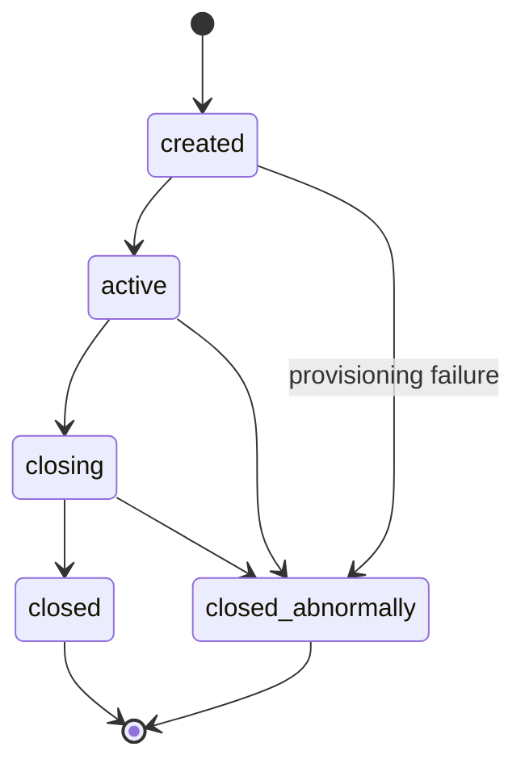
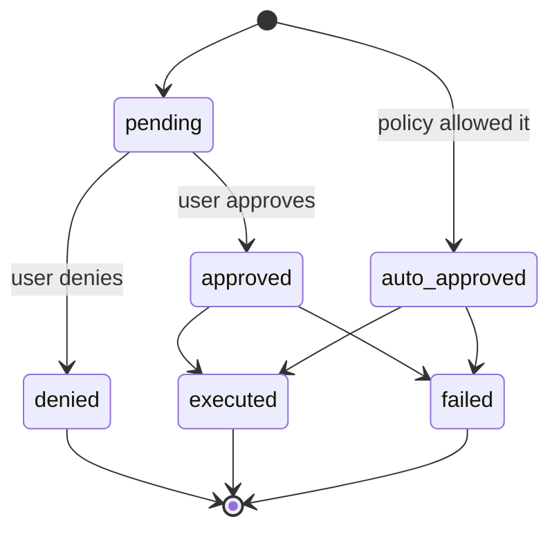
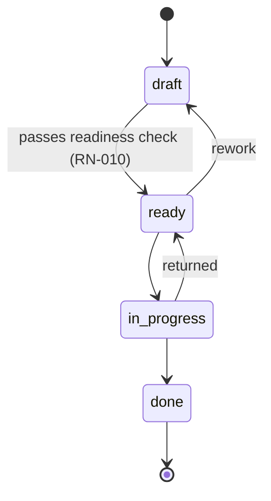
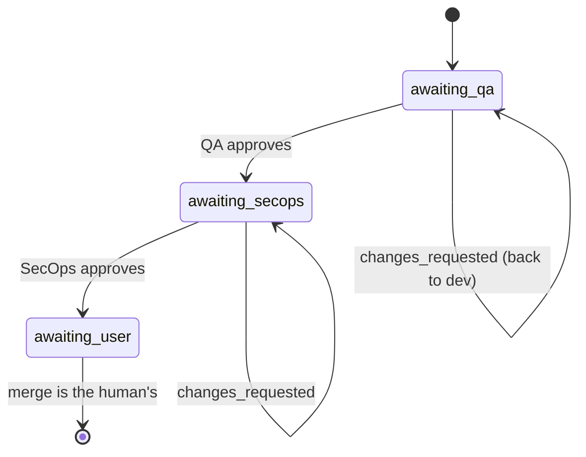

# API

## Session

Brabo executes engineering work through AI agents. Two forces shape virtually
every rule here:

**The agent is not trustworthy by construction.** It's a language model: it
can hallucinate, get stuck in a loop, or request something destructive. The
rules exist so the possible damage is bounded by structure, not by prompt
quality.

**Spend is real and continuous.** Every turn consumes a paid token. Budget,
ceiling, and metering aren't administrative conveniences — they're what
stops an agent loop from turning into a loss.

### Actors

| actor | who it is | authority |
|---|---|---|
| **User** | the person. Roles: `viewer`, `developer`, `maintainer`, `owner` | final decision on any action with external effect; merge is theirs exclusively |
| **Agent** | long-running process with a role (Creative, PO, Architect, Dev, Infra, QA, SecOps, Psychologist, Anamnesis) | proposes; never decides alone what policy doesn't allow |
| **System** | api and engine | enforces policy, records the event, measures cost |

The vocabulary is in the [glossary](../glossary.md).

---

## Business context

### RN-001 — The session has five states and closed transitions {#rn-001}

`created → active → closing → closed`, with `closed_abnormally` reachable
from any non-terminal state. **From `closing` there's never a way back to
`active`**, and terminal states have no exit.



- **Where:** `apps/api/src/domain/sessions/session-state-machine.ts:29`
- **Test:** `test/domain/sessions/session-state-machine.spec.ts`
- **Edge case:** `closing` is a **transient** state. A session stuck there
  means the drain started and didn't complete — there's an alert for that,
  see the [runbook](../runbook.md).

### RN-002 — Every session event is immutable and `seq` is dense {#rn-002}

There's never an `UPDATE` on `session_events`. `seq` is unique per session
(`unique(session_id, seq)`) and has no gaps: it starts at 1 and is contiguous.

- **Where:** `apps/api/src/db/schema/sessions.ts` (table `session_events`)
- **Test:** verified on restore — `docker/backup/restore.sh` fails if
  `count(*) ≠ max(seq) − min(seq) + 1` or `min(seq) ≠ 1`
- **Why:** it's what makes the Psychologist's evidence traceable and the
  backup verifiable. State that needs to change lives in its own table,
  alongside.

## Action approval

The heart of the system. Every action with an external effect is born as a
`proposed_action`.

### RN-003 — The action has six states, and denied is terminal {#rn-003}



- **Where:** `apps/api/src/domain/actions/action-state-machine.ts:36`
- **Test:** `test/domain/actions/action-state-machine.spec.ts`
- **Edge case:** an approved action that executed becomes `executed`,
  **not** still `approved`. Counting approvals by `status = 'approved'`
  gives the wrong number — the correct criterion is `decided_by IS NOT
  NULL`.

### RN-004 — The decision is evaluated in three stages, and `deny` wins immediately {#rn-004}

Order: **(a) IAM → (b) `agent_autonomy` → (c) `permissions.json`**. Each
stage can only **raise** permissiveness; a silent stage never lowers the
previous one. `deny` at any stage returns immediately.

- **Where:** `apps/api/src/domain/actions/decide.ts:118`
- **Test:** `test/domain/actions/decide.spec.ts` (10 KB — the largest in
  the domain)

### RN-005 — Minimum role per action type {#rn-005}

Before any policy, IAM: each `ActionType` requires a minimum effective
role. Without it, `deny` with an explicit reason.

- **Where:** `apps/api/src/domain/actions/decide.ts:110` (`MIN_ROLE_FOR_ACTION_TYPE`)
- **Test:** `test/domain/actions/decide.spec.ts`

### RN-006 — Ceiling: merge into a protected branch is never auto-approvable {#rn-006}

`dev`, `qa`, `rc`, and `main` are protected. A `git_merge` targeting one of
them is downgraded from `auto_approve` to `require_approval` **after** all
the policy has run. Neither `agent_autonomy` nor `permissions.json` can
promote it.

`rc` stays on the list even after the step left the policy
([ADR 0030](../adr/0030-politica-de-branches-mecanizada.md)) and the bootstrap
stopped creating it ([RN-029](#rn-029)). This list decides what the lock
**refuses**, and repositories bootstrapped by earlier versions still have
the branch: protecting one that doesn't exist costs nothing; unprotecting
one that exists costs dearly.

- **Where:** `apps/api/src/domain/actions/decide.ts:498` (`isProtectedBranch`, the merge lock ceiling) + `protected-branches.ts:4`
- **Test:** `test/domain/actions/decide.spec.ts`
- **Origin:** [ADR 0011](../adr/0011-infra-dev-agents-worktrees-merge-lock.md) §1
- **Note:** the equivalent protection **on the platform** (GitHub/GitLab)
  diverges between providers and isn't the gate — see
  [ADR 0028](../adr/0028-protecao-de-branch-divergencia-entre-providers.md).

### RN-007 — Ceiling: an instruction patch is never auto-approvable {#rn-007}

Changing an agent's instruction always requires a human decision. The
feature's value is in the human seeing the diff; auto-approving would be
the agent rewriting itself.

- **Where:** `apps/api/src/domain/actions/decide.ts:168`
- **Test:** `test/domain/actions/decide.spec.ts`
- **Origin:** [ADR 0016](../adr/0016-anamnese-proficiencia-patches-instrucao.md) §8

### RN-008 — Command matching is by pattern, not substring {#rn-008}

`permissions.json` matches a terminal command by structured pattern, with
the command properly tokenized — not by `includes()`.

- **Where:** `apps/api/src/domain/actions/command-matcher.ts`
- **Test:** `test/domain/actions/command-matcher.spec.ts`

---

## Backlog

### RN-009 — The story has four states, and `done` is terminal {#rn-009}

`draft → ready → in_progress → done`. Rework is allowed: `ready → draft` and
`in_progress → ready`.



- **Where:** `apps/api/src/domain/backlog/story-state-machine.ts:27`
- **Test:** `test/domain/backlog/story-state-machine.spec.ts`

### RN-010 — `draft → ready` requires four things, validated in the domain {#rn-010}

For a story to become `ready` it needs, **all of them**:

1. `dod` not empty — Definition of Done
2. `dor` not empty — Definition of Ready
3. at least 1 functional requirement (`rf`)
4. at least 1 linked business rule (`businessRuleIds`)

The error names **exactly what's missing**, not a generic "invalid".

- **Where:** `apps/api/src/domain/backlog/story-readiness.ts:39`
- **Test:** `test/domain/backlog/story-readiness.spec.ts`
- **Origin:** [ADR 0009](../adr/0009-agente-po-backlog-rastreabilidade.md) §3
- **Why:** it's what stops the PO from dumping a vague story into the dev
  queue.

### RN-011 — Business rule with no story is a finding, not an error {#rn-011}

Rule→story coverage is computed, and what has no story shows up as
**pending** — information, not a failure.

- **Where:** `apps/api/src/domain/backlog/coverage.ts`
- **Test:** `test/domain/backlog/coverage.spec.ts`

### RN-013 — The module graph cannot have a cycle {#rn-013}

- **Where:** `apps/api/src/domain/architecture/module-graph.ts`
- **Test:** `test/domain/architecture/module-graph.spec.ts`

---

## PR Gates

### RN-014 — The gate order is immutable and `awaiting_user` is terminal {#rn-014}

`awaiting_qa → awaiting_secops → awaiting_user`. Approving QA **never**
skips straight to the user. `changes_requested` sends it back to the dev
**on the same branch**, with no new PR.



- **Where:** `apps/api/src/domain/execution/pr-gate-state-machine.ts:24`
- **Test:** `test/domain/execution/pr-gate-state-machine.spec.ts`
- **Origin:** [ADR 0013](../adr/0013-gates-qa-secops-pr.md) §1
- **Edge case:** `awaiting_user` is terminal **by design** — the system
  never merges (RN-006).

### RN-015 — Cycle K: the correction ceiling is finite and inherited {#rn-015}

Every gate return consumes a lap. Once the ceiling is exhausted, the task
is **blocked** with a reason, instead of spinning forever. A subagent
created by parallelization **inherits** the base agent's ceiling.

Since Phase 8b the ceiling also applies to the QA AREA, with no code
change: `QaLeadServer` is the only caller of `record_gate_verdict`, so one
gate round — no matter how many specializations it consulted underneath —
still consumes exactly ONE lap. See
[RN-036](engine.md#rn-036).

- **Where:** `DEFAULT_MAX_GATE_CORRECTIONS = 3` in
  `apps/api/src/application/use-cases/execution/record-gate-verdict.use-case.ts:21`;
  applied in `activate-execution.use-case.ts:89` and, in the engine, in
  `qa_lead_server.ex:268` and `secops_agent_server.ex:142`
- **Test:** `apps/engine/test/engine/gates/qa_automacao_agent_test.exs`
  (the specialization returns `{:blocked, ...}` without calling the api)
  and `qa_lead_server_test.exs` (the Lead NEVER calls
  `record_gate_verdict` in that case — that's what stops the correction
  from being burned)
- **Origin:** [ADR 0017](../adr/0017-lock-de-workspace-e-monitor-de-dev-agents.md) §4

### RN-017 — Budget has an exclusive scope: project **or** session {#rn-017}

A `budget` references a project or a session, never both — guaranteed by
a `check` in the database, not just in code.

- **Where:** `apps/api/src/db/schema/llm.ts` (`budgets_scope_check`)
- **Test:** the constraint is the guarantee

### RN-018 — Budget notification at 70%, 90%, and 100%, without repeating {#rn-018}

Each threshold fires **once**; the last one notified is persisted in
`budgets.last_threshold_notified`.

- **Where:** `apps/api/src/domain/llm/budget-threshold.ts:1`
- **Test:** `test/domain/llm/budget-threshold.spec.ts`

### RN-019 — `policy = 'block'` refuses the call; `'allow'` only records {#rn-019}

- **Where:** `apps/api/src/domain/llm/budget-threshold.ts:4`
- **Edge case:** a project in `allow` **doesn't stop itself** at the
  ceiling. It's the most common cause of "the budget didn't hold" — see
  the [runbook](../runbook.md).

### RN-020 — The model is resolved by cascade, from most specific to most general {#rn-020}

`session > agent > area > project > workspace`. The first one that
exists wins. `area` entered in PHASE 23 — see [RN-102](#rn-102) for its
position and what changes for whoever already read this cascade.

- **Where:** `apps/api/src/domain/llm/binding-resolver.ts`
- **Test:** `test/domain/llm/binding-resolver.spec.ts`

## Psicólogo and Anamnese

### RN-021 — A hypothesis without valid evidence is not recorded {#rn-021}

The `evidenceEventIds` must point to events **that exist and belong to the
analyzed session**. Validation is atomic per batch: one invalid id fails the
entire batch.

- **Where:** `apps/api/src/domain/psychologist/hypothesis-evidence.ts`
- **Test:** `test/domain/psychologist/hypothesis-evidence.spec.ts`
- **Origin:** [ADR 0015](../adr/0015-psicologo-real-toolloop-hipoteses-evidencia.md) §3

### RN-022 — The hypothesis lifecycle is compare-and-swap {#rn-022}

`proposed → accepted | dismissed`. Two concurrent decisions on the same
hypothesis: one wins, the other gets a conflict — not 500, not silence.

- **Where:** `apps/api/src/domain/psychologist/hypothesis-lifecycle.ts`
- **Test:** `test/domain/psychologist/hypothesis-lifecycle.spec.ts`
- **Origin:** [ADR 0022](../adr/0022-fechamento-4b-psicologo.md) §7

### RN-024 — The Anamnese only profiles competencies from the catalog — a structural guardrail {#rn-024}

Process competencies are **six**, closed: `git`, `agile`, `arquitetura`,
`testes`, `seguranca`, `infra`. Plus the technical stacks derived from the
`module_map`. Anything else — "anxiety", "mental health" — **has no
write path**: it's a domain error, not a prompt instruction.

- **Where:** `apps/api/src/domain/anamnese/competency-catalog.ts:16`
- **Test:** `test/domain/anamnese/competency-catalog.spec.ts`
- **Origin:** [ADR 0016](../adr/0016-anamnese-proficiencia-patches-instrucao.md) §1
- **Why:** the Anamnese profiles **technical competence**, not the person. The limit
  is structural because a prompt instruction is not a guarantee.

### RN-025 — Deleting the profile really deletes it, and the opt-out prevents re-derivation {#rn-025}

- **Where:** `apps/api/src/domain/anamnese/proficiency-profile.entity.ts` +
  table `anamnese_opt_outs`
- **Origin:** [ADR 0016](../adr/0016-anamnese-proficiencia-patches-instrucao.md) §2

### RN-026 — A denied instruction patch is not proposed again {#rn-026}

The comparison is on the **normalized** content, not on the literal text:
reindenting the same patch doesn't turn it into a new proposal. There's no
dedup table — the source is the `proposed_action` history itself with `actionType =
instruction_patch` and `status = denied`.

- **Where:** `apps/api/src/domain/instructions/patch-dedup.ts:22`
- **Test:** `test/domain/instructions/patch-dedup.spec.ts`

### RN-027 — Instruction rollback is a **forward** operation {#rn-027}

Reverting creates a new version with the old content; it doesn't delete history. The
versions table is append-only.

- **Where:** `apps/api/src/domain/instructions/`
- **Origin:** [ADR 0016](../adr/0016-anamnese-proficiencia-patches-instrucao.md) §4

---

## Git

### RN-029 — The Gitflow bootstrap is idempotent and resumable {#rn-029}

Five steps; each one checks before acting and can be resumed from the point where it
failed. `skip` is success, not error.

There used to be six. The sixth created the `rc` branch, a rung that
[ADR 0030](../adr/0030-politica-de-branches-mecanizada.md) removed from the policy —
the bootstrap kept creating, protecting, and **documenting in the user's
repository** a ladder the product had already abandoned (finding #3 of the first
dogfooding). The value `create_rc_branch` remains in the `bootstrap_step` enum:
old rows reference it, and a step that really happened isn't erased from
history.

- **Where:** `apps/api/src/application/use-cases/git/bootstrap-steps.ts` +
  `domain/git/repo-bootstrap.entity.ts` (`RETIRED_BOOTSTRAP_STEPS`)
- **Test:** `test/domain/git/repo-bootstrap-status.spec.ts`
- **Origin:** [ADR 0005](../adr/0005-repo-bootstrap-idempotent-steps.md)

---

### RN-030 — Presenting an already-used refresh revokes the whole family {#rn-030}

Each refresh consumes the presented token and issues a child with the **same**
`family_id` and the same `family_started_at`. Presenting a token that was already
consumed is the signature of a theft — someone is using a copy — and the
response is to revoke every live token of that family, with a security
event.

The legitimate user is logged out along with it. That is the correct behavior, not a
defect: on the server side, a client double-submit and a thief's replay
are identical.

- **Where:** `apps/api/src/domain/auth/refresh-token.ts:50` +
  `application/use-cases/auth/refresh.use-case.ts:98`
- **Test:** `test/application/use-cases/auth/rotacao-e-reuso.spec.ts`
- **Edge case:** whoever presents a token from an **already revoked** family is a
  downstream victim, not a new theft: it records `refresh_revoked` and does **not** fire a second
  cascade. Without that distinction, each tab of the legitimate user would raise a false
  alarm during the incident.
- **Origin:** [ADR 0031](../adr/0031-auth-first-party-argon2id-e-rotacao-de-refresh.md)

### RN-031 — Login failure is counted per e-mail and per IP, and the lockout escalates {#rn-031}

A 15-minute sliding window in Postgres, without Redis. Two buckets per
attempt and the most restrictive wins: e-mail (5 failures → 30s, 8 → 5min, 12 →
15min) and IP (20 → 30s, 30 → 2min). A successful login clears the
e-mail bucket; the IP one drains only over time.

The bucket key is the **normalized e-mail**, never the user id. With the id, the
bucket would only exist after finding the account, and the lockout itself would become
an existence oracle.

- **Where:** `apps/api/src/domain/auth/lockout-policy.ts:97` +
  `infrastructure/persistence/drizzle/drizzle-login-throttle.ts:74`
- **Test:** `test/application/use-cases/auth/lockout.spec.ts`
- **Edge case:** while locked, the attempt is **not** recorded. If it were, an
  attacker would keep the victim's account locked forever just by continuing to
  try — the lockout would become a denial of service against the one it protects.
- **Why:** the IP bucket cannot be cleared on success; whoever has a valid
  account would reset the window at will and spray guesses without limit.
- **Origin:** [ADR 0031](../adr/0031-auth-first-party-argon2id-e-rotacao-de-refresh.md)

### RN-032 — No response distinguishes an existing account from a nonexistent one {#rn-032}

Any response other than the uniform failure is only reachable **after** a
successful password check. On login, nonexistent e-mail, wrong password and
locked account return the same 401 and spend the same time — the no-account branch
verifies against a dummy hash generated with **the same parameters** as the real one. On
registration and on the reset request, known and unknown addresses return 202.

- **Where:** `apps/api/src/application/use-cases/auth/login.use-case.ts:79` +
  `register.use-case.ts:74`
- **Test:** `test/application/use-cases/auth/enumeracao.spec.ts`
- **Edge case:** the per-e-mail lockout check runs **after** argon2, not
  before. Exiting earlier is the optimization any reviewer would suggest, and it is
  exactly the leak — the test turns red if someone introduces it.
- **Edge case:** the user MIGRATED from Keycloak (exists in `users`, with no row in
  `auth_credentials`) also gets the uniform 401 — and the "set
  password" link is sent silently. Answering `password_pending` would confirm that
  the address exists **and** that it is a legacy account. That is why `findByEmail` is a LEFT
  JOIN in a single query: two chained queries would make this branch pay one
  extra round trip to the database, and the clock would reveal what the body hides.
- **Why:** what is claimed is "no branch skips the expensive work and none
  produces a distinguishable response", **not** constant time. See the consequences
  in the ADR.
- **Origin:** [ADR 0031](../adr/0031-auth-first-party-argon2id-e-rotacao-de-refresh.md),
  migrated-user edge case in
  [ADR 0032](../adr/0032-corte-do-keycloak-e-sessao-em-cookie.md)

### RN-033 — Verification and reset tokens are valid only once {#rn-033}

Consumption by conditional UPDATE with `returning`: the UPDATE itself is the guard.
Zero rows covers nonexistent, of another purpose, already consumed, invalidated and
expired — all with the same response. Requesting a new link invalidates the previous one.
Completing a reset revokes **all** of the user's sessions and issues no tokens.

- **Where:** `apps/api/src/infrastructure/persistence/drizzle/account-token.repository.ts:76`
- **Test:** `test/application/use-cases/auth/tokens-de-conta.spec.ts`
- **Edge case:** two simultaneous submissions do not both pass. The race is the
  **normal** case, not the exception: corporate e-mail scanners open every link of
  every message, so the robot usually consumes the token before the human clicks.
- **Why:** the reset issues no session on purpose — logging in directly from
  a link received by e-mail would make compromising the e-mail equal to taking over the
  account, with no second step.
- **Origin:** [ADR 0031](../adr/0031-auth-first-party-argon2id-e-rotacao-de-refresh.md)

### RN-034 — The web session lives in an httpOnly cookie, with CSRF {#rn-034}

The refresh token goes in a `brabo_refresh` cookie (`httpOnly`, `SameSite=Strict`,
`Path=/auth`, `Secure` in production) and does **not** appear in the body of any
response. The access token, of 15 minutes, stays in memory on the client and travels in
`Authorization: Bearer`.

`/auth/refresh` and `/auth/logout` require `X-CSRF-Token` equal to the
`brabo_csrf` cookie, compared in constant time.

- **Where:** `apps/api/src/interfaces/http/auth/session-cookies.ts:53` +
  `interfaces/http/auth/auth.controller.ts`
- **Test:** `test/interfaces/session-cookies.spec.ts`
- **Edge case:** a CSRF failure is **403**, not 401. With 401 the client would try
  to renew the session and enter a loop — the credential is fine, what is wrong
  is the request.
- **Why:** also returning the refresh in the body would cancel out `httpOnly` —
  an XSS reading the login response would be enough, and it would take the long session instead of
  the 15 minutes of the access token.
- **Origin:** [ADR 0032](../adr/0032-corte-do-keycloak-e-sessao-em-cookie.md)

### RN-035 — Internal engine ↔ api traffic requires the service secret {#rn-035}

The 32 `/internal/*` routes are `@ServiceRoute()`: they stay outside the user JWT and
outside the rate limit. What authenticates is the `EngineServiceGuard`, comparing
`X-Brabo-Service-Token` with `BRABO_SERVICE_TOKEN` in constant time. The same
secret holds in both directions, and `BRABO_SERVICE_TOKEN_PREVIOUS` is accepted only on
verification, so that rotation has no unavailability window.

- **Where:** `apps/api/src/interfaces/http/auth/engine-service.guard.ts:44` +
  `infrastructure/security/service-token.ts` +
  `apps/engine/lib/engine_web/plugs/verify_service_token.ex`
- **Test:** `apps/engine/test/engine_web/plugs/verify_service_token_test.exs`,
  `test/interfaces/route-surface.spec.ts` and, for rotation on the api side
  (previous accepted only on verification, the caller sends the current one, once the
  previous is removed the old one fails), `test/infrastructure/security/service-token.spec.ts`
  (describe "rotação do BRABO_SERVICE_TOKEN") and
  `test/interfaces/engine-service.guard.spec.ts` ([RN-597](#rn-597))
- **Edge case:** the rate limit exemption comes from the route METADATA, not from the guard. The
  `RateLimitGuard` is an `APP_GUARD` and runs before any controller guard —
  when it decides, the `EngineServiceGuard` has not run yet.
- **Origin:** [ADR 0032](../adr/0032-corte-do-keycloak-e-sessao-em-cookie.md)

### RN-038 — Agente contado no resumo do workspace = gastou tokens este mês {#rn-038}

O resumo do dashboard de projetos ("N projetos ativos · M agentes · gasto
este mês") conta como "agente" quem tem pelo menos uma linha em
`token_usage` com `actor_kind = 'agent'` no mês corrente, somando todos os
projetos do workspace. Sem o filtro de `actor_kind`, um `user` mandando
chat ou um `system` registrando uso inflaria a contagem — `token_usage`
grava para qualquer tipo de ator, não só agente. O corte por mês usa
`created_at >= date_trunc('month', now())`; um agente que trabalhou só no
mês anterior não conta, mesmo que ainda apareça no roster de alguma
sessão. A contagem naturalmente inclui as subespecialidades de área da
Fase 8 (`qa-automacao`, `qa-performance-seguranca`, `infra-workflows`):
cada uma tem seu próprio `actor_id` quando gasta tokens.

- **Onde:** `apps/api/src/infrastructure/persistence/drizzle/token-usage.repository.ts`
  (`summarizeForWorkspaceThisMonth`)
- **Teste:** `test/application/use-cases/iam/get-workspace-summary.use-case.spec.ts`

---

### RN-040 — Agent binding requires native tool calling {#rn-040}

Binding a model to an **agent** (`scope = 'agent'`) is only allowed if the
model has `supports_tool_calling`. An agent only exists inside the
ToolLoop, and the ToolLoop only works if the model knows how to
**request** tools; without that, the failure would show up downstream as
"the agent stopped without finishing", which is exactly the
diagnosis-by-elimination that [ADR 0020](../adr/0020-destravar-gates-qa-secops.md)
forbade. The refusal is a 422 and the message points to the **"fit for
agents"** filter — without that pointer the rule becomes a dead end.

The engine's `ToolCallRecovery` recovers calls the model wrote in prose,
but it's a **rescue, not a license**: it depends on the model getting the
format right by chance.

Only `agent` validates. `workspace` and `project` are the human chat's
fallback and `session` is conversation — none of them run a ToolLoop, and
locking them would forbid chat-only models in the product. The
`context-manager` agent is covered by construction: it's a slug
**within** the `agent` scope, not its own scope.

**Nota aditiva — o filtro passou a vir MARCADO, e quem o liga é o ESCOPO.** O
parágrafo acima diz que a recusa aponta para o filtro "aptos para agentes",
"senão a regra vira beco sem saída" — e por muito tempo ela foi um: o prop que
abre o seletor com o filtro marcado existia desde a Fase 9c e **nenhuma tela de
produção o passava**. O seletor de um agente abria oferecendo modelo chat-only
cujo clique só existia para ser recusado. As duas telas que gravam num escopo
validado passam a abrir filtradas — `ModelsSection` (agente) e
`ModelsSection` (área) —, e a régua de quem liga não é a tela e sim
`assertModelFitsBindingScope`: onde a api RECUSA, o filtro vem marcado; onde ela
não recusa, quem escolhe é a pessoa. Por isso o seletor de SESSÃO continua sem
filtro — marcar ali esconderia modelo que a api aceita. **Isto não elimina o
422**: o filtro cobre uma das três causas, e as outras duas
([RN-043](#rn-043) — desativado no workspace, sumido do provider) seguem
alcançáveis, com o indisponível ainda LISTADO e marcado; o desfecho de recusa da
[RN-470](web.md#rn-470) continua sendo o que conta o que houve. E é estado INICIAL de
um checkbox, não trava: desmarcar volta a listar tudo.

**A consequência: o vigente que o filtro esconde é DITO.** `workspace` e
`project` nunca exigiram tool calling, e as rotas que resolvem o binding de um
agente ou de uma área chamam `ResolveModelBindingUseCase` **sem**
`exigeToolCalling` — então um padrão chat-only desses níveis é resolvido
normalmente e vira o vigente da linha. Com o filtro marcado, o gatilho mostrava
um nome que a lista aberta não continha, sem nenhuma opção marcada. O picker
agora nomeia o modelo e a causa; ele PODE nomear a causa porque só há um filtro
ali. Quando a lista inteira fica vazia, quem fala continua sendo o texto de
lista vazia, que já manda desmarcar — dois avisos sobre o mesmo checkbox seriam
ruído.

**Correção de fato, não do texto acima:** "Only `agent` validates" descreve a
Fase 9a. Desde o [ADR 0064](../adr/0064-escopo-de-area-na-cascata-e-o-binding-de-agente-global.md)
`area` entra na MESMA validação — ela não é fallback genérico, o único consumidor
do modelo de uma área é um agente dela ([RN-102](#rn-102)) —, e é por isso que
são DUAS as telas que ligam o filtro.

- **Where:** `apps/api/src/domain/llm/model-capabilities.ts:38`;
  `apps/web/src/components/ModelPicker.tsx` (o filtro e o aviso de vigente
  escondido), `apps/web/src/routes/settings/ModelsSection.tsx`,
  `apps/web/src/routes/settings/ModelsSection.tsx` (quem o liga)
- **Test:** `test/domain/llm/model-capabilities.spec.ts`,
  `test/application/use-cases/llm/set-model-binding.use-case.spec.ts`;
  `apps/web/src/routes/settings/filtro-de-aptos.test.tsx` e
  `apps/web/src/routes/SessionPage.filtro-de-aptos.test.tsx` (as duas telas que
  ligam, e a que não liga)
- **Origin:** [ADR 0041](../adr/0041-base-openai-compativel-e-contrato-de-llm-providers.md)

### RN-041 — Token count the provider didn't give is marked as estimated {#rn-041}

When the provider's response doesn't carry `usage`, the OpenAI-compatible
base counts locally with the tokenizer and emits the chunk with
`estimated: true`. The number still serves for billing, but the mark
preserves the difference between **"the provider said zero"** and **"the
provider said nothing"** — and it's what lets the UI qualify the cost
instead of showing a value with no provenance.

The other two providers diverge, and the divergence is normalized, not
hidden: Ollama simply doesn't emit `usage` without the `done` line;
Anthropic can't omit the count, because `usage` is mandatory in its
protocol's `message_start`. The three responses are in
[docs/reference/llm-providers.md](../reference/llm-providers.md#normalized-divergences).

- **Where:** `apps/api/src/infrastructure/llm/openai-compatible-provider.ts:167`
- **Test:** `test/contract/llm-provider.contract.ts` (scenario
  `sem_usage`, run against the three providers)
- **Origin:** [ADR 0041](../adr/0041-base-openai-compativel-e-contrato-de-llm-providers.md)

### RN-042 — Metering records who SERVED the call, not just where it came in {#rn-042}

When the call goes through a hub that reports the real provider,
`token_usage` records that provider in `upstream_provider` in addition to
the entry provider. With no hub — or a hub that didn't report — the field
is **`null`**, never an empty string: the cost-by-provider query needs to
distinguish "didn't go through a hub" from "went through one and the hub
didn't say".

In metrics the `upstream_provider` label repeats the provider itself when
there's no hub, so `sum by (upstream_provider)` keeps summing the whole
cost.

- **Where:** `apps/api/src/application/use-cases/llm/record-llm-usage.use-case.ts:73`
- **Test:** `test/application/use-cases/llm/record-llm-usage.use-case.spec.ts`
- **Origin:** [ADR 0041](../adr/0041-base-openai-compativel-e-contrato-de-llm-providers.md)

### RN-043 — A discovered model enters disabled; a model that disappears is marked, never deleted {#rn-043}

Catalog sync has three outcomes, and none of them is destructive:

1. **A new model** enters **with no curation row in any workspace**, and
   the absence of a row IS the disabled state. A provider's catalog has
   hundreds of rows — dumping them in active would make choosing
   impossible and would turn on an expensive model without anyone
   deciding. Activating is the owner's curation, and it applies only in
   their workspace ([RN-052](#rn-052)).
2. **A model that disappeared from the remote catalog** receives
   `availability = 'unavailable'` and **stays in the table**:
   `model_bindings` and `token_usage` point to the row, and deleting it
   would take the cost history along with it.
3. **A model that came back** returns to `available` with the curation
   **untouched** — the owner's choice survives a temporary absence from
   the provider.

The two axes are deliberately independent: curation is a person's
decision, `availability` is an observation of the provider. Neither
writes to the other — and since
[ADR 0049](../adr/0049-curadoria-de-modelo-por-workspace.md) they don't even
live in the same table, so sync has no curation field to run over even if
it wanted to.

Three consequences in the rest of the system:

- a **NEW** binding for an inactive or unavailable model is refused in
  the domain (`ModelNotBindableError`, 422). Bindings that already exist
  stand;
- `resolveBinding`'s **cascade** skips the unavailable candidate, records
  what it skipped in `skipped`, and — when the turn carries tools —
  revalidates `supports_tool_calling` at EVERY level. Without that, the
  fallback would land an agent on a chat-only model and silently violate
  [RN-040](#rn-040);
- **a provider that failed doesn't make anything unavailable**: a 401 is
  "I don't know what's there", not "there's nothing there". The provider
  is skipped, with the failure's ORIGIN (`infra` | `modelo`) in the
  report — never diagnosis by elimination.

- **Where:** `apps/api/src/application/use-cases/llm/sync-model-catalog.use-case.ts:160`,
  `apps/api/src/domain/llm/binding-resolver.ts:63`,
  `apps/api/src/domain/llm/model-capabilities.ts:49`
- **Test:** `test/application/use-cases/llm/sync-model-catalog.use-case.spec.ts`,
  `test/domain/llm/binding-resolver.spec.ts`,
  `test/application/use-cases/llm/set-model-binding.use-case.spec.ts`
- **Origin:** [ADR 0042](../adr/0042-catalogo-vivo-ciclo-de-vida-do-modelo-e-preco-auditavel.md)

### RN-044 — Price applies from here on, and old cost still checks out {#rn-044}

Every `token_usage` row records the price that produced its
`cost_micros`. Changing a model's price **doesn't reprice past
consumption** — and more than that: old cost stays **reproducible**,
because `tokens × recorded price` matches the recorded cost even after
three corrections to the `models` table.

Every price change writes a row to `model_price_changes`, append-only,
with the before/after pair and the origin (`manual` | `sync`). The pair
is recorded together on purpose: reconstructing the "before" from the
previous row would depend on no write having escaped the audited path,
which is exactly what the audit exists to prove. A price equal to the
current one is a no-op — a row saying "changed from 10 to 10" would turn
the log into noise.

The rule applies to **every** path that changes price, not just the
screen's. Two writes used to escape it: catalog sync (which changed
price via `upsert`, never producing the `sync` origin the domain had
declared since Phase 9c) and `seed.ts` (which runs on an already-seeded
database — `BRABO_FORCE_SEED=1` in k8s's `bootstrap.sh` — and therefore
silently corrected price). Both now audit, with the seed reusing
`UpdateModelPricingUseCase` itself.

- **Where:** `apps/api/src/application/use-cases/llm/update-model-pricing.use-case.ts:44`,
  `apps/api/src/application/use-cases/llm/sync-model-catalog.use-case.ts:213`,
  `apps/api/src/db/seed.ts:376`
- **Test:** `test/application/use-cases/llm/update-model-pricing.use-case.spec.ts`,
  `test/application/use-cases/llm/sync-model-catalog.use-case.spec.ts`
- **Origin:** [ADR 0042](../adr/0042-catalogo-vivo-ciclo-de-vida-do-modelo-e-preco-auditavel.md)

### RN-045 — An adopted repository is only changed by an approved plan {#rn-045}

Adopting an existing repository **diagnoses without acting**. Adoption
validates access (`getRepo`), writes the project's rows, and produces a
**plan**: the serialized list of what the bootstrap would do, obtained by
calling each step's `check()` — the same one that has provided idempotency
since [RN-029](#rn-029) — without ever running the corresponding
mutation.

While `repo_bootstraps.plan_decision` is **null**, no mutation runs. The
gate is **before** the executor, not inside it: the bootstrap runner is
the same one from Phase 2, with no filter, and it simply isn't called.
Added to the guard that already skipped protected branches, there's no
code path that touches a branch outside an approved plan.

The two outcomes:

- **approve** is all-or-nothing (approving loose steps would break the
  `dev←main, qa←dev` cascade). What executes is the plan
  **re-derived** at execution time: equal to or smaller than the one
  shown, **never larger** — a branch that turned protected in the
  meantime is skipped;
- **adopt as-is** waives the bootstrap, records the decision, and does
  **not** tamper with the cursor to fake convergence. The plan is kept
  as evidence of what was deliberately not applied.

Deciding on a regenerated plan is refused (409): the decision carries the
`planGeneratedAt` the user saw, and a "yes" given about something else
doesn't count.

Normal provisioning refuses (409) to run on an adopted repository —
without this guard, the resumption path would run the bootstrap on a
third party's repository with no plan at all.

**Known limit:** "divergent protection" here is presence × absence,
because that's all the contract exposes (`GitBranch.protected` is a
boolean, and
[ADR 0028](../adr/0028-protecao-de-branch-divergencia-entre-providers.md)
deferred a normalized `ProtectionPolicy`). A branch with PARTIAL
protection counts as "unprotected" and can be overwritten — but only
within an approved plan.

- **Where:** `apps/api/src/application/use-cases/git/decide-bootstrap-plan.use-case.ts`,
  `apps/api/src/application/use-cases/git/bootstrap-plan.ts`,
  `apps/api/src/application/use-cases/git/bootstrap-steps.ts:112`
- **Test:** `test/application/use-cases/git/decide-bootstrap-plan.use-case.spec.ts`,
  `test/application/use-cases/git/bootstrap-plan.spec.ts`
- **Origin:** [ADR 0044](../adr/0044-adocao-de-repositorio-existente.md)

### RN-046 — Every project repository declares its origin {#rn-046}

`project_repositories.origin` and `repo_bootstraps.origin` say whether
Brabo **created** the repository (`created`) or **adopted** one that
already existed (`adopted`). The origin is written explicitly by whoever
writes the row — not by the column's default — and doesn't change
afterward.

It isn't decoration: it's what makes the product treat as a legitimate
case what Phase 10 had to do by hand (inserting rows into
`project_repositories` and `repo_bootstraps` to point a project at a
fork). An `adopted` repository has its own branch policy, doesn't go
through provisioning, and is only changed per [RN-045](#rn-045).

Migration `0031`'s backfill marks everything that already existed as
`created`, and can be blind about it: adoption didn't exist before it,
so there's no adopted row to misclassify.

- **Where:** `apps/api/src/db/schema/git.ts`, `apps/api/src/db/migrations/0031_special_winter_soldier.sql`,
  `apps/api/src/domain/git/repo-bootstrap.entity.ts`
- **Test:** `test/application/use-cases/git/adopt-repository.use-case.spec.ts`
- **Origin:** [ADR 0044](../adr/0044-adocao-de-repositorio-existente.md)

### RN-048 — Story promotion is the user's by default; the mode changes who triggers it, never what gets validated {#rn-048}

`projects.story_promotion` chooses WHO promotes a story from `draft` to
`ready`:

- **`manual`**: the PO leaves the story complete
  and it stays `draft` with `stories.proposed_ready = true`. **None of
  its tasks are claimable** — `claimNext` requires `story.status =
  'ready'` — and it's the user who promotes it, individually or in
  batch, from the Backlog.
- **`auto`** (new project's default since [RN-659](#rn-659)):
  the PO promotes on its own upon finishing a complete story. This was
  the behavior that predated Phase 12c; `manual` was the default from
  12c until RN-659 (migration `0065`), which changed only the column
  default — projects created in between keep `manual`.

**The mode changes the trigger, not the criterion.** Both paths go
through `assertPromotable` — readiness (RF/DoD/DoR/rule) and modules
resolved against the current `module_map` — and that's what the symmetry
test in `story-promotion.spec.ts` locks down: for every story,
`isPromotable` agrees with what `assertPromotable` raises. Before the
phase, validation was duplicated and asymmetric (creation called
`canBecomeReady`, transition called `assertReady` +
`assertModulesResolved`): two doors to the same state, with different
locks. Making the trigger configurable required unifying them first, or
else "promote via the UI" and "promote on creation" would be distinct
rules with the same name.

An **incomplete** story is never proposed. `proposed_ready` only turns on
when the story would already pass validation — proposing what the domain
would refuse would push the PO's work onto the user disguised as a
decision.

**Refusal** returns the story to the PO: it records
`returned_reason`/`returned_at`, turns off `proposed_ready`, emits
`backlog.story_promotion_returned`, and injects the reason as a PINNED
message in the PO's session, with the same precedence wording as a gate
returned to the dev (a lesson from ADR 0020). The refusal is recorded
**before** talking to the engine, and the engine failing doesn't undo
it — it's the reverse of the rearm order in [RN-047](engine.md#rn-047), and for a
reason: there the event asserts something ABOUT the engine, here it
asserts something about the user, which is true whether or not there's a
PO standing by to listen.

Batch promotion is **not all-or-nothing**: each story is its own
transaction, and one that lost readiness between the proposal and the
decision comes back `failed` with the reason, without knocking down the
others the user just reviewed.

The `backlog.story_transitioned` event records the **real actor** —
`user` on manual promotion, `agent/po` on automatic. The event log is
immutable and it's what the audit reads: recording the PO on a user's
decision would erase exactly the human step the rule exists to give
back.

Migration `0033` does a **directed** backfill, not a blind one: the
column is born `manual` and every project that already existed is moved
to `auto`. The new default applies to whoever comes afterward; an
in-progress project can't stop producing because of a deploy.

- **Where:** `apps/api/src/domain/backlog/story-promotion.ts`,
  `apps/api/src/db/migrations/0033_absurd_domino.sql`,
  `apps/api/src/application/use-cases/backlog/promote-stories.use-case.ts`,
  `apps/api/src/application/use-cases/backlog/return-story.use-case.ts`,
  `apps/engine/lib/engine/agents/po_server.ex` (`revision_message/1`)
- **Test:** `test/domain/backlog/story-promotion.spec.ts` (symmetry),
  `test/db/story-promotion-migration.spec.ts` (directed backfill),
  `test/application/use-cases/backlog/promote-stories.use-case.spec.ts`,
  `test/application/use-cases/backlog/return-story.use-case.spec.ts`,
  `apps/engine/test/engine/agents/po_server_test.exs` (describe `revise/2`)
- **Origin:** [ADR 0046](../adr/0046-promocao-de-story-com-autoridade-do-usuario.md)

### RN-049 — Every decision on a proposed action stays in the event log, with who decided {#rn-049}

`proposed_action.created`, `.approved`, and `.denied` are domain events in
`session_events`, in addition to the outbox rows that carry them to the
engine. The outbox is **not** memory: it's drained, marked with
`processed_at`, and pruned.

`actor` is who really decided — the **user** on `.approved`/`.denied`,
the **agent** that proposed on `.created`. And `created.payload.status`
says how the action was born (`pending`, `auto_approved`, `denied`).

That yields the distinction that gives the metric: **human decision =
`proposed_action.approved` event**; policy deciding alone shows up only
in `.created` with `status: auto_approved` and an agent actor, and is
never confused with a click. That count — "approval clicks" — was
exactly what Phase 10 wanted to measure and couldn't, because the
decision existed nowhere queryable (finding #17). `approve_always`
counts as an approval because it delegates to the same use case, and
emits `permission.granted` on top.

Left out, by decision: the `proposed_action.created` that the repository
bootstrap emits directly to the outbox. Those mutations are already
narrated by `bootstrap.step_*` in the same session, and duplicating them
would count the same fact twice in an approval metric.

- **Where:** `apps/api/src/application/use-cases/actions/propose-action.use-case.ts`,
  `.../approve-action.use-case.ts`, `.../deny-action.use-case.ts`
- **Test:** `test/application/use-cases/actions/approve-deny-action.use-case.spec.ts`
  (describe `the decision in the event log`)
- **Origin:** [ADR 0048](../adr/0048-decisao-no-log-e-a-ordem-do-gate.md)

### RN-051 — A manually typed price beats the provider's catalog {#rn-051}

A `models` row with `manual_pricing = true` has a number someone typed
after reading the provider's docs. Catalog sync **doesn't touch it** —
not even when the remote catalog brings its own price. That's what the
schema always said ("whoever syncs price CANNOT overwrite a row marked
here without an explicit decision") and what the code didn't do: the
remote always won whenever it brought a price, and the next sync would
undo the correction of whoever had fixed a wrong number.

The rule exists because for several providers the typed number is the
**only one that exists**: NVIDIA NIM and Bitdeer don't publish
per-token price in any doc
([providers reference](../reference/llm-providers.md)), and the seeded
value is a market approximation. Letting the remote catalog overwrite
that would trade one known approximation for another, with no one
deciding.

A NEW model is born with the flag coming from the catalog, not from a
fixed default: discovered **with** a price, `manual_pricing = false`
(the source is the sync, and it's the one keeping the row up to date);
discovered **without** a price, `true` — the row is waiting for someone
to type one, and flagging it already protects that number from the
first catalog that decides to report a price.

- **Where:** `apps/api/src/application/use-cases/llm/sync-model-catalog.use-case.ts`
  (`resolverPreco`), `apps/api/src/db/schema/llm.ts:137`
- **Test:** `test/application/use-cases/llm/sync-model-catalog.use-case.spec.ts`
  (`manually typed price beats a catalog that REPORTS a price`)
- **Origin:** [ADR 0042](../adr/0042-catalogo-vivo-ciclo-de-vida-do-modelo-e-preco-auditavel.md)

### RN-052 — Model curation applies only to the workspace that decided it {#rn-052}

Turning a model on or off in the selector is a decision **of that
workspace**, and doesn't reach its neighbor. The catalog itself stays
global — name, price, window, and capabilities are provider facts, the
same for everyone, and duplicating them per workspace would create N
truths about the same model on top of splitting `token_usage.model_id`
in half.

Before this, `models.is_active` was a column for the whole installation:
whoever clicked "activate" decided for every workspace, and the screen
gave no sign of that at all. The practical effect was one workspace
turning on an expensive model in another's selector — and the spend
showing up in the budget of someone who decided nothing.

Three derived rules:

1. **Absence of a row is the disabled state.** There's no separate
   "never decided" state; a model the sync discovered has no row and
   doesn't show up in the selector ([RN-043](#rn-043)).
2. **Disabling is `UPDATE`, not `DELETE`.** Deleting the row would also
   delete who decided and when. Reads treat both cases as inactive; the
   record exists for whoever audits.
3. **The `agent` and `session` scopes don't check curation.** Neither
   has a workspace anchor — agent binding is by global slug. The check
   receives `null` and only checks availability, leaving the gap
   explicit instead of guessing a workspace.

- **Where:** `apps/api/src/db/schema/llm.ts` (`workspace_models`),
  `apps/api/src/application/use-cases/llm/set-models-active.use-case.ts`,
  `apps/api/src/application/use-cases/llm/set-model-binding.use-case.ts`
  (`workspaceDoEscopo`)
- **Test:** `test/application/use-cases/llm/set-models-active.use-case.spec.ts`
  (`activating in one workspace does NOT turn on the model in its neighbor`)
- **Origin:** [ADR 0049](../adr/0049-curadoria-de-modelo-por-workspace.md)

### RN-053 — Reactivating execution wakes whoever is stopped, inside the session that already exists {#rn-053}

Activating execution for a project that's **already executing** is
reactivation, not a fresh start: it lands on the current execution
session and wakes the agents that were stopped. Two parts, one on each
side of the system.

**The session is reused.** Activation uses the project's `active` session
that already carries an `execution.activated`; it only creates one when
there's none. There's no column saying "this session is an execution
session" — what distinguishes one is the event it holds, and that's what
gets queried. Closing the session is still the way to start fresh: a
closed one isn't a candidate, and the next activation opens a new one.

Before, `create` was unconditional, and the engine **discards** the new
`session_id` when the agent is already alive. Every click on "activate"
left behind an active session that received the `execution.activated`
and nothing else — the agents' events kept going to the previous
activation's session.

**The agent is woken by wake, not by `work`.** A fresh start triggers the
cycle (`:work` — emits `dev.started` and claims). An agent that was
already alive receives `{:wake, :became_claimable}`, and it's the
server's state guard that decides:

| agent state | what reactivation does |
|---|---|
| `idle` | claims the next task |
| `working`, `awaiting_gate`, `awaiting_approval` | nothing — the in-progress task isn't abandoned |
| `idle_tripped` | nothing — only the explicit rearm unlocks it ([RN-047](engine.md#rn-047)) |

Firing `:work` for everyone would be worse than the defect: it claims
unconditionally, and for an `awaiting_gate` agent it would mean dropping
the worktree the gate is sweeping — on top of bypassing the circuit
breaker with a click.

- **Where:** `apps/api/src/application/use-cases/execution/activate-execution.use-case.ts`,
  `apps/api/src/infrastructure/persistence/drizzle/session.repository.ts`
  (`findActiveExecutionSession`),
  `apps/engine/lib/engine_web/controllers/execution_command_controller.ex`
  (`acordar/4`)
- **Test:** `test/application/use-cases/execution/activate-execution.use-case.spec.ts`
  (describe `reactivation doesn't open an orphan session`),
  `test/infrastructure/persistence/session-execution.repository.spec.ts`,
  `apps/engine/test/engine_web/controllers/execution_command_controller_test.exs`
  (describe `reactivation`)
- **Origin:** finding #11 of the
  [first dogfooding](../explanation/primeiro-dogfooding.md)

## PR Gates

### RN-054 — External handoff addresses the area's lead or an agent with no area — never a subagent {#rn-054}

Whoever talks to an area **from outside** talks to the lead. A handoff
addressed to a subagent (`qa-automacao`, `qa-performance-seguranca`,
`infra-workflows`) is refused with a typed error that **names the lead**
the caller should have addressed — refusing without saying the right path
would just trade a hierarchy breach for a stuck agent.

The refusal happens **before** the INSERT. Refusing afterward would leave
a ghost handoff in the table and a `handoff.offered` — an immutable
event — asserting an offer the policy doesn't allow.

Internal delegation (lead → subagent) does **not** go through here: it's
private to the area, has its own table (`delegations`) and its own path
(`RecordDelegationUseCase`). The rule is about the area's external
boundary, not about what happens inside it.

ADR 0038 called for this validation, naming the place —
`CreateHandoffUseCase` is the only one in the system that writes
`toAgent` — and it had never been implemented (finding #12 of the first
dogfooding). The engine's `offer_handoff` passed `to_agent` through as a
free string, so until now nothing stopped an agent from breaching the
hierarchy.

**Area, lead, and members have ONE source** since PHASE 18:
`apps/api/src/domain/agents/agent-areas.ts`. The list used to be
hand-written in three places (api, web, engine) and the test only
compared api against web — the engine silently diverged. Now
`apps/web/src/lib/agent-areas.generated.ts` and
`apps/engine/lib/engine/agents/areas.ex` are produced by
`pnpm --filter api gerar:areas`, and the test fails what's stale on disk.
Since AT-046 the same generator also writes `SOLO_CONVERSATIONAL_AGENTS`
(RN-440) into the web file — and only there, since the engine has no reader
for it.
The list is still the CATALOG; `agent_areas` is the per-project STATE
(RN-094), and the two answer different questions.

- **Where:** `apps/api/src/domain/agents/agent-areas.ts`
  (`assertHandoffTargetAllowed`, `HandoffToSubagentError`),
  `apps/api/src/application/use-cases/agents/create-handoff.use-case.ts`
- **Test:** `test/domain/agents/agent-areas.spec.ts` (the rule + the check
  that the derived copies don't diverge from the source),
  `test/application/use-cases/agents/create-handoff.use-case.spec.ts`
  (refusal with no row and no event)
- **Origin:** [ADR 0038](../adr/0038-hierarquia-de-agentes.md), closed from
  finding #12 of the [first dogfooding](../explanation/primeiro-dogfooding.md)

---

## Credentials

The user's LLM key and git token live in the same table
(`user_credentials`), under the same envelope encryption. This section applies to
both.

### RN-055 — A credential is always encrypted and saved; verifying is a separate action, with three answers {#rn-055}

Registration **doesn't judge the credential**: it encrypts and saves, even if the provider
would refuse it. Verifying is an explicit action on the **already saved**
credential — the api decrypts, calls the provider, and returns only the verdict. The plain
text never comes back in any response, not in pieces, not in the refusal reason.

It used to be the opposite: registration tested before persisting and refused to save
([ADR 0004](../adr/0004-git-credential-registration.md), extended to LLM
keys in Phase 11a). The real failure mode was the opposite of what was predicted — since the field
is write-only and the screen never redisplays what was typed, a refusal left the
user **with no credential and without the text to fix it**.

The verdict has **three** values, and the third is mandatory:

| | when |
|---|---|
| `ok` | the provider accepted |
| `recusado` | the provider rejected — carries **its** reason |
| `nao_suportado` | there's no verified test endpoint (`ollama`, `anthropic`, `openai`) |

Without `nao_suportado`, a provider whose tester is a NO-OP would come back `ok` and the screen
would assert a verification that never happened. It's the capability rule of
[ADR 0041](../adr/0041-base-openai-compativel-e-contrato-de-llm-providers.md)
applied here: only what was proven is declared. That's why the port declares
`supports()` — the silence of `test()` alone is ambiguous.

A bad key **is not an HTTP exception**: the use case catches
`LLMCredentialConnectionTestFailedError`/`GitCredentialConnectionTestFailedError`
and returns a result, with 200. The only exception is when there's no credential for
(user, provider) — 404, because then there's nothing to test.

- **Where:**
  `apps/api/src/application/use-cases/credentials/test-stored-credential.use-case.ts`,
  `apps/api/src/application/use-cases/llm/upsert-user-credential.use-case.ts`,
  `apps/api/src/application/use-cases/git/register-git-credential.use-case.ts`,
  `apps/api/src/application/ports/llm-credential-connection-tester.port.ts`
  (`supports`)
- **Test:**
  `test/application/use-cases/credentials/test-stored-credential.use-case.spec.ts`
  (the three results, the git×LLM dispatch, the 404, and the absence of the secret in the
  response); `test/application/use-cases/llm/upsert-user-credential.use-case.spec.ts`
  and `test/application/use-cases/git/register-git-credential.use-case.spec.ts`
  (the unconditional save, which is the inversion)
- **Origin:** [ADR 0050](../adr/0050-credencial-sempre-cifrada-verificacao-explicita.md)

---

### RN-056 — Faceta de capability vem do provider; silêncio preserva o que estava {#rn-056}

`supports_vision`, `supports_reasoning` e `generates_image` são **fato do
provider**, não opinião: saem do catálogo remoto no sync, com o mesmo fallback
de `supports_tool_calling` — remoto, depois local, depois `false`.

No OpenRouter (o único que publica isso hoje) as três saem de:
`architecture.input_modalities` contém `image`,
`supported_parameters` contém `reasoning`, e
`architecture.output_modalities` contém `image`. Aceitar imagem e **produzir**
imagem são eixos distintos: fundi-los mandaria o usuário para o modelo errado.

Antes, o sync lia `supportsVision` do que já estava GRAVADO e nunca consultava
o remoto — a coluna nascia `false` e não havia caminho para virar verdadeira.
Os 338 modelos do primeiro sync real ficaram todos `false`, incluindo 181 que o
provider declara como multimodais.

**Ausência de declaração não é declaração de ausência**
([ADR 0041](../adr/0041-base-openai-compativel-e-contrato-de-llm-providers.md)): o
parser OMITE o campo quando o provider se cala, e `undefined` preserva o valor
local. Por isso a tela usa as facetas só como filtro POSITIVO e nunca escreve
"não lê imagem" — `false` aqui quer dizer "o provider não declarou".

- **Onde:** `apps/api/src/infrastructure/llm/openrouter-provider.ts`
  (`temModalidade`, `parseCatalogoOpenRouter`),
  `apps/api/src/application/use-cases/llm/sync-model-catalog.use-case.ts`,
  `apps/api/src/db/schema/llm.ts` (`models`)
- **Teste:**
  `test/infrastructure/llm/openrouter-provider.contract.spec.ts`
  (`modalidade não declarada OMITE o campo em vez de afirmar false`);
  `test/application/use-cases/llm/sync-model-catalog.use-case.spec.ts`
  (`catálogo que se cala sobre modalidade preserva a faceta gravada`)
- **Origem:** [ADR 0051](../adr/0051-facetas-de-capability-e-curadoria-por-uso.md)

### RN-057 — "Para que serve" é curadoria do workspace, e marcar uso não liga o modelo {#rn-057}

Nenhum catálogo de provider publica "bom para código". Isso é **opinião de quem
opera**, descoberta usando — então mora em `workspace_models.uses`, ao lado da
outra decisão do workspace ([RN-052](#rn-052)), e não em `models`.

Vocabulário FECHADO — `codigo`, `documentacao`, `analise`, `imagem`,
`conversa` —, com prova de exaustividade em tempo de compilação nos dois lados.
Texto livre daria `code`, `coding` e `código` no mesmo filtro em uma semana.

Duas regras que mantêm os eixos separados:

1. **Marcar uso não liga o modelo.** `workspace_models.is_active` tem DEFAULT
   `true`, então a linha criada por uma marcação de uso é inserida com
   `is_active = false` explícito. Sem isso, opinar sobre um modelo o autorizaria
   a gastar, contra a [RN-043](#rn-043).
2. **Trocar o uso não desliga o que estava ligado.** `is_active` fica fora do
   `SET` do `ON CONFLICT`.

A lista de usos **substitui** a anterior, não soma: lista vazia é como se
desmarca tudo, e é um estado legítimo — "ninguém opinou" não é "não serve".

- **Onde:** `apps/api/src/domain/llm/model-uses.ts`,
  `apps/api/src/db/schema/llm.ts` (`workspace_models.uses`),
  `apps/api/src/infrastructure/persistence/drizzle/workspace-model.repository.ts`
  (`setUses`),
  `apps/api/src/application/use-cases/llm/set-model-uses.use-case.ts`
- **Teste:** `test/application/use-cases/llm/set-model-uses.use-case.spec.ts`
  (`marcar uso NÃO liga o modelo — a linha nova nasce inativa`,
  `trocar o uso não desliga o que já estava ligado`,
  `o uso vale só neste workspace`)
- **Origem:** [ADR 0051](../adr/0051-facetas-de-capability-e-curadoria-por-uso.md)

### RN-058 — A chave que o AGENTE gasta é a do owner do workspace {#rn-058}

Credencial de LLM pertence a uma pessoa (`user_credentials.user_id`), e agente
não é pessoa. O turno de agente resolve a chave pelo **owner do workspace**
(`workspaces.created_by`), não por quem abriu a sessão nem por quem criou o
projeto: quem banca a conta banca os agentes, e isso não muda quando outra
pessoa da equipe começa a sessão.

`created_by` e não `workspace_members.role = 'owner'`: pode haver vários
owners, e "qualquer um deles" faria a chave usada variar sem ninguém decidir.

Antes disto o turno passava o **slug do agente** (`agentId ?? sessionId`) na
coluna de usuário. A consulta ia ao banco com `user_id = 'criativo'`, o
Postgres recusava o UUID inválido, e o erro virava **resposta vazia** no fio —
sem métrica, sem evento de falha, sem nada na tela. O efeito prático, que só
uma execução real revelou: **nenhum agente jamais usou um provider com
credencial**. Só `ollama` funcionava, porque para ele a busca é pulada — e foi
com modelo local que a Fase 4, o dogfooding da Fase 10 e todas as demos
rodaram.

O chat humano nunca teve o defeito: ele usa `actor.id`, que é o usuário de
verdade.

- **Onde:**
  `apps/api/src/application/use-cases/llm/resolve-credential-owner.use-case.ts`,
  `apps/api/src/application/use-cases/llm/stream-llm-turn.use-case.ts`,
  `apps/api/src/application/use-cases/llm/run-llm-turn.use-case.ts`
- **Teste:** `test/application/use-cases/llm/resolve-credential-owner.use-case.spec.ts`
  (o owner vence quem criou o projeto; a chave encontrada é a dele; projeto
  inexistente é 404 e não erro de banco)
- **Origem:** execução real da FASE 13b

### RN-060 — O gasto das chaves é do owner, e só ele vê {#rn-060}

O relatório de consumo por credencial (`GET /workspaces/:id/credential-spend`)
exige **`owner`** no workspace. Não é `maintainer`: desde a
[RN-058](#rn-058) os agentes de todos os projetos gastam a credencial do dono,
e a fatura dele não é assunto de quem só opera um projeto.

O relatório agrupa por **provider**, porque é essa a unidade da credencial —
uma chave por provider, por pessoa. Um total único não bateria com fatura
nenhuma.

E separa **agente** de **pessoa**: as duas coisas saem da mesma chave desde a
RN-058, e "meus agentes estão caros?" é uma pergunta diferente de "eu uso muito
o chat?". Por isso este é o único agregado de custo do produto **sem** o filtro
`actor_kind = 'agent'` da [RN-038](#rn-038) — aqui a pergunta é quanto saiu da
chave, e o chat do próprio owner sai dela.

Gasto de credencial **já removida** continua no relatório, marcado: o consumo
aconteceu, e escondê-lo daria um total que não fecha com o extrato do provider.

Nenhum segredo atravessa: a resposta tem provider, tokens e custo — nunca a
chave, nem cifrada ([ADR 0050](../adr/0050-credencial-sempre-cifrada-verificacao-explicita.md)).

- **Onde:**
  `apps/api/src/application/use-cases/llm/get-credential-spend.use-case.ts`,
  `apps/api/src/interfaces/http/llm/budgets.controller.ts`,
  `apps/web/src/components/CredentialSpendSection.tsx`
- **Teste:** `test/application/use-cases/llm/get-credential-spend.use-case.spec.ts`
  (agrupa por provider; separa agente de pessoa; chave removida fica marcada);
  `apps/web/src/components/CredentialSpendSection.test.tsx`
- **Origem:** decisão do usuário junto com a RN-058

### RN-065 — One module_map per SESSION; revision is another session {#rn-065}

`create_module_map` refuses a second emission **within the same
session**, with a message stating the next step. Between sessions the
map keeps versioning (`version + 1`, `findCurrent` returns the highest)
— revising architecture is desired behavior.

The distinction is the point: between sessions, a new emission is a
**revision**; within the same one, it's the model **re-deciding from
scratch**. In a real execution the Architect emitted four maps in a row,
with different names and cuts each time —
`greeting`, `hello_core`, `greeting`, `hello-api-core` — and the loop
only ended because the network dropped
(`%Req.TransportError{reason: :timeout}`).

The refusal goes back to the model via the tool-result ([RN-061](engine.md#rn-061)):
it reads that one already exists and moves on to
`assign_story_modules`, which is step 2 of its kickoff. That's why the
turn does **not** end when the map is emitted — the Architect still has
three steps ahead (linking stories, proposing an ADR, recording
tensions), and ending there would kill all three.

- **Where:** `apps/api/src/application/use-cases/architecture/create-module-map.use-case.ts`
- **Test:** `test/application/use-cases/architecture/create-module-map.use-case.spec.ts`
  (`refuses the SECOND map of the same session`; and cross-session
  versioning is still proven alongside)
- **Origin:** PHASE 13b real execution

### RN-066 — Every response about modules carries the canonical names {#rn-066}

The Architect **has no tool to read** the current module_map. That's
why the three responses it gets about modules need to state the names:

1. A successful `create_module_map` returns the modules **as the api
   recorded them** — not just the version.
2. A refused `assign_story_modules` lists the **valid** modules, in
   addition to the nonexistent ones.
3. `create_module_map` refused by [RN-065](#rn-065) says **which**
   modules the session already defined, not how many.

With no map at all there are no names to offer, and an empty list reads
as "guess again": that path names the real problem — kickoff step 1 is
missing.

The reason is concrete. In a real execution the Architect emitted the
map (`saudacao`, `api_http`), couldn't reread it, and resorted to brute
force: 18 guesses in a row — `api`, `core`, `http`, `greeting`,
`domain`, `web`, `hello-api`, `hello`, `greeting-api`, `saudacao`,
`app`, `server`, `publico`, `public-api`, `api-publica` — until it hit
**one by luck**. In its own words in the event log: *"I'll figure out
the valid names by testing plausible candidates"*.

The damage wasn't the waste, it was the result: the **four** stories
ended up in the same module (`saudacao`), including the endpoint's,
`api_http` ended up with no story at all, and the outcome asserted
*"All 4 stories were successfully linked to modules"*. Since execution
spins up **one dev agent per module**, the designed architecture
wouldn't be the one built.

The loop from [RN-065](#rn-065) was a symptom of this: the Architect kept
reemitting the map precisely to try to pin down names it couldn't read.

- **Where:** `apps/api/src/application/use-cases/architecture/assign-story-modules.use-case.ts`,
  `apps/api/src/application/use-cases/architecture/create-module-map.use-case.ts`,
  `apps/engine/lib/engine/harness/tools/create_module_map.ex`
- **Test:** `test/application/use-cases/architecture/assign-story-modules.use-case.spec.ts`
  (`the refusal lists the VALID modules`; `with no module_map, it directs
  creating the map`) and
  `create-module-map.use-case.spec.ts` (`the refusal says WHICH modules
  there are`)
- **Origin:** PHASE 13b real execution

### RN-067 — Every session is born emitting `session.created` {#rn-067}

`CreateSessionUseCase` is the **only** place that creates a session. It
emits `session.created` to the outbox **in the same transaction** as the
insert, and it's that event that makes the engine spin up the session's
`SessionServer`.

Whoever called `sessions.create(...)` directly produced a session the
engine never knew about. The effect is a silent cascade:

- the Phoenix channel replies `REFUSED JOIN` forever — the UI only
  complains in the console and keeps retrying every 10 seconds;
- with no channel there's no live update: the thread stays stuck on the
  typing indicator, even with the agent already `idle`;
- no one hits the heartbeat, and since it's the heartbeat that closes
  the session ([RN-064](web.md#rn-064)), it stays `active` **forever**.

Three paths did this: `provision-repository` (two calls),
`adopt-repository`, and `activate-execution` — the last of which creates
the session where the **dev agents** run.

The proof by contrast, from a real execution: the wizard's session had
no `session.created`, had an empty `engine.session_states`, and
`REFUSED JOIN`; the session opened via the normal route had the event,
the state row, and `JOINED`.

The test is about the SOURCE on purpose: a behavior test would prove one
path at a time, and the defect here is the path no one thought of.

- **Where:** `apps/api/src/application/use-cases/sessions/create-session.use-case.ts`
  (the owner), `git/provision-repository.use-case.ts`,
  `git/adopt-repository.use-case.ts`,
  `execution/activate-execution.use-case.ts` (the callers)
- **Test:** `test/application/use-cases/sessions/toda-sessao-emite-created.spec.ts`
  (`only CreateSessionUseCase calls sessions.create`)
- **Origin:** PHASE 13b real execution

### RN-068 — The dev agent reads the worktree without asking permission {#rn-068}

Activating execution seeds two command families into the project's
`allow`: **reading the worktree itself** (`ls`, `pwd`, `find`, `cat`,
`head`, `tail`, `grep`, `wc`, `echo`, `git status`, `git diff`, `git
log`) and **build and test**.

The second already existed: `ReportDone` only lets a PR open after a
`terminal` with `exit 0`. The first was added because the agent
**looks before it builds**, and without it it couldn't get started.

The reason is concrete. A pending `:pipeline` tool returns
`proposed_action <id> status pending` as the RESULT — not the command's
output — and the ToolLoop moves on. On a freshly provisioned repository,
every `ls -la` from the agent fell into approval, taught it nothing, and
burned an iteration. In a real execution the outcome was
`toolloop.limit_reached {iteration: 8, max_iterations: 8}`, task blocked
for "iteration limit reached", with not one line written — and the
approvals the user granted arrived after the loop was exhausted.

Freeing up reads doesn't loosen the pipeline, and that's what the test
asserts: `deny` beats `allow`, `BUILTIN_DENY_PATTERNS` stay active,
matching is by TOKEN prefix (an allowed `ls` doesn't allow `lsof`), and a
composite command requires EVERY segment to match — `ls && rm -rf /`
doesn't pass because of the `ls`.

The allowlist is mitigation, not a solution: it's a list of foreseen
commands and the model invents commands. The structural fix — the agent
WAITING for the decision instead of burning iterations — is in
[ADR 0052](../adr/0052-dev-agent-espera-aprovacao-no-meio-do-laco.md).

- **Where:** `apps/api/src/domain/actions/dev-terminal-patterns.ts`,
  seeded by `application/use-cases/execution/activate-execution.use-case.ts`
- **Test:** `test/domain/actions/dev-terminal-patterns.spec.ts`
  (`allows ls -la`; `a composite command doesn't hitch a ride on the
  allowed segment`)
- **Origin:** PHASE 13b real execution

### RN-070 — Every declared gate points to the evidence that proves it {#rn-070}

No entry in `docs/gates.yml` exists without `evidencia`, and the
registry can't claim more than it verifies: a `block` gate requires
`verificacao: script`, and a `planned` gate carries no evidence of
something that hasn't happened yet.

Evidence is a **locator**, not prose: `event_log` carries the event
types and the payload filter that distinguishes them from their
neighbors; `teste` and `ci` carry the path, and a target that
disappeared FAILS. It's the same failure mode the docmap calls a dead
glob — a rule that never fires and fakes coverage.

**That last claim is about the REPOSITORY, and it is never evaluated at
runtime.** The registry is validated in two layers: `validarRegistro`
(the content — `block` needs `script`, the four human gates stay human,
`active` needs evidence, no duplicate id, no orphan `entrada`) holds
wherever the file is read and is what the api's loader calls;
`validarLocalizadores` (the target file is on disk) only means anything
inside a checkout, and is enforced by the test on the real file and by
phase 2 of `validacao-gates.ts`.

The two used to be one function, and it cost a production defect,
measured on the installed v6.1.0: `GET /gates` returned `500` with
`RegistroDeGatesInvalido` listing all eleven targets as missing — twelve
5xx in about 55 minutes, in every installation. The production image
carries `/app/docs/gates.yml` and nothing else from `docs/`;
`apps/api/test/`, `scripts/ci/` and `.github/` never enter it. The rule
was not loosened — it moved to where the question exists. Do not put it
back in the loader: `arquivoExiste` in a process that has no repository
answers about a different tree.

The screen hid it: [RN-084](#rn-084) makes `PrGateTimeline` fall back to
the full pipeline when the route fails, so the 500 showed up only in the
api's logs.

Three types because not every gate lives in the event log:
[`merge-protegida`](#rn-014) is a ceiling in a pure rule that emits no
event of its own (what guarantees it is a test) and `backmerge` is CI
with state in `.release/gate.json`. Downgrading them to `warn` for that
reason would lie about the product's hardest locks.

The filter matters as much as the type: `qa-verificada` and
`secops-segura` record the SAME `pr.gate_changed`, and the same type
fires on the gate's OPENING with no `veredito` — without the filter,
opening would count as passing. The same holds for the two infra PR
gates. That's why no (`event_types` + `filtro`) pair can repeat.

The filter only reaches the PAYLOAD, on purpose: accepting an arbitrary
column would open up the whole query. Who promoted a story (human or
the PO) lives in the `actor_kind` column and stays outside the
declarative vocabulary.

- **Where:** `apps/api/src/domain/gates/gate-registry.ts`
  (`validarRegistro` and `validarLocalizadores`), registered in
  `docs/gates.yml`, measured in `apps/api/scripts/validacao-gates.ts`;
  the loader that deliberately calls only the first is
  `apps/api/src/infrastructure/gates/gate-registry.loader.ts`
- **Test:** `apps/api/test/domain/gates/gate-registry.spec.ts`
  (`é válido: nenhum problema acumulado`; `todo alvo de prova citado
  existe no repositório`; `validarRegistro ignora o disco: alvo ausente
  não é problema DELE`; `nenhum par (event_types + filtro) se repete
  entre gates`) and
  `apps/api/test/infrastructure/gates/gate-registry.loader.spec.ts`
  (`carrega o registro real sem exigir os alvos que a imagem não leva`,
  against a root rebuilt as the production image's tree)
- **Origin:** PHASE 15a (ADR 0054); the two-layer split came from the
  `GET /gates` 500 measured on the installed v6.1.0 (AT-086)

### RN-071 — The four user-authority gates cannot be declared automatic {#rn-071}

`acao-aprovada`, `story-promovida`, `plano-de-adocao`, and
`merge-protegida` have `aprovacao_humana: true` by construction. The
list lives in the DOMAIN (`GATES_HUMANOS_IMUTAVEIS`), not in the test:
touching it has to be a deliberate act, reviewed like code.

`aprovacao_humana: true` means the decision is the user's — directly by
a click, or delegated by a policy they themselves wrote in
`permissions.json`. That's what lets `acao-aprovada` coexist with
`status: auto_approved`: policy deciding alone is the user having
decided beforehand. `merge-protegida` is the case where not even the
delegation exists — the ceiling downgrades `auto_approve` to
`require_approval` even with autonomy turned on.

The opposite also fails: an id in the list with no matching gate is a
dead rule, pointing at nothing.

- **Where:** `apps/api/src/domain/gates/gate-registry.ts`
  (`GATES_HUMANOS_IMUTAVEIS`); the ceiling in
  `apps/api/src/domain/actions/decide.ts`
- **Test:** `apps/api/test/domain/gates/gate-registry.spec.ts`
  (`%s cannot have aprovacao_humana false`); the ceiling in
  `apps/api/test/domain/actions/decide.spec.ts`
- **Origin:** PHASE 15a (ADR 0054)

### RN-072 — With no explicit choice, the model is the Creative agent's {#rn-072}

When the binding cascade lands on the **workspace** default — that is,
no one decided anything for this project — the inherited model is the
**Creative** agent's, not the global default.

The Creative agent is always a project's entry door: it's the one the
first conversation happens with, and its binding represents "the model
this project uses to think".

Inheritance fills the **gap**, never overrides: session, agent, or
project bindings are someone's explicit choices and still win. That's
why it's a step AFTER the cascade and not a new scope within it — it
doesn't compete for precedence. And the inherited model passes through
the same filters: gone from the catalog or with no tool calling means
it isn't inherited, for the same reason the cascade skips them
([RN-043](#rn-043)).

What this fixes: the workspace default is global and tends to be a
small local model. A new session and a dev agent — which have no
binding of their own — used to be born in it, and
[ADR 0020](../adr/0020-destravar-gates-qa-secops.md) forbids a small local
model at the semantic step. In a real execution, the model had to be
switched by hand in every open session, and the three dev agents came
up on `llama3.2:1b` with no one having asked for it.

- **Where:** `apps/api/src/domain/llm/binding-resolver.ts`
  (`herdarModeloDeStart`), applied in
  `application/use-cases/llm/resolve-model-binding.use-case.ts`
- **Test:** `apps/api/test/domain/llm/binding-resolver.spec.ts`
  (`fills the gap`; `does NOT override %s's explicit choice`)
- **Origin:** findings B and O of the real execution (PHASE 13c, phase A)

### RN-075 — Comando de terminal é avaliado por onde toca, não só pelo verbo {#rn-075}

A pasta do projeto (`<PROJECT_WORKSPACES_ROOT>/<workspace_dir_name>` — o
UUID puro num projeto de antes do [RN-109](#rn-109), `<slug>-<8 chars do
id>` num projeto novo) é o **escopo**.
Um comando de `terminal` que toca qualquer caminho fora dela **nunca** é
auto-aprovado, por mais que o verbo esteja em `allow`. Dentro dela, `cd` deixa
de exigir permissão — ele é a declaração de escopo, não um verbo.

Quatro propriedades que os testes fixam:

- **Aperta:** `Terminal(cat)` liberado deixa de auto-executar
  `cat /workspace/apps/engine/.../git_executor.ex`. Era o achado U: o
  casamento é por VERBO, então o agente lia o código da plataforma que o
  executava, e alcançava o worktree de outros projetos.
- **Afrouxa:** `cd <dentro> && cat README.md` vira `auto_approve`. Era o
  defeito mais caro da escada — o dev agent emite sempre `cd <caminho> &&
  <verbo>`, `cd` não estava em `allow` nenhum, e comando composto exige que
  TODOS os segmentos casem.
- **Permite sem isentar:** dentro do escopo, verbo fora do `allow` continua
  pedindo. Estar na pasta do projeto não torna `curl … | sh` seguro.
- **Fora do escopo é `require_approval`, nunca `deny`:** o agente pode ter
  razão legítima para olhar fora, e a decisão continua sendo do usuário.

`deny` continua vencendo primeiro, e os dois tetos ([RN-006](#rn-006),
[RN-007](#rn-007)) seguem intocados. Sem raiz informada ao `decide()`, o
veredito é o de antes desta regra — nenhum chamador tem comportamento alterado
por omissão.

A normalização é **léxica**, não `realpath`: `<raiz>/../..` é resolvido e
reprovado, mas link simbólico de dentro apontando para fora não é detectado.
`decide()` é puro por contrato e resolver symlink exigiria IO no domínio.
Escopo é política; isolamento é outro problema, declarado em aberto no ADR.

**Sem regex sobre a entrada, de propósito.** Tirar as barras finais da raiz era
`.replace(/\/+$/, '')`, e o CodeQL apontou ReDoS polinomial
(`js/polynomial-redos`, HIGH): o padrão obriga o motor a tentar cada posição
inicial e varrer até o fim, degradando em O(n²). Hoje é varredura O(n),
equivalente inclusive no caso degenerado — a raiz `/` vira string vazia nos
dois, e é isso que faz `startsWith('/')` valer para todo caminho absoluto.
Quem for "simplificar" de volta para regex reabre o alerta.

- **Onde:** `apps/api/src/domain/actions/path-scope.ts`,
  `domain/actions/decide.ts` (teto do escopo e o `cd` no escopo),
  raiz derivada em
  `infrastructure/filesystem/project-workspaces-root.ts`
- **Teste:** `apps/api/test/domain/actions/path-scope.spec.ts` e
  `apps/api/test/domain/actions/decide.spec.ts`
  (describe `decide — escopo de caminho`)
- **Origem:** [ADR 0055](../adr/0055-escopo-de-caminho-na-politica-de-terminal.md),
  achado U, Fase F do [backlog](../explanation/backlog.md)

O escopo só vale enquanto ele próprio estiver dentro da raiz — quem garante isso
é a [RN-092](#rn-092).

### RN-078 — Falha em proteger branches pode ser reconhecida, e só ela {#rn-078}

`protect_branches` falha em repositório privado no plano gratuito do GitHub — e
o wizard **avisa isso antes de começar**. O usuário pode reconhecer a falha e
seguir; o bootstrap fecha e o projeto passa a ser alcançável.

**O que isso destrava é maior do que parece.** O único botão oferecido depois da
falha era "Tentar novamente", que falha sempre pelo mesmo motivo. E
`provision_failed` faz o dashboard **redirecionar o clique do projeto de volta
para a página de provisionamento** — o projeto ficava inalcançável para sempre,
preso num passo que não tem como suceder.

**Só a proteção pode ser reconhecida.** Ela é o ÚLTIMO passo e a única cuja
falha deixa um repositório utilizável: o repo existe, os arquivos foram
commitados, as branches foram criadas. Falhar em criar o repositório ou em
commitar é outra coisa — ali "seguir" produziria um projeto sem onde trabalhar,
e o botão seria uma segunda mentira em cima da primeira. A recusa diz isso, em
vez de só negar.

**A garantia do produto não muda.** A trava de merge ([RN-006](#rn-006)) é
aplicada em `decide.ts`, não pela proteção do provider. Seguir sem ela remove a
segunda camada, a do GitHub — não a do Brabo. É o que torna esta saída honesta
em vez de um atalho.

A decisão vai para o event log com o **usuário** como ator e o erro original no
payload: seguir sem proteção é escolha dele, e quem ler depois precisa saber o
que exatamente foi dispensado.

- **Onde:** `apps/api/src/application/use-cases/git/acknowledge-protection-failure.use-case.ts`,
  rota em `interfaces/http/git/git.controller.ts`, botão em
  `apps/web/src/routes/ProvisioningPage.tsx`
- **Teste:** `apps/api/test/application/use-cases/git/acknowledge-protection-failure.use-case.spec.ts`
  (destrava; a decisão no log com o ator; e a recusa para falha anterior)
- **Origem:** achado D, Fase D do [backlog](../explanation/backlog.md)

### RN-081 — História repetida: título igual recusa, justificativa igual avisa {#rn-081}

Duas respostas diferentes para dois problemas diferentes:

- **título idêntico** no projeto é erro, não escolha: a história é **recusada** e
  nada é criado;
- **mesma justificativa** — todas as regras de negócio que a história cita já
  estavam cobertas por outra — é suspeita, não erro. A história **é criada** e
  sai um `backlog.story_overlap_warned`. Um segundo recorte da mesma regra pode
  ser legítimo, então quem julga é o usuário; o produto só se recusa a deixar
  passar despercebido.

**Contido, não intersecção.** Duas histórias compartilharem uma regra é normal, e
avisar disso viraria ruído que ninguém lê. O sinal só existe quando a nova não
acrescenta cobertura nenhuma. História que não cita regra alguma não gera aviso:
tratar o conjunto vazio como subconjunto de tudo acusaria todas.

**O limite é o mesmo da [RN-080](engine.md#rn-080), e o par do achado o atravessa:**
"Endpoint público de saudação determinística" e "Endpoint público GET /hello que
responde saudação imediata" cobrem o mesmo endpoint com títulos e justificativas
diferentes — nada mecânico os liga, e eles continuam passando. Há teste
afirmando isso, para o limite ficar visível em vez de implícito.
Desde a [RN-681](#rn-681) o par é AVISADO por embedding — continua passando,
e o teste que afirma o limite DESTE mecanismo segue valendo.

- **Onde:** `apps/api/src/domain/backlog/story-overlap.ts`,
  `apps/api/src/application/use-cases/backlog/create-story.use-case.ts`
- **Teste:** `apps/api/test/domain/backlog/story-overlap.spec.ts`,
  `apps/api/test/application/use-cases/backlog/create-story.use-case.spec.ts`
- **Origem:** achado R, Fase E do [backlog](../explanation/backlog.md)

### RN-082 — A credencial de git de uma ação é a do OWNER do workspace {#rn-082}

Quando a api executa uma ação de git contra provider remoto (`pr_open`,
`git_merge`), o token vem do **owner do workspace** — o mesmo resolvedor da
[RN-058](#rn-058), não de quem decidiu a ação.

**Resolver por quem decidiu só funcionava com clique humano.** Ação
auto-aprovada por política não tem decisor: `decided_by` fica `NULL`, o token
fica `undefined`, e o GitHub responde `Requires authentication`. Na prática,
com autonomia ligada — que é o modo que o ADR 0055 existe para viabilizar —
**nenhum dev agent conseguia abrir PR em provider remoto**.

**O contraste que expôs o defeito** aconteceu dentro de uma execução só: no
mesmo run, `git_push` passou e `pr_open` falhou. O push é executado pelo
ENGINE, que já injetava a credencial do owner
([RN-076](engine.md#rn-076)); a PR é aberta pela API, que estava fora de simetria.

Não apareceu antes porque toda validação anterior usou o `LocalGitProvider`,
onde o token nem é consultado.

O princípio é o mesmo da RN-058, e vale repetir porque é o que impede as duas
regras de divergirem com o tempo: **quem banca a conta banca os agentes**, e
isso não muda conforme quem clica. Por isso o resolvedor é REUSADO em vez de
reimplementado.

- **Onde:** `apps/api/src/application/use-cases/actions/execute-git-action.use-case.ts`,
  reusando `application/use-cases/llm/resolve-credential-owner.use-case.ts`
- **Teste:** `apps/api/test/application/use-cases/actions/execute-git-action.use-case.spec.ts`
  (`pr_open` auto-aprovado, com `decidedBy: null`, pede a credencial do owner)
- **Origem:** achado AA, [validação real da 13b](../explanation/validacao-real.md)

### RN-083 — O lead decide o paralelismo; acima do teto, você autoriza {#rn-083}

Quantos agentes sobem deixa de ser um número no código: quem avalia é o **lead
da área**. Mas a decisão dele não é soberana sobre GASTO — até
`agent_areas.max_parallel` (nasce com **5** no `dev`, [RN-910](#rn-910)) ele sobe e segue; **acima disso vira
`proposed_action` do tipo `parallelize`**, pelo mesmo pipeline de toda ação com
efeito externo.

**O teto é da SESSÃO, não do módulo.** É a única parte da regra que não é
óbvia, e a que um refactor desatento desfaz: contar por módulo permitiria N
módulos × 2 agentes sem autorização nenhuma — o buraco anterior com outro nome.
Há teste afirmando exatamente isso.

**Teto zero ou negativo é configuração inválida, não "sem limite".** Tratá-lo
como ilimitado transformaria um erro de digitação em gasto irrestrito, que é o
oposto do que o pipeline existe para fazer.

**Quem PEDE é o lead; quem DECIDE é você.** A `proposed_action` nasce com o
lead como ator, e a decisão fica no event log com o seu nome — é essa distinção
que faz a história ser reconstituível depois ([ADR 0048](../adr/0048-decisao-no-log-e-a-ordem-do-gate.md)).

O motivo viaja no payload IMUTÁVEL, com os três números (quantos há, quantos
pede, qual o teto): quem ler daqui a seis meses precisa entender o que foi
autorizado sem reconstruir o estado da sessão.

`AcceptParallelizationUseCase` não muda: ele continua sendo quem EXECUTA, tanto
no caminho direto quanto quando a ação é aprovada. Absorvê-lo por dentro, em vez
de reescrevê-lo, é o que mantém a suite da Fase 4 verde sem modificação — que é
a prova de que a troca não vazou para o contrato externo.

**O teto é configurável por área, e só por você.** `PATCH
/projects/:projectId/agent-areas/:key/max-parallel` exige `maintainer` — o mesmo
papel de ativar a execução, e pelo mesmo motivo: mudar o teto é decidir quanto o
produto pode gastar sem perguntar. Não existe caminho automático de subi-lo. A
Anamnese pode PROPOR, quando notar que a autorização virou rotina, e a proposta
continua passando por esta rota depois que você aceita — um produto que eleva o
próprio teto de gasto é exatamente o que o pipeline de aprovação existe para
impedir.

Mudar o teto vale para os PRÓXIMOS pedidos. O que já está aguardando decisão
continua aguardando: a ação carrega no payload o teto vigente quando foi criada,
e reinterpretá-la sob o teto novo mudaria o que você está prestes a decidir
depois de ler.

- **Onde:** `apps/api/src/domain/execution/paralelismo.ts` (a regra pura),
  `application/use-cases/execution/request-parallelization.use-case.ts`,
  `application/use-cases/execution/set-area-max-parallel.use-case.ts`,
  exposto em `interfaces/http/execution/execution.controller.ts` e configurado
  em `apps/web/src/routes/settings/ParallelismSection.tsx`
- **Teste:** `apps/api/test/domain/execution/paralelismo.spec.ts`,
  `test/application/use-cases/execution/request-parallelization.use-case.spec.ts`,
  `test/application/use-cases/execution/set-area-max-parallel.use-case.spec.ts`
  e `apps/web/src/routes/ProjectSettingsTab.test.tsx` (`ParallelismSection`)
- **Gate:** `docs/gates.yml` (`paralelismo-autorizado`) — `status: active`
  desde a auditoria fluxo.yml × código (achado A1/B5); o mecanismo em si não
  mudou, só o registro que ficou `planned` por engano desde a FASE 14d, ver
  [gates.md](../explanation/gates.md#a-registry-can-age-in-the-wrong-direction--stale-not-inactive)
- **Origem:** [ADR 0053](../adr/0053-dev-lead-e-paralelismo-autorizado.md), FASE 14d

### RN-084 — A esteira exibida deriva do registro de gates {#rn-084}

O painel do time mostra a etapa em que uma PR está **derivando-a de
`docs/gates.yml`**, não de uma lista escrita na tela. Gate que sai do registro
some da esteira; gate `planned` nunca aparece.

**A regra existe por uma forma específica de envelhecimento.** Antes da FASE
15b a tela tinha as etapas fixas no componente, e o registro (FASE 15a)
descrevia os gates em outro lugar. Nada ligava os dois: acrescentar um gate ao
YAML não mudava a tela, e remover um deixava a tela mostrando uma etapa que já
não existia — sem nenhum teste falhar, porque as duas fontes estavam certas
cada uma por si. É o mesmo apodrecimento que o `docs/.docmap.yml` existe para
impedir, e a resposta é a mesma: uma fonte só, com o consumo cobrado.

Três decisões de borda, todas para a tela **degradar** em vez de sumir:

- gate de PR que a tela ainda não sabe desenhar é **ignorado**, não quebra o
  render — o registro pode ganhar um gate antes de a tela ganhar o rótulo;
- os **rótulos são de tela**, não do registro: o YAML descreve engenharia, e a
  tela fala com quem espera uma PR;
- **sem registro** (a rota falhou), mostra a esteira completa em vez de vazia —
  uma esteira genérica informa mais que nada.

- **Onde:** `apps/web/src/components/PrGateTimeline.tsx` (`etapasDaEsteira`),
  lendo `GET /gates` (`apps/api/src/interfaces/http/gates/gates.controller.ts`)
- **Teste:** `apps/web/src/components/PrGateTimeline.test.ts`
  (`gate que SAI do registro some da tela`, `gate de PR que a tela ainda não
  sabe desenhar é IGNORADO`, `sem registro, mostra a esteira completa`)
- **Origem:** [ADR 0054](../adr/0054-gates-como-registro-declarativo.md), FASE 15b

### RN-086 — Gastar com mais agentes nunca se auto-aprova {#rn-086}

As duas ações que mexem em **quanto o produto pode gastar sozinho** —
`parallelize` (ultrapassar o teto agora) e `raise_max_parallel` (mudar o teto)
— nunca são auto-aprováveis. Nem por `agent_autonomy`, nem por
`permissions.json`. É a mesma classe de garantia da trava de merge e do teto do
patch de instrução.

**Sem isto o teto da [RN-083](#rn-083) seria decorativo.** Um `permissions.json`
com `Parallelize()` no `allow` faria toda ultrapassagem se aprovar sozinha — a
regra que existe para EXIGIR a decisão do usuário passaria a dispensá-la. E
`raise_max_parallel` é o caso mais grave: seria o produto elevando o próprio
limite de gasto, exatamente o que o pipeline de aprovação existe para impedir.

**A Anamnese pode PROPOR, e é isso que ela faz.** Quando autorizar mais um
agente vira rotina, o teto está errado, e quem percebe primeiro é quem lê o
histórico. O sinal já chegava a ela: as decisões do usuário na janela vêm de
`proposed_actions`, com `actionType` e `status`.

O limiar é **três aprovações e nenhuma negação**, e as duas metades importam:

- **duas não são rotina — são duas.** Três é o que separa "aconteceu" de "está
  acontecendo sempre";
- **uma negação derruba o sinal inteiro**, por mais aprovações que haja. Se o
  usuário recusou alguma vez, o teto está fazendo o trabalho dele, e propor
  subi-lo seria ler o sinal ao contrário.

Propor um teto **igual ou menor** que o vigente é recusado pela api: a Anamnese
roda periodicamente e reproporia a mesma coisa a cada rodada, enchendo de ruído
uma fila que o usuário precisa ler.

Aprovar aplica o valor do **payload**, não um recalculado na hora — é o número
que você leu ao decidir.

- **Onde:** `apps/api/src/domain/actions/decide.ts` (o teto),
  `application/use-cases/execution/propose-max-parallel.use-case.ts`,
  `execute-max-parallel-raise.use-case.ts`,
  `apps/engine/lib/engine/anamnese/tools/propose_max_parallel.ex` e o limiar em
  `apps/engine/lib/engine/workers/anamnese_worker.ex` (`nota_de_paralelismo/1`)
- **Teste:** `apps/api/test/domain/actions/decide.spec.ts`
  (`decide — teto do paralelismo`),
  `test/application/use-cases/execution/propose-max-parallel.use-case.spec.ts`,
  `execute-max-parallel-raise.use-case.spec.ts`,
  `apps/engine/test/engine/anamnese/tools_test.exs` e
  `test/engine/workers/anamnese_worker_test.exs` (`duas aprovacoes NAO sao
  rotina`, `uma NEGACAO derruba o sinal`)
- **Origem:** [ADR 0053](../adr/0053-dev-lead-e-paralelismo-autorizado.md), FASE 14d

## Projects panel

### RN-090 — The dashboard reads the workspace, not one project at a time {#rn-090}

The card grid and the sidebar dots are fed by **one** request
per cycle — `GET /workspaces/:workspaceId/projects-summary` —, and the number of
requests **doesn't grow with the number of projects**.

The card shows git provider, provisioning status, budget, agent
chips, and last activity; the sidebar shows the status dot and the unread
counter. All of that came from seven POLLED queries per project, which made
23 projects cost 3,824 requests per minute against a limit of 300
(`RateLimitGuard`) — the screen knocked itself down with 429 before finishing
loading. [RN-088](web.md#rn-088) made the app stop insisting when that happens;
this one reduces the request.

Two boundaries the rule fixes, which are not implementation detail:

- **The api answers facts, not a roster.** `roster` brings what happened in the event
  log (execution activated, modules, gate already opened, delegated subagents, infra
  accepted). Who is area lead, which icon each agent has, and how members
  become a chip remain the web's — and the PRESENCE rule is a single one
  (`rosterFromFacts`), shared with the team panel, so that a new agent
  doesn't appear in one place and go missing in the other.
- **The bell drawer only fetches when open.** It was, until
  [RN-091](#rn-091), the only read that was still one request per
  project — the "where I stopped reading" cutoff is a `seq` kept in the browser
  (`read-state`), which the server doesn't know. Today the browser **sends** that
  cutoff, and the drawer is also a single request.

Accepted and desired side effect: `gatesEverOpened` and `delegatedSubagents`
now cover the ENTIRE session. The client derived from the last 200 events and
lost chips in long sessions (see
[ADR 0021](../adr/0021-fechamento-4a-infra-e-painel.md)) — the text of
`deriveAgentRoster` always said "has opened at some point".

- **Where:**
  `apps/api/src/application/ports/projects-summary-repository.port.ts`,
  `apps/api/src/infrastructure/persistence/drizzle/projects-summary.repository.ts`,
  `apps/api/src/interfaces/http/iam/workspaces.controller.ts`
  (`getProjectsSummary`), `apps/web/src/lib/hooks.ts` (`useProjectsSummary`),
  `apps/web/src/lib/agent-status.ts` (`rosterFromFacts`),
  `apps/web/src/routes/Dashboard.tsx`, `apps/web/src/routes/Shell.tsx`
- **Test:** `apps/web/src/routes/Dashboard.fanout.test.tsx` (30 projects
  cost the same as 3; no per-project endpoint is called);
  `apps/api/test/infrastructure/persistence/drizzle/projects-summary.repository.spec.ts`
  (the number of database queries doesn't grow with N);
  `apps/web/src/lib/agent-status.test.ts` (the api's facts produce the same
  chips as the event log)
- **Origin:** dashboard of 23 projects measured in the browser — 3,824 req/min
  before, 12 after

### RN-091 — The browser sends where it stopped reading; the bell is one request {#rn-091}

With the notifications drawer **open**, its content comes from **one**
request per cycle — `POST /workspaces/:workspaceId/unread-events` — and the
number of requests **doesn't grow with the number of projects**.

It's the missing half of [RN-090](#rn-090). That one brought the dashboard down from
3,824 to 12 req/min, but the bell kept fetching one project at a time:
23 projects with the drawer open measured **286 req/min** against the limit of 300
(`RateLimitGuard`). It passed, and vanished with one more project.

**The obstacle, and why this is the way out.** There's no "mark as read" on the
server, on purpose: the cutoff is a per-project `seq` kept in each browser's
`localStorage` (`read-state`). There were two ways out, and the
difference between them is PRODUCT:

- stop repolling while the drawer is open changes how current what the
  user sees is — **refused**, nobody asked for that trade;
- the browser **sending** the `project → afterSeq` map returns exactly the
  same data at the same cadence. **It's pure batching: nothing changes for whoever
  looks at the screen**, neither freshness nor content.

**It's a `POST` that mutates nothing**, and the api answers `200` (never `201`) to say
so. The verb was chosen for being the only one with a BODY: there are dozens of pairs, and
in a query string that becomes a long URL — which proxies truncate — besides putting the user's
project id in access logs, against the rule of not passing personal data
through query strings.

Three semantic guarantees the route fixes, because batching reads with different
cutoffs is where the easy mistake lives:

- **an empty map returns empty**, without touching the database. "I asked nothing" is not
  "give me everything";
- **each project respects ITS cutoff** — `seq` strictly greater than its own;
- **the 50-event ceiling is per project**, the same one `GET .../events` applies
  without `limit`. A limit on the whole response would let the noisy project
  eat the quiet ones' quota.

A cursor pointing to a project of another workspace is **ignored**, not refused:
it comes from the caller's local storage and may be a leftover from an old
workspace.

- **Where:**
  `apps/api/src/application/ports/projects-summary-repository.port.ts`
  (`unreadEventsForWorkspace`),
  `apps/api/src/infrastructure/persistence/drizzle/projects-summary.repository.ts`,
  `apps/api/src/interfaces/http/iam/workspaces.controller.ts`
  (`getUnreadEvents`), `apps/api/src/interfaces/http/iam/dto/unread-events.dto.ts`,
  `apps/web/src/lib/notifications.ts` (`useNotificationGroups`),
  `apps/web/src/lib/api-client.ts` (`getUnreadEvents`)
- **Test:** `apps/web/src/routes/Dashboard.fanout.test.tsx` (with the drawer
  OPEN: one request, and 30 projects cost the same as 3);
  `apps/api/test/infrastructure/persistence/drizzle/projects-summary.repository.spec.ts`
  (the number of database queries doesn't grow with N; empty map, per-project
  cutoff, per-project ceiling, and workspace isolation)
- **Origin:** measured residual of [RN-090](#rn-090) — 286 req/min with the drawer
  open on a 23-project workspace

### RN-092 — O `projectId` é segmento de caminho, e o escopo nunca sai da raiz {#rn-092}

`projectScopeRoot()` **recusa** um `projectId` que não seja segmento de caminho
simples (`^[A-Za-z0-9_-]{1,64}$`), lançando em vez de montar o caminho.

O motivo é que o id chega de `@Param('projectId')` sem pipe de validação, e o
Express **decodifica o percent-encoding do segmento antes de entregá-lo**: um
`..%2F..%2Fetc` chega como `../../etc`, e o `join` resolveria para fora da raiz
sem reclamar. Os dois consumidores da função sofrem, e o segundo é o grave:

- o `permissions.json` seria lido **e escrito** em caminho arbitrário;
- o escopo da [RN-075](#rn-075) autoriza comando de `terminal` sob essa pasta.
  Um escopo que escapa da raiz é a política de aprovação apontando para o lugar
  errado — falha de SEGURANÇA, não de arquivo não encontrado.

A checagem é deliberadamente **mais larga que UUID** (aceita letra, dígito,
hífen e sublinhado) para não amarrar o formato do id, e estreita o bastante para
que o resultado nunca escape. E fica **onde a raiz é derivada**, não em cada
chamador, pela mesma razão que fez a função existir: as duas derivações têm que
concordar, e checagem duplicada é checagem que um dia diverge.

O caminho feliz não muda — todo id real é UUID vindo do banco.

- **Onde:** `apps/api/src/infrastructure/filesystem/project-workspaces-root.ts`
  (`projectScopeRoot`)
- **Teste:** `apps/api/test/infrastructure/filesystem/project-workspaces-root.spec.ts`
- **Origem:** [ADR 0058](../adr/0058-csp-fechado-na-api-e-escopo-de-projeto-contido.md),
  alertas `js/path-injection` do CodeQL

### RN-093 — Em produção, a api não sobe com a chave de exemplo do `state` de OAuth {#rn-093}

`resolveOauthStateSecret()` **derruba o boot** quando `NODE_ENV === 'production'`
e `GIT_OAUTH_STATE_SECRET` está ausente, é igual ao literal de exemplo do
repositório, ou tem menos de 16 caracteres. Fora de produção o default de
desenvolvimento continua valendo.

Essa chave assina o `state` do OAuth de git, e o `state` é o único que impede o
callback `GET /git/oauth/:provider/callback` — rota pública, por necessidade —
de ser forjado. Com a chave conhecida, qualquer um assina um `state` para
`{projectId, userId, provider}` à escolha e faz o callback gravar, no projeto
apontado por esse payload, o token de git obtido do provider.

**Por que rejeitar o literal, e não só o vazio.** O default estava no
`.env.example` de um repositório open source — é segredo publicado, não segredo
fraco. E o `docker-compose.prod.yml` o supria como fallback, então no caminho
real de erro a variável estava **definida**: uma verificação de "não vazia"
passaria por cima do defeito inteiro.

A resolução fica em função única, e não em cada chamador, pela mesma razão da
[RN-092](#rn-092) — eram duas cópias do mesmo literal, e cópias divergem.
Divergindo aqui, o callback recusaria todo `state` legítimo.

- **Onde:** `apps/api/src/infrastructure/security/oauth-state-secret.ts`
  (`resolveOauthStateSecret`), chamada no boot em `apps/api/src/main.ts`
- **Teste:** `apps/api/test/infrastructure/security/oauth-state-secret.spec.ts`
- **Origem:** [ADR 0059](../adr/0059-segredo-do-state-de-oauth-sem-default.md)

### RN-094 — A área de agentes nasce com o projeto {#rn-094}

Criar um projeto grava as três áreas (`dev`, `qa`, `infra`) em `agent_areas`,
com o lead de cada uma e os membros **enumeráveis** em `agent_area_members` —
na MESMA transação da criação. Se o seeding falha, o projeto não nasce: projeto
sem área é projeto onde a RN-083 lê tabela vazia e cai no default sem que
ninguém tenha decidido nada.

**Isto é a correção de um defeito, não uma capacidade nova.** `agent_areas`
existe desde a FASE 14d e nunca foi gravada — `AgentAreaRepository.upsert`
tinha teste e não tinha NENHUM chamador. Em produção a tabela estava vazia,
`GET /projects/:projectId/agent-areas` devolvia `[]`, e os quatro casos de uso
que a leem operavam sobre o nada. É a mesma falha da própria FASE 14d, escrita
no CLAUDE.md: **testar a peça não é testar o caminho até ela**. Por isso o
teste desta regra entra pelo caso de uso que a rota chama, com repositório
real: um fake aqui provaria exatamente o que já estava provado e quebrado.

**Semeia em DOIS lugares, e cada um responde uma pergunta diferente.** A
criação do projeto faz a área EXISTIR — a tela de Configurações lê num projeto
que nunca executou. A ativação da execução diz quem são os MEMBROS da área de
`dev`: um `dev-<modulo>` por módulo do `module_map`, que não existia quando o
projeto nasceu. Enquanto não há membros gravados, quem sustenta a regra de
endereçamento (RN-087) é o predicado `ehDevDeModulo`, que não consulta o banco.

**O seeding manda o teto de NASCENÇA, e só no INSERT.** Desde a
[RN-910](#rn-910) a área nasce com o valor do catálogo (dev 5, qa 4, infra 2),
mas o `upsert` o grava só quando a linha ainda não existe: a ativação é
repetível, e um teto que você subiu não volta ao valor de nascença em silêncio
— o produto desfazendo a sua decisão. A migração de backfill `0038` faz a área
existir e para aí; quem alinha os projetos existentes é a `0073` (RN-910).

Projetos criados antes disto são cobertos pela migração `0038`, com `ON
CONFLICT DO NOTHING` nas duas tabelas. Sem ela, o defeito ficaria corrigido só
para quem começasse do zero.

- **Onde:**
  `apps/api/src/application/use-cases/agents/seed-agent-areas.use-case.ts`,
  chamado por `application/use-cases/iam/create-project.use-case.ts` e
  `application/use-cases/execution/activate-execution.use-case.ts`;
  lista canônica em `apps/api/src/domain/agents/agent-areas.ts`;
  backfill em `apps/api/src/db/migrations/0038_wandering_lila_cheney.sql`
- **Teste:**
  `test/application/use-cases/iam/create-project-semeia-areas.spec.ts` (o
  caminho, contra o banco, incluindo a falha que derruba a criação),
  `test/db/agent-areas-backfill.spec.ts` (a migração rodada de verdade, duas
  vezes) e `test/application/use-cases/execution/activate-execution.use-case.spec.ts`
  (os membros de dev, e o teto nunca enviado)
- **Origem:** FASE 18, defeito achado na investigação do programa 16–26;
  a tabela vem do [ADR 0053](../adr/0053-dev-lead-e-paralelismo-autorizado.md)

### RN-095 — A leitura de repositório é contida ao projeto e limitada {#rn-095}

A superfície de leitura de código (`GET /projects/:projectId/code/{tree,file,search}`
e o diff de PR) tem **duas** garantias, e as duas são do mesmo tipo: o produto
recusando fazer o que o cliente pediu.

**Contenção.** Todo caminho de arquivo vindo do cliente passa por
`caminhoDeRepositorioContido()`, que ancora o pedido na pasta do projeto e
recusa o que sair dela — `../`, absoluto, ou byte NUL. Ela é uma função só, no
mesmo arquivo do `projectScopeRoot` da [RN-092](#rn-092), reusando as primitivas
do escopo de terminal (`normalizarCaminho`/`dentroDoEscopo`). **Nenhuma rota
valida caminho por conta própria**, e é isso que a regra afirma: quatro
implementações da mesma contenção seriam quatro chances de divergir, e o
CLAUDE.md já registra que a decisão foi manter a checagem central e pagar o
preço no painel do CodeQL (barreira em outra função ele não enxerga).

Ela devolve o caminho **normalizado**, e o chamador usa o que voltou. Devolver o
original permitiria conferir `b` e mandar `a/../b` ao provider — a forma mais
comum de a contenção existir e não valer.

O vetor não é "ler o arquivo errado". Em `github`/`gitlab` o caminho vira
segmento de URL da API do provider, então um `../` **troca de endpoint** com a
credencial do owner do workspace na mão ([RN-058](#rn-058)/[RN-082](#rn-082)).
Em `local` ele vira o lado direito de `git show <ref>:<path>`. A `ref` é
conferida no mesmo lugar, pelo mesmo motivo, e `..` nela é recusado porque para
o git `dev..main` é intervalo de commits, não revisão.

**Limite.** Árvore e diff já vêm cortados pelo contrato
(`GIT_TREE_ENTRY_LIMIT`, `GIT_DIFF_FILE_LIMIT`, FASE 26a). A **busca** não: ela
não é operação do contrato — é composta sobre `listTree` e `getFileContent`, e
é a única leitura cujo custo cresce com o TAMANHO do repositório em vez do
tamanho do pedido. Três orçamentos a param (diretórios percorridos, arquivos
abertos, casamentos devolvidos), um cache de TTL curto evita repetir as mesmas
chamadas, e `truncated` diz que o corte aconteceu. Sem eles, um `viewer`
gastaria a credencial e o rate limit do owner à vontade — a mesma família de
defeito dos 3.824 req/min do dashboard ([RN-090](#rn-090)).

Cortar é sempre **visível**: toda resposta que pode ter sido cortada diz isso
num campo. `filesScanned` vai junto na busca porque o custo que ninguém vê é o
que ninguém corrige.

**Ler não vira `proposed_action`.** Leitura não é efeito externo, e transformá-la
em ação de aprovação encheria a fila de ruído até ninguém mais ler as de
verdade. O congelamento da fase é o outro lado disso: a aba é só leitura, e
escrita — quando vier — nasce `proposed_action`.

- **Onde:**
  `apps/api/src/infrastructure/filesystem/project-workspaces-root.ts`
  (`caminhoDeRepositorioContido`),
  `apps/api/src/application/use-cases/git/read-project-code.use-case.ts`,
  `apps/api/src/domain/git/git-read-limits.ts`,
  `apps/api/src/domain/git/git-read-cache.ts`,
  `apps/api/src/interfaces/http/git/code.controller.ts`
- **Teste:**
  `apps/api/test/infrastructure/filesystem/project-workspaces-root.spec.ts`
  (a contenção isolada),
  `apps/api/test/application/use-cases/git/read-project-code.use-case.spec.ts`
  (o caminho malicioso recusado nas três rotas **antes** de o provider ser
  chamado, e cada um dos três orçamentos parando a busca),
  `apps/api/test/domain/git/git-read-cache.spec.ts`
- **Origem:** FASE 26b, item 34 do programa 16–26; a contenção estende a
  [RN-092](#rn-092) ([ADR 0058](../adr/0058-csp-fechado-na-api-e-escopo-de-projeto-contido.md))

## Session

### RN-097 — The session's kind is creation intent; execution stays an event {#rn-097}

The session is born `consultiva` (consultative) or `criativa` (creative),
chosen by **whoever opens it** and recorded in `sessions.kind`. `consultiva`
is just conversation; `criativa` is the one that produces — it opens ideation
with the Creative agent and is the **only** one that enters execution. The
kind **never changes**: there's no route that swaps it.

The risk in this rule isn't the field, it's the **second source of truth**.
The product already knew how to say whether a session is executing, and knew
it through another path: `findActiveExecutionSession` looks for the `active`
session that carries the `execution.activated` event (it's what makes
reactivation land on the session where the dev agents already are, finding
#11 of the first dogfooding). The two coexist under a rule that keeps them
from fighting:

- **`kind` classifies creation INTENT.** A `criativa` session that never
  activated execution **is not** the current execution session, and the
  event-based derivation keeps not looking at `kind` — if it started to, every
  open creative session would become a candidate to receive the dev agents.
- **The event classifies execution STATE**, as always.
- **`execution.activated` on a `consultiva` session is an ERROR** (409), never
  silent conversion. This is the point that decides which of the two sources
  wins: letting the event promote the kind would be exactly having them write
  over each other.

The guard lives in the **funnel** — `AppendSessionEventUseCase` — not in
`ActivateExecutionUseCase`, because both paths that write an event (the
user's route and the engine's `/internal/*`) go through it. The extra session
read is only paid when the event is the execution one. The refusal happens
**before** `incrementSeq`: a refused attempt can't consume `seq`, or
[RN-002](#rn-002) would break.

The column's DEFAULT is `consultiva` — the kind that can do **less**: a row
arriving through a path that doesn't go through the route (migration,
maintenance SQL) doesn't earn the right to execute. The migration's
**backfill** does the opposite and is deliberate, by the 0033 reasoning: at
the moment it runs, every session predates the distinction, and some are
sessions where dev agents are working — waking them up as `consultiva` would
make reactivating an in-progress project fail without anyone having decided
anything.

- **Where:** `apps/api/src/domain/sessions/session-kind.ts:50`
  (`podeAtivarExecucao`), `apps/api/src/db/schema/sessions.ts:68` (the column),
  `apps/api/src/application/use-cases/sessions/append-session-event.use-case.ts:53`
  (the guard)
- **Test:** `apps/api/test/application/use-cases/sessions/session-kind-e-nome.spec.ts`
- **Origin:** [ADR 0061](../adr/0061-tipo-da-sessao-na-criacao.md)

## Projects panel

### RN-100 — The bell's order is SQL's, not the front end's {#rn-100}

The notifications drawer shows events **from most recent to
oldest**, and when a project has more unread than the 50 ceiling the ones that
appear are the **NEWEST**.

**The ordering is the database's out of necessity, not taste.** The query cuts at
50 **per project** with a window function
(`row_number() OVER (PARTITION BY session_id ORDER BY seq DESC)`), and it's what
decides **which** 50 events survive — not just in what order they come out. With
`ASC`, the 50 **oldest** survived, and a `.sort()` on the client would sort
by recency precisely the window the query had already chosen wrongly:
in a project with 300 unread, the 251st event would appear as "the most recent".
That's why there's no sorting at all in the front-end path, and the comment in the
component says there can't be.

**The consequence, and why the read cutoff didn't change.** The cutoff is a per-project `seq`
in `localStorage`, and **there's no mark-as-read endpoint**, by
decision recorded in [RN-091](#rn-091). A `seq` cutoff marks a
**prefix**; the drawer now shows a **suffix**. Marking as read "the 50
displayed" is inexpressible without a set of reads **per event** — a new table,
out of scope. The only two expressible cutoffs remain "nothing" and
"everything up to now".

The way out wasn't changing the semantics (it keeps advancing to the last `seq`,
exactly as before), it was **to stop hiding what that advance swallows**:

- each project shows the **total** unread, not the window size, and
  declares how many were left out (`+ N older`);
- the button now says what it does — `mark the N as read` — when there's something
  outside the window;
- the missing number comes from **subtraction**, not a request: `latestSeq`
  minus the cutoff already comes in the workspace summary ([RN-090](#rn-090)).

Since the cutoff's semantics didn't change, **there's no ADR** for this rule: what changed
was which window the query chooses and what the drawer declares about it.

- **Where:**
  `apps/api/src/infrastructure/persistence/drizzle/projects-summary.repository.ts`
  (`unreadEventsForWorkspace`),
  `apps/api/src/application/ports/projects-summary-repository.port.ts`,
  `apps/api/src/interfaces/http/iam/dto/iam.response.dto.ts`
  (`ProjectUnreadEventsResponseDto`),
  `apps/web/src/lib/notifications.ts` (`useNotificationGroups`),
  `apps/web/src/components/NotificationBell.tsx`
- **Test:**
  `apps/api/test/infrastructure/persistence/drizzle/projects-summary.repository.spec.ts`
  ("with more unread than the ceiling, the MOST RECENT come back, from new to
  old" — asserts the SET before the order);
  `apps/web/src/components/NotificationBell.test.tsx` (renders in the order
  received, without reordering; the counter is the total; the button says how many it marks);
  `apps/web/src/lib/notifications.test.tsx` (what was left out of the window comes out
  by subtraction, without a second request);
  `apps/web/src/routes/Dashboard.fanout.test.tsx` (the drawer is still
  ONE request)
- **Origin:** user request on the first real navigation — "Bell and
  notifications must always sort by last modified date descending
  to the oldest"

---

### RN-101 — O mesmo gasto, duas audiências: a fatura é do owner, o consumo é de quem gastou {#rn-101}

O produto responde **duas perguntas diferentes** sobre `token_usage`, e nenhuma
é recorte da outra.

**A do owner é por CREDENCIAL.** `GET /workspaces/:id/credential-spend` continua
como a [RN-060](#rn-060) o deixou — por provider, exigindo `owner`, respondendo
"quanto saiu da minha chave". Junto dele, `GET /workspaces/:id/spend-report`
(também `owner`) quebra o workspace por **modelo, provider, projeto, ator e
dia** — o eixo de provider entrou pela [RN-186](#rn-186). O owner vê os dois
porque é a única pessoa que pode ver os dois.

**A do membro é por ATOR.** `GET /projects/:id/spend/me` (papel `viewer`)
devolve, em tokens e custo **estimado**, o que **quem chamou** consumiu naquele
projeto, por sessão e por dia. Ela **não quebra por provider nem por
credencial** — a chave que rodou é a do owner ([RN-058](#rn-058)), e uma fatia
da fatura dele não é o que o membro está perguntando.

O ator **não é parâmetro**: sai do usuário autenticado, e não existe onde
escrever o id de outra pessoa. "Membro não vê linha de outro ator" é propriedade
da assinatura do caso de uso, não uma checagem que alguém pode esquecer de
chamar.

**Agente não entra na conta do membro.** `token_usage` registra quem GASTOU, não
quem mandou gastar; atribuir o agente a quem o iniciou seria inventar um dado
que a tabela não tem. Gasto de agente aparece no relatório do owner, de quem é a
chave.

**O eixo de `provider` existe, e o membro não o alcança.** Até o
[ADR 0076](../adr/0076-provider-volta-a-ser-dimensao-de-gasto.md) ele simplesmente
não existia na agregação, e era a ausência que continha a visão do membro. Hoje
`sumGroupedBy` tem seis dimensões (`model`, `provider`, `project`, `actor`,
`session`, `day`) e a contenção mudou de forma, não de força: quem contém é o
TIPO — ver [RN-186](#rn-186) e [RN-187](#rn-187). O que não mudou é que dois
providers servindo o mesmo nome de modelo continuam caindo numa linha só na
dimensão `model`.

- **Onde:**
  `apps/api/src/application/use-cases/llm/get-my-spend.use-case.ts`,
  `apps/api/src/application/use-cases/llm/get-workspace-spend-report.use-case.ts`,
  `apps/api/src/application/ports/token-usage-repository.port.ts`,
  `apps/api/src/interfaces/http/llm/spend.controller.ts`,
  `apps/web/src/routes/ProjectSpendTab.tsx`
- **Teste:** `apps/api/test/application/use-cases/llm/spend-audiencias.use-case.spec.ts`
  (o membro não enxerga linha de outro ator, nem de agente, nem do owner; o
  filtro é pelo par `(kind, id)`; a resposta não carrega provider);
  `apps/web/src/routes/ProjectSpendTab.test.tsx`
- **Origem:** [ADR 0063](../adr/0063-duas-audiencias-para-o-mesmo-gasto.md) (FASE 22),
  revisto pelo [ADR 0076](../adr/0076-provider-volta-a-ser-dimensao-de-gasto.md)

### RN-102 — O modelo da área é padrão herdável; divergir é decisão do agente, e voltar a herdar apaga a decisão {#rn-102}

A cascata de binding ganhou um nível: `sessão > agente > **área** > projeto >
workspace`. `area` fica ENTRE agente e projeto — é o PADRÃO que o lead e os
subagentes de uma área compartilham (`qa`/`qa-automacao`/
`qa-performance-seguranca`, `infra`/`infra-workflows`, `dev`/`dev-<módulo>`), e
o binding do próprio agente é a DIVERGÊNCIA que o sobrepõe. Se a área viesse
ACIMA do agente ela venceria sempre, e "padrão herdável" seria, na prática,
"padrão imposto" — nenhum agente conseguiria escolher outro modelo.

O nível novo entra na MESMA revalidação de capability da
[RN-041](#rn-041)/[RN-043](#rn-043): modelo da área que sumiu do provider ou
que não faz tool calling é PULADO e registrado em `skipped`, exatamente como
`agent` já era. `assertModelFitsBindingScope` (RN-040) passou a exigir
`supports_tool_calling` também no escopo `area` — ela nunca é lida por chat
humano, só por agente, então deixá-la passar adiaria a mesma falha silenciosa
em um nível.

**"Voltar a herdar" apaga o binding, nunca copia o modelo do nível de baixo
para o de cima.** Gravar no agente o modelo que a área decidiu pareceria igual
na tela e não é: viraria uma CÓPIA, e a próxima mudança da área deixaria esse
agente para trás sem ninguém notar. Herdar é a AUSÊNCIA de decisão própria, e
desfazer uma divergência é remover a linha — `DELETE
/projects/:id/agent-bindings/:slug` e `DELETE
/projects/:id/area-bindings/:key`, ambos 204, ambos 404 quando o escopo já
herda (idempotência que MENTIRIA se fosse 204 silencioso: apagar o que não
existia e apagar de verdade são respostas diferentes para a mesma tela).

Mudar o modelo da ÁREA exige `maintainer`, e não `developer` como o do agente
individual — pelo mesmo motivo do teto de paralelismo
([RN-083](#rn-083)): o binding da área alcança o lead e TODOS os subagentes de
uma vez, e escolher modelo é decidir quanto o produto gasta sem perguntar.

**A TELA passou a honrar os DOIS mínimos, e são dois.** Até aqui
`ModelsSection` — a tabela de modelo por agente — não checava papel nenhum: o
`ModelPicker` da coluna MODELO VIGENTE e o "voltar a herdar" da coluna ORIGEM
apareciam clicáveis para todo mundo, `viewer` incluído, e a api recusava com
403. A saída NÃO foi copiar o gate da seção irmã (`owner || maintainer`): isso
trocaria o defeito pelo INVERSO, trancando um `developer` fora de uma ação que
`PUT`/`DELETE .../agent-bindings/:slug` aceita — e o inverso é pior, porque
oferecer o que será recusado ao menos termina num toast, enquanto perder
capacidade é invisível para quem a perdeu. O mínimo é do ENDPOINT, não da
seção, e as duas seções são vizinhas na MESMA tela com mínimos diferentes. A
comparação saiu das telas e virou `roleAtLeast` (`apps/web/src/lib/roles.ts`),
sobre o `ROLE_ORDER` que já existia — mesmo nome da função do backend, porque é
a mesma regra dos dois lados do fio; escrever a hierarquia à mão
(`role === 'owner' || role === 'maintainer'`) acerta por acidente enquanto o
mínimo é alto e erra calada quando é baixo. Papel AUSENTE (consulta em voo, ou
que falhou) não alcança nada: errar para o lado de desabilitar se conserta
recarregando.

**Some o CONTROLE, nunca a INFORMAÇÃO** (ADR 0064). Quem não pode editar
continua vendo o modelo vigente no gatilho e a cadeia de origem inteira
([RN-470](web.md#rn-470)), e o "voltar a herdar" continua na linha, inerte — ele é o
que DIZ que aquele agente divergiu, e escondê-lo apagaria um estado que dá para
ler sem poder mudar. O motivo de estarem apagados é dito UMA vez, em texto, na
legenda da seção, e não por `title` em cada linha: tooltip em elemento
`disabled` não abre no Chromium (o navegador não despacha evento de mouse em
controle desabilitado), e uma explicação que não aparece é a mesma ausência com
mais código.

**Nada disso é fronteira de segurança, e o limite é declarado.** Quem recusa
continua sendo o `RolesGuard`. O papel que a tela lê é o do WORKSPACE
(`useCurrentWorkspaceWithRole`) e quem autoriza do outro lado é o papel EFETIVO
do PROJETO (`ResolveEffectiveRoleUseCase.forProject`), que uma linha de
`project_members` SOBREPÕE nos dois sentidos — então quem tem papel próprio no
projeto pode ver aqui um controle desabilitado que a api aceitaria. Fechar isso
exigiria uma consulta de papel POR PROJETO que o web ainda não tem, e é a mesma
lacuna que `ModelsSection` já carregava; inventar uma segunda fonte de papel
só numa seção seria pior que a lacuna.

> **Nota aditiva ([RN-471](web.md#rn-471)):** a lacuna do parágrafo
> acima é UMA, não uma por seção, e onde a tela JÁ faz a consulta de papel por
> projeto ela se fecha em vez de se declarar. A seção de **Membros** busca
> `listProjectMembers`, que é `findMemberRole` para todo mundo de uma vez, e
> compõe `projectRole ?? workspaceRole` — exatamente o que `forProject` faz.
> Isso não é a segunda fonte de papel que este parágrafo recusa: é a MESMA
> composição, a partir de dados que aquela seção já tem em mãos. As duas seções
> de modelo continuam com a aproximação por não terem esses dados. Cuidado ao
> ler "SOBREPÕE nos dois sentidos" acima: é literal, e três descrições de OpenAPI
> afirmam o contrário — ver a RN-471.

- **Onde:** `apps/api/src/domain/llm/binding-resolver.ts` (precedência),
  `apps/api/src/domain/llm/model-capabilities.ts` (capability de `area`),
  `apps/api/src/application/use-cases/llm/resolve-model-binding.use-case.ts`
  (a área do agente sai do catálogo `agent-areas.ts`, sem round-trip ao
  banco), `apps/api/src/application/use-cases/llm/clear-model-binding.use-case.ts`,
  `apps/api/src/interfaces/http/llm/model-bindings.controller.ts`
  (`area-bindings`, `DELETE` em `agent-bindings` e `area-bindings`),
  `apps/web/src/routes/settings/ModelsSection.tsx` (coluna Origem com
  "voltar a herdar", e o gate de `maintainer` reescrito sobre `roleAtLeast` sem
  mudar de mínimo),
  `apps/api/src/interfaces/http/llm/model-bindings.controller.ts:273` e `:301`
  (`developer` nos dois endpoints de agente — estas linhas NÃO mudaram),
  `apps/web/src/lib/roles.ts:49` (`roleAtLeast` — a comparação que faltava),
  `apps/web/src/routes/settings/ModelsSection.tsx:89` (`podeEditar`, e por que
  `developer` e não `maintainer`), `:379` (o picker desabilitado), `:446` (o
  botão desabilitado, e por que o motivo não vai em `title`), `:546` (a legenda
  que diz o motivo)
- **Teste:** `test/domain/llm/binding-resolver.spec.ts`,
  `test/domain/llm/model-capabilities.spec.ts`,
  `test/application/use-cases/llm/resolve-model-binding.use-case.spec.ts`,
  `test/application/use-cases/llm/clear-model-binding.use-case.spec.ts`,
  `apps/web/src/routes/ProjectSettingsTab.test.tsx`,
  `apps/web/src/routes/settings/papel-na-tabela-de-agentes.test.tsx`
  (`viewer` não edita e o clique não chega na api; `developer` edita e o
  PUT/DELETE chega; papel ausente é inerte; a informação da linha sobrevive ao
  controle apagado; e o caso que impede "uniformizar" as duas seções — o mesmo
  `developer` vê a tabela de agentes habilitada e a de áreas desabilitada, ao
  mesmo tempo)
- **Origem:** [ADR 0064](../adr/0064-escopo-de-area-na-cascata-e-o-binding-de-agente-global.md) (FASE 23)

### RN-103 — O binding de agente é POR PROJETO, não mais global {#rn-103}

Até a FASE 23, `scope = 'agent'` guardava um SLUG global
(`scope_id = 'qa'`), e `PUT /projects/:id/agent-bindings/:slug` recebia
`:projectId` na rota e o DESCARTAVA de propósito — escolher o modelo do
Arquiteto na tela de um projeto mudava o modelo dele em TODOS os projetos.
Isso deixou de se sustentar quando a área virou padrão herdável (RN-102): a
área é por projeto, e um binding de agente global ACIMA de um padrão por
projeto faria o mesmo agente resolver modelos diferentes só onde existisse
área — e faria "voltar a herdar" apagar uma decisão que alcançava projetos
que ninguém está olhando.

A saída foi tornar `agent` por projeto também, e não rebaixar a área para
abaixo do agente: `scope_id` de `agent` e de `area` virou COMPOSTO —
`<projectId>:<slug do agente|chave da área>` — em vez de inventar uma tabela
nova só para guardar um projeto por binding. UUID de projeto e slug de agente
nunca contêm `:`, o que torna o primeiro `:` um separador não ambíguo; a
leitura corta nele, e não em todos, para um slug com `:` (nenhum existe hoje,
mas nada impede) não virar três pedaços.

`scope_id` sem o projeto (o formato antigo) é RECUSADO na escrita, não aceito
e ignorado: gravá-lo criaria um binding que a cascata nunca mais encontraria
— invisível, e não um erro. A migração 0040 espalha cada binding de agente
global existente para uma linha por projeto (preservando o que cada projeto
resolvia antes da mudança) e apaga o formato antigo; é ESPALHAR e não
apagar porque a linha global nunca guardou informação de a quem "pertencia" —
inventar um projeto dono seria inventar dado que não existia.

- **Onde:** `apps/api/src/domain/llm/binding-scope-id.ts` (formato e
  validação), `apps/api/src/application/use-cases/llm/set-model-binding.use-case.ts`
  (`workspaceDoEscopo` passou a derivar o workspace de `agent`/`area` também —
  a curadoria da RN-043 não era verificável neles antes), `apps/api/src/db/migrations/0040_tearful_night_nurse.sql`
- **Teste:** `test/domain/llm/binding-scope-id.spec.ts`,
  `test/application/use-cases/llm/set-model-binding.use-case.spec.ts`,
  `test/application/use-cases/llm/resolve-model-binding.use-case.spec.ts`
  ("o binding de agente é POR PROJETO: o vizinho não o enxerga")
- **Origem:** [ADR 0064](../adr/0064-escopo-de-area-na-cascata-e-o-binding-de-agente-global.md) (FASE 23)

### RN-105 — Without an image decided by the Arquiteto, the container does not start and Code does not open {#rn-105}

The Code tab (`GET /projects/:id/code/*`, [ADR 0060](../adr/0060-superficie-de-leitura-de-codigo.md))
answers **409** while the project is in `sem_decisao` — the initial state
of every project. `sem_decisao` becomes `decidido` only when the Arquiteto emits
`artifact.project_image` through the `choose_project_image` tool, with an OCI image
with an explicit tag (`latest` refused), `rationale` and network posture.

The check lives in the SAME funnel as the path containment of
[RN-095](#rn-095) (`ReadProjectCodeUseCase.alvo`), and not in each of the seven
routes (tree, file, search, PR diff, [blame](contracts.md#rn-110), [PR
list](contracts.md#rn-111) and [detailed branches](contracts.md#rn-112), FASE 26b) — a check
duplicated in seven callers is a check that one day diverges in one of them
([ADR 0058](../adr/0058-csp-fechado-na-api-e-escopo-de-projeto-contido.md)).
Count corrected here: this record said "four routes" since FASE 26,
and became outdated when FASE 26b added the last three to the same
funnel without anyone revising this number.

The artifact has no table: it is the event itself in the event log, versioned
(`version` grows with each emission, the current one is the one with the highest `version`), the same
way as `artifact.module_map`. Revising the image is emitting a new version,
never overwriting the previous one.

- **Where:** `apps/api/src/domain/containers/project-container.ts`,
  `apps/api/src/application/use-cases/containers/decidir-imagem-do-projeto.use-case.ts`,
  `apps/api/src/application/use-cases/containers/obter-container-do-projeto.use-case.ts`,
  `apps/api/src/application/use-cases/git/read-project-code.use-case.ts` (method
  `portaoDoContainer`), `apps/engine/lib/engine/harness/tools/choose_project_image.ex`
- **Test:**
  `apps/api/test/domain/containers/project-container.spec.ts`,
  `apps/api/test/application/use-cases/containers/container-do-projeto.use-case.spec.ts`,
  `apps/api/test/application/use-cases/git/read-project-code.use-case.spec.ts`
  ("o portão do container" block)
- **Edge case:** 409 and not 403 — nothing is wrong with the requester or with their
  permission; the resource does not exist yet IN THIS STATE. And it is not 404: the tab
  exists, it is just not unlocked. The message says what is missing, so the screen shows
  the reason instead of a mute error (RN-088).
- **Origin:** [ADR 0065](../adr/0065-container-por-projeto-a-fronteira-deixa-de-ser-politica.md)

### RN-106 — `git push`, PR and deploy do not go out through the terminal — even within the project scope {#rn-106}

**REVISED by [RN-418](#rn-418) (ADR 0102, GLOBAL decision of the product
owner)**: the `deny` this record describes became an ABSOLUTE CEILING
(unconditional `require_approval`) — the rest of this entry is history,
faithful to what held until the revision.

Inside the project container the agent is free (ADR 0065): the verb allowlist
of [ADR 0055](../adr/0055-escopo-de-caminho-na-politica-de-terminal.md) does not
converge (findings Z and AD — verb, form and invocation are distinct spaces), and the
way out is the wall, not a longer list. But three effects cross the
wall and reach the world, and the user's decision was verbatim: *"agente livre
para o que quiser desde que não seja comandos de git ligado ao deploy e ao PR —
estas ações ainda devem ser humanas"*.

`decide()` recognizes `git push`, `git remote add/set-url`, `git merge`, the provider
CLIs (`gh pr create`, `gh pr merge`, `glab mr create/merge`, releases and
workflow dispatch) and the common deploy commands (`kubectl apply`, `helm
upgrade`, `terraform apply`, `docker push`, `npm publish`, ...) by token
PREFIX, ignoring global flags in between (`git -C /tmp push` matches). Any
segment of the compound command that matches is **`deny`** — not `require_approval`:
"always allow" writes the pattern into `allow`, and one click would be enough for the
second door to stay open forever. `deny` beats `allow` at any
stage, and it is applied BEFORE any permissive stage in `decide()`.

Denying does not take power away from the agent: the message redirects to the TYPED action
(`git_push`, `git_merge`, `pr_open`) — which is born a `proposed_action`, has its own
minimum role and records in the event log what was pushed and where. It is the
path the dev agent already uses (`agent_io.ex` proposes `git_push`); what changes is
that it is now guaranteed by `deny`, not just agreed by convention.

- **Where:** `apps/api/src/domain/actions/external-effect.ts`,
  `apps/api/src/domain/actions/decide.ts` ("FRONTEIRA DO CONTAINER" block)
- **Test:** `apps/api/test/domain/actions/external-effect.spec.ts`,
  `apps/api/test/domain/actions/decide.spec.ts` (describe "a fronteira do
  container")
- **Edge case:** the boundary does NOT override the merge lock on a protected branch
  (RN-014, always manual) nor the path scope (RN-095/ADR 0055) — the three
  rules coexist, each one vetoing for a different reason.
- **Origin:** [ADR 0065](../adr/0065-container-por-projeto-a-fronteira-deixa-de-ser-politica.md)

### RN-109 — The workspace folder name is frozen at creation, and an old project keeps the UUID {#rn-109}

A project's physical folder in `PROJECT_WORKSPACES_ROOT` was the bare UUID —
unreadable when opened on disk. `projects.workspace_dir_name` (NOT NULL, UNIQUE)
started storing the real name: `<slug>-<8 chars do id>` for a
NEW project (`workspaceDirNameFor` in
`apps/api/src/infrastructure/filesystem/project-workspaces-root.ts`), generated
in code — the id is born from `crypto.randomUUID()` in
`CreateProjectUseCase`, not from Postgres's `defaultRandom()`, because the folder
name needs the id BEFORE the insert. The 8 characters follow the same
convention as the session label (`apps/web/src/lib/session-label.ts`).

The name is FROZEN at creation time and never recomputed: `UpdateProjectUseCase`
allows editing the `slug` later, and that does NOT touch `workspace_dir_name` — renaming the
physical folder, with a working tree and agent worktrees possibly open, is
a real risk the decision avoids by construction, not by the caller's
discipline.

A project created BEFORE this migration (0042) kept the physical folder it already
had: the backfill writes `workspace_dir_name = id` for every existing row —
the same value that was already true on disk — and NEVER renames any
directory. A `BEFORE INSERT` trigger (`projects_workspace_dir_name_default_trg`)
applies the SAME fallback (`id::text`) to any insert that arrives without the
field — a safety net for whoever forgets to write it (never the main
path, which always writes it explicitly), and what keeps the dozens of
existing test fixtures, which do not know this concept, working
without needing to rewrite each one.

Path derivation from the name (`projectScopeRoot`, RN-092/RN-075)
started receiving `workspace_dir_name` instead of the raw `projectId` — same
charset validation, same purity. The engine reads the SAME column
(`Engine.Projects.Project.workspace_dir_name/1`) to resolve
`Engine.Actions.Workspace.workspace_dir/1`, never recomputing the name from
the id: the two derivations (api and engine) are, in practice, the same
read against the same database — that is what guarantees RN-075 (terminal
scope) and RN-092 (code reading) keep pointing to the SAME
folder the engine really uses.

- **Where:** `apps/api/src/db/schema/iam.ts` (`projects.workspaceDirName`),
  `apps/api/src/db/migrations/0042_tough_captain_midlands.sql`,
  `apps/api/src/infrastructure/filesystem/project-workspaces-root.ts`
  (`workspaceDirNameFor`, `projectScopeRoot`),
  `apps/api/src/application/use-cases/iam/create-project.use-case.ts`,
  `apps/engine/lib/engine/projects/project.ex`
  (`workspace_dir_name/1`, `all_workspace_dirs/0`),
  `apps/engine/lib/engine/actions/workspace.ex` (`workspace_dir/1,2`),
  `apps/engine/lib/engine/dev/worktree_cleanup.ex`
- **Test:**
  `apps/api/test/db/workspace-dir-name-migration.spec.ts` (trigger, equivalent
  backfill, uniqueness),
  `apps/api/test/application/use-cases/iam/create-project-semeia-areas.spec.ts`
  (`workspaceDirName` is born `<slug>-<8 chars>`, two projects with the same
  slug in different workspaces do not collide on folder),
  `apps/api/test/infrastructure/filesystem/project-workspaces-root.spec.ts`
- **Edge case:** the parallelism ceiling and the merge gate do not change — RN-109 is only
  the folder NAME, never policy. Renaming the slug after creation does not
  rename the folder; the folder is only read through the stored `workspace_dir_name`.
- **Origin:** ADR 0066 (revises ADR 0055).

### RN-114 — Os quatro segredos irmãos do `GIT_OAUTH_STATE_SECRET` também não sobem em produção com o valor de exemplo {#rn-114}

O [ADR 0059](../adr/0059-segredo-do-state-de-oauth-sem-default.md) fechou o
padrão para `GIT_OAUTH_STATE_SECRET` e deixou declaradamente aberto que o
mesmo modo de falha valia para quatro segredos irmãos, todos com default de
desenvolvimento no `docker-compose.prod.yml`: `AUTH_JWT_SECRET`,
`BRABO_SERVICE_TOKEN`, `CREDENTIALS_MASTER_KEY` e `SECRET_KEY_BASE`. Esta RN
fecha os quatro, replicando exatamente a mesma regra — não é decisão nova,
é a mesma decisão aplicada aos irmãos.

Em produção (`NODE_ENV === 'production'`), cada resolutor **derruba o boot**
quando a variável está ausente/só com espaços, é igual ao literal de exemplo
do repositório (que é público — está no `.env.example`), ou tem menos de 16
caracteres. Fora de produção o default de desenvolvimento continua valendo,
porque `docker compose up` sem `.env` tem que funcionar.

- `AUTH_JWT_SECRET` — deriva o par Ed25519 que assina o access token. Com o
  default público, qualquer um forja um access token válido.
- `BRABO_SERVICE_TOKEN` — autentica o tráfego interno api ↔ engine. Com o
  default público, qualquer um chama as rotas `/internal/*` sem passar pelo
  `EngineServiceGuard`.
- `CREDENTIALS_MASTER_KEY` — embrulha os DEKs que cifram as credenciais do
  usuário (chaves de LLM, tokens de git). Com o default público, qualquer um
  decripta o acervo. **Fora de escopo aqui**: qualquer mecanismo de rotação —
  esse já existe (`CREDENTIALS_MASTER_KEY_PREVIOUS` +
  `src/scripts/rewrap-deks.ts`) e não muda; esta é só a checagem de BOOT.
- `SECRET_KEY_BASE` (engine) — já derrubava o boot sem a variável
  (`runtime.exs`, bloco `:prod`, boilerplate padrão do Phoenix). O defeito
  real não era falta de checagem no Elixir: era o `docker-compose.prod.yml`
  suprir o literal público como fallback, o que fazia a variável chegar
  sempre DEFINIDA e mascarava o `raise` que já existia. A correção aqui foi
  só remover o fallback do compose — nenhuma linha de Elixir mudou.

Vale a mesma razão do ADR 0059 para rejeitar o literal, e não só o vazio: o
`docker-compose.prod.yml` supria os quatro literais como fallback, então no
caminho real de erro as variáveis estavam **definidas** — uma verificação de
"não vazia" passaria por cima do defeito inteiro.

- **Onde:** `apps/api/src/infrastructure/security/auth-key-material.ts`
  (`passphraseAtual`), `apps/api/src/infrastructure/security/service-token.ts`
  (`tokenDeServicoAtual`) e
  `apps/api/src/infrastructure/security/envelope-encryption.service.ts`
  (`EnvelopeEncryptionService`, checagem no construtor) — os dois primeiros
  chamados no boot em `apps/api/src/main.ts`, o terceiro exercitado quando o
  `NestFactory.create` monta o grafo de providers. `SECRET_KEY_BASE` em
  `apps/engine/config/runtime.exs` (inalterado) com o fallback removido de
  `docker/docker-compose.prod.yml`
- **Teste:** `apps/api/test/infrastructure/security/auth-key-material.spec.ts`,
  `apps/api/test/infrastructure/security/service-token.spec.ts` e o describe
  `validação de produção` em
  `apps/api/test/infrastructure/security/envelope-encryption.service.spec.ts`
- **Origem:** [ADR 0059](../adr/0059-segredo-do-state-de-oauth-sem-default.md)

### RN-127 — `ref`/`path` da aba Code recusam chegar como ARRAY, não só como caminho fora do escopo {#rn-127}

`@Query('ref') ref?: string` e `@Query('path') path?: string`
(`code.controller.ts`) extraem o valor cru sem DTO/`class-validator` no
meio, e o `ValidationPipe` global (`main.ts`) não ajuda: ele pula tipo
primitivo nativo (`String`) por desenho do Nest, então nada intercepta
`ref`/`path` antes de chegarem como argumento de método. O Express entrega
`?ref=a&ref=b` como **array**, não string — a anotação `string` do
TypeScript só existe em compile-time.

Um array escapava das DUAS checagens que a [RN-095](#rn-095) já fazia
tratando o valor como string: `ref.includes('..')` tem semântica de
ELEMENTO EXATO (não substring) em array, e `REF_VALIDO.test(ref)` chama
`.toString()` no array antes de casar — um valor como `['x/../y']`
continha `..` e ainda assim passaria pelas duas.

`garantirQueryEscalar(valor, criarErro)` recusa o array ANTES de qualquer
outra checagem, num lugar só, reusado pelos DOIS pontos que tratavam query
como string: `caminhoDeRepositorioContido` (mesmo arquivo da RN-092/095) e
`ReadProjectCodeUseCase.alvo` (`ref`). O erro concreto (`CaminhoForaDoEscopoError`
ou `BadRequestException`) é decidido por quem chama, passado como fábrica —
a função central não decide o tipo de erro, só a forma da checagem.

O caminho feliz não muda: todo `ref`/`path` legítimo já era string.

- **Onde:** `apps/api/src/infrastructure/filesystem/project-workspaces-root.ts`
  (`garantirQueryEscalar`, usada em `caminhoDeRepositorioContido`),
  `apps/api/src/application/use-cases/git/read-project-code.use-case.ts`
  (`alvo`, `ref`)
- **Teste:**
  `apps/api/test/infrastructure/filesystem/project-workspaces-root.spec.ts`
  (`garantirQueryEscalar` isolada e `caminhoDeRepositorioContido` recusando
  array), `apps/api/test/application/use-cases/git/read-project-code.use-case.spec.ts`
  (`ref`/`path` como array são 400 em `tree`, que todas as outras rotas
  reusam via `alvo`)
- **Origem:** alerta CRÍTICO do CodeQL (confusão de tipo em query param HTTP)
  bloqueando a promoção qa→main, achado durante a PR #256; estende a
  [RN-095](#rn-095)

### RN-128 — `sessionId`/`projectId`/`agent`/`agentId` are validated BEFORE becoming a URL segment of the internal request to the engine {#rn-128}

`HttpApiToEngineClient` interpolates these values in a template string to
build the `/internal/*` URL — with no DTO/`class-validator` in between, just like
[RN-127](#rn-127): they come from `@Param`/session lookup without a validation
pipe at some point of the chain, and nothing guarantees their shape before
interpolation. A malicious value could inject an extra path segment
or characters that break the built URL — the `EngineServiceGuard` authenticates
the CALLER (RN-035), it does not CHECK what the caller sends in the URL.

`garantirSegmentoDeUrlInterna` reuses the same width as
`NOME_DE_PASTA_VALIDO` (RN-092/109) — hex, hyphen and underscore, 1 to 64
chars — and is called in TWO places, covering ALL the methods that
interpolate an id in a URL, not only the ones CodeQL reported:

- inside `postCommand`, which most methods already use
  (`startAgent`, `sendAgentMessage`, `confirmReadiness`, `cancelAgentTurn`,
  `offerInfraHandoff`, `invalidateInstructions`,
  `startExecution`, `acceptParallelization`, `rearmDevAgent`,
  `reviseStory`) — the caller lists the `(nome, valor)` tuples it already
  interpolated into the `path`, and `postCommand` validates ALL of them before building the
  request;
- directly in `reanalyzeSession`/`runAnamnese`, which do not go through
  `postCommand` (they need to distinguish 503 from a transport failure) and
  that is why they were the only two points CodeQL reached.

The happy path does not change: `sessionId`/`projectId` are always a UUID from the
database, and `agent`/`agentId` are always a short slug.

- **Where:** `apps/api/src/infrastructure/http-clients/api-to-engine-client.ts`
  (`garantirSegmentoDeUrlInterna`, `postCommand`)
- **Test:** `apps/api/test/infrastructure/http-clients/api-to-engine-client.spec.ts`
  (a malformed id is refused BEFORE touching the network — proven by pointing
  `ENGINE_URL` to a port nothing listens on — and the happy path does
  make the request)
- **Origin:** CRITICAL CodeQL alert (internal request URL built
  with an unvalidated value) blocking the qa→main promotion, found during
  PR #256; same pattern as [RN-092](#rn-092)

### RN-135 — Activating execution closes the CHAT session that originated the request {#rn-135}

`ActivateExecutionUseCase` always resolved the EXECUTION session
(`findActiveExecutionSession`, or created a new `criativa` one), but
never transitioned the CHAT session the click on "activate execution"
came from — the Dev Lead/PO conversing in a separate session. It stayed
`active` forever, even with execution already running on its own in
another session, and kept showing up as an open conversation in the
list.

`execute()` gained `originSessionId`, optional and last — an old caller
(today only activation from Overview, with no session context) keeps
working IDENTICALLY, closing nothing. When passed, at the END of the
method (after everything else has happened: module_map, areas,
autonomy, `startExecution`, `execution.activated`):

- **never closes the execution session itself** — if `originSessionId`
  equals the session that just received `execution.activated`, closing
  is skipped, because closing it would destroy the process the dev
  agents just gained;
- **only closes what's `active`** — the same caution as
  `decide-bootstrap-plan.use-case.ts#fecharSessao`, nothing to do if
  the session no longer exists or is no longer open;
- **reuses `GetSessionPendingWorkUseCase`** ([RN-073](engine.md#rn-073)) — the
  SAME guard that holds off closing on inactivity heartbeat: an offered
  handoff, a pending `proposed_action`, or an agent `working` with no
  subsequent `idle` prevent closing;
- goes through `closing` before `closed` — the state machine
  (`active -> closing -> closed`) doesn't allow the direct jump.

A failure or pending state here NEVER propagates to whoever called
`execute()`: the
ativação da execução já aconteceu e é o efeito principal; fechar o chat de
origem é um efeito colateral *best-effort*.

- **Onde:** `apps/api/src/application/use-cases/execution/activate-execution.use-case.ts`
  (`closeOriginSession`), `apps/api/src/interfaces/http/execution/dto/activate-execution.dto.ts`
  (`originSessionId`), `apps/api/src/interfaces/http/execution/execution.controller.ts`
- **Teste:** `apps/api/test/application/use-cases/execution/activate-execution.use-case.spec.ts`,
  describe `fecha a sessão de origem (RN-135)` — fecha sem pendência,
  NÃO fecha com pendência, NÃO fecha sessão já não-`active`, chamador
  antigo sem o parâmetro não fecha nada, e nunca fecha a própria sessão de
  execução mesmo se `originSessionId` coincidir com ela
- **Origem:** achado de investigação de código — sessão criativa com
  execução ativada continuava `active` na lista mesmo com 35 eventos de
  dev agents dentro dela

### RN-139 — The Executors tab reads the CURRENT execution session, never the project's most recent one {#rn-139}

`ProjectExecutorsTab` fetched the dev agent/QA events by the session that
`useLatestSession` returned — the project's one with the most recent `createdAt`, without
filtering by `kind` nor requiring `execution.activated`. It worked only by
**coincidence**: the execution session tends to be the newest. As soon as
any session is born after it — a new ideation, a consultative chat — the
tab starts looking at that new session, empty of execution events,
silently: no hint on screen said which session was being displayed.

The correct read already existed in the backend: `findActiveExecutionSession`
(`SessionRepository`) — the most recent `active` session that carries
`execution.activated` — but it was only used internally by
`ActivateExecutionUseCase` to decide whether to reactivate or create. The fix exposes
the SAME criterion over HTTP, instead of duplicating it in the front:

- **`GET /projects/:projectId/execution/session`** (`role:viewer`) returns the
  current session or `null` — it never infers from the most recent;
- `ProjectExecutorsTab` swaps `useLatestSession` for `useActiveExecutionSession`
  (a new hook over the route above) as the source of the session the whole tab reads;
- the tab header always shows WHICH session is being displayed — its
  label (hashtag + name) linking to `SessionPage`, or "Nenhuma execução
  ativa" when `null` — never implicit again. The three states of
  [RN-088](web.md#rn-088) apply to the session fetch itself: loading, error
  (with `trace_id`) and empty (`null`) are three distinct renders, never an
  `if (!sessão) return null` that collapses them.

- **Where:**
  `apps/api/src/application/use-cases/execution/get-active-execution-session.use-case.ts`,
  `apps/api/src/interfaces/http/execution/execution.controller.ts` (`getSession`),
  `apps/web/src/lib/hooks.ts` (`useActiveExecutionSession`),
  `apps/web/src/routes/ProjectExecutorsTab.tsx`
- **Test:**
  `apps/web/src/routes/ProjectExecutorsTab.test.tsx` — shows the execution
  session even with a more recent session existing in the project, an explicit
  "nenhuma execução ativa" state, and a network error handled (not blank)
- **Origin:** finding from code investigation + live test — the same
  class of defect RN-088 closed for 429, now for "which session the
  screen is looking at"

### RN-143 — A read-only git subcommand is only allowed anchored by the flag that makes the read unambiguous, never by the bare verb {#rn-143}

Querying a real execution's database, dev agents burned dozens of manual
approvals on exploration subcommands — `git branch -a`, `git
remote -v`, `git worktree list`, `git show origin/dev --stat`, `git log
--all --oneline --graph`, `git for-each-ref`, `git ls-tree -r origin/dev
--name-only`, `git config user.name` — none covered by [RN-068](#rn-068),
which only allowed `git status`/`diff`/`log` (with no extra flags).
Since prefix-by-token matching requires EVERY segment of a composite
command to be in `allow`, a long exploration chain fell entirely into
`require_approval` the moment ONE of these subcommands showed up in the
middle.

`DEV_TERMINAL_ALLOW_PATTERNS` gained
`git branch -a/-r/-v/--list/--show-current`, `git remote -v`/`git remote
show`, `git worktree list`, `git show`, `git for-each-ref`, `git
ls-tree`, `git rev-parse`, and `git config --get`. `git log` didn't need
a new pattern: matching is already by token PREFIX (extra trailing
tokens are allowed), so `Terminal(git log)` already covered `git log
--all --graph --oneline --decorate`.

**The caution here is the same one RN-068 already shows for
`ls`/`lsof`, applied to verbs with a MUTATING sibling that accepts the
same truncated form of the pattern.** `Terminal(git branch)` would match
`git branch -D nome` (deletes) just as much as `git branch nome-nova`
(creates) or `git branch` alone — the pattern doesn't see what comes
AFTER the prefix it checked. That's why none of the four verbs with a
mutating form (`branch`, `remote`, `worktree`, `config`) was admitted by
the bare verb; each was ANCHORED by the flag that makes the read
unambiguous regardless of anything that follows it:

- `git branch` — anchored on `-a`/`-r`/`-v`/`--list`/`--show-current`,
  never the verb alone; `-D`/`-d`/`-m`/`-M` (delete/rename) and a bare
  branch name (create) stay out.
- `git remote` — anchored on `-v` and `show` (which only accepts a
  remote name afterward, always a read); `add`/`remove`/`set-url` stay
  out.
- `git worktree` — anchored on `list`; `add`/`remove`/`prune` stay out.
- `git config` — only `--get` was admitted, because it's the only flag
  git itself guarantees is a read regardless of what follows (a key, or
  a key + value pattern). `git config user.name`/`git config
  user.email` WITHOUT `--get` were deliberately left out: a second
  token after the key (`git config user.name "new value"`) is a WRITE,
  and prefix matching doesn't distinguish "no more tokens" from "one
  more token" without inventing a new argument-counting parser — the
  same limitation that already blocks a bare `git branch`.
  `--global`/`--system` were never anchored.

- **Where:** `apps/api/src/domain/actions/dev-terminal-patterns.ts`
- **Test:** `test/domain/actions/dev-terminal-patterns.spec.ts` (describe
  `read-only git subcommands (found live)` — covers the composite chain
  observed live auto-approving, and each mutating variant with the SAME
  command word — `git branch -D`, `git remote add`, `git worktree add`,
  `git config --global user.name` — staying in `require_approval`)
- **Origin:** query against a real session's database, found during use

### RN-145 — The Arquiteto also has a readiness button, and the SAME confirmation offers Infra and Dev Lead {#rn-145}

`OfferInfraHandoffUseCase` (`POST .../agents/arquiteto/handoff-infra`) already
existed since Fase 4a — it writes `architecture.readiness_confirmed` and calls the
engine, which offers the handoff to Infra and, in the SAME confirmation, to the Dev Lead
(FASE 14d/ADR 0053). What was missing was the way to reach it: no
place in the frontend called the endpoint. The "Confirmar arquitetura pronta" button
exists for the Criativo since always ("Estou pronto para produzir",
[RN-131](web.md#rn-131)/[RN-142](engine.md#rn-142)) — the Arquiteto had no
equivalent at all, and without the click the handoff was never born: the priority fix of the
card in the thread ([RN-125](web.md#rn-125)) had no practical effect, because there was nothing
to show.

`arquitetoActive` mirrors `criativoActive` (there is an `agent.activated` for the
Arquiteto in this session) and `arquiteturaJaDeclarada` mirrors
`prontidaoJaDeclarada` (there is ANY handoff leaving the Arquiteto — the proof
that the confirmation already happened, since `OfferInfraHandoffUseCase` creates
at least the Infra one in the same call). The button appears in the composer only
when the first is true and the second is not — it disappears after the click
for the same reason the Criativo's disappears after readiness.

Unlike the Criativo, the Arquiteto has NO server guardrail
blocking the confirmation without a `module_map` — `ArquitetoServer.offer_infra_handoff`
refuses nothing, unlike `CriativoServer.confirm_readiness`
([RN-142](engine.md#rn-142)). The button is only disabled during `streaming`; not replicating
here the Overview's `disabled={!hasModuleMap}` is a deliberate decision, by the
same reasoning that already holds for "Ativar execução" on the Dev Lead card
([RN-137](web.md#rn-137)) — when this card exists, the Arquiteto has already decided the
architecture.

- **Where:** `apps/api/src/interfaces/http/agents/agents.controller.ts`
  (`handoffInfra`, pre-existing route), `apps/web/src/lib/api-client.ts`
  (`confirmArchitectureReadiness`), `apps/web/src/routes/SessionPage.tsx`
  (`arquitetoActive`, `arquiteturaJaDeclarada`, `handleArchitectureReadiness`,
  "Confirmar arquitetura pronta" button)
- **Test:**
  `apps/web/src/routes/SessionPage.arquiteto-modelo-icone.test.tsx`, describe
  "problema 1" — button absent without the Arquiteto active, the happy path calls the
  dedicated endpoint, failure shows an error toast, and the button disappears with the
  architecture already declared
- **Origin:** code investigation — the endpoint and the engine logic
  existed since Fase 4a/14d with NO UI path to them

### RN-146 — `agent.response` carries the name of the model that generated the response {#rn-146}

The model name only existed in `token_usage`, with no link to the specific
`agent.response` event it produced — `SessionPage.tsx` showed the
FIXED string `"modelo"` next to the agent's name, never the real name.

The change crosses the three layers, all with the SAME field name
(`modelName`), so no translation between them is needed:

1. **api** — `StreamLlmTurnUseCase`/`RunLlmTurnUseCase` already resolved the
   model (`resolveModelBinding` → `models.findById`) to call the
   provider; the `final` frame/`RunLlmTurnResult` gain `modelName: string |
   null`. `null` only when the turn failed BEFORE resolving a model (no
   binding, or binding to a nonexistent model) — in the other cases,
   including budget exceeded, the binding had already resolved and the name
   travels even in the error frame.
2. **engine** — the four conversational agents (`criativo_server.ex`,
   `po_server.ex`, `arquiteto_server.ex`, `dev_lead_server.ex`) extract
   `Map.get(frame, "modelName")` from the `final` frame and include it in the payload of
   `emit_response`/`agent.response` (`%{content: content, modelName:
   model_name}`).
3. **web** — `SessionPage.tsx` reads `event.payload.modelName`. An event
   WRITTEN before this change does not have the key (`undefined`), and a turn
   whose api resolved no model writes `null` — both degrade to
   the generic label `"modelo"`, never to `undefined`/`null` on screen; the
   same pattern that `text === ''` already uses for a response prior to RN-059.

- **Where:** `apps/api/src/application/use-cases/llm/stream-llm-turn.use-case.ts`
  (`LlmTurnStreamEvent`), `apps/api/src/application/use-cases/llm/run-llm-turn.use-case.ts`
  (`RunLlmTurnResult`), `apps/api/src/interfaces/http/internal/dto/internal.response.dto.ts`
  (`LlmTurnResponseDto`/`LlmTurnStreamEventResponseDto`),
  `apps/engine/lib/engine/agents/{criativo,po,arquiteto,dev_lead}_server.ex`
  (`emit_response/3`), `apps/web/src/routes/SessionPage.tsx` (the timeline's
  `agent.response` block)
- **Test:** `apps/api/test/application/use-cases/llm/run-llm-turn.use-case.spec.ts`,
  `apps/api/test/application/use-cases/llm/stream-llm-turn.use-case.spec.ts`
  (`modelName` on the happy path, on the provider error and without binding),
  `apps/engine/test/engine/agents/{criativo,po,arquiteto,dev_lead}_server_test.exs`
  (`agent.response` carries the model name; edge case of the frame without the key),
  `apps/web/src/routes/SessionPage.arquiteto-modelo-icone.test.tsx`, describe
  "problema 2" — real name, old event without the key, `modelName: null`
- **Origin:** code investigation — confirmed that the data already existed in
  `token_usage`, but never reached the event payload

### RN-149 — The Container level of the C4 diagram is derived from the module_map, never retyped by the model {#rn-149}

`create_c4_diagram` (a new Arquiteto tool) generates the two Mermaid
syntaxes of the C4 diagram (Context + Container, Simon Brown's model). The tool
call carries only `system_name`/`system_description`/`actors` — the modules and
the Container-level dependencies are NOT part of the input: the use case
fetches the project's CURRENT `module_map` (`ModuleMapRepository.findCurrent`,
the same read as `GetArchitectureUseCase`) and derives the Container level from it,
with the SAME names and dependencies that `create_module_map` already validated without
cycles.

The obvious alternative — letting the model describe the modules again in the diagram's tool
call, as it already does for `create_module_map` — was discarded
on purpose: a second place where the model writes "the modules are X, Y,
Z" is a second place where that list can diverge from the first, and the
divergence would be SILENT — nothing would refuse a diagram with a module that
no longer exists in the real map. Deriving from the repository closes that divergence
by construction: the diagram can become OUTDATED if the `module_map` changes
later (re-emitting is generating again, without a lock — see ADR 0068), but it never
LIES about what existed at the moment it was generated.

Without a current `module_map`, `create_c4_diagram` is refused with 400 — there is no
Container level without modules to draw, and the error message instructs the
Arquiteto to call `create_module_map` first (RN-061: the refusal comes back
through the tool-result, with the whole reason).

The `artifact.c4_diagram` artifact is versioned in the event log without a table
of its own — the same design as `artifact.project_image` (ADR 0065): the current one is
the one with the highest `version`, and revising is generating again, never overwriting.

- **Where:** `apps/api/src/domain/architecture/c4-diagram.ts`
  (`gerarDiagramaContexto`/`gerarDiagramaContainer`, pure),
  `apps/api/src/application/use-cases/architecture/create-c4-diagram.use-case.ts`,
  `apps/api/src/application/use-cases/architecture/get-c4-diagram.use-case.ts`,
  `apps/engine/lib/engine/harness/tools/create_c4_diagram.ex`,
  `apps/web/src/components/C4DiagramView.tsx` (rendering, three states —
  RN-088), `apps/web/src/lib/mermaid-render.ts` (`mermaid` stays isolated
  here, dynamic `import()`)
- **Test:** `apps/api/test/domain/architecture/c4-diagram.spec.ts` (valid Mermaid
  syntax from a sample `module_map`, dangling edge
  ignored, deduplicated ids),
  `apps/api/test/application/use-cases/architecture/create-c4-diagram.use-case.spec.ts`
  (without module_map it refuses with 400 and writes nothing; Container reflects the real
  modules/dependencies; versions on re-emitting),
  `apps/engine/test/engine/harness/tools/create_c4_diagram_test.exs`,
  `apps/web/src/components/C4DiagramView.test.tsx` (success becomes SVG, a syntax
  error becomes a readable Alert without breaking the screen, an empty diagram does not try
  to render)
- **Origin:** user request — the Arquiteto's C4 diagram in the project
  Overview (ADR 0068)

### RN-151 — The project badge in the sidebar is pending approvals, not unread activity {#rn-151}

The number next to each project's name in `Shell.tsx` came from
`useProjectsUnread` — `latestSeq` (the most recent `seq` already written in the session)
minus the "last seen" cursor the browser keeps in
`read-state.ts`. That counts ANY new event — `tool.call`,
`agent.response`, chat — not only a pending decision. A test project
showed "392" in the sidebar (accumulated activity from a real execution) while
the Approvals tab of the SAME project showed "8" (the real count). A
number that does not correspond to anything actionable when clicked is worse than none.

The dashboard read model (`ProjectsSummaryRepository.summarizeForWorkspace`,
RN-090) gained `pendingApprovalsCount`: `COUNT(*)` of `proposed_actions` with
`status = 'pending'`, aggregated by `project_id` in one more query in the
existing `Promise.all` — same format as `storiesAwaitingPromotion`
(RN-048), without growing the number of database round trips per project. The sum is over the
WHOLE project, all sessions — deliberately different from the Approvals tab
(`ProjectApprovalsTab.tsx`), which shows only the pending items of the MOST
RECENT session: the badge is per PROJECT, not per session, and a pending item in an
old session is still a pending item.

`Shell.tsx` stopped importing `useProjectsUnread` — its only consumer
there was this badge. `Dashboard.tsx`/`ProjectCard.tsx` gained the same wiring:
the `unreadCount` prop of `ProjectCard` never had a caller (`ProjectCardContainer`
did not pass it), and became `pendingApprovalsCount` with the same value as the sidebar
— two screens, one number, one source.

- **Where:** `apps/api/src/application/ports/projects-summary-repository.port.ts`
  (`ProjectCardSummary.pendingApprovalsCount`),
  `apps/api/src/infrastructure/persistence/drizzle/projects-summary.repository.ts`
  (`summarizeForWorkspace`, aggregate query over `proposed_actions`),
  `apps/web/src/routes/Shell.tsx`, `apps/web/src/routes/Dashboard.tsx`,
  `apps/web/src/components/ProjectCard.tsx`
- **Test:**
  `apps/api/test/infrastructure/persistence/drizzle/projects-summary.repository.spec.ts`
  (`pendingApprovalsCount soma o projeto INTEIRO...`, only `pending` counts, does not
  leak between projects, the number of queries stays constant),
  `apps/web/src/routes/Shell.test.tsx` (pending approvals badge)
- **Origin:** user finding while navigating the app — sidebar badge showing
  "392" against a real "8" in the Approvals tab of the same project

---

### RN-153 — "Auto mode": the `ApprovalCard` turns on autonomy for ANY future action of an agent {#rn-153}

> **Revised by [RN-603](#rn-603)** (ADR 0167): `decide()` started receiving
> also the ORIGIN of the autonomy, and auto mode (the wildcard in
> `auto_approve`) no longer goes through the path scope ceiling. What follows
> below about `decide()` "not changing" describes the original design.

Before this RN, `agent_autonomy` only knew how to grant autonomy per
`(projeto, agente, TIPO de ação)` — one row per type, upsert of ONE rule
at a time (`SetAgentAutonomyUseCase`,
`apps/api/src/application/use-cases/actions/set-agent-autonomy.use-case.ts`).
Trusting an agent broadly required one row per type — `terminal`,
`write_file`, `pr_open`… — and a new type was born without a rule, back to
`require_approval`.

"Auto mode" is the special value `actionType: "*"` in the SAME table and the SAME
endpoint (`PUT /projects/:projectId/agent-autonomy`) — it is not a new mechanism,
it is the existing column (`agent_autonomy.action_type`, free `text`, no enum
nor FK — `apps/api/src/db/schema/agents.ts`) accepting one more value. The wildcard
means "autonomy for any action type of THIS agent" and is resolved
in `DrizzleAgentAutonomyRepository.findMode`
(`apps/api/src/infrastructure/persistence/drizzle/agent-autonomy.repository.ts`):
it fetches the SPECIFIC rule and the wildcard in the same query, and the specific one
always wins — writing `terminal: deny` with `"*": auto_approve` already on
keeps denying `terminal` for that agent, and releasing the rest. `decide()`
(`apps/api/src/domain/actions/decide.ts`) does not change: it receives the
`PermissionPolicy` already resolved in `ctx.autonomyMode`, exactly as before
the wildcard existed — that is why the absolute ceilings hold without needing to
know that "auto mode" exists (see [RN-154](#rn-154)).

The `ApprovalCard` (`apps/web/src/components/ApprovalCard.tsx`) gains the
"Modo automático" button next to "Sempre permitir", visible only when: (a) the
action is `pending`, (b) whoever proposed it is an AGENT (`actor.kind === 'agent'` —
there is no agent autonomy to grant to a user) and (c) the caller
(`ProjectApprovalsTab.tsx`/`SessionPage.tsx`) has already confirmed the
`maintainer`/`owner` role in the workspace — the same requirement as the endpoint
(`@RequireRole('maintainer')`, unchanged). The `onActivateAutoMode` prop is
`undefined` for whoever lacks the role — the card HIDES the button instead of
showing it disabled, and the check lives in the caller, not in the card
(a presentational component, with no query of its own).

**Turning it off** reuses the manual/auto toggle the agent card already had (Fase
8d) — no new screen. `AgentTeamGrid.tsx` starts looking for the agent's wildcard
rule BEFORE the representative one (`autonomyActionTypeFor`): if it
exists, the card's toggle reflects and edits the WILDCARD, no longer the
representative type — turning off is writing the same wildcard as
`require_approval`, and the toggle on the agent card is exactly that
"turn off".

- **Where:** `apps/api/src/domain/actions/decide.ts`
  (`AGENT_AUTONOMY_ALL_ACTIONS`, `AgentAutonomyActionType`),
  `apps/api/src/infrastructure/persistence/drizzle/agent-autonomy.repository.ts`
  (`findMode` with precedence specific > wildcard),
  `apps/api/src/interfaces/http/actions/dto/set-agent-autonomy.dto.ts`
  (accepts `"*"`), `apps/web/src/components/ApprovalCard.tsx` ("Modo
  automático" button), `apps/web/src/components/AgentTeamGrid.tsx` (the toggle
  starts prioritizing the wildcard), `apps/web/src/routes/ProjectApprovalsTab.tsx`
  and `apps/web/src/routes/SessionPage.tsx` (`handleActivateAutoMode`, role
  gate via `useCurrentWorkspaceWithRole`)
- **Test:**
  `apps/api/test/infrastructure/persistence/drizzle/agent-autonomy.repository.spec.ts`
  (precedence specific > wildcard; the wildcard is per agent; turning off is
  rewriting the wildcard as `require_approval`),
  `apps/api/test/application/use-cases/actions/propose-action.use-case.spec.ts`
  (auto mode auto-approves a common action WITHOUT hitting `permissions.json`; a specific
  rule in `deny` beats the wildcard),
  `apps/api/test/interfaces/http/actions/agent-autonomy.controller.spec.ts`
  (`PUT`/`GET` still require `maintainer`; the DTO accepts `"*"` and refuses a
  string outside the list), `apps/web/src/components/ApprovalCard.test.tsx`
  (button disappears without `onActivateAutoMode`; click calls the callback; the note
  explains the ceilings that keep asking for a decision)
- **Origin:** user request — "Sempre permitir" only writes a specific command
  pattern, and `agent_autonomy` only covered one action type at a time;
  what was missing was trusting an agent broadly with a single click

### RN-154 — The three absolute ceilings keep blocking EVEN with "auto mode" on {#rn-154}

> **Revised by [RN-603](#rn-603)** (ADR 0167): the ceilings listed here
> remain in force in auto mode; what stopped holding for it was the
> PATH SCOPE ceiling (ADR 0055), which was never on this list.

The design of "auto mode" ([RN-153](#rn-153)) is deliberately incapable of
piercing the three ceilings that already existed in `decide()` — they are applied
LAST, over `current.policy`, without looking at where the permissiveness came from
(`agent_autonomy` with a specific type, wildcard, or `permissions.json` — the
function never knew how to distinguish the origins, and still does not):

1. **Merge into a protected branch** (`git_merge` with target in
   `dev`/`qa`/`rc`/`main`, [RN-006](#rn-006)) — the merge lock
   (`isProtectedBranch`) downgrades `auto_approve` to `require_approval`
   always, even with `"*": auto_approve` on for the agent.
2. **`instruction_patch`** ([RN-007](#rn-007)) — changing another
   agent's instruction requires the human to see the diff; auto mode does not change that.
3. **`parallelize`/`raise_max_parallel`** ([RN-086](#rn-086)) — raising the
   parallelism ceiling, or asking for more agents above it, remains the user's
   decision; an agent with auto mode on cannot self-grant
   more spending power.

The proof is by CONSTRUCTION, not case by case: since the three ceilings check
only `current.policy === 'auto_approve'` — never the origin —, and "auto mode" can only
reach `current.policy === 'auto_approve'` through the SAME path
that a specific `agent_autonomy` rule already used
(`ctx.autonomyMode`), the ceilings that already contained `agent_autonomy` keep
containing the wildcard without needing new code. The real risk was not the
ceiling — it was someone, when generalizing `agent_autonomy` to accept `"*"`,
inserting the wildcard check BEFORE the ceilings and reopening the door; that is why
`AGENT_AUTONOMY_ALL_ACTIONS` was resolved entirely in the REPOSITORY
(before `decide()` runs), and `decide()` itself gained no new
line — only enough to have no place where the wildcard could pierce.

- **Where:** `apps/api/src/domain/actions/decide.ts` (the three ceiling blocks,
  lines ~207–258, unchanged by this feature)
- **Test:**
  `apps/api/test/application/use-cases/actions/propose-action.use-case.spec.ts`
  ("auto mode NÃO auto-aprova merge em branch protegida", "... instruction_patch",
  "... parallelize/raise_max_parallel" — all three with `agent_autonomy` "*"
  written as `auto_approve` and the verdict remaining `require_approval`)
- **Origin:** design constraint confirmed by the user when asking for "auto
  mode" — the three ceilings are the guarantee that cannot regress

### RN-155 — timeline ordering uses the `proposed_action.created` link, never the raw `action.seq` {#rn-155}

The `timeline` of `SessionPage.tsx` orders events and proposed actions by a
single comparable numeric axis. For events, it is `event.seq` (gapless, per
session). For actions, it is the `seq` of the correlated `proposed_action.created` event
(found by `payload.actionId === action.id`, written by
`ProposeActionUseCase` in the SAME transaction that creates the action) — never
`action.seq`, which is a unique and global `bigserial` of the whole
`proposed_actions` table, shared by all sessions and projects of the
system, and therefore incomparable with `event.seq` (a deliberate contrast, see
`apps/api/src/db/schema/actions.ts`). Comparing the two directly produced an
unpredictable order every time an `ApprovalCard` entered the mix with normal
events. Actions without that link (only the Gitflow bootstrap —
`git_repo_create`/`git_branch_create`, which only write outbox) degrade
to a position interpolated by `createdAt`, anchored on the last previous
event.

- **Where:** `apps/web/src/routes/SessionPage.tsx` (`ordemDaAcaoNaTimeline`)
- **Test:** `apps/web/src/routes/SessionPage.ordenacao-e-avisos.test.tsx`
- **Origin:** finding from PR #286 — approval cards appeared out of order
  in the timeline, mixed with normal events

### RN-169 — The project chooses where the code lives: Local or Container {#rn-169}

**REVISED by [RN-421](#rn-421) (ADR 0104)**: `workspace_mode`/`local`
became an `execution_mode` of THREE values (`container`/`mounted`/`runner`,
migration `0048`) — the rest of this entry is history, faithful to what held until
the revision.

A project is born with a **workspace mode** (`projects.workspace_mode`,
migration `0043`), and it is what decides where the scope root is derived from:

- **`container`** (DEFAULT, and the behavior that always existed): the folder
  MANAGED by the product, `join(PROJECT_WORKSPACES_ROOT, workspace_dir_name)`
  ([RN-109](#rn-109));
- **`local`**: a folder OF THE USER, at the absolute path of
  `projects.workspace_path`.

The pair is tied by a CHECK in the database
(`(workspace_mode = 'local') = (workspace_path IS NOT NULL)`), and not only by the
use case: the column is read by TWO processes (api and engine) and written by
seed/backfill scripts that do not go through it. `local` without a path would be a
terminal scope pointing nowhere; `container` with a path would be
a second source of truth waiting to diverge from the first.

The derivation remains **unique** — `projectScopeRoot` started receiving the
location (`{workspaceDirName, workspaceMode, workspacePath}`) and picks the
branch; none of the four consumers ([RN-092](#rn-092)) gained validation
of its own. The engine resolves the same locator in the QUERY (folder name in
`container`, absolute path in `local`) and distinguishes the two by the leading
slash, which is unambiguous because the folder name is validated against
`^[A-Za-z0-9_-]{1,64}$`.

Two explicit consequences of the `local` mode:

1. **The Arquiteto's image gate ([RN-105](#rn-105)) does NOT apply.**
   **REVOKED by [RN-494](broker.md#rn-494) (ADR 0135)**: the
   exemption ended — the three modes now require the image decision
   before opening the Code tab. The rest of this item is history. A Local
   project does not start a container, so the Code tab unlocked without waiting for a decision
   that was never going to happen. The exemption lived in the same funnel as the gate in the
   api, and the screen agreed: `ProjectCodeTab` did not even ask for the
   container state ([RN-107](web.md#rn-107)) when the project was Local — if
   only the api exempted it, the tab would remain blocked on screen by a
   nonexistent decision.
2. **The `permissions.json` lives in the user's folder**, together with the code —
   because the policy has to be read from the SAME root that the terminal scope
   authorizes.

`workspace_mode` is not to be confused with the `GitProviderName` `'local'`: one says where the
CODE lives on disk, the other where the git REPOSITORY lives, and the two choices
are orthogonal.

- **Where:** `apps/api/src/db/schema/iam.ts` (`projects`),
  `apps/api/src/infrastructure/filesystem/project-workspaces-root.ts`
  (`projectScopeRoot`), `apps/api/src/domain/iam/project.entity.ts`,
  `apps/api/src/application/use-cases/git/read-project-code.use-case.ts`
  (`portaoDoContainer`), `apps/web/src/routes/ProjectCodeTab.tsx`,
  `apps/engine/lib/engine/projects/project.ex`,
  `apps/engine/lib/engine/actions/workspace.ex` (`workspace_dir/2`),
  `apps/engine/lib/engine/dev/worktree_cleanup.ex` (which was the second
  hand-written derivation, and started using the single one),
  `apps/web/src/routes/NewProjectWizard.tsx`
- **Test:** `apps/api/test/infrastructure/filesystem/project-workspaces-root.spec.ts`
  (describe "projectScopeRoot no modo local"),
  `apps/api/test/infrastructure/filesystem/fs-permissions-file-store.spec.ts`
  (the permissions.json in the user's folder),
  `apps/api/test/application/use-cases/iam/create-project-modo-de-workspace.spec.ts`,
  `apps/api/test/application/use-cases/git/read-project-code.use-case.spec.ts`
  (a Local project does not go through the gate),
  `apps/api/test/interfaces/http/iam/project-dto-modo-de-workspace.spec.ts`
  (the mode is frozen: PATCH does not change it),
  `apps/web/src/routes/ProjectCodeTab.test.tsx` (the screen also exempts the gate),
  `apps/engine/test/engine/actions/workspace_test.exs`
  (describe "workspace_dir/2 com o localizador já resolvido"),
  `apps/web/src/routes/NewProjectWizard.test.tsx`
- **Architectural decision:** [ADR 0072](../adr/0072-projeto-local-ou-container.md)
- **Origin:** user request (their decision, with the free-path variant
  explicitly chosen)

### RN-170 — A Local path is validated at CREATION, and the refusal teaches {#rn-170}

**REVISED by [RN-422](#rn-422) (ADR 0104)**: creation validation started
to DIVERGE by mode — `mounted` (the renamed `local`) keeps touching the disk
as described here, `runner` validates only the LEXICON, without I/O — the rest of this
entry is history, faithful to what held until the revision.

Creating a project in `local` mode with a path the api cannot reach produces a
project that **hangs later** — on the first tool of the first agent, far
from the screen where the decision was made. That is why creation **refuses with 400**, and the
message says what needs to be done.

The path must be:

1. **absolute**, with no `..` or `.` in any segment (the stored path is the
   path that is read; `/srv/app/../../etc` is `/etc` and does not look like it);
2. **existing and a folder** inside the api container;
3. **writable by the process** (`access(W_OK|X_OK)`) — the images run non-root
   ([ADR 0024](../adr/0024-fase5-imagens-producao-ci.md)), and a host folder with
   another owner arrives mounted as read-only in practice;
4. **outside the root and the system folders** (`/`, `/etc`, `/usr`, `/var`,
   `/data`… and everything below them): the project root is the scope that AUTHORIZES the
   agent's terminal ([ADR 0055](../adr/0055-escopo-de-caminho-na-politica-de-terminal.md)),
   and a project rooted at `/etc` turns "the agent writes in its project"
   into "the agent rewrites the container";
5. **with no overlap with the Brabo checkout, in BOTH directions** — the folder that
   CONTAINS the monorepo and the folder INSIDE it. The second case is the problem that
   ADR 0055 reports actually happening.

The stored path is the **normalized** one, not the raw string: validating one string and
storing another is how validation stops holding the next day. A `workspacePath`
sent together with `workspace_mode: container` is REFUSED, not ignored — a field
silently discarded becomes "but I configured it".

The LEXICAL part (items 1, 4 and 5) runs **also on read**, on each derivation of
`projectScopeRoot`: the only way to bypass creation is to write directly into the
database, and what is gained there is a terminal scope at `/`. The DISK part
(items 2 and 3) runs only at creation, where the user can still fix it.

The refusal for a missing folder brings the mount instruction — the file, the two
services and the line (`- <caminho>:<caminho>`), with the pointer to
[the runbook](../runbook.md). Mounting only in the api produces a project the api accepts and the
engine does not see: it validates what it sees, and has no way of knowing what is
mounted in the other container.

- **Where:** `apps/api/src/infrastructure/filesystem/project-workspaces-root.ts`
  (`validarCaminhoDeWorkspaceLocal`, `CaminhoLocalInvalidoError`),
  `apps/api/src/application/use-cases/iam/create-project.use-case.ts`
  (`caminhoValidado`), `apps/api/src/interfaces/http/iam/dto/create-project.dto.ts`,
  `apps/web/src/lib/wizard.ts` (`caminhoLocalParecePlausivel`)
- **Test:** `apps/api/test/infrastructure/filesystem/project-workspaces-root.spec.ts`
  (describe "validarCaminhoDeWorkspaceLocal"),
  `apps/api/test/application/use-cases/iam/create-project-modo-de-workspace.spec.ts`
  (describe "a criação RECUSA o caminho que travaria depois"),
  `apps/web/src/lib/wizard.test.ts`, `apps/web/src/routes/NewProjectWizard.test.tsx`
- **Architectural decision:** [ADR 0072](../adr/0072-projeto-local-ou-container.md)
- **Origin:** a guard required by the free-path variant (ADR 0072)

---

### RN-186 — `provider` é dimensão do relatório do owner, e só dele {#rn-186}

`sumGroupedBy` aceita `provider` como dimensão, e
`GET /workspaces/:id/spend-report` devolve a lista `porProvider` ao lado de
modelo, projeto, ator e dia. O [ADR 0063](../adr/0063-duas-audiencias-para-o-mesmo-gasto.md)
tinha deixado o eixo de fora; o [ADR 0076](../adr/0076-provider-volta-a-ser-dimensao-de-gasto.md)
o devolveu **sem revogar o argumento**: quebrar gasto por provider continua
sendo quebrar por CREDENCIAL, e por isso o eixo mora numa rota que já exige
`owner` ([RN-060](#rn-060)) — a mesma régua de `credential-spend`, que segue
respondendo a pergunta da FATURA (por mês, com o vínculo à chave que existe
hoje).

`GET /projects/:id/spend/me` **não ganhou nada**. A assimetria é o desenho: as
duas respostas continuam não sendo recorte uma da outra ([RN-101](#rn-101)).

A dimensão `model` **não mudou**: dois providers servindo o mesmo nome de modelo
continuam numa linha só. Quem quer a quebra por credencial tem a lista própria,
e cruzar as duas dimensões multiplicaria as linhas do ranking sem responder
pergunta que as duas listas separadas já não respondam.

- **Onde:** `apps/api/src/application/ports/token-usage-repository.port.ts:137`
  (`SpendDimension`),
  `apps/api/src/infrastructure/persistence/drizzle/token-usage.repository.ts:255`
  (o `GROUP BY`), `apps/api/src/application/use-cases/llm/get-workspace-spend-report.use-case.ts:112`,
  `apps/api/src/interfaces/http/llm/spend.controller.ts:56`
- **Teste:** `apps/api/test/application/use-cases/llm/spend-audiencias.use-case.spec.ts`
  ("quebra por PROVIDER, e o mesmo nome de modelo em dois providers segue UMA
  linha")
- **Origem:** [ADR 0076](../adr/0076-provider-volta-a-ser-dimensao-de-gasto.md)

### RN-187 — A visão do membro não alcança `provider`, e quem garante é o TIPO {#rn-187}

Enquanto o eixo não existia, o que continha a visão do membro era a **ausência**
de argumento a passar. Com o eixo de volta, a contenção passou a ser da
assinatura: `sumGroupedBy` tem **duas sobrecargas**, e a que aceita um escopo com
`actor` — o da audiência do membro, e o único que ele tem — só recebe
`SpendDimensionDoAtor`, que é `Exclude<SpendDimension, 'provider'>`.
`sumGroupedBy('provider', escopoComAtor)` **não compila**.

Nem o repositório nem o caso de uso têm `if` sobre essa combinação, de
propósito: uma checagem em tempo de execução daria a impressão de que a garantia
é dinâmica, quando quem a sustenta é o compilador — e um `if` é o tipo de coisa
que a próxima refatoração remove sem que nenhum teste fique vermelho.

A barreira é dupla e as duas metades são independentes: a rota do membro
**também não tem parâmetro de dimensão** (só `projectId` e `dias`), então uma
query inventada como `?dimensao=provider` é descartada pelo Nest antes de
chegar ao handler.

`Exclude` em vez de uma segunda lista escrita à mão é deliberado: dimensão nova
nasce alcançável pelas duas audiências, e tirá-la do alcance do membro vira ato
explícito **neste ponto** — nunca um esquecimento em outro arquivo.

- **Onde:** `apps/api/src/application/ports/token-usage-repository.port.ts:121`
  (as duas sobrecargas), `:147` (`SpendDimensionDoAtor`), `:163`/`:173` (os dois
  escopos), `apps/api/src/application/use-cases/llm/get-my-spend.use-case.ts:73`,
  `apps/api/src/interfaces/http/llm/spend.controller.ts:98`
- **Teste:** `apps/api/test/application/use-cases/llm/spend-audiencias.use-case.spec.ts`
  ("não compila pedir `provider` com escopo de ator" — um `@ts-expect-error` que
  o `tsc` reprova como diretiva NÃO USADA se a barreira cair; e "só pede as
  dimensões `session` e `day`"),
  `apps/api/test/interfaces/spend.controller.spec.ts` (a rota do membro aceita
  `dias` e mais nada)
- **Origem:** [ADR 0076](../adr/0076-provider-volta-a-ser-dimensao-de-gasto.md)

### RN-188 — Pessoa e agente são partição da lista por ator, sem consulta a mais {#rn-188}

O relatório do owner traz `porOwner` (linhas de `actor_kind = 'user'`) e
`porAgente` (`actor_kind = 'agent'`) além de `porAtor`, que continua inteira.
Os dois blocos são **derivados** de `porAtor` no caso de uso — `actorKind` já
vem na linha desde a FASE 22 —, e não duas consultas com `where actor_kind`.
O motivo é medido: o [ADR 0063](../adr/0063-duas-audiencias-para-o-mesmo-gasto.md)
mostrou que o custo destas consultas cresce com o tamanho de `token_usage` e
não com o do pedido, então varrer a janela duas vezes a mais para separar o que
já está separado em memória seria caro pelo motivo errado.

`actor_kind` que não seja pessoa nem agente (hoje, `system`) **não entra em
nenhum dos dois blocos** e continua visível em `porAtor` e no total. Abrir um
terceiro bloco para ele diria que o produto tem uma audiência que ele não tem.

O rótulo "Por owner" é do handoff de design e vale pela [RN-058](#rn-058) — é a
chave do owner que todas essas linhas gastam. Quem é o dono do workspace
continua sendo o campo `ownerId`, não o `actorKind` de cada linha.

- **Onde:** `apps/api/src/application/use-cases/llm/get-workspace-spend-report.use-case.ts:120`
- **Teste:** `apps/api/test/application/use-cases/llm/spend-audiencias.use-case.spec.ts`
  ("separa PESSOA de AGENTE em dois blocos, sem perder a lista por ator")
- **Origem:** [ADR 0076](../adr/0076-provider-volta-a-ser-dimensao-de-gasto.md)

### RN-189 — Embedding returns one vector per input, or an error {#rn-189}

`embed` is a BATCH operation: it receives N texts and returns N vectors,
**in the same order**. Order is the only link between input and vector,
and that's why a shorter response isn't usable — the i-th vector would
end up belonging to another sentence, and the index would silently go
wrong, with the symptom showing up in SEARCH, weeks later and far from
the cause.

So the contract refuses, rather than degrading, three things: an
incomplete batch, an empty vector, and different dimensions in the same
response. An empty input list is also refused before it goes out over the
network — answering `[]` to it would make the caller record an empty
index thinking it had indexed something.

The result carries four fields, and each answers a question that already
cost dearly somewhere else in the product: `dimensions` is checked
against what CAME BACK (never copied from the catalog); `model` is what
the provider **said** it used, because an alias resolves to a dated
version and it's that name that goes to metering, for the same reason as
the frozen price ([RN-044](#rn-044)); and `inputTokens` comes with
`estimated`, preserving the "the provider said zero" × "the provider said
nothing" distinction from [RN-041](#rn-041).

The error is **thrown**, normalized by `code`, instead of becoming a
chunk like in `chat`. The chunk's reason is to preserve the spend of an
in-progress turn; here there's nothing to preserve — either the provider
returned the vectors and charged, or it didn't return them and didn't
charge. It's the same choice as `listModels`, and the taxonomy is the
same: no new `LLMErrorCode`.

- **Where:** `apps/api/src/application/ports/llm-provider.port.ts:61`,
  `apps/api/src/infrastructure/llm/embedding-result.ts:26`
- **Test:** `test/contract/llm-provider.contract.ts` (five cases, run
  against every provider that declares the capability)
- **Origin:** [ADR 0075](../adr/0075-embeddings-no-contrato-de-llm-provider.md)

### RN-190 — Embedding has a capability in two layers, and the model's is exclusion {#rn-190}

As with tool calling ([RN-040](#rn-040)), the capability has two layers:
the PROVIDER (`capabilities.embeddings`, the ceiling) and the MODEL
(`supportsEmbeddings` on the catalog row). The difference between the two
cases is exactly what the rule exists to state:

- **tool calling is a gradient** — a model that doesn't request tools
  still converses, and that's why only the agent binding is refused;
- **embedding is exclusion** — `nomic-embed-text` doesn't answer a
  question and `llama3.2` doesn't return a vector. They're disjoint sets,
  and the Ollama daemon proves it by answering **`501`** ("This server
  does not support embeddings") to an embedding request with a chat
  model.

`assertCanEmbed` checks both in the order that fails best: the provider
first, because switching models doesn't fix a provider that doesn't
embed. A model **with no declaration** is also refused, with a different
message — absence means "the provider didn't say"
([ADR 0041](../adr/0041-base-openai-compativel-e-contrato-de-llm-providers.md)),
never permission, and the right action for the reader is to sync the
catalog rather than switch models. Deducing the capability from the
model's NAME is forbidden: it would be a guess dressed up as data.

- **Where:** `apps/api/src/domain/llm/embedding-capability.ts:64`,
  `apps/api/src/infrastructure/llm/ollama-provider.ts:319`
- **Test:** `test/domain/llm/embedding-capability.spec.ts`,
  `test/infrastructure/llm/ollama-provider.spec.ts`
- **Origin:** [ADR 0075](../adr/0075-embeddings-no-contrato-de-llm-provider.md)

### RN-191 — `embeddings: true` requires execution, not documentation {#rn-191}

The house rule ([ADR 0041](../adr/0041-base-openai-compativel-e-contrato-de-llm-providers.md)/[ADR 0043](../adr/0043-seis-providers-de-llm-e-o-fechamento-da-fase-9b.md))
applied to the new capability: **only `ollama` declares `true`**, and the
proof is `POST /api/embed` run against the real 0.32.1 daemon with
`nomic-embed-text` — two inputs, two 768-dimension vectors,
`prompt_eval_count: 10`.

The other eight declare `false`, for two distinct reasons:

- **lack of proof** (seven): there's no key for them in the environment,
  and the only paid smoke test that has ever run
  ([acceptance](../explanation/aceite-providers.md)) was for CHAT — in a
  hub, embedding routes to different providers than chat does, and proof
  of one endpoint isn't proof of the other;
- **operation absent** (Anthropic): there's no dedicated embedding
  endpoint, and its docs point to a third party, which is a different
  provider with a different key and a different dialect.

The OpenAI-compatible base's DIALECT is proven separately, with the
contract suite running a second time over it with the capability turned
on. That's what makes it cheap to flip a provider to `true` the day its
key exists: it changes one line of the literal, and the parsing is
already exercised. A provider that declares `false` and still exposes
the method **refuses the call** before touching the network.

- **Where:** `apps/api/src/infrastructure/llm/ollama-provider.ts:73`,
  `apps/api/src/infrastructure/llm/openai-compatible-provider.ts:325`
- **Test:** `test/contract/llm-provider.contract.ts`,
  `test/infrastructure/llm/openai-compatible-provider.contract.spec.ts`,
  `test/infrastructure/llm/ollama-provider.embeddings.smoke.spec.ts`
  (manual, against the real daemon)
- **Origin:** [ADR 0075](../adr/0075-embeddings-no-contrato-de-llm-provider.md)

### RN-198 — Activities groups by REAL base agent/instance, never by an invented counter {#rn-198}

The sidebar's Activities section is the same grouping logic as
`AgentTimelineTree.tsx`/`timeline-tree.ts` (already used in the project's
Overview), moved to a new place — not rewritten. `montarArvore` already
groups by `evento.actor.id`; the novelty is `agruparPorInstancia`
(`apps/web/src/lib/timeline-tree.ts`), which decides which branches form a
two-level visual group.

The "instance" is not a renumbered counter (`-01`/`-02`) — it is the REAL
`agent_id` the product already writes: `devAgentId`/`extraDevAgentId`
(`apps/api/src/application/use-cases/execution/activate-execution.use-case.ts:27-38`)
produce `dev-<modulo>` and `dev-<modulo>-2` (suffix always exactly `-2`,
because the ceiling is TWO per module, [RN-154](#rn-154)). A branch only becomes an
"extra instance" of another if the base agent (without the suffix) ALSO has a
branch in the same list — otherwise it is the agent itself. An agent with one instance
opens directly on the events; with two, it reveals a second level, one row per
instance, each with its own count — reusing
`getAgentLastSeenSeq`/`setAgentLastSeenSeq` (`read-state.ts`) which already existed
for the tree's novelty counter.

Scope: only the project of the CURRENT ROUTE (`pathname`), not all projects of the
workspace — aggregating all would require an events query PER project, the
same class of N+1 that RN-090/091 closed in the dashboard. It reuses the SAME pair
of hooks that `AgentTimelineTree`/`SessionPage` already use
(`useActiveExecutionSession` + `useSessionEvents`, same `queryKey`) — zero
new requests when the two screens are mounted together.

What opens/closes is persisted in `brabo.sidebar.agents`, with the handoff's
format adapted to the real ids: `agenteBase` (open group, e.g.:
`dev-backend`) or `${agenteBase}/${instancia}` (a specific instance
open, e.g.: `dev-backend/dev-backend-2`).

- **Where:** `apps/web/src/lib/timeline-tree.ts` (`agruparPorInstancia`,
  `GrupoDeAgente`), `apps/web/src/routes/Shell.tsx:237-311`
  (`GrupoDeAtividade`, `InstanciaDeAgente`), `apps/web/src/routes/Shell.tsx:376-399`
  (scope and persistence)
- **Test:** `apps/web/src/lib/timeline-tree.test.ts` (describe
  "agruparPorInstancia"), `apps/web/src/lib/sidebar-state.test.ts`
- **Origin:** PROGRAMA 28, Onda 1/frente B0 (finding, no code) and Onda
  2/frente B (implementation)

### RN-213 — The cost alert is a read of `lastThresholdNotified`, never a recomputation {#rn-213}

`alertaDeOrcamento` does not reimplement `crossedThresholds`
(`apps/api/src/domain/llm/budget-threshold.ts`): it reads the field the backend
already writes at the moment a real call crosses 70/90/100%, and only decides
the color (`warning` below 90, `danger` from 90 on) and whether the text should
warn of an active block (`policy === 'block' && spentMicros >=
limitMicros`). No new business rule — purely presentation of
data that already exists.

- **Where:** `apps/web/src/lib/spend.ts` (`alertaDeOrcamento`)
- **Test:** `apps/web/src/lib/spend.test.ts` (describe "alertaDeOrcamento
  (RN-213)"); `apps/web/src/routes/ProjectSpendTab.test.tsx` (describe "o
  orçamento do projeto")

### RN-219 — The three scopes of the chunk index are honest, and mutually exclusive by CHECK {#rn-219}

The Chat RAG index covers only three text sources whose origin the product already
knows: `docs`, `adr` and `session`. Source code and Pull Requests are left
out on purpose — indexing them without a reindexing watcher on every
`push` would make the index lie about coverage, the same class of error that
ADR 0042 already refuses for model capability. `session_id`/`source_path`
are mutually exclusive by CHECK, not by application convention, the same
pattern as `projects.workspace_mode`/`workspace_path` (ADR 0072): `scope =
'session'` requires `session_id` and refuses `source_path`; `docs`/`adr` require
`source_path` and refuse `session_id`. The lock stays in the database because whoever will
write this table is a pipeline (Onda 4) that does not necessarily go through
the same use case every time.

- **Where:** `apps/api/src/db/schema/rag.ts` (`chunkScopeEnum` and the two CHECKs
  of the `chunks` table)
- **Test:** `apps/api/test/infrastructure/persistence/chunk.repository.spec.ts`
  ("recusa chunk de docs sem source_path — o CHECK da migração 0045, não
  validação de aplicação")
- **ADR:** [0079](../adr/0079-tabela-de-chunks-vetor-e-tsvector-juntos.md)

### RN-220 — Vector and lexical search live on the same row, never in separate tables {#rn-220}

`chunks.embedding` (pgvector) and `chunks.search_vector` (tsvector) are
sibling columns of the SAME table, not two tables linked by `chunk_id`.
Separating them would require a JOIN on every hybrid search (Onda 4) and would open room
for the two to diverge — a passage with a vector but no lexical entry, or
vice versa — with no database mechanism preventing it. One row, one source
of truth for both halves of the search.

- **Where:** `apps/api/src/db/schema/rag.ts` (`chunks` table)
- **Test:** `apps/api/test/infrastructure/persistence/chunk.repository.spec.ts`
  (the three specs write and read both columns on the same row)
- **ADR:** [0079](../adr/0079-tabela-de-chunks-vetor-e-tsvector-juntos.md)

### RN-221 — `search_vector` is never written by the application — it is a GENERATED column {#rn-221}

`search_vector` is `GENERATED ALWAYS AS (to_tsvector('portuguese', content))
STORED`. No use case, repository or script writes to it —
Postgres keeps it consistent with `content` by construction, ready in the same
transaction as the `INSERT`, without depending on any LLM provider answering
(unlike `embedding`, which only arrives when an indexing pipeline
exists).

- **Where:** `apps/api/src/db/schema/rag.ts` (`search_vector` column)
- **Test:** `apps/api/test/infrastructure/persistence/chunk.repository.spec.ts`
  ("grava um chunk de docs com vetor e devolve o search_vector gerado pela
  GENERATED ALWAYS AS")
- **ADR:** [0079](../adr/0079-tabela-de-chunks-vetor-e-tsvector-juntos.md)

### RN-222 — The vector dimension is documented, not guessed, and `embedding` arrives after the chunk {#rn-222}

`chunks.embedding` is `vector(768)` — the real dimension of Ollama's
`nomic-embed-text`, the only provider that today declares `capabilities.embeddings:
true` (RN-191, ADR 0075). A vector index has a FIXED dimension: changing the
embedding model in the future is a new migration, never a runtime parameter.
The column is NULLABLE: this table stores the CHUNK (cut text), and the
VECTOR may arrive later via an asynchronous indexing pipeline that does not
exist yet (Onda 4) — without that, chunking would have to wait for embedding,
mixing two failures of different nature (document parsing versus a
network call to a provider) in a single atomic write.

- **Where:** `apps/api/src/db/schema/rag.ts` (`embedding` column)
- **Test:** `apps/api/test/infrastructure/persistence/chunk.repository.spec.ts`
  ("grava um chunk de docs com vetor..." writes with `embedding` filled;
  the other two specs write without it, confirming nullability)
- **ADR:** [0079](../adr/0079-tabela-de-chunks-vetor-e-tsvector-juntos.md); [RN-191](#rn-191)

### RN-223 — The vector index is HNSW, not IVFFlat, because the table is born empty {#rn-223}

IVFFlat needs rows already loaded to train the lists (`lists`) and
performs poorly if built over an empty table — which is exactly the state
of this table at birth, with no indexing pipeline yet (Onda 4). HNSW
builds the graph incrementally, insertion by insertion, with no training
step — good from the first row. `vector_cosine_ops` because it is the
metric text embeddings generally expect (the similarity
ranking should not change with the vector's magnitude).

- **Where:** `apps/api/src/db/migrations/0045_shallow_randall.sql`
  (`chunks_embedding_idx`)
- **ADR:** [0079](../adr/0079-tabela-de-chunks-vetor-e-tsvector-juntos.md)

### RN-225 — A migration that may require operator privilege is born in `breaking/` {#rn-225}

Creating an extension requires the application role to have `CREATEDB` (or the
extension to be marked "trusted" by the DBA). Locally the role is a
superuser, but nothing guarantees that in production — managed Postgres
providers often do not give superuser to the application. If
the migration fails there, it is an OPERATOR action before the deploy (running `CREATE
EXTENSION vector;` once, as superuser), not a product bug — the
CLAUDE.md criterion for being born in `breaking/` instead of
`feature/`/`bugfix/`.

- **Where:** branch `breaking/tabela-de-chunks`,
  `apps/api/src/db/migrations/0045_shallow_randall.sql` (a comment that
  documents the decision inside the migration itself)
- **ADR:** [0079](../adr/0079-tabela-de-chunks-vetor-e-tsvector-juntos.md)

### RN-226 — `ChunkRepository` covers only basic write/read; `createMany` is a batch operation {#rn-226}

The port only has `create`, `createMany`, `findById` and `listByProject` — hybrid
search (vector + lexical, weights, threshold) belongs to Onda 4 (G2) and deliberately
does NOT come in here: the port stores data, the use case decides what to do with
it. `createMany` exists because an indexing cuts N passages of a
document/session at once, avoiding N round trips per indexed
document.

- **Where:** `apps/api/src/application/ports/chunk-repository.port.ts`,
  `apps/api/src/infrastructure/persistence/drizzle/chunk.repository.ts`
- **Test:** `apps/api/test/infrastructure/persistence/chunk.repository.spec.ts`
  ("createMany grava um lote e listByProject filtra por escopo, sem
  misturar docs e session")
- **ADR:** [0079](../adr/0079-tabela-de-chunks-vetor-e-tsvector-juntos.md)

## PROGRAM 28 — Wave 4, front G2: indexing pipeline and hybrid search for Chat RAG (RN-231..238, ADR 0080)

The first-party auth RNs live in
**[Business rules — Authentication](autenticacao.md)**.

They left here because of SIZE, not subject: together with Cost they were
half of a 640 KB page. The content didn't change, and the
`#rn-NNN` anchors are the same — what changed was the file that hosts them.

## Authentication

### RN-231 — `ChunkRepository` gains DELETE and both halves of hybrid search {#rn-231}

The Wave 3 port (RN-226) only covered basic write/read. Wave 4
added `deleteByScope`/`deleteBySession` (for idempotent reindexing
by full rebuild — delete and recreate, never UPDATE) and
`searchByVector`/`searchByLexicalQuery` (the two halves of hybrid search,
each an independent query, taking advantage of the index built for it —
HNSW or GIN). `deleteByScope` is typed `Exclude<ChunkScope, 'session'>`:
deleting `session` for a whole project would delete sessions that aren't being
reindexed now, so a session is only deleted by `deleteBySession`.

- **Where:** `apps/api/src/application/ports/chunk-repository.port.ts`
  (lines 105-146), `apps/api/src/infrastructure/persistence/drizzle/chunk.repository.ts`
- **Test:** `apps/api/test/infrastructure/persistence/chunk.repository.spec.ts`
  — describes "Onda 4 (G2)" (delete by scope/session, search by
  vector/lexical, happy and empty case of each)
- **ADR:** [0080](../adr/0080-busca-hibrida-pesos-limiar-e-citacao.md)

### RN-232 — Source of the indexed text: `docs`/`adr` from the project's OWN repository, `session` only from `chat.message`/`agent.response` {#rn-232}

`docs`/`adr` are indexed via `ReadProjectCodeUseCase` — the same surface
as the Code tab, with the same owner credential, the same container gate
(RN-105), and the same path check (RN-095) — never Brabo's documentation
as a product. `session` indexes only two event types
(`chat.message`, `agent.response`); the rest of the event log (`tool.call`,
`agent.status`, `agent.error`...) is mechanism/failure, not citable
knowledge.

- **Where:** `apps/api/src/application/use-cases/rag/index-project-docs.use-case.ts`
  (lines 16-17, 64), `apps/api/src/application/use-cases/rag/index-session.use-case.ts`
  (line 29, 45)
- **Test:** `apps/api/test/application/use-cases/rag/index-project-docs.use-case.spec.ts`,
  `apps/api/test/application/use-cases/rag/index-session.use-case.spec.ts`
  (happy cases + "project without docs/" + "event without payload.text is
  ignored")
- **ADR:** [0080](../adr/0080-busca-hibrida-pesos-limiar-e-citacao.md)

### RN-233 — Embedding provider unavailable: saves without a vector and declares the gap, never pretends complete indexing {#rn-233}

When `ollama`/`nomic-embed-text` doesn't respond, `RagEmbeddingService.embedMany`
doesn't throw — it returns `available: false` and `null` per requested entry. The
pipeline saves the chunks anyway (`embedding: null`; `search_vector` is
`GENERATED ALWAYS AS` and doesn't depend on any provider), and the indexing
report declares the gap (`embedding: { available, embedded, skipped,
reason }`). The same degradation applies to search: `HybridSearchUseCase` runs with only
the lexical signal and `vectorAvailable: false` warns.

- **Where:** `apps/api/src/application/use-cases/rag/rag-embedding.service.ts`
  (lines 53-58)
- **Test:** `apps/api/test/application/use-cases/rag/rag-embedding.service.spec.ts`
  — "CASO DE FALHA: provider sem a capability..." and "CASO DE FALHA: provider
  que lança no meio do lote..."; `index-project-docs.use-case.spec.ts`/
  `index-session.use-case.spec.ts` — "CASO DE FALHA: provider de embedding
  indisponível grava os chunks SEM vetor..."; `hybrid-search.use-case.spec.ts`
  — "quando o embedding está indisponível, degrada para busca só léxica"
- **ADR:** [0080](../adr/0080-busca-hibrida-pesos-limiar-e-citacao.md)

### RN-234 — Hybrid search: two independent queries, weighted fusion (0.6/0.4), threshold 0.2, and the citation contract {#rn-234}

`searchByVector`/`searchByLexicalQuery` are SEPARATE queries (never a
JOIN), fused in `HybridSearchUseCase` by weighted sum
(`RAG_SEARCH_WEIGHT_VECTOR = 0.6`, `RAG_SEARCH_WEIGHT_LEXICAL = 0.4` — the
scales of cosine and normalized `ts_rank` aren't comparable by
nature) and cut at `RAG_SEARCH_SCORE_THRESHOLD = 0.2`. None of the
four numbers comes from calibration with real data — they're a documented
starting point. The citation (`HybridSearchHit`) exposes
`chunkId`/`content`/separate scores (`null`, not zero, when the signal didn't
find the chunk)/`origin` as a union discriminated by `kind` (`file` with
`sourcePath`/`headingPath`, `session` with `sessionId`/`eventId`).

- **Where:** `apps/api/src/application/use-cases/rag/hybrid-search.use-case.ts`
  (lines 44-113), `apps/api/src/domain/rag/rag-search-limits.ts`
  (lines 60-93), `apps/api/src/domain/rag/rag-citation.ts` (lines 12-71)
- **Test:** `apps/api/test/application/use-cases/rag/hybrid-search.use-case.spec.ts`
  (fusion/ordering/threshold, out-of-range query, lexical-only degradation,
  session origin) and `apps/api/test/infrastructure/persistence/chunk.repository.spec.ts`
  (the actual SQL queries, against real pgvector/tsvector)
- **ADR:** [0080](../adr/0080-busca-hibrida-pesos-limiar-e-citacao.md)

### RN-235 — Chunking: 1200 characters, 150 of overlap, by paragraph/heading {#rn-235}

`CHUNK_TARGET_CHARS = 1200` (~300 tokens in Portuguese),
`CHUNK_OVERLAP_CHARS = 150` (12.5%), with the cut preferring a paragraph
break, then a word break, within a 200-character window.
Markdown (`docs`/`adr`) is split by HEADING before being cut by
size, preserving `headingPath`. Numbers documented as an adjustable starting
point, not calibrated against real retrieval-quality data
(there isn't, yet, a body of real questions run against
this index).

- **Where:** `apps/api/src/domain/rag/chunking.ts` (lines 30-31, 53
  onward)
- **Test:** `apps/api/test/domain/rag/chunking.spec.ts` (text that
  fits/doesn't fit, empty text, real overlap, pathological text with no
  space, nested headings, markdown without heading)
- **ADR:** [0080](../adr/0080-busca-hibrida-pesos-limiar-e-citacao.md)

### RN-236 — Reindexing is always MANUAL, an idempotent full rebuild {#rn-236}

There's no watcher on push nor on session close. `ReindexProjectUseCase`
runs `docs`/`adr` once and one `IndexSessionUseCase` per project session,
each indexing deleting the scope/session before recreating — running twice
in a row doesn't duplicate. Triggered by `POST /projects/:projectId/rag/reindex`,
`role:maintainer`.

- **Where:** `apps/api/src/application/use-cases/rag/reindex-project.use-case.ts`
  (line 36)
- **Test:** `apps/api/test/application/use-cases/rag/reindex-project.use-case.spec.ts`
  (aggregates docs+sessions, embeddingAvailable false when any run
  fails, nonexistent project)
- **ADR:** [0080](../adr/0080-busca-hibrida-pesos-limiar-e-citacao.md)

### RN-237 — Index coverage is a REAL count, never an invented "N minutes ago" {#rn-237}

`GetRagCoverageUseCase` counts real `.md` files in the project's
repository against how many have a chunk, and the project's sessions against how many have a
chunk. There's no per-scope indexing timestamp column, and the
response includes no "reindexed Xmin ago" — a guessed number
would lie (same ruler as ADR 0042 for a model's grade).

- **Where:** `apps/api/src/application/use-cases/rag/get-rag-coverage.use-case.ts`
  (line 47)
- **Test:** `apps/api/test/application/use-cases/rag/get-rag-coverage.use-case.spec.ts`
- **ADR:** [0080](../adr/0080-busca-hibrida-pesos-limiar-e-citacao.md)

### RN-238 — The three RAG HTTP routes split role by who CHANGES what the product spends {#rn-238}

`POST .../rag/search` and `GET .../rag/coverage` are `role:viewer` (pure
read); `POST .../rag/reindex` is `role:maintainer`, because it triggers N
calls to the project's repository and to the embedding provider — the same
"changes what the product spends without asking" ruler as the area
parallelism ceiling (RN-083).

- **Where:** `apps/api/src/interfaces/http/rag/rag.controller.ts` (lines
  50, 57, 81, 98), `docs/security-surface.md`
- **Test:** `apps/api/test/interfaces/route-surface.spec.ts`
  (role classification, closed tags, OpenAPI metadata of the three
  routes)
- **ADR:** [0080](../adr/0080-busca-hibrida-pesos-limiar-e-citacao.md)

## PROGRAM 28 — Wave 4, front E2: line virtualization and minimap in the Code tab (RN-239..242)

### RN-243 — The container lifecycle is a TABLE, and none of its rows calls Docker {#rn-243}

`project_containers` (migration `0046`) records the mutable STATE of a project's
container — distinct from `artifact.project_image` in the event log (ADR
0065), which is the Arquiteto's immutable DECISION. Neither
`RegistrarTransicaoDeContainerUseCase` nor
`ObterCicloDeVidaDoContainerUseCase` calls a Docker daemon: no product
service mounts `/var/run/docker.sock` nor runs `privileged`
today, and granting that is a security decision outside the scope of this rule.
A real orchestrator, when it exists, CONSUMES this table after really
acting — never the other way around.

- **Where:** `apps/api/src/domain/containers/container-lifecycle.ts`,
  `apps/api/src/application/use-cases/containers/registrar-transicao-de-container.use-case.ts`
- **Test:** `apps/api/test/application/use-cases/containers/ciclo-de-vida-do-container.use-case.spec.ts`
- **ADR:** [0081](../adr/0081-ciclo-de-vida-do-container-tabela-sem-orquestrador.md)

### RN-244 — The container state machine: only `removed` exits by reprovisioning {#rn-244}

`provisioning → running ⇄ stopped`, with `failed` reachable from
`provisioning`/`running`/`stopped`, and `removed → provisioning` as the
ONLY exit from `removed` — no state is truly terminal, because a
project can reprovision with an image revised by the Arquiteto.
A transition outside the table throws `InvalidContainerTransitionError`, which the
use case translates to 409 — same format as `session-state-machine.ts`
and `pr-gate-state-machine.ts`.

- **Where:** `apps/api/src/domain/containers/container-lifecycle.ts`
  (`ALLOWED_TRANSITIONS`)
- **Test:** `apps/api/test/domain/containers/container-lifecycle.spec.ts`
- **ADR:** [0081](../adr/0081-ciclo-de-vida-do-container-tabela-sem-orquestrador.md)

### RN-245 — The first transition requires the image already decided, and FREEZES version and resources {#rn-245}

There's no row until the first call with `to: 'provisioning'`, and it's only
accepted if the Arquiteto has already decided the project's image (RN-105) —
the same gate that already protects the Code tab, applied at the source instead of
duplicated. The version of `artifact.project_image` and the resources declared
at that instant are FROZEN in the new row (`image_version`, `cpus`,
`memory_mb`, `pids_limit`): a later revision of the artifact doesn't
retroactively change what an already provisioned instance promises.

- **Where:** `apps/api/src/application/use-cases/containers/registrar-transicao-de-container.use-case.ts`
- **Test:** `apps/api/test/application/use-cases/containers/ciclo-de-vida-do-container.use-case.spec.ts`
  — "a primeira transição (provisioning) cria a linha…" and "sem decisão de
  imagem do Arquiteto, não há o que provisionar"
- **ADR:** [0081](../adr/0081-ciclo-de-vida-do-container-tabela-sem-orquestrador.md)

### RN-246 — A project in `local` mode has no container lifecycle {#rn-246}

A project with `workspace_mode: 'local'` (ADR 0072, RN-169) runs in the
usual AGENT container — it doesn't bring up its own container. Requesting
any transition for a `local` project is refused with 400 BEFORE
touching the table, at the source, not filtered later in the UI.

- **Where:** `apps/api/src/application/use-cases/containers/registrar-transicao-de-container.use-case.ts`
- **Test:** `apps/api/test/application/use-cases/containers/ciclo-de-vida-do-container.use-case.spec.ts`
  — "projeto em modo `local` não tem ciclo de vida de container (ADR 0072)"
- **ADR:** [0081](../adr/0081-ciclo-de-vida-do-container-tabela-sem-orquestrador.md)

### RN-247 — One row per project: `project_id` is unique {#rn-247}

There's only ONE current container per project at a time — the same design
as `dev_agent_states` in the engine (ADR 0045). The unique constraint lives in the
DATABASE (`project_containers_project_id_unique`), not only in the use case:
`create` called twice for the same project fails on write, never
producing a silent second row.

- **Where:** `apps/api/src/db/migrations/0046_chilly_forgotten_one.sql`
- **Test:** `apps/api/test/infrastructure/persistence/drizzle/container.repository.spec.ts`
  — "só uma linha por projeto — create duplicado viola a constraint única"
- **ADR:** [0081](../adr/0081-ciclo-de-vida-do-container-tabela-sem-orquestrador.md)

### RN-248 — Resource ceiling DECLARED, not enforced — the field exists for when there is an orchestrator {#rn-248}

`cpus`/`memory_mb`/`pids_limit` record what the Arquiteto's artifact
promised at provisioning time, but no process today makes the
kernel respect that ceiling — there's no orchestrator calling `docker run
--cpus … --memory … --pids-limit …`. The field is born anyway because
postponing the column until the orchestrator exists would force a corrective
migration on the day it arrived; declaring without enforcing is honest
as long as the table doesn't lie about ENFORCING (no screen or API
response today asserts "the container is limited to X" — only "the recorded
intent was X").

- **Where:** `apps/api/src/db/schema/containers.ts` (`projectContainers`)
- **Test:** `apps/api/test/infrastructure/persistence/drizzle/container.repository.spec.ts`
  — "create nasce em `provisioning`, com a versão e os recursos passados"
- **ADR:** [0081](../adr/0081-ciclo-de-vida-do-container-tabela-sem-orquestrador.md)

## PROGRAM 28 — Wave 5, front G3: the Chat RAG screen (RN-252..254, ADR 0082)

### RN-267 — `GET /projects/:projectId/container/lifecycle` is the first HTTP exposure of the container lifecycle {#rn-267}

ADR 0081 created `ObterCicloDeVidaDoContainerUseCase` without a route, on purpose
("exposing one would be guessing a contract" before a real consumer existed).
Wave 5/F2 is that consumer (RN-268), and the route is born as a faithful mirror of the
use case: `null` when the project has never been provisioned — the result
expected today, because no real orchestrator transitions
`project_containers` in production (`RegistrarTransicaoDeContainerUseCase` has
no caller at all outside tests) — or the recorded state
(`status`/`imageVersion`/`resources`/`failureReason`/`statusChangedAt`), NEVER
confirmed against a Docker daemon, because there's no Docker client in the
product (RN-243). Same permission as the sibling route (`GET
/projects/:projectId/container`): `viewer`, GET, no `@Post` — whoever
would transition the lifecycle is an orchestrator that doesn't exist yet.

- **Where:** `apps/api/src/interfaces/http/containers/containers.controller.ts`
  (`cicloDeVida`), `apps/api/src/interfaces/http/containers/dto/containers.response.dto.ts`
  (`CicloDeVidaDoContainerResponseDto`)
- **Test:** `apps/api/test/interfaces/http/containers/containers.controller.spec.ts`
- **Edge case:** `id`/`projectId`/`containerId` of the internal row do NOT leak into the
  response — the HTTP contract isn't the same shape as the database row.
- **ADR:** [0083](../adr/0083-terminal-mostra-estado-real-do-container.md)
  (revises [0081](../adr/0081-ciclo-de-vida-do-container-tabela-sem-orquestrador.md))

### RN-272 — The social login callback decides in ORDER: known identity, then link by e-mail, then new account {#rn-272}

`SocialLoginCallbackUseCase` resolves the provider's identity in three
steps, in this order, and never out of it: `(provider, providerUserId)`
already linked → direct login; no link but the e-mail matches an existing
account → decides by [RN-274](#rn-274)/[RN-275](#rn-275); neither of the
two → provisions a new account ([RN-278](#rn-278)). The lookup key of the
first step is always `providerUserId`, never e-mail — it prevents changing
the e-mail at the provider from "losing" the link.

- **Where:** `apps/api/src/application/use-cases/auth/social-login-callback.use-case.ts`
- **Test:** `apps/api/test/application/use-cases/auth/social-login-callback.use-case.spec.ts`
  — the seven cases of `SocialLoginCallbackUseCase`
- **ADR:** [0084](../adr/0084-login-social-github-e-gitlab.md)

### RN-273 — The social login `state` has its OWN purpose, even though signed with the same key as the git connection flow {#rn-273}

`domain/auth/social-oauth-state.ts` signs with `GIT_OAUTH_STATE_SECRET` —
the SAME HMAC key as the `state` of "connect git to project X"
(`domain/git/oauth-state.ts`) — but the payload carries
`purpose: 'social_login'`, checked BEFORE any other field. A
`state` from the git connection flow, even with a valid signature, is
refused here: without the discriminator, accepting it would amount to logging in as the
`userId` of whoever started that connection — privilege escalation.

- **Where:** `apps/api/src/domain/auth/social-oauth-state.ts`
- **Test:** `apps/api/test/domain/auth/social-oauth-state.spec.ts`
  — "RN-273: rejeita um state do fluxo de CONEXÃO de git, mesma chave"
- **ADR:** [0084](../adr/0084-login-social-github-e-gitlab.md)

### RN-274 — Linking a social identity to an existing account requires an e-mail VERIFIED by the provider {#rn-274}

When the e-mail returned by the provider matches an already registered account,
the link only happens if the provider marks that e-mail as verified
(`emailVerified: true`) — GitHub via `GET /user/emails`, GitLab via
`confirmed_at`. A typed but unverified e-mail is not proof of
identity: anyone can register someone else's e-mail at an OAuth
provider. Accepting the link without that check would open account takeover —
whoever already has `alguem@empresa.com` on Brabo didn't ask for someone else's
GitHub, with that address only TYPED, to inherit the account. The refusal is
`403`, and no link is saved.

- **Where:** `apps/api/src/application/use-cases/auth/social-login-callback.use-case.ts`
  (`vincularAContaExistente`)
- **Test:** `apps/api/test/application/use-cases/auth/social-login-callback.use-case.spec.ts`
  — "RECUSA vincular quando o e-mail bate mas NÃO está verificado pelo provider"
- **ADR:** [0084](../adr/0084-login-social-github-e-gitlab.md)

### RN-275 — Provisioning a NEW account doesn't require a verified e-mail — only linking to an existing one does {#rn-275}

RN-274's e-mail verification protects an account that already exists; when
there's no matching account, there's nothing to protect, only a new account to
be born. Requiring a verified e-mail in that case would make the common path
more expensive (most GitHub users have a verified e-mail, but not all, and
refusing the login for that would be friction with no corresponding security
gain) without reducing any risk — the worst case is a new account
with an unproven e-mail, the same risk that password registration already
implicitly accepts until the click on the verification link.

- **Where:** `apps/api/src/application/use-cases/auth/social-login-callback.use-case.ts`
  (`provisionarContaNova`)
- **Test:** `apps/api/test/application/use-cases/auth/social-login-callback.use-case.spec.ts`
  — "provisiona conta nova mesmo com e-mail NÃO verificado"
- **ADR:** [0084](../adr/0084-login-social-github-e-gitlab.md)

### RN-276 — `providerUserId`, never e-mail or login, is the social identity key {#rn-276}

`social_identities` has a unique index on `(provider, provider_user_id)` —
the provider's stable NUMERIC id. E-mail and login (username) can
change owner or value at the provider without notice; using them as a key
would make an e-mail change on GitHub "lose" the link of whoever already had
an account, or worse, silently inherit the link of another person who
reused that address later.

- **Where:** `apps/api/src/db/migrations/0047_complete_hannibal_king.sql`,
  `apps/api/src/application/ports/social-identity-repository.port.ts`
- **Test:** `apps/api/test/application/use-cases/auth/social-login-callback.use-case.spec.ts`
  — "identidade já conhecida: login direto, sem criar segunda linha"
- **ADR:** [0084](../adr/0084-login-social-github-e-gitlab.md)

### RN-277 — Social login asks for MINIMAL scope, never the repository connection one {#rn-277}

`buildLoginAuthorizeUrl` asks for `read:user user:email` (GitHub) and
`read_user` (GitLab) — never the `repo`/`api` that the git CONNECTION flow
asks for. Entering the account shouldn't grant access to any repository;
the two flows reuse the SAME OAuth app (RN-281) but ask for different
authorizations, decided at authorization time, not in the app's configuration.

- **Where:** `apps/api/src/infrastructure/git/github-oauth-client.ts`,
  `apps/api/src/infrastructure/git/gitlab-oauth-client.ts`
  (`buildLoginAuthorizeUrl`)
- **Test:** `apps/api/test/application/use-cases/auth/social-login-callback.use-case.spec.ts`
  — "StartSocialLoginUseCase › caminho feliz"
- **ADR:** [0084](../adr/0084-login-social-github-e-gitlab.md)

### RN-278 — An account provisioned by social login is born WITHOUT a password — the same "pending" state as the Keycloak migration {#rn-278}

Provisioning by social login writes one row in `users` and NONE in
`auth_credentials` — the same pair the Keycloak migration already left
for "account without a password yet" (see RN-032 and `migracao-keycloak.spec.ts`).
`LoginUseCase` and `ResetPasswordUseCase` already handle that state; no
second "pending password" mechanism was needed for social login.

- **Where:** `apps/api/src/application/ports/auth-credential-repository.port.ts`
  (`criarUsuarioSemCredencial`),
  `apps/api/src/infrastructure/persistence/drizzle/auth-credential.repository.ts`
- **Test:** `apps/api/test/application/use-cases/auth/social-login-callback.use-case.spec.ts`
  — "caminho feliz: provisiona um usuário NOVO, sem senha (RN-278)"
- **ADR:** [0084](../adr/0084-login-social-github-e-gitlab.md)

### RN-279 — Linking by verified e-mail also verifies the existing account's e-mail {#rn-279}

When an account registered by password (and never verified) is linked to
a social identity whose e-mail the provider marks as verified, the
account gets `emailVerifiedAt` filled in as a side effect. The
provider has just proven, through an independent path, exactly what
clicking the verification link would prove — it makes no sense for the account
to remain blocked from password login (RN-032) after proving possession
of the e-mail through another equally strong path.

- **Where:** `apps/api/src/application/use-cases/auth/social-login-callback.use-case.ts`
  (`vincularAContaExistente`)
- **Test:** `apps/api/test/application/use-cases/auth/social-login-callback.use-case.spec.ts`
  — "vincula a conta existente (…) e marca o e-mail dela como verificado (RN-274/279)"
- **ADR:** [0084](../adr/0084-login-social-github-e-gitlab.md)

### RN-280 — Social login refuses a DISABLED account, same ruler as password login {#rn-280}

A social identity linked to an account with `auth_credentials.disabled_at`
filled in is refused with `403`, both on direct login (already known
identity) and on the attempt to link. Disabling an account can't
be bypassed by switching the sign-in method.

- **Where:** `apps/api/src/application/use-cases/auth/social-login-callback.use-case.ts`
  (`entrarComIdentidadeConhecida`, `vincularAContaExistente`)
- **Test:** `apps/api/test/application/use-cases/auth/social-login-callback.use-case.spec.ts`
  — "recusa login de identidade vinculada a conta DESABILITADA"
- **ADR:** [0084](../adr/0084-login-social-github-e-gitlab.md)

### RN-281 — Social login reuses the SAME OAuth app as the git connection — no new environment variable {#rn-281}

`GITHUB_OAUTH_CLIENT_ID`/`_SECRET` and `GITLAB_OAUTH_CLIENT_ID`/`_SECRET`
remain the only registered client id/secret. What changes per
flow is the `redirect_uri` (`/auth/oauth/<provider>/callback` versus
`/git/oauth/<provider>/callback`) and the `scope` (RN-277) — both
decided at request time. OPERATOR action is still needed
(registering the second callback URL in each provider's app), documented
in `.env.example` — it's that requirement, not a new env var, that justifies
the branch being born `breaking/`.

- **Where:** `.env.example`,
  `apps/api/src/application/use-cases/auth/start-social-login.use-case.ts`
- **Test:** manual (registration in the OAuth app) — there's no way to
  automatically test a configuration external to the product
- **ADR:** [0084](../adr/0084-login-social-github-e-gitlab.md)

### RN-282 — The social login access token never travels in the URL nor in the callback body {#rn-282}

`GET /auth/oauth/:provider/callback` writes the session cookies
(`definirCookiesDeSessao`, the SAME function as password login) and
redirects to `WEB_ORIGIN/`. The web boot (`restaurarSessao()`,
called on every page load) exchanges the freshly written refresh for an
access token — no new client-side code besides the buttons and the
error route alias.

- **Where:** `apps/api/src/interfaces/http/auth/auth.controller.ts`
  (`oauthCallback`)
- **Test:** `apps/api/test/interfaces/route-surface.spec.ts` — covers the
  public classification and the route's OpenAPI metadata; the complete
  cookie→boot flow is E2E, outside the scope of unit testing
- **ADR:** [0084](../adr/0084-login-social-github-e-gitlab.md)

### RN-283 — A social login callback failure doesn't leak the reason in the URL {#rn-283}

Any failure (invalid `state`, code rejected by the provider, disabled
account, unverified e-mail) redirects to
`WEB_ORIGIN/login?oauth_error=1` — a single generic signal, never the
real reason. Same pattern as the git connection callback
(`WEB_ORIGIN/git-error`).

- **Where:** `apps/api/src/interfaces/http/auth/auth.controller.ts`
  (`oauthCallback`, `catch` block)
- **Test:** `apps/api/test/application/use-cases/auth/social-login-callback.use-case.spec.ts`
  — covers the failure outcomes the controller maps to the same
  generic redirect
- **ADR:** [0084](../adr/0084-login-social-github-e-gitlab.md)

---

## Analytics and delivery-metricas: both roles become a REPORT (RN-320..322, ADR 0089)

A conscious decision by the product owner to BRING FORWARD the construction of the
`analytics` and `delivery-metricas` roles (`docs/fluxo.yml`, `status: proposto`) without
waiting for the organic trigger each one already declared. Both become a single
SCRIPT — `apps/api/scripts/analise-funil.ts` — in the same format as
`medir-execucao.ts` (Phase 13b): `NestFactory.createApplicationContext`,
mandatory `--projeto <uuid>`, pure read via Drizzle, no writes
at all. The shape is the one the flow itself already prescribed: `analytics` is
"absorbed by `medicao`" and `delivery-metricas` "never becomes an agent" —
no GenServer, no LLM agent.

### RN-320 — `analise-funil.ts` is a script, never an agent — same skeleton as `medir-execucao.ts` {#rn-320}

The command is `pnpm --filter api analise:funil -- --projeto <uuid> [--json]`.
It only reads `proposed_actions` (filtered by `actionType IN (git_commit, pr_open,
git_merge)`) and `projects`, never writes. The guard
`if (process.argv[1]?.endsWith('analise-funil.ts')) void main();` at the end of the
file is the same as `medir-execucao.ts`: without it, importing the module in the
test would bring up all of Nest and take down the process at the argument
parser's `process.exit`.

- **Where:** `apps/api/scripts/analise-funil.ts:64-73` (`lerOpcoes`),
  `:256-319` (`main`), `:390` (execution guard)
- **Test:** `apps/api/test/scripts/analise-funil.spec.ts` (only the pure
  functions — the part that talks to the database is exercised by real execution,
  same pattern as `medir-execucao.spec.ts`)
- **ADR:** [0089](../adr/0089-analytics-e-delivery-metricas-como-relatorio.md)

### RN-321 — The funnel counts SESSIONS per stage, only `executed` actions, and lead time uses the execution's `updated_at` {#rn-321}

`calcularFunil` counts how many sessions produced at least one `git_commit`,
`pr_open`, and `git_merge` with `status: 'executed'` — a session with three
commits enters only once in each stage it reached, never three times. A stage's
conversion rate is `sessions-of-the-stage / sessions-of-the-previous-stage`, and is
`null` (not `0`, not `Infinity`) when the denominator is zero — there's no
"conversion from" anything to measure. `calcularLeadTimes` uses the `updated_at` of the
`proposed_actions` row, not `created_at`: it's the instant when
`ExecuteGitActionUseCase#record` actually wrote the `execution_result`
(`updateExecutionResult` bumps `updatedAt`), not when the action was
PROPOSED — the same distinction that `token_usage`/frozen price already make in
another context (RN-042). A merge whose `updated_at` precedes the commit's (two
batches in the same session, or incoherent data) is discarded, never becoming a negative lead
time.

- **Where:** `apps/api/scripts/analise-funil.ts:115-160` (`calcularFunil`),
  `:170-193` (`calcularLeadTimes`)
- **Test:** `apps/api/test/scripts/analise-funil.spec.ts` (describe
  "calcularFunil", "calcularLeadTimes")
- **ADR:** [0089](../adr/0089-analytics-e-delivery-metricas-como-relatorio.md)

### RN-322 — Real deployment frequency filters merges into a PROTECTED branch; three metrics stay DECLARED absent, never approximated {#rn-322}

`deploymentFrequencyPorDia` only counts `executed` `git_merge`s whose
`executionResult.targetBranch` is in `PROTECTED_BRANCHES`
(`apps/api/src/domain/actions/protected-branches.ts`) — a merge into a feature
branch isn't a deploy. It crosses by REFERENCE with the `backmerge` gate
(`docs/gates.yml`): its evidence is CI, in `.release/gate.json`, out of
reach of a script that only reads the database, so there's no data join, only the
same branch slice the gate observes.

Three metrics leave the report with a "Not measured, on purpose" section
instead of an approximate number:

1. **Complete product funnel (ideation → commit).** `sessions` has no
   `storyId` — [RN-230](web.md#rn-230) already declares the gap in the Criativo tab.
   Closing it requires a new schema, outside the scope of this front (no
   migration).
2. **Evidence of adoption per feature.** It isn't data that's missing to collect: 
   Brabo doesn't instrument the projects it BUILDS, and there's no
   path at all for that telemetry to exist today.
3. **MTTR and change failure rate.** They require a real production INCIDENT
   signal — the same dependency `docs/fluxo.yml` already records for
   `secops-runtime`/`platform` (`status: proposto`/`planned`, activation
   synchronized with `DEPLOY_ENABLED`).

- **Where:** `apps/api/scripts/analise-funil.ts:220-247`
  (`deploymentFrequencyPorDia`), `:372-386` (printed "Not measured" section)
- **Test:** `apps/api/test/scripts/analise-funil.spec.ts` (describe
  "deploymentFrequencyPorDia")
- **ADR:** [0089](../adr/0089-analytics-e-delivery-metricas-como-relatorio.md)

---

## The `implementavel` gate activates — QA-strategy as the qa-lead's second moment (RN-340/341, ADR 0090)

### RN-340 — The `implementavel` gate decides the story BEFORE the dev agent writes code {#rn-340}

`docs/gates.yml` declared the `implementavel` gate (owner `dev-lead`) since
PHASE 14d with `status: planned` — never activated. [ADR 0090](../adr/0090-qa-estrategia-e-appsec-segundo-momento.md)
activates it: the Dev Lead's `assess_implementability` tool proposes the
**implementability opinion** of a story (`implementavel`/`inviavel` +
justification) as a `proposed_action`, the SAME pattern as
`propose_execution_plan` ([RN-284](engine.md#rn-284)) — three outcomes
(`{:ok, texto} | {:pending, action_id} | {:error, texto}`), minimum role
`maintainer` in `decide.ts`, and DELIBERATELY outside the block of absolute
ceilings (it's an initial decision, not exceeding a ceiling).

**The opinion depends on the test plan, which is a PREREQUISITE, not an
argument.** `run_assessment/2` reads the story's most recent `artifact.plano_de_teste`
in the HISTORY of the Dev Lead's own session (emitted by the
QA-strategy, [RN-341](contracts.md#rn-341)):

1. **No plan yet** — triggers `Engine.Gates.Dispatcher.run_qa_estrategia/3`
   (the same test-swappable indirection that `run_qa/2`/`run_secops/2` already use)
   and returns `{:error, texto}` asking to try again shortly. A tool
   error is an INPUT to the loop, not the end of the line ([RN-163](engine.md#rn-163)): the
   Dev Lead has a ceiling of 14 iterations to try again. The wait window
   is accepted and declared — QA-strategy runs in a separate process
   (`qa-lead`), and a synchronous `run/2` can't block waiting for the
   result without coupling the two processes.
2. **With a plan** — builds the opinion with the test plan EMBEDDED in the payload
   (synthesis and executable criteria), so the user can decide without needing to
   open two events, and proposes the action.

**Since [RN-674](engine.md#rn-674) (ADR 0192) the two steps above NO LONGER hold.**
The test plan is born AFTER the dev's delivery and feeds `qa-verificada`;
`run_assessment/2` neither reads nor triggers a plan, proposes the opinion on the
FIRST call, over the story and the `module_map` the Dev Lead already has in context,
and the payload lost `planoDeTeste`/`criteriosExecutaveis`.
`Dispatcher.run_qa_estrategia/3` was removed. The rest of this rule (proposal, three
outcomes, minimum role, outside the absolute ceilings) remains the same.

- **Where:** `apps/engine/lib/engine/agents/dev_lead_tools.ex`
  (`run_assessment/2`, `spec_assess_implementability/0`),
  `dev_lead_server.ex` (`run_tool/3`); `apps/api/src/domain/actions/decide.ts`
  (`assess_implementability`); `docs/gates.yml` (`implementavel`,
  `status: active`)
- **Test:** `apps/engine/test/engine/agents/dev_lead_tools_test.exs`
  (describe "assess_implementability"), `dev_lead_server_test.exs`
  (describe "suspensão em aprovação" — the two new tests),
  `apps/api/test/domain/actions/decide.spec.ts` (describe "parecer de
  implementabilidade do Dev Lead")
- **Origin:** [ADR 0090](../adr/0090-qa-estrategia-e-appsec-segundo-momento.md)

## `secops-runtime` — abuse report over `rate_limit_hits` (RN-375..377, ADR 0091)

A conscious decision by the product owner to bring forward the `secops-runtime` role
(`docs/fluxo.yml`, `camada_seguranca`), which was born `proposto` with the
separation criterion "production with real traffic (after `DEPLOY_ENABLED` + `platform`
active)". That trigger didn't fire — there's no production traffic. What exists
today is `rate_limit_hits` (`RateLimitGuard`, ADR 0027): one row per counted
request, written even under dev/CI traffic. `secops-runtime` comes in as a
SCRIPT (`pnpm --filter api relatorio:seguranca-runtime`), not an LLM agent nor a
`GenServer` — there's no decision to make, only data to aggregate.

### RN-375 — The report declares the window, never pretends a longer history {#rn-375}

`DomainGaugesCollector.pruneRateLimit`
(`apps/api/src/infrastructure/observability/domain-gauges.collector.ts:177-186`)
deletes hits older than `2 × RATE_LIMIT_WINDOW_MS` (240s with the default of
60s), every `METRICS_GAUGE_INTERVAL_MS` (15s by default) — the table never
keeps more than a few minutes. `relatorio-seguranca-runtime.ts` prints
TWO windows, never just one: the CONFIGURED one (the pruning's theoretical ceiling) and the
OBSERVED one (what the data actually covers, from the first to the last
`occurred_at` read). When the two coincide, the report says explicitly
that it's a sign of pruning — older hits may have existed and have already been
deleted — never "there were no more hits than that".

### RN-376 — The ranking works only with what `bucket_key` keeps: bucket and when {#rn-376}

`RateLimitGuard.registrarEContar`
(`apps/api/src/interfaces/http/shared/rate-limit.guard.ts:150-170`) records only
`bucket_key` (`user:<uuid>` or `ip:<endereço>`) and `occurred_at` — there's NO
route, HTTP method, nor block reason. `rankingDeBaldes` and
`interpretarBalde` (`apps/api/scripts/relatorio-seguranca-runtime.ts`)
classify by these two fields and only them; a `bucket_key` outside the
`user:`/`ip:` format falls into `desconhecido` instead of blowing up, so the script doesn't
break if a future `RateLimitGuard` writes another format. Asking for an "IP
ranking by route" would be inventing a dimension the table never kept.

## The `dbre` role becomes two mechanical scripts (RN-400..403, ADR 0093)

### RN-400 — The migration opinion is STATIC SQL analysis, and ignores the risk pattern when it appears only in a comment {#rn-400}

`lintarConteudo` (the pure core of `lint-migracao.ts`) scans each `.sql` of
`apps/api/src/db/migrations/` line by line, without depending on `--projeto`
or a database — the risk it finds is SCHEMA risk, not load risk, and that's why it
doesn't depend on any real data volume (the separation criterion that
`docs/fluxo.yml` already declared for the role). Five patterns, each with the
reason attached to the finding: `DROP TABLE`/`TRUNCATE` (total loss,
irreversible), `DROP COLUMN` (loss of the column, irreversible),
`ALTER COLUMN ... TYPE`/`SET DATA TYPE` (can rewrite the whole table),
and `ADD COLUMN ... NOT NULL` without `DEFAULT` (fails against a non-empty table —
the pattern `0042_tough_captain_midlands.sql` consciously avoided,
with nullable-first-then-backfill-then-`SET NOT NULL`).

A line starting with `--` (comment) is ignored on purpose: this
repository explains in prose, in the SQL itself, why a pattern was
AVOIDED — analyzing the comment's text would find the pattern exactly in the
sentence describing why it wasn't used.

- **Where:** `apps/api/scripts/lint-migracao.ts` (`REGRAS`, line 75;
  `lintarConteudo`, line 126)
- **Test:** `apps/api/test/scripts/lint-migracao.spec.ts` — each pattern
  individually, a combination of several in the same migration, and "ignora o
  padrão de risco quando ele aparece só em COMENTÁRIO"
- **ADR:** [0093](../adr/0093-dbre-linter-de-migracao-e-relatorio-de-backup.md)

## fluxo.yml × code audit — Wave 2: RN-160 in the backend and Dev Lead → dev delegation (RN-404/405, ADR 0094)

Closes the audit's last two findings (section D,
`docs/explanation/auditoria-fluxo-vs-codigo.md`): B6 (RN-160 guaranteed only on the
client) and B1 (the Dev Lead → `dev-<modulo>` delegation declared by ADR 0053
item 5 and never implemented).

### RN-404 — "Confirm architecture ready" (RN-160) is revalidated in the BACKEND, not only disabled in the UI {#rn-404}

[RN-160](web.md#rn-160) guaranteed the rule ("at least 1 promoted story before the
double Arquiteto→Dev Lead/Infra handoff") only by disabling the button in
`SessionPage.tsx` — a direct HTTP call to
`POST /agents/arquiteto/handoff-infra`, without going through the UI, ignored the rule
entirely. `OfferInfraHandoffUseCase.execute` now queries
`StoryRepository.findByProject(projectId)` and refuses with `BadRequestException`
when NO story of the project has `status !== 'draft'` — the check comes
BEFORE recording `architecture.readiness_confirmed` and BEFORE any
call to the engine (`offerInfraHandoff`; `offerDevHandoff` was removed in
[RN-672](#rn-672)): a refusal can't
leave a trace of a half-offered handoff in the event log, which is immutable.
`StoryRepository` was chosen (and not `ListBacklogUseCase`) for being
lighter — it doesn't need to build the epic→story→task tree to answer
"is there any non-draft?".

- **Where:** `apps/api/src/application/use-cases/agents/offer-infra-handoff.use-case.ts`
  (lines 27-34, the check; injection of `StoryRepository` in the constructor)
- **Test:** `apps/api/test/application/use-cases/agents/offer-infra-handoff.use-case.spec.ts`
  — zero promoted stories refuses with ZERO calls to the engine and ZERO events
  recorded; with at least one `ready`/`in_progress`/`done`, it follows the normal flow
- **ADR:** [0094](../adr/0094-delegacao-dev-lead-vira-dado.md)

## fluxo.yml × code audit — Wave 6 (last): the `necessidade-validada` gate (RN-406, ADR 0095)

### RN-408 — `MAIL_TRANSPORT=smtp` gates boot by the RN-114 pattern, without the public default {#rn-408}

Closes the backlog item "Real SMTP in MailSender" ([ADR 0096](../adr/0096-smtp-real-no-mailsender.md)).
`resolverConfigSmtp()` validates `SMTP_HOST`/`SMTP_USER`/`SMTP_PASSWORD`/
`SMTP_FROM` in the SAME format as [RN-114](#rn-114) — in production
(`NODE_ENV === 'production'`), each one takes down the boot if missing, whitespace
only, or (in the case of `SMTP_HOST`) equal to the example literal
published (commented out) in `.env.example`. `SMTP_FROM` has one more
check: it must match `"Nome <email@dominio>"` or just `email@dominio`.
An invalid `SMTP_PORT` (non-numeric or outside 1–65535) also takes down the boot
in production.

The difference from the original RN-114 is structural, not of rigor: the four
secrets of RN-114 (`AUTH_JWT_SECRET` and company) HAVE a public development
default, and it's the existence of that default that makes "not
empty" an insufficient check. Here there's no default at all — `SMTP_HOST`
stays blank if nobody sets it —, so the whole ruler is only applied
when `NODE_ENV=production` AND `MAIL_TRANSPORT=smtp`. Outside production, or
with the transport at `log` (the default, including in production), none of the
five variables is required: sending real e-mail is opt-in by the operator, and
without that explicit opt-in the behavior stays the usual log-only
one — including in production, so that whoever already runs the product today doesn't
break on updating.

The validation runs inside the constructor of `SmtpMailSender`, exercised by the
`useFactory` of `AuthUseCasesModule` when assembling Nest's provider graph
(`NestFactory.create()`) — not by an eager call in `main.ts`, like
the four secrets of the original RN-114. The difference is deliberate: those
four protect a path that ANY request can exercise at any
moment, so failing before coming up matters. `SmtpMailSender` is only
instantiated when the operator opted for `smtp`, and `AuthUseCasesModule` is
imported unconditionally (via `AuthHttpModule`), so validation
still happens at boot — the same design `CREDENTIALS_MASTER_KEY` already uses
(validated in the constructor of `EnvelopeEncryptionService`, exercised by the
same graph assembly).

- **Where:** `apps/api/src/infrastructure/mail/smtp-config.ts`
  (`resolverConfigSmtp`, `resolverModoDeTransporte`),
  `apps/api/src/infrastructure/mail/smtp-mail-sender.ts` (`SmtpMailSender`,
  calls `resolverConfigSmtp()` in the constructor),
  `apps/api/src/application/use-cases/auth/auth-use-cases.module.ts`
  (`useFactory` of the `MailSender`)
- **Test:** `apps/api/test/infrastructure/mail/smtp-config.spec.ts`
  (same pattern as `auth-key-material.spec.ts`/`service-token.spec.ts`),
  `apps/api/test/infrastructure/mail/smtp-mail-sender.spec.ts`
- **Origin:** [ADR 0096](../adr/0096-smtp-real-no-mailsender.md), extending the
  pattern of [RN-114](#rn-114) (which in turn extends
  [ADR 0059](../adr/0059-segredo-do-state-de-oauth-sem-default.md))

---

## Automatic personal workspace on sign-up (RN-410)

Found while navigating the product after a database reset: the dashboard's "New
project"/"+" button did NOTHING, with no error at all. The root cause
was in two layers. The visible one: `Dashboard.tsx` only opens the
`NewProjectWizard` when `useCurrentWorkspace()` finds a workspace
(`list[0]?.workspace` from `GET /workspaces`); with none, the click has
nowhere to go. The deep one: `RegisterUseCase` created user and credential but NEVER
a workspace, and the same held for `SocialLoginCallbackUseCase` in the branch
that provisions a new account — EVERY new sign-up, by password or by social
login, hit that wall. It just hadn't shown up before because
`db/seed.ts` always creates a workspace along with the demo data, and
no product screen calls `createWorkspace` (the route, the use case, and
the HTTP client exist — they just have no caller at all in the UI).

### RN-410 — Every NEW account is born with a personal workspace, in the SAME transaction as the account {#rn-410}

`RegisterUseCase` (e-mail/password registration) and `SocialLoginCallbackUseCase`
(provisioning a new account via social login) create the workspace and
add the user as `owner` — the same `create`/`addMember` pair that
`CreateWorkspaceUseCase` already uses — inside the SAME transaction that already creates
user and credential. It isn't a second call to the use case: that one opens its
OWN transaction, and the point is that a user without a workspace never exists if something
fails midway.

Name and slug come from ONE pure function,
`nomeESlugDoWorkspacePessoal(nome, email, userId)`
(`apps/api/src/domain/auth/personal-workspace.ts`), reused by both
creation points — so the rule doesn't diverge in two files, the same
reason behind `normalizarEmail`/`exigirSenhaValida` living in the
domain. The name uses the given `nome` (social login uses the provider's login),
with the e-mail's local-part as a fallback when there's no name —
it never invents either. The slug is kebab-case of the same text, ALWAYS
suffixed with `userId.slice(0, 8)` (same pattern as
`extraDevAgentId`/`workspaceDirName`/session label): `workspaces.slug`
is `UNIQUE` in the database and nothing in the product does retry-on-conflict, so two
sign-ups with an equal name or local-part would collide without the suffix. A name or
e-mail with NO alphanumeric character degrades to the
literal `workspace-<8 chars>`, never to an empty string.

- **Where:** `apps/api/src/domain/auth/personal-workspace.ts`
  (`nomeESlugDoWorkspacePessoal`),
  `apps/api/src/application/use-cases/auth/register.use-case.ts`,
  `apps/api/src/application/use-cases/auth/social-login-callback.use-case.ts`
  (method `provisionarContaNova`)
- **Test:** `apps/api/test/domain/auth/personal-workspace.spec.ts` (name
  with/without `nome`, fallback to the e-mail's local-part, accent/uppercase
  becoming ASCII kebab-case, `workspace-<id>` fallback with no alphanumeric
  character at all, slug always unique thanks to the suffix);
  `apps/api/test/application/use-cases/auth/register.use-case.spec.ts`
  (a new account gets a workspace with the user as `owner`, a duplicate e-mail
  doesn't create a second); `apps/api/test/application/use-cases/auth/
  social-login-callback.use-case.spec.ts` (same proof in the branch that
  provisions a new account via social login)
- **ADR:** none — the fix of a path that should have done this from
  the start, not a new structural decision
- **Origin:** found by real use, navigating the product — not a planned
  backlog item

## "N agents online" on the dashboard — LIVE status, never historical presence (RN-409, ADR 0097)

### RN-412 — `dev.awaiting_gate`/`dev.awaiting_approval` hold the session; the effective compaction window is consistent with the transport {#rn-412}

Found by real USE ("on PRs it's always blowing up with entity too
large"), with two defects that chain together. The QA/SecOps gate
died with `413 request entity too large` → the dev agent waiting for the
verdict stayed stuck in `dev.awaiting_gate` indefinitely → that
state was NOT one of the three [RN-411](ci.md#rn-411) held → the
30s heartbeat closed the session from underneath → the Executors tab required
an active session (`findActiveExecutionSession`) and erased the entire roster,
even with real work hanging.

**The cause of the 413 was Brabo's own api, never the LLM
provider** — see [ADR 0098](../adr/0098-limites-de-transporte-e-janela-efetiva-de-compactacao.md).
Two fixes, both necessary (one without the other only postpones the
overflow):

1. `apps/api/src/main.ts` never configured Express's body limit —
   the 100 KB default applied, the narrowest bottleneck in the
   engine→api direction (Phoenix accepts up to 8 MB). `POST
   /internal/sessions/:sessionId/llm-turn` resends the conversation's ENTIRE
   history on each `ToolLoop` iteration, and 3-4 tool results of
   32 KiB (RN-150's individual ceiling) already added up to more than 100 KB.
   `API_JSON_BODY_LIMIT` (default `10mb`) closes that end.
2. `Engine.Harness.ContextManager.Default` had two defects that
   made compaction unreachable before the body overflowed:
   `estimate/1` counted only `content`, so `assistant` messages
   with heavy `toolCalls` cost ~zero tokens in the estimate; and the
   compaction window used only `context_window` (128,000 tokens in the
   gate agents — `qa_automacao_agent.ex`, `qa_performance_seguranca_agent.ex`,
   `qa_estrategia_agent.ex`, `appsec_agent.ex`, `dev_agent_server.ex`),
   giving ~350 KB before compacting (`threshold` 0.7 × window). The
   EFFECTIVE window is now `min(context_window, transport_ceiling)`
   (`transport_max_body_bytes`, a single config, default 8 MiB), and the cut
   always happens at an ITERATION BOUNDARY of the `ToolLoop`
   (`group_by_iteration/1`) — never separating an `assistant` message
   with `toolCalls` from the `role: "tool"` that answer it, which would break the
   provider's tool-use protocol.

**The pending-work ruler** (`DEV_PENDING_TYPES`,
`get-session-pending-work.use-case.ts`) gained two types:
`dev.awaiting_gate` (the original argument — the gate now shouldn't
die anymore, but locking the session because of it was never correct, it's
defense in depth) and `dev.awaiting_approval`, by an argument
DIFFERENT from what RN-411 had discarded: the
approval/denial decision writes `proposed_actions.status` SYNCHRONOUSLY in the
`ApproveActionUseCase` transaction (the second signal no longer sees
`pending` there), but the dev agent's resumption is ASYNCHRONOUS — only after
`avisarQuemEsperava()` writes `task.action_settled`/`task.pr_settled`
to the outbox does `Engine.Outbox.Drain` enqueue the Oban job that
wakes `DevAgentServer`. In that window, nothing held the session: the same
defect as RN-411, one level deeper.

**The Executors/Overview tabs** had the sibling defect on the web side:
`executionActivated` was derived from `events.some((e) => e.type ===
'execution.activated')` over the window of only 200 events of
`useSessionEvents` (`{ limit: 200, latest: true }`) — `execution.activated`
is among the FIRST events of an execution session and left the window in
any real session. The correct value already existed, aggregated over ALL
events (`bool_or(...)`, [RN-090](#rn-090)), in the workspace summary
(`ProjectCardSummary.roster.executionActivated`) — `ProjectExecutorsTab.tsx`
and `ProjectOverviewTab.tsx` now consume it instead of deriving from the
window. `gatesEverOpened` suffers from the SAME class of defect and was
DECLARED as a known limitation, not fixed here — fixing it
would require changing the signature of `deriveAgentRoster`/`rosterFactsFromEvents`,
outside the scope of this fix.

- **Where:** `apps/api/src/main.ts`, `apps/engine/lib/engine/harness/context_manager.ex`,
  `apps/engine/lib/engine/harness/tokenizer.ex`,
  `apps/api/src/application/use-cases/sessions/get-session-pending-work.use-case.ts`,
  `apps/web/src/routes/ProjectExecutorsTab.tsx`, `apps/web/src/routes/ProjectOverviewTab.tsx`
- **Test:** `apps/api/test/main.spec.ts` (1 MB body accepted; above the
  limit → 413); `apps/engine/test/engine/harness/context_manager_test.exs`
  (heavy toolCalls trigger compaction; `:pinned` survives; the transport
  ceiling forces compaction even with a large model window);
  `get-session-pending-work.use-case.spec.ts` (last event
  `dev.awaiting_gate`/`dev.awaiting_approval` → `pending: true`);
  `ProjectExecutorsTab.test.tsx`/`ProjectOverviewTab.test.tsx` (a session
  with >200 events still shows the roster via the aggregated summary)
- **Origin:** found by real use — "on PRs it's always blowing up with
  entity too large", investigated together with the product owner

---

### RN-416 — The graph is DERIVED memory, rebuildable by projection from the outbox {#rn-416}

The alternative of the engine writing to Neo4j directly was REFUSED — it would open
a second write path besides the event log, breaking the guarantee of a
single source of truth. `GraphProjector` (api) drains a SECOND outbox
row, the usual same transaction, `aggregateType: 'graph_projection'`
— a value the engine-side `Engine.Outbox.Drain` never matches (its
filter is `aggregate_type IN ('session', 'task')`), avoiding the race that
would exist if it reused `'session'` (the engine already drains and marks that type in
~2s). Same pattern as `deny-action.use-case.ts`, which already writes in two
`aggregateType`s in the same transaction.

Instrumented at two points: `AppendSessionEventUseCase` (for
`handoff.offered`, `psychologist.hypothesis_proposed`,
`anamnese.profile_updated` — payload only `{eventId}`, the projector REREADS the
complete envelope from the event log at projection time, never trusting a
potentially stale copy) and `TransitionSessionUseCase` (for
`session.closed`/`session.closed_abnormally`, which don't go through
`session_events`). `GraphProjector` is a poller (~2s, same shape as
`DomainGaugesCollector`) that calls the write use cases already
existing from the previous foundation — idempotency lives IN THEM (natural
key per type: `Hipotese.id`, `Handoff(sessionId,seq)`,
`PerfilAnamnese(userId,dimensao)`, `Interacao.sessionId` with range
extension). A `GraphUnavailableError` in the middle of a batch STOPS the whole cycle
(the rest would fail for the same reason) — the row stays unprocessed and
retries on its own in the next cycle, with no intervention.

- **Where:** `apps/api/src/application/graph-projection/graph-projector.ts`;
  `apps/api/src/domain/graph/graph-projection-events.ts`;
  `apps/api/src/application/use-cases/sessions/append-session-event.use-case.ts`,
  `transition-session.use-case.ts`
- **Test:** `graph-projector.spec.ts` (happy path of the four types;
  evidence→seq resolution of a hypothesis; `GraphUnavailableError` leaves the
  row unmarked and stops the cycle; the following cycle reprocesses
  successfully; reprocessing the SAME row twice doesn't duplicate in the graph);
  new tests in `append-session-event.use-case.spec.ts`/
  `transition-session.use-case.spec.ts` (a projectable type writes the second
  row; a non-projectable type writes nothing extra)
- **Origin:** see [ADR 0101](../adr/0101-memoria-relacional-como-projecao-do-event-log.md)

---

### RN-418 — Git external effect and privileged command (sudo/doas) become an absolute ceiling, never `deny` {#rn-418}

**Revised by [RN-713](#rn-713)** (AT-385, 10/02): with automatic mode
(the wildcard on `auto_approve`), push and PR are auto-approved.

**Revised by [RN-689](#rn-689)** (AT-347, owner's decision of 10/01): the ceiling
below also applies to the TYPED actions `git_push` and `pr_open`, which until then
only had the minimum role and were born `auto_approved` by the wildcard, by a
specific rule, or by `permissions.json`. The rest of this entry still holds.

Revises [RN-106](#rn-106) by a GLOBAL and explicit decision of the
product owner: `git push`, PR opening, deploy (the same prefix detection
RN-106 already had), and `sudo`/`doas` (new — matched by VERB
in `comandoPrivilegiadoNoComando`, scanning all segments of the
command) stop being an unconditional `deny` and become an ABSOLUTE CEILING —
unconditional `require_approval`, in the SAME final block and SAME code
pattern as the other ceilings (protected merge, `instruction_patch`,
`parallelize`/`raise_max_parallel`, path scope):
`current.policy === 'auto_approve'` → overridden. Never auto-approvable
by `agent_autonomy` (including automatic mode's `"*"` wildcard) nor
by `permissions.json`.

The condition that makes this safe — without which the ceiling would be decorative —
is the half that closes "always allow" AT THE SOURCE:
`ApproveAlwaysActionUseCase`/`patternsForAction` refuse to write a pattern into
`allow` for a terminal action with a git external effect or a privileged
command. The specific instance can still be approved through the normal
flow (`ApproveActionUseCase`); only the click that would write a pattern forever
is refused, with a clear message. It's the same argument the original RN-106
used to justify `deny` — resolved at the source, no longer
blocking the symptom.

An automatic security warning flagged this change during
implementation (rewriting a rule the product documented as an absolute
`deny` deserves scrutiny) — the product owner confirmed
explicitly, after reviewing, that this was the decision.

- **Where:** `apps/api/src/domain/actions/decide.ts` (absolute ceilings
  block), `apps/api/src/domain/actions/external-effect.ts`
  (`comandoPrivilegiadoNoComando`, `mensagemDeComandoPrivilegiado`),
  `apps/api/src/application/use-cases/actions/approve-always-action.use-case.ts`
- **Test:** `decide.spec.ts` (`git push` with auto mode `"*"` AND with
  `allow` matching in `permissions.json` resolve to `require_approval`;
  `sudo` likewise; the previous ceilings stay intact — complete
  regression); `approve-always-action.use-case.spec.ts` ("always allow"
  over git with external effect/sudo doesn't write a pattern; a common command
  keeps writing normally — regression); `external-effect.spec.ts`
- **Origin:** see [ADR 0102](../adr/0102-revisao-do-adr-0065-teto-absoluto-substitui-deny.md)

---

## Wave 1 of ADR 0104 — `execution_mode` in three values, workspace verified by the runner

ADR 0072 (RN-169/RN-170) and ADR 0103 (RN-419/RN-420) never talked to each other: the
runner reused the same `workspace_mode == 'local'` flag without any
bind-mount, so really using the runner still required going through the
MOUNTED FOLDER validation. ADR 0104 reconciles the two. Migration `0048`
recreates the enum (`project_workspace_mode` → `project_execution_mode`,
`local` → `mounted`) in a single transaction — `ALTER TYPE ... ADD VALUE` can't
be referenced in the same transaction where it was added — and adds
`workspace_verified_at` (nullable).

### RN-421 — `execution_mode` has THREE values: `container`/`mounted`/`runner` {#rn-421}

`projects.workspace_mode` (two values) became `projects.execution_mode`
(three): `container` (DEFAULT, unchanged), `mounted` (the old `local`,
RENAMED — same behavior, same disk validation on creation), and
`runner` (NEW: a user folder without bind-mount, confirmed by the
`brabo-runner` CLI). The database CHECK became `(execution_mode <>
'container') = (workspace_path IS NOT NULL)` — it covers both non-
`container` modes with the SAME condition, with no explicit `OR` per value.

`projectScopeRoot`/`Project.workspace_dir_name` (api and engine) derive the
root by the SAME rule in both non-`container` modes: the user's path
is the root, distinguished from the managed folder name by the leading slash. What
changes between `mounted` and `runner` isn't WHERE the root is — it's WHEN/WHO
confirms that it really exists ([RN-422](#rn-422)/[RN-423](runner.md#rn-423)).

- **Where:** `apps/api/src/db/migrations/0048_quiet_iron_fist.sql`,
  `apps/api/src/db/schema/iam.ts` (`projectExecutionModeEnum`),
  `apps/api/src/domain/iam/project.entity.ts` (`PROJECT_EXECUTION_MODES`),
  `apps/api/src/infrastructure/filesystem/project-workspaces-root.ts`
  (`projectScopeRoot`), `apps/engine/lib/engine/projects/project.ex`
- **Test:** `apps/api/test/infrastructure/filesystem/project-workspaces-root.spec.ts`
  (describe "projectScopeRoot nos modos mounted/runner"),
  `apps/engine/test/engine/projects/project_test.exs`
- **Architectural decision:**
  [ADR 0104](../adr/0104-execution-mode-tres-valores-e-workspace-verificado-pelo-runner.md)
- **Origin:** reconciliation requested by the product owner, between ADRs 0072
  and 0103

### RN-422 — Creation validation DIVERGES by mode: `mounted` touches disk, `runner` only the lexicon {#rn-422}

`CreateProjectUseCase.caminhoValidado` gained a third branch. `mounted`
remains exactly as `local` was (RN-170, history): it refuses with `400`
a path that doesn't exist, isn't a folder, or isn't writable inside the
container, with the mounting instruction. `runner` validates only the
LEXICON — the same list of prohibitions (absolute, no `..`, outside root/system
folder, no overlap with Brabo's checkout) — without touching disk:
only the runner, running on the real HOST, has the authority to confirm that
the folder exists. The project is born with `workspace_verified_at: null`.

`caminhoDeWorkspaceLocalValido` (the lexical predicate) was EXPORTED from
`project-workspaces-root.ts` to be reused on both sides that need
it without touching disk: the creation of a `runner` project and the runner's
confirmation ([RN-423](runner.md#rn-423)) — the same function, never two copies that one day
diverge.

- **Where:** `apps/api/src/application/use-cases/iam/create-project.use-case.ts`
  (`caminhoValidado`), `apps/api/src/infrastructure/filesystem/project-workspaces-root.ts`
  (`caminhoDeWorkspaceLocalValido`, exported), `apps/api/src/interfaces/http/iam/dto/create-project.dto.ts`
- **Test:** `apps/api/test/application/use-cases/iam/create-project-modo-de-workspace.spec.ts`
  (`runner` block), `apps/api/test/interfaces/http/iam/project-dto-modo-de-workspace.spec.ts`,
  `apps/web/src/lib/wizard.test.ts` (`canAdvanceFromWorkspace` for `runner`)
- **Architectural decision:**
  [ADR 0104](../adr/0104-execution-mode-tres-valores-e-workspace-verificado-pelo-runner.md)
- **Origin:** reconciliation of ADR 0104

### RN-424 — A PAT authenticates ONLY `runner-ticket`, by construction — never dual-auth with JWT on that route {#rn-424}

A Personal Access Token (`brb_…`) never authorizes any route other than
`POST /projects/:projectId/runner-ticket`. The guarantee isn't an `if` that
a new route could forget to check: it's structural. `@RequirePatAuth()`
marks the handler with `IS_PAT_ROUTE_KEY`; `JwtAuthGuard` (the global
`APP_GUARD`) checks that metadata BEFORE trying JWT `verify()` and returns
`true` without validating anything — the same bypass shape that `IS_PUBLIC_KEY` and
`IS_SERVICE_ROUTE_KEY` already use. `PatAuthGuard`, applied only to that handler
via `@UseGuards()`, is what actually authenticates: it extracts the bearer, refuses
(401) any value not starting with `brb_` without querying the
repository — it never tries to validate as JWT on that route, and no other
route accepts `brb_…` as a bearer.

After `PatAuthGuard` populates `request.user`, `RolesGuard`/
`ResolveEffectiveRoleUseCase` keep running, unchanged — belt and
suspenders: if the PAT's owner loses sufficient role in the project through the
normal path (`ProjectMember`/workspace), the token stops authorizing even without
having been explicitly revoked.

The alternative considered and refused: the global `JwtAuthGuard` recognizing
the `brb_` prefix and populating `request.user` directly, for ANY route. That
would authorize the PAT for everything the user's role allows in the rest of the api —
the "only asks for a runner ticket" scope would become decorative.

- **Where:** `apps/api/src/interfaces/http/auth/pat-route.decorator.ts`
  (`IS_PAT_ROUTE_KEY`/`@RequirePatAuth()`),
  `apps/api/src/interfaces/http/auth/jwt-auth.guard.ts` (the third
  early-out), `apps/api/src/interfaces/http/auth/pat-auth.guard.ts`
  (`PatAuthGuard`), `apps/api/src/interfaces/http/runner/runner-tickets.controller.ts`
  (`runnerTicket`, the only marked handler)
- **Test:** `apps/api/test/interfaces/pat-auth.guard.spec.ts`,
  `apps/api/test/interfaces/jwt-auth.guard.spec.ts` (`@RequirePatAuth()`
  passes without trying `verify()`), `apps/api/test/interfaces/http/runner/runner-tickets.controller.spec.ts`
  (`runnerTicket` has the decorator, `terminalTicket` doesn't)
- **Architectural decision:**
  [ADR 0105](../adr/0105-personal-access-token-do-runner-escopado-por-construcao.md)

### RN-425 — PAT validation collapses nonexistent/revoked/expired into a single answer; wrong scope is 403; `last_used_at` is never throttled {#rn-425}

`PersonalAccessTokenRepository.validarEUsar(hash)` is ONE query:
`UPDATE personal_access_tokens SET last_used_at = now() WHERE token_hash
= $1 AND revoked_at IS NULL AND (expires_at IS NULL OR expires_at >
now()) RETURNING id, user_id, project_id`. Zero rows returns `null`, and
the guard answers **401 for "doesn't exist", "revoked", and "expired" with the
SAME message** — whoever presents a stolen or expired token doesn't
find out which of the three is the reason (same pattern as
`AccountTokenRepository.consumir()`).

Incorrect project scope is a DIFFERENT category: if the `project_id`
returned by the query doesn't match the route's `:projectId`, it's **403**, not
401 — the token really authenticated, it just has no right to THIS project.

`last_used_at` is updated UNCONDITIONALLY, in the SAME validation
query — never with a throttle (e.g. "only if `last_used_at` is `NULL`
or older than 5 minutes") in the same `WHERE`. A throttle there is a real
bug: a PAT presented twice in under 5 minutes would fall out
of the `WHERE` the second time (because `last_used_at` would be "too
fresh"), and the query would return zero rows for a **valid** token —
rejecting a legitimate reconnection with 401. The runner's retry loop
reconnects in seconds, not minutes. The cost of not throttling is a
one-row `UPDATE` by unique index per call — irrelevant in the
real worst case (up to 10 attempts in a row, the runner's ceiling).

- **Where:** `apps/api/src/infrastructure/persistence/drizzle/personal-access-token.repository.ts`
  (`validarEUsar`), `apps/api/src/interfaces/http/auth/pat-auth.guard.ts`
- **Test:** `apps/api/test/infrastructure/persistence/personal-access-token.repository.spec.ts`
  (nonexistent/revoked/expired → `null`; "toca `last_used_at` sempre
  que válido, sem throttle" — regression of the bug above),
  `apps/api/test/interfaces/pat-auth.guard.spec.ts` (wrong scope → 403,
  not 401)
- **Architectural decision:**
  [ADR 0105](../adr/0105-personal-access-token-do-runner-escopado-por-construcao.md)

### RN-426 — Listing/revoking a PAT is scoped to the user's OWN tokens, in the query's WHERE — no cross-user admin in this wave {#rn-426}

`ListPersonalAccessTokensUseCase`/`RevokePersonalAccessTokenUseCase`
filter by `userId` inside the SQL query (`WHERE user_id = $1 AND ...`),
never fetching everything and filtering afterwards in memory. Each user only
sees and only revokes their OWN tokens — including within a project
where they're `maintainer`.

`revogar(id, userId, motivo)` is IDEMPOTENT: if the `UPDATE` (with the same
`WHERE user_id = $1`) finds no row because it was already revoked, a
second tie-breaking query returns the row (revoking again isn't an
error); if it finds none because the token doesn't exist OR doesn't belong to the
calling user, it returns `null` — the SAME answer (404 in the controller) for
both cases, so as not to leak the existence of someone else's token through the
status code.

**Closed by RN-427**: a `maintainer` revoking another user's PAT —
the incident response case (a dismissed dev with a leaking token) — which
this section declared out of scope left the backlog and is implemented.
This ruler (self-revocation, scope by `userId`) didn't change at all.

- **Where:** `apps/api/src/application/use-cases/auth/list-personal-access-tokens.use-case.ts`
  (`ListPersonalAccessTokensUseCase`), `apps/api/src/application/use-cases/auth/revoke-personal-access-token.use-case.ts`,
  `apps/api/src/infrastructure/persistence/drizzle/personal-access-token.repository.ts`
  (`listarDoUsuarioNoProjeto`, `revogar`)
- **Test:** `apps/api/test/application/use-cases/auth/list-personal-access-tokens.use-case.spec.ts`,
  `apps/api/test/application/use-cases/auth/revoke-personal-access-token.use-case.spec.ts`,
  `apps/api/test/infrastructure/persistence/personal-access-token.repository.spec.ts`
  (revoking another user's token → `null`)
- **Architectural decision:**
  [ADR 0105](../adr/0105-personal-access-token-do-runner-escopado-por-construcao.md)

---

### RN-427 — A `maintainer` revokes the PAT of ANY user of the project, scoped by `project_id` — incident response {#rn-427}

An extension of RN-426's model, not a new architecture decision: the same
pattern already used to close RN-407 (PO reading product metrics) over
an already decided model, with no ADR of its own. It closes the cut that ADR 0105
declared "outside this wave" — real incident response (a dismissed dev
with a leaking token), where waiting for the user themselves to revoke isn't an option.

`ListPersonalAccessTokensAsMaintainerUseCase`/
`RevokePersonalAccessTokenAsMaintainerUseCase` are NEW use cases,
on SEPARATE routes (`GET .../personal-access-tokens/all`,
`DELETE .../personal-access-tokens/:tokenId/admin`, both
`@RequireRole('maintainer')`) — never an `if` inside the
self-service handlers, the same principle already used in the rest of the product for
authorization by level (`OfferInfraHandoffUseCase`). The
self-revocation route (RN-426) doesn't change at all.

`listarDoProjeto` brings ALL of the project's tokens — with no
`userId` filter — with an `innerJoin` on `users` for the owner's e-mail, the same pattern
the project members listing already uses: without the e-mail, a
`maintainer` seeing "revoke whose token?" would only have a raw UUID, and the
item's very reason (incident response) asks to know WHO the owner is.

`revogarComoMaintainer(id, projectId, motivo)` is the same idempotent
design as `revogar()` — a conditional `UPDATE` followed by a tie-breaking `SELECT`
when the `UPDATE` finds no row —, but the `WHERE` compares
`project_id`, never `user_id`: a `maintainer` revokes any owner
WITHIN their project, never a token of another project. With no row
at all (the token doesn't exist OR belongs to another project), it returns `null` — the
SAME answer (404) for both cases, the same discipline of not leaking
existence that RN-426 already applied.

- **Where:** `apps/api/src/application/use-cases/auth/list-personal-access-tokens-as-maintainer.use-case.ts`,
  `apps/api/src/application/use-cases/auth/revoke-personal-access-token-as-maintainer.use-case.ts`,
  `apps/api/src/infrastructure/persistence/drizzle/personal-access-token.repository.ts`
  (`listarDoProjeto`, `revogarComoMaintainer`),
  `apps/api/src/interfaces/http/runner/personal-access-tokens.controller.ts`
  (`listAllPats`, `revokePatAsMaintainer`),
  `apps/web/src/routes/settings/PersonalAccessTokensSection.tsx`
  (sub-list visible only to `owner`/`maintainer`)
- **Test:** `apps/api/test/application/use-cases/auth/list-personal-access-tokens-as-maintainer.use-case.spec.ts`,
  `apps/api/test/application/use-cases/auth/revoke-personal-access-token-as-maintainer.use-case.spec.ts`,
  `apps/api/test/infrastructure/persistence/personal-access-token.repository.spec.ts`
  (`listarDoProjeto`/`revogarComoMaintainer`),
  `apps/api/test/interfaces/http/runner/personal-access-tokens.controller.spec.ts`,
  `apps/web/src/routes/ProjectSettingsTab.test.tsx`
- **Architectural decision:**
  [ADR 0105](../adr/0105-personal-access-token-do-runner-escopado-por-construcao.md)
  (extension of the existing model, no new ADR)

---

### RN-430 — PRs are project-wide; the decision uses the action's own sessionId, never the most recent one {#rn-430}

The `prs` tab resolves the defect of `ProjectApprovalsTab.tsx`, which scoped the
"PRs in review" section to `usePendingActions(projectId, latestSession?.id)`
— a pending review from a previous session disappeared as soon as a new
session was born. The listing comes straight from the provider (`GET
/projects/:id/code/pull-requests`, already project-wide by design); the
crossing with the corresponding `proposed_action` (e.g. `git_merge`) uses
`ProposedActionRepository.findPendingByProject(projectId, actionType?)`,
new, next to the already existing one scoped by session. The decision
(approve/deny/always allow) uses the `sessionId` the
`ProposedAction` itself carries, never `latestSession` — the action may have been born
in a session different from the current one.

The PRs tab is the first real producer of `git_merge` through the UI (`actor.kind:
'user'`); the protected branch lock in `decide.ts` (RN-154) remains
absolute regardless of who proposes. `git_merge` gained its own body in the
approval card instead of the raw JSON dump (the same defect that
RN-096 already fixed for other types).

- **Where:** `apps/api/src/application/ports/proposed-action-repository.port.ts`,
  `apps/api/src/infrastructure/persistence/drizzle/proposed-action.repository.ts`,
  `apps/api/src/application/use-cases/actions/list-project-pending-actions.use-case.ts`,
  `apps/api/src/interfaces/http/actions/project-actions.controller.ts`
  (`GET /projects/:projectId/actions?status=pending&actionType=`),
  `apps/web/src/routes/ProjectPrsTab.tsx`, `apps/web/src/components/ApprovalCard.tsx`
- **Test:** `list-project-pending-actions.use-case.spec.ts` (a pending action
  from an old session found project-wide; filter by actionType; never
  returns a decided action); `propose-action.use-case.spec.ts` (git_merge with
  a real payload from the PRs tab stays pending even with `GitMerge()` in allow, and
  with the agent_autonomy wildcard on); `ProjectPrsTab.test.tsx` (PRs from
  multiple sessions appear together; the decision uses the action's sessionId, not the
  most recent session's); `ApprovalCard.test.tsx` (`git_merge`'s own
  body)
- **ADR:** none — extension of an already existing read path, without
  changing the decision pipeline
- **Origin:** product owner's request — "there are no ways to manage PRs"

---

## The Runner's folder explorer becomes three columns, and creating a `runner` project no longer waits for the final step (RN-436/436)

### RN-439 — `POST .../runner-ticket` authenticates AND authorizes in the SAME guard; `RolesGuard` (global) abstains on an `@RequirePatAuth()` route {#rn-439}

`POST /projects/:projectId/runner-ticket` answered `403 "Não autenticado"`
for EVERY PAT, even a valid one, freshly issued, scoped to the right project —
found in a LIVE verification of `brabo-runner` connecting to a real
project, never by an automated test. Root cause: `JwtAuthGuard` and
`RolesGuard` are the two `APP_GUARD`s — GLOBAL — and a global guard ALWAYS
runs BEFORE a route's LOCAL guard (`@UseGuards`), regardless of the order of the
decorators in the controller. `JwtAuthGuard` already knew how to abstain on this route (the
`IS_PAT_ROUTE_KEY` bypass already existed, without populating `request.user`,
counting on `PatAuthGuard` to authenticate afterwards); `RolesGuard` didn't,
and refused every call with `request.user` still empty — `PatAuthGuard`
never got to run. The controller's comment described the order
backwards ("`RolesGuard` runs AFTER `PatAuthGuard`"), and it never was so.

The fix followed the SAME pattern `JwtAuthGuard` already used for this
problem: `RolesGuard` gained the twin bypass (`IS_PAT_ROUTE_KEY` →
returns `true` without checking `request.user`), delegating the entire authorization
to whoever becomes the ONLY guard running after `request.user` is
populated on this route — `PatAuthGuard` itself, which now also reads
`@RequireRole` (via `Reflector`) and resolves the effective role
(`ResolveEffectiveRoleUseCase.forProject`), refusing with the SAME message
`RolesGuard` would use ("Papel insuficiente para esta ação"). The logic is
duplicated between the two guards ON PURPOSE — `RolesGuard` lives in `iam`,
`PatAuthGuard` lives in `auth`, and a cross dependency just to reuse
~10 lines wouldn't be worth it.

A SECOND defect was hidden behind the first, and only showed up when
the integration test started exercising the two guards TOGETHER: `PatAuthGuard`
compared the RAW token directly against `personal_access_tokens.token_hash`
in `validarEUsar` — which always expects the HASH (`hashDeToken`, HMAC-SHA256+
pepper, the same one `TokenFactory`/`IssuePersonalAccessTokenUseCase` use
to write). Fixed to `this.tokens.validarEUsar(hashDeToken(token))`.
While `RolesGuard` refused everything before, this second bug never got
to manifest — fixing only the first would have swapped an always-403 for an
always-401, and the runner would still never really connect.

- **Where:** `apps/api/src/interfaces/http/iam/roles.guard.ts` (the
  `IS_PAT_ROUTE_KEY` bypass); `apps/api/src/interfaces/http/auth/pat-auth.guard.ts`
  (authorization by role + token hash); `apps/api/src/interfaces/http/runner/runner-http.module.ts`
  (`IamUseCasesModule` imported, for the `ResolveEffectiveRoleUseCase` that
  `PatAuthGuard` now needs); comment fixed in
  `apps/api/src/interfaces/http/runner/runner-tickets.controller.ts`
- **Test:** `apps/api/test/interfaces/pat-auth.guard.spec.ts` (authorization
  by role in isolation + token hash); `apps/api/test/interfaces/roles.guard.spec.ts`
  (`IS_PAT_ROUTE_KEY` bypass); `apps/api/test/interfaces/http/runner/runner-tickets.guards.integration.spec.ts`
  (NEW — brings up `JwtAuthGuard`+`RolesGuard`+`PatAuthGuard` in a real Nest, with
  `supertest`, in the SAME relative order as `AppModule`: it's the test that
  was missing, because each guard was only exercised in isolation before this).
  Also verified LIVE: `brabo-runner` really connected to a
  real `runner` project with a PAT issued after the fix
- **ADR:** [0105](../adr/0105-personal-access-token-do-runner-escopado-por-construcao.md)
  — a bug fix in the implementation of the decision already made there (PAT
  authenticates this route), not a new decision
- **Origin:** found running `brabo-runner` for real against a real
  project and isolating with `curl` directly — never by an automated test, because
  no suite exercised `RolesGuard` and `PatAuthGuard` in the same
  request

### RN-440 — `addressableAgents()` is the CLOSED catalog of the manual handoff, stricter than `assertHandoffTargetAllowed` {#rn-440}

Manual handoff to an agent of choice (backlog, ADR 0109): `assertHandoffTargetAllowed`
(ADR 0038) only refuses an area SUBAGENT — an agent citing "abc" as a
target would pass through it without error, because an AGENT only cites targets it already
knows from its own instruction. That stops being true when whoever
chooses is a HUMAN, in a `<select>` fed by a client that may
diverge from the backend. `addressableAgents()` (`apps/api/src/domain/agents/agent-areas.ts`)
is the CLOSED catalog — area leads (`AGENT_AREAS.map(a => a.lead)`) ∪
`SOLO_CONVERSATIONAL_AGENTS` (`criativo`, `po`, `arquiteto`, `ux-designer`,
`staff`) — and `RequestManualHandoffUseCase` refuses with 400 any
`toAgent` outside it, BEFORE calling `CreateHandoffUseCase`.

`SOLO_CONVERSATIONAL_AGENTS` is its OWN list, not derived from the
`apps/web/src/lib/agents.ts` roster (which also lists gate agents and the
Psicólogo/Anamnese, none addressable by handoff). The direction of the derivation
is from the api to the web: since AT-046 the web's copy is no longer a MANUAL
mirror and comes out of the SAME generator as the areas (`pnpm --filter api gerar:areas`,
Phase 18), in `apps/web/src/lib/agent-areas.generated.ts`, which `agents.ts`
only reexports. `agent-areas.spec.ts` fails when the disk diverges from what the
generator produces, and the generated list comes out `as const satisfies readonly AgentKey[]`
— a name the web's roster doesn't know breaks the web's build. The engine
does NOT receive the list (there's no consumer there). Even with both copies
locked, what decides what's accepted is still
`RequestManualHandoffUseCase`.

- **Where:** `apps/api/src/domain/agents/agent-areas.ts` (`addressableAgents`,
  `SOLO_CONVERSATIONAL_AGENTS`); `apps/api/src/application/use-cases/agents/request-manual-handoff.use-case.ts`;
  `apps/api/scripts/gerar-areas.ts` (`renderWeb`, which writes the list into the
  web); `apps/web/src/lib/agent-areas.generated.ts` (GENERATED copy,
  reexported by `apps/web/src/lib/agents.ts`)
- **Test:** `apps/api/test/domain/agents/agent-areas.spec.ts`
  (`describe('addressableAgents (ADR 0109)')` and
  `describe('a lista solo sai do gerador para o web (AT-046)')`, plus the
  freshness check of the web's file); `apps/api/test/application/use-cases/agents/request-manual-handoff.use-case.spec.ts`
  (refuses a subagent AND refuses an unknown agent); `apps/web/src/lib/agents.test.ts`
- **ADR:** [0109](../adr/0109-handoff-manual-a-agente-a-escolha.md)
- **Origin:** team model backlog — an item open since PHASE 13c,
  closed by the real case of the Staff (ADR 0088) and of the UX Designer (ADR 0087),
  both with engine plumbing ready and no human path to them

---

### RN-441 — `POST .../sessions/:sessionId/handoffs` requires `developer`; a manual handoff is born `offered`, with no new state {#rn-441}

The only path to write `toAgent` is still `CreateHandoffUseCase`
(ADR 0038) — not a second mechanism. `RequestManualHandoffUseCase`
resolves `fromAgent` on its own (the session's most RECENT `agent.activated`,
via `SessionEventRepository.listByTypeInSession` — the same criterion as
`activeAgent` in `SessionPage.tsx`, finding 9-fix; a session with no agent
activated yet falls to the `"usuario"` sentinel, never a guessed name) and
calls `CreateHandoffUseCase.execute` passing `actor: {kind: 'user', id:
userId}` — `CreateHandoffInput` gained the optional field `actor?: Actor`
for that, with default `{kind:'agent', id: fromAgent}` preserving the
usual behavior for the internal caller (the engine). The handoff
is born `offered`, the SAME way as an automatic one, and the already existing accept card
(`offeredHandoff`/`handleAcceptHandoff` in `SessionPage.tsx`)
picks it up on its own on the next `useHandoffs` poll — with NO change to the
accept path. *(It didn't pick it up, and nobody saw it until AT-253: the card matched the
offer by ACTOR, and the manual one's actor is the person. Fixed in
[RN-631](web.md#rn-631), which matches by `handoffId`.)*

The route (`POST projects/:projectId/sessions/:sessionId/handoffs`) requires
the `developer` role, the same as `handoffs/:handoffId/accept` (RN-136: those who
CONVERSE on this screen). `ux-designer` and `staff` entered `AGENTES_DE_CHAT`
(`SessionPage.tsx`) in the same change — the two `message/2` clauses already
existed in `agent_command_controller.ex` (ADR 0087/0088), verified by
reading BEFORE writing any web line, and neither of them had a
human path to itself.

- **Where:** `apps/api/src/interfaces/http/agents/agents.controller.ts`
  (`requestManual`); `apps/api/src/interfaces/http/agents/dto/request-manual-handoff.dto.ts`;
  `apps/api/src/application/use-cases/agents/create-handoff.use-case.ts`
  (`actor?: Actor`); `apps/web/src/routes/SessionPage.tsx`
  (`AGENTES_DE_CHAT`, `.manualHandoffRow`, `handleRequestManualHandoff`);
  `apps/web/src/lib/api-client.ts` (`requestManualHandoff`)
- **Test:** `apps/api/test/interfaces/http/agents/agents.controller.spec.ts`
  (required role); `apps/api/test/application/use-cases/agents/request-manual-handoff.use-case.spec.ts`
  (derived `fromAgent`, `"usuario"` sentinel, `actor: user`);
  `docs/security-surface.md` + `apps/api/test/interfaces/route-surface.spec.ts`
  (`role:developer` classification at runtime)
- **ADR:** [0109](../adr/0109-handoff-manual-a-agente-a-escolha.md)
- **Origin:** team model backlog (see RN-440)

---

### RN-443 — Area budget is ADDITIVE to the project/session ones, never a cascade; only `maintainer` changes the ceiling {#rn-443}

Closes the "budget per area" item of ADR 0038's cut, open since
PHASE 8. `agent_areas` gains `budget_micros` (nullable — `null` is NO
CEILING, the default) and `spent_micros` (`NOT NULL DEFAULT 0`), mirroring
exactly `max_parallel`: same row, same decision owner, same
`AgentAreaRepository`. It's **not** the model binding cascade of ADR
0064 (`session > agent > area > project > workspace`, "the most specific
wins") — the two mechanisms use the word "area" and have nothing else in
common. The area budget is a THIRD independent ceiling alongside the
project and session ones that already existed: `CheckBudgetGateUseCase.execute` now
resolves the `agentId`'s area (via `areaDo`, a pure function, without touching the database
unless it finds a match) and checks all three in parallel — any one
blocked already refuses the call, with no hierarchy among them.

`RecordLlmUsageUseCase` increments the actor's area `spent_micros` WHENEVER
it belongs to one (lead or member — `areaDo` returns an area for both),
with or without a configured `budget_micros`: the area's real spend becomes visible
even before anyone configures a ceiling. An actor without an area (user in the chat,
agent outside any area) records nothing — it isn't a silent omission,
it's the correct behavior when there's nothing to increment.

`SetAreaBudgetUseCase` requires `maintainer` (same ruler as
`SetAreaMaxParallelUseCase` — changing how much the product can spend without
asking), converts dollar→micro-USD in the controller (same convention as
`BudgetsController`) and emits no domain event (project config, with no
session to record into — the same reasoning already recorded in
`SetAreaMaxParallelUseCase`). `null` CLEARS the ceiling — a required field that
accepts `null` as a valid value (`ValidateIf`, not `IsOptional`), the same
pattern as `RenameSessionDto`.

- **Where:** `apps/api/src/db/schema/agents.ts` (`agentAreas`, columns
  `budgetMicros`/`spentMicros` and the two CHECKs); `apps/api/src/domain/llm/area-budget.ts`
  (`isAreaBudgetExceeded`); `apps/api/src/application/use-cases/llm/check-budget-gate.use-case.ts`;
  `apps/api/src/application/use-cases/llm/record-llm-usage.use-case.ts`;
  `apps/api/src/application/use-cases/execution/set-area-budget.use-case.ts`;
  `apps/api/src/infrastructure/persistence/drizzle/agent-area.repository.ts`
  (`setBudget`/`incrementSpent`); `apps/api/src/interfaces/http/execution/execution.controller.ts`
  (`PUT agent-areas/:key/budget`); `apps/web/src/routes/settings/BudgetSection.tsx`
- **Test:** `apps/api/test/application/use-cases/llm/check-budget-gate.use-case.spec.ts`
  (describe `budget de área — aditivo, não cascata`: an exceeded area blocks
  with project/session OK and vice versa, no ceiling never blocks, an agent without an
  area isn't affected); `apps/api/test/application/use-cases/llm/record-llm-usage.use-case.spec.ts`
  (describe `gasto por área`: increments for the member and the lead, does nothing
  harmful without an area, adds up with no ceiling configured);
  `apps/api/test/application/use-cases/execution/set-area-budget.use-case.spec.ts`
  (writes, clears with `null`, refuses negative/NaN/Infinity, zero is valid);
  `apps/api/test/infrastructure/persistence/drizzle/agent-area.repository.spec.ts`
  (`setBudget`/`incrementSpent`, atomicity under concurrency)
- **ADR:** [0110](../adr/0110-budget-por-area-aditivo-nao-cascata.md)
- **Origin:** backlog item approved by the product owner in an explicit
  planning session — `docs/explanation/backlog.md`, "Older
  backlog" table

---

### RN-447 — Converting the `execution_mode` of an EXISTING project refuses (409) while any of the project's dev agents is not `idle` {#rn-447}

`ConvertProjectExecutionModeUseCase` (`PUT .../execution-mode`, role
`maintainer`) reads `engine.dev_agent_states` DIRECTLY (cross-schema, same
physical database — the same path as RN-409) by `project_id`, across ALL
of the project's sessions, not only the most recent one. Any status other than
`idle` (`working`/`blocked`/`idle_tripped`/`awaiting_gate`/
`awaiting_approval`) refuses the conversion: `Engine.Dev.DevAgentServer` does NOT
re-resolve the worktree on its own — `workspace_root` is captured ONCE, at the
worktree's creation, and swapping the column underneath it would leave the agent
writing in a scope that `permissions.json` and the terminal policy
(ADR 0055) have already abandoned. The decision is to REFUSE and explain (same
"refuse and teach" pattern as RN-088/RN-422) — never to drain or force the migration of
a live agent.

`idle_tripped` counts as ACTIVE here, unlike RN-409 (which excludes it from
`onlineAgentCount`): the two questions are different — "is someone
watching this agent work now" (RN-409) versus "is there a scope pointer
that would become stale" (here). An agent with the circuit breaker
tripped still has `workspace_root` captured, waiting for human
unblocking — it isn't "idle" for conversion purposes, even though it isn't
"online" for counting purposes.

The same (mode, path) as today is a NO-OP: the dev agent check doesn't even run —
resubmitting the form without changing anything shouldn't cost a sweep of
active agents.

- **Where:** `apps/api/src/application/use-cases/iam/convert-project-execution-mode.use-case.ts`;
  `apps/api/src/application/ports/dev-agent-activity.port.ts`;
  `apps/api/src/infrastructure/persistence/drizzle/dev-agent-activity.repository.ts`
- **Test:** `apps/api/test/application/use-cases/iam/convert-project-execution-mode.use-case.spec.ts`
  (refuses with an active dev agent, writing nothing; a no-op doesn't check);
  `apps/api/test/infrastructure/persistence/drizzle/dev-agent-activity.repository.spec.ts`
  (`idle` doesn't count, everything else counts, isolation between projects)
- **ADR:** [0111](../adr/0111-conversao-de-execution-mode-de-projeto-existente.md)
- **Origin:** a fix recorded in `docs/explanation/backlog.md` during
  the implementation of Wave 1 of the runner (ADR 0104), closed in this Wave 2

---

### RN-448 — `permissions.json` is RELOCATED on conversion — the content never changes, only the path {#rn-448}

`PermissionsFileStore.move(from, to)` reads the file at the OLD location
(`projectScopeRoot(localAntiga)`), writes the SAME content at the NEW
location, and deletes the old one (best-effort — if it no longer exists, there's nothing to
delete). The content (`allow`/`deny`/`ask` patterns) carries neither path nor
mode inside it, so there's nothing to REWRITE, only to move.
`from === to` (no effective root changed) is a no-op.

Confirmed by reading `projectScopeRoot` (`project-workspaces-root.ts`):
for `mounted`/`runner` the root IS the `workspacePath`, treated as a path
INSIDE THE API'S CONTAINER — in `runner`, that was already true BEFORE this
delivery (with no bind-mount, the file lives in a folder that only coincides in
STRING with the user's real folder, disconnected from it). The conversion doesn't
change that existing property, it only relocates it consistently —
with no special case for `runner` besides using `move()` like any other
pair.

- **Where:** `apps/api/src/application/ports/permissions-file-store.port.ts`
  (`move`); `apps/api/src/infrastructure/filesystem/fs-permissions-file-store.ts`
- **Test:** `apps/api/test/infrastructure/filesystem/fs-permissions-file-store.spec.ts`
  (content survives and is deleted from the origin; an origin without a file writes empty
  without throwing; `from === to` is a no-op)
- **ADR:** [0111](../adr/0111-conversao-de-execution-mode-de-projeto-existente.md)

---

### RN-449 — Leaving `container`, the container lifecycle is ended (`removed`) BEFORE the column changes {#rn-449}

`ConvertProjectExecutionModeUseCase` calls
`RegistrarTransicaoDeContainerUseCase` (ADR 0081) to take the
`project_containers` row to `removed` — via `stopped` first when it's
`running` (`container-lifecycle.ts` has no direct
`running -> removed` edge) — BEFORE writing the new `execution_mode`. The order is
mandatory: `RegistrarTransicaoDeContainerUseCase` refuses (400) any
transition in a project that isn't in `execution_mode = 'container'`
AT THE MOMENT of the call, so calling it after swapping the column would always
fail. With no container row (a project that never provisioned), no
transition is triggered.

Entering `container` from `mounted`/`runner` does NOT auto-provision
anything — the Arquiteto's image gate (RN-105) and the normal lifecycle
apply from then on, as for any `container` project — never a
shortcut that skips the gate because the project "already had code somewhere".

- **Where:** `apps/api/src/application/use-cases/iam/convert-project-execution-mode.use-case.ts`
  (`removerContainerSeExistir`)
- **Test:** `apps/api/test/application/use-cases/iam/convert-project-execution-mode.use-case.spec.ts`
  (`running` goes through `stopped`; `provisioning` goes directly; with no row,
  no transition; entering `container` never triggers a transition)
- **ADR:** [0111](../adr/0111-conversao-de-execution-mode-de-projeto-existente.md)

---

### RN-450 — `workspaceVerifiedAt` resets on EVERY real conversion, even going back to `runner` with the "same" path {#rn-450}

It only makes sense in `execution_mode: 'runner'` (RN-423): a timestamp
proving that a CONNECTED runner confirmed the path on the real host.
Any conversion that actually changes the (mode, path) pair — including one
that lands in `runner` again with a seemingly equal path — resets the
field, forcing a NEW confirmation: the old timestamp attests a
verification that happened under a DIFFERENT pair, and carrying it forward
would assert a confirmation that never happened for the new state. The
no-op (RN-447) is the only exception — nothing changes, so nothing resets.

- **Where:** `apps/api/src/application/use-cases/iam/convert-project-execution-mode.use-case.ts`
- **Test:** `apps/api/test/application/use-cases/iam/convert-project-execution-mode.use-case.spec.ts`
  (`runner -> container` resets; no-op preserves)
- **ADR:** [0111](../adr/0111-conversao-de-execution-mode-de-projeto-existente.md)

---

## An attached local folder becomes the fourth scope of the RAG index, read by the BROWSER (RN-455..457, ADR 0113)

The product owner's request: attach a folder from the user's OWN machine to
a project as a read reference for the agents — without requiring the
`brabo-runner` CLI (ADR 0103), unlike `execution_mode: runner`
(ADR 0104), which needs a real HOST path because it routes commands
there. The browser reads the files' CONTENT (`File.text()`) and the RELATIVE
path inside the chosen folder (`File.webkitRelativePath`) — never an
absolute machine path, because the browser's `File` API doesn't expose one, for any site. What crosses the network is text the browser already
had the right to read, the same trust model as any ordinary file
upload.

### RN-455 — `chunks.scope` gains `'local'`, reusing the entire RAG pipeline {#rn-455}

`ChunkScope` goes from `'docs' | 'adr' | 'session'` to include `'local'`
(migration `0052`, `ALTER TYPE ... ADD VALUE`) — additive, with no data
migration, no new CHECK: the two CHECKs of `chunks` (migration `0045`) are already
written as "is `session` or isn't", so `local` falls on the same side as
`docs`/`adr` (has `source_path`, doesn't have `session_id`) with no change
at all besides the enum value. `origemDoChunk` (`domain/rag/rag-citation.ts`)
needed no new branch: a `local` chunk carries `sourcePath`
exactly like `docs`/`adr`, so it falls into the `kind: 'file'` the citation already
knew how to render.

- **Where:** `apps/api/src/db/schema/rag.ts` (`chunkScopeEnum`),
  `apps/api/src/db/migrations/0052_chunks_local_scope.sql`,
  `apps/api/src/application/ports/chunk-repository.port.ts` (`ChunkScope`),
  `apps/api/src/application/use-cases/rag/index-local-folder.use-case.ts`
- **Test:** `apps/api/test/application/use-cases/rag/index-local-folder.use-case.spec.ts`
  (happy path and full rebuild), `apps/api/test/interfaces/http/rag/rag.controller.spec.ts`
- **ADR:** [0113](../adr/0113-pasta-local-anexada-via-navegador-vira-chunks-scope-local.md)
- **Origin:** product owner's request

### RN-457 — `maintainer`, and reattaching is the MECHANISM to resync — never the generic "Reindex now" {#rn-457}

`POST .../rag/local` requires `maintainer`, the same ruler as `POST .../rag/reindex`
(RN-238): both call the embedding provider and replace what the
project had already indexed. `ReindexProjectUseCase` was NOT extended to
cover `local` — it reindexes by reading from a source the SERVER can
revisit (the project's repository, the event log), and `local` has no
source at all to revisit: the text only exists in the browser of whoever
attached it, and the server never kept any host path (there isn't one).
Calling `deleteByScope(projectId, 'local')` on the generic button would delete the
attached reference with no way to recreate it — reattaching the folder (a new
upload) IS the resync mechanism, and it's a deliberately
separate button. Both use cases carry a cross comment explaining
why, so that a future "fix" doesn't rewire the two and silently
delete the user's material.

- **Where:** `apps/api/src/interfaces/http/rag/rag.controller.ts`
  (`anexarPastaLocal`, `@RequireRole('maintainer')`),
  `apps/api/src/application/use-cases/rag/reindex-project.use-case.ts`
  (comment "Por que `local` NÃO entra aqui")
- **Test:** `apps/api/test/interfaces/http/rag/rag.controller.spec.ts`
- **ADR:** [0113](../adr/0113-pasta-local-anexada-via-navegador-vira-chunks-scope-local.md)
- **Origin:** product owner's request

### RN-458 — `local` coverage has its OWN shape, and `lastAttachedAt` is the ONLY real exception to "never Xmin" (RN-237) {#rn-458}

`RagCoverage.local` doesn't reuse `RagFileCoverage` (RN-237, ADR 0080): there's no
"total in the repository" to compare — an attached folder has no total
the server can recount. `RagLocalCoverage` shows what is
indexed NOW (`filesIndexed`, `folderName`) and `lastAttachedAt`, a
REAL `MAX(chunks.created_at)` over the scope — the only declared exception
to the rule of never showing a guessed "reindexed Xmin ago", because here the
real value EXISTS and is cheap to compute (the same `todosOsChunks` that
`GetRagCoverageUseCase` already fetches).

- **Where:** `apps/api/src/application/use-cases/rag/get-rag-coverage.use-case.ts`
  (`RagLocalCoverage`), `apps/web/src/components/rag/RagCoveragePanel.tsx`
- **Test:** `apps/api/test/application/use-cases/rag/get-rag-coverage.use-case.spec.ts`,
  `apps/web/src/components/rag/RagCoveragePanel.test.tsx`
- **ADR:** [0113](../adr/0113-pasta-local-anexada-via-navegador-vira-chunks-scope-local.md)
- **Origin:** product owner's request

## Native Ollama in the dev bootstrap and Hugging Face model pull (RN-461..463, ADR 0114/0115)

### RN-462 — A Hugging Face model pull requires explicit two-step confirmation; it never runs on its own {#rn-462}

`POST .../huggingface/pull-requests` only CREATES the request, in
`pending_confirmation` — no download starts. Only a SEPARATE call,
`POST .../pull-requests/:id/confirm`, moves the request to
`confirmed` → `pulling` and actually calls `OllamaProvider.pullModel`.
`ConfirmModelPullUseCase` REFUSES (409) to confirm a request that is no longer
in `pending_confirmation` — the state transition IS the second
confirmation, not a separate flag, and that's why it isn't re-executable. An
Ollama failure during the pull marks the request `failed` with a `failedReason`
prefixed by the origin (`infra`/`modelo`/`código`, ADR
0020's vocabulary) — never a silent failure, and nothing is activated in the catalog when it fails.

- **Where:** `apps/api/src/application/use-cases/llm/huggingface/request-model-pull.use-case.ts:23`
  (`RequestModelPullUseCase`),
  `apps/api/src/application/use-cases/llm/huggingface/confirm-model-pull.use-case.ts:45`
  (`ConfirmModelPullUseCase`),
  `apps/api/src/interfaces/http/llm/huggingface-models.controller.ts:109-165`
  (the two routes, `role:maintainer`)
- **Test:** `apps/api/test/application/use-cases/llm/huggingface/request-model-pull.use-case.spec.ts`
  (creates in `pending_confirmation`, nothing more),
  `apps/api/test/application/use-cases/llm/huggingface/confirm-model-pull.use-case.spec.ts`
  (the happy path activates in the catalog; an Ollama failure marks `failed` with the
  right origin — `modelo`/`infra`; refuses to reconfirm a request that has already
  left `pending_confirmation`; 404 for a request nonexistent in the
  workspace)
- **ADR:** [0115](../adr/0115-pedido-de-pull-de-modelo-huggingface-tabela-propria.md)
- **Origin:** product owner's request

### RN-463 — An allowlist of official publishers; community requires explicit opt-in with a security warning {#rn-463}

Search on the Hugging Face Hub filters to OFFICIAL publishers by default —
`HUGGINGFACE_OFFICIAL_PUBLISHERS`, a CLOSED vocabulary curated by hand
(`meta-llama`, `google`, `mistralai`, `microsoft`, `Qwen`, `deepseek-ai`,
`openai`, `nvidia`), compared by EXACT case equality — a lowercase
reupload (`qwen/...`) doesn't inherit the official org's seal (`Qwen/...`).
`includeCommunity=true` brings all the rest, each result marked
`official: true|false`, never hiding the distinction. On screen, the
community toggle is born OFF and, while on, shows a security
warning (`Alert tone="danger"`) — the opt-in and the warning are the same gesture,
never a preference the user turns on once and forgets is on.

- **Where:** `apps/api/src/domain/llm/huggingface-official-publishers.ts:17-41`
  (`HUGGINGFACE_OFFICIAL_PUBLISHERS`/`isOfficialPublisher`),
  `apps/api/src/application/use-cases/llm/huggingface/search-huggingface-models.use-case.ts:28-39`
  (default filter), `apps/web/src/components/HuggingFaceModelBrowser.tsx:190-203`
  (toggle + warning `Alert`)
- **Test:** `apps/api/test/domain/huggingface/huggingface-official-publishers.spec.ts`
  (recognizes an allowlisted publisher; refuses a third-party reupload;
  case-sensitive; a `repoId` without `/` never matches),
  `apps/api/test/application/use-cases/llm/huggingface/search-huggingface-models.use-case.spec.ts`
  (only official ones by default; `includeCommunity` brings all, marked),
  `apps/web/src/components/HuggingFaceModelBrowser.test.tsx`
  (the toggle is born off and only shows the warning when on; search respects
  `includeCommunity`)
- **ADR:** [0115](../adr/0115-pedido-de-pull-de-modelo-huggingface-tabela-propria.md)
- **Origin:** product owner's request

## Runner configuration through the browser (RN-464..466, ADR 0118)

### RN-464 — The runner's device key: self-service registration/revocation; NO maintainer view in this round (declared cut) {#rn-464}

> **Revised by [RN-687](web.md#rn-687) ([ADR 0203](../adr/0203-aposenta-o-fluxo-do-runner-pelo-navegador.md), 10/01):**
> the browser flow was RETIRED, and `POST .../runner-device-keys` left
> with it — together with `RegisterRunnerDeviceKeyUseCase` and its test, cited
> below as they were. `GET`/`DELETE` and the self-service revocation remain; the
> new key is born in the terminal (RN-551) and whoever registers it is the installer (RN-552). The
> project keys already registered remain valid and revocable.

`runner_device_keys` keeps only the PUBLIC Ed25519 key of a runner
device — generated in the browser, never the private one. `POST/DELETE
.../runner-device-keys` require the minimum role `developer` and are authenticated
by the normal SESSION JWT (unlike `runner-ticket`: whoever calls here is the
already logged-in browser registering its own device, not the runner running
without a session). `RegisterRunnerDeviceKeyUseCase` validates only the minimal SHAPE of the
JWK (`kty:"OKP"`, `crv:"Ed25519"`, `x` present) — the deep validation (whether it's
really a valid Ed25519 point) is left to `jose.importJWK` at the moment of use,
in RN-465. `RevokeRunnerDeviceKeyUseCase` is IDEMPOTENT and scoped to the
calling `userId` — the same design as `revogar()` of RN-426 — and returns 404
both for a nonexistent key and for another user's key, the same
discipline of not leaking existence.

**Declared asymmetry with the PAT**: unlike RN-427 (a `maintainer`
revokes the PAT of ANY user of the project, incident response), the device
key does NOT have an equivalent `maintainer` route today — only
self-revocation. The docblock of `RunnerDeviceKeysController` declares this
explicitly as a cut of this round, not forgetfulness: extending the same
pattern of RN-427 to device keys is direct future work, if it comes
to be requested.

- **Where:** `apps/api/src/db/schema/auth.ts:338` (`runnerDeviceKeys`),
  `apps/api/src/application/use-cases/auth/register-runner-device-key.use-case.ts`,
  `apps/api/src/application/use-cases/auth/revoke-runner-device-key.use-case.ts`,
  `apps/api/src/interfaces/http/runner/runner-device-keys.controller.ts`
- **Test:** `apps/api/test/application/use-cases/auth/register-runner-device-key.use-case.spec.ts`,
  `apps/api/test/application/use-cases/auth/revoke-runner-device-key.use-case.spec.ts`
- **ADR:** [0118](../adr/0118-configuracao-automatica-do-runner-pelo-navegador.md)
- **Origin:** product owner's request

### RN-465 — `POST .../runner-ticket` accepts a PAT OR a device key (Ed25519, TTL ≤60s) — a second form of DEVICE credential, never dual-auth with the session JWT (RN-439's distinction) {#rn-465}

> **Revised by [RN-687](web.md#rn-687) ([ADR 0203](../adr/0203-aposenta-o-fluxo-do-runner-pelo-navegador.md), 10/01):**
> nothing of this RN changed in the guard — `PatAuthGuard` still accepts the JWT of
> a PROJECT key, and that's why a runner configured through the browser
> before ADR 0203 doesn't break. What no longer exists is creating a NEW project
> key: the browser no longer generates the pair.

`PatAuthGuard` gained a second path, next to the unchanged PAT (`brb_...`):
a bearer in compact JWT format (three segments) is treated
as a device key. The guard reads the header's `kid` (without verifying the
signature yet), fetches the corresponding ACTIVE public key in
`runner_device_keys`, and only then verifies the EdDSA signature with
`jose.importJWK`/`jwtVerify`. Short and MANDATORY TTL: `exp - iat` can't
exceed 60s — checked against the token's SIGNED life, not against "now",
closing the replay window of a leaked JWT from the moment it was
signed. The `userId`/`projectId` used to authorize always come from the
record saved in the database, never from a JWT claim — the token only needs to prove possession
of the private key, never to state who the owner is. `projectId` is checked TWICE
(the JWT's claim against the route, and the key's registered project against the route) —
the same 401 vs 403 discipline the PAT path already uses: a token/key valid
for the WRONG project is a different category from an invalid token/key. The
runner signs that JWT in `assinarTicketComChaveDeDispositivo`
(`apps/runner/src/auth.ts`), with the private JWK already LOADED in memory —
never reading a file there, preserving the "no file I/O" guarantee of
`auth.ts` (whoever reads the file is RN-466's separate module).

**This does NOT reopen RN-439**: RN-439 closed the guarantee that
`runner-ticket` never accepts the LOGIN JWT as a credential — it still
stands. The device key is a DIFFERENT JWT, self-signed by the runner itself
with a key whose private part the api never saw, with no user `sub`
at all — only a second way of proving "I am the device of such user
in this project", as scoped as the PAT it complements. Accepting the
session JWT here would make `RolesGuard`/`@RequireRole` authorize that user for
everything their role allows in the rest of the api, blowing past the
`runner:project:<id>` scope — exactly what RN-439 prevented.

- **Where:** `apps/api/src/interfaces/http/auth/pat-auth.guard.ts:104-216`
  (`autenticarChaveDeDispositivo`), `apps/runner/src/auth.ts:143-188`
  (`assinarTicketComChaveDeDispositivo`, `obterTicketDoRunnerComCredencial`)
- **Test:** `apps/api/test/interfaces/pat-auth.guard.spec.ts` (describe
  "chave de dispositivo (JWT EdDSA autoassinado, ao lado do PAT)" — happy
  path, invalid signature, revoked key, the claim's `projectId` doesn't match
  the route, a key registered in another project, TTL too long, a `kid` with no
  corresponding key), `apps/runner/src/auth.spec.ts` (describe
  "assinarTicketComChaveDeDispositivo"/"obterTicketDoRunnerComCredencial")
- **ADR:** [0118](../adr/0118-configuracao-automatica-do-runner-pelo-navegador.md)
- **Origin:** product owner's request

## The two downgrade ceilings in `project_members` (RN-472)

### RN-472 — Nobody downgrades the workspace `owner`, and nobody downgrades themselves {#rn-472}

[RN-471](web.md#rn-471) recorded that `ResolveEffectiveRoleUseCase.forProject` is
`projectRole ?? workspaceRole` — the project row OVERRIDES the workspace one, in
both directions. What it didn't keep is the consequence:
`AddProjectMemberUseCase` was a one-line passthrough to the upsert, and
neither of the two write paths looked at WHO the target is. Any
`maintainer` could (a) downgrade the **workspace `owner`** to `viewer` in a
project, taking the owner out of their own project, and (b) **downgrade themselves with no way to
undo it**, because undoing is the same route, which requires `maintainer`.

**The override STAYS in both directions.** `forProject` doesn't change. Restricting
someone in a sensitive project (workspace `developer` → `viewer` in project X) is a
deliberate capability, and "the higher of the two" would eliminate it — the
`resolve-effective-role.use-case.spec.ts` fixes the upward half since Phase 1.
What comes in are TWO ceilings, and only them:

| ceiling | what it refuses | status |
|---|---|---|
| 1 | a role below `owner` for whoever is the WORKSPACE `owner` | 403 |
| 2 | a role below what the CALLER has today, when the target is themselves | 403 |

**The `owner` is `workspace_members.role`, never `workspaces.created_by`.** Both
exist in `db/schema/iam.ts` and they're not the same thing: `created_by` is a historical
fact, and it's the `role` that authorization uses in all the rest of the system
(`forWorkspace` is `workspaces.findMemberRole`; `created_by` doesn't appear in any
authorization path). Reading `created_by` would shield the creator who has already
transferred ownership and leave uncovered the current `owner` who created
nothing — the hole the ceiling exists to close.

**Ceiling 2 is "themselves", with no threshold** — not "below `maintainer`". The
version with a threshold would copy a number from the controller's `@RequireRole` into the
domain and would age silently if the route changed its minimum. The price, declared: the
`owner` who wanted to set themselves as `maintainer` in their own project (a
reversible move) is also refused, and now needs another `maintainer`. **Raising**
one's own role isn't a downgrade and still passes.

**The ceilings live in the USE CASE, with the rule in the domain — not in `RolesGuard`.**
The guard authorizes the CALLER against the route's `@RequireRole` and doesn't see the body
(`dto.role`) nor the target (`dto.userId`); the two ceilings are about the TARGET and about the
actor↔target relation. The SHAPE is that of `domain/actions/decide.ts` (RN-154/RN-418):
a pure function, the message next to the condition, with no configuration key. What doesn't
carry over is the outcome — there the ceiling becomes `require_approval` over an agent's
`proposed_action`, here the call is already human and synchronous and there's no queue
to send it to.

**403, not 409 nor 400:** it's an authorization refusal — the caller has the
route's role and doesn't have authority for this move. Waiting changes nothing (it isn't a
state conflict) and the body is valid (the same body with another target would pass).

**What the ceilings do NOT cover, and remains possible:** downgrading another `maintainer` who
isn't a workspace `owner`; **self-downgrade through REMOVAL** —
`RemoveProjectMemberUseCase` got no ceiling, and removing one's own row drops
the effective role to the workspace role, which is benign when the workspace holds it and
irreversible when it doesn't (`maintainer` only through the project row, `viewer`
in the workspace); self-PROMOTION, which was already possible before; and downgrading the `owner`
IN THE WORKSPACE (`POST workspaces/:workspaceId/members` still has no ceiling). The two
removal cases are FIXED in tests, including the open one.

**The screen is left for later, and the refusal shows up.** `MembersSection` computes ceiling
2 on its own, but not ceiling 1: `listProjectMembers` returns the role of the PROJECT
ROW, and the target's workspace role isn't within the client's reach. Half a
gate would be a `Select` honest about one refusal and silent about the other — the
second source of role RN-471 writes against. Meanwhile,
`handleRoleChange` already shows `mensagemDaApi(erro, …)` in a toast (RN-471), and it's the
api's sentence that says which ceiling was hit.

- **Where:** `apps/api/src/domain/iam/tetos-de-rebaixamento.ts`
  (`rebaixaOwnerDoWorkspace`, `ehAutoRebaixamento`, and the two messages),
  `apps/api/src/application/use-cases/iam/add-project-member.use-case.ts`
  (where both are applied, before the upsert),
  `apps/api/src/interfaces/http/iam/projects.controller.ts` (the `@CurrentUser()`
  that gives the actor, and the two fixed descriptions),
  `apps/api/src/interfaces/http/iam/dto/add-member.dto.ts` (the third),
  `apps/api/src/application/use-cases/iam/resolve-effective-role.use-case.ts`
  (UNTOUCHED — `projectRole ?? workspaceRole` stays as it is),
  `apps/api/src/db/schema/iam.ts` (`workspaces.created_by` × `workspace_members.role`)
- **Test:** `apps/api/test/application/use-cases/iam/tetos-de-rebaixamento.use-case.spec.ts`
  (both ceilings refusing; a workspace `owner` receiving project `owner`
  passes; self-downgrade also when the actor's role comes from the project
  row; self-promotion passes; the TWO legitimate capabilities preserved —
  downgrading another person, and a workspace `viewer` becoming `maintainer` in the
  project; self-removal allowed; and the removal that still downgrades whoever called it,
  fixed as a declared gap)
- **Origin:** [ADR 0127](../adr/0127-tetos-de-rebaixamento-em-project-members.md),
  on the finding from the review of #444 recorded in RN-471

---

## The `kid` is the link, and the refusal has a name (RN-475)

### RN-477 — Provisioning that fails SAYS it failed, and the wait for it has a ceiling {#rn-477}

Repository provisioning runs **entirely inside the POST** — there's no
worker nor queue behind it (the OpenAPI description that promised "continues in
the background" was wrong and was fixed). A failure, therefore, has already
happened when the response arrives. This RN is about the screen never asserting
"provisioning" about work that has already ended badly.

**Every failure becomes a DURABLE state, and there were two paths that didn't.** The
first is `step.check()`, which was outside every `try/catch` in the
`BootstrapRunner` and does network IO: a 401 from an expired token, a 403, or a
timeout went up without touching the row, which stayed `pending` with
`lastError: NULL`. The second is the refusal in `createRepo`, which happens **before
the row exists** — `repo_bootstraps` is only born after the provider
confirms the repository, so the project was left with ZERO rows. Now the
first writes `status: 'failed'` + `lastError` in a single place (the step's
`catch`) and emits `bootstrap.step_failed`; and the second is read by the
status endpoint from the failed `git_repo_create` `proposed_action`.

**The creation failure does NOT invent a step.** `failedStep` stays `null`: the
repository never came to exist, so none of the six Gitflow steps was
attempted, and naming one to fill in the sentence would be swapping a silence for
wrong information. The screen has its own title for that case, without `{{step}}`.

**The screen shows the reason and offers a way out.** The empty-bodied `.catch(() => {})`
of `ProvisioningPage` — whose comment asserted that "the failure appears via
bootstrapQuery", which was false on both paths above — now keeps the
api's message and displays it. The "Try again" button no longer depends on
`status === 'provision_failed'`: it also appears when the POST refused,
which is precisely when there's no failure status to depend on.

**The wait has a CEILING and three states that don't collapse**, exactly like
[RN-474](web.md#rn-474) and for the same reason: the 1s poll was infinite. After 3
minutes without converging, the screen says it stopped following, **declares that this
doesn't prove failure** (provisioning runs inside the request, and a
slow provider may still be working) and offers "look again" —
which rearms the wait **without** triggering a second POST, because a second POST
would create one more bootstrap session.

**The dashboard card knows.** The read model queries the failed `git_repo_create`
actions together with the bootstrap rows, so a project that failed before a
cursor existed no longer appears without any badge — and the click once again leads
to the provisioning screen, which only redirected on `provision_failed`.

- **Where:** `apps/api/src/application/use-cases/git/bootstrap-runner.ts:181`
  (the step's `catch`, the only place that declares failure),
  `apps/api/src/domain/git/repo-bootstrap-status.ts:29` (the second argument),
  `apps/api/src/application/use-cases/git/get-repo-bootstrap-status.use-case.ts:59`
  (the creation failure read from the `proposed_action`),
  `apps/api/src/infrastructure/persistence/drizzle/projects-summary.repository.ts`
  (the card's badge), `apps/web/src/routes/ProvisioningPage.tsx` (reason, retry,
  and ceiling)
- **Test:**
  `apps/api/test/application/use-cases/git/provision-repository.use-case.spec.ts`
  (a failure in CHECK becomes `failed` with reason and event; a failure to CREATE leaves no
  row but the status reports it, with null `failedStep`),
  `apps/api/test/domain/git/repo-bootstrap-status.spec.ts` (no row with a creation
  failure; with a row the old failure is ignored; pure `pending`),
  `apps/web/src/routes/ProvisioningPage.test.tsx` (the reason appears; the retry
  exists without `provision_failed`; the wait stops and says what it doesn't know; a title without
  a step doesn't invent one)
- **Origin:** real use by the product owner — provisioning stayed "Pending"
  forever, and the cause (`permissão negada: /data/git-repos/exp001.git`, a
  development Docker volume that was born `root`) was recorded only in
  `proposed_actions.execution_result`, which no screen reads

## RAG search leaves a trace, and the trace freezes the weights (RN-479..481)

### RN-478 — `permissions.json` lives where the api REACHES, the terminal scope points to the HOST {#rn-478}

The project root had **one** derivation (`projectScopeRoot`) and **two**
consumers with opposite needs. That was right while the two modes
with a user folder were bind-mount; it stopped being so when `runner` mode
was born ([RN-423](runner.md#rn-423), [ADR 0104](../adr/0104-execution-mode-tres-valores-e-workspace-verificado-pelo-runner.md)),
because it's deliberately **without** bind-mount.

| consumer | needs | why |
|---|---|---|
| terminal scope ([ADR 0055](../adr/0055-escopo-de-caminho-na-politica-de-terminal.md)) | the **host's** path | that's where the command runs — on the user's machine, through the runner |
| `permissions.json` (the api reads **and writes**) | a path **the api reaches** | it writes it from inside its container |

**They're two derivations, and both live in the same file** — the source remains
single, what split was the question. `projectScopeRoot` stays **unchanged**;
`permissionsFilePath` is new and diverges from it at a single point: in
`runner` mode the file goes to
`<PROJECT_WORKSPACES_ROOT>/<workspace_dir_name>/permissions.json`, the managed
root, keyed by the name [RN-109](#rn-109) freezes at creation.
`container` and `mounted` don't change — in `mounted` the folder **is** a bind-mount, and
moving the file would break projects that already have it on disk with no gain.

**Why the managed root and not the user's disk**, given the code is
there: `permissions.json` is **policy**, not project code. Who reads it is the
api; the runner never reads it (it receives an already approved command) and the engine doesn't touch it at
any point — all mentions of it in `apps/engine/lib` are comments.
Keeping it on the user's machine would make it editable by whoever it restricts, and
unreadable precisely when the runner is disconnected, which is when the decision
needs to remain valid.

**What this fixed.** Execution activation is the first **write** of the
file, and it did `mkdir -p` of a host path inside the api's
container: `EACCES: permission denied, mkdir '/home/<usuario>'` → **500**. The
**read** degraded silently (ENOENT → `EMPTY_PERMISSIONS_FILE`), and that's why
the bigger effect slipped through unseen: **in a `runner` project the
`permissions.json` never existed**, and `decide()` always fell to
`require_approval` because of a file that wasn't there.

**Declared cost:** for a `runner` project, the policy file no longer
lives next to the code — whoever looks for it in the project folder won't find it.

**A typed refusal, and 400 instead of 500.** The derivation's two `throw new Error(...)`
become `LocalizacaoDeProjetoInvalidaError`, in the mold of
`CaminhoLocalInvalidoError`: a readable `motivo` in pt-BR, and
`ActivateExecutionUseCase` maps it to **400**. An incoherent project row (the
(mode, path) pair only becomes invalid by being written outside
creation) now says what to fix instead of becoming a body-less 500. The
Overview screen now shows that message — it printed the constant
"Could not activate execution" while the twin button in the session chat
already used `mensagemDaApi`: same button, two diagnoses.

**The gap that REMAINS, declared:** the engine has the **same** defect and it wasn't
fixed here. `Engine.Actions.Workspace.ensure!/4` does
`File.mkdir_p!(workspace_dir(project_id))`, which in a `runner` project is the
host's path — the dev agent's working tree has nowhere to be born. It doesn't become a
500 (the `rescue` of `ensure_remoto/2` returns `{:error, …}`), it becomes a dev agent that
doesn't work. Fixing it in isolation would be materializing a worktree on the host through a path
that container execution replaces; what changes now is only the
**message**, which names the cause instead of passing on a raw "permission denied".

- **Where:**
  `apps/api/src/infrastructure/filesystem/project-workspaces-root.ts:231`
  (`projectScopeRoot`, unchanged) and `:319` (`permissionsFilePath`, the second
  derivation), with `LocalizacaoDeProjetoInvalidaError` at `:219`,
  `apps/api/src/infrastructure/filesystem/fs-permissions-file-store.ts:77`
  (the only caller of the file's path),
  `apps/api/src/application/use-cases/execution/activate-execution.use-case.ts:176`
  (the 400), `apps/api/src/interfaces/http/execution/execution.controller.ts:74`
  (the OpenAPI annotation, which promised 409 for two cases that were never
  409), `apps/web/src/routes/ProjectOverviewTab.tsx:473`
  (`mensagemDaApi`), `apps/engine/lib/engine/actions/workspace.ex:61`
  (the message of the gap that remains)
- **Test:**
  `apps/api/test/infrastructure/filesystem/project-workspaces-root.spec.ts`
  (`permissionsFilePath` in the three modes; and the **non-regression** of
  `projectScopeRoot` still returning the host's path in
  `runner`/`mounted` — unifying the two back would break ADR 0055),
  `apps/api/test/application/use-cases/execution/activate-execution.use-case.spec.ts`
  (with the REAL `FsPermissionsFileStore`: the file lands in the managed root
  and the host folder stays untouched; an incoherent row becomes a 400 that teaches),
  `apps/web/src/routes/ProjectOverviewTab.test.tsx` (the api's message on
  screen), `apps/engine/test/engine/actions/workspace_runner_test.exs` (the failure
  names the cause in a `runner` project, and passes intact in the other modes)
- **Origin:** real use by the product owner — "Activate execution" answering 500
  on the `exp002` project

---

### RN-479 — Every hybrid search writes a row in `rag_searches`, with FROZEN weights; and telemetry never takes down the search {#rn-479}

`apps/api/src/domain/rag/rag-search-limits.ts` declares, in its own comment,
that **none** of the four hybrid search numbers (the two weights, the threshold, and the
number of candidates) comes from calibration with real data. It didn't because there was
no way to: the search left no trace at all — neither a table row nor an event.
Calibrating without measuring would be trading one guess for another.

`HybridSearchUseCase` now writes, on each search, what it returned
(`hits`, with the 1-based **rank** of each excerpt), under which conditions
(`degraded`/`vector_available`), how long it took (`latency_ms`), who searched
(`actor_kind`/`actor_id`), and in which session — or in NONE.

**Why a TABLE and not just a session event.** `session_events.session_id` is
`NOT NULL`, and a search coming from the RAG tab is a PROJECT one: it has no session.
Recording it only as an event would lose exactly the searches in which a human looked at
the scores and judged, which are the ones carrying the real signal. It's the same
class of problem that forced the embedding metering cut
([ADR 0075](../adr/0075-embeddings-no-contrato-de-llm-provider.md),
`token_usage.session_id NOT NULL`), and the way out is the same: an own table, with
NULLABLE `session_id`.

**`pesos` frozen in the row is the point.** `pesosVigentes()` copies the values of the
moment into the record — the same discipline as the frozen price in
metering ([ADR 0042](../adr/0042-catalogo-vivo-ciclo-de-vida-do-modelo-e-preco-auditavel.md))
and the `image_version` in `project_containers`. Without the copy, the first
calibration that touched `RAG_SEARCH_WEIGHT_VECTOR` would make all the
previous measurement start meaning something else, silently — and "did it improve after the
change?", the only question telemetry exists to answer, would become
impossible to ask.

**Recording telemetry NEVER takes down the search, and also doesn't fail SILENTLY.** Whoever
asks shouldn't lose the answer because the measuring instrument went down; and
the repository is explicit about failure that becomes silence ([RN-059](engine.md#rn-059)).
So a failing INSERT becomes a log with the origin classified (`infra`,
[RN-023](engine.md#rn-023)) and `searchId: null` in the response — which isn't the same as "there was
no result": it's "there's nothing to attach a vote to", and the screen needs both
separate so as not to offer a control the api would refuse
([RN-088](web.md#rn-088)).

`degraded` and `vector_available` are two columns on purpose, and today's redundancy
(`degraded = !vector_available`) is declared in the schema instead of
hidden: `vector_available` is a fact about the PROVIDER — it's what makes
`medir:rag` fail —, and `degraded` is the word of the CONTRACT with the engine, whose
definition may grow.

- **Where:** `apps/api/src/domain/rag/rag-telemetry.ts` (`pesosVigentes`,
  `RagSearchHitTelemetry`), `apps/api/src/db/schema/rag.ts` (`ragSearches`),
  `apps/api/src/application/use-cases/rag/hybrid-search.use-case.ts`
  (`registrarBusca`),
  `apps/api/src/infrastructure/persistence/drizzle/rag-telemetry.repository.ts`
- **Test:**
  `apps/api/test/application/use-cases/rag/hybrid-search.use-case.spec.ts`
  (the row written with rank and weights; the weights being a COPY and not the same object;
  the tab's search without a session; and the FAILURE CASE — an insert that fails doesn't take down the
  search and returns `searchId: null`)
- **ADR:** [0129](../adr/0129-telemetria-de-busca-do-rag-como-tabela.md) — why
  it's a TABLE and not an event, and why the weights go frozen;
  [0080](../adr/0080-busca-hibrida-pesos-limiar-e-citacao.md), whose numbers this
  RN does **not** revise: it provides the instrument to revise them later
- **Origin:** the product owner's plan, Part 2 / Stage 1

### RN-480 — The vote on an excerpt is the only TRUTH signal of the measurement, and it requires the reference the search returned {#rn-480}

Latency and degradation rate say whether the search RAN; only the vote says whether it
GOT IT RIGHT. `rag_feedback` keeps that vote — two values (`util`/`irrelevante`)
and not a 1-to-5 scale, because a fine scale invites differences of ruler
between voters that no aggregation recovers later.

**The reference is mandatory, and the two refusals are 400s that TEACH.**
A `searchId` that doesn't exist in that project, and a `chunkId` that wasn't among the
hits of that search, are refused before any write. It isn't decorative
rigor: the **rank** of the voted excerpt is what separates two diagnoses that
`precision@1` confuses — a poor index doesn't return the right excerpt in any
position, a wrong weight returns the right excerpt at rank 7. A vote without rank produces
a meaningless number, which is worse than no number.

The refusal applies on both paths: through the tab it becomes a 400 on screen; through the agent it becomes an
**error tool-result** the model can fix in the next iteration
([RN-061](engine.md#rn-061)/[RN-163](engine.md#rn-163)), never a crash.

**One vote per actor per excerpt per search** (`unique (search_id, chunk_id,
actor_id)`, with `onConflictDoUpdate`): changing one's mind overwrites one's own
vote. Without the lock, whoever clicked twice would weigh double in `precision@k` and
the metric would start measuring enthusiasm.

The role is `viewer`, the SAME as `search` — whoever can read the result is whoever can
judge it ([RN-102](#rn-102): the minimum is the endpoint's, and voting neither spends nor
configures anything). The agent's tool is `:direct`, never `proposed_action`:
grading an excerpt isn't an external effect, and turning it into an action to approve
would fill the queue with noise.

- **Where:** `apps/api/src/db/schema/rag.ts` (`ragFeedback`, `ragVerdictEnum`),
  `apps/api/src/application/use-cases/rag/record-rag-feedback.use-case.ts`,
  `apps/engine/lib/engine/harness/tools/rag_feedback.ex`,
  `apps/web/src/components/rag/RagCitationCard.tsx` (the two controls, where the
  score already is)
- **Test:**
  `apps/api/test/application/use-cases/rag/record-rag-feedback.use-case.spec.ts`
  (the returned rank; and the three FAILURE CASES — unknown `searchId`,
  `chunkId` outside the hits, a search from another project),
  `apps/engine/test/engine/harness/tools/rag_feedback_test.exs` (the refusal
  coming back as a tool-result with the api's message, never a crash; `:direct`; and the
  registration in the six agents that already had `rag_search`),
  `apps/web/src/components/rag/RagCitationCard.test.tsx` (the three states of the
  control, and its absence without `searchId`),
  `apps/api/test/scripts/medir-rag.spec.ts` (`precision@k` over the judged ones)
- **ADR:** [0129](../adr/0129-telemetria-de-busca-do-rag-como-tabela.md)
- **Origin:** the product owner's plan, Part 2 / Stage 1

### RN-486 — REGISTERED state and OBSERVED state never merge, and "didn't look" has its own reason {#rn-486}

`project_containers` keeps what was REGISTERED. The daemon answers what is
OBSERVED. Before the broker the table had no way to lie (`container_id` was
always `NULL`); now it has, and the read says so instead of hiding it.

**The lifecycle route returns both, separately.** A container killed from outside
appears as registered `running` and observed `exited`, and that's how it has to
appear. The reconciliation is ON READ, not a background daemon.

**`observado: null` alone isn't an answer.** It means two different
things, and `naoObservado` is what separates them: `null` there means the
observation HAPPENED and came back empty — the positive statement "I looked and there's no
container" —, while `broker-nao-configurado`, `broker-sem-resposta`, and
`broker-recusou` mean it wasn't possible to look, each with a different
fix. Inheriting the registered state in those three cases is exactly what
[RN-468](web.md#rn-468) forbids: an environment signal says what it KNOWS, and a proxy doesn't become a
guarantee.

**No broker refusal takes down the read.** The registered lifecycle is
legitimate information on its own and existed before the broker; losing it because the
broker is down would trade data we have for data we don't.

**Declared gap:** an orphan container of a project that never had a lifecycle
row doesn't appear on that route — it reads the registered first. What finds orphans is
the sweep by `brabo.managed=true`, and the page that consumes it doesn't exist yet.

- **Where:**
  `apps/api/src/application/use-cases/containers/obter-estado-observado-do-container.use-case.ts`
  (the three reasons and the `null` that isn't a reason),
  `apps/api/src/interfaces/http/containers/containers.controller.ts` (the route that
  returns both),
  `apps/api/src/application/ports/container-broker.port.ts` (the `null` of
  `inspect` is absence; failure THROWS)
- **Test:**
  `apps/api/test/application/use-cases/containers/spec-e-observacao-de-container.use-case.spec.ts`
  ("I looked and there's none" and "I couldn't look" don't collapse; without `BROKER_URL` the
  broker isn't even called; a refusal becomes a reason with detail, never an exception)
- **ADR:** [0130](../adr/0130-broker-de-container.md)

### RN-487 — The Arquiteto routes module by module, but only NOMINATES — the Infra elects {#rn-487}

`route_modules_to_infra` produces ONE list — one item `{modulo, imagemCandidata,
porque}` per module of the current `module_map` — and it becomes the
`artifact.module_routing` event, with no table: the same design as `artifact.module_map`/
`artifact.project_image`/`artifact.c4_diagram`, the event IS the artifact.

**The candidate image goes through the SAME rule as `choose_project_image`,
applied per item.** `validarDecisaoDeImagem` already refuses an image without an explicit
tag/digest, `latest`, and a `rationale` with fewer than 10 characters — reimplementing
that rule per module would create a second version of it to diverge from the
first sooner or later. `validarRoteamento`
(`domain/architecture/module-routing.ts`) delegates, and only adds what is
SPECIFIC to the list: empty is refused (it isn't a decision), and a repeated module
too (two images for the same module are ambiguous — which one holds?).

**A module outside the current `module_map` is refused naming the VALID
modules**, the same ruler as `AssignStoryModulesUseCase` (`missingModules`):
listing only what's wrong would force the model to guess against a map
it can't reread; listing the right names ends the search on the first
refusal.

**With no current `module_map`, there's no module — refused with 400, never
invented.** It's the same refusal as `create_c4_diagram` when the module_map is missing,
and for the same reason: there's no module, there's no infra to route. The
`ArquitetoServer`'s `build_kickoff/1` — the ONLY place from which the model
learns the ORDER of the tools — lists `route_modules_to_infra` as the step that
follows `create_module_map`.

**`:direct`, never `proposed_action`.** Routing has no external effect — it doesn't
bring up a container, doesn't change anything outside the event log — and is an INTERNAL
architecture decision, of the same caliber as `choose_project_image`/`create_c4_diagram`.
Putting this in the approval queue would mix a draft the Infra will still
review with decisions that already have a real effect.

**The Arquiteto nominates, the Infra elects — and this delivery is only the half that
nominates.** The half that ELECTS among the nominations (or refuses them all) is the
Infra Lead's, with its own `proposed_action`, in a separate PR. What exists here
is the auditable list in the event log, before the Infra has a tool to act
on it — the same sequencing that already held for the `module_map` existing
before `create_c4_diagram` needed it.

- **Where:** `apps/api/src/domain/architecture/module-routing.ts`
  (`validarRoteamento`, `EVENTO_MODULE_ROUTING`),
  `apps/api/src/application/use-cases/architecture/route-modules-to-infra.use-case.ts`,
  `apps/api/src/application/use-cases/architecture/get-module-routing.use-case.ts`,
  `apps/api/src/interfaces/http/internal/internal-sessions.controller.ts`
  (`POST .../module-routing`),
  `apps/engine/lib/engine/harness/tools/route_modules_to_infra.ex`,
  `apps/engine/lib/engine/agents/arquiteto_server.ex` (`build_kickoff/1`, step 4)
- **Test:**
  `apps/api/test/domain/architecture/module-routing.spec.ts` (empty list,
  repeated module, and the delegation to `validarDecisaoDeImagem` — `latest` and
  short `rationale`),
  `apps/api/test/application/use-cases/architecture/route-modules-to-infra.use-case.spec.ts`
  (happy path with two modules; no current module_map; a module outside the
  map; versioning when routing again),
  `apps/engine/test/engine/harness/tools/route_modules_to_infra_test.exs`
  (`:direct`; normalization of the tool call's keys; the api's refusal becoming an
  error tool-result, never a crash — RN-061)
- **ADR:** [0131](../adr/0131-roteamento-de-modulos-para-infra.md)
- **Origin:** the product owner's plan, Part 1 / PR 1.4

### RN-490 — The RAG accuracy golden-set measures by FILE PATH, in the TOP-5, never by exact chunk or rank 1 {#rn-490}

The `rag-acertivo` gate (`docs/gates.yml`) measures whether the hybrid search returns the
right file for 17 questions composed from real RNs/ADRs of this
repository (golden-set, ADR 0123's mold applied to RAG). The criterion of
"got it right" has two deliberate decisions, and both avoid measuring the wrong
question:

- **File path, never exact chunk.** The chunking (1200/150) is
  precisely one of the parameters this program exists to be able to revise
  (ADR 0080) — locking the golden-set to the chunk would make ANY chunking
  adjustment break the 17 cases, even when the right file kept
  being retrieved.
- **TOP-5, never only the first position.** That's how the product uses the
  result: Chat RAG cites SEVERAL excerpts per response
  (`RagCitationCard`, plural), not only the first. Measuring against rank 1
  would measure a question the UI doesn't ask. `5`, and not the real route's
  `RAG_SEARCH_RESULT_LIMIT` (10), so as not to test a looser k than most
  real searches use.

The criterion is a PURE function (`acertouCaminhoEsperado`/`rankDoCaminhoEsperado`),
consumed by the seed (`seed-golden-set-rag.ts`) and tested in isolation — the same
discipline as `gate-registry.ts`: the decision of "this matched" doesn't depend on
how the result arrived.

The golden-set runs **manually** (`mix golden_set.rag`), never in the regular `mix test`
— the same decision already recorded for the QA golden-set (ADR 0123):
without an API LLM secret or new infra, there was no way to run a real Ollama
in CI. Excluded by a PERMANENT tag (`:golden_set_rag`) in
`test_helper.exs`, never by detecting "Ollama reachable" — the same reason
as on the QA side: this machine already has Ollama up all the time. The floor is a
RATCHET (`>=`, never `>`), a count and not a percentage, keyed by the
EMBEDDING model (`nomic-embed-text`, today the only one the product supports) and
written only by a human.

**Revised by RN-498:** "there's no way to run a real Ollama in CI" was
true in Stage 2 and stopped being so in Stage 3 (ADR 0138) — a dedicated,
scheduled workflow now really runs `mix golden_set.rag` against a
real Ollama in CI. The permanent exclusion in `test_helper.exs` above
STILL holds as is: it protects the regular `mix test` (and the machine of
any developer with Ollama up), never the new workflow, which invokes
the tag explicitly, just as was always necessary.

- **Where:** `apps/api/src/domain/rag/golden-set-criterio.ts`,
  `apps/api/scripts/seed-golden-set-rag.ts`,
  `apps/engine/test/engine/rag/rag_golden_test.exs`,
  `apps/engine/test/fixtures/golden_set_rag/floor.json`
- **Test:** `apps/api/test/domain/rag/golden-set-criterio.spec.ts`
- **ADR:** [0132](../adr/0132-golden-set-de-acerto-do-rag.md)
- **Origin:** the product owner's plan, Part 2 / Stage 2

### RN-493 — A terminal inside the real container gains an auto-approval FLOOR, without touching the absolute ceilings {#rn-493}

When `containerExecutionActive` is true (the same REGISTERED `running`
of RN-492, queried by `ProposeActionUseCase` only for `actionType ===
'terminal'` in an `execution_mode: container` project), the INITIAL value of
`current` inside `decide()` stops being `require_approval` and becomes
`auto_approve` — a FLOOR, not a new ceiling: the stages that follow
(`agent_autonomy`, `permissions.json`) can still LOWER that floor
exactly as they already lowered the default `require_approval` (an explicit
`deny` or an `ask` matching the command win the same way), and the FIVE
absolute ceilings of `decide.ts` (scope, git push/privileged command, protected
merge, `instruction_patch`, parallelism) keep running ON TOP,
byte for byte as they were — including when the `auto_approve` came from the floor, and
not from an explicit rule.

**The justification is a SECOND boundary, not the absence of the first.** The
lexical terminal scope (`terminalNoEscopo`, ADR 0055) keeps running
over the SAME HOST paths as always — the `cwd`/`command` arriving at
`decide()` are NEVER translated to `/work` (that translation only happens
later, in the engine — RN-492). Inside the real container, a STRONGER
boundary is added on top of the lexical one: Docker's mount namespace, which the
process physically doesn't cross, plus the `/work` validation the
broker already does (`DiretorioForaDoEscopoError`). It's defense in depth — the
lexical scope isn't replaced, it's redundant.

- **Where:** `apps/api/src/domain/actions/decide.ts`
  (`DecideContext.containerExecutionActive`, the conditional initial
  `current`), `apps/api/src/application/use-cases/actions/propose-action.use-case.ts`
- **Test:** `apps/api/test/domain/actions/decide.spec.ts` (describe "decide
  — piso do container ativo do projeto": auto-approves with no rule at all;
  unchanged without `containerExecutionActive`; doesn't affect a non-terminal action;
  explicit `agent_autonomy`/`permissions.json` lower the floor; insufficient
  IAM denies before the floor; scope still wins on top;
  git push/sudo stay `require_approval`),
  `apps/api/test/application/use-cases/actions/propose-action.use-case.spec.ts`
  (describe "piso do container ativo": terminal auto-approves and EXECUTES with a
  running container; doesn't affect `container_start`; without a `running` row,
  unchanged; embedded deny/git push/sudo keep winning)
- **ADR:** [0134](../adr/0134-dev-agents-executam-dentro-do-container.md)
- **Origin:** the product owner's plan, Part 1 / PR 1.6

### RN-495 — `container_stop`/`container_remove` are born as `proposed_action`, and only `container_remove` enters the absolute ceiling {#rn-495}

Closes the gap that the comment on `ContainerBrokerPort` (ADR 0130) and the
CLAUDE.md declared since PR 1.5: `stop`/`remove` had a ready HTTP CLIENT
(`HttpContainerBrokerClient.stop`/`.remove`) and ZERO callers — the
global containers page (`/containers`, RN-496) is the first. The two are
NEVER an agent action: only a human clicking "Stop"/"Remove" on a row
of the screen proposes them.

**`container_stop` follows `container_start`'s EXACT caliber** (RN-491):
`maintainer`, `require_approval` by default, CAN be configured
`auto_approve` (never seeded) — `ExecuteContainerStopUseCase` asks the broker
to stop and, only when the registered state still said `running`, registers the
`running -> stopped` transition (`container-lifecycle.ts`). Already registered
`stopped`/`provisioning`/`failed`: the broker is called anyway (it's
idempotent — stopping what's no longer running is a no-op on the Docker side),
but NO transition is written — inventing one the state machine didn't
really describe would be the same defect RN-486 already named for the
observed state.

**`container_remove` is the MOST destructive of the three — it discards the container and
requires reprovisioning from scratch (`container-lifecycle.ts`: `removed` only exits by
provisioning again, never "coming back to life") — and that's why it enters the SAME
absolute ceiling of `decide.ts` as git push/privileged command (RN-418):
never auto-approvable, neither by `agent_autonomy` nor by `permissions.json`,
even with "automatic mode" on.** The "always allow" gap is
closed AT THE SOURCE, by the same mechanism as RN-418: `ApproveAlwaysActionUseCase`
refuses (400) to write the pattern for `container_remove` — the whole click is
refused, and whoever wants to remove approves the instance through the normal flow
(`POST .../approve`). On the web, `ApprovalCard.podeSemprePermitir` hides the
"always allow" button for `container_remove`, the same ruler that already applies
to `instruction_patch`.

**`ContainerBrokerPort.remove` is `docker rm --force`** — it removes even a
`running` container, in a single call. The state machine has NO direct
`running -> removed` (only `running -> stopped/failed`, and only FROM THERE to
`removed`): `ExecuteContainerRemoveUseCase` registers BOTH hops when the
registered state still said `running` (`stopped`, then `removed`), reflecting what
really happened on the Docker side without widening the state machine with a shortcut
that would only exist here.

**Neither of the two decides an image** — unlike `container_start`, which
reuses `DecidirImagemDoProjetoUseCase` to emit a new version of
`artifact.project_image`. `stop`/`remove` only ask the broker to act on
the container that already exists.

- **Where:** `apps/api/src/domain/actions/decide.ts` (`ACTION_TYPES`,
  `MIN_ROLE_FOR_ACTION_TYPE`, the absolute ceiling of `container_remove`),
  `apps/api/src/domain/actions/command-matcher.ts` (`ACTION_TYPE_LABELS`),
  `apps/api/src/domain/containers/container-stop-remove-execution-result.ts`,
  `apps/api/src/application/use-cases/actions/execute-container-stop.use-case.ts`,
  `apps/api/src/application/use-cases/actions/execute-container-remove.use-case.ts`,
  `apps/api/src/application/use-cases/actions/approve-action.use-case.ts`,
  `apps/api/src/application/use-cases/actions/propose-action.use-case.ts`,
  `apps/api/src/application/use-cases/actions/approve-always-action.use-case.ts`,
  `apps/web/src/lib/aprovacoes.ts`, `apps/web/src/components/ApprovalCard.tsx`
  (`podeSemprePermitir`)
- **Test:**
  `apps/api/test/domain/actions/decide.spec.ts` ("container_stop, a página
  global de containers" — CAN auto_approve; "teto de container_remove" —
  NEVER can),
  `apps/api/test/application/use-cases/actions/execute-container-stop.use-case.spec.ts`,
  `apps/api/test/application/use-cases/actions/execute-container-remove.use-case.spec.ts`
  (both hops from `running`; a single hop from `stopped`/
  `failed`; idempotency; `BrokerRecusouError`/`BrokerIndisponivelError`
  never propagate),
  `apps/api/test/application/use-cases/actions/approve-always-action.use-case.spec.ts`,
  `apps/web/src/lib/aprovacoes.test.ts`,
  `apps/web/src/routes/ContainersPage.test.tsx`
- **Architectural decision:** [ADR 0136](../adr/0136-pagina-global-de-containers.md)
- **Origin:** the product owner's plan, Part 1 / PR 1.8

### RN-496 — The global containers page asks the broker with a CEILING, and never merges registered with observed {#rn-496}

The same family as RN-486/RN-468, applied to a NEW screen: `GET
workspaces/:workspaceId/containers` (`/containers`, cross-project) returns
one row per workspace project that already has `project_containers`
(`ContainersOverviewRepository`, THREE batch queries, never one per
project — the same spirit as `ProjectsSummaryRepository`), but asking the
broker for the OBSERVED state is a NETWORK call per project, and it doesn't fit
in a SQL query.

**The ceiling (ADR 0060) is by TWO rulers, not one.** First, only
`provisioning`/`running` rows are ELIGIBLE — a `stopped`/`failed`/
`removed` container doesn't need the daemon's confirmation for the screen to make sense
(nobody expects it to be up). Second, among the eligible ones, at
most `TETO_DE_VERIFICACOES_POR_CARGA` (20, revisable) are asked of the
broker PER LOAD — in parallel, never in series. What's left out of
either ruler carries `naoVerificado`
(`fora_do_escopo_da_verificacao` | `teto_de_verificacoes_atingido`), the
screen's OWN field — never confused with `naoObservado`
(`broker-nao-configurado`/`broker-sem-resposta`/`broker-recusou`), which is
about the broker HAVING BEEN asked and not having answered. A row outside the
ceiling has `observado`/`naoObservado`/`detalheDaObservacao` all `null`: the
screen never invents an answer the broker didn't give.

**The image read is the FROZEN one, not the current one.** `imageVersion` in
`project_containers` points to the version of `artifact.project_image` that
was current when the row was born — the Arquiteto may have revised the
decision AFTERWARDS. The screen resolves the image text by fetching the
`artifact.project_image` event whose version matches `imageVersion`
(`decisaoNaVersao`, `domain/containers/project-container.ts`), never the
most recent decision — showing the most recent would lie about which image the
container that really came up uses. `null` when that version's event
isn't found (never invented).

**The pending container `proposed_action` (if any) travels in the SAME
batch read**, matched by `projectId IN (...)` like the other two — it's
what lets the screen swap the three action buttons for the inline
`ApprovalCard` without a fourth query per project.

- **Where:** `apps/api/src/application/ports/containers-overview-repository.port.ts`,
  `apps/api/src/infrastructure/persistence/drizzle/containers-overview.repository.ts`,
  `apps/api/src/application/use-cases/containers/obter-visao-geral-de-containers.use-case.ts`,
  `apps/api/src/domain/containers/project-container.ts` (`decisaoNaVersao`,
  `versaoDoPayload`), `apps/api/src/interfaces/http/containers/containers-overview.controller.ts`,
  `apps/web/src/routes/ContainersPage.tsx`, `apps/web/src/lib/hooks.ts`
  (`useContainersOverview`)
- **Test:**
  `apps/api/test/infrastructure/persistence/drizzle/containers-overview.repository.spec.ts`
  (only projects with `project_containers` enter; FROZEN image, not the
  current one; cross-session `acaoPendente`; the number of queries doesn't grow with the
  number of projects),
  `apps/api/test/application/use-cases/containers/obter-visao-geral-de-containers.use-case.spec.ts`
  (eligibility by status; ceiling per load; `naoObservado` never confused
  with `naoVerificado`),
  `apps/api/test/interfaces/http/containers/containers-overview.controller.spec.ts`,
  `apps/web/src/routes/ContainersPage.test.tsx`
- **Architectural decision:** [ADR 0136](../adr/0136-pagina-global-de-containers.md)
- **Origin:** the product owner's plan, Part 1 / PR 1.8

## The single base of mounted projects (RN-500)

### RN-500 — There's ONE base for mounted projects, it's mounted by identity, and absent means "don't offer the mode" {#rn-500}

`BRABO_PROJECTS_BASE` is the **only** folder of the operator's computer that
Brabo's containers see. It's mounted by **identity** (`$X:$X`) in the
`api` and `engine` services, which means the path is the SAME on the host and
inside both containers.

The identity isn't a style preference. The `projects.workspace_path` string
is typed by the user and shown back to them; with host ≠ container the
product would have to choose which of the two to keep, and any choice makes the screen
lie to someone. And it's what makes `projectScopeRoot` (api) and
`Engine.Actions.Workspace.workspace_dir/2` (engine) remain correct **without
a single new line of code** — the leading-slash discriminator still holds, and the
terminal scope of ADR 0055 keeps authorizing exactly the folder the
user sees.

**Absent is a NORMAL state, not an error.** `baseDeProjetos()` returns `null` when
the variable isn't defined or is empty, and NEVER throws. `null` travels to the
client through `GET /workspaces/:workspaceId/projects-base` (`maintainer`, the same
minimum as `POST .../projects`, because it's to decide what that route offers
that the value exists) and that's how project creation learns **not to offer**
the Mounted folder mode. Offering a mode the installation doesn't honor produces a
project that locks up later, at the first tool of the first agent, far from the
screen where the decision was made — it's the same lesson as RN-170.

`dentroDaBaseDeProjetos` reuses `dentroDoEscopo`, the same function as the terminal
scope, and not a prefix comparison written again: the trap is
exactly the one it already solves — `/home/voce/brabo2` is **not** inside
`/home/voce/brabo`, although the string starts the same. The base itself counts as
inside; with a `null` base, nothing is inside.

**The base is its OWN variable**, never `PROJECT_WORKSPACES_HOST_DIR`. The three
reasons are in the ADR, and the first has data consequences: a managed workspace
is named by `workspace_dir_name` (UNIQUE) and a mounted project is
named by the user, so `<base>/loja` and a `container` project with
`workspace_dir_name = loja` would land in the SAME physical folder, with
`init_from_bare!` doing `git init` inside the other's project.

**The checkout guard lives in the preflight, and it's the only place where it's
possible.** `pnpm dev` **refuses to come up** when the base overlaps Brabo's
checkout, in both directions. The api can't do that check: it compares
against `process.cwd()`, which inside its container is `/workspace`, and never sees
the real path on disk. Without that guard, whoever clones Brabo into `$HOME/brabo` and
points the base there passes all the existing validation and makes the dev agents
execute inside the product's own tree — ADR 0055's failure coming in
through a door it doesn't watch.

**What this RN does NOT do:** it doesn't require a `mounted` project to be inside
the base. `caminhoDeWorkspaceLocalValido` and `projectScopeRoot` stay intact —
that predicate runs on every READ, and a legacy mounted project outside the base
would start blowing up when read. The base is a CREATION and CONVERSION rule, and comes
in the next RN.

- **Where:** `apps/api/src/infrastructure/filesystem/project-workspaces-root.ts:67`
  (`baseDeProjetos`) and `:92` (`dentroDaBaseDeProjetos`);
  `apps/api/src/interfaces/http/iam/workspaces.controller.ts:197`
  (`GET :workspaceId/projects-base`); `scripts/dev/base-de-projetos.mjs` and the
  call in `scripts/dev/preflight.mjs`; `docker/docker-compose.yml` and
  `docker/docker-compose.prod.yml` (services `api`, `engine`, `broker`)
- **Test:**
  `apps/api/test/infrastructure/filesystem/project-workspaces-root.spec.ts`
  (`describe('baseDeProjetos / dentroDaBaseDeProjetos')`) and
  `scripts/dev/base-de-projetos.spec.ts`
- **ADR:** [0141](../adr/0141-base-unica-dos-projetos-montados.md)
- **Origin:** the product owner's plan, PR 1

---

## The mounted folder is born when the container comes up (RN-501)

### RN-501 — `mounted` validates only the LEXICON and the base at creation; the folder is MATERIALIZED later, by whoever has authority over the disk {#rn-501}

Creating a `mounted` project **stopped touching disk**. It requires two
things, and both are lexical:

1. the same predicate `runner` already used (`caminhoDeWorkspaceLocalValido`) —
   absolute, no `..`, outside the root and system folders, not overlapping
   Brabo's checkout (RN-422/RN-423);
2. being **inside `BRABO_PROJECTS_BASE`** ([RN-500](#rn-500)), which is the only
   folder of the computer the api's and the engine's containers see.

The project is born with `workspaceVerifiedAt: null`, exactly like a `runner`.

**Why postpone.** The requirement is the product owner's and it's literal: *"if it's a Mounted
folder, the bind-mount must be created AFTER the architect's decision"*. Disk
validation ran at CREATION, which is the first screen of the flow, and the
Arquiteto's decision happens many sessions later — requiring the folder ready at creation is
requiring it before any decision exists. And it's what prevented `mounted` from being a
first-class choice: a path SUGGESTED by the wizard
(`<base>/<slug>`) is, by construction, a path that doesn't exist yet.

The difference between `mounted` and `runner` was never *what counts as a
valid path* — it's **when and who** confirms the disk. In `runner` it's the CLI connecting;
in `mounted` it's the materialization.

**Without a configured base, the MODE isn't available.** The refusal says so, with the
variable's name and what the operator needs to do — it never pretends the path
was what was wrong. Outside the base, the refusal **names the base** and **suggests**
`<base>/<the name the person asked for>`, never the bare base, which would teach putting
the project at the root of all of them. Both messages come from ONE source
(`motivoDeForaDaBaseDeProjetos`), because the two doors that apply the rule —
creation/conversion and materialization — refuse for the same reason.

**The materialization** (`materializarWorkspaceMontado`) is `mkdir -p` plus the usual three
disk questions (does it exist? is it a folder? can it be written?), with the refusal
for being outside the base **before** the `mkdir` — otherwise a path written outside
the product would make the api create a folder anywhere it reaches. Two
callers:

- **`ExecuteContainerStartUseCase`** — the normal one. When the Infra brings up the
  container, the folder is created, proven writable, and `workspace_verified_at` is
  stamped by the SAME path `ConfirmProjectWorkspaceUseCase` uses. Failing
  is a **NAMED** `failed`, never a throw nor a 500 — the same discipline as
  `BrokerIndisponivelError`/`RunnerNaoConectadoError` —, and the lifecycle
  does **not** get marked `provisioning`: marking it and only then finding out that
  it can't write would leave `project_containers` asserting a state that
  never existed. The message names the variable, the path, the probable cause (the folder's
  owner on the host; the images run non-root, ADR 0024), and the next step
  ("approve `container_start` again").
- **`ConvertProjectExecutionModeUseCase`** — the exception, declared. Conversion
  has no container step to hang the work on, and right after it MOVES
  `permissions.json` to `permissionsFilePath(localNova)`, which in `mounted` is the
  user's folder. Moving a file into a nonexistent folder fails, so
  here mkdir-at-decision is right — before the transaction, so the refusal doesn't
  leave a transaction open, and becoming a 400.

**What this RN does NOT do, and it's the easiest regression to cause.** The base rule
does **not** go into `caminhoDeWorkspaceLocalValido`. That predicate runs on EVERY
READ, through `projectScopeRoot` (terminal scope, `permissions.json`, Code
tab), and a LEGACY `mounted` project — created when the bind-mount was one compose
line per project, therefore outside the base — would start blowing up with
`LocalizacaoDeProjetoInvalidaError` when simply read. The base is a
**creation and conversion** rule; the lexicon is **forever**.

**No migration, and the database CHECK stays intact.** `mounted` keeps writing
a NON-null `workspace_path`, so
`(execution_mode <> 'container') = (workspace_path IS NOT NULL)` remains
satisfied. Postponing **verification** never touches the **pairing** invariant.

**Declared consequence:** between creating the project and bringing up the container,
`workspace_path` points to a folder that may not exist. Nothing breaks
(`projectScopeRoot` is lexical; `permissions.json` degrades to
`EMPTY_PERMISSIONS_FILE`, which is `require_approval` on everything), but the screen needs to
SAY so — a screen that shows a path without saying it doesn't exist yet is a
screen asserting what it doesn't know.

- **Where:** `apps/api/src/application/services/workspace-location.ts:93`
  (lexicon) and `:108` (base);
  `apps/api/src/infrastructure/filesystem/project-workspaces-root.ts:575`
  (`motivoDeForaDaBaseDeProjetos`), `:624`
  (`validarWorkspaceMontadoEmDisco`, the former `validarCaminhoDeWorkspaceLocal`),
  and `:705` (`materializarWorkspaceMontado`);
  `apps/api/src/application/use-cases/iam/convert-project-execution-mode.use-case.ts:139`;
  `apps/api/src/application/use-cases/actions/execute-container-start.use-case.ts:133`
  and `:334`
- **Test:**
  `apps/api/test/infrastructure/filesystem/project-workspaces-root.spec.ts`
  (`describe('materializarWorkspaceMontado')` and the non-regression "projeto
  mounted LEGADO, FORA da base, continua resolvendo sem lançar");
  `apps/api/test/application/use-cases/iam/create-project-modo-de-workspace.spec.ts`
  (`describe('mounted valida só o léxico + a base na criação')`);
  `apps/api/test/application/use-cases/iam/convert-project-execution-mode.use-case.spec.ts`;
  `apps/api/test/application/use-cases/actions/execute-container-start.use-case.spec.ts`
  (`describe` "ExecuteContainerStartUseCase — materialização do mounted")
- **ADR:** [0142](../adr/0142-validacao-de-workspace-montado-adiada.md), which
  references [0141](../adr/0141-base-unica-dos-projetos-montados.md)
- **Origin:** the product owner's plan, PR 2

---

## A mounted project brings up a container through the BROKER (RN-503)

### RN-503 — A `mounted` project brings up a container through the BROKER, and what crosses the network is a discriminated locator — never an absolute path {#rn-503}

A project in Mounted folder mode **couldn't get any container** until now, and
for two independent blocks: `ExecuteContainerStartUseCase` sent every
mode other than `container` to the RUNNER (which requires a connected `brabo-runner`),
and the broker refused at the source any mode that wasn't
`container`, with `ModoDeExecucaoNaoSuportadoError`.

Both existed for the same reason of GEOMETRY, not because of the mode's name: the folder
of a mounted project was in an arbitrary place on the operator's disk, which the
server's Docker daemon had no reason to see. ADR 0141 (RN-500)
changed that geometry — every mounted project now lives under **one** base
mounted by identity —, and that's what, and only what, this rule harvests.

**The branching is now by DESTINATION, not by mode.** `container` **and**
`mounted` go to the BROKER; only `runner` goes to the runner, because its folder
remains on a machine this server doesn't reach (ADR 0137). The same holds for
the three lifecycle actions — `container_start`, `container_stop`, and
`container_remove`: they HAVE to change together, otherwise a mounted project's container
comes up on the server and the request to stop goes looking for it on the user's machine,
leaving up, with no way to stop it, what is up.

**ADR 0130's invariant doesn't move: no absolute path crosses the
network.** The broker is root-equivalent on the host and COMPOSES the `-v` from ITS
roots; if the api sent `/home/voce/brabo/loja`, the bind-mount's containment
would come to depend on the api being correct, which is exactly the dependency
the broker exists not to have. What changes is that now there are TWO roots on the
other side, so the spec needs to SAY against which of them the relative piece
applies — and it says so, in a discriminated locator:

| `localizacao.tipo` | segment | broker root |
|---|---|---|
| `gerenciada` | `workspace_dir_name` (RN-109) | `PROJECT_WORKSPACES_HOST_ROOT` |
| `montada` | the RELATIVE path under the base | `BRABO_PROJECTS_HOST_BASE` |
| `indisponivel` | — (there's a `motivo`) | none |

**Three states and not two**, because the third really exists and has two
different fixes: a `runner` project (the folder is on another machine — the
fix is the runner, on the other side) and a LEGACY `mounted` project created outside the
base (the fix is moving the folder). Collapsing them into a `null` would make the same
absence send whoever operates to the wrong place. The folder that IS the base itself
also falls here, and doesn't become an empty segment: `<raiz>/` would mount the whole base
— the folder of ALL mounted projects — inside the container of a single one.

**The lack of one root is never supplied by the other.** Without
`BRABO_PROJECTS_HOST_BASE`, a mounted project's `start` refuses **naming the
variable** (`BaseDeProjetosNaoConfiguradaError`, origin `infra`, 503) and doesn't
touch any container — the same mold as `RaizDeWorkspacesNaoConfiguradaError`.
Falling to the other root by omission would be the worst possible outcome: the
managed root is named by `workspace_dir_name` and the base is named by the
user, so the same name points to different folders and the container would come up with
ANOTHER project's folder, with nothing indicating why. For the same reason, the
list of modes the broker serves is an ALLOWLIST: a new mode in the enum is born
refused, with a message, instead of accepted by omission.

**The composition still goes through three barriers, not one.** The api refuses
what isn't under the base (`segmentoSobABaseDeProjetos`); the broker refuses
a segment that isn't relative (`segmentoDeProjetoValidado` — `..`, absolute,
empty, double slash, NUL); and the concatenation's result still goes through
`raizDeProjetoValidada` before becoming a `-v`. Validating the segment and not validating the
concatenation would be trusting string arithmetic.

**`mounted` ELECTS the image, like `container` — it doesn't read the current one like the runner.**
It isn't aesthetic symmetry: it's the only design that works. The broker composes
from `artifact.project_image`, going to FETCH it from the api. An Infra election
that wasn't recorded in that artifact would be inert — the container would come up with the
image the Arquiteto decided, the payload the human approved would say another, and
nothing in the record would expose the difference. The runner's path can read
the current one precisely because there the api SENDS the spec's fields through the channel; there the
artifact isn't the source the other side consults.

**What this rule does NOT do:** it materializes no folder — whoever creates the folder
of the mounted project is [RN-501](#rn-501), in the SAME use case and **before**
this branching, precisely because the server's daemon needs the folder to exist
to mount it. It also doesn't touch the image gate (RN-105 already applies to the three
modes since RN-494) and doesn't change who PROPOSES `container_start` — the Infra Lead
can still propose for a project with no connected runner and no decided
image, the gap declared since RN-494.

- **Where:**
  `apps/api/src/application/use-cases/containers/obter-spec-de-container.use-case.ts`
  (`LocalizacaoDoProjeto`, `localizacaoDoProjeto`);
  `apps/api/src/infrastructure/filesystem/project-workspaces-root.ts`
  (`segmentoSobABaseDeProjetos`);
  `apps/api/src/interfaces/http/internal/dto/container-spec-internal.response.dto.ts`;
  `apps/api/src/application/use-cases/actions/execute-container-start.use-case.ts`,
  `…/execute-container-stop.use-case.ts`, `…/execute-container-remove.use-case.ts`
  (the `!== 'runner'` branching);
  `packages/docker-port/src/docker-port.ts` (`segmentoDeProjetoValidado`);
  `apps/broker/src/config.ts` (`baseDeProjetosNoHost`) and
  `apps/broker/src/operacoes.ts` (`raizDoProjetoNoHost`,
  `garantirModoSuportado`, `BaseDeProjetosNaoConfiguradaError`,
  `LocalizacaoIndisponivelError`)
- **Test:**
  `apps/api/test/application/use-cases/containers/spec-e-observacao-de-container.use-case.spec.ts`
  (`describe('… o localizador discriminado (RN-503)')`);
  `apps/api/test/application/use-cases/actions/execute-container-{start,stop,remove}.use-case.spec.ts`;
  `packages/docker-port/src/docker-port.spec.ts`
  (`describe('segmentoDeProjetoValidado')`); `apps/broker/src/operacoes.spec.ts`
  and `apps/broker/src/config.spec.ts`
- **ADR:** [0130](../adr/0130-broker-de-container.md),
  [0141](../adr/0141-base-unica-dos-projetos-montados.md)
- **Origin:** the product owner's plan, PR 3

---

## The conversational agents' decision artifact (RN-505)

### RN-508 — `container_start_via_runner`: a second action type to bring up the container, exclusive to `runner`, and the Infra Lead refuses blind proposals BEFORE proposing {#rn-508}

`container_start` (ADR 0130/0133) requires `imagem`/`network`/`resources`/
`rationale` — the Infra ELECTS a candidate from the Arquiteto's routing. Until
this delivery, the same action type also served `execution_mode: runner`
(`ExecuteContainerStartUseCase.executeViaRunner`), but the runner's path
NEVER read any of those four fields: the image that comes up is the one already
DECIDED (there's no routing to elect against, because the broker never
reaches a `runner` project's folder). Asking for 4 fields the dispatch always
discarded is the defect that motivates a separate ACTION being born instead of a
"smart" `container_start` branching by mode.

**`container_start_via_runner` only has `rationale` (optional).** The same caliber
as `container_start` (`maintainer`, `require_approval` by default, never
seeded in auto-approval, configurable in `permissions.json` like the
other three container actions — it doesn't enter the absolute ceiling of
`container_remove`). `ExecuteContainerStartUseCase` loses the whole `runner`
branch (`executeViaRunner`, `ApiToEngineClient`/`ObterSpecDeContainerUseCase`
leave the constructor) — it becomes exclusive to `container`/`mounted`, both through the
BROKER (RN-503). The extracted code becomes
`ExecuteContainerStartViaRunnerUseCase`, a sibling file. The lifecycle
dance (`provisioning -> running`) the two paths shared
by copy becomes `SubirCicloDeVidaDoContainerUseCase`
(`apps/api/.../containers/`) — extracted so as not to duplicate the state machine's
rationale in the two files.

**The Infra Lead queries LOCALLY, without HTTP, before proposing.** The new tool
(`Engine.Infra.Tools.ProposeContainerStartViaRunner`) is intercepted by
`Engine.Infra.InfraLeadServer.dispatch_calls/2`, which reads `Project.get/1`
(execution_mode) and `Engine.Runners.Registry.connected?/1` (runner connected)
— BOTH reads are already local, in the same BEAM process — BEFORE calling
`propose_action`. It refuses with a NAMED reason (never proposes blindly) when the
project is in `container` (use `propose_container_start`), in `mounted`
(likewise, since RN-503), or in `runner` with no runner connected now. This
gap — "proposing without knowing whether it'll work" — is the SAME one `propose_container_start`
has had since RN-494, declared and accepted for that tool (touching the Infra Lead's
prompt/instruction would be outside the API/domain scope); the NEW tool
is born without it, because it's born knowing how to refuse.

**The specification the api composes is the one the runner VALIDATES, and that is now
proven.** `EspecificacaoDeContainerParaRunner` is the fields of
`EntradaDeEspecificacao` (`packages/docker-port`) minus `raizDoProjeto`, which
only the runner knows — TEN, not nine. It was born with nine, without `projectId`, and
the consequence was that this path NEVER brought up any container since it
existed: the engine passes the map on opaquely, the runner hands it to
`especificacaoValidada`, which requires `projectId` as non-empty text, and the action
ended `failed` with *"especificação de container recusada em `projectId`:
esperava texto não vazio, recebi undefined"* — and from there the CORRECT block of
[RN-507](runner.md#rn-507)/[RN-502](engine.md#rn-502) did the rest, with no dev agent
claiming a task. The data always existed (`SpecDeContainer.projectId`, the
same one the BROKER receives through `GET .../container-spec`, and that's why only
`runner` mode broke); it just wasn't copied. Three green suites didn't catch it because each one built
its own fixture: the use case's test asserted what it itself
expected, the runner's built a fixture WITH `projectId`, and the
engine doesn't look at the map. What is now guaranteed is the CHAIN — the payload
`ExecuteContainerStartViaRunnerUseCase` composes, going through the
real `especificacaoValidada` —, and the test also locks the set of
fields: `raizDoProjeto` is the only one the api doesn't send, so a new field on one
side without the other fails.

- **Where:** `apps/api/src/domain/actions/decide.ts` (`container_start_via_runner`);
  `apps/api/src/application/use-cases/actions/
  execute-container-start-via-runner.use-case.ts` (new);
  `apps/api/src/application/use-cases/containers/
  subir-ciclo-de-vida-do-container.use-case.ts` (new);
  `apps/api/src/application/use-cases/actions/propose-action.use-case.ts`;
  `apps/api/src/application/use-cases/actions/approve-action.use-case.ts`;
  `apps/api/src/application/ports/api-to-engine-client.port.ts`
  (`EspecificacaoDeContainerParaRunner`, the ten fields);
  `apps/web/src/lib/aprovacoes.ts`;
  `apps/engine/lib/engine/infra/tools/propose_container_start_via_runner.ex`
  (new); `apps/engine/lib/engine/infra/infra_lead_server.ex`
- **Test:**
  `apps/api/test/application/use-cases/actions/execute-container-start.use-case.spec.ts`,
  `apps/api/test/application/use-cases/actions/
  execute-container-start-via-runner.use-case.spec.ts` (new),
  `apps/api/test/contract/
  especificacao-de-container-para-runner.contract.spec.ts` (the CHAIN —
  the payload composed by the api against the real `especificacaoValidada`),
  `apps/web/src/lib/aprovacoes.test.ts`,
  `apps/engine/test/engine/infra/tools/
  propose_container_start_via_runner_test.exs` (new),
  `apps/engine/test/engine/infra/infra_lead_server_test.exs`
- **ADR:** [0145](../adr/0145-docker-pre-requisito-do-runner.md)
- **Origin:** the product owner's decision — Docker becomes a real prerequisite of
  `runner` mode, with no fallback to the host

---

## The folder browser served by the api (RN-504)

### RN-509 — A module Dev Agent's "Always allow" scopes to `agent_autonomy`, PER AGENT — no longer the whole project's `permissions.json` {#rn-509}

`ApproveAlwaysActionUseCase` always wrote to `permissions.json/allow` —
**WHOLE PROJECT** scope, shared by any actor. That
meant "always allowing" a command for `dev-checkout` released the
SAME command for `dev-auth`, for `dev-lead`, and for any future agent
of the project: the intent of whoever clicked ("I trust THIS agent with THIS") had
no way to be expressed — only "I trust anyone with this" existed.

**The write now branches by ACTOR**, inside the SAME use case (not
a new one — duplicating the two absolute-ceiling guards for out-of-scope
terminal/`git_push`/`sudo` and for `container_remove` in two places would be the
same defect RN-418/RN-495 already exist to avoid):

- An `agent` actor whose id is `dev-<modulo>` (ADR 0053/PHASE 14d — the
  DYNAMIC `dev` area, one agent per `module_map` module): writes to
  `agent_autonomy(projectId, agentId, actionType) = auto_approve`, through the
  SAME `AgentAutonomyRepository.upsert` that
  `activate-execution.use-case.ts` already calls to seed the three git actions
  per module. `permissions.json` stays untouched.
- Any other actor — `user`, `system`, an `agent` agent that isn't a
  module dev, and `dev-lead` — keeps going to the usual `permissions.json/allow`,
  whole-project scope, exactly as before.

**`dev-lead` is the exception that needs its own name.** `ehDevDeModulo`
(`agent-areas.ts`) is PURE `agentId.startsWith('dev-')`, on purpose — and
that classifies `dev-lead` as `true`. What excludes the lead from its own area
is `ehMembroDe`, not `ehDevDeModulo` alone ("the lead isn't a member of its own
area" holds for any area — duplicating the exclusion inside the predicate
left both copies unreachable by tests, a finding recorded in the
comment of `agent-areas.ts` itself). That's why the branch uses
`ehDevDeModulo(actor.id) && actor.id !== DEV_LEAD`: without the second term,
"always allow" clicked on a `dev-lead` action would write module autonomy
under the LEAD's agentId by accident — an agent that isn't a member of
`dev`, has no module, and that the area never looks at via `agent_area_members`.

**The two absolute ceilings of `decide.ts` keep running BEFORE the branch,
without changing order.** Terminal with a git external effect (`git push`, `gh pr
create`) or privileged (`sudo`/`doas`) — RN-106/RN-418 — and
`container_remove` — RN-495 — keep refusing the WHOLE click (400, the action
not even approved), for ANY actor, before the project is even fetched.
Scoping the write per agent isn't a second door to the same ceiling: the
two refusal `if`s stay where they were, and the new branch comes after.

**The `permission.granted` event carries one payload OR the other, never one
pretending to be the other.** `{ pattern }` remains the format of the
`permissions.json` path (the text pattern written to the file); the new path
emits `{ agentId, actionType }` — there's no "pattern" at all to show when
the write is a table row keyed by agent.

**No data migration.** Old "always allow" entries written
for a module dev in `permissions.json`, from before this rule existed,
stay there exactly as they were — they just no longer receive MORE entries of that
kind from then on. A conscious decision by the product owner, not a forgotten
gap.

- **Where:**
  `apps/api/src/application/use-cases/actions/approve-always-action.use-case.ts`
  (the `ehAgenteDeModulo` branch), `apps/api/src/domain/agents/agent-areas.ts`
  (`ehDevDeModulo`, `DEV_LEAD` — consumed, not altered),
  `apps/api/src/application/ports/agent-autonomy-repository.port.ts`
  (`upsert`, already existing, no new method)
- **Test:**
  `apps/api/test/application/use-cases/actions/approve-always-action.use-case.spec.ts`
  (describes `escopo por Dev Agent de módulo (RN-509)`: happy path
  `dev-checkout` writes `agent_autonomy` and doesn't leak to `dev-auth`; BOTH
  absolute ceilings refusing the whole click for a module-dev actor;
  `dev-lead` and a `user` actor — including with an id starting with `dev-` —
  stay on the old path)
- **Origin:** the product owner's plan, Front 2

---

## The mirror destination is per project (RN-515)

### RN-515 — The mirror destination is declared PER PROJECT and is never global; `null` is the normal state; and the api validates ONLY the lexicon, saying it is only the lexicon {#rn-515}

The `espelho` capability ([RN-514](engine.md#rn-514), [ADR 0147](../adr/0147-agente-local-com-capacidades.md))
copies the agents' work to a user folder **outside** the mounted
base — which is the reason it exists, because a bind mount does not cross a network
nor reach a path outside what was mounted. This rule decides **where that
destination lives and how the user declares it**; it does **not** copy any file.

**PER PROJECT, never global.** The destination is the `projects.mirror_path` column and the
project's `mirrorPath` field, written by
`PUT /projects/:projectId/mirror-path` (`maintainer`, the same minimum as
`execution-mode` and `projects-base`: the route speaks of a path on the
operator's computer). Never a global setting in the runner, never an environment variable:
a global destination would make project B's artifact land in project
A's folder, and the user would find that out **through the content, not through an error** (ADR 0147,
point 4).

**`null` is the NORMAL state, not a pending item.** The column is nullable and is born
null; a project without a mirror is the majority, and the product never picks a destination
on its own. Clearing is `{"mirrorPath": null}` — the key is **mandatory**, and
omitting it is **400**: a body that omits the field would be indistinguishable from "clear",
and clearing silently is precisely the defect. Clearing **always** works,
even in a `container` project, otherwise a converted row would be stuck in the
state the rule forbids.

**Only the LEXICON, and the api SAYS it is only the lexicon.** The api **does not see** the machine
where the destination will exist — it is the situation of the `runner` mode
([RN-423](runner.md#rn-423)), not that of `mounted`, where the folder ends up inside the base the
api actually reaches. It reuses `caminhoDeWorkspaceLocalValido`, the **same**
predicate as creation and conversion (absolute, no `..`/`.`, never the root nor a
system folder, never overlapping the Brabo checkout), instead of a fourth
copy of the same rule — and it does **not** require `BRABO_PROJECTS_BASE`, because the mirror
destination is by definition the folder the base does not cover. The refusal message
declares that the disk was not verified and who verifies it.

**The two directions of the same loop.** A destination **inside** the `workspacePath` and
a destination that **contains** the `workspacePath` are the same refusal seen from two sides
(ADR 0147, point 2): writing the mirror inside the source makes the mirror copy
itself, and a source inside the destination nests the copy on every round.
Refusing one and allowing the other would be closing the door and leaving the window open. The
comparison is by **SEGMENT** (`dentroDoEscopo`), never raw `startsWith`:
`/base-outra` is **not** inside `/base`, and refusing it would penalize a perfectly
legitimate sibling folder.

**This is the LEXICAL half of the guard, and only it.** The other is `realpath`, and it belongs to the
RUNNER (`espelho-guard.ts`, ADR 0147 point 2), on the machine where both paths
really exist. A symlink in any segment of the destination pointing
back to the source passes through here unseen — the api has no disk on which to
resolve it. **The api did not guarantee the loop**; it prevented the WRITTEN loop.

**`container` is refused, and the refusal is NAMED.** The source of a
`container` project is a managed volume **on the server**, and whoever would copy is a
process on the **user's** machine, which does not see it. Accepting and never copying
would be worse than refusing, because it would look configured. `mounted` and `runner`
can. For the same reason, **converting the mode ZEROES the destination**
([RN-447](#rn-447)..450): in `container` it could not exist, and even between
`mounted` and `runner` the conversion MOVES the source against which both directions
of the loop were validated.

**The value comes back in every project read** (`ProjectResponseDto.mirrorPath`),
so the mirror implementation and the status screen do not need a new route.
There is no dedicated read endpoint.

**And it is NOT a `proposed_action`.** Writing the mirror is configuration the
user declared, not an agent asking to act — ADR 0147 is explicit
about it, and syncing via a terminal command would fall into the scope of
[ADR 0055](../adr/0055-escopo-de-caminho-na-politica-de-terminal.md) and become a
queue of routine approvals.

- **Where:** `apps/api/src/db/schema/iam.ts` (`mirror_path` column, nullable,
  no CHECK — the `container` refusal lives in the use case because the mode is
  CONVERTIBLE); `apps/api/src/db/migrations/0056_lovely_firelord.sql`;
  `apps/api/src/domain/iam/project.entity.ts` (`mirrorPath`);
  `apps/api/src/application/services/workspace-location.ts`
  (`validarDestinoDeEspelho` — the reused lexicon, the `container` refusal and the
  two directions of the loop);
  `apps/api/src/application/use-cases/iam/set-project-mirror-path.use-case.ts`;
  `apps/api/src/application/use-cases/iam/convert-project-execution-mode.use-case.ts`
  (the conversion zeroing the destination);
  `apps/api/src/interfaces/http/iam/dto/set-mirror-path.dto.ts` (`@IsDefined`
  + `@ValidateIf`, never `@IsOptional`, which would collapse `null` and `undefined`);
  `apps/api/src/interfaces/http/iam/projects.controller.ts`
  (`PUT :projectId/mirror-path`, `maintainer`);
  `apps/api/src/interfaces/http/iam/dto/iam.response.dto.ts`
- **Test:**
  `apps/api/test/application/use-cases/iam/set-project-mirror-path.use-case.spec.ts`
  (writes, normalizes, clears, clears even in `container`, refuses
  non-absolute/`..`/root/system folder/Brabo checkout, the two directions
  of the loop, `/base-outra` vs `/base` NOT being inside, `container` refused,
  404); `apps/api/test/interfaces/http/iam/projects-execution-mode.controller.spec.ts`
  (`describe "destino do espelho (RN-515)"` — `maintainer` and the passing through of
  `null`);
  `apps/api/test/application/use-cases/iam/convert-project-execution-mode.use-case.spec.ts`
  (the conversion zeroing the destination);
  `apps/api/test/interfaces/route-surface.spec.ts` (the route classified in
  `docs/security-surface.md`)
- **ADR:** [0147](../adr/0147-agente-local-com-capacidades.md), point 4
- **Origin:** PHASE 28, session 6 (half A — where the destination lives; the copy, the
  `mirror_sync` and the second `realpath` pass are half B, in the engine and
  in the runner)

---

## The mirror state is visible, and the three states do not collapse (RN-517)

### RN-517 — The outcome of each mirror round comes back through the channel and becomes TELEMETRY in its own table; "never synced", "synced and copied nothing" and "failed" are THREE answers, and success and error coexist {#rn-517}

Session 8 of PHASE 28 and **point 7** of
[ADR 0147](../adr/0147-agente-local-com-capacidades.md).
[RN-516](runner.md#rn-516) made the mirror really copy and left `mirror_sync`
**fire-and-forget** — with no `mirror_sync_result` in the protocol, on purpose,
because the telemetry format was this delivery's decision. It is this one that closes the
loop.

**The path is that of `workspace_confirm`, and no other.** The runner pushes
`mirror_sync_result` on the `terminal:<projectId>` channel **after** the round
ends; the engine handles it in `handle_in/3` and RELAYS it to the api over internal
HTTP (`POST /internal/projects/:projectId/mirror-sync-result`), which writes through the use
case. The engine **does not write the table** — a second write path
would be the second source of the same truth, and the first thing to diverge. It is the
only precedent of the runner telling something about itself, and that is why the
ADR named it.

**Never an optimistic "ok".** The reported outcome is the REAL one: the three counts
that `sincronizarEspelho` returned (copied, skipped, refused — never
recounted) or the named error. ALL THREE exits of `tratarMirrorSync` report,
and with different messages: the refusal for a non-granted destination, the copy failure
and the success. `ok` is NEVER deduced from there being a count or a message — neither
in the runner, nor in the engine's translation, nor in the api's use case: deducing
would make a round that copied **0** files (perfectly normal)
indistinguishable from one that never even ran.

**A TABLE, and not the event log.** `project_mirror_states`, one row per project
(unique `project_id`, same design as `project_containers`). The reason is the
same one that made `rag_searches` become a table ([RN-479](#rn-479)):
`session_events.session_id` is `NOT NULL` and a mirror round **has no
session** — the event log would lose the whole thing, not part of it. And it is
not a `proposed_action` under any circumstances: writing the mirror is configuration
the user declared, not an agent asking to act.

**The THREE states of [RN-088](web.md#rn-088), and they do not collapse.** "Never
synced" is the **absent** row. "Synced and copied nothing" is a
present row with `files_copied = 0` — an outcome, not an emptiness. "Failed" is
`last_error_at` more recent than `last_synced_at`. They are three different
answers, the person acts differently on each one, and a dash serving all three
would be the screen refusing to name what it knows ([RN-470](web.md#rn-470)).

**Success and error COEXIST in the same row.** The two writes mention
**disjoint** columns: the success one does not touch `last_error`/`last_error_at`, the failure one
does not touch any success column, and neither erases the other. What
decides which one is CURRENT is the comparison of the two timestamps
(`deriveMirrorSyncStatus`, a pure domain function), and that is what lets the screen
say *"the last round failed — last good copy yesterday, with 412 files"*.
A destructive write of one side over the other would throw away precisely the
most useful information the screen has while the mirror is broken. Two
smaller choices in the same direction: a failure WITHOUT a destination does not erase the destination of the
last copy that worked, and an exact timestamp tie resolves to `failed` —
between asserting that everything is fine and asserting that something failed, the safe assertion
is the one that makes the person look.

**`destination` is FROZEN**, like `image_version` in `project_containers` and
the weights in `rag_searches` ([RN-479](#rn-479)): it is the REAL destination of that
round, resolved by `realpath` on the user's machine after the `mkdir -p`.
Reading `projects.mirror_path` at display time would state the destination of NOW over
a copy from yesterday — and the two really diverge, because the grant travels in the
join and only changes when the runner reconnects ([RN-516](runner.md#rn-516)). When they diverge,
the screen SAYS so.

**Writing telemetry never takes down what it measures.** The copy has already finished
when the report goes out; the engine's `handle_in` only LOGS the api's refusal and returns
`{:noreply, socket}` in both branches, and the runner's channel stays alive. Without a channel
(the connection dropped between the request and the end of the copy) the runner does not report and does not
throw — the round that happened is not undone because of that. And a project whose
destination was CLEARED midway still records: the round happened, and its error is
what usually explains what happened.

**On the screen**, the row goes into `AmbienteDoProjeto` (the side column of the
Overview, next to those of execution mode and runner) and **only exists in a project that
has `mirrorPath`** — in a project without a mirror, "never synced" would be an
invented absence, the same argument that already held for the runner row. An
ABSOLUTE date with a caveat and never a green "it's up" dot, by the same
precedent as `workspaceVerifiedAt`: the timestamp says a round happened,
not that the folder is up to date with what changed afterwards (the trigger is a named
moment, the commit — never a watcher). The `status` arrives RESOLVED from the api: the
rule deciding which timestamp counts has a single source, and it is what decides which
of the three sentences the person reads.

**`viewer` role to READ, `maintainer` to write the destination** — the rule of
[RN-102](#rn-102) applied: the minimum belongs to the ENDPOINT, and this one only reads. The destination already
travels in every project read (`GET /projects/:projectId`, `viewer`), so
requiring `maintainer` here would lock information away from whoever already sees it in the same
project, which is the worse of the two defects because it is invisible to whoever lost the
capability.

- **Where:** `apps/api/src/db/schema/iam.ts` (`project_mirror_states`, in the
  `iam` aggregate because that is where the destination lives — there is no `domain/runners`);
  `apps/api/src/db/migrations/0057_brave_silver_centurion.sql`;
  `apps/api/src/domain/iam/mirror-state.ts` (`deriveMirrorSyncStatus`, the rule
  of the three states, pure); `apps/api/src/application/ports/mirror-state-repository.port.ts`
  (TWO write methods, not one upsert with everything optional — that is what makes the
  disjunction an invariant of the type, not a convention of the caller);
  `apps/api/src/infrastructure/persistence/drizzle/mirror-state.repository.ts`;
  `apps/api/src/application/use-cases/iam/record-mirror-sync.use-case.ts` and
  `.../get-project-mirror-state.use-case.ts`;
  `apps/api/src/interfaces/http/internal/internal-projects.controller.ts`
  (`POST .../mirror-sync-result`);
  `apps/api/src/interfaces/http/iam/projects.controller.ts`
  (`GET .../mirror-state`, `viewer`);
  `apps/engine/lib/engine/sessions/engine_api_client.ex`
  (`report_mirror_sync/2`);
  `apps/engine/lib/engine_web/channels/terminal_channel.ex`
  (`handle_in("mirror_sync_result", …)` and the vocabulary translation);
  `apps/runner/src/channel.ts` (`MirrorSyncResultMessage`,
  `enviarMirrorSyncResult`); `apps/runner/src/index.ts` (`tratarMirrorSync`
  reports the three exits); `apps/web/src/components/AmbienteDoProjeto.tsx`
- **Test:**
  `apps/api/test/application/use-cases/iam/mirror-sync-telemetry.use-case.spec.ts`
  (the three states in the pure function and in the read; error that does not erase the success;
  changed destination; count 0; message without text and long message; project
  without a destination that still records);
  `apps/api/test/infrastructure/persistence/drizzle/mirror-state.repository.spec.ts`
  (the invariant of the disjoint columns against the real database — a fake
  would prove the fake);
  `apps/engine/test/engine_web/channels/terminal_channel_test.exs`
  (`describe "mirror_sync_result"` — the relay with translation, the `filesCopied: 0`
  that does not vanish, an absent field that does NOT become `nil`, a missing `sucesso` that becomes
  `ok: false`, `:web` ignored, and the api that refuses without taking down the channel);
  `apps/runner/src/index-handlers.spec.ts`
  (`describe "o desfecho é reportado em mirror_sync_result"` — real count,
  empty repository as success, named failure, refusal without a destination, and the
  dropped connection that neither reports nor throws);
  `apps/web/src/components/AmbienteDoProjeto.test.tsx`
  (`describe "linha do espelho"` — without `mirrorPath` the row disappears and does not even query;
  the three states with three sentences; no liveness vocabulary; changed
  destination stated)
- **ADR:** [0147](../adr/0147-agente-local-com-capacidades.md), point 7
- **Origin:** PHASE 28, session 8. Declared and NOT done: no alarm,
  no notification and no automatic retry of a round that failed —
  the next round happens at the next named moment, as always, and the screen
  is the only place where the failure shows up today

---

## Device key revocation stops being blind, and reaches the live connection (RN-519..520)

### RN-519 — Nobody revokes what they cannot see: the device key gains a listing for its OWN owner, and the `maintainer` view stays out by DECISION {#rn-519}

Session 7 of PHASE 28 and **point 6** of
[ADR 0147](../adr/0147-agente-local-com-capacidades.md). Revocation had existed since
[ADR 0118](../adr/0118-configuracao-automatica-do-runner-pelo-navegador.md)
(`DELETE /projects/:projectId/runner-device-keys/:deviceKeyId`, `developer`,
204, idempotent) — **and there was no way to see what one revokes.**

**The real cut was bigger than the docblock said.** It declared the absence
as *"without the `maintainer` view (list/revoke any user's) that the
PAT has"*. But `PersonalAccessTokensController` has **five** routes — `@Post()`,
`@Get()` and `@Delete(':tokenId')` for the user themself, plus `@Get('all')` and
`@Delete(':tokenId/admin')` for `maintainer` ([RN-427](#rn-427)) — and the device
key one had **two**. It was not only the `maintainer` view that was missing: the
listing for the OWN owner was missing. An orphan key (tab closed in the middle of the flow of
[RN-473](web.md#rn-473)) was inert, invisible and permanent, with no screen at all on which to
revoke it — the gap that `CLAUDE.md` already declared.

**`@Get()` comes in, `developer`, in the same format the PAT already has** and scoped to
the user themself in the repository's WHERE, never in a filter of the use case.

**The revoked one STAYS in the list.** Same choice as `listarDoUsuarioNoProjeto`
of the PAT: whoever revoked needs to see they revoked, and making the row disappear would make the screen
claim the key never existed. `revokedAt` is what separates the two, and
a null `lastUsedAt` is the sign of the ORPHAN — registered and never used by any
runner.

**Never the public JWK.** It is not a secret, but it serves no purpose here: the list
exists to revoke, and for that `id`, name and the three dates suffice. The private
half the api never saw.

**The `maintainer` view stays OUT — now by decision, not by omission.**
The PAT's two admin routes were born from incident response ([RN-427](#rn-427)):
a dismissed dev with a SHARED secret circulating. A device key is not
that animal — the private key never leaves the browser that generated it, so there is no
secret in someone else's hands to contain. What the `DELETE` here gained in exchange was
REACH ([RN-520](#rn-520)), not breadth.

- **Where:** `apps/api/src/interfaces/http/runner/runner-device-keys.controller.ts:99`
  (`@Get()`, `listDeviceKeys`, `developer`);
  `apps/api/src/application/use-cases/auth/list-runner-device-keys.use-case.ts:24`;
  `apps/api/src/application/ports/runner-device-key-repository.port.ts:90`
  (`listarDoUsuarioNoProjeto`);
  `apps/api/src/infrastructure/persistence/drizzle/runner-device-key.repository.ts:69`;
  `apps/api/src/interfaces/http/runner/dto/runner-device-key-list.response.dto.ts:19`
  (the TWO type locks, `Wire`/`MesmasChaves`, unlike the registration
  DTO)
- **Test:**
  `apps/api/test/application/use-cases/auth/list-runner-device-keys.use-case.spec.ts`
  (delegation with `userId`/`projectId` in the right order; the revoked one that stays in the
  list; the orphan with a null `lastUsedAt`; a repository that rejects and propagates);
  `apps/api/test/interfaces/http/runner/runner-device-keys.controller.spec.ts`
  (the THREE routes at `developer`; the delegation; the route that does not return an empty
  list by mistake)
- **ADR:** [0147](../adr/0147-agente-local-com-capacidades.md), point 6
- **Origin:** PHASE 28, session 7. Declared and NOT done: **no screen at all**.
  This delivery is the server-side half; the `CLAUDE.md` gap closes by
  half — the api can now list and revoke, and `apps/web` still has nowhere
  to do it
- **The other half CLOSED in [RN-561](web.md#rn-561):** the Settings tab gained the
  section that lists and revokes, marking the KIND of each key. What remains
  open from here is the `maintainer` view (above, by decision) and the
  `{projeto, usuário}` target of the disconnection ([RN-520](#rn-520))

---

### RN-520 — Revoking stops only preventing a NEW ticket and now takes down the LIVE connection; the target is `{projeto, usuário}` and never `{chave}`, and taking down never takes down the revocation {#rn-520}

> **Revised by [RN-685](#rn-685) ([ADR 0201](../adr/0201-revogacao-por-chave.md)):**
> the socket ticket now stores WHICH credential requested it, and revoking a
> key (and a PAT) takes down only the connections opened WITH IT — another runner of the
> same user, with another key or with a PAT, stays up. The "declared cost"
> below no longer holds. The `{projeto, usuário}` pair survives as the target of
> member removal ([RN-615](#rn-615)), as that of the LEGACY connection (ticket without a
> credential) during the rollout, and as plan B when the engine does not know the
> per-credential route.

The other half of **point 6** of
[ADR 0147](../adr/0147-agente-local-com-capacidades.md). Revoking a device
key prevented the NEXT ticket and nothing else: an already connected `brabo-runner`
kept the `terminal:<projectId>` channel up — executing approved
commands, serving PTY, starting containers — with the revoked key, until it dropped
on its own.

**The one that sends the command is the api; the one that reaches the pid is the engine.** The api calls
`POST /internal/projects/:projectId/runner/disconnect` (the same internal HTTP with
the usual service token, never a second mechanism), and the engine finds the channel
via `Engine.Runners.Registry.whereis/1` — the pid it already handed out. The engine
**does not query the keys table** and the api **does not talk to the channel**; neither
of the two does the other's work, the same division as `EngineWeb.ContainerCommandController`
([RN-497](produto.md#rn-497)).

**The precision that exists is `{projeto, usuário}`, and the one that does not exist is
`{chave}` — by construction, not by taste.** `Engine.Runners.SocketTicket`
stores `project_id`, `user_id` and `kind`, and only that; the api requests the ticket with
`{userId, kind}`. The identity of the CREDENTIAL that originated the ticket (the PAT, or the
`kid` of the device key — [RN-475](web.md#rn-475)) dies in `PatAuthGuard` and
never reaches the socket. Carrying it there would require a new column in
`runner_socket_tickets`, a new field in the internal request and a new assign in
`connect/3`: an auth contract change, outside this delivery.

**A DECLARED cost, and named in the code, not only here:** a runner of the SAME
user connected with a PAT, or with another key of the same project, also drops. It
reconnects on its own — the next round requests a new ticket, and the credential that
is still valid gets one. Whoever was revoked does not, and that is where the revocation bites.
A runner of ANOTHER user on the same project **does not drop**: the comparison is
`socket.assigns.user_id`, inside the channel process, which is the only one that can
read it — and the `de_outro_dono` outcome goes back to the requester instead of an `:ok` that does not
describe what happened.

**It takes down the TRANSPORT, not just the channel process.** Stopping only the channel
would leave the socket alive and the Phoenix client re-entering the topic forever with
an already consumed ticket — silent degradation, exactly the defect ADR
0147 exists not to repeat. `EngineWeb.RunnerSocket.id/1` stops being `nil` and
now names the connection (`runner_socket:<kind>:<projectId>:<userId>`), and the
channel uses Phoenix's documented mechanism, `Endpoint.broadcast(id,
"disconnect", %{})`. It is through it that the runner NOTICES the drop: `onDisconnected`
resolves the round, the loop requests a new ticket and the api refuses.

**A side effect NEVER takes down the main effect.** The `DELETE` stays 204 and
idempotent: engine down, no runner connected or a timeout cannot
make the revocation fail nor become 5xx. The call to the engine lives in a
`try/catch` that only LOGS, inside the use case — the SAME rule as
`rag_searches` ([RN-479](#rn-479)) and `mirror_sync_result`
([RN-517](#rn-517)). And the four outcomes are information, not error: `sem_runner`
is the normal case of whoever revokes an orphan key ([RN-519](#rn-519)), and an UNKNOWN
outcome coming from the engine becomes `timeout` and never `derrubado` — between asserting
that the connection dropped and asserting that maybe not, the safe assertion is the one that does not
promise what is not known.

**Revoke FIRST, take down afterwards**, and the project comes from the revoked ROW, never from the
URL: the route's `projectId` was already ignored in the `DELETE`, and reading it here would make a
divergent `projectId` take down the runner of a project that has nothing to do with this
key.

- **Where:** `apps/api/src/application/use-cases/auth/revoke-runner-device-key.use-case.ts:63`
  (the order, the row's project and the `try/catch` that only logs);
  `apps/api/src/application/ports/api-to-engine-client.port.ts:411`
  (`disconnectRunnerOfUser`, `DesfechoDeDesconexaoDeRunner`);
  `apps/api/src/infrastructure/http-clients/api-to-engine-client.ts:477`;
  `apps/engine/lib/engine/runners/revogacao.ex:92` (`derrubar/3`);
  `apps/engine/lib/engine_web/channels/terminal_channel.ex:697`
  (`handle_info({:derrubar_por_revogacao, …})`);
  `apps/engine/lib/engine_web/channels/runner_socket.ex:79` (`id/1`, which stopped
  being `nil`);
  `apps/engine/lib/engine_web/controllers/runner_connection_command_controller.ex:27`;
  `apps/engine/lib/engine_web/router.ex:86`
- **Test:**
  `apps/api/test/application/use-cases/auth/revoke-runner-device-key.use-case.spec.ts`
  (`describe "a revogação alcança a conexão viva"` — the row's project; the
  revoke→take-down order; engine down not taking down the revocation; a 404 that
  takes down nobody);
  `apps/api/test/infrastructure/http-clients/api-to-engine-client.spec.ts`
  (the route and the body; unknown outcome becoming `timeout`; a 500 that THROWS,
  for the use case to handle);
  `apps/engine/test/engine/runners/revogacao_test.exs` (no runner; the owner; the
  other owner; the ceiling; a malformed argument that does not raise);
  `apps/engine/test/engine_web/channels/terminal_channel_test.exs`
  (`describe "revogação alcança a conexão viva"` — the REAL channel that stops and
  releases the presence in the `Registry`, the other owner's one that stays up, the `:web` that
  is never a target);
  `apps/engine/test/engine_web/controllers/runner_connection_command_controller_test.exs`
  (the 200s with an outcome, and the 400 of a malformed request)
- **ADR:** [0147](../adr/0147-agente-local-com-capacidades.md), point 6
- **Origin:** PHASE 28, session 7. Declared and NOT done: revocation does not
  reach a runner connected in ANOTHER project with the same key — that case
  does not exist, because `runner_device_keys.project_id` ties the key to a single
  project; and no screen triggers this yet (the web half of [RN-519](#rn-519))

### RN-521 — The `/containers` page lists EVERY project of the workspace and becomes the HUMAN path to start the container, branched by `execution_mode` {#rn-521}

> **Extended by [RN-574](#rn-574) (ADR 0161):** a fourth local refusal
> reason, `sem_broker_na_instalacao`, for `container`/`mounted` in an
> installation without a container broker — after "already up" and before
> "no image decided".
>
> **Extended by [RN-590](#rn-590) (AT-105):** the same reading holds in the
> mode conversion, in stop/remove and in the Infra Lead's proposal (409 refusal
> from the api when proposing).

Starting a project's container had **one** path: the Infra Lead, inside
a session, calling its tool. In a real execution of `exp004` (`runner`
mode) `container_start_via_runner` failed due to the defect that
[RN-508](#rn-508) closed — and there was no way to TRY AGAIN. Five dev agents
spent hours emitting `dev.blocked_by_container`
([RN-502](engine.md#rn-502)), and the only way out was to open a new session and talk to an
agent to re-execute a machine operation.

The global containers page ([ADR 0136](../adr/0136-pagina-global-de-containers.md),
[RN-495](#rn-495)) was already the place where a HUMAN decides a container's
lifecycle — but it did not even show the project: the rule was "one row per project
that already has `project_containers`", and a start that fails BEFORE recording leaves
no row at all. The screen hid exactly the project for which it
needed to exist.

**The THIRD state has its own name, and it is not `stopped`.** The read model becomes a
LEFT JOIN (it was INNER) and `registrado` becomes `null` for those that never provisioned —
it is not a new value of `ContainerLifecycleStatus` (`stopped` is a container that
EXISTED and stopped), and it is not "not observed" (which is about the daemon having been
asked). The screen prints **"never provisioned"** and the Observed column says
`sem_container_registrado`, the third reason of `naoVerificado` — the three do not
collapse ([RN-088](web.md#rn-088)/[RN-486](#rn-486)).

**The list widened; the BUDGET did not.** Asking the broker for the observed state is a
network call per project, with a ceiling of 20 per load
(`TETO_DE_VERIFICACOES_POR_CARGA`). A project without `project_containers` has nothing
to observe, so it is never eligible and **never takes up a slot**: in a workspace
with hundreds of empty projects, those with a real container stay
verified exactly as before. And it remains THREE batch queries, however
many projects there are — none inside a loop.

**The action branches by `execution_mode`, with the same rule as the backend
([RN-497](produto.md#rn-497)/[RN-503](#rn-503)):** `container` and `mounted` propose
`container_start` (broker, on the server) and `runner` proposes
`container_start_via_runner` (local agent, on the user's machine). The TWO
payloads are different on purpose and are not copied: `container_start` carries
the image ELECTION (image, network, resources), read from the project's current decision
at click time; `container_start_via_runner` has a schema **with only `rationale`**
([RN-508](#rn-508)), because it starts the ALREADY decided image and elects nothing.

**The screen does NOT propose what is already known to fail — and says the reason in place
of the button.** Three refusals, each with its own text, in the order "state of the WORLD
before the capability of whoever is looking" (so a `viewer` still reads "the image remains to be
decided", and not only "you cannot"):

1. **no image decided** — the gate of [RN-105](#rn-105), which holds in all THREE
   modes since [RN-494](broker.md#rn-494); without `artifact.project_image` there is nothing to
   start;
2. **`runner` that never had a confirmed folder** (null `workspaceVerifiedAt`,
   [RN-423](runner.md#rn-423)) — no local agent ever connected, so the action
   would fail for sure. The same honesty the Infra Lead's tool already
   practices when refusing LOCALLY before proposing ([RN-508](#rn-508));
3. **role below `maintainer`** — the minimum is that of the ENDPOINT
   ([RN-102](#rn-102)): both types require `maintainer` in `decide.ts`, and the
   comparison comes from `roleAtLeast`, never from a hand-written list of roles. What is
   taken away is the CONTROL, never the INFORMATION ([ADR 0064](../adr/0064-escopo-de-area-na-cascata-e-o-binding-de-agente-global.md)):
   whoever cannot still sees state, image and resources, and the reason is said ONCE
   in TEXT — `title` on a `disabled` element does not open in Chromium.

**And what the screen does NOT know, it declares instead of promising.**
`workspaceVerifiedAt` is the record of ONE confirmation and never a heartbeat
([RN-468](web.md#rn-468)): non-null does not prove a local agent connected NOW, and the api
has no presence signal (what knows about now is the Phoenix channel, in the engine).
So the `runner` row offers the button **with a written caveat** — "if it is not
running now, the action fails when approved" — instead of a green
dot that would lie.

**No ceiling moved.** Every proposal on this screen is a `proposed_action`,
always with a HUMAN clicking, never an agent; `container_remove` stays at the
absolute ceiling ([RN-418](#rn-418)) and `decide.ts` stays byte for byte. The role read
is the WORKSPACE one, and the gap is declared: the effective one is
`projectRole ?? workspaceRole` ([RN-471](web.md#rn-471)), and fetching `project_members`
per row would be the network N+1 this page exists not to pay —
whoever was DEMOTED in a project still sees the button and gets a 403, which is the
repairable defect (it ends in a toast), not the invisible one.

- **Where:**
  `apps/api/src/infrastructure/persistence/drizzle/containers-overview.repository.ts:96`
  (the LEFT JOIN, the `ORDER BY` and `temImagemDecidida`);
  `apps/api/src/application/ports/containers-overview-repository.port.ts:20`
  (`executionMode`/null `lifecycle`/`temImagemDecidida`/`workspaceVerifiedAt`);
  `apps/api/src/application/use-cases/containers/obter-visao-geral-de-containers.use-case.ts:33`
  (`sem_container_registrado`) and `:101` (`elegivelParaVerificacao`, which is what
  keeps the budget intact);
  `apps/api/src/interfaces/http/containers/containers-overview.controller.ts:60`;
  `apps/web/src/routes/containers-subida.ts:114` (`decidirSubida`, the whole
  rule, pure);
  `apps/web/src/routes/ContainersPage.tsx:119` (the two payloads)
- **Test:**
  `apps/api/test/application/use-cases/containers/obter-visao-geral-de-containers.use-case.spec.ts`
  (the third state with its own reason; 25 empty projects that do NOT push
  the 20 with a real container out of verification);
  `apps/api/test/infrastructure/persistence/drizzle/containers-overview.repository.spec.ts`
  (a project without `project_containers` in the list; `temImagemDecidida`;
  pending `container_start_via_runner`; the THREE queries that do not grow);
  `apps/api/test/interfaces/http/containers/containers-overview.controller.spec.ts`
  (the nested `registrado` and the `null` that survives the conversion);
  `apps/web/src/routes/containers-subida.test.ts` (the branching by mode, the
  three refusals, the caveat, the role hierarchy);
  `apps/web/src/routes/ContainersPage.test.tsx` (the REAL scenario of `exp004`:
  a `runner` project, no row, image decided, folder confirmed → the action
  proposed is `container_start_via_runner` with a payload of only `rationale`, and
  `GET .../container` is not even called)
- **ADR:** [0136](../adr/0136-pagina-global-de-containers.md) (the page),
  [0145](../adr/0145-docker-pre-requisito-do-runner.md) (the action type),
  [0133](../adr/0133-infra-elege-imagem-do-roteamento.md) (the other one)
- **Origin:** real execution of `exp004`, decision of the product owner. Declared
  and NOT done: the screen does not know whether a local agent is connected NOW (there
  is no presence signal in the api), and the role read is the workspace one, not the
  project's effective one

## The repository is born at the handoff to the Dev Lead (RN-522)

### RN-522 — The repository is provisioned on ACCEPTING the Arquiteto → Dev Lead handoff, always `local`, and the failure never takes down the acceptance {#rn-522}

> **Revised by [RN-582](#rn-582) ([ADR 0165](../adr/0165-o-repositorio-nasce-no-handoff-ao-arquiteto.md)):**
> the TRIGGER became accepting the handoff to the **Arquiteto**. Accepting to the Dev
> Lead described below keeps provisioning, as an idempotent second door,
> and the rest of this rule (always `local`, failure as an event, adopted is not
> a failure) still holds. The text below is that of the original decision.

[RN-541](web.md#rn-541) took provisioning out of creation and declared that the trigger
would come next. This is the trigger — and without it a created project would stay without a
repository **forever**, because `ProvisioningPage` was the only caller of
`provisionRepository` in the web and creation stopped navigating there.

The moment is **accepting the handoff from the Arquiteto to the Dev Lead**, and not
execution activation. They are DISTINCT instants, in this order: accepting the handoff
activates the Dev Lead; activating execution is when the dev agents start claiming
tasks. It is at the first that "development has started" becomes true, and it is
what the product owner asked for — *"quando o arquiteto passar o handoff para o
desenvolvedor iniciar o desenvolvimento"*.

The branch lives in `AcceptHandoffUseCase`, next to the `'infra'` branch that already existed
and for the same ordering reason: the effect happens **before** `activateAgent`, so
that the agent wakes up in a project that already has somewhere to work.

**Always `local`.** It is the only provider that asks for no credential at all — the
`if (providerName !== 'local')` of `ProvisionRepositoryUseCase` never gets to
resolve a secret, and `LocalGitProvider.createRepo` does not even read the `accessToken`
the signature accepts. That is what makes **automatic** provisioning
possible: nobody chose hosting in the middle of the acceptance, so there is no credential
to fetch nor question to ask. Publishing to a remote provider remains a
separate path (adoption, or conversion in Settings) — declared, not
forgotten. Accepted side effect: `protectBranch: false` in the local provider makes
the last bootstrap step **degrade** (`step_degraded`), never fail.

**The failure becomes an EVENT, never an exception.** This use case has no transaction:
when provisioning runs, `updateStatus('accepted')` and the
`handoff.accepted` event are already COMMITTED. A throw would return a 500 to the user about
a handoff that, in the database, was accepted — and would also prevent the `activateAgent` right
below, leaving the Dev Lead not waking up because of a git failure. So the
outcome goes to the event log as `repository.provision_failed`, with `origem` and
the real message, and the acceptance proceeds. It is the usual rule: a failure records the origin
and never becomes an empty response.

**What is NOT a failure:** a project that ADOPTED a repository. `ProvisionRepository`
refuses that case with `ConflictException` on purpose — bootstrapping a third-party
repository only runs by plan approval (RN-045) —, but the project HAS a
repository, so there is nothing to provision and recording that as a failure would lie
about its state. The branch queries `findByProjectId` and exits before. A
`created` repository that already exists is **not** skipped: it falls into the normal use case, which is
idempotent by design ("running again does not fail"), and that is how an
interrupted bootstrap completes.

- **Where:**
  `apps/api/src/application/use-cases/agents/accept-handoff.use-case.ts` — the
  `dev-lead` branch in `execute` and the private method `provisionarRepositorio`, with
  the `try/catch` and the early exit for the adopted repository;
  `apps/api/src/application/use-cases/agents/agents-use-cases.module.ts` (the
  import of `GitUseCasesModule` — the arrow is `agents → git`, and `git` does not import
  `agents`, so there is no cycle)
- **Test:**
  `apps/api/test/application/use-cases/agents/accept-handoff.use-case.spec.ts`
  — happy path ("aceitar para o Dev Lead provisiona `local` com o slug do
  projeto"), the two failure cases ("provisionamento que falha NÃO derruba o
  aceite nem a ativação" and "a falha vira evento nomeado, com origem e a mensagem
  real"), and the limits ("aceitar para OUTRO agente não provisiona nada",
  "projeto que ADOTOU repositório não provisiona, e isso não é falha",
  "repositório já CRIADO cai no caso de uso, que é idempotente por desenho")
- **Origin:** request of the product owner — *"o gatilho deve vir quando o arquiteto
  passar o handoff para o desenvolvedor iniciar o desenvolvimento"*

## The MACHINE key the installer registers (RN-552)

### RN-552 — An internal route registers the MACHINE device key, for the installation's SOLE user, and registering REPLACES {#rn-552}

Session 7 of [PHASE 30](../explanation/fase-30-runner-por-maquina.md), closing
point 4 of [ADR 0155](../adr/0155-a-primeira-conta-nasce-no-terminal.md) on the
kind of key [ADR 0154](../adr/0154-chave-de-dispositivo-de-maquina.md)
created. It is the gap [RN-543](produto.md#rn-543) declared in writing and left open
on purpose, by the `DEPLOY_ENABLED` rule: *"no api route creates a machine
key yet; that is `install.sh`, and it is born with the first caller"*. The
caller arrived — it is session 6's installer —, so the route is born.

**The route.** `POST /internal/machine-device-keys`, `engine-service`. Body
`{ name, publicKeyJwk }`, response `201` with
`{ id, userId, name, createdAt, replacedKeyIds }`. No `GET` and no `DELETE`.

**The credential is the SERVICE TOKEN, and the alternative was refused for a written
reason.** It is the same installer, in the same minute, in the step following that of
[RN-546](produto.md#rn-546): the `BRABO_SERVICE_TOKEN` was generated by `install.sh` itself
and written to `.env` with mode `600`, so presenting it proves control of the
**machine** — which is exactly what this step wants to prove. The real candidate
on the other side was the freshly created user's credential, and it contradicts
ADR 0155 itself: the password is read in the TTY, *"used and discarded"*, and point 5
declares that *"the installer does not log in for anyone"*, which is why the
first account's response does not return a session token. Requiring it here would force
the installer to create, on the machine, the live session that ADR refused to create.

**What that choice costs, declared and not hidden.** A leaked
`BRABO_SERVICE_TOKEN` can now **manufacture** a durable access
credential for a user — not only talk to the internal routes. It is stated
here, in [`security-surface.md`](../security-surface.md) and in the controller's
docblock, next to the sibling declaration of the first account. What the key grants
did not increase: it gives the local agent exactly the projects its owner already
reaches at `developer`, resolved against the requested project ([RN-543](produto.md#rn-543)).

**The route does not know how to choose whose key it is.** **There is no `userId` in the body.** The
owner is the installation's SOLE user, resolved by
`UserRepository.usuarioUnicoDaInstalacao()` (`LIMIT 2`, never `LIMIT 1`: with
one row it would be impossible to distinguish "there is exactly one" from "there are many"); with
zero or more than one, `409` and **nothing is written**. It is the exact analogue of the condition
of [RN-546](produto.md#rn-546) — about the INSTALLATION, never about the requested argument —, and
it is what prevents whoever has the token from choosing the victim. Declared consequence:
in an installation with two people the route no longer works, for anyone. It goes
silent as the first account one goes silent, and for the same reason — it belongs to the
MOMENT of installation, not to the product's life.

**Registering REPLACES, never accumulates.** Every active MACHINE key of the owner is
revoked in the SAME transaction, and the ids come back in `replacedKeyIds`. A
reinstalled machine is a legitimate case and keeps passing; a thousand machine keys become
impossible — and not by a number that ages, but because the set of live
machine keys of a user never exceeds one. The revocation comes
BEFORE the registration: revoking afterwards would leave a window with both alive, and
failing in the middle would leave the installation with two machine credentials and no
way of knowing which is the new one. Only the MACHINE ones fall (`project_id IS NULL`): the
PROJECT ones came from the browser ([ADR 0118](../adr/0118-configuracao-automatica-do-runner-pelo-navegador.md)),
in a flow this route does not know, and taking them down would erase the pairing of
whoever already uses the product — the error [RN-545](runner.md#rn-545) named when refusing
to convert someone else's installation silently.

**The response returns the `id` because it becomes the `kid`.** It is the lesson of
[RN-475](web.md#rn-475), the most expensive in this area: the record's id is written INSIDE
the private JWK, in the `kid`, and the whole chain only PASSES IT ON — the local agent reads
`jwk.kid`, the ticket JWT carries it in the header, `PatAuthGuard` finds the public key
by it. Nobody derives that id from anything else, and it was for lacking it that the browser's
automatic mode never authenticated. The `userId` also comes back, RESOLVED
by the api: the caller does not send it, and returning it lets the installer **check**
against the account it just created instead of assuming.

**The private key never travels, and one that arrives is REFUSED.** The pair is generated on the
machine and only the public half goes up — the same design as the browser, for the same
reason, keeping true the sentence [RN-519](#rn-519) uses. The shape
validation became a SINGLE rule in the domain (`exigirJwkPublicaEd25519`), called by the
TWO registrars: two copies would diverge on the first day one of them
changed, as the password policy of [RN-546](produto.md#rn-546) already resolves. And it gained
a case neither of the two had: a JWK with **`d`** answers `400` saying what
arrived. `d` is the private half of an OKP JWK (RFC 8037 §2) and only arrives by
the mistake of whoever serialized the whole pair — before, it passed the check (it has
`kty`, `crv` and `x` like any public one) and was **written**. Refusing is the
answer; the message names what came, because a generic "invalid JWK" would make
the person try again with the same file.

**Its own kind in the auth trail.** `machine_device_key_registered`: this is the
only durable credential of a user that is born without that user authenticating
anything — what proves is control of the machine. Under suspicion of a service token
leak, it is that row that says when and for whom it was created, and the
`metadata` carries the ids it replaced, never the JWK nor the name.

**No `GET` and no `DELETE`, and what that costs.** Listing through here would publish,
to whoever only has the machine's token, the credentials inventory of a person;
revoking already exists where there is a human owner
(`DELETE /projects/:projectId/runner-device-keys/:deviceKeyId`, which matches by
`{id, usuário}` and never by project). The asymmetry has a price, and it is
declared: in an installation that has no project yet, **no screen reaches
a machine key** — and that is precisely why registering REPLACES instead
of leaving orphans behind, which would be alive and unreachable.

**What did NOT come in:** a public route (same race as [RN-546](produto.md#rn-546));
`userId` in the body; a machine key for an installation with a team (declared above
as a gap, not as an accident); a new table (a machine key is still
a row of `runner_device_keys` with `project_id NULL`, [ADR 0154](../adr/0154-chave-de-dispositivo-de-maquina.md)
point 1) — and **no migration**, because the column is already nullable since
[RN-543](produto.md#rn-543).

- **Code:** `apps/api/src/interfaces/http/internal/internal-machine-device-keys.controller.ts:87`
  (the route's `@Post()`, and the docblock with the credential choice),
  `apps/api/src/application/use-cases/auth/registrar-chave-de-maquina.use-case.ts:122`
  (the resolved owner), `:124` (the `409`), `:136` (the replacement before the
  registration) and `:146` (`projectId: null`, what makes it a machine key),
  `apps/api/src/domain/auth/jwk-de-dispositivo.ts:33` (the single rule) and `:59`
  (the refusal of the private key),
  `apps/api/src/infrastructure/persistence/drizzle/user.repository.ts:31`
  (`usuarioUnicoDaInstalacao`, `LIMIT 2`),
  `apps/api/src/infrastructure/persistence/drizzle/runner-device-key.repository.ts:148`
  (`revogarChavesDeMaquina`, the two `IS NULL`),
  `apps/api/src/domain/auth/auth-event.ts` (`machine_device_key_registered`),
  `apps/api/src/interfaces/http/internal/dto/machine-device-key-internal.dto.ts`
  and `…/machine-device-key-internal.response.dto.ts`
- **Test:** `apps/api/test/application/use-cases/auth/registrar-chave-de-maquina.use-case.spec.ts`
  (happy path with a null `projectId` and resolved owner; the `409` without a sole
  user, without writing anything; the replacement BEFORE the registration; the private key
  refused before opening a transaction; the trail without the JWK);
  `apps/api/test/domain/auth/jwk-de-dispositivo.spec.ts` (the single rule, with the
  `d` and the curve's precedence);
  `apps/api/test/interfaces/http/internal/internal-machine-device-keys.controller.spec.ts`
  (the response contract, the body WITHOUT an owner, and the guard's three);
  `apps/api/test/infrastructure/persistence/drizzle/user.repository.spec.ts`
  (one user returns; two return `null`, never "the first");
  `apps/api/test/infrastructure/persistence/drizzle/runner-device-key.repository.spec.ts`
  (the replacement against the real Postgres, and what it does NOT take down);
  `apps/api/test/interfaces/route-surface.spec.ts` (the route classified)
- **ADR:** [0155](../adr/0155-a-primeira-conta-nasce-no-terminal.md) point 4, on
  the kind created by [0154](../adr/0154-chave-de-dispositivo-de-maquina.md)

## The self-demotion ceiling also on REMOVAL (RN-556)

### RN-556 — Removing one's own `project_members` row is refused with 403 when the net effect is a demotion {#rn-556}

> **About the number.** The jump from [RN-542](produto.md#rn-542) to 556 is deliberate: the
> range 543–555 is reserved for PHASE 30, which has already allocated it in branches in
> flight. Allocating here would produce the collision this repository has already observed three
> times at the same instant (ADR 0148 ×2, RN-522 ×2, RN-523 ×2), resolved afterwards
> by DATE. Nothing was skipped by mistake.

[ADR 0127](../adr/0127-tetos-de-rebaixamento-em-project-members.md) put the two
ceilings of [RN-472](#rn-472) only on the WRITE path and declared the third
movement open, in writing and with the estimated cost: *"`RemoveProjectMemberUseCase`
did NOT gain a ceiling… The premise that 'removal is always benign' is false, and it stays
written here so as not to be rediscovered"*. This RN closes that door — it is
`BRB-001`, security P1.

**Removing does not erase a role, it SWAPS the effective role.** `ResolveEffectiveRoleUseCase.forProject`
is `projectRole ?? workspaceRole` ([RN-471](web.md#rn-471)), and the overlay holds in
BOTH directions. Remove the project row, and the effective one starts resolving by the second
term — which can be SMALLER. A `maintainer` whose authority came from the
project row, `viewer` in the workspace, removed their own row and fell to `viewer`
with no way back through the screen: restoring is `POST :projectId/members`, which requires the
just-abandoned `maintainer`. Without any workspace role, the fall is to NO
access.

**It is ceiling 2, not a new ceiling.** `ehAutoRebaixamento` compares TODAY's effective
role with the AFTER one, and never needed to know by which route the second arrived:
in `add` the after-role comes from the body, in removal it comes from the workspace.
`remocaoEhAutoRebaixamento` is that application, and it DELEGATES — it reimplements no
comparison at all. It exists as its own function for ONE case the other's signature
cannot state: an actor without a workspace role, where the after-role is
"none", which is not a `Role`. That case is the maximum demotion and refuses.

| movement | outcome |
|---|---|
| removing one's own row, workspace with the SAME role | passes — it is how someone leaves the list |
| removing one's own row, workspace with a LOWER role | **403** |
| removing one's own row, WITHOUT a workspace role | **403** — the fall is to no access |
| removing ANOTHER person's row, even if they fall | passes — the usual legitimate capability |
| removing the row that restricted the WORKSPACE `owner` | passes — it can only RAISE |

**Ceiling 1 gains no counterpart, and the absence is a decision.** `owner` is the top of
`ROLE_ORDER`: removing the project row of someone who is `owner` in the workspace can only
raise their effective role, or keep it. More than harmless, it is the ONLY way to
undo a restriction ceiling 1 prevents from being created. A ceiling there would refuse only
benign movements and make permanent the state ADR 0127 was born to
eliminate. It is written next to the function and pinned in a test.

**Without a threshold, like ceiling 2 — and the price comes with it.** The refusal is "oneself",
not "below `maintainer`", for the same reason as RN-472: a threshold would copy a
number from the controller's `@RequireRole` into the domain and would age
silently if the route changed its minimum. The declared price is the self-removal of whoever
has `owner` in the project and `maintainer` in the workspace: reversible, and refused
too. It was the only benign movement that passed before and now refuses; it stays
reachable by another `maintainer`.

**The message is its OWN.** Whoever clicked "remove" did not ask to change any
role, so `MENSAGEM_TETO_AUTO_REBAIXAMENTO_POR_REMOCAO` states the MECHANISM —
without the project row the role falls to the workspace's, and coming back requires the
abandoned role — instead of reusing the `add` sentence, which would talk about a movement
the person did not make.

**The screen does not change, and the refusal shows up.** `MembersSection.handleRemove` already
shows `mensagemDaApi(erro, …)` in a toast ([RN-471](web.md#rn-471)), so the api's sentence
arrives without a line of web. Unlike ceiling 1, this gate IS computable on the
client — but computing only it would produce the half-gate ADR 0127 refused.

- **Code:** `apps/api/src/domain/iam/tetos-de-rebaixamento.ts`
  (`remocaoEhAutoRebaixamento` and `MENSAGEM_TETO_AUTO_REBAIXAMENTO_POR_REMOCAO`,
  plus the comment saying why ceiling 1 has no counterpart),
  `apps/api/src/application/use-cases/iam/remove-project-member.use-case.ts`
  (the signature with `atorId` and the two role reads),
  `apps/api/src/interfaces/http/iam/projects.controller.ts`
  (`@CurrentUser()` on `@Delete(':projectId/members/:userId')`, the corrected
  description and the `@ApiForbiddenResponse`),
  `apps/api/src/application/use-cases/iam/resolve-effective-role.use-case.ts`
  (UNTOUCHED — `projectRole ?? workspaceRole` stays as is)
- **Test:** `apps/api/test/application/use-cases/iam/tetos-de-rebaixamento.use-case.spec.ts`,
  block *"Teto 2 pela outra porta — a remoção da própria linha"* (the three
  refusals; the benign self-removal; removing another person; and the removal that
  returns the project to the workspace `owner`). The first of them is ADR 0127's gap
  test INVERTED, with the name keeping its origin
- **ADR:** [0156](../adr/0156-teto-de-auto-rebaixamento-na-remocao.md), which
  references [0127](../adr/0127-tetos-de-rebaixamento-em-project-members.md) and
  closes the gap it declared
- **Origin:** `BRB-001`, Security P1 of the maintainer's registry — the gap
  ADR 0127 wrote with the sentence *"whoever closes it sees the test fail"*

---

## Master key rotation stops being trial and error (RN-562, RN-563)

### RN-562 — Master key rotation is proven end to end, in both tables {#rn-562}

The procedure with the worst outcome in the [Runbook](../runbook.md#rotacao-da-chave-mestra)
now has a NAMED verification: a test walks through the whole rotation —
**encrypt with K1, publish K2, rewrap, discard K1 and still decrypt** — against
`user_credentials` **and** `project_git_connections`, with a real Postgres.

**Why integration, and not one more unit case.** What already existed
(`envelope-encryption.service.spec.ts`, the `rotação da chave mestra` describe)
exercises `encrypt`/`decrypt`/`rewrap` in memory, and that does not prove the only thing
step 3 of the runbook depends on: that the script walks through **both**
tables. Converting half the holdings and reporting success, discarding the old key
would make the other half unreadable forever. The proof of that is the assertion about
the two rows — and it fails when the script's list of tables shrinks.

**Idempotency goes into the same test**, because it is the property the runbook
promises to whoever interrupts the script: the second round reports
`re-embrulhados=0` and `já na chave atual=1` in both tables.

**An unreadable row does not abort the others.** A record wrapped by a
THIRD key — the case the runbook calls "came from another environment" — is
counted, identified by table and id, and lets the others continue; its
envelope stays untouched.

**What the test required of the code:** `rewrap-deks.ts` was a `main()` fired
at MODULE LOAD, so importing it from a spec would run the rotation. The core
became `reenvelopar(db, cofre, reportarFalha)`, exported, and `main()` — which reads
the environment, opens the pool, prints and chooses the exit code — now runs only
under `require.main === module`. The script's name and the runbook's invocation
(`node scripts/rewrap-deks.js`) did NOT change.

**No key and no secret is literal in the test**: both are born from
`randomBytes` each round. A constant passphrase in a fixture is a string that looks like
a secret going into history, and gitleaks sweeps branches.

- **Code:** `apps/api/src/scripts/rewrap-deks.ts:93` (`reenvelopar`, the
  exported function), `:100` (the list of the two tables, which is what the test pins),
  `:209` (the `require.main === module` that prevents the import from rotating)
- **Test:** `apps/api/test/scripts/rewrap-deks.spec.ts` — the happy path
  (the sequence K1 → K1+K2 → rewrap → only K2), idempotency, and the
  failure case of the row from another environment, which also asserts that the report does NOT carry
  any secret
- **Origin:** AT-033 (EP-015/HS-022), finding `BRB-010`

### RN-563 — The envelope says which key wrapped it, and that label never decides whether it opens {#rn-563}

`user_credentials` and `project_git_connections` gain a **nullable** `key_id text`
— the fingerprint of the master key that wrapped that DEK. With it, the
question that decides step 3 of the rotation (*"is there still a credential on the old
key?"*) becomes a query:

```sql
select count(*) from user_credentials      where key_id is distinct from '<atual>'
union all
select count(*) from project_git_connections where key_id is distinct from '<atual>';
```

`IS DISTINCT FROM`, and never `<>`: with `<>`, the row with a NULL `key_id` — the
holdings prior to this column — would disappear from the count, and *"I don't know which key"* would become
*"it is already on the current one"*, which is the reading that makes someone discard the old key
too early.

**The value is `HMAC-SHA256(chave derivada, 'brabo-master-key-id')` truncated to 8
bytes**, and not a counter in `.env` nor a hash of the passphrase. There is no new
oracle, and that was MEASURED, not assumed: whoever reads the database already has a perfect
verification oracle — the envelope itself is AES-256-GCM, which authenticates, so
testing a candidate passphrase already cost one `scrypt` and one decipher. Testing it
against the fingerprint costs the SAME `scrypt`. And there is no new variable for the
operator to get wrong: the value is a pure function of the key they already published.

**The label is OBSERVABILITY, never AUTHORITY.** `decrypt` stays byte for byte
as it was — tries the current one, falls back to the previous one, GCM decides — and `rewrap`
keeps deciding "it is already on the current key" by ATTEMPT. Trusting the label
would make a row that LIES (label "current", envelope on the old key) be skipped
silently, stay out of the re-wrapped count, and step 3 would make it
unreadable forever. Incoherent metadata becomes secret loss; that is why
the test that pins this rule is that of a lying row being re-wrapped
anyway.

**What the label buys on failure:** when NEITHER of the two keys opens, the
message stops being generic and names the case — "came from another environment"
(unknown label), "incoherent label or tampered record" (label says
current and does not open) and "has no key_id" (row prior to this column) are
different diagnoses with different actions. None of these messages carries
the passphrase, derived key or secret content — only fingerprints.

**No migration of the holdings.** The `key_id` is born at the next write (`encrypt` and
`rewrap` write it). Today's rows stay `NULL`, and in an existing installation
the query only becomes valid after the first rotation. Forcing a rewrap of
everything just to fill the column would turn observability into a risky operation
on all credentials.

**The operator needs the current fingerprint**, otherwise the column compares
against nothing: the api records it at boot in one line, and the rotation warning
that already existed now names BOTH.

- **Code:** `apps/api/src/infrastructure/security/envelope-encryption.service.ts:130`
  (`impressaoDigital`), `:107` (the boot line), `:113` (the warning with the
  two), `:226` (the `rewrap` diagnosis), `:251` (`diagnosticoDaChave`);
  `apps/api/src/db/schema/llm.ts:259` and `apps/api/src/db/schema/git.ts:76`
  (the column in both tables); migration
  `apps/api/src/db/migrations/0059_key_id_no_envelope.sql`
- **Test:** the `key_id da chave mestra` describe in
  `apps/api/test/infrastructure/security/envelope-encryption.service.spec.ts`
  — the happy path (stable and deterministic fingerprint, written by `encrypt`
  and by `rewrap`), **the proof that the label does not decide** (a lying row is
  re-wrapped), the legacy row without a label, and the two failure cases
  (message that names the key without leaking a secret; "no label" stated as such).
  The real SQL query is in
  `apps/api/test/scripts/rewrap-deks.spec.ts`, including the case of the `NULL` row
  counting as pending
- **ADR:** [0158](../adr/0158-o-id-da-chave-mestra-gravado-no-envelope.md)
- **Origin:** AT-034 (EP-015/HS-022), finding `BRB-016`

---

## The device key gets a screen, and the screen states the reach of revoking (RN-561)

### RN-567 — `proposed_action.created` says WHICH rule decided: the `reason` of `decide()` now survives when the action passes {#rn-567}

`decide()` always returned a pair — `policy` and `reason` —, and the reason is
written at every return point: insufficient IAM, the container
floor ([RN-492](engine.md#rn-492)), `agent_autonomy`, the lines of
`permissions.json`, the compound command, and each absolute ceiling. But
`ProposeActionUseCase` only kept it in one place: `rejectionReason`, which
`initialStatusFor` fills in **only** when the policy denies. On an
auto-approval — the outcome that most needs auditing — the event log
said *"the policy decided"* ([RN-049](#rn-049)) and
never *which* rule. `status` made auto-approval distinguishable from a
click; the reason is the next step.

**The rule:** the payload of the SESSION event `proposed_action.created` gains
`reason`, with the string from `decide()` **as is**, in all THREE outcomes —
`auto_approved`, `pending` and `denied`. No second "structured" rule is born:
the string is already the source, and a parallel enum would diverge from it on the
first new ceiling. In `denied` the value is the SAME that becomes
`rejectionReason`.

**The outbox does NOT gain the field, and that is a decision.** The outbox row
`proposed_action.created` is an api↔engine contract, and no engine consumer
reads the reason; widening a contract without a consumer is the cut that
[ADR 0153](../adr/0153-deploy-enabled-o-gatilho-que-ninguem-cria.md) names. The
`session_event.appended` row that `AppendSessionEventUseCase` writes for the
same event carries only `eventId`/`seq`/`type`, so the reason also does not
leak through it.

**Absent is not "no reason".** An event written before this rule does not have the
field, and there is no reprocessing nor new column: whoever reads treats an absent `reason`
as "not recorded". Every new event has the field, because
`Decision.reason` is a mandatory `string` in the type.

Nothing in `decide()` changes — no ceiling, no verdict, no string. The
screen also does not change in this rule: the reason comes to EXIST in the log, and
showing it is another delivery. (Since [RN-614](web.md#rn-614) the screen shows it on the
event's line in the log panel and in the `ApprovalCard`, through the same sentence.)

**What the reason does NOT say, declared:** it names the rule, not the scope's
ROOT — point 7 of [ADR 0055](../adr/0055-escopo-de-caminho-na-politica-de-terminal.md)
asked for *which root* authorized, and `escopo: cd dentro da pasta do projeto` does not
carry the path. (The root started going in the event in its OWN field since
[RN-609](#rn-609), relative and never absolute.) In the compound command, the reason says all segments
hit `allow`, without saying which pattern matched which segment. And the
lines of `permissions.json` repeat the command's TOKENS in the text (the `label` of
`matchAgainstFile`) — the same command that already lives in
`proposed_actions.payload` and on the approval card.

- **Code:** `apps/api/src/application/use-cases/actions/propose-action.use-case.ts:259`
  (`reason` in the session event payload), `:223` (the comment on the outbox
  without the field), `:227` (the outbox payload, intact), `:356` (the
  `rejectionReason`, which stays only on `deny`);
  `apps/api/src/domain/actions/decide.ts:278` (`Decision`, the string's source)
- **Test:** `apps/api/test/application/use-cases/actions/propose-action.use-case.spec.ts:902`
  (happy path: auto-approval records `agent_autonomy: auto_approve`),
  `:948` (`require_approval` by default and by the merge lock ceiling),
  `:1047` (`deny` with the same text as `rejectionReason`), `:999` (the outbox
  without `reason`)
- **ADR:** [0048](../adr/0048-decisao-no-log-e-a-ordem-do-gate.md),
  [0055](../adr/0055-escopo-de-caminho-na-politica-de-terminal.md) (point 7,
  partially)
- **Origin:** AT-066

### RN-569 — The graph is rebuilt from the event log by the SAME translator as the live projector, without touching the outbox, and never comes out as a silent success {#rn-569}

[ADR 0152](../adr/0152-backup-de-volumes-contra-compose.md) (decision 4) refused
a backup of `neo4j_data` based on a premise — *the graph can be discarded
because it can be rebuilt* — whose mechanism did not exist: `grep` for
`reprojet`/`reproject` in `apps/` and `scripts/` came back empty, and
`application/graph-projection/` only had the FORWARD projector. While it did not
exist, the graph was not discardable: it was lost.

**The rule:** `apps/api/src/scripts/reprojetar-grafo.ts`
(`pnpm --filter api grafo:reprojetar`; `node scripts/reprojetar-grafo.js` in the
image) rebuilds the graph by sweeping the source. Five decisions, each with a
reason:

1. **A single translator.** The event → node/edge translation LEFT `GraphProjector`
   for `GraphEventTranslator`, and both paths call it — the projector reaches the
   source through an outbox row, the reprojection through a cursor. Two translators
   would diverge, and the divergent one would be the one that runs once a year. The projector's injection
   surface did NOT change (it builds the translator with the dependencies it
   already received). A test fails a new type in `GRAPH_PROJECTABLE_EVENT_TYPES`
   without a translation.
2. **The sources are two, and they are the real ones.** `handoff.offered`,
   `psychologist.hypothesis_proposed` and `anamnese.profile_updated` come from
   `session_events`; the `Interacao` comes from `sessions` in
   `closed`/`closed_abnormally`, because closing a session is a pure transition and leaves
   no event in the log. `PromptTemplate`/`PromptVersion` do NOT come from the event log and
   are NOT reprojected — they come back through `scripts/dev/seed-prompts.ts`.
3. **Idempotent, in batches, and never deletes.** Every write is a `MERGE` on a natural
   key; running again is the way to resume. `session_events` is swept in
   `id` order (ULID, the primary key), 200 per batch, and `--after-event`
   resumes after the printed cursor. With `--project`, only that
   project's sessions.
4. **It does not touch the outbox.** The live projector keeps its progress in
   `outbox_events.processed_at`; the reprojection neither reads nor writes that table, and
   that is why it runs with the api up without stealing, reopening or marking rows.
5. **Never a silent success.** A disabled graph is refused BEFORE reading the log (an
   empty scope "would pass" with zero projected); a Neo4j that drops midway stops with
   the last completed event; a nonexistent project is refused without writing anything; and
   an item with an incoherent payload is counted, named, and the process exits with 1.

**What this rule does NOT close:** `PerfilAnamnese` is a snapshot per user +
dimension, WITHOUT a project — the last to write wins —, so a round with
`--project` may leave it at that project's value when another wrote later;
the full round restores the global last one. There is no time measurement on a large
event log (the only real round was the dev compose, 98 events, 2.5 s), and the
proof on the local cluster that BRB-018 asks for was not done — it remains open.

- **Code:** `apps/api/src/application/graph-projection/graph-event-translator.ts:15`
  (`EVENTOS_DO_LOG_PROJETAVEIS`), `:31` (`FECHAMENTOS_DE_SESSAO`), `:56` (the
  translator), `:75` (`projetarEvento`), `:99` (`projetarFechamentoDeSessao`);
  `apps/api/src/application/graph-projection/graph-projector.ts:77` (the projector
  builds the SAME translator), `:141` (reaches the source through the outbox and delegates);
  `apps/api/src/scripts/reprojetar-grafo.ts:124` (`montarTradutor`), `:145`
  (`reprojetarGrafo`), `:154` (the refusal before reading), `:163` and `:169` (nonexistent
  project), `:187` (the events phase, by cursor), `:213` (the named
  interruption), `:218` (the failure counted without aborting the rest), `:230` (the phase of the
  closed sessions), `:301` (`lerArgumentos`), `:370` (only the direct invocation
  reprojects); `apps/api/package.json:44` (`grafo:reprojetar`); `Makefile:61`
  (`test-reprojecao`)
- **Test:** `apps/api/test/scripts/reprojetar-grafo.spec.ts:349` (forward projector
  → delete the subgraph → reproject the whole log → same count of nodes and
  edges and same list of keys; the identical second round; the outbox intact),
  `:394` (per project), `:417` (nonexistent project, nothing written — failure
  case), `:432` (unavailable graph is a named error — failure case), `:441`
  (unknown argument refused), `:452` (the translator covers exactly the
  projectable types); `apps/api/test/application/graph-projection/graph-projector.spec.ts`
  (the forward projector, unchanged, over the extracted translator). The first four
  require Neo4j up and SKIP without it — the api's CI does not bring up Neo4j.
- **Origin:** AT-032 (BRB-018) — the premise of ADR 0152 without a mechanism

### RN-573 — The creation wizard only preselects the mode the installation executes: without a broker, `runner` is the suggested one and `container`/`mounted` stay inert with the reason in text {#rn-573}

In a real installation of v6.1.0 (AT-085), the wizard preselected `mounted`
— `install.sh` always writes `BRABO_PROJECTS_BASE`, and with a known base
[RN-513](web.md#rn-513) preselected the mode. But the installation by Release has no
container broker (the image is not published, decision 7 of
[ADR 0150](../adr/0150-instalador-de-uma-linha.md)), and `container`/`mounted` only
start a container through the broker ([RN-503](#rn-503)). Result: six
`dev.blocked_by_container` and two `container.start_failed` — nobody works
on the project, forever ([RN-502](engine.md#rn-502)).

**The rule ([ADR 0161](../adr/0161-a-tela-so-oferece-o-modo-que-a-instalacao-executa.md)):**

1. **The api says whether there is a broker, on the route the wizard already reads.**
   `GET workspaces/:workspaceId/projects-base` now returns
   `brokerConfigurado` next to `projectsBase` — the same question ("what mode does
   this INSTALLATION execute?"), the same minimum (`maintainer`), no new route.
   The source is `ContainerBrokerPort.configurado()`, the same as the read of the
   observed state. It says `BROKER_URL` exists, never that the broker answers.
2. **Three states, which do not collapse.** Broker **confirmed**: RN-513 intact.
   **Confirmed** absence: `container` and `mounted` stay on the screen, **inert**
   (the control leaves, the information stays — [RN-102](#rn-102)),
   the reason is stated ONCE in text below the cards, and `runner` is the
   preselected one. **I don't know** (loading, failing query, absent field):
   does not become "it has" — `mounted` is NOT preselected, the revision of RN-513 — and
   also does not become "it doesn't have": no card locks and nothing is asserted in text;
   `container` stays selected, as before.
3. **The human choice does not point to what does not run.** Whoever clicked a mode
   before the answer arrived, and the answer confirms it does not execute here,
   falls to `runner` — the same rule that already knocked `mounted` down when the base
   disappears.

**What this rule does NOT close:** the mode conversion
([RN-559](web.md#rn-559)) still offers `container`/`mounted` in an installation
without a broker; the installer does not ask whether to turn the broker on, because its image
cannot be obtained by a Release installation (measured — see ADR 0161); and in the
development compose, which brings up the broker by default ([RN-512](infra.md#rn-512)) but
leaves `BROKER_URL` empty until someone puts it in `.env`, the warning shows up — and it is
right, because without the variable the api never calls the broker.

- **Code:** `apps/api/src/interfaces/http/iam/workspaces.controller.ts:404`
  (`getProjectsBase`, `:256` the new field),
  `apps/api/src/interfaces/http/iam/dto/iam.response.dto.ts:554`,
  `apps/api/src/interfaces/http/iam/iam-http.module.ts` (the broker module
  imported only for the `configurado()` question);
  `apps/web/src/routes/NewProjectWizard.tsx:257` (`brokerConfirmado`), `:260`
  (`semBrokerConfirmado`), `:270` (`modoExecutavel`), `:283` (the current mode),
  `:716` (the inert card), `:728` (the reason in text);
  `apps/web/src/locales/{pt-BR,en}/newProject.json` (`workspace.noBroker`)
- **Test:** `apps/api/test/interfaces/http/iam/workspaces-projects-base.controller.spec.ts:59`
  (with `BROKER_URL`, `true`), `:69` (without, `false` even with a base — failure
  case), `:79` (only whitespace counts as absent), `:52` (the minimum stays
  `maintainer`); `apps/web/src/routes/NewProjectWizard.test.tsx:504` (without a
  broker: `runner` preselected, the two cards inert, the reason in text),
  `:523` (unknown broker: does not preselect `mounted` nor lock anything), `:534`
  (a click on `container` before the answer falls to `runner`), `:479`
  (a failing query does not assert absence)
- **Origin:** AT-085 — real installation of v6.1.0 on 2026-09-14, decided by the
  maintainer on 2026-09-18

### RN-574 — `/containers` refuses before the click the start of `container`/`mounted` in an installation without a broker, with its own reason in text {#rn-574}

The same installation of AT-085 allowed approving, through the containers page
([RN-521](#rn-521)), two `container_start` that could only end `failed` with
`BrokerIndisponivelError`. The page already refused locally what it knew would
fail — no image, `runner` without a confirmed folder, role below
`maintainer` — and did not know about this one.

**The rule ([ADR 0161](../adr/0161-a-tela-so-oferece-o-modo-que-a-instalacao-executa.md)):**

1. **The list says whether there is a broker, on every row.**
   `GET workspaces/:workspaceId/containers` gains `brokerConfigurado` per row,
   with the SAME value in all of them, read ONCE per load — it is the installation's
   configuration, and swapping the list for an envelope would break the contract.
2. **A fourth refusal reason, `sem_broker_na_instalacao`,** for `container`
   and `mounted` when `brokerConfigurado !== true` ("I don't know" does not become "it has").
   It comes right after "already up" and BEFORE "no image decided": in an
   installation with nobody to start the container, telling to decide the image would be pointing to
   the wrong door. The text says what (this installation does not start containers for
   these two modes), why (no broker, empty `BROKER_URL`) and what is not
   affected (`runner`).
3. **`runner` never falls into it.** What depends on the broker is decided by the SAME
   branching by destination of `acaoDeSubidaDoModo` (`usaBroker`), not by a
   second rule.

**What this rule does NOT close:** stop and remove did not get the refusal (without a
broker there is no registered `container`/`mounted` container up to stop,
and the case was not measured), and the Infra Lead still does not know about an absent broker
— it refuses by MODE ([RN-566](engine.md#rn-566)), and proposing `container_start` in an
installation without a broker remains possible by the agent.

- **Code:** `apps/api/src/application/use-cases/containers/obter-visao-geral-de-containers.use-case.ts:71`
  (the field), `:150` (read once per load);
  `apps/api/src/interfaces/http/containers/dto/containers.response.dto.ts:408`;
  `apps/web/src/routes/containers-subida.ts:33` (the reason), `:94`
  (`usaBroker`), `:122` (the refusal);
  `apps/web/src/locales/{pt-BR,en}/containers.json`
  (`actions.bloqueio.sem_broker_na_instalacao`)
- **Test:** `apps/api/test/application/use-cases/containers/obter-visao-geral-de-containers.use-case.spec.ts:252`
  (without a broker, `false` on every row — failure case), `:264` (with a broker,
  `true`); `apps/web/src/routes/containers-subida.test.ts:54` (`container` and
  `mounted` refuse before the image), `:70` (`runner` is not affected), `:84`
  (absent field refuses), `:93` (already up keeps saying so);
  `apps/web/src/routes/ContainersPage.test.tsx:562` (inert button and the reason
  in text, never proposes), `:636` (`runner` keeps starting)
- **Origin:** AT-085 — real installation of v6.1.0 on 2026-09-14, decided by the
  maintainer on 2026-09-18

---

## The container broker in the installation, with consent (RN-575)

### RN-581 — The conversation in progress holds the session for up to 8h, and the closed session refuses conversation {#rn-581}

In `exp001` the heartbeat closed the session 30 seconds after the tab stopped, with
the Criativo having just asked — and the event log kept receiving
events for four minutes after `closed_at`. Two defects, one on each
side of the closing: none of the pending-work signals of
[RN-064](web.md#rn-064) saw a conversation waiting for the user
(a Criativo that finished its turn is `idle`, without a handoff, without an action, without
`dev.*`), and nothing — neither the events funnel, nor the conversation use cases, nor
the engine — looked at the session's state before writing.

**The rule, on the heartbeat side:**

1. **A conversation waiting for the user is pending work.** It is the FIFTH signal of
   `pending-work`: the session's most recent end-of-turn event
   (`agent.response`, `chat.structured_question` or `agent.error` on the
   agent's side; `chat.message` or `chat.structured_question_answered` on the
   user's side) is the AGENT's, and the actor is a conversational one. `agent.error` counts as
   end of turn on purpose: by [RN-059](engine.md#rn-059) the
   agent says in the thread what happened, and the next move is the user's. Speech from someone who
   does not converse (Psicólogo, dev agent) does not hold.
2. **It is the only signal with a CEILING: 8 hours**, counted from the END of the agent's turn
   (the `created_at` of that event), not from the last heartbeat. The api returns the
   instant (`aguardandoUsuarioDesde`) and the engine applies the ceiling
   (`SESSION_CONVERSATION_IDLE_TIMEOUT_MS`, default `28800000`). Past it, the
   session closes `closed` with its OWN cause, `conversation_idle_timeout` — not
   `heartbeat_timeout`, because whoever reads `termination_reason` (the Psicólogo, a
   per-session metric) needs to separate the tab that vanished from the conversation nobody
   resumed. The `TerminationClassifier` reads it as `:timeout`: the api knows six
   causes in the hypotheses, and opening a seventh would be changing that contract.
   **The ceiling also holds with the tab OPEN** (AT-152): the `SessionServer` has its own
   clock (`:conversation_idle_check`, every 5 min — no environment
   variable, only the test hook `:session_conversation_idle_check_ms`),
   independent of the heartbeat — the tab's ping neither resets nor postpones it. On each round it reads the pending item and only CLOSES by ceiling (same cause,
   `conversation_idle_timeout`); api down, no pending item or a pending item without an
   instant only reschedule, because what closes due to api down is still
   the heartbeat. Before, the ceiling was only checked when the heartbeat expired, and
   an open tab (ping every ~10s) made it unreachable: an immortal session.
3. **A signal without a ceiling wins.** With an `offered` handoff, a `pending` action, an agent in
   a turn or a dev agent working, the instant comes back `null` and the session stays without a
   ceiling, as it always did. That is why the signal is the LAST in the list.
4. **A present and unreadable instant is an ERROR, never `nil`.** `nil` with
   `pending: true` is a pending item without a ceiling; a broken format would become an immortal
   session. As an error, it falls into the api-down path — it closes by
   heartbeat, saying why.

**The rule, on the closed session side:**

5. **A `closed`/`closed_abnormally` session refuses a CONVERSATION event** with a NAMED
   409: `{ message, reason: "sessao_encerrada", status, type }`. `closing`
   still accepts — the lock is on TERMINAL state.
6. **"Conversation" has two clauses, and both are necessary.** The TYPE only
   exists as conversation (`chat.message`, `chat.structured_question[_answered]`,
   `agent.status`, `agent.activated`, `handoff.offered`/`accepted`,
   `readiness.confirmed`, `necessity.validated`,
   `architecture.readiness_confirmed`), OR the ACTOR is a conversational agent (the
   six plus `dev-lead` and `infra`). An ALLOWLIST by type was measured
   and refused: those who legitimately write to a closed session are the
   CONSUMERS of the closing — the Psicólogo runs a `ToolLoop` against it and writes
   `tool.call`, `agent.response`, `agent.error`; the Anamnese writes its own
   outcomes —, and they speak the SAME generic vocabulary as the Criativo. The type is
   the same; who differs is the actor.
7. **The human decision about an action keeps coming in.** `action.approved`/
   `action.denied` and the execution outcomes are not conversation: the action is an item of
   a DURABLE queue that survives the session, and refusing the decision would leave a
   pending item impossible to resolve. The normal case does not even get here (a
   `pending` action holds the session, signal 2 of RN-064); it only exists when the session
   died through another door.
8. **The refusal leaves no trace.** The state comes from the SAME `UPDATE` that reserves the
   `seq` (with no extra query on the hottest path, under the same row lock
   as the transition), and the refusal throws inside the transaction: the increment comes back, the
   `seq` stays without a hole. The human chat, which writes `chat.message` without the funnel,
   has the same lock. The use cases with an effect BEFORE the event refuse before
   the effect: `CreateHandoff` before creating the row, `AcceptHandoff` before
   marking `accepted` (which would activate the next agent), `ActivateAgent` before
   calling the engine.
9. **The closing STOPS the conversational agents.** `SessionLifecycleWorker`, through which
   every closing goes (heartbeat, idle conversation, human, crash), stops the session's
   conversational agents on ALL nodes (`Engine.Agents.Conversacionais`,
   via `:erpc` — the registry is local and the job lands on any replica). The turn in
   progress is ABANDONED in the `terminate/2` of the six servers
   (`TurnoAssincrono.abandonar/1`): the task dies without writing or broadcasting anything,
   because writing would be asking the api for what it refuses. There is no answer to give:
   since [RN-578](engine.md#rn-578) (ADR 0163) whoever triggered the turn already received `:ok`
   on acceptance. For the same reason the `offer_dev_handoff` the Arquiteto kept
   for the turn's closing does NOT run when the closing is the session's — the handoff
   would be refused (since [RN-672](#rn-672) there is nothing to keep anymore: the
   handoff to the Dev Lead comes from the Infra). The Infra Lead, which runs the turn inside `handle_call`, is
   killed if it does not exit within 5s.
10. **The refusal is never silent in the engine.** Almost every caller of
    `append_event/3` discards the return; the client logs the 409
    `sessao_encerrada` as a warning, and the return stays the same.
11. **The screen recognizes the 409 by the CODE and says the session closed** (AT-154).
    `ehRecusaDeSessaoEncerrada` checks `status === 409` AND
    `body.reason === "sessao_encerrada"` — never the text, and never only the 409, which
    is also "turn in progress". In the four conversation actions (send a
    message, answer a structured question, confirm the readiness of the Criativo and
    of the Arquiteto) the screen shows its own sentence instead of the generic error, redoes
    the session read (it is the new `status` that makes the composer disappear) and does NOT lose
    what was typed: the message goes back to the draft and shows up read-only
    in place of the composer, and the form's answers stay in the fields. The
    sentence does not promise "Reopen" — the action does not exist. And the "Close" button stays
    inert in BOTH terminal states (`sessaoEhTerminal`, the mirror of
    `isTerminal`), not only in `closed` (AT-155).

**What this rule does NOT close:** the ceiling is only checked when the HEARTBEAT expires —
with the tab open and sending heartbeats, the session stays alive without a ceiling, as
always (whoever is looking is not an idle conversation). The stateless human chat's
answer to a turn that STARTED with the session open comes in even if it closes
midway (the actor is the model, and the spend has already been measured). `deploy/k8s/` does not carry
`SESSION_CONVERSATION_IDLE_TIMEOUT_MS`, and since AT-153 that is a DECISION written
in the engine's Deployment, not a pending item: there nothing intercepts the environment, the
absence is the `runtime.exs` default, and writing the number would make a second
copy with no guard against diverging — changing the ceiling there is an `env:` item in the
overlay's engine patch. The THREE composes map it with the code's default (the
installation one only since AT-153, and until then the line in an installation's `.env` was
inert), guarded by `scripts/ci/teto-ocioso-nos-composes.spec.ts`. Since AT-154 the screen handles the
409 with its own sentence (item 11); the screen's other actions that write to a
closed session keep showing the api's message.

- **Code:** `apps/web/src/lib/sessao-encerrada.ts`
  (`ehRecusaDeSessaoEncerrada`, `sessaoEhTerminal`);
  `apps/api/src/domain/sessions/conversa-em-sessao-encerrada.ts:56`
  (`AGENTES_CONVERSACIONAIS`), `:67` (`TIPOS_DA_CONVERSA`), `:95`
  (`ehEventoDeConversa`), `:117` (`garantirQueSessaoAceitaEvento`);
  `apps/api/src/application/use-cases/sessions/append-session-event.use-case.ts:44`
  (`conflitoDeSessaoEncerrada`), `:114` (the state in the same `UPDATE` as the `seq`),
  `:241` (`garantirQueAceita`);
  `apps/api/src/infrastructure/persistence/drizzle/session.repository.ts:117`
  (`incrementSeq`);
  `apps/api/src/application/use-cases/llm/send-chat-message.use-case.ts:78`
  (the human chat); `apps/api/src/application/use-cases/agents/create-handoff.use-case.ts:67`,
  `accept-handoff.use-case.ts:90`, `activate-agent.use-case.ts:52`;
  `apps/api/src/application/use-cases/sessions/get-session-pending-work.use-case.ts:30`
  (`FALA_DO_AGENTE`), `:238` (the fifth signal);
  `apps/api/src/infrastructure/persistence/drizzle/session-event.repository.ts:124`
  (`findLatestOfTypesInSession`);
  `apps/engine/lib/engine/sessions/session_server.ex:115` (the pending item with
  an instant), `:141` (`handle_info` of its own clock, AT-152), `:168`
  (`conversa_ociosa`), `:193` (`encerrar`), `:222`
  (`conversation_idle_timeout_ms`); `apps/engine/lib/engine/sessions/monitor.ex:185`
  (`classify`); `apps/engine/lib/engine/psychologist/termination_classifier.ex:46`;
  `apps/engine/lib/engine/sessions/engine_api_client.ex:1112`
  (`narrar_recusa_de_sessao_encerrada`), `:1464` (`pendencia_da_resposta`);

  `apps/engine/lib/engine/sessions/engine_api_client.ex:1112`
  (`narrar_recusa_de_sessao_encerrada`), `:1464` (`pendencia_da_resposta`);
  `apps/engine/lib/engine/agents/conversacionais.ex:49` (`parar_da_sessao`),
  `:69` (`parar_da_sessao_no_cluster`);
  `apps/engine/lib/engine/agents/turno_assincrono.ex:411` (`abandonar`);
  `apps/engine/lib/engine/workers/session_lifecycle_worker.ex:88`
  (`parar_conversacionais`); `apps/engine/config/runtime.exs:79`
- **Test:** `apps/api/test/application/use-cases/sessions/conversa-em-sessao-encerrada.spec.ts:144`
  (a closed session refuses `chat.message` with a named 409 — failure case),
  `:167` (no event and no `seq` consumed), `:183` (Psicólogo and Anamnese
  keep coming in), `:211` (a decision about an action keeps coming in), `:223`
  (an active session accepts — happy path), `:244` (`closing` accepts), `:258`
  (`SendAgentMessage` does not call the engine), `:263` (no orphan handoff),
  `:276` (the acceptance activates nobody), `:309` (the activation does not bring up the
  agent); `apps/api/test/application/use-cases/sessions/get-session-pending-work.use-case.spec.ts:478`
  (the Criativo answered: pending with the instant), `:519` (the user spoke
  last), `:546` (whoever does not converse does not hold), `:563` (a signal without a ceiling wins);
  `apps/engine/test/engine/sessions/session_lifecycle_test.exs:87` (within the
  ceiling, reschedules), `:106` (above the ceiling, `conversation_idle_timeout`,
  `closed`), `:124` (the default is 8h), `:151` (a pending item without an instant stays without a
  ceiling), `:152` and `:194` (AT-152: with the tab open — pings — the idle conversation
  beyond the ceiling closes, and within the ceiling it does not close); `apps/engine/test/engine/sessions/pendencia_de_conversa_test.exs:28`
  (an invalid instant becomes an error); `apps/engine/test/engine/agents/conversacionais_test.exs:60`
  (stops only the session's ones), `:85` (AT-204: a pid already dead in the Registry does not enter the list of stopped ones), `:126` (`session.closed` stops the live Criativo);
  `apps/engine/test/engine/agents/turno_assincrono_test.exs:161` (abandoning does not
  write nor broadcast, and does not answer again), `:194` (the `terminate/2` abandons);
  `apps/engine/test/engine/psychologist/termination_classifier_test.exs:20`
- **Origin:** AT-072 — `exp001`; the maintainer's decisions on 2026-09-18 (8h
  ceiling and its own cause; a closed session refuses conversation, named)

## The repository is born on accepting the handoff to the Arquiteto, and execution does not start without it (RN-582)

### RN-582 — Accepting the handoff to the Arquiteto provisions the repository; accepting to the Dev Lead is the second, idempotent door; and `execution/activate` without a repository is a named 409 {#rn-582}

It revises the TRIGGER of [RN-522](#rn-522), which fulfilled the promise of
[RN-541](web.md#rn-541). The mechanism does not change — the same `ProvisionRepositoryUseCase`,
called by the same `AcceptHandoffUseCase`, always `local`, with the failure becoming
`repository.provision_failed` and never taking down the acceptance. Structural decision
in [ADR 0165](../adr/0165-o-repositorio-nasce-no-handoff-ao-arquiteto.md).

**What the real installation showed (AT-092, v6.1.0, 2026-09-14).** The Arquiteto
proposed `open_adr_pr` three times before the repository existed; the handoffs to
`infra` and `dev-lead` were offered together, only the `infra` one was accepted, and
`POST /projects/:id/execution/activate` answered **201**. The tables
`project_repositories`, `project_git_connections` and `repo_bootstraps` stayed
empty — the project without a repository forever. Two defects: the trigger came
AFTER those who need the repository (Arquiteto and Infra Lead write to it
before the Dev Lead), and the only trigger was SKIPPABLE (activating execution does not require
accepting to the Dev Lead).

**1. The trigger is accepting the handoff to `arquiteto`.** The Arquiteto is only activated
by an `accepted` handoff addressed to it (`canActivateAgent`), and that handoff
is born from the PO (`offer_handoff(to_agent: "arquiteto")`) or from the user (manual
handoff) — both doors go through the same acceptance. Provisioning runs
BEFORE `activateAgent`: the Arquiteto wakes up in a project that already has somewhere to
write. Consequence: the Infra Lead, activated by a handoff FROM the Arquiteto, never
again wakes up without a repository.

**2. Accepting to `dev-lead` keeps provisioning, as a SECOND DOOR.** It is the
way out for a project that went through the Arquiteto before this rule (the `exp001` of
AT-092: Arquiteto accepted, Dev Lead `offered`) and the natural resumption of a
provisioning that failed at the acceptance to the Arquiteto. With the `created` repository
already up, the second call creates nothing — no repository, no session, no
bootstrap row, no branch, no commit —, and that is proven by BOTH
doors in sequence against the real Postgres and `LocalGitProvider`.

**3. `execution/activate` without a repository is REFUSED with 409**, right after the
`module_map` check and BEFORE any effect (persisted budget,
`permissions.json`, session, engine, event). The sentence is chosen by the state of the
project's handoffs, read by `HandoffRepository.findByProject` (from all
sessions — the handoff to the Arquiteto lives in the PO's): handoff to the Arquiteto
`offered` → accept it; otherwise to the Dev Lead `offered` → accept it; otherwise one of the
two already `accepted` → provisioning left no repository, see the
`repository.provision_failed` and use the provisioning page
(`/projects/:id/provisioning?provider=local`); otherwise → no handoff to the
Arquiteto was accepted. A handoff offered to ANOTHER agent never becomes an
acceptance instruction (accepting the Infra provisions nothing). An ADOPTED repository counts as a
repository. Refusing and not provisioning here is a decision: provisioning inside
activation would hide a git effect, and the agents before it would remain
without a repository.

**4. The screen removes the control and states the reason once, in text** (the rule of
[RN-102](#rn-102) and [ADR 0064](../adr/0064-escopo-de-area-na-cascata-e-o-binding-de-agente-global.md)). In the Execution section of the Overview, with
`GET .../git/repository` answering a CONFIRMED `null`, "Activate execution" stays
inert in place, the text says where the repository is born, and there is a link to
provision. On the card of the handoff to the Dev Lead, inside the session, the
"Activate execution" shortcut leaves and the card says that accepting that handoff provisions the
repository. Loading or with an error, nothing locks — "I don't know" does not become "it doesn't
have", and the backend refuses anyway. Accepting a handoff invalidates the
repository query, because the acceptance may have created it.

**The technical session does not displace the working one (AT-131).** The session the
provisioning opens (`repo_bootstraps.session_id`, named `git-bootstrap`) is born
in the MIDDLE of the Arquiteto's phase, and choosing "the most recent" only by `createdAt` put
it in place of the working session until the next one was born (ADR 0165 left that
declared). Now the two reads by `createdAt` of the workspace summary
(`latestSessionId` and the cut of the unread ones) order by "is a bootstrap session"
BEFORE `createdAt`, and the Overview (`useLatestSession`) does the same. The technical one
is only the most recent when it is the ONLY one — in the manual provisioning flow it is in it
that the project starts. The api reads the marker through `repo_bootstraps`; the web only has the
session's NAME, and renaming it makes the two diverge (the Overview then treats the
summary as being of another session and does not use it). The criterion does not change what ADR 0165
decided (where the repository is born), which is why there is no new ADR.

> **Revised by [RN-592](#rn-592) (AT-183):** the web stopped reading the NAME — the
> session listing returns the `technical` marker, through the same link in
> `repo_bootstraps`, and renaming the session no longer makes the two diverge.

**The activation refusal does not tell to accept a handoff from a closed session
([RN-581](#rn-581), AT-131).** Accepting a handoff in a terminal session is 409
`sessao_encerrada`, checked BEFORE the handoff becomes `accepted` — so nothing is
half provisioned. The refusal sentence now queries the state of the session of
each `offered` handoff: only the one living in an OPEN session becomes "accept it"; if the
only `offered` one is in a closed session, the sentence says so and points to the
provisioning page. A session not found counts as open ("I don't know" does not become
"closed"). The events provisioning writes do not fall under RN-581: the actor
is `system` and the destination is the freshly created `git-bootstrap` session. What remains
NOT covered: the Overview and the handoff card in the session read the state of the
repository, not that of each session, and did not change.

- **Where:**
  `apps/api/src/application/use-cases/agents/accept-handoff.use-case.ts:66`
  (`AGENTES_QUE_PROVISIONAM_O_REPOSITORIO`, trigger and second door) and `:141`
  (the branch, before `activateAgent`);
  `apps/api/src/application/use-cases/execution/activate-execution.use-case.ts:143`
  (the refusal, before any effect);
  `apps/api/src/domain/execution/repositorio-para-executar.ts:50`
  (`motivoDeExecucaoSemRepositorio`, and the two agent names the acceptance
  also uses); `apps/api/src/infrastructure/persistence/drizzle/handoff.repository.ts:55`
  (`findByProject`); `apps/web/src/routes/ProjectOverviewTab.tsx:369` and `:511`;
  `apps/web/src/routes/SessionPage.tsx:147`; `apps/web/src/routes/session-timeline-montagem.tsx:495`;
  `apps/web/src/lib/session-acoes-de-handoff.ts:122`;
  `apps/engine/lib/engine/projects/project_repository.ex:74` (the refusal text
  of [RN-577](engine.md#rn-577), which named the old trigger and changes along with it)
- **Test:**
  `apps/api/test/application/use-cases/agents/accept-handoff.use-case.spec.ts`
  ("aceitar para o Arquiteto provisiona `local` com o slug do projeto", "o
  repositório nasce ANTES de o Arquiteto acordar", "aceitar para o Dev Lead
  continua provisionando `local` (segunda porta)");
  `apps/api/test/application/use-cases/agents/accept-handoff-provisiona-uma-vez.spec.ts`
  (the two doors against the database: "UM createRepo, UMA linha, nenhuma falha", and
  "o exp001: Arquiteto aceito SEM repositório, e a segunda porta provisiona");
  `apps/api/test/application/use-cases/execution/activate-execution.use-case.spec.ts:725`
  ("sem repositório: 409, e NENHUM efeito antes da recusa", "a frase nomeia o
  handoff ao Dev Lead pendente — a saída do exp001", "repositório ADOTADO conta
  como repositório"); `apps/api/test/domain/execution/repositorio-para-executar.spec.ts`;
  `apps/api/test/infrastructure/persistence/handoff-por-projeto.repository.spec.ts`;
  `apps/web/src/routes/ProjectOverviewTab.test.tsx:409`, `:427` and `:440`;
  `apps/web/src/routes/SessionPage.handoff-devlead-e-colapso.test.tsx:575`;
  `apps/engine/test/engine/agents/arquiteto_server_test.exs:134` and
  `apps/engine/test/engine/infra/infra_lead_server_test.exs:520` (the refusal
  names the new trigger)
- **Origin:** AT-092 — real installation of v6.1.0 on 2026-09-14, decided by the
  maintainer on 2026-09-18

### RN-583 — O critério de roteamento do hub é do binding, viaja com ele, e congela no metering {#rn-583}

Um binding de modelo pode guardar um **critério de roteamento** —
`routing_preference`: `price`, `throughput` ou `latency` — que diz ao HUB
como escolher o upstream que serve o modelo. Anulável: `null` é o
comportamento de sempre, nada vai ao fio e o hub decide sozinho.

1. **Viaja com o binding que venceu, nunca cascateia sozinho.** A cascata
   continua sendo de binding: o nível vencedor traz o modelo E o critério
   dele. O nível que a cascata PULA (modelo indisponível, sem tool calling)
   leva o critério junto — sobreviver só o critério produziria combinação que
   ninguém escolheu.
2. **Escrita em três formas.** No `PUT .../model-binding` dos cinco escopos,
   `routingPreference` **ausente** preserva o gravado se o provider do modelo
   novo declara a capability, e vira `null` se não declara; **`null`** limpa;
   **valor** para provider sem a capability é **422**
   (`RoutingPreferenceNotSupportedError`). Invariante: nenhum binding guarda
   critério para provider que não o declara.
3. **Congela o que FOI AO FIO.** `token_usage.routing_preference` é gravado
   por chamada, ao lado do `upstream_provider` da [RN-042](#rn-042): o critério
   enviado, e `null` quando o binding não tinha ou quando o provider não
   declara a capability (o que não foi enviado não é procedência de nada).
   Mesma régua do preço congelado (ADR 0042).
4. **Capability de PROVIDER, só com prova.**
   `LLMProviderCapabilities.routingPreference` é obrigatória nos nove, e é
   `true` SÓ no OpenRouter desde 2026-09-29 (AT-158): o smoke com credencial
   real (`openrouter-provider.roteamento.smoke.spec.ts`) mostrou o critério
   MUDANDO o upstream que serviu — em `meta-llama/llama-3.3-70b-instruct`,
   `price` pousou na DeepInfra e `throughput` na Groq (`latency` foi Groq numa
   medição e CoreWeave na outra), enquanto sem critério o hub alternou
   Novita/DeepInfra. A prova é a DIFERENÇA, não o
   aceite: o modelo do default antigo (`~deepseek/deepseek-v4-flash-latest`)
   devolveu o MESMO upstream para os três critérios e sem critério, e isso não
   distingue "o hub respeitou" de "não havia escolha". Os outros oito seguem
   `false`, e para eles a feature continua DORMENTE: a rota recusa com 422, a
   tela diz em texto que o provider não tem a opção provada, e nada muda no
   fio. O que a prova NÃO afirma: qual upstream cada critério escolhe — isso
   é decisão do hub e muda com o tempo.

- **Where:** `apps/api/src/domain/llm/routing-preference.ts:56` (escrita),
  `apps/api/src/domain/llm/routing-preference.ts:75` (o que vai ao fio),
  `apps/api/src/domain/llm/binding-resolver.ts:100` (viaja com o binding),
  `apps/api/src/application/use-cases/llm/record-llm-usage.use-case.ts:118`
  (congela no metering),
  `apps/api/src/infrastructure/llm/openrouter-provider.ts:327` (`openrouterConfig`,
  a capability provada)
- **Test:** `test/domain/llm/routing-preference.spec.ts`,
  `test/application/use-cases/llm/set-model-binding.use-case.spec.ts`,
  `test/application/use-cases/llm/run-llm-turn.use-case.spec.ts`,
  `test/infrastructure/llm/openrouter-provider.contract.spec.ts`; a prova
  manual da capability é `test/infrastructure/llm/openrouter-provider.roteamento.smoke.spec.ts`
- **Origin:** [ADR 0166](../adr/0166-preferencia-de-roteamento-no-binding-de-modelo.md) (AT-090)

### RN-590 — The artifacts' `docs/` folder is rebuilt from the event log by the SAME translator as the live projector, without touching the outbox, and never comes out as a silent success {#rn-590}

[ADR 0148](../adr/0148-artefatos-projetados-em-arquivo.md) called the `docs/` folder
rebuildable and declared, in cost 3, that **there was no reprojection
command**: deleting the folder did not rebuild it, because the outbox rows were already
marked. It is the same gap [RN-569](#rn-569) closed for the graph,
in a second consumer. Measured by reading the code: a Postgres restore, the
loss of the `project_workspaces` volume and the `execution_mode` conversion (which does not
touch `docs/`) leave the folder absent or in the old place, and nothing rewrites it.

**The rule:** `apps/api/src/scripts/reprojetar-artefatos.ts`
(`pnpm --filter api artefatos:reprojetar`; `node scripts/reprojetar-artefatos.js`
in the image) sweeps `session_events` and rewrites the folder. As in RN-569:

1. **A single translator.** The event → agent folder, file name and
   Markdown translation LEFT `ArtifactProjector` for `ArtifactEventTranslator`; the
   projector reaches the event through an outbox row, the reprojection through a cursor, and
   both call it. The projector's surface (constructor, `drainOnce`) did not
   change. The list of what is projected remains
   `ARTIFACT_PROJECTABLE_EVENT_TYPES` — a new type goes in there and is translated in the
   same place, never in a second translator.
2. **Idempotent and never deletes.** The name is a function of the event (versioned:
   `<tipo>.md`; append-only: with the `seq`), so running again rewrites the same
   files; resuming is running again, or `--after-event` from the printed
   cursor. A file the user put in `docs/` stays.
3. **It does not touch the outbox** (`aggregate_type = 'artifact_projection'`): it runs with the
   api up without stealing, reopening or marking rows.
4. **Never a silent success.** Unlike the graph, there is no destination that stops everything
   (a write failure belongs to the ITEM, ADR 0148): each failure is counted and named with the
   event's id, the rest is written, and the process exits with 1. A nonexistent `--project`
   is refused without writing.

**What this rule does NOT close:** (a) the versioned ones (`module_map`,
`module_routing`, `project_image`, `c4_diagram`) show the LAST event in
`id` order; `--after-event` starting between two versions may leave an
older one — only the full round guarantees the current one; (b) it writes to the project's CURRENT
location, and needs to see the same disk as the api; (c) it does not recreate
`qa_verdict`/`secops_verdict`/`task_blocked`/`infra_delegation_files`, which were never
a file; (d) no time measurement on a large event log; (e) it does NOT go into
backup — it is derived, the argument of [ADR 0152](../adr/0152-backup-de-volumes-contra-compose.md).

- **Code:** `apps/api/src/application/artifact-projection/artifact-event-translator.ts:21`
  (`ArtifactEventTranslator`), `:24` (`projetarEvento`);
  `apps/api/src/application/artifact-projection/artifact-projector.ts:64`
  (the projector builds the SAME translator), `:131` (delegates);
  `apps/api/src/scripts/reprojetar-artefatos.ts:96` (`reprojetarArtefatos`),
  `:115` (the translator), `:137` (cursor sweep over `session_events`),
  `:163` (the failure counted without aborting), `:185` (`lerArgumentos`), `:241` (only the
  direct invocation reprojects); `apps/api/package.json:45` (`artefatos:reprojetar`)
- **Test:** `apps/api/test/scripts/reprojetar-artefatos.spec.ts:215` (forward
  projector → delete the folder → reproject → same paths and contents; identical second
  round; outbox intact), `:254` (never deletes), `:265` (per project),
  `:275` (nonexistent project — failure case), `:289` (write failure counted
  without aborting the rest — failure case), `:314` (unknown argument);
  `apps/api/test/application/artifact-projection/artifact-projector.spec.ts`
  (the forward projector, unchanged, over the extracted translator)
- **Origin:** AT-128 — the gap ADR 0148 declared (cost 3)

### RN-591 — The installation without a broker is stated in the mode conversion, in stop/remove and in the Infra Lead's proposal, by the same source as RN-574 {#rn-591}

[RN-573](#rn-573)/[RN-574](#rn-574) (ADR 0161) taught project
**creation** and the **start** in `/containers` to know the installation has no
broker (empty `BROKER_URL`). The closing declared the rest out: the mode
conversion, stop/remove and the Infra Lead. This rule takes the three doors, with the SAME
source — `ContainerBrokerPort.configurado()` — and no new route. It says that
the variable EXISTS, never that the broker answers (that remains
`naoObservado`, [RN-486](#rn-486)).

1. **Mode conversion (`ExecutionModeSection`).** The
   `brokerConfigurado` field already came in `GET .../projects-base`, which the section already reads.
   Converting to `container`/`mounted` with a **CONFIRMED** absence (`false`)
   leaves the button inert and states the reason in text; "querying", a failing
   query and an absent field do NOT assert anything — "I don't know" becomes neither "it has" nor "it doesn't
   have" — and do not block. Converting to `runner`, or to the mode the project
   already has, is never blocked. It is a SCREEN rule, like the creation one: the
   `PUT projects/:projectId/execution-mode` does not apply it.
2. **Stop/remove on `/containers`.** `container_stop`/`container_remove` in
   `container`/`mounted` also go through the broker
   ([RN-495](#rn-495)), so without it they can only end in failure: the screen leaves
   "Stop"/"Remove" inert with its own text (`sem_broker_para_parar`), `!==
   true` as in the start. `runner` never falls here.
3. **The api refuses when proposing.** `ProposeActionUseCase` answers 409
   `sem_broker_na_instalacao`, BEFORE creating the proposal, for
   `container_start`/`container_stop`/`container_remove` in a project that is not
   `runner` when `configurado()` is `false`. It is the decision of HOW the Infra Lead
   knows without HTTP in the loop: the engine does not read `BROKER_URL` (a second source
   would diverge from `configurado()`), and the call the tool ALREADY made returns the
   refusal. `dispatch_container_start/2` now delivers to the model the TEXT of the
   api's message (`container_start recusado: …`), as a tool
   result ([RN-163](engine.md#rn-163)), and not the raw
   tuple. [RN-566](engine.md#rn-566) stays as it was: refusal by MODE, local.

**What it does NOT close:** the blind proposal due to the absence of an IMAGE remains
possible ([RN-566](engine.md#rn-566) already declared it); the api's refusal also holds for
whoever calls without being the agent, which is what is wanted — the approval would only end
`failed`; and the `PUT execution-mode` keeps accepting the conversion by a direct
call.

- **Code:** `apps/api/src/application/use-cases/actions/propose-action.use-case.ts:90`
  (409 refusal), `apps/web/src/routes/containers-subida.ts:181`
  (`semBrokerParaCicloDeVida`) and `:192` (`conversaoSemBroker`),
  `apps/web/src/routes/settings/ExecutionModeSection.tsx` (inert button),
  `apps/engine/lib/engine/infra/infra_lead_server.ex:817`
  (`motivo_da_recusa_da_api`)
- **Test:** `apps/api/test/application/use-cases/actions/propose-action.use-case.spec.ts:207`
  (409 in the three actions, and `container_stop` stays `pending` with a broker),
  `apps/web/src/routes/containers-subida.test.ts` (the two functions, three
  states), `apps/web/src/routes/settings/conversao-de-modo.test.tsx`,
  `apps/web/src/routes/ContainersPage.test.tsx`,
  `apps/engine/test/engine/infra/infra_lead_server_test.exs` (the 409's text
  reaches the model)
- **Origin:** AT-105 — declared out of scope by ADR 0161

### RN-592 — The session listing says which one is the technical one, through the link in `repo_bootstraps`, and the screen reads the marker instead of the name {#rn-592}

[RN-582](#rn-582) (AT-131) made the provisioning's technical session — that of
`repo_bootstraps.session_id` — stop displacing the working session as "the
most recent", but with TWO criteria: the api recognized it by the link in
`repo_bootstraps`, and the web by the NAME (`git-bootstrap`). The name is a label the
user renames ([RN-098](web.md#rn-098)), so renaming the session made the Overview
and the workspace summary disagree about which was the working session.

1. **The api returns the marker.** Each item of `GET /projects/:projectId/sessions`
   carries `technical: boolean` (`SessionListItemResponseDto`), `true` only for the
   session of `repo_bootstraps.session_id` of THAT project (one per project,
   `unique(project_id)`). It is the SAME criterion as the workspace summary
   (`sessaoTecnicaDeBootstrap`), never the name: renaming does not change the marker, and
   a working session called `git-bootstrap` does not become technical.
2. **Only the listing carries it.** The marker is not a column of `sessions` nor a field
   of the `Session` entity: the GET of a session and the responses of
   create/rename/transition stay with `SessionResponseDto`, without it. It is the
   listing the screen sorts to find "the most recent".
3. **The screen reads the marker.** `sessaoMaisRecente` (`useLatestSession`) skips the
   session with `technical: true` and only returns it when it is the ONLY one — the rule of
   RN-582 unchanged, with the source swapped. The web's `SessaoListada` type takes the
   field from the OpenAPI GENERATED type.

**What it does NOT close:** the Overview and the handoff card in the session still do not
query the state of each handoff's session (the gap RN-582 declared);
deciding whether they start querying it is a separate decision, outside this rule.

- **Code:** `apps/api/src/application/use-cases/sessions/list-sessions-for-project.use-case.ts:30`
  (`execute`), `apps/api/src/interfaces/http/sessions/dto/sessions.response.dto.ts:110`
  (`SessionListItemResponseDto`), `apps/web/src/lib/hooks.ts:147`
  (`sessaoMaisRecente`)
- **Test:** `apps/api/test/application/use-cases/sessions/list-sessions-for-project.use-case.spec.ts:81`
  (link and not name; another project's technical session does not mark),
  `apps/web/src/lib/sessao-mais-recente.test.ts:28` (renamed stays out) and
  `:36` (a working session called `git-bootstrap` is not technical)
- **Origin:** AT-183 — finding of AT-131

### RN-595 — Every `_PREVIOUS` a service reads reaches it through the three composes, empty by default {#rn-595}

The three zero-downtime rotations (`AUTH_JWT_SECRET`, `BRABO_SERVICE_TOKEN`,
`CREDENTIALS_MASTER_KEY`) depend on the process seeing the old value in a
`_PREVIOUS` variable during the window. Compose does not pass the host
environment through, and none of the three was in the `environment:` of any compose: setting the
`_PREVIOUS` in `.env` had no effect, and whoever followed the runbook performed, without
knowing, the dry swap that rotation exists to avoid. Now the api receives the
three, and the engine and the broker receive `BRABO_SERVICE_TOKEN_PREVIOUS`, in the dev,
production and installation composes, always with an EMPTY default — set means
rotation in progress, and a filled default would leave the installation
forever in the middle of one. Empty is the same as absent in the three readers.

- **Where:** `docker/docker-compose.yml`, `docker/docker-compose.prod.yml` and
  `docker/docker-compose.install.yml` (services `api`, `engine` and `broker`);
  the readers are `apps/api/src/infrastructure/security/auth-key-material.ts:136`
  (`passphraseAnterior`), `apps/api/src/infrastructure/security/service-token.ts:92`
  (`tokenDeServicoAnterior`), `apps/api/src/infrastructure/security/envelope-encryption.service.ts:93`,
  `apps/engine/config/runtime.exs:70` and `apps/broker/src/config.ts:85`
- **Test:** `scripts/ci/previous-nos-composes.spec.ts` — DERIVES from the code of the
  three services the list of `_PREVIOUS` read and fails the one that is missing, or comes
  with a non-empty default, in any of the three composes; the "ExternalSecret
  do k8s" block fails the `ExternalSecret` without `dataFrom.extract`, a `_PREVIOUS` in
  `data:` and the api/engine Deployment without `envFrom: brabo-secrets`
- **Kubernetes (AT-220, maintainer decision):** the Pods read
  `envFrom: brabo-secrets`, and the `ExternalSecret`
  (`deploy/k8s/base/common/externalsecrets.yaml`) pulls the WHOLE `brabo` object
  from the store via `dataFrom.extract` — the `_PREVIOUS` comes in when it exists
  and leaves when it is removed, on the next sync. It cannot be listed in
  `data:`: ESO has no optional key, and an absent property (the normal
  state) fails the sync of the whole Secret. Declared cost: EVERY
  key of the object becomes an api, engine, migrations and backup variable, and a
  MANDATORY key that is absent no longer fails the sync — the
  consumer is what flags it. Sync through a real ESO was exercised by hand on a disposable
  k3d, not in CI
- **Origin:** AT-201 (finding from AT-196), same class as RN-540; Kubernetes half
  in AT-220

### RN-597 — Changing the pepper is a global logout {#rn-597}

The pepper that keys the HMAC of opaque tokens has no `_PREVIOUS`, and changing it
has a consequence, not a procedure: every refresh token in circulation, every open
e-mail verification and password reset link, and every personal
access token (PAT) can no longer be found, because the hash recomputed with the
new pepper does not match the stored one. The refused refresh records
`refresh_unknown` (and not `refresh_reuse_detected`), the link says "Link inválido
ou expirado", and the lockout buckets change key — a locked account unlocks. The
PASSWORD survives (argon2id with per-record salt, no pepper): changing the pepper
costs a login, never an account, and the api starts normally with the new value.

Until [RN-613](#rn-613), a pepper without its own value fell back to
`AUTH_JWT_SECRET`, and rotating the JWT was also rotating the pepper, with all the
consequences above. Since then the pepper is mandatory in production and never
borrowed from the JWT.

- **Where:** `apps/api/src/infrastructure/security/auth-key-material.ts:212`
  (`pepper`), `:228` (`hashDeToken`), `:247` (`baldeDeEmail`);
  `apps/api/src/interfaces/http/auth/pat-auth.guard.ts:142`
- **Test:** `test/application/use-cases/auth/rotacao-dos-segredos.spec.ts`,
  against the test Postgres
- **Edge case:** the TARGET of "changing" includes the mistake of whoever separates the pepper from the JWT
  by generating a new value instead of copying the current one — it is the same change, and logs out
  the same way (pinned in the same spec, "a ordem errada").
- **Origin:** [ADR 0031](../adr/0031-auth-first-party-argon2id-e-rotacao-de-refresh.md),
  AT-196

### RN-598 — The PREVIOUS service token goes through the same rule as the current one {#rn-598}

During rotation, `BRABO_SERVICE_TOKEN_PREVIOUS` opens `/internal/*` just as much
as the current one. It goes through ONE rule, the same as the current one (`exigirTokenDeProducao`),
and no copy of it. Surrounding whitespace is discarded, and a value made only of
whitespace counts as absent. In production, the public development literal
(`dev-service-token-change-me`) and a value with fewer than 16 characters after
the trim BRING DOWN the api boot, with a message naming
`BRABO_SERVICE_TOKEN_PREVIOUS`. Before this, the variable was compared raw: a
previous with the example value opened the internal door to anyone who
had read this repository, without any error. Mandatoriness is the
only part of the current one's rule that is NOT copied, because outside rotation the
absent previous is the normal state. A previous equal to the current one (after
the trim) still does not count as rotation.

- **Where:** `apps/api/src/infrastructure/security/service-token.ts:63`
  (`exigirTokenDeProducao`), `:92` (`tokenDeServicoAnterior`);
  `apps/api/src/main.ts:50` (`tokenDeServicoAnterior`), which runs at boot next to the current one
- **Test:** `test/infrastructure/security/service-token.spec.ts` (describe
  "tokenDeServicoAnterior (RN-598)")
- **Edge case:** this RN is the api side. The engine and the broker apply the same
  rule since [RN-601](engine.md#rn-601).
- **Origin:** AT-205 (finding from AT-196)

### RN-603 — Auto mode releases the path scope, and only it {#rn-603}

Product owner decision on 2026-09-26 (AT-226,
[ADR 0167](../adr/0167-modo-automatico-libera-o-escopo-de-caminho.md)): with
"Modo automático" on for an agent — the `"*"` wildcard of
[RN-153](#rn-153) resolved as `auto_approve` —, the agent runs ANY
terminal command without asking for approval, INCLUDING outside the project folder.
The path scope ceiling of ADR 0055 stops holding for that agent.
Measured on `exp001` (`mounted` mode, container up): 51 commands asked for
approval with the mode on, 47 only for citing `/work` or `/tmp` — the dev agent
runs in the container and the scope compares against the HOST root.

`decide()` starts receiving the ORIGIN of the autonomy (`ctx.autonomyOrigin`:
`'especifica'` or `'curinga'`), resolved by the SAME repository that already
resolved the precedence — `findMode` became a read of `resolve`, not a
second rule. Only the wildcard in `auto_approve` is auto mode
(`modoAutomaticoDoAgente`); an absent origin counts as specific. In auto
mode, two prompts cease to exist: the SCOPE ceiling and the
`require_approval` that the COMPOUND command synthesizes when a segment has no
rule at all in `permissions.json` (the file with no opinion, which never downgrades
an earlier stage) — without the second, `cd /work && npm test` would keep asking.

Everything remains as it was, in auto mode too: `deny` (from the file, from the
built-in patterns or from specific autonomy) wins; an `ask` WRITTEN in the
file asks; the external-effect/privileged-command ceiling (push, PR,
deploy, `sudo`/`doas`, [RN-418](#rn-418)) runs first and does not
look at the origin; merge into a protected branch, `instruction_patch`,
`parallelize`/`raise_max_parallel` and `container_remove` are never
auto-approvable ([RN-154](#rn-154)). A specific rule for the type beats the wildcard
in the repository and arrives as `'especifica'`: `terminal: require_approval` with the
wildcard on keeps asking. Turning off (the agent card's toggle writes the
wildcard as `require_approval`) restores the ceiling. Since
[RN-670](#rn-670) (ADR 0189) the specific `auto_approve`
under the `auto_approve` wildcard — what a dev agent's "Sempre permitir" writes —
resolves as the WILDCARD, and no longer turns off auto mode; and, outside it, the
scope compares against the REAL execution folder ([RN-669](#rn-669)).

The screen says, before the click, what the mode releases and what keeps asking: the
`ApprovalCard` note appears in BOTH variants (chat and Approvals queue),
and the agent card shows a sentence under the toggle — only when the WILDCARD is
on, because the toggle over the representative type writes a specific rule,
which does not release the scope.

- **Where:** `apps/api/src/domain/actions/decide.ts:295` (`modoAutomaticoDoAgente`),
  `apps/api/src/domain/actions/decide.ts:370` (the synthesized verdict of the
  compound ignored), `apps/api/src/domain/actions/decide.ts:455` (the scope
  ceiling skipped),
  `apps/api/src/infrastructure/persistence/drizzle/agent-autonomy.repository.ts:25`
  (`resolve`, with the origin),
  `apps/api/src/application/use-cases/actions/propose-action.use-case.ts:216`
  (`autonomyOrigin`), `apps/web/src/components/AgentTeamGrid.tsx:108`
  (`autonomyHint`), `apps/web/src/components/ApprovalCard.tsx:313` (the note
  in both variants)
- **Test:** `apps/api/test/domain/actions/decide.spec.ts` ("modo automático
  libera o escopo de caminho (RN-603)": out of scope and compound auto-approve;
  push/`sudo`/`deny`/written `ask` remain; a specific rule and a wildcard
  turned off do not release; the other ceilings do not change),
  `apps/api/test/application/use-cases/actions/propose-action.use-case.spec.ts`
  (end to end with the real repository),
  `apps/api/test/infrastructure/persistence/drizzle/agent-autonomy.repository.spec.ts`
  (`resolve` returns the origin), `apps/web/src/components/AgentTeamGrid.test.tsx`,
  `apps/web/src/components/AgentCard.test.tsx`,
  `apps/web/src/components/ApprovalCard.test.tsx`
- **Origin:** product owner decision (AT-226) after the test on `exp001`

### RN-604 — The call to the broker has a ceiling PER OPERATION, and the blown ceiling says it was the ceiling {#rn-604}

The broker's HTTP client applied ONE ceiling, 5 s, to the five operations. The
docblock justified it by the screen READ path ([RN-486](#rn-486)), and
it also held for `exec` — whose request CARRIES its own `timeoutMs` — and
for `start`, which waits for the `docker run` and the image pull it does.
Reproduced in AT-233: a fake broker answering an `exec` in 6 s, with a
`timeoutMs` of 8 s, came back as `BrokerIndisponivelError('sem-resposta')` —
"the container broker did not answer … The operation was aborted due to
timeout". That is, every terminal command over 5 s in a
`container`/`mounted` project with a `running` container ([RN-492](engine.md#rn-492)) failed
saying the broker was down, while the command kept running.

And the engine cut too: the `container-exec` call did not pass
`receive_timeout` and fell back to Req's default, 15 s — the SAME default as
`TERMINAL_ACTION_TIMEOUT_MS`. Reproduced with a fake api (Bandit) that
answers in 16 s: `{:error, %Req.TransportError{reason: :timeout}}`. Raising the
ceiling only in the api would fix nothing.

The rule:

1. **`inspect` stays short (5 s)** — it is the read of `/containers` and of the
   lifecycle route, and a screen that waits for the broker's worst case is worse than
   one that declares "not observed".
2. **`exec` DERIVES from `timeoutMs`** (or from the broker's 15 s default, when
   it comes without one): broker context (10 s) + `ps` (30 s) + the larger of the
   command and the diagnostic `docker version` (30 s) + 5 s of margin. The
   broker cuts the command at `timeoutMs` and ANSWERS `timedOut: true`; the api
   has to be waiting when the answer arrives.
3. **`start`/`stop`/`remove` wait for the broker's OWN worst case**: context
   \+ `ps` + the operation (the `run` with the pull; the `stop` with the 10 s of grace;
   `rm --force`) + the `docker version` it runs when it fails, plus the
   margin. Waiting for that is waiting for the broker's ANSWER, including its
   named refusal. The math was born with 105 s and forgot the SECOND `ps` of the
   `resolver` (the managed one and the namesake): the real worst case was 130 s. Since
   [RN-605](contracts.md#rn-605) it counts the six control calls of `start` and gives
   195 s.
4. **The engine waits longer than the api**: `timeoutMs` + 90 s. The chain is broker <
   api < engine, and the tests on both sides check it (the api mirrors the
   engine's slack as `FOLGA_DO_EXEC_NO_ENGINE_MS`, and the engine's test reads that
   number from the api's source).
5. **A blown ceiling has its own reason**: `BrokerIndisponivelError` gains
   `teto-excedido`, distinct from `sem-resposta` (connection refused, DNS), and the
   message names the operation and the number — and, in the long ones, the consequence: the
   command may keep running in the container; the `run`/pull may have happened,
   so check `/containers` before repeating. In the screen's read
   `teto-excedido` falls into the SAME `naoObservado: 'broker-sem-resposta'` as
   always, with the text in `detalhe` — no new value in the DTO.

The numbers on the other side (`TIMEOUT_DE_CONTROLE_MS`,
`TIMEOUT_DE_EXEC_PADRAO_MS`, the `TIMEOUT_MS` of the broker's context client)
are MIRRORED in named constants, not imported: the api does not consume the
Docker port package. Nothing changes in the broker's containment ([ADR
0130](../adr/0130-broker-de-container.md)), in `DockerPort` nor in
[RN-502](engine.md#rn-502).

**Declared, not closed:**

- **A pull of more than 30 s keeps failing — in the broker.** The pull runs under the
  Docker port's `TIMEOUT_DE_CONTROLE_MS` (30 s), and a big image does not
  come up on the first attempt. Since [RN-605](contracts.md#rn-605) the overflow has a NAME
  (`PullExcedeuTetoError`, origin `infra`) instead of "code -1" with
  `origem: null`; the ceiling itself did not go up, by the maintainer's decision.
- **Node's `fetch` waits for headers for at most 300 s.** An `exec` with
  `timeoutMs` above ~255 s is cut by undici before this rule's ceiling;
  the error comes out `teto-excedido` naming the 300 s. The outer hop
  (`/internal/actions/execute`, api → engine) also has no explicit ceiling and
  falls into the same 300 s, so `TERMINAL_ACTION_TIMEOUT_MS` above ~210 s
  does not arrive whole.
- **A sick broker at `ps`** (the `docker ps` taking the whole 30 s and the
  diagnosis another 30) may exceed the `exec` ceiling with a short command;
  it comes out `teto-excedido`, with the right name.

- **Code:**
  `apps/api/src/infrastructure/http-clients/container-broker.client.ts:240` (`tetoDaOperacao`),
  `:205` (`TETO_DE_MUTACAO_MS`), `:217` (`FOLGA_DO_EXEC_NO_ENGINE_MS`),
  `:270` (`erroDeTransporte`);
  `apps/api/src/application/ports/container-broker.port.ts:89` (`MotivoDeBrokerIndisponivel`);
  `apps/engine/lib/engine/sessions/engine_api_client.ex:1950` (`teto_do_container_exec_ms`)

  `apps/engine/lib/engine/sessions/engine_api_client.ex:1950` (`teto_do_container_exec_ms`)
- **Test:** `apps/api/test/infrastructure/http-clients/container-broker.client.spec.ts:286`
  (the reproduction, against a `node:http` broker that takes 6 s), `:182` (the
  ceiling of each operation in the `AbortSignal`), `:204` and `:229` (`teto-excedido`
  naming operation and number), `:245` (the undici ceiling), `:330` (describe
  `tetoDaOperacao`, including the order broker < api < engine);
  `apps/api/test/application/use-cases/containers/spec-e-observacao-de-container.use-case.spec.ts:298`
  (the screen keeps saying `broker-sem-resposta`);
  `apps/api/test/application/use-cases/containers/executar-comando-no-container.use-case.spec.ts:98`;
  `apps/engine/test/engine/sessions/engine_api_client_container_exec_test.exs:72`
  (the reproduction on the engine side, real HTTP with Bandit), `:91` (the slack
  mirrored in the api)
- **Origin:** AT-233

### RN-609 — `proposed_action.created` says WHICH root the scope compared, relative and never absolute {#rn-609}

[RN-567](#rn-567) put in the event the RULE that decided (`reason`) and declared
what stayed out: point 7 of
[ADR 0055](../adr/0055-escopo-de-caminho-na-politica-de-terminal.md) asks for *which
scope* authorized, and `escopo: cd dentro da pasta do projeto` does not say which
folder the scope was that day. The root changes — mode conversion, a new
base —, and the event is the only place that keeps what held at the instant of the
decision.

**The rule:** the payload of the SESSION event `proposed_action.created` of a
`terminal` action gains `scopeRoot`, with three fields — `executionMode`,
`ancora` and `segmento`:

| mode | `ancora` | `segmento` |
|---|---|---|
| `container` | `raiz_gerenciada` | the `workspace_dir_name` — the root IS `<PROJECT_WORKSPACES_ROOT>/<segmento>` |
| `mounted` | `base_de_projetos` | the piece under `BRABO_PROJECTS_BASE`, through the SAME `segmentoSobABaseDeProjetos` the broker uses |
| `mounted` (without a base, outside it, or the base itself) | `indisponivel` | `null` |
| `runner` | `nome_da_pasta` | the `workspace_dir_name` — identifies the folder without being relative to anything the server knows |

**Never the absolute path, and that is the decision (AT-147, the maintainer's).** The
event log is read by every project member and an event is not rewritten; in
`mounted`/`runner` the root is a folder on the user's machine, with their `$HOME`
in the path. That is why `indisponivel` exists: falling back to the absolute path
"so as not to lose information" would be exactly the leak. In `runner` the agent's local
base never crosses the network, so there is no relative segment the
server can compute — the `ancora` says the value is a NAME and not a
path.

**Only in `terminal`.** It is the only type in which `decide()` consults the scope
(`terminalNoEscopo`); in the others the field does not exist, instead of existing
saying something the decision did not use. The derivation is that of `projectScopeRoot` —
`raizDoEscopoNoEvento` lives next to it, in the same file, and it is not a second
rule: what it does is EXPRESS the same root without the absolute part.

**Additive, and absent is not "no root".** An event written before this rule, or
of another type, does not have the field; there is no reprocessing nor new column. The
outbox does not carry it, for the same reason as [RN-567](#rn-567) (no
consumer in the engine). Nothing in `decide()` changes, no ceiling, and the screen does not
change — where it shows up is another delivery (AT-148). (Since
[RN-614](web.md#rn-614) the root shows up together with the reason, on the event's line in the log
panel and in the `ApprovalCard`, always relative and with its own text for
`indisponivel`.) The web reads the payload as a
generic record, so old and new events go through the same read.

**Declared:** in `mounted`, the segment is relative to the base configured AT THE
INSTANT of the decision — if the base changes later, the old segment keeps
saying what was true then, which is the point. And the separation between scope and
`permissions.json` ([RN-478](#rn-478)) does not go into the field: it describes the
SCOPE's root, never where the policy file lives.

- **Code:** `apps/api/src/infrastructure/filesystem/project-workspaces-root.ts:907`
  (`raizDoEscopoNoEvento`), `:901` (`RaizDoEscopoNoEvento`), `:117`
  (`segmentoSobABaseDeProjetos`, reused);
  `apps/api/src/application/use-cases/actions/propose-action.use-case.ts:297`
  (`scopeRoot` only in `terminal`);
  `apps/api/src/domain/actions/decide.ts:604` (`terminalNoEscopo`, the only
  consumer of the scope)
- **Test:** `apps/api/test/application/use-cases/actions/propose-action.use-case.spec.ts:1143`
  (`container`), `:1123` (`mounted`), `:1123` (`runner`), `:1123` (the absolute
  path under `/home/usuario/…` NEVER leaks, in all three cases, including outside
  the base), `:1213` (`indisponivel`), `:1163` (another type and the outbox without the
  field), `:1183` (earlier event, without the field, through the same read);
  `apps/api/test/infrastructure/filesystem/project-workspaces-root.spec.ts:772`
  (the pure function, in the three modes and in the three cases of `indisponivel`)
- **ADR:** [0055](../adr/0055-escopo-de-caminho-na-politica-de-terminal.md) (point 7)
- **Origin:** AT-147 (EP-025/HS-043)

### RN-611 — The MACHINE key gains listing and revocation per ACCOUNT, without `:projectId`: only the machine ones, only the user's own, and the revocation is the SAME as always {#rn-611}

The gap [RN-552](#rn-552) and [RN-561](web.md#rn-561) declared in writing:
*"in an installation that has no PROJECT yet, listing and revocation — both
via `/projects/:projectId/runner-device-keys` — have no project to
answer against"*. The one-line installation ([RN-547](produto.md#rn-547)) creates EXACTLY that
situation: the account and the machine key are born **before** any project, and the
key stayed alive and unreachable. The maintainer's decision (AT-118): **yes, in the
Account**.

**Two new routes, and only two.** `GET /users/me/machine-device-keys` lists and
`DELETE /users/me/machine-device-keys/:deviceKeyId` revokes (204, idempotent).
No `@RequireRole`, like `users/me/credentials` and `users/me/preferences`: the
scope is the person THEMSELF, and there is no project nor workspace to resolve
a role against. The `userId` comes from the session JWT and goes into the `WHERE`; no
parameter names another person, and the `maintainer` view over someone else's key
stays **out** by the decision of [RN-519](#rn-519) — this route does not reopen it through
another door.

**Only the MACHINE kind.** The listing returns ONLY `project_id IS NULL`
(`especie: "maquina"`), revoked ones INCLUDED (the rule of RN-519: making the
row disappear would make the screen assert the key never existed). The PROJECT ones have a home —
their project's `device-keys` section, where the reach of revoking them is stated — and
bringing them into the Account would make the Account take down a project's pairing without naming
the project. For the same reason, revocation via the account refuses a PROJECT key with
**404**, the SAME response as for a key that does not exist or belongs to another person: the
question goes to the SAME listing as the screen, filtered by `userId`, so there is no way to
ask about someone else's key and learn that it exists.

**What revoking actually takes down, and the target does NOT change.** Revocation via the account is
not a new revocation: `RevokeMachineDeviceKeyUseCase` checks that the key is
among the caller's machine ones and DELEGATES to `RevokeRunnerDeviceKeyUseCase`, byte
for byte. It writes the row and, for the machine key, asks the engine for a
`disconnectRunnerOfUser` per project in `runner` mode the owner reaches
([RN-520](#rn-520)/[RN-543](produto.md#rn-543)). The target remains `{projeto, usuário}` and
**never** `{chave}`: another runner of the same user in those projects drops along,
even with a PAT or another key, and reconnects if its credential is still valid.
In an installation **without a project**, the list of projects is empty and the revocation only
writes the row — and that is enough: the machine agent waiting for the first
project ([RN-550](runner.md#rn-550)) has no connection at all to take down, and the next
ticket it asks for is refused. Changing the target remains its own front,
with an ADR (AT-013).

**"Registering replaces the previous one" STAYS.** [RN-552](#rn-552) had two reasons
to revoke the previous machine key on each registration: (a) the service token
cannot manufacture durable credentials in series, and a reinstalled machine cannot
leave behind a live key nobody remembers to revoke; (b) the
orphan would be UNREACHABLE. This RN knocks down (b) and leaves (a) intact — it does not
depend on a screen. What changes is that the replaced one now SHOWS UP, revoked, in the
Account; and since nobody revoked it through the screen, the section says in TEXT that reinstalling
revokes the previous one, so the row is not read as an incident.

**The screen lives in the Account** (`/account`), the page that already existed for what follows the
person across projects. It lists name, creation date, last use and status, and
inherits the WHOLE vocabulary of [RN-561](web.md#rn-561)/[RN-548](web.md#rn-548):
`lastUsedAt` is RECORDED use, never connection, and null has its own text ("never
used"); "active"/"revoked" talks about the ROW and never about an agent up — and "active"
is **not** green, because the machine kind never gets green and there there are only
those. There is no kind column: with a single kind it would repeat the same
word on every row, and what it carried in the project section — the REACH — is
stated in the caption and in the confirmation ("takes down the local agent in ALL your
projects in runner mode; with no project at all, it only prevents the key from being used
again"), together with RN-520's collateral cost. Loading, failed, empty,
revoked and never used are five states with five texts
([RN-088](web.md#rn-088)/[RN-470](web.md#rn-470)). With no minimum role
on the endpoint, the screen does not invent one: `roleAtLeast` here would lock out whoever can, the
worse defect of the two.

**Revoking through one list invalidates ALL of them.** The machine key shows up in the
Account's list (`['machine-device-keys']`) and in that of EVERY project of the owner
(`['runner-device-keys', projectId]`, read by `RunnerOnboardingPanel` and by the
`device-keys` section). `invalidarChavesDeDispositivo` invalidates the per-project one by
PREFIX (every project in the cache) and the Account's always, and BOTH revocation
screens call it — before, revoking through the project section invalidated only that of the
open project, and the other lists kept announcing the revoked one.

- **Code:** `apps/api/src/interfaces/http/runner/machine-device-keys.controller.ts:48`
  (`MachineDeviceKeysController`), `:69` (`listMachineDeviceKeys`), `:93`
  (`revokeMachineDeviceKey`);
  `apps/api/src/application/use-cases/auth/list-machine-device-keys.use-case.ts:33`
  (`ListMachineDeviceKeysUseCase`);
  `apps/api/src/application/use-cases/auth/revoke-machine-device-key.use-case.ts:33`
  (`RevokeMachineDeviceKeyUseCase`);
  `apps/api/src/infrastructure/persistence/drizzle/runner-device-key.repository.ts:97`
  (`listarDeMaquinaDoUsuario`);
  `apps/web/src/routes/MachineDeviceKeysSection.tsx:69`
  (`MachineDeviceKeysSection`);
  `apps/web/src/lib/chaves-de-dispositivo-queries.ts:31`
  (`invalidarChavesDeDispositivo`);
  `apps/web/src/lib/api-client.ts:447` (`listMachineDeviceKeys`);
  `apps/web/src/locales/{en,pt-BR}/machineKeys.json`
- **Test:** `apps/api/test/application/use-cases/auth/machine-device-keys.use-case.spec.ts`
  (the list only by user, the revoked one included; the REAL revocation taking down
  `{projeto, usuário}` in each project; without a project, it only writes; a key outside the
  caller's is 404 without revoking anything);
  `apps/api/test/interfaces/http/runner/machine-device-keys.controller.spec.ts`
  (without `@RequireRole`, 204, `userId` from the JWT, the 404 propagated);
  `apps/api/test/infrastructure/persistence/drizzle/runner-device-key.repository.spec.ts`
  (against Postgres: only the user's machine ones, the replaced one revoked in the
  list, another user's out, installation without a project);
  `apps/web/src/routes/MachineDeviceKeysSection.test.tsx` (list, the five
  states, the confirmation with the reach, the invalidation of the Account AND of every
  project — also proven over a project entry in the cache —, the failure with
  the api's sentence, and the two languages);
  `apps/api/test/interfaces/route-surface.spec.ts` (the two routes classified
  `jwt` in `docs/security-surface.md`)
- **Declared and NOT closed:** (1) the revocation target remains
  `{projeto, usuário}` (RN-520, AT-013); (2) the `maintainer` view stays
  out (RN-519); (3) the route that CREATES a machine key still serves only an
  installation of ONE person (RN-552) — the Account lists and revokes, it does not create.
- **Origin:** AT-118 (EP-003/HS-007)

### RN-613 — `AUTH_TOKEN_PEPPER` is mandatory and its own; whoever migrates sets it with the current `AUTH_JWT_SECRET` {#rn-613}

The HMAC pepper of opaque tokens (refresh, account links, PATs, lockout
bucket) no longer falls back to `AUTH_JWT_SECRET`. The silent fallback
(`AUTH_TOKEN_PEPPER ?? passphraseAtual()`) turned every "zero-downtime"
JWT rotation into a pepper change, and it was the COMMON path: the production
and installation composes did not even pass the variable through. In production the api REFUSES
to start without it, and the refusal states the fix — *"defina com o valor ATUAL de
AUTH_JWT_SECRET para não deslogar ninguém"* —, because the obvious fix (generating
a random one) is the one that logs everyone out. With the pepper equal to the old JWT the
hash is byte for byte the previous one, refresh tokens and PATs remain valid, and
from then on the JWT rotates on its own. A pepper equal to the JWT is NOT refused: it is the
legitimate state of every migrated installation. The JWT rules (RN-114) apply:
blank, the two example literals from the repository and fewer than 16 characters
bring down the boot. Outside production a development default of its OWN applies
(`dev-auth-token-pepper-change-me`), never the JWT's.

The `install.sh` does the migration: a NEW installation generates a random pepper;
if there is a previous `.env` in the folder, it is READ (never executed) before being
overwritten, and its pepper is kept — or, without a pepper, it is born with its
`AUTH_JWT_SECRET`. The terminal says where the value came from, never the value.

- **Where:** `apps/api/src/infrastructure/security/auth-key-material.ts:168`
  (`pepperAtual`), `:212` (`pepper`); `apps/api/src/main.ts:46` (the boot
  check); `install.sh:702` (`valor_no_env_anterior`), `:734` (`gerar_segredos`),
  `:831` (`dizer_a_origem_do_pepper`); the variable in the three composes
  (`docker/docker-compose.yml`, `docker-compose.prod.yml`,
  `docker-compose.install.yml`), in `docker/smoke.sh` and in `.env.example`
- **Test:** `test/infrastructure/security/auth-key-material.spec.ts`
  (describe "pepperAtual (RN-613)": refusal without pepper even with JWT, the
  message, the examples, the floor, equal to the JWT accepted, the dev default);
  `test/application/use-cases/auth/rotacao-dos-segredos.spec.ts` (describe "a
  migração do RN-613": the refresh stored with the OLD formula remains valid with the
  pepper equal to the old JWT and survives the JWT change; the
  `AUTH_JWT_SECRET` describe: without pepper outside production, changing the JWT does not log out);
  `scripts/dev/install-env.spec.ts` (describe "o AUTH_TOKEN_PEPPER do
  instalador (RN-613)", against `docker compose config`, whole value)
- **Edge case:** the installer only sees the `.env` of the folder it runs in. An installation
  whose `.env` lives elsewhere, a custom compose and Kubernetes with
  `ExternalSecret` do the migration by hand, through the runbook — in Kubernetes the
  `AUTH_TOKEN_PEPPER` property already existed in the `ExternalSecret` and in
  `bootstrap.sh`, and a provider that lacks it already failed the sync.
  And the installer migration wipes the volumes (ADR 0150): the refresh only
  survives for whoever restores the Postgres dump, which is the case that matters.
- **Origin:** AT-210 (finding from AT-196), maintainer decision: migration with the
  current value

### RN-615 — WORKSPACE member removal is born with ceiling 2 inherited: removing oneself is 403, and it is that clause that holds the last owner, without counting {#rn-615}

The fifth door of the ceilings line ([RN-472](#rn-472), [RN-556](#rn-556),
[RN-557](produto.md#rn-557)), and the route
[ADR 0157](../adr/0157-teto-de-auto-movimento-no-upsert-de-workspace.md) refused to
open in passing. Until now `WorkspacesController` had no member `@Delete`, and
offboarding was a write to the database. The maintainer's decision
(AT-115/HS-006): **the route is born, protected by a CLAUSE.**

**The route.** `DELETE /workspaces/:workspaceId/members/:userId`, `owner` (the SAME
minimum as the upsert), 204, idempotent.

**The ceiling is inherited, with no new rule.** `remocaoEhAutoRebaixamento` receives the
actor's WORKSPACE role as today's effective one and `null` as the AFTER role — in the
workspace there is no level above to catch the fall, so removing one's own
row is always a fall to "no access", the branch the function already stated
for a project without a workspace row. Removing ONESELF is **always 403**, with
its own sentence: *"Você não pode remover a si mesmo deste workspace: aqui não há
papel acima para segurar a queda, e sem a linha você perde o workspace e todos
os projetos dele. Voltar exige o owner que você estaria abandonando. Peça a
outro owner."*

**The last owner, by the SAME clause.** Only `owner` calls the route; nobody removes
themselves; so every successful removal leaves at least the CALLER as
`owner`. Removing the last one would require them to remove themselves — the refused movement. The
count stays refused (ADR 0157, point 2). The route's `owner` minimum is HALF
of the proof, and that is why it is asserted in a test.

| movement | outcome |
|---|---|
| removing ONESELF from the workspace, whether or not there is another owner | **403** |
| removing ANOTHER `owner` | passes — it is how ownership is revoked entirely |
| removing the HOLDER (`created_by`), by another owner | **409** `criador_do_workspace` — [RN-616](#rn-616) |
| removing any other person | passes |
| removing someone with no workspace row | 204 — their project rows in the workspace go out the same |

**The cascade, in one transaction.** The `workspace_members` row; the
`project_members` rows of the removed person in THIS workspace's projects (without them the
`projectRole ?? workspaceRole` overlay of [RN-471](web.md#rn-471) would keep them
inside every project in which they had their own row); and their credentials
tied to those projects — PROJECT device keys and PATs —, revoked
with the reason `workspace_member_removed`. After the commit, their runner's live
connection drops in EACH project of the workspace through the path of
[RN-520](#rn-520), in a `try/catch` that only logs: an engine down does not take down the
removal.

**Declared and NOT done:** the MACHINE key (it belongs to the account and serves other
workspaces; here it stops reaching because the role resolves to none); the
already connected SESSION socket and the removed person's `:web` terminal (they stay until they drop;
the new ticket is refused); a screen (there is no workspace members section in the
`apps/web`). The HOLDER (`workspaces.created_by`) does not leave through this route — that is
[RN-616](#rn-616).

- **Code:** `apps/api/src/interfaces/http/iam/workspaces.controller.ts:262`
  (`removeMember`);
  `apps/api/src/application/use-cases/iam/remove-workspace-member.use-case.ts:79`
  (`RemoveWorkspaceMemberUseCase`);
  `apps/api/src/domain/iam/tetos-de-rebaixamento.ts:88`
  (`MENSAGEM_TETO_AUTO_REMOCAO_DO_WORKSPACE`), `:248`
  (`remocaoEhAutoRebaixamento`);
  `apps/api/src/infrastructure/persistence/drizzle/workspace.repository.ts:84`
  (`removeMember`);
  `apps/api/src/infrastructure/persistence/drizzle/project.repository.ts:167`
  (`removeMemberFromWorkspaceProjects`);
  `apps/api/src/infrastructure/persistence/drizzle/runner-device-key.repository.ts:169`
  (`revogarChavesDeProjetoNoWorkspace`);
  `apps/api/src/infrastructure/persistence/drizzle/personal-access-token.repository.ts:187`
  (`revogarDoUsuarioNoWorkspace`)
- **Test:**
  `apps/api/test/application/use-cases/iam/remove-workspace-member.use-case.spec.ts`
  (against Postgres: removes another member with the whole cascade and nothing outside the
  workspace; removes another owner; an engine down does not take it down; idempotent;
  refuses oneself without writing anything; its own sentence; the sole owner does not leave; with
  two owners, whoever removes stays);
  `apps/api/test/interfaces/http/iam/workspaces-members.controller.spec.ts`
  (`owner` on both member routes, 204, the actor/target order, the 403 propagated);
  `apps/api/test/interfaces/route-surface.spec.ts` (the route classified in
  `docs/security-surface.md`)
- **ADR:** [0173](../adr/0173-remocao-de-membro-de-workspace.md)
- **Origin:** AT-115 (EP-002/HS-006)

---

### RN-616 — The workspace HOLDER does not leave through member removal: 409 `criador_do_workspace` until transferring, and holdership only goes to another `owner` {#rn-616}

The maintainer's decision on the question [RN-615](#rn-615) left open
(AT-115, [ADR 0173](../adr/0173-remocao-de-membro-de-workspace.md), point 7).
`workspaces.created_by` authorizes nothing — what authorizes is the role
([RN-472](#rn-472)) —, but it is through it that the LLM credential the
agents spend and the git one of agent actions are resolved
([RN-058](#rn-058)), as well as the owner of the spend report
([RN-060](#rn-060)). Removing the creator would leave the
agents spending the credential of someone no longer in the workspace. The column comes to
be called, in the rule, the **holder**.

**The refusal.** `DELETE /workspaces/:workspaceId/members/:userId` with target = holder
is **409** with `code: "criador_do_workspace"`: *"Não é possível remover o titular
do workspace: a credencial de LLM que os agentes gastam, a de git das ações de
agente e o relatório de gasto são dele (RN-058/RN-060). Transfira antes a
titularidade para outro owner (PUT /workspaces/:workspaceId/owner-of-record) e
remova depois."* RN-615's ceiling comes first: the holder trying to remove themselves
gets the self-removal 403.

**The transfer.** `PUT /workspaces/:workspaceId/owner-of-record`, `owner`,
body `{ userId }`, answers the workspace (200). The destination must ALREADY be `owner`
of the workspace, otherwise **409** `titular_precisa_ser_owner` (*"A titularidade só vai
para quem já é owner deste workspace: o titular paga o que os agentes gastam
(RN-058). Promova a pessoa a owner antes, ou escolha outro owner."*). It writes
`created_by` in a transaction with the role read; transferring to the current
holder is idempotent. Any `owner` can transfer, including to ANOTHER
owner who did not ask — declared, it is the same authority that removes owners.

**The spend, from the commit on.** `ResolveCredentialOwnerUseCase` returns the new
holder: the agent turn looks for THEIR credential for the model's provider,
and git actions for their git credential. Without a credential, the outcome is the one that
already existed — the turn ends with *"Nenhuma credencial cadastrada para
<provider>"* and the git remote read fails naming whose credential is
missing. The transfer does NOT check this beforehand (declared in the ADR). The recorded
spend does not move: `token_usage` does not keep the holder, and the whole report,
history included, comes to belong to the new holder. No domain event: there remains
a log line with from/to/who.

- **Code:** `apps/api/src/domain/iam/titularidade-do-workspace.ts:22`
  (`CODIGO_CRIADOR_DO_WORKSPACE`), `:38` (`removeOTitular`);
  `apps/api/src/application/use-cases/iam/remove-workspace-member.use-case.ts:120`
  (`removeOTitular`);
  `apps/api/src/application/use-cases/iam/transfer-workspace-ownership.use-case.ts:39`
  (`TransferWorkspaceOwnershipUseCase`);
  `apps/api/src/infrastructure/persistence/drizzle/workspace.repository.ts:98`
  (`transferirTitularidade`);
  `apps/api/src/interfaces/http/iam/workspaces.controller.ts:324`
  (`transferOwnership`)
- **Test:**
  `apps/api/test/application/use-cases/iam/remove-workspace-member.use-case.spec.ts`
  (`describe` "o TITULAR não sai": the 409 with code and nothing written; the holder
  removing themselves gets the 403; after transferring, removing the old
  creator passes and the new holder becomes the protected one — and `describe`
  "TransferWorkspaceOwnershipUseCase": to an owner it writes `created_by`; to a
  `maintainer` and to a non-member it is 409 `titular_precisa_ser_owner`; to the
  current holder it is idempotent);
  `apps/api/test/interfaces/http/iam/workspaces-members.controller.spec.ts`
  (`owner` and the transfer's delegation)
- **ADR:** [0173](../adr/0173-remocao-de-membro-de-workspace.md), point 7
- **Origin:** AT-115 (EP-002/HS-006)

---

## The language of the agents' answers (RN-618..620, RN-622..624, ADR 0177)

Epic EP-028 was born from a conversation in Portuguese answered in Spanish. The
maintainer's decisions of 2026-09-28 (AT-168, AT-169) fixed where the language
of the ANSWERS lives — account, session and project — and the precedence among the
sources. None of these rules touches the INTERFACE language ([RN-432](web.md#rn-432)).

### RN-618 — The answers' language belongs to the PERSON: a choice in the account, an override per session, and the precedence that always ends in a language {#rn-618}

1. **Open list, canonical form.** The answers' language is any BCP-47
   code whose language subtag the api's ICU recognizes, written canonically
   (`pt-br` becomes `pt-BR`) — never the interface's `pt-BR`/`en` enum, which
   stays closed. `und`, private use and free text are refused with a 400
   that names the rule.
2. **A new account is born on AUTOMATIC.** `users.response_language` is `NULL`
   ("automatic") until the person chooses; the api shows and accepts `automatico`
   as the name of that state.
3. **Interface and answers are independent.** `PATCH /users/me/preferences`
   accepts `locale` and `responseLanguage` as OPTIONAL; sending one does not touch the
   other, a body with neither is 400, and an invalid `responseLanguage` refuses the
   WHOLE body before writing any field.
4. **The detected one only holds when confirmed.** The language detected from the
   person's messages (detection is [RN-624](#rn-624)) only goes into `users.detected_language` together
   with `detected_language_confirmed_at` — a CHECK refuses one without the other.
   Detection alone changes nothing.
5. **A session override belongs only to whoever set it.**
   `PUT projects/:projectId/sessions/:sessionId/response-language`
   (`developer`, the role for sending a message to an agent — the override only changes
   the answers to the person's own messages) sets a language in that session
   for WHOEVER CALLS; `language: null` (mandatory key) releases it and goes back to
   inheriting from the account. The `GET` (`viewer`) returns the caller's effective one. The
   key is the session×user pair: another participant of the same session is never
   affected, and there is no route to read or touch another person's.
6. **The precedence**, resolved per person and never per session: session
   override > account choice > confirmed detected > `users.locale`. Since
   `users.locale` is `NOT NULL`, the chain always ends in a language, and the origin
   (`sessao`/`conta`/`detectado`/`interface`) travels with it. A one-off request
   inside a message ("translate to English") is not a step: what
   serves it is the model.

**Who consumes:** since [RN-622](engine.md#rn-622) the effective one reaches the model — the
api calls `ResolverIdiomaDaRespostaUseCase` with the AUTHOR of each message to an
agent and the session, and the engine puts the guidance at the end of each LLM call
of that turn. The Account stopped saying the value "does not reach yet".

- **Code:** `apps/api/src/domain/iam/idioma-de-resposta.ts:56`
  (`normalizarIdiomaBcp47`), `:118` (`resolverIdiomaDaResposta`);
  `apps/api/src/db/schema/iam.ts:104` (`responseLanguage`), `:111`
  (`detectedLanguage`), `:128` (`users_idioma_detectado_so_confirmado`);
  `apps/api/src/db/schema/sessions.ts:120` (`sessionLanguageOverrides`);
  `apps/api/src/application/use-cases/iam/resolver-idioma-da-resposta.use-case.ts:44`
  (`ResolverIdiomaDaRespostaUseCase`);
  `apps/api/src/application/use-cases/iam/update-user-preferences.use-case.ts:25`
  (`idiomaDaRespostaOuRecusa`), `:47` (`UpdateUserPreferencesUseCase`);
  `apps/api/src/application/use-cases/iam/idioma-da-resposta-na-sessao.use-case.ts:19`
  (`IdiomaDaRespostaNaSessaoUseCase`);
  `apps/web/src/routes/ResponseLanguageSection.tsx`
- **Test:** `apps/api/test/domain/iam/idioma-de-resposta.spec.ts:12` (the
  rule, and what it refuses — failure case), `:40` (the precedence);
  `apps/api/test/application/use-cases/iam/idioma-da-resposta.use-case.spec.ts:96`
  (new account on automatic), `:124` (writes canonical, does not touch the interface),
  `:158` (invalid writes nothing — failure case), `:188` (the override does not
  reach the other participant), `:209` (404 for a session of another project);
  `apps/api/test/infrastructure/persistence/session-language-override.repository.spec.ts:73`
  (the CHECK in the database), `:93` (upsert by the pair);
  `apps/web/src/routes/ResponseLanguageSection.test.tsx:76` (effective with
  origin, without the old "does not reach yet" warning), `:115` (a typed
  code only saves on the button)
- **Origin:** AT-162, on the decisions of AT-168 (answers 1, 2, 3, 4 and 6)
  and AT-169 (answer 2); specification of AT-079

### RN-619 — The project has a language, that of everything without a human author, and it is born from the language of whoever creates it {#rn-619}

1. **What it governs** (the maintainer's decisions: AT-168 answer 8, AT-169
   answer 1): the language of SHARED artifacts (product brief, business
   rules, ADRs) and of turns WITHOUT a human author (opening by `kickoff`,
   dev agents, gates, commit message, PR body). What an agent
   answers to a PERSON remains their answers' language
   ([RN-618](#rn-618)).
2. **Always a concrete language.** `projects.language` is `NOT NULL`, a canonical
   BCP-47 code by the SAME rule as RN-618 — but without "automatic", which is
   resolving from a person's messages and does not fit what has no person.
   `automatico` and an unrecognized code are 400, and the project is not born (or
   does not change).
3. **New project**: the `language` requested at creation, canonicalized; without a
   request, the EFFECTIVE answers language of WHOEVER CREATES
   (`ResolverIdiomaDaRespostaUseCase`, without a session: account choice >
   confirmed detected > interface language). The note's proposal was the
   creator's `users.locale`; the whole chain was chosen because whoever
   has already said in which language they want to work should not see the project be born
   in another — and, without a choice or detection, it IS the `users.locale`.
4. **Projects that already existed**: migration `0062_idioma_do_projeto` writes the
   language of the workspace HOLDER (`workspaces.created_by`, whose credential the
   agents spend — RN-058/RN-616), through the same chain. At the
   migration nobody had a choice or detection yet, so the value is their
   `users.locale`. The holder, and not "an owner" from `workspace_members`,
   because they are ONE and the migration cannot choose between two.
5. **Who changes it**: `PATCH /projects/:projectId` with `language` (`maintainer`,
   the route's minimum), and the "Project language" section in Settings, with the
   control inert and the reason in text for whoever does not reach it (RN-102). The
   column's `pt-BR` default is only the net for whoever inserts outside the use
   case (seed, script, fixture).

**Who consumes, and what remains:** since [RN-622](engine.md#rn-622) the engine reads the
column (`Engine.Projects.Project`, directly from Postgres) and sends it to the model in
every LLM call of a turn WITHOUT a human author, and since [RN-623](engine.md#rn-623)
also as the language of the shared artifact an agent writes DURING a
turn with a human author — the divergence this rule declared closed.

- **Code:** `apps/api/src/db/schema/iam.ts:262` (`language`);
  `apps/api/src/db/migrations/0062_idioma_do_projeto.sql` (the backfill);
  `apps/api/src/application/use-cases/iam/idioma-do-projeto.ts:13`
  (`idiomaDoProjetoOuRecusa`);
  `apps/api/src/application/use-cases/iam/create-project.use-case.ts:72`
  (`language`); `apps/api/src/application/use-cases/iam/update-project.use-case.ts:18`
  (`idiomaDoProjetoOuRecusa`);
  `apps/api/src/interfaces/http/iam/dto/iam.response.dto.ts:233`
  (`language`); `apps/web/src/routes/settings/ProjectLanguageSection.tsx`
- **Test:** `apps/api/test/application/use-cases/iam/idioma-do-projeto.use-case.spec.ts:63`
  (born with the creator's language), `:74` (the account choice beats the
  interface), `:100` (invalid and `automatico` — failure case, the project is not
  born), `:132` (an invalid PATCH changes nothing), `:152` (the migration writes the
  holder's); `apps/web/src/routes/settings/idioma-do-projeto.test.tsx:84`
  (current and the declaration of what does not follow it yet), `:125` (below
  `maintainer`: the value stays, the control stays inert)
- **Origin:** AT-243, on the decisions of AT-168 (answer 8) and AT-169
  (answer 1)

### RN-624 — The api detects the author's language from their own messages and ASKS; only the confirmed one becomes a preference {#rn-624}

[RN-618](#rn-618) left the "confirmed detected" step ready and empty.
Maintainer decision (AT-168 answers 4, 6 and 7): **detect, ASK whether the
language is right, and the confirmed one becomes the default** — per person, global, with the
question on the screen where the language is already shown and corrected.

1. **The yardstick is ONE, and lives in the api.** The heuristic of AT-080, measured by
   AT-160 (contrastive markers of `pt`/`es`/`en`, the stripping of code, log,
   quotation, URL and identifier), moved from `scripts/idioma/` to
   `apps/api/src/domain/iam/heuristica-de-idioma.ts`, and the instrument
   REEXPORTS it from there — what the product runs is what the instrument measures. The rule
   of WHAT counts as evidence (only actor `user`; in the form, only the answers, and the
   echo with the agent's labels skipped) is also a single one, `evidenciasDoAutor`,
   used by the real-corpus extraction and by the detection. Local, no LLM, no
   new dependency.
2. **The sample comes from the event log, the hysteresis is recomputed.** Detection reads the person's 11
   most recent pieces of evidence across ALL sessions (the window of 10 plus
   the one the hysteresis recomputes) and decides when the TWO last evaluations of the
   sample point to the same language (`idiomaConcordante`). No detection state
   is stored: the evaluation of the previous message is recomputed with the window
   that ended at it. The read is served by a PARTIAL index
   (`session_events_evidencia_de_idioma_idx`, actor `user` and the two evidence
   types): measured with 200 thousand events, 0.056 ms through the index against 13.5 ms
   for the scan without it.
3. **The thresholds are PROVISIONAL.** `PARAMETROS_PROVISORIOS` are the
   candidates of AT-080 with ONE difference, the minimum evidence of 10 words and
   not 20 — in the SYNTHETIC corpus, at 10 the coverage of decidable cases goes from 42.2%
   to 58.9% with the same three errors (all in a language outside the three). List
   `at080`; threshold 0.8, margin 0.3, sample 10 messages / 2,000 characters,
   hysteresis 2. The synthetic corpus was written by the same hand that wrote the
   heuristic: none of these numbers is calibrated, and the owner recalibrates them with
   the real corpus (`pnpm --filter @brabo/scripts idioma:medir --real`), changing
   the object, which is the only place the api reads them from.
4. **When it asks.** `GET .../sessions/:sessionId/response-language`
   returns `detectionQuestion` with the language to ask about, or `null`. It does not
   ask when: the detection does not agree (short text, "ok", code, log,
   mixed); the effective one comes from an EXPLICIT choice — session override or Account —,
   because confirming would record a step BELOW them and the reply would not change;
   the detected one is already the effective one, compared by SUBTAG (`pt` does not diverge from
   `pt-BR` — the heuristic only knows the language); or the person already declined that
   language.
5. **Detection never changes anything on its own.** Only
   `POST /users/me/preferences/detected-language` writes: `confirm` writes the
   pair `detected_language` + `detected_language_confirmed_at` (the CHECK of
   RN-618) and deletes the old decline of the same language — and it is 409
   `deteccao_mudou`, without writing, when the messages no longer point to the language
   (the column says "detected" and cannot hold what the heuristic did not
   detect); `decline` writes the decline to `detected_language_declines` (one
   row per person and language, with the date), and THAT language is not asked about
   again. What is stored is the language and the person's decision — never country,
   nationality or proficiency.
6. **Where the question appears.** In a small card anchored just below the
   language indicator of the session bar ([RN-620](web.md#rn-620)): "Detectamos que
   você escreve em espanhol (es) — usar espanhol (es) nas respostas?", with
   "Usar", "Não" and "Agora não". No modal, without covering the composer; "Agora não"
   only hides it on this screen, without writing, and the question comes back on the next read.
   Sending a message (or answering a form) rereads the indicator, because the
   new message is the evidence that can make the question appear.
7. **Failure never blocks anything.** Detection runs on the language READ, and not
   inside `SendAgentMessageUseCase`: the evidence is already in the event log, the
   question survives a page reload and appears in any session, and
   sending the message does not go through it — it gains no latency and has no way to
   fail because of it. On the read, any failure (database, heuristic) becomes a
   `warning` and `detectionQuestion: null`; the language keeps being shown.
8. **Cost:** CPU measured on the synthetic corpus, on this machine — 11.6 µs to
   clean and classify a message, 110 µs per detection (11 messages, two
   evaluations), plus the indexed read of item 2. Zero tokens.

**What this rule does NOT close, declared:** the heuristic knows three languages,
and the language list is open — Galician and French can become `es`/`pt` (the
synthetic errors), and under this rule the cost is a wrong question, which the
person declines. A message in Spanish in a Portuguese window leaves the
sample undetermined while it is in it (no question, no change). And the
heuristic file cannot have `import`: the instrument runs it by type
stripping, and `scripts/idioma/` has its own tsconfig without `verbatimModuleSyntax`
to accept the `export`s of a CommonJS module.

- **Code:** `apps/api/src/domain/iam/heuristica-de-idioma.ts:175`
  (`PARAMETROS_PROVISORIOS`), `:457` (`evidenciasDoAutor`), `:500`
  (`mensagensNecessarias`), `:520` (`idiomaConcordante`);
  `apps/api/src/domain/iam/deteccao-de-idioma.ts:43` (`idiomaAPerguntar`);
  `apps/api/src/application/use-cases/iam/detectar-idioma-do-autor.use-case.ts:57`
  (`DetectarIdiomaDoAutorUseCase`), `:66` (`detectar`), `:88` (`pergunta`),
  `:123` (`responder`);
  `apps/api/src/infrastructure/persistence/drizzle/deteccao-de-idioma.repository.ts:27`
  (`ultimasEvidencias`), `:75` (`confirmar`);
  `apps/api/src/db/schema/iam.ts:144` (`detectedLanguageDeclines`);
  `apps/api/src/db/schema/sessions.ts:164`
  (`session_events_evidencia_de_idioma_idx`);
  `apps/api/src/interfaces/http/iam/session-response-language.controller.ts:66`
  (`comPergunta`); `apps/api/src/interfaces/http/iam/user-preferences.controller.ts:94`
  (`answerDetected`); `apps/web/src/routes/SessionLanguageIndicator.tsx`;
  `scripts/idioma/heuristica.ts` (the reexport)
- **Test:** `apps/api/test/domain/iam/deteccao-de-idioma.spec.ts:29` (the
  provisional ones), `:42` (two evaluations agree), `:48` (one alone is not enough),
  `:52` (undetermined does not point — failure case), `:77` (the form echo
  skipped), `:105`..`:158` (when it asks);
  `apps/api/test/application/use-cases/iam/detectar-idioma-do-autor.use-case.spec.ts:109`
  (asks without writing), `:116` (confirm), `:131` (declining does not ask
  again), `:142` (undetermined does not ask — failure case), `:148` (explicit
  Account), `:159` (error in detection becomes "no question" — failure case),
  `:169` (409 `deteccao_mudou`);
  `apps/api/test/infrastructure/persistence/deteccao-de-idioma.repository.spec.ts:87`
  (only the author, all sessions), `:166` (the partial index), `:200` (the pair and the
  deleted decline); `apps/web/src/routes/SessionLanguageIndicator.test.tsx:117`
  ("Usar"), `:148` ("Não"), `:162` ("Agora não" does not write), `:172` (409 becomes
  toast)
- **Origin:** AT-163, on the decisions of AT-168 (answers 4, 6 and 7), the
  specification of AT-080 and the measurement of AT-160

## Deciding in the chat, where the owner is (RN-626)

### RN-628 — The executed merge closes the PR's task: `done`, once only {#rn-628}

The QA/SecOps gate ends in `awaiting_user` and nothing else touched the task's `status`:
in the real use of 09/29 `pr-6` was merged three times and the tasks
stayed in `in_review` (AT-275).

1. **After the merge, never in its place.** `git_merge` is still
   unconditional `require_approval` ([RN-418](#rn-418)); the rule runs INSIDE
   `ExecuteGitActionUseCase`, in the transaction that records the merge result, and only
   when the provider returned `state: 'merged'` (an open PR, or a merge that failed,
   does not touch the task).
2. **The task is found through the PR that opened it.** Every `pr_open` of the project whose
   `pullRequestId` is that of the merged PR and that carries `storyTaskId` in the payload.
   A PR without a task (infra, ADR) changes nothing.
3. **Idempotent.** `TaskRepository.markDoneIfNotDone` is an `UPDATE … WHERE
   status <> 'done'`: a repeated merge of the same PR returns `null`, does not move it
   again and does NOT write the event. When it moves, it writes ONE immutable
   `backlog.task_status_changed` event (`cause: 'pr_merged'`, `pullRequestId`,
   `actionId`), append-only, with no UPDATE on an events table. No migration.
4. **Declared boundary (AT-249).** This rule does NOT refuse merging an already
   merged PR nor consult `gate_status`. Refusing the already merged PR (and the
   repeated proposal) came later, in [RN-663](#rn-663), before the merge
   reaches here; the pending gate, by owner decision, is only a notice on screen.

- **Where:** `apps/api/src/application/use-cases/actions/execute-git-action.use-case.ts:295`
  (`settleMerge`), `apps/api/src/infrastructure/persistence/drizzle/backlog.repository.ts:480`
  (`markDoneIfNotDone`)
- **Test:** `apps/api/test/application/use-cases/actions/execute-git-action.use-case.spec.ts`
  ("git_merge marca a tarefa como done": happy, repeated, open PR/failed
  merge, PR without task)
- **Origin:** AT-275

### RN-630 — Who is active in the session is read from the WHOLE session, not from the last 200 events {#rn-630}

"Who is active" and "who receives the composer" came from the `agent.activated` seen
in the 200-event window (`latest: true`). In a long session the activations of the
Arquiteto and the Infra left the window; handoff offers addressed to them
went back to looking acceptable and the "hi" went to the last agent that still
appeared. It is the defect class of RN-180 (a silent ceiling makes the
screen assert about what it did not read), already closed for the presence of QA/SecOps in
[RN-568](web.md#rn-568).

**The rule:** the project summary ([RN-090](#rn-090)) returns
`roster.activatedAgents` — the agents with at least one `agent.activated` in the
most recent session, one per agent, the most recently activated (by `seq`)
first. Four decisions:

1. **The source is still the event log.** No derived column, no
   index and no migration: the field enters the SAME per-session scan that
   already computes `executionActivated`/`gatesEverOpened` (`array_agg ... filter`),
   so the number of database round trips of the summary does not change (the constant-count
   spec still holds). The reserved migration 0066 was not used.
2. **No new HTTP per poll.** The field travels in the summary the screens already read
   ([RN-579](engine.md#rn-579)).
3. **The client ADDS it to the window and only trusts it with the summary of the SAME session**
   (`latestSessionId === sessionId`), as in RN-568: activation is monotonic
   (an activated agent does not deactivate), so the window only gives false negatives. A summary
   of another session does not count; with no summary, the window decides alone.
4. **The api says what happened, not who receives.** The explicit, visible
   recipient in the chat (AT-251) and acceptance by `handoffId` (AT-253) consume this
   field in the web and are NOT part of this rule.

**Declared gap:** this round only delivers the api CONTRACT. `apps/web`
(`session-readiness.ts`, `session-handoffs.ts`) keeps reading the window until
AT-251/AT-253 start consuming `roster.activatedAgents`.

> **Closed in [RN-631](web.md#rn-631) (AT-251):** the composer recipient and the
> handoff offers of the Session screen ADD `roster.activatedAgents` to the window,
> with the same-session guard. `criativoActive`/`arquitetoActive`
> (`session-readiness.ts`) still read only the window.

- **Where it lives:** `apps/api/src/infrastructure/persistence/drizzle/projects-summary.repository.ts:212`
  (`activatedAgents`); `apps/api/src/application/ports/projects-summary-repository.port.ts:32`
  (`activatedAgents`)
- **Tests:** `apps/api/test/infrastructure/persistence/drizzle/projects-summary.repository.spec.ts`
  ("activatedAgents cobre ativações anteriores à janela de 200 eventos" and
  "activatedAgents é da sessão MAIS RECENTE: ativação de sessão antiga não vale")
- **Origin:** AT-252

### RN-635 — One pending handoff offer per target in the project; the one that stops being valid becomes `superseded` {#rn-635}

`handoffs` only recorded `offered`/`accepted`, with no expiry, supersession or
dedupe: a double click on "architecture ready" gave 2× Infra and 2× Dev Lead, and
an offer to an already active agent stayed actionable forever (AT-291,
[ADR 0182](../adr/0182-ciclo-de-vida-do-handoff.md)).

1. **At most ONE `offered` per (project, target).** `decidirOferta` decides:
   with no pending one, it creates; pending in the SAME session and with no new artifact (the new one is
   `null` or equal), it returns the existing one (`desfecho: ja_oferecido`, no row
   nor event); any other case creates the new one and replaces the pending one
   (`substituiu_oferta`) — returning the old one would lose the new artifact, or
   leave the requester with nothing to accept in the session they are in.
2. **Whoever replaces records.** The row becomes `superseded` and a
   `handoff.superseded` event is born (`handoffId`, `toAgent`, `motivo`, `substitutaId`) in the
   session of the OLD offer, actor `system`, even with the session closed. The
   original `handoff.offered` is not touched.
3. **Serialized per target.** `CreateHandoffUseCase` runs in a transaction with
   `pg_advisory_xact_lock` of the (project, target) pair: two tabs arriving together
   produce ONE row. Duplicates from before converge on the next offer or
   activation, with an event; the migration rewrites no row.
4. **An already active agent receives no offer:** 409 `reason: agente_ja_ativo`, without
   row or event. Active = `agent.activated` in a NON-terminal session of the
   project. The `message` is the text the model reads: `offer_handoff` passes it on
   verbatim, and `FalhaDeTurno.origem/1` classifies it as `politica`.
5. **Activating supersedes.** `ActivateAgentUseCase` (acceptance and direct activation) and
   `ActivateExecutionUseCase` (per `dev-<modulo>`) supersede, after
   activating, every pending offer to the agent in any session of the project; the
   accepted one is not touched, and a refused activation supersedes nothing.
6. **"Architecture ready" is idempotent.** `OfferInfraHandoffUseCase` does not
   trigger the target (`infra`, `dev-lead`) that already has a pending offer or is
   active; with both like that, it neither records nor calls the engine
   (`desfecho: ja_oferecido`, `jaAtendidos` with each one's reason).

- **Where:** `apps/api/src/domain/sessions/ciclo-de-vida-do-handoff.ts:71`
  (`decidirOferta`), `:104` (`mensagemDeAgenteJaAtivo`);
  `apps/api/src/application/use-cases/agents/ciclo-de-vida-do-handoff.service.ts:43`
  (`sessaoOndeEstaAtivo`), `:71` (`substituir`), `:97`
  (`substituirOfertasAoAtivar`);
  `apps/api/src/application/use-cases/agents/create-handoff.use-case.ts:109`
  (`travarOfertasDoDestino`);
  `apps/api/src/infrastructure/persistence/drizzle/handoff.repository.ts:94`
  (`travarOfertasDoDestino`);
  `apps/api/src/application/use-cases/agents/activate-agent.use-case.ts:88`
  (`substituirOfertasAoAtivar`);
  `apps/api/src/application/use-cases/execution/activate-execution.use-case.ts:319`
  (`substituirOfertasAoAtivar`);
  `apps/api/src/application/use-cases/agents/offer-infra-handoff.use-case.ts:96`
  (`jaAtendido`);
  `apps/engine/lib/engine/harness/tools/offer_handoff.ex:132`
  (`agente_ja_ativo`); `apps/engine/lib/engine/agents/falha_de_turno.ex:63`
  (`agente_ja_ativo`); `apps/api/src/db/migrations/0064_ciclo_de_vida_do_handoff.sql`
- **Test:** `apps/api/test/application/use-cases/agents/ciclo-de-vida-do-handoff.spec.ts`
  (against Postgres: repeated in the same session, concurrent double click,
  new artifact, another closed session, data from before the ADR, active agent and
  active in a closed session, activation that supersedes and refused activation);
  `apps/api/test/application/use-cases/agents/offer-infra-handoff.use-case.spec.ts`
  ("ADR 0182: segundo clique…", "ADR 0182: só aciona o destino que falta…");
  `apps/api/test/application/use-cases/agents/activate-agent.use-case.spec.ts`;
  `apps/api/test/application/use-cases/execution/activate-execution.use-case.spec.ts`
  ("ciclo de vida do handoff");
  `apps/engine/test/engine/harness/tools/offer_handoff_test.exs`;
  `apps/engine/test/engine/agents/falha_de_turno_test.exs`;
  `apps/web/src/lib/session-handoffs.test.ts` (the screen: `superseded` does not become an
  actionable card in the thread, in the out-of-window strip nor in the Infra card)
- **Origin:** AT-291

### RN-637 — The screen reads the TAIL of the session's actions, and the old pending one comes back with it {#rn-637}

`GET /projects/:projectId/sessions/:sessionId/actions` ordered by ascending `seq`
with a ceiling of 200, and `usePendingActions` never paginated: from the
201st action of a session on — which a real execution easily reaches, a dev agent
proposes dozens of commands per task — the NEW pending one was outside the only
page read and vanished from the thread, the Executores and Aprovações (AT-296), precisely
when someone was waiting for it.

**The rule:**

1. **The route accepts `latest=true` and `status=pending`.** `latest` brings the `limit`
   actions with the highest `seq`, returned in ASCENDING order and without `nextCursor`,
   ignoring `afterSeq` — the same contract as the events' `latest` (ADR 0021).
   `status` only accepts `pending` (another value is 400, without querying); combined
   with `latest`, it brings the newest pending ones without the decided ones taking up the
   window. Without the two parameters the contract is the previous one.
2. **The screen asks two questions, and the second only when needed.**
   `buscarAcoesDaSessao` reads the tail (200); only if it comes back FULL does it also request the
   pending ones and merge by `id`, in ascending `seq`. An old pending one that the
   tail pushed out is still a decision to be made and does not vanish for having
   waited too long. The short session — the common case — still costs ONE
   request, and a failing read of pending ones brings the query down (the screen says
   it failed, never pretends an empty queue — RN-088).

**What this rule does NOT close:** with more than 200 PENDING ones in a session, the oldest
beyond them stay out (the ceiling is the same `limit`); and what the thread shows
as DECIDED is still the tail — an old decided action, outside the 200 newest,
does not appear in the thread. Pending items of the WHOLE project are another read
([RN-638](web.md#rn-638)).

- **Code:** `apps/api/src/infrastructure/persistence/drizzle/proposed-action.repository.ts:96`
  (`listPaginated`), `:113` (the `latest` branch);
  `apps/api/src/interfaces/http/actions/actions.controller.ts:105` (`list`),
  `:114` (the `status` refusal);
  `apps/api/src/application/ports/proposed-action-repository.port.ts`
  (`ListProposedActionsOptions`);
  `apps/web/src/lib/acoes-da-sessao.ts:48` (`buscarAcoesDaSessao`), `:30`
  (`juntarCaudaEPendentes`); `apps/web/src/lib/hooks.ts:432`
  (`usePendingActions`)
- **Test:** `apps/api/test/infrastructure/persistence/proposed-action-latest.repository.spec.ts`
  (without `latest` the new pending one stays out — the defect; with `latest` it
  is in the tail; `status=pending` returns the old one; and it does not bring another session);
  `apps/api/test/interfaces/http/actions/actions-list.controller.spec.ts`
  (passing on the parameters and the 400 — failure case);
  `apps/web/src/lib/acoes-da-sessao.test.ts` (short session in one request;
  a full tail with 250 actions returns pending 3 and 250; a failing read of pending ones
  brings the query down)
- **Origin:** AT-296 (HS-076)

### RN-642 — "Sempre permitir" approves and records the pattern in the SAME transaction; a click on an already approved action is a named success {#rn-642}

In the real use of 09/29, 45 of 173 clicks on "Sempre permitir" returned 409
(AT-310): the pattern was recorded BEFORE approving, and an action that had already left
`pending` (double click, the same pending item in two panels, another tab)
threw 409 with the pattern ALREADY recorded and WITHOUT the `permission.granted` event.

1. **Same transaction, after the transition.** `ApproveActionUseCase` accepts an
   `aoAprovar` that runs INSIDE the decision's transaction, after
   `assertTransition` passes and before execution; it is through it that the pattern
   (`permissions.json/allow` or `agent_autonomy`, [RN-509](#rn-509)) and the
   `permission.granted` are recorded. "Approve first, record later" in
   separate transactions was refused: it would trade the defect for an approved (and
   even executed) action with the pattern failing afterwards. `agent_autonomy` and the event are
   atomic with the decision; `permissions.json` is a file and does not enter a
   transaction — it is only written after the transition is valid, and failing to
   write it undoes the approval. What remains, declared, is the window of the COMMIT failing
   after the file was written.
2. **The event goes with the recording, and only with it.** A pattern that already exists is not
   rewritten nor narrated again (`padraoGravado: false`).
3. **An already approved action is a named success.** If the transition is refused because the
   action is already `approved`/`auto_approved`/`executed`/`failed`, the response is
   201 with `desfecho: 'ja_aprovada'` (the normal path returns `'aprovada'`),
   without executing again, recording the pattern only if it is missing — with the event.
   An invalid transition coming from EXECUTION, after the decision has been
   confirmed, does NOT become `ja_aprovada`: it propagates as always.
4. **A DENIED action is still 409, named** (`reason: 'acao_ja_recusada'`), without
   recording pattern or event: freeing forever what someone just denied
   is not idempotency.
5. **Ceilings intact.** `git push`/PR/deploy, `sudo`/`doas`
   (`motivoDeRecusaSempreAprovar`, [RN-418](#rn-418)) and `container_remove`
   are still refused with 400 BEFORE any state read — including
   with the action already approved. The pattern is still the action's EXACT one (generalization
   by verb is AT-257, outside here).
6. **The ceiling TYPES too (AT-320).** Measured in the audit of 09/30: the api
   only refused the `git push` TYPED in the terminal; the TYPED `git_push` passed and
   recorded `GitPush()` in `allow` (or module autonomy), and the `ApprovalCard`
   offered the button. `TIPOS_SEM_SEMPRE_PERMITIR` is the SINGLE list — `git_push`,
   `pr_open`, `git_merge` (whole: the `GitMerge()` pattern would apply to every
   target), `container_remove`, `instruction_patch`, `parallelize`,
   `raise_max_parallel` — and `motivoDeRecusaDoSempreAprovar` judges terminal by the
   command and the rest by type. The refusal is 400 with `reason:
   'teto_do_sempre_permitir'` and `actionType`. The web hides the button through the copy
   in `apps/web/src/lib/sempre-permitir.ts`, checked against the api's by
   test; a terminal command keeps the button (repeating the parser on screen
   would be a second yardstick) and receives the api's refusal. When it was born, it did NOT change
   `decide()` nor the seeding; since [RN-689](#rn-689) both change —
   `git_push`/`pr_open` are in the `decide()` ceiling and activation seeds only
   `git_commit` —, and the pattern the click would record for them would be inert.

- **Where:** `apps/api/src/application/use-cases/actions/approve-always-action.use-case.ts:109`
  (`execute`), `:190` (`cliqueSobreAcaoJaDecidida`), `:240`
  (`gravarPadraoSeFaltar`), `apps/api/src/application/use-cases/actions/approve-action.use-case.ts:255`
  (`approve`), `apps/api/src/domain/actions/sempre-permitir.ts:30`
  (`TIPOS_SEM_SEMPRE_PERMITIR`), `:65` (`motivoDeRecusaDoSempreAprovar`),
  `apps/web/src/lib/sempre-permitir.ts:15` (`TIPOS_SEM_SEMPRE_PERMITIR`)
- **Test:** `apps/api/test/application/use-cases/actions/approve-always-action.use-case.spec.ts`
  ("ordem e idempotência (RN-642)": double click, concurrent clicks, action
  approved through another path, denied → named 409 without pattern, a pattern that
  fails undoes the approval, ceilings with the action already approved; "tipos do teto
  (AT-320)"), `apps/api/test/domain/actions/sempre-permitir.spec.ts`,
  `apps/web/src/lib/sempre-permitir.test.ts` (the web copy equal to the api's),
  `apps/web/src/components/ApprovalCard.test.tsx` (typed git without the button)
- **Origin:** AT-310, AT-320

## The closed session can be reopened (RN-649/RN-650)

### RN-649 — A `closed`/`closed_abnormally` session reopens to `active` with the log intact, and the previous closing becomes a new event {#rn-649}

[RN-001](#rn-001) said the terminal states have no way out. Since
[ADR 0183](../adr/0183-reabrir-sessao-encerrada.md) there is ONE, and only one: the
reopening, from `closed` or `closed_abnormally` to `active`, through its own
path. The GENERIC transition keeps refusing `closed → active` with 409, and
`closing → active` remains forbidden through any path.

1. **What comes back is the whole session.** The event log is not touched — the conversation,
   the business rules, the answered questions, the handoff offers and
   acceptances. A conversational agent stopped at closing comes back through the
   idempotent `start_agent` on the first message and rebuilds the history
   ([RN-580](engine.md#rn-580)). The conversation comes in again because the refusal of
   [RN-581](#rn-581) reads the session's state, which is now `active`.
2. **The previous closing is not erased.** The `sessions` row loses
   `closed_at` and `termination_reason`; the NEW event `session.reopened`, in the
   same `seq` ([RN-002](#rn-002)) and with the human actor who reopened, carries
   `{from, to, closedAt, terminationReason}`. No event is edited nor
   renumbered, and the `kind` does not change ([RN-097](#rn-097)).
3. **A session with execution does not reopen** — 409 `sessao_com_execucao`. Reopening a
   session with `execution.activated` would return it to `findActiveExecutionSession`
   ([RN-139](#rn-139)). The owner's decision,
   confirmed in [ADR 0184](../adr/0184-reabrir-sessao-decisoes-do-dono.md).
4. **No deadline.** Every closed session is reopenable (the owner's decision, ADR 0184).
5. **The engine is called before the transaction**, as in activation: its failure
   leaves the session closed, with no event. Any non-terminal state is 409
   `sessao_nao_encerrada`.
6. **The closing the reopening undid does not stop the live session.** The
   `SessionLifecycleWorker` reads the session's `status` and ignores, with a log, the
   `session.closed`/`session.closed_abnormally` job of a session the api already says is
   non-terminal.
7. **The Psicólogo's second automatic analysis stays blocked** by the
   `alreadyAnalyzed` that already existed; manual reprocessing continues. The second
   graph consolidation extends the window of the same `Interacao`.

- **Where:** `apps/api/src/domain/sessions/session-state-machine.ts:66`
  (`canReopen`), `:70` (`assertReopen`);
  `apps/api/src/domain/sessions/reabertura-de-sessao.ts:24`
  (`SessaoComExecucaoNaoReabreError`), `:44`
  (`garantirQueSessaoSemExecucaoReabre`), `:58` (`payloadDaReabertura`);
  `apps/api/src/application/use-cases/sessions/reopen-session.use-case.ts:53`
  (`execute`), `:96` (`garantirQuePodeReabrir`);
  `apps/engine/lib/engine/workers/session_lifecycle_worker.ex:59`
  (`encerrar_se_ainda_encerrada`);
  `apps/engine/lib/engine/sessions/project_session.ex:48` (`status`)
- **Test:** `apps/api/test/domain/sessions/session-state-machine.spec.ts:56`
  (only terminals reopen; `closing` never goes back);
  `apps/api/test/application/use-cases/sessions/reopen-session.use-case.spec.ts:121`
  (`closed` reopens, log preserved, `session.reopened` with the previous
  closing — happy path), `:151` (`closed_abnormally`), `:163` (the conversation
  comes in again), `:186` (`closing` is 409 without engine or event — failure
  case), `:208` (a session with execution is 409 `sessao_com_execucao`), `:239`
  (engine down: nothing changes);
  `apps/engine/test/engine/workers/session_lifecycle_worker_test.exs:66`
  (closing of an already `active` session does not stop the process), `:82` (closing of a
  `closed` session stops it, as always)
- **Origin:** AT-071 (HS-048), about `exp001`

### RN-650 — Reopening is `developer`, through its own route, and the screen only offers the button to whoever reaches the role {#rn-650}

`POST projects/:projectId/sessions/:sessionId/reopen` requires `developer` — the
SAME role as the generic transition that closes the session: whoever can declare it
finished can bring it back. It answers 200 with the session. `viewer` is 403.
[ADR 0183](../adr/0183-reabrir-sessao-encerrada.md) had set `maintainer`
as a provisional default; the owner decided `developer` on 2026-09-30
([ADR 0184](../adr/0184-reabrir-sessao-decisoes-do-dono.md)), confirming along with it
the other two decisions — no deadline, and a session with `execution.activated`
refused.

On the Session screen, the closed session's strip shows "Reopen session" with a
sentence about what comes back. Below `developer` (`roleAtLeast`, WORKSPACE role —
the gap of [RN-471](web.md#rn-471) already declared on the screen) the button stays inert and the
reason is stated in TEXT. The api's refusal (409 for a session with execution, 403) becomes a
toast with its sentence. The thread narrates `session.reopened` as "session reopened",
with the cause of the previous closing when it was recorded.

- **Where:** `apps/api/src/interfaces/http/sessions/sessions.controller.ts:210`
  (`reopen`); `apps/web/src/lib/api-client.ts:623` (`reopenSession`);
  `apps/web/src/routes/SessionPage.tsx:153` (`podeReabrir`);
  `apps/web/src/lib/session-acoes-da-sessao.ts:77` (`handleReopen`); `apps/web/src/routes/SessionComposer.tsx:383` (the button);
  `apps/web/src/lib/activity.ts:633` (the thread's sentence)
- **Test:** `apps/api/test/interfaces/http/sessions/sessions-reopen.controller.spec.ts:22`
  (`developer`, the same as the generic transition), `:36` (viewer does not reach the
  route's role; developer, maintainer and owner do), `:49` (200);
  `apps/web/src/routes/SessionPage.reabrir-sessao.test.tsx:143` (developer
  reopens through its own route — happy path), `:167` (maintainer and owner
  too), `:178` (viewer/no role: inert with the reason in text — failure
  case), `:191` (the api's refusal becomes a toast), `:213` (an active session does not offer);
  `apps/web/src/lib/activity.test.ts` ("reabertura de sessão")
- **Origin:** AT-071; role decided in AT-337

## Following live without hammering (RN-639)

### RN-654 — The resolved bindings of all agents and areas come in a single read {#rn-654}

[RN-645](web.md#rn-645) measured 49 requests on loading the Configurações tab, and 20
of them were the RESOLVED binding of each agent (17) and of each area (3), one route
per key. Three sections read those keys — models per agent, models per area
and best models per capability —, and the 300 req/min ceiling is the USER's
([RN-579](engine.md#rn-579)).

**The rule:**

1. **`GET projects/:projectId/model-bindings/resolved?agents=…&areas=…`**
   returns `{ agents: [{ key, binding }], areas: [{ key, binding }] }`, in the
   requested order and without repetition. Each `binding` is EXACTLY what the
   individual route would respond for that key (`GET .../agent-bindings/:slug`,
   `GET .../area-bindings/:key`): the same cascade `workspace › projeto › área ›
   agente` without a session, the same origins the screen turns into a chain
   ([RN-470](web.md#rn-470)), the Criativo inheritance, and `null` when no level has a
   model. There is no new cascade: the use case calls `ResolveModelBindingUseCase`
   key by key, with the input the individual route would pass.
2. **The minimum role is that of the individual read routes, `viewer`.** Whoever does not
   reach the project gets the SAME 403.
3. **The read is contained**
   ([ADR 0060](../adr/0060-superficie-de-leitura-de-codigo.md)): the keys come in a
   comma-separated list, with the slug alphabet (lowercase, digits, `-`, `_`), and are at
   most 64 combined (`TETO_DE_CHAVES_NO_LOTE`). A malformed key or a batch above
   the ceiling is 400 naming the reason, never a key silently discarded — the response
   would assert about fewer keys than the screen requested.
4. **The web reads the batch through ONE `queryKey`** (`['model-bindings-resolved',
   projectId]`), served by one request to the three Configurações sections and,
   since AT-339, also to the Visão geral and the Executores tab
   (`useBindingsDosAgentes`): the roster agents the catalog knows come from
   that SAME key — the cache one tab warmed serves the other without a
   request —, and those the catalog does not know (the `dev-<modulo>`) come from ONE
   extra batch read, under the same prefix and in slices of the same ceiling. Every
   write of an agent or area binding rereads the whole batch by that
   PREFIX, which reaches both reads; no per-agent key is left to
   invalidate. The failure of these reads leaves the agent card without a model —
   "I don't know", never an asserted model — and does not fall back to the per-agent route.
5. **The batch failure does not become "no model".** With a single read, the failure is of
   all keys at once: the section states the reason ONCE, with the api's sentence
   and the action to reread, and each row says "não lido" in place of the chain. While
   the batch does not respond, the row says "lendo…". "Sem modelo em nenhum nível" stays
   reserved for the `null` the api asserted.

**Numbers:** the tab load dropped from 49 to 30 requests
(`configuracoes.orcamento.test.tsx`, on `dev` at 94e5dc721d); the idle minute
stays at 64, all from the frame. In AT-339, the Executores tab load dropped
from 29 to 27 and the Visão geral's from 33 to 31 (`duas-abas.orcamento.test.tsx`,
with the base roster of three agents — with team and modules, the drop is one per
card), and going from Configurações to the Visão geral stopped fetching any
binding (before, 3).

**What this rule does NOT close:** the per-key routes still exist in the api
(no screen reads them anymore). A `dev-<modulo>` whose key exceeds 64 characters
would be refused by the batch format, and the read of the extras would fail entirely —
not measured on a real project, and declared.

- **Code:** `apps/api/src/application/use-cases/llm/resolve-model-bindings-em-lote.use-case.ts:12`
  (`TETO_DE_CHAVES_NO_LOTE`), `:37` (`lerListaDeChaves`), `:77`
  (`ResolveModelBindingsEmLoteUseCase`);
  `apps/api/src/interfaces/http/llm/model-bindings.controller.ts:233`
  (`getResolvedBindings`); `apps/web/src/lib/api-client.ts:1149`
  (`getResolvedModelBindings`); `apps/web/src/lib/bindings-resolvidos.ts:43`
  (`invalidarBindingsResolvidos`), `:69` (`useBindingsResolvidos`), `:111`
  (`useBindingsDosAgentes`); `apps/web/src/routes/ProjectOverviewTab.tsx:144`
  and `apps/web/src/routes/ProjectExecutorsTab.tsx:155` (who calls it);
  `apps/web/src/components/AgentTeamGrid.tsx:46` (`bindingDoAgente`);
  `apps/web/src/routes/settings/LeituraDosBindings.tsx:19`
  (`AvisoDeBindingsNaoLidos`), `:40` (`MarcaDeBindingNaoLido`)
- **Test:** `apps/api/test/interfaces/http/llm/model-bindings-em-lote.integration.spec.ts:182`
  (happy path against Postgres: viewer reads the batch, and each key equals the
  individual route), `:256` (refusal by role, the same 403 as the individual
  route), `:275` (malformed key), `:287` (batch above the ceiling);
  `apps/web/src/routes/settings/bindings-em-lote.test.tsx:150` (the two sections
  render from ONE call, without a per-key route), `:182` (the batch failure is
  stated and no row becomes "sem modelo"), `:217` (reading, not "sem modelo");
  `apps/web/src/routes/configuracoes.orcamento.test.tsx:233` (the load reads the
  batch once and fits in 30), `:279` (going to the Visão geral does not fetch a
  binding); `apps/web/src/routes/ProjectOverviewTab.test.tsx:472` (the card's
  model comes from ONE batch read, without a per-agent route), `:493` (the refused
  batch does not invent a model nor fall back to the per-agent route);
  `apps/web/src/routes/ProjectExecutorsTab.test.tsx:524` (the `dev-<modulo>`
  outside the catalog comes from the extras read), `:547` (refused extras
  leave the card without a model); `apps/web/src/routes/duas-abas.orcamento.test.tsx:334`
  (the load of the two tabs reads the batch once and fits in 27 and 31)
- **Origin:** AT-334 (owner decision on the gap declared in
  [RN-645](web.md#rn-645)); AT-339 (the Visão geral and the Executores tab in the batch)

## Reading the workspace members (RN-655)

### RN-655 — `GET workspaces/:id/members` is `viewer`, and returns only id, name, e-mail and role {#rn-655}

The session thread ([RN-652](web.md#rn-652)) only named whoever had a row in
`project_members`; whoever joins the project only through the WORKSPACE role became
"Outro membro", because there was no route that read the workspace members
(owner decision, AT-335). The route is born next to the three member WRITE
routes (`POST`/`DELETE` of member and `PUT owner-of-record`, all `owner`), and its
minimum is NOT theirs: the minimum is the ENDPOINT's ([RN-102](#rn-102)), and reading the list
is not maintaining it. It is `viewer`, that of the neighbouring reads (`GET workspaces/:id`,
`.../projects`) and that of `GET projects/:id/members`, which it completes — whoever
opens a session needs to know who spoke in it, and a workspace `viewer` already
sees every project of the workspace.

The response has the SAME shape as the project read — `userId`, `name`,
`email`, `role` (the WORKSPACE role) — and nothing else: no `createdAt`, no
account state. A nonexistent workspace is 404, and a non-member is refused
by the `RolesGuard` (403). There is still no workspace members SCREEN: the
read exists to name, and the write routes remain API-only.

- **Code:** `apps/api/src/interfaces/http/iam/workspaces.controller.ts:216`
  (`listMembers`);
  `apps/api/src/application/use-cases/iam/list-workspace-members.use-case.ts:16`
  (`execute`);
  `apps/api/src/infrastructure/persistence/drizzle/workspace.repository.ts:127`
  (`listMembers`)
- **Test:**
  `apps/api/test/application/use-cases/iam/list-workspace-members.use-case.spec.ts:75`
  (the response shape, against Postgres — happy path), `:96` (workspace
  nonexistent is 404), `:104` (the minimum is `viewer`), `:112` (`viewer` passes the
  guard), `:125` (a non-member gets 403)
- **Origin:** AT-335

## The policy reason on each Aprovações card (RN-656)

### RN-656 — The session events read filters by `actionId`, and each card of the Aprovações tab reads its own reason through it {#rn-656}

The action does not keep the policy reason: it lives in `proposed_action.created`
([RN-567](#rn-567), [RN-609](#rn-609)). The Aprovações tab reads the
PROJECT queue ([RN-638](web.md#rn-638)) and the log of ONE session, so since AT-333 it
said in a single note how many actions were left without a reason ([RN-614](web.md#rn-614)).
Owner decision (AT-336): each card shows its OWN.

**What was measured.** The two options for the card were an `actionId` filter on the
events read or a route that read the event by action. The filter is the
smaller: it reuses the route (`GET .../sessions/:sessionId/events`, `viewer`), the DTO and the
use case, and the action already carries the `sessionId` of the session that proposed it. No
index or migration is born: the predicate on `payload->>'actionId'` runs
INSIDE the session, which the unique index `(session_id, seq)` already narrows. A
PROJECT read by `actionId` would require a new route to find the session the
card already knows.

**The rule in the api.** `actionId` returns only the events whose `payload.actionId` is
that action, in the requested session — it never crosses sessions. It combines with the other
parameters and `limit` counts only the matching ones; `seq` stops being contiguous in the
page, so whoever filters does NOT derive omitted ones by subtraction
([RN-180](web.md#rn-180)). Empty is 400: a filter that vanishes with the wrong string
would return the whole log to whoever asked for an action's reason.

**The rule on the screen.** `useDecisoesDaPolitica`: an action whose event is in the log
the tab ALREADY loaded uses that one, without a request; the others read by action, in
their session, with `staleTime: Infinity` — an event is immutable, so each action
costs ONE read while the cache lives and the queue polls without repeating any.
Nothing is requested while the tab is still loading its own log. A read that
responds WITHOUT the event gives the "motivo não registrado" sentence (never silent); only the
read that FAILS leaves the card silent, and that one, and only that one, is what the top
note counts (*"de N das M ações abaixo"*). Since AT-340 the cards of the
pending items from OTHER sessions in the chat ([RN-626](web.md#rn-626),
`PendenciasDeOutrasSessoes`, also in the Executores tab) go through the SAME hook and
the SAME cache: every action there is from another session, so none is covered
by the screen's log and each one reads by action — only the DRAWN ones, within the
block's card ceiling, and one the Aprovações tab already read costs nothing there (and
vice versa). A read that fails also silences the card and is stated once, at the top
of the block. The "needs you" panel does NOT use this path: it reads no
log and opening it does not trigger a query, so the card there stays silent, as
[RN-614](web.md#rn-614) already said — a decision, not a gap. No ceiling changes.

- **Code:** `apps/api/src/interfaces/http/sessions/sessions.controller.ts:256`
  (`listEvents`);
  `apps/api/src/infrastructure/persistence/drizzle/session-event.repository.ts:61`
  (the filter);
  `apps/web/src/lib/decisao-da-politica-queries.ts:35` (`useDecisoesDaPolitica`);
  `apps/web/src/routes/ProjectApprovalsTab.tsx:307` (who calls it), `:481` (the
  failure note), `:499` (the reason on each card);
  `apps/web/src/components/PendenciasDeOutrasSessoes.tsx:74` (the chat calls the
  same hook), `:145` (the reason on each card), `:181` (the failure note)
- **Test:**
  `apps/api/test/application/use-cases/sessions/list-session-events-por-acao.use-case.spec.ts:80`
  (only the action's events, with the reason — happy path, against Postgres),
  `:109` (does not cross sessions), `:123` (a session of another project is 404),
  `:134` (empty `actionId` is 400);
  `apps/web/src/routes/ProjectApprovalsTab.test.tsx:267` (an action of another session
  reads the reason by action, and the one in the loaded log does not become a request), `:294`
  (absent event says "não registrado"), `:304` (the failing read is stated
  once, counting only it);
  `apps/web/src/components/PendenciasDeOutrasSessoes.test.tsx:204` (the chat
  card reads the reason by action, in its session, and remounting does not reread), `:228`
  (the failing read silences the card and is stated once)
- **Origin:** AT-336; AT-340 (the pending items from other sessions in the chat)

- **Origin:** AT-329 (finding N2 of `docs/explanation/auditoria-visual-rodada-29.md`)

## One click closes readiness, need and the PO's acceptance (RN-657/RN-658)

### RN-657 — "Estou pronto — a necessidade está validada" closes BOTH gates in one POST, with the `product_brief` produced after the click {#rn-657}

Revises [RN-406](contracts.md#rn-406) by owner decision (09/30, AT-311): the
Criativo's button is now called **"Estou pronto — a necessidade está validada"**
(en: "I'm ready — the need is validated"), and it is the label that makes the click the
MERIT judgment that [ADR 0095](../adr/0095-gate-necessidade-validada.md)
required separately — the person declares both things, with the words of both.
`POST .../sessions/:id/readiness` records, in this order:

1. `readiness.confirmed`, actor the person, with the mark
   `{ necessidadeValidada: true, aceiteImplicitoDoPo: true }` (the mark is
   what [RN-658](#rn-658) reads; an old event, with payload `{}`, accepts
   nothing);
2. the command to the engine (the turn that consolidates the `product_brief`, [RN-142](engine.md#rn-142));
3. only if the engine ACCEPTED the turn, `necessity.validated`, actor the same
   person, with `productBriefId: null` (the brief does not exist yet — it is born from the
   turn the click triggers), `via: 'readiness.confirmed'` and the
   `readinessEventId` of step 1.

The engine's refusal (409 turn in progress, 422 no business rule) bubbles up BEFORE
step 3: without an accepted turn there is no brief on the way, and the need does NOT stay
validated. The gate stays `warn` (`docs/gates.yml`) — nothing downstream consults it.
The screen no longer has the "Confirmar necessidade validada" button; the enabled
button's title says what the click closes, and the success notice says that the PO
comes in when the summary is ready.

- **Code:** `apps/api/src/application/use-cases/agents/confirm-readiness.use-case.ts:26` (`ConfirmReadinessUseCase`),
  `:42` (`necessity.validated`);
  `apps/api/src/domain/sessions/estou-pronto.ts:27` (`MARCA_DO_ESTOU_PRONTO`);
  `apps/web/src/routes/SessionComposer.tsx:315` (the button title);
  `apps/web/src/lib/session-acoes-da-sessao.ts:143` (`handleReadiness`)
- **Test:** `apps/api/test/application/use-cases/agents/confirm-readiness.use-case.spec.ts:49`
  (the two events, with the mark and the brief to come — happy path), `:72`
  (422 from the engine: only readiness is recorded — failure case);
  `apps/web/src/routes/SessionPage.estou-pronto.test.tsx:150` (one click,
  validated-need notice, no separate button), `:169` (refusal: nothing is
  said to be validated)
- **ADR:** [0185](../adr/0185-estou-pronto-fecha-os-dois-gates.md), which revises
  [0095](../adr/0095-gate-necessidade-validada.md)
- **Origin:** AT-311 (AT-309 survey, finding 1)

### RN-658 — The acceptance of the Criativo→PO handoff is implicit in "Estou pronto": the SAME events, with the person as actor and the `implicito` mark {#rn-658}

Owner decision (09/30, AT-312): the separate click to accept the PO goes away. The
Criativo→PO handoff is born AFTER the click (it is the turn the click triggers that
offers it, `CriativoServer.executar_confirm_readiness/1`), so the acceptance does not
fit in the click's POST: it happens in the internal route that CREATES the offer
(`POST /internal/sessions/:id/handoffs`), right after
`CreateHandoffUseCase`, and goes through the SAME `AcceptHandoffUseCase` as the card.

Measured before changing, acceptance through the card records: the row's transition to
`accepted`, `handoff.accepted` (actor the person, `{handoffId, toAgent}`),
`agent.activated` (actor the person, `{agent}`) and, by [RN-635](#rn-635), the
`handoff.superseded` of the other offers to the PO in the project. The implicit acceptance
records exactly those, with the SAME human actor — whoever clicked, read from the
marked `readiness.confirmed` —, and adds the mark
`implicito: { via: 'readiness.confirmed', readinessEventId }` in the payload of
`handoff.accepted` and of `agent.activated`. No event is edited, no system
actor takes the person's place, and acceptance through the card stays without the mark.

It is accepted only when ALL hold (`decidirAceiteImplicitoDoPo`): the offer is
`criativo` → `po`, `offered`, of THIS session, and carries as artifact the
`product_brief` born AFTER the most recent marked `readiness.confirmed`.
Otherwise the offer stays `offered` and the card appears as always: a session
prior to ADR 0185 (no mark), a brief prior to the click, and the
MANUAL handoff, which never carries an artifact ([RN-633](web.md#rn-633) — "Estou pronto" stays
on screen after it). A failed acceptance does NOT bubble up to the engine (the offer was
created, and the Criativo would say "I couldn't offer" — false): it becomes a durable
`agent.error`, actor `system`/`aceite-implicito`, with origin (`infra`
or `politica`) and `reason: aceite_implicito_falhou`. The 400 for "not
`offered`" is not a failure: someone decided the offer through another path in the interval,
and that is already in the log. The screen hands the composer recipient to the PO on the click
(the gesture of calling him, [RN-631](web.md#rn-631)); until he joins, the choice does not
count and the Criativo keeps receiving. No ceiling moves: accepting the PO does not
provision a repository (only the Arquiteto and the Dev Lead, [RN-582](#rn-582)), does not
merge nor push.

- **Code:** `apps/api/src/domain/sessions/estou-pronto.ts:62` (`decidirAceiteImplicitoDoPo`);
  `apps/api/src/application/use-cases/agents/aceite-implicito-do-po.use-case.ts:37` (`AceiteImplicitoDoPoUseCase`),
  `:45` (`seCouber`);
  `apps/api/src/interfaces/http/internal/internal-sessions.controller.ts:414` (`handoff`);
  `apps/api/src/application/use-cases/agents/accept-handoff.use-case.ts:135` (`implicito` in `handoff.accepted`);
  `apps/api/src/application/use-cases/agents/activate-agent.use-case.ts:80` (`implicito` in `agent.activated`)
- **Test:** `apps/api/test/application/use-cases/agents/aceite-implicito-do-po.use-case.spec.ts:105`
  (accepts on behalf of whoever clicked — happy path), `:129` (failed acceptance
  becomes `agent.error` and does not bubble up — failure case), `:120`, `:146`;
  `apps/api/test/domain/sessions/estou-pronto.spec.ts:58`, `:72`, `:83`, `:94`;
  `apps/api/test/application/use-cases/agents/accept-handoff.use-case.spec.ts:318`
  (same events, human actor and mark), `:338` (no mark through the card)
- **ADR:** [0185](../adr/0185-estou-pronto-fecha-os-dois-gates.md)
- **Origin:** AT-312 (AT-309 survey, step 4)

## The policy reason on each Aprovações card (RN-656)

### RN-659 — A new project is born with automatic story promotion; an existing project stays in the mode it had {#rn-659}

The default of `projects.story_promotion` goes from `manual` to `auto` (owner
decision on 09/30, AT-313): each complete PO story is born `ready`, without the
per-story promotion click that the AT-309 survey counted as +N
steps. Validation is the SAME in both modes (RN-048); only who triggers it changes.

The change is to the column's DEFAULT, through migration `0065`
(`ALTER COLUMN … SET DEFAULT 'auto'`), and nothing more: no row is rewritten,
so a project born `manual` stays `manual` until someone switches it in
Configurações. Creation does NOT send the field — the value is the column default,
a single source —, and both screens STATE the value: the creation's Confirmar step
shows "Promoção de histórias: automática — o PO promove", with where to change it, and the
Configurações section says that a new project is born in Automática and that changing it there
applies only to that project. The two validation scripts that exercise the manual
flow (`validacao-fase-12.ts`, `validacao-real.ts`) now ask for `manual`
explicitly.

- **Code:** `apps/api/src/db/schema/iam.ts:287` (`storyPromotion`);
  `apps/api/src/db/migrations/0065_default_de_promocao_auto.sql`;
  `apps/web/src/routes/NewProjectWizard.tsx:978` (the Confirmar line);
  `apps/web/src/routes/settings/PromotionSection.tsx:75` (the default note)
- **Test:** `apps/api/test/db/story-promotion-migration.spec.ts:29` (a new
  project is born `auto` — happy path), `:40` (an existing project in `manual` does not
  change — failure case); `apps/web/src/routes/NewProjectWizard.test.tsx:254`
  (the Confirmar states the value); `apps/web/src/routes/ProjectSettingsTab.test.tsx:625`
  (an old project stays `manual` and the screen states the default), `:646` (the api refuses
  the switch and the screen says it did not save)
- **Origin:** AT-313 (AT-309 survey, step 5); revises the default of
  [RN-048](#rn-048)

### RN-660 — The PO's handoff to the Arquiteto is accepted by the SYSTEM when the backlog is covered and the repository is local and without credentials {#rn-660}

The `po → arquiteto` offer that the engine creates (`POST
/internal/sessions/:id/handoffs`) is accepted without a click, in the same request and
AFTER the offer's transaction, when the four conditions hold
(`decidirAceiteAutomatico`, pure):

1. the offer is `offered`;
2. the **backlog is covered**: the project has at least ONE business rule
   (`artifact.business_rule`) and NONE without a story that cites it in
   `businessRuleIds` — the SAME `computeCoverage` as the Backlog tab and the
   PO's read (RN-164). Zero rules is not covered;
3. the repository is **local and without credentials**: the project has no repository (the
   acceptance provisions `local`) or has a `local` one, and has no git connection
   (OAuth) in `project_git_connections`;
4. whoever opened the session still has `developer` in the project (effective role,
   RN-471) — the minimum of the human acceptance route.

The acceptor is still `AcceptHandoffUseCase`: the repository is born there,
before `activateAgent` (RN-582, ADR 0165), on behalf of whoever opened the session. The
acceptance is auditable: `handoff.accepted` and `agent.activated` come out with the
SYSTEM actor `handoff-auto-accept`, and `handoff.accepted` carries `automatico: true`,
`emNomeDe` and the `criterio` (`regras`, `cobertas`, `repositorio`). A condition that
fails records nothing — the offer stays with the usual button, and the response to the
engine says the reason (`regras_sem_historia`, `repositorio_nao_local`,
`credencial_de_git_no_projeto`…). A failure AFTER deciding "yes" does not bubble up: it becomes
the `handoff.auto_accept_failed` event (origin `infra`) and the thread shows it. With the
acceptance done, the `offer_handoff` tool tells the PO that the Arquiteto has already been
activated. A remote repository or one with credentials still asks for the click, and the
manual handoff (ADR 0109) too.

- **Code:** `apps/api/src/domain/sessions/aceite-automatico-do-handoff.ts:81`
  (`decidirAceiteAutomatico`), `:74` (`backlogCoberto`);
  `apps/api/src/application/use-cases/agents/aceitar-handoff-automaticamente.use-case.ts:44`
  (`AceitarHandoffAutomaticamenteUseCase`);
  `apps/api/src/application/use-cases/agents/accept-handoff.use-case.ts:91`
  (`AceitePeloSistema`);
  `apps/api/src/interfaces/http/internal/internal-sessions.controller.ts:414`
  (`handoff`); `apps/engine/lib/engine/harness/tools/offer_handoff.ex:59`;
  `apps/web/src/routes/session-timeline-montagem.tsx:604` (the notice in the thread)
- **Test:** `apps/api/test/application/use-cases/agents/aceitar-handoff-automaticamente.use-case.spec.ts:73`
  (covered backlog and no repository: accepted by the system — happy path),
  `:89` (rule without a story: not accepted and nothing recorded — failure case),
  `:99` (remote repository), `:109` (git connection), `:128` (failure becomes
  `handoff.auto_accept_failed`);
  `apps/api/test/domain/sessions/aceite-automatico-do-handoff.spec.ts:37`,
  `:49` (each refusal reason);
  `apps/api/test/application/use-cases/agents/accept-handoff.use-case.spec.ts:323`
  (system actor, criterion and provisioning before activating);
  `apps/web/src/routes/SessionPage.handoff-aceite-automatico.test.tsx:174`,
  `:196`; `apps/engine/test/engine/harness/tools/offer_handoff_test.exs:38`
  (not run in this session: no Elixir in the environment)
- **Origin:** AT-314, [ADR 0186](../adr/0186-aceite-automatico-do-handoff-ao-arquiteto.md)

## The Infra Lead does not announce a start it did not make (RN-668)

### RN-663 — PR merge refuses the already merged PR and the repeated proposal; a pending gate is only a notice {#rn-663}

The real use of 09/29 measured both holes: `pr-6` had THREE `git_merge`
`executed`, and `pr-4` was merged with the task in `awaiting_qa`. The api did not
dedupe `git_merge` per PR (only the screen did, and only in the same list), and
`LocalGitProvider` returned the already merged PR without error — the executor recorded a
second `executed` for the same merge.

1. **Proposal.** A `git_merge` of a PR that a previous execution already merged
   (`executed` with `state: 'merged'`) is 409 `pr_ja_mergeado`; with a LIVE proposal
   of the same PR (`pending`, `approved` or `auto_approved`), 409
   `merge_ja_proposto`. In both, nothing is created. Denied or failed do not count:
   whoever denied or saw it fail can try again. The comparison is by the payload's
   `pullRequestId`, across the whole project (any session).
2. **Approval.** Approving a pending `git_merge` whose PR ANOTHER proposal already
   merged is 409 `pr_ja_mergeado`, before any effect, and the action stays
   `pending` for whoever sees it to deny. A merely LIVE sibling does not prevent deciding this one.
3. **Provider.** `LocalGitProvider` refuses to merge an already merged PR with
   `GitPullRequestAlreadyMergedError`, and the target does not move — aligned with
   GitHub, which refuses the repeated merge.
4. **A pending gate is a NOTICE, never a refusal** (owner decision, 09/30). The PRs tab
   and the chat's "Mergear" say in TEXT which gate is missing (`qa-verificada` with
   `awaiting_qa` or a gate not yet opened, `secops-segura` with
   `awaiting_secops`), and the button and the card stay active. `awaiting_user`,
   a `done` task and a PR without a task give no notice. The "blocked gate" (task
   `blocked`) stays as it was.
5. **No ceiling moves.** Merge into a protected branch remains
   unconditional, human `require_approval` ([RN-418](#rn-418), `decide.ts`):
   this rule only prevents proposing or approving when there is nothing to merge.
   Declared: two simultaneous proposals of the same PR are not serialized (there is
   no per-PR lock), and it is rule 2 that holds the second one.

- **Code:** `apps/api/src/domain/actions/merge-de-pr.ts:56` (`recusaDeMerge`),
  `:40` (`mergeouAPr`);
  `apps/api/src/application/use-cases/actions/propose-action.use-case.ts:120` (`recusaDeMerge`);
  `apps/api/src/application/use-cases/actions/approve-action.use-case.ts:282` (`recusaDeMerge`);
  `apps/api/src/infrastructure/git/local-git-provider.ts:339` (`GitPullRequestAlreadyMergedError`);
  `apps/web/src/lib/gate-do-merge.ts:19` (`gatePendenteNoMerge`);
  `apps/web/src/routes/ProjectPrsTab.tsx:232` (`gatePendenteNoMerge`);
  `apps/web/src/routes/session-timeline-montagem.tsx:1100` (`gatePendenteNoMerge`)
  `apps/web/src/routes/ProjectPrsTab.tsx:232` (`gatePendenteNoMerge`);
  `apps/web/src/routes/session-timeline-montagem.tsx:1100` (`gatePendenteNoMerge`)
- **Test:** `apps/api/test/application/use-cases/actions/propose-action.use-case.spec.ts:664`
  (`merge_ja_proposto`), `:687` (`pr_ja_mergeado` — failure case), `:696`

  `apps/web/src/routes/session-timeline-montagem.tsx:1100` (`gatePendenteNoMerge`)
- **Test:** `apps/api/test/application/use-cases/actions/propose-action.use-case.spec.ts:664`
  (`merge_ja_proposto`), `:687` (`pr_ja_mergeado` — failure case), `:696`
  (denied does not block, another PR does not collide — happy path);
  `apps/api/test/application/use-cases/actions/approve-deny-action.use-case.spec.ts:473`;
  `apps/api/test/infrastructure/git/local-git-provider.contract.spec.ts:150`;
  `apps/web/src/routes/ProjectPrsTab.test.tsx:266`, `:300`, `:315`;
  `apps/web/src/routes/MergearNoChat.test.tsx:135`, `:148`;
  `apps/web/src/lib/gate-do-merge.test.ts:5`, `:18`
- **Origin:** AT-249 (item A3/extra E3 of the analysis of the real use of 09/29)

### RN-665 — O custo real que o provider devolve é o número do metering; o catálogo fica onde ele não vem {#rn-665}

Decisão do dono (30/09): **o custo real vira o número**. Quando a resposta de
uma chamada de LLM diz quanto o provider cobrou — no OpenRouter, `usage.cost`
no frame final do stream —, esse valor é o `token_usage.cost_micros` da linha,
o que o turno devolve ao engine (e o laço soma ao orçamento local), o que
incrementa os budgets de projeto, sessão e área, e o que os relatórios de
gasto somam. Sem ele, o preço congelado do catálogo produz o número, como no
[ADR 0042](../adr/0042-catalogo-vivo-ciclo-de-vida-do-modelo-e-preco-auditavel.md).

1. **Uma regra, três caminhos.** `RunLlmTurnUseCase`, `StreamLlmTurnUseCase`
   e `SendChatMessageUseCase` passam pela mesma `custoDaChamada`; não há
   segunda régua.
2. **Preço implícito, marcado.** Com custo real, as duas colunas de preço
   gravam `custo ÷ tokens` (o mesmo valor: o provider devolve UM custo) e
   `price_implicit = true` — o que mantém `tokens × preço = custo`
   ([RN-044](#rn-044)) sem fingir um preço de tabela. Sem custo real,
   `price_implicit = false` e as colunas são as do catálogo.
3. **O catálogo ao lado.** `catalog_cost_micros` grava o que o preço de
   catálogo teria cobrado, só nas linhas cujo número é o real (`null` nas
   outras) — é a distância entre estimativa e fatura, por linha.
4. **`estimated` segue falando dos TOKENS** ([RN-041](#rn-041)). A linha
   com custo real tem `estimated = false` porque o custo só chega com o
   `usage` do provider; quem marca o CUSTO como real é `price_implicit`.
5. **O que a resposta disse sobre si é gravado.** `resolved_model_name` (o
   `model` do frame — o alias resolvido) e `generation_id` (o `id`, `gen-…` no
   OpenRouter), por todo provider do dialeto. `model_name` continua sendo o do
   catálogo, a dimensão dos relatórios.
6. **Só quem provou lê o custo.** O hook `extrairCustoReal` existe só no
   OpenRouter; provider sem ele ignora um `usage.cost` presente. Custo que não
   é número finito e não negativo é "não disse" (zero de verdade é custo real),
   e com `is_byok: true` o custo NÃO é lido: é a taxa do hub, e a inferência é
   cobrada por fora — a linha cai no catálogo.

- **Where:** `apps/api/src/domain/llm/custo-da-chamada.ts:43` (`custoDaChamada`),
  `apps/api/src/application/use-cases/llm/run-llm-turn.use-case.ts:225` (`custoDaChamada`),
  `apps/api/src/application/use-cases/llm/stream-llm-turn.use-case.ts:238` (`custoDaChamada`),
  `apps/api/src/application/use-cases/llm/send-chat-message.use-case.ts:227` (`custoDaChamada`),
  `apps/api/src/infrastructure/llm/openai-compatible-provider.ts:319` (`extrairCustoReal`),
  `apps/api/src/infrastructure/llm/openrouter-provider.ts:243` (`extrairCustoRealOpenRouter`),
  `apps/api/src/db/schema/llm.ts:357` (`priceImplicit`)
- **Test:** `test/domain/llm/custo-da-chamada.spec.ts`,
  `test/infrastructure/llm/openrouter-provider.contract.spec.ts` (resposta
  gravada: custo, modelo resolvido, id; BYOK; sem `cost`; provider sem o
  hook), `test/application/use-cases/llm/run-llm-turn.use-case.spec.ts`,
  `test/application/use-cases/llm/stream-llm-turn.use-case.spec.ts`,
  `test/application/use-cases/llm/send-chat-message.use-case.spec.ts`; com
  credencial, o smoke manual `openrouter-provider.smoke.spec.ts`
- **Origin:** [ADR 0188](../adr/0188-o-custo-real-do-provider-vira-o-numero-do-metering.md)
  (AT-270)

### RN-666 — O metering grava quanto da entrada veio de cache e quanto da saída foi raciocínio {#rn-666}

Cada linha de `token_usage` grava duas PARTES que o provider informa no
`usage` do dialeto OpenAI: `cached_input_tokens`
(`prompt_tokens_details.cached_tokens` — quantos dos `input_tokens` foram
servidos de cache, cobrados a uma fração do preço) e `reasoning_tokens`
(`completion_tokens_details.reasoning_tokens` — quantos dos `output_tokens`
foram raciocínio).

1. **Parte, nunca soma.** `input_tokens`/`output_tokens` continuam sendo os
   totais que o provider disse, e já incluem as partes; nada é somado a eles
   e nenhum custo é recalculado por elas — o número do custo é o da
   [RN-665](#rn-665).
2. **"Não disse" não é zero.** `null` = o provider não informou; 0 = informou
   que não houve. Valor que não é inteiro não negativo é "não disse".
3. **A medição diz quanto foi cache.** `medir-execucao.ts` passa a mostrar,
   por agente, o cache lido e o raciocínio com a porcentagem do total, SÓ sobre
   as chamadas que informaram (e em quantas, quando não foram todas), e
   "não medido" quando nenhuma informou — além de em quantas chamadas o custo
   é o real.
4. **Lido para todo provider do dialeto**, porque os dois campos são da
   própria OpenAI; quem não os manda fica com `null`. O Anthropic informa cache
   no protocolo dele (`cache_read_input_tokens`) e isso NÃO é lido aqui — fica
   `null`, declarado; o Ollama não informa.

- **Where:** `apps/api/src/infrastructure/llm/openai-compatible-provider.ts:323` (`cachedInputTokens`),
  `apps/api/src/infrastructure/llm/openai-compatible-provider.ts:650` (`contagem`),
  `apps/api/src/application/use-cases/llm/run-llm-turn.use-case.ts:175` (`cachedInputTokens`),
  `apps/api/src/application/use-cases/llm/record-llm-usage.use-case.ts:113` (`cachedInputTokens`),
  `apps/api/src/db/schema/llm.ts:374` (`cachedInputTokens`),
  `apps/api/scripts/medir-execucao.ts:89` (`formatarParteMedida`)
- **Test:** `test/infrastructure/llm/openrouter-provider.contract.spec.ts`
  (resposta gravada com as duas partes; sem os detalhes; valor inválido e
  zero), `test/application/use-cases/llm/run-llm-turn.use-case.spec.ts`,
  `test/scripts/medir-execucao.spec.ts` (`formatarParteMedida`)
- **Origin:** [ADR 0188](../adr/0188-o-custo-real-do-provider-vira-o-numero-do-metering.md)
  (AT-272)

### RN-669 — The path scope compares against the REAL execution folder: `/work` and the container's `/tmp` when it is up {#rn-669}

The scope ceiling of ADR 0055 compared every command with the project folder on the
HOST, including when the command runs INSIDE the container (RN-492/RN-502). In the
real use of 09/29, the 37 "scope" requests were `/work/...` and `/tmp`
compared with `/home/<usuario>/projetos-brabo/<projeto>` (AT-258).

With a REGISTERED `running` container in a `container` or `mounted` project, the
scope root is `/work` — the mount point, where the folder and the project's
`.worktrees` live — plus the container's OWN `/tmp`. The `cwd` arrives
as a host path and is translated to `/work` by the same engine rule
(`cwd_para_container/2`): the root becomes `/work`, what is under it becomes
`/work/...`, what is outside stays as it came and remains outside. In `mounted` the
translation is bijective. Without a container, the root is still the project folder on the host,
and the host's `/tmp` stays OUTSIDE.

It applies to whoever is not on autopilot (the specific `terminal` rule): the autopilot does not
go through the scope ([RN-603](#rn-603), kept
by [RN-670](#rn-670)). `projectScopeRoot` does not change nor merge with
`permissionsFilePath` ([RN-478](#rn-478)); the auto-approval FLOOR remains only
for `container` mode ([RN-493](#rn-493)). `runner` stays out, on purpose: the api
does not know whether the runner will route to the container or to the host (RN-558).
A command argument with a HOST path now counts as outside when there is a
container — the engine translates only the `cwd`, and inside the container that path does not
exist.

- **Code:** `apps/api/src/domain/actions/path-scope.ts:153` (`cwdNoContainer`),
  `:174` (`comandoNoEscopoDoContainer`), `:112` (`comandoNoEscopo`, now with
  several roots), `:137` (`PONTO_DE_MONTAGEM_DO_CONTAINER`);
  `apps/api/src/domain/actions/decide.ts:275` (`execucaoNoContainer`), `:616`
  (`execucaoNoContainer`, in `terminalNoEscopo`);
  `apps/api/src/application/use-cases/actions/propose-action.use-case.ts:174`
  (`containerExecutionActive`, separate from `execucaoNoContainer`)
- **Test:** `apps/api/test/domain/actions/decide.spec.ts:1274` (with a container
  `/work`, `.worktrees`, `/tmp` and `..` inside — happy path; `/etc`, another
  project, `/workspace`, `/tmp/../etc` outside; without a container `/tmp` and `/work`
  outside — failure cases); `apps/api/test/domain/actions/path-scope.spec.ts:216`
  (and the copy of `/work` locked against `packages/docker-port`);
  `apps/api/test/application/use-cases/actions/propose-action.use-case.spec.ts:1141`
  (`mounted` mode with and without a container, and without the floor)
- **Origin:** AT-258 (item A12 of the analysis of the real use of 09/29), owner
  decision of 10/01, [ADR 0189](../adr/0189-o-piloto-automatico.md)

### RN-670 — Auto mode is the AUTOPILOT, and "Sempre permitir" does not switch it off {#rn-670}

Owner decision of 10/01 ([ADR 0189](../adr/0189-o-piloto-automatico.md)):
[RN-603](#rn-603) is NOT revoked. The wildcard
`*: auto_approve` approves EVERYTHING, including the synthesized compound of
`permissions.json`, paths outside the folder, `git commit` and creating a LOCAL
branch. Still out, never auto-approvable: push/PR/merge/deploy through the terminal
and `sudo`/`doas` ([RN-418](#rn-418)), merge into a protected branch,
`container_remove`, `instruction_patch` and parallelism. An explicit `deny` wins, and
an `ask` written in the file asks. The guarantee that this does not reach the
Brabo's code is the container's containment — a single folder, at `/work`, strictly
below the broker's root, without the Docker socket or privilege —, proven in
`apps/broker/src/contencao-do-brabo.spec.ts`; what the proof does NOT cover is
declared in ADR 0189.

**"Sempre permitir" does not switch off the autopilot (AT-255).** The dev agent click
records `terminal: auto_approve` ([RN-509](#rn-509)), and the repository returned
that specific one BEFORE the wildcard, with origin `especifica` — `decide()` stopped
recognizing auto mode (97 + 37 requests in the real use of 09/29, with the
mode lit on screen). Now the specific `auto_approve` under the wildcard
`auto_approve` resolves as the WILDCARD. A specific one that says something else
(`require_approval`, `deny`) still wins, and with the toggle back in
manual the specific one recorded by the click applies alone again, with the scope. The
click still records the specific one; what decides whether it already exists is the
`especifica` field of the resolution, never the resolved mode.

**The screen says what the autopilot unlocks and what it does not**, with ONE list in the three
places where the mode is switched on: the Executores batch card
([RN-661](web.md#rn-661), open), the `ApprovalCard` and the toggle of the agent card
(collapsed). The "does not unlock" is the text RN-661 already had, reused.

- **Code:** `apps/api/src/infrastructure/persistence/drizzle/agent-autonomy.repository.ts:25`
  (`resolve`), `:67` (`modoEspecifico`, the autopilot exception);
  `apps/api/src/application/ports/agent-autonomy-repository.port.ts:5`
  (`AutonomiaResolvida`, with `especifica`);
  `apps/api/src/application/use-cases/actions/approve-always-action.use-case.ts:263`
  (`especifica`); `apps/api/src/domain/actions/decide.ts:295`
  (`modoAutomaticoDoAgente`); `apps/web/src/components/OQueOPilotoLibera.tsx:16`
  (`OQueOPilotoLibera`); `apps/web/src/components/ApprovalCard.tsx:434`,
  `apps/web/src/components/AgentCard.tsx:164`,
  `apps/web/src/components/ModoAutomaticoDoTime.tsx:134`
- **Test:** `apps/api/test/application/use-cases/actions/approve-always-action.use-case.spec.ts:850`
  (the measured scenario: wildcard + "Sempre permitir" still without a request — happy
  path; toggle in manual goes back to the scope — failure case);
  `apps/api/test/infrastructure/persistence/drizzle/agent-autonomy.repository.spec.ts:115`;
  `apps/api/test/domain/actions/decide.spec.ts:1210` (commit and local branch
  free; push, merge, PR, deploy and `doas` still ask);
  `apps/broker/src/contencao-do-brabo.spec.ts:105` (the containment);
  `apps/web/src/components/ModoAutomaticoDoTime.test.tsx:86`,
  `apps/web/src/components/ApprovalCard.test.tsx:145`,
  `apps/web/src/components/AgentCard.test.tsx:81`
- **Origin:** AT-259 and AT-255 (items A9 and A13 of the analysis of the real use of 09/29),
  owner decision of 10/01

### RN-671 — The Infra starts the container on handoff acceptance: the server proposes, and the seeded autonomy approves {#rn-671}

Owner decision on 10/01 ([ADR 0190](../adr/0190-a-infra-sobe-o-container-no-aceite.md)),
revising the "never seeded" of [RN-491](web.md#rn-491). In the real use of 09/29 the Infra
announced the start "in parallel" and did not propose it; the container only started through
`/containers` (AT-260).

1. **The seed.** Accepting the handoff addressed to `infra` records, besides
   `open_infra_pr: auto_approve` and `terminal: deny`, the autonomy
   `container_start: auto_approve`. Only that one among the container ones:
   `container_start_via_runner` and `container_stop` remain never seeded, and
   `container_remove` remains in the absolute ceiling ([RN-495](#rn-495)).
2. **The trigger is the SERVER's.** In the Infra Lead's kickoff, BEFORE the first trip
   to the model, if there is a current routing (`artifact.module_routing` `roteado`,
   with a candidate) and a `container`/`mounted` project, the server proposes
   `container_start` through the SAME path as the `propose_container_start` tool: the
   local refusals by mode and state ([RN-566](engine.md#rn-566), [RN-610](engine.md#rn-610)),
   then `propose_action`, where the api refuses without a broker ([RN-591](#rn-591)),
   resolves the autonomy and, auto-approved, executes the start, electing the image
   through `DecidirImagemDoProjetoUseCase` with `decidedBy: 'infra-lead'`
   ([RN-491](web.md#rn-491)). `runner` has no server step: it goes through
   `container_start_via_runner`, proposed by the model and decided by a human.
3. **The election is deterministic.** The candidate with the most modules; on a
   tie, the routing's first. Network `none`, default resources, and a
   `rationale` that says it was the server. *(Revised by [RN-683](#rn-683):
   the resources are omitted and the api starts with the minimum derived from the
   `module_map`, not with the default.)*
4. **The trail says who called.** Durable `tool.call` (with `origem: "servidor"`) and
   `tool.result`, and no tool message in the model's
   history; the kickoff says in text what HAS ALREADY happened (returned status, or the
   refusal reason).
5. **The closing of [RN-668](engine.md#rn-668) stays true.** The server's start marks
   the turn as the tool's would: proposed, the closing says nothing; refused, it says it was
   refused. A proposal DENIED by the policy (status `denied`, like a session
   opened by someone who is not `maintainer`) counts as a refusal, in both origins.

No ceiling moves: the minimum role stays `maintainer` (the effective one of whoever opened
the session), a `deny` in `permissions.json` still wins, and `/containers` does not
change (it proposes as a human, and agent autonomy does not apply to it).
Declared: the card's manual/auto toggle writes the wildcard, and the specific rule
wins — putting the Infra in "manual" does not switch off this seed.

- **Code:** `apps/api/src/application/use-cases/agents/accept-handoff.use-case.ts:38`
  (`INFRA_AUTONOMY_SEEDS`);
  `apps/engine/lib/engine/infra/infra_lead_server.ex:256` (`handle_cast`),
  `:647` (`propor_container_start`), `:728` (`subir_no_aceite`), `:780`
  (`eleger_candidata`), `:1356` (`passo_da_subida`)

  `:626` (`propor_container_start`), `:707` (`subir_no_aceite`), `:759`
  (`eleger_candidata`), `:1319` (`passo_da_subida`)
- **Test:** `apps/api/test/application/use-cases/agents/accept-handoff.use-case.spec.ts:250`
  (the seed, and only it — happy path), `:267` (another agent does not seed —
  failure case);
  `apps/engine/test/engine/infra/infra_lead_server_test.exs:1263` (the server
  elects and proposes before the model — happy path), `:1454` (`mounted`), `:1464`
  (`runner` does not start through the server), `:1377` (no routing), `:1387` (the api
  refuses without a broker — failure case), `:1427` (container already `running`), `:1439`
  (denied by the policy), `:1576` (`eleger_candidata/1`)
- **Origin:** AT-260 (item A14 of the analysis of the real use of 09/29)

### RN-672 — The handoff to the Dev Lead comes from the Infra, and only with the project container `running` {#rn-672}

Owner decision on 10/01 ([ADR 0190](../adr/0190-a-infra-sobe-o-container-no-aceite.md),
AT-262). Until now "Confirmar arquitetura pronta" offered TWO handoffs — to the
Infra and to the Dev Lead (FASE 14d, `handoff-duplo` in `docs/fluxo.yml`) —, and the Dev
Lead could be accepted before the container in which the dev agents
work existed ([RN-502](engine.md#rn-502)). In the real use of 09/29 both were born from the same
confirmation (session `be70`, seq 252/254).

1. **The architecture confirmation offers only to the Infra.** `OfferInfraHandoffUseCase`
   has one target (`infra`); the engine port's `offerDevHandoff`, the route
   `POST /internal/sessions/:id/agent/offer-dev-handoff` and the Arquiteto's
   `:offer_dev_handoff`/`handoff_dev_pendente` ceased to
   exist. `ja_oferecido` now means "the Infra already had an offer or was
   active".
2. **The one who offers the Dev Lead is the Infra Lead's server**, through
   `create_handoff_if_absent/5` (`infra → dev-lead`, ADR 0182): a pending offer
   in any session of the project comes back as is, and an already active Dev Lead (409
   `agente_ja_ativo`) is not a failure. It is not a tool: the model does not decide when
   the Dev Lead comes in.
3. **Only with the container REGISTERED `running`** (the local read of
   `ProjectContainerLifecycle`). The question is asked at two moments: at the end of
   every Infra turn (`concluir`) — the common case, because the server's start
   on acceptance ([RN-671](#rn-671)) runs inside the kickoff — and when the
   outbox's `container.running` arrives outside a turn (later approval,
   `/containers`, `container_start_via_runner`): `Engine.Outbox.Drain`
   now also enqueues `Engine.Workers.InfraOfereceDevLeadWorker`, which
   notifies the project's Infra Lead through PubSub.
4. **A failure that is not "already handled" is a durable `agent.error`** with origin
   ([RN-116](engine.md#rn-116)), without bringing the turn down; the end of the
   Infra's next turn tries again.

What stays as it was: the second repository door on acceptance to the Dev Lead
([RN-582](#rn-582)) — the acceptance is the same, only who offers changed — and the
execution activation chained to the acceptance (RN-161). Declared: the outbox
notice is at-most-once, like `Engine.Dev.Wake`; without an Infra Lead up at that
instant, the offer waits for the end of its next turn.

- **Code:** `apps/api/src/application/use-cases/agents/offer-infra-handoff.use-case.ts:15`
  (`ALVOS_DA_CONFIRMACAO`);
  `apps/engine/lib/engine/infra/infra_lead_server.ex:1090` (`oferecer_ao_dev_lead`),
  `:1085` (`concluir`), `:345` (`handle_info`), `:1075`

  `:1057` (`concluir`), `:345` (`handle_info`), `:1074`
  (`topico_do_container`);
  `apps/engine/lib/engine/workers/infra_oferece_dev_lead_worker.ex:29` (`perform`);
  `apps/engine/lib/engine/outbox/drain.ex:107` (`handlers_for`)
- **Test:** `apps/engine/test/engine/infra/infra_lead_server_test.exs:1490`
  (container `running` at the end of the turn: offers — happy path), `:1504`
  (without `running`: does not offer — failure case), `:1515` (the notice outside a
  turn), `:1532` (the notice with a turn in progress), `:1544` (409 is not a failure; 500
  becomes `agent.error`);
  `apps/engine/test/engine/agents/arquiteto_server_test.exs:256` (the Arquiteto
  no longer offers to the Dev Lead);
  `apps/engine/test/engine/workers/infra_oferece_dev_lead_worker_test.exs:9`;
  `apps/engine/test/engine/outbox/drain_test.exs:266`;
  `apps/api/test/application/use-cases/agents/offer-infra-handoff.use-case.spec.ts:104`,
  `:147`
- **Origin:** AT-262 (item A16 of the analysis of the real use of 09/29)

---

### RN-675 — "Sempre permitir" records VERB + SUBCOMMAND, one pattern per command segment {#rn-675}

Owner decision of 10/01 (AT-257, which closes AT-170 — point 6 of ADR 0055,
the unit of generalization; [ADR 0189](../adr/0189-o-piloto-automatico.md)). Until
now the click recorded the WHOLE command, byte for byte (`Terminal(<comando>)`):
the next command was almost never the same — 173 clicks in the real use of 09/29 —, and
the compound became ONE pattern whose content only matched the FIRST segment, so
`cd src && npm test` only freed `cd src`.

Now each SEGMENT of the command (the same cut as `decide()`: `&&`, `||`, `;`,
`|`, `&`) becomes a pattern, and the unit is:

- the verb alone (`ls`) → the verb;
- verb + word (`npm test`, `git status`, `mix test`, `npx vitest`) → both.
  A "word" starts with a letter, without `/`, `.`, `=`, glob or flag; an
  argument that looks like a word (`cd src`) stays as a subcommand — the NARROW
  side of the doubt, because telling the two apart would require a list of verbs,
  which is the space that findings Z/AD say does not converge;
- verb + argument that is not a word (`cat src/x.ts`, `cd ../lib`) → the verb;
- verb + FLAG (`ls -la src`, `git -C /x status`) → the EXACT segment: the form
  with a flag is where verb and invocation diverge, and generalizing there would be choosing
  a form from within the code;
- a unit that is a PREFIX of an [RN-418](#rn-418) ceiling (`git remote`,
  `gh pr`) → the EXACT segment; and if even the exact one is a prefix (`git` alone),
  no pattern for that segment.

Matching is still the usual one (token prefix), a click on a command
with an external or privileged effect is still refused whole beforehand
(`motivoDeRecusaDoSempreAprovar`, 400 `teto_do_sempre_permitir`), the
`decide()` ceiling runs after the file, and the path scope still limits WHERE
outside the autopilot ([RN-669](#rn-669)). Whoever can record is whoever already could (the
endpoint's role, unchanged); the precedence with auto mode is that of
[RN-670](#rn-670). A module dev agent's "Sempre permitir" still goes
to `agent_autonomy` ([RN-509](#rn-509)), without a pattern. Only the patterns that are
MISSING are recorded and narrated; `permission.granted` carries `patterns` (the recorded
list) and `pattern` (the same list joined by comma, for the timeline).

- **Code:** `apps/api/src/domain/actions/pattern-for-action.ts:22`
  (`patternsForAction`), `:62` (`unidadeDoSegmento`), `:43` (`SUBCOMANDO`);
  `apps/api/src/domain/actions/external-effect.ts:237` (`padraoAlcancaTeto`);
  `apps/api/src/application/use-cases/actions/approve-always-action.use-case.ts:277`
  (`faltam`), `:315` (`patternsForAction`)
- **Test:** `apps/api/test/domain/actions/pattern-for-action.spec.ts:18`
  (the unit, happy path), `:103` (a segment that is a ceiling prefix records
  nothing — failure case); `apps/api/test/domain/actions/external-effect.spec.ts:11`
  (`padraoAlcancaTeto`);
  `apps/api/test/application/use-cases/actions/approve-always-action.use-case.spec.ts:936`
  (the click on a compound frees the next one with the same verbs; another
  subcommand still asks; a compound that pushes stays refused);
  `apps/web/src/components/ApprovalCard.test.tsx:253` (the note states the unit)
- **Origin:** AT-257 (item A11 of the analysis of the real use of 09/29) and AT-170
  (EP-025), owner decision of 10/01

## Credentialed git runs on the runner's host (RN-676)

### RN-677 — Accepting the Dev Lead only brings him in to plan; APPROVING his plan is what activates execution {#rn-677}

> **Revises [RN-161](web.md#rn-161)** (owner
> decision, 10/01): accepting the handoff to the Dev Lead no longer chains
> `POST .../execution/activate`, for EVERY role. The explicit "Ativar
> execução" shortcut of the card ([RN-137](web.md#rn-137)) and the Visão Geral one remain — they are a
> click of their own, not the acceptance.

The real use of 09/29 measured the inversion: execution was activated on handoff
acceptance at 06:45:01 — the web chained the activation for `maintainer`/`owner`
(`session-acoes-de-handoff.ts`, RN-161) —, and the Dev Lead's plan, proposed at
06:47:47, stayed `pending` and was never used. The plan had no consumer:
`propose_execution_plan` had no execution pipeline and, approved, stayed
`approved` forever. Measured on `dev` before changing: the acceptance backend
(`AcceptHandoffUseCase`) NEVER emitted `execution.activated`; the only emitter is
`ActivateExecutionUseCase`, called only by the `execution/activate` route.

**The rule:**

1. **Accepting the Dev Lead only activates him to plan.** `handleAcceptHandoff`
   accepts and nothing more; `AcceptHandoffUseCase` does not change — it keeps provisioning
   the repository as the idempotent second door ([RN-582](#rn-582)).
2. **Approving `propose_execution_plan` ACTIVATES execution.** The action gained
   an executor in the api, `ExecuteExecutionPlanUseCase`, called by manual
   approval (`ApproveActionUseCase`) and by auto-approval
   (`ProposeActionUseCase` — the type is not in the absolute ceilings of
   `decide.ts`, so it CAN be configured auto-approvable). It records the tasks'
   module ([RN-678](#rn-678)) and calls the SAME `ActivateExecutionUseCase`
   as the button — no second yardstick: the 409 without a repository (RN-582), the 409 for
   `execution.activated` in a consultative session ([RN-097](#rn-097)) and the
   idempotent reactivation through `findActiveExecutionSession` stay there,
   untouched.
3. **Whoever activates is whoever APPROVED** (`decidedBy`); on auto-approval, whoever opened
   the session — against whom `decide()` resolved the role. Both require
   `maintainer`, the same minimum as `execution/activate`, so resolving the
   effective role of the dev agents' `git_*` (the execution session's `createdBy`)
   does not change owner.
4. **The Dev Lead's session does NOT close** (it is not passed as `originSessionId`,
   [RN-135](#rn-135)): it is there that he resumes the suspended turn and narrates the
   outcome.
5. **The outcome is named and durable.** The action ends `executed` with
   `{ sessaoDeExecucao, modulos, tarefasAtribuidas }` or `failed` with the
   `motivo` (the api's sentence, e.g. the 409 without a repository), plus the
   `execution.plan_applied`/`execution.plan_failed` event in the timeline. The Dev Lead
   reads the real outcome on resuming ("execução ATIVADA na sessão …" or "a
   ativação falhou: …"), never "plano registrado". Failing does not undo the
   approval: the human's decision is already recorded.

- **Where:** `apps/api/src/application/use-cases/execution/execute-execution-plan.use-case.ts:89`
  (`execute`); `apps/api/src/application/use-cases/actions/approve-action.use-case.ts:192`
  (`executeExecutionPlan`); `apps/api/src/application/use-cases/actions/propose-action.use-case.ts:390`
  (`executeExecutionPlan`); `apps/web/src/lib/session-acoes-de-handoff.ts:91`
  (`handleAcceptHandoff`); `apps/engine/lib/engine/agents/dev_lead_tools.ex:220`
  (`classificar`); `apps/engine/lib/engine/agents/dev_lead_server.ex:699`
  (`texto_do_desfecho`); `apps/web/src/lib/aprovacoes.ts:317`
  (`propose_execution_plan`)
- **Test:** `apps/api/test/application/use-cases/execution/execute-execution-plan.use-case.spec.ts:106`
  (approved activates as whoever approved — happy path), `:129` (auto-approved:
  whoever opened the session), `:151` (activation refused for lack of a repository
  becomes `failed` with the sentence — failure case);
  `apps/api/test/application/use-cases/actions/approve-deny-action.use-case.spec.ts:399`
  (approving calls the executor and notifies the Dev Lead);
  `apps/web/src/routes/SessionPage.handoff-devlead-e-colapso.test.tsx:396`
  (accepting does not activate, in all three roles), `:416` (the explicit shortcut remains);
  `apps/web/src/lib/aprovacoes.test.ts:118` (the sentence says approving activates);
  `apps/engine/test/engine/agents/dev_lead_tools_test.exs:134`, `:141`;
  `apps/engine/test/engine/agents/dev_lead_server_test.exs:426`, `:457`
- **Architectural decision:** [ADR 0194](../adr/0194-aprovar-o-plano-ativa-a-execucao.md)
- **Origin:** AT-263 (item A17 of the analysis of the real use of 09/29)

### RN-678 — The task belongs to a module, assigned by the Dev Lead in the plan, and only that module's dev picks it up {#rn-678}

In the real use of 09/29 `dev-input-keyboard` picked up "Implementar loop de queda
automática da peça" and `dev-board-engine` picked up "Mapear teclas…": the task had no
module, the story had several, and `claimNext` let any dev of
any module of the story pick up any of its tasks (`s.module_ids ? $1`).

**The rule:**

1. **The task has a module** — `tasks.module`, nullable `text` (migration
   `0068_modulo_da_tarefa`). The one who assigns it is the **Dev Lead**, in the
   execution plan: `propose_execution_plan` gained `tarefas: [{ taskId, modulo }]`,
   and his kickoff lists the pending tasks of the PROJECT backlog with the
   `task_id` and the story's modules.
2. **The valid set is the current `module_map`.** The api reads the plan
   (`lerPlanoDeExecucao`, a pure function) on PROPOSAL and refuses with 400
   `plano_de_execucao_invalido`, without creating the action, when: the plan has no
   `tarefas`; a task has no `taskId` or is **without a module**; the module
   (of the task or of the plan) is **outside the `module_map`**; the task appears twice;
   or it does not exist in this project. The sentence names the task, the module and the
   valid modules, and goes back to the Dev Lead as a tool error (loop
   input, [RN-163](engine.md#rn-163)), for him to fix.
3. **Approval rereads** the plan against the `module_map` of that moment (it may
   have changed): a refusal becomes `failed` without recording anything and without activating. Passing,
   the modules are recorded BEFORE the activation, so that no freshly started dev agent
   looks for an ownerless task.
4. **Only that module's dev picks it up.** `claimNext` and `countClaimableByModule`
   use the SAME predicate (`daTarefaDoModulo`): a task with a module belongs to whoever
   has that module, and nobody else — the story's `module_ids` no longer
   decide. A task **without** a module is only claimable when the story has ONE module
   only, and it is the dev's: it is the only case in which "that module's dev" is not
   ambiguous, and it is the path of whoever activated through the Visão Geral without a plan. A task without
   a module of a story with several waits for the next plan.

Left out, declared: a task created AFTER the plan is born without a module (the PO
does not assign); the `task.became_claimable` notice is still routed by the
STORY's modules (waking one extra dev picks up nothing, it only costs a query); and the
plan's per-module `agentes` stays informative — activation starts one dev per
module of the `module_map`, as before, and extra parallelism still goes through
`parallelize` ([RN-083](#rn-083)).

- **Where:** `apps/api/src/domain/execution/plano-de-execucao.ts:33`
  (`lerPlanoDeExecucao`); `apps/api/src/infrastructure/persistence/drizzle/backlog.repository.ts:680`
  (`daTarefaDoModulo`), `:403` (`claimNext`), `:391` (`assignModules`);
  `apps/api/src/application/use-cases/actions/propose-action.use-case.ts:137`
  (`recusaNaProposta`); `apps/api/src/application/use-cases/execution/execute-execution-plan.use-case.ts:67`
  (`recusaNaProposta`); `apps/api/src/db/schema/backlog.ts:187` (`module`);
  `apps/engine/lib/engine/agents/dev_lead_tools.ex:372`
  (`tarefas_do_backlog`); `apps/engine/lib/engine/agents/dev_lead_tools.ex:204`
  (`erro_da_proposta`)
- **Test:** `apps/api/test/domain/execution/plano-de-execucao.spec.ts:22`
  (happy path), `:41` (task without a module — failure case), `:49` (module
  outside the `module_map`), `:80` (repeated and from another project);
  `apps/api/test/application/use-cases/execution/claim-next-task.use-case.spec.ts:127`
  (story with two modules: only the dev of the task's module), `:152` (without
  a module and several modules: nobody), `:169` (the task's module wins);
  `apps/api/test/application/use-cases/actions/propose-action.use-case.spec.ts:289`
  (named 400, without a proposal);
  `apps/api/test/application/use-cases/execution/execute-execution-plan.use-case.spec.ts:135`
  (module outside the map on approval: nothing recorded, nothing activated);
  `apps/engine/test/engine/agents/dev_lead_tools_test.exs:110`, `:118`;
  `apps/engine/test/engine/agents/dev_lead_server_test.exs:131`
- **Architectural decision:** [ADR 0194](../adr/0194-aprovar-o-plano-ativa-a-execucao.md)
- **Origin:** AT-274 (item A28 / extra E5 of the analysis of the real use of 09/29)

### RN-679 — A curadoria recusa o alias de roteamento livre do OpenRouter {#rn-679}

Decisão do dono (01/10): **o alias `~` não entra na curadoria** — só modelo
com upstream fixo. O alias de roteamento livre do OpenRouter (o id que começa
com `~`, como `~deepseek/deepseek-flash-latest`) "sempre redireciona para o
último da família": o catálogo publica um preço de VITRINE (no uso real de
29/09, o do endpoint mais barato da família), a lista de endpoints vem vazia,
e quem cobra é o upstream que atendeu. Não há upstream contra o qual o preço
congelado do [ADR 0042](../adr/0042-catalogo-vivo-ciclo-de-vida-do-modelo-e-preco-auditavel.md)
signifique alguma coisa. A alternativa — preçar por upstream — foi recusada.

1. **A régua é do provider.** `ehAliasDeRoteamentoLivre` é `provider =
   'openrouter'` E nome começando com `~`; o mesmo prefixo noutro provider não
   é alias e não recusa.
2. **Ativar recusa, com código.** `POST .../models/activate` com
   `isActive: true` e algum alias no lote é **422** com
   `code: "alias_de_roteamento_livre"`, os `modelIds` recusados e uma frase que
   os nomeia. O lote INTEIRO é recusado, como o 404 do id inexistente
   ([RN-043](#rn-043)): nem o modelo de upstream fixo do mesmo lote é ligado.
   A tela de catálogo mostra a frase da api num toast de título próprio, e
   casa pelo `code`, nunca pelo texto.
3. **O sync NÃO filtra o alias.** Ele continua no catálogo — sumir dali faria
   o sync marcar `unavailable` o que já estava curado, e a cascata pularia os
   bindings dele em silêncio. A leitura da curadoria o MARCA:
   `freeRoutingAlias`, derivado de provider e nome na leitura, nunca gravado.
   A linha mostra o selo e o motivo em TEXTO antes de alguém tentar ativar.
4. **O que já estava curado segue funcionando.** É mensurável (o nome com `~`
   na linha do OpenRouter), e a saída escolhida é a menos surpreendente: o
   alias ativo antes da regra **continua ativo** — os bindings dele seguem
   resolvendo, o seletor segue mostrando —, sai marcado no catálogo, e pode
   ser DESLIGADO. Desligado, não volta. Nada é apagado e nenhum binding é
   reescrito. Binding NOVO para um alias ainda ativo não é recusado aqui: a
   regra é da curadoria, e o binding segue a [RN-043](#rn-043).

- **Where:** `apps/api/src/domain/llm/alias-de-roteamento-livre.ts:23` (`ehAliasDeRoteamentoLivre`),
  `:41` (`AliasDeRoteamentoLivreError`),
  `apps/api/src/application/use-cases/llm/set-models-active.use-case.ts:59` (`AliasDeRoteamentoLivreError`),
  `apps/api/src/infrastructure/persistence/drizzle/workspace-model.repository.ts:67` (`freeRoutingAlias`),
  `apps/api/src/interfaces/http/shared/llm-binding-error.filter.ts:60` (`code`),
  `apps/web/src/components/ModelCatalogSection.tsx:693` (`recusaDeAliasLivre`)
- **Test:** `test/application/use-cases/llm/set-models-active.use-case.spec.ts`
  (lote recusado inteiro com código e ids; upstream fixo ativa; `~` fora do
  OpenRouter ativa; alias curado antes da regra segue ativo, marcado, desliga
  e não volta), `test/interfaces/http/shared/llm-binding-error.filter.spec.ts`,
  `apps/web/src/components/ModelCatalogSection.test.tsx` (selo e motivo;
  toast da recusa; toast genérico para outro erro)
- **Origin:** AT-271 (item A25 da análise do uso real de 29/09); complementa a
  [RN-665](#rn-665)

### RN-681 — História e regra parecidas com uma existente geram AVISO por embedding, nunca recusa; o gasto da checagem é linha própria do metering {#rn-681}

Depois de gravar uma história (`create_story`) ou uma regra de negócio
(`emit_artifact` de `business_rule`), a api compara o TÍTULO dela com os das
existentes do mesmo tipo no PROJETO, por cosseno entre vetores do modelo de
embedding do RAG, e AVISA quando a mais próxima está a partir do limiar.

1. **Aviso, nunca recusa.** O item já existe quando a checagem roda. O aviso
   volta ao agente no resultado da ferramenta — a frase nomeia o parecido, o
   id e o número — e fica no log como `backlog.semantic_duplicate_warned`. A
   duplicata EXATA continua recusada antes, pela [RN-080](engine.md#rn-080) e pela
   [RN-081](#rn-081), e por isso título normalizado igual sai da comparação.
2. **O limiar é 0,80 e é PONTO DE PARTIDA, não calibrado** (ADR 0198, como os
   pesos do [ADR 0080](../adr/0080-busca-hibrida-pesos-limiar-e-citacao.md)):
   os vetores reais do par do achado R e dos pares que não são duplicata não
   puderam ser gravados no ambiente em que a regra nasceu. A prova roda sozinha
   quando `vetores.json` for gravado; até lá ela é PULADA com aviso.
3. **Sem provider de embedding a checagem é PULADA e DITA** — capability
   ausente, daemon fora, timeout: `backlog.semantic_duplicate_check_skipped`
   com o motivo no log e na frase ao agente. Nunca falha a emissão.
4. **O gasto entra no metering como linha própria**: ator
   `system`/`duplicata-semantica`, provider e modelo do RAG, saída zero, preço
   do catálogo quando o modelo está nele. É a ÚNICA exceção ao corte do
   [ADR 0075](../adr/0075-embeddings-no-contrato-de-llm-provider.md) — a
   indexação e a busca do RAG seguem fora —, e cabe porque a emissão acontece
   dentro de sessão.
5. **Tetos:** as 100 existentes mais recentes (o resultado diz quantas de
   quantas quando corta) e 10 s de relógio para a checagem inteira.

- **Where:** `apps/api/src/domain/backlog/duplicata-semantica.ts:35` (`LIMIAR_DE_DUPLICATA_SEMANTICA`),
  `:44` (`TETO_DE_COMPARACOES_DE_DUPLICATA`), `:53` (`TETO_DE_TEMPO_DA_CHECAGEM_MS`),
  `:107` (`ehDuplicataSemantica`),
  `apps/api/src/application/use-cases/backlog/verificar-duplicata-semantica.use-case.ts:111` (`VerificarDuplicataSemanticaUseCase`),
  `:241` (`medir`), `:285` (`narrar`), `:349` (`fraseParaOAgente`),
  `apps/api/src/application/use-cases/backlog/create-story.use-case.ts:193` (`semanticDuplicate`),
  `apps/api/src/interfaces/http/internal/internal-sessions.controller.ts:640` (`semanticDuplicateCheck`),
  `apps/api/src/application/use-cases/rag/rag-embedding.service.ts:106` (`uso`),
  `apps/engine/lib/engine/harness/tools/emit_artifact.ex` (`aviso_semantico`),
  `apps/engine/lib/engine/harness/tools/create_story.ex` (`aviso_semantico`)
- **Test:** `test/application/use-cases/backlog/verificar-duplicata-semantica.use-case.spec.ts`
  (avisa acima do limiar; o gasto vira linha própria; abaixo não narra; sem
  provider pula dizendo; teto de tempo; teto de comparações; regra pelos
  eventos; metering e log que falham não derrubam),
  `test/application/use-cases/backlog/create-story.use-case.spec.ts`
  (`duplicata semântica (RN-681)`), `test/domain/backlog/duplicata-semantica.spec.ts`,
  `test/domain/backlog/limiar-de-duplicata.calibracao.spec.ts` (o NÚMERO —
  pulada até os vetores serem gravados),
  `apps/engine/test/engine/harness/duplicata_semantica_test.exs`,
  `apps/web/src/lib/activity.test.ts` (`duplicata semântica (RN-681)`)
- **Origin:** [ADR 0198](../adr/0198-duplicata-semantica-por-embedding-com-limiar-que-so-avisa.md)
  (AT-171, achado R)

## The Anamnese switched back on: eligible subject and profile fact (RN-680)

### RN-682 — The consultative session without an agent asks for an agent: the composer does not send without a recipient, and the chat route refuses by name {#rn-682}

Until now, a message in a **consultative** session without an agent went to the SSE of
`POST .../chat` (`SendChatMessageUseCase`), which sends to the bound model only the
current text — no history, no system prompt, no tool — and records the
answer with the MODEL NAME as actor. Measured in the real use of 09/29: session
5d66 answered "I have no access to previous conversations". The owner's decision
(10/01) is that, without an active agent, the consultative session **asks to choose an agent**
— the same yardstick as [RN-584](engine.md#rn-584) (no default recipient) reaching the
last case that still had one: the raw model.

**The measurement, before the fix:** the chat route had ONE client, the screen
(`handleSend`, only when there was no recipient — which, since
[RN-631](web.md#rn-631), only happened in the consultative session without an agent: the creative one always has
the Criativo as an option). The `curl` the seed prints is a development hint,
in a creative session. The use case has a SECOND legitimate consumer: the
provider smokes (`*-provider.smoke.spec.ts`) use it directly as an end-to-end
instrument (credential → call → metering) in a session without an agent. That is
why the api's refusal lives in the ROUTE, and the use case does not change.

**The rule:**

1. **The screen does not send without a recipient.** "Enviar" and Enter are locked
   with zero options, as they already were with two and no choice; the SSE branch left
   `handleSend`.
2. **The recipient line SHOWS who can be called.** Without an option, the
   manual handoff selector ([RN-440](#rn-440)) moves into
   it — "Para", the list, and "Chamar" —, and the selector above disappears so there is
   not the same choice in two places. The list is the agents that converse
   (`AGENTES_DE_CHAT`, those the engine matches with their own clause) and that the
   manual handoff reaches, minus whoever already joined and **minus the Criativo**: the
   consultative session promises in its invitation that he does not join, because opening the ideation is
   what the creative one does ([RN-097](#rn-097)). Chamar offers the handoff; accepting it
   in the thread makes the agent the recipient (RN-631).
3. **The api refuses the same case for any client.** `POST .../chat` in a
   consultative session in which no `agent.activated` was recorded is **422**
   `{reason: "destinatario_ausente"}`, with the sentence that points to
   `.../agents/:agent/message`, BEFORE any effect: nothing is recorded and
   no model is called. The refusal goes out as an HTTP response and not as an
   `error` frame inside a 200 stream — the handler returns `Promise<Observable>`,
   and the rejection before the SSE header becomes the normal response.

**What this rule does NOT close, declared:**

- **The route still answers through the raw model outside that case**: in a creative session
  without an agent (the seed's `curl`) and in a consultative one WITH an agent, for whoever
  calls it by hand. The screen calls it in neither; the owner's decision was
  about the consultative session without an agent, and closing the whole route is a separate decision.
- Free chat with history, the other option of AT-254, was not done.

- **Code:** `apps/api/src/domain/sessions/chat-sem-destinatario.ts:24`
  (`chatSemDestinatarioRecusado`), `:17` (`MOTIVO_CHAT_SEM_DESTINATARIO`);
  `apps/api/src/application/use-cases/llm/garantir-destinatario-do-chat.use-case.ts:27`
  (`GarantirDestinatarioDoChatUseCase`);
  `apps/api/src/interfaces/http/llm/chat.controller.ts:82` (`chat`);
  `apps/web/src/lib/session-destinatario.ts:329` (`agentesParaChamar`);
  `apps/web/src/routes/SessionPage.tsx:678` (`handleSend`);
  `apps/web/src/routes/SessionComposer.tsx:276`
- **Test:** `apps/api/test/application/use-cases/llm/garantir-destinatario-do-chat.use-case.spec.ts:82`
  (consultative without an agent — failure case), `:96`, `:113`, `:120`;
  `apps/api/test/interfaces/http/llm/chat.controller.spec.ts:56` (422 as an
  HTTP response), `:79` (happy path);
  `apps/web/src/routes/SessionPage.destinatario-do-chat.test.tsx:458` (does not
  send — failure case), `:471` (list and Chamar — happy path);
  `apps/web/src/lib/session-destinatario.test.ts:93`;
  `apps/web/src/routes/SessionPage.ideacao-automatica.test.tsx:177`
- **Origin:** AT-254 (item A8 of the analysis of the real use of 2026-09-29), owner
  decision of 10/01

## The test plan is born after the dev's delivery (RN-674, ADR 0192)

### RN-683 — The Infra starts the container with the SMALLEST eligible resource, derived from what the Arquiteto declares per module in the `module_map` {#rn-683}

Owner decision on 10/01 ([ADR 0199](../adr/0199-recurso-minimo-derivado-do-module-map.md),
AT-261). Until now omitted `resources` became `RECURSOS_PADRAO` (2 cpus,
4096 MiB, 512 pids) and the server's start on acceptance ([RN-671](#rn-671))
always omitted it: every container was born at the default, with no notion of minimum.

1. **Each module declares its own.** The `module_map` gains `resources`
   (`cpus`, `memoryMb`, `pidsLimit`) per module — what THAT module needs
   alone in the container. The `create_module_map` tool asks for it; the api
   accepts it absent and refuses with 400, on map creation: a HALF declaration
   (all three or none), a non-positive value or one above the ceiling, and a SUM across
   modules above the ceiling. The field lives in the artifact's JSON, without a migration.
2. **The minimum is the SUM, field by field.** A project has ONE container
   (`project_id UNIQUE` in `project_containers`) and the modules run in it at the
   same time; the maximum across modules would undersize the container whenever
   two were up.
3. **A module without a declaration: floor at today's default.** No number is invented.
   If there is a module without a declaration, the minimum is the larger of the sum of the
   declared ones and `RECURSOS_PADRAO`, field by field, and the `rationale` NAMES who
   did not declare. With no declaration at all (every map prior to this rule), and
   without a current `module_map`, the minimum is exactly today's default.
4. **The `container_start` execution resolves field by field.** Omitted becomes the
   minimum (the server's start sends everything omitted); below the minimum is a named
   `failed`, without recording an image decision or starting; above is valid up to the
   ceiling, which does not change. The `rationale` of the recorded `artifact.project_image` gains
   "Recursos mínimos (RN-683): …" with the summed modules and the map version.
5. **A single yardstick.** The api derives; the engine sums nothing and the server's
   start says in the rationale that the resources are the derived minimum.

Out, declared: `choose_project_image` (the Arquiteto decides the image and its
resources) and `container_start_via_runner` (starts the already decided image) do not
change; the refusal below the minimum happens on execution, not on proposing.

- **Code:** `apps/api/src/domain/containers/recursos-minimos.ts:70`
  (`validarRecursosDoModulo`), `:108` (`derivarRecursosMinimos`), `:150`
  (`validarSomaNoTeto`), `:171` (`resolverRecursosDaSubida`), `:206`
  (`explicarRecursosMinimos`);
  `apps/api/src/application/use-cases/architecture/create-module-map.use-case.ts:134`
  (`normalizarModulo`);
  `apps/api/src/application/use-cases/actions/execute-container-start.use-case.ts:175`
  (`resolverRecursosDaSubida`);
  `apps/engine/lib/engine/harness/tools/create_module_map.ex:103` (`normalize`);
  `apps/engine/lib/engine/infra/infra_lead_server.ex:803`
  (`rationale_do_servidor`)
- **Test:** `apps/api/test/domain/containers/recursos-minimos.spec.ts:18`
  (sum — happy path), `:35` (old map = default), `:41` (floor and named),
  `:54` (sum above the ceiling — failure case), `:94` (below the minimum);
  `apps/api/test/application/use-cases/architecture/create-module-map.use-case.spec.ts:190`
  (records), `:208` (half — failure case), `:217` (sum at the ceiling);
  `apps/api/test/application/use-cases/actions/execute-container-start.use-case.spec.ts:530`
  (server's start with the sum), `:556` (no declaration), `:575` (above),
  `:588` (below — failure case), `:608` (no map);
  `apps/engine/test/engine/harness/tools/create_module_map_test.exs:94`, `:109`;
  `apps/engine/test/engine/infra/infra_lead_server_test.exs:1307`
- **Origin:** AT-261 (item A15 of the analysis of the real use of 09/29)

## The Anamnese switched back on: eligible subject and profile fact (RN-680)

### RN-684 — The contract between modules is a versioned artifact of the Arquiteto, and the dev agent reads it through the tool, never in another dev's worktree {#rn-684}

Owner decision (10/01), recorded in
[ADR 0200](../adr/0200-contrato-entre-modulos-artefato-do-arquiteto.md). In the
real use of 09/29, `dev-board-engine` spent 5 of its 24 tool steps
reading other modules' worktrees to discover their interface: the
`module_map` says who depends on whom, never what a module exposes. It applies
[RN-164](engine.md#rn-164) to the dev agents.

1. **The artifact is `artifact.module_contracts`**, without a table, like
   `module_routing` and `c4_diagram`: the current one is the highest `version`, with
   ties broken by `seq`. Each declaration carries the WHOLE list and REPLACES the
   previous one; changing a contract is a new version by the Arquiteto.
2. **Per module, only what it EXPOSES**: `{modulo, expoe: [{tipo, assinatura,
   descricao}]}`, `tipo` in `funcao | rota | evento | dado`, `assinatura`
   mandatory (up to 300 characters), from 1 to 40 items. What it CONSUMES is the
   `dependsOn` of the current `module_map`, derived on read — never retyped.
3. **The api refuses with 400 and the whole reason** (which goes back to the model, RN-061):
   empty list, repeated module, module outside the current `module_map` (listing
   the valid ones) or no `module_map`, empty `expoe` or above 40, unknown `tipo`,
   empty `assinatura` or above 300. Nothing is recorded.
4. **An artifact SEPARATE from the `module_map`**, never a field of it: revising one does not
   reissue the other.
5. **The dev reads through `listar_contratos_de_modulos`**, `:direct`, in the
   `Engine.Dev.Tools` registry: project scope by the route, NO parameter, the dev's
   module coming from `ctx.module`. It shows in full its own and those it
   consumes; those that consume it and the rest, by name only; a ceiling of 120 items with the
   cut stated. A contract of a module that left the map is STATED, never attributed.
6. **The dev's kickoff says where to read another module's interface**, and that it is not
   in another dev agent's worktree. Without a contract for a shown module, the
   tool says to implement from what the story and the task say and, if an
   interface is missing, `report_blocked` naming the module — never rereading the worktree.

- **Code:** `apps/api/src/domain/architecture/module-contracts.ts:110`
  (`validarContratos`);
  `apps/api/src/application/use-cases/architecture/declare-module-contracts.use-case.ts:55`
  (`execute`), `:80` (`missingModules`);
  `apps/api/src/application/use-cases/architecture/get-module-contracts.use-case.ts:23`
  (`execute`);
  `apps/api/src/application/use-cases/architecture/list-module-contracts.use-case.ts:42`
  (`execute`);
  `apps/api/src/interfaces/http/internal/internal-sessions.controller.ts:779`
  (`moduleContracts`);
  `apps/api/src/interfaces/http/internal/internal-projects.controller.ts:178`
  (`moduleContracts`);
  `apps/engine/lib/engine/harness/tools/declare_module_contracts.ex:91` (`run`);
  `apps/engine/lib/engine/harness/tools/listar_contratos_de_modulos.ex:43`
  (`run`), `:66` (`renderizar`);
  `apps/engine/lib/engine/dev/tools.ex:36` (`ListarContratosDeModulos`);
  `apps/engine/lib/engine/dev/dev_agent_server.ex:497` (`module`), `:501`;
  `apps/engine/lib/engine/agents/arquiteto_server.ex:112`, `:335`, `:399`
- **Test:** `apps/api/test/application/use-cases/architecture/module-contracts.use-case.spec.ts:173`
  (records version 1 — happy path), `:185` (the current one replaces), `:210`
  (module outside the map — failure case), `:222` (no `module_map`), `:123`
  (the domain refusals), `:239` and `:257` (the dev's read);
  `apps/engine/test/engine/harness/tools/declare_module_contracts_test.exs:26`,
  `:65` (api refusal); `apps/engine/test/engine/harness/tools/listar_contratos_de_modulos_test.exs:71`,
  `:76`, `:97`, `:109`, `:128`; `scripts/jev/kickoff.spec.ts:19`. The ExUnit
  tests did not run through `mix` in this environment (`repo.hex.pm` 403; they ran
  in a standalone harness with the modules compiled by hand); the CI proves them.
- **Origin:** AT-276 (item A30 of the analysis of the real use of 2026-09-29), owner
  decision of 10/01

### RN-685 — Revoking a credential brings down only the connections opened WITH IT: the socket ticket keeps the credential, and the target stops being `{project, user}` {#rn-685}

Revises [RN-520](#rn-520). Until now, revoking a device key brought down
the runner's live connection by the `{project, user}` pair, because the
credential's identity died in `PatAuthGuard`: a runner of the SAME user connected with a
PAT or with another key went down too, and the MACHINE key
([RN-543](produto.md#rn-543)) multiplied that per project. Revoking a PAT brought down
nothing.

**The ticket keeps WHICH credential requested it.** `runner_socket_tickets` (an engine
table) gains `credential_kind` (`device_key` | `pat`) and `credential_id` (the
`kid`, which is the record's id — [RN-475](web.md#rn-475) —, or the PAT's id), both
NULLABLE: the `terminal` ticket belongs to the web tab and has no device
credential, and a `runner` one issued by an older api arrives without it. The
`PatAuthGuard` annotates the credential AFTER authorizing
(`request.credencialDeDispositivo`), the `runner` ticket carries it to the engine and the
`terminal` one never does; an incomplete pair or an unknown kind becomes ABSENT,
never an invented credential.

**The socket keeps the credential, and its id too.** `connect/3` sets
`assigns.credencial`, and the id becomes
`runner_socket:<kind>:<projectId>:<userId>:<espécie>:<id>` when it exists —
the `disconnect` the channel broadcasts to its own id reaches only that
credential.

**Revoking ONE credential:**

1. **voids its PENDING tickets** — a request made seconds before the
   revocation does not get in after it (`consumed_at`, the same "already
   used" state, no new state);
2. **asks EVERY runner in the cluster** whether it was born from this credential — only the
   channel knows —, and only those born from it go down. The machine key is ONE request, and
   goes down in every project where it opened a connection, including one the api would not
   list;
3. responds with a TALLY (`derrubados`, `legados`, `intocados`, `semResposta`,
   `ticketsAnulados`) — zero brought down is the normal case for an orphan key
   ([RN-519](#rn-519)).

It applies to the three revocations: the key one (per project and through the Account,
[RN-611](#rn-611)) and the two PAT ones (the owner's, [RN-426](#rn-426),
and the `maintainer`'s, [RN-427](#rn-427)).
It revokes FIRST, brings down afterwards, and bringing down is still a side effect that
only LOGS — the `DELETE` stays 204 and idempotent.

**What already went down still goes down** (the prohibition of AT-013). The LEGACY
connection — a ticket without a credential — of the same owner, in one of the projects that a KEY
revocation sends as scope (the row's, or the machine's candidates), goes down by the
pair as before; the PAT gains no legacy scope, because it brought down nothing. And if
the engine does not know the per-credential route (404 from an older engine), the
key revocation falls back to the pair, `disconnectRunnerOfUser`, project by project.

**The `{project, user}` pair remains, with another owner:** it is the target of member
removal ([RN-615](#rn-615)), which removes the PERSON, with whatever credential.

**The screen states the precision** ([RN-561](web.md#rn-561)): the revoke confirmation — device
keys in Configurações and machine keys in the Account — replaces *"outro
runner seu também cai"* with *"só cai o que se conectou com ESTA chave"*. The
label changes, not the behavior.

- **Where:** `apps/api/src/interfaces/http/auth/pat-auth.guard.ts:151`
  (`credencialDeDispositivo`, the PAT), `:236` (`credencialDeDispositivo`, the
  key);
  `apps/api/src/interfaces/http/runner/runner-tickets.controller.ts:67`
  (`runnerTicket`);
  `apps/api/src/application/use-cases/runner/request-runner-ticket.use-case.ts:55`
  (`execute`);
  `apps/api/src/application/use-cases/auth/revoke-runner-device-key.use-case.ts:71`
  (`execute`), `:109` (`derrubarConexoesDaChave`);
  `apps/api/src/application/use-cases/auth/derrubar-conexoes-do-pat.ts:21`
  (`derrubarConexoesDoPat`);
  `apps/api/src/infrastructure/http-clients/api-to-engine-client.ts:633`
  (`disconnectRunnerCredential`);
  `apps/engine/lib/engine/runners/socket_ticket.ex:107` (`emitir`), `:207`
  (`anular_pendentes_da_credencial`);
  `apps/engine/lib/engine/runners/revogacao.ex:131` (`derrubar_credencial`);
  `apps/engine/lib/engine/runners/registry.ex:64` (`todos`);
  `apps/engine/lib/engine_web/channels/runner_socket.ex:81` (`socket_id`);
  `apps/engine/lib/engine_web/channels/terminal_channel.ex:772`
  (`handle_info`), `:879` (`desfecho_da_revogacao_por_credencial`);
  `apps/engine/lib/engine_web/controllers/runner_connection_command_controller.ex:58`
  (`disconnect_credential`);
  `apps/engine/priv/repo/migrations/20261001120000_add_credential_to_runner_socket_tickets.exs`;
  `apps/web/src/routes/settings/RunnerDeviceKeysSection.tsx:346`,
  `apps/web/src/routes/MachineDeviceKeysSection.tsx:202`
- **Test:**
  `apps/api/test/application/use-cases/auth/revoke-runner-device-key.use-case.spec.ts`
  (`describe "o alvo da queda é a CHAVE"` — happy path; `describe "CASO DE
  FALHA: o engine não atende o pedido por chave"` — plan B through the pair; the
  machine in a single request);
  `apps/api/test/application/use-cases/auth/machine-device-keys.use-case.spec.ts`;
  `apps/api/test/application/use-cases/auth/revoke-personal-access-token.use-case.spec.ts`
  and `revoke-personal-access-token-as-maintainer.use-case.spec.ts`;
  `apps/api/test/interfaces/pat-auth.guard.spec.ts` (the credential annotated in
  both paths, and not annotated on refusal);
  `apps/api/test/interfaces/http/runner/runner-tickets.guards.integration.spec.ts`
  (the real PAT up to the request to the engine);
  `apps/api/test/application/use-cases/runner/request-runner-ticket.use-case.spec.ts`
  (`terminal` never carries a credential);
  `apps/api/test/infrastructure/http-clients/api-to-engine-client.spec.ts`
  (`describe "o alvo é a CREDENCIAL"`, including the 404 that THROWS);
  `apps/engine/test/engine_web/channels/terminal_channel_test.exs`
  (`describe "revogação por CREDENCIAL"` — the real channel that goes down, the same
  user's PAT that stays up, the machine in two projects without a list, the legacy by the
  pair, the voided pending ticket);
  `apps/engine/test/engine/runners/socket_ticket_test.exs`,
  `apps/engine/test/engine_web/channels/runner_socket_test.exs`,
  `apps/engine/test/engine_web/controllers/runner_connection_command_controller_test.exs`
  (200 with tally, 400 for a malformed credential);
  `apps/web/src/routes/settings/chaves-de-dispositivo.test.tsx`,
  `apps/web/src/routes/MachineDeviceKeysSection.test.tsx` (the precision sentence,
  and the old target's that does not come back)
- **ADR:** [0201](../adr/0201-revogacao-por-chave.md)
- **Origin:** AT-013 (HS-008, EP-003), owner decision on 10/01. Left
  declared and NOT done: the ticket WITHOUT a credential (from an older api) is not
  voided on revocation — there is nothing to compare, and the window is 30 s, only during
  rollout; and the ExUnit tests only run in CI (`repo.hex.pm` gives 403 in the environment
  where they were written)

## The RN-418 ceiling also applies through the typed door (RN-689)

### RN-689 — Typed `git_push` and `pr_open` are never auto-approvable: the RN-418 ceiling applies to the command AND to the action {#rn-689}

**Revised by [RN-713](#rn-713)** (AT-385, 10/02): auto mode (the
wildcard in `auto_approve`) now unlocks `git_push` and `pr_open`.

Revises [RN-418](#rn-418), by owner decision (10/01). Until now `decide()`'s
external-effect ceiling only looked at `actionType === 'terminal'`: a TYPED
`git push` became `require_approval`, and the message said to use the typed action
`git_push` — which, with the minimum role (`maintainer`) met, was born
`auto_approved` through ANY of the three stages: the `"*"` wildcard of auto
mode ([RN-153](#rn-153), the autopilot of
[RN-670](#rn-670)), a specific `agent_autonomy` rule (execution
activation seeded `git_push`/`pr_open` as `auto_approve` for each
`dev-<modulo>`) or an `allow` in `permissions.json`. Measured in
`decide.spec.ts` before the fix: the six cases (two types × three stages)
came out `auto_approve`.

**The rule:** `git_push` and `pr_open` enter the block of absolute ceilings — if the
verdict up to that point is `auto_approve`, it becomes unconditional `require_approval`, with the
named reason ("teto de efeito externo (RN-418): … nunca é auto-aprovável"),
which goes in `proposed_action.created`. `deny` has already returned before and still
wins; the ORIGIN of the autonomy does not matter. The "sempre permitir" of both was already
refused at the source ([RN-642](#rn-642), `TIPOS_SEM_SEMPRE_PERMITIR`), and that is the
half that keeps the ceiling from being decorative.

**The seeding follows along:** `DEV_AUTO_GIT_ACTIONS` becomes only `git_commit`
— on activation and on parallelization acceptance. Seeding push and PR would be recording an
autonomy that `decide()` never honors, the screen promising what does not happen (the
argument of RN-642). Already recorded rows stay in the database, inert. The dev agent
follows the path of [RN-050](engine.md#rn-050): commit executed,
push and PR `pending`, agent in `awaiting_approval` holding the worktree until
`task.pr_settled`; only then does the gate open.

Left OUT, on purpose: `git_merge` (its own protected-branch ceiling);
`git_commit` (stays on the machine, RN-670); `open_adr_pr` and `open_infra_pr` (they open a
real PR on the provider, but the owner's decision does not cover them — `open_infra_pr` is
seeded `auto_approve` on the Infra's acceptance, [RN-671](#rn-671)); the
bootstrap actions (`git_repo_create`/`git_branch_create`/`git_branch_protect`, which do not
go through `decide()`); and `deploy`, which is not a `proposed_action` type — it only
exists as a target of the terminal command's message.

- **Where:** `apps/api/src/domain/actions/decide.ts:414` (`ehAcaoTipadaComEfeitoExterno`);
  `apps/api/src/domain/actions/external-effect.ts:258`
  (`ACOES_TIPADAS_COM_EFEITO_EXTERNO`), `:266` (`ehAcaoTipadaComEfeitoExterno`),
  `:280` (`mensagemDoTetoDaAcaoTipada`);
  `apps/api/src/application/use-cases/execution/activate-execution.use-case.ts:71`
  (`DEV_AUTO_GIT_ACTIONS`)
- **Test:** `apps/api/test/domain/actions/decide.spec.ts:1375` (both types
  with wildcard, specific rule and `allow` come out `require_approval`; `deny`
  still wins — failure case; `git_commit` and `git_merge` to a non-protected
  branch stay out); `apps/api/test/application/use-cases/actions/propose-action.use-case.spec.ts:953`
  (with Postgres: born `pending` with the reason in the event);
  `apps/api/test/application/use-cases/execution/activate-execution.use-case.spec.ts:473`
  and `accept-parallelization.use-case.spec.ts:141` (seed only `git_commit`);
  `apps/api/test/application/use-cases/actions/approve-always-action.use-case.spec.ts:795`
  ("sempre permitir" refused, 400 `teto_do_sempre_permitir`)
- **Origin:** AT-347, owner decision on 10/01

### RN-696 — The proficiency level per competence reaches the agents that talk with the person {#rn-696}

Measured in the code: until now the `proficiency_profiles` that the Anamnese records reached
no agent at all — only the Psicólogo's FACTS accepted by the person
([RN-680](engine.md#rn-680)) went into the turn. The profile was screen-only.

**The rule:** the api reads the message AUTHOR's level per competence in this
project (`listByUser`) and adds it to the SAME `perfilDoAutor` text that the
engine puts as an ephemeral `system` message in the turn (`Engine.Harness.PerfilDoAutor`)
— no agent server changes. Only `competência: nível` goes, with the
guidance to calibrate how many questions to ask; the `rationale` and the evidence
do NOT go, and a level outside the scale is discarded. Ceiling of 12 competences, and the
whole text stays under the 2,000-character `TETO_DO_TEXTO`. A read failure
is a log, and the turn goes on without it, independently of the graph read.
`fatosDoPerfil` in `chat.message` still counts only the Psicólogo's facts.

Left OUT, and it is a pending product decision: what the Anamnese observes about the
AGENT's behavior (the loop, the user cancelling the turn) becoming a
product improvement signal, separate from the person's profile.
> **TODO(humano):** is the product improvement signal coming from the Anamnese an event
> (`anamnese.agent_signal`, with no person subject) or its own table, who reads it
> (Staff? an improvements screen?) and how long does it live? It is a new data
> boundary and calls for an ADR (0205 reserved).

- **Where:** `apps/api/src/domain/anamnese/proficiencia-do-autor.ts:22`
  (`textoDaProficienciaDoAutor`);
  `apps/api/src/application/use-cases/agents/send-agent-message.use-case.ts:111`
  (`resolverPerfil`), `:134` (`resolverProficiencia`)
- **Test:** `apps/api/test/application/use-cases/agents/send-agent-message.use-case.spec.ts:254`
  (the level goes, the rationale does not), `:274` (failed read, the message goes on —
  failure case); `apps/api/test/domain/anamnese/proficiencia-do-autor.spec.ts`
- **Origin:** AT-356 (half 1)

### RN-703 — Subagente sem modelo herda o modelo resolvido do lead da área {#rn-703}

"Aplicar a todos os agentes" (RN-476) grava um binding por agente do catálogo
de Configurações — 17 linhas —, e subagente que o engine roda fora dessa lista
ficava sem modelo em nível nenhum: o `appsec` terminava com `agent.error`
origem `infra` ("Nenhum modelo vinculado para esta sessão"), e o mesmo valia
para todo `dev-<modulo>` além de `dev-backend`/`dev-frontend` e para a
`qa-estrategia`. Quando a cascata de um SUBAGENTE não acha valor (ou só acha o
default global do workspace, que ninguém escolheu para o projeto), ele usa o
binding RESOLVIDO do lead da área dele: o lead da área do catálogo
(`agent-areas.ts`), ou — para `appsec` → `secops` e `qa-estrategia` → `qa`, que
o engine roda por dentro de um lead mas não recebem handoff — uma tabela ao
lado, que só serve a esta herança. A resposta leva `herdadoDoLead` com o lead,
e `origin` continua sendo a do binding dele (RN-470: a tela não afirma
configuração própria). O filtro de tool calling (RN-040) vale na resolução do
lead como na do subagente. Se ainda assim não há modelo, a mensagem de falha
diz onde configurar.

- **Onde:** `apps/api/src/application/use-cases/llm/resolve-model-binding.use-case.ts:76`
  (`leadDoSubagente`); `apps/api/src/domain/agents/agent-areas.ts:123` (`leadDoSubagente`);
  `apps/api/src/domain/llm/binding-resolver.ts:66` (`MENSAGEM_SEM_MODELO`)
- **Teste:** `apps/api/test/application/use-cases/llm/resolve-model-binding.use-case.spec.ts`
  (`appsec` herda do `secops` e `dev-api` do `dev-lead`; lead também sem modelo
  segue `null` — caso de falha)
- **Origem:** AT-367

---

## The installer offers the local models, and does not mistake dev for an installation (RN-691, RN-692)

### RN-704 — The local repository's merge is a real merge, and a conflict is a named refusal {#rn-704}

- **Rule:** the `local` provider's `mergePullRequest` fast-forwards only when
  the target is an ancestor of the source; with the two diverged, it builds a merge commit
  with both parents (`git merge-tree --write-tree` + `commit-tree`, without a
  worktree, message `Merge pull request #N from <branch>`, identity `Brabo
  Bot`). The target ref is moved by `update-ref` with the expected old value,
  so a concurrent merge fails instead of overwriting. A conflict throws
  `GitMergeConflictError` with the conflicting files: the ref stays intact, the PR
  stays `open`, the `git_merge` action ends `failed` with the reason in
  `action.failed`, and over HTTP the error is 409 `merge_conflict`.
- **Measurement (AT-377):** two PRs from the same base commit (#3 and #4) merged in
  sequence: `dev` ended up with only #4, and #3's commits stopped being
  its ancestors. The old `update-ref` was a forced reset.
- **Where:** `apps/api/src/infrastructure/git/local-git-provider.ts:783` (`mergeShas`),
  `apps/api/src/domain/git/git-errors.ts:89` (`GitMergeConflictError`),
  `apps/api/src/interfaces/http/shared/git-provider-error.filter.ts`
- **Test:** `apps/api/test/infrastructure/git/local-git-provider.contract.spec.ts`
  ("duas PRs divergentes sem conflito: os dois commits ficam no alvo, por
  commit de merge"; failure case: "conflito: recusa nomeada com os arquivos,
  alvo intacto e PR aberta")
- **Declared gap:** GitHub and GitLab refuse the conflicting merge through their
  own API (405/406), without translation to `GitMergeConflictError`.
- **Origin:** AT-377

### RN-705 — The merge refusal appears in the PRs tab, and the failure records the action's type {#rn-705}

- **Rule:** a failing git action records `execution_result` with the action's
  OWN `kind` (`git_merge`, `pr_open`, `git_commit`, `git_push`), `failed:
  true`, the `error` and, for `git_merge`, the `pullRequestId`; before, every failure
  recorded `{kind: 'git_push', branch: ''}`. A merge conflict
  (`GitMergeConflictError`, RN-704) also records `conflictingFiles` and a
  `backlog.task_merge_conflict` event on each task of the PR. `GET
  projects/:projectId/actions` accepts `status=failed` (only with `actionType`), and
  the PRs tab reads from there the last merge refusal of each open PR: the reason, the
  files and the sentence that the conflict needs to be resolved first. It is a text
  NOTICE, like the pending gate one (RN-663): the "Merge" button stays active and the
  decision remains human. Approving the merge invalidates the PR list, and so does the channel's
  `action.git_merge`/`action.failed` notice; the "PRs em revisão" list
  in Aprovações stops showing `done` tasks. The merge card names the human
  actor through the members read (RN-655) and shows the PR NUMBER (`#3`, not
  `#pr-3`), and the local provider records the PR's author (`<agente>[bot]`).
- **Measurement (AT-383/AT-382, 10/02, loja-teste):** #6 ended `failed` with
  the conflict in `package.json` and the PRs tab kept showing "ABERTA" with the
  "Merge" button, with no text at all; the action recorded `kind: git_push`. After an
  executed merge, the PR stayed in "Abertas" until reload, the card showed the
  user's UUID and `#pr-3`, and every local PR was "autor desconhecido".
- **Where:** `apps/api/src/application/use-cases/actions/execute-git-action.use-case.ts:72` (`resultadoDaFalha`),
  `apps/api/src/application/use-cases/actions/list-project-pending-actions.use-case.ts:22` (`execute`),
  `apps/web/src/routes/ProjectPrsTab.tsx:65` (`ultimaRecusaDeMerge`),
  `apps/web/src/lib/canal-vivo.ts:134` (`alvosDoEvento`)
- **Test:** `apps/api/test/application/use-cases/actions/execute-git-action.use-case.spec.ts`
  ("conflito de merge → kind git_merge, arquivos no resultado e evento na
  tarefa"; failure case: "falha que não é conflito não grava arquivos nem
  evento de conflito"), `apps/web/src/routes/ProjectPrsTab.test.tsx` ("conflito
  de merge: mostra motivo e arquivos..."; "recusa de OUTRA PR não aparece
  nesta"), `apps/api/test/infrastructure/git/local-git-provider.contract.spec.ts`
  ("grava o autor ao abrir...")
- **Declared gap (closed in [RN-715](#rn-715)):** the conflict does NOT wake the task's dev agent to
  rebase and resubmit. The path QA uses (`DevAgentServer.correct/3`) only
  acts with the agent in `:awaiting_gate` ON THE SAME task, and at merge time the gate has already
  finished (`task.gate_resolved` with `done` takes the agent to `finish_task`, which
  resets task, worktree and branch and claims another). Reusing it requires
  deciding how the agent readopts an `in_review` task on the existing branch and
  whether the gate runs again after the rebase — a design decision, not taken
  here. The task stays `in_review`, with the durable `backlog.task_merge_conflict`.
- **Origin:** AT-383, AT-382

## Auto mode unlocks push and PR (RN-713)

### RN-713 — With the agent's auto mode, `git_push` and `pr_open` are auto-approved; only the wildcard unlocks {#rn-713}

Revises [RN-418](#rn-418) and [RN-689](#rn-689), only in the push and PR half,
by owner decision (10/02, AT-385). With the `agent_autonomy` wildcard
`actionType: "*"` in `auto_approve` (auto mode,
[RN-153](#rn-153), the autopilot of [RN-670](#rn-670)),
typed `git_push` and `pr_open` and the same effect through the terminal command
(`git push`, `git remote add/set-url`, `gh pr create`, `glab mr create`) come out
`auto_approve`, with the reason "modo automático (RN-713)" in
`proposed_action.created` ([RN-567](#rn-567)).

Only the wildcard unlocks: a specific `auto_approve` rule without it, "Sempre
permitir" (refused at the source, [RN-642](#rn-642)) and `allow` in `permissions.json`
stay under the RN-418 ceiling, and activation still seeds only `git_commit`.
Still an absolute ceiling even in auto mode: merge (typed into a protected
branch, and `git merge`/`gh pr merge` through the terminal), deploy, `sudo`/`doas`,
`container_remove`, `instruction_patch` and parallelism. The toggle in manual
restores approval.
- **Where:** `apps/api/src/domain/actions/decide.ts:296` (`modoAutomaticoDoAgente`),
  `:311` (`decide`); `apps/api/src/domain/actions/external-effect.ts:294`
  (`mensagemDoModoAutomaticoNoEfeitoExterno`);
  `apps/web/src/components/OQueOPilotoLibera.tsx`
- **Test:** `apps/api/test/domain/actions/decide.spec.ts` (the autopilot unlocks
  `git push`/`gh pr create` and the typed ones; `git merge`, `gh pr merge` and `sudo`
  stay `require_approval`; specific and `allow` without the wildcard stay under the ceiling;
  wildcard in `require_approval` asks for approval — failure cases);
  `apps/api/test/application/use-cases/actions/propose-action.use-case.spec.ts`
  (with Postgres: auto-approved and executed, reason in the event; a specific one
  alone is born `pending`); `apps/web/src/components/ModoAutomaticoDoTime.test.tsx`,
  `AgentCard.test.tsx`, `ApprovalCard.test.tsx` (the screen says push and PR are
  unlocked)
- **Architectural decision:** [ADR 0204](../adr/0204-modo-automatico-libera-push-e-pr.md)
- **Origin:** AT-385, owner decision on 10/02

## The installer offers the local models, and does not mistake dev for an installation (RN-691, RN-692)

### RN-715 — A merge conflict returns the task to the owning dev agent, and the gates judge again {#rn-715}

- **Rule:** when the approved merge of a PR is refused due to a conflict with
  `dev` (`GitMergeConflictError`, [RN-704](#rn-704)), each task of the PR that
  is `in_review` goes back to `in_progress` with `gate_status` reset (the old
  QA/SecOps verdicts do not apply to the branch that is going to change), records
  `backlog.task_status_changed` with `cause: merge_conflict` and puts
  `task.merge_conflict` in the outbox, with the agent that proposed the `pr_open` (the
  OWNER), the PR and the conflicting files. The engine delivers it to the owner through
  `Engine.Dev.Wake`; if free, he READOPTS the PR's branch (`WorktreeManager.adopt/3`,
  the same `garantir_base`, without losing the commits) and runs the CORRECTION loop with
  the reason in the text: bring in `origin/dev` through `git fetch`/`git merge`, resolve
  the files, run the suite. On `report_done` he proposes commit and push through the
  usual path (the current approval policy decides) and the gate RESTARTS
  from QA (`open_gate` + QA), without a new `pr_open` — the PR is the same branch.
  No new task state: `in_progress` with the cause in the event.
- **Named outcomes:** owner without a row in `dev_agent_states` — the task is
  BLOCKED (`conflito de merge sem dev agent para resolvê-lo`, origin `infra`);
  owner with the breaker open (`idle_tripped`) — blocked, origin `politica`;
  the branch does not come back (`adopt` fails) — blocked, origin `infra`. A busy owner
  (`working`/`awaiting_gate`/`awaiting_approval`) gets the conflict again in
  30 s. The merge refusal ([RN-705](#rn-705)) does not depend on any of this: the
  action is already `failed`, with the reason, before the engine acts. A task that is no longer
  `in_review` (repeated merge) is not reopened nor wakes anyone, and a
  PR opened by a human has no owner to wake.
- **Measurement (AT-383, 10/02, loja-teste):** #6 ended `failed` due to a conflict
  in `package.json`, and the task stayed `in_review` with nobody to resolve it.
- **Where:** `apps/api/src/application/use-cases/actions/execute-git-action.use-case.ts:392` (`devolverAoDono`),
  `apps/api/src/infrastructure/persistence/drizzle/backlog.repository.ts:490` (`reabrirPorConflitoDeMerge`),
  `apps/engine/lib/engine/workers/dev_agent_wake_worker.ex:151` (`task.merge_conflict`),
  `apps/engine/lib/engine/dev/dev_agent_server.ex:350` (`handle_info`),
  `apps/engine/lib/engine/dev/dev_agent_server.ex:831` (`trigger_gate_recheck`),
  `apps/engine/lib/engine/dev/worktree_manager.ex:47` (`adopt`)
- **Test:** `apps/api/test/application/use-cases/actions/execute-git-action.use-case.spec.ts` ("conflito de merge → kind git_merge, arquivos no
  resultado e evento na tarefa"; failure: "RN-715: tarefa que já não está em
  revisão não é reaberta nem acorda ninguém"),
  `apps/engine/test/engine/dev/dev_agent_server_test.exs` (describe "conflito
  de merge (RN-715)": readopts, reason in the turn, commit+push without a new PR, gate
  reopens from QA; failures: branch that does not come back and open breaker),
  `apps/engine/test/engine/workers/dev_agent_wake_worker_test.exs` ("dono que
  não existe: bloqueia a task com motivo nomeado, nada calado"),
  `apps/engine/test/engine/dev/worktree_manager_test.exs` ("readotar a branch
  da PR preserva os commits dela")
- **Declared gap:** redelivery to a busy owner lives in memory — an engine
  restart in that window loses it, and the task stays `in_progress` until
  intervention (same family as the `Engine.Dev.Wake` gap, ADR 0045). The
  agent integrates `dev` by MERGE, not rebase: the forced push that rebase
  would require does not exist in the git executor. The `NoopDevAgentServer` does not handle the
  conflict.
- **Origin:** AT-383

### RN-716 — The Anamnese does not record a level about what it did not observe, and approving is not mastering {#rn-716}

- **Rule:** a proficiency profile is only recorded when the evidence includes
  at least one event written by the profiled person THEMSELVES that is not an
  approval click (`proposed_action.approved`, `handoff.accepted`,
  `readiness.confirmed`). Evidence only from other actors is "not observed" —
  absence of opportunity, never little knowledge —, and "not observed" is
  its own state: the batch is refused with a named reason, nothing is recorded and
  no `anamnese.profile_updated` is born. Approval alongside an interaction
  of the person is still accepted. The person's message that repairs an agent failure is
  a deviation of the AGENT and not a trait of theirs: the prompt says so, and the record lives in
  [RN-717](engine.md#rn-717).
- **Measurement (AT-376):** in the loja-teste of 10/02, "Git → iniciante" and "Infra →
  iniciante" without the person having interacted with either of the two, and "aprova 2 ADRs
  sem hesitar" as advanced architecture.
- **Where:** `apps/api/src/domain/anamnese/proficiency-validation.ts:53`
  (`ehEvidenciaObservadaDaPessoa`), `apps/api/src/domain/anamnese/proficiency-validation.ts:74`
  (`validateProficiencyBatch`), `apps/api/src/application/use-cases/anamnese/record-proficiency.use-case.ts:189`
  (`resolveKnownEventIds`), rules in the kickoff (`prompts/anamnese-kickoff.md`
  v3 and the inline fallback of `anamnese_worker.ex`)
- **Test:** `apps/api/test/domain/anamnese/proficiency-validation.spec.ts`
  ("RN-716: aprovação ao lado de interação da pessoa passa"; failures: "só
  evidência de outro ator é \"não observado\"", "aprovação sem leitura não é
  evidência"), `apps/api/test/application/use-cases/anamnese/record-proficiency.use-case.spec.ts`
  ("evidência só de aprovação não grava perfil nem profile_updated")
- **Declared gap:** recognizing the REPAIR message in the profile batch is up to the
  model (prompt); the code does not classify message text.
- **Origin:** AT-376

## One cache key, one question (RN-718)

### RN-720 — The PO completes the story that already exists, and does not offer the handoff to the Arquiteto with an uncovered rule {#rn-720}

**Context:** in the real use of loja-teste-2 (10/02) the PO created twelve stories
without a linked rule, read in `listar_regras_de_negocio` that seven of the eight rules
were WITHOUT coverage, wrote that it had no tool to edit a story
and called `offer_handoff` to the Arquiteto anyway — asserting in the thread that
coverage was complete and that the system would accept on its own. The automatic
acceptance of [RN-660](#rn-660) did not happen (the criterion did not hold), and the
story it recreated triggered the semantic duplicate notice
([RN-681](#rn-681)).

**The rule:**

1. The PO has `complete_story`: it completes an EXISTING `draft` story of the
   project — the given `business_rule_ids` are ADDED to those already linked
   (completing never unlinks a rule; an id that is not an `artifact.business_rule` is
   400), given non-empty lists replace the current ones and omitted ones
   stay. A story that is not `draft` is 409; from another project, 404. After
   writing, promotion follows the SAME criterion as `create_story`
   (`isPromotable`; `auto` goes to `ready`, `manual` sets `proposedReady`), and the
   write records `backlog.story_completed`.
2. The PO's `offer_handoff` to the Arquiteto is REFUSED, without creating an offer, while
   there is a rule without a story or an incomplete `draft` story (without
   `proposedReady`) — and the result lists both, with id and title, and says to
   complete with `complete_story`. Coverage is the api's
   (`computeCoverage`, the same as the automatic acceptance), never a second count
   in the engine; a read failure does not become a refusal. The other agents and targets
   do not go through the check.
3. When the PO's `business_rule` `emit_artifact` comes back with the similarity
   notice (`status: warned`), the result adds that the rule seems to
   ALTER an existing one and that it should ask the user
   (`ask_structured_questions`) which one holds before going on (AT-389: the user
   said "taxa fixa de R$ 10", the Criativo recorded "R$ 10 por pedido" and the PO
   emitted "R$ 10 por torrefador"). The already recorded rule is not undone; the notice
   stays a notice.

The PO's kickoff says all three things.

- **Where:** `apps/api/src/application/use-cases/backlog/complete-story.use-case.ts:52`
  (`CompleteStoryUseCase`);
  `apps/api/src/interfaces/http/internal/internal-sessions.controller.ts:541`
  (`completeStoryRoute`); `apps/engine/lib/engine/harness/tools/complete_story.ex:47`
  (`run`); `apps/engine/lib/engine/harness/tools/offer_handoff.ex:52`
  (`recusa_por_cobertura`); `apps/engine/lib/engine/harness/tools/emit_artifact.ex:188`
  (`pergunte_antes`)
- **Test:** `apps/api/test/application/use-cases/backlog/complete-story.use-case.spec.ts`
  (links the rule and proposes promotion; `auto` goes to `ready`; nonexistent rule,
  another project and `ready` story refused);
  `apps/engine/test/engine/harness/tools/offer_handoff_test.exs` (describe
  "cobertura (RN-720)": refusal with the list, complete coverage offers and the
  automatic acceptance follows); `apps/engine/test/engine/harness/tools/complete_story_test.exs`;
  `apps/engine/test/engine/harness/duplicata_semantica_test.exs` (the notice in the
  PO says to ask; outside the PO or without a notice, it does not)
- **Declared gap:** the PO's server still offers on its own at the end
  of the turn through RN-700, which already required coverage; the refusal here is the
  TOOL's. Whether the semantic duplicate warned in the real loja-teste-2 case was not
  measured in this change (that run's database was not read).
- **Origin:** AT-388, AT-389

## The Anamnese does not pay twice for the same window, and gate rescue does not restart a cycle that waits for someone (RN-722)

### RN-727 — The draft story is corrected and archived, by the PO and by the user, without deleting anything {#rn-727}

- **Rule:** a `draft` story WITHOUT a task in execution (`in_progress` or
  `in_review`) can have its title corrected and can be ARCHIVED — by the PO
  (tools `update_story`, which also corrects the description, and
  `archive_story`) and by the user in the Backlog tab ("Editar título" and
  "Arquivar", with confirmation). Both doors go through the SAME yardstick
  (`recusaDeCorrecaoDeHistoria`), and the refusal is a NAMED 409: `historia_arquivada`,
  `historia_nao_draft` or `historia_com_tarefa_em_execucao`, with the sentence the
  model and the toast show. Archiving does NOT delete: the `stories` row gets
  `archived_at`/`archived_reason` (migration `0069`,
  [ADR 0212](../adr/0212-historia-arquivada.md)), the tasks stay, and the NEW
  event `backlog.story_archived` keeps who, why and which tasks; the edit
  records `backlog.story_updated` with the previous title. The archived story
  leaves the backlog (`listar_backlog` included — the PO does not see it so as not to
  complete it again), the coverage (`computeCoverage` reads only the non-archived
  ones), the promotion queue, the Dev Lead's plan and the claim, and its
  tasks go with it, through the story; transition, `complete_story` and
  `create_task` refuse an archived story. The user's minimum role is that of the
  other backlog writes (promote/return, RN-048): `developer`; below
  it the buttons stay inert with the reason in text, and the same applies to a
  story outside `draft` or with a task in execution. Each story shows
  how many tasks it has.
- **Where:** `apps/api/src/domain/backlog/correcao-de-historia.ts:33`
  (`recusaDeCorrecaoDeHistoria`),
  `apps/api/src/application/use-cases/backlog/corrigir-historia.use-case.ts:47`
  (`editar`), `:95` (`arquivar`),
  `apps/api/src/infrastructure/persistence/drizzle/backlog.repository.ts:97`
  (`findByProject`), `:403` (`claimNext`),
  `apps/api/src/interfaces/http/backlog/backlog.controller.ts:205`
  (`updateTitle`), `:219` (`archive`),
  `apps/api/src/interfaces/http/internal/internal-sessions.controller.ts:576`
  (`updateStoryRoute`), `:609` (`archiveStoryRoute`),
  `apps/engine/lib/engine/harness/tools/update_story.ex:45` (`run`),
  `apps/engine/lib/engine/harness/tools/archive_story.ex:38` (`run`),
  `apps/web/src/routes/ProjectBacklogTab.tsx:76` (`motivoDeCorrecaoInerte`)
- **Test:** `apps/api/test/application/use-cases/backlog/corrigir-historia.use-case.spec.ts`
  (happy: title and archive with event; failure: an `in_progress`/`in_review` task
  is 409 `historia_com_tarefa_em_execucao` without a write),
  `apps/api/test/application/use-cases/execution/claim-next-task.use-case.spec.ts`
  ("não pega task de story ARQUIVADA, nem a conta, nem a lista", against
  Postgres), `apps/api/test/interfaces/http/backlog/backlog-corrigir-historia.controller.spec.ts`
  (the role of both routes is the promote one; `viewer` does not reach it),
  `apps/engine/test/engine/harness/tools/corrigir_historia_test.exs` (the named
  refusal reaches the model), `apps/web/src/routes/ProjectBacklogTab.test.tsx`
  ("corrigir história (RN-727)": happy, a task in execution and a role below
  `developer` leave it inert with the reason)
- **Origin:** AT-406 (TP-01 of 10/03: the PO created two duplicate stories,
  called `delete_story` and got "ferramenta desconhecida"; the duplicates
  got tasks and entered the plan), owner decision of 10/03 ("PO e
  usuário")

### RN-729 — The infra PR targets `dev` and says where to merge; the sidebar opens only the open project {#rn-729}

- **Rule:** four clauses measured in TP-01 (10/03).
  (1) The infra PR (`open_infra_pr`) follows [RN-664](engine.md#rn-664): the branch
  `feature/infra-setup` is born from `dev` and the PR targets `dev` — the dev
  agent's worktree is born from `dev`, so the Dockerfile merged into `main` never reached
  it. A repository without `dev` fails named by the provider, without falling back to the
  default. The PR carries the author `<agente>[bot]` (`infra[bot]` when the actor is not an
  agent), the same identity as [RN-705](#rn-705). In Aprovações, each infra PR
  under review gets "Mergear na aba PRs", which switches the frame to the PRs
  tab (where merge lives). (2) Opening a project COLLAPSES the others in the sidebar
  and scrolls the list to it; on the Dashboard none is forced expanded; the
  chevron still toggles by hand. (3) The text fields of the "Novo
  projeto" wizard (name, path, adopted repository) carry `SEM_AUTOFILL`, the same
  set as [RN-693](web.md#rn-693). (4) Deciding a merge in the PRs tab invalidates the
  project's whole pending queue, so the sidebar's "PRs" counter does not
  keep showing the already executed merge until the next poll; and the QA (or
  SecOps) lead stops saying "trabalhando" when, after the last verdict, a
  subagent of the area records `delegation.failed` — it becomes `falhou`. No new
  query or poll.
- **Where:** `apps/api/src/application/use-cases/actions/execute-infra-pr.use-case.ts:71`
  (`ExecuteInfraPrUseCase`),
  `apps/web/src/routes/ProjectApprovalsTab.tsx:106` (`ProjectApprovalsTab`),
  `apps/web/src/routes/Shell.tsx:545` (`idDoProjetoAtual`),
  `apps/web/src/routes/NewProjectWizard.tsx:155` (`NewProjectWizard`),
  `apps/web/src/routes/ProjectPrsTab.tsx:141` (`invalidateMergeActions`),
  `apps/web/src/lib/agent-status.ts:222` (`gateStatus`)
- **Test:** `apps/api/test/application/use-cases/actions/execute-infra-pr.use-case.spec.ts`
  ("a branch nasce de dev, a PR mira dev e leva infra[bot]"; failure:
  "repositório sem dev falha nomeado, sem cair na default"),
  `apps/web/src/routes/Shell.test.tsx` ("abrir um projeto recolhe o visitado
  antes e rola até o aberto", "no Dashboard nenhum projeto fica forçado
  expandido"), `apps/web/src/routes/NewProjectWizard.test.tsx` ("o campo de
  nome não convida o autofill"), `apps/web/src/lib/agent-status.test.ts`
  ("delegação falhada depois do parecer encerra o trabalhando")
- **Origin:** AT-411, AT-412, AT-413, AT-415

### RN-730 — The provider's 402 has its own `code`, and it is that which decides exhausted credit {#rn-730}

- **Rule:** the LLM provider's HTTP 402 is normalized as
  `insufficient_credit` (before it fell into `upstream`), in the same status table
  of ADR 0041 — the other statuses stay as they were. The `code` travels to the
  engine as `errorCode` next to `error`, in the `llm-turn` body and in the
  `final` frame of `llm-turn/stream` (`null` without an error or with an error that is not the
  provider's, like budget and missing binding). In the engine,
  `FalhaDeTurno.credito_esgotado?/1` decides first by the `code`
  (`insufficient_credit` is credit; another `code` is not, even with the sentence), and
  the conversational agents' `{:final, texto, code}` frame gives origin `infra` by the
  code. RN-726's text recognition stays only as a SAFETY NET: an api older than
  the field, and a path that only carries the message.
- **Where:** `apps/api/src/domain/llm/llm-provider-errors.ts:38`
  (`LLMInsufficientCreditError`), `:81` (`normalizeHttpStatus`),
  `apps/api/src/application/use-cases/llm/run-llm-turn.use-case.ts:207`
  (`streamErrorCode`),
  `apps/api/src/application/use-cases/llm/stream-llm-turn.use-case.ts:219`
  (`streamErrorCode`),
  `apps/engine/lib/engine/agents/falha_de_turno.ex:83` (`credito_esgotado?`),
  `:71` (`origem`), `apps/engine/lib/engine/harness/tool_loop.ex:148`
  (`last_error_code`), `apps/engine/lib/engine/dev/dev_agent_server.ex:906`
  (`handle_outcome`)
- **Test:** `apps/api/test/contract/llm-provider.contract.ts` (`erro_402 vira
  chunk de erro com code "insufficient_credit"`; failure: `erro_500` stays
  `upstream`), run by all provider contract suites;
  `apps/engine/test/engine/agents/falha_de_turno_test.exs` ("insufficient_credit
  é crédito esgotado e origem infra, sem frase nenhuma"; failure: "outro code não
  é crédito, mesmo com a frase; sem code, o texto é a rede")
- **Origin:** AT-416 (the declared gap of RN-726)

### RN-734 — The OpenAI-compatible path ALWAYS sends the output ceiling {#rn-734}

- **Rule:** every chat call through the `/chat/completions` dialect (the
  providers born from `OpenAICompatibleProvider`, OpenRouter included)
  carries the output ceiling field — `max_tokens` or `max_completion_tokens`,
  according to `maxTokensField` — even when the caller does not set
  `maxTokens`. Without a setting, the value is `MAX_TOKENS_PADRAO` (4096), the SAME
  `DEFAULT_MAX_TOKENS` as `anthropic-provider.ts`, so the agent has the same
  ceiling in both dialects. The reason is the credit RESERVATION: without the field,
  OpenRouter reserves per call the model's MAXIMUM output and refuses with 402
  ("would exceed your available credits given your current in-flight
  requests") with a balance that would cover the real call. Today no caller
  (engine → `llm-turn`) sets `maxTokens`, so the default applies to all
  agents. An answer cut by the ceiling (`finish_reason: "length"`) is
  read and narrated since [RN-737](#rn-737) (RN-698 narrates the
  ITERATION ceiling, not the token one). Hypothesis NOT measured with a real key: that the
  reservation explains TP-01's 402.
- **Where:** `apps/api/src/infrastructure/llm/openai-compatible-provider.ts:38`
  (`MAX_TOKENS_PADRAO`), `:484` (`flags`)
- **Test:** `apps/api/test/infrastructure/llm/openai-compatible-provider.contract.spec.ts`
  (without `maxTokens` the body carries `max_tokens: 4096`; with `maxTokens: 123` it carries
  123; with `maxTokensField: 'max_completion_tokens'` the field changes and
  `max_tokens` does not go)
- **Origin:** AT-419 (TP-01 of 10/03: US$ 1.79 free and a 402 on the Dev
  Lead's call and on the dev agent's)

### RN-737 — An answer cut by the output ceiling is flagged, not executed, and stated {#rn-737}

- **Rule:** the api reads the stop reason in both dialects — `finish_reason:
  "length"` in OpenAI-compatible (OpenRouter included) and `stop_reason:
  "max_tokens"` in Anthropic — and, only when the answer was cut by the output
  ceiling (RN-734), returns `truncated: true` in the `llm-turn` response and in the
  `final` frame of `llm-turn-stream` (additive field; absent in the normal case).
  The engine notes the signal in the turn's process, on every LLM call: (a) the
  tool call of a cut answer is NOT executed — it goes back to the loop
  as a named error ("a resposta foi cortada pelo limite de tokens… Reenvie o
  argumento em partes menores"), which the model reads and fixes (RN-163); (b) the
  cut text closing gains, AFTER the model's text and without rewriting it,
  the line in the turn's language (RN-622, mold of RN-731): `pt*` "Resposta
  cortada pelo limite de tamanho.", any other — or none — "Response cut
  off by the length limit.". Ollama does not read the stop reason (out of
  scope, declared).
- **Where:** `apps/api/src/infrastructure/llm/openai-compatible-provider.ts:257`
  (`cortadaPeloTeto`),
  `apps/api/src/infrastructure/llm/anthropic-provider.ts:198` (`finalMessage`),
  `apps/api/src/application/use-cases/llm/run-llm-turn.use-case.ts:204`
  (`truncated`),
  `apps/api/src/application/use-cases/llm/stream-llm-turn.use-case.ts:217`
  (`truncated`),
  `apps/engine/lib/engine/harness/resposta_cortada.ex:43` (`registrar`),
  `:89` (`descarregar`),
  `apps/engine/lib/engine/harness/argumentos_de_ferramenta.ex:26` (`executar`),
  `apps/engine/lib/engine/agents/texto_do_turno.ex:65` (`payload_do_turno`)
- **Test:** `apps/api/test/contract/llm-provider.contract.ts` ("resposta
  cortada pelo teto de saída emite o sinal truncated" and "resposta normal não
  traz o sinal de corte", run with a fake server by the
  OpenAI-compatible and Anthropic harnesses),
  `apps/engine/test/engine/harness/resposta_cortada_test.exs` (a tool of a
  cut answer does not run and returns a named error; a normal answer runs; a cut
  closing gains the line in pt-BR without rewriting; a normal closing intact; pt/en)
- **Origin:** AT-423 (gap declared in RN-734)

### RN-739 — The diagnosis carries the provider's whole error body, and the bubble stays short {#rn-739}

- **Rule:** the message of the normalized provider error (ADR 0041) carries the
  error body up to `LIMITE_DO_DETALHE` = 4,000 characters (it was 200, and cut
  OpenRouter's JSON before `metadata.reason`, which states the nature of the
  error). That message is the text of the final frame and becomes, verbatim, the `reason`
  of `agent.error` (`FalhaDeTurno.diagnostico/1`, RN-733). The bubble's sentence
  does NOT grow with it: outside the credit case (which already has a short sentence), the
  narrated text enters the bubble cut at 300 characters with "…".
- **Where:** `apps/api/src/domain/llm/llm-provider-errors.ts:159`
  (`LIMITE_DO_DETALHE`), `apps/engine/lib/engine/agents/falha_de_turno.ex:284`
  (`@teto_da_bolha`), `:286` (`curto`)
- **Test:** `apps/api/test/domain/llm/llm-provider-errors.spec.ts` (the 402
  carries `"metadata":{"reason":"insufficient_credits"` whole; a body above the
  ceiling is cut), `apps/engine/test/engine/agents/falha_de_turno_test.exs`
  (RN-739: the `reason` contains the `metadata`; a long error is cut in the bubble and not in the
  diagnosis)
- **Origin:** AT-424 (TP-01, 3rd round, 10/03: `reason` cut at
  `…"code":402,"metadata":{"reason":"in…`)

### RN-741 — Reasoning has its own budget and does not eat the visible output {#rn-741}

- **Rule:** when the binding's model reasons (`models.supports_reasoning`,
  from the catalog), the LLM use cases send `reasoning: true` to the provider.
  A provider with `campoDeRaciocinio` configured (today only OpenRouter) sends
  an EXPLICIT reasoning budget — `reasoning: { max_tokens:
  ORCAMENTO_DE_RACIOCINIO }`, 4096 — and the call's `max_tokens` becomes the
  visible output (the RN-734 ceiling) PLUS that budget, so the text and the
  tool call keep their ceiling. Reasoning is never
  switched off (`exclude`/`enabled: false` are not sent). A model without
  reasoning, and a provider without the configuration, send the previous body, byte for
  byte. The direct `anthropic-provider` does not send `thinking`, so the model does not
  reason through it and the hole does not exist — declared, without change. The field's shape
  was read from OpenRouter's doc (Reasoning Tokens: `reasoning.max_tokens`;
  the call's `max_tokens` has to be greater than it).
  **Revised by [RN-782](#rn-782)/[RN-783](#rn-783) (AT-467):** the measurement
  with a credential on 10/10 showed that Haiku 5.5 IGNORES `reasoning.max_tokens`;
  the field stopped being sent and the slack in `max_tokens` remained.
- **Where:** `apps/api/src/infrastructure/llm/openai-compatible-provider.ts:48`
  (`ORCAMENTO_DE_RACIOCINIO`), `:490` (`controla`)
- **Test:** `apps/api/test/infrastructure/llm/openai-compatible-provider.contract.spec.ts`
  (`raciocínio com orçamento próprio (RN-741)`: budget and summed ceiling; without
  reasoning the body does not change; a provider without the field does not invent a budget)
- **Origin:** AT-427 (TP-01, 10/08: `anthropic/claude-haiku-5.5` with
  `output_tokens = reasoning_tokens = 4096` in two consecutive PO calls)

### RN-752 — A merged infra PR leaves "PRs de infra em revisão" {#rn-752}

- **Rule:** the `GET .../infra-artifacts` read (the "PRs de infra em
  revisão" section of the Aprovações tab) does not return the infra artifact whose PR has already been
  merged. The artifact's gate ends in `awaiting_user` and nothing moves it after
  the merge; instead of a new column, the yardstick is DERIVED: the artifact's PR is the
  `pullRequestId` of the result of the `open_infra_pr` that opened it (`prActionId`),
  and it is merged when an `executed` `git_merge` of the project
  returned `state: 'merged'` for that id — the same matching by
  `pullRequestId` that closes the tasks (RN-628). A merge that failed or is still
  pending removes nothing from the list. The "infra PR ready to merge" notice in the
  thread or in the "needs you" panel was NOT done here.
- **Where:** `apps/api/src/application/use-cases/execution/list-infra-artifacts.use-case.ts:26`
  (`execute`)
- **Test:** `apps/api/test/application/use-cases/execution/list-infra-artifacts.use-case.spec.ts`
  (an executed merge removes the PR; a failed or pending merge keeps it)
- **Origin:** AT-436 (TP-01: after "Merge" → "Aprovar" in the PRs tab, the PR
  stayed with Dev ✓ QA ✓ SecOps ✓ and "Você" pending)

### RN-758 — The Jev's cut never removes the agent's obligation tool {#rn-758}

- **Rule:** when the Jev cuts the step's menu ([RN-625](engine.md#rn-625), P3), the
  menu gets back the agent's FLOOR: for the PO, `create_story` and
  `create_task`; for the Arquiteto, `create_module_map`,
  `route_modules_to_infra`, `declare_module_contracts`, `propose_adr` and
  `create_c4_diagram`. Only what is in that step's catalog enters — the floor
  never adds a tool the agent did not have, and on every fallback the
  whole catalog goes on as before. The floor is STATIC per agent, and that is
  declared: the api has no cheap signal of which obligation is pending
  at that step, so it applies whenever there is a cut. The dev agents stay
  without a floor, on purpose (their obligation changes at every step; for them only
  [RN-759](#rn-759) applies) — except `report_done`/`report_blocked`, which enter their floor since [RN-839](#rn-839).
- **Where:** `apps/api/src/domain/llm/tool-router.ts:392` (`menuComPiso`) and
  `apps/api/src/application/use-cases/llm/decidir-ferramenta-do-passo.use-case.ts:248`
  (`menuComPiso`)
- **Test:** `apps/api/test/application/use-cases/llm/decidir-ferramenta-do-passo.use-case.spec.ts`
  (the PO with the menu `["listar_backlog","create_story"]` keeps `create_task`;
  the Arquiteto with 2 of 9 keeps the five artifact ones)
- **Origin:** AT-445 (TP-01 of 10/09: the PO without `create_task` replied "Não
  tenho uma ferramenta para criar tarefas" and closed with 8 stories without
  tasks; the Arquiteto with 2 of 9 closed without routing, contracts, ADR or C4)

### RN-759 — The cut step tells the model that the menu is a cut {#rn-759}

- **Rule:** when the Jev's cut is applied (`aplicado: true`), the call
  to the provider for THAT step carries, at the end, an EPHEMERAL `system` message that
  says how many and which tools the step received, that the others remain
  available in the next rounds and that the agent must not conclude that it lacks
  a tool nor end the turn waiting for it. It never enters the
  agent's history nor the event log, and does not exist without a cut nor on fallback.
  It is assembled in the api, and not in the engine's facade like [RN-622](engine.md#rn-622),
  because only the api knows the menu after the Jev. Not applying the cut on the round
  that closes the turn was evaluated and not done: the api does not know before the
  answer that the round will be the last.
- **Where:** `apps/api/src/domain/llm/tool-router.ts:411` (`avisoDeRecorte`) and
  `apps/api/src/application/use-cases/llm/decidir-ferramenta-do-passo.use-case.ts:263`
  (`avisoDeRecorte`)
- **Test:** `apps/api/test/application/use-cases/llm/decidir-ferramenta-do-passo.use-case.spec.ts`
  (the notice arrives as the last message with a cut; without a cut and on fallback, the
  messages are the request's)
- **Origin:** AT-445 (the dev agent blocked a task "sem ferramenta para
  editar arquivos" while having `write_file`)

### RN-761 — An installed dependency does not enter the repository: base `.gitignore`, a commit that excludes it and a gate that flags it {#rn-761}

- **Rule:** three layers, with the SAME list of directories (`node_modules`,
  `deps`, `_build`, `.venv`, `venv`, `__pycache__`, `vendor`, `target`):
  1. the repository bootstrap (the three providers and adoption) gets the
     `commit_gitignore` step, which commits a base `.gitignore` to `main` BEFORE
     `dev` is born, so every working branch inherits it. It is the single point
     because it is through it that EVERY created or adopted repository passes, before
     any agent writes; the Infra through the `module_map` would arrive after the
     dev's first commit and only in the projects that go through it. The step only
     CREATES the file: an already existing `.gitignore`, even a different one, is the
     user's and does not enter the plan;
  2. the dev agent's commit (`git_commit`) and the commit that preserves the worktree
     on blocking ([RN-743](engine.md#rn-743)) stage everything EXCEPT those directories, at
     any depth (pathspec `:(exclude,glob)`), even without a
     `.gitignore`;
  3. the SecOps gate flags, as a finding (`changes_requested`), a directory from the list
     that appears in the PR's diff, with the file count.
  The two copies of the list (api and engine) are checked by test. Declared:
  a dependency file ALREADY tracked before this rule is not removed by the
  commit (the exclusion does not stage removal); an already bootstrapped project only gets
  the `.gitignore` if the bootstrap runs again; in `runner` mode the commit runs
  through the same `GitExecutor` and the same exclusion applies where the engine runs git.
- **Where:** `apps/api/src/application/use-cases/git/bootstrap-templates.ts:28`
  (`gitignoreContent`), `apps/api/src/application/use-cases/git/bootstrap-steps.ts:164`
  (`soSeAusente`), `apps/engine/lib/engine/actions/diretorios_de_dependencia.ex:20`
  (`argumentos_do_add`), `:28` (`commitados`),
  `apps/engine/lib/engine/gates/secops_agent_server.ex:162`
  (`dependencias_commitadas`)
- **Test:** `apps/api/test/application/use-cases/git/bootstrap-plan.spec.ts`
  (the empty repository plans the 3 files; the user's `.gitignore` does not enter
  the plan), `apps/api/test/application/use-cases/git/provision-repository.use-case.spec.ts`
  (the local one converges the 6 steps),
  `apps/engine/test/engine/actions/git_executor_test.exs` (`commit exclui
  diretórios de dependência mesmo sem .gitignore`),
  `apps/engine/test/engine/actions/diretorios_de_dependencia_test.exs` (the
  list is the same as the api's; SecOps flags `node_modules`)
- **Origin:** AT-446 (TP-01 of 10/09: a PR with 1,453 files, 1,437 in
  `node_modules/`, approved by QA and SecOps)

### RN-762 — The block for an exhausted correction cycle records origin `politica` {#rn-762}

- **Rule:** when the gate exhausts the correction ceiling (`maxGateCorrections`) and
  the task is blocked with "ciclo de correção esgotado (gate)", the
  `backlog.task_blocked` and the task row carry `origin: "politica"` — the ceiling
  is a configuration decision, not a real failure (ADR 0020 vocabulary, rule of
  RN-059). Before it came out `origin: null`. The infra artifact block for the
  same reason (`infra.artifact_blocked`) has no origin field and stays as
  it is, declared.
- **Where:** `apps/api/src/application/use-cases/execution/record-gate-verdict.use-case.ts:215`
  (`politica`)
- **Test:** `apps/api/test/application/use-cases/execution/record-gate-verdict.use-case.spec.ts`
  (the exhausted cycle calls `MarkTaskBlockedUseCase` with `'politica'`; an approved
  verdict does not block)
- **Origin:** AT-450 (TP-01 of 10/09: `backlog.task_blocked` with
  `origin: null`)

### RN-770 — Small things on the project screen: ADR PR author, Infra model, dev PR title, execution badge, path and table {#rn-770}

- **Rule:** (1) the ADR PR carries the agent's identity (`<agente>[bot]`,
  otherwise `arquiteto[bot]`), like the infra one ([RN-729](#rn-729)) — the PRs tab
  stops saying "autor desconhecido"; (2) the Infra Lead's `agent.response`
  carries the final frame's `modelName`, like the other conversational agents — the
  bubble stops saying "modelo não registrado"; (3) the dev agent's PR title
  opens with the TASK and then the story (`<tarefa> — <história>`), so that
  three PRs of the same story do not look the same with the end cut off; (4) with
  active execution (the same predicate as [RN-769](web.md#rn-769)), the session bar
  says "Execução" instead of the recorded `kind` (`criativa`, which does not change —
  [RN-097](#rn-097)) and the composer does not offer the Criativo before activation;
  (5) in the creation confirmation, each path segment is `nowrap`: wrapping
  only happens after the slash, never at the hyphen; (6) the Markdown table in the
  bubble has a floor of `12rem` PER COLUMN and grows by fraction, with the container at
  `min-content` — with `max-content` it was as wide as the unwrapped text
  (measured in Chromium: 2,236px in a 708px bubble) and the last column vanished.
- **Where:** `apps/api/src/application/use-cases/actions/execute-adr-pr.use-case.ts:96`
  (`openPullRequest`); `apps/engine/lib/engine/infra/infra_lead_server.ex:1521`
  (`gravar_texto_do_turno`); `apps/engine/lib/engine/dev/dev_agent_server.ex:1164`
  (`propose_pr`); `apps/web/src/lib/session-destinatario.ts:210`
  (`agentesEmConversa`) and `apps/web/src/lib/session-kind.ts:69`
  (`tipoDaSessao`); `apps/web/src/routes/NewProjectWizard.tsx:1122`
  (`quebraPorSegmento`); `apps/web/src/components/ui/MarkdownMessage.tsx:139`
  (`TabelaMarkdown`)
- **Test:** `apps/api/test/application/use-cases/actions/execute-adr-pr.use-case.spec.ts`,
  `apps/engine/test/engine/infra/infra_lead_server_test.exs` ("agent.response
  carrega o nome do modelo"), `apps/engine/test/engine/dev/dev_agent_server_test.exs`
  (happy flow), `apps/web/src/lib/session-destinatario.test.ts`,
  `apps/web/src/lib/session-kind.test.ts`, `apps/web/src/routes/NewProjectWizard.test.tsx`,
  `apps/web/src/components/ui/MarkdownMessage.test.tsx`
- **Origin:** AT-455 (TP-01 of 10/09, findings 2, 3, 8, 9, 16 and 18)

### RN-776 — An execution task waiting for someone holds the execution session {#rn-776}

- **Rule:** the heartbeat does not close the project's CURRENT execution session (the
  most recent `active` one with `execution.activated`) while there is a
  non-archived story task that is BLOCKED, with a PR in `awaiting_user`, or returned
  by a merge conflict ([RN-715](#rn-715), `backlog.task_merge_conflict`
  in this session) and still `in_progress`. It is the sixth signal of
  [RN-064](web.md#rn-064), without a ceiling, like the other signals that wait for a person;
  it comes before the idle conversation signal ([RN-581](#rn-581)), which remains
  the only one with a ceiling. An OLD execution session of the same project is not held
  by the task: the task belongs to the project, and without that cut it would be immortal.
- **Where:** `apps/api/src/application/use-cases/sessions/get-session-pending-work.use-case.ts:242`
  (`findPendenteDaExecucao`), `apps/api/src/infrastructure/persistence/drizzle/backlog.repository.ts:252`
  (`findPendenteDaExecucao`)
- **Test:** `apps/api/test/application/use-cases/sessions/get-session-pending-work.use-case.spec.ts`
  (blocked, PR waiting for merge and conflict hold; with nothing, it closes; an old
  execution session is not held)
- **Origin:** AT-457 (TP-01 of 10/09: the two execution sessions closed
  2–8 s after `dev.idle`, with a blocked task and a PR waiting for the merge)

### RN-777 — Unblocking the task wakes the dev of ITS module {#rn-777}

- **Rule:** `task.became_claimable` with cause `task_unblocked` carries as
  `modules` the TASK's module (`tasks.module`, [RN-678](#rn-678)) when it
  exists, and the story's only when the task has no module — the claim is by the
  task's module, so it is its dev that has to wake. A merge conflict
  already wakes the owner ([RN-715](#rn-715)); with the execution session up
  ([RN-776](#rn-776)), the owner keeps a row in `dev_agent_states` to
  be woken.
- **Where:** `apps/api/src/application/use-cases/execution/unblock-task.use-case.ts:68`
  (`modules`)
- **Test:** `apps/api/test/application/use-cases/execution/unblock-task.use-case.spec.ts`
  (a task with a module wakes that module's dev)
- **Origin:** AT-457

### RN-782 — Accepting the reasoning parameter is not asking for reasoning {#rn-782}

- **Rule:** revises [RN-741](#rn-741). A model with `supportsReasoning` (in
  OpenRouter, `reasoning` in `supported_parameters` — 341 of 478 models, that
  is, "accepts the parameter", not "reasons") keeps the SLACK in the ceiling:
  `max_tokens` = visible output (RN-734) + `ORCAMENTO_DE_RACIOCINIO` (4096). What
  goes away is the `reasoning: { max_tokens }` field: it is NO longer sent to
  any model. Paid measurement of 10/10 (AT-467): on
  `anthropic/claude-haiku-4.5`, which does not reason without the field, it SWITCHED ON
  reasoning in 74% of calls at 2.8× the cost; on
  `anthropic/claude-haiku-5.5` it was IGNORED (asked for 1024, spent 8192 on reasoning
  alone). The decision of what to ask for lives in a single point, `opcoesDeRaciocinio`,
  called by the three turn use cases. RN-741's TODO(humano) closes with
  that measurement.
- **Where:** `apps/api/src/domain/llm/raciocinio-do-agente.ts:18`
  (`opcoesDeRaciocinio`), `apps/api/src/infrastructure/llm/openai-compatible-provider.ts:490`
  (`controla`), `apps/api/src/application/use-cases/llm/run-llm-turn.use-case.ts:189`
  (`opcoesDeRaciocinio`)
- **Test:** `apps/api/test/infrastructure/llm/openai-compatible-provider.contract.spec.ts`
  (`modelo que raciocina: folga no teto e NENHUM campo de raciocínio (RN-782)`,
  body byte for byte), `apps/api/test/domain/llm/raciocinio-do-agente.spec.ts`
- **Origin:** AT-467 (paid measurement of 10/10)

### RN-783 — The execution dev agents run with reasoning switched off {#rn-783}

- **Rule:** owner decision of 10/10. For a `dev-<modulo>` agent (the Dev Lead,
  `dev-lead`, is conversational and stays out) with a
  `supportsReasoning` model, a provider that can say "off" (today only
  OpenRouter, `campoDeRaciocinioDesligado`) sends `reasoning: { enabled: false }`,
  keeping the slack of [RN-782](#rn-782). Measured on Haiku 5.5: 0 of 8 answers
  cut and −42% cost. Conversational agents and gates do not change (no field), and a
  model without `supportsReasoning` sends nothing. It is not silent: the help of the
  model catalog's "thinking" facet says that in the execution dev agents and,
  since RN-838, in the Automação QA reasoning goes switched off (the chosen minimum; the selector and the bubble do not change).
- **Where:** `apps/api/src/domain/llm/raciocinio-do-agente.ts:23`
  (`raciocinioDesligadoParaOAgente`), `apps/api/src/infrastructure/llm/openrouter-provider.ts:224`
  (`campoDeRaciocinioDesligadoOpenRouter`)
- **Test:** `apps/api/test/infrastructure/llm/openai-compatible-provider.contract.spec.ts`
  (`dev agent: raciocínio desligado explícito, com a folga (RN-783)`),
  `apps/api/test/domain/llm/raciocinio-do-agente.spec.ts` (dev-* switches off;
  criativo and dev-lead only the slack; without `supportsReasoning`, nothing)
- **Origin:** AT-467 (owner decision of 10/10)

### RN-784 — The Arquiteto's state reads enter the Jev's floor {#rn-784}

- **Rule:** revises [RN-758](#rn-758) and [RN-772](engine.md#rn-772) (owner
  decision). The Arquiteto's floor gains `listar_adrs_propostas` and `listar_backlog`:
  the Jev's cut never removes them, so the Arquiteto does not assert ADR status
  nor backlog tasks without being able to check them ([RN-773](engine.md#rn-773)). It still
  holds that the floor only gives back what is in the step's catalog.
- **Where:** `apps/api/src/domain/llm/tool-router.ts:311` (`PISO_DO_MENU`)
- **Test:** `apps/api/test/application/use-cases/llm/decidir-ferramenta-do-passo.use-case.spec.ts`
  (`Arquiteto recortado pelo Jev: as leituras de estado (ADRs propostas,
  backlog) continuam no menu (RN-784)`)
- **Origin:** AT-460 (TP-01 of 10/09: the Jev removed AT-454's reads from the
  Arquiteto's menu)

### RN-785 — A requirement that depends on another story not yet done is an observation in the QA gate {#rn-785}

- **Rule:** besides the sibling tasks ([RN-765](engine.md#rn-765)), the cut that
  QA-strategy and QA-automation receive brings the NOT concluded tasks of the
  OTHER stories of the same module, with the story's title
  (`moduleOpenTasks` in `GET .../dev-context`). The module is the task's, otherwise
  the requested one, otherwise the story's; an archived story stays out. A contained
  read (ADR 0060): at most 20, with the real total in
  `moduleOpenTasksTotal` and the cut stated in the cut. A delivery requirement that
  depends on what another story has yet to deliver (a route, a screen) goes to the
  `resumo` as an observation and does not fail it. The yardstick is PROMPT, as in RN-765.
- **Where:** `apps/api/src/application/use-cases/execution/get-dev-task-context.use-case.ts:210`
  (`tarefasAbertasDoModulo`), `apps/engine/lib/engine/gates/recorte_da_tarefa.ex:20`
  (`texto`)
- **Test:** `apps/api/test/application/use-cases/execution/get-dev-task-context.use-case.spec.ts`
  (only the open task of the other story of the same module; archived out; ceiling
  with the real total) and `apps/engine/test/engine/gates/recorte_da_tarefa_test.exs`
  (the open tasks and the cut in the text). The QA golden-set did not gain a case
  (the verdict requires a paid call) — declared.
- **Origin:** AT-461 (TP-01 of 10/09, session `80e3ce09`: the task "middleware
  JWT" was failed because "não há rotas de criar, listar, apagar links nem de
  painel no diff", routes of other stories not done yet)

### RN-786 — The QA gate reads the module's contract, and a divergence with the story is an observation {#rn-786}

- **Rule:** the cut that QA-strategy and QA-automation receive brings the
  CURRENT contract of the task's module (`artifact.module_contracts`,
  [RN-684](#rn-684)), in `moduleContract` of `GET .../dev-context`, as the
  source of the INTERFACE. The module is the task's, otherwise the requested one, otherwise the
  story's only one; a story with more than one module and a task without a module is ambiguous and goes
  without a contract. When the story and the contract diverge on an interface name
  (route, function, event), a delivery that follows the contract is not failed for
  that: the verdict names the DIVERGENCE in the `resumo` (story says X, contract
  says Y), for the user and the Arquiteto. A PROMPT yardstick, like
  [RN-765](engine.md#rn-765). Since [RN-792](engine.md#rn-792) the Arquiteto checks the contract
  against the routes cited in the stories when declaring it.
- **Where:** `apps/api/src/application/use-cases/execution/get-dev-task-context.use-case.ts:255`
  (`moduloDoContrato`), `apps/engine/lib/engine/gates/recorte_da_tarefa.ex:66`

- **Where:** `apps/api/src/application/use-cases/execution/get-dev-task-context.use-case.ts:255`
  (`moduloDoContrato`), `apps/engine/lib/engine/gates/recorte_da_tarefa.ex:70`
  (`secao_do_contrato`)
- **Test:** `apps/api/test/application/use-cases/execution/get-dev-task-context.use-case.spec.ts`
  (the contract of the story's module; without a contract or with an ambiguous module, `null`) and
  `apps/engine/test/engine/gates/recorte_da_tarefa_test.exs` (the contract
  section with the divergence yardstick; without a contract, no section)
- **Origin:** AT-462 (TP-01 of 10/09, session `80e3ce09`: the story asked for
  `GET /painel`, the contract declared `GET /panel`, the dev followed the contract and
  QA failed it by the story)

### RN-802 — A estimativa do plano do Dev Lead soma o dobro da primeira tarefa de cada módulo {#rn-802}

O cartão de aprovação do `propose_execution_plan` (RN-709) dizia "até N × teto",
ignorando que a primeira tarefa de cada módulo tem o dobro do teto (RN-774).
Agora a api leva no payload, ao lado de `orcamentoPorTarefaMicros`, o
`multiplicadorDaPrimeiraDoModulo`, e a frase soma o teto EFETIVO:
(tarefas − módulos com tarefa) × teto + módulos com tarefa × multiplicador ×
teto, dizendo "a primeira de cada módulo vale o dobro". Com 8 tarefas num
módulo e teto de US$ 0,50: até US$ 4,50. É limite superior: a primeira de um
módulo que já teve tarefa reivindicada não ganha o dobro, e a frase continua
dizendo "até". Sem o multiplicador no payload (proposta antiga), a conta antiga.

O multiplicador é APLICADO só no engine (`Engine.Dev.TetoDaTarefa`); a api tem
um espelho declarado, porque a tela não deve copiar a constante e o engine não
é consultado na proposta. Mudar um exige mudar o outro.

- **Onde:** `apps/api/src/application/use-cases/execution/activate-execution.use-case.ts:83` (`MULTIPLICADOR_DA_PRIMEIRA_TAREFA_DO_MODULO`);
  `apps/api/src/application/use-cases/actions/propose-action.use-case.ts:237` (`multiplicadorDaPrimeiraDoModulo`);
  `apps/web/src/lib/aprovacoes.ts:346` (`multiplicador`)
- **Teste:** `apps/web/src/lib/aprovacoes.test.ts` (it "RN-802 (AT-473)": 8 tarefas, 1 módulo → US$ 4,50; 3 tarefas, 2 módulos → US$ 2,50; sem orçamento, sem número — caso de falha);
  `apps/api/test/application/use-cases/actions/propose-action.use-case.spec.ts` ("plano válido nasce pending")
- **Origem:** AT-473

### RN-809 — The Arquiteto's module and image obligations enter the Jev's floor {#rn-809}

- **Rule:** extends [RN-758](#rn-758) and [RN-784](#rn-784). The
  Arquiteto's floor gains `assign_story_modules` and `choose_project_image`, steps 2 and
  3 of its kickoff (`arquiteto_server.ex`): the Jev's cut never removes them, and the
  Arquiteto does not end saying the tool "não está disponível nesta
  etapa" with stories without a module and an undecided image. `emit_insight` (step
  8, tension record) and `emit_artifact` stay out of the floor: they are not
  obligations of the stage. It still holds that the floor only gives back what is in the
  step's catalog.
- **Where:** `apps/api/src/domain/llm/tool-router.ts:311` (`PISO_DO_MENU`)
- **Test:** `apps/api/test/application/use-cases/llm/decidir-ferramenta-do-passo.use-case.spec.ts`
  (`Arquiteto recortado pelo Jev sem assign_story_modules/choose_project_image:
  as duas continuam no menu (RN-809)`)
- **Origin:** AT-481 (TP-01: the cut left 7 of 11 tools and the
  Arquiteto did not distribute the stories by module)

### RN-812 — An open PR from the same branch is reused, never duplicated {#rn-812}

- **Rule:** before opening the PR of a `pr_open`, the executor asks the
  provider (`listPullRequests`, only the open ones) whether there is already an OPEN PR with the same
  source and the same target. If there is, it is reused: the action closes
  `executed` with its URL and id and `reaproveitada: true`, without opening another —
  the task's push already updated it. In real use the task reopened after a
  block opened pr-9 from the same branch with pr-8 open, and the PRs tab showed
  both. A provider without the listing, or a listing that fails, does not prevent opening: the
  usual path goes on. The PR of the branch that [RN-797](engine.md#rn-797)
  closes as "already in dev" stays as it was: that one is not closed on the provider.
- **Where:** `apps/api/src/application/use-cases/actions/execute-git-action.use-case.ts:32`
  (`prAbertaDaBranch`), `apps/api/src/application/use-cases/actions/execute-git-action.use-case.ts:204`
  (`prAbertaDaBranch`)
- **Test:** `apps/api/test/application/use-cases/actions/execute-git-action.use-case.spec.ts`
  ("pr_open com PR aberta da mesma branch → reaproveita, sem abrir outra";
  "pr_open: listar PRs falha → abre a PR como sempre")
- **Origin:** AT-485 (TP-01 of 10/10)

### RN-827 — The context panel counts the whole session, and the window only gives the detail {#rn-827}

- **Rule:** the NUMBERS of the "Contexto da sessão" panel — business rules,
  recorded decisions and artifacts per agent — come from an aggregate of the WHOLE
  session counted on the server (`GET .../sessions/:sessionId/context-summary`,
  `viewer`, a read without a new table), ADDED to the window of events the screen already
  loaded in the mold of [RN-568](web.md#rn-568): the counts are monotonic, so
  the greater of the two holds. The DETAIL (the rule's card, the decision, the
  backlog tree) is still the window's, and the cut notice ("Mostrando N de
  M") only appears in the section whose detail is partial; an agent whose artifacts
  were all before the window gets the group with the total. An ABSENT aggregate
  (loading or failed) is "I did not read": the panel falls back to the declared cut of
  [RN-180](web.md#rn-180)/[RN-701](web.md#rn-701), and an empty "Arquivos tocados" says it did not
  read, never "Nada ainda". The aggregate does NOT poll ([RN-579](engine.md#rn-579),
  [RN-632](web.md#rn-632)): it is reread when the window sees a new artifact or a new
  commit/PR action (the query's key), on focus and on remount.
- **Where:** `apps/api/src/infrastructure/persistence/drizzle/session-context-summary.repository.ts:22`
  (`resumir`), `apps/web/src/lib/contexto-da-sessao.ts:15`
  (`useContextoDaSessaoInteira`), `apps/web/src/lib/contexto-da-sessao.ts:34`
  (`totalDaSessao`), `apps/web/src/routes/ContextAside.tsx:174` (`resumo`)
- **Test:** `apps/api/test/infrastructure/persistence/drizzle/session-context-summary.repository.spec.ts`
  ("conta a sessão INTEIRA, além de qualquer cauda de 200…"),
  `apps/api/test/application/use-cases/sessions/get-session-context-summary.use-case.spec.ts`
  (failure: "sessão de outro projeto é 404 e não lê nada"),
  `apps/web/src/routes/ContextAside.sessao-inteira.test.tsx` ("com o agregado
  maior que a janela, mostra o total da sessão…"; failure: "sem o agregado, os
  arquivos dizem \"não li\"…")
- **Origin:** AT-498 (TP-01 of 10/10: a 301-event session showed 0 rules
  out of 11 and 2 decisions out of 6)

### RN-828 — "Arquivos tocados" includes the linked execution session, with a ceiling and the real total {#rn-828}

- **Rule:** the aggregate's list of touched files ([RN-827](#rn-827)) joins
  the `git_commit`/`git_push` of the requested session and of the EXECUTION session linked to
  it — the one the Dev Lead's plan approved IN THIS session activated
  (`executionResult.sessaoDeExecucao` of an executed `propose_execution_plan`),
  of the same project. A session without that link does not enter. The list goes from the most
  recent to the oldest, cut at 100 (`TETO_DE_ARQUIVOS_TOCADOS`), and the
  `total` states the real number; the screen declares the cut when it cuts.
- **Where:** `apps/api/src/infrastructure/persistence/drizzle/session-context-summary.repository.ts:31`
  (`ligadas`), `apps/web/src/routes/ContextAside.tsx:366` (`filesTouched`)
- **Test:** `apps/api/test/infrastructure/persistence/drizzle/session-context-summary.repository.spec.ts`
  ("…e soma os arquivos da execução ligada"; failure: "corta a lista de arquivos
  no teto e devolve o total real; não lê sessão sem ligação")
- **Origin:** AT-498

### RN-838 — The Automação QA runs with reasoning switched off {#rn-838}

- **Rule:** extends [RN-783](#rn-783) (owner decision of 10/10). The
  `qa-automacao` gate now gets the same treatment as the execution dev agents:
  with a `supportsReasoning` model, a provider that can say "off"
  sends `reasoning: { enabled: false }`, keeping the slack of
  [RN-782](#rn-782). QA-strategy (`qa-estrategia`) and the other gates do not
  change. The measurement that motivated it: the gates' reasoning rose from 44 thousand to 211
  thousand tokens per round, and their cost from US$ 0.15 to US$ 0.55.
- **Where:** `apps/api/src/domain/llm/raciocinio-do-agente.ts:34`
  (`raciocinioDesligadoParaOAgente`)
- **Test:** `apps/api/test/domain/llm/raciocinio-do-agente.spec.ts`
  (`QA de Automação desliga; QA-estratégia e outros gates não (RN-838)`;
  `falha: QA de Automação com modelo sem supportsReasoning não manda nada`)
- **Origin:** AT-504 (owner decision of 10/10)

### RN-839 — `report_done` and `report_blocked` enter the dev agents' Jev floor {#rn-839}

- **Rule:** revises [RN-758](#rn-758)/[RN-759](#rn-759) (owner decision of
  10/10). The execution dev agents (`dev-<modulo>`, never `dev-lead`)
  stop being without a floor ONLY for the two task outcome tools:
  the Jev's cut never removes `report_done` nor `report_blocked`. The rest of
  their step stays cuttable, with RN-759's cut notice. Like every
  floor, it only gives back what is in the step's catalog.
- **Where:** `apps/api/src/domain/llm/tool-router.ts:351` (`pisoDoMenu`)
- **Test:** `apps/api/test/domain/llm/piso-dos-dev-agents.spec.ts`
  (`recorte que deixa só \`terminal\` para dev-api: report_done e
  report_blocked continuam`; `falha: dev-lead e outro agente não ganham as
  ferramentas de desfecho`)
- **Origin:** AT-499 (follow-up, owner decision of 10/10)

### RN-840 — each gate agent's verdict tool enters the Jev's floor {#rn-840}

- **Rule:** extends [RN-758](#rn-758) and [RN-839](#rn-839) to the
  GATE agents. The Jev's cut never removes from each one its VERDICT tool, and
  only its own: `qa-automacao` → `emit_qa_verdict`, `qa-performance-seguranca` →
  `emit_perf_seguranca_verdict`, `qa-estrategia` → `emit_plano_de_teste`,
  `appsec` → `emit_threat_model`. Without it the gate ran the suite and stopped without a
  verdict, with the delegation failing with origin `modelo` and the ready task
  blocked. An agent outside the gates gets no verdict tool, and the floor
  only gives back what is in the step's catalog.
- **Where:** `apps/api/src/domain/llm/tool-router.ts:311` (`PISO_DO_MENU`)
- **Test:** `apps/api/test/domain/llm/tool-router-piso-dos-gates.spec.ts`
  (ids and tools checked against the engine's `.ex`; a cut that leaves
  only `terminal`/`read_file` ends with the verdict; failure: `criativo`,
  `dev-api` and `dev-lead` get no verdict tool; the floor does not
  add a tool outside the catalog)
- **Origin:** AT-509 (TP-01, 12th run)

### RN-844 — The context panel lists the rules, the decisions and the files of the whole session's PRs {#rn-844}

- **Rule:** extension of [RN-827](#rn-827) and [RN-828](#rn-828). The aggregate
  `GET .../sessions/:sessionId/context-summary` returns, besides the numbers, the
  ITEMS: the business rules (`itensDeRegras`: title, description and how many
  sources it cites) and the recorded decisions (`itensDeDecisoes`: choice and
  context) of the session, most recent first, up to 50 of each
  (`TETO_DE_ITENS_DO_CONTEXTO`); the total stays in `regras`/`decisoes`. With the
  aggregate, the panel lists these items instead of the 200-event window — a
  rule that fell before the window keeps appearing — and the cut says
  "Mostrando as N mais recentes de M". "Arquivos tocados" now includes the
  files of the PRs (executed `pr_open`/`open_adr_pr`/`open_infra_pr`, with
  `pullRequestId`) of the session and of the linked execution session, read from the SAME
  diff as the PRs tab (`ReadProjectCodeUseCase.pullRequestDiff`), before the
  commit payload files, within the ceiling of 100 with the real total. A
  contained read ([ADR 0060](../adr/0060-superficie-de-leitura-de-codigo.md)): no free
  parameter, at most 20 diffs per call (`TETO_DE_PRS_LIDAS`); a PR beyond the ceiling
  or whose diff failed goes into `prsNaoLidas`, and the screen says how many were left
  out. With the aggregate and nothing to list, the empty state says what there was not (no
  file in a PR nor commit of this session or of the linked execution), never "Nada
  ainda". The use case lives in the git module because it is that one that reads the
  repository; a session of another project is still 404 without reading any PR.
- **Where:** `apps/api/src/infrastructure/persistence/drizzle/session-context-summary.repository.ts:140`
  (`itensDeRegras`), `apps/api/src/infrastructure/persistence/drizzle/session-context-summary.repository.ts:184`
  (`prsDasSessoes`), `apps/api/src/application/use-cases/git/resumir-contexto-da-sessao.use-case.ts:37`
  (`prs`), `apps/web/src/routes/ContextAside.tsx:197` (`businessRules`),
  `apps/web/src/routes/ContextAside.tsx:222` (`decisoes`)
- **Test:** `apps/api/test/infrastructure/persistence/drizzle/session-context-summary.repository.spec.ts`
  ("RN-844: devolve os ITENS de regra e decisão fora de qualquer cauda, com
  teto de 50"; "RN-844: lista as PRs executadas da sessão e da execução
  ligada…"), `apps/api/test/application/use-cases/git/resumir-contexto-da-sessao.use-case.spec.ts`
  ("lê os arquivos das PRs das sessões lidas…"; failures: "corta no teto de
  arquivos, conta PR fora do teto e diff que falhou em prsNaoLidas" and "sessão
  de outro projeto é 404 e não lê PR nenhuma"),
  `apps/web/src/routes/ContextAside.sessao-inteira.test.tsx` ("…lista os itens
  do servidor (RN-844)"; "agregado sem arquivo diz O QUE não houve…")
- **Origin:** AT-513 (TP-01 of 10/11: 9 rules without a list, "mostrando 1 de 4"
  decisions and "Arquivos tocados: Nada ainda" with 12 merged PRs)

### RN-847 — A merged PR keeps stating the files it changed {#rn-847}

- **Rule:** extension of [RN-844](#rn-844). In the LOCAL git provider, the diff of
  a PR was `target...source` also after the merge — and then the merge base is the
  source's own tip, so the merged PR returned ZERO files (measured
  in a test: `[]` for fast-forward and for a merge commit), and the
  "Contexto da sessão" panel said "Nenhum arquivo nas PRs" with 14 merged PRs,
  with nothing in `prsNaoLidas` (the diff did not fail, it came empty). Now the merge
  records in the PR's store the merge base and the source tip at the moment of the merge
  (`mergedBaseSha`/`mergedHeadSha`), and the merged PR's diff is
  `mergedBaseSha...mergedHeadSha`. A PR merged before those fields falls back to the
  target's merge commit (first parent) whose second parent is the source tip;
  one merged by fast-forward without the fields cannot be reconstructed and
  stays empty (declared gap). GitHub and GitLab already return the merged PR's
  diff through the platform itself. On screen, the context summary is reread
  on the SAME triggers that reread the PR list ([RN-841](web.md#rn-841)): the channel's
  `prs` target (with its 2 s window, no extra fetch) and the change of the
  backlog signature, by prefix `['session-context-summary', projectId]`.
- **Where:** `apps/api/src/infrastructure/git/local-git-provider.ts:374`
  (`mergedBaseSha`), `apps/api/src/infrastructure/git/local-git-provider.ts:862`
  (`rangeDoDiff`), `apps/web/src/lib/canal-vivo.ts:221` (`prs`),
  `apps/web/src/components/PendenciasDeOutrasSessoes.tsx:101` (`invalidateQueries`)
- **Test:** `apps/api/test/infrastructure/git/local-git-provider.contract.spec.ts`
  ("PR mergeada por fast-forward devolve os arquivos que mudou"; "PR mergeada
  por commit de merge devolve só os arquivos dela"; "PR mergeada antes de os
  SHAs serem gravados acha o commit de merge"),
  `apps/web/src/lib/contexto-da-sessao.test.tsx` ("o merge que chega pelo canal
  relê o resumo"; "CASO DE FALHA: evento que não mexe em PR não relê o
  resumo"), `apps/web/src/components/PendenciasDeOutrasSessoes.test.tsx`
  ("RN-841: a tarefa que entra em awaiting_user relê as PRs…"). The read failure
  adding to `prsNaoLidas` stays covered by
  `apps/api/test/application/use-cases/git/resumir-contexto-da-sessao.use-case.spec.ts`
  ("corta no teto de arquivos, conta PR fora do teto e diff que falhou em
  prsNaoLidas").
- **Origin:** AT-518 (TP-01, 13th: "Nenhum arquivo nas PRs nem nos commits"
  with 14 merged PRs, and the tab not rereading the summary)

### RN-848 — The effect of an action executed inside an internal request notifies the session channel {#rn-848}

- **Rule:** extension of [RN-579](engine.md#rn-579) (AT-157). The api does not notify the channel
  of a write that came from the engine (`/internal/*`), because its facade notifies the
  event IT asked to record. What the api records on its own as the
  EFFECT of an auto-approved action executed inside that request
  (`infra.pr_opened`, `adr.pr_opened`, `action.*`) no facade notifies, and
  now it is notified: `ProposeActionUseCase` executes the action under the mark
  `runComoEfeitoDeAcao`, and the notifier only stays silent with engine origin WITHOUT that
  mark. The event the engine asked for (including `proposed_action.created`)
  stays without a notice from the api, so it does not go out twice.
- **Where:** `apps/api/src/application/efeito-de-acao.ts:18` (`ehEfeitoDeAcao`),
  `apps/api/src/application/use-cases/actions/propose-action.use-case.ts:314`
  (`runComoEfeitoDeAcao`),
  `apps/api/src/infrastructure/http-clients/session-channel-notifier.ts:73`
  (`ehEfeitoDeAcao`)
- **Test:** `apps/api/test/application/use-cases/sessions/aviso-ao-canal-da-sessao.spec.ts`
  ("AT-516: efeito de ação executada dentro de /internal avisa o canal, uma
  vez"; failure/regression: "escrita vinda do engine (/internal) não é avisada de
  novo pela api")
- **Origin:** AT-516 (the auto-approved infra PR only entered the chat's "PRs prontas"
  ~5 min later, through the fallback poll)

### RN-852 — The infra PR declares how to run the deliverable, and that becomes an artifact {#rn-852}

- **Rule:** `open_infra_pr` REQUIRES `run` = `{command, urls, envExample}`
  (ADR 0213): `command` non-empty text up to 300 characters; `urls` from 1 to 5
  items `{label (up to 60), url, kind}`, with `url` starting with
  `http://localhost:` or `http://127.0.0.1:` and `kind` ∈ `api_docs` | `web`;
  boolean `envExample`. The api refuses on PROPOSAL with 400 `run_invalido`
  (text that goes back to the Infra Lead) and revalidates on EXECUTION, which fails named
  without committing. With the PR opened (or fixed), the api emits
  `artifact.run_instructions` `{command, urls, envExample, prUrl, version}` —
  versioned, without a table, the highest `version` is the current one (the design of
  `artifact.project_image`), and projected into `docs/` like the other
  versioned ones. `GET /projects/:projectId/run-instructions` (`viewer`) returns
  the current one (`+ version, eventId, declaredAt`) or `null`. It is DECLARED by the
  Infra, never verified on the reader's machine (RN-468). And the Infra's
  context (`/internal/.../infra-context`) now carries `projectImage`, the
  current image, network and resources decision, `null` without a decision.
- **Where:** `apps/api/src/domain/infra/run-instructions.ts:44` (`recusaDoRun`),
  `apps/api/src/application/use-cases/actions/propose-action.use-case.ts:155`
  (`recusaDoRun`),
  `apps/api/src/application/use-cases/actions/execute-infra-pr.use-case.ts:111`
  (`recusaDoRun`), `:328` (`EVENTO_INSTRUCOES_DE_EXECUCAO`),
  `apps/api/src/application/use-cases/execution/get-run-instructions.use-case.ts:26`
  (`execute`),
  `apps/api/src/application/use-cases/execution/get-infra-context.use-case.ts:89`
  (`projectImage`)
- **Test:** `apps/api/test/application/use-cases/actions/propose-action.use-case.spec.ts`
  ("sem `run`: 400 `run_invalido`, sem proposta"; "URL fora de localhost: 400
  nomeando o campo"; "`run` válido: a proposta nasce"),
  `apps/api/test/application/use-cases/actions/execute-infra-pr.use-case.spec.ts`
  ("PR aberta emite artifact.run_instructions com prUrl e versão seguinte";
  failure: "`run` inválido na execução falha sem commitar nem emitir"),
  `apps/api/test/application/use-cases/execution/get-run-instructions.use-case.spec.ts`
  ("devolve o vigente — o de maior version"; "null sem artefato, e o de outro
  projeto não vaza"),
  `apps/api/test/application/use-cases/execution/get-infra-context.use-case.spec.ts`
  ("RN-852: projectImage é a decisão vigente…"; "…null sem decisão de imagem")
- **Origin:** AT-517 (the TP-01 deliverable did not say how to run it on the
  user's machine)

### RN-856 — Unblocking does not close the execution, and the orphan in-progress task has a way back {#rn-856}

- **Rule:** three halves of a single defect (TP-01 measured 1 s between
  "Desbloquear" and the dev's claim, and the heartbeat closed the session in it). (1) The
  sixth signal of [RN-064](web.md#rn-064) ([RN-776](#rn-776))
  also counts, in the current execution session, a `todo` task of a
  `ready` story whose module belongs to a dev agent of THIS execution (an actor of a `dev.*` event
  in the session) and an `in_progress` task assigned to one of them — without a ceiling, like the
  others. (2) The claim resumes, BEFORE the `todo` queue, the `in_progress` task that
  already belongs to the agent (same `assigned_to`, outside a gate, not blocked); its
  branch, if it exists and is not merged, is the worktree's starting point
  (the `WorktreeManager`'s resumption). (3) Closing the execution session
  ([RN-763](engine.md#rn-763)) also blocks an `in_progress` task owned by a `dev-*`
  that no `dev_agent_states` row holds, with the same reason and origin
  `politica`; the list only comes for an EXECUTION session, so closing a
  consultative one of the same project blocks nothing.
- **Where:** `apps/api/src/infrastructure/persistence/drizzle/backlog.repository.ts:252`
  (`findPendenteDaExecucao`), `:403` (`claimNext`), `:221` (`listEmCursoDeDev`),
  `apps/api/src/application/use-cases/sessions/get-session-pending-work.use-case.ts:49`
  (`em_curso_de_dev`),
  `apps/engine/lib/engine/dev/encerramento_da_sessao.ex:133` (`bloquear_orfas`)
- **Test:** `apps/api/test/application/use-cases/sessions/get-session-pending-work.use-case.spec.ts`
  ("tarefa recém-desbloqueada (todo) do módulo de um dev da execução segura a
  sessão"; "tarefa todo de módulo SEM dev na execução não segura"; "tarefa
  in_progress atribuída a dev da execução segura a sessão"; "listEmCursoDeDev
  lista a in_progress de dev só para sessão de EXECUÇÃO"),
  `apps/api/test/application/use-cases/execution/claim-next-task.use-case.spec.ts`
  ("retoma a in_progress que já é DELE antes da fila todo"; "não retoma a
  in_progress dele que está em gate"),
  `apps/engine/test/engine/dev/encerramento_da_sessao_test.exs` ("bloqueia a
  task em curso ÓRFÃ…"; "sem nenhuma linha, a órfã também é bloqueada…")
- **Origin:** AT-522 (TP-01, 14th: session `538a0ba5` closed 1 s after the
  unblock, an `in_progress` task stuck on `dev-api` without a process)

### RN-857 — The dev agent's correction step has write and terminal in the Jev's cut {#rn-857}

- **Rule:** when the Jev's cut (RN-625) decides the menu of an execution dev agent
  (`dev-<modulo>`, never `dev-lead`) and the LAST `user`
  message of the step is the correction verdict the engine assembles — a gate asking for
  correction ("pediu correção nesta PR") or a merge refused due to conflict (RN-715)
  —, the menu gains `write_file` and `terminal` besides the outcome floor
  (RN-839). The criterion is the text the api already receives, without a new field; the
  fixed floor of every step does not widen (RN-759), another agent does not gain it, and the floor only
  adds what is in the step's catalog (P3).
- **Where:** `apps/api/src/domain/llm/tool-router.ts:368` (`PISO_DA_CORRECAO_DO_DEV`),
  `:379` (`ehPassoDeCorrecao`), `:392` (`menuComPiso`),
  `apps/api/src/application/use-cases/llm/decidir-ferramenta-do-passo.use-case.ts:248` (`menuComPiso`)
- **Test:** `apps/api/test/domain/llm/tool-router-correcao-do-dev.spec.ts`
  ("dev agent em correção recebe write_file e terminal"; "passo comum de
  leitura do dev não alarga"; "outro agente com a mesma mensagem não ganha";
  "as marcas existem no texto que o engine monta")
- **Origin:** AT-523

### RN-858 — An agent's open question is a durable record, and only the session author answers it {#rn-858}

- **Rule:** the doubt an agent leaves for the user becomes the
  `artifact.open_question` event (append-only, in the log of the session where it is born) with
  `{questionId (uuid), pergunta (até 500), sugestao (até 300, opcional),
  afeta: {regras, historias, tarefas}, autor, sessionId}` — the events funnel
  refuses with 400 a payload outside that shape, whether it comes from the engine or the
  api. It closes with `open_question.answered` `{questionId, resposta,
  aceitouSugestao, decisionEventId, respondidaPor}`; the STATUS comes from the log
  (open = without `answered`), never from a table. `GET
  /projects/:projectId/open-questions?status=open|answered|all` (`viewer`,
  default `open`) lists the most recent first, with a ceiling of 50 and the `total`
  (RN-180), and states in `autorDaSessao` who can answer. `POST
  .../open-questions/:questionId/answer` with `{resposta}` or
  `{aceitarSugestao: true}` is only accepted from the AUTHOR of the originating session (403
  `so_o_autor_da_sessao`); already answered is 409 `pergunta_ja_respondida`,
  a question from another project is 404 and an empty answer (or a suggestion that does not
  exist) is 400. Answering records, in one transaction, an `artifact.decision_record`
  with the user as actor (`context` = the question, `choice` = the answer,
  `consequences` = what it affects, plus `questionId` and `afeta`) and the
  `open_question.answered`, notifies the session channel (through the funnel, RN-579) and asks
  the engine to resume the PARKED QA gate of each affected task
  (the RN-724 path) — best effort: a gate that was not parked or an
  engine that is down does not undo the answer. ADR 0214.
- **Where:** `apps/api/src/domain/open-questions/pergunta-em-aberto.ts:44`
  (`validarPerguntaEmAberto`), `:112` (`respostaEscolhida`),
  `apps/api/src/application/use-cases/sessions/append-session-event.use-case.ts:101`
  (`EVENTO_PERGUNTA_EM_ABERTO`),
  `apps/api/src/application/use-cases/backlog/perguntas-em-aberto.use-case.ts:72`
  (`listar`), `:106` (`responder`), `:189` (`resumeParkedGate`),
  `apps/api/src/interfaces/http/backlog/open-questions.controller.ts:51`
  (`list`), `:81` (`answer`)
- **Test:** `apps/api/test/application/use-cases/backlog/perguntas-em-aberto.use-case.spec.ts`
  ("o autor responde: decision_record (ator usuário, com questionId) e
  answered, e o gate é religado"; "aceitar a sugestão grava a sugestão como
  escolha"; failures: "quem não é o autor da sessão recebe 403
  so_o_autor_da_sessao, sem escrever"; "já respondida é 409
  pergunta_ja_respondida"; "pergunta de outro projeto é 404"; "o funil de
  eventos recusa com 400 antes de qualquer escrita")
- **Origin:** AT-521 (TP-01: four questions from the Criativo vanished from the field of
  view and the flow went on without answers)

### RN-859 — The user's decision reaches whoever works, and unlocks correcting the `ready` story {#rn-859}

- **Rule:** `GET /internal/sessions/:sessionId/dev-context` returns
  `decisoes`: the project's `artifact.decision_record`s whose `afeta` touches the
  task, its story or a rule the story cites — most recent
  first, at most 10, with the question and the decision cut at 1,500
  characters each (`{id, questionId, pergunta, decisao, decididaEm}`).
  A decision without `afeta` does not enter. They win over RF/DoR when they conflict (the
  dev's kickoff and the QA cut show them — engine). And the story correction
  yardstick (RN-727, `recusaDeCorrecaoDeHistoria`) is revised
  (ADR 0214, over ADR 0212): a `ready` story is also correctable when the
  request cites a `questionId` the user HAS ALREADY answered — an open or
  nonexistent question unlocks nothing, and the `in_progress`/`in_review` task lock
  still applies. Both PO doors accept the `questionId`: `update_story`
  (title/description, the event carries it) and `complete_story` (RF/DoD/DoR; the
  story stays `ready`, without a new promotion, and `backlog.story_completed` carries
  the `questionId`).
- **Where:** `apps/api/src/application/use-cases/execution/get-dev-task-context.use-case.ts:122`
  (`decisoesDaTarefa`), `:374` (`decisoesDoContexto`),
  `apps/api/src/domain/backlog/correcao-de-historia.ts:33`
  (`recusaDeCorrecaoDeHistoria`),
  `apps/api/src/application/use-cases/backlog/corrigir-historia.use-case.ts:126`
  (`respostaDoUsuario`),
  `apps/api/src/application/use-cases/backlog/complete-story.use-case.ts:82`
  (`corrigindoReady`)
- **Test:** `apps/api/test/application/use-cases/execution/get-dev-task-context.use-case.spec.ts`
  ("devolve só as que afetam a tarefa, a história ou uma regra dela, mais
  recentes primeiro"; "decisão sem afeta não entra; teto de 10 e texto cortado
  em 1 500"),
  `apps/api/test/application/use-cases/backlog/corrigir-historia.use-case.spec.ts`
  ("história ready citando pergunta RESPONDIDA é corrigida, e o evento a
  cita"; failures: "história ready citando pergunta AINDA ABERTA segue
  recusada"; "história ready com tarefa em revisão segue recusada mesmo com a
  resposta"),
  `apps/api/test/application/use-cases/backlog/complete-story.use-case.spec.ts`
  ("história ready com pergunta respondida tem RF/DoR corrigidos e segue
  ready"; "história ready com pergunta ainda aberta é recusada")
- **Origin:** AT-521 (QA failed three times reading the DoR of a `ready`
  story nobody could correct, after the user had already decided)

### RN-860 — The QA gate waits for the user without spending the correction cycle {#rn-860}

- **Rule:** the gate verdict (`POST /internal/sessions/:sessionId/gates/verdict`)
  accepts the verdict `needs_user_decision`, only from the `qa` gate, with `pergunta`
  (up to 500) and `sugestao` (up to 300) or an `openQuestionId` that already exists — without
  either it is 400. The state machine keeps the SAME gate and does NOT
  increment the correction counter, not even at the ceiling, so the cycle does not reach the
  `politica` block of RN-762. Without `openQuestionId`, the api records the
  `artifact.open_question` (actor and author `qa-agent`, in the execution session,
  affecting the task and its story), the `pr.gate_changed` goes out with
  `esperandoUsuario: true` and the `openQuestionId` (it is through it that the screen shows
  the task as "waiting for you"), and the response returns `nextAction:
  "await_user"` with the `openQuestionId` — the engine parks the cycle (ADR 0207)
  and the answer to the question restarts it (RN-858). No outbox row is born
  in that outcome. ADR 0214.
- **Where:** `apps/api/src/domain/execution/pr-gate-state-machine.ts:63`
  (`nextGateStatus`),
  `apps/api/src/application/use-cases/execution/record-gate-verdict.use-case.ts:135`
  (`esperaUsuario`), `:171` (`nextAction`)
- **Test:** `apps/api/test/domain/execution/pr-gate-state-machine.spec.ts`
  ("needs_user_decision mantém o gate e NÃO incrementa o contador, nem no
  teto"),
  `apps/api/test/application/use-cases/execution/record-gate-verdict.use-case.spec.ts`
  ("needs_user_decision no teto: grava a pergunta, não conta correção, não
  bloqueia"; failure: "needs_user_decision sem pergunta nem openQuestionId é
  recusado")
- **Origin:** AT-521 (the Automação QA failed four times "not confirmed
  by the user" until the cycle ran out)

### RN-870 — The verdict only waits for a question that exists and is open {#rn-870}

- **Rule:** `POST /internal/sessions/:sessionId/gates/verdict` with
  `needs_user_decision` and `openQuestionId` checks, BEFORE any write
  (comment on the PR, gate state, event), that the question exists in the project
  and is open. Nonexistent or from another project: 404
  `reason: "pergunta_nao_encontrada"`. Already answered: 409
  `reason: "pergunta_ja_respondida"` with the user's decision in `decisao` —
  without a write and without `pr.gate_changed`. The state comes from the log (RN-858).
- **Where:** `apps/api/src/application/use-cases/execution/record-gate-verdict.use-case.ts:85`
  (`exigirPerguntaAberta`), `apps/api/src/domain/open-questions/pergunta-em-aberto.ts:154`
  (`estadoDaPergunta`)
- **Test:** `apps/api/test/application/use-cases/execution/record-gate-verdict.use-case.spec.ts`
  ("pergunta aberta: estaciona sem gravar outra"; failure: "inexistente ou de
  outro projeto: 404 nomeado, sem escrita", "já respondida: 409 com a decisão,
  sem escrita nem pr.gate_changed")
- **Origin:** AT-526, ADR 0215

### RN-871 — `afeta.regras` accepts the rule's exact title and stores the id {#rn-871}

- **Rule:** in the events funnel, an `artifact.open_question` whose
  `afeta.regras` carries the exact TITLE of a project `artifact.business_rule`
  is recorded with the rule's id (the most recent, if the title repeats); whatever
  is neither an id nor an exact title is refused with 400 naming the values. In the
  dev's context, `decisoes` also matches by the titles of the story's rules, for the
  decisions recorded before this rule.
- **Where:** `apps/api/src/domain/open-questions/pergunta-em-aberto.ts:179`
  (`resolverRegrasDoAfeta`), `apps/api/src/application/use-cases/sessions/append-session-event.use-case.ts:117`
  (`resolverRegrasDoAfeta`), `apps/api/src/application/use-cases/execution/get-dev-task-context.use-case.ts:134`
  (`decisoesDoContexto`)
- **Test:** `apps/api/test/application/use-cases/backlog/perguntas-em-aberto.use-case.spec.ts`
  ("título exato é convertido para o id da regra"; failure: "texto que não é id
  nem título de regra: 400 sem escrita"),
  `apps/api/test/application/use-cases/execution/get-dev-task-context.use-case.spec.ts`
  ("decisão legada com TÍTULO de regra em afeta.regras casa pelo título")
- **Origin:** AT-526, ADR 0215

### RN-872 — The project's other decisions reach the dev and QA, in their own section {#rn-872}

- **Rule:** `GET /internal/sessions/:sessionId/dev-context` returns, besides
  `decisoes` (those touching the task, RN-859), `decisoesDoProjeto`: the other
  `artifact.decision_record`s of the project, most recent first, in the same
  format. The ceiling of 10 is SHARED — the task's come first and consume
  the ceiling before. It revises ADR 0214's sentence "a decision without `afeta` does not enter" for
  this list. The field is additive (an engine that does not know it ignores it).
- **Where:** `apps/api/src/application/use-cases/execution/get-dev-task-context.use-case.ts:134`
  (`decisoesDoContexto`), `apps/api/src/interfaces/http/internal/dto/internal.response.dto.ts:237`
  (`decisoesDoProjeto`)
- **Test:** `apps/api/test/application/use-cases/execution/get-dev-task-context.use-case.spec.ts`
  ("as que não tocam a tarefa vêm em decisoesDoProjeto; teto de 10 somado, as
  da tarefa primeiro")
- **Origin:** AT-526, ADR 0215

### RN-886 — OpenRouter's budget 403 is exhausted credit, with limit, spend and reset {#rn-886}

- **Rule:** OpenRouter's 403 with `Budget limit exceeded` /
  `limit_source: openrouter_guardrail_budget` (the key's monthly guardrail) is NOT
  a rejected credential: the api normalizes it into the SAME `insufficient_credit` as the
  402 (RN-730) — without a new code in the contract — and the rest of the credit path
  applies the same: origin `infra` (RN-726), a pause without automatic resumption (never
  transient, RN-864). The short sentence, in the turn's language (RN-733), states the
  limit, the spend and the reset read from the body (`limit_usd`, `spend_usd`,
  `resets_at`, whatever comes) and asks the OpenRouter admin to raise the
  budget; the dev blocks the task with that sentence in the reason, instead of
  "parou sem concluir nem reportar bloqueio" with origin `codigo`. A 403 without the
  marker stays `auth`.
- **Where:** `apps/api/src/domain/llm/llm-provider-errors.ts:81` (`normalizeHttpStatus`),
  `:135` (`pareceOrcamento`); `apps/engine/lib/engine/agents/falha_de_turno.ex:205`
  (`orcamento_esgotado`), `:219` (`frase_de_orcamento`), `:163`
  (`credito_esgotado?`); `apps/engine/lib/engine/dev/dev_agent_server.ex:961`
  (`motivo_de_credito`)
- **Test:** `apps/api/test/domain/llm/llm-provider-errors.spec.ts` ("o 403 de
  orçamento vira insufficient_credit com o corpo inteiro"; failure: "403 sem
  marcador de orçamento continua credencial rejeitada");
  `apps/engine/test/engine/agents/falha_de_turno_test.exs` ("RN-886: o 403 de
  orçamento do OpenRouter")
- **Origin:** AT-534

### RN-891 — The interface has four languages, with pt-BR as default and fallback {#rn-891}

- **Rule:** the interface language (`users.locale`) accepts `pt-BR`, `en`, `ru`
  and `zh-Hans`, and refuses any other; the account default stays `pt-BR`.
  In the web, `pt-BR` is the default and the `fallbackLng` (revises RN-432, which made
  `en` the web default). The choice recorded in the account always wins; without it, the
  browser suggests: `pt*` → `pt-BR`; `zh`, `zh-CN`, `zh-SG`, `zh-Hans*` →
  `zh-Hans`; `ru*` → `ru`; `en*` → `en`; the rest (German, traditional
  Chinese…) → `pt-BR`. A locale without a catalog in `locales/` does not break boot:
  the screen falls back to pt-BR and the Account selector, with the native labels, says
  "tradução em andamento". `<html lang>` follows the active language. Key
  parity compares each existing locale with the pt-BR source.
- **Where:** `apps/api/src/domain/iam/user.entity.ts:8` (`USER_LOCALES`),
  `apps/web/src/lib/idioma.ts:65` (`resolverIdiomaDoNavegador`),
  `apps/web/src/lib/i18n.ts:72` (`fallbackLng`)
- **Test:** `apps/api/test/interfaces/http/iam/user-preferences-locale.dto.spec.ts`
  ("aceita pt-BR, en, ru e zh-Hans"; "recusa idioma fora da lista");
  `apps/web/src/lib/idioma.test.ts` ("idioma sem catálogo cai no pt-BR, nunca
  no inglês"); `apps/web/src/lib/i18n-paridade.test.ts`
- **Origin:** AT-548, ADR 0216 (items 1–4)

### RN-892 — O prefixo estável da chamada vai marcado para o cache de prompt, e a capability é ligada só no OpenRouter, provada {#rn-892}

Medido no TP-01 (15/10): o `anthropic/claude-haiku-5.5` pelo OpenRouter
recebeu 8,40 M tokens de entrada com **0** em cache, e a entrada foi US$ 0,84
dos US$ 1,02. Modelos Anthropic só leem do cache o prefixo marcado com
`cache_control: { type: "ephemeral" }` num bloco de conteúdo de texto (até
quatro pontos, TTL de 5 min — https://openrouter.ai/docs/features/prompt-caching).

1. **Capability de provider, obrigatória.** `LLMProviderCapabilities.promptCaching`
   é `true` só no OpenRouter e `false` nos outros oito. Declará-la sem o hook `marcarCacheDePrompt`
   falha na construção. Desligada, o corpo é byte a byte o de antes.
2. **Camada de modelo na config.** No OpenRouter só `anthropic/*` recebe ponto;
   os demais cacheiam sozinhos e voltam intactos.
3. **Dois pontos, sobre o que não muda.** A última `system` do prefixo
   (instruções, e as ferramentas antes delas) e a última `user`/`tool` antes
   da cauda de `system` do fim. A cauda — idioma (RN-622), ambiente (RN-706),
   fluxo (RN-711), perfil (RN-680) — fica DEPOIS do último ponto, e a ordem
   das mensagens nunca muda.
4. **Prova (ADRs 0041/0042).** Em 2026-10-15 o smoke rodou com credencial
   real (`OPENROUTER_TEST_KEY=… pnpm --filter api exec vitest run
   test/infrastructure/llm/openrouter-provider.cache.smoke.spec.ts`) e a
   segunda chamada a `anthropic/claude-haiku-5.5` voltou com
   `cached_input_tokens=8011`; só então a capability do OpenRouter passou a
   `true`. Ligar outro provider exige o smoke equivalente. O ganho aparece no
   metering pela [RN-666](#rn-666).

- **Código:** `apps/api/src/infrastructure/llm/openrouter-provider.ts:276` (`marcarCacheDePromptOpenRouter`);
  `apps/api/src/infrastructure/llm/openai-compatible-provider.ts:501` (`mensagens`)
- **Teste:** `apps/api/test/infrastructure/llm/openrouter-provider.contract.spec.ts` ("pontos de cache de prompt (RN-892)": ligada marca os dois pontos; desligada é byte a byte; capability sem hook falha — caso de falha)
- **Origem:** AT-543

### RN-894 — An epic with the same title as another in the project is refused {#rn-894}

- **Rule:** `create_epic` refuses (400) an epic whose normalized title equals
  that of another epic in the SAME project, and the refusal returns the
  existing id to the model: "Já existe o épico «título» (id …) neste projeto —
  use este id em epic_id". The rule is the SAME as the story's (finding R,
  `tituloDuplicado`), with no second copy. The SEMANTIC duplicate check
  (RN-681) does not apply to epics: only an equal title. Nothing is created or
  written to the event log when it refuses.
- **Where:** `apps/api/src/application/use-cases/backlog/create-epic.use-case.ts:25` (`tituloDuplicado`)
- **Test:** `apps/api/test/application/use-cases/backlog/create-epic.use-case.spec.ts:41`
  (creates without an equal title) and `:49` (refuses the equal title with the existing id)
- **Origin:** AT-581

### RN-902 — Recreating the container freezes the current image decision, and an outdated image is flagged {#rn-902}

- **Rule:** the `removed → provisioning` and `failed → provisioning`
  transitions RE-READ the current image decision and rewrite `imageVersion` and
  `resources` on the `project_containers` row (before, only creating the row
  froze them, and the Image column stayed on the old version after Remove →
  Start). With no current decision it is a 409 ([RN-105](#rn-105)).
  `stopped → running` does NOT change the version: the reused container is the
  old one. The `/containers` page gains `decisaoVigente` and
  `imagemDesatualizada` per row — the divergence compares CONTENT (image,
  network, resources), never the version number, because the Infra election
  writes v+1 with the same content on every start — and, with a diverging
  `running`/`stopped`/`provisioning` container, the row says in text "Stop →
  Remove → Start again" and says why "Start again" does not apply the new image.
  The `choose_project_image` result carries `containerDePe` and its text warns
  that the decision only applies once the container is recreated. A one-action
  "Recreate" does NOT exist; no approval ceiling changes
  ([RN-495](#rn-495)).
- **Where:** `apps/api/src/application/use-cases/containers/registrar-transicao-de-container.use-case.ts:131`
  (`recongelar`), `apps/api/src/domain/containers/project-container.ts:342`
  (`containerDivergeDaDecisao`),
  `apps/engine/lib/engine/harness/tools/choose_project_image.ex:99`
  (`mensagem_de_fixada`)
- **Test:** `apps/api/test/application/use-cases/containers/ciclo-de-vida-do-container.use-case.spec.ts`;
  `apps/api/test/domain/containers/project-container.spec.ts`;
  `apps/api/test/infrastructure/persistence/drizzle/containers-overview.repository.spec.ts`;
  `apps/web/src/routes/ContainersPage.test.tsx`;
  `apps/engine/test/engine/harness/tools/choose_project_image_test.exs`
- **Origin:** AT-595 (TP-01 20th: the v3 `egress` decision did not reach the v2
  `none` container and the Image column stayed on v2)

### RN-906 — The API refuses network `none` when a module's stack downloads dependencies {#rn-906}

- **Rule:** when deciding the project image, if the network is `none` and any
  module of the current `module_map` has a `stack` that matches, as a whole
  word, the closed list of ecosystems that download dependencies (node, npm,
  pnpm, yarn, python, pip, elixir, mix, go, rust, cargo, ruby, java, maven,
  gradle, php, dotnet...), the API answers 400 naming the module, the stack and
  the term, and asks for `egress`. Nothing is written and the network is never
  switched on its own: `egress` is the user's authorization. It applies to the
  Architect (`choose_project_image`) and to the Infra election, which go through
  the same use case (for Infra, `container_start` ends `failed` with the reason,
  without calling the broker). With no `module_map`, or a stack that does not
  match, only the RN-735 warning remains. No configurable exception. Revises
  RN-735 (warning → refusal in that case).
- **Where:** `apps/api/src/application/use-cases/containers/decidir-imagem-do-projeto.use-case.ts:80`
  (`stackQueBaixaDependencias`)
- **Test:** `apps/api/test/application/use-cases/containers/container-do-projeto.use-case.spec.ts`;
  `apps/api/test/domain/containers/project-container.spec.ts`;
  `apps/api/test/application/use-cases/actions/execute-container-start.use-case.spec.ts`
- **Origin:** AT-593 (EP-031).

### RN-909 — 9Router is the 10th provider: per-installation URL, mandatory credential, public price curated {#rn-909}

- **Rule:** the `9router` provider talks to a gateway on the owner's machine. The base URL is `NINE_ROUTER_BASE_URL` (default `http://host.docker.internal:20128/v1`), read on each use by the provider and by the connection test (`GET /models` with the key). The credential is mandatory. The provider capabilities are `false` (only `listModels` and `streaming`, required by the contract, are `true`) until a smoke with a key proves the rest (ADR 0041). Model prices are not discovered: they enter by manual curation and, by the owner's decision, a subscription model records the equivalent API's public price, not zero. The provider sends `x-9router-token-saver: off` on every call, so 9Router does not compress the `tool_result`.
- **Where:** `apps/api/src/infrastructure/llm/nine-router-provider.ts:83` (`nineRouterConfig`)
- **Test:** `apps/api/test/infrastructure/llm/nine-router-provider.contract.spec.ts:109` (capabilities, URL from the environment, header, connection test, synthetic fixture parse); manual smoke in `nine-router-provider.smoke.spec.ts`.
- **Origin:** AT-576a (EP-026), ADR 0222, owner's decision of 22/10.

### RN-910 — The default ceiling per area is 5 in dev, 4 in qa and 2 in infra {#rn-910}

Each agent area is born with a parallelism ceiling that comes from the catalog:
`dev` 5, `qa` 4, `infra` 2 (AT-599, owner's request of 22/10). Migration `0073`
applied the same values to **all** existing projects, overwriting what had already
been decided — the owner's decision, taken knowing that a ceiling set on purpose is lost.

- **Today only the `dev` ceiling is applied at execution.** `RequestParallelizationUseCase`
  reads the `dev` area when deciding parallelism. `qa` and `infra` have the value stored,
  shown and editable, but no code consults it: raising their ceiling changes no execution at all.
- **The `dev` ceiling only bites with 3 modules or more.** The maximum number of dev agents
  is one per module plus one extra (`dev-<modulo>-2`), that is, 2 × modules (RN-083).
  With 2 modules the maximum is 4, below 5.
- **Only the INSERT uses the catalog value.** Seeding again does not touch the row
  (RN-094). The column stays `default(2)`: that value only appears in a raw INSERT,
  outside the use case.
- **Where:** `apps/api/src/domain/agents/agent-areas.ts:73` (`maxParallelPadrao`);
  `apps/api/src/application/use-cases/agents/seed-agent-areas.use-case.ts:53`
  (`maxParallelAoNascer`); `apps/api/src/infrastructure/persistence/drizzle/agent-area.repository.ts:62`
  (`nascer`); `apps/api/src/application/use-cases/execution/request-parallelization.use-case.ts:13`
  (`MAX_PARALLEL_PADRAO`); migration `apps/api/src/db/migrations/0073_paralelismo_padrao_por_area.sql`.
- **Test:** `test/application/use-cases/iam/create-project-semeia-areas.spec.ts`
  (a new project is born with 5/4/2), `test/infrastructure/persistence/drizzle/agent-area.repository.spec.ts`
  (seeding again does not undo the altered ceiling), `test/db/paralelismo-padrao-migration.spec.ts`
  (rows with 2, 3 and 7 end at 5/4/2) and `test/application/use-cases/execution/request-parallelization.use-case.spec.ts`
  (the default of 5 decides the dev's parallelism).
