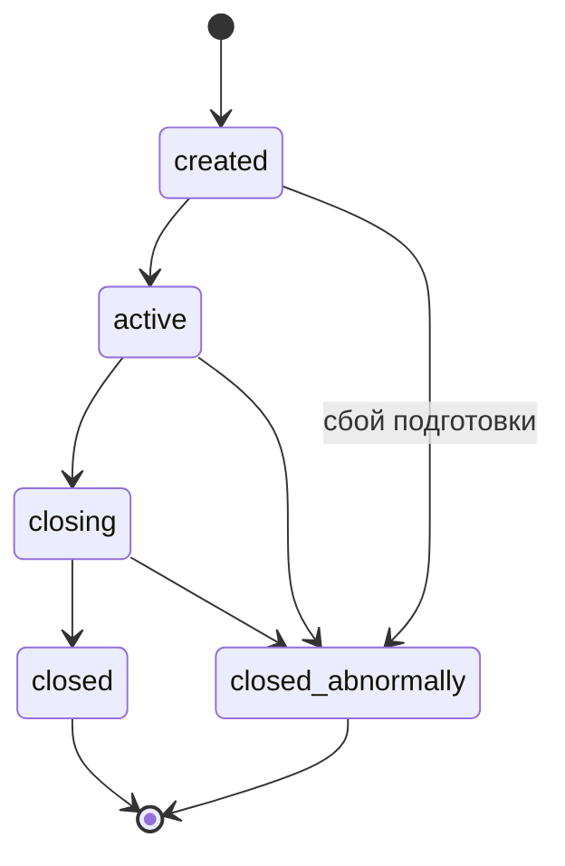
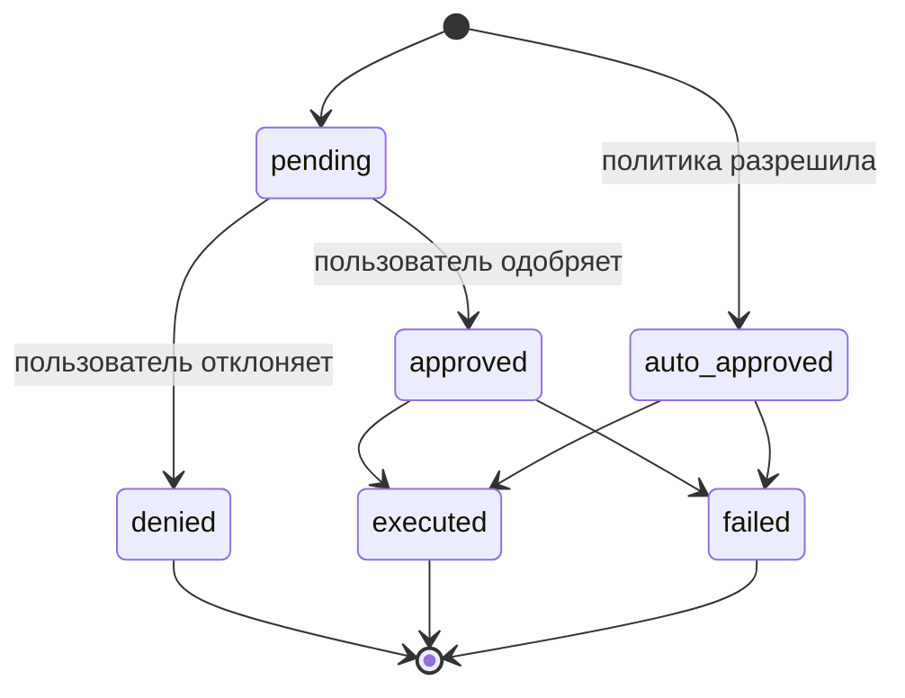
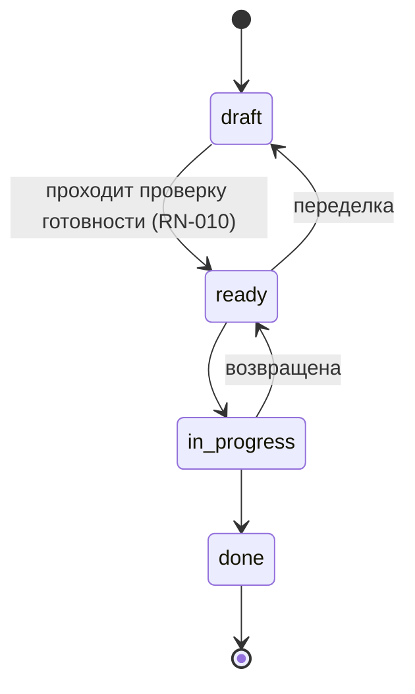
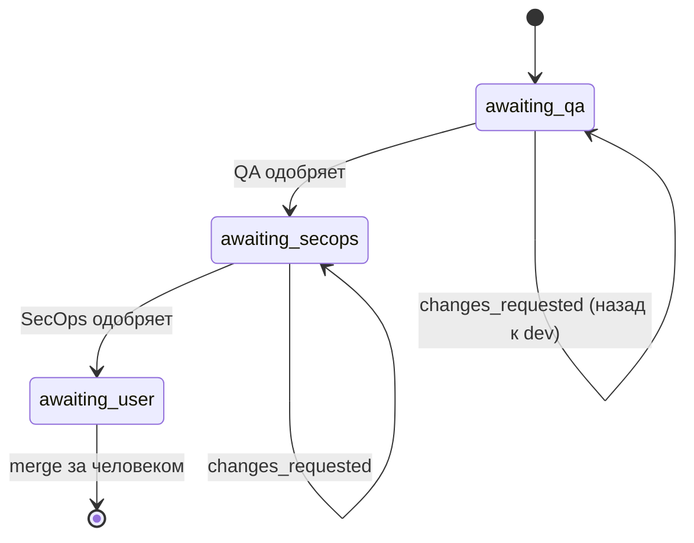

# API

## Сессия

Brabo выполняет инженерную работу с помощью ИИ-агентов. Две силы формируют
практически каждое правило здесь:

**Агент ненадёжен по своей природе.** Это языковая модель: она может
галлюцинировать, зациклиться или запросить что-то разрушительное. Правила
существуют для того, чтобы возможный ущерб ограничивался структурой, а не
качеством промпта.

**Расходы реальны и непрерывны.** Каждый ход расходует платный токен. Бюджет,
потолок и учёт — не административное удобство, а то, что не даёт циклу
агента превратиться в убыток.

### Участники

| участник | кто это | полномочия |
|---|---|---|
| **Пользователь** | человек. Роли: `viewer`, `developer`, `maintainer`, `owner` | окончательное решение по любому действию с внешним эффектом; merge — исключительно за ним |
| **Агент** | долгоживущий процесс с ролью (Criativo, PO, Arquiteto, Dev, Infra, QA, SecOps, Psicólogo, Anamnese) | предлагает; никогда не решает в одиночку то, что не разрешает политика |
| **Система** | api и engine | применяет политику, записывает событие, измеряет стоимость |

Словарь — в [глоссарии](../glossary.md).

---

## Бизнес-контекст

### RN-001 — У сессии пять состояний и закрытые переходы {#rn-001}

`created → active → closing → closed`, при этом `closed_abnormally`
достижимо из любого нетерминального состояния. **Из `closing` никогда нет
пути назад в `active`**, а у терминальных состояний нет выхода.



- **Где:** `apps/api/src/domain/sessions/session-state-machine.ts:29`
- **Тест:** `test/domain/sessions/session-state-machine.spec.ts`
- **Граничный случай:** `closing` — **транзитное** состояние. Сессия,
  застрявшая в нём, означает, что дренаж начался и не завершился — для этого
  есть алерт, см. [runbook](../runbook.md).

### RN-002 — Каждое событие сессии неизменяемо, а `seq` плотный {#rn-002}

`UPDATE` в `session_events` не бывает никогда. `seq` уникален в рамках сессии
(`unique(session_id, seq)`) и не имеет пропусков: начинается с 1 и идёт
подряд.

- **Где:** `apps/api/src/db/schema/sessions.ts` (таблица `session_events`)
- **Тест:** проверяется при восстановлении — `docker/backup/restore.sh`
  падает, если `count(*) ≠ max(seq) − min(seq) + 1` или `min(seq) ≠ 1`
- **Почему:** именно это делает доказательства Psicólogo прослеживаемыми, а
  резервную копию — проверяемой. Состояние, которое должно меняться, живёт в
  собственной таблице рядом.

## Одобрение действий

Сердце системы. Каждое действие с внешним эффектом рождается как
`proposed_action`.

### RN-003 — У действия шесть состояний, и denied терминально {#rn-003}



- **Где:** `apps/api/src/domain/actions/action-state-machine.ts:36`
- **Тест:** `test/domain/actions/action-state-machine.spec.ts`
- **Граничный случай:** одобренное и выполненное действие становится
  `executed`, а **не** остаётся `approved`. Подсчёт одобрений по
  `status = 'approved'` даёт неверное число — правильный критерий
  `decided_by IS NOT NULL`.

### RN-004 — Решение оценивается в три этапа, и `deny` побеждает немедленно {#rn-004}

Порядок: **(a) IAM → (b) `agent_autonomy` → (c) `permissions.json`**. Каждый
этап может только **повысить** разрешительность; молчащий этап никогда не
понижает предыдущий. `deny` на любом этапе возвращается немедленно.

- **Где:** `apps/api/src/domain/actions/decide.ts:118`
- **Тест:** `test/domain/actions/decide.spec.ts` (10 КБ — самый большой в
  домене)

### RN-005 — Минимальная роль на тип действия {#rn-005}

До любой политики — IAM: каждый `ActionType` требует минимальной
эффективной роли. Без неё — `deny` с явной причиной.

- **Где:** `apps/api/src/domain/actions/decide.ts:110` (`MIN_ROLE_FOR_ACTION_TYPE`)
- **Тест:** `test/domain/actions/decide.spec.ts`

### RN-006 — Потолок: merge в защищённую ветку никогда не одобряется автоматически {#rn-006}

`dev`, `qa`, `rc` и `main` защищены. `git_merge`, нацеленный на одну из них,
понижается с `auto_approve` до `require_approval` **после** выполнения всей
политики. Ни `agent_autonomy`, ни `permissions.json` не могут его повысить.

`rc` остаётся в списке даже после того, как этот шаг ушёл из политики
([ADR 0030](../adr/0030-politica-de-branches-mecanizada.md)), а bootstrap
перестал её создавать ([RN-029](#rn-029)). Этот список решает, что блокировка
**отклоняет**, а у репозиториев, развёрнутых более ранними версиями, ветка
всё ещё есть: защита несуществующей ничего не стоит; снятие защиты с
существующей обходится дорого.

- **Где:** `apps/api/src/domain/actions/decide.ts:498` (`isProtectedBranch`, o teto da trava de merge) + `protected-branches.ts:4`
- **Тест:** `test/domain/actions/decide.spec.ts`
- **Источник:** [ADR 0011](../adr/0011-infra-dev-agents-worktrees-merge-lock.md) §1
- **Примечание:** эквивалентная защита **на платформе** (GitHub/GitLab)
  различается между провайдерами и не является gate — см.
  [ADR 0028](../adr/0028-protecao-de-branch-divergencia-entre-providers.md).

### RN-007 — Потолок: патч инструкции никогда не одобряется автоматически {#rn-007}

Изменение инструкции агента всегда требует решения человека. Ценность
функции в том, что человек видит diff; автоматическое одобрение означало бы,
что агент переписывает сам себя.

- **Где:** `apps/api/src/domain/actions/decide.ts:168`
- **Тест:** `test/domain/actions/decide.spec.ts`
- **Источник:** [ADR 0016](../adr/0016-anamnese-proficiencia-patches-instrucao.md) §8

### RN-008 — Сопоставление команд — по шаблону, а не по подстроке {#rn-008}

`permissions.json` сопоставляет команду терминала по структурированному
шаблону, с корректно токенизированной командой, — а не через `includes()`.

- **Где:** `apps/api/src/domain/actions/command-matcher.ts`
- **Тест:** `test/domain/actions/command-matcher.spec.ts`

---

## Бэклог

### RN-009 — У истории четыре состояния, и `done` терминально {#rn-009}

`draft → ready → in_progress → done`. Переделка допускается: `ready → draft`
и `in_progress → ready`.



- **Где:** `apps/api/src/domain/backlog/story-state-machine.ts:27`
- **Тест:** `test/domain/backlog/story-state-machine.spec.ts`

### RN-010 — `draft → ready` требует четырёх вещей, проверяемых в домене {#rn-010}

Чтобы история стала `ready`, нужно **всё** из следующего:

1. непустой `dod` — Definition of Done
2. непустой `dor` — Definition of Ready
3. хотя бы 1 функциональное требование (`rf`)
4. хотя бы 1 связанное бизнес-правило (`businessRuleIds`)

Ошибка называет **ровно то, чего не хватает**, а не общее "невалидно".

- **Где:** `apps/api/src/domain/backlog/story-readiness.ts:39`
- **Тест:** `test/domain/backlog/story-readiness.spec.ts`
- **Источник:** [ADR 0009](../adr/0009-agente-po-backlog-rastreabilidade.md) §3
- **Почему:** именно это не даёт PO сбросить расплывчатую историю в очередь
  разработки.

### RN-011 — Бизнес-правило без истории — это находка, а не ошибка {#rn-011}

Покрытие правило→история вычисляется, и то, что не имеет истории,
показывается как **ожидающее** — информация, а не сбой.

- **Где:** `apps/api/src/domain/backlog/coverage.ts`
- **Тест:** `test/domain/backlog/coverage.spec.ts`

### RN-013 — В графе модулей не может быть цикла {#rn-013}

- **Где:** `apps/api/src/domain/architecture/module-graph.ts`
- **Тест:** `test/domain/architecture/module-graph.spec.ts`

---

## Gates PR

### RN-014 — Порядок gates неизменен, и `awaiting_user` терминально {#rn-014}

`awaiting_qa → awaiting_secops → awaiting_user`. Одобрение QA **никогда** не
перескакивает сразу к пользователю. `changes_requested` возвращает работу
разработчику **в той же ветке**, без нового PR.



- **Где:** `apps/api/src/domain/execution/pr-gate-state-machine.ts:24`
- **Тест:** `test/domain/execution/pr-gate-state-machine.spec.ts`
- **Источник:** [ADR 0013](../adr/0013-gates-qa-secops-pr.md) §1
- **Граничный случай:** `awaiting_user` терминально **по замыслу** — система
  никогда не делает merge (RN-006).

### RN-015 — Цикл K: потолок исправлений конечен и наследуется {#rn-015}

Каждый возврат от gate расходует круг. Когда потолок исчерпан, задача
**блокируется** с причиной, вместо того чтобы крутиться вечно. Субагент,
созданный распараллеливанием, **наследует** потолок базового агента.

Начиная с Фазы 8b потолок применяется и к ОБЛАСТИ QA, без изменения кода:
`QaLeadServer` — единственный вызывающий `record_gate_verdict`, поэтому один
раунд gate — сколько бы специализаций он ни опросил внутри — по-прежнему
расходует ровно ОДИН круг. См. [RN-036](engine.md#rn-036).

- **Где:** `DEFAULT_MAX_GATE_CORRECTIONS = 3` в
  `apps/api/src/application/use-cases/execution/record-gate-verdict.use-case.ts:21`;
  применяется в `activate-execution.use-case.ts:89` и, в engine, в
  `qa_lead_server.ex:268` и `secops_agent_server.ex:142`
- **Тест:** `apps/engine/test/engine/gates/qa_automacao_agent_test.exs`
  (специализация возвращает `{:blocked, ...}`, не вызывая api) и
  `qa_lead_server_test.exs` (Lead в этом случае НИКОГДА не вызывает
  `record_gate_verdict` — именно это не даёт сжечь исправление)
- **Источник:** [ADR 0017](../adr/0017-lock-de-workspace-e-monitor-de-dev-agents.md) §4

### RN-017 — У бюджета исключительная область видимости: проект **или** сессия {#rn-017}

`budget` ссылается на проект или на сессию, никогда на оба — это
гарантируется `check` в базе данных, а не только в коде.

- **Где:** `apps/api/src/db/schema/llm.ts` (`budgets_scope_check`)
- **Тест:** гарантией является ограничение

### RN-018 — Уведомление о бюджете на 70%, 90% и 100%, без повторов {#rn-018}

Каждый порог срабатывает **один раз**; последний уведомлённый сохраняется в
`budgets.last_threshold_notified`.

- **Где:** `apps/api/src/domain/llm/budget-threshold.ts:1`
- **Тест:** `test/domain/llm/budget-threshold.spec.ts`

### RN-019 — `policy = 'block'` отклоняет вызов; `'allow'` лишь регистрирует {#rn-019}

- **Где:** `apps/api/src/domain/llm/budget-threshold.ts:4`
- **Граничный случай:** проект в `allow` **не останавливается** на потолке.
  Это самая частая причина «бюджет не удержал» — см.
  [runbook](../runbook.md).

### RN-020 — Модель разрешается каскадом, от самого конкретного к самому общему {#rn-020}

`session > agent > area > project > workspace`. Побеждает первый
существующий. `area` вошла в ФАЗЕ 23 — см. [RN-102](#rn-102) о её позиции и о
том, что меняется для того, кто уже читал этот каскад.

- **Где:** `apps/api/src/domain/llm/binding-resolver.ts`
- **Тест:** `test/domain/llm/binding-resolver.spec.ts`

## Psicólogo и Anamnese

### RN-021 — Гипотеза без валидного доказательства не записывается {#rn-021}

`evidenceEventIds` должны указывать на события, **которые существуют и
принадлежат анализируемой сессии**. Проверка атомарна на пакет: один
невалидный id проваливает весь пакет.

- **Где:** `apps/api/src/domain/psychologist/hypothesis-evidence.ts`
- **Тест:** `test/domain/psychologist/hypothesis-evidence.spec.ts`
- **Источник:** [ADR 0015](../adr/0015-psicologo-real-toolloop-hipoteses-evidencia.md) §3

### RN-022 — Жизненный цикл гипотезы — compare-and-swap {#rn-022}

`proposed → accepted | dismissed`. Два конкурирующих решения об одной
гипотезе: одно побеждает, другое получает конфликт — не 500 и не молчание.

- **Где:** `apps/api/src/domain/psychologist/hypothesis-lifecycle.ts`
- **Тест:** `test/domain/psychologist/hypothesis-lifecycle.spec.ts`
- **Источник:** [ADR 0022](../adr/0022-fechamento-4b-psicologo.md) §7

### RN-024 — Anamnese профилирует только компетенции из каталога — структурное ограждение {#rn-024}

Компетенций процесса **шесть**, список закрыт: `git`, `agile`, `arquitetura`,
`testes`, `seguranca`, `infra`. Плюс технические стеки, выводимые из
`module_map`. Всё остальное — "тревожность", "психическое здоровье" — **не
имеет пути записи**: это ошибка в домене, а не инструкция промпта.

- **Где:** `apps/api/src/domain/anamnese/competency-catalog.ts:16`
- **Тест:** `test/domain/anamnese/competency-catalog.spec.ts`
- **Источник:** [ADR 0016](../adr/0016-anamnese-proficiencia-patches-instrucao.md) §1
- **Почему:** Anamnese профилирует **техническую компетенцию**, а не
  человека. Ограничение структурное, потому что инструкция промпта — не
  гарантия.

### RN-025 — Удаление профиля удаляет по-настоящему, а opt-out запрещает повторный вывод {#rn-025}

- **Где:** `apps/api/src/domain/anamnese/proficiency-profile.entity.ts` +
  таблица `anamnese_opt_outs`
- **Источник:** [ADR 0016](../adr/0016-anamnese-proficiencia-patches-instrucao.md) §2

### RN-026 — Отклонённый патч инструкции не предлагается повторно {#rn-026}

Сравнение идёт по **нормализованному** содержимому, а не по буквальному
тексту: переотступ того же патча не превращает его в новое предложение.
Таблицы дедупликации нет — источником служит сама история `proposed_action` с
`actionType = instruction_patch` и `status = denied`.

- **Где:** `apps/api/src/domain/instructions/patch-dedup.ts:22`
- **Тест:** `test/domain/instructions/patch-dedup.spec.ts`

### RN-027 — Откат инструкции — операция **вперёд** {#rn-027}

Откат создаёт новую версию со старым содержимым; историю он не стирает.
Таблица версий — только для добавления.

- **Где:** `apps/api/src/domain/instructions/`
- **Источник:** [ADR 0016](../adr/0016-anamnese-proficiencia-patches-instrucao.md) §4

---

## Git

### RN-029 — Bootstrap Gitflow идемпотентен и возобновляем {#rn-029}

Пять шагов; каждый проверяет перед действием и может быть возобновлён с
места сбоя. `skip` — это успех, а не ошибка.

Их было шесть. Шестой создавал ветку `rc` — ступень, которую
[ADR 0030](../adr/0030-politica-de-branches-mecanizada.md) убрал из политики, —
bootstrap продолжал создавать, защищать и **документировать в репозитории
пользователя** лестницу, от которой продукт уже отказался (находка №3
первого dogfooding). Значение `create_rc_branch` остаётся в enum
`bootstrap_step`: на него ссылаются старые строки, а шаг, который реально
произошёл, из истории не стирается.

- **Где:** `apps/api/src/application/use-cases/git/bootstrap-steps.ts` +
  `domain/git/repo-bootstrap.entity.ts` (`RETIRED_BOOTSTRAP_STEPS`)
- **Тест:** `test/domain/git/repo-bootstrap-status.spec.ts`
- **Источник:** [ADR 0005](../adr/0005-repo-bootstrap-idempotent-steps.md)

---

### RN-030 — Повторное предъявление уже использованного refresh отзывает всё семейство {#rn-030}

Каждый refresh потребляет предъявленный токен и выпускает дочерний с **тем же**
`family_id` и тем же `family_started_at`. Предъявление уже потреблённого
токена — признак кражи: кто-то использует копию, — и ответом является отзыв
всех живых токенов этого семейства, с событием безопасности.

Легитимный пользователь тоже разлогинивается. Это правильное поведение, а не
дефект: на стороне сервера двойная отправка клиента и replay вора
идентичны.

- **Где:** `apps/api/src/domain/auth/refresh-token.ts:50` +
  `application/use-cases/auth/refresh.use-case.ts:98`
- **Тест:** `test/application/use-cases/auth/rotacao-e-reuso.spec.ts`
- **Граничный случай:** тот, кто предъявляет токен **уже отозванного** семейства, —
  пострадавший ниже по течению, а не новая кража: регистрируется
  `refresh_revoked` и **не** запускается второй каскад. Без этого различия
  каждая вкладка легитимного пользователя порождала бы ложную тревогу во время
  инцидента.
- **Источник:** [ADR 0031](../adr/0031-auth-first-party-argon2id-e-rotacao-de-refresh.md)

### RN-031 — Неудачный вход считается по e-mail и по IP, и блокировка нарастает {#rn-031}

Скользящее окно в 15 минут в Postgres, без Redis. Две корзины на попытку, и
побеждает более строгая: e-mail (5 неудач → 30s, 8 → 5min, 12 → 15min) и IP
(20 → 30s, 30 → 2min). Успешный вход очищает корзину e-mail; корзина IP
опустошается только со временем.

Ключ корзины — **нормализованный e-mail**, никогда не id пользователя. С id
корзина существовала бы только после нахождения учётной записи, и сама
блокировка превратилась бы в оракул существования.

- **Где:** `apps/api/src/domain/auth/lockout-policy.ts:97` +
  `infrastructure/persistence/drizzle/drizzle-login-throttle.ts:74`
- **Тест:** `test/application/use-cases/auth/lockout.spec.ts`
- **Граничный случай:** пока действует блокировка, попытка **не** регистрируется.
  Если бы регистрировалась, атакующий держал бы учётную запись жертвы
  запертой вечно, просто продолжая пытаться, — блокировка превратилась бы в
  отказ в обслуживании против того, кого она защищает.
- **Почему:** корзину IP нельзя очищать при успехе; тот, у кого есть
  действительная учётная запись, обнулял бы окно по желанию и рассыпал бы
  догадки без ограничения.
- **Источник:** [ADR 0031](../adr/0031-auth-first-party-argon2id-e-rotacao-de-refresh.md)

### RN-032 — Ни один ответ не отличает существующую учётную запись от несуществующей {#rn-032}

Любой ответ, отличный от единообразной неудачи, достижим только **после**
успешной проверки пароля. При входе несуществующий e-mail, неверный пароль и
заблокированная учётная запись возвращают один и тот же 401 и тратят одно и
то же время — ветка без учётной записи проверяет по фиктивному хэшу,
сгенерированному с **теми же параметрами**, что и настоящий. При регистрации и
запросе сброса известный и неизвестный адреса возвращают 202.

- **Где:** `apps/api/src/application/use-cases/auth/login.use-case.ts:79` +
  `register.use-case.ts:74`
- **Тест:** `test/application/use-cases/auth/enumeracao.spec.ts`
- **Граничный случай:** проверка блокировки по e-mail выполняется **после**
  argon2, а не до. Ранний выход — оптимизация, которую предложил бы любой
  ревьюер, и это ровно утечка — тест становится красным, если кто-то её
  внесёт.
- **Граничный случай:** пользователь, МИГРИРОВАННЫЙ из Keycloak (есть в `users`,
  без строки в `auth_credentials`), тоже получает единообразный 401 — а ссылка
  «задать пароль» отправляется молча. Ответ `password_pending` подтвердил бы,
  что адрес существует **и** что это унаследованная учётная запись. Поэтому
  `findByEmail` — это LEFT JOIN в одном запросе: два последовательных запроса
  заставили бы эту ветку платить лишний поход в базу, и часы раскрыли бы то,
  что скрывает тело.
- **Почему:** утверждается «ни одна ветка не пропускает дорогую работу и ни
  одна не даёт различимого ответа», **а не** постоянное время. См. следствия
  в ADR.
- **Источник:** [ADR 0031](../adr/0031-auth-first-party-argon2id-e-rotacao-de-refresh.md),
  граничный случай мигрированного — в
  [ADR 0032](../adr/0032-corte-do-keycloak-e-sessao-em-cookie.md)

### RN-033 — Токен подтверждения и сброса действует только один раз {#rn-033}

Потребление через условный UPDATE с `returning`: сам UPDATE и есть защита.
Ноль строк покрывает несуществующий, другого назначения, уже потреблённый,
аннулированный и истёкший — все с одинаковым ответом. Запрос новой ссылки
аннулирует предыдущую. Завершение сброса отзывает **все** сессии
пользователя и не выпускает токенов.

- **Где:** `apps/api/src/infrastructure/persistence/drizzle/account-token.repository.ts:76`
- **Тест:** `test/application/use-cases/auth/tokens-de-conta.spec.ts`
- **Граничный случай:** две одновременные отправки не проходят обе. Гонка —
  **нормальный** случай, а не исключение: корпоративный сканер почты открывает
  каждую ссылку каждого сообщения, так что робот обычно потребляет токен до
  того, как человек кликнет.
- **Почему:** сброс намеренно не выпускает сессию — вход напрямую по ссылке,
  полученной по почте, сделал бы компрометацию почты равносильной захвату
  учётной записи, без второго шага.
- **Источник:** [ADR 0031](../adr/0031-auth-first-party-argon2id-e-rotacao-de-refresh.md)

### RN-034 — Веб-сессия живёт в cookie httpOnly, с CSRF {#rn-034}

Refresh token идёт в cookie `brabo_refresh` (`httpOnly`, `SameSite=Strict`,
`Path=/auth`, `Secure` в production) и **не** появляется в теле ни одного
ответа. Access token на 15 минут хранится в памяти клиента и передаётся в
`Authorization: Bearer`.

`/auth/refresh` и `/auth/logout` требуют `X-CSRF-Token`, равный cookie
`brabo_csrf`, сравниваемый за постоянное время.

- **Где:** `apps/api/src/interfaces/http/auth/session-cookies.ts:53` +
  `interfaces/http/auth/auth.controller.ts`
- **Тест:** `test/interfaces/session-cookies.spec.ts`
- **Граничный случай:** провал CSRF — **403**, а не 401. С 401 клиент
  попытался бы обновить сессию и попал бы в цикл — учётные данные в порядке,
  неверен запрос.
- **Почему:** возврат refresh также в теле свёл бы на нет `httpOnly` —
  достаточно было бы XSS прочитать ответ входа, и он унёс бы долгую сессию
  вместо 15 минут access.
- **Источник:** [ADR 0032](../adr/0032-corte-do-keycloak-e-sessao-em-cookie.md)

### RN-035 — Внутренний трафик engine ↔ api требует сервисного секрета {#rn-035}

32 маршрута `/internal/*` — это `@ServiceRoute()`: они вне пользовательского
JWT и вне rate limit. Аутентифицирует `EngineServiceGuard`, сравнивая
`X-Brabo-Service-Token` с `BRABO_SERVICE_TOKEN` за постоянное время. Один и
тот же секрет действует в обоих направлениях, а `BRABO_SERVICE_TOKEN_PREVIOUS`
принимается только при проверке, чтобы у ротации не было окна недоступности.

- **Где:** `apps/api/src/interfaces/http/auth/engine-service.guard.ts:44` +
  `infrastructure/security/service-token.ts` +
  `apps/engine/lib/engine_web/plugs/verify_service_token.ex`
- **Тест:** `apps/engine/test/engine_web/plugs/verify_service_token_test.exs`,
  `test/interfaces/route-surface.spec.ts` и, для ротации на стороне api
  (предыдущий принимается только при проверке, вызывающий отправляет текущий,
  после удаления предыдущего старый отпадает),
  `test/infrastructure/security/service-token.spec.ts`
  (describe "rotação do BRABO_SERVICE_TOKEN") и
  `test/interfaces/engine-service.guard.spec.ts` ([RN-597](#rn-597))
- **Граничный случай:** освобождение от rate limit берётся из МЕТАДАННЫХ
  маршрута, а не из guard. `RateLimitGuard` — это `APP_GUARD`, и он
  выполняется до любого guard controller — когда он принимает решение,
  `EngineServiceGuard` ещё не выполнился.
- **Источник:** [ADR 0032](../adr/0032-corte-do-keycloak-e-sessao-em-cookie.md)

### RN-038 — Агент, учитываемый в сводке workspace, = потратил токены в этом месяце {#rn-038}

Сводка панели проектов («N активных проектов · M агентов · расход в этом
месяце») считает «агентом» того, у кого есть хотя бы одна строка в
`token_usage` с `actor_kind = 'agent'` в текущем месяце, суммируя все проекты
workspace. Без фильтра по `actor_kind` `user`, отправляющий чат, или
`system`, регистрирующий использование, раздули бы подсчёт — `token_usage`
записывает для любого типа актора, а не только агента. Отсечение по месяцу
использует `created_at >= date_trunc('month', now())`; агент, работавший
только в прошлом месяце, не учитывается, даже если он ещё появляется в
roster какой-либо сессии. Подсчёт естественно включает подспециальности
областей Фазы 8 (`qa-automacao`, `qa-performance-seguranca`,
`infra-workflows`): у каждой свой `actor_id`, когда она тратит токены.

- **Где:** `apps/api/src/infrastructure/persistence/drizzle/token-usage.repository.ts`
  (`summarizeForWorkspaceThisMonth`)
- **Тест:** `test/application/use-cases/iam/get-workspace-summary.use-case.spec.ts`

---

### RN-040 — Binding агента требует нативного tool calling {#rn-040}

Привязка модели к **агенту** (`scope = 'agent'`) разрешена, только если у
модели есть `supports_tool_calling`. Агент существует только внутри
ToolLoop, а ToolLoop работает, только если модель умеет **запрашивать**
инструменты; без этого сбой проявился бы позже как «агент остановился, не
закончив», — ровно та диагностика методом исключения, которую
[ADR 0020](../adr/0020-destravar-gates-qa-secops.md) запретил. Отказ — это
422, и сообщение указывает на фильтр **"aptos para agentes"** — без этого
указания правило превращается в тупик.

`ToolCallRecovery` в engine восстанавливает вызовы, которые модель написала
прозой, но это **спасение, а не лицензия**: оно зависит от того, угадает ли
модель формат случайно.

Проверяет только `agent`. `workspace` и `project` — это fallback
человеческого чата, а `session` — разговор; ни один из них не запускает
ToolLoop, и их блокировка запретила бы в продукте модели только для чата.
Агент `context-manager` покрыт по построению: это slug **внутри** области
`agent`, а не собственная область.

**Дополнительная заметка — фильтр стал приходить ОТМЕЧЕННЫМ, и включает его
ОБЛАСТЬ.** Абзац выше говорит, что отказ указывает на фильтр "aptos para
agentes", «иначе правило становится тупиком» — и долгое время оно им было:
prop, открывающий селектор с отмеченным фильтром, существовал с Фазы 9c, и
**ни один экран production его не передавал**. Селектор агента открывался,
предлагая модель только для чата, клик по которой существовал лишь для того,
чтобы быть отклонённым. Оба экрана, записывающие в проверяемую область,
начинают открываться отфильтрованными — `ModelsSection` (агент) и
`ModelsSection` (область), — и правило того, кто включает, — не экран, а
`assertModelFitsBindingScope`: там, где api ОТКЛОНЯЕТ, фильтр приходит
отмеченным; там, где не отклоняет, выбирает человек. Поэтому селектор СЕССИИ
остаётся без фильтра — отметка там скрыла бы модель, которую api принимает.
**Это не устраняет 422**: фильтр покрывает одну из трёх причин, а две другие
([RN-043](#rn-043) — отключена в workspace, исчезла у провайдера) остаются
достижимыми, при этом недоступная всё ещё ПЕРЕЧИСЛЕНА и помечена; исход
отказа из [RN-470](web.md#rn-470) по-прежнему то, что сообщает, что произошло. И это
НАЧАЛЬНОЕ состояние checkbox, а не замок: снятие отметки снова перечисляет
всё.

**Следствие: действующее значение, которое скрывает фильтр, ПРОГОВАРИВАЕТСЯ.**
`workspace` и `project` никогда не требовали tool calling, а маршруты,
разрешающие binding агента или области, вызывают
`ResolveModelBindingUseCase` **без** `exigeToolCalling` — так что
чат-модель по умолчанию на этих уровнях разрешается нормально и становится
действующей для строки. С отмеченным фильтром триггер показывал имя, которого
открытый список не содержал, без какой-либо отмеченной опции. Picker теперь
называет модель и причину; он МОЖЕТ назвать причину, потому что фильтр там
только один. Когда весь список становится пустым, говорит по-прежнему текст
пустого списка, который уже велит снять отметку, — два предупреждения об
одном checkbox были бы шумом.

**Исправление факта, а не текста выше:** "Only `agent` validates" описывает
Фазу 9a. Начиная с [ADR 0064](../adr/0064-escopo-de-area-na-cascata-e-o-binding-de-agente-global.md)
`area` входит в ТУ ЖЕ проверку — это не общий fallback, единственный
потребитель модели области — её агент ([RN-102](#rn-102)), — и именно
поэтому экранов, включающих фильтр, ДВА.

- **Где:** `apps/api/src/domain/llm/model-capabilities.ts:38`;
  `apps/web/src/components/ModelPicker.tsx` (фильтр и предупреждение о
  скрытом действующем), `apps/web/src/routes/settings/ModelsSection.tsx`,
  `apps/web/src/routes/settings/ModelsSection.tsx` (кто его включает)
- **Тест:** `test/domain/llm/model-capabilities.spec.ts`,
  `test/application/use-cases/llm/set-model-binding.use-case.spec.ts`;
  `apps/web/src/routes/settings/filtro-de-aptos.test.tsx` и
  `apps/web/src/routes/SessionPage.filtro-de-aptos.test.tsx` (два экрана,
  которые включают, и тот, что не включает)
- **Источник:** [ADR 0041](../adr/0041-base-openai-compativel-e-contrato-de-llm-providers.md)

### RN-041 — Количество токенов, не сообщённое провайдером, помечается как оценочное {#rn-041}

Когда ответ провайдера не несёт `usage`, OpenAI-совместимая база считает
локально токенизатором и выпускает chunk с `estimated: true`. Число всё ещё
годится для выставления счёта, но метка сохраняет разницу между
**«провайдер сказал ноль»** и **«провайдер ничего не сказал»** — и это
позволяет UI квалифицировать стоимость, а не показывать значение без
происхождения.

Два других провайдера расходятся, и расхождение нормализуется, а не
прячется: Ollama просто не выпускает `usage` без строки `done`; Anthropic не
может опустить подсчёт, потому что `usage` обязателен в `message_start` его
протокола. Все три ответа — в
[docs/reference/llm-providers.md](../reference/llm-providers.md#normalized-divergences).

- **Где:** `apps/api/src/infrastructure/llm/openai-compatible-provider.ts:167`
- **Тест:** `test/contract/llm-provider.contract.ts` (сценарий
  `sem_usage`, выполняемый против трёх провайдеров)
- **Источник:** [ADR 0041](../adr/0041-base-openai-compativel-e-contrato-de-llm-providers.md)

### RN-042 — Metering регистрирует, кто ОБСЛУЖИЛ вызов, а не только через что он вошёл {#rn-042}

Когда вызов проходит через hub, который сообщает реального провайдера,
`token_usage` регистрирует этого провайдера в `upstream_provider`, помимо
провайдера входа. Без hub — или с hub, который не сообщил, — поле равно
**`null`**, никогда пустой строке: запрос стоимости по провайдеру должен
различать «не проходил через hub» и «проходил через hub, и hub не сказал».

В метриках метка `upstream_provider` повторяет самого провайдера, когда hub
нет, так что `sum by (upstream_provider)` продолжает суммировать всю
стоимость.

- **Где:** `apps/api/src/application/use-cases/llm/record-llm-usage.use-case.ts:73`
- **Тест:** `test/application/use-cases/llm/record-llm-usage.use-case.spec.ts`
- **Источник:** [ADR 0041](../adr/0041-base-openai-compativel-e-contrato-de-llm-providers.md)

### RN-043 — Обнаруженная модель входит отключённой; исчезнувшая модель помечается, никогда не удаляется {#rn-043}

У синхронизации каталога три исхода, и ни один не разрушителен:

1. **Новая модель** входит **без строки курирования в каком-либо
   workspace**, и отсутствие строки И ЕСТЬ отключённое состояние. Каталог
   провайдера содержит сотни строк — выгрузить их как активные сделало бы
   выбор невозможным и включило бы дорогую модель без чьего-либо решения.
   Активация — курирование owner, и действует только в его workspace
   ([RN-052](#rn-052)).
2. **Модель, исчезнувшая из удалённого каталога**, получает
   `availability = 'unavailable'` и **остаётся в таблице**:
   `model_bindings` и `token_usage` указывают на строку, и её удаление унесло
   бы вместе историю стоимости.
3. **Вернувшаяся модель** возвращается в `available` с **нетронутым**
   курированием — выбор owner переживает временное отсутствие у провайдера.

Две оси намеренно независимы: курирование — решение человека,
`availability` — наблюдение провайдера. Ни одна не пишет в другую — и начиная
с [ADR 0049](../adr/0049-curadoria-de-modelo-por-workspace.md) они даже не
живут в одной таблице, так что у синхронизации нет поля курирования, которое
она могла бы растоптать, даже если бы захотела.

Три следствия в остальной системе:

- **НОВЫЙ** binding для неактивной или недоступной модели отклоняется в
  домене (`ModelNotBindableError`, 422). Уже существующие bindings
  остаются;
- **каскад** `resolveBinding` пропускает недоступного кандидата, записывает
  пропущенное в `skipped` и — когда ход несёт инструменты — повторно
  проверяет `supports_tool_calling` на ВСЕХ уровнях. Без этого fallback
  посадил бы агента на модель только для чата и молча нарушил бы
  [RN-040](#rn-040);
- **упавший провайдер ничего не делает недоступным**: 401 — это «не знаю,
  что там есть», а не «там ничего нет». Провайдер пропускается, с ИСТОЧНИКОМ
  сбоя (`infra` | `modelo`) в отчёте — никогда диагностика методом
  исключения.

- **Где:** `apps/api/src/application/use-cases/llm/sync-model-catalog.use-case.ts:160`,
  `apps/api/src/domain/llm/binding-resolver.ts:63`,
  `apps/api/src/domain/llm/model-capabilities.ts:49`
- **Тест:** `test/application/use-cases/llm/sync-model-catalog.use-case.spec.ts`,
  `test/domain/llm/binding-resolver.spec.ts`,
  `test/application/use-cases/llm/set-model-binding.use-case.spec.ts`
- **Источник:** [ADR 0042](../adr/0042-catalogo-vivo-ciclo-de-vida-do-modelo-e-preco-auditavel.md)

### RN-044 — Цена действует с этого момента, а старая стоимость продолжает сходиться {#rn-044}

Каждая строка `token_usage` регистрирует цену, которая дала её
`cost_micros`. Изменение цены модели **не переоценивает прошлое
потребление** — и более того: старая стоимость остаётся
**воспроизводимой**, потому что `токены × записанная цена` совпадает с
записанной стоимостью даже после трёх исправлений в таблице `models`.

Каждое изменение цены записывает строку в `model_price_changes`, только
добавление, с парой до/после и источником (`manual` | `sync`). Пара
записывается вместе намеренно: восстановление «до» из предыдущей строки
зависело бы от того, что ни одна запись не ускользнула от проверяемого
пути, — а ровно это аудит и существует, чтобы доказать. Цена, равная
текущей, — no-op: строка «изменилась с 10 на 10» превратила бы лог в шум.

Правило действует для **каждого** пути, меняющего цену, а не только для
экрана. Две записи обычно от него ускользали: синхронизация каталога
(которая меняла цену через `upsert`, никогда не производя источник `sync`,
который домен объявлял с Фазы 9c) и `seed.ts` (который выполняется на уже
засеянной базе — `BRABO_FORCE_SEED=1` в `bootstrap.sh` k8s — и поэтому молча
исправлял цену). Обе теперь аудируются, а seed переиспользует сам
`UpdateModelPricingUseCase`.

- **Где:** `apps/api/src/application/use-cases/llm/update-model-pricing.use-case.ts:44`,
  `apps/api/src/application/use-cases/llm/sync-model-catalog.use-case.ts:213`,
  `apps/api/src/db/seed.ts:376`
- **Тест:** `test/application/use-cases/llm/update-model-pricing.use-case.spec.ts`,
  `test/application/use-cases/llm/sync-model-catalog.use-case.spec.ts`
- **Источник:** [ADR 0042](../adr/0042-catalogo-vivo-ciclo-de-vida-do-modelo-e-preco-auditavel.md)

### RN-045 — Принятый репозиторий изменяется только одобренным планом {#rn-045}

Принятие существующего репозитория **диагностирует, не действуя**. Принятие
проверяет доступ (`getRepo`), записывает строки проекта и производит
**план**: сериализованный список того, что сделал бы bootstrap, полученный
вызовом `check()` каждого шага — того же, что даёт идемпотентность с
[RN-029](#rn-029), — никогда не выполняя
соответствующую мутацию.

Пока `repo_bootstraps.plan_decision` **пустой**, ни одна мутация не
выполняется. Ворота стоят **перед** исполнителем, а не внутри него: runner
bootstrap — тот же, что в Фазе 2, без фильтра, и его просто не вызывают.
Вместе с защитой, которая уже пропускала защищённые ветки, нет такого пути
кода, который коснулся бы ветки вне одобренного плана.

Два исхода:

- **одобрить** — всё или ничего (одобрение отдельных шагов сломало бы каскад
  `dev←main, qa←dev`). Выполняется план, **заново выведенный** в момент
  исполнения: равный показанному или меньший, **никогда не больший** — ветка,
  ставшая защищённой за это время, пропускается;
- **принять как есть** отменяет bootstrap, регистрирует решение и **не**
  трогает курсор, чтобы изобразить сходимость. План сохраняется как
  свидетельство того, что намеренно не было применено.

Решение по перегенерированному плану отклоняется (409): решение несёт
`planGeneratedAt`, который видел пользователь, и «да», данное о чём-то
другом, не действует.

Обычное провизионирование отказывается (409) работать в принятом
репозитории — без этой защиты путь возобновления запустил бы bootstrap в
чужом репозитории вообще без плана.

**Известное ограничение:** «расходящаяся защита» здесь — это наличие ×
отсутствие, потому что только это раскрывает контракт
(`GitBranch.protected` — булево значение, а
[ADR 0028](../adr/0028-protecao-de-branch-divergencia-entre-providers.md)
отложил нормализованную `ProtectionPolicy`). Ветка с ЧАСТИЧНОЙ защитой
считается «незащищённой» и может быть перезаписана — но только внутри
одобренного плана.

- **Где:** `apps/api/src/application/use-cases/git/decide-bootstrap-plan.use-case.ts`,
  `apps/api/src/application/use-cases/git/bootstrap-plan.ts`,
  `apps/api/src/application/use-cases/git/bootstrap-steps.ts:112`
- **Тест:** `test/application/use-cases/git/decide-bootstrap-plan.use-case.spec.ts`,
  `test/application/use-cases/git/bootstrap-plan.spec.ts`
- **Источник:** [ADR 0044](../adr/0044-adocao-de-repositorio-existente.md)

### RN-046 — Каждый репозиторий проекта объявляет своё происхождение {#rn-046}

`project_repositories.origin` и `repo_bootstraps.origin` говорят, **создал**
ли Brabo репозиторий (`created`) или **принял** уже существовавший
(`adopted`). Происхождение записывается явно тем, кто пишет строку, — а не
значением колонки по умолчанию — и потом не меняется.

Это не украшение: это то, что заставляет продукт считать легитимным случаем
то, что Фазе 10 пришлось делать вручную (вставлять строки в
`project_repositories` и `repo_bootstraps`, чтобы направить проект на fork).
У репозитория `adopted` собственная политика веток, он не проходит
провизионирование и изменяется только согласно [RN-045](#rn-045).

Backfill миграции `0031` помечает всё существовавшее как `created` и может
быть в этом слепым: принятия до неё не существовало, так что нет принятой
строки, которую можно классифицировать неверно.

- **Где:** `apps/api/src/db/schema/git.ts`, `apps/api/src/db/migrations/0031_special_winter_soldier.sql`,
  `apps/api/src/domain/git/repo-bootstrap.entity.ts`
- **Тест:** `test/application/use-cases/git/adopt-repository.use-case.spec.ts`
- **Источник:** [ADR 0044](../adr/0044-adocao-de-repositorio-existente.md)

### RN-048 — Продвижение story по умолчанию принадлежит пользователю; режим меняет того, кто запускает, никогда то, что проверяется {#rn-048}

`projects.story_promotion` выбирает, КТО продвигает story из `draft` в
`ready`:

- **`manual`**: PO доводит story до полноты, и она остаётся `draft` с
  `stories.proposed_ready = true`. **Ни одна из её задач не может быть взята**
  — `claimNext` требует `story.status = 'ready'`, — и продвигает её
  пользователь, по отдельности или пакетом, из Backlog.
- **`auto`** (значение по умолчанию для нового проекта начиная с
  [RN-659](#rn-659)): PO продвигает сам, завершив полную
  story. Таким было поведение до Фазы 12c; `manual` был значением по
  умолчанию 12c до RN-659 (миграция `0065`), которая изменила только значение
  колонки по умолчанию — проекты, созданные в промежутке, остаются `manual`.

**Режим меняет триггер, а не критерий.** Оба пути проходят через
`assertPromotable` — готовность (RF/DoD/DoR/правило) и модули, разрешённые
относительно действующего `module_map`, — и именно это фиксирует тест
симметрии в `story-promotion.spec.ts`: для каждой story `isPromotable`
согласуется с тем, что выбрасывает `assertPromotable`. До этой фазы проверка
была дублированной и асимметричной (создание вызывало `canBecomeReady`,
переход вызывал `assertReady` + `assertModulesResolved`): две двери в одно
состояние, с разными замками. Чтобы сделать триггер настраиваемым, сначала
пришлось их объединить, иначе «продвинуть через UI» и «продвинуть при
создании» были бы разными правилами с одним именем.

**Неполная** story никогда не предлагается. `proposed_ready` включается,
только когда story уже прошла бы проверку, — предложение того, что домен
отклонил бы, переложило бы работу PO на пользователя под видом решения.

**Отказ** возвращает story PO: записывает `returned_reason`/`returned_at`,
выключает `proposed_ready`, выпускает `backlog.story_promotion_returned` и
внедряет причину как ЗАКРЕПЛЁННОЕ сообщение в сессии PO, с той же
формулировкой приоритета, что и у gate, возвращённого dev (урок ADR 0020).
Отказ записывается **до** обращения к engine, и сбой engine его не
отменяет — это противоположно порядку перевзведения в [RN-047](engine.md#rn-047), и
по причине: там событие утверждает что-то О engine, здесь — что-то о
пользователе, что верно независимо от того, дежурит ли PO, чтобы это
услышать.

Пакетное продвижение **не «всё или ничего»**: каждая story — своя
транзакция, и та, что потеряла готовность между предложением и решением,
возвращается `failed` с причиной, не роняя остальные, которые пользователь
только что просмотрел.

Событие `backlog.story_transitioned` регистрирует **реального актора** —
`user` при ручном продвижении, `agent/po` при автоматическом. Event log
неизменяем, и его читает аудит: запись PO в решении пользователя стёрла бы
ровно тот человеческий этап, который правило существует, чтобы вернуть.

Миграция `0033` делает **направленный**, а не слепой backfill: колонка
рождается `manual`, и каждый уже существовавший проект переводится в `auto`.
Новое значение по умолчанию действует для тех, кто придёт позже; идущий
проект не может перестать производить из-за deploy.

- **Где:** `apps/api/src/domain/backlog/story-promotion.ts`,
  `apps/api/src/db/migrations/0033_absurd_domino.sql`,
  `apps/api/src/application/use-cases/backlog/promote-stories.use-case.ts`,
  `apps/api/src/application/use-cases/backlog/return-story.use-case.ts`,
  `apps/engine/lib/engine/agents/po_server.ex` (`revision_message/1`)
- **Тест:** `test/domain/backlog/story-promotion.spec.ts` (симметрия),
  `test/db/story-promotion-migration.spec.ts` (направленный backfill),
  `test/application/use-cases/backlog/promote-stories.use-case.spec.ts`,
  `test/application/use-cases/backlog/return-story.use-case.spec.ts`,
  `apps/engine/test/engine/agents/po_server_test.exs` (describe `revise/2`)
- **Источник:** [ADR 0046](../adr/0046-promocao-de-story-com-autoridade-do-usuario.md)

### RN-049 — Каждое решение о предложенном действии остаётся в event log, с тем, кто решил {#rn-049}

`proposed_action.created`, `.approved` и `.denied` — доменные события в
`session_events`, помимо строк outbox, которые доставляют их в engine.
Outbox — **не** память: он вычерпывается, помечается `processed_at` и
подрезается.

`actor` — тот, кто реально решил: **пользователь** в `.approved`/`.denied`,
**агент**, который предложил, в `.created`. А `created.payload.status`
говорит, как действие родилось (`pending`, `auto_approved`, `denied`).

Это даёт различие, которое составляет метрику: **человеческое решение =
событие `proposed_action.approved`**; политика, решающая сама, появляется
только в `.created` со `status: auto_approved` и актором-агентом и никогда не
путается с кликом. Этот подсчёт — «клики одобрения» — был ровно тем, что
Фаза 10 хотела измерить и не смогла, потому что решения не существовало в
запрашиваемом месте (находка №17). `approve_always` считается одобрением,
потому что делегирует тому же сценарию использования, и поверх выпускает
`permission.granted`.

Осталось вне рамок, по решению: `proposed_action.created`, который bootstrap
репозитория выпускает прямо в outbox. Эти мутации уже описываются
`bootstrap.step_*` в той же сессии, и их дублирование считало бы один и тот
же факт дважды в метрике одобрения.

- **Где:** `apps/api/src/application/use-cases/actions/propose-action.use-case.ts`,
  `.../approve-action.use-case.ts`, `.../deny-action.use-case.ts`
- **Тест:** `test/application/use-cases/actions/approve-deny-action.use-case.spec.ts`
  (describe `the decision in the event log`)
- **Источник:** [ADR 0048](../adr/0048-decisao-no-log-e-a-ordem-do-gate.md)

### RN-051 — Цена, набранная вручную, побеждает каталог провайдера {#rn-051}

Строка `models` с `manual_pricing = true` содержит число, которое кто-то
набрал, прочитав документацию провайдера. Синхронизация каталога **его не
трогает** — даже когда удалённый каталог приносит собственную цену. Это
всегда говорила схема («тот, кто синхронизирует цену, НЕ МОЖЕТ перезаписать
строку, помеченную здесь, без явного решения»), и этого не делал код:
удалённое всегда побеждало, когда приносило цену, и следующая синхронизация
отменяла исправление того, кто поправил неверное число.

Правило существует, потому что для нескольких провайдеров набранное число —
**единственное существующее**: NVIDIA NIM и Bitdeer не публикуют цену за
токен ни в какой документации
([справочник провайдеров](../reference/llm-providers.md)), а засеянное
значение — рыночное приближение. Позволить удалённому каталогу его
перезаписать значило бы заменить одно известное приближение другим, без
чьего-либо решения.

НОВАЯ модель рождается с флагом из каталога, а не с фиксированным значением
по умолчанию: обнаруженная **с** ценой — `manual_pricing = false` (источник —
синхронизация, и именно она поддерживает строку актуальной); обнаруженная
**без** цены — `true`: строка ждёт, что кто-то наберёт цену, и пометка уже
защищает это число от первого каталога, который решит сообщить цену.

- **Где:** `apps/api/src/application/use-cases/llm/sync-model-catalog.use-case.ts`
  (`resolverPreco`), `apps/api/src/db/schema/llm.ts:137`
- **Тест:** `test/application/use-cases/llm/sync-model-catalog.use-case.spec.ts`
  (`manually typed price beats a catalog that REPORTS a price`)
- **Источник:** [ADR 0042](../adr/0042-catalogo-vivo-ciclo-de-vida-do-modelo-e-preco-auditavel.md)

### RN-052 — Курирование моделей действует только в workspace, который его решил {#rn-052}

Включение или выключение модели в селекторе — решение **этого workspace**, и
оно не доходит до соседа. Сам каталог остаётся глобальным — имя, цена, окно
и capabilities — факты провайдера, одинаковые для всех, и их дублирование по
workspace создало бы N истин об одной модели, а также разрезало бы
`token_usage.model_id` пополам.

До этого `models.is_active` был колонкой на всю установку: кто кликал
«активировать», решал за все workspaces, и экран никак этого не
показывал. Практическим эффектом был workspace, включающий дорогую модель в
селекторе другого, — и расход, появляющийся в бюджете того, кто ничего не
решал.

Три производных правила:

1. **Отсутствие строки — отключённое состояние.** Нет отдельного состояния
   «никогда не решалось»; модель, которую обнаружила синхронизация, не имеет
   строки и не появляется в селекторе ([RN-043](#rn-043)).
2. **Отключение — это `UPDATE`, а не `DELETE`.** Удаление строки удалило бы
   также, кто решил и когда. Чтения трактуют оба случая как неактивные;
   запись существует для того, кто проводит аудит.
3. **Области `agent` и `session` не проверяют курирование.** Ни у одной нет
   привязки к workspace — binding агента идёт по глобальному slug. Проверка
   получает `null` и проверяет только доступность, оставляя пробел явным,
   вместо того чтобы угадывать workspace.

- **Где:** `apps/api/src/db/schema/llm.ts` (`workspace_models`),
  `apps/api/src/application/use-cases/llm/set-models-active.use-case.ts`,
  `apps/api/src/application/use-cases/llm/set-model-binding.use-case.ts`
  (`workspaceDoEscopo`)
- **Тест:** `test/application/use-cases/llm/set-models-active.use-case.spec.ts`
  (`activating in one workspace does NOT turn on the model in its neighbor`)
- **Источник:** [ADR 0049](../adr/0049-curadoria-de-modelo-por-workspace.md)

### RN-053 — Повторная активация исполнения будит остановленных внутри уже существующей сессии {#rn-053}

Активация исполнения проекта, который **уже исполняется**, — это повторная
активация, а не старт с нуля: она попадает в текущую сессию исполнения и
будит агентов, которые стояли. Две части, по одной с каждой стороны системы.

**Сессия переиспользуется.** Активация использует сессию `active` проекта,
которая уже несёт `execution.activated`; создаёт её, только когда таковой
нет. Нет колонки, говорящей «эта сессия — исполнения»: сессию отличает
событие, которое она хранит, и именно его запрашивают. Закрытие сессии
остаётся способом начать заново: закрытая не является кандидатом, и
следующая активация открывает новую.

Раньше `create` был безусловным, а engine **отбрасывает** новый `session_id`,
когда агент уже жив. Каждый клик «активировать» оставлял после себя
активную сессию, получавшую `execution.activated` и больше ничего, — события
агентов продолжали идти в сессию предыдущей активации.

**Агента будит wake, а не `work`.** Старт с нуля запускает цикл (`:work` —
выпускает `dev.started` и берёт задачу). Уже живой агент получает
`{:wake, :became_claimable}`, а решает защита состояния сервера:

| состояние агента | что делает повторная активация |
|---|---|
| `idle` | берёт следующую задачу |
| `working`, `awaiting_gate`, `awaiting_approval` | ничего — текущая задача не бросается |
| `idle_tripped` | ничего — разблокирует только явное перевзведение ([RN-047](engine.md#rn-047)) |

Запуск `:work` для всех был бы хуже дефекта: он берёт задачу безусловно, и
для агента в `awaiting_gate` это означало бы бросить worktree, который gate
сейчас прочёсывает, — не говоря об обходе circuit breaker одним кликом.

- **Где:** `apps/api/src/application/use-cases/execution/activate-execution.use-case.ts`,
  `apps/api/src/infrastructure/persistence/drizzle/session.repository.ts`
  (`findActiveExecutionSession`),
  `apps/engine/lib/engine_web/controllers/execution_command_controller.ex`
  (`acordar/4`)
- **Тест:** `test/application/use-cases/execution/activate-execution.use-case.spec.ts`
  (describe `reactivation doesn't open an orphan session`),
  `test/infrastructure/persistence/session-execution.repository.spec.ts`,
  `apps/engine/test/engine_web/controllers/execution_command_controller_test.exs`
  (describe `reactivation`)
- **Источник:** находка №11
  [первого dogfooding](../explanation/primeiro-dogfooding.md)

## Gates PR

### RN-054 — Внешний handoff адресуется lead области или агенту без области — никогда субагенту {#rn-054}

Тот, кто обращается к области **извне**, обращается к lead. Handoff,
адресованный субагенту (`qa-automacao`, `qa-performance-seguranca`,
`infra-workflows`), отклоняется типизированной ошибкой, которая **называет
lead**, к которому вызывающий должен был обратиться, — отказ без указания
правильного пути просто заменил бы нарушение иерархии застрявшим агентом.

Отказ происходит **до** INSERT. Отказ после оставил бы в таблице
handoff-призрак и `handoff.offered` — неизменяемое событие, —
утверждающее предложение, которое политика не разрешает.

Внутреннее делегирование (lead → субагент) здесь **не** проходит: оно
приватно для области, имеет собственную таблицу (`delegations`) и
собственный путь (`RecordDelegationUseCase`). Правило — о внешней границе
области, а не о том, что происходит внутри неё.

ADR 0038 требовал этой проверки, называя место — `CreateHandoffUseCase`
единственный в системе пишет `toAgent`, — а она так и не была реализована
(находка №12 первого dogfooding). `offer_handoff` engine передавал
`to_agent` как свободную строку, поэтому до сих пор ничто не мешало агенту
нарушить иерархию.

**У области, lead и участников ОДИН источник** начиная с ФАЗЫ 18:
`apps/api/src/domain/agents/agent-areas.ts`. Раньше список был написан
вручную в трёх местах (api, web, engine), а тест сравнивал только api с
web — engine молча расходился. Теперь
`apps/web/src/lib/agent-areas.generated.ts` и
`apps/engine/lib/engine/agents/areas.ex` производятся
`pnpm --filter api gerar:areas`, и тест проваливает то, что устарело на
диске. Начиная с AT-046 тот же генератор пишет и
`SOLO_CONVERSATIONAL_AGENTS` (RN-440) в файл web — и только туда, поскольку
у engine нет его читателя.
Список по-прежнему является КАТАЛОГОМ; `agent_areas` — это СОСТОЯНИЕ по
проекту (RN-094), и они отвечают на разные вопросы.

- **Где:** `apps/api/src/domain/agents/agent-areas.ts`
  (`assertHandoffTargetAllowed`, `HandoffToSubagentError`),
  `apps/api/src/application/use-cases/agents/create-handoff.use-case.ts`
- **Тест:** `test/domain/agents/agent-areas.spec.ts` (правило + проверка, что
  производные копии не расходятся с источником),
  `test/application/use-cases/agents/create-handoff.use-case.spec.ts`
  (отказ без строки и без события)
- **Источник:** [ADR 0038](../adr/0038-hierarquia-de-agentes.md), закрыто по
  находке №12 [первого dogfooding](../explanation/primeiro-dogfooding.md)

---

## Учётные данные

Ключ LLM и git-токен пользователя живут в одной таблице
(`user_credentials`), под одним и тем же envelope encryption. Этот раздел
действует для обоих.

### RN-055 — Учётные данные всегда шифруются и записываются; проверка — отдельное действие с тремя ответами {#rn-055}

Регистрация **не судит учётные данные**: шифрует и записывает, даже если
провайдер их отклонил бы. Проверка — явное действие над **уже записанными**
учётными данными: api расшифровывает, вызывает провайдера и возвращает
только вердикт. Открытый текст никогда не возвращается ни в каком ответе — ни
частично, ни в причине отказа.

Было наоборот: регистрация проверяла до сохранения и отказывала в записи
([ADR 0004](../adr/0004-git-credential-registration.md), расширенный на ключи
LLM в Фазе 11a). Реальный режим отказа оказался противоположным
предполагаемому — поскольку поле только для записи, а экран никогда не
показывает введённое повторно, отказ оставлял пользователя **без учётных
данных и без текста, чтобы исправить**.

У вердикта **три** значения, и третье обязательно:

| | когда |
|---|---|
| `ok` | провайдер принял |
| `recusado` | провайдер отклонил — несёт **его** причину |
| `nao_suportado` | нет проверенного тестового эндпоинта (`ollama`, `anthropic`, `openai`) |

Без `nao_suportado` провайдер, чей тестер — NO-OP, возвращал бы `ok`, и экран
утверждал бы проверку, которой никогда не было. Это правило capability из
[ADR 0041](../adr/0041-base-openai-compativel-e-contrato-de-llm-providers.md),
применённое здесь: объявляется только доказанное. Поэтому порт объявляет
`supports()` — молчание одного `test()` двусмысленно.

Плохой ключ **не является HTTP-исключением**: сценарий использования
перехватывает
`LLMCredentialConnectionTestFailedError`/`GitCredentialConnectionTestFailedError`
и возвращает результат с 200. Единственное исключение — отсутствие учётных
данных для (пользователь, провайдер): 404, потому что тогда нечего
проверять.

- **Где:**
  `apps/api/src/application/use-cases/credentials/test-stored-credential.use-case.ts`,
  `apps/api/src/application/use-cases/llm/upsert-user-credential.use-case.ts`,
  `apps/api/src/application/use-cases/git/register-git-credential.use-case.ts`,
  `apps/api/src/application/ports/llm-credential-connection-tester.port.ts`
  (`supports`)
- **Тест:**
  `test/application/use-cases/credentials/test-stored-credential.use-case.spec.ts`
  (три результата, диспетчеризация git×LLM, 404 и отсутствие секрета в
  ответе); `test/application/use-cases/llm/upsert-user-credential.use-case.spec.ts`
  и `test/application/use-cases/git/register-git-credential.use-case.spec.ts`
  (безусловная запись, которая и есть инверсия)
- **Источник:** [ADR 0050](../adr/0050-credencial-sempre-cifrada-verificacao-explicita.md)

---

### RN-056 — Фасет capability приходит от провайдера; молчание сохраняет прежнее {#rn-056}

`supports_vision`, `supports_reasoning` и `generates_image` — **факт
провайдера**, а не мнение: они берутся из удалённого каталога при sync, с тем
же fallback, что `supports_tool_calling`, — удалённое, затем локальное, затем
`false`.

В OpenRouter (единственном, кто это сегодня публикует) три берутся из:
`architecture.input_modalities` содержит `image`,
`supported_parameters` содержит `reasoning`, и
`architecture.output_modalities` содержит `image`. Принимать изображение и
**производить** изображение — разные оси: их слияние отправляло бы
пользователя к не той модели.

Раньше sync читал `supportsVision` из уже ЗАПИСАННОГО и никогда не обращался к
удалённому — колонка рождалась `false`, и пути стать истинной не было. 338
моделей первого реального sync остались все `false`, включая 181, которые
провайдер объявляет мультимодальными.

**Отсутствие объявления — не объявление отсутствия**
([ADR 0041](../adr/0041-base-openai-compativel-e-contrato-de-llm-providers.md)):
парсер ОПУСКАЕТ поле, когда провайдер молчит, и `undefined` сохраняет
локальное значение. Поэтому экран использует фасеты только как
ПОЛОЖИТЕЛЬНЫЙ фильтр и никогда не пишет «не читает изображения» — `false`
здесь значит «провайдер не объявил».

- **Где:** `apps/api/src/infrastructure/llm/openrouter-provider.ts`
  (`temModalidade`, `parseCatalogoOpenRouter`),
  `apps/api/src/application/use-cases/llm/sync-model-catalog.use-case.ts`,
  `apps/api/src/db/schema/llm.ts` (`models`)
- **Тест:**
  `test/infrastructure/llm/openrouter-provider.contract.spec.ts`
  (`modalidade não declarada OMITE o campo em vez de afirmar false`);
  `test/application/use-cases/llm/sync-model-catalog.use-case.spec.ts`
  (`catálogo que se cala sobre modalidade preserva a faceta gravada`)
- **Источник:** [ADR 0051](../adr/0051-facetas-de-capability-e-curadoria-por-uso.md)

### RN-057 — «Для чего подходит» — курирование workspace, и пометка использования не включает модель {#rn-057}

Ни один каталог провайдера не публикует «хорош для кода». Это **мнение
оператора**, обнаруживаемое при использовании, — поэтому оно живёт в
`workspace_models.uses`, рядом с другим решением workspace
([RN-052](#rn-052)), а не в `models`.

ЗАКРЫТЫЙ словарь — `codigo`, `documentacao`, `analise`, `imagem`,
`conversa`, — с доказательством исчерпывающести на этапе компиляции с обеих
сторон. Свободный текст за неделю дал бы `code`, `coding` и `código` в одном
фильтре.

Два правила, сохраняющие оси раздельными:

1. **Пометка использования не включает модель.** У `workspace_models.is_active`
   DEFAULT `true`, поэтому строка, созданная пометкой использования,
   вставляется с явным `is_active = false`. Без этого мнение о модели
   разрешало бы ей тратить, вопреки [RN-043](#rn-043).
2. **Смена использования не выключает то, что было включено.** `is_active`
   остаётся вне `SET` в `ON CONFLICT`.

Список использований **заменяет** предыдущий, а не добавляется: пустой список —
способ снять все отметки, и это легитимное состояние — «никто не высказался»
не значит «не подходит».

- **Где:** `apps/api/src/domain/llm/model-uses.ts`,
  `apps/api/src/db/schema/llm.ts` (`workspace_models.uses`),
  `apps/api/src/infrastructure/persistence/drizzle/workspace-model.repository.ts`
  (`setUses`),
  `apps/api/src/application/use-cases/llm/set-model-uses.use-case.ts`
- **Тест:** `test/application/use-cases/llm/set-model-uses.use-case.spec.ts`
  (`marcar uso NÃO liga o modelo — a linha nova nasce inativa`,
  `trocar o uso não desliga o que já estava ligado`,
  `o uso vale só neste workspace`)
- **Источник:** [ADR 0051](../adr/0051-facetas-de-capability-e-curadoria-por-uso.md)

### RN-058 — Ключ, который тратит АГЕНТ, — это ключ owner workspace {#rn-058}

Учётные данные LLM принадлежат человеку (`user_credentials.user_id`), а агент
— не человек. Ход агента разрешает ключ через **owner workspace**
(`workspaces.created_by`), а не через того, кто открыл сессию, и не через
того, кто создал проект: кто оплачивает счёт, оплачивает агентов, и это не
меняется, когда сессию начинает другой член команды.

`created_by`, а не `workspace_members.role = 'owner'`: owners может быть
несколько, и «любой из них» заставил бы используемый ключ меняться без
чьего-либо решения.

До этого ход передавал **slug агента** (`agentId ?? sessionId`) в колонке
пользователя. Запрос шёл в базу с `user_id = 'criativo'`, Postgres отклонял
недопустимый UUID, и ошибка превращалась в **пустой ответ** в ленте — без
метрики, без события сбоя, без чего-либо на экране. Практический эффект,
который вскрыло только реальное исполнение: **ни один агент никогда не
использовал провайдера с учётными данными**. Работал только `ollama`, потому
что для него поиск пропускается, — и именно на локальной модели работали
Фаза 4, dogfooding Фазы 10 и все демо.

Человеческий чат этого дефекта никогда не имел: он использует `actor.id`,
то есть настоящего пользователя.

- **Где:**
  `apps/api/src/application/use-cases/llm/resolve-credential-owner.use-case.ts`,
  `apps/api/src/application/use-cases/llm/stream-llm-turn.use-case.ts`,
  `apps/api/src/application/use-cases/llm/run-llm-turn.use-case.ts`
- **Тест:** `test/application/use-cases/llm/resolve-credential-owner.use-case.spec.ts`
  (owner побеждает того, кто создал проект; найденный ключ — его;
  несуществующий проект — 404, а не ошибка базы)
- **Источник:** реальное исполнение ФАЗЫ 13b

### RN-060 — Расход по ключам принадлежит owner, и видит его только он {#rn-060}

Отчёт о потреблении по учётным данным (`GET /workspaces/:id/credential-spend`)
требует **`owner`** в workspace. Не `maintainer`: начиная с
[RN-058](#rn-058) агенты всех проектов тратят учётные данные владельца, и его
счёт — не дело того, кто лишь управляет проектом.

Отчёт группирует по **провайдеру**, потому что это единица учётных данных —
один ключ на провайдера, на человека. Единый итог не сошёлся бы со счётом
ни с каким.

И он отделяет **агента** от **человека**: обе вещи расходуются с одного ключа
начиная с RN-058, и «мои агенты дорогие?» — вопрос, отличный от «я много
пользуюсь чатом?». Поэтому это единственный агрегат стоимости продукта **без**
фильтра `actor_kind = 'agent'` из [RN-038](#rn-038) — здесь вопрос в том,
сколько ушло с ключа, а чат самого owner расходует его.

Расход **уже удалённых** учётных данных остаётся в отчёте, помеченный:
потребление произошло, и его сокрытие дало бы итог, не сходящийся с выпиской
провайдера.

Ни один секрет не пересекает границу: ответ содержит провайдера, токены и
стоимость — никогда ключ, даже зашифрованный
([ADR 0050](../adr/0050-credencial-sempre-cifrada-verificacao-explicita.md)).

- **Где:**
  `apps/api/src/application/use-cases/llm/get-credential-spend.use-case.ts`,
  `apps/api/src/interfaces/http/llm/budgets.controller.ts`,
  `apps/web/src/components/CredentialSpendSection.tsx`
- **Тест:** `test/application/use-cases/llm/get-credential-spend.use-case.spec.ts`
  (группирует по провайдеру; отделяет агента от человека; удалённый ключ
  остаётся помеченным);
  `apps/web/src/components/CredentialSpendSection.test.tsx`
- **Источник:** решение пользователя вместе с RN-058

### RN-065 — Один module_map на СЕССИЮ; пересмотр — это другая сессия {#rn-065}

`create_module_map` отклоняет вторую эмиссию **внутри той же сессии** с
сообщением, называющим следующий шаг. Между сессиями карта продолжает
версионироваться (`version + 1`, `findCurrent` возвращает самую старшую) —
пересмотр архитектуры является желаемым поведением.

Различие и есть суть: между сессиями новая эмиссия — **пересмотр**; внутри
той же — модель **перерешает с нуля**. При реальном исполнении Arquiteto
выдал четыре карты подряд, с разными именами и разбиением
каждый раз — `greeting`, `hello_core`, `greeting`, `hello-api-core`, — и цикл
закончился только потому, что упала сеть (`%Req.TransportError{reason: :timeout}`).

Отказ возвращается модели через tool-result ([RN-061](engine.md#rn-061)): она читает,
что карта уже существует, и переходит к `assign_story_modules` — шагу 2 её
kickoff. Именно поэтому ход **не** завершается, когда карта выпущена: у
Arquiteto впереди ещё три шага (привязать истории, предложить ADR,
зарегистрировать напряжения), и завершение там убило бы все три.

- **Где:** `apps/api/src/application/use-cases/architecture/create-module-map.use-case.ts`
- **Тест:** `test/application/use-cases/architecture/create-module-map.use-case.spec.ts`
  (`refuses the SECOND map of the same session`; а версионирование между
  сессиями по-прежнему доказано рядом)
- **Источник:** реальное исполнение ФАЗЫ 13b

### RN-066 — Каждый ответ о модулях несёт канонические имена {#rn-066}

У Arquiteto **нет инструмента, чтобы прочитать** действующий module_map.
Поэтому три ответа о модулях, которые он получает, должны называть имена:

1. Успешный `create_module_map` возвращает модули **так, как их записала
   api**, — а не только версию.
2. Отклонённый `assign_story_modules` перечисляет **допустимые** модули,
   помимо несуществующих.
3. `create_module_map`, отклонённый по [RN-065](#rn-065), говорит, **какие**
   модули сессия уже определила, а не сколько.

Без какой-либо карты предложить нечего, а пустой список читается как
«угадывай снова»: этот путь называет настоящую проблему — не хватает шага 1
kickoff.

Причина конкретна. При реальном исполнении Arquiteto выпустил карту
(`saudacao`, `api_http`), не смог её перечитать и прибег к грубой силе: 18
догадок подряд — `api`, `core`, `http`, `greeting`, `domain`, `web`,
`hello-api`, `hello`, `greeting-api`, `saudacao`, `app`, `server`, `publico`,
`public-api`, `api-publica` — пока **одна не попала по случайности**. Его
словами в event log: *"vou descobrir os nomes válidos testando candidatos
plausíveis"*.

Ущерб был не в растрате, а в результате: **все четыре** истории оказались в
одном модуле (`saudacao`), включая историю endpoint, `api_http` осталась без
единой истории, а исход утверждал *"Todas as 4 histórias foram
vinculadas a módulos com sucesso"*. Поскольку исполнение поднимает **одного
dev agent на модуль**, нарисованная архитектура не была бы построенной.

Цикл из [RN-065](#rn-065) был симптомом этого: Arquiteto повторно выпускал
карту именно для того, чтобы попытаться закрепить имена, которые он не мог
прочитать.

- **Где:** `apps/api/src/application/use-cases/architecture/assign-story-modules.use-case.ts`,
  `apps/api/src/application/use-cases/architecture/create-module-map.use-case.ts`,
  `apps/engine/lib/engine/harness/tools/create_module_map.ex`
- **Тест:** `test/application/use-cases/architecture/assign-story-modules.use-case.spec.ts`
  (`the refusal lists the VALID modules`; `with no module_map, it directs
  creating the map`) и
  `create-module-map.use-case.spec.ts` (`the refusal says WHICH modules
  there are`)
- **Источник:** реальное исполнение ФАЗЫ 13b

### RN-067 — Каждая сессия рождается, выпуская `session.created` {#rn-067}

`CreateSessionUseCase` — **единственное** место, создающее сессию. Он
выпускает `session.created` в outbox **в той же транзакции**, что и insert, и
именно это событие заставляет engine поднять `SessionServer` сессии.

Тот, кто вызывал `sessions.create(...)` напрямую, производил сессию, о которой
engine никогда не знал. Эффект — молчаливый каскад:

- канал Phoenix вечно отвечает `REFUSED JOIN` — UI жалуется только в консоли
  и продолжает пытаться каждые 10 секунд;
- без канала нет живого обновления: лента застревает на индикаторе набора,
  даже когда агент уже `idle`;
- никто не отбивает heartbeat, а поскольку сессию закрывает именно heartbeat
  ([RN-064](web.md#rn-064)), она остаётся `active` **навсегда**.

Так делали три пути: `provision-repository` (два вызова),
`adopt-repository` и `activate-execution` — последний создаёт сессию, в которой
работают **dev agents**.

Доказательство от противного, из реального исполнения: у сессии мастера не
было `session.created`, был пустой `engine.session_states` и `REFUSED JOIN`;
у сессии, открытой обычным маршрутом, были событие, строка состояния и
`JOINED`.

Тест намеренно касается ИСХОДНИКА: поведенческий тест доказывал бы по одному
пути за раз, а дефект здесь — путь, о котором никто не подумал.

- **Где:** `apps/api/src/application/use-cases/sessions/create-session.use-case.ts`
  (владелец), `git/provision-repository.use-case.ts`,
  `git/adopt-repository.use-case.ts`,
  `execution/activate-execution.use-case.ts` (вызывающие)
- **Тест:** `test/application/use-cases/sessions/toda-sessao-emite-created.spec.ts`
  (`only CreateSessionUseCase calls sessions.create`)
- **Источник:** реальное исполнение ФАЗЫ 13b

### RN-068 — Dev agent читает worktree, не спрашивая разрешения {#rn-068}

Активация исполнения засеивает два семейства команд в `allow` проекта:
**чтение собственного worktree** (`ls`, `pwd`, `find`, `cat`, `head`, `tail`,
`grep`, `wc`, `echo`, `git status`, `git diff`, `git log`) и **build и
тест**.

Второе уже существовало: `ReportDone` позволяет открыть PR только после
`terminal` с `exit 0`. Первое было добавлено, потому что агент **смотрит
перед тем, как строить**, а без этого не мог даже начать.

Причина конкретна. Ожидающий инструмент `:pipeline` возвращает
`proposed_action <id> status pending` как РЕЗУЛЬТАТ — а не вывод команды, — и
ToolLoop идёт дальше. В только что провизионированном репозитории каждый
`ls -la` агента попадал на одобрение, ничему его не учил и сжигал итерацию.
При реальном исполнении исходом был
`toolloop.limit_reached {iteration: 8, max_iterations: 8}`, задача,
заблокированная с "limite de iterações atingido", без единой написанной
строки — а одобрения, данные пользователем, пришли после исчерпания цикла.

Освобождение чтений не ослабляет конвейер, и именно это утверждает тест:
`deny` побеждает `allow`, `BUILTIN_DENY_PATTERNS` остаются активными,
сопоставление идёт по префиксу ТОКЕНА (разрешённый `ls` не разрешает `lsof`),
а составная команда требует совпадения КАЖДОГО сегмента — `ls && rm -rf /` не
проходит благодаря `ls`.

Allowlist — смягчение, а не решение: это список предусмотренных команд, а
модель выдумывает команды. Структурное исправление — чтобы агент ЖДАЛ
решения, а не сжигал итерации, — находится в
[ADR 0052](../adr/0052-dev-agent-espera-aprovacao-no-meio-do-laco.md).

- **Где:** `apps/api/src/domain/actions/dev-terminal-patterns.ts`,
  засеивается `application/use-cases/execution/activate-execution.use-case.ts`
- **Тест:** `test/domain/actions/dev-terminal-patterns.spec.ts`
  (`allows ls -la`; `a composite command doesn't hitch a ride on the
  allowed segment`)
- **Источник:** реальное исполнение ФАЗЫ 13b

### RN-070 — Каждый объявленный gate указывает на доказательство, которое его подтверждает {#rn-070}

Ни одна запись `docs/gates.yml` не существует без `evidencia`, и реестр не
может утверждать больше, чем проверяет: gate `block` требует `verificacao:
script`, а gate `planned` не несёт доказательства того, что ещё не
произошло.

Доказательство — это **локатор**, а не проза: `event_log` несёт типы событий и
фильтр payload, отличающий их от соседей; `teste` и `ci` несут путь, и
исчезнувшая цель ПРОВАЛИВАЕТ. Это тот же режим отказа, который docmap
называет мёртвым glob, — правило, которое никогда не срабатывает и изображает
покрытие.

**Это последнее утверждение касается РЕПОЗИТОРИЯ и никогда не оценивается в
runtime.** Реестр проверяется на двух уровнях: `validarRegistro` (содержимое —
`block` нужен `script`, четыре человеческих gate остаются человеческими,
`active` нужно доказательство, никаких дублирующихся id, никакой осиротевшей
`entrada`) действует везде, где читается файл, и именно его вызывает
загрузчик api; `validarLocalizadores` (целевой файл есть на диске) имеет
смысл только внутри checkout, и его требуют тест реального файла и фаза 2
`validacao-gates.ts`.

Раньше они были одной функцией, и это стоило дефекта production, измеренного
в установленной v6.1.0: `GET /gates` возвращал `500` с
`RegistroDeGatesInvalido`, перечисляющим одиннадцать целей как
отсутствующие, — двенадцать 5xx примерно за 55 минут, в каждой установке.
Образ production несёт `/app/docs/gates.yml` и больше ничего из `docs/`;
`apps/api/test/`, `scripts/ci/` и `.github/` в него никогда не входят.
Правило не было ослаблено — оно было перенесено туда, где существует вопрос.
Не возвращайте его в загрузчик: `arquivoExiste` в процессе, у которого нет
репозитория, отвечает о другом дереве.

Экран это скрыл: [RN-084](#rn-084) заставляет `PrGateTimeline` падать на
полный конвейер, когда маршрут сбоит, так что 500 появлялся только в логах
api.

Три типа, потому что не каждый gate живёт в event log:
[`merge-protegida`](#rn-014) — это потолок в чистом
правиле, не выпускающем собственного события (гарантирует его тест), а
`backmerge` — это CI с состоянием в `.release/gate.json`. Понизить их до `warn`
по этой причине значило бы солгать о самых жёстких замках продукта.

Фильтр важен не меньше типа: `qa-verificada` и `secops-segura` записывают
ОДИН И ТОТ ЖЕ `pr.gate_changed`, и тот же тип срабатывает при ОТКРЫТИИ gate,
без `veredito`, — без фильтра открытие считалось бы прохождением. То же верно
для двух gate PR инфраструктуры. Именно поэтому ни одна пара (`event_types` +
`filtro`) не может повторяться.

Фильтр намеренно дотягивается только до PAYLOAD: приём произвольной колонки
открыл бы весь запрос. Кто продвинул story (человек или PO), живёт в колонке
`actor_kind` и остаётся вне декларативного словаря.

- **Где:** `apps/api/src/domain/gates/gate-registry.ts`
  (`validarRegistro` и `validarLocalizadores`), зарегистрировано в
  `docs/gates.yml`, измеряется в `apps/api/scripts/validacao-gates.ts`;
  загрузчик, намеренно вызывающий только первую, —
  `apps/api/src/infrastructure/gates/gate-registry.loader.ts`
- **Тест:** `apps/api/test/domain/gates/gate-registry.spec.ts`
  (`é válido: nenhum problema acumulado`; `todo alvo de prova citado
  existe no repositório`; `validarRegistro ignora o disco: alvo ausente
  não é problema DELE`; `nenhum par (event_types + filtro) se repete
  entre gates`) и
  `apps/api/test/infrastructure/gates/gate-registry.loader.spec.ts`
  (`carrega o registro real sem exigir os alvos que a imagem não leva`,
  против корня, восстановленного как дерево образа production)
- **Источник:** ФАЗА 15a (ADR 0054); разделение на два уровня пришло из 500
  `GET /gates`, измеренного в установленной v6.1.0 (AT-086)

### RN-071 — Четыре gate полномочий пользователя не могут быть объявлены автоматическими {#rn-071}

`acao-aprovada`, `story-promovida`, `plano-de-adocao` и `merge-protegida`
имеют `aprovacao_humana: true` по построению. Список живёт в ДОМЕНЕ
(`GATES_HUMANOS_IMUTAVEIS`), а не в тесте: его изменение должно быть
сознательным актом, проверяемым как код.

`aprovacao_humana: true` означает, что решение за пользователем — напрямую
кликом или делегированное политикой, которую он сам написал в
`permissions.json`. Именно это позволяет `acao-aprovada` сосуществовать со
`status: auto_approved`: политика, решающая сама, — это пользователь,
решивший заранее. `merge-protegida` — случай, когда нет даже делегирования:
потолок понижает `auto_approve` до `require_approval` даже при включённой
автономии.

Обратное тоже проваливает: id в списке без соответствующего gate — мёртвое
правило, указывающее в никуда.

- **Где:** `apps/api/src/domain/gates/gate-registry.ts`
  (`GATES_HUMANOS_IMUTAVEIS`); потолок в
  `apps/api/src/domain/actions/decide.ts`
- **Тест:** `apps/api/test/domain/gates/gate-registry.spec.ts`
  (`%s cannot have aprovacao_humana false`); потолок в
  `apps/api/test/domain/actions/decide.spec.ts`
- **Источник:** ФАЗА 15a (ADR 0054)

### RN-072 — Без явного выбора модель — модель агента Criativo {#rn-072}

Когда каскад bindings приземляется на значение по умолчанию **workspace** —
то есть никто ничего не решил для этого проекта, — наследуемая модель — это
модель агента **Criativo**, а не глобальное значение по умолчанию.

Агент Criativo — всегда входная дверь проекта: с ним происходит первый
разговор, и его binding представляет «модель, которой этот проект думает».

Наследование заполняет **пробел**, никогда не перезаписывает: bindings
сессии, агента или проекта — чей-то явный выбор, и они продолжают
побеждать. Именно поэтому это шаг ПОСЛЕ каскада, а не новая область внутри
него — он не соревнуется за приоритет. И наследуемая модель проходит те же
фильтры: исчезнувшая из каталога или без tool calling означает, что она не
наследуется, по той же причине, по которой каскад их пропускает
([RN-043](#rn-043)).

Что это исправляет: значение по умолчанию workspace глобально и обычно
является маленькой локальной моделью. Новая сессия и dev agent — у которых
нет собственного binding — рождались на ней, а
[ADR 0020](../adr/0020-destravar-gates-qa-secops.md) запрещает маленькую
локальную модель на семантическом шаге. При реальном исполнении пришлось
вручную менять модель в каждой открытой сессии, и три dev agents поднялись
на `llama3.2:1b`, хотя никто об этом не просил.
- **Где:** `apps/api/src/domain/llm/binding-resolver.ts`
  (`herdarModeloDeStart`), применяется в
  `application/use-cases/llm/resolve-model-binding.use-case.ts`
- **Тест:** `apps/api/test/domain/llm/binding-resolver.spec.ts`
  (`fills the gap`; `does NOT override %s's explicit choice`)
- **Источник:** находки B и O реального исполнения (ФАЗА 13c, фаза A)

### RN-075 — Команда терминала оценивается по тому, чего она касается, а не только по глаголу {#rn-075}

Папка проекта (`<PROJECT_WORKSPACES_ROOT>/<workspace_dir_name>` — голый UUID в
проекте до [RN-109](#rn-109), `<slug>-<8
символов id>` в новом проекте) является **областью видимости**.
Команда `terminal`, касающаяся любого пути вне её, **никогда** не
автоодобряется, как бы ни был глагол в `allow`. Внутри неё `cd` перестаёт
требовать разрешения — это объявление области видимости, а не глагол.

Четыре свойства, которые фиксируют тесты:

- **Ужесточает:** разрешённый `Terminal(cat)` перестаёт автоматически
  выполнять `cat /workspace/apps/engine/.../git_executor.ex`. Это была
  находка U: сопоставление идёт по ГЛАГОЛУ, поэтому агент читал код
  платформы, которая его исполняла, и дотягивался до worktree других
  проектов.
- **Ослабляет:** `cd <dentro> && cat README.md` становится `auto_approve`.
  Это был самый дорогой дефект лестницы — dev agent всегда выдаёт
  `cd <caminho> && <verbo>`, `cd` не было ни в одном `allow`, а составная
  команда требует совпадения ВСЕХ сегментов.
- **Разрешает, не освобождая:** внутри области видимости глагол вне `allow`
  по-прежнему спрашивает. Нахождение в папке проекта не делает
  `curl … | sh` безопасным.
- **Вне области видимости — `require_approval`, никогда `deny`:** у агента
  может быть законная причина посмотреть снаружи, и решение остаётся за
  пользователем.

`deny` по-прежнему побеждает первым, а два потолка
([RN-006](#rn-006), [RN-007](#rn-007))
остаются нетронутыми. Без корня, переданного в `decide()`, вердикт такой же,
как до этого правила, — ни у одного вызывающего поведение не меняется по
умолчанию.

Нормализация **лексическая**, а не `realpath`: `<raiz>/../..` разрешается и
отклоняется, но символическая ссылка изнутри, указывающая наружу, не
обнаруживается. `decide()` по контракту чиста, а разрешение symlink
потребовало бы IO в домене. Область видимости — политика; изоляция — другая
проблема, объявленная открытой в ADR.

**Без regex над входом, намеренно.** Удаление завершающих косых черт корня
было `.replace(/\/+$/, '')`, и CodeQL указал полиномиальный ReDoS
(`js/polynomial-redos`, HIGH): шаблон заставляет движок пробовать каждую
начальную позицию и сканировать до конца, деградируя до O(n²). Сейчас это
проход за O(n), эквивалентный даже в вырожденном случае — корень `/`
становится пустой строкой в обоих, и именно это делает `startsWith('/')`
истинным для любого абсолютного пути. Тот, кто «упростит» обратно до regex,
снова откроет предупреждение.

- **Где:** `apps/api/src/domain/actions/path-scope.ts`,
  `domain/actions/decide.ts` (потолок области видимости и `cd` в области),
  корень, выводимый в
  `infrastructure/filesystem/project-workspaces-root.ts`
- **Тест:** `apps/api/test/domain/actions/path-scope.spec.ts` и
  `apps/api/test/domain/actions/decide.spec.ts`
  (describe `decide — escopo de caminho`)
- **Источник:** [ADR 0055](../adr/0055-escopo-de-caminho-na-politica-de-terminal.md),
  находка U, Фаза F [backlog](../explanation/backlog.md)

Область видимости действует, только пока она сама находится внутри корня, —
это гарантирует [RN-092](#rn-092).

### RN-078 — Сбой защиты веток может быть признан, и только он {#rn-078}

`protect_branches` падает в приватном репозитории на бесплатном плане GitHub —
и мастер **предупреждает об этом до начала**. Пользователь может признать сбой
и продолжить; bootstrap закрывается, и проект становится достижимым.

**То, что это разблокирует, больше, чем кажется.** Единственной кнопкой,
предлагаемой после сбоя, была "Tentar novamente", которая падает всегда по
той же причине. А `provision_failed` заставляет панель **перенаправлять клик
по проекту обратно на страницу провизионирования** — проект оставался
недостижимым навсегда, застряв на шаге, у которого нет способа завершиться
успешно.

**Признать можно только защиту.** Это ПОСЛЕДНИЙ шаг и единственный, чей сбой
оставляет пригодный репозиторий: репозиторий существует, файлы закоммичены,
ветки созданы. Сбой создания репозитория или коммита — другое дело: там
«продолжить» дало бы проект, в котором негде работать, а кнопка была бы второй
ложью поверх первой. Отказ это говорит, а не просто отрицает.

**Гарантия продукта не меняется.** Блокировка merge
([RN-006](#rn-006)) применяется в `decide.ts`, а не
защитой провайдера. Продолжение без неё убирает второй слой, слой GitHub, —
а не слой Brabo. Именно это делает этот выход честным, а не обходным путём.

Решение идёт в event log с **пользователем** как актором и исходной ошибкой в
payload: продолжение без защиты — его выбор, и тот, кто прочтёт потом, должен
знать, от чего именно отказались.

- **Где:** `apps/api/src/application/use-cases/git/acknowledge-protection-failure.use-case.ts`,
  маршрут в `interfaces/http/git/git.controller.ts`, кнопка в
  `apps/web/src/routes/ProvisioningPage.tsx`
- **Тест:** `apps/api/test/application/use-cases/git/acknowledge-protection-failure.use-case.spec.ts`
  (разблокирует; решение в логе с актором; и отказ для более раннего сбоя)
- **Источник:** находка D, Фаза D [backlog](../explanation/backlog.md)

### RN-081 — Повторная история: одинаковый заголовок отклоняется, одинаковое обоснование предупреждает {#rn-081}

Два разных ответа на две разные проблемы:

- **идентичный заголовок** в проекте — ошибка, а не выбор: история
  **отклоняется**, и ничего не создаётся;
- **то же обоснование** — все бизнес-правила, на которые ссылается история,
  уже покрыты другой, — подозрение, а не ошибка. История **создаётся**, и
  выпускается `backlog.story_overlap_warned`. Второй срез того же правила
  может быть легитимным, поэтому судит пользователь; продукт лишь
  отказывается дать этому пройти незамеченным.

**Включение, а не пересечение.** Совместное использование правила двумя
историями нормально, и предупреждение об этом стало бы шумом, который никто
не читает. Сигнал существует, только когда новая не добавляет никакого
покрытия. История, не ссылающаяся ни на одно правило, не порождает
предупреждения: трактовка пустого множества как подмножества всего обвинила
бы всех.

**Предел тот же, что у [RN-080](engine.md#rn-080), и пара из находки его
пересекает:** "Endpoint público de saudação determinística" и "Endpoint
público GET /hello que responde saudação imediata" покрывают один endpoint с
разными заголовками и обоснованиями — ничто механическое их не связывает, и
они по-прежнему проходят. Есть тест, утверждающий это, чтобы предел был
видимым, а не неявным.
Начиная с [RN-681](#rn-681) пара ПРЕДУПРЕЖДАЕТСЯ через embedding — по-прежнему
проходит, и тест, утверждающий предел ЭТОГО механизма, остаётся в силе.

- **Где:** `apps/api/src/domain/backlog/story-overlap.ts`,
  `apps/api/src/application/use-cases/backlog/create-story.use-case.ts`
- **Тест:** `apps/api/test/domain/backlog/story-overlap.spec.ts`,
  `apps/api/test/application/use-cases/backlog/create-story.use-case.spec.ts`
- **Источник:** находка R, Фаза E [backlog](../explanation/backlog.md)

### RN-082 — Учётные данные git для действия — это данные OWNER workspace {#rn-082}

Когда api выполняет действие git против удалённого провайдера (`pr_open`,
`git_merge`), токен берётся у **owner workspace** — тем же резолвером, что и
[RN-058](#rn-058), а не у того, кто решил действие.

**Разрешение по решившему работало только с человеческим кликом.** У
действия, автоодобренного политикой, нет решившего: `decided_by` остаётся
`NULL`, токен остаётся `undefined`, и GitHub отвечает `Requires
authentication`. На практике при включённой автономии — режиме, ради
которого существует ADR 0055, — **ни один dev agent не мог открыть PR у
удалённого провайдера**.

**Контраст, вскрывший дефект**, случился внутри одного исполнения: в одном и
том же прогоне `git_push` прошёл, а `pr_open` упал. Push выполняется ENGINE,
который уже внедрял учётные данные owner ([RN-076](engine.md#rn-076)); PR открывается
API, которая была вне симметрии.

Это не проявлялось раньше, потому что все предыдущие проверки использовали
`LocalGitProvider`, где токен даже не запрашивается.

Принцип тот же, что у RN-058, и его стоит повторить, потому что именно он не
даёт двум правилам разойтись со временем: **кто оплачивает счёт, оплачивает
агентов**, и это не меняется в зависимости от того, кто кликает. Поэтому
резолвер ПЕРЕИСПОЛЬЗУЕТСЯ, а не реализуется заново.

- **Где:** `apps/api/src/application/use-cases/actions/execute-git-action.use-case.ts`,
  переиспользуя `application/use-cases/llm/resolve-credential-owner.use-case.ts`
- **Тест:** `apps/api/test/application/use-cases/actions/execute-git-action.use-case.spec.ts`
  (автоодобренный `pr_open` с `decidedBy: null` запрашивает учётные данные
  owner)
- **Источник:** находка AA, [реальная проверка 13b](../explanation/validacao-real.md)

### RN-083 — Lead решает параллелизм; выше потолка разрешаете вы {#rn-083}

Сколько агентов поднимается, перестаёт быть числом в коде: оценивает **lead
области**. Но его решение не суверенно в отношении РАСХОДОВ — до
`agent_areas.max_parallel` (по умолчанию **2**) он поднимает и продолжает;
**выше этого становится `proposed_action` типа `parallelize`**, через тот же
конвейер, что и любое действие с внешним эффектом.

**Потолок — на СЕССИЮ, а не на модуль.** Это единственная неочевидная часть
правила и та, которую невнимательный рефакторинг отменяет: подсчёт по модулю
позволил бы N модулей × 2 агента без какого-либо разрешения — прежняя дыра
под другим именем. Есть тест, утверждающий ровно это.

**Нулевой или отрицательный потолок — недопустимая конфигурация, а не «без
ограничения».** Трактовка его как неограниченного превратила бы опечатку в
неограниченный расход — противоположность тому, для чего существует
конвейер.

**ПРОСИТ lead; РЕШАЕТЕ вы.** `proposed_action` рождается с lead как актором,
а решение остаётся в event log с вашим именем — именно это различие делает
историю восстановимой потом
([ADR 0048](../adr/0048-decisao-no-log-e-a-ordem-do-gate.md)).

Причина путешествует в НЕИЗМЕНЯЕМОМ payload, с тремя числами (сколько есть,
сколько просит, каков потолок): тот, кто прочтёт через полгода, должен понять,
что было разрешено, не восстанавливая состояние сессии.

`AcceptParallelizationUseCase` не меняется: он по-прежнему ИСПОЛНЯЕТ — как на
прямом пути, так и когда действие одобрено. Поглощение его изнутри, а не
переписывание, — то, что сохраняет набор тестов Фазы 4 зелёным без изменений,
— это доказательство того, что замена не просочилась во внешний контракт.

**Потолок настраивается по области, и только вами.** `PATCH
/projects/:projectId/agent-areas/:key/max-parallel` требует `maintainer` — ту
же роль, что для активации исполнения, и по той же причине: изменение потолка —
это решение о том, сколько продукт может тратить без спроса. Автоматического
пути его поднять не существует. Anamnese может ПРЕДЛОЖИТЬ, когда заметит, что
разрешение стало рутиной, и предложение по-прежнему проходит через этот
маршрут после того, как вы его примете, — продукт, поднимающий собственный
потолок расходов, — ровно то, чему конвейер одобрения существует, чтобы
помешать.

Изменение потолка действует для СЛЕДУЮЩИХ запросов. То, что уже ждёт решения,
продолжает ждать: действие несёт в payload потолок, действовавший при его
создании, а его переинтерпретация под новым потолком изменила бы то, что вы
собираетесь решить, уже прочитав.

- **Где:** `apps/api/src/domain/execution/paralelismo.ts` (чистое правило),
  `application/use-cases/execution/request-parallelization.use-case.ts`,
  `application/use-cases/execution/set-area-max-parallel.use-case.ts`,
  раскрыто в `interfaces/http/execution/execution.controller.ts` и
  настраивается в `apps/web/src/routes/settings/ParallelismSection.tsx`
- **Тест:** `apps/api/test/domain/execution/paralelismo.spec.ts`,
  `test/application/use-cases/execution/request-parallelization.use-case.spec.ts`,
  `test/application/use-cases/execution/set-area-max-parallel.use-case.spec.ts`
  и `apps/web/src/routes/ProjectSettingsTab.test.tsx` (`ParallelismSection`)
- **Gate:** `docs/gates.yml` (`paralelismo-autorizado`) — `status: active`
  начиная с аудита fluxo.yml × код (находка A1/B5); сам механизм не менялся,
  только запись, которая по ошибке оставалась `planned` с ФАЗЫ 14d, см.
  [gates.md](../explanation/gates.md#a-registry-can-age-in-the-wrong-direction--stale-not-inactive)
- **Источник:** [ADR 0053](../adr/0053-dev-lead-e-paralelismo-autorizado.md), ФАЗА 14d

### RN-084 — Отображаемый конвейер выводится из реестра gates {#rn-084}

Панель команды показывает этап, на котором находится PR, **выводя его из
`docs/gates.yml`**, а не из списка, написанного на экране. Gate, ушедший из
реестра, исчезает из конвейера; gate `planned` никогда не появляется.

**Правило существует из-за конкретной формы старения.** До ФАЗЫ 15b у экрана
этапы были зашиты в компонент, а реестр (ФАЗА 15a) описывал gates в другом
месте. Ничто их не связывало: добавление gate в YAML не меняло экран, а
удаление оставляло экран показывать этап, которого уже не существовало, — без
падения какого-либо теста, потому что оба источника были верны каждый сам по
себе. Это та же гниль, которую `docs/.docmap.yml` существует, чтобы
предотвращать, и ответ тот же: один источник, с проверяемым потреблением.

Три граничных решения, все для того, чтобы экран **деградировал**, а не
исчезал:

- gate PR, который экран ещё не умеет рисовать, **игнорируется**, не ломая
  рендер, — реестр может получить gate раньше, чем экран получит метку;
- **метки — экранные**, а не из реестра: YAML описывает инженерию, а экран
  говорит с тем, кто ждёт PR;
- **без реестра** (маршрут упал) показывает полный конвейер, а не пустой —
  общий конвейер информирует больше, чем ничего.

- **Где:** `apps/web/src/components/PrGateTimeline.tsx` (`etapasDaEsteira`),
  читающий `GET /gates` (`apps/api/src/interfaces/http/gates/gates.controller.ts`)
- **Тест:** `apps/web/src/components/PrGateTimeline.test.ts`
  (`gate que SAI do registro some da tela`, `gate de PR que a tela ainda não
  sabe desenhar é IGNORADO`, `sem registro, mostra a esteira completa`)
- **Источник:** [ADR 0054](../adr/0054-gates-como-registro-declarativo.md), ФАЗА 15b

### RN-086 — Расход на дополнительных агентов никогда не автоодобряется {#rn-086}

Два действия, затрагивающие **то, сколько продукт может тратить сам**, —
`parallelize` (превысить потолок сейчас) и `raise_max_parallel` (изменить
потолок), — никогда не автоодобряются. Ни через `agent_autonomy`, ни через
`permissions.json`. Это тот же класс гарантии, что блокировка merge и потолок
патча инструкции.

**Без этого потолок [RN-083](#rn-083) был бы декоративным.** `permissions.json`
с `Parallelize()` в `allow` заставил бы каждое превышение одобрять себя
само — правило, существующее, чтобы ТРЕБОВАТЬ решения пользователя, начало бы
от него освобождать. А `raise_max_parallel` — самый тяжёлый случай: это был бы
продукт, поднимающий собственный лимит расходов, ровно то, чему конвейер
одобрения существует, чтобы помешать.

**Anamnese может ПРЕДЛОЖИТЬ, и именно это она делает.** Когда разрешение ещё
одного агента становится рутиной, потолок неверен, и первым это замечает тот,
кто читает историю. Сигнал уже доходил до неё: решения пользователя в окне
приходят из `proposed_actions`, с `actionType` и `status`.

Порог — **три одобрения и ни одного отказа**, и обе половины важны:

- **два — это не рутина, это два.** Три — то, что отделяет «случилось» от
  «случается всегда»;
- **один отказ обрушивает весь сигнал**, сколько бы ни было одобрений. Если
  пользователь хоть раз отказал, потолок делает свою работу, и предложение его
  поднять было бы прочтением сигнала наоборот.

Предложение потолка, **равного или меньшего** действующего, отклоняется api:
Anamnese работает периодически и предлагала бы одно и то же каждый раунд,
наполняя шумом очередь, которую пользователю нужно читать.

Одобрение применяет значение из **payload**, а не пересчитанное в моменте, —
это число, которое вы прочитали, принимая решение.

- **Где:** `apps/api/src/domain/actions/decide.ts` (потолок),
  `application/use-cases/execution/propose-max-parallel.use-case.ts`,
  `execute-max-parallel-raise.use-case.ts`,
  `apps/engine/lib/engine/anamnese/tools/propose_max_parallel.ex` и порог в
  `apps/engine/lib/engine/workers/anamnese_worker.ex` (`nota_de_paralelismo/1`)
- **Тест:** `apps/api/test/domain/actions/decide.spec.ts`
  (`decide — teto do paralelismo`),
  `test/application/use-cases/execution/propose-max-parallel.use-case.spec.ts`,
  `execute-max-parallel-raise.use-case.spec.ts`,
  `apps/engine/test/engine/anamnese/tools_test.exs` и
  `test/engine/workers/anamnese_worker_test.exs` (`duas aprovacoes NAO sao
  rotina`, `uma NEGACAO derruba o sinal`)
- **Источник:** [ADR 0053](../adr/0053-dev-lead-e-paralelismo-autorizado.md), ФАЗА 14d

## Панель проектов

### RN-090 — Дашборд читает workspace, а не по одному проекту за раз {#rn-090}

Сетка карточек и точки боковой панели питаются **одним** запросом за цикл —
`GET /workspaces/:workspaceId/projects-summary`, — и число запросов **не
растёт с количеством проектов**.

Карточка показывает git-провайдер, статус подготовки, бюджет, чипы агентов и
последнюю активность; боковая панель — точку статуса и счётчик
непрочитанного. Всё это шло из семи ОПРАШИВАЕМЫХ запросов на проект, из-за
чего 23 проекта обходились в 3 824 запроса в минуту при лимите 300
(`RateLimitGuard`) — экран сам себя ронял в 429, не успев загрузиться.
[RN-088](web.md#rn-088) заставила приложение перестать настаивать, когда это
происходит; эта уменьшает сам запрос.

Две границы, которые фиксирует правило и которые не являются деталью
реализации:

- **api отвечает фактами, а не ростером.** `roster` приносит то, что
  произошло в журнале событий (выполнение активировано, модули, gate уже
  открыт, делегированные субагенты, infra принята). Кто lead области, какой
  значок у каждого агента и как участники становятся чипом — по-прежнему
  дело web, — а правило ПРИСУТСТВИЯ одно (`rosterFromFacts`), общее с панелью
  команды, чтобы новый агент не появлялся в одном месте и не отсутствовал в
  другом.
- **Ящик колокольчика запрашивает только когда открыт.** До
  [RN-091](#rn-091) он был единственным чтением, остававшимся одним запросом
  на проект: отсечка "где я остановился читать" — это `seq`, хранимый в
  браузере (`read-state`), которого сервер не знает. Сегодня браузер
  **отправляет** эту отсечку, и ящик тоже стал одним запросом.

Принятый и желаемый побочный эффект: `gatesEverOpened` и `delegatedSubagents`
начинают покрывать ВСЮ сессию. Клиент выводил их из последних 200 событий и
терял чипы в длинной сессии (см.
[ADR 0021](../adr/0021-fechamento-4a-infra-e-painel.md)), — текст
`deriveAgentRoster` всегда говорил "уже открывался хоть раз".

- **Где:**
  `apps/api/src/application/ports/projects-summary-repository.port.ts`,
  `apps/api/src/infrastructure/persistence/drizzle/projects-summary.repository.ts`,
  `apps/api/src/interfaces/http/iam/workspaces.controller.ts`
  (`getProjectsSummary`), `apps/web/src/lib/hooks.ts` (`useProjectsSummary`),
  `apps/web/src/lib/agent-status.ts` (`rosterFromFacts`),
  `apps/web/src/routes/Dashboard.tsx`, `apps/web/src/routes/Shell.tsx`
- **Тест:** `apps/web/src/routes/Dashboard.fanout.test.tsx` (30 проектов
  стоят столько же, сколько 3; ни один эндпоинт на проект не вызывается);
  `apps/api/test/infrastructure/persistence/drizzle/projects-summary.repository.spec.ts`
  (число запросов к базе не растёт с N);
  `apps/web/src/lib/agent-status.test.ts` (факты api дают те же чипы, что и
  журнал событий)
- **Источник:** дашборд из 23 проектов, измеренный в браузере, — 3 824
  запросов/мин до, 12 после

### RN-091 — Браузер сообщает, где остановился читать; колокольчик — один запрос {#rn-091}

При **открытом** ящике уведомлений его содержимое приходит из **одного**
запроса за цикл — `POST /workspaces/:workspaceId/unread-events`, — и число
запросов **не растёт с количеством проектов**.

Это недостающая половина [RN-090](#rn-090). Та уронила дашборд с 3 824 до
12 запросов/мин, но колокольчик продолжал запрашивать по одному проекту:
23 проекта с открытым ящиком давали **286 запросов/мин** при лимите 300
(`RateLimitGuard`). Проходило — и исчезло бы с ещё одним проектом.

**Препятствие и почему выход именно такой.** На сервере намеренно нет
"отметить как прочитанное": отсечка — это `seq` на проект, хранимый в
`localStorage` каждого браузера (`read-state`). Было два выхода, и разница
между ними — ПРОДУКТОВАЯ:

- перестать переопрашивать, пока ящик открыт, меняет актуальность того, что
  видит пользователь, — **отклонено**, никто такого обмена не просил;
- браузер **отправляет** карту `проект → afterSeq` и получает ровно те же
  данные с той же периодичностью. **Это чистое пакетирование: для того, кто
  смотрит на экран, ничего не меняется** — ни свежесть, ни содержимое.

**Это `POST`, ничего не изменяющий**, и api отвечает `200` (никогда `201`),
чтобы сказать об этом. Глагол выбран потому, что он единственный с ТЕЛОМ:
пар десятки, а в строке запроса это превращается в длинный URL — который
прокси обрезает, — и вдобавок помещает id проектов пользователя в журнал
доступа, вопреки правилу не передавать персональные данные через строку
запроса.

Три семантические гарантии, которые фиксирует маршрут, потому что
пакетирование чтений с разными отсечками — то место, где живёт лёгкая
ошибка:

- **пустая карта возвращает пустоту**, не трогая базу. "Я ничего не
  спрашивал" — это не "дай мне всё";
- **каждый проект соблюдает СВОЮ отсечку** — `seq` строго больше его
  собственной;
- **потолок в 50 событий — на проект**, тот же, что `GET .../events`
  применяет без `limit`. Лимит на весь ответ позволил бы шумному проекту
  съесть квоту тихих.

Курсор, указывающий на проект другого workspace, **игнорируется**, а не
отклоняется: он приходит из локального хранилища вызывающего и может быть
остатком старого workspace.

- **Где:**
  `apps/api/src/application/ports/projects-summary-repository.port.ts`
  (`unreadEventsForWorkspace`),
  `apps/api/src/infrastructure/persistence/drizzle/projects-summary.repository.ts`,
  `apps/api/src/interfaces/http/iam/workspaces.controller.ts`
  (`getUnreadEvents`), `apps/api/src/interfaces/http/iam/dto/unread-events.dto.ts`,
  `apps/web/src/lib/notifications.ts` (`useNotificationGroups`),
  `apps/web/src/lib/api-client.ts` (`getUnreadEvents`)
- **Тест:** `apps/web/src/routes/Dashboard.fanout.test.tsx` (с ОТКРЫТЫМ
  ящиком: один запрос, и 30 проектов стоят столько же, сколько 3);
  `apps/api/test/infrastructure/persistence/drizzle/projects-summary.repository.spec.ts`
  (число запросов к базе не растёт с N; пустая карта, отсечка по проекту,
  потолок по проекту и изоляция workspace)
- **Источник:** измеренный остаток [RN-090](#rn-090) — 286 запросов/мин с
  открытым ящиком в workspace из 23 проектов

### RN-092 — `projectId` — это сегмент пути, и область видимости никогда не выходит за корень {#rn-092}

`projectScopeRoot()` **отклоняет** `projectId`, не являющийся простым
сегментом пути (`^[A-Za-z0-9_-]{1,64}$`), выбрасывая исключение вместо сборки
пути.

Причина в том, что id приходит из `@Param('projectId')` без pipe проверки, а
Express **декодирует percent-encoding сегмента перед его передачей**:
`..%2F..%2Fetc` приходит как `../../etc`, и `join` разрешил бы его за
пределы корня без жалоб. Страдают оба потребителя функции, и второй —
серьёзно:

- `permissions.json` читался бы **и записывался** по произвольному пути;
- область видимости [RN-075](#rn-075) авторизует команду `terminal` под этой
  папкой. Область видимости, сбежавшая из корня, — это политика одобрения,
  указывающая не туда, — сбой БЕЗОПАСНОСТИ, а не «файл не найден».

Проверка намеренно **шире UUID** (принимает буквы, цифры, дефис и
подчёркивание), чтобы не привязывать формат id, и достаточно узкая, чтобы
результат никогда не сбежал. И она находится **там, где выводится корень**, а
не у каждого вызывающего, по той же причине, по которой функция появилась:
два вывода должны совпадать, а продублированная проверка — это проверка,
которая однажды разойдётся.

Счастливый путь не меняется — каждый реальный id является UUID из базы.

- **Где:** `apps/api/src/infrastructure/filesystem/project-workspaces-root.ts`
  (`projectScopeRoot`)
- **Тест:** `apps/api/test/infrastructure/filesystem/project-workspaces-root.spec.ts`
- **Источник:** [ADR 0058](../adr/0058-csp-fechado-na-api-e-escopo-de-projeto-contido.md),
  предупреждения `js/path-injection` от CodeQL

### RN-093 — В production api не стартует с примерным ключом `state` OAuth {#rn-093}

`resolveOauthStateSecret()` **роняет загрузку**, когда `NODE_ENV === 'production'`
и `GIT_OAUTH_STATE_SECRET` отсутствует, равен примерному литералу репозитория
или короче 16 символов. Вне production значение по умолчанию для разработки
продолжает действовать.

Этот ключ подписывает `state` OAuth для git, а `state` — единственное, что не
даёт подделать callback `GET /git/oauth/:provider/callback` — публичный
маршрут, по необходимости. С известным ключом любой подписывает `state` для
выбранных `{projectId, userId, provider}` и заставляет callback записать в
указанный этим payload проект git-токен, полученный от провайдера.

**Почему отклонять литерал, а не только пустое значение.** Значение по
умолчанию лежало в `.env.example` open source репозитория — это
опубликованный секрет, а не слабый секрет. А `docker-compose.prod.yml`
подставлял его как fallback, так что на реальном пути ошибки переменная была
**задана**: проверка «не пусто» прошла бы поверх всего дефекта.

Разрешение находится в одной функции, а не у каждого вызывающего, по той же
причине, что [RN-092](#rn-092): было две копии одного литерала, а копии
расходятся. При расхождении здесь callback отклонял бы каждый легитимный
`state`.

- **Где:** `apps/api/src/infrastructure/security/oauth-state-secret.ts`
  (`resolveOauthStateSecret`), вызывается при загрузке в `apps/api/src/main.ts`
- **Тест:** `apps/api/test/infrastructure/security/oauth-state-secret.spec.ts`
- **Источник:** [ADR 0059](../adr/0059-segredo-do-state-de-oauth-sem-default.md)

### RN-094 — Область агентов рождается вместе с проектом {#rn-094}

Создание проекта записывает три области (`dev`, `qa`, `infra`) в
`agent_areas`, с lead каждой и **перечислимыми** участниками в
`agent_area_members` — в ТОЙ ЖЕ транзакции, что и создание. Если засев
падает, проект не рождается: проект без области — это проект, где RN-083
читает пустую таблицу и падает на значение по умолчанию, хотя никто ничего не
решал.

**Это исправление дефекта, а не новая возможность.** `agent_areas` существует
с ФАЗЫ 14d и никогда не записывалась — у `AgentAreaRepository.upsert` был тест
и не было НИ ОДНОГО вызывающего. В production таблица была пустой,
`GET /projects/:projectId/agent-areas` возвращал `[]`, а четыре сценария
использования, которые её читают, работали над пустотой. Это тот же провал,
что и в самой ФАЗЕ 14d, записанный в CLAUDE.md: **тестировать деталь — не то
же, что тестировать путь к ней**. Поэтому тест этого правила входит через
сценарий использования, который вызывает маршрут, с реальным репозиторием:
fake здесь доказал бы ровно то, что уже было доказано и сломано.

**Засевается в ДВУХ местах, и каждое отвечает на свой вопрос.** Создание
проекта делает область СУЩЕСТВУЮЩЕЙ — экран Configurações читает в проекте,
который никогда не исполнялся. Активация исполнения говорит, кто УЧАСТНИКИ
области `dev`: один `dev-<modulo>` на модуль `module_map`, которого не было,
когда проект родился. Пока записанных участников нет, правило адресации
(RN-087) поддерживает предикат `ehDevDeModulo`, который не обращается к базе.

**Засев никогда не отправляет `max_parallel`.** Активация повторяема, и
отправка значения по умолчанию заставила бы потолок, который вы подняли до 5,
молча вернуться к 2 — продукт, отменяющий ваше решение. То же касается
миграции backfill: она делает область существующей и на этом
останавливается.

Проекты, созданные до этого, покрываются миграцией `0038`, с `ON
CONFLICT DO NOTHING` в обеих таблицах. Без неё дефект был бы исправлен только
для тех, кто начинает с нуля.

- **Где:**
  `apps/api/src/application/use-cases/agents/seed-agent-areas.use-case.ts`,
  вызывается `application/use-cases/iam/create-project.use-case.ts` и
  `application/use-cases/execution/activate-execution.use-case.ts`;
  канонический список в `apps/api/src/domain/agents/agent-areas.ts`;
  backfill в `apps/api/src/db/migrations/0038_wandering_lila_cheney.sql`
- **Тест:**
  `test/application/use-cases/iam/create-project-semeia-areas.spec.ts` (путь,
  против базы, включая сбой, роняющий создание),
  `test/db/agent-areas-backfill.spec.ts` (миграция, выполненная по-настоящему,
  дважды) и `test/application/use-cases/execution/activate-execution.use-case.spec.ts`
  (участники dev и никогда не отправляемый потолок)
- **Источник:** ФАЗА 18, дефект, найденный при исследовании программы 16–26;
  таблица — из [ADR 0053](../adr/0053-dev-lead-e-paralelismo-autorizado.md)

### RN-095 — Чтение репозитория ограничено проектом и лимитировано {#rn-095}

Поверхность чтения кода (`GET /projects/:projectId/code/{tree,file,search}` и
diff PR) имеет **две** гарантии, и обе одного вида: продукт отказывается
делать то, что попросил клиент.

**Ограничение.** Каждый путь файла от клиента проходит через
`caminhoDeRepositorioContido()`, которая привязывает запрос к папке проекта и
отклоняет то, что из неё выходит, — `../`, абсолютный путь или байт NUL. Это
одна функция, в том же файле, что `projectScopeRoot` из [RN-092](#rn-092),
переиспользующая примитивы области видимости терминала
(`normalizarCaminho`/`dentroDoEscopo`). **Ни один маршрут не проверяет путь
сам**, и именно это утверждает правило: четыре реализации одного
ограничения были бы четырьмя шансами разойтись, а CLAUDE.md уже записывает,
что было решено держать центральную проверку и платить цену в панели CodeQL
(барьер в другой функции он не видит).

Она возвращает **нормализованный** путь, и вызывающий использует вернувшийся.
Возврат исходного позволил бы проверить `b` и отправить провайдеру
`a/../b` — самый распространённый способ, каким ограничение существует, но не
действует.

Вектор — не «прочитать не тот файл». В `github`/`gitlab` путь становится
сегментом URL API провайдера, так что `../` **меняет endpoint**, с учётными
данными owner workspace на руках ([RN-058](#rn-058)/[RN-082](#rn-082)).
В `local` он становится правой частью `git show <ref>:<path>`. `ref`
проверяется в том же месте, по той же причине, а `..` в нём отклоняется,
потому что для git `dev..main` — диапазон коммитов, а не ревизия.

**Лимит.** Дерево и diff уже приходят обрезанными контрактом
(`GIT_TREE_ENTRY_LIMIT`, `GIT_DIFF_FILE_LIMIT`, ФАЗА 26a). **Поиск** — нет: он не
является операцией контракта — он составлен поверх `listTree` и
`getFileContent`, и это единственное чтение, стоимость которого растёт с
РАЗМЕРОМ репозитория, а не размером запроса. Его останавливают три бюджета
(пройденные каталоги, открытые файлы, возвращённые совпадения), кэш с
коротким TTL избегает повторения тех же вызовов, а `truncated` говорит, что
обрезка произошла. Без них `viewer` тратил бы учётные данные и rate limit
owner сколько угодно — то же семейство дефектов, что 3.824 req/min панели
([RN-090](#rn-090)).

Обрезка всегда **видима**: каждый ответ, который мог быть обрезан, говорит об
этом в поле. `filesScanned` идёт вместе с поиском, потому что стоимость,
которую никто не видит, — та, которую никто не исправляет.

**Чтение не становится `proposed_action`.** Чтение — не внешний эффект, и его
превращение в действие одобрения заполнило бы очередь шумом, пока никто
больше не читал бы настоящие. Заморозка фазы — другая сторона этого: вкладка
только для чтения, а запись — когда появится — рождается `proposed_action`.

- **Где:**
  `apps/api/src/infrastructure/filesystem/project-workspaces-root.ts`
  (`caminhoDeRepositorioContido`),
  `apps/api/src/application/use-cases/git/read-project-code.use-case.ts`,
  `apps/api/src/domain/git/git-read-limits.ts`,
  `apps/api/src/domain/git/git-read-cache.ts`,
  `apps/api/src/interfaces/http/git/code.controller.ts`
- **Тест:**
  `apps/api/test/infrastructure/filesystem/project-workspaces-root.spec.ts`
  (изолированное ограничение),
  `apps/api/test/application/use-cases/git/read-project-code.use-case.spec.ts`
  (вредоносный путь отклоняется на трёх маршрутах **до** вызова провайдера, и
  каждый из трёх бюджетов останавливает поиск),
  `apps/api/test/domain/git/git-read-cache.spec.ts`
- **Источник:** ФАЗА 26b, пункт 34 программы 16–26; ограничение расширяет
  [RN-092](#rn-092) ([ADR 0058](../adr/0058-csp-fechado-na-api-e-escopo-de-projeto-contido.md))

## Сессия

### RN-097 — Тип сессии — это намерение при создании; выполнение остаётся событием {#rn-097}

Сессия рождается `consultiva` (консультативной) или `criativa` (творческой) —
выбирает **тот, кто её открывает**, и это записывается в `sessions.kind`.
`consultiva` — просто разговор; `criativa` — та, что производит: она
открывает генерацию идей с Criativo и является **единственной**, которая
переходит к выполнению. Тип **никогда не меняется**: маршрута, который бы его
менял, нет.

Риск этого правила не в поле, а во **втором источнике истины**. Продукт уже
умел говорить, выполняется ли сессия, и знал это другим путём:
`findActiveExecutionSession` ищет `active`-сессию, несущую событие
`execution.activated` (именно это заставляет повторную активацию попадать в
сессию, где уже находятся dev agents, — находка №11 первого dogfooding). Оба
сосуществуют по правилу, не дающему им конфликтовать:

- **`kind` классифицирует НАМЕРЕНИЕ при создании.** Сессия `criativa`, которая
  ни разу не активировала выполнение, **не является** текущей сессией
  выполнения, а вывод по событию по-прежнему не смотрит на `kind` — если бы
  смотрел, каждая открытая творческая сессия стала бы кандидатом на получение
  dev agents.
- **Событие классифицирует СОСТОЯНИЕ выполнения**, как всегда.
- **`execution.activated` в сессии `consultiva` — это ОШИБКА** (409), никогда
  не тихое преобразование. Именно этот пункт решает, какой из двух источников
  побеждает: позволить событию повысить тип означало бы как раз то, что они
  перезаписывают друг друга.

Защита живёт в **воронке** — `AppendSessionEventUseCase`, — а не в
`ActivateExecutionUseCase`, потому что оба пути записи события (маршрут
пользователя и `/internal/*` engine) проходят через неё. Дополнительное
чтение сессии оплачивается только тогда, когда событие — это событие
выполнения. Отказ происходит **до** `incrementSeq`: отклонённая попытка не
может расходовать `seq`, иначе [RN-002](#rn-002) нарушилось бы.

DEFAULT колонки — `consultiva`, тип, который может **меньше**: строка,
пришедшая путём в обход маршрута (миграция, сервисный SQL), не получает права
на выполнение. **Backfill** миграции делает обратное, и это намеренно, по
логике 0033: в момент его запуска каждая сессия предшествует различию, а в
некоторых работают dev agents — разбудить их как `consultiva` значило бы
сломать повторную активацию проекта в работе без того, чтобы кто-то что-то
решил.

- **Где:** `apps/api/src/domain/sessions/session-kind.ts:50`
  (`podeAtivarExecucao`), `apps/api/src/db/schema/sessions.ts:68` (колонка),
  `apps/api/src/application/use-cases/sessions/append-session-event.use-case.ts:53`
  (защита)
- **Тест:** `apps/api/test/application/use-cases/sessions/session-kind-e-nome.spec.ts`
- **Источник:** [ADR 0061](../adr/0061-tipo-da-sessao-na-criacao.md)

## Панель проектов

### RN-100 — Порядок колокольчика задаёт SQL, а не фронтенд {#rn-100}

Ящик уведомлений показывает события **от самого нового к самому старому**, а
когда у проекта непрочитанных больше потолка в 50, показываются **самые
НОВЫЕ**.

**Сортировка делается в базе по необходимости, а не по вкусу.** Запрос
обрезает до 50 **на проект** оконной функцией
(`row_number() OVER (PARTITION BY session_id ORDER BY seq DESC)`), и именно
она решает, **какие** 50 событий выживают, — а не только в каком порядке они
выходят. При `ASC` выживали 50 самых **старых**, и `.sort()` на клиенте
упорядочил бы по свежести как раз то окно, которое запрос уже выбрал
неправильно: в проекте с 300 непрочитанными 251-е событие выглядело бы как
"самое свежее". Поэтому на пути фронтенда нет никакой сортировки, и
комментарий в компоненте говорит, что её быть не может.

**Следствие и почему отсечка чтения не изменилась.** Отсечка — это `seq` на
проект в `localStorage`, и **эндпоинта "отметить прочитанным" нет** по
решению, записанному в [RN-091](#rn-091). Отсечка по `seq` отмечает
**префикс**; ящик теперь показывает **суффикс**. Отметить прочитанными
"показанные 50" невыразимо без множества прочитанных **по событию** — новая
таблица, вне рамок. Две единственно выразимые отсечки по-прежнему — "ничего"
и "всё до сих пор".

Выходом было не менять семантику (она по-прежнему продвигается к последнему
`seq`, ровно как раньше), а **перестать скрывать то, что поглощает это
продвижение**:

- каждый проект показывает **итог** непрочитанных, а не размер окна, и
  объявляет, сколько осталось за его пределами (`+ N более старых`);
- кнопка начинает говорить, что она делает, — `отметить N как прочитанные`, —
  когда что-то есть за пределами окна;
- недостающее число получается **вычитанием**, а не запросом: `latestSeq`
  минус отсечка уже приходит в сводке workspace ([RN-090](#rn-090)).

Поскольку семантика отсечки не изменилась, **ADR** у этого правила **нет**:
изменилось то, какое окно выбирает запрос и что ящик о нём объявляет.

- **Где:**
  `apps/api/src/infrastructure/persistence/drizzle/projects-summary.repository.ts`
  (`unreadEventsForWorkspace`),
  `apps/api/src/application/ports/projects-summary-repository.port.ts`,
  `apps/api/src/interfaces/http/iam/dto/iam.response.dto.ts`
  (`ProjectUnreadEventsResponseDto`),
  `apps/web/src/lib/notifications.ts` (`useNotificationGroups`),
  `apps/web/src/components/NotificationBell.tsx`
- **Тест:**
  `apps/api/test/infrastructure/persistence/drizzle/projects-summary.repository.spec.ts`
  ("com mais não lidos que o teto, voltam os MAIS RECENTES, do novo para o
  velho" — утверждает МНОЖЕСТВО до порядка);
  `apps/web/src/components/NotificationBell.test.tsx` (отрисовывает в
  полученном порядке, без пересортировки; счётчик — итог; кнопка говорит,
  сколько отмечает);
  `apps/web/src/lib/notifications.test.tsx` (то, что осталось за окном,
  получается вычитанием, без второго запроса);
  `apps/web/src/routes/Dashboard.fanout.test.tsx` (ящик по-прежнему ОДИН
  запрос)
- **Источник:** просьба пользователя при первой реальной навигации — "Sino e
  notificações devem sempre ordenar para última data modificada em descendente
  para a mais antiga"

---

### RN-101 — Один расход, две аудитории: счёт принадлежит owner, потребление — тому, кто потратил {#rn-101}

Продукт отвечает на **два разных вопроса** о `token_usage`, и ни один не
является срезом другого.

**Вопрос owner — по УЧЁТНЫМ ДАННЫМ.** `GET /workspaces/:id/credential-spend`
остаётся таким, каким его оставила [RN-060](#rn-060), — по провайдеру, требуя
`owner`, отвечая на «сколько ушло с моего ключа». Рядом с ним
`GET /workspaces/:id/spend-report` (тоже `owner`) разбивает workspace по
**модели, провайдеру, проекту, актору и дню** — ось провайдера вошла по
[RN-186](#rn-186). Owner видит оба, потому что он единственный, кто может
видеть оба.

**Вопрос участника — по АКТОРУ.** `GET /projects/:id/spend/me` (роль `viewer`)
возвращает, в токенах и **оценочной** стоимости, то, что **вызвавший**
потребил в этом проекте, по сессии и по дню. Он **не разбивает ни по
провайдеру, ни по учётным данным** — работал ключ owner ([RN-058](#rn-058)), и
доля его счёта — не то, о чём спрашивает участник.

Актор **не является параметром**: он берётся из аутентифицированного
пользователя, и нет места, куда вписать id другого человека. «Участник не
видит строку другого актора» — свойство сигнатуры сценария использования, а не
проверка, которую кто-то может забыть вызвать.

**Агент не входит в счёт участника.** `token_usage` регистрирует, кто
ПОТРАТИЛ, а не кто велел потратить; приписывать агента тому, кто его
запустил, значило бы выдумывать данные, которых в таблице нет. Расход агента
появляется в отчёте owner, которому принадлежит ключ.

**Ось `provider` существует, и участник до неё не дотягивается.** До
[ADR 0076](../adr/0076-provider-volta-a-ser-dimensao-de-gasto.md) её просто
не было в агрегации, и именно отсутствие ограничивало представление
участника. Сегодня у `sumGroupedBy` шесть измерений (`model`, `provider`,
`project`, `actor`, `session`, `day`), и ограничение сменило форму, а не силу:
ограничивает ТИП — см. [RN-186](#rn-186) и [RN-187](#rn-187). Не изменилось то,
что два провайдера, обслуживающие одно имя модели, по-прежнему попадают в
одну строку измерения `model`.

- **Где:**
  `apps/api/src/application/use-cases/llm/get-my-spend.use-case.ts`,
  `apps/api/src/application/use-cases/llm/get-workspace-spend-report.use-case.ts`,
  `apps/api/src/application/ports/token-usage-repository.port.ts`,
  `apps/api/src/interfaces/http/llm/spend.controller.ts`,
  `apps/web/src/routes/ProjectSpendTab.tsx`
- **Тест:** `apps/api/test/application/use-cases/llm/spend-audiencias.use-case.spec.ts`
  (участник не видит строку другого актора, ни агента, ни owner; фильтр — по
  паре `(kind, id)`; ответ не несёт провайдера);
  `apps/web/src/routes/ProjectSpendTab.test.tsx`
- **Источник:** [ADR 0063](../adr/0063-duas-audiencias-para-o-mesmo-gasto.md) (ФАЗА 22),
  пересмотрено [ADR 0076](../adr/0076-provider-volta-a-ser-dimensao-de-gasto.md)

### RN-102 — Модель области — наследуемое значение по умолчанию; расхождение — решение агента, а возврат к наследованию стирает решение {#rn-102}

Каскад binding получил уровень: `сессия > агент > **область** > проект >
workspace`. `area` находится МЕЖДУ агентом и проектом — это ЗНАЧЕНИЕ ПО
УМОЛЧАНИЮ, которое делят lead и подагенты области
(`qa`/`qa-automacao`/`qa-performance-seguranca`, `infra`/`infra-workflows`,
`dev`/`dev-<módulo>`), а binding самого агента — это РАСХОЖДЕНИЕ, которое его
перекрывает. Если бы область стояла ВЫШЕ агента, она побеждала бы всегда, и
«наследуемое значение по умолчанию» на практике было бы «навязанным» — ни один
агент не смог бы выбрать другую модель.

Новый уровень входит в ТУ ЖЕ повторную проверку capability, что и
[RN-041](#rn-041)/[RN-043](#rn-043): модель области, исчезнувшая у провайдера
или не делающая tool calling, ПРОПУСКАЕТСЯ и записывается в `skipped`, ровно
как это уже было с `agent`. `assertModelFitsBindingScope` (RN-040) стала
требовать `supports_tool_calling` также в области `area` — её никогда не
читает человеческий чат, только агент, так что её пропуск отложил бы тот же
молчаливый сбой на один уровень.

**«Вернуться к наследованию» удаляет binding, никогда не копирует модель
нижнего уровня наверх.** Запись в агента модели, которую решила область,
выглядела бы на экране так же, но это не так: это стало бы КОПИЕЙ, и следующее
изменение области оставило бы этого агента позади, и никто бы не заметил.
Наследование — это ОТСУТСТВИЕ собственного решения, а отмена расхождения —
удаление строки: `DELETE
/projects/:id/agent-bindings/:slug` и `DELETE
/projects/:id/area-bindings/:key`, оба 204, оба 404, когда область уже
наследует (идемпотентность, которая СОЛГАЛА бы, будь она молчаливым 204:
удалить несуществующее и удалить по-настоящему — разные ответы для одного
экрана).

Изменение модели ОБЛАСТИ требует `maintainer`, а не `developer`, как у
отдельного агента, — по той же причине, что потолок параллелизма
([RN-083](#rn-083)): binding области достигает lead и ВСЕХ подагентов разом,
а выбор модели — это решение о том, сколько продукт тратит без спроса.

**ЭКРАН начал соблюдать ОБА минимума, и их два.** До сих пор `ModelsSection` —
таблица моделей по агенту — не проверяла никакой роли: `ModelPicker` колонки
МОДЕЛЬ ДЕЙСТВУЮЩАЯ и «вернуться к наследованию» колонки ИСТОЧНИК появлялись
кликабельными для всех, включая `viewer`, а api отклоняла с 403. Выходом НЕ
было копирование gate соседнего раздела (`owner || maintainer`): это
заменило бы дефект ОБРАТНЫМ, заперев `developer` от действия, которое
принимает `PUT`/`DELETE .../agent-bindings/:slug`, — а обратный хуже, потому
что предложение того, что будет отклонено, хотя бы заканчивается toast, тогда
как утрата возможности невидима для того, кто её утратил. Минимум
определяется ENDPOINT, а не разделом, и два раздела — соседи на ОДНОМ экране
с разными минимумами. Сравнение ушло из экранов и стало `roleAtLeast`
(`apps/web/src/lib/roles.ts`), над уже существовавшим `ROLE_ORDER` — то же
имя, что у функции backend, потому что это одно правило по обе стороны
провода; ручная запись иерархии (`role === 'owner' || role === 'maintainer'`)
попадает случайно, пока минимум высок, и молча ошибается, когда он низок.
ОТСУТСТВУЮЩАЯ роль (запрос в полёте или упавший) ничего не достигает: ошибка в
сторону отключения исправляется перезагрузкой.

**Исчезает ЭЛЕМЕНТ УПРАВЛЕНИЯ, никогда ИНФОРМАЦИЯ** (ADR 0064). Тот, кто не
может редактировать, по-прежнему видит действующую модель в триггере и всю
цепочку источника ([RN-470](web.md#rn-470)), а «вернуться к наследованию» остаётся
в строке, инертным, — именно он ГОВОРИТ, что этот агент разошёлся, и его
сокрытие стёрло бы состояние, которое можно прочитать, не имея права
изменить. Причина того, что они погашены, говорится ОДИН раз, текстом, в
подписи раздела, а не через `title` в каждой строке: tooltip на элементе
`disabled` не открывается в Chromium (браузер не отправляет событие мыши
отключённому элементу), а объяснение, которое не появляется, — то же
отсутствие с большим количеством кода.

**Ничто из этого не является границей безопасности, и предел объявлен.**
Отклоняет по-прежнему `RolesGuard`. Роль, которую читает экран, — роль
WORKSPACE (`useCurrentWorkspaceWithRole`), а с другой стороны авторизует
ЭФФЕКТИВНАЯ роль ПРОЕКТА (`ResolveEffectiveRoleUseCase.forProject`), которую
строка `project_members` ПЕРЕКРЫВАЕТ в обоих направлениях, — так что тот, у
кого есть собственная роль в проекте, может видеть здесь отключённый элемент,
который api приняла бы. Закрытие этого потребовало бы запроса роли НА КАЖДЫЙ
ПРОЕКТ, которого у web ещё нет, и это тот же пробел, который уже нёс
`ModelsSection`; выдумать второй источник роли только в одном разделе
было бы хуже пробела.

> **Дополнительная заметка ([RN-471](web.md#rn-471)):** пробел из
> абзаца выше — ОДИН, а не по одному на раздел, и там, где экран УЖЕ делает
> запрос роли по проекту, он закрывается, а не объявляется. Раздел
> **Участники** запрашивает `listProjectMembers`, что является
> `findMemberRole` для всех сразу, и составляет
> `projectRole ?? workspaceRole` — ровно то, что делает `forProject`. Это не
> второй источник роли, который этот абзац отвергает: это ТА ЖЕ композиция,
> из данных, которые у раздела уже на руках. Два раздела моделей сохраняют
> приближение, потому что этих данных у них нет. Осторожно читайте
> «ПЕРЕКРЫВАЕТ в обоих направлениях» выше: это буквально, а три описания
> OpenAPI утверждают обратное — см. RN-471.

- **Где:** `apps/api/src/domain/llm/binding-resolver.ts` (приоритет),
  `apps/api/src/domain/llm/model-capabilities.ts` (capability `area`),
  `apps/api/src/application/use-cases/llm/resolve-model-binding.use-case.ts`
  (область агента берётся из каталога `agent-areas.ts`, без похода в базу),
  `apps/api/src/application/use-cases/llm/clear-model-binding.use-case.ts`,
  `apps/api/src/interfaces/http/llm/model-bindings.controller.ts`
  (`area-bindings`, `DELETE` в `agent-bindings` и `area-bindings`),
  `apps/web/src/routes/settings/ModelsSection.tsx` (колонка Origem с
  «вернуться к наследованию» и gate `maintainer`, переписанный на
  `roleAtLeast` без смены минимума),
  `apps/api/src/interfaces/http/llm/model-bindings.controller.ts:273` и `:301`
  (`developer` на двух endpoints агента — эти строки НЕ изменились),
  `apps/web/src/lib/roles.ts:49` (`roleAtLeast` — недостававшее сравнение),
  `apps/web/src/routes/settings/ModelsSection.tsx:89` (`podeEditar` и почему
  `developer`, а не `maintainer`), `:379` (отключённый picker), `:446`
  (отключённая кнопка и почему причина не идёт в `title`), `:546` (подпись,
  называющая причину)
- **Тест:** `test/domain/llm/binding-resolver.spec.ts`,
  `test/domain/llm/model-capabilities.spec.ts`,
  `test/application/use-cases/llm/resolve-model-binding.use-case.spec.ts`,
  `test/application/use-cases/llm/clear-model-binding.use-case.spec.ts`,
  `apps/web/src/routes/ProjectSettingsTab.test.tsx`,
  `apps/web/src/routes/settings/papel-na-tabela-de-agentes.test.tsx`
  (`viewer` не редактирует, и клик не доходит до api; `developer`
  редактирует, и PUT/DELETE доходит; отсутствующая роль инертна; информация
  строки переживает погашенный элемент; и случай, не дающий «унифицировать»
  два раздела, — один и тот же `developer` видит таблицу агентов включённой, а
  таблицу областей отключённой, одновременно)
- **Источник:** [ADR 0064](../adr/0064-escopo-de-area-na-cascata-e-o-binding-de-agente-global.md) (ФАЗА 23)

### RN-103 — Binding агента — ПО ПРОЕКТУ, а не глобальный {#rn-103}

До ФАЗЫ 23 `scope = 'agent'` хранил ГЛОБАЛЬНЫЙ slug (`scope_id = 'qa'`), а
`PUT /projects/:id/agent-bindings/:slug` получал `:projectId` в маршруте и
намеренно его ОТБРАСЫВАЛ — выбор модели Arquiteto на экране одного проекта
менял её во ВСЕХ проектах. Это перестало держаться, когда область стала
наследуемым значением по умолчанию (RN-102): область — по проекту, и
глобальный binding агента НАД значением по умолчанию по проекту заставил бы
одного и того же агента разрешать разные модели только там, где существует
область, — и заставил бы «вернуться к наследованию» стирать решение,
дотягивавшееся до проектов, на которые никто не смотрит.

Выходом стало сделать `agent` тоже по проекту, а не опускать область ниже
агента: `scope_id` у `agent` и `area` стал СОСТАВНЫМ —
`<projectId>:<slug агента|ключ области>` — вместо выдумывания новой таблицы
только ради хранения проекта для каждого binding. UUID проекта и slug агента
никогда не содержат `:`, что делает первое `:` однозначным разделителем;
чтение режет по нему, а не по всем, чтобы slug с `:` (сегодня таких нет, но
ничто не мешает) не превратился в три куска.

`scope_id` без проекта (старый формат) ОТКЛОНЯЕТСЯ при записи, а не
принимается и игнорируется: его запись создала бы binding, который каскад
больше никогда не нашёл бы, — невидимый, а не ошибку. Миграция 0040 разносит
каждый существующий глобальный binding агента по строке на проект (сохраняя
то, что каждый проект разрешал до изменения) и удаляет старый формат; это
РАЗНЕСЕНИЕ, а не удаление, потому что глобальная строка никогда не хранила
информации о том, кому она «принадлежала», — выдумывать проект-владельца
значило бы выдумывать несуществовавшие данные.

- **Где:** `apps/api/src/domain/llm/binding-scope-id.ts` (формат и
  проверка), `apps/api/src/application/use-cases/llm/set-model-binding.use-case.ts`
  (`workspaceDoEscopo` стал выводить workspace также для `agent`/`area` —
  курирование RN-043 раньше в них не проверялось), `apps/api/src/db/migrations/0040_tearful_night_nurse.sql`
- **Тест:** `test/domain/llm/binding-scope-id.spec.ts`,
  `test/application/use-cases/llm/set-model-binding.use-case.spec.ts`,
  `test/application/use-cases/llm/resolve-model-binding.use-case.spec.ts`
  ("o binding de agente é POR PROJETO: o vizinho não o enxerga")
- **Источник:** [ADR 0064](../adr/0064-escopo-de-area-na-cascata-e-o-binding-de-agente-global.md) (ФАЗА 23)

### RN-105 — Без образа, выбранного Arquiteto, контейнер не поднимается и Code не открывается {#rn-105}

Вкладка Code (`GET /projects/:id/code/*`, [ADR 0060](../adr/0060-superficie-de-leitura-de-codigo.md))
отвечает **409**, пока проект находится в `sem_decisao` — начальном
состоянии каждого проекта. `sem_decisao` становится `decidido` только когда
Arquiteto выпускает `artifact.project_image` инструментом
`choose_project_image`, с образом OCI с явным тегом (`latest` отклоняется),
`rationale` и сетевой позицией.

Проверка находится в ТОЙ ЖЕ воронке, что и ограничение пути
[RN-095](#rn-095) (`ReadProjectCodeUseCase.alvo`), а
не в каждом из семи маршрутов (дерево, файл, поиск, diff PR,
[blame](contracts.md#rn-110), [список PR](contracts.md#rn-111) и [подробные ветки](contracts.md#rn-112),
ФАЗА 26b) — проверка, продублированная в семи вызывающих, — это проверка,
которая однажды разойдётся в одном из них
([ADR 0058](../adr/0058-csp-fechado-na-api-e-escopo-de-projeto-contido.md)).
Счёт исправлен здесь: эта запись говорила «четыре маршрута» с ФАЗЫ 26 и
устарела, когда ФАЗА 26b добавила последние три в ту же воронку, а это число
никто не пересмотрел.

У артефакта нет таблицы: это само событие в event log, версионированное
(`version` растёт с каждой эмиссией, действующим является событие с
наибольшим `version`), так же, как `artifact.module_map`. Пересмотр образа —
это эмиссия новой версии, никогда не перезапись предыдущей.

- **Где:** `apps/api/src/domain/containers/project-container.ts`,
  `apps/api/src/application/use-cases/containers/decidir-imagem-do-projeto.use-case.ts`,
  `apps/api/src/application/use-cases/containers/obter-container-do-projeto.use-case.ts`,
  `apps/api/src/application/use-cases/git/read-project-code.use-case.ts` (метод
  `portaoDoContainer`), `apps/engine/lib/engine/harness/tools/choose_project_image.ex`
- **Тест:**
  `apps/api/test/domain/containers/project-container.spec.ts`,
  `apps/api/test/application/use-cases/containers/container-do-projeto.use-case.spec.ts`,
  `apps/api/test/application/use-cases/git/read-project-code.use-case.spec.ts`
  (блок "o portão do container")
- **Граничный случай:** 409, а не 403 — ничего не так ни с тем, кто запросил,
  ни с его разрешением; ресурса ещё нет В ЭТОМ СОСТОЯНИИ. И не 404: вкладка
  существует, просто не открыта. Сообщение говорит, чего не хватает, чтобы
  экран показал причину, а не немую ошибку (RN-088).
- **Источник:** [ADR 0065](../adr/0065-container-por-projeto-a-fronteira-deixa-de-ser-politica.md)

### RN-106 — `git push`, PR и deploy не выходят через терминал — даже внутри области видимости проекта {#rn-106}

**ПЕРЕСМОТРЕНО [RN-418](#rn-418) (ADR 0102, ГЛОБАЛЬНОЕ
решение владельца продукта)**: описанный в этой записи `deny` стал
АБСОЛЮТНЫМ ПОТОЛКОМ (безусловный `require_approval`) — остальная часть этой
записи историческая, верная тому, что действовало до пересмотра.

Внутри контейнера проекта агент свободен (ADR 0065): allowlist глаголов
[ADR 0055](../adr/0055-escopo-de-caminho-na-politica-de-terminal.md) не
сходится (находки Z и AD — глагол, форма и вызов являются разными
пространствами), и выход — стена, а не более длинный список. Но три эффекта
пересекают стену и попадают в мир, и решение пользователя было дословным:
*«агент свободен делать что угодно, лишь бы это не были команды git, связанные
с deploy и PR, — эти действия по-прежнему должны быть человеческими»*.

`decide()` распознаёт `git push`, `git remote add/set-url`, `git merge`, CLI
провайдеров (`gh pr create`, `gh pr merge`, `glab mr create/merge`, releases и
workflow dispatch) и распространённые команды deploy (`kubectl apply`, `helm
upgrade`, `terraform apply`, `docker push`, `npm publish`, ...) по ПРЕФИКСУ
токенов, игнорируя глобальные флаги посередине (`git -C /tmp push`
совпадает). Любой совпадающий сегмент составной команды — **`deny`**, а не
`require_approval`: «всегда разрешать» записывает шаблон в `allow`, и одного
клика хватило бы, чтобы вторая дверь осталась открытой навсегда. `deny`
побеждает `allow` на любом этапе и применяется ДО любого разрешающего этапа в
`decide()`.

Отказ не отнимает у агента власти: сообщение перенаправляет на ТИПИЗИРОВАННОЕ
действие (`git_push`, `git_merge`, `pr_open`) — которое рождается
`proposed_action`, имеет собственную минимальную роль и регистрирует в event
log, что было отправлено и куда. Это путь, которым dev agent уже пользуется
(`agent_io.ex` предлагает `git_push`); меняется то, что теперь это
гарантировано `deny`, а не просто договорено по соглашению.

- **Где:** `apps/api/src/domain/actions/external-effect.ts`,
  `apps/api/src/domain/actions/decide.ts` (блок "FRONTEIRA DO CONTAINER")
- **Тест:** `apps/api/test/domain/actions/external-effect.spec.ts`,
  `apps/api/test/domain/actions/decide.spec.ts` (describe "a fronteira do
  container")
- **Граничный случай:** граница НЕ перекрывает блокировку merge в защищённую
  ветку (RN-014, всегда вручную) и область видимости пути (RN-095/ADR 0055) —
  три правила сосуществуют, каждое накладывает вето по своей причине.
- **Источник:** [ADR 0065](../adr/0065-container-por-projeto-a-fronteira-deixa-de-ser-politica.md)

### RN-109 — Имя папки workspace замораживается при создании, а старый проект сохраняет UUID {#rn-109}

Физическая папка проекта в `PROJECT_WORKSPACES_ROOT` была голым UUID —
нечитаемым при открытии на диске. `projects.workspace_dir_name` (NOT NULL,
UNIQUE) стал хранить настоящее имя: `<slug>-<8 символов id>` для НОВОГО
проекта (`workspaceDirNameFor` в
`apps/api/src/infrastructure/filesystem/project-workspaces-root.ts`),
генерируемое в коде — id рождается из `crypto.randomUUID()` в
`CreateProjectUseCase`, а не из `defaultRandom()` Postgres, потому что имени
папки нужен id ДО insert. 8 символов следуют тому же соглашению, что и метка
сессии (`apps/web/src/lib/session-label.ts`).

Имя ЗАМОРАЖИВАЕТСЯ в момент создания и никогда не пересчитывается:
`UpdateProjectUseCase` позволяет потом редактировать `slug`, и это НЕ
затрагивает `workspace_dir_name` — резервирование физической папки, с
возможно открытыми working tree и worktrees агентов, — реальный риск, которого
решение избегает по построению, а не дисциплиной вызывающего.

Проект, созданный ДО этой миграции (0042), сохранил уже имевшуюся физическую
папку: backfill записывает `workspace_dir_name = id` для каждой существующей
строки — то же значение, которое уже было истиной на диске, — и НИКОГДА не
переименовывает ни одного каталога. Триггер `BEFORE INSERT`
(`projects_workspace_dir_name_default_trg`) применяет ТОТ ЖЕ fallback
(`id::text`) для любого insert, пришедшего без поля, — страховочная сеть для
того, кто забудет его записать (никогда не основной путь, который всегда
записывает явно), и то, что поддерживает работу десятков существующих
тестовых fixtures, не знающих этой концепции, без необходимости переписывать
каждую.

Вывод пути из имени (`projectScopeRoot`, RN-092/RN-075) стал получать
`workspace_dir_name` вместо сырого `projectId` — та же проверка набора
символов, та же чистота. Engine читает ТУ ЖЕ колонку
(`Engine.Projects.Project.workspace_dir_name/1`), чтобы разрешить
`Engine.Actions.Workspace.workspace_dir/1`, никогда не пересчитывая имя из id:
два вывода (api и engine) на практике — одно и то же чтение из одной и той же
базы, — именно это гарантирует, что RN-075 (область видимости терминала) и
RN-092 (чтение кода) продолжают указывать на ТУ ЖЕ папку, которую реально
использует engine.

- **Где:** `apps/api/src/db/schema/iam.ts` (`projects.workspaceDirName`),
  `apps/api/src/db/migrations/0042_tough_captain_midlands.sql`,
  `apps/api/src/infrastructure/filesystem/project-workspaces-root.ts`
  (`workspaceDirNameFor`, `projectScopeRoot`),
  `apps/api/src/application/use-cases/iam/create-project.use-case.ts`,
  `apps/engine/lib/engine/projects/project.ex`
  (`workspace_dir_name/1`, `all_workspace_dirs/0`),
  `apps/engine/lib/engine/actions/workspace.ex` (`workspace_dir/1,2`),
  `apps/engine/lib/engine/dev/worktree_cleanup.ex`
- **Тест:**
  `apps/api/test/db/workspace-dir-name-migration.spec.ts` (триггер,
  эквивалентный backfill, уникальность),
  `apps/api/test/application/use-cases/iam/create-project-semeia-areas.spec.ts`
  (`workspaceDirName` рождается `<slug>-<8 символов>`, два проекта с одним
  slug в разных workspaces не конфликтуют по папке),
  `apps/api/test/infrastructure/filesystem/project-workspaces-root.spec.ts`
- **Граничный случай:** потолок параллелизма и gate merge не меняются — RN-109
  касается только ИМЕНИ папки, никогда политики. Переименование slug после
  создания не переименовывает папку; папка читается только по записанному
  `workspace_dir_name`.
- **Источник:** ADR 0066 (пересматривает ADR 0055).

### RN-114 — Четыре родственных `GIT_OAUTH_STATE_SECRET` секрета тоже не стартуют в production с примерным значением {#rn-114}

[ADR 0059](../adr/0059-segredo-do-state-de-oauth-sem-default.md) закрыл
шаблон для `GIT_OAUTH_STATE_SECRET` и явно оставил открытым, что тот же режим
отказа действовал для четырёх родственных секретов, у всех из которых было
значение по умолчанию для разработки в `docker-compose.prod.yml`:
`AUTH_JWT_SECRET`, `BRABO_SERVICE_TOKEN`, `CREDENTIALS_MASTER_KEY` и
`SECRET_KEY_BASE`. Эта RN закрывает все четыре, точно повторяя то же правило, —
это не новое решение, а то же решение, применённое к родственникам.

В production (`NODE_ENV === 'production'`) каждый резолвер **роняет
загрузку**, когда переменная отсутствует/состоит только из пробелов, равна
примерному литералу репозитория (который публичен — он в `.env.example`) или
короче 16 символов. Вне production значение по умолчанию для разработки
продолжает действовать, потому что `docker compose up` без `.env` должен
работать.

- `AUTH_JWT_SECRET` — выводит пару Ed25519, которой подписывается access
  token. С публичным значением по умолчанию любой подделывает действительный
  access token.
- `BRABO_SERVICE_TOKEN` — аутентифицирует внутренний трафик api ↔ engine. С
  публичным значением по умолчанию любой вызывает маршруты `/internal/*`, не
  проходя `EngineServiceGuard`.
- `CREDENTIALS_MASTER_KEY` — оборачивает DEK, которыми шифруются учётные
  данные пользователя (ключи LLM, git-токены). С публичным значением по
  умолчанию любой расшифровывает весь архив. **Вне рамок здесь**: любой
  механизм ротации — он уже существует (`CREDENTIALS_MASTER_KEY_PREVIOUS` +
  `src/scripts/rewrap-deks.ts`) и не меняется; это только проверка при
  ЗАГРУЗКЕ.
- `SECRET_KEY_BASE` (engine) — уже ронял загрузку без переменной
  (`runtime.exs`, блок `:prod`, стандартный boilerplate Phoenix). Настоящим
  дефектом было не отсутствие проверки в Elixir, а то, что
  `docker-compose.prod.yml` подставлял публичный литерал как fallback, из-за
  чего переменная всегда приходила ЗАДАННОЙ и маскировала уже существовавший
  `raise`. Исправление здесь свелось к удалению fallback из compose — ни одна
  строка Elixir не изменилась.

Действует та же причина ADR 0059 отклонять литерал, а не только пустое
значение: `docker-compose.prod.yml` подставлял все четыре литерала как
fallback, так что на реальном пути ошибки переменные были **заданы** —
проверка «не пусто» прошла бы поверх всего дефекта.

- **Где:** `apps/api/src/infrastructure/security/auth-key-material.ts`
  (`passphraseAtual`), `apps/api/src/infrastructure/security/service-token.ts`
  (`tokenDeServicoAtual`) и
  `apps/api/src/infrastructure/security/envelope-encryption.service.ts`
  (`EnvelopeEncryptionService`, проверка в конструкторе) — первые два
  вызываются при загрузке в `apps/api/src/main.ts`, третий выполняется, когда
  `NestFactory.create` собирает граф провайдеров. `SECRET_KEY_BASE` в
  `apps/engine/config/runtime.exs` (неизменный) с fallback, удалённым из
  `docker/docker-compose.prod.yml`
- **Тест:** `apps/api/test/infrastructure/security/auth-key-material.spec.ts`,
  `apps/api/test/infrastructure/security/service-token.spec.ts` и describe
  `validação de produção` в
  `apps/api/test/infrastructure/security/envelope-encryption.service.spec.ts`
- **Источник:** [ADR 0059](../adr/0059-segredo-do-state-de-oauth-sem-default.md)

### RN-127 — `ref`/`path` вкладки Code отклоняются при поступлении как МАССИВ, а не только как путь вне области видимости {#rn-127}

`@Query('ref') ref?: string` и `@Query('path') path?: string`
(`code.controller.ts`) извлекают сырое значение без DTO/`class-validator`
посередине, и глобальный `ValidationPipe` (`main.ts`) не помогает: он
пропускает нативный примитивный тип (`String`) по замыслу Nest, так что
ничто не перехватывает `ref`/`path` до того, как они придут аргументами
метода. Express отдаёт `?ref=a&ref=b` как **массив**, а не строку — аннотация
`string` в TypeScript существует только на этапе компиляции.

Массив ускользал от ОБЕИХ проверок, которые [RN-095](#rn-095) уже делала,
трактуя значение как строку: `ref.includes('..')` в массиве имеет семантику
ТОЧНОГО ЭЛЕМЕНТА (а не подстроки), а `REF_VALIDO.test(ref)` вызывает
`.toString()` у массива перед сопоставлением — значение вроде `['x/../y']`
содержало `..` и всё же прошло бы обе.

`garantirQueryEscalar(valor, criarErro)` отклоняет массив ДО любой другой
проверки, в одном месте, переиспользуемом ОБЕИМИ точками, трактовавшими query
как строку: `caminhoDeRepositorioContido` (тот же файл, что RN-092/095) и
`ReadProjectCodeUseCase.alvo` (`ref`). Конкретная ошибка
(`CaminhoForaDoEscopoError` или `BadRequestException`) решается вызывающим,
передаётся как фабрика — центральная функция не решает тип ошибки, только
форму проверки.

Счастливый путь не меняется: каждый легитимный `ref`/`path` уже был строкой.

- **Где:** `apps/api/src/infrastructure/filesystem/project-workspaces-root.ts`
  (`garantirQueryEscalar`, используемая в `caminhoDeRepositorioContido`),
  `apps/api/src/application/use-cases/git/read-project-code.use-case.ts`
  (`alvo`, `ref`)
- **Тест:**
  `apps/api/test/infrastructure/filesystem/project-workspaces-root.spec.ts`
  (изолированная `garantirQueryEscalar` и `caminhoDeRepositorioContido`,
  отклоняющая массив), `apps/api/test/application/use-cases/git/read-project-code.use-case.spec.ts`
  (`ref`/`path` как массив дают 400 в `tree`, который все остальные маршруты
  переиспользуют через `alvo`)
- **Источник:** КРИТИЧЕСКОЕ предупреждение CodeQL (путаница типов в
  HTTP-параметре query), блокировавшее продвижение qa→main, обнаружено во
  время PR #256; расширяет [RN-095](#rn-095)

### RN-128 — `sessionId`/`projectId`/`agent`/`agentId` проверяются ДО того, как стать сегментом URL внутреннего запроса к engine {#rn-128}

`HttpApiToEngineClient` подставляет эти значения в template string, чтобы
собрать URL `/internal/*`, — без DTO/`class-validator` посередине, как и в
[RN-127](#rn-127): они приходят из `@Param`/поиска
сессии без pipe валидации в каком-то месте цепочки, и ничто не гарантирует
их форму до подстановки. Вредоносное значение могло бы внедрить
дополнительный сегмент пути или символы, ломающие собранный URL, —
`EngineServiceGuard` аутентифицирует ВЫЗЫВАЮЩЕГО (RN-035), но не
ПРОВЕРЯЕТ, что вызывающий отправляет в URL.

`garantirSegmentoDeUrlInterna` переиспользует ту же ширину, что
`NOME_DE_PASTA_VALIDO` (RN-092/109) — hex, дефис и подчёркивание, от 1 до 64
символов, — и вызывается в ДВУХ местах, покрывая ВСЕ методы, подставляющие id
в URL, а не только те, о которых сообщил CodeQL:

- внутри `postCommand`, который уже использует большинство методов
  (`startAgent`, `sendAgentMessage`, `confirmReadiness`, `cancelAgentTurn`,
  `offerInfraHandoff`, `invalidateInstructions`,
  `startExecution`, `acceptParallelization`, `rearmDevAgent`,
  `reviseStory`) — вызывающий перечисляет кортежи `(nome, valor)`, которые
  уже подставил в `path`, а `postCommand` проверяет ВСЕ до сборки запроса;
- напрямую в `reanalyzeSession`/`runAnamnese`, которые не проходят через
  `postCommand` (им нужно отличать 503 от сбоя транспорта) и поэтому были
  двумя единственными точками, до которых дотянулся CodeQL.

Счастливый путь не меняется: `sessionId`/`projectId` — всегда UUID из базы, а
`agent`/`agentId` — всегда короткий slug.

- **Где:** `apps/api/src/infrastructure/http-clients/api-to-engine-client.ts`
  (`garantirSegmentoDeUrlInterna`, `postCommand`)
- **Тест:** `apps/api/test/infrastructure/http-clients/api-to-engine-client.spec.ts`
  (некорректный id отклоняется ДО обращения к сети — доказано направлением
  `ENGINE_URL` на порт, который никто не слушает, — а счастливый путь доходит
  до выполнения запроса)
- **Источник:** КРИТИЧЕСКОЕ предупреждение CodeQL (URL внутреннего запроса,
  собранный из непроверенного значения), блокировавшее продвижение qa→main,
  обнаружено во время PR #256; тот же шаблон, что
  [RN-092](#rn-092)

### RN-135 — Активация исполнения закрывает сессию ЧАТА, породившую запрос {#rn-135}

`ActivateExecutionUseCase` всегда разрешал сессию ИСПОЛНЕНИЯ
(`findActiveExecutionSession` или создавал новую `criativa`), но никогда не
переводил сессию ЧАТА, откуда пришёл клик «активировать исполнение», —
разговор с Dev Lead/PO в отдельной сессии. Она оставалась `active` навсегда,
даже при исполнении, уже идущем самостоятельно в другой сессии, и продолжала
показываться в списке как открытый разговор.

`execute()` получил `originSessionId`, необязательный и последний — старый
вызывающий (сейчас только активация через Visão Geral, без контекста сессии)
продолжает работать ИДЕНТИЧНО, ничего не закрывая. Когда он передан, в КОНЦЕ
метода (после того как произошло всё остальное: module_map, области,
автономия, `startExecution`, `execution.activated`):

- **никогда не закрывает собственную сессию исполнения** — если
  `originSessionId` равен сессии, только что получившей `execution.activated`,
  закрытие пропускается, потому что её закрытие уничтожило бы процесс,
  который только что получили dev agents;
- **закрывает только то, что `active`** — та же осторожность, что в
  `decide-bootstrap-plan.use-case.ts#fecharSessao`, нечего делать, если сессии
  больше нет или она уже не открыта;
- **переиспользует `GetSessionPendingWorkUseCase`** ([RN-073](engine.md#rn-073)) — ТУ
  ЖЕ защиту, что удерживает закрытие по heartbeat бездействия: предложенный
  handoff, ожидающий `proposed_action` или агент `working` без последующего
  `idle` препятствуют закрытию;
- проходит через `closing` перед `closed` — машина состояний
  (`active -> closing -> closed`) не позволяет прямого прыжка.

Сбой или ожидающее состояние здесь НИКОГДА не распространяются на того, кто
вызвал `execute()`: активация исполнения уже произошла и является основным
эффектом; закрытие исходного чата — побочный эффект *best-effort*.

- **Где:** `apps/api/src/application/use-cases/execution/activate-execution.use-case.ts`
  (`closeOriginSession`), `apps/api/src/interfaces/http/execution/dto/activate-execution.dto.ts`
  (`originSessionId`), `apps/api/src/interfaces/http/execution/execution.controller.ts`
- **Тест:** `apps/api/test/application/use-cases/execution/activate-execution.use-case.spec.ts`,
  describe `fecha a sessão de origem (RN-135)` — закрывает без ожидающих, НЕ
  закрывает с ожидающими, НЕ закрывает уже не-`active` сессию, старый
  вызывающий без параметра ничего не закрывает, и никогда не закрывает
  собственную сессию исполнения, даже если `originSessionId` с ней совпадает
- **Источник:** находка исследования кода — творческая сессия с
  активированным исполнением оставалась `active` в списке даже с 35
  событиями dev agents внутри

### RN-139 — Вкладка Executores читает ДЕЙСТВУЮЩУЮ сессию исполнения, никогда не самую свежую сессию проекта {#rn-139}

`ProjectExecutorsTab` искал события dev agent/QA по сессии, которую возвращал
`useLatestSession`, — сессии проекта с самым свежим `createdAt`, без фильтра по
`kind` и без требования `execution.activated`. Это работало лишь по
**совпадению**: сессия исполнения обычно самая новая. Как только после неё
рождается любая сессия — новая идеация, консультативный чат, — вкладка
начинает смотреть на эту новую сессию, пустую по событиям исполнения, молча:
ничто на экране не подсказывало, какая сессия показывается.

Правильное чтение уже существовало в backend: `findActiveExecutionSession`
(`SessionRepository`) — самая свежая сессия `active`, несущая
`execution.activated`, — но использовалось оно только внутри
`ActivateExecutionUseCase`, чтобы решить, активировать повторно или создать.
Исправление открывает ТОТ ЖЕ критерий по HTTP вместо дублирования во front:

- **`GET /projects/:projectId/execution/session`** (`role:viewer`) возвращает
  действующую сессию или `null` — никогда не выводит по самой свежей;
- `ProjectExecutorsTab` заменяет `useLatestSession` на
  `useActiveExecutionSession` (новый hook над маршрутом выше) как источник
  сессии, которую читает вся вкладка;
- заголовок вкладки всегда показывает, КАКАЯ сессия отображается, — её метку
  (хэштег + имя) со ссылкой на `SessionPage` или "Nenhuma execução ativa",
  когда `null`, — больше никогда не неявно. Три состояния
  [RN-088](web.md#rn-088) применяются к самому поиску сессии:
  загрузка, ошибка (с `trace_id`) и пусто (`null`) — три разных рендера,
  никогда `if (!sessão) return null`, который их сливает.

- **Где:**
  `apps/api/src/application/use-cases/execution/get-active-execution-session.use-case.ts`,
  `apps/api/src/interfaces/http/execution/execution.controller.ts` (`getSession`),
  `apps/web/src/lib/hooks.ts` (`useActiveExecutionSession`),
  `apps/web/src/routes/ProjectExecutorsTab.tsx`
- **Тест:**
  `apps/web/src/routes/ProjectExecutorsTab.test.tsx` — показывает сессию
  исполнения даже при наличии более свежей сессии в проекте, явное состояние
  "nenhuma execução ativa" и обработанную сетевую ошибку (не пустой экран)
- **Источник:** находка исследования кода + живой тест — тот же класс
  дефекта, который RN-088 закрыла для 429, теперь для «на какую сессию
  смотрит экран»

### RN-143 — Подкоманда git только для чтения разрешена, лишь будучи закреплённой флагом, делающим чтение однозначным, никогда по одному глаголу {#rn-143}

При запросе к базе реального исполнения выяснилось, что dev agents сожгли
десятки ручных одобрений на подкомандах исследования — `git branch -a`, `git
remote -v`, `git worktree list`, `git show origin/dev --stat`, `git log
--all --oneline --graph`, `git for-each-ref`, `git ls-tree -r origin/dev
--name-only`, `git config user.name`, — ни одна из которых не покрывалась
[RN-068](#rn-068), разрешавшей только `git status`/`diff`/`log` (без
дополнительных флагов). Поскольку сопоставление по префиксу токена требует,
чтобы КАЖДЫЙ сегмент составной команды был в `allow`, длинная цепочка
исследования целиком падала в `require_approval` в тот момент, когда
посередине появлялась ОДНА из этих подкоманд.

`DEV_TERMINAL_ALLOW_PATTERNS` получил
`git branch -a/-r/-v/--list/--show-current`, `git remote -v`/`git remote
show`, `git worktree list`, `git show`, `git for-each-ref`, `git
ls-tree`, `git rev-parse` и `git config --get`. `git log` не понадобился новый
шаблон: сопоставление уже идёт по ПРЕФИКСУ токена (лишние хвостовые токены
разрешены), так что `Terminal(git log)` уже покрывал `git log
--all --graph --oneline --decorate`.

**Осторожность здесь та же, что RN-068 уже показывает для `ls`/`lsof`,
применённая к глаголам с ИЗМЕНЯЮЩИМ братом, принимающим ту же усечённую
форму шаблона.** `Terminal(git branch)` совпал бы с `git branch -D nome`
(удаляет) так же, как с `git branch nome-nova` (создаёт) или одиноким
`git branch`, — шаблон не видит того, что идёт ПОСЛЕ проверенного префикса.
Именно поэтому ни один из четырёх глаголов с изменяющей формой (`branch`,
`remote`, `worktree`, `config`) не был допущен одиноким глаголом; каждый был
ЗАКРЕПЛЁН флагом, который делает чтение однозначным независимо от того, что
идёт следом:
- `git branch` — закреплён на `-a`/`-r`/`-v`/`--list`/`--show-current`,
  никогда на одном глаголе; `-D`/`-d`/`-m`/`-M` (удалить/переименовать) и
  одинокое имя ветки (создать) остаются за рамками.
- `git remote` — закреплён на `-v` и `show` (который после себя принимает
  только имя удалённого репозитория, всегда чтение); `add`/`remove`/`set-url`
  остаются за рамками.
- `git worktree` — закреплён на `list`; `add`/`remove`/`prune` остаются за
  рамками.
- `git config` — допущен только `--get`, потому что это единственный флаг,
  про который сам git гарантирует, что это чтение, независимо от того, что
  идёт дальше (ключ или ключ + шаблон значения). `git config user.name`/`git
  config user.email` БЕЗ `--get` намеренно оставлены за рамками: второй токен
  после ключа (`git config user.name "novo valor"`) — это ЗАПИСЬ, а
  сопоставление по префиксу не отличает «ни одного лишнего токена» от «одного
  лишнего токена» без выдумывания нового парсера подсчёта аргументов — то же
  ограничение, которое уже блокирует одинокий `git branch`.
  `--global`/`--system` никогда не закреплялись.

- **Где:** `apps/api/src/domain/actions/dev-terminal-patterns.ts`
- **Тест:** `test/domain/actions/dev-terminal-patterns.spec.ts` (describe
  `read-only git subcommands (found live)` — покрывает составную цепочку,
  замеченную вживую и автоодобряемую, и каждый изменяющий вариант с ТЕМ ЖЕ
  командным словом — `git branch -D`, `git remote add`, `git worktree add`,
  `git config --global user.name`, — остающийся в `require_approval`)
- **Источник:** запрос к базе реальной сессии, обнаруженный во время
  использования

### RN-145 — У Arquiteto тоже есть кнопка готовности, и ТО ЖЕ подтверждение предлагает Infra и Dev Lead {#rn-145}

`OfferInfraHandoffUseCase` (`POST .../agents/arquiteto/handoff-infra`) уже
существовал с Фазы 4a — записывает `architecture.readiness_confirmed` и
вызывает engine, который предлагает handoff Infra и, в ТОМ ЖЕ подтверждении,
Dev Lead (ФАЗА 14d/ADR 0053). Не хватало способа до него добраться: ни одно
место frontend не вызывало endpoint. Кнопка "Confirmar arquitetura pronta"
существует для Criativo с самого начала ("Estou pronto para produzir",
[RN-131](web.md#rn-131)/[RN-142](engine.md#rn-142)) —
у Arquiteto не было никакого эквивалента, и без клика handoff никогда не
рождался: исправление приоритета карточки в ленте
([RN-125](web.md#rn-125)) оставалось без практического эффекта,
потому что показывать было нечего.

`arquitetoActive` зеркалит `criativoActive` (в этой сессии есть
`agent.activated` для Arquiteto), а `arquiteturaJaDeclarada` зеркалит
`prontidaoJaDeclarada` (есть ЛЮБОЙ handoff, исходящий от Arquiteto, —
доказательство того, что подтверждение уже произошло, поскольку
`OfferInfraHandoffUseCase` создаёт как минимум handoff Infra в том же вызове).
Кнопка появляется в composer только когда первое истинно, а второе нет, —
исчезает после клика по той же причине, по которой кнопка Criativo исчезает
после готовности.

В отличие от Criativo, у Arquiteto НЕТ серверного guardrail, блокирующего
подтверждение без `module_map`, — `ArquitetoServer.offer_infra_handoff`
ничего не отклоняет, в отличие от `CriativoServer.confirm_readiness`
([RN-142](engine.md#rn-142)). Кнопка отключается только во время
`streaming`; не повторять здесь `disabled={!hasModuleMap}` из Visão Geral —
намеренное решение, по
тому же рассуждению, что уже действует для "Ativar execução" в карточке Dev
Lead ([RN-137](web.md#rn-137)) — когда эта карточка существует,
Arquiteto уже решил архитектуру.

- **Где:** `apps/api/src/interfaces/http/agents/agents.controller.ts`
  (`handoffInfra`, ранее существовавший маршрут), `apps/web/src/lib/api-client.ts`
  (`confirmArchitectureReadiness`), `apps/web/src/routes/SessionPage.tsx`
  (`arquitetoActive`, `arquiteturaJaDeclarada`, `handleArchitectureReadiness`,
  кнопка "Confirmar arquitetura pronta")
- **Тест:**
  `apps/web/src/routes/SessionPage.arquiteto-modelo-icone.test.tsx`, describe
  "problema 1" — кнопки нет без активного Arquiteto, счастливый путь вызывает
  выделенный endpoint, сбой показывает toast ошибки, а кнопка исчезает при уже
  объявленной архитектуре
- **Источник:** исследование кода — endpoint и логика engine существовали с
  Фазы 4a/14d без ЕДИНОГО пути UI к ним

### RN-146 — `agent.response` несёт имя модели, сгенерировавшей ответ {#rn-146}

Имя модели существовало только в `token_usage`, без связи с конкретным
событием `agent.response`, которое она произвела, — `SessionPage.tsx`
показывала ФИКСИРОВАННУЮ строку `"modelo"` рядом с именем агента, никогда не
настоящее имя.

Изменение проходит через три слоя, все с ОДНИМ И ТЕМ ЖЕ именем поля
(`modelName`), чтобы не нужно было переводить между ними:

1. **api** — `StreamLlmTurnUseCase`/`RunLlmTurnUseCase` уже разрешали модель
   (`resolveModelBinding` → `models.findById`) для вызова провайдера; кадр
   `final`/`RunLlmTurnResult` получают `modelName: string |
   null`. `null` — только когда ход упал ДО разрешения модели (нет binding или
   binding на несуществующую модель); во всех остальных случаях, включая
   превышение бюджета, binding уже разрешился, и имя передаётся даже в кадре
   ошибки.
2. **engine** — четыре разговорных агента (`criativo_server.ex`,
   `po_server.ex`, `arquiteto_server.ex`, `dev_lead_server.ex`) извлекают
   `Map.get(frame, "modelName")` из кадра `final` и включают его в payload
   `emit_response`/`agent.response` (`%{content: content, modelName:
   model_name}`).
3. **web** — `SessionPage.tsx` читает `event.payload.modelName`. Событие,
   ЗАПИСАННОЕ до этого изменения, не имеет ключа (`undefined`), а ход, для
   которого api не разрешила никакой модели, записывает `null` — оба
   деградируют до общей метки `"modelo"`, никогда до `undefined`/`null` на
   экране; тот же шаблон, что `text === ''` уже использует для ответа,
   предшествующего RN-059.

- **Где:** `apps/api/src/application/use-cases/llm/stream-llm-turn.use-case.ts`
  (`LlmTurnStreamEvent`), `apps/api/src/application/use-cases/llm/run-llm-turn.use-case.ts`
  (`RunLlmTurnResult`), `apps/api/src/interfaces/http/internal/dto/internal.response.dto.ts`
  (`LlmTurnResponseDto`/`LlmTurnStreamEventResponseDto`),
  `apps/engine/lib/engine/agents/{criativo,po,arquiteto,dev_lead}_server.ex`
  (`emit_response/3`), `apps/web/src/routes/SessionPage.tsx` (блок
  `agent.response` ленты)
- **Тест:** `apps/api/test/application/use-cases/llm/run-llm-turn.use-case.spec.ts`,
  `apps/api/test/application/use-cases/llm/stream-llm-turn.use-case.spec.ts`
  (`modelName` на счастливом пути, при ошибке провайдера и без binding),
  `apps/engine/test/engine/agents/{criativo,po,arquiteto,dev_lead}_server_test.exs`
  (`agent.response` несёт имя модели; граничный случай кадра без ключа),
  `apps/web/src/routes/SessionPage.arquiteto-modelo-icone.test.tsx`, describe
  "problema 2" — настоящее имя, старое событие без ключа, `modelName: null`
- **Источник:** исследование кода — подтверждено, что данные уже существовали
  в `token_usage`, но никогда не доходили до payload события

### RN-149 — Уровень Container диаграммы C4 выводится из module_map, никогда не набирается моделью заново {#rn-149}

`create_c4_diagram` (новый инструмент Arquiteto) генерирует оба синтаксиса
Mermaid диаграммы C4 (Context + Container, модель Саймона Брауна). Вызов
инструмента несёт только `system_name`/`system_description`/`actors` —
модули и зависимости уровня Container НЕ входят во ввод: сценарий
использования ищет ДЕЙСТВУЮЩИЙ `module_map` проекта
(`ModuleMapRepository.findCurrent`, то же чтение, что у
`GetArchitectureUseCase`) и выводит из него уровень Container, с ТЕМИ ЖЕ
именами и зависимостями, которые `create_module_map` уже проверил на
отсутствие циклов.

Очевидная альтернатива — позволить модели снова описать модули в вызове
инструмента диаграммы, как она уже делает для `create_module_map`, — была
отброшена намеренно: второе место, где модель пишет «модули — это X, Y, Z», —
второе место, где этот список может разойтись с первым, и расхождение было
бы МОЛЧАЛИВЫМ — ничто не отклонило бы диаграмму с модулем, которого больше
нет в реальной карте. Вывод из репозитория закрывает это расхождение
по построению: диаграмма может УСТАРЕТЬ, если `module_map` потом изменится
(повторная эмиссия — это повторная генерация, без блокировки, — см.
ADR 0068), но она никогда не ЛЖЁТ о том, что существовало в момент
генерации.

Без действующего `module_map` `create_c4_diagram` отклоняется с 400 — нет
уровня Container без модулей для отрисовки, а сообщение об ошибке
инструктирует Arquiteto сначала вызвать `create_module_map` (RN-061: отказ
возвращается через tool-result, с полной причиной).

Артефакт `artifact.c4_diagram` версионируется в event log без собственной
таблицы — та же конструкция, что у `artifact.project_image` (ADR 0065):
действующий — с наибольшим `version`, а пересмотр — это повторная
генерация, никогда не перезапись.

- **Где:** `apps/api/src/domain/architecture/c4-diagram.ts`
  (`gerarDiagramaContexto`/`gerarDiagramaContainer`, чистые),
  `apps/api/src/application/use-cases/architecture/create-c4-diagram.use-case.ts`,
  `apps/api/src/application/use-cases/architecture/get-c4-diagram.use-case.ts`,
  `apps/engine/lib/engine/harness/tools/create_c4_diagram.ex`,
  `apps/web/src/components/C4DiagramView.tsx` (отрисовка, три состояния —
  RN-088), `apps/web/src/lib/mermaid-render.ts` (`mermaid` изолирован здесь,
  динамический `import()`)
- **Тест:** `apps/api/test/domain/architecture/c4-diagram.spec.ts` (валидный
  синтаксис Mermaid из примерного `module_map`, висячее ребро
  игнорируется, id дедуплицируются),
  `apps/api/test/application/use-cases/architecture/create-c4-diagram.use-case.spec.ts`
  (без module_map отклоняет с 400 и ничего не записывает; Container отражает
  реальные модули/зависимости; версионирует при повторной эмиссии),
  `apps/engine/test/engine/harness/tools/create_c4_diagram_test.exs`,
  `apps/web/src/components/C4DiagramView.test.tsx` (успех становится SVG,
  синтаксическая ошибка становится читаемым Alert без поломки экрана, пустая
  диаграмма не пытается отрисоваться)
- **Источник:** просьба пользователя — диаграмма C4 Arquiteto в Visão Geral
  проекта (ADR 0068)

### RN-151 — Бейдж проекта в боковой панели — это ожидающие одобрения, а не непрочитанная активность {#rn-151}

Число рядом с именем каждого проекта в `Shell.tsx` бралось из
`useProjectsUnread` — `latestSeq` (самый свежий уже записанный `seq` в
сессии) минус курсор «последнего просмотра», который браузер хранит в
`read-state.ts`. Это считает ЛЮБОЕ новое событие — `tool.call`,
`agent.response`, чат, — а не только ожидающее решение. Тестовый проект
показывал «392» в боковой панели (накопленная активность реального
исполнения), тогда как вкладка Aprovações ТОГО ЖЕ проекта показывала «8»
(настоящий счёт). Число, которое не соответствует ничему действенному при
клике, хуже, чем никакое.

Read model панели (`ProjectsSummaryRepository.summarizeForWorkspace`,
RN-090) получил `pendingApprovalsCount`: `COUNT(*)` по `proposed_actions` со
`status = 'pending'`, агрегированный по `project_id` одним дополнительным
запросом в уже существующем `Promise.all` — та же форма, что
`storiesAwaitingPromotion` (RN-048), без роста числа походов в базу на
проект. Сумма — по ВСЕМУ проекту, все сессии, — намеренно иначе, чем вкладка
Aprovações (`ProjectApprovalsTab.tsx`), показывающая только ожидающие САМОЙ
СВЕЖЕЙ сессии: бейдж — по ПРОЕКТУ, а не по сессии, и ожидающее действие в
старой сессии по-прежнему ожидает.

`Shell.tsx` перестал импортировать `useProjectsUnread` — единственным его
потребителем там был этот бейдж. `Dashboard.tsx`/`ProjectCard.tsx` получили
ту же нить: у prop `unreadCount` в `ProjectCard` никогда не было вызывающего
(`ProjectCardContainer` его не передавал), и он стал `pendingApprovalsCount` с
тем же значением, что в боковой панели, — два экрана, одно число, один
источник.

- **Где:** `apps/api/src/application/ports/projects-summary-repository.port.ts`
  (`ProjectCardSummary.pendingApprovalsCount`),
  `apps/api/src/infrastructure/persistence/drizzle/projects-summary.repository.ts`
  (`summarizeForWorkspace`, агрегированный запрос над `proposed_actions`),
  `apps/web/src/routes/Shell.tsx`, `apps/web/src/routes/Dashboard.tsx`,
  `apps/web/src/components/ProjectCard.tsx`
- **Тест:**
  `apps/api/test/infrastructure/persistence/drizzle/projects-summary.repository.spec.ts`
  (`pendingApprovalsCount soma o projeto INTEIRO...`, считается только
  `pending`, не протекает между проектами, число запросов остаётся
  постоянным),
  `apps/web/src/routes/Shell.test.tsx` (бейдж ожидающих одобрений)
- **Источник:** находка пользователя при навигации по приложению — бейдж
  боковой панели показывал «392» против настоящих «8» на вкладке Aprovações
  того же проекта

---

### RN-153 — «Auto mode»: `ApprovalCard` включает автономию для ЛЮБОГО будущего действия агента {#rn-153}

> **Пересмотрено [RN-603](#rn-603)** (ADR 0167): `decide()` начал получать
> также ИСТОЧНИК автономии, и автоматический режим (подстановочный знак в
> `auto_approve`) больше не проходит через потолок области видимости пути.
> То, что ниже говорится о том, что `decide()` «не меняется», описывает
> исходную конструкцию.

До этой RN `agent_autonomy` умел предоставлять автономию только по
`(проект, агент, ТИП действия)` — одна строка на тип, upsert ОДНОГО правила
за раз (`SetAgentAutonomyUseCase`,
`apps/api/src/application/use-cases/actions/set-agent-autonomy.use-case.ts`).
Широкое доверие агенту требовало строки на каждый тип — `terminal`,
`write_file`, `pr_open`… — а новый тип рождался без правила, возвращаясь к
`require_approval`.

«Auto mode» — это специальное значение `actionType: "*"` в ТОЙ ЖЕ таблице и
ТОМ ЖЕ endpoint (`PUT /projects/:projectId/agent-autonomy`) — не новый
механизм, а существующая колонка (`agent_autonomy.action_type`, свободный
`text`, без enum и FK — `apps/api/src/db/schema/agents.ts`), принимающая ещё
одно значение. Подстановочный знак означает «автономия для любого типа
действия ЭТОГО агента» и разрешается в `DrizzleAgentAutonomyRepository.findMode`
(`apps/api/src/infrastructure/persistence/drizzle/agent-autonomy.repository.ts`):
он ищет КОНКРЕТНОЕ правило и подстановочный знак в одном запросе, и
конкретное всегда побеждает — запись `terminal: deny` при уже включённом
`"*": auto_approve` продолжает запрещать `terminal` этому агенту и разрешать
остальное. `decide()` (`apps/api/src/domain/actions/decide.ts`) не меняется:
он получает уже разрешённый `PermissionPolicy` в `ctx.autonomyMode`, ровно как
до появления подстановочного знака, — именно поэтому абсолютные потолки
действуют, не нуждаясь в знании о существовании «auto mode» (см.
[RN-154](#rn-154)).

`ApprovalCard` (`apps/web/src/components/ApprovalCard.tsx`) получает кнопку
"Modo automático" рядом с "Sempre permitir", видимую только когда: (a)
действие в состоянии `pending`, (b) предложил его АГЕНТ (`actor.kind ===
'agent'` — нет автономии агента, которую можно предоставить пользователю) и
(c) вызывающий (`ProjectApprovalsTab.tsx`/`SessionPage.tsx`) уже подтвердил
роль `maintainer`/`owner` в workspace — то же требование, что у endpoint
(`@RequireRole('maintainer')`, неизменный). Prop `onActivateAutoMode` равен
`undefined` для того, у кого нет роли, — карточка СКРЫВАЕТ кнопку, а не
показывает её отключённой, и проверка живёт у вызывающего, а не в карточке
(презентационный компонент, без собственного запроса).

**Выключение** переиспользует переключатель manual/auto, который уже был у
карточки агента (Фаза 8d), — никакого нового экрана. `AgentTeamGrid.tsx`
начинает искать правило-подстановку агента ДО представительного
(`autonomyActionTypeFor`): если оно существует, переключатель карточки
отражает и редактирует ПОДСТАНОВКУ, а не представительный тип, — выключение
означает запись той же подстановки как `require_approval`, и переключатель в
карточке агента и есть это «выключение».

- **Где:** `apps/api/src/domain/actions/decide.ts`
  (`AGENT_AUTONOMY_ALL_ACTIONS`, `AgentAutonomyActionType`),
  `apps/api/src/infrastructure/persistence/drizzle/agent-autonomy.repository.ts`
  (`findMode` с приоритетом конкретное > подстановка),
  `apps/api/src/interfaces/http/actions/dto/set-agent-autonomy.dto.ts`
  (принимает `"*"`), `apps/web/src/components/ApprovalCard.tsx` (кнопка "Modo
  automático"), `apps/web/src/components/AgentTeamGrid.tsx` (переключатель
  начинает отдавать приоритет подстановке), `apps/web/src/routes/ProjectApprovalsTab.tsx`
  и `apps/web/src/routes/SessionPage.tsx` (`handleActivateAutoMode`, gate
  роли через `useCurrentWorkspaceWithRole`)
- **Тест:**
  `apps/api/test/infrastructure/persistence/drizzle/agent-autonomy.repository.spec.ts`
  (приоритет конкретное > подстановка; подстановка — по агенту; выключение —
  перезапись подстановки как `require_approval`),
  `apps/api/test/application/use-cases/actions/propose-action.use-case.spec.ts`
  (auto mode автоодобряет обычное действие БЕЗ обращения к `permissions.json`;
  конкретное правило в `deny` побеждает подстановку),
  `apps/api/test/interfaces/http/actions/agent-autonomy.controller.spec.ts`
  (`PUT`/`GET` по-прежнему требуют `maintainer`; DTO принимает `"*"` и
  отклоняет строку вне списка), `apps/web/src/components/ApprovalCard.test.tsx`
  (кнопка исчезает без `onActivateAutoMode`; клик вызывает callback; заметка
  объясняет потолки, которые по-прежнему требуют решения)
- **Источник:** просьба пользователя — "Sempre permitir" записывает лишь
  конкретный шаблон команды, а `agent_autonomy` покрывал только один тип
  действия за раз; не хватало способа широко довериться агенту одним кликом

### RN-154 — Три абсолютных потолка продолжают блокировать ДАЖЕ при включённом «auto mode» {#rn-154}

> **Пересмотрено [RN-603](#rn-603)** (ADR 0167): перечисленные здесь потолки
> продолжают действовать в автоматическом режиме; для него перестал
> действовать потолок ОБЛАСТИ ВИДИМОСТИ ПУТИ (ADR 0055), которого никогда не
> было в этом списке.

Конструкция «auto mode» ([RN-153](#rn-153)) намеренно неспособна пробить три
потолка, уже существовавших в `decide()`, — они применяются ПОСЛЕДНИМИ, над
`current.policy`, не глядя, откуда пришла разрешительность (`agent_autonomy`
с конкретным типом, подстановка или `permissions.json` — функция никогда не
умела различать источники и по-прежнему не умеет):

1. **Merge в защищённую ветку** (`git_merge` с назначением
   `dev`/`qa`/`rc`/`main`, [RN-006](#rn-006)) — блокировка
   merge (`isProtectedBranch`) всегда понижает `auto_approve` до
   `require_approval`, даже при включённом для агента `"*": auto_approve`.
2. **`instruction_patch`** ([RN-007](#rn-007)) — изменение
   инструкции другого агента требует, чтобы человек увидел diff; auto mode
   этого не меняет.
3. **`parallelize`/`raise_max_parallel`** ([RN-086](#rn-086)) —
   поднять потолок параллелизма или попросить агентов сверх него
   по-прежнему решает пользователь; агент с включённым auto mode не может сам
   себе предоставить больше полномочий тратить.

Доказательство — ПО ПОСТРОЕНИЮ, а не от случая к случаю: поскольку три
потолка проверяют только `current.policy === 'auto_approve'` — никогда
источник, — а «auto mode» может прийти к `current.policy === 'auto_approve'`
только ТЕМ ЖЕ путём, которым уже пользовалось конкретное правило
`agent_autonomy` (`ctx.autonomyMode`), потолки, уже сдерживавшие
`agent_autonomy`, продолжают сдерживать подстановку без нового кода.
Реальным риском был не потолок — а то, что кто-то, обобщая `agent_autonomy`
для приёма `"*"`, вставит проверку подстановки ДО потолков и снова откроет
дверь; поэтому `AGENT_AUTONOMY_ALL_ACTIONS` был разрешён целиком в
РЕПОЗИТОРИИ (до запуска `decide()`), а сама `decide()` не получила ни одной
новой строки — ровно столько, чтобы подстановке негде было пробить.

- **Где:** `apps/api/src/domain/actions/decide.ts` (три блока потолков,
  строки ~207–258, не изменённые этой функцией)
- **Тест:**
  `apps/api/test/application/use-cases/actions/propose-action.use-case.spec.ts`
  ("auto mode NÃO auto-aprova merge em branch protegida", "... instruction_patch",
  "... parallelize/raise_max_parallel" — все три с `agent_autonomy` "*",
  записанным как `auto_approve`, и вердиктом, остающимся `require_approval`)
- **Источник:** ограничение дизайна, подтверждённое пользователем при запросе
  «auto mode», — три потолка являются гарантией, которая не может
  регрессировать

### RN-155 — упорядочение ленты использует связь `proposed_action.created`, никогда сырой `action.seq` {#rn-155}

`timeline` в `SessionPage.tsx` упорядочивает события и предложенные действия
по единой сравнимой числовой оси. Для событий это `event.seq` (без пропусков,
по сессии). Для действий — `seq` соответствующего события
`proposed_action.created` (находимого по `payload.actionId === action.id`,
записанного `ProposeActionUseCase` в ТОЙ ЖЕ транзакции, что создаёт
действие), — никогда `action.seq`, который является уникальным глобальным
`bigserial` всей таблицы `proposed_actions`, общим для всех сессий и проектов
системы и потому несравнимым с `event.seq` (намеренный контраст, см.
`apps/api/src/db/schema/actions.ts`). Прямое сравнение двух давало
непредсказуемый порядок каждый раз, когда `ApprovalCard` смешивался с
обычными событиями. Действия без этой связи (только bootstrap Gitflow —
`git_repo_create`/`git_branch_create`, которые пишут только outbox)
деградируют до позиции, интерполированной по `createdAt` и привязанной к
последнему предшествующему событию.

- **Где:** `apps/web/src/routes/SessionPage.tsx` (`ordemDaAcaoNaTimeline`)
- **Тест:** `apps/web/src/routes/SessionPage.ordenacao-e-avisos.test.tsx`
- **Источник:** находка PR #286 — карточки одобрения появлялись не по
  порядку в ленте, вперемешку с обычными событиями

### RN-169 — Проект выбирает, где живёт код: Local или Container {#rn-169}

**ПЕРЕСМОТРЕНО [RN-421](#rn-421) (ADR 0104)**:
`workspace_mode`/`local` стали `execution_mode` с ТРЕМЯ значениями
(`container`/`mounted`/`runner`, миграция `0048`) — остальная часть этой
записи историческая, верная тому, что действовало до пересмотра.

Проект рождается с **режимом workspace** (`projects.workspace_mode`,
миграция `0043`), и именно он решает, откуда выводится корень области
видимости:

- **`container`** (ПО УМОЛЧАНИЮ и поведение, существовавшее всегда): папка,
  УПРАВЛЯЕМАЯ продуктом, `join(PROJECT_WORKSPACES_ROOT, workspace_dir_name)`
  ([RN-109](#rn-109));
- **`local`**: папка ПОЛЬЗОВАТЕЛЯ, по абсолютному пути
  `projects.workspace_path`.

Пара связана CHECK в базе
(`(workspace_mode = 'local') = (workspace_path IS NOT NULL)`), а не только
сценарием использования: колонку читают ДВА процесса (api и engine) и пишут
скрипты seed/backfill, которые через него не проходят. `local` без пути был
бы областью видимости терминала, указывающей в никуда; `container` с путём
был бы вторым источником истины, ждущим расхождения с первым.

Вывод остаётся **единственным** — `projectScopeRoot` начал получать
местоположение (`{workspaceDirName, workspaceMode, workspacePath}`) и
выбирает ветку; ни один из четырёх потребителей
([RN-092](#rn-092)) не получил собственной
проверки. Engine разрешает тот же локатор при ЗАПРОСЕ (имя папки в
`container`, абсолютный путь в `local`) и различает их по начальной косой
черте, что однозначно, потому что имя папки проверяется по
`^[A-Za-z0-9_-]{1,64}$`.

Два явных следствия режима `local`:

1. **Ворота образа Arquiteto ([RN-105](#rn-105)) НЕ действуют.**
   **ОТМЕНЕНО [RN-494](broker.md#rn-494) (ADR 0135)**:
   освобождение закончилось — все три режима начинают требовать решения об
   образе перед открытием вкладки Code. Остальная часть этого пункта —
   историческая. Проект Local не поднимает контейнер, поэтому вкладка Code
   открывалась, не дожидаясь решения, которое никогда бы не произошло.
   Освобождение жило в той же воронке, что и ворота в api, и экран был
   согласен: `ProjectCodeTab` даже не спрашивал состояние контейнера
   ([RN-107](web.md#rn-107)), когда проект был Local, — если бы освобождала только
   api, вкладка оставалась бы заблокированной на экране несуществующим
   решением.
2. **`permissions.json` живёт в папке пользователя**, вместе с кодом, —
   потому что политика должна читаться из ТОГО ЖЕ корня, который
   авторизует область видимости терминала.

`workspace_mode` не путается с `GitProviderName` `'local'`: один говорит, где
на диске живёт КОД, другой — где живёт git-РЕПОЗИТОРИЙ, и эти два выбора
ортогональны.

- **Где:** `apps/api/src/db/schema/iam.ts` (`projects`),
  `apps/api/src/infrastructure/filesystem/project-workspaces-root.ts`
  (`projectScopeRoot`), `apps/api/src/domain/iam/project.entity.ts`,
  `apps/api/src/application/use-cases/git/read-project-code.use-case.ts`
  (`portaoDoContainer`), `apps/web/src/routes/ProjectCodeTab.tsx`,
  `apps/engine/lib/engine/projects/project.ex`,
  `apps/engine/lib/engine/actions/workspace.ex` (`workspace_dir/2`),
  `apps/engine/lib/engine/dev/worktree_cleanup.ex` (который был вторым
  выводом, написанным вручную, и начал использовать единственный),
  `apps/web/src/routes/NewProjectWizard.tsx`
- **Тест:** `apps/api/test/infrastructure/filesystem/project-workspaces-root.spec.ts`
  (describe "projectScopeRoot no modo local"),
  `apps/api/test/infrastructure/filesystem/fs-permissions-file-store.spec.ts`
  (permissions.json в папке пользователя),
  `apps/api/test/application/use-cases/iam/create-project-modo-de-workspace.spec.ts`,
  `apps/api/test/application/use-cases/git/read-project-code.use-case.spec.ts`
  (проект Local не проходит через ворота),
  `apps/api/test/interfaces/http/iam/project-dto-modo-de-workspace.spec.ts`
  (режим заморожен: PATCH его не меняет),
  `apps/web/src/routes/ProjectCodeTab.test.tsx` (экран тоже освобождает от gate),
  `apps/engine/test/engine/actions/workspace_test.exs`
  (describe "workspace_dir/2 com o localizador já resolvido"),
  `apps/web/src/routes/NewProjectWizard.test.tsx`
- **Архитектурное решение:** [ADR 0072](../adr/0072-projeto-local-ou-container.md)
- **Источник:** просьба пользователя (его решение, с явно выбранным вариантом
  свободного пути)

### RN-170 — Путь Local проверяется при СОЗДАНИИ, и отказ обучает {#rn-170}

**ПЕРЕСМОТРЕНО [RN-422](#rn-422) (ADR 0104)**: проверка
при создании начала РАСХОДИТЬСЯ по режиму — `mounted` (переименованный
`local`) по-прежнему обращается к диску, как описано здесь, `runner`
проверяет только ЛЕКСИКУ, без I/O, — остальная часть этой записи
историческая, верная тому, что действовало до пересмотра.

Создание проекта в режиме `local` с путём, до которого api не дотягивается,
даёт проект, который **заклинивает позже** — на первом инструменте первого
агента, далеко от экрана, где было принято решение. Поэтому создание
**отклоняется с 400**, и сообщение говорит, что нужно сделать.

Путь должен быть:

1. **абсолютным**, без `..` и `.` ни в одном сегменте (записанный путь — это
   читаемый путь; `/srv/app/../../etc` — это `/etc`, и так не выглядит);
2. **существующим и папкой** внутри контейнера api;
3. **доступным процессу для записи** (`access(W_OK|X_OK)`) — образы работают
   non-root ([ADR 0024](../adr/0024-fase5-imagens-producao-ci.md)), и папка
   хоста с другим владельцем на практике приходит смонтированной только для
   чтения;
4. **вне корня и системных папок** (`/`, `/etc`, `/usr`, `/var`, `/data`… и
   всего под ними): корень проекта — это область видимости, которая
   АВТОРИЗУЕТ терминал агента ([ADR 0055](../adr/0055-escopo-de-caminho-na-politica-de-terminal.md)),
   и проект с корнем в `/etc` превращает «агент пишет в свой проект» в
   «агент переписывает контейнер»;
5. **без пересечения с checkout Brabo, в ОБОИХ направлениях** — папка,
   СОДЕРЖАЩАЯ monorepo, и папка ВНУТРИ него. Второй случай — проблема,
   которая, по сообщению ADR 0055, реально происходила.

Записывается **нормализованный** путь, а не сырая строка: проверить одну
строку и записать другую — это то, как проверка перестаёт действовать на
следующий день. `workspacePath`, отправленный вместе с
`workspace_mode: container`, ОТКЛОНЯЕТСЯ, а не игнорируется — молча
отброшенное поле превращается в «но я же настроил».

ЛЕКСИЧЕСКАЯ часть (пункты 1, 4 и 5) выполняется **также при чтении**, при
каждом выводе `projectScopeRoot`: единственный способ обойти создание —
записать напрямую в базу, а выигрыш там — область видимости терминала в `/`.
ДИСКОВАЯ часть (пункты 2 и 3) выполняется только при создании, где
пользователь ещё может исправить.

Отказ из-за отсутствующей папки несёт инструкцию по монтированию — файл, два
сервиса и строку (`- <caminho>:<caminho>`), со ссылкой на
[runbook](../runbook.md). Монтирование только в api даёт проект, который api
принимает, а engine не видит: она проверяет то, что видит сама, и не может
знать, что смонтировано в другом контейнере.

- **Где:** `apps/api/src/infrastructure/filesystem/project-workspaces-root.ts`
  (`validarCaminhoDeWorkspaceLocal`, `CaminhoLocalInvalidoError`),
  `apps/api/src/application/use-cases/iam/create-project.use-case.ts`
  (`caminhoValidado`), `apps/api/src/interfaces/http/iam/dto/create-project.dto.ts`,
  `apps/web/src/lib/wizard.ts` (`caminhoLocalParecePlausivel`)
- **Тест:** `apps/api/test/infrastructure/filesystem/project-workspaces-root.spec.ts`
  (describe "validarCaminhoDeWorkspaceLocal"),
  `apps/api/test/application/use-cases/iam/create-project-modo-de-workspace.spec.ts`
  (describe "a criação RECUSA o caminho que travaria depois"),
  `apps/web/src/lib/wizard.test.ts`, `apps/web/src/routes/NewProjectWizard.test.tsx`
- **Архитектурное решение:** [ADR 0072](../adr/0072-projeto-local-ou-container.md)
- **Источник:** защита, требуемая вариантом свободного пути (ADR 0072)

---

### RN-186 — `provider` — измерение отчёта owner, и только его {#rn-186}

`sumGroupedBy` принимает `provider` как измерение, а
`GET /workspaces/:id/spend-report` возвращает список `porProvider` рядом с
моделью, проектом, актором и днём.
[ADR 0063](../adr/0063-duas-audiencias-para-o-mesmo-gasto.md) оставил ось за
рамками; [ADR 0076](../adr/0076-provider-volta-a-ser-dimensao-de-gasto.md)
вернул её, **не отменяя аргумента**: разбивка расхода по провайдеру
по-прежнему является разбивкой по УЧЁТНЫМ ДАННЫМ, и поэтому ось живёт в
маршруте, который уже требует `owner` ([RN-060](#rn-060)), — то же правило, что
у `credential-spend`, который по-прежнему отвечает на вопрос о СЧЁТЕ (по
месяцам, со связью с ключом, существующим сегодня).

`GET /projects/:id/spend/me` **ничего не получил**. Асимметрия — это замысел:
два ответа по-прежнему не являются срезом друг друга ([RN-101](#rn-101)).

Измерение `model` **не изменилось**: два провайдера, обслуживающие одно имя
модели, по-прежнему в одной строке. У того, кому нужна разбивка по учётным
данным, есть собственный список, а скрещивание двух измерений умножило бы
строки рейтинга, не отвечая на вопрос, на который уже не отвечали бы два
отдельных списка.

- **Где:** `apps/api/src/application/ports/token-usage-repository.port.ts:137`
  (`SpendDimension`),
  `apps/api/src/infrastructure/persistence/drizzle/token-usage.repository.ts:255`
  (`GROUP BY`), `apps/api/src/application/use-cases/llm/get-workspace-spend-report.use-case.ts:112`,
  `apps/api/src/interfaces/http/llm/spend.controller.ts:56`
- **Тест:** `apps/api/test/application/use-cases/llm/spend-audiencias.use-case.spec.ts`
  ("quebra por PROVIDER, e o mesmo nome de modelo em dois providers segue UMA
  linha")
- **Источник:** [ADR 0076](../adr/0076-provider-volta-a-ser-dimensao-de-gasto.md)

### RN-187 — Представление участника не дотягивается до `provider`, и это гарантирует ТИП {#rn-187}

Пока оси не существовало, представление участника ограничивало
**отсутствие** аргумента для передачи. С возвращением оси ограничение перешло
к сигнатуре: у `sumGroupedBy` **две перегрузки**, и та, что принимает область
с `actor` — область аудитории участника, и единственная, которая у него есть,
— принимает только `SpendDimensionDoAtor`, то есть
`Exclude<SpendDimension, 'provider'>`.
`sumGroupedBy('provider', escopoComAtor)` **не компилируется**.

Ни в репозитории, ни в сценарии использования нет `if` об этой комбинации,
намеренно: проверка во время исполнения создала бы впечатление, что гарантия
динамическая, тогда как её держит компилятор, — а `if` — именно то, что
следующий рефакторинг удаляет, не оставив ни одного красного теста.

Барьер двойной, и обе половины независимы: у маршрута участника **тоже нет
параметра измерения** (только `projectId` и `dias`), так что выдуманный query
вроде `?dimensao=provider` отбрасывается Nest до того, как дойдёт до handler.

`Exclude` вместо второго списка, написанного вручную, — намеренно: новое
измерение рождается достижимым для обеих аудиторий, а его изъятие из
досягаемости участника становится явным актом **в этом месте** — никогда не
забывчивостью в другом файле.

- **Где:** `apps/api/src/application/ports/token-usage-repository.port.ts:121`
  (две перегрузки), `:147` (`SpendDimensionDoAtor`), `:163`/`:173` (две
  области), `apps/api/src/application/use-cases/llm/get-my-spend.use-case.ts:73`,
  `apps/api/src/interfaces/http/llm/spend.controller.ts:98`
- **Тест:** `apps/api/test/application/use-cases/llm/spend-audiencias.use-case.spec.ts`
  ("não compila pedir `provider` com escopo de ator" — `@ts-expect-error`,
  который `tsc` проваливает как НЕИСПОЛЬЗОВАННУЮ директиву, если барьер падёт;
  и "só pede as dimensões `session` e `day`"),
  `apps/api/test/interfaces/spend.controller.spec.ts` (маршрут участника
  принимает `dias` и ничего больше)
- **Источник:** [ADR 0076](../adr/0076-provider-volta-a-ser-dimensao-de-gasto.md)

### RN-188 — Человек и агент — разбиение списка по актору, без лишнего запроса {#rn-188}

Отчёт owner несёт `porOwner` (строки `actor_kind = 'user'`) и `porAgente`
(`actor_kind = 'agent'`) помимо `porAtor`, который остаётся целым. Оба блока
**выводятся** из `porAtor` в сценарии использования — `actorKind` уже приходит
в строке с ФАЗЫ 22, — а не являются двумя запросами с `where actor_kind`.
Причина измерена: [ADR 0063](../adr/0063-duas-audiencias-para-o-mesmo-gasto.md)
показал, что стоимость этих запросов растёт с размером `token_usage`, а не с
размером запроса, так что сканировать окно ещё два раза, чтобы разделить то,
что уже разделено в памяти, было бы дорого по неверной причине.

`actor_kind`, не являющийся ни человеком, ни агентом (сегодня — `system`),
**не входит ни в один из блоков** и остаётся видимым в `porAtor` и в итоге.
Открытие третьего блока для него сказало бы, что у продукта есть аудитория,
которой у него нет.

Метка "Por owner" взята из дизайн-handoff и действует согласно
[RN-058](#rn-058) — это ключ owner, который тратят все эти строки. Владелец
workspace по-прежнему определяется полем `ownerId`, а не `actorKind` каждой
строки.

- **Где:** `apps/api/src/application/use-cases/llm/get-workspace-spend-report.use-case.ts:120`
- **Тест:** `apps/api/test/application/use-cases/llm/spend-audiencias.use-case.spec.ts`
  ("separa PESSOA de AGENTE em dois blocos, sem perder a lista por ator")
- **Источник:** [ADR 0076](../adr/0076-provider-volta-a-ser-dimensao-de-gasto.md)

### RN-189 — Embedding возвращает один вектор на вход или ошибку {#rn-189}

`embed` — ПАКЕТНАЯ операция: получает N текстов и возвращает N векторов, **в
том же порядке**. Порядок — единственная связь между входом и вектором, и
именно поэтому
более короткий ответ не годится — i-й вектор оказался бы принадлежащим
другой фразе, и индекс молча ошибался бы, а симптом проявился бы при ПОИСКЕ,
через недели и далеко от причины.

Поэтому контракт отклоняет, а не деградирует, три вещи: неполный пакет,
пустой вектор и разные размерности в одном ответе. Пустой список входов тоже
отклоняется до выхода в сеть — ответ `[]` на него заставил бы вызывающего
записать пустой индекс, думая, что он что-то проиндексировал.

Результат несёт четыре поля, и каждое отвечает на вопрос, который уже дорого
обошёлся в другом месте продукта: `dimensions` сверяется с тем, что
ВЕРНУЛОСЬ (никогда не копируется из каталога); `model` — то, что провайдер
**сказал**, что использовал, потому что alias разрешается в датированную
версию, и именно это имя идёт в metering, по той же причине, что и
замороженная цена ([RN-044](#rn-044)); а `inputTokens` приходит с
`estimated`, сохраняя различие «провайдер сказал ноль» × «провайдер ничего не
сказал» из [RN-041](#rn-041).

Ошибка **выбрасывается**, нормализованная по `code`, а не становится chunk,
как в `chat`. Смысл chunk — сохранить расход идущего хода; здесь нечего
сохранять — либо провайдер вернул векторы и взял плату, либо не вернул и не
взял. Это тот же выбор, что у `listModels`, и та же таксономия: никакого
нового `LLMErrorCode`.

- **Где:** `apps/api/src/application/ports/llm-provider.port.ts:61`,
  `apps/api/src/infrastructure/llm/embedding-result.ts:26`
- **Тест:** `test/contract/llm-provider.contract.ts` (пять случаев,
  выполняемых против каждого провайдера, объявляющего capability)
- **Источник:** [ADR 0075](../adr/0075-embeddings-no-contrato-de-llm-provider.md)

### RN-190 — У embedding двухуровневая capability, и уровень модели — исключение {#rn-190}

Как и у tool calling ([RN-040](#rn-040)), у capability два уровня:
ПРОВАЙДЕР (`capabilities.embeddings`, потолок) и МОДЕЛЬ
(`supportsEmbeddings` в строке каталога). Разница между двумя случаями —
ровно то, что правило существует, чтобы утверждать:

- **tool calling — градиент**: модель, которая не запрашивает инструменты,
  всё равно разговаривает, и поэтому отклоняется только binding агента;
- **embedding — исключение**: `nomic-embed-text` не отвечает на вопрос, а
  `llama3.2` не возвращает вектор. Это непересекающиеся множества, и демон
  Ollama доказывает это, отвечая **`501`** ("This server does not support
  embeddings") на запрос embedding с чат-моделью.

`assertCanEmbed` проверяет оба в порядке, который лучше всего падает:
сначала провайдер, потому что смена модели не исправит провайдер, не
делающий embedding. Модель **без объявления** тоже отклоняется, с другим
сообщением — отсутствие означает «провайдер не сказал»
([ADR 0041](../adr/0041-base-openai-compativel-e-contrato-de-llm-providers.md)),
никогда разрешение, и правильное действие для читающего — синхронизировать
каталог, а не менять модель. Выводить capability по ИМЕНИ модели
запрещено: это была бы догадка, одетая в данные.

- **Где:** `apps/api/src/domain/llm/embedding-capability.ts:64`,
  `apps/api/src/infrastructure/llm/ollama-provider.ts:319`
- **Тест:** `test/domain/llm/embedding-capability.spec.ts`,
  `test/infrastructure/llm/ollama-provider.spec.ts`
- **Источник:** [ADR 0075](../adr/0075-embeddings-no-contrato-de-llm-provider.md)

### RN-191 — `embeddings: true` требует исполнения, а не документации {#rn-191}

Правило дома ([ADR 0041](../adr/0041-base-openai-compativel-e-contrato-de-llm-providers.md)/[ADR 0043](../adr/0043-seis-providers-de-llm-e-o-fechamento-da-fase-9b.md)),
применённое к новой capability: **только `ollama` объявляет `true`**, и
доказательство — `POST /api/embed`, выполненный против реального демона
0.32.1 с `nomic-embed-text`, — два входа, два вектора размерности 768,
`prompt_eval_count: 10`.

Остальные восемь объявляют `false`, по двум разным причинам:

- **нет доказательства** (семь): для них нет ключа в окружении, а
  единственный платный smoke test, который когда-либо выполнялся
  ([приёмка](../explanation/aceite-providers.md)), был по ЧАТУ — в hub
  embedding маршрутизируется к другим провайдерам, чем чат, и доказательство
  одного endpoint не является доказательством другого;
- **отсутствует операция** (Anthropic): выделенного endpoint embedding нет, а
  его документация указывает на третью сторону, то есть другого провайдера, с
  другим ключом и другим диалектом.

ДИАЛЕКТ OpenAI-совместимой базы доказан отдельно: набор контрактных тестов
выполняется второй раз над ней с включённой capability. Именно это делает
дешёвым переключение провайдера на `true` в день, когда появится его ключ:
меняется одна строка литерала, а разбор уже отработан. Провайдер, который
объявляет `false` и всё же раскрывает метод, **отклоняет вызов** до обращения
к сети.

- **Где:** `apps/api/src/infrastructure/llm/ollama-provider.ts:73`,
  `apps/api/src/infrastructure/llm/openai-compatible-provider.ts:325`
- **Тест:** `test/contract/llm-provider.contract.ts`,
  `test/infrastructure/llm/openai-compatible-provider.contract.spec.ts`,
  `test/infrastructure/llm/ollama-provider.embeddings.smoke.spec.ts`
  (ручной, против реального демона)
- **Источник:** [ADR 0075](../adr/0075-embeddings-no-contrato-de-llm-provider.md)

### RN-198 — Atividades группирует по РЕАЛЬНОМУ базовому агенту/экземпляру, никогда по выдуманному счётчику {#rn-198}

Раздел Atividades боковой панели — та же логика группировки, что у
`AgentTimelineTree.tsx`/`timeline-tree.ts` (уже используемая в Visão geral
проекта), перенесённая в новое место, — не переписанная. `montarArvore` уже
группирует по `evento.actor.id`; новое — `agruparPorInstancia`
(`apps/web/src/lib/timeline-tree.ts`), которая решает, какие ветви образуют
визуальную группу из двух уровней.

«Экземпляр» — это не перенумерованный счётчик (`-01`/`-02`), а РЕАЛЬНЫЙ
`agent_id`, который продукт уже пишет: `devAgentId`/`extraDevAgentId`
(`apps/api/src/application/use-cases/execution/activate-execution.use-case.ts:27-38`)
производят `dev-<modulo>` и `dev-<modulo>-2` (суффикс всегда ровно `-2`,
потому что потолок — ДВА на модуль, [RN-154](#rn-154)). Ветвь становится
«дополнительным экземпляром» другой, только если у базового агента (без
суффикса) ТОЖЕ есть ветвь в том же списке, — иначе это сам агент. Агент с
одним экземпляром открывается сразу на событиях; с двумя — показывает второй
уровень, по строке на экземпляр, каждая со своим счётчиком, —
переиспользуя `getAgentLastSeenSeq`/`setAgentLastSeenSeq` (`read-state.ts`),
которые уже существовали для счётчика новизны дерева.

Рамки: только проект ТЕКУЩЕГО маршрута (`pathname`), а не все проекты
workspace — агрегирование всех потребовало бы запроса событий НА КАЖДЫЙ
проект, тот же класс N+1, который RN-090/091 закрыли на панели.
Переиспользует ТУ ЖЕ пару hooks, что уже используют
`AgentTimelineTree`/`SessionPage` (`useActiveExecutionSession` +
`useSessionEvents`, тот же `queryKey`), — ноль новых запросов, когда оба
экрана смонтированы вместе.

То, что открыто/закрыто, сохраняется в `brabo.sidebar.agents`, с форматом
handoff, адаптированным к реальным id: `agenteBase` (открытая группа,
например `dev-backend`) или `${agenteBase}/${instancia}` (открытый конкретный
экземпляр, например `dev-backend/dev-backend-2`).

- **Где:** `apps/web/src/lib/timeline-tree.ts` (`agruparPorInstancia`,
  `GrupoDeAgente`), `apps/web/src/routes/Shell.tsx:237-311`
  (`GrupoDeAtividade`, `InstanciaDeAgente`), `apps/web/src/routes/Shell.tsx:376-399`
  (рамки и сохранение)
- **Тест:** `apps/web/src/lib/timeline-tree.test.ts` (describe
  "agruparPorInstancia"), `apps/web/src/lib/sidebar-state.test.ts`
- **Источник:** ПРОГРАММА 28, Волна 1/фронт B0 (находка, без кода) и Волна
  2/фронт B (реализация)

### RN-213 — Предупреждение о расходе — это чтение `lastThresholdNotified`, никогда не пересчёт {#rn-213}

`alertaDeOrcamento` не реализует заново `crossedThresholds`
(`apps/api/src/domain/llm/budget-threshold.ts`): он читает поле, которое
backend уже записывает в момент, когда реальный вызов пересекает 70/90/100%,
и решает только цвет (`warning` ниже 90, `danger` от 90) и должен ли текст
предупреждать об активной блокировке (`policy === 'block' && spentMicros >=
limitMicros`). Никакого нового бизнес-правила — чистое представление уже
существующих данных.

- **Где:** `apps/web/src/lib/spend.ts` (`alertaDeOrcamento`)
- **Тест:** `apps/web/src/lib/spend.test.ts` (describe "alertaDeOrcamento
  (RN-213)"); `apps/web/src/routes/ProjectSpendTab.test.tsx` (describe "o
  orçamento do projeto")

### RN-219 — Три области индекса чанков честны и взаимоисключающи через CHECK {#rn-219}

Индекс Chat RAG покрывает только три источника текста, о которых продукт уже
знает, откуда они пришли: `docs`, `adr` и `session`. Исходный код и Pull
Requests намеренно исключены — их индексация без watcher переиндексации при
каждом `push` заставила бы индекс лгать о покрытии, тот же класс ошибки,
который ADR 0042 уже отвергает для capability модели. `session_id`/`source_path`
взаимоисключающи через CHECK, а не по соглашению приложения, тот же шаблон,
что `projects.workspace_mode`/`workspace_path` (ADR 0072): `scope =
'session'` требует `session_id` и отклоняет `source_path`; `docs`/`adr`
требуют `source_path` и отклоняют `session_id`. Замок стоит в базе, потому
что писать в эту таблицу будет конвейер (Волна 4), который не обязательно
каждый раз проходит через тот же сценарий использования.

- **Где:** `apps/api/src/db/schema/rag.ts` (`chunkScopeEnum` и два CHECK
  таблицы `chunks`)
- **Тест:** `apps/api/test/infrastructure/persistence/chunk.repository.spec.ts`
  ("recusa chunk de docs sem source_path — o CHECK da migração 0045, não
  validação de aplicação")
- **ADR:** [0079](../adr/0079-tabela-de-chunks-vetor-e-tsvector-juntos.md)

### RN-220 — Вектор и лексический поиск живут в одной строке, никогда в отдельных таблицах {#rn-220}

`chunks.embedding` (pgvector) и `chunks.search_vector` (tsvector) — соседние
колонки ОДНОЙ таблицы, а не две таблицы, связанные `chunk_id`. Разделение
потребовало бы JOIN при каждом гибридном поиске (Волна 4) и открыло бы
возможность их расхождения — фрагмент с вектором, но без лексической записи,
или наоборот, — без какого-либо механизма базы, который бы этому мешал.
Одна строка — один источник истины для обеих половин поиска.

- **Где:** `apps/api/src/db/schema/rag.ts` (таблица `chunks`)
- **Тест:** `apps/api/test/infrastructure/persistence/chunk.repository.spec.ts`
  (все три spec пишут и читают обе колонки в одной строке)
- **ADR:** [0079](../adr/0079-tabela-de-chunks-vetor-e-tsvector-juntos.md)

### RN-221 — `search_vector` никогда не пишется приложением — это колонка GENERATED {#rn-221}

`search_vector` — это `GENERATED ALWAYS AS (to_tsvector('portuguese', content))
STORED`. Ни один сценарий использования, репозиторий или скрипт в неё не
пишет — Postgres поддерживает её согласованной с `content` по построению,
готовой в той же транзакции `INSERT`, без зависимости от ответа какого-либо
провайдера LLM (в отличие от `embedding`, который приходит только когда
появится конвейер индексации).

- **Где:** `apps/api/src/db/schema/rag.ts` (колонка `search_vector`)
- **Тест:** `apps/api/test/infrastructure/persistence/chunk.repository.spec.ts`
  ("grava um chunk de docs com vetor e devolve o search_vector gerado pela
  GENERATED ALWAYS AS")
- **ADR:** [0079](../adr/0079-tabela-de-chunks-vetor-e-tsvector-juntos.md)

### RN-222 — Размерность вектора задокументирована, а не угадана, и `embedding` приходит после чанка {#rn-222}

`chunks.embedding` — это `vector(768)`, реальная размерность
`nomic-embed-text` из Ollama, единственного провайдера, который сегодня
объявляет `capabilities.embeddings:
true` (RN-191, ADR 0075). У векторного индекса ФИКСИРОВАННАЯ размерность:
смена модели embedding в будущем — это новая миграция, никогда не параметр
runtime. Колонка NULLABLE: эта таблица хранит ЧАНК (вырезанный текст), а
ВЕКТОР может прийти позже через асинхронный конвейер индексации, которого
ещё нет (Волна 4), — без этого chunking пришлось бы ждать embedding, смешивая
два сбоя разной природы (разбор документа против сетевого вызова к
провайдеру) в одной атомарной записи.

- **Где:** `apps/api/src/db/schema/rag.ts` (колонка `embedding`)
- **Тест:** `apps/api/test/infrastructure/persistence/chunk.repository.spec.ts`
  ("grava um chunk de docs com vetor..." пишет с заполненным `embedding`;
  два других spec пишут без него, подтверждая допустимость NULL)
- **ADR:** [0079](../adr/0079-tabela-de-chunks-vetor-e-tsvector-juntos.md); [RN-191](#rn-191)

### RN-223 — Векторный индекс — HNSW, а не IVFFlat, потому что таблица рождается пустой {#rn-223}

IVFFlat нужны уже загруженные строки для обучения списков (`lists`), и он
получается плохим, если построен над пустой таблицей, — а это ровно
состояние этой таблицы при рождении, ещё без конвейера индексации (Волна
4). HNSW строит граф инкрементально, вставка за вставкой, без этапа
обучения — хорош с первой строки. `vector_cosine_ops`, потому что это
метрика, которую обычно ожидают текстовые embeddings (ранжирование по
сходству не должно меняться с величиной вектора).

- **Где:** `apps/api/src/db/migrations/0045_shallow_randall.sql`
  (`chunks_embedding_idx`)
- **ADR:** [0079](../adr/0079-tabela-de-chunks-vetor-e-tsvector-juntos.md)

### RN-225 — Миграция, которая может потребовать привилегии оператора, рождается в `breaking/` {#rn-225}

Создание расширения требует, чтобы у роли приложения был `CREATEDB` (или
чтобы расширение было помечено DBA как «trusted»). Локально роль —
суперпользователь, но ничто не гарантирует этого в production — управляемые
сервисы Postgres часто не дают приложению суперпользователя. Если миграция
там упадёт, это действие ОПЕРАТОРА перед deploy (выполнить `CREATE
EXTENSION vector;` один раз от суперпользователя), а не баг продукта, —
критерий CLAUDE.md для рождения в `breaking/` вместо
`feature/`/`bugfix/`.

- **Где:** ветка `breaking/tabela-de-chunks`,
  `apps/api/src/db/migrations/0045_shallow_randall.sql` (комментарий,
  документирующий решение внутри самой миграции)
- **ADR:** [0079](../adr/0079-tabela-de-chunks-vetor-e-tsvector-juntos.md)

### RN-226 — `ChunkRepository` покрывает только базовые запись/чтение; `createMany` — пакетная операция {#rn-226}

У порта есть только `create`, `createMany`, `findById` и `listByProject` —
гибридный поиск (вектор + лексика, веса, порог) относится к Волне 4 (G2) и
намеренно СЮДА НЕ входит: порт хранит данные, сценарий использования решает,
что с ними делать. `createMany` существует, потому что индексация нарезает N
фрагментов документа/сессии разом, избегая N походов на каждый
индексируемый документ.

- **Где:** `apps/api/src/application/ports/chunk-repository.port.ts`,
  `apps/api/src/infrastructure/persistence/drizzle/chunk.repository.ts`
- **Тест:** `apps/api/test/infrastructure/persistence/chunk.repository.spec.ts`
  ("createMany grava um lote e listByProject filtra por escopo, sem
  misturar docs e session")
- **ADR:** [0079](../adr/0079-tabela-de-chunks-vetor-e-tsvector-juntos.md)

## ПРОГРАММА 28 — Волна 4, направление G2: конвейер индексации и гибридный поиск Chat RAG (RN-231..238, ADR 0080)

RN first-party аутентификации находятся в
**[Бизнес-правила — Аутентификация](autenticacao.md)**.

Они ушли отсюда по РАЗМЕРУ, а не по теме: вместе со Стоимостью они составляли
половину страницы в 640 КБ. Содержимое не изменилось, и якоря `#rn-NNN` те
же — изменился файл, в котором они размещены.

## Аутентификация

### RN-231 — `ChunkRepository` получает DELETE и обе половины гибридного поиска {#rn-231}

Порт Волны 3 (RN-226) покрывал только базовые запись/чтение. Волна 4
добавила `deleteByScope`/`deleteBySession` (для идемпотентной переиндексации
полной перестройкой — удалить и создать заново, никогда не UPDATE) и
`searchByVector`/`searchByLexicalQuery` (две половины гибридного поиска,
каждая — независимый запрос, использующий созданный для неё индекс, HNSW
или GIN). `deleteByScope` типизирован как `Exclude<ChunkScope, 'session'>`:
удаление `session` по всему проекту удалило бы сессии, которые сейчас не
переиндексируются, поэтому сессия удаляется только через `deleteBySession`.

- **Где:** `apps/api/src/application/ports/chunk-repository.port.ts`
  (строки 105-146), `apps/api/src/infrastructure/persistence/drizzle/chunk.repository.ts`
- **Тест:** `apps/api/test/infrastructure/persistence/chunk.repository.spec.ts`
  — describes "Onda 4 (G2)" (удаление по области/сессии, поиск по
  вектору/лексике, счастливый и пустой случай каждого)
- **ADR:** [0080](../adr/0080-busca-hibrida-pesos-limiar-e-citacao.md)

### RN-232 — Источник индексируемого текста: `docs`/`adr` из репозитория САМОГО проекта, `session` только из `chat.message`/`agent.response` {#rn-232}

`docs`/`adr` индексируются через `ReadProjectCodeUseCase` — ту же
поверхность, что у вкладки Code, с теми же учётными данными владельца, тем
же контейнерным gate (RN-105) и той же проверкой пути (RN-095), — никогда не
документация Brabo как продукта. `session` индексирует только два типа
событий (`chat.message`, `agent.response`); остальной журнал событий
(`tool.call`, `agent.status`, `agent.error`...) — это механизм/сбой, а не
цитируемое знание.

- **Где:** `apps/api/src/application/use-cases/rag/index-project-docs.use-case.ts`
  (строки 16-17, 64), `apps/api/src/application/use-cases/rag/index-session.use-case.ts`
  (строка 29, 45)
- **Тест:** `apps/api/test/application/use-cases/rag/index-project-docs.use-case.spec.ts`,
  `apps/api/test/application/use-cases/rag/index-session.use-case.spec.ts`
  (счастливые случаи + "projeto sem docs/" + "evento sem payload.text é
  ignorado")
- **ADR:** [0080](../adr/0080-busca-hibrida-pesos-limiar-e-citacao.md)

### RN-233 — Провайдер эмбеддингов недоступен: запись без вектора с объявлением пробела, никогда не изображать полную индексацию {#rn-233}

Когда `ollama`/`nomic-embed-text` не отвечает, `RagEmbeddingService.embedMany`
не выбрасывает исключение — возвращает `available: false` и `null` на каждую
запрошенную запись. Конвейер всё равно записывает чанки (`embedding: null`;
`search_vector` — это `GENERATED ALWAYS AS` и не зависит ни от какого
провайдера), а отчёт об индексации объявляет пробел (`embedding: { available,
embedded, skipped, reason }`). Та же деградация действует и в поиске:
`HybridSearchUseCase` работает только с лексическим сигналом, и
`vectorAvailable: false` предупреждает об этом.

- **Где:** `apps/api/src/application/use-cases/rag/rag-embedding.service.ts`
  (строки 53-58)
- **Тест:** `apps/api/test/application/use-cases/rag/rag-embedding.service.spec.ts`
  — "CASO DE FALHA: provider sem a capability..." и "CASO DE FALHA: provider
  que lança no meio do lote..."; `index-project-docs.use-case.spec.ts`/
  `index-session.use-case.spec.ts` — "CASO DE FALHA: provider de embedding
  indisponível grava os chunks SEM vetor..."; `hybrid-search.use-case.spec.ts`
  — "quando o embedding está indisponível, degrada para busca só léxica"
- **ADR:** [0080](../adr/0080-busca-hibrida-pesos-limiar-e-citacao.md)

### RN-234 — Гибридный поиск: два независимых запроса, слияние по весу (0.6/0.4), порог 0.2 и контракт цитирования {#rn-234}

`searchByVector`/`searchByLexicalQuery` — ОТДЕЛЬНЫЕ запросы (никогда не
JOIN), сливаемые в `HybridSearchUseCase` взвешенной суммой
(`RAG_SEARCH_WEIGHT_VECTOR = 0.6`, `RAG_SEARCH_WEIGHT_LEXICAL = 0.4` — шкалы
косинуса и нормализованного `ts_rank` по природе несравнимы) и
обрезаемые по `RAG_SEARCH_SCORE_THRESHOLD = 0.2`. Ни одно из четырёх чисел не
получено калибровкой на реальных данных — это задокументированная отправная
точка. Цитата (`HybridSearchHit`) раскрывает
`chunkId`/`content`/отдельные оценки (`null`, а не ноль, когда сигнал не
нашёл чанк)/`origin` как дискриминируемое по `kind` объединение (`file` с
`sourcePath`/`headingPath`, `session` с `sessionId`/`eventId`).

- **Где:** `apps/api/src/application/use-cases/rag/hybrid-search.use-case.ts`
  (строки 44-113), `apps/api/src/domain/rag/rag-search-limits.ts`
  (строки 60-93), `apps/api/src/domain/rag/rag-citation.ts` (строки 12-71)
- **Тест:** `apps/api/test/application/use-cases/rag/hybrid-search.use-case.spec.ts`
  (слияние/упорядочение/порог, запрос вне диапазона, деградация до
  только-лексики, origin сессии) и `apps/api/test/infrastructure/persistence/chunk.repository.spec.ts`
  (сами SQL-запросы, против реальных pgvector/tsvector)
- **ADR:** [0080](../adr/0080-busca-hibrida-pesos-limiar-e-citacao.md)

### RN-235 — Разбиение на чанки: 1200 символов, перекрытие 150, по абзацу/заголовку {#rn-235}

`CHUNK_TARGET_CHARS = 1200` (~300 токенов на португальском),
`CHUNK_OVERLAP_CHARS = 150` (12,5%), с разрезом, предпочитающим разрыв
абзаца, затем слова, в пределах окна в 200 символов. Markdown (`docs`/`adr`)
делится по ЗАГОЛОВКАМ перед нарезкой по размеру, сохраняя `headingPath`.
Числа задокументированы как настраиваемая отправная точка, не
откалиброванная на реальных данных о качестве извлечения (корпуса реальных
вопросов, прогнанного против этого индекса, пока не существует).

- **Где:** `apps/api/src/domain/rag/chunking.ts` (строки 30-31, 53 и
  далее)
- **Тест:** `apps/api/test/domain/rag/chunking.spec.ts` (текст, который
  помещается/не помещается, пустой текст, реальное перекрытие,
  патологический текст без пробелов, вложенные заголовки, markdown без
  заголовка)
- **ADR:** [0080](../adr/0080-busca-hibrida-pesos-limiar-e-citacao.md)

### RN-236 — Переиндексация всегда РУЧНАЯ, идемпотентная полная перестройка {#rn-236}

Нет наблюдателя ни на push, ни на закрытие сессии. `ReindexProjectUseCase`
прогоняет `docs`/`adr` один раз и по одному `IndexSessionUseCase` на каждую
сессию проекта, причём каждая индексация удаляет область/сессию перед
созданием заново — двойной запуск подряд не дублирует. Запускается через
`POST /projects/:projectId/rag/reindex`, `role:maintainer`.

- **Где:** `apps/api/src/application/use-cases/rag/reindex-project.use-case.ts`
  (строка 36)
- **Тест:** `apps/api/test/application/use-cases/rag/reindex-project.use-case.spec.ts`
  (агрегирует docs+сессии, embeddingAvailable ложно, когда любой прогон
  сбоит, несуществующий проект)
- **ADR:** [0080](../adr/0080-busca-hibrida-pesos-limiar-e-citacao.md)

### RN-237 — Покрытие индекса — РЕАЛЬНЫЙ подсчёт, никогда не выдуманное "N минут назад" {#rn-237}

`GetRagCoverageUseCase` считает реальные файлы `.md` в репозитории проекта
против тех, у которых есть чанк, и сессии проекта против тех, у которых есть
чанк. Колонки с меткой времени индексации по области нет, и ответ не
содержит никакого "переиндексировано X мин назад" — число наугад лгало бы
(та же линейка, что в ADR 0042 для оценки модели).

- **Где:** `apps/api/src/application/use-cases/rag/get-rag-coverage.use-case.ts`
  (строка 47)
- **Тест:** `apps/api/test/application/use-cases/rag/get-rag-coverage.use-case.spec.ts`
- **ADR:** [0080](../adr/0080-busca-hibrida-pesos-limiar-e-citacao.md)

### RN-238 — Три HTTP-маршрута RAG делят роли по тому, кто МЕНЯЕТ то, что тратит продукт {#rn-238}

`POST .../rag/search` и `GET .../rag/coverage` — `role:viewer` (чистое
чтение); `POST .../rag/reindex` — `role:maintainer`, потому что запускает N
вызовов к репозиторию проекта и к провайдеру эмбеддингов — та же линейка
"меняет то, что продукт тратит, не спрашивая", что у потолка параллелизма
области (RN-083).

- **Где:** `apps/api/src/interfaces/http/rag/rag.controller.ts` (строки
  50, 57, 81, 98), `docs/security-surface.md`
- **Тест:** `apps/api/test/interfaces/route-surface.spec.ts`
  (классификация ролей, закрытые теги, метаданные OpenAPI трёх маршрутов)
- **ADR:** [0080](../adr/0080-busca-hibrida-pesos-limiar-e-citacao.md)

## ПРОГРАММА 28 — Волна 4, направление E2: виртуализация строк и миникарта во вкладке Code (RN-239..242)

### RN-243 — Жизненный цикл контейнера — это ТАБЛИЦА, и ни одна её строка не вызывает Docker {#rn-243}

`project_containers` (миграция `0046`) записывает изменяемое СОСТОЯНИЕ
контейнера проекта — в отличие от `artifact.project_image` в журнале событий
(ADR 0065), который является неизменяемым РЕШЕНИЕМ Arquiteto. Ни
`RegistrarTransicaoDeContainerUseCase`, ни
`ObterCicloDeVidaDoContainerUseCase` не вызывают демон Docker: ни один
сервис продукта сегодня не монтирует `/var/run/docker.sock` и не работает
`privileged`, а предоставление этого — решение безопасности вне рамок этого
правила. Реальный оркестратор, когда он появится, ПОТРЕБЛЯЕТ эту таблицу
после реального действия — никогда наоборот.

- **Где:** `apps/api/src/domain/containers/container-lifecycle.ts`,
  `apps/api/src/application/use-cases/containers/registrar-transicao-de-container.use-case.ts`
- **Тест:** `apps/api/test/application/use-cases/containers/ciclo-de-vida-do-container.use-case.spec.ts`
- **ADR:** [0081](../adr/0081-ciclo-de-vida-do-container-tabela-sem-orquestrador.md)

### RN-244 — Машина состояний контейнера: только `removed` выходит повторной подготовкой {#rn-244}

`provisioning → running ⇄ stopped`, с `failed`, достижимым из
`provisioning`/`running`/`stopped`, и `removed → provisioning` как
ЕДИНСТВЕННЫМ выходом из `removed` — ни одно состояние не является
по-настоящему терминальным, потому что проект может заново подготовиться с
образом, пересмотренным Arquiteto. Переход вне таблицы выбрасывает
`InvalidContainerTransitionError`, который сценарий использования переводит в
409 — тот же формат, что у `session-state-machine.ts` и
`pr-gate-state-machine.ts`.

- **Где:** `apps/api/src/domain/containers/container-lifecycle.ts`
  (`ALLOWED_TRANSITIONS`)
- **Тест:** `apps/api/test/domain/containers/container-lifecycle.spec.ts`
- **ADR:** [0081](../adr/0081-ciclo-de-vida-do-container-tabela-sem-orquestrador.md)

### RN-245 — Первый переход требует уже решённого образа и ЗАМОРАЖИВАЕТ версию и ресурсы {#rn-245}

Строки нет до первого вызова с `to: 'provisioning'`, и он принимается только
если Arquiteto уже решил образ проекта (RN-105) — тот же gate, что уже
защищает вкладку Code, применённый в источнике, а не продублированный.
Версия `artifact.project_image` и объявленные в тот момент ресурсы
ЗАМОРАЖИВАЮТСЯ в новой строке (`image_version`, `cpus`, `memory_mb`,
`pids_limit`): последующий пересмотр артефакта не меняет задним числом то,
что обещает уже подготовленный экземпляр.

- **Где:** `apps/api/src/application/use-cases/containers/registrar-transicao-de-container.use-case.ts`
- **Тест:** `apps/api/test/application/use-cases/containers/ciclo-de-vida-do-container.use-case.spec.ts`
  — "a primeira transição (provisioning) cria a linha…" и "sem decisão de
  imagem do Arquiteto, não há o que provisionar"
- **ADR:** [0081](../adr/0081-ciclo-de-vida-do-container-tabela-sem-orquestrador.md)

### RN-246 — У проекта в режиме `local` нет жизненного цикла контейнера {#rn-246}

Проект с `workspace_mode: 'local'` (ADR 0072, RN-169) работает в обычном
контейнере АГЕНТА — собственного контейнера он не поднимает. Запрос любого
перехода для проекта `local` отклоняется с 400 ДО того, как затронуть
таблицу, в источнике, а не фильтруется потом в UI.

- **Где:** `apps/api/src/application/use-cases/containers/registrar-transicao-de-container.use-case.ts`
- **Тест:** `apps/api/test/application/use-cases/containers/ciclo-de-vida-do-container.use-case.spec.ts`
  — "projeto em modo `local` não tem ciclo de vida de container (ADR 0072)"
- **ADR:** [0081](../adr/0081-ciclo-de-vida-do-container-tabela-sem-orquestrador.md)

### RN-247 — Одна строка на проект: `project_id` уникален {#rn-247}

Одновременно существует только ОДИН действующий контейнер на проект — тот же
дизайн, что у `dev_agent_states` в engine (ADR 0045). Ограничение
уникальности живёт в БАЗЕ (`project_containers_project_id_unique`), а не
только в сценарии использования: `create`, вызванный дважды для одного
проекта, падает на записи и никогда не производит молчаливую вторую строку.

- **Где:** `apps/api/src/db/migrations/0046_chilly_forgotten_one.sql`
- **Тест:** `apps/api/test/infrastructure/persistence/drizzle/container.repository.spec.ts`
  — "só uma linha por projeto — create duplicado viola a constraint única"
- **ADR:** [0081](../adr/0081-ciclo-de-vida-do-container-tabela-sem-orquestrador.md)

### RN-248 — Потолок ресурсов ОБЪЯВЛЕН, а не применён — поле существует на случай появления оркестратора {#rn-248}

`cpus`/`memory_mb`/`pids_limit` записывают то, что обещал артефакт
Arquiteto в момент подготовки, но сегодня ни один процесс не заставляет ядро
соблюдать этот потолок — нет оркестратора, вызывающего `docker run
--cpus … --memory … --pids-limit …`. Поле всё равно рождается, потому что
откладывание колонки до появления оркестратора потребовало бы миграции-
исправления в день его прихода; объявлять, не применяя, честно, пока таблица
не лжёт о ПРИМЕНЕНИИ (ни один экран или ответ API сегодня не утверждает
"контейнер ограничен X" — только "записанное намерение было X").

- **Где:** `apps/api/src/db/schema/containers.ts` (`projectContainers`)
- **Тест:** `apps/api/test/infrastructure/persistence/drizzle/container.repository.spec.ts`
  — "create nasce em `provisioning`, com a versão e os recursos passados"
- **ADR:** [0081](../adr/0081-ciclo-de-vida-do-container-tabela-sem-orquestrador.md)

## ПРОГРАММА 28 — Волна 5, направление G3: экран Chat RAG (RN-252..254, ADR 0082)

### RN-267 — `GET /projects/:projectId/container/lifecycle` — первое HTTP-раскрытие жизненного цикла контейнера {#rn-267}

ADR 0081 создал `ObterCicloDeVidaDoContainerUseCase` без маршрута, намеренно
("раскрыть его значило бы угадывать контракт" до появления реального
потребителя). Волна 5/F2 и есть этот потребитель (RN-268), и маршрут
рождается точным отражением сценария использования: `null`, когда проект
никогда не подготавливался, — ожидаемый сегодня результат, потому что ни
один реальный оркестратор не переводит `project_containers` в продакшене
(`RegistrarTransicaoDeContainerUseCase` не имеет вызывающих вне тестов), —
или записанное состояние
(`status`/`imageVersion`/`resources`/`failureReason`/`statusChangedAt`),
НИКОГДА не подтверждённое демоном Docker, потому что в продукте нет клиента
Docker (RN-243). То же разрешение, что у соседнего маршрута (`GET
/projects/:projectId/container`): `viewer`, GET, без `@Post` — тот, кто
переводил бы жизненный цикл, — оркестратор, которого ещё нет.

- **Где:** `apps/api/src/interfaces/http/containers/containers.controller.ts`
  (`cicloDeVida`), `apps/api/src/interfaces/http/containers/dto/containers.response.dto.ts`
  (`CicloDeVidaDoContainerResponseDto`)
- **Тест:** `apps/api/test/interfaces/http/containers/containers.controller.spec.ts`
- **Граничный случай:** `id`/`projectId`/`containerId` внутренней строки НЕ
  утекают в ответ — HTTP-контракт не совпадает по форме со строкой базы.
- **ADR:** [0083](../adr/0083-terminal-mostra-estado-real-do-container.md)
  (пересматривает [0081](../adr/0081-ciclo-de-vida-do-container-tabela-sem-orquestrador.md))

### RN-272 — Callback социального входа решает ПО ПОРЯДКУ: известная идентичность, затем привязка по e-mail, затем новая учётная запись {#rn-272}

`SocialLoginCallbackUseCase` разрешает идентичность провайдера в три шага,
в этом порядке и никогда вне его: `(provider, providerUserId)` уже привязан →
прямой вход; привязки нет, но e-mail совпадает с существующей учётной
записью → решается по [RN-274](#rn-274)/[RN-275](#rn-275); ни того, ни другого
→ подготавливается новая учётная запись ([RN-278](#rn-278)). Ключ поиска на
первом шаге — всегда `providerUserId`, никогда e-mail: это не даёт смене
e-mail у провайдера "потерять" привязку.

- **Где:** `apps/api/src/application/use-cases/auth/social-login-callback.use-case.ts`
- **Тест:** `apps/api/test/application/use-cases/auth/social-login-callback.use-case.spec.ts`
  — семь случаев `SocialLoginCallbackUseCase`
- **ADR:** [0084](../adr/0084-login-social-github-e-gitlab.md)

### RN-273 — У `state` социального входа СОБСТВЕННОЕ назначение, даже при подписи тем же ключом, что у потока подключения git {#rn-273}

`domain/auth/social-oauth-state.ts` подписывает с `GIT_OAUTH_STATE_SECRET` —
ТЕМ ЖЕ ключом HMAC, что у `state` для "подключить git к проекту X"
(`domain/git/oauth-state.ts`), — но полезная нагрузка несёт
`purpose: 'social_login'`, проверяемый ДО любого другого поля. `state` потока
подключения git, даже с валидной подписью, здесь отклоняется: без
дискриминанта принять его означало бы войти как `userId` того, кто начал то
подключение, — эскалация привилегий.

- **Где:** `apps/api/src/domain/auth/social-oauth-state.ts`
- **Тест:** `apps/api/test/domain/auth/social-oauth-state.spec.ts`
  — "RN-273: rejeita um state do fluxo de CONEXÃO de git, mesma chave"
- **ADR:** [0084](../adr/0084-login-social-github-e-gitlab.md)

### RN-274 — Привязка социальной идентичности к существующей учётной записи требует e-mail, ПОДТВЕРЖДЁННОГО провайдером {#rn-274}

Когда e-mail, возвращённый провайдером, совпадает с уже зарегистрированной
учётной записью, привязка происходит только если провайдер отмечает этот
e-mail как подтверждённый (`emailVerified: true`) — GitHub через
`GET /user/emails`, GitLab через `confirmed_at`. Введённый, но не
подтверждённый e-mail — не доказательство идентичности: любой может
зарегистрировать чужой e-mail у OAuth-провайдера. Принятие привязки без
этой проверки открыло бы захват учётной записи — тот, у кого уже есть
`alguem@empresa.com` в Brabo, не просил, чтобы чужой GitHub с этим адресом,
лишь ВВЕДЁННЫМ, унаследовал учётную запись. Отказ — `403`, и никакая
привязка не записывается.

- **Где:** `apps/api/src/application/use-cases/auth/social-login-callback.use-case.ts`
  (`vincularAContaExistente`)
- **Тест:** `apps/api/test/application/use-cases/auth/social-login-callback.use-case.spec.ts`
  — "RECUSA vincular quando o e-mail bate mas NÃO está verificado pelo provider"
- **ADR:** [0084](../adr/0084-login-social-github-e-gitlab.md)

### RN-275 — Подготовка НОВОЙ учётной записи не требует подтверждённого e-mail — требует только привязка к существующей {#rn-275}

Проверка e-mail из RN-274 защищает уже существующую учётную запись; когда
соответствующей учётной записи нет, защищать нечего — есть только новая
учётная запись, которая должна родиться. Требование подтверждённого e-mail в
этом случае удорожило бы обычный путь (у большинства пользователей GitHub
e-mail подтверждён, но не у всех, и отказ во входе по этой причине был бы
трением без соответствующего выигрыша в безопасности), не снижая никакого
риска — худший случай — новая учётная запись с неподтверждённым e-mail, тот
же риск, который регистрация по паролю уже неявно принимает до клика по
ссылке подтверждения.

- **Где:** `apps/api/src/application/use-cases/auth/social-login-callback.use-case.ts`
  (`provisionarContaNova`)
- **Тест:** `apps/api/test/application/use-cases/auth/social-login-callback.use-case.spec.ts`
  — "provisiona conta nova mesmo com e-mail NÃO verificado"
- **ADR:** [0084](../adr/0084-login-social-github-e-gitlab.md)

### RN-276 — Ключ социальной идентичности — `providerUserId`, никогда e-mail или логин {#rn-276}

У `social_identities` уникальный индекс по `(provider, provider_user_id)` —
ЧИСЛОВОМУ и стабильному id провайдера. E-mail и логин (username) могут
сменить владельца или значение у провайдера без предупреждения;
использование их как ключа заставило бы смену e-mail в GitHub "потерять"
привязку того, у кого уже была учётная запись, или хуже — молча унаследовать
привязку другого человека, переиспользовавшего этот адрес позже.

- **Где:** `apps/api/src/db/migrations/0047_complete_hannibal_king.sql`,
  `apps/api/src/application/ports/social-identity-repository.port.ts`
- **Тест:** `apps/api/test/application/use-cases/auth/social-login-callback.use-case.spec.ts`
  — "identidade já conhecida: login direto, sem criar segunda linha"
- **ADR:** [0084](../adr/0084-login-social-github-e-gitlab.md)

### RN-277 — Социальный вход запрашивает МИНИМАЛЬНУЮ область, никогда область подключения репозитория {#rn-277}

`buildLoginAuthorizeUrl` запрашивает `read:user user:email` (GitHub) и
`read_user` (GitLab) — никогда `repo`/`api`, которые запрашивает поток
ПОДКЛЮЧЕНИЯ git. Вход в учётную запись не должен давать доступа ни к какому
репозиторию; оба потока переиспользуют ОДНО И ТО ЖЕ OAuth-приложение
(RN-281), но запрашивают разные авторизации, решаемые в момент авторизации, а
не в конфигурации приложения.

- **Где:** `apps/api/src/infrastructure/git/github-oauth-client.ts`,
  `apps/api/src/infrastructure/git/gitlab-oauth-client.ts`
  (`buildLoginAuthorizeUrl`)
- **Тест:** `apps/api/test/application/use-cases/auth/social-login-callback.use-case.spec.ts`
  — "StartSocialLoginUseCase › caminho feliz"
- **ADR:** [0084](../adr/0084-login-social-github-e-gitlab.md)

### RN-278 — Учётная запись, подготовленная социальным входом, рождается БЕЗ пароля — то же "ожидающее" состояние, что при миграции Keycloak {#rn-278}

Подготовка через социальный вход записывает строку в `users` и НИ ОДНОЙ в
`auth_credentials` — та же пара, которую миграция Keycloak уже оставляла для
"учётной записи ещё без пароля" (см. RN-032 и `migracao-keycloak.spec.ts`).
`LoginUseCase` и `ResetPasswordUseCase` уже обрабатывают это состояние;
второго механизма "ожидающего пароля" для социального входа не
понадобилось.

- **Где:** `apps/api/src/application/ports/auth-credential-repository.port.ts`
  (`criarUsuarioSemCredencial`),
  `apps/api/src/infrastructure/persistence/drizzle/auth-credential.repository.ts`
- **Тест:** `apps/api/test/application/use-cases/auth/social-login-callback.use-case.spec.ts`
  — "caminho feliz: provisiona um usuário NOVO, sem senha (RN-278)"
- **ADR:** [0084](../adr/0084-login-social-github-e-gitlab.md)

### RN-279 — Привязка по подтверждённому e-mail также подтверждает e-mail существующей учётной записи {#rn-279}

Когда учётная запись, зарегистрированная по паролю (и ни разу не
подтверждённая), привязывается к социальной идентичности, чей e-mail
провайдер отмечает как подтверждённый, учётная запись в качестве побочного
эффекта получает заполненный `emailVerifiedAt`. Провайдер только что доказал
независимым путём ровно то, что доказал бы клик по ссылке подтверждения, —
нет смысла учётной записи оставаться заблокированной для входа по паролю
(RN-032) после того, как владение e-mail доказано другим, столь же сильным
путём.

- **Где:** `apps/api/src/application/use-cases/auth/social-login-callback.use-case.ts`
  (`vincularAContaExistente`)
- **Тест:** `apps/api/test/application/use-cases/auth/social-login-callback.use-case.spec.ts`
  — "vincula a conta existente (…) e marca o e-mail dela como verificado (RN-274/279)"
- **ADR:** [0084](../adr/0084-login-social-github-e-gitlab.md)

### RN-280 — Социальный вход отклоняет ОТКЛЮЧЁННУЮ учётную запись, та же линейка, что у входа по паролю {#rn-280}

Социальная идентичность, привязанная к учётной записи с заполненным
`auth_credentials.disabled_at`, отклоняется с `403` — как при прямом входе
(уже известная идентичность), так и при попытке привязки. Отключение
учётной записи нельзя обойти сменой способа входа.

- **Где:** `apps/api/src/application/use-cases/auth/social-login-callback.use-case.ts`
  (`entrarComIdentidadeConhecida`, `vincularAContaExistente`)
- **Тест:** `apps/api/test/application/use-cases/auth/social-login-callback.use-case.spec.ts`
  — "recusa login de identidade vinculada a conta DESABILITADA"
- **ADR:** [0084](../adr/0084-login-social-github-e-gitlab.md)

### RN-281 — Социальный вход переиспользует ТО ЖЕ OAuth-приложение, что и подключение git, — без новой переменной окружения {#rn-281}

`GITHUB_OAUTH_CLIENT_ID`/`_SECRET` и `GITLAB_OAUTH_CLIENT_ID`/`_SECRET`
остаются единственными зарегистрированными client id/secret. По потоку
меняются `redirect_uri` (`/auth/oauth/<provider>/callback` против
`/git/oauth/<provider>/callback`) и `scope` (RN-277) — оба решаются во время
запроса. Действие ОПЕРАТОРА по-прежнему необходимо (зарегистрировать второй
callback URL в приложении каждого провайдера), оно задокументировано в
`.env.example` — именно это требование, а не новая переменная окружения,
обосновывает рождение ветки как `breaking/`.

- **Где:** `.env.example`,
  `apps/api/src/application/use-cases/auth/start-social-login.use-case.ts`
- **Тест:** вручную (регистрация в OAuth-приложении) — автоматически
  протестировать внешнюю по отношению к продукту конфигурацию невозможно
- **ADR:** [0084](../adr/0084-login-social-github-e-gitlab.md)

### RN-282 — Access token социального входа никогда не передаётся ни в URL, ни в теле callback {#rn-282}

`GET /auth/oauth/:provider/callback` записывает cookies сессии
(`definirCookiesDeSessao`, ТА ЖЕ функция, что у входа по паролю) и
перенаправляет на `WEB_ORIGIN/`. Загрузка web (`restaurarSessao()`,
вызываемая при каждой загрузке страницы) обменивает только что записанный
refresh на access token — никакого нового кода на стороне клиента, кроме
кнопок и псевдонима маршрута ошибки.

- **Где:** `apps/api/src/interfaces/http/auth/auth.controller.ts`
  (`oauthCallback`)
- **Тест:** `apps/api/test/interfaces/route-surface.spec.ts` — покрывает
  публичную классификацию и метаданные OpenAPI маршрута; полный поток
  cookie→загрузка — это E2E, вне рамок модульного теста
- **ADR:** [0084](../adr/0084-login-social-github-e-gitlab.md)

### RN-283 — Сбой callback социального входа не раскрывает причину в URL {#rn-283}

Любой сбой (невалидный `state`, code, отклонённый провайдером, отключённая
учётная запись, неподтверждённый e-mail) перенаправляет на
`WEB_ORIGIN/login?oauth_error=1` — единый общий сигнал, никогда не реальную
причину. Тот же паттерн, что у callback подключения git
(`WEB_ORIGIN/git-error`).

- **Где:** `apps/api/src/interfaces/http/auth/auth.controller.ts`
  (`oauthCallback`, блок `catch`)
- **Тест:** `apps/api/test/application/use-cases/auth/social-login-callback.use-case.spec.ts`
  — покрывает исходы сбоя, которые контроллер отображает на тот же общий
  redirect
- **ADR:** [0084](../adr/0084-login-social-github-e-gitlab.md)

---

## Analytics и delivery-metricas: обе роли становятся ОТЧЁТОМ (RN-320..322, ADR 0089)

Сознательное решение владельца продукта ОПЕРЕДИТЬ построение ролей
`analytics` и `delivery-metricas` (`docs/fluxo.yml`, `status: proposto`), не
дожидаясь органического триггера, который каждая уже объявляла. Обе
становятся одним СКРИПТОМ — `apps/api/scripts/analise-funil.ts` — в том же
формате, что `medir-execucao.ts` (Фаза 13b):
`NestFactory.createApplicationContext`, обязательный `--projeto <uuid>`,
чистое чтение через Drizzle, без какой-либо записи. Форма — та, которую уже
предписывал сам поток: `analytics` "поглощён `medicao`", а
`delivery-metricas` "никогда не становится агентом" — ни GenServer, ни
LLM-агента.

### RN-320 — `analise-funil.ts` — скрипт, никогда не агент, — тот же скелет, что у `medir-execucao.ts` {#rn-320}

Команда — `pnpm --filter api analise:funil -- --projeto <uuid> [--json]`.
Только читает `proposed_actions` (отфильтрованные по `actionType IN (git_commit, pr_open,
git_merge)`) и `projects`, никогда не пишет. Защита
`if (process.argv[1]?.endsWith('analise-funil.ts')) void main();` в конце
файла та же, что у `medir-execucao.ts`: без неё импорт модуля в тесте поднял
бы весь Nest и уронил бы процесс на `process.exit` парсера аргументов.

- **Где:** `apps/api/scripts/analise-funil.ts:64-73` (`lerOpcoes`),
  `:256-319` (`main`), `:390` (защита выполнения)
- **Тест:** `apps/api/test/scripts/analise-funil.spec.ts` (только чистые
  функции — часть, говорящая с базой, проверяется реальным выполнением, тот
  же паттерн, что у `medir-execucao.spec.ts`)
- **ADR:** [0089](../adr/0089-analytics-e-delivery-metricas-como-relatorio.md)

### RN-321 — Воронка считает СЕССИИ на этап, только действие `executed`, а lead time использует `updated_at` выполнения {#rn-321}

`calcularFunil` считает, сколько сессий произвели хотя бы один `git_commit`,
`pr_open` и `git_merge` со `status: 'executed'` — сессия с тремя коммитами
входит в каждый достигнутый этап только один раз, никогда трижды.
Коэффициент конверсии этапа — `сессии-этапа / сессии-предыдущего-этапа`, и он
равен `null` (не `0`, не `Infinity`), когда знаменатель равен нулю, —
"конверсии из" нечего измерять. `calcularLeadTimes` использует `updated_at`
строки `proposed_actions`, а не `created_at`: это момент, когда
`ExecuteGitActionUseCase#record` реально записал `execution_result`
(`updateExecutionResult` обновляет `updatedAt`), а не когда действие было
ПРЕДЛОЖЕНО, — то же различие, которое `token_usage`/замороженная цена уже
делают в другом контексте (RN-042). Merge, чей `updated_at` предшествует
`updated_at` коммита (две волны в одной сессии или несогласованные данные),
отбрасывается и никогда не становится отрицательным lead time.

- **Где:** `apps/api/scripts/analise-funil.ts:115-160` (`calcularFunil`),
  `:170-193` (`calcularLeadTimes`)
- **Тест:** `apps/api/test/scripts/analise-funil.spec.ts` (describe
  "calcularFunil", "calcularLeadTimes")
- **ADR:** [0089](../adr/0089-analytics-e-delivery-metricas-como-relatorio.md)

### RN-322 — Реальная частота деплоя фильтрует merge в ЗАЩИЩЁННУЮ ветку; три метрики остаются ОБЪЯВЛЕННЫМИ отсутствующими, никогда не приблизительными {#rn-322}

`deploymentFrequencyPorDia` считает только `git_merge` `executed`, чей
`executionResult.targetBranch` входит в `PROTECTED_BRANCHES`
(`apps/api/src/domain/actions/protected-branches.ts`) — merge в ветку
функции не является деплоем. Пересекается по ССЫЛКЕ с gate `backmerge`
(`docs/gates.yml`): его доказательство — CI, в `.release/gate.json`, вне
досягаемости скрипта, который только читает базу, поэтому соединения данных
нет, есть лишь тот же срез веток, который наблюдает gate.

Три метрики выходят из отчёта разделом "Не измерено, намеренно" вместо
приблизительного числа:

1. **Полная продуктовая воронка (генерация идей → коммит).** У `sessions` нет
   `storyId` — [RN-230](web.md#rn-230) уже объявляет
   этот пробел во вкладке Criativo. Его закрытие требует новой схемы, вне
   рамок этого направления (никаких миграций).
2. **Доказательство принятия по функциям.** Это не недостающие для сбора
   данные: Brabo не инструментирует проекты, которые он СТРОИТ, и сегодня нет
   никакого пути для существования такой телеметрии.
3. **MTTR и change failure rate.** Требуют сигнала реального ИНЦИДЕНТА в
   продакшене — та же зависимость, которую `docs/fluxo.yml` уже записывает для
   `secops-runtime`/`platform` (`status: proposto`/`planned`, активация
   синхронизирована с `DEPLOY_ENABLED`).

- **Где:** `apps/api/scripts/analise-funil.ts:220-247`
  (`deploymentFrequencyPorDia`), `:372-386` (печатаемый раздел "Не
  измерено")
- **Тест:** `apps/api/test/scripts/analise-funil.spec.ts` (describe
  "deploymentFrequencyPorDia")
- **ADR:** [0089](../adr/0089-analytics-e-delivery-metricas-como-relatorio.md)

---

## Gate `implementavel` активируется — QA-стратегия как второй момент qa-lead (RN-340/341, ADR 0090)

### RN-340 — Gate `implementavel` решает историю ДО того, как dev agent напишет код {#rn-340}

`docs/gates.yml` объявлял gate `implementavel` (владелец `dev-lead`) начиная
с ФАЗЫ 14d со `status: planned` — никогда не активированным.
[ADR 0090](../adr/0090-qa-estrategia-e-appsec-segundo-momento.md) активирует его:
инструмент `assess_implementability` у Dev Lead предлагает **заключение о
реализуемости** истории (`implementavel`/`inviavel` + обоснование) как
`proposed_action`, ТОТ ЖЕ паттерн, что у `propose_execution_plan`
([RN-284](engine.md#rn-284)), — три исхода
(`{:ok, texto} | {:pending, action_id} | {:error, texto}`), минимальная роль
`maintainer` в `decide.ts` и НАМЕРЕННО вне блока абсолютных потолков (это
первоначальное решение, а не превышение потолка).

**Заключение зависит от плана тестирования, который является ПРЕДПОСЫЛКОЙ, а
не аргументом.** `run_assessment/2` читает самый свежий
`artifact.plano_de_teste` истории в ИСТОРИИ собственной сессии Dev Lead
(испущенный QA-стратегией, [RN-341](contracts.md#rn-341)):

1. **Плана ещё нет** — запускает `Engine.Gates.Dispatcher.run_qa_estrategia/3`
   (та же заменяемая в тестах косвенность, что уже используют
   `run_qa/2`/`run_secops/2`) и возвращает `{:error, texto}` с просьбой
   повторить через мгновение. Ошибка инструмента — ВХОД цикла, а не конец
   линии ([RN-163](engine.md#rn-163)): у Dev Lead
   потолок в 14 итераций для повтора. Окно ожидания принято и объявлено —
   QA-стратегия работает в отдельном процессе (`qa-lead`), и синхронный
   `run/2` не может блокироваться в ожидании результата, не связав оба
   процесса.
2. **План есть** — собирает заключение с ВСТРОЕННЫМ в полезную нагрузку
   планом тестирования (синтез и исполняемые критерии), чтобы пользователь
   решал, не открывая два события, и предлагает действие.

**Начиная с [RN-674](engine.md#rn-674) (ADR 0192) два шага выше БОЛЬШЕ НЕ действуют.**
План тестирования рождается ПОСЛЕ сдачи работы dev и питает `qa-verificada`;
`run_assessment/2` не читает и не запускает план, предлагает заключение при
ПЕРВОМ вызове, на основе истории и `module_map`, которые у Dev Lead уже есть в
контексте, а полезная нагрузка потеряла `planoDeTeste`/`criteriosExecutaveis`.
`Dispatcher.run_qa_estrategia/3` удалён. Остальное в этом правиле
(предложение, три исхода, минимальная роль, вне абсолютных потолков) без
изменений.

- **Где:** `apps/engine/lib/engine/agents/dev_lead_tools.ex`
  (`run_assessment/2`, `spec_assess_implementability/0`),
  `dev_lead_server.ex` (`run_tool/3`); `apps/api/src/domain/actions/decide.ts`
  (`assess_implementability`); `docs/gates.yml` (`implementavel`,
  `status: active`)
- **Тест:** `apps/engine/test/engine/agents/dev_lead_tools_test.exs`
  (describe "assess_implementability"), `dev_lead_server_test.exs`
  (describe "suspensão em aprovação" — два новых теста),
  `apps/api/test/domain/actions/decide.spec.ts` (describe "parecer de
  implementabilidade do Dev Lead")
- **Источник:** [ADR 0090](../adr/0090-qa-estrategia-e-appsec-segundo-momento.md)

## `secops-runtime` — отчёт о злоупотреблениях по `rate_limit_hits` (RN-375..377, ADR 0091)

Сознательное решение владельца продукта опередить роль `secops-runtime`
(`docs/fluxo.yml`, `camada_seguranca`), которая родилась `proposto` с
критерием разделения "продакшен с реальным трафиком (после `DEPLOY_ENABLED` +
активного `platform`)". Этот триггер не сработал — продакшен-трафика нет.
Сегодня существует `rate_limit_hits` (`RateLimitGuard`, ADR 0027): по строке
на каждый учтённый запрос, записываемой даже при трафике dev/CI.
`secops-runtime` входит как СКРИПТ (`pnpm --filter api relatorio:seguranca-runtime`),
а не LLM-агент и не `GenServer` — решения принимать не нужно, нужно лишь
агрегировать данные.

### RN-375 — Отчёт объявляет окно и никогда не изображает более длинную историю {#rn-375}

`DomainGaugesCollector.pruneRateLimit`
(`apps/api/src/infrastructure/observability/domain-gauges.collector.ts:177-186`)
удаляет хиты старше `2 × RATE_LIMIT_WINDOW_MS` (240 с при значении по
умолчанию 60 с) каждые `METRICS_GAUGE_INTERVAL_MS` (по умолчанию 15 с) —
таблица никогда не хранит больше нескольких минут.
`relatorio-seguranca-runtime.ts` печатает ДВА окна, никогда одно: НАСТРОЕННОЕ
(теоретический потолок очистки) и НАБЛЮДАЕМОЕ (то, что данные фактически
покрывают, от первого до последнего прочитанного `occurred_at`). Когда они
совпадают, отчёт явно говорит, что это признак очистки — более старые хиты
могли существовать и уже удалены, — и никогда не говорит "больше хитов не
было".

### RN-376 — Рейтинг работает только с тем, что хранит `bucket_key`: корзина и когда {#rn-376}

`RateLimitGuard.registrarEContar`
(`apps/api/src/interfaces/http/shared/rate-limit.guard.ts:150-170`) записывает
только `bucket_key` (`user:<uuid>` или `ip:<адрес>`) и `occurred_at` — НЕТ ни
маршрута, ни HTTP-метода, ни причины блокировки. `rankingDeBaldes` и
`interpretarBalde` (`apps/api/scripts/relatorio-seguranca-runtime.ts`)
классифицируют по этим двум полям и только по ним; `bucket_key` вне формата
`user:`/`ip:` попадает в `desconhecido` вместо падения, чтобы скрипт не
ломался, если будущий `RateLimitGuard` начнёт записывать другой формат.
Запросить "рейтинг IP по маршруту" значило бы выдумать измерение, которое
таблица никогда не хранила.

## Роль `dbre` становится двумя механическими скриптами (RN-400..403, ADR 0093)

### RN-400 — Заключение о миграции — СТАТИЧЕСКИЙ анализ SQL, и он игнорирует рискованный шаблон, когда тот появляется только в комментарии {#rn-400}

`lintarConteudo` (чистое ядро `lint-migracao.ts`) просматривает каждый `.sql`
в `apps/api/src/db/migrations/` строка за строкой, не завися ни от
`--projeto`, ни от базы, — риск, который он находит, касается СХЕМЫ, а не
нагрузки, и поэтому не зависит ни от какого реального объёма данных (критерий
разделения, который `docs/fluxo.yml` уже объявлял для роли). Пять шаблонов,
каждый с причиной, приложенной к находке: `DROP TABLE`/`TRUNCATE` (полная
потеря, необратимо), `DROP COLUMN` (потеря колонки, необратимо),
`ALTER COLUMN ... TYPE`/`SET DATA TYPE` (может переписать всю таблицу) и
`ADD COLUMN ... NOT NULL` без `DEFAULT` (падает на непустой таблице —
шаблон, которого `0042_tough_captain_midlands.sql` сознательно избежал,
сначала nullable, затем backfill, затем `SET NOT NULL`).

Строка, начинающаяся с `--` (комментарий), игнорируется намеренно: этот
репозиторий прозой, в самом SQL, объясняет, почему шаблона ИЗБЕЖАЛИ, —
анализ текста комментария нашёл бы шаблон ровно во фразе, описывающей, почему
он не был использован.

- **Где:** `apps/api/scripts/lint-migracao.ts` (`REGRAS`, строка 75;
  `lintarConteudo`, строка 126)
- **Тест:** `apps/api/test/scripts/lint-migracao.spec.ts` — каждый шаблон по
  отдельности, сочетание нескольких в одной миграции и "ignora o padrão de
  risco quando ele aparece só em COMENTÁRIO"
- **ADR:** [0093](../adr/0093-dbre-linter-de-migracao-e-relatorio-de-backup.md)

## Аудит fluxo.yml × код — Волна 2: RN-160 на бэкенде и делегирование Dev Lead → dev (RN-404/405, ADR 0094)

Закрывает две последние находки аудита (раздел D,
`docs/explanation/auditoria-fluxo-vs-codigo.md`): B6 (RN-160, гарантированная
только на клиенте) и B1 (делегирование Dev Lead → `dev-<modulo>`, объявленное
ADR 0053 пункт 5 и так и не реализованное).

### RN-404 — "Подтвердить готовность архитектуры" (RN-160) повторно проверяется на БЭКЕНДЕ, а не только отключается в UI {#rn-404}

[RN-160](web.md#rn-160) гарантировала правило ("хотя
бы 1 продвинутая история до двойного handoff Arquiteto→Dev Lead/Infra") лишь
отключением кнопки в `SessionPage.tsx` — прямой HTTP-вызов
`POST /agents/arquiteto/handoff-infra` в обход UI полностью игнорировал
правило. `OfferInfraHandoffUseCase.execute` теперь обращается к
`StoryRepository.findByProject(projectId)` и отказывает с
`BadRequestException`, когда НИ ОДНА история проекта не имеет
`status !== 'draft'` — проверка идёт ДО записи
`architecture.readiness_confirmed` и ДО любого вызова engine
(`offerInfraHandoff`; `offerDevHandoff` удалён в [RN-672](#rn-672)): отказ не
может оставить в журнале событий, который неизменяем, след полупредложенного
handoff. Выбран `StoryRepository` (а не `ListBacklogUseCase`), потому что он
легче — не нужно собирать дерево эпик→история→задача, чтобы ответить "есть
ли хоть одна не-draft?".

- **Где:** `apps/api/src/application/use-cases/agents/offer-infra-handoff.use-case.ts`
  (строки 27-34, проверка; внедрение `StoryRepository` в конструктор)
- **Тест:** `apps/api/test/application/use-cases/agents/offer-infra-handoff.use-case.spec.ts`
  — ноль продвинутых историй отклоняется с НУЛЁМ вызовов engine и НУЛЁМ
  записанных событий; хотя бы с одной `ready`/`in_progress`/`done` идёт
  обычный поток
- **ADR:** [0094](../adr/0094-delegacao-dev-lead-vira-dado.md)

## Аудит fluxo.yml × код — Волна 6 (последняя): gate `necessidade-validada` (RN-406, ADR 0095)

### RN-408 — `MAIL_TRANSPORT=smtp` проверяет загрузку по паттерну RN-114, без публичного значения по умолчанию {#rn-408}

Закрывает пункт бэклога "Настоящий SMTP в MailSender"
([ADR 0096](../adr/0096-smtp-real-no-mailsender.md)). `resolverConfigSmtp()`
проверяет `SMTP_HOST`/`SMTP_USER`/`SMTP_PASSWORD`/
`SMTP_FROM` в ТОМ ЖЕ формате, что
[RN-114](#rn-114), — в продакшене
(`NODE_ENV === 'production'`) каждый из них роняет загрузку, если
отсутствует, состоит только из пробелов или (в случае `SMTP_HOST`) равен
литералу-примеру, опубликованному (закомментированным) в `.env.example`. У
`SMTP_FROM` есть ещё одна проверка: он должен соответствовать
`"Имя <email@домен>"` или просто `email@домен`. Невалидный `SMTP_PORT` (не
числовой или вне 1–65535) тоже роняет загрузку в продакшене.

Отличие от исходной RN-114 структурное, а не в строгости: у четырёх секретов
RN-114 (`AUTH_JWT_SECRET` и компания) ЕСТЬ публичное значение по умолчанию
для разработки, и именно существование этого значения делает проверку "не
пусто" недостаточной. Здесь значения по умолчанию нет вовсе — `SMTP_HOST`
остаётся пустым, если его никто не задал, — поэтому вся линейка применяется
только при `NODE_ENV=production` И `MAIL_TRANSPORT=smtp`. Вне продакшена или
с транспортом `log` (значение по умолчанию, в том числе в продакшене) ни одна
из пяти переменных не требуется: отправка настоящих писем — opt-in
оператора, и без этого явного opt-in поведение остаётся прежним log-only — в
том числе в продакшене, чтобы у тех, кто уже запускает продукт сегодня,
ничего не сломалось при обновлении.

Проверка выполняется внутри конструктора `SmtpMailSender`, задействуемого
`useFactory` в `AuthUseCasesModule` при сборке графа провайдеров Nest
(`NestFactory.create()`), — а не жадным вызовом в `main.ts`, как у четырёх
секретов исходной RN-114. Различие намеренное: те четыре защищают путь,
который ЛЮБОЙ запрос может задействовать в любой момент, поэтому важно
упасть до запуска. `SmtpMailSender` создаётся только тогда, когда оператор
выбрал `smtp`, а `AuthUseCasesModule` импортируется безусловно (через
`AuthHttpModule`), поэтому проверка всё равно происходит при загрузке — тот
же дизайн, что уже использует `CREDENTIALS_MASTER_KEY` (проверяется в
конструкторе `EnvelopeEncryptionService`, задействуемом той же сборкой
графа).

- **Где:** `apps/api/src/infrastructure/mail/smtp-config.ts`
  (`resolverConfigSmtp`, `resolverModoDeTransporte`),
  `apps/api/src/infrastructure/mail/smtp-mail-sender.ts` (`SmtpMailSender`,
  вызывает `resolverConfigSmtp()` в конструкторе),
  `apps/api/src/application/use-cases/auth/auth-use-cases.module.ts`
  (`useFactory` для `MailSender`)
- **Тест:** `apps/api/test/infrastructure/mail/smtp-config.spec.ts`
  (тот же паттерн, что у `auth-key-material.spec.ts`/`service-token.spec.ts`),
  `apps/api/test/infrastructure/mail/smtp-mail-sender.spec.ts`
- **Источник:** [ADR 0096](../adr/0096-smtp-real-no-mailsender.md), расширяющий
  паттерн [RN-114](#rn-114) (который, в свою очередь,
  расширяет [ADR 0059](../adr/0059-segredo-do-state-de-oauth-sem-default.md))

---

## Автоматический личный workspace при регистрации (RN-410)

Найдено при навигации по продукту после сброса базы: кнопка "Новый
проект"/"+" на дашборде НИЧЕГО не делала, без какой-либо ошибки. Корневая
причина была в двух слоях. Видимый: `Dashboard.tsx` открывает
`NewProjectWizard` только когда `useCurrentWorkspace()` находит workspace
(`list[0]?.workspace` из `GET /workspaces`); без него клику некуда идти.
Глубинный: `RegisterUseCase` создавал пользователя и учётные данные, но
НИКОГДА не workspace, и то же самое было у `SocialLoginCallbackUseCase` в
ветке, подготавливающей новую учётную запись, — КАЖДАЯ новая регистрация, по
паролю или через социальный вход, упиралась в эту стену. Раньше это не
проявлялось только потому, что `db/seed.ts` всегда создаёт workspace вместе
с демонстрационными данными, а ни один экран продукта не вызывает
`createWorkspace` (маршрут, сценарий использования и HTTP-клиент существуют —
у них просто нет ни одного вызывающего в UI).

### RN-410 — Каждая НОВАЯ учётная запись рождается с личным workspace в ТОЙ ЖЕ транзакции, что и учётная запись {#rn-410}

`RegisterUseCase` (регистрация по e-mail/паролю) и
`SocialLoginCallbackUseCase` (подготовка новой учётной записи через
социальный вход) создают workspace и добавляют пользователя как `owner` — та
же пара `create`/`addMember`, что уже использует `CreateWorkspaceUseCase`, —
внутри ТОЙ ЖЕ транзакции, которая уже создаёт пользователя и учётные данные.
Это не второй вызов сценария использования: тот открывает СОБСТВЕННУЮ
транзакцию, а смысл в том, чтобы никогда не существовало пользователя без
workspace, если что-то упадёт посередине.

Имя и slug берутся из ОДНОЙ чистой функции,
`nomeESlugDoWorkspacePessoal(nome, email, userId)`
(`apps/api/src/domain/auth/personal-workspace.ts`), переиспользуемой обеими
точками создания, — чтобы правило не разошлось в двух файлах, по той же
причине, по которой `normalizarEmail`/`exigirSenhaValida` живут в домене. Имя
использует указанный `nome` (социальный вход использует логин провайдера), с
локальной частью e-mail в качестве запасного варианта, когда имени нет, —
никогда не выдумывая ни того, ни другого. Slug — kebab-case того же текста,
ВСЕГДА с суффиксом `userId.slice(0, 8)` (тот же паттерн, что у
`extraDevAgentId`/`workspaceDirName`/метки сессии): `workspaces.slug` в базе
`UNIQUE`, и ничто в продукте не делает retry-on-conflict, поэтому две
регистрации с одинаковым именем или локальной частью столкнулись бы без
суффикса. Имя или e-mail БЕЗ единого буквенно-цифрового символа деградируют до
литерала `workspace-<8 символов>`, никогда до пустой строки.

- **Где:** `apps/api/src/domain/auth/personal-workspace.ts`
  (`nomeESlugDoWorkspacePessoal`),
  `apps/api/src/application/use-cases/auth/register.use-case.ts`,
  `apps/api/src/application/use-cases/auth/social-login-callback.use-case.ts`
  (метод `provisionarContaNova`)
- **Тест:** `apps/api/test/domain/auth/personal-workspace.spec.ts` (имя
  с/без `nome`, откат к локальной части e-mail, акцент/заглавные,
  превращающиеся в ASCII kebab-case, откат `workspace-<id>` без единого
  буквенно-цифрового символа, slug всегда уникален благодаря суффиксу);
  `apps/api/test/application/use-cases/auth/register.use-case.spec.ts`
  (новая учётная запись получает workspace с пользователем как `owner`,
  дублирующийся e-mail не создаёт второй); `apps/api/test/application/use-cases/auth/
  social-login-callback.use-case.spec.ts` (то же доказательство в ветке,
  подготавливающей новую учётную запись через социальный вход)
- **ADR:** нет — исправление пути, который должен был делать это с самого
  начала, а не новое структурное решение
- **Источник:** найдено реальным использованием при навигации по продукту —
  не запланированный пункт бэклога

## "N агентов онлайн" на дашборде — статус В РЕАЛЬНОМ ВРЕМЕНИ, никогда историческое присутствие (RN-409, ADR 0097)

### RN-412 — `dev.awaiting_gate`/`dev.awaiting_approval` удерживают сессию; эффективное окно сжатия согласовано с транспортом {#rn-412}

Найдено РЕАЛЬНЫМ использованием ("nas PRs sempre está estourando entity too
large"), с двумя дефектами, сцепленными друг с другом. Gate QA/SecOps умирал
с `413 request entity too large` → dev agent, ожидавший вердикта, застревал в
`dev.awaiting_gate` бесконечно → это состояние НЕ было одним из трёх, которые
удерживала [RN-411](ci.md#rn-411) → 30-секундный heartbeat закрывал сессию снизу →
вкладка Исполнители требовала активную сессию (`findActiveExecutionSession`) и
стирала весь ростер, даже при реальной висящей работе.

**Причиной 413 была сама api Brabo, никогда не провайдер LLM** — см.
[ADR 0098](../adr/0098-limites-de-transporte-e-janela-efetiva-de-compactacao.md).
Два исправления, оба необходимые (одно без другого лишь откладывает
переполнение):

1. `apps/api/src/main.ts` никогда не настраивал лимит тела Express —
   действовало значение по умолчанию 100 КБ, самое узкое горлышко в
   направлении engine→api (Phoenix принимает до 8 МБ). `POST
   /internal/sessions/:sessionId/llm-turn` повторно отправляет ВСЮ историю
   разговора на каждой итерации `ToolLoop`, и 3-4 результата инструментов по
   32 КиБ (индивидуальный потолок RN-150) уже давали больше 100 КБ.
   `API_JSON_BODY_LIMIT` (по умолчанию `10mb`) закрывает этот конец.
2. У `Engine.Harness.ContextManager.Default` было два дефекта, делавших
   сжатие недостижимым до переполнения тела: `estimate/1` считал только
   `content`, поэтому сообщения `assistant` с тяжёлыми `toolCalls` стоили в
   оценке ~ноль токенов; а окно сжатия использовало только `context_window`
   (128 000 токенов у агентов gate — `qa_automacao_agent.ex`,
   `qa_performance_seguranca_agent.ex`,
   `qa_estrategia_agent.ex`, `appsec_agent.ex`, `dev_agent_server.ex`),
   давая ~350 КБ до сжатия (`threshold` 0.7 × окно). ЭФФЕКТИВНОЕ окно теперь
   `min(context_window, teto_de_transporte)` (`transport_max_body_bytes`,
   единая настройка, по умолчанию 8 МиБ), а разрез всегда происходит на
   ГРАНИЦЕ ИТЕРАЦИИ `ToolLoop` (`group_by_iteration/1`) — никогда не отделяя
   сообщение `assistant` с `toolCalls` от отвечающих на него `role: "tool"`,
   что сломало бы протокол tool-use провайдера.

**Линейка незавершённой работы** (`DEV_PENDING_TYPES`,
`get-session-pending-work.use-case.ts`) получила два типа:
`dev.awaiting_gate` (исходный аргумент — gate теперь не должен умирать, но
блокировать сессию из-за него никогда не было правильным, это глубокая
защита) и `dev.awaiting_approval` — по ДРУГОМУ аргументу, чем тот, который
RN-411 отбросила: решение об одобрении/отклонении записывает
`proposed_actions.status` СИНХРОННО в транзакции `ApproveActionUseCase`
(второй сигнал там уже не видит `pending`), но возобновление dev agent
АСИНХРОННО — только после того, как `avisarQuemEsperava()` запишет
`task.action_settled`/`task.pr_settled` в outbox, `Engine.Outbox.Drain`
ставит в очередь задание Oban, будящее `DevAgentServer`. В этом окне сессию
ничто не удерживало: тот же дефект, что в RN-411, уровнем глубже.

**Вкладки Исполнители/Обзор** имели родственный дефект на стороне web:
`executionActivated` выводился из `events.some((e) => e.type ===
'execution.activated')` по окну всего в 200 событий `useSessionEvents`
(`{ limit: 200, latest: true }`) — `execution.activated` — одно из ПЕРВЫХ
событий сессии выполнения и выпадало из окна в любой реальной сессии.
Правильное значение уже существовало, агрегированное по ВСЕМ событиям
(`bool_or(...)`, [RN-090](#rn-090)), в сводке workspace
(`ProjectCardSummary.roster.executionActivated`) — `ProjectExecutorsTab.tsx`
и `ProjectOverviewTab.tsx` начали потреблять его вместо вывода из окна.
`gatesEverOpened` страдает от ТОГО ЖЕ класса дефектов и остался ОБЪЯВЛЕННЫМ
известным ограничением, не исправленным здесь, — его исправление потребовало
бы изменить сигнатуру `deriveAgentRoster`/`rosterFactsFromEvents`, вне рамок
этого исправления.

- **Где:** `apps/api/src/main.ts`, `apps/engine/lib/engine/harness/context_manager.ex`,
  `apps/engine/lib/engine/harness/tokenizer.ex`,
  `apps/api/src/application/use-cases/sessions/get-session-pending-work.use-case.ts`,
  `apps/web/src/routes/ProjectExecutorsTab.tsx`, `apps/web/src/routes/ProjectOverviewTab.tsx`
- **Тест:** `apps/api/test/main.spec.ts` (тело в 1 МБ принимается; выше
  лимита → 413); `apps/engine/test/engine/harness/context_manager_test.exs`
  (тяжёлые toolCalls запускают сжатие; `:pinned` выживает; потолок
  транспорта форсирует сжатие даже при большом окне модели);
  `get-session-pending-work.use-case.spec.ts` (последнее событие
  `dev.awaiting_gate`/`dev.awaiting_approval` → `pending: true`);
  `ProjectExecutorsTab.test.tsx`/`ProjectOverviewTab.test.tsx` (сессия с
  >200 событиями всё равно показывает ростер через агрегированную сводку)
- **Источник:** найдено реальным использованием — "nas PRs sempre está
  estourando entity too large", расследовано совместно с владельцем продукта

---

### RN-416 — Граф — это ПРОИЗВОДНАЯ память, восстанавливаемая проекцией из outbox {#rn-416}

Альтернатива, при которой engine пишет в Neo4j напрямую, была ОТВЕРГНУТА —
она открыла бы второй путь записи помимо журнала событий, нарушив гарантию
единого источника истины. `GraphProjector` (api) дренирует ВТОРУЮ строку
outbox, в той же транзакции, что и всегда, `aggregateType: 'graph_projection'`
— значение, с которым `Engine.Outbox.Drain` на стороне engine никогда не
совпадает (его фильтр — `aggregate_type IN ('session', 'task')`), что
устраняет гонку, которая возникла бы при переиспользовании `'session'`
(engine уже дренирует и отмечает этот тип за ~2 с). Тот же паттерн, что у
`deny-action.use-case.ts`, который уже пишет в два `aggregateType` в одной
транзакции.

Инструментировано в двух точках: `AppendSessionEventUseCase` (для
`handoff.offered`, `psychologist.hypothesis_proposed`,
`anamnese.profile_updated` — полезная нагрузка только `{eventId}`, проектор
ПЕРЕЧИТЫВАЕТ полный конверт из журнала событий в момент проецирования и
никогда не доверяет потенциально устаревшей копии) и
`TransitionSessionUseCase` (для `session.closed`/`session.closed_abnormally`,
которые не проходят через `session_events`). `GraphProjector` — опрашивающий
процесс (~2 с, тот же формат, что у `DomainGaugesCollector`), вызывающий уже
существующие сценарии записи из предыдущей закладки, — идемпотентность живёт В
НИХ (естественный ключ по типу: `Hipotese.id`, `Handoff(sessionId,seq)`,
`PerfilAnamnese(userId,dimensao)`, `Interacao.sessionId` с расширением
диапазона). `GraphUnavailableError` посреди пакета ОСТАНАВЛИВАЕТ весь цикл
(остальное упало бы по той же причине) — строка остаётся необработанной и
сама повторяется в следующем цикле, без вмешательства.

- **Где:** `apps/api/src/application/graph-projection/graph-projector.ts`;
  `apps/api/src/domain/graph/graph-projection-events.ts`;
  `apps/api/src/application/use-cases/sessions/append-session-event.use-case.ts`,
  `transition-session.use-case.ts`
- **Тест:** `graph-projector.spec.ts` (счастливый путь четырёх типов;
  разрешение доказательство→seq у гипотезы; `GraphUnavailableError` оставляет
  строку неотмеченной и останавливает цикл; следующий цикл успешно
  переобрабатывает; двойная переобработка ОДНОЙ И ТОЙ ЖЕ строки не
  дублирует в графе); новые тесты в `append-session-event.use-case.spec.ts`/
  `transition-session.use-case.spec.ts` (проецируемый тип записывает вторую
  строку; непроецируемый ничего лишнего не записывает)
- **Источник:** см. [ADR 0101](../adr/0101-memoria-relacional-como-projecao-do-event-log.md)

---

### RN-418 — Внешний git-эффект и привилегированная команда (sudo/doas) становятся абсолютным потолком, никогда не `deny` {#rn-418}

**Пересмотрено [RN-713](#rn-713)** (AT-385, 02.10): в автоматическом режиме
(подстановочный знак в `auto_approve`) push и PR одобряются автоматически.

**Пересмотрено [RN-689](#rn-689)** (AT-347, решение владельца от 01.10):
потолок ниже действует и для ТИПИЗИРОВАННЫХ действий `git_push` и `pr_open`,
у которых до этого была только минимальная роль и которые рождались
`auto_approved` через подстановочный знак, по конкретному правилу или по
`permissions.json`. Остальное в этой записи по-прежнему действует.

Пересматривает [RN-106](#rn-106) по
ГЛОБАЛЬНОМУ и явному решению владельца продукта: `git push`, открытие PR,
деплой (то же обнаружение по префиксу, что уже было в RN-106) и `sudo`/`doas`
(новое — сопоставляются по ГЛАГОЛУ в `comandoPrivilegiadoNoComando`, с
обходом всех сегментов команды) перестают быть безусловным `deny` и
становятся АБСОЛЮТНЫМ ПОТОЛКОМ — безусловным `require_approval`, в ТОМ ЖЕ
финальном блоке и ТОМ ЖЕ кодовом паттерне, что у других потолков (защищённый
merge, `instruction_patch`, `parallelize`/`raise_max_parallel`, область
пути): `current.policy === 'auto_approve'` → перезаписывается. Никогда не
одобряется автоматически ни через `agent_autonomy` (включая подстановочный
знак `"*"` автоматического режима), ни через `permissions.json`.

Условие, делающее это безопасным, — без которого потолок был бы
декоративным, — это половина, закрывающая "всегда разрешать" В ИСТОЧНИКЕ:
`ApproveAlwaysActionUseCase`/`patternsForAction` отказываются записывать
шаблон в `allow` для действия терминала с внешним git-эффектом или
привилегированной командой. Конкретный экземпляр всё ещё может быть одобрен
обычным потоком (`ApproveActionUseCase`); отклоняется только клик, который
записал бы шаблон навсегда, с понятным сообщением. Это тот же аргумент,
которым исходная RN-106 обосновывала `deny`, — решённый в источнике, а не
блокированием симптома.

Автоматическое предупреждение безопасности отметило это изменение во время
реализации (переписывание правила, которое продукт документировал как
абсолютный `deny`, заслуживает пристального внимания) — владелец продукта
явно подтвердил после проверки, что решение именно такое.

- **Где:** `apps/api/src/domain/actions/decide.ts` (блок абсолютных
  потолков), `apps/api/src/domain/actions/external-effect.ts`
  (`comandoPrivilegiadoNoComando`, `mensagemDeComandoPrivilegiado`),
  `apps/api/src/application/use-cases/actions/approve-always-action.use-case.ts`
- **Тест:** `decide.spec.ts` (`git push` с автоматическим режимом `"*"` И с
  совпадающим `allow` в `permissions.json` разрешаются в `require_approval`;
  `sudo` так же; прежние потолки остаются нетронутыми — полная регрессия);
  `approve-always-action.use-case.spec.ts` ("всегда разрешать" для git с
  внешним эффектом/sudo не записывает шаблон; обычная команда продолжает
  записываться нормально — регрессия); `external-effect.spec.ts`
- **Источник:** см. [ADR 0102](../adr/0102-revisao-do-adr-0065-teto-absoluto-substitui-deny.md)

---

## Волна 1 ADR 0104 — `execution_mode` с тремя значениями, workspace, подтверждаемый runner

ADR 0072 (RN-169/RN-170) и ADR 0103 (RN-419/RN-420) никогда не
согласовывались: runner переиспользовал тот же флаг `workspace_mode ==
'local'` без всякого bind-mount, поэтому настоящее использование runner
по-прежнему требовало прохождения проверки СМОНТИРОВАННОЙ ПАПКИ. ADR 0104
примиряет оба. Миграция `0048` пересоздаёт enum (`project_workspace_mode` →
`project_execution_mode`, `local` → `mounted`) в одной транзакции —
`ALTER TYPE ... ADD VALUE` нельзя использовать в той же транзакции, где он
был добавлен, — и добавляет `workspace_verified_at` (nullable).

### RN-421 — У `execution_mode` ТРИ значения: `container`/`mounted`/`runner` {#rn-421}

`projects.workspace_mode` (два значения) стал `projects.execution_mode`
(три): `container` (ПО УМОЛЧАНИЮ, без изменений), `mounted` (бывший `local`,
ПЕРЕИМЕНОВАННЫЙ — то же поведение, та же дисковая проверка при создании) и
`runner` (НОВЫЙ: папка пользователя без bind-mount, подтверждаемая CLI
`brabo-runner`). CHECK в базе стал `(execution_mode <>
'container') = (workspace_path IS NOT NULL)` — покрывает оба не-
`container` режима ОДНИМ И ТЕМ ЖЕ условием, без явного `OR` по значениям.

`projectScopeRoot`/`Project.workspace_dir_name` (api и engine) выводят корень
по ОДНОМУ И ТОМУ ЖЕ правилу в обоих не-`container` режимах: путь пользователя
и есть корень, отличаемый от имени управляемой папки начальной косой чертой.
Между `mounted` и `runner` меняется не то, ГДЕ находится корень, а то,
КОГДА/КТО подтверждает, что он действительно существует
([RN-422](#rn-422)/[RN-423](runner.md#rn-423)).

- **Где:** `apps/api/src/db/migrations/0048_quiet_iron_fist.sql`,
  `apps/api/src/db/schema/iam.ts` (`projectExecutionModeEnum`),
  `apps/api/src/domain/iam/project.entity.ts` (`PROJECT_EXECUTION_MODES`),
  `apps/api/src/infrastructure/filesystem/project-workspaces-root.ts`
  (`projectScopeRoot`), `apps/engine/lib/engine/projects/project.ex`
- **Тест:** `apps/api/test/infrastructure/filesystem/project-workspaces-root.spec.ts`
  (describe "projectScopeRoot nos modos mounted/runner"),
  `apps/engine/test/engine/projects/project_test.exs`
- **Архитектурное решение:**
  [ADR 0104](../adr/0104-execution-mode-tres-valores-e-workspace-verificado-pelo-runner.md)
- **Источник:** примирение, запрошенное владельцем продукта, между ADR 0072
  и 0103

### RN-422 — Проверка при создании РАСХОДИТСЯ по режимам: `mounted` трогает диск, `runner` — только лексику {#rn-422}

`CreateProjectUseCase.caminhoValidado` получил третью ветку. `mounted`
остаётся ровно таким, каким был `local` (RN-170, историческая): отклоняет с
`400` путь, который не существует, не является папкой или недоступен для
записи внутри контейнера, с инструкцией по монтированию. `runner` проверяет
только ЛЕКСИКУ — тот же список запретов (абсолютный, без `..`, вне корня/
системной папки, без пересечения с checkout Brabo) — не трогая диск: только
runner, работающий на настоящем ХОСТЕ, вправе подтвердить, что папка
существует. Проект рождается с `workspace_verified_at: null`.

`caminhoDeWorkspaceLocalValido` (лексический предикат) ЭКСПОРТИРОВАН из
`project-workspaces-root.ts`, чтобы переиспользоваться обеими сторонами,
которым он нужен без доступа к диску: созданием проекта `runner` и
подтверждением runner ([RN-423](runner.md#rn-423)) — одна и та же функция, никогда не
две копии, которые однажды разойдутся.

- **Где:** `apps/api/src/application/use-cases/iam/create-project.use-case.ts`
  (`caminhoValidado`), `apps/api/src/infrastructure/filesystem/project-workspaces-root.ts`
  (`caminhoDeWorkspaceLocalValido`, экспортированная), `apps/api/src/interfaces/http/iam/dto/create-project.dto.ts`
- **Тест:** `apps/api/test/application/use-cases/iam/create-project-modo-de-workspace.spec.ts`
  (блок `runner`), `apps/api/test/interfaces/http/iam/project-dto-modo-de-workspace.spec.ts`,
  `apps/web/src/lib/wizard.test.ts` (`canAdvanceFromWorkspace` для `runner`)
- **Архитектурное решение:**
  [ADR 0104](../adr/0104-execution-mode-tres-valores-e-workspace-verificado-pelo-runner.md)
- **Источник:** примирение ADR 0104

### RN-424 — PAT аутентифицирует ТОЛЬКО `runner-ticket`, по построению — никогда не двойная аутентификация с JWT на этом маршруте {#rn-424}

Personal Access Token (`brb_…`) никогда не авторизует никакой маршрут, кроме
`POST /projects/:projectId/runner-ticket`. Гарантия — не `if`, который новый
маршрут мог бы забыть проверить, а структурная. `@RequirePatAuth()` помечает
обработчик `IS_PAT_ROUTE_KEY`; `JwtAuthGuard` (глобальный `APP_GUARD`)
проверяет эти метаданные ДО попытки `verify()` JWT и возвращает `true`, ничего
не проверяя, — тот же формат обхода, что уже используют `IS_PUBLIC_KEY` и
`IS_SERVICE_ROUTE_KEY`. `PatAuthGuard`, применённый только к этому
обработчику через `@UseGuards()`, — тот, кто реально аутентифицирует:
извлекает bearer, отклоняет (401) любое значение, не начинающееся с `brb_`,
не обращаясь к репозиторию, — никогда не пытается проверить его как JWT на
этом маршруте, и ни один другой маршрут не принимает `brb_…` как bearer.

После того как `PatAuthGuard` заполняет `request.user`, `RolesGuard`/
`ResolveEffectiveRoleUseCase` продолжают работать без изменений — ремень и
подтяжки: если владелец PAT потеряет достаточную роль в проекте обычным путём
(`ProjectMember`/workspace), токен перестаёт авторизовать даже без явного
отзыва.

Рассмотренная и отвергнутая альтернатива: глобальный `JwtAuthGuard`
распознаёт префикс `brb_` и напрямую заполняет `request.user` для ЛЮБОГО
маршрута. Это авторизовало бы PAT на всё, что роль пользователя разрешает в
остальной api, — область "только запрашивает ticket runner" стала бы
декоративной.

- **Где:** `apps/api/src/interfaces/http/auth/pat-route.decorator.ts`
  (`IS_PAT_ROUTE_KEY`/`@RequirePatAuth()`),
  `apps/api/src/interfaces/http/auth/jwt-auth.guard.ts` (третий ранний
  выход), `apps/api/src/interfaces/http/auth/pat-auth.guard.ts`
  (`PatAuthGuard`), `apps/api/src/interfaces/http/runner/runner-tickets.controller.ts`
  (`runnerTicket`, единственный помеченный обработчик)
- **Тест:** `apps/api/test/interfaces/pat-auth.guard.spec.ts`,
  `apps/api/test/interfaces/jwt-auth.guard.spec.ts` (`@RequirePatAuth()`
  проходит без попытки `verify()`), `apps/api/test/interfaces/http/runner/runner-tickets.controller.spec.ts`
  (у `runnerTicket` есть декоратор, у `terminalTicket` — нет)
- **Архитектурное решение:**
  [ADR 0105](../adr/0105-personal-access-token-do-runner-escopado-por-construcao.md)

### RN-425 — Проверка PAT сводит несуществующий/отозванный/истёкший к одному ответу; неверная область — 403; `last_used_at` никогда не троттлится {#rn-425}

`PersonalAccessTokenRepository.validarEUsar(hash)` — ОДИН запрос:
`UPDATE personal_access_tokens SET last_used_at = now() WHERE token_hash
= $1 AND revoked_at IS NULL AND (expires_at IS NULL OR expires_at >
now()) RETURNING id, user_id, project_id`. Ноль строк возвращает `null`, и
guard отвечает **401 на "не существует", "отозван" и "истёк" ОДНИМ И ТЕМ ЖЕ
сообщением** — тот, кто предъявляет украденный или истёкший токен, не узнаёт,
какая из трёх причин (тот же паттерн, что у
`AccountTokenRepository.consumir()`).

Неверная область проекта — ДРУГАЯ категория: если `project_id`, возвращённый
запросом, не совпадает с `:projectId` маршрута, это **403**, а не 401 —
токен действительно аутентифицировался, просто не имеет прав на ЭТОТ проект.

`last_used_at` обновляется БЕЗУСЛОВНО, в ТОМ ЖЕ запросе проверки — никогда с
троттлингом (например, "только если `last_used_at` равен `NULL` или старше 5
минут") в том же `WHERE`. Троттлинг там — реальный баг: PAT, предъявленный
дважды менее чем за 5 минут, во второй раз выпал бы из `WHERE` (потому что
`last_used_at` был бы "слишком свежим"), и запрос вернул бы ноль строк для
**валидного** токена — отклоняя с 401 законное переподключение. Цикл повторов
runner переподключается за секунды, а не минуты. Цена отказа от троттлинга —
`UPDATE` одной строки по уникальному индексу на каждый вызов, что
несущественно в худшем реальном случае (до 10 попыток подряд, потолок
runner).

- **Где:** `apps/api/src/infrastructure/persistence/drizzle/personal-access-token.repository.ts`
  (`validarEUsar`), `apps/api/src/interfaces/http/auth/pat-auth.guard.ts`
- **Тест:** `apps/api/test/infrastructure/persistence/personal-access-token.repository.spec.ts`
  (несуществующий/отозванный/истёкший → `null`; "toca `last_used_at` sempre
  que válido, sem throttle" — регрессия бага выше),
  `apps/api/test/interfaces/pat-auth.guard.spec.ts` (неверная область → 403,
  а не 401)
- **Архитектурное решение:**
  [ADR 0105](../adr/0105-personal-access-token-do-runner-escopado-por-construcao.md)

### RN-426 — Список/отзыв PAT ограничены САМИМ пользователем, в WHERE запроса — без межпользовательского администрирования в этой волне {#rn-426}

`ListPersonalAccessTokensUseCase`/`RevokePersonalAccessTokenUseCase`
фильтруют по `userId` внутри SQL-запроса (`WHERE user_id = $1 AND ...`),
никогда не выбирая всё с последующей фильтрацией в памяти. Каждый
пользователь видит и отзывает только СОБСТВЕННЫЕ токены — в том числе в
проекте, где он `maintainer`.

`revogar(id, userId, motivo)` ИДЕМПОТЕНТЕН: если `UPDATE` (с тем же
`WHERE user_id = $1`) не находит строку, потому что она уже отозвана, второй
уточняющий запрос возвращает строку (повторный отзыв — не ошибка); если не
находит, потому что токена не существует ИЛИ он не принадлежит вызывающему,
возвращает `null` — ТОТ ЖЕ ответ (404 в контроллере) для обоих случаев, чтобы
не раскрывать существование чужого токена через код статуса.

**Закрыто RN-427**: `maintainer`, отзывающий PAT другого пользователя, —
случай реагирования на инцидент (уволенный разработчик с утекающим
токеном), — который этот раздел объявлял вне рамок, вышел из бэклога и
реализован. Эта линейка (самоотзыв, область по `userId`) ничуть не
изменилась.

- **Где:** `apps/api/src/application/use-cases/auth/list-personal-access-tokens.use-case.ts`
  (`ListPersonalAccessTokensUseCase`), `apps/api/src/application/use-cases/auth/revoke-personal-access-token.use-case.ts`,
  `apps/api/src/infrastructure/persistence/drizzle/personal-access-token.repository.ts`
  (`listarDoUsuarioNoProjeto`, `revogar`)
- **Тест:** `apps/api/test/application/use-cases/auth/list-personal-access-tokens.use-case.spec.ts`,
  `apps/api/test/application/use-cases/auth/revoke-personal-access-token.use-case.spec.ts`,
  `apps/api/test/infrastructure/persistence/personal-access-token.repository.spec.ts`
  (отзыв токена другого пользователя → `null`)
- **Архитектурное решение:**
  [ADR 0105](../adr/0105-personal-access-token-do-runner-escopado-por-construcao.md)

---

### RN-427 — `maintainer` отзывает PAT ЛЮБОГО пользователя проекта, в рамках `project_id` — реагирование на инцидент {#rn-427}

Расширение модели RN-426, а не новое архитектурное решение: тот же паттерн,
что уже использовался для закрытия RN-407 (PO читает продуктовые метрики) на
основе уже принятой модели, без собственного ADR. Закрывает разрез, который
ADR 0105 объявлял "вне этой волны", — реальное реагирование на инцидент
(уволенный разработчик с утекающим токеном), где ждать, пока сам пользователь
отзовёт, — не вариант.

`ListPersonalAccessTokensAsMaintainerUseCase`/
`RevokePersonalAccessTokenAsMaintainerUseCase` — НОВЫЕ сценарии
использования, на ОТДЕЛЬНЫХ маршрутах (`GET .../personal-access-tokens/all`,
`DELETE .../personal-access-tokens/:tokenId/admin`, оба
`@RequireRole('maintainer')`) — никогда не `if` внутри обработчиков
самообслуживания, тот же принцип, что уже используется в остальном продукте
для авторизации по уровню (`OfferInfraHandoffUseCase`). Маршрут самоотзыва
(RN-426) ничуть не меняется.

`listarDoProjeto` приносит ВСЕ токены проекта — без фильтра по `userId` — с
`innerJoin` по `users` для e-mail владельца, тот же паттерн, что уже
использует список участников проекта: без e-mail `maintainer`, видящий
"отозвать токен кого?", имел бы лишь сырой UUID, а сама причина пункта
(реагирование на инцидент) требует знать, КТО владелец.

`revogarComoMaintainer(id, projectId, motivo)` — тот же идемпотентный дизайн,
что у `revogar()`, — условный `UPDATE`, за которым следует уточняющий
`SELECT`, когда `UPDATE` не находит строку, — но `WHERE` сравнивает
`project_id`, никогда `user_id`: `maintainer` отзывает токен любого владельца
ВНУТРИ своего проекта, никогда токен другого проекта. Без единой строки
(токена не существует ИЛИ он из другого проекта) возвращает `null` — ТОТ ЖЕ
ответ (404) для обоих случаев, та же дисциплина нераскрытия существования,
которую RN-426 уже применяла.

- **Где:** `apps/api/src/application/use-cases/auth/list-personal-access-tokens-as-maintainer.use-case.ts`,
  `apps/api/src/application/use-cases/auth/revoke-personal-access-token-as-maintainer.use-case.ts`,
  `apps/api/src/infrastructure/persistence/drizzle/personal-access-token.repository.ts`
  (`listarDoProjeto`, `revogarComoMaintainer`),
  `apps/api/src/interfaces/http/runner/personal-access-tokens.controller.ts`
  (`listAllPats`, `revokePatAsMaintainer`),
  `apps/web/src/routes/settings/PersonalAccessTokensSection.tsx`
  (подсписок, видимый только для `owner`/`maintainer`)
- **Тест:** `apps/api/test/application/use-cases/auth/list-personal-access-tokens-as-maintainer.use-case.spec.ts`,
  `apps/api/test/application/use-cases/auth/revoke-personal-access-token-as-maintainer.use-case.spec.ts`,
  `apps/api/test/infrastructure/persistence/personal-access-token.repository.spec.ts`
  (`listarDoProjeto`/`revogarComoMaintainer`),
  `apps/api/test/interfaces/http/runner/personal-access-tokens.controller.spec.ts`,
  `apps/web/src/routes/ProjectSettingsTab.test.tsx`
- **Архитектурное решение:**
  [ADR 0105](../adr/0105-personal-access-token-do-runner-escopado-por-construcao.md)
  (расширение существующей модели, без нового ADR)

---

### RN-430 — PR — общепроектные; решение использует sessionId самого действия, никогда самой свежей сессии {#rn-430}

Вкладка `prs` устраняет дефект `ProjectApprovalsTab.tsx`, который
ограничивал раздел "PR на ревью" через
`usePendingActions(projectId, latestSession?.id)` — ожидающее ревью
предыдущей сессии исчезало, как только рождалась новая сессия. Список идёт
прямо от провайдера (`GET
/projects/:id/code/pull-requests`, общепроектный по замыслу); сопоставление с
соответствующим `proposed_action` (например, `git_merge`) использует
`ProposedActionRepository.findPendingByProject(projectId, actionType?)`,
новый, рядом с уже существующим, ограниченным сессией. Решение
(одобрить/отклонить/всегда разрешать) использует `sessionId`, который несёт
сам `ProposedAction`, никогда `latestSession` — действие могло родиться в
сессии, отличной от текущей.

Вкладка PR — первый реальный производитель `git_merge` через UI
(`actor.kind: 'user'`); блокировка защищённой ветки в `decide.ts` (RN-154)
остаётся абсолютной независимо от того, кто предлагает. `git_merge` получил
собственное тело в карточке одобрения вместо вывала сырого JSON (тот же
дефект, который RN-096 уже исправила для других типов).

- **Где:** `apps/api/src/application/ports/proposed-action-repository.port.ts`,
  `apps/api/src/infrastructure/persistence/drizzle/proposed-action.repository.ts`,
  `apps/api/src/application/use-cases/actions/list-project-pending-actions.use-case.ts`,
  `apps/api/src/interfaces/http/actions/project-actions.controller.ts`
  (`GET /projects/:projectId/actions?status=pending&actionType=`),
  `apps/web/src/routes/ProjectPrsTab.tsx`, `apps/web/src/components/ApprovalCard.tsx`
- **Тест:** `list-project-pending-actions.use-case.spec.ts` (ожидающее
  действие старой сессии находится общепроектно; фильтр по actionType;
  никогда не возвращает решённое действие); `propose-action.use-case.spec.ts`
  (git_merge с реальной полезной нагрузкой вкладки PR остаётся pending даже с
  `GitMerge()` в allow и с включённым подстановочным знаком agent_autonomy);
  `ProjectPrsTab.test.tsx` (PR из нескольких сессий появляются вместе;
  решение использует sessionId действия, а не самой свежей сессии);
  `ApprovalCard.test.tsx` (собственное тело `git_merge`)
- **ADR:** нет — расширение уже существующего пути чтения, без изменения
  конвейера решений
- **Источник:** просьба владельца продукта — "não há maneiras de gerir PRs"

---

## Обозреватель папок Runner становится трёхколоночным, а создание проекта `runner` перестаёт ждать последнего шага (RN-436/436)

### RN-439 — `POST .../runner-ticket` аутентифицирует И авторизует в ОДНОМ guard; `RolesGuard` (глобальный) воздерживается на маршруте `@RequirePatAuth()` {#rn-439}

`POST /projects/:projectId/runner-ticket` отвечал `403 "Não autenticado"` на
КАЖДЫЙ PAT, даже валидный, только что выпущенный и ограниченный нужным
проектом, — найдено при ЖИВОЙ проверке подключения `brabo-runner` к реальному
проекту, никогда автоматическим тестом. Корневая причина: `JwtAuthGuard` и
`RolesGuard` — оба `APP_GUARD`, ГЛОБАЛЬНЫЕ, а глобальный guard ВСЕГДА
выполняется ДО ЛОКАЛЬНОГО guard маршрута (`@UseGuards`), независимо от
порядка декораторов в контроллере. `JwtAuthGuard` уже умел воздерживаться на
этом маршруте (обход по `IS_PAT_ROUTE_KEY` уже существовал, без заполнения
`request.user`, в расчёте на то, что `PatAuthGuard` аутентифицирует позже);
`RolesGuard` не умел и отклонял каждый вызов с ещё пустым `request.user` —
`PatAuthGuard` так и не успевал выполниться. Комментарий контроллера описывал
порядок наоборот ("`RolesGuard` выполняется ПОСЛЕ `PatAuthGuard`"), и так
никогда не было.

Исправление последовало ТОМУ ЖЕ паттерну, который `JwtAuthGuard` уже
использовал для этой проблемы: `RolesGuard` получил парный обход
(`IS_PAT_ROUTE_KEY` → возвращает `true`, не проверяя `request.user`),
делегируя всю авторизацию тому, кто становится ЕДИНСТВЕННЫМ guard,
выполняющимся после заполнения `request.user` на этом маршруте, — самому
`PatAuthGuard`, который теперь тоже читает `@RequireRole` (через `Reflector`)
и разрешает эффективную роль (`ResolveEffectiveRoleUseCase.forProject`),
отказывая ТЕМ ЖЕ сообщением, что использовал бы `RolesGuard` ("Papel
insuficiente para esta ação"). Логика дублируется между двумя guards
НАМЕРЕННО — `RolesGuard` живёт в `iam`, `PatAuthGuard` живёт в `auth`, и
перекрёстная зависимость ради переиспользования ~10 строк того не стоила бы.

ВТОРОЙ дефект прятался за первым и проявился только тогда, когда
интеграционный тест начал задействовать оба guard ВМЕСТЕ: `PatAuthGuard`
сравнивал СЫРОЙ токен напрямую с `personal_access_tokens.token_hash` в
`validarEUsar` — который всегда ожидает ХЭШ (`hashDeToken`, HMAC-SHA256+
pepper, тот же, что `TokenFactory`/`IssuePersonalAccessTokenUseCase`
используют при записи). Исправлено на `this.tokens.validarEUsar(hashDeToken(token))`.
Пока `RolesGuard` отклонял всё раньше, этот второй баг никогда не
проявлялся — исправление лишь первого заменило бы вечный 403 вечным 401, и
runner по-прежнему никогда бы реально не подключался.

- **Где:** `apps/api/src/interfaces/http/iam/roles.guard.ts` (обход
  `IS_PAT_ROUTE_KEY`); `apps/api/src/interfaces/http/auth/pat-auth.guard.ts`
  (авторизация по роли + хэш токена); `apps/api/src/interfaces/http/runner/runner-http.module.ts`
  (импортирован `IamUseCasesModule` ради `ResolveEffectiveRoleUseCase`,
  который стал нужен `PatAuthGuard`); исправленный комментарий в
  `apps/api/src/interfaces/http/runner/runner-tickets.controller.ts`
- **Тест:** `apps/api/test/interfaces/pat-auth.guard.spec.ts` (изолированная
  авторизация по роли + хэш токена); `apps/api/test/interfaces/roles.guard.spec.ts`
  (обход `IS_PAT_ROUTE_KEY`); `apps/api/test/interfaces/http/runner/runner-tickets.guards.integration.spec.ts`
  (НОВЫЙ — поднимает `JwtAuthGuard`+`RolesGuard`+`PatAuthGuard` в реальном
  Nest, с `supertest`, в ТОМ ЖЕ относительном порядке, что `AppModule`: это
  недостающий тест, потому что до этого каждый guard проверялся только
  изолированно). Также проверено ВЖИВУЮ: `brabo-runner` реально подключился к
  настоящему проекту `runner` с PAT, выпущенным после исправления
- **ADR:** [0105](../adr/0105-personal-access-token-do-runner-escopado-por-construcao.md)
  — исправление бага в реализации уже принятого там решения (PAT
  аутентифицирует этот маршрут), а не новое решение
- **Источник:** найдено при реальном запуске `brabo-runner` против настоящего
  проекта и изоляции прямым `curl` — никогда автоматическим тестом, потому
  что ни один набор не задействовал `RolesGuard` и `PatAuthGuard` в одном
  запросе

### RN-440 — `addressableAgents()` — ЗАКРЫТЫЙ каталог ручного handoff, более строгий, чем `assertHandoffTargetAllowed` {#rn-440}

Ручной handoff агенту по выбору (бэклог, ADR 0109): `assertHandoffTargetAllowed`
(ADR 0038) отклоняет только СУБАГЕНТА области — агент, назвавший целью "abc",
прошёл бы её без ошибки, потому что агент называет только те цели, которые
уже знает из собственной инструкции. Это перестаёт быть верным, когда
выбирает ЧЕЛОВЕК, в `<select>`, питаемом клиентом, который может расходиться
с бэкендом. `addressableAgents()` (`apps/api/src/domain/agents/agent-areas.ts`)
— ЗАКРЫТЫЙ каталог: лиды областей (`AGENT_AREAS.map(a => a.lead)`) ∪
`SOLO_CONVERSATIONAL_AGENTS` (`criativo`, `po`, `arquiteto`, `ux-designer`,
`staff`), — и `RequestManualHandoffUseCase` отклоняет с 400 любой `toAgent`
вне его, ДО вызова `CreateHandoffUseCase`.

`SOLO_CONVERSATIONAL_AGENTS` — СОБСТВЕННЫЙ список, не выведенный из ростера
`apps/web/src/lib/agents.ts` (который также перечисляет агентов gate и
Psicólogo/Anamnese, ни один из которых не адресуем handoff). Направление
вывода — от api к web: начиная с AT-046 копия в web перестала быть РУЧНЫМ
зеркалом и выходит из ТОГО ЖЕ генератора областей (`pnpm --filter api
gerar:areas`, Фаза 18), в `apps/web/src/lib/agent-areas.generated.ts`,
который `agents.ts` лишь реэкспортирует. `agent-areas.spec.ts` проваливается,
когда диск расходится с тем, что производит генератор, а сгенерированный
список выходит `as const satisfies readonly AgentKey[]` — имя, неизвестное
ростеру web, ломает сборку web. Engine список НЕ получает (потребителя там
нет). Даже при заблокированных двух копиях то, что принимается, по-прежнему
решает `RequestManualHandoffUseCase`.

- **Где:** `apps/api/src/domain/agents/agent-areas.ts` (`addressableAgents`,
  `SOLO_CONVERSATIONAL_AGENTS`); `apps/api/src/application/use-cases/agents/request-manual-handoff.use-case.ts`;
  `apps/api/scripts/gerar-areas.ts` (`renderWeb`, записывающий список в
  web); `apps/web/src/lib/agent-areas.generated.ts` (СГЕНЕРИРОВАННАЯ копия,
  реэкспортируемая `apps/web/src/lib/agents.ts`)
- **Тест:** `apps/api/test/domain/agents/agent-areas.spec.ts`
  (`describe('addressableAgents (ADR 0109)')` и
  `describe('a lista solo sai do gerador para o web (AT-046)')`, плюс
  проверка свежести файла web); `apps/api/test/application/use-cases/agents/request-manual-handoff.use-case.spec.ts`
  (отклоняет субагента И отклоняет неизвестного агента); `apps/web/src/lib/agents.test.ts`
- **ADR:** [0109](../adr/0109-handoff-manual-a-agente-a-escolha.md)
- **Источник:** бэклог модели команды — пункт, открытый с ФАЗЫ 13c, закрытый
  реальным случаем Staff (ADR 0088) и UX Designer (ADR 0087), у обоих готова
  обвязка в engine и нет никакого человеческого пути к ним

---

### RN-441 — `POST .../sessions/:sessionId/handoffs` требует `developer`; ручной handoff рождается `offered`, без нового состояния {#rn-441}

Единственный путь записать `toAgent` по-прежнему — `CreateHandoffUseCase`
(ADR 0038), а не второй механизм. `RequestManualHandoffUseCase` сам
разрешает `fromAgent` (самый СВЕЖИЙ `agent.activated` сессии, через
`SessionEventRepository.listByTypeInSession` — тот же критерий, что у
`activeAgent` в `SessionPage.tsx`, находка 9-fix; сессия ещё без
активированного агента попадает в сторожевое значение `"usuario"`, никогда
не угаданное имя) и вызывает `CreateHandoffUseCase.execute`, передавая `actor:
{kind: 'user', id: userId}` — `CreateHandoffInput` получил для этого
необязательное поле `actor?: Actor` со значением по умолчанию
`{kind:'agent', id: fromAgent}`, сохраняя прежнее поведение для внутреннего
вызывающего (engine). Handoff рождается `offered`, ТАК ЖЕ, как
автоматический, и уже существующая карточка принятия
(`offeredHandoff`/`handleAcceptHandoff` в `SessionPage.tsx`) сама
подхватывает его при следующем опросе `useHandoffs` — БЕЗ КАКИХ-ЛИБО
изменений пути принятия. *(Не подхватывала, и никто не замечал до AT-253:
карточка сопоставляла предложение по УЧАСТНИКУ, а участник ручного — человек.
Исправлено в [RN-631](web.md#rn-631), которая сопоставляет по `handoffId`.)*

Маршрут (`POST projects/:projectId/sessions/:sessionId/handoffs`) требует
роли `developer`, той же, что у `handoffs/:handoffId/accept` (RN-136: тот,
кто РАЗГОВАРИВАЕТ на этом экране). `ux-designer` и `staff` вошли в
`AGENTES_DE_CHAT` (`SessionPage.tsx`) в том же изменении — обе клаузы
`message/2` уже существовали в `agent_command_controller.ex` (ADR 0087/0088),
что проверено чтением ДО написания хоть одной строки web, и ни у одной из них
не было человеческого пути к себе.

- **Где:** `apps/api/src/interfaces/http/agents/agents.controller.ts`
  (`requestManual`); `apps/api/src/interfaces/http/agents/dto/request-manual-handoff.dto.ts`;
  `apps/api/src/application/use-cases/agents/create-handoff.use-case.ts`
  (`actor?: Actor`); `apps/web/src/routes/SessionPage.tsx`
  (`AGENTES_DE_CHAT`, `.manualHandoffRow`, `handleRequestManualHandoff`);
  `apps/web/src/lib/api-client.ts` (`requestManualHandoff`)
- **Тест:** `apps/api/test/interfaces/http/agents/agents.controller.spec.ts`
  (требуемая роль); `apps/api/test/application/use-cases/agents/request-manual-handoff.use-case.spec.ts`
  (выведенный `fromAgent`, сторожевое `"usuario"`, `actor: user`);
  `docs/security-surface.md` + `apps/api/test/interfaces/route-surface.spec.ts`
  (классификация `role:developer` во время выполнения)
- **ADR:** [0109](../adr/0109-handoff-manual-a-agente-a-escolha.md)
- **Источник:** бэклог модели команды (см. RN-440)

---

### RN-443 — Бюджет области ДОБАВОЧЕН к бюджету проекта/сессии, никогда не каскад; потолок меняет только `maintainer` {#rn-443}

Закрывает пункт "бюджет по области" из разреза ADR 0038, открытый с ФАЗЫ 8.
`agent_areas` получает `budget_micros` (nullable — `null` означает БЕЗ
ПОТОЛКА, значение по умолчанию) и `spent_micros` (`NOT NULL DEFAULT 0`),
точно повторяя `max_parallel`: та же строка, тот же владелец решения, тот же
`AgentAreaRepository`. Это **не** каскад binding модели из ADR 0064 (`сессия
> агент > область > проект > workspace`, "побеждает самый конкретный") — оба
механизма используют слово "область", и больше у них нет ничего общего.
Бюджет области — ТРЕТИЙ независимый потолок рядом с уже существовавшими
потолками проекта и сессии: `CheckBudgetGateUseCase.execute` теперь
разрешает область `agentId` (через `areaDo`, чистую функцию, не трогающую
базу, если не найдено соответствие) и проверяет все три параллельно — любой
заблокированный уже отклоняет вызов, без иерархии между ними.

`RecordLlmUsageUseCase` увеличивает `spent_micros` области участника ВСЕГДА,
когда он к ней принадлежит (lead или член — `areaDo` возвращает область для
обоих), с настроенным `budget_micros` или без него: реальный расход области
виден ещё до того, как кто-то настроит потолок. Участник без области
(пользователь в чате, агент вне какой-либо области) ничего не записывает —
это не молчаливое упущение, а правильное поведение, когда увеличивать
нечего.

`SetAreaBudgetUseCase` требует `maintainer` (та же линейка, что у
`SetAreaMaxParallelUseCase`, — изменение того, сколько продукт может
тратить, не спрашивая), конвертирует доллары→микро-USD в контроллере (то же
соглашение, что у `BudgetsController`) и не испускает доменного события
(конфигурация проекта, без сессии для записи, — то же рассуждение, уже
записанное в `SetAreaMaxParallelUseCase`). `null` ОЧИЩАЕТ потолок —
обязательное поле, принимающее `null` как валидное значение (`ValidateIf`, а
не `IsOptional`), тот же паттерн, что у `RenameSessionDto`.

- **Где:** `apps/api/src/db/schema/agents.ts` (`agentAreas`, колонки
  `budgetMicros`/`spentMicros` и два CHECK); `apps/api/src/domain/llm/area-budget.ts`
  (`isAreaBudgetExceeded`); `apps/api/src/application/use-cases/llm/check-budget-gate.use-case.ts`;
  `apps/api/src/application/use-cases/llm/record-llm-usage.use-case.ts`;
  `apps/api/src/application/use-cases/execution/set-area-budget.use-case.ts`;
  `apps/api/src/infrastructure/persistence/drizzle/agent-area.repository.ts`
  (`setBudget`/`incrementSpent`); `apps/api/src/interfaces/http/execution/execution.controller.ts`
  (`PUT agent-areas/:key/budget`); `apps/web/src/routes/settings/BudgetSection.tsx`
- **Тест:** `apps/api/test/application/use-cases/llm/check-budget-gate.use-case.spec.ts`
  (describe `budget de área — aditivo, não cascata`: превышенная область
  блокирует при нормальных проекте/сессии и наоборот, без потолка никогда не
  блокирует, агент без области не затрагивается); `apps/api/test/application/use-cases/llm/record-llm-usage.use-case.spec.ts`
  (describe `gasto por área`: увеличивает для члена и для lead, ничего
  вредного без области, суммирует без настроенного потолка);
  `apps/api/test/application/use-cases/execution/set-area-budget.use-case.spec.ts`
  (записывает, очищает с `null`, отклоняет отрицательное/NaN/Infinity, ноль
  валиден);
  `apps/api/test/infrastructure/persistence/drizzle/agent-area.repository.spec.ts`
  (`setBudget`/`incrementSpent`, атомарность при конкуренции)
- **ADR:** [0110](../adr/0110-budget-por-area-aditivo-nao-cascata.md)
- **Источник:** пункт бэклога, одобренный владельцем продукта на явной
  сессии планирования — `docs/explanation/backlog.md`, таблица "Older
  backlog"

---

### RN-447 — Преобразование `execution_mode` СУЩЕСТВУЮЩЕГО проекта отклоняется (409), пока любой dev agent проекта не `idle` {#rn-447}

`ConvertProjectExecutionModeUseCase` (`PUT .../execution-mode`, роль
`maintainer`) читает `engine.dev_agent_states` НАПРЯМУЮ (между схемами, та же
физическая база — тот же путь, что в RN-409) по `project_id`, во ВСЕХ сессиях
проекта, а не только в самой свежей. Любой статус, отличный от `idle`
(`working`/`blocked`/`idle_tripped`/`awaiting_gate`/
`awaiting_approval`), отклоняет преобразование: `Engine.Dev.DevAgentServer`
НЕ перерешает worktree сам — `workspace_root` захватывается ОДИН раз, при
создании worktree, и замена колонки под ним оставила бы агента писать в
области, которую `permissions.json` и политика терминала (ADR 0055) уже
покинули. Решение — ОТКАЗАТЬ и объяснить (тот же паттерн "отказать и
научить", что в RN-088/RN-422), — никогда не дренировать и не форсировать
миграцию живого агента.

`idle_tripped` считается здесь АКТИВНЫМ, в отличие от RN-409 (которая
исключает его из `onlineAgentCount`): вопросы разные — "смотрит ли кто-то
сейчас, как работает этот агент" (RN-409) против "существует ли указатель
области, который устареет" (здесь). Агент со сработавшим автоматическим
выключателем всё ещё держит захваченный `workspace_root`, ожидая
разблокировки человеком, — он не "простаивает" для целей преобразования,
хотя и не "онлайн" для целей подсчёта.

Тот же (режим, путь), что сегодня, — это NO-OP: проверка dev agent даже не
выполняется — повторная отправка формы без изменений не должна стоить
обхода активных агентов.

- **Где:** `apps/api/src/application/use-cases/iam/convert-project-execution-mode.use-case.ts`;
  `apps/api/src/application/ports/dev-agent-activity.port.ts`;
  `apps/api/src/infrastructure/persistence/drizzle/dev-agent-activity.repository.ts`
- **Тест:** `apps/api/test/application/use-cases/iam/convert-project-execution-mode.use-case.spec.ts`
  (отказ при активном dev agent, без какой-либо записи; no-op не проверяет);
  `apps/api/test/infrastructure/persistence/drizzle/dev-agent-activity.repository.spec.ts`
  (`idle` не считается, всё остальное считается, изоляция между проектами)
- **ADR:** [0111](../adr/0111-conversao-de-execution-mode-de-projeto-existente.md)
- **Источник:** исправление, записанное в `docs/explanation/backlog.md` во
  время реализации Волны 1 runner (ADR 0104), закрытое в этой Волне 2

---

### RN-448 — `permissions.json` ПЕРЕМЕЩАЕТСЯ при преобразовании — содержимое никогда не меняется, только путь {#rn-448}

`PermissionsFileStore.move(from, to)` читает файл в СТАРОМ расположении
(`projectScopeRoot(localAntiga)`), записывает ТО ЖЕ содержимое в НОВОЕ
расположение и удаляет старое (по возможности — если его уже нет, удалять
нечего). Содержимое (шаблоны `allow`/`deny`/`ask`) не несёт внутри себя ни
пути, ни режима, поэтому ПЕРЕПИСЫВАТЬ нечего, только перемещать.
`from === to` (ни один эффективный корень не изменился) — no-op.

Подтверждено чтением `projectScopeRoot` (`project-workspaces-root.ts`): для
`mounted`/`runner` корень — ЭТО `workspacePath`, трактуемый как путь ВНУТРИ
КОНТЕЙНЕРА API — в `runner` это было верно ещё ДО этой поставки (без
bind-mount файл живёт в папке, которая лишь совпадает по СТРОКЕ с реальной
папкой пользователя, будучи от неё отсоединённой). Преобразование не меняет
это существующее свойство, лишь согласованно перемещает его — без особого
случая для `runner`, кроме использования `move()`, как для любой другой
пары.

- **Где:** `apps/api/src/application/ports/permissions-file-store.port.ts`
  (`move`); `apps/api/src/infrastructure/filesystem/fs-permissions-file-store.ts`
- **Тест:** `apps/api/test/infrastructure/filesystem/fs-permissions-file-store.spec.ts`
  (содержимое выживает и удаляется из источника; источник без файла
  записывает пустой, не выбрасывая; `from === to` — no-op)
- **ADR:** [0111](../adr/0111-conversao-de-execution-mode-de-projeto-existente.md)

---

### RN-449 — При выходе из `container` жизненный цикл контейнера завершается (`removed`) ДО смены колонки {#rn-449}

`ConvertProjectExecutionModeUseCase` вызывает
`RegistrarTransicaoDeContainerUseCase` (ADR 0081), чтобы перевести строку
`project_containers` в `removed` — сначала через `stopped`, когда она
`running` (в `container-lifecycle.ts` нет прямого ребра
`running -> removed`), — ДО записи нового `execution_mode`. Порядок
обязателен: `RegistrarTransicaoDeContainerUseCase` отклоняет (400) любой
переход в проекте, который не находится в `execution_mode = 'container'` В
МОМЕНТ вызова, поэтому вызов после смены колонки всегда падал бы. Без строки
контейнера (проект, который никогда не подготавливался) никакой переход не
запускается.

Вход в `container` из `mounted`/`runner` НИЧЕГО не подготавливает
автоматически — gate образа Arquiteto (RN-105) и обычный жизненный цикл
действуют с этого момента, как для любого проекта `container`, — никогда не
ярлык, пропускающий gate, потому что у проекта "уже где-то был код".

- **Где:** `apps/api/src/application/use-cases/iam/convert-project-execution-mode.use-case.ts`
  (`removerContainerSeExistir`)
- **Тест:** `apps/api/test/application/use-cases/iam/convert-project-execution-mode.use-case.spec.ts`
  (`running` проходит через `stopped`; `provisioning` идёт напрямую; без
  строки — никакого перехода; вход в `container` никогда не запускает
  переход)
- **ADR:** [0111](../adr/0111-conversao-de-execution-mode-de-projeto-existente.md)

---

### RN-450 — `workspaceVerifiedAt` обнуляется при КАЖДОМ реальном преобразовании, даже при возврате в `runner` с "тем же" путём {#rn-450}

Имеет смысл только в `execution_mode: 'runner'` (RN-423): метка времени,
доказывающая, что ПОДКЛЮЧЁННЫЙ runner подтвердил путь на реальном хосте.
Любое преобразование, которое действительно меняет пару (режим, путь), —
включая то, что снова приземляется в `runner` с внешне одинаковым путём, —
обнуляет поле, вынуждая НОВОЕ подтверждение: старая метка удостоверяет
проверку, проведённую при ДРУГОЙ паре, и перенос её дальше утверждал бы
подтверждение, которого для нового состояния никогда не было. No-op (RN-447)
— единственное исключение: ничего не меняется, поэтому ничего не
обнуляется.

- **Где:** `apps/api/src/application/use-cases/iam/convert-project-execution-mode.use-case.ts`
- **Тест:** `apps/api/test/application/use-cases/iam/convert-project-execution-mode.use-case.spec.ts`
  (`runner -> container` обнуляет; no-op сохраняет)
- **ADR:** [0111](../adr/0111-conversao-de-execution-mode-de-projeto-existente.md)

---

## Прикреплённая локальная папка становится четвёртой областью индекса RAG, читаемой БРАУЗЕРОМ (RN-455..457, ADR 0113)

Просьба владельца продукта: прикрепить к проекту папку с СОБСТВЕННОЙ машины
пользователя как справочный материал для чтения агентами — не требуя CLI
`brabo-runner` (ADR 0103), в отличие от `execution_mode: runner` (ADR 0104),
которому нужен реальный путь на ХОСТЕ, потому что он направляет туда
команды. Браузер читает СОДЕРЖИМОЕ файлов (`File.text()`) и ОТНОСИТЕЛЬНЫЙ
путь внутри выбранной папки (`File.webkitRelativePath`) — никогда не
абсолютный путь машины, потому что API `File` браузера его не раскрывает ни
одному сайту. По сети проходит текст, который браузер и так имел право
читать, — та же модель доверия, что у любой обычной загрузки файла.

### RN-455 — `chunks.scope` получает `'local'`, переиспользуя весь конвейер RAG {#rn-455}

`ChunkScope` переходит от `'docs' | 'adr' | 'session'` к включению `'local'`
(миграция `0052`, `ALTER TYPE ... ADD VALUE`) — добавочно, без миграции
данных, без нового CHECK: оба CHECK у `chunks` (миграция `0045`) уже записаны
как "это `session` или нет", поэтому `local` попадает на ту же сторону, что
`docs`/`adr` (есть `source_path`, нет `session_id`), без каких-либо
изменений, кроме значения enum. `origemDoChunk` (`domain/rag/rag-citation.ts`)
не понадобилась новая ветка: чанк `local` несёт `sourcePath` ровно как
`docs`/`adr`, поэтому попадает в `kind: 'file'`, который цитата уже умела
отрисовывать.

- **Где:** `apps/api/src/db/schema/rag.ts` (`chunkScopeEnum`),
  `apps/api/src/db/migrations/0052_chunks_local_scope.sql`,
  `apps/api/src/application/ports/chunk-repository.port.ts` (`ChunkScope`),
  `apps/api/src/application/use-cases/rag/index-local-folder.use-case.ts`
- **Тест:** `apps/api/test/application/use-cases/rag/index-local-folder.use-case.spec.ts`
  (счастливый путь и полная перестройка), `apps/api/test/interfaces/http/rag/rag.controller.spec.ts`
- **ADR:** [0113](../adr/0113-pasta-local-anexada-via-navegador-vira-chunks-scope-local.md)
- **Источник:** просьба владельца продукта

### RN-457 — `maintainer`, и повторное прикрепление — это МЕХАНИЗМ ресинхронизации, никогда общее "Переиндексировать сейчас" {#rn-457}

`POST .../rag/local` требует `maintainer`, та же линейка, что у
`POST .../rag/reindex` (RN-238): оба вызывают провайдера эмбеддингов и
заменяют то, что проект уже проиндексировал. `ReindexProjectUseCase` НЕ был
расширен на `local` — он переиндексирует, читая из источника, к которому
СЕРВЕР может вернуться (репозиторий проекта, журнал событий), а у `local` нет
никакого источника для возврата: текст существует только в браузере того,
кто прикрепил, а сервер никогда не хранил никакого пути хоста (его нет).
Вызов `deleteByScope(projectId, 'local')` общей кнопкой стёр бы
прикреплённый справочный материал без возможности его воссоздать —
повторное прикрепление папки (новая загрузка) И ЕСТЬ механизм
ресинхронизации, и это намеренно отдельная кнопка. Оба сценария
использования несут перекрёстный комментарий, объясняющий причину, чтобы
будущее "исправление" не связало их обратно и молча не стёрло материал
пользователя.

- **Где:** `apps/api/src/interfaces/http/rag/rag.controller.ts`
  (`anexarPastaLocal`, `@RequireRole('maintainer')`),
  `apps/api/src/application/use-cases/rag/reindex-project.use-case.ts`
  (комментарий "Por que `local` NÃO entra aqui")
- **Тест:** `apps/api/test/interfaces/http/rag/rag.controller.spec.ts`
- **ADR:** [0113](../adr/0113-pasta-local-anexada-via-navegador-vira-chunks-scope-local.md)
- **Источник:** просьба владельца продукта

### RN-458 — Покрытие `local` — СОБСТВЕННОЙ формы, а `lastAttachedAt` — ЕДИНСТВЕННОЕ реальное исключение из "никогда X мин" (RN-237) {#rn-458}

`RagCoverage.local` не переиспользует `RagFileCoverage` (RN-237, ADR 0080):
нет "итога в репозитории" для сравнения — у прикреплённой папки нет итога,
который сервер мог бы пересчитать. `RagLocalCoverage` показывает то, что
проиндексировано СЕЙЧАС (`filesIndexed`, `folderName`), и `lastAttachedAt` —
РЕАЛЬНЫЙ `MAX(chunks.created_at)` по области, единственное объявленное
исключение из правила никогда не показывать выдуманное "переиндексировано X
мин назад", потому что здесь реальное значение СУЩЕСТВУЕТ и дёшево
вычисляется (тот же `todosOsChunks`, который уже получает
`GetRagCoverageUseCase`).

- **Где:** `apps/api/src/application/use-cases/rag/get-rag-coverage.use-case.ts`
  (`RagLocalCoverage`), `apps/web/src/components/rag/RagCoveragePanel.tsx`
- **Тест:** `apps/api/test/application/use-cases/rag/get-rag-coverage.use-case.spec.ts`,
  `apps/web/src/components/rag/RagCoveragePanel.test.tsx`
- **ADR:** [0113](../adr/0113-pasta-local-anexada-via-navegador-vira-chunks-scope-local.md)
- **Источник:** просьба владельца продукта

## Нативный Ollama в dev-bootstrap и pull модели Hugging Face (RN-461..463, ADR 0114/0115)

### RN-462 — Pull модели Hugging Face требует явного подтверждения в два этапа; никогда не выполняется сам {#rn-462}

`POST .../huggingface/pull-requests` лишь СОЗДАЁТ запрос в
`pending_confirmation` — никакая загрузка не начинается. Только ОТДЕЛЬНЫЙ
вызов `POST .../pull-requests/:id/confirm` переводит запрос в `confirmed` →
`pulling` и реально вызывает `OllamaProvider.pullModel`.
`ConfirmModelPullUseCase` ОТКАЗЫВАЕТ (409) подтверждать запрос, который уже
не находится в `pending_confirmation`, — переход состояния И ЕСТЬ второе
подтверждение, а не отдельный флаг, и поэтому он не выполняется повторно.
Сбой Ollama во время pull помечает запрос `failed` с `failedReason` с
префиксом источника (`infra`/`modelo`/`código`, словарь ADR 0020) — никогда
не тихий сбой, и ничего не активируется в каталоге при сбое.

- **Где:** `apps/api/src/application/use-cases/llm/huggingface/request-model-pull.use-case.ts:23`
  (`RequestModelPullUseCase`),
  `apps/api/src/application/use-cases/llm/huggingface/confirm-model-pull.use-case.ts:45`
  (`ConfirmModelPullUseCase`),
  `apps/api/src/interfaces/http/llm/huggingface-models.controller.ts:109-165`
  (два маршрута, `role:maintainer`)
- **Тест:** `apps/api/test/application/use-cases/llm/huggingface/request-model-pull.use-case.spec.ts`
  (создаёт в `pending_confirmation`, ничего сверх этого),
  `apps/api/test/application/use-cases/llm/huggingface/confirm-model-pull.use-case.spec.ts`
  (счастливый путь активирует в каталоге; сбой Ollama помечает `failed` с
  правильным источником — `modelo`/`infra`; отказ повторно подтверждать
  запрос, уже вышедший из `pending_confirmation`; 404 для несуществующего в
  workspace запроса)
- **ADR:** [0115](../adr/0115-pedido-de-pull-de-modelo-huggingface-tabela-propria.md)
- **Источник:** просьба владельца продукта

### RN-463 — Список разрешённых официальных издателей; сообщество требует явного opt-in с предупреждением безопасности {#rn-463}

Поиск в Hugging Face Hub по умолчанию фильтрует ОФИЦИАЛЬНЫХ издателей —
`HUGGINGFACE_OFFICIAL_PUBLISHERS`, ЗАКРЫТЫЙ словарь, курируемый вручную
(`meta-llama`, `google`, `mistralai`, `microsoft`, `Qwen`, `deepseek-ai`,
`openai`, `nvidia`), сравниваемый ТОЧНЫМ равенством регистра — повторная
загрузка в нижнем регистре (`qwen/...`) не наследует знак официальной
организации (`Qwen/...`). `includeCommunity=true` приносит всё остальное,
каждый результат помечен `official: true|false`, никогда не скрывая
различие. На экране переключатель сообщества рождается ВЫКЛЮЧЕННЫМ и, пока
включён, показывает предупреждение безопасности (`Alert tone="danger"`), —
opt-in и предупреждение — один и тот же жест, никогда не предпочтение,
которое пользователь включает однажды и забывает, что оно включено.

- **Где:** `apps/api/src/domain/llm/huggingface-official-publishers.ts:17-41`
  (`HUGGINGFACE_OFFICIAL_PUBLISHERS`/`isOfficialPublisher`),
  `apps/api/src/application/use-cases/llm/huggingface/search-huggingface-models.use-case.ts:28-39`
  (фильтр по умолчанию), `apps/web/src/components/HuggingFaceModelBrowser.tsx:190-203`
  (переключатель + `Alert` предупреждения)
- **Тест:** `apps/api/test/domain/huggingface/huggingface-official-publishers.spec.ts`
  (распознаёт издателя из списка разрешённых; отклоняет повторную загрузку
  третьей стороны; чувствителен к регистру; `repoId` без `/` никогда не
  совпадает),
  `apps/api/test/application/use-cases/llm/huggingface/search-huggingface-models.use-case.spec.ts`
  (по умолчанию только официальные; `includeCommunity` приносит всех,
  помеченных), `apps/web/src/components/HuggingFaceModelBrowser.test.tsx`
  (переключатель рождается выключенным и показывает предупреждение только
  включённым; поиск соблюдает `includeCommunity`)
- **ADR:** [0115](../adr/0115-pedido-de-pull-de-modelo-huggingface-tabela-propria.md)
- **Источник:** просьба владельца продукта

## Настройка runner через браузер (RN-464..466, ADR 0118)

### RN-464 — Ключ устройства runner: регистрация/отзыв самообслуживанием; БЕЗ представления maintainer в этом раунде (объявленный разрез) {#rn-464}

> **Пересмотрено [RN-687](web.md#rn-687) ([ADR 0203](../adr/0203-aposenta-o-fluxo-do-runner-pelo-navegador.md), 01.10):**
> поток через браузер был ВЫВЕДЕН из эксплуатации, и `POST .../runner-device-keys`
> ушёл вместе с ним — вместе с `RegisterRunnerDeviceKeyUseCase` и его тестом,
> упомянутыми ниже в прежнем виде. Остаются `GET`/`DELETE` и отзыв
> самообслуживанием; новый ключ рождается в терминале (RN-551), а регистрирует
> его установщик (RN-552). Уже зарегистрированные ключи проекта продолжают
> действовать и отзываемы.

`runner_device_keys` хранит только ПУБЛИЧНЫЙ ключ Ed25519 устройства runner —
сгенерированный в браузере, никогда приватный. `POST/DELETE
.../runner-device-keys` требуют минимальной роли `developer` и
аутентифицируются обычным JWT СЕССИИ (в отличие от `runner-ticket`: здесь
вызывает уже вошедший браузер, регистрирующий собственное устройство, а не
runner, работающий без сессии). `RegisterRunnerDeviceKeyUseCase` проверяет
только минимальную ФОРМУ JWK (`kty:"OKP"`, `crv:"Ed25519"`, присутствует
`x`) — глубокая проверка (действительно ли это валидная точка Ed25519)
оставлена `jose.importJWK` в момент использования, в RN-465.
`RevokeRunnerDeviceKeyUseCase` ИДЕМПОТЕНТЕН и ограничен вызывающим `userId` —
тот же дизайн, что у `revogar()` из RN-426, — и возвращает 404 как для
несуществующего ключа, так и для ключа другого пользователя, та же
дисциплина нераскрытия существования.

**Объявленная асимметрия с PAT**: в отличие от RN-427 (`maintainer` отзывает
PAT ЛЮБОГО пользователя проекта, реагирование на инцидент), у ключа
устройства сегодня НЕТ эквивалентного маршрута `maintainer` — только
самоотзыв. Докблок `RunnerDeviceKeysController` явно объявляет это разрезом
этого раунда, а не забывчивостью: распространение того же паттерна RN-427 на
ключи устройств — прямая будущая работа, если её попросят.

- **Где:** `apps/api/src/db/schema/auth.ts:338` (`runnerDeviceKeys`),
  `apps/api/src/application/use-cases/auth/register-runner-device-key.use-case.ts`,
  `apps/api/src/application/use-cases/auth/revoke-runner-device-key.use-case.ts`,
  `apps/api/src/interfaces/http/runner/runner-device-keys.controller.ts`
- **Тест:** `apps/api/test/application/use-cases/auth/register-runner-device-key.use-case.spec.ts`,
  `apps/api/test/application/use-cases/auth/revoke-runner-device-key.use-case.spec.ts`
- **ADR:** [0118](../adr/0118-configuracao-automatica-do-runner-pelo-navegador.md)
- **Источник:** просьба владельца продукта

### RN-465 — `POST .../runner-ticket` принимает PAT ИЛИ ключ устройства (Ed25519, TTL ≤60 с) — вторая форма учётных данных УСТРОЙСТВА, никогда двойная аутентификация с JWT сессии (различие RN-439) {#rn-465}

> **Пересмотрено [RN-687](web.md#rn-687) ([ADR 0203](../adr/0203-aposenta-o-fluxo-do-runner-pelo-navegador.md), 01.10):**
> в guard ничего из этой RN не изменилось — `PatAuthGuard` по-прежнему
> принимает JWT ключа ПРОЕКТА, и поэтому runner, настроенный через браузер до
> ADR 0203, не ломается. Перестало существовать создание НОВОГО ключа
> проекта: браузер больше не генерирует пару.

`PatAuthGuard` получил второй путь рядом с неизменным PAT (`brb_...`):
bearer в формате компактного JWT (три сегмента) трактуется как ключ
устройства. Guard читает `kid` из заголовка (ещё не проверяя подпись), ищет
соответствующий АКТИВНЫЙ публичный ключ в `runner_device_keys` и только затем
проверяет подпись EdDSA через `jose.importJWK`/`jwtVerify`. Короткий и
ОБЯЗАТЕЛЬНЫЙ TTL: `exp - iat` не может превышать 60 с — проверяется против
ПОДПИСАННОГО срока жизни токена, а не против "сейчас", закрывая окно
повторного воспроизведения утёкшего JWT с момента подписания. `userId`/
`projectId`, используемые для авторизации, всегда берутся из ЗАПИСИ,
сохранённой в базе, никогда из claim JWT — токену достаточно доказать
владение приватным ключом, никогда не утверждать, кто владелец. `projectId`
проверяется ДВАЖДЫ (claim JWT против маршрута и зарегистрированный проект
ключа против маршрута) — та же дисциплина 401 против 403, что уже использует
путь PAT: валидный токен/ключ для НЕВЕРНОГО проекта — другая категория, чем
невалидный токен/ключ. Runner подписывает этот JWT в
`assinarTicketComChaveDeDispositivo` (`apps/runner/src/auth.ts`) уже
ЗАГРУЖЕННОЙ в память приватной JWK — никогда не читая файл там, сохраняя
гарантию "без файлового I/O" у `auth.ts` (файл читает отдельный модуль из
RN-466).

**Это НЕ открывает заново RN-439**: RN-439 закрыла гарантию, что
`runner-ticket` никогда не принимает JWT ВХОДА как учётные данные, — она
остаётся в силе. Ключ устройства — ДРУГОЙ JWT, самоподписанный самим runner
ключом, приватную часть которого api никогда не видела, без какого-либо
`sub` пользователя, — лишь вторая форма доказать "я устройство такого-то
пользователя в этом проекте", столь же ограниченная, как дополняемый ею PAT.
Принятие здесь JWT сессии заставило бы `RolesGuard`/`@RequireRole`
авторизовать этого пользователя на всё, что его роль позволяет в остальной
api, разрушив область `runner:project:<id>`, — ровно то, что предотвратила
RN-439.

- **Где:** `apps/api/src/interfaces/http/auth/pat-auth.guard.ts:104-216`
  (`autenticarChaveDeDispositivo`), `apps/runner/src/auth.ts:143-188`
  (`assinarTicketComChaveDeDispositivo`, `obterTicketDoRunnerComCredencial`)
- **Тест:** `apps/api/test/interfaces/pat-auth.guard.spec.ts` (describe
  "chave de dispositivo (JWT EdDSA autoassinado, ao lado do PAT)" —
  счастливый путь, невалидная подпись, отозванный ключ, `projectId` из claim
  не совпадает с маршрутом, ключ зарегистрирован в другом проекте, слишком
  длинный TTL, `kid` без соответствующего ключа), `apps/runner/src/auth.spec.ts`
  (describe "assinarTicketComChaveDeDispositivo"/"obterTicketDoRunnerComCredencial")
- **ADR:** [0118](../adr/0118-configuracao-automatica-do-runner-pelo-navegador.md)
- **Источник:** просьба владельца продукта

## Два потолка понижения в `project_members` (RN-472)

### RN-472 — Никто не понижает `owner` workspace, и никто не понижает сам себя {#rn-472}

[RN-471](web.md#rn-471) записала, что `ResolveEffectiveRoleUseCase.forProject` —
это `projectRole ?? workspaceRole`: строка проекта НАКЛАДЫВАЕТСЯ на строку
workspace в обоих направлениях. Чего она не сохранила, так это следствия:
`AddProjectMemberUseCase` был однострочной передачей в upsert, и ни один из
двух путей записи не смотрел на то, КТО цель. Любой `maintainer` мог (a)
понизить **`owner` workspace** до `viewer` в проекте, отняв у владельца
собственный проект, и (b) **понизить себя без возможности отменить**, потому
что отмена — тот же маршрут, требующий `maintainer`.

**Наложение ОСТАЁТСЯ в обоих направлениях.** `forProject` не меняется.
Ограничить кого-то в чувствительном проекте (workspace `developer` →
`viewer` в проекте X) — намеренная возможность, и "большая из двух" её
устранила бы — `resolve-effective-role.use-case.spec.ts` фиксирует половину
повышения начиная с Фазы 1. Входят ДВА потолка, и только они:

| потолок | что отклоняет | статус |
|---|---|---|
| 1 | роль ниже `owner` для того, кто `owner` WORKSPACE | 403 |
| 2 | роль ниже той, что у ВЫЗЫВАЮЩЕГО сейчас, когда цель — он сам | 403 |

**`owner` — это `workspace_members.role`, никогда `workspaces.created_by`.**
Оба существуют в `db/schema/iam.ts` и не являются одним и тем же:
`created_by` — исторический факт, а `role` — то, что авторизация использует во
всей остальной системе (`forWorkspace` — это `workspaces.findMemberRole`;
`created_by` не появляется ни на одном пути авторизации). Чтение
`created_by` защитило бы создателя, уже передавшего владение, и оставило бы
незащищённым текущего `owner`, который ничего не создавал, — ровно ту брешь,
которую потолок существует, чтобы закрыть.

**Потолок 2 — "себя самого", без порога**, а не "ниже `maintainer`". Версия
с порогом скопировала бы число из `@RequireRole` контроллера внутрь домена и
молча устарела бы, если бы маршрут сменил минимум. Объявленная цена:
`owner`, желающий поставить себя `maintainer` в собственном проекте
(обратимое движение), тоже отклоняется и начинает нуждаться в другом
`maintainer`. **Повышение** собственной роли — не понижение и продолжает
проходить.

**Потолки живут в СЦЕНАРИИ ИСПОЛЬЗОВАНИЯ, с правилом в домене, — а не в
`RolesGuard`.** Guard авторизует ВЫЗЫВАЮЩЕГО против `@RequireRole` маршрута и
не видит ни тела (`dto.role`), ни цели (`dto.userId`); оба потолка касаются
ЦЕЛИ и отношения участник↔цель. ФОРМА — та же, что у
`domain/actions/decide.ts` (RN-154/RN-418): чистая функция, сообщение рядом с
условием, без ключа конфигурации. Не переносится исход — там потолок
становится `require_approval` над `proposed_action` агента, здесь вызов уже
человеческий и синхронный, и нет очереди, куда его отправить.

**403, а не 409 и не 400:** это отказ авторизации — у вызывающего есть роль
маршрута, но нет полномочий на это движение. Ожидание ничего не меняет (это не
конфликт состояния), а тело валидно (то же тело с другой целью прошло бы).

**Чего потолки НЕ покрывают, и что остаётся возможным:** понизить другого
`maintainer`, который не `owner` workspace; **самопонижение через УДАЛЕНИЕ** —
`RemoveProjectMemberUseCase` потолка не получил, а удаление собственной
строки сбрасывает эффективную роль до роли workspace, что безвредно, когда
workspace её держит, и необратимо, когда нет (`maintainer` только через
строку проекта, `viewer` в workspace); самоПОВЫШЕНИЕ, которое было возможно и
раньше; и понижение `owner` В WORKSPACE (`POST workspaces/:workspaceId/members`
остаётся без потолка). Оба случая удаления ЗАФИКСИРОВАНЫ в тесте, включая
открытый.

**Экран оставлен на потом, а отказ виден.** `MembersSection` сам вычисляет
потолок 2, но не потолок 1: `listProjectMembers` возвращает роль СТРОКИ
ПРОЕКТА, а роль цели в workspace клиенту недоступна. Половина gate была бы
`Select`, честным насчёт одного отказа и молчащим о другом, — второй источник
роли, против которого пишет RN-471. Тем временем `handleRoleChange` уже
показывает `mensagemDaApi(erro, …)` в тосте (RN-471), и именно фраза api
говорит, какой потолок сработал.

- **Где:** `apps/api/src/domain/iam/tetos-de-rebaixamento.ts`
  (`rebaixaOwnerDoWorkspace`, `ehAutoRebaixamento` и два сообщения),
  `apps/api/src/application/use-cases/iam/add-project-member.use-case.ts`
  (где оба применяются, до upsert),
  `apps/api/src/interfaces/http/iam/projects.controller.ts` (`@CurrentUser()`,
  дающий участника, и два исправленных описания),
  `apps/api/src/interfaces/http/iam/dto/add-member.dto.ts` (третье),
  `apps/api/src/application/use-cases/iam/resolve-effective-role.use-case.ts`
  (НЕ ТРОНУТ — `projectRole ?? workspaceRole` остаётся как есть),
  `apps/api/src/db/schema/iam.ts` (`workspaces.created_by` × `workspace_members.role`)
- **Тест:** `apps/api/test/application/use-cases/iam/tetos-de-rebaixamento.use-case.spec.ts`
  (оба потолка отклоняют; `owner` workspace, получающий `owner` проекта,
  проходит; самопонижение также тогда, когда роль участника берётся из строки
  проекта; самоповышение проходит; ОБЕ законные возможности сохранены —
  понизить другого человека и `viewer` workspace, становящийся `maintainer` в
  проекте; самоудаление разрешено; и удаление, которое всё ещё понижает
  вызвавшего, зафиксировано как объявленный пробел)
- **Источник:** [ADR 0127](../adr/0127-tetos-de-rebaixamento-em-project-members.md),
  по находке ревью #444, записанной в RN-471

---

## `kid` — это связь, а у отказа есть имя (RN-475)

### RN-477 — Сбойная подготовка СООБЩАЕТ, что сбоила, и ожидание её имеет потолок {#rn-477}

Подготовка репозитория выполняется **целиком внутри POST** — за ней нет ни
worker, ни очереди (описание OpenAPI, обещавшее "continues in the
background", было неверным и исправлено). Следовательно, сбой уже произошёл,
когда приходит ответ. Эта RN — о том, чтобы экран никогда не утверждал
"подготавливается" о работе, которая уже плохо закончилась.

**Каждый сбой становится ДОЛГОВЕЧНЫМ состоянием, и есть два пути, которые не
становились.** Первый — `step.check()`, находившийся вне всякого `try/catch` в
`BootstrapRunner` и выполняющий сетевой IO: 401 от истёкшего токена, 403 или
таймаут поднимались, не трогая строку, которая оставалась `pending` с
`lastError: NULL`. Второй — отказ в `createRepo`, происходящий **до того, как
строка существует**: `repo_bootstraps` рождается только после того, как
провайдер подтвердит репозиторий, поэтому у проекта оставалось НОЛЬ строк.
Теперь первый записывает `status: 'failed'` + `lastError` в одном месте
(`catch` этапа) и испускает `bootstrap.step_failed`; а второй читается
эндпоинтом статуса из `proposed_action` `git_repo_create`, который сбоил.

**Сбой создания НЕ выдумывает шаг.** `failedStep` остаётся `null`: репозиторий
так и не появился, поэтому ни один из шести шагов Gitflow не пробовался, а
назвать один ради заполнения фразы значило бы заменить молчание неверной
информацией. У экрана для этого случая собственный заголовок, без `{{step}}`.

**Экран показывает причину и предлагает выход.** `.catch(() => {})` с пустым
телом в `ProvisioningPage` — чей комментарий утверждал, что "сбой появляется
через bootstrapQuery", что было ложно на обоих путях выше, — теперь сохраняет
сообщение api и показывает его. Кнопка "Повторить" перестаёт зависеть от
`status === 'provision_failed'`: она появляется и тогда, когда POST
отказал, — то есть как раз тогда, когда нет статуса сбоя, от которого можно
зависеть.

**Ожидание имеет ПОТОЛОК и три несхлопывающихся состояния**, ровно как в
[RN-474](web.md#rn-474) и по той же причине: опрос раз в 1 с был бесконечным. Через
3 минуты без сходимости экран говорит, что перестал следить, **объявляет, что
это не доказывает провала** (подготовка выполняется внутри запроса, и
медленный провайдер может ещё работать) и предлагает "искать снова" — что
перезапускает ожидание **без** второго POST, потому что второй POST создал бы
ещё одну сессию bootstrap.

**Карточка дашборда знает.** Read model запрашивает сбойные действия
`git_repo_create` вместе со строками bootstrap, поэтому проект, сбоивший до
появления курсора, перестаёт показываться без какого-либо значка — и клик
снова ведёт на экран подготовки, который отклонялся только при
`provision_failed`.

- **Где:** `apps/api/src/application/use-cases/git/bootstrap-runner.ts:181`
  (`catch` этапа, единственное место, объявляющее провал),
  `apps/api/src/domain/git/repo-bootstrap-status.ts:29` (второй аргумент),
  `apps/api/src/application/use-cases/git/get-repo-bootstrap-status.use-case.ts:59`
  (сбой создания, читаемый из `proposed_action`),
  `apps/api/src/infrastructure/persistence/drizzle/projects-summary.repository.ts`
  (значок карточки), `apps/web/src/routes/ProvisioningPage.tsx` (причина,
  повтор и потолок)
- **Тест:**
  `apps/api/test/application/use-cases/git/provision-repository.use-case.spec.ts`
  (сбой в CHECK становится `failed` с причиной и событием; сбой при СОЗДАНИИ
  не оставляет строки, но статус сообщает, с пустым `failedStep`),
  `apps/api/test/domain/git/repo-bootstrap-status.spec.ts` (без строки со
  сбоем создания; со строкой старый сбой игнорируется; чистый `pending`),
  `apps/web/src/routes/ProvisioningPage.test.tsx` (причина появляется; повтор
  существует без `provision_failed`; ожидание останавливается и говорит, чего
  не знает; заголовок без шага не выдумывает его)
- **Источник:** реальное использование владельцем продукта — подготовка
  оставалась "Ожидает" навсегда, а причина (`permissão negada:
  /data/git-repos/exp001.git`, том Docker для разработки, рождавшийся
  `root`) была записана только в `proposed_actions.execution_result`, который
  ни один экран не читает

## Поиск RAG оставляет след, и след замораживает веса (RN-479..481)

### RN-478 — `permissions.json` живёт там, куда ДОТЯГИВАЕТСЯ api, область терминала указывает на ХОСТ {#rn-478}

У корня проекта было **одно** выведение (`projectScopeRoot`) и **два**
потребителя с противоположными нуждами. Это было правильно, пока оба режима с
папкой пользователя были bind-mount; перестало быть, когда родился режим
`runner` ([RN-423](runner.md#rn-423), [ADR 0104](../adr/0104-execution-mode-tres-valores-e-workspace-verificado-pelo-runner.md)),
потому что он намеренно **без** bind-mount.

| потребитель | нуждается в | почему |
|---|---|---|
| область терминала ([ADR 0055](../adr/0055-escopo-de-caminho-na-politica-de-terminal.md)) | пути **хоста** | там выполняется команда — на машине пользователя, через runner |
| `permissions.json` (api читает **и пишет**) | пути, **до которого дотягивается api** | она пишет его изнутри своего контейнера |

**Это два выведения, и оба живут в одном файле** — источник остаётся единым,
разделился вопрос. `projectScopeRoot` остаётся **без изменений**;
`permissionsFilePath` — новое и расходится с ним в единственной точке: в
режиме `runner` файл уходит в
`<PROJECT_WORKSPACES_ROOT>/<workspace_dir_name>/permissions.json`,
управляемый корень, ключом которого служит имя, замораживаемое
[RN-109](#rn-109) при создании. `container` и
`mounted` не меняются — в `mounted` папка **является** bind-mount, и перенос
файла сломал бы проекты, у которых он уже есть на диске, ничего не выиграв.

**Почему управляемый корень, а не диск пользователя**, раз код там:
`permissions.json` — это **политика**, а не код проекта. Читает его api;
runner никогда его не читает (получает уже одобренную команду), а engine не
трогает его ни в одной точке — все упоминания о нём в `apps/engine/lib` —
комментарии. Хранение на машине пользователя сделало бы его редактируемым
тем, кого он ограничивает, и нечитаемым как раз тогда, когда runner отключён,
— то есть когда решение должно продолжать действовать.

**Что это исправило.** Активация выполнения — первая **запись** файла, и она
делала `mkdir -p` пути хоста внутри контейнера api:
`EACCES: permission denied, mkdir '/home/<usuario>'` → **500**. **Чтение**
молча деградировало (ENOENT → `EMPTY_PERMISSIONS_FILE`), и поэтому больший
эффект прошёл незамеченным: **в проекте `runner` `permissions.json` никогда
не существовал**, и `decide()` всегда падал в `require_approval` из-за файла,
которого не было.

**Объявленная цена:** для проекта `runner` файл политики перестаёт жить рядом
с кодом — тот, кто будет искать его в папке проекта, не найдёт.

**Типизированный отказ и 400 вместо 500.** Два `throw new Error(...)` в
выведении становятся `LocalizacaoDeProjetoInvalidaError`, по образцу
`CaminhoLocalInvalidoError`: читаемый на pt-BR `motivo`, а
`ActivateExecutionUseCase` отображает его в **400**. Несогласованная строка
проекта (пара (режим, путь) становится невалидной только будучи записанной в
обход создания) начинает говорить, что исправить, вместо того чтобы
становиться 500 без тела. Экран Обзора начинает показывать это сообщение — он
печатал константу "Не удалось активировать выполнение", тогда как
кнопка-близнец в чате сессии уже использовала `mensagemDaApi`: одна кнопка,
два диагноза.

**ОСТАЮЩИЙСЯ пробел, объявленный:** у engine **тот же** дефект, и здесь он не
исправлен. `Engine.Actions.Workspace.ensure!/4` делает
`File.mkdir_p!(workspace_dir(project_id))`, что в проекте `runner` — путь
хоста: рабочему дереву dev agent негде родиться. Это не становится 500
(`rescue` в `ensure_remoto/2` возвращает `{:error, …}`), это становится dev
agent, который не работает. Исправить это изолированно значило бы
материализовать worktree на хосте путём, который заменяет выполнение в
контейнере; меняется сейчас только **сообщение**, которое называет причину
вместо пересылки сырого "отказано в доступе".

- **Где:**
  `apps/api/src/infrastructure/filesystem/project-workspaces-root.ts:231`
  (`projectScopeRoot`, без изменений) и `:319` (`permissionsFilePath`, второе
  выведение), с `LocalizacaoDeProjetoInvalidaError` в `:219`,
  `apps/api/src/infrastructure/filesystem/fs-permissions-file-store.ts:77`
  (единственный вызывающий путь файла),
  `apps/api/src/application/use-cases/execution/activate-execution.use-case.ts:176`
  (400), `apps/api/src/interfaces/http/execution/execution.controller.ts:74`
  (аннотация OpenAPI, обещавшая 409 для двух случаев, никогда не бывших
  409), `apps/web/src/routes/ProjectOverviewTab.tsx:473`
  (`mensagemDaApi`), `apps/engine/lib/engine/actions/workspace.ex:61`
  (сообщение остающегося пробела)
- **Тест:**
  `apps/api/test/infrastructure/filesystem/project-workspaces-root.spec.ts`
  (`permissionsFilePath` в трёх режимах; и **отсутствие регрессии**
  `projectScopeRoot`, продолжающего возвращать путь хоста в
  `runner`/`mounted`, — обратное объединение двух сломало бы ADR 0055),
  `apps/api/test/application/use-cases/execution/activate-execution.use-case.spec.ts`
  (с НАСТОЯЩИМ `FsPermissionsFileStore`: файл попадает в управляемый корень, а
  папка хоста остаётся нетронутой; несогласованная строка становится 400,
  который учит),
  `apps/web/src/routes/ProjectOverviewTab.test.tsx` (сообщение api на экране),
  `apps/engine/test/engine/actions/workspace_runner_test.exs` (сбой называет
  причину в проекте `runner` и проходит нетронутым в других режимах)
- **Источник:** реальное использование владельцем продукта — "Активировать
  выполнение", отвечающее 500 в проекте `exp002`

---

### RN-479 — Каждый гибридный поиск записывает строку в `rag_searches` с ЗАМОРОЖЕННЫМИ весами; и телеметрия никогда не роняет поиск {#rn-479}

`apps/api/src/domain/rag/rag-search-limits.ts` объявляет в собственном
комментарии, что **ни одно** из четырёх чисел гибридного поиска (два веса,
порог и количество кандидатов) не получено калибровкой на реальных данных. Не
получено, потому что не было как: поиск не оставлял никакого следа — ни строки
таблицы, ни события. Калибровать без измерения значило бы заменить одну
догадку другой.

`HybridSearchUseCase` начинает записывать при каждом поиске, что он вернул
(`hits`, с **рангом** каждого фрагмента, начиная с 1), при каких условиях
(`degraded`/`vector_available`), сколько занял (`latency_ms`), кто искал
(`actor_kind`/`actor_id`) и в какой сессии — или ни в КАКОЙ.

**Почему ТАБЛИЦА, а не только событие сессии.** `session_events.session_id` —
`NOT NULL`, а поиск из вкладки RAG принадлежит ПРОЕКТУ: сессии у него нет.
Запись только как события потеряла бы ровно те поиски, где человек смотрел на
оценки и судил, — а именно они несут настоящий сигнал. Это тот же класс
проблем, что вынудил разрез учёта эмбеддингов
([ADR 0075](../adr/0075-embeddings-no-contrato-de-llm-provider.md),
`token_usage.session_id NOT NULL`), и выход тот же: собственная таблица с
NULLABLE `session_id`.

**Замороженные в строке `pesos` — в этом суть.** `pesosVigentes()` копирует
значения момента в запись — та же дисциплина, что у замороженной цены в учёте
([ADR 0042](../adr/0042-catalogo-vivo-ciclo-de-vida-do-modelo-e-preco-auditavel.md))
и `image_version` в `project_containers`. Без копии первая калибровка, которая
тронет `RAG_SEARCH_WEIGHT_VECTOR`, заставила бы все предыдущие измерения молча
означать другое — и "стало ли лучше после изменения?", единственный вопрос,
ради ответа на который существует телеметрия, стал бы невозможным.

**Запись телеметрии НИКОГДА не роняет поиск и также не сбоит МОЛЧА.**
Спрашивающий не должен терять ответ из-за падения измерительного инструмента;
а репозиторий явно говорит о сбое, превращающемся в молчание
([RN-059](engine.md#rn-059)). Поэтому сбойный INSERT становится
журнальной записью с классифицированным источником (`infra`,
[RN-023](engine.md#rn-023)) и `searchId: null` в ответе — что не то же самое, что "не
было результата": это "не к чему приложить голос", и экрану нужны оба
раздельно, чтобы не предлагать элемент управления, который api отклонила бы
([RN-088](web.md#rn-088)).

`degraded` и `vector_available` — намеренно две колонки, и сегодняшняя
избыточность (`degraded = !vector_available`) объявлена в схеме, а не скрыта:
`vector_available` — факт о ПРОВАЙДЕРЕ — именно он заставляет `medir:rag`
проваливаться, — а `degraded` — слово КОНТРАКТА с engine, определение которого
может расти.

- **Где:** `apps/api/src/domain/rag/rag-telemetry.ts` (`pesosVigentes`,
  `RagSearchHitTelemetry`), `apps/api/src/db/schema/rag.ts` (`ragSearches`),
  `apps/api/src/application/use-cases/rag/hybrid-search.use-case.ts`
  (`registrarBusca`),
  `apps/api/src/infrastructure/persistence/drizzle/rag-telemetry.repository.ts`
- **Тест:**
  `apps/api/test/application/use-cases/rag/hybrid-search.use-case.spec.ts`
  (записанная строка с рангом и весами; веса — КОПИЯ, а не тот же объект;
  поиск из вкладки без сессии; и СЛУЧАЙ СБОЯ — сбойный insert не роняет поиск
  и возвращает `searchId: null`)
- **ADR:** [0129](../adr/0129-telemetria-de-busca-do-rag-como-tabela.md) — почему
  это ТАБЛИЦА, а не событие, и почему веса заморожены;
  [0080](../adr/0080-busca-hibrida-pesos-limiar-e-citacao.md), чьи числа эта RN
  **не** пересматривает: она даёт инструмент, чтобы пересмотреть их позже
- **Источник:** план владельца продукта, Часть 2 / Этап 1

### RN-480 — Голос по фрагменту — единственный сигнал ИСТИНЫ в измерении, и он требует ссылки, которую вернул поиск {#rn-480}

Задержка и доля деградаций говорят, ВЫПОЛНИЛСЯ ли поиск; только голос
говорит, ПОПАЛ ли он. `rag_feedback` хранит этот голос — два значения
(`util`/`irrelevante`), а не шкалу от 1 до 5, потому что тонкая шкала
провоцирует различия в мерке между голосующими, которые никакая агрегация
потом не восстановит.

**Ссылка обязательна, и оба отказа — 400, которые УЧАТ.** `searchId`, не
существующий в этом проекте, и `chunkId`, которого не было среди хитов этого
поиска, отклоняются до любой записи. Это не декоративная строгость: **ранг**
оцениваемого фрагмента — то, что разделяет два диагноза, которые путает
`precision@1`: бедный индекс не возвращает нужный фрагмент ни на какой
позиции, неверный вес возвращает нужный фрагмент на ранге 7. Голос без ранга
даёт бессмысленное число, что хуже, чем никакого числа.

Отказ действует на обоих путях: через вкладку он становится 400 на экране;
через агента — **tool-result ошибки**, который модель может исправить на
следующей итерации
([RN-061](engine.md#rn-061)/[RN-163](engine.md#rn-163)),
никогда крах.

**Один голос на участника на фрагмент на поиск** (`unique (search_id, chunk_id,
actor_id)`, с `onConflictDoUpdate`): передумать — значит перезаписать
собственный голос. Без блокировки тот, кто нажал бы дважды, весил бы вдвое в
`precision@k`, и метрика начала бы измерять энтузиазм.

Роль — `viewer`, ТА ЖЕ, что у `search`: кто может читать результат, тот может
его оценивать ([RN-102](#rn-102): минимум задаёт
эндпоинт, а голосование ничего не тратит и не настраивает). Инструмент агента
— `:direct`, никогда `proposed_action`: оценка фрагмента — не внешний эффект,
а превращение её в действие на одобрение заполнило бы очередь шумом.

- **Где:** `apps/api/src/db/schema/rag.ts` (`ragFeedback`, `ragVerdictEnum`),
  `apps/api/src/application/use-cases/rag/record-rag-feedback.use-case.ts`,
  `apps/engine/lib/engine/harness/tools/rag_feedback.ex`,
  `apps/web/src/components/rag/RagCitationCard.tsx` (два элемента управления,
  там, где уже стоит оценка)
- **Тест:**
  `apps/api/test/application/use-cases/rag/record-rag-feedback.use-case.spec.ts`
  (возвращённый ранг; и три СЛУЧАЯ СБОЯ — неизвестный `searchId`, `chunkId`
  вне хитов, поиск другого проекта),
  `apps/engine/test/engine/harness/tools/rag_feedback_test.exs` (отказ
  возвращается как tool-result с сообщением api, никогда крах; `:direct`; и
  регистрация у шести агентов, у которых уже был `rag_search`),
  `apps/web/src/components/rag/RagCitationCard.test.tsx` (три состояния
  элемента и его отсутствие без `searchId`),
  `apps/api/test/scripts/medir-rag.spec.ts` (`precision@k` по оценённому)
- **ADR:** [0129](../adr/0129-telemetria-de-busca-do-rag-como-tabela.md)
- **Источник:** план владельца продукта, Часть 2 / Этап 1

### RN-486 — ЗАРЕГИСТРИРОВАННОЕ и НАБЛЮДАЕМОЕ состояния никогда не сливаются, а у "не посмотрел" есть собственная причина {#rn-486}

`project_containers` хранит ЗАРЕГИСТРИРОВАННОЕ. Демон отвечает НАБЛЮДАЕМЫМ. До
брокера у таблицы не было способа солгать (`container_id` всегда был
`NULL`); теперь есть, и чтение говорит об этом, а не скрывает.

**Маршрут жизненного цикла возвращает оба, раздельно.** Контейнер, убитый
извне, выглядит как зарегистрированный `running` и наблюдаемый `exited`, и
именно так он должен выглядеть. Согласование происходит ПРИ ЧТЕНИИ, а не
фоновым демоном.

**Один `observado: null` — не ответ.** Он означает две разные вещи, и
`naoObservado` — то, что их разделяет: `null` там означает, что наблюдение
ПРОИЗОШЛО и вернулось пустым, — положительное утверждение "посмотрел, и
контейнера нет", — тогда как `broker-nao-configurado`, `broker-sem-resposta`
и `broker-recusou` означают, что посмотреть не удалось, каждое со своим
способом исправления. Наследование зарегистрированного состояния в этих трёх
случаях — ровно то, что запрещает [RN-468](web.md#rn-468): сигнал окружения говорит
то, что ЗНАЕТ, а прокси не становится гарантией.

**Ни один отказ брокера не роняет чтение.** Зарегистрированный жизненный
цикл — законная информация сама по себе и существовал до брокера; потерять
его из-за недоступности брокера значило бы обменять имеющиеся данные на
отсутствующие.

**Объявленный пробел:** осиротевший контейнер проекта, у которого никогда не
было строки жизненного цикла, не появляется на этом маршруте — он сначала
читает зарегистрированное. Сирот находит обход по `brabo.managed=true`, а
страница, которая его потребляет, ещё не существует.

- **Где:**
  `apps/api/src/application/use-cases/containers/obter-estado-observado-do-container.use-case.ts`
  (три причины и `null`, который не является причиной),
  `apps/api/src/interfaces/http/containers/containers.controller.ts`
  (маршрут, возвращающий оба),
  `apps/api/src/application/ports/container-broker.port.ts` (`null` у
  `inspect` — отсутствие; сбой ВЫБРАСЫВАЕТСЯ)
- **Тест:**
  `apps/api/test/application/use-cases/containers/spec-e-observacao-de-container.use-case.spec.ts`
  ("посмотрел, и нет" и "не смог посмотреть" не схлопываются; без `BROKER_URL`
  брокер даже не вызывается; отказ становится причиной с деталью, никогда
  исключением)
- **ADR:** [0130](../adr/0130-broker-de-container.md)

### RN-487 — Arquiteto маршрутизирует модуль за модулем, но лишь ВЫДВИГАЕТ кандидатов — выбирает Infra {#rn-487}

`route_modules_to_infra` производит ОДИН список — по пункту `{modulo,
imagemCandidata, porque}` на модуль действующего `module_map`, — и он
становится событием `artifact.module_routing`, без таблицы: тот же дизайн,
что у `artifact.module_map`/`artifact.project_image`/`artifact.c4_diagram`,
событие И ЕСТЬ артефакт.

**Образ-кандидат проходит через ТО ЖЕ правило, что `choose_project_image`,
применяемое к каждому пункту.** `validarDecisaoDeImagem` уже отклоняет образ
без явного тега/дайджеста, `latest` и `rationale` короче 10 символов —
повторная реализация этого правила для каждого модуля создала бы его вторую
версию, которая рано или поздно разошлась бы с первой. `validarRoteamento`
(`domain/architecture/module-routing.ts`) делегирует и добавляет только
СОБСТВЕННОЕ для списка: пустой отклоняется (это не решение), повторённый
модуль тоже (два образа для одного модуля неоднозначны — какой действует?).

**Модуль вне действующего `module_map` отклоняется с перечислением ВАЛИДНЫХ
модулей**, та же линейка, что у `AssignStoryModulesUseCase`
(`missingModules`): перечисление лишь неверного заставило бы модель угадывать
против карты, которую она не может перечитать; перечисление правильных имён
заканчивает поиск на первом отказе.

**Без действующего `module_map` нет модулей — отклоняется с 400, никогда не
выдумывается.** Это тот же отказ, что у `create_c4_diagram` при отсутствии
module_map, и по той же причине: нет модулей — нечего маршрутизировать в
infra. `build_kickoff/1` у `ArquitetoServer` — ЕДИНСТВЕННОЕ место, откуда
модель узнаёт ПОРЯДОК инструментов, — перечисляет `route_modules_to_infra` как
шаг, следующий за `create_module_map`.

**`:direct`, никогда `proposed_action`.** У маршрутизации нет внешнего эффекта
— она не поднимает контейнер, ничего не меняет вне журнала событий — и это
ВНУТРЕННЕЕ архитектурное решение того же калибра, что
`choose_project_image`/`create_c4_diagram`. Помещение этого в очередь
одобрения смешало бы черновик, который Infra ещё будет пересматривать, с
решениями, у которых уже есть реальный эффект.

**Arquiteto выдвигает, Infra выбирает — и эта поставка — лишь половина,
которая выдвигает.** Половина, которая ВЫБИРАЕТ среди кандидатур (или
отклоняет все), принадлежит Infra Lead, с собственным `proposed_action`, в
отдельном PR. Здесь существует проверяемый список в журнале событий до того,
как у Infra появится инструмент, чтобы действовать по нему, — та же
последовательность, что уже действовала, когда `module_map` существовал до
того, как он понадобился `create_c4_diagram`.

- **Где:** `apps/api/src/domain/architecture/module-routing.ts`
  (`validarRoteamento`, `EVENTO_MODULE_ROUTING`),
  `apps/api/src/application/use-cases/architecture/route-modules-to-infra.use-case.ts`,
  `apps/api/src/application/use-cases/architecture/get-module-routing.use-case.ts`,
  `apps/api/src/interfaces/http/internal/internal-sessions.controller.ts`
  (`POST .../module-routing`),
  `apps/engine/lib/engine/harness/tools/route_modules_to_infra.ex`,
  `apps/engine/lib/engine/agents/arquiteto_server.ex` (`build_kickoff/1`, шаг 4)
- **Тест:**
  `apps/api/test/domain/architecture/module-routing.spec.ts` (пустой список,
  повторённый модуль и делегирование `validarDecisaoDeImagem` — `latest` и
  короткий `rationale`),
  `apps/api/test/application/use-cases/architecture/route-modules-to-infra.use-case.spec.ts`
  (счастливый путь с двумя модулями; без действующего module_map; модуль вне
  карты; версионирование при повторной маршрутизации),
  `apps/engine/test/engine/harness/tools/route_modules_to_infra_test.exs`
  (`:direct`; нормализация ключей tool call; отказ api становится
  tool-result ошибки, никогда крах — RN-061)
- **ADR:** [0131](../adr/0131-roteamento-de-modulos-para-infra.md)
- **Источник:** план владельца продукта, Часть 1 / PR 1.4

### RN-490 — Золотой набор точности RAG измеряет по ПУТИ ФАЙЛА, в TOP-5, никогда по точному чанку или рангу 1 {#rn-490}

Gate `rag-acertivo` (`docs/gates.yml`) измеряет, возвращает ли гибридный
поиск нужный файл для 17 вопросов, составленных из реальных RN/ADR этого
репозитория (золотой набор, форма ADR 0123, применённая к RAG). У критерия
"попал" два намеренных решения, и оба избегают измерения не того вопроса:

- **Путь файла, никогда точный чанк.** Разбиение на чанки (1200/150) — как раз
  один из параметров, ради возможности пересмотра которых существует эта
  программа (ADR 0080), — привязка золотого набора к чанку заставила бы ЛЮБУЮ
  настройку разбиения ломать 17 случаев, даже когда нужный файл продолжал бы
  извлекаться.
- **TOP-5, никогда только первая позиция.** Так продукт использует результат:
  Chat RAG цитирует НЕСКОЛЬКО фрагментов на ответ (`RagCitationCard`, во
  множественном числе), а не только первый. Измерение против ранга 1 измеряло
  бы вопрос, который UI не задаёт. `5`, а не `RAG_SEARCH_RESULT_LIMIT` (10)
  реального маршрута, чтобы не тестировать k свободнее, чем использует
  большинство реальных поисков.

Критерий — ЧИСТАЯ функция (`acertouCaminhoEsperado`/`rankDoCaminhoEsperado`),
потребляемая сидом (`seed-golden-set-rag.ts`) и тестируемая изолированно, — та
же дисциплина, что у `gate-registry.ts`: решение "это совпало" не зависит от
того, как пришёл результат.

Золотой набор запускается **вручную** (`mix golden_set.rag`), никогда в обычном
`mix test` — то же решение, уже записанное для золотого набора QA (ADR 0123):
без секрета API LLM или новой инфраструктуры не было способа запускать
настоящий Ollama в CI. Исключается ПОСТОЯННЫМ тегом (`:golden_set_rag`) в
`test_helper.exs`, никогда по обнаружению "Ollama достижим" — та же причина,
что на стороне QA: на этой машине Ollama работает постоянно. Минимум —
храповик (`>=`, никогда `>`), счёт, а не процент, привязанный к модели
ЭМБЕДДИНГОВ (`nomic-embed-text`, сегодня единственная поддерживаемая
продуктом) и записываемый только человеком.

**Пересмотрено RN-498:** "нет способа запускать Ollama в CI" было верно на
Этапе 2 и перестало быть верным на Этапе 3 (ADR 0138) — отдельный
запланированный workflow теперь реально запускает `mix golden_set.rag` против
настоящего Ollama в CI. Постоянное исключение в `test_helper.exs` выше
ПРОДОЛЖАЕТ действовать как есть: оно защищает обычный `mix test` (и машину
любого разработчика с работающим Ollama), никогда не новый workflow, который
явно вызывает тег, так же, как это всегда требовалось.

- **Где:** `apps/api/src/domain/rag/golden-set-criterio.ts`,
  `apps/api/scripts/seed-golden-set-rag.ts`,
  `apps/engine/test/engine/rag/rag_golden_test.exs`,
  `apps/engine/test/fixtures/golden_set_rag/floor.json`
- **Тест:** `apps/api/test/domain/rag/golden-set-criterio.spec.ts`
- **ADR:** [0132](../adr/0132-golden-set-de-acerto-do-rag.md)
- **Источник:** план владельца продукта, Часть 2 / Этап 2

### RN-493 — Терминал внутри настоящего контейнера получает НИЖНИЙ ПОРОГ автоодобрения, не трогая абсолютные потолки {#rn-493}

Когда `containerExecutionActive` истинно (тот же ЗАРЕГИСТРИРОВАННЫЙ `running`
из RN-492, запрашиваемый `ProposeActionUseCase` только для `actionType ===
'terminal'` в проекте `execution_mode: container`), НАЧАЛЬНОЕ значение
`current` внутри `decide()` перестаёт быть `require_approval` и становится
`auto_approve` — НИЖНИЙ ПОРОГ, а не новый потолок: последующие этапы
(`agent_autonomy`, `permissions.json`) по-прежнему могут ПОНИЗИТЬ этот порог
ровно так же, как понижали `require_approval` по умолчанию (явный `deny` или
совпадающий с командой `ask` побеждают так же), а ПЯТЬ абсолютных потолков
`decide.ts` (область, git push/привилегированная команда, защищённый merge,
`instruction_patch`, параллелизм) продолжают работать ПОВЕРХ, байт в байт как
были, — в том числе когда `auto_approve` пришёл из порога, а не из явного
правила.

**Обоснование — ВТОРАЯ граница, а не отсутствие первой.** Лексическая
область терминала (`terminalNoEscopo`, ADR 0055) продолжает работать на тех
же путях ХОСТА, что и всегда, — `cwd`/`command`, приходящие в `decide()`,
НИКОГДА не переводятся в `/work` (этот перевод происходит только позже, в
engine, — RN-492). Внутри настоящего контейнера поверх лексической
добавляется БОЛЕЕ сильная граница: mount namespace Docker, который процесс
физически не пересекает, плюс проверка `/work`, которую уже делает брокер
(`DiretorioForaDoEscopoError`). Это глубокая защита — лексическая область не
заменяется, она избыточна.

- **Где:** `apps/api/src/domain/actions/decide.ts`
  (`DecideContext.containerExecutionActive`, условный начальный `current`),
  `apps/api/src/application/use-cases/actions/propose-action.use-case.ts`
- **Тест:** `apps/api/test/domain/actions/decide.spec.ts` (describe "decide
  — piso do container ativo do projeto": автоодобряет без каких-либо правил;
  без изменений без `containerExecutionActive`; не влияет на не-терминальное
  действие; явные `agent_autonomy`/`permissions.json` понижают порог;
  недостаточный IAM запрещает до порога; область по-прежнему побеждает
  сверху; git push/sudo остаются `require_approval`),
  `apps/api/test/application/use-cases/actions/propose-action.use-case.spec.ts`
  (describe "piso do container ativo": терминал автоодобряется и ВЫПОЛНЯЕТСЯ
  при running-контейнере; не влияет на `container_start`; без строки
  `running` без изменений; встроенный deny/git push/sudo продолжают
  побеждать)
- **ADR:** [0134](../adr/0134-dev-agents-executam-dentro-do-container.md)
- **Источник:** план владельца продукта, Часть 1 / PR 1.6

### RN-495 — `container_stop`/`container_remove` рождаются как `proposed_action`, и только `container_remove` входит в абсолютный потолок {#rn-495}

Закрывает пробел, который комментарий `ContainerBrokerPort` (ADR 0130) и
CLAUDE.md объявляли начиная с PR 1.5: у `stop`/`remove` был готовый
HTTP-КЛИЕНТ (`HttpContainerBrokerClient.stop`/`.remove`) и НОЛЬ вызывающих —
глобальная страница контейнеров (`/containers`, RN-496) — первый. Оба
НИКОГДА не являются действием агента: предлагает только человек, нажимающий
"Остановить"/"Удалить" в строке экрана.

**`container_stop` следует ТОЧНОМУ калибру `container_start`** (RN-491):
`maintainer`, по умолчанию `require_approval`, МОЖЕТ быть настроен
`auto_approve` (никогда не засевается) — `ExecuteContainerStopUseCase` просит
брокер остановить и, только когда зарегистрированное ещё говорило `running`,
записывает переход `running -> stopped` (`container-lifecycle.ts`).
Зарегистрированное уже `stopped`/`provisioning`/`failed`: брокер всё равно
вызывается (он идемпотентен — остановка уже не работающего — no-op на стороне
Docker), но НИКАКОЙ переход не записывается — выдумывать переход, который
машина состояний на самом деле не описала, было бы тем же дефектом, который
RN-486 уже назвала для наблюдаемого.

**`container_remove` — САМЫЙ разрушительный из трёх — выбрасывает контейнер
и требует переподготовки с нуля (`container-lifecycle.ts`: `removed` выходит
только повторной подготовкой, никогда "возвращаясь к жизни"), — и поэтому
входит в ТОТ ЖЕ абсолютный потолок `decide.ts`, что git push/привилегированная
команда (RN-418): никогда не одобряется автоматически, ни через
`agent_autonomy`, ни через `permissions.json`, даже при включённом
"автоматическом режиме".** Лазейка "всегда разрешать" закрыта В ИСТОЧНИКЕ
тем же механизмом, что в RN-418: `ApproveAlwaysActionUseCase` отказывается
(400) записывать шаблон для `container_remove` — отклоняется весь клик, а
тот, кто хочет удалить, одобряет экземпляр обычным потоком
(`POST .../approve`). В web `ApprovalCard.podeSemprePermitir` скрывает
кнопку "всегда разрешать" для `container_remove`, та же линейка, что уже
действует для `instruction_patch`.

**`ContainerBrokerPort.remove` — это `docker rm --force`** — удаляет даже
`running`-контейнер одним вызовом. У машины состояний НЕТ прямого
`running -> removed` (только `running -> stopped/failed`, и лишь ОТТУДА в
`removed`): `ExecuteContainerRemoveUseCase` записывает ОБА шага, когда
зарегистрированное ещё говорило `running` (`stopped`, затем `removed`),
отражая то, что реально произошло на стороне Docker, не расширяя машину
состояний ярлыком, который существовал бы только здесь.

**Ни один из двух не решает образ** — в отличие от `container_start`,
который переиспользует `DecidirImagemDoProjetoUseCase`, чтобы испустить новую
версию `artifact.project_image`. `stop`/`remove` лишь просят брокер
действовать над уже существующим контейнером.

- **Где:** `apps/api/src/domain/actions/decide.ts` (`ACTION_TYPES`,
  `MIN_ROLE_FOR_ACTION_TYPE`, абсолютный потолок `container_remove`),
  `apps/api/src/domain/actions/command-matcher.ts` (`ACTION_TYPE_LABELS`),
  `apps/api/src/domain/containers/container-stop-remove-execution-result.ts`,
  `apps/api/src/application/use-cases/actions/execute-container-stop.use-case.ts`,
  `apps/api/src/application/use-cases/actions/execute-container-remove.use-case.ts`,
  `apps/api/src/application/use-cases/actions/approve-action.use-case.ts`,
  `apps/api/src/application/use-cases/actions/propose-action.use-case.ts`,
  `apps/api/src/application/use-cases/actions/approve-always-action.use-case.ts`,
  `apps/web/src/lib/aprovacoes.ts`, `apps/web/src/components/ApprovalCard.tsx`
  (`podeSemprePermitir`)
- **Тест:**
  `apps/api/test/domain/actions/decide.spec.ts` ("container_stop, a página
  global de containers" — МОЖЕТ auto_approve; "teto de container_remove" —
  НИКОГДА не может),
  `apps/api/test/application/use-cases/actions/execute-container-stop.use-case.spec.ts`,
  `apps/api/test/application/use-cases/actions/execute-container-remove.use-case.spec.ts`
  (два шага из `running`; один шаг из `stopped`/`failed`; идемпотентность;
  `BrokerRecusouError`/`BrokerIndisponivelError` никогда не
  распространяются),
  `apps/api/test/application/use-cases/actions/approve-always-action.use-case.spec.ts`,
  `apps/web/src/lib/aprovacoes.test.ts`,
  `apps/web/src/routes/ContainersPage.test.tsx`
- **Архитектурное решение:** [ADR 0136](../adr/0136-pagina-global-de-containers.md)
- **Источник:** план владельца продукта, Часть 1 / PR 1.8

### RN-496 — Глобальная страница контейнеров спрашивает брокер с ПОТОЛКОМ и никогда не сливает зарегистрированное с наблюдаемым {#rn-496}

Того же семейства, что RN-486/RN-468, применённого к НОВОМУ экрану: `GET
workspaces/:workspaceId/containers` (`/containers`, межпроектный) возвращает
по строке на каждый проект workspace, у которого уже есть
`project_containers` (`ContainersOverviewRepository`, ТРИ пакетных запроса,
никогда по одному на проект — в том же духе, что
`ProjectsSummaryRepository`), но вопрос брокеру о НАБЛЮДАЕМОМ состоянии — это
СЕТЕВОЙ вызов на проект, и он не помещается в SQL-запрос.

**Потолок (ADR 0060) задаётся ДВУМЯ линейками, а не одной.** Во-первых,
ПРИГОДНЫ только строки `provisioning`/`running` — контейнер
`stopped`/`failed`/`removed` не нуждается в подтверждении демона, чтобы экран
имел смысл (никто не ожидает, что он работает). Во-вторых, среди пригодных не
более `TETO_DE_VERIFICACOES_POR_CARGA` (20, пересматриваемо) спрашиваются у
брокера ЗА ЗАГРУЗКУ — параллельно, никогда последовательно. То, что осталось
вне любой из двух линеек, несёт `naoVerificado`
(`fora_do_escopo_da_verificacao` | `teto_de_verificacoes_atingido`) —
СОБСТВЕННОЕ поле экрана, никогда не путаемое с `naoObservado`
(`broker-nao-configurado`/`broker-sem-resposta`/`broker-recusou`), которое о
том, что брокер БЫЛ спрошен и не ответил. У строки вне потолка
`observado`/`naoObservado`/`detalheDaObservacao` все `null`: экран никогда не
выдумывает ответ, которого брокер не дал.

**Читается ЗАМОРОЖЕННЫЙ образ, а не действующий.** `imageVersion` в
`project_containers` указывает на версию `artifact.project_image`, которая
действовала, когда родилась строка, — Arquiteto мог пересмотреть решение
ПОЗЖЕ. Экран разрешает текст образа, ища событие `artifact.project_image`,
чья версия совпадает с `imageVersion` (`decisaoNaVersao`,
`domain/containers/project-container.ts`), никогда самое свежее решение —
показ самого свежего солгал бы о том, какой образ использует реально
поднятый контейнер. `null`, когда событие этой версии не найдено (никогда не
выдумывается).

**Ожидающий `proposed_action` контейнера (если есть) идёт в ТОМ ЖЕ пакетном
чтении**, по `projectId IN (...)`, как и два других, — это позволяет экрану
заменить три кнопки действий встроенным `ApprovalCard` без четвёртого запроса
на проект.

- **Где:** `apps/api/src/application/ports/containers-overview-repository.port.ts`,
  `apps/api/src/infrastructure/persistence/drizzle/containers-overview.repository.ts`,
  `apps/api/src/application/use-cases/containers/obter-visao-geral-de-containers.use-case.ts`,
  `apps/api/src/domain/containers/project-container.ts` (`decisaoNaVersao`,
  `versaoDoPayload`), `apps/api/src/interfaces/http/containers/containers-overview.controller.ts`,
  `apps/web/src/routes/ContainersPage.tsx`, `apps/web/src/lib/hooks.ts`
  (`useContainersOverview`)
- **Тест:**
  `apps/api/test/infrastructure/persistence/drizzle/containers-overview.repository.spec.ts`
  (входит только проект с `project_containers`; ЗАМОРОЖЕННЫЙ образ, а не
  действующий; межсессионный `acaoPendente`; число запросов не растёт с
  количеством проектов),
  `apps/api/test/application/use-cases/containers/obter-visao-geral-de-containers.use-case.spec.ts`
  (пригодность по статусу; потолок за загрузку; `naoObservado` никогда не
  путается с `naoVerificado`),
  `apps/api/test/interfaces/http/containers/containers-overview.controller.spec.ts`,
  `apps/web/src/routes/ContainersPage.test.tsx`
- **Архитектурное решение:** [ADR 0136](../adr/0136-pagina-global-de-containers.md)
- **Источник:** план владельца продукта, Часть 1 / PR 1.8

## Единая база смонтированных проектов (RN-500)

### RN-500 — Существует ОДНА база для смонтированных проектов, она монтируется по идентичности, а её отсутствие означает "не предлагай режим" {#rn-500}

`BRABO_PROJECTS_BASE` — **единственная** папка компьютера оператора, которую
видят контейнеры Brabo. Она монтируется по **идентичности** (`$X:$X`) в
сервисах `api` и `engine`, что означает, что путь ОДИН И ТОТ ЖЕ на хосте и
внутри обоих контейнеров.

Идентичность — не стилистическое предпочтение. Строку
`projects.workspace_path` вводит пользователь и видит её обратно; при хосте ≠
контейнеру продукту пришлось бы выбирать, какую из двух хранить, и любой выбор
заставляет экран кому-то лгать. И именно она позволяет `projectScopeRoot`
(api) и `Engine.Actions.Workspace.workspace_dir/2` (engine) оставаться
правильными **без единой новой строки кода** — различитель по начальной косой
черте продолжает действовать, а область терминала из ADR 0055 продолжает
авторизовать ровно ту папку, которую видит пользователь.

**Отсутствие — НОРМАЛЬНОЕ состояние, а не ошибка.** `baseDeProjetos()`
возвращает `null`, когда переменная не задана или пуста, и НИКОГДА не
выбрасывает. `null` доходит до клиента через
`GET /workspaces/:workspaceId/projects-base` (`maintainer`, тот же минимум,
что у `POST .../projects`, потому что значение существует, чтобы решить, что
предлагает этот маршрут), и так создание проекта узнаёт, что **не следует
предлагать** режим Смонтированная папка. Предложение режима, который
установка не соблюдает, производит проект, который застрянет позже, на первом
инструменте первого агента, далеко от экрана, где было принято решение, — тот
же урок, что в RN-170.

`dentroDaBaseDeProjetos` переиспользует `dentroDoEscopo`, ту же функцию, что у
области терминала, а не заново написанное сравнение префиксов: ловушка ровно
та, которую она уже решает, — `/home/voce/brabo2` **не** находится внутри
`/home/voce/brabo`, хотя строка начинается так же. Сама база считается
внутренней; при базе `null` ничто не находится внутри.

**База — СОБСТВЕННАЯ переменная**, никогда `PROJECT_WORKSPACES_HOST_DIR`. Три
причины изложены в ADR, и у первой есть последствия для данных: управляемый
workspace именуется по `workspace_dir_name` (UNIQUE), а смонтированный проект
именуется пользователем, поэтому `<base>/loja` и проект `container` с
`workspace_dir_name = loja` попали бы в ОДНУ физическую папку, а
`init_from_bare!` сделал бы `git init` внутри чужого проекта.

**Защита checkout живёт в preflight, и это единственное место, где она
возможна.** `pnpm dev` **отказывается запускаться**, когда база пересекается с
checkout Brabo, в обоих направлениях. api не может сделать эту проверку: она
сравнивает с `process.cwd()`, который внутри её контейнера — `/workspace`, и
никогда не видит реальный путь на диске. Без этой защиты тот, кто клонирует
Brabo в `$HOME/brabo` и направляет туда базу, проходит все существующие
проверки и заставляет dev agents выполняться внутри дерева самого продукта —
сбой ADR 0055, входящий через дверь, которую он не сторожит.

**Чего эта RN НЕ делает:** она не требует, чтобы проект `mounted` находился
внутри базы. `caminhoDeWorkspaceLocalValido` и `projectScopeRoot` остаются
нетронутыми — тот предикат выполняется при каждом ЧТЕНИИ, и унаследованный
смонтированный проект вне базы начал бы падать при чтении. База — правило
СОЗДАНИЯ и ПРЕОБРАЗОВАНИЯ, и оно входит в следующую RN.

- **Где:** `apps/api/src/infrastructure/filesystem/project-workspaces-root.ts:67`
  (`baseDeProjetos`) и `:92` (`dentroDaBaseDeProjetos`);
  `apps/api/src/interfaces/http/iam/workspaces.controller.ts:197`
  (`GET :workspaceId/projects-base`); `scripts/dev/base-de-projetos.mjs` и
  вызов в `scripts/dev/preflight.mjs`; `docker/docker-compose.yml` и
  `docker/docker-compose.prod.yml` (сервисы `api`, `engine`, `broker`)
- **Тест:**
  `apps/api/test/infrastructure/filesystem/project-workspaces-root.spec.ts`
  (`describe('baseDeProjetos / dentroDaBaseDeProjetos')`) и
  `scripts/dev/base-de-projetos.spec.ts`
- **ADR:** [0141](../adr/0141-base-unica-dos-projetos-montados.md)
- **Источник:** план владельца продукта, PR 1

---

## Смонтированная папка рождается, когда поднимается контейнер (RN-501)

### RN-501 — `mounted` проверяет при создании только ЛЕКСИКУ и базу; папка МАТЕРИАЛИЗУЕТСЯ позже тем, у кого есть полномочия над диском {#rn-501}

Создание проекта `mounted` **перестало трогать диск**. Оно требует двух
вещей, и обе лексические:

1. тот же предикат, что уже использовал `runner` (`caminhoDeWorkspaceLocalValido`),
   — абсолютный, без `..`, вне корня и системных папок, без пересечения с
   checkout Brabo (RN-422/RN-423);
2. нахождение **внутри `BRABO_PROJECTS_BASE`** ([RN-500](#rn-500)) —
   единственной папки компьютера, которую видят контейнеры api и engine.

Проект рождается с `workspaceVerifiedAt: null`, ровно как `runner`.

**Почему отложить.** Требование исходит от владельца продукта и буквально:
*"если это Смонтированная папка, bind-mount должен быть создан ПОСЛЕ решения
архитектора"*. Дисковая проверка выполнялась при СОЗДАНИИ, то есть на первом
экране потока, а решение Arquiteto происходит много сессий спустя, — требовать
готовую папку при создании значит требовать её до того, как появится
какое-либо решение. И именно это мешало `mounted` быть выбором первого
класса: путь, ПРЕДЛОЖЕННЫЙ мастером (`<base>/<slug>`), по построению — путь,
которого ещё нет.

Разница между `mounted` и `runner` никогда не состояла в том, *что считается
валидным путём*, — она в том, **когда и кто** подтверждает диск. В `runner` это
подключающийся CLI; в `mounted` — материализация.

**Без настроенной базы РЕЖИМ недоступен.** Отказ говорит именно это, с
именем переменной и тем, что должен сделать оператор, — никогда не делая вид,
что неверен был путь. Вне базы отказ **называет базу** и **предлагает**
`<base>/<имя, которое запросил человек>`, никогда голую базу, которая учила бы
класть проект в корень всех проектов. Оба сообщения берутся из ОДНОГО
источника (`motivoDeForaDaBaseDeProjetos`), потому что две двери, применяющие
правило, — создание/преобразование и материализация — отказывают по одной
причине.

**Материализация** (`materializarWorkspaceMontado`) — это `mkdir -p` плюс
три обычных дисковых вопроса (существует? папка? можно ли писать?), с отказом
за пределами базы **до** `mkdir` — иначе путь, записанный в обход продукта,
заставил бы api создавать папку где угодно, куда она дотягивается. Два
вызывающих:

- **`ExecuteContainerStartUseCase`** — обычный. Когда Infra поднимает
  контейнер, папка создаётся, доказывается доступной для записи, и
  `workspace_verified_at` проставляется ТЕМ ЖЕ путём, что использует
  `ConfirmProjectWorkspaceUseCase`. Сбой — это ИМЕНОВАННЫЙ `failed`, никогда
  throw и не 500 — та же дисциплина, что у
  `BrokerIndisponivelError`/`RunnerNaoConectadoError`, — и жизненный цикл
  **не** успевает быть помеченным `provisioning`: пометить его и лишь затем
  обнаружить, что писать нельзя, оставило бы `project_containers` утверждающим
  состояние, которого никогда не было. Сообщение называет переменную, путь,
  вероятную причину (владелец папки на хосте; образы работают не от root, ADR
  0024) и следующий шаг ("одобрите `container_start` снова").
- **`ConvertProjectExecutionModeUseCase`** — объявленное исключение. У
  преобразования нет шага контейнера, на который повесить работу, а сразу
  после этого оно ПЕРЕМЕЩАЕТ `permissions.json` в
  `permissionsFilePath(localNova)`, что в `mounted` — папка пользователя.
  Перемещение файла внутрь несуществующей папки сбоит, поэтому здесь
  mkdir-при-решении правилен — до транзакции, чтобы отказ не оставлял открытой
  транзакции, и становясь 400.

**Чего эта RN НЕ делает, и это самая лёгкая для внесения регрессия.** Правило
базы **не** входит в `caminhoDeWorkspaceLocalValido`. Этот предикат выполняется
при КАЖДОМ ЧТЕНИИ через `projectScopeRoot` (область терминала,
`permissions.json`, вкладка Code), и УНАСЛЕДОВАННЫЙ проект `mounted` — созданный,
когда bind-mount был строкой compose на проект, а значит вне базы, — начал бы
падать с `LocalizacaoDeProjetoInvalidaError` при простом чтении. База — правило
**создания и преобразования**; лексика — **навсегда**.

**Без миграции, и CHECK базы данных остаётся нетронутым.** `mounted`
по-прежнему записывает НЕНУЛЕВОЙ `workspace_path`, поэтому
`(execution_mode <> 'container') = (workspace_path IS NOT NULL)` остаётся
выполненным. Откладывание **проверки** никогда не затрагивает инвариант
**сопряжения**.

**Объявленное следствие:** между созданием проекта и подъёмом контейнера
`workspace_path` указывает на папку, которой может не существовать. Ничего не
ломается (`projectScopeRoot` лексический; `permissions.json` деградирует до
`EMPTY_PERMISSIONS_FILE`, то есть `require_approval` во всём), но экран должен
это СКАЗАТЬ — экран, показывающий путь, не говоря, что его ещё нет, — экран,
утверждающий то, чего он не знает.

- **Где:** `apps/api/src/application/services/workspace-location.ts:93`
  (лексика) и `:108` (база);
  `apps/api/src/infrastructure/filesystem/project-workspaces-root.ts:575`
  (`motivoDeForaDaBaseDeProjetos`), `:624`
  (`validarWorkspaceMontadoEmDisco`, бывший `validarCaminhoDeWorkspaceLocal`)
  и `:705` (`materializarWorkspaceMontado`);
  `apps/api/src/application/use-cases/iam/convert-project-execution-mode.use-case.ts:139`;
  `apps/api/src/application/use-cases/actions/execute-container-start.use-case.ts:133`
  и `:334`
- **Тест:**
  `apps/api/test/infrastructure/filesystem/project-workspaces-root.spec.ts`
  (`describe('materializarWorkspaceMontado')` и отсутствие регрессии "projeto
  mounted LEGADO, FORA da base, continua resolvendo sem lançar");
  `apps/api/test/application/use-cases/iam/create-project-modo-de-workspace.spec.ts`
  (`describe('mounted valida só o léxico + a base na criação')`);
  `apps/api/test/application/use-cases/iam/convert-project-execution-mode.use-case.spec.ts`;
  `apps/api/test/application/use-cases/actions/execute-container-start.use-case.spec.ts`
  (`describe` "ExecuteContainerStartUseCase — materialização do mounted")
- **ADR:** [0142](../adr/0142-validacao-de-workspace-montado-adiada.md),
  ссылающийся на [0141](../adr/0141-base-unica-dos-projetos-montados.md)
- **Источник:** план владельца продукта, PR 2

---

## Смонтированный проект поднимает контейнер через БРОКЕР (RN-503)

### RN-503 — Проект `mounted` поднимает контейнер через БРОКЕР, и по сети проходит дискриминированный локатор — никогда абсолютный путь {#rn-503}

Проект в режиме Смонтированная папка **до сих пор не мог получить никакого
контейнера**, по двум независимым блокировкам: `ExecuteContainerStartUseCase`
отправлял каждый режим, отличный от `container`, в RUNNER (который требует
подключённого `brabo-runner`), а брокер в источнике отклонял любой режим,
кроме `container`, с `ModoDeExecucaoNaoSuportadoError`.

Обе существовали по одной и той же причине ГЕОМЕТРИИ, а не из-за имени режима:
папка смонтированного проекта находилась в произвольном месте диска
оператора, которое демону Docker сервера незачем было видеть. ADR 0141
(RN-500) изменил эту геометрию — каждый смонтированный проект теперь живёт под
**одной** базой, смонтированной по идентичности, — и именно это, и только это,
пожинает данное правило.

**Ветвление идёт по НАЗНАЧЕНИЮ, а не по режиму.** `container` **и** `mounted`
идут в БРОКЕР; только `runner` идёт в runner, потому что его папка
по-прежнему на машине, до которой этот сервер не дотягивается (ADR 0137).
Одинаково для трёх действий жизненного цикла — `container_start`,
`container_stop` и `container_remove`: они ДОЛЖНЫ меняться вместе, иначе
контейнер смонтированного проекта поднимется на сервере, а запрос на
остановку будет искать его на машине пользователя, оставив работающим, без
способа остановить, то, что работает.

**Инвариант ADR 0130 не сдвигается: никакой абсолютный путь не проходит по
сети.** Брокер эквивалентен root на хосте и СОБИРАЕТ `-v` из СВОИХ корней;
если бы api прислала `/home/voce/brabo/loja`, сдерживание bind-mount стало бы
зависеть от корректности api, — ровно та зависимость, отсутствие которой
является смыслом существования брокера. Меняется то, что теперь на той
стороне ДВА корня, поэтому спецификация должна СКАЗАТЬ, против какого из них
действует относительная часть, — и говорит, в дискриминированном локаторе:

| `localizacao.tipo` | сегмент | корень брокера |
|---|---|---|
| `gerenciada` | `workspace_dir_name` (RN-109) | `PROJECT_WORKSPACES_HOST_ROOT` |
| `montada` | ОТНОСИТЕЛЬНЫЙ путь под базой | `BRABO_PROJECTS_HOST_BASE` |
| `indisponivel` | — (есть `motivo`) | никакой |

**Три состояния, а не два**, потому что третье действительно существует и
имеет два разных исправления: проект `runner` (папка на другой машине —
исправление — runner, на той стороне) и УНАСЛЕДОВАННЫЙ проект `mounted`,
созданный вне базы (исправление — переместить папку). Схлопывание их в
`null` заставило бы одно и то же отсутствие отправлять оператора не туда.
Папка, которая ЯВЛЯЕТСЯ самой базой, тоже попадает сюда и не становится
пустым сегментом: `<raiz>/` смонтировала бы всю базу — папку ВСЕХ
смонтированных проектов — внутрь контейнера одного из них.

**Отсутствие одного корня никогда не восполняется другим.** Без
`BRABO_PROJECTS_HOST_BASE` `start` смонтированного проекта отказывает,
**называя переменную** (`BaseDeProjetosNaoConfiguradaError`, источник
`infra`, 503), и не трогает никакого контейнера — та же форма, что у
`RaizDeWorkspacesNaoConfiguradaError`. Падение в другой корень по умолчанию
было бы худшим возможным исходом: управляемый корень именуется по
`workspace_dir_name`, а база — пользователем, поэтому одно и то же имя
указывает на разные папки, и контейнер поднялся бы с папкой ДРУГОГО проекта,
и ничто не указывало бы почему. По той же причине список режимов, которые
обслуживает брокер, — список РАЗРЕШЁННЫХ: новый режим в enum рождается
отклонённым, с сообщением, а не принятым по умолчанию.

**Сборка по-прежнему проходит через три барьера, а не один.** api отклоняет
то, что не под базой (`segmentoSobABaseDeProjetos`); брокер отклоняет сегмент,
который не относительный (`segmentoDeProjetoValidado` — `..`, абсолютный,
пустой, двойная косая черта, NUL); а результат конкатенации ещё проходит
через `raizDeProjetoValidada`, прежде чем стать `-v`. Проверять сегмент и не
проверять конкатенацию значило бы доверять строковой арифметике.

**`mounted` ВЫБИРАЕТ образ, как `container`, — а не читает действующий, как
runner.** Это не эстетическая симметрия: это единственный работающий дизайн.
Брокер собирает из `artifact.project_image`, ЗАПРАШИВАЯ его у api. Выбор Infra,
не записанный в этот артефакт, был бы инертным — контейнер поднялся бы с
образом, который решил Arquiteto, одобренная человеком полезная нагрузка
говорила бы другое, и ничто в записи не выдало бы разницы. Путь runner может
читать действующий как раз потому, что там api ПРИСЫЛАЕТ поля спецификации
через канал; там артефакт — не тот источник, к которому обращается другая
сторона.

**Чего это правило НЕ делает:** не материализует никакой папки — папку
смонтированного проекта создаёт [RN-501](#rn-501), в ТОМ ЖЕ сценарии
использования и **до** этого ветвления, именно потому, что демону сервера
нужно, чтобы папка существовала, чтобы её смонтировать. Также не трогает gate
образа (RN-105 действует для трёх режимов начиная с RN-494) и не меняет того,
кто ПРЕДЛАГАЕТ `container_start`, — Infra Lead по-прежнему может предлагать для
проекта без подключённого runner и без решённого образа, пробел, объявленный
начиная с RN-494.

- **Где:**
  `apps/api/src/application/use-cases/containers/obter-spec-de-container.use-case.ts`
  (`LocalizacaoDoProjeto`, `localizacaoDoProjeto`);
  `apps/api/src/infrastructure/filesystem/project-workspaces-root.ts`
  (`segmentoSobABaseDeProjetos`);
  `apps/api/src/interfaces/http/internal/dto/container-spec-internal.response.dto.ts`;
  `apps/api/src/application/use-cases/actions/execute-container-start.use-case.ts`,
  `…/execute-container-stop.use-case.ts`, `…/execute-container-remove.use-case.ts`
  (ветвление `!== 'runner'`);
  `packages/docker-port/src/docker-port.ts` (`segmentoDeProjetoValidado`);
  `apps/broker/src/config.ts` (`baseDeProjetosNoHost`) и
  `apps/broker/src/operacoes.ts` (`raizDoProjetoNoHost`,
  `garantirModoSuportado`, `BaseDeProjetosNaoConfiguradaError`,
  `LocalizacaoIndisponivelError`)
- **Тест:**
  `apps/api/test/application/use-cases/containers/spec-e-observacao-de-container.use-case.spec.ts`
  (`describe('… o localizador discriminado (RN-503)')`);
  `apps/api/test/application/use-cases/actions/execute-container-{start,stop,remove}.use-case.spec.ts`;
  `packages/docker-port/src/docker-port.spec.ts`
  (`describe('segmentoDeProjetoValidado')`); `apps/broker/src/operacoes.spec.ts`
  и `apps/broker/src/config.spec.ts`
- **ADR:** [0130](../adr/0130-broker-de-container.md),
  [0141](../adr/0141-base-unica-dos-projetos-montados.md)
- **Источник:** план владельца продукта, PR 3

---

## Артефакт решения разговорных агентов (RN-505)

### RN-508 — `container_start_via_runner`: второй тип действия для подъёма контейнера, только для `runner`, и Infra Lead отказывает вслепую ДО предложения {#rn-508}

`container_start` (ADR 0130/0133) требует `imagem`/`network`/`resources`/
`rationale` — Infra ВЫБИРАЕТ кандидата из маршрутизации Arquiteto. До этой
поставки тот же тип действия обслуживал и `execution_mode: runner`
(`ExecuteContainerStartUseCase.executeViaRunner`), но путь runner НИКОГДА не
читал ни одно из этих четырёх полей: поднимаемый образ — тот, что уже РЕШЁН
(нет маршрутизации, против которой выбирать, потому что брокер никогда не
дотягивается до папки проекта `runner`). Запрашивать 4 поля, которые
диспетчеризация всегда отбрасывала, — дефект, мотивирующий рождение
отдельного ДЕЙСТВИЯ вместо "умного" `container_start`, ветвящегося по режиму.

**У `container_start_via_runner` есть только `rationale` (необязательный).**
Тот же калибр, что у `container_start` (`maintainer`, по умолчанию
`require_approval`, никогда не засевается в автоодобрение, настраивается в
`permissions.json`, как остальные три действия контейнера, — не входит в
абсолютный потолок `container_remove`). `ExecuteContainerStartUseCase`
теряет всю ветку `runner` (`executeViaRunner`,
`ApiToEngineClient`/`ObterSpecDeContainerUseCase` уходят из конструктора) —
он остаётся только для `container`/`mounted`, обоих через БРОКЕР (RN-503).
Извлечённый код становится `ExecuteContainerStartViaRunnerUseCase`,
соседним файлом. Танец жизненного цикла (`provisioning -> running`), который
оба пути разделяли копированием, становится
`SubirCicloDeVidaDoContainerUseCase` (`apps/api/.../containers/`) — извлечён,
чтобы не дублировать обоснование машины состояний в двух файлах.

**Infra Lead обращается ЛОКАЛЬНО, без HTTP, до предложения.** Новый
инструмент (`Engine.Infra.Tools.ProposeContainerStartViaRunner`)
перехватывается `Engine.Infra.InfraLeadServer.dispatch_calls/2`, который
читает `Project.get/1` (execution_mode) и `Engine.Runners.Registry.connected?/1`
(подключённый runner) — ОБА чтения уже локальны, в том же процессе BEAM, — ДО
вызова `propose_action`. Отказывает с ИМЕНОВАННОЙ причиной (никогда не
предлагает вслепую), когда проект в `container` (используйте
`propose_container_start`), в `mounted` (то же, начиная с RN-503) или в
`runner` без подключённого сейчас runner. Этот пробел — "предлагать, не зная,
сработает ли", — ТОТ ЖЕ, что есть у `propose_container_start` начиная с
RN-494, объявленный и принятый для того инструмента (трогать промпт/
инструкцию Infra Lead было бы вне рамок API/домена); НОВЫЙ инструмент
рождается без него, потому что рождается умеющим отказывать.

**Спецификация, которую собирает api, — та, которую ПРОВЕРЯЕТ runner, и это
стало доказано.** `EspecificacaoDeContainerParaRunner` — это поля
`EntradaDeEspecificacao` (`packages/docker-port`) минус `raizDoProjeto`,
который знает только runner, — ДЕСЯТЬ, а не девять. Она родилась с девятью,
без `projectId`, и следствием было то, что этот путь НИКОГДА не поднимал
никакого контейнера с момента появления: engine непрозрачно передаёт карту,
runner отдаёт её `especificacaoValidada`, который требует `projectId` как
непустой текст, и действие заканчивалось `failed` с *"especificação de
container recusada em `projectId`: esperava texto não vazio, recebi
undefined"* — а дальше ПРАВИЛЬНАЯ блокировка
[RN-507](runner.md#rn-507)/[RN-502](engine.md#rn-502) делала остальное, без единого dev agent,
забирающего задачу. Данные существовали всегда (`SpecDeContainer.projectId`,
то же, что БРОКЕР получает через `GET .../container-spec`, и поэтому сломался
только режим `runner`); их просто не копировали. Три зелёных набора этого не
поймали, потому что каждый собирал собственную фикстуру: тест сценария
использования утверждал то, чего сам ожидал, тест runner собирал фикстуру С
`projectId`, а engine на карту не смотрит. Теперь гарантирована ЦЕПОЧКА —
полезная нагрузка, которую собирает `ExecuteContainerStartViaRunnerUseCase`,
проходящая через настоящий `especificacaoValidada`, — и тест также фиксирует
набор полей: `raizDoProjeto` — единственное, что api не присылает, поэтому
новое поле на одной стороне без другой проваливается.

- **Где:** `apps/api/src/domain/actions/decide.ts` (`container_start_via_runner`);
  `apps/api/src/application/use-cases/actions/
  execute-container-start-via-runner.use-case.ts` (новый);
  `apps/api/src/application/use-cases/containers/
  subir-ciclo-de-vida-do-container.use-case.ts` (новый);
  `apps/api/src/application/use-cases/actions/propose-action.use-case.ts`;
  `apps/api/src/application/use-cases/actions/approve-action.use-case.ts`;
  `apps/api/src/application/ports/api-to-engine-client.port.ts`
  (`EspecificacaoDeContainerParaRunner`, десять полей);
  `apps/web/src/lib/aprovacoes.ts`;
  `apps/engine/lib/engine/infra/tools/propose_container_start_via_runner.ex`
  (новый); `apps/engine/lib/engine/infra/infra_lead_server.ex`
- **Тест:**
  `apps/api/test/application/use-cases/actions/execute-container-start.use-case.spec.ts`,
  `apps/api/test/application/use-cases/actions/
  execute-container-start-via-runner.use-case.spec.ts` (новый),
  `apps/api/test/contract/
  especificacao-de-container-para-runner.contract.spec.ts` (ЦЕПОЧКА —
  полезная нагрузка, собранная api, против настоящего
  `especificacaoValidada`),
  `apps/web/src/lib/aprovacoes.test.ts`,
  `apps/engine/test/engine/infra/tools/
  propose_container_start_via_runner_test.exs` (новый),
  `apps/engine/test/engine/infra/infra_lead_server_test.exs`
- **ADR:** [0145](../adr/0145-docker-pre-requisito-do-runner.md)
- **Источник:** решение владельца продукта — Docker становится реальным
  предусловием режима `runner`, без отката на хост

---

## Обозреватель папок, обслуживаемый api (RN-504)

### RN-509 — "Всегда разрешать" для Dev Agent модуля записывается в `agent_autonomy`, ПО АГЕНТУ, — больше не в `permissions.json` всего проекта {#rn-509}

`ApproveAlwaysActionUseCase` всегда писал в `permissions.json/allow` —
область **ВСЕГО ПРОЕКТА**, общая для любого участника. Это значило, что
"всегда разрешать" команду для `dev-checkout` освобождало ТУ ЖЕ команду для
`dev-auth`, для `dev-lead` и для любого будущего агента проекта: намерение
нажавшего ("доверяю ЭТОМУ агенту ЭТО") было невозможно выразить —
существовало лишь "доверяю любому это".

**Запись начинает ветвиться по УЧАСТНИКУ**, внутри ТОГО ЖЕ сценария
использования (не нового — дублировать две защиты абсолютных потолков
(терминал вне области/`git_push`/`sudo` и `container_remove`) в двух местах
было бы тем же дефектом, которого RN-418/RN-495 существуют, чтобы избежать):

- Участник `agent`, чей id — `dev-<modulo>` (ADR 0053/ФАЗА 14d — ДИНАМИЧЕСКАЯ
  область `dev`, по агенту на модуль `module_map`): пишет в
  `agent_autonomy(projectId, agentId, actionType) = auto_approve` через ТОТ
  ЖЕ `AgentAutonomyRepository.upsert`, который `activate-execution.use-case.ts`
  уже вызывает, чтобы засеять три git-действия по модулю. `permissions.json`
  остаётся нетронутым.
- Любой другой участник — `user`, `system`, агент `agent`, который не
  dev-модуля, и `dev-lead` — по-прежнему идёт в обычный
  `permissions.json/allow`, область всего проекта, ровно как раньше.

**`dev-lead` — исключение, которому нужно собственное имя.** `ehDevDeModulo`
(`agent-areas.ts`) — это ЧИСТЫЙ `agentId.startsWith('dev-')`, намеренно, — и
это классифицирует `dev-lead` как `true`. Исключает lead из собственной
области `ehMembroDe`, а не один `ehDevDeModulo` ("lead не является членом
собственной области" действует для любой области — дублирование исключения
внутри предиката делало обе копии недостижимыми для тестов, находка,
записанная в комментарии самого `agent-areas.ts`). Поэтому ветка использует
`ehDevDeModulo(actor.id) && actor.id !== DEV_LEAD`: без второго члена "всегда
разрешать", нажатое на действии `dev-lead`, случайно записало бы автономию
модуля под agentId LEAD — агента, который не является членом `dev`, у
которого нет модуля и на которого область никогда не смотрит через
`agent_area_members`.

**Два абсолютных потолка `decide.ts` по-прежнему выполняются ДО ветки, не
меняя порядка.** Терминал с внешним git-эффектом (`git push`, `gh pr
create`) или привилегированный (`sudo`/`doas`) — RN-106/RN-418 — и
`container_remove` — RN-495 — по-прежнему отклоняют ВЕСЬ клик (400, действие
даже не одобряется) для ЛЮБОГО участника, ещё до поиска проекта. Ограничение
записи по агенту — не вторая дверь к тому же потолку: два `if` отказа
остаются на месте, а новая ветка входит после.

**Событие `permission.granted` несёт одну полезную нагрузку ИЛИ другую,
никогда одну, притворяющуюся другой.** `{ pattern }` остаётся форматом пути
`permissions.json` (текстовый шаблон, записанный в файл); новый путь испускает
`{ agentId, actionType }` — нет никакого "шаблона" для показа, когда запись —
строка таблицы с ключом по агенту.

**Без миграции данных.** Старые записи "всегда разрешать", сделанные для
dev-модуля в `permissions.json` до появления этого правила, остаются там ровно
как были — просто с этого момента они больше НЕ получают записей такого
типа. Сознательное решение владельца продукта, а не забытый пробел.

- **Где:**
  `apps/api/src/application/use-cases/actions/approve-always-action.use-case.ts`
  (ветка `ehAgenteDeModulo`), `apps/api/src/domain/agents/agent-areas.ts`
  (`ehDevDeModulo`, `DEV_LEAD` — потребляются, не изменяются),
  `apps/api/src/application/ports/agent-autonomy-repository.port.ts`
  (`upsert`, уже существующий, без нового метода)
- **Тест:**
  `apps/api/test/application/use-cases/actions/approve-always-action.use-case.spec.ts`
  (описывает `escopo por Dev Agent de módulo (RN-509)`: счастливый путь
  `dev-checkout` записывает `agent_autonomy` и не протекает в `dev-auth`; ОБА
  абсолютных потолка отклоняют весь клик для участника dev-модуля; `dev-lead`
  и участник `user` — включая id, начинающийся с `dev-`, — остаются на старом
  пути)
- **Источник:** план владельца продукта, Направление 2

---

## Назначение зеркала задаётся для каждого проекта (RN-515) {#o-destino-do-espelho-é-por-projeto-rn-515}

### RN-515 — Назначение зеркала объявляется ДЛЯ КАЖДОГО ПРОЕКТА и никогда не бывает глобальным; `null` — нормальное состояние; api проверяет ТОЛЬКО лексику и говорит, что только лексику {#rn-515}

Возможность `espelho` ([RN-514](engine.md#rn-514), [ADR 0147](../adr/0147-agente-local-com-capacidades.md))
копирует работу агентов в папку пользователя **вне** смонтированной базы —
в этом смысл её существования, потому что bind mount не пересекает сеть и не
достаёт путь вне смонтированного. Это правило решает, **где живёт это
назначение и как пользователь его объявляет**; оно **не** копирует ни одного
файла.

**ДЛЯ ПРОЕКТА, никогда глобально.** Назначение — это колонка
`projects.mirror_path` и поле `mirrorPath` проекта, записываемые через
`PUT /projects/:projectId/mirror-path` (`maintainer`, тот же минимум, что у
`execution-mode` и `projects-base`: маршрут говорит о пути на компьютере
оператора). Никогда глобальная настройка в runner, никогда переменная
окружения: глобальное назначение привело бы к тому, что артефакт проекта B
приземлится в папке проекта A, и пользователь узнал бы об этом **по
содержимому, а не по ошибке** (ADR 0147, пункт 4).

**`null` — НОРМАЛЬНОЕ состояние, а не недоделка.** Колонка допускает NULL и
рождается пустой; проектов без зеркала большинство, и продукт никогда не
выбирает назначение сам. Очистка — `{"mirrorPath": null}`: ключ
**обязателен**, и его отсутствие — **400**: тело без поля было бы
неотличимо от «очисти», а молчаливая очистка — именно дефект. Очистка работает
**всегда**, в том числе в проекте `container`, иначе сконвертированная строка
застряла бы в состоянии, которое правило запрещает.

**Только ЛЕКСИКА, и api ГОВОРИТ, что только лексика.** Api **не видит**
машину, где будет существовать назначение, — это ситуация режима `runner`
([RN-423](runner.md#rn-423)), а не `mounted`, где папка оказывается внутри базы,
действительно доступной api. Она переиспользует `caminhoDeWorkspaceLocalValido`,
**тот же** предикат, что при создании и конвертации (абсолютный, без
`..`/`.`, никогда корень или системная папка, никогда не пересекается с
checkout Brabo), вместо четвёртой копии того же правила — и **не** требует
`BRABO_PROJECTS_BASE`, потому что назначение зеркала по определению — папка,
которую база не покрывает. Сообщение об отказе заявляет, что диск не
проверялся, и кто его проверяет.

**Два направления одной петли.** Назначение **внутри** `workspacePath` и
назначение, **содержащее** `workspacePath`, — один и тот же отказ с двух
сторон (ADR 0147, пункт 2): запись зеркала внутрь источника заставляет зеркало
копировать само себя, а источник внутри назначения вкладывает копию на каждом
прогоне. Отклонить одно и разрешить другое — закрыть дверь и оставить окно.
Сравнение идёт по **СЕГМЕНТУ** (`dentroDoEscopo`), никогда сырым
`startsWith`: `/base-outra` **не** находится внутри `/base`, и его отклонение
наказало бы совершенно законную соседнюю папку.

**Это ЛЕКСИЧЕСКАЯ половина защиты, и только она.** Другая — `realpath`, и она
принадлежит RUNNER (`espelho-guard.ts`, ADR 0147 пункт 2), на машине, где оба
пути существуют на самом деле. Symlink в любом сегменте назначения,
указывающий обратно на источник, проходит здесь незамеченным — у api нет
диска, где его разрешить. **Api не гарантировала отсутствие петли**; она
предотвратила НАПИСАННУЮ петлю.

**`container` отклоняется, и отказ ИМЕНОВАН.** Источник проекта `container` —
управляемый том **на сервере**, а копировать стал бы процесс на машине
**пользователя**, который его не видит. Принять и никогда не копировать было
бы хуже отказа, потому что выглядело бы настроенным. `mounted` и `runner`
могут. По той же причине **конвертация режима ОБНУЛЯЕТ назначение**
([RN-447](#rn-447)..450): в `container` оно не могло бы существовать, и даже
между `mounted` и `runner` конвертация ПЕРЕМЕЩАЕТ источник, относительно
которого проверялись оба направления петли.

**Значение возвращается при каждом чтении проекта** (`ProjectResponseDto.mirrorPath`),
чтобы реализации зеркала и экрану состояния не нужен был новый маршрут.
Отдельного эндпоинта чтения нет.

**И это НЕ `proposed_action`.** Запись зеркала — настройка, объявленная
пользователем, а не агент, просящий действовать, — ADR 0147 говорит об этом
явно, а синхронизация через команду терминала попала бы под область
[ADR 0055](../adr/0055-escopo-de-caminho-na-politica-de-terminal.md) и
превратилась бы в очередь рутинных одобрений.

- **Где:** `apps/api/src/db/schema/iam.ts` (колонка `mirror_path`, nullable,
  без CHECK — отказ для `container` живёт в сценарии использования, потому что
  режим КОНВЕРТИРУЕМ); `apps/api/src/db/migrations/0056_lovely_firelord.sql`;
  `apps/api/src/domain/iam/project.entity.ts` (`mirrorPath`);
  `apps/api/src/application/services/workspace-location.ts`
  (`validarDestinoDeEspelho` — переиспользованная лексика, отказ для
  `container` и оба направления петли);
  `apps/api/src/application/use-cases/iam/set-project-mirror-path.use-case.ts`;
  `apps/api/src/application/use-cases/iam/convert-project-execution-mode.use-case.ts`
  (конвертация, обнуляющая назначение);
  `apps/api/src/interfaces/http/iam/dto/set-mirror-path.dto.ts` (`@IsDefined`
  + `@ValidateIf`, никогда `@IsOptional`, который смешал бы `null` и `undefined`);
  `apps/api/src/interfaces/http/iam/projects.controller.ts`
  (`PUT :projectId/mirror-path`, `maintainer`);
  `apps/api/src/interfaces/http/iam/dto/iam.response.dto.ts`
- **Тест:**
  `apps/api/test/application/use-cases/iam/set-project-mirror-path.use-case.spec.ts`
  (записывает, нормализует, очищает, очищает даже в `container`, отклоняет
  неабсолютный/`..`/корень/системную папку/checkout Brabo, оба направления
  петли, `/base-outra` против `/base` НЕ внутри, `container` отклонён,
  404); `apps/api/test/interfaces/http/iam/projects-execution-mode.controller.spec.ts`
  (`describe "destino do espelho (RN-515)"` — `maintainer` и передача
  `null`);
  `apps/api/test/application/use-cases/iam/convert-project-execution-mode.use-case.spec.ts`
  (конвертация, обнуляющая назначение);
  `apps/api/test/interfaces/route-surface.spec.ts` (маршрут, классифицированный
  в `docs/security-surface.md`)
- **ADR:** [0147](../adr/0147-agente-local-com-capacidades.md), пункт 4
- **Источник:** ФАЗА 28, сессия 6 (половина A — где живёт назначение; копия,
  `mirror_sync` и второй проход `realpath` — половина B, в engine и в runner)

---

## Состояние зеркала видимо, и три состояния не сливаются (RN-517) {#o-estado-do-espelho-é-visível-e-os-três-estados-não-colapsam-rn-517}

### RN-517 — Итог каждого прогона зеркала возвращается по каналу и становится ТЕЛЕМЕТРИЕЙ в собственной таблице; «ни разу не синхронизировалось», «синхронизировалось и ничего не скопировало» и «упало» — ТРИ ответа, и успех с ошибкой сосуществуют {#rn-517}

Сессия 8 ФАЗЫ 28 и **пункт 7**
[ADR 0147](../adr/0147-agente-local-com-capacidades.md).
[RN-516](runner.md#rn-516) заставила зеркало копировать по-настоящему и оставила
`mirror_sync` **fire-and-forget** — без `mirror_sync_result` в протоколе,
намеренно, потому что формат телеметрии был решением этой поставки. Именно
она замыкает петлю.

**Путь — тот же, что у `workspace_confirm`, и никакой другой.** Runner
отправляет `mirror_sync_result` в канал `terminal:<projectId>` **после**
окончания прогона; engine обрабатывает его в `handle_in/3` и ПЕРЕДАЁТ api по
внутреннему HTTP (`POST /internal/projects/:projectId/mirror-sync-result`),
которая записывает через сценарий использования. Engine **не пишет в
таблицу** — второй путь записи был бы вторым источником той же истины и
первым, что разойдётся. Это единственный прецедент того, как runner сообщает
что-то о себе, и поэтому ADR его назвал.

**Никогда оптимистичного «ok».** Сообщаемый итог — РЕАЛЬНЫЙ: три счётчика,
которые вернул `sincronizarEspelho` (скопированные, пропущенные, отклонённые —
никогда не пересчитанные), или именованная ошибка. ВСЕ ТРИ выхода
`tratarMirrorSync` сообщают, и с разными сообщениями: отказ для
непредоставленного назначения, сбой копирования и успех. `ok` НИКОГДА не
выводится из наличия счётчика или сообщения — ни в runner, ни в трансляции
engine, ни в сценарии использования api: вывести
так сделало бы прогон, скопировавший **0** файлов (совершенно нормальный),
неотличимым от прогона, который вообще не запускался.

**ТАБЛИЦА, а не event log.** `project_mirror_states`, одна строка на проект
(уникальный `project_id`, тот же дизайн, что у `project_containers`). Причина
та же, по которой `rag_searches` стала таблицей ([RN-479](#rn-479)):
`session_events.session_id` — `NOT NULL`, а у прогона зеркала **нет сессии** —
event log потерял бы всё целиком, а не часть. И это ни в коем случае не
`proposed_action`: запись зеркала — настройка, объявленная пользователем, а не
агент, просящий действовать.

**ТРИ состояния [RN-088](web.md#rn-088), и они не сливаются.** «Ни разу не
синхронизировалось» — **отсутствующая** строка. «Синхронизировалось и ничего не
скопировало» — существующая строка с `files_copied = 0` — итог, а не пустота.
«Упало» — `last_error_at` новее, чем `last_synced_at`. Это три разных ответа,
человек в каждом действует по-разному, а прочерк, обслуживающий все три, был
бы отказом экрана назвать то, что он знает
([RN-470](web.md#rn-470)).

**Успех и ошибка СОСУЩЕСТВУЮТ в одной строке.** Две записи затрагивают
**непересекающиеся** колонки: запись успеха не трогает
`last_error`/`last_error_at`, запись сбоя не трогает ни одной колонки успеха, и
ни одна не стирает другую. Какая из них ДЕЙСТВУЮЩАЯ, решает сравнение двух
меток времени (`deriveMirrorSyncStatus`, чистая функция домена), и именно это
позволяет экрану сказать *«последний прогон упал — последняя удачная копия
вчера, 412 файлов»*. Разрушающая запись одной стороны поверх другой выбросила
бы как раз самую полезную информацию, которая есть у экрана, пока зеркало
сломано. Два меньших выбора в том же направлении: сбой БЕЗ назначения не
стирает назначение последней сработавшей копии, а точное совпадение меток
разрешается в `failed` — между утверждением, что всё в порядке, и
утверждением, что что-то упало, безопасно то, которое заставляет человека
посмотреть.

**`destination` ЗАМОРОЖЕН**, как `image_version` в `project_containers` и веса
в `rag_searches` ([RN-479](#rn-479)): это РЕАЛЬНОЕ назначение этого прогона,
разрешённое через `realpath` на машине пользователя после `mkdir -p`. Читать
`projects.mirror_path` в момент показа значило бы сказать назначение СЕЙЧАС о
вчерашней копии — а они реально расходятся, потому что предоставление
передаётся в join и меняется только при переподключении runner
([RN-516](runner.md#rn-516)). Когда они расходятся, экран ГОВОРИТ об этом.

**Запись телеметрии никогда не роняет то, что она измеряет.** Копирование уже
закончилось, когда уходит отчёт; `handle_in` в engine лишь ЛОГИРУЕТ отказ api и
возвращает `{:noreply, socket}` в обеих ветках, а канал runner остаётся живым.
Без канала (соединение упало между запросом и концом копирования) runner не
отчитывается и не бросает исключение — состоявшийся прогон от этого не
отменяется. И проект, чьё назначение было ОЧИЩЕНО посередине, всё равно
регистрирует: прогон состоялся, и его ошибка обычно объясняет, что произошло.

**На экране** строка попадает в `AmbienteDoProjeto` (боковая колонка Обзора,
рядом со строками режима выполнения и runner) и **существует только в проекте
с `mirrorPath`** — в проекте без зеркала «ни разу не синхронизировалось» было
бы выдуманным отсутствием, тот же аргумент, что уже действовал для строки
runner. АБСОЛЮТНАЯ дата с оговоркой и никогда зелёный кружок «работает», по
тому же прецеденту `workspaceVerifiedAt`: метка говорит, что прогон состоялся,
а не что папка актуальна относительно того, что изменилось после (триггер —
именованный момент, коммит, никогда watcher). `status` приходит из api
РАЗРЕШЁННЫМ: у правила, решающего, какая метка действует, один источник, и
именно оно решает, какую из трёх фраз прочтёт человек.

**Роль `viewer` для ЧТЕНИЯ, `maintainer` для записи назначения** — правило
[RN-102](#rn-102) в действии: минимум задаёт ЭНДПОИНТ, а
этот только читает. Назначение уже передаётся при каждом чтении проекта
(`GET /projects/:projectId`, `viewer`), так что требовать здесь `maintainer`
значило бы закрыть информацию от того, кто уже видит её в том же проекте, — а
это худший из двух дефектов, потому что он невидим для того, кто потерял
возможность.

- **Где:** `apps/api/src/db/schema/iam.ts` (`project_mirror_states`, в
  агрегате `iam`, потому что там живёт назначение — `domain/runners` нет);
  `apps/api/src/db/migrations/0057_brave_silver_centurion.sql`;
  `apps/api/src/domain/iam/mirror-state.ts` (`deriveMirrorSyncStatus`, чистое
  правило трёх состояний); `apps/api/src/application/ports/mirror-state-repository.port.ts`
  (ДВА метода записи, а не один upsert со всем необязательным — это делает
  непересечение инвариантом типа, а не соглашением вызывающего);
  `apps/api/src/infrastructure/persistence/drizzle/mirror-state.repository.ts`;
  `apps/api/src/application/use-cases/iam/record-mirror-sync.use-case.ts` и
  `.../get-project-mirror-state.use-case.ts`;
  `apps/api/src/interfaces/http/internal/internal-projects.controller.ts`
  (`POST .../mirror-sync-result`);
  `apps/api/src/interfaces/http/iam/projects.controller.ts`
  (`GET .../mirror-state`, `viewer`);
  `apps/engine/lib/engine/sessions/engine_api_client.ex`
  (`report_mirror_sync/2`);
  `apps/engine/lib/engine_web/channels/terminal_channel.ex`
  (`handle_in("mirror_sync_result", …)` и перевод словаря);
  `apps/runner/src/channel.ts` (`MirrorSyncResultMessage`,
  `enviarMirrorSyncResult`); `apps/runner/src/index.ts` (`tratarMirrorSync`
  сообщает о трёх выходах); `apps/web/src/components/AmbienteDoProjeto.tsx`
- **Тест:**
  `apps/api/test/application/use-cases/iam/mirror-sync-telemetry.use-case.spec.ts`
  (три состояния в чистой функции и в чтении; ошибка, не стирающая успех;
  сменившееся назначение; счётчик 0; сообщение без текста и длинное сообщение;
  проект без назначения, который всё равно регистрирует);
  `apps/api/test/infrastructure/persistence/drizzle/mirror-state.repository.spec.ts`
  (инвариант непересекающихся колонок против настоящей базы — fake доказал бы
  fake);
  `apps/engine/test/engine_web/channels/terminal_channel_test.exs`
  (`describe "mirror_sync_result"` — передача с переводом, `filesCopied: 0`,
  который не пропадает, отсутствующее поле, которое НЕ становится `nil`,
  отсутствующий `sucesso`, становящийся `ok: false`, игнорируемый `:web` и
  отказ api, не роняющий канал);
  `apps/runner/src/index-handlers.spec.ts`
  (`describe "o desfecho é reportado em mirror_sync_result"` — реальный
  счётчик, пустой репозиторий как успех, именованный сбой, отказ без
  назначения и упавшее соединение, которое не отчитывается и не бросает);
  `apps/web/src/components/AmbienteDoProjeto.test.tsx`
  (`describe "linha do espelho"` — без `mirrorPath` строка исчезает и даже не
  запрашивается; три состояния с тремя фразами; никакой лексики liveness;
  сменившееся назначение названо)
- **ADR:** [0147](../adr/0147-agente-local-com-capacidades.md), пункт 7
- **Источник:** ФАЗА 28, сессия 8. Заявлено и НЕ сделано: никакой тревоги,
  никакого уведомления и никакого автоматического повтора упавшего прогона —
  следующий прогон происходит в следующий именованный момент, как всегда, и
  экран сегодня — единственное место, где виден сбой

---

## Отзыв ключа устройства перестаёт быть слепым и достаёт живое соединение (RN-519..520) {#a-revogação-de-chave-de-dispositivo-deixa-de-ser-cega-e-alcança-a-conexão-viva-rn-519520}

### RN-519 — Никто не отзывает то, чего не видит: ключ устройства получает список СОБСТВЕННОГО владельца, а представление `maintainer` остаётся вне по РЕШЕНИЮ {#rn-519}

Сессия 7 ФАЗЫ 28 и **пункт 6**
[ADR 0147](../adr/0147-agente-local-com-capacidades.md). Отзыв существовал с
[ADR 0118](../adr/0118-configuracao-automatica-do-runner-pelo-navegador.md)
(`DELETE /projects/:projectId/runner-device-keys/:deviceKeyId`, `developer`,
204, идемпотентный) — **и не было способа увидеть, что отзывается.**

**Реальный пробел был больше, чем говорил docblock.** Он описывал отсутствие
как *«без представления `maintainer` (перечислять/отзывать у любого
пользователя), которое есть у PAT»*. Но у `PersonalAccessTokensController`
**пять** маршрутов — `@Post()`, `@Get()` и `@Delete(':tokenId')` для самого
пользователя, плюс `@Get('all')` и `@Delete(':tokenId/admin')` для
`maintainer` ([RN-427](#rn-427)), — а у ключа устройства было **два**. Не
хватало не только представления `maintainer`: не хватало списка СОБСТВЕННОГО
владельца. Осиротевший ключ (вкладка, закрытая посреди потока
[RN-473](web.md#rn-473)) был инертным, невидимым и вечным, без какого-либо экрана для
его отзыва — пробел, который `CLAUDE.md` уже объявлял.

**Добавляется `@Get()`, `developer`, в том же формате, что уже есть у PAT,** с
областью самого пользователя в WHERE репозитория, никогда в фильтре сценария
использования.

**Отозванный ОСТАЁТСЯ в списке.** Тот же выбор, что у `listarDoUsuarioNoProjeto`
для PAT: отозвавшему нужно видеть, что он отозвал, а исчезновение строки
заставило бы экран утверждать, что ключа никогда не было. `revokedAt`
разделяет эти два случая, а пустой `lastUsedAt` — признак ОСИРОТЕВШЕГО:
зарегистрированного и ни разу не использованного ни одним runner.

**Никогда публичный JWK.** Он не секрет, но здесь ни к чему: список существует
для отзыва, а для этого хватает `id`, имени и трёх дат. Приватную половину api
никогда не видела.

**Представление `maintainer` остаётся ВНЕ — теперь по решению, а не по
упущению.** Два админских маршрута PAT родились как ответ на инцидент
([RN-427](#rn-427)): уволенный разработчик с ОБЩИМ секретом в обращении. Ключ
устройства — не этот зверь: приватный никогда не покидает браузер, который его
сгенерировал, так что сдерживать нечего — секрета в чужих руках нет. Что
получил здешний `DELETE` взамен — это ОХВАТ ([RN-520](#rn-520)), а не
широту.

- **Где:** `apps/api/src/interfaces/http/runner/runner-device-keys.controller.ts:99`
  (`@Get()`, `listDeviceKeys`, `developer`);
  `apps/api/src/application/use-cases/auth/list-runner-device-keys.use-case.ts:24`;
  `apps/api/src/application/ports/runner-device-key-repository.port.ts:90`
  (`listarDoUsuarioNoProjeto`);
  `apps/api/src/infrastructure/persistence/drizzle/runner-device-key.repository.ts:69`;
  `apps/api/src/interfaces/http/runner/dto/runner-device-key-list.response.dto.ts:19`
  (ДВА замка типа, `Wire`/`MesmasChaves`, в отличие от DTO регистрации)
- **Тест:**
  `apps/api/test/application/use-cases/auth/list-runner-device-keys.use-case.spec.ts`
  (делегирование с `userId`/`projectId` в правильном порядке; отозванный,
  остающийся в списке; осиротевший с пустым `lastUsedAt`; репозиторий,
  отклоняющий и пробрасывающий);
  `apps/api/test/interfaces/http/runner/runner-device-keys.controller.spec.ts`
  (ВСЕ ТРИ маршрута в `developer`; делегирование; маршрут, не возвращающий по
  ошибке пустой список)
- **ADR:** [0147](../adr/0147-agente-local-com-capacidades.md), пункт 6
- **Источник:** ФАЗА 28, сессия 7. Заявлено и НЕ сделано: **никакого экрана**.
  Эта поставка — серверная половина; пробел `CLAUDE.md` закрывается наполовину —
  api начинает уметь перечислять и отзывать, а в `apps/web` пока негде это
  делать
- **Другая половина ЗАКРЫТА в [RN-561](web.md#rn-561):** вкладка Настройки получила
  раздел, который перечисляет и отзывает, помечая ВИД каждого ключа. Открытым
  отсюда остаётся представление `maintainer` (выше, по решению) и цель
  отключения `{projeto, usuário}` ([RN-520](#rn-520))

---

### RN-520 — Отзыв перестаёт лишь препятствовать НОВОМУ тикету и начинает обрывать ЖИВОЕ соединение; цель — `{projeto, usuário}` и никогда `{chave}`, а обрыв никогда не обрывает отзыв {#rn-520}

> **Пересмотрено [RN-685](#rn-685) ([ADR 0201](../adr/0201-revogacao-por-chave.md)):**
> тикет сокета начал хранить, КАКИЕ учётные данные его запросили, и отзыв
> ключа (и PAT) обрывает только соединения, открытые С НИМИ, — другой runner
> того же пользователя, с другим ключом или с PAT, остаётся на ногах.
> «Заявленная цена» ниже перестала действовать. Пара `{projeto, usuário}`
> выживает как цель удаления участника ([RN-615](#rn-615)), как цель
> НАСЛЕДУЕМОГО соединения (тикет без учётных данных) во время rollout и как
> план Б, когда engine не знает маршрута по учётным данным.

Другая половина **пункта 6**
[ADR 0147](../adr/0147-agente-local-com-capacidades.md). Отзыв ключа устройства
препятствовал СЛЕДУЮЩЕМУ тикету и ничему больше: уже подключённый
`brabo-runner` держал канал `terminal:<projectId>` на ногах — выполняя
одобренные команды, обслуживая PTY, поднимая контейнер — с отозванным ключом,
пока не падал сам.

**Команду отдаёт api; до pid достаёт engine.** Api вызывает
`POST /internal/projects/:projectId/runner/disconnect` (тот же внутренний HTTP
с service token, что и всегда, никогда второй механизм), а engine находит канал
через `Engine.Runners.Registry.whereis/1` — pid, который он уже выдавал. Engine
**не обращается к таблице ключей**, а api **не говорит с каналом**; ни один не
делает работу другого — то же разделение, что у `EngineWeb.ContainerCommandController`
([RN-497](produto.md#rn-497)).

**Существующая точность — `{projeto, usuário}`, а несуществующая — `{chave}`, —
по построению, а не по вкусу.** `Engine.Runners.SocketTicket` хранит
`project_id`, `user_id` и `kind`, и только; api запрашивает тикет с
`{userId, kind}`. Идентичность УЧЁТНЫХ ДАННЫХ, породивших тикет (PAT или `kid`
ключа устройства — [RN-475](web.md#rn-475)), умирает в `PatAuthGuard` и никогда не
доходит до сокета. Довести её туда потребовало бы новой колонки в
`runner_socket_tickets`, нового поля во внутреннем запросе и нового assign в
`connect/3`: изменение контракта auth, вне этой поставки.

**ЗАЯВЛЕННАЯ цена, названная в коде, а не только здесь:** runner ТОГО ЖЕ
пользователя, подключённый с PAT или другим ключом того же проекта, тоже
падает. Он переподключается сам — следующий раунд запрашивает новый тикет, и
ещё действующие учётные данные его получают. Отозванный не получает, и именно
здесь отзыв кусает. Runner ДРУГОГО пользователя в том же проекте **не
падает**: сравнение — `socket.assigns.user_id`, внутри процесса канала,
единственного, кто может его прочитать, — и итог `de_outro_dono` возвращается
запрашивающему вместо `:ok`, не описывающего случившееся.

**Обрывается ТРАНСПОРТ, а не только процесс канала.** Остановка одного канала
оставила бы сокет живым, а клиент Phoenix вечно входящим в топик заново с уже
израсходованным тикетом — тихая деградация, ровно тот дефект, который ADR
0147 существует, чтобы не повторять. `EngineWeb.RunnerSocket.id/1` перестаёт
быть `nil` и начинает именовать соединение
(`runner_socket:<kind>:<projectId>:<userId>`), а канал использует
документированный механизм Phoenix, `Endpoint.broadcast(id,
"disconnect", %{})`. Именно по нему runner ЗАМЕЧАЕТ обрыв: `onDisconnected`
завершает раунд, цикл запрашивает новый тикет, а api отказывает.

**Побочный эффект НИКОГДА не обрывает основной эффект.** `DELETE` остаётся 204
и идемпотентным: недоступный engine, отсутствие подключённых runner или
timeout не могут заставить отзыв упасть или стать 5xx. Вызов engine живёт в
`try/catch`, который только ЛОГИРУЕТ, внутри сценария использования, — ТО ЖЕ
правило, что у `rag_searches` ([RN-479](#rn-479)) и `mirror_sync_result`
([RN-517](#rn-517)). И четыре итога — это информация, а не ошибка: `sem_runner`
— нормальный случай для того, кто отзывает осиротевший ключ
([RN-519](#rn-519)), а НЕИЗВЕСТНЫЙ итог от engine становится `timeout` и
никогда `derrubado` — между утверждением, что соединение упало, и
утверждением, что, возможно, нет, безопасно то, которое не обещает
неизвестного.

**Сначала ОТЗЫВАЕТ, потом обрывает**, а проект берётся из отозванной СТРОКИ,
никогда из URL: `projectId` маршрута уже игнорировался в `DELETE`, и его
чтение здесь заставило бы расходящийся `projectId` оборвать runner проекта,
не имеющего к этому ключу никакого отношения.

- **Где:** `apps/api/src/application/use-cases/auth/revoke-runner-device-key.use-case.ts:63`
  (порядок, проект из строки и `try/catch`, который только логирует);
  `apps/api/src/application/ports/api-to-engine-client.port.ts:411`
  (`disconnectRunnerOfUser`, `DesfechoDeDesconexaoDeRunner`);
  `apps/api/src/infrastructure/http-clients/api-to-engine-client.ts:477`;
  `apps/engine/lib/engine/runners/revogacao.ex:92` (`derrubar/3`);
  `apps/engine/lib/engine_web/channels/terminal_channel.ex:697`
  (`handle_info({:derrubar_por_revogacao, …})`);
  `apps/engine/lib/engine_web/channels/runner_socket.ex:79` (`id/1`, который
  перестал быть `nil`);
  `apps/engine/lib/engine_web/controllers/runner_connection_command_controller.ex:27`;
  `apps/engine/lib/engine_web/router.ex:86`
- **Тест:**
  `apps/api/test/application/use-cases/auth/revoke-runner-device-key.use-case.spec.ts`
  (`describe "a revogação alcança a conexão viva"` — проект из строки; порядок
  отзыв→обрыв; недоступный engine, не обрывающий отзыв; 404, не обрывающий
  никого);
  `apps/api/test/infrastructure/http-clients/api-to-engine-client.spec.ts`
  (маршрут и тело; неизвестный итог, становящийся `timeout`; 500, который
  БРОСАЕТ, чтобы сценарий использования его обработал);
  `apps/engine/test/engine/runners/revogacao_test.exs` (без runner; владелец;
  другой владелец; потолок; аргумент неверной формы, который не поднимает
  исключение);
  `apps/engine/test/engine_web/channels/terminal_channel_test.exs`
  (`describe "revogação alcança a conexão viva"` — НАСТОЯЩИЙ канал, который
  останавливается и освобождает присутствие в `Registry`, канал другого
  владельца, остающийся на ногах, `:web`, который никогда не является целью);
  `apps/engine/test/engine_web/controllers/runner_connection_command_controller_test.exs`
  (200 с итогом и 400 на некорректный запрос)
- **ADR:** [0147](../adr/0147-agente-local-com-capacidades.md), пункт 6
- **Источник:** ФАЗА 28, сессия 7. Заявлено и НЕ сделано: отзыв не достаёт
  runner, подключённый к ДРУГОМУ проекту тем же ключом, — такого случая нет,
  потому что `runner_device_keys.project_id` привязывает ключ к одному проекту;
  и никакой экран пока это не запускает (веб-половина [RN-519](#rn-519))

### RN-521 — Страница `/containers` перечисляет КАЖДЫЙ проект workspace и становится ЧЕЛОВЕЧЕСКИМ путём подъёма контейнера с ветвлением по `execution_mode` {#rn-521}

> **Расширено [RN-574](#rn-574) (ADR 0161):** четвёртая причина локального
> отказа, `sem_broker_na_instalacao`, для `container`/`mounted` в установке без
> брокера контейнеров — после «уже работает» и перед «образ не выбран».
>
> **Расширено [RN-590](#rn-590) (AT-105):** то же чтение действует при
> конвертации режима, в остановке/удалении и в предложении Infra Lead (отказ
> 409 от api при предложении).

У подъёма контейнера проекта был **один** путь: Infra Lead внутри сессии,
вызывающий свой инструмент. В реальном прогоне `exp004` (режим `runner`)
`container_start_via_runner` упал из-за дефекта, который закрыла
[RN-508](#rn-508), — и ПОПРОБОВАТЬ СНОВА было нельзя. Пять dev agents часами
выдавали `dev.blocked_by_container` ([RN-502](engine.md#rn-502)), и единственным
выходом было открыть новую сессию и поговорить с агентом, чтобы повторить
машинную операцию.

Глобальная страница контейнеров ([ADR 0136](../adr/0136-pagina-global-de-containers.md),
[RN-495](#rn-495)) уже была местом, где ЧЕЛОВЕК решает жизненный цикл
контейнера, — но проект она даже не показывала: правило было «одна строка на
проект, у которого уже есть `project_containers`», а подъём, падающий ДО
регистрации, не оставляет ни одной строки. Экран прятал ровно тот проект, ради
которого ему нужно было существовать.

**У ТРЕТЬЕГО состояния собственное имя, и это не `stopped`.** Read model
переходит на LEFT JOIN (был INNER), и `registrado` становится `null` для того,
кто никогда не разворачивался, — это не новое значение
`ContainerLifecycleStatus` (`stopped` — контейнер, который СУЩЕСТВОВАЛ и
остановился) и не «не наблюдалось» (что относится к тому, спрашивали ли
демон). Экран печатает **«никогда не разворачивался»**, а колонка Наблюдаемое
говорит `sem_container_registrado`, третью причину `naoVerificado`, — три не
сливаются ([RN-088](web.md#rn-088)/[RN-486](#rn-486)).

**Список расширился; БЮДЖЕТ — нет.** Спросить наблюдаемое у брокера — сетевой
вызов на проект, с потолком 20 на загрузку
(`TETO_DE_VERIFICACOES_POR_CARGA`). Проекту без `project_containers` нечего
наблюдать, поэтому он никогда не подходит и **никогда не занимает место**: в
workspace с сотнями пустых проектов те, у кого реально есть контейнер,
проверяются ровно как раньше. И это по-прежнему ТРИ пакетных запроса, сколько
бы ни было проектов, — ни одного внутри цикла.

**Действие ветвится по `execution_mode`, тем же правилом, что в бэкенде
([RN-497](produto.md#rn-497)/[RN-503](#rn-503)):** `container` и `mounted` предлагают
`container_start` (брокер, на сервере), а `runner` предлагает
`container_start_via_runner` (локальный агент, на машине пользователя). ДВА
payload различаются намеренно и не копируются: `container_start` несёт ВЫБОР
образа (образ, сеть, ресурсы), читаемый из действующего решения проекта в
момент клика; у `container_start_via_runner` схема **только с `rationale`**
([RN-508](#rn-508)), потому что он поднимает УЖЕ выбранный образ и ничего не
выбирает.

**Экран НЕ предлагает то, что заведомо упадёт, — и говорит причину вместо
кнопки.** Три отказа, у каждого свой текст, в порядке «состояние МИРА прежде
возможностей смотрящего» (так `viewer` всё равно прочтёт «нужно выбрать
образ», а не только «вам нельзя»):

1. **образ не выбран** — врата [RN-105](#rn-105), действующие во ВСЕХ ТРЁХ
   режимах с [RN-494](broker.md#rn-494); без `artifact.project_image` поднимать нечего;
2. **`runner`, у которого папка ни разу не подтверждалась** (`workspaceVerifiedAt`
   пуст, [RN-423](runner.md#rn-423)) — ни один локальный агент никогда не подключался,
   так что действие наверняка упало бы. Та же честность, которую инструмент
   Infra Lead уже практикует, отказывая ЛОКАЛЬНО до предложения
   ([RN-508](#rn-508));
3. **роль ниже `maintainer`** — минимум задаёт ЭНДПОИНТ
   ([RN-102](#rn-102)): оба типа требуют `maintainer` в `decide.ts`, а
   сравнение берётся из `roleAtLeast`, никогда из ручного списка ролей.
   Убирается УПРАВЛЕНИЕ, никогда ИНФОРМАЦИЯ ([ADR 0064](../adr/0064-escopo-de-area-na-cascata-e-o-binding-de-agente-global.md)):
   тот, кому нельзя, по-прежнему видит состояние, образ и ресурсы, а причина
   сказана ОДИН раз ТЕКСТОМ — `title` на элементе `disabled` в Chromium не
   открывается.

**А то, чего экран НЕ знает, он объявляет, а не обещает.**
`workspaceVerifiedAt` — запись ОДНОГО подтверждения и никогда не пульс
([RN-468](web.md#rn-468)): непустое значение не доказывает, что локальный агент
подключён СЕЙЧАС, а сигнала присутствия у api нет (о «сейчас» знает канал
Phoenix в engine). Поэтому строка `runner` предлагает кнопку **с письменной
оговоркой** — «если он сейчас не работает, действие упадёт при одобрении», —
вместо зелёного кружка, который бы лгал.

**Ни один потолок не сдвинулся.** Каждое предложение этого экрана —
`proposed_action`, всегда с кликом ЧЕЛОВЕКА, никогда агента;
`container_remove` остаётся в абсолютном потолке ([RN-418](#rn-418)), а
`decide.ts` остаётся байт в байт. Читается роль WORKSPACE, и пробел объявлен:
эффективная — `projectRole ?? workspaceRole` ([RN-471](web.md#rn-471)), а запрос
`project_members` на строку был бы сетевым N+1, платить за который эта
страница существует, чтобы не платить, — тот, кого ПОНИЗИЛИ в проекте, всё
ещё видит кнопку и получает 403, а это исправимый дефект (кончается toast), а
не невидимый.

- **Где:**
  `apps/api/src/infrastructure/persistence/drizzle/containers-overview.repository.ts:96`
  (LEFT JOIN, `ORDER BY` и `temImagemDecidida`);
  `apps/api/src/application/ports/containers-overview-repository.port.ts:20`
  (`executionMode`/пустой `lifecycle`/`temImagemDecidida`/`workspaceVerifiedAt`);
  `apps/api/src/application/use-cases/containers/obter-visao-geral-de-containers.use-case.ts:33`
  (`sem_container_registrado`) и `:101` (`elegivelParaVerificacao`, что и
  сохраняет бюджет нетронутым);
  `apps/api/src/interfaces/http/containers/containers-overview.controller.ts:60`;
  `apps/web/src/routes/containers-subida.ts:114` (`decidirSubida`, всё
  правило, чистое);
  `apps/web/src/routes/ContainersPage.tsx:119` (два payload)
- **Тест:**
  `apps/api/test/application/use-cases/containers/obter-visao-geral-de-containers.use-case.spec.ts`
  (третье состояние с собственной причиной; 25 пустых проектов, которые НЕ
  выталкивают из проверки 20 с реальным контейнером);
  `apps/api/test/infrastructure/persistence/drizzle/containers-overview.repository.spec.ts`
  (проект без `project_containers` в списке; `temImagemDecidida`;
  ожидающий `container_start_via_runner`; ТРИ запроса, которые не растут);
  `apps/api/test/interfaces/http/containers/containers-overview.controller.spec.ts`
  (вложенный `registrado` и `null`, переживающий преобразование);
  `apps/web/src/routes/containers-subida.test.ts` (ветвление по режиму, три
  отказа, оговорка, иерархия ролей);
  `apps/web/src/routes/ContainersPage.test.tsx` (РЕАЛЬНЫЙ сценарий `exp004`:
  проект `runner`, без строки, образ выбран, папка подтверждена → предлагаемое
  действие — `container_start_via_runner` с payload только из `rationale`, а
  `GET .../container` даже не вызывается)
- **ADR:** [0136](../adr/0136-pagina-global-de-containers.md) (страница),
  [0145](../adr/0145-docker-pre-requisito-do-runner.md) (тип действия),
  [0133](../adr/0133-infra-elege-imagem-do-roteamento.md) (другой)
- **Источник:** реальный прогон `exp004`, решение владельца продукта.
  Заявлено и НЕ сделано: экран не знает, подключён ли локальный агент СЕЙЧАС
  (сигнала присутствия в api нет), и читается роль workspace, а не эффективная
  роль проекта

## Репозиторий рождается в handoff к Dev Lead (RN-522) {#o-repositório-nasce-no-handoff-para-o-dev-lead-rn-522}

### RN-522 — Репозиторий разворачивается при ПРИНЯТИИ handoff Arquiteto → Dev Lead, всегда `local`, а сбой никогда не обрывает принятие {#rn-522}

> **Пересмотрено [RN-582](#rn-582) ([ADR 0165](../adr/0165-o-repositorio-nasce-no-handoff-ao-arquiteto.md)):**
> ТРИГГЕРОМ стало принятие handoff к **Arquiteto**. Описанное ниже принятие к
> Dev Lead продолжает разворачивать как вторая идемпотентная дверь, а остальное
> в этом правиле (всегда `local`, сбой как событие, усыновлённый — не сбой)
> продолжает действовать. Текст ниже — текст исходного решения.

[RN-541](web.md#rn-541) убрала развёртывание из создания и объявила, что триггер
последует. Вот триггер — без него созданный проект остался бы без репозитория
**навсегда**, потому что `ProvisioningPage` был единственным вызывающим
`provisionRepository` в web, а создание перестало туда переходить.

Момент — **принятие handoff от Arquiteto к Dev Lead**, а не активация
выполнения. Это РАЗНЫЕ моменты, в таком порядке: принятие handoff активирует
Dev Lead; активация выполнения — когда dev agents начинают забирать task.
Именно в первом «разработка началась» становится правдой, и именно об этом
просил владелец продукта — *«когда архитектор передаст handoff разработчику,
чтобы начать разработку»*.

Ветка живёт в `AcceptHandoffUseCase`, рядом с уже существовавшей веткой
`'infra'` и по той же причине порядка: эффект происходит **до**
`activateAgent`, так что агент просыпается в проекте, где уже есть где работать.

**Всегда `local`.** Это единственный провайдер, не требующий никаких учётных
данных, — `if (providerName !== 'local')` в `ProvisionRepositoryUseCase` никогда
не доходит до разрешения секрета, а `LocalGitProvider.createRepo` даже не читает
`accessToken`, который принимает сигнатура. Это и делает **автоматическое**
развёртывание возможным: никто не выбирал хостинг посреди принятия, так что нет
учётных данных, которые нужно искать, и вопроса, который нужно задавать.
Публикация в удалённый провайдер остаётся отдельным путём (усыновление или
конвертация в Настройках) — заявлено, а не забыто. Принятый побочный эффект:
`protectBranch: false` в локальном провайдере заставляет последний шаг
bootstrap **деградировать** (`step_degraded`), никогда не падать.

**Сбой становится СОБЫТИЕМ, никогда исключением.** У этого сценария
использования нет транзакции: когда развёртывание выполняется,
`updateStatus('accepted')` и событие `handoff.accepted` уже ЗАКОММИЧЕНЫ. Throw
вернул бы пользователю 500 о handoff, который в базе принят, — и ещё помешал бы
`activateAgent` чуть ниже, оставив Dev Lead непроснувшимся из-за сбоя git.
Поэтому итог идёт в event log как `repository.provision_failed` с `origem` и
реальным сообщением, а принятие продолжается. Это обычное правило: сбой
регистрирует источник и никогда не становится пустым ответом.

**Что НЕ является сбоем:** проект, УСЫНОВИВШИЙ репозиторий.
`ProvisionRepository` намеренно отклоняет этот случай с `ConflictException` —
bootstrap стороннего репозитория выполняется только по одобрению плана
(RN-045), — но у проекта ЕСТЬ репозиторий, так что развёртывать нечего, и
регистрация этого как сбоя лгала бы о его состоянии. Ветка обращается к
`findByProjectId` и выходит раньше. Уже существующий `created`-репозиторий
**не** пропускается: он попадает в обычный сценарий использования, идемпотентный
по замыслу («повторный запуск не падает»), и именно так завершается прерванный
bootstrap.

- **Где:**
  `apps/api/src/application/use-cases/agents/accept-handoff.use-case.ts` —
  ветка `dev-lead` в `execute` и приватный метод `provisionarRepositorio` с
  `try/catch` и досрочным выходом для усыновлённого репозитория;
  `apps/api/src/application/use-cases/agents/agents-use-cases.module.ts`
  (импорт `GitUseCasesModule` — стрелка `agents → git`, а `git` не импортирует
  `agents`, так что цикла нет)
- **Тест:**
  `apps/api/test/application/use-cases/agents/accept-handoff.use-case.spec.ts`
  — счастливый путь ("aceitar para o Dev Lead provisiona `local` com o slug do
  projeto"), два случая сбоя ("provisionamento que falha NÃO derruba o aceite
  nem a ativação" и "a falha vira evento nomeado, com origem e a mensagem
  real") и границы ("aceitar para OUTRO agente não provisiona nada",
  "projeto que ADOTOU repositório não provisiona, e isso não é falha",
  "repositório já CRIADO cai no caso de uso, que é idempotente por desenho")
- **Источник:** просьба владельца продукта — *«триггер должен срабатывать,
  когда архитектор передаёт handoff разработчику, чтобы начать разработку»*

## Ключ МАШИНЫ, который регистрирует установщик (RN-552) {#a-chave-de-máquina-que-o-instalador-registra-rn-552}

### RN-552 — Внутренний маршрут регистрирует ключ устройства МАШИНЫ для ЕДИНСТВЕННОГО пользователя установки, и регистрация ЗАМЕНЯЕТ {#rn-552}

Сессия 7 [ФАЗЫ 30](../explanation/fase-30-runner-por-maquina.md), закрывающая
пункт 4 [ADR 0155](../adr/0155-a-primeira-conta-nasce-no-terminal.md) о виде
ключа, созданном [ADR 0154](../adr/0154-chave-de-dispositivo-de-maquina.md). Это
пробел, который [RN-543](produto.md#rn-543) письменно объявила и намеренно оставила
открытым по правилу `DEPLOY_ENABLED`: *«ни один маршрут api пока не создаёт ключ
машины; это `install.sh`, и он рождается с первым вызывающим»*. Вызывающий
пришёл — это установщик сессии 6, — так что маршрут рождается.

**Маршрут.** `POST /internal/machine-device-keys`, `engine-service`. Тело
`{ name, publicKeyJwk }`, ответ `201` с
`{ id, userId, name, createdAt, replacedKeyIds }`. Без `GET` и без `DELETE`.

**Учётные данные — SERVICE TOKEN, а альтернатива отвергнута по записанной
причине.** Это тот же установщик, в ту же минуту, на шаге после
[RN-546](produto.md#rn-546): `BRABO_SERVICE_TOKEN` сгенерирован самим `install.sh` и
записан в `.env` с режимом `600`, так что его предъявление доказывает контроль
над **машиной** — ровно то, что этот шаг хочет доказать. Реальной кандидатурой
с другой стороны были учётные данные только что созданного пользователя, и
они противоречат самому ADR 0155: пароль читается в TTY, *«используется и
отбрасывается»*, а пункт 5 объявляет, что *«установщик ни за кого не входит в
систему»*, поэтому ответ первой учётной записи не возвращает токен сессии.
Требовать их здесь заставило бы установщик создать на машине живую сессию,
которую тот ADR отказался создавать.

**Чего стоит этот выбор, заявлено и не скрыто.** Утёкший `BRABO_SERVICE_TOKEN`
начинает позволять **изготовить** долговечные учётные данные доступа
пользователя — а не только говорить с внутренними маршрутами. Это сказано здесь,
в [`security-surface.md`](../security-surface.md) и в docblock контроллера, рядом с
родственным заявлением о первой учётной записи. То, что даёт ключ, не
увеличилось: он даёт локальному агенту ровно те проекты, которых его владелец
уже достигает в `developer`, разрешённые относительно запрошенного проекта
([RN-543](produto.md#rn-543)).

**Маршрут не умеет выбирать, чей ключ.** **`userId` в теле нет.** Владелец —
ЕДИНСТВЕННЫЙ пользователь установки, разрешаемый
`UserRepository.usuarioUnicoDaInstalacao()` (`LIMIT 2`, никогда `LIMIT 1`: с
одной строкой было бы невозможно отличить «ровно один» от «много»); при нуле
или более чем одном — `409`, и **ничего не записывается**. Это точный аналог
условия [RN-546](produto.md#rn-546) — об УСТАНОВКЕ, никогда о запрошенном аргументе, — и
именно это не даёт владельцу токена выбрать жертву. Заявленное следствие: в
установке с двумя людьми маршрут больше не работает ни для кого. Он
замолкает, как замолкает маршрут первой учётной записи, и по той же причине —
он принадлежит МОМЕНТУ установки, а не жизни продукта.

**Регистрация ЗАМЕНЯЕТ, никогда не накапливает.** Каждый активный ключ МАШИНЫ
владельца отзывается в ТОЙ ЖЕ транзакции, а id возвращаются в
`replacedKeyIds`. Переустановленная машина — законный случай и продолжает
проходить; тысяча ключей машины становятся невозможными — и не из-за числа,
которое устаревает, а потому что множество живых ключей машины пользователя
никогда не превышает одного. Отзыв идёт ДО регистрации: отзыв после оставил бы
окно с обоими живыми, а сбой посередине оставил бы установку с двумя учётными
данными машины и без способа узнать, какой новый. Падают только ключи МАШИНЫ
(`project_id IS NULL`): ключи ПРОЕКТА пришли из браузера
([ADR 0118](../adr/0118-configuracao-automatica-do-runner-pelo-navegador.md)), в
потоке, которого этот маршрут не знает, и их обрыв стёр бы сопряжение тех, кто
уже пользуется продуктом, — ошибка, которую назвала [RN-545](runner.md#rn-545),
отказавшись молча конвертировать чужую установку.

**Ответ возвращает `id`, потому что он становится `kid`.** Это урок
[RN-475](web.md#rn-475), самый дорогой в этой области: id записи пишется ВНУТРЬ
приватного JWK, в `kid`, и вся цепочка лишь ПЕРЕДАЁТ его — локальный агент
читает `jwk.kid`, JWT тикета несёт его в заголовке, `PatAuthGuard` находит по
нему публичный. Никто не выводит этот id из чего-то другого, и именно из-за его
отсутствия автоматический режим браузера так и не аутентифицировался. `userId`
тоже возвращается, РАЗРЕШЁННЫЙ api: вызывающий его не отправляет, а возврат
позволяет установщику **сверить** его с только что созданной учётной записью,
а не предполагать.

**Приватный ключ никогда не передаётся, а пришедший — ОТКЛОНЯЕТСЯ.** Пара
генерируется на машине, и вверх идёт только публичная половина — тот же
дизайн, что у браузера, по той же причине, сохраняющий верной фразу, которой
пользуется [RN-519](#rn-519). Проверка формы стала ЕДИНЫМ правилом в домене
(`exigirJwkPublicaEd25519`), вызываемым ОБОИМИ регистраторами: две копии
разошлись бы в первый же день, когда одна изменится, как уже решает политика
пароля [RN-546](produto.md#rn-546). И она получила случай, которого не было ни у одной:
JWK с **`d`** отвечает `400`, говоря, что пришло. `d` — приватная половина JWK
OKP (RFC 8037 §2) и приходит только по ошибке того, кто сериализовал пару
целиком, — раньше она проходила проверку (есть `kty`, `crv` и `x`, как у любого
публичного) и **записывалась**. Отказ — это ответ; сообщение называет
пришедшее, потому что общее «невалидный JWK» заставило бы человека повторить
попытку с тем же файлом.

**Собственный kind в журнале auth.** `machine_device_key_registered`: это
единственные долговечные учётные данные пользователя, рождающиеся без того,
чтобы этот пользователь что-либо аутентифицировал, — доказывает контроль над
машиной. При подозрении на утечку service token именно эта строка говорит,
когда и для кого они созданы, а `metadata` несёт id, которые они заменили,
никогда JWK или имя.

**Без `GET` и без `DELETE`, и чего это стоит.** Перечисление здесь
опубликовало бы для того, у кого есть только токен машины, инвентарь учётных
данных человека; отзыв уже существует там, где есть владелец-человек
(`DELETE /projects/:projectId/runner-device-keys/:deviceKeyId`, сопоставляющий
по `{id, usuário}` и никогда по проекту). У асимметрии есть цена, и она
заявлена: в установке, где ещё нет проекта, **ни один экран не достаёт ключ
машины** — и именно поэтому регистрация ЗАМЕНЯЕТ, вместо того чтобы оставлять
сирот, которые были бы живыми и недостижимыми.

**Что НЕ вошло:** публичный маршрут (та же гонка, что в [RN-546](produto.md#rn-546));
`userId` в теле; ключ машины для установки с командой (заявлено выше как
пробел, а не как случайность); новая таблица (ключ машины по-прежнему строка
`runner_device_keys` с `project_id NULL`,
[ADR 0154](../adr/0154-chave-de-dispositivo-de-maquina.md) пункт 1) — и **ни одной
миграции**, потому что колонка nullable с [RN-543](produto.md#rn-543).

- **Код:** `apps/api/src/interfaces/http/internal/internal-machine-device-keys.controller.ts:87`
  (`@Post()` маршрута и docblock с выбором учётных данных),
  `apps/api/src/application/use-cases/auth/registrar-chave-de-maquina.use-case.ts:122`
  (разрешённый владелец), `:124` (`409`), `:136` (замена до регистрации) и
  `:146` (`projectId: null`, делающий его ключом машины),
  `apps/api/src/domain/auth/jwk-de-dispositivo.ts:33` (единое правило) и `:59`
  (отказ приватному),
  `apps/api/src/infrastructure/persistence/drizzle/user.repository.ts:31`
  (`usuarioUnicoDaInstalacao`, `LIMIT 2`),
  `apps/api/src/infrastructure/persistence/drizzle/runner-device-key.repository.ts:148`
  (`revogarChavesDeMaquina`, два `IS NULL`),
  `apps/api/src/domain/auth/auth-event.ts` (`machine_device_key_registered`),
  `apps/api/src/interfaces/http/internal/dto/machine-device-key-internal.dto.ts`
  и `…/machine-device-key-internal.response.dto.ts`
- **Тест:** `apps/api/test/application/use-cases/auth/registrar-chave-de-maquina.use-case.spec.ts`
  (счастливый путь с пустым `projectId` и разрешённым владельцем; `409` без
  единственного пользователя, ничего не записывая; замена ДО регистрации;
  приватный, отклонённый до открытия транзакции; журнал без JWK);
  `apps/api/test/domain/auth/jwk-de-dispositivo.spec.ts` (единое правило, с `d`
  и приоритетом кривой);
  `apps/api/test/interfaces/http/internal/internal-machine-device-keys.controller.spec.ts`
  (контракт ответа, тело БЕЗ владельца и три отказа guard);
  `apps/api/test/infrastructure/persistence/drizzle/user.repository.spec.ts`
  (один пользователь возвращается; два возвращают `null`, никогда «первого»);
  `apps/api/test/infrastructure/persistence/drizzle/runner-device-key.repository.spec.ts`
  (замена против настоящего Postgres и то, чего она НЕ обрывает);
  `apps/api/test/interfaces/route-surface.spec.ts` (классифицированный маршрут)
- **ADR:** [0155](../adr/0155-a-primeira-conta-nasce-no-terminal.md) пункт 4, о
  виде, созданном [0154](../adr/0154-chave-de-dispositivo-de-maquina.md)

## Потолок самопонижения также при УДАЛЕНИИ (RN-556) {#o-teto-de-auto-rebaixamento-também-na-remoção-rn-556}

### RN-556 — Удаление собственной строки `project_members` отклоняется с 403, когда чистый эффект — понижение {#rn-556}

> **О номере.** Скачок от [RN-542](produto.md#rn-542) к 556 намеренный: диапазон 543–555
> зарезервирован за ФАЗОЙ 30, которая уже распределила его в ветках в работе.
> Распределение здесь дало бы коллизию, которую этот репозиторий уже наблюдал
> трижды в один и тот же момент (ADR 0148 ×2, RN-522 ×2, RN-523 ×2), решённую
> потом по ДАТЕ. Ничего не пропущено по ошибке.

[ADR 0127](../adr/0127-tetos-de-rebaixamento-em-project-members.md) поставил два
потолка [RN-472](#rn-472) только на путь ЗАПИСИ и объявил третье движение
открытым, письменно и с оценкой цены: *«`RemoveProjectMemberUseCase` НЕ получил
потолка… Предпосылка, что „удаление всегда безвредно“, ложна, и это записано
здесь, чтобы не открывать заново»*. Эта RN закрывает ту дверь — это `BRB-001`,
P1 безопасности.

**Удаление не стирает роль, оно ЗАМЕНЯЕТ эффективную роль.**
`ResolveEffectiveRoleUseCase.forProject` — это `projectRole ?? workspaceRole`
([RN-471](web.md#rn-471)), и перекрытие действует в ОБОИХ направлениях. Исчезает
строка проекта — эффективная роль разрешается вторым членом, который может быть
МЕНЬШЕ. `maintainer`, чьи полномочия шли из строки проекта, `viewer` в
workspace, удалял собственную строку и падал до `viewer` без возврата через
экран: восстановить — это `POST :projectId/members`, требующий только что
оставленного `maintainer`. Без какой-либо роли workspace падение — до ПОЛНОГО
отсутствия доступа.

**Это потолок 2, а не новый потолок.** `ehAutoRebaixamento` сравнивает
эффективную роль СЕЙЧАС с ролью ПОСЛЕ и никогда не нуждалась в знании, каким
маршрутом пришла вторая: в `add` роль-после берётся из тела, при удалении — из
workspace. `remocaoEhAutoRebaixamento` — это такое применение, и она
ДЕЛЕГИРУЕТ — не переписывает никакого сравнения. Она существует как отдельная
функция ради ОДНОГО случая, который сигнатура другой не умеет выразить: актор
без роли workspace, где роль-после — «никакая», что не является `Role`. Этот
случай — максимальное понижение и отклоняется.

| движение | итог |
|---|---|
| удалить собственную строку, в workspace ТА ЖЕ роль | проходит — так человек выходит из списка |
| удалить собственную строку, в workspace роль МЕНЬШЕ | **403** |
| удалить собственную строку, БЕЗ роли workspace | **403** — падение до отсутствия доступа |
| удалить строку ДРУГОГО человека, даже если он падает | проходит — обычная законная возможность |
| удалить строку, ограничивавшую `owner` WORKSPACE | проходит — может только ПОВЫСИТЬ |

**Потолок 1 не получает пары, и отсутствие — решение.** `owner` — вершина
`ROLE_ORDER`: удаление строки проекта у того, кто `owner` в workspace, может
только повысить его эффективную роль или сохранить её. Больше чем безвредно —
это ЕДИНСТВЕННЫЙ способ отменить ограничение, создание которого запрещает
потолок 1. Потолок там отклонял бы только безвредные движения и сделал бы
постоянным состояние, ради устранения которого родился ADR 0127. Это записано
рядом с функцией и закреплено тестом.

**Без порога, как потолок 2, — и цена прилагается.** Отказ — «самому себе», а
не «ниже `maintainer`», по той же причине, что в RN-472: порог скопировал бы
число из `@RequireRole` контроллера внутрь домена и молча устарел бы, если
маршрут сменит минимум. Заявленная цена — самоудаление того, у кого `owner` в
проекте и `maintainer` в workspace: обратимо, и тоже отклоняется. Это было
единственное безвредное движение, проходившее раньше и теперь отклоняемое;
оно остаётся достижимым для другого `maintainer`.

**Сообщение СОБСТВЕННОЕ.** Нажавший «удалить» не просил менять никакую роль,
поэтому `MENSAGEM_TETO_AUTO_REBAIXAMENTO_POR_REMOCAO` говорит о МЕХАНИЗМЕ — без
строки проекта роль падает до роли workspace, а возврат требует оставленной
роли, — а не переиспользует фразу `add`, которая говорила бы о движении,
которого человек не совершал.

**Экран не меняется, а отказ показывается.** `MembersSection.handleRemove` уже
показывает `mensagemDaApi(erro, …)` в toast ([RN-471](web.md#rn-471)), так что фраза
api доходит без единой строки web. В отличие от потолка 1, этот gate ВЫЧИСЛИМ
на клиенте — но вычисление только его дало бы полу-gate, который отверг
ADR 0127.

- **Код:** `apps/api/src/domain/iam/tetos-de-rebaixamento.ts`
  (`remocaoEhAutoRebaixamento` и `MENSAGEM_TETO_AUTO_REBAIXAMENTO_POR_REMOCAO`,
  плюс комментарий, объясняющий, почему у потолка 1 нет пары),
  `apps/api/src/application/use-cases/iam/remove-project-member.use-case.ts`
  (сигнатура с `atorId` и два чтения роли),
  `apps/api/src/interfaces/http/iam/projects.controller.ts`
  (`@CurrentUser()` в `@Delete(':projectId/members/:userId')`, исправленное
  описание и `@ApiForbiddenResponse`),
  `apps/api/src/application/use-cases/iam/resolve-effective-role.use-case.ts`
  (НЕТРОНУТ — `projectRole ?? workspaceRole` остаётся как есть)
- **Тест:** `apps/api/test/application/use-cases/iam/tetos-de-rebaixamento.use-case.spec.ts`,
  блок *"Teto 2 pela outra porta — a remoção da própria linha"* (три отказа;
  безвредное самоудаление; удаление другого человека; и удаление,
  возвращающее проект `owner` workspace). Первый из них — ПЕРЕВЁРНУТЫЙ тест
  пробела ADR 0127, имя которого сохраняет происхождение
- **ADR:** [0156](../adr/0156-teto-de-auto-rebaixamento-na-remocao.md), который
  ссылается на [0127](../adr/0127-tetos-de-rebaixamento-em-project-members.md) и
  закрывает объявленный им пробел
- **Источник:** `BRB-001`, P1 Безопасности в реестре мейнтейнера — пробел,
  который ADR 0127 записал фразой *«кто будет его закрывать, увидит, как тест
  падает»*

---

## Ротация мастер-ключа перестаёт быть методом проб и ошибок (RN-562, RN-563) {#a-rotação-da-chave-mestra-deixa-de-ser-tentativa-e-erro-rn-562-rn-563}

### RN-562 — Ротация мастер-ключа доказана от начала до конца в обеих таблицах {#rn-562}

Процедура с худшим исходом в [Runbook](../runbook.md#rotacao-da-chave-mestra)
получает ИМЕНОВАННУЮ проверку: тест проходит всю ротацию — **шифрует K1,
публикует K2, переупаковывает, отбрасывает K1 и всё ещё расшифровывает** —
против `user_credentials` **и** `project_git_connections`, с настоящим Postgres.

**Почему интеграционный, а не ещё один модульный случай.** То, что уже было
(`envelope-encryption.service.spec.ts`, describe `rotação da chave mestra`),
проверяет `encrypt`/`decrypt`/`rewrap` в памяти, и это не доказывает
единственное, от чего зависит шаг 3 runbook: что скрипт обходит **обе**
таблицы. Сконвертировав половину архива и отчитавшись об успехе, отбрасывание
старого ключа сделало бы другую половину навсегда нечитаемой. Доказательство
этого — утверждение о двух строках, и оно падает, когда список таблиц скрипта
сокращается.

**Идемпотентность входит в тот же тест**, потому что это свойство, которое
runbook обещает прервавшему скрипт: второй прогон сообщает
`re-embrulhados=0` и `já na chave atual=1` в обеих таблицах.

**Одна нечитаемая строка не прерывает остальные.** Запись, упакованная
ТРЕТЬИМ ключом, — случай, который runbook называет «пришло из другого
окружения», — подсчитывается, идентифицируется по таблице и id и позволяет
остальным продолжить; её конверт остаётся нетронутым.

**Что тест потребовал от кода:** `rewrap-deks.ts` был `main()`, запускаемым при
ЗАГРУЗКЕ модуля, так что его импорт из spec выполнил бы ротацию. Ядро стало
`reenvelopar(db, cofre, reportarFalha)`, экспортируемым, а `main()` — который
читает окружение, открывает пул, печатает и выбирает код выхода, — стал
выполняться только под `require.main === module`. Имя скрипта и вызов в runbook
(`node scripts/rewrap-deks.js`) НЕ изменились.

**Ни один ключ и ни один секрет не являются литералами в тесте**: оба рождаются
из `randomBytes` на каждом прогоне. Постоянная passphrase в фикстуре — строка,
похожая на секрет, уходящая в историю, а gitleaks сканирует ветки.

- **Код:** `apps/api/src/scripts/rewrap-deks.ts:93` (`reenvelopar`,
  экспортируемая функция), `:100` (список двух таблиц, который и фиксирует
  тест), `:209` (`require.main === module`, не дающий импорту выполнить
  ротацию)
- **Тест:** `apps/api/test/scripts/rewrap-deks.spec.ts` — счастливый путь
  (последовательность K1 → K1+K2 → переупаковка → только K2),
  идемпотентность и случай сбоя строки из другого окружения, который также
  утверждает, что отчёт НЕ несёт никакого секрета
- **Источник:** AT-033 (EP-015/HS-022), finding `BRB-010`

### RN-563 — Конверт говорит, каким ключом он упакован, и эта метка никогда не решает, открывается ли он {#rn-563}

`user_credentials` и `project_git_connections` получают **nullable** `key_id
text` — отпечаток мастер-ключа, упаковавшего этот DEK. С ним вопрос, решающий
шаг 3 ротации (*«остались ли ещё учётные данные на старом ключе?»*), становится
запросом:

```sql
select count(*) from user_credentials      where key_id is distinct from '<atual>'
union all
select count(*) from project_git_connections where key_id is distinct from '<atual>';
```

`IS DISTINCT FROM`, и никогда `<>`: с `<>` строка с пустым `key_id` — архив до
появления этой колонки — исчезла бы из подсчёта, и *«не знаю, какой ключ»*
стало бы *«уже на текущем»*, а это прочтение, заставляющее кого-то отбросить
старый ключ слишком рано.

**Значение — `HMAC-SHA256(chave derivada, 'brabo-master-key-id')`, усечённое до
8 байт**, а не счётчик в `.env` и не хеш passphrase. Нового оракула нет, и это
ИЗМЕРЕНО, а не предположено: у читающего базу уже есть идеальный оракул
проверки — сам конверт — AES-256-GCM, который аутентифицирует, так что проверка
кандидатной passphrase уже стоила `scrypt` и decipher. Проверка против
отпечатка стоит ТОГО ЖЕ `scrypt`. И нет новой переменной, в которой оператор
мог бы ошибиться: значение — чистая функция ключа, который он уже опубликовал.

**Метка — это НАБЛЮДАЕМОСТЬ, никогда АВТОРИТЕТ.** `decrypt` остаётся байт в
байт как был — пробует текущий, падает на предыдущий, решает GCM, — а `rewrap`
по-прежнему решает «уже на текущем ключе» ПОПЫТКОЙ. Доверие метке заставило бы
строку, которая ЛЖЁТ (метка «текущий», конверт на старом ключе), молча
пропускаться, оставаться вне подсчёта переупакованных, а шаг 3 сделал бы её
навсегда нечитаемой. Несогласованные метаданные становятся потерей секрета;
поэтому тест, фиксирующий это правило, — это тест лживой строки, которая всё
равно переупаковывается.

**Что метка покупает при сбое:** когда НИ ОДИН из двух ключей не открывает,
сообщение перестаёт быть общим и называет случай — «пришло из другого
окружения» (неизвестная метка), «несогласованная метка или подделанная запись»
(метка говорит текущий и не открывает) и «нет key_id» (строка до этой колонки)
— разные диагнозы с разными действиями. Ни одно из этих сообщений не несёт
passphrase, выведенного ключа или содержимого секрета — только отпечатки.

**Без миграции архива.** `key_id` рождается при следующей записи (`encrypt` и
`rewrap` его записывают). Сегодняшние строки остаются `NULL`, и в существующей
установке запрос начинает действовать только после первой ротации.
Принудительная переупаковка всего лишь ради заполнения колонки превратила бы
наблюдаемость в рискованную операцию над всеми учётными данными.

**Оператору нужен текущий отпечаток**, иначе колонку не с чем сравнивать: api
регистрирует его при загрузке одной строкой, а уже существовавшее
предупреждение о ротации начинает называть ОБА.

- **Код:** `apps/api/src/infrastructure/security/envelope-encryption.service.ts:130`
  (`impressaoDigital`), `:107` (строка загрузки), `:113` (предупреждение с
  обоими), `:226` (диагноз `rewrap`), `:251` (`diagnosticoDaChave`);
  `apps/api/src/db/schema/llm.ts:259` и `apps/api/src/db/schema/git.ts:76`
  (колонка в обеих таблицах); миграция
  `apps/api/src/db/migrations/0059_key_id_no_envelope.sql`
- **Тест:** describe `key_id da chave mestra` в
  `apps/api/test/infrastructure/security/envelope-encryption.service.spec.ts`
  — счастливый путь (стабильный и детерминированный отпечаток, записываемый
  `encrypt` и `rewrap`), **доказательство того, что метка не решает** (лживая
  строка переупаковывается), унаследованная строка без метки и два случая сбоя
  (сообщение, называющее ключ без утечки секрета; «без метки», сказанное как
  есть). Настоящий SQL-запрос — в `apps/api/test/scripts/rewrap-deks.spec.ts`,
  включая случай строки `NULL`, считающейся ожидающей
- **ADR:** [0158](../adr/0158-o-id-da-chave-mestra-gravado-no-envelope.md)
- **Источник:** AT-034 (EP-015/HS-022), finding `BRB-016`

---

## Ключ устройства получает экран, а экран говорит об охвате отзыва (RN-561) {#a-chave-de-dispositivo-ganha-tela-e-a-tela-diz-o-alcance-de-revogar-rn-561}

### RN-567 — `proposed_action.created` говорит, КАКОЕ правило решило: `reason` из `decide()` начинает выживать, когда действие проходит {#rn-567}

`decide()` всегда возвращал пару — `policy` и `reason`, — и причина пишется во
всех точках возврата: недостаточный IAM, пол контейнера ([RN-492](engine.md#rn-492)),
`agent_autonomy`, строки `permissions.json`, составная команда и каждый
абсолютный потолок. Но `ProposeActionUseCase` сохранял её только в одном месте:
`rejectionReason`, который `initialStatusFor` заполняет **только** когда
политика отказывает. При автоодобрении — итоге, больше всего нуждающемся в
аудите, — event log говорил *«решила политика»*
([RN-049](#rn-049)) и никогда *какое* правило. `status`
сделал автоодобрение отличимым от клика; причина — следующая ступень.

**Правило:** payload события СЕССИИ `proposed_action.created` получает
`reason` со строкой `decide()` **как есть** во ВСЕХ ТРЁХ итогах —
`auto_approved`, `pending` и `denied`. Второе «структурированное» правило не
рождается: строка уже является источником, а параллельный enum разошёлся бы с
ней на первом новом потолке. В `denied` значение ТО ЖЕ, что становится
`rejectionReason`.

**Outbox НЕ получает поля, и это решение.** Строка outbox
`proposed_action.created` — контракт api↔engine, и ни один потребитель engine
не читает причину; расширение контракта без потребителя — срез, который
называет [ADR 0153](../adr/0153-deploy-enabled-o-gatilho-que-ninguem-cria.md).
Строка `session_event.appended`, которую `AppendSessionEventUseCase` пишет для
того же события, несёт только `eventId`/`seq`/`type`, так что причина не
утекает и через неё.

**Отсутствие — не «без причины».** У события, записанного до этого правила,
поля нет, а переобработки и новой колонки нет: читающий трактует отсутствующий
`reason` как «не зарегистрировано». У каждого нового события поле есть, потому
что `Decision.reason` — обязательная `string` в типе.

В `decide()` ничего не меняется — ни потолок, ни вердикт, ни строка. Экран в
этом правиле тоже не меняется: причина начинает СУЩЕСТВОВАТЬ в логе, а её показ
— другая поставка. (С [RN-614](web.md#rn-614) экран показывает её в строке события в
панели лога и в `ApprovalCard` той же фразой.)

**Чего причина НЕ говорит, заявлено:** она называет правило, а не КОРЕНЬ
области — пункт 7 [ADR 0055](../adr/0055-escopo-de-caminho-na-politica-de-terminal.md)
просил, *какой корень* авторизовал, а `escopo: cd dentro da pasta do projeto`
не несёт пути. (Корень стал передаваться в событии СОБСТВЕННЫМ полем с
[RN-609](#rn-609), относительным и никогда абсолютным.) В составной команде
причина говорит, что все сегменты совпали с `allow`, не говоря, какой шаблон
совпал с каким сегментом. А строки `permissions.json` повторяют ТОКЕНЫ команды
в тексте (`label` из `matchAgainstFile`) — ту же команду, что уже живёт в
`proposed_actions.payload` и в карточке одобрения.

- **Код:** `apps/api/src/application/use-cases/actions/propose-action.use-case.ts:259`
  (`reason` в payload события сессии), `:223` (комментарий outbox без поля),
  `:227` (payload outbox, нетронутый), `:356` (`rejectionReason`, остающийся
  только в `deny`);
  `apps/api/src/domain/actions/decide.ts:278` (`Decision`, источник строки)
- **Тест:** `apps/api/test/application/use-cases/actions/propose-action.use-case.spec.ts:902`
  (счастливый путь: автоодобрение записывает `agent_autonomy: auto_approve`),
  `:948` (`require_approval` по умолчанию и по потолку замка merge),
  `:1047` (`deny` с тем же текстом, что `rejectionReason`), `:999` (outbox без
  `reason`)
- **ADR:** [0048](../adr/0048-decisao-no-log-e-a-ordem-do-gate.md),
  [0055](../adr/0055-escopo-de-caminho-na-politica-de-terminal.md) (пункт 7,
  частично)
- **Источник:** AT-066

### RN-569 — Граф перестраивается из event log ТЕМ ЖЕ транслятором, что и живой проектор, не трогая outbox, и никогда не выходит молчаливым успехом {#rn-569}
[ADR 0152](../adr/0152-backup-de-volumes-contra-compose.md) (решение 4) отверг
резервную копию `neo4j_data`, опираясь на предпосылку — *граф можно
отбросить, потому что его можно перестроить*, — механизма которой не
существовало: `grep` по `reprojet`/`reproject` в `apps/` и `scripts/`
возвращал пустоту, а в `application/graph-projection/` был только проектор
ВПЕРЁД. Пока его не было, граф был не отбрасываемым, а теряемым.

**Правило:** `apps/api/src/scripts/reprojetar-grafo.ts`
(`pnpm --filter api grafo:reprojetar`; `node scripts/reprojetar-grafo.js` в
образе) перестраивает граф, обходя источник. Пять решений, у каждого своя
причина:

1. **Один транслятор.** Перевод событие → узел/ребро УШЁЛ из `GraphProjector` в
   `GraphEventTranslator`, и оба пути его вызывают — проектор доходит до
   источника через строку outbox, перепроекция — через курсор. Два
   транслятора разошлись бы, и разошедшимся оказался бы тот, что запускается
   раз в год. Поверхность внедрения проектора НЕ изменилась (он собирает
   транслятор из зависимостей, которые уже получал). Тест падает на новом
   типе в `GRAPH_PROJECTABLE_EVENT_TYPES` без перевода.
2. **Источников два, и они настоящие.** `handoff.offered`,
   `psychologist.hypothesis_proposed` и `anamnese.profile_updated` берутся из
   `session_events`; `Interacao` — из `sessions` в
   `closed`/`closed_abnormally`, потому что закрытие сессии — чистый переход и
   не оставляет события в логе. `PromptTemplate`/`PromptVersion` НЕ берутся из
   event log и НЕ перепроецируются — они возвращаются через
   `scripts/dev/seed-prompts.ts`.
3. **Идемпотентно, пакетами и никогда не удаляет.** Каждая запись — `MERGE` по
   естественному ключу; повторный запуск — способ возобновить.
   `session_events` обходится в порядке `id` (ULID, первичный ключ), по 200 в
   пакете, а `--after-event` возобновляет после напечатанного курсора. С
   `--project` — только сессии этого проекта.
4. **Не трогает outbox.** Живой проектор хранит прогресс в
   `outbox_events.processed_at`; перепроекция эту таблицу не читает и не
   пишет и поэтому работает при поднятой api, не крадя, не открывая заново и
   не помечая строки.
5. **Никогда молчаливый успех.** Выключенный граф отклоняется ДО чтения лога
   (пустая область «прошла» бы с нулём спроецированных); Neo4j, упавший
   посередине, останавливается на последнем завершённом событии;
   несуществующий проект отклоняется без записи; а элемент с несогласованным
   payload подсчитывается, называется, и процесс выходит с 1.

**Чего это правило НЕ закрывает:** `PerfilAnamnese` — снимок по пользователю +
измерению, БЕЗ проекта — побеждает последний записавший, — так что прогон с
`--project` может оставить его со значением этого проекта, когда после писал
другой; полный прогон восстанавливает последнее глобальное. Нет измерения
времени на большом event log (единственный реальный прогон — dev compose, 98
событий, 2,5 с), а доказательство в локальном кластере, которого требует
BRB-018, не сделано — он остаётся открытым.

- **Код:** `apps/api/src/application/graph-projection/graph-event-translator.ts:15`
  (`EVENTOS_DO_LOG_PROJETAVEIS`), `:31` (`FECHAMENTOS_DE_SESSAO`), `:56`
  (транслятор), `:75` (`projetarEvento`), `:99` (`projetarFechamentoDeSessao`);
  `apps/api/src/application/graph-projection/graph-projector.ts:77` (проектор
  собирает ТОТ ЖЕ транслятор), `:141` (доходит до источника через outbox и
  делегирует);
  `apps/api/src/scripts/reprojetar-grafo.ts:124` (`montarTradutor`), `:145`
  (`reprojetarGrafo`), `:154` (отказ до чтения), `:163` и `:169`
  (несуществующий проект), `:187` (фаза событий, по курсору), `:213`
  (именованное прерывание), `:218` (сбой, подсчитанный без прерывания
  остального), `:230` (фаза закрытых сессий), `:301` (`lerArgumentos`), `:370`
  (перепроецирует только прямой вызов); `apps/api/package.json:44`
  (`grafo:reprojetar`); `Makefile:61` (`test-reprojecao`)
- **Тест:** `apps/api/test/scripts/reprojetar-grafo.spec.ts:349` (проектор
  вперёд → удаляет подграф → перепроецирует весь лог → то же количество узлов
  и рёбер и тот же список ключей; второй прогон идентичен; outbox нетронут),
  `:394` (по проекту), `:417` (несуществующий проект, ничего не записано —
  случай сбоя), `:432` (недоступный граф — именованная ошибка — случай сбоя),
  `:441` (неизвестный аргумент отклонён), `:452` (транслятор покрывает ровно
  проецируемые типы);
  `apps/api/test/application/graph-projection/graph-projector.spec.ts`
  (проектор вперёд, без изменений, поверх извлечённого транслятора). Первые
  четыре требуют поднятого Neo4j и ПРОПУСКАЮТСЯ без него — CI api не поднимает
  Neo4j.
- **Источник:** AT-032 (BRB-018) — предпосылка ADR 0152 без механизма

### RN-573 — Мастер создания предвыбирает только режим, который выполняет установка: без брокера предлагается `runner`, а `container`/`mounted` инертны с причиной текстом {#rn-573}

В реальной установке v6.1.0 (AT-085) мастер предвыбрал `mounted` — `install.sh`
всегда записывает `BRABO_PROJECTS_BASE`, а при известной базе
[RN-513](web.md#rn-513) предвыбирала режим. Но у установки из Release нет брокера
контейнеров (образ не публикуется, решение 7
[ADR 0150](../adr/0150-instalador-de-uma-linha.md)), а `container`/`mounted`
поднимают контейнер только через брокер ([RN-503](#rn-503)). Результат: шесть
`dev.blocked_by_container` и два `container.start_failed` — в проекте никто не
работает, навсегда ([RN-502](engine.md#rn-502)).

**Правило ([ADR 0161](../adr/0161-a-tela-so-oferece-o-modo-que-a-instalacao-executa.md)):**

1. **Api говорит, есть ли брокер, на маршруте, который мастер уже читает.**
   `GET workspaces/:workspaceId/projects-base` начинает возвращать
   `brokerConfigurado` рядом с `projectsBase` — тот же вопрос («какой режим
   выполняет эта УСТАНОВКА?»), тот же минимум (`maintainer`), ни одного нового
   маршрута. Источник — `ContainerBrokerPort.configurado()`, тот же, что у
   чтения наблюдаемого состояния. Говорит, что `BROKER_URL` существует, никогда
   — что брокер отвечает.
2. **Три состояния, которые не сливаются.** Брокер **подтверждён**: RN-513
   нетронута. Отсутствие **подтверждено**: `container` и `mounted` остаются на
   экране, **инертными** (управление уходит, информация остаётся —
   [RN-102](#rn-102)), причина сказана ОДИН раз текстом
   под карточками, а `runner` предвыбран. **Не знаю** (загрузка, падающий
   запрос, отсутствующее поле): не становится «есть» — `mounted` НЕ
   предвыбирается, пересмотр RN-513, — и не становится «нет»: ни одна карточка
   не блокируется, и ничего не утверждается текстом; `container` остаётся
   выбранным, как раньше.
3. **Человеческий выбор не указывает на то, что не работает.** Кликнувший режим
   до прихода ответа, когда ответ подтверждает, что он здесь не выполняется,
   падает на `runner` — то же правило, что уже роняло `mounted`, когда база
   исчезает.

**Чего это правило НЕ закрывает:** конвертация режима ([RN-559](web.md#rn-559))
по-прежнему предлагает `container`/`mounted` в установке без брокера; установщик
не спрашивает, включить ли брокер, потому что его образ недоступен установке из
Release (измерено — см. ADR 0161); а в dev compose, который поднимает брокер по
умолчанию ([RN-512](infra.md#rn-512)), но оставляет `BROKER_URL` пустой, пока кто-нибудь
не впишет её в `.env`, предупреждение появляется — и это верно, потому что без
переменной api никогда не вызывает брокер.

- **Код:** `apps/api/src/interfaces/http/iam/workspaces.controller.ts:404`
  (`getProjectsBase`, `:256` новое поле),
  `apps/api/src/interfaces/http/iam/dto/iam.response.dto.ts:554`,
  `apps/api/src/interfaces/http/iam/iam-http.module.ts` (модуль брокера,
  импортированный только ради вопроса `configurado()`);
  `apps/web/src/routes/NewProjectWizard.tsx:257` (`brokerConfirmado`), `:260`
  (`semBrokerConfirmado`), `:270` (`modoExecutavel`), `:283` (действующий
  режим), `:716` (инертная карточка), `:728` (причина текстом);
  `apps/web/src/locales/{pt-BR,en}/newProject.json` (`workspace.noBroker`)
- **Тест:** `apps/api/test/interfaces/http/iam/workspaces-projects-base.controller.spec.ts:59`
  (с `BROKER_URL` — `true`), `:69` (без — `false` даже при базе — случай
  сбоя), `:79` (одни пробелы считаются отсутствием), `:52` (минимум
  по-прежнему `maintainer`); `apps/web/src/routes/NewProjectWizard.test.tsx:504`
  (без брокера: `runner` предвыбран, две карточки инертны, причина текстом),
  `:523` (брокер неизвестен: не предвыбирает `mounted` и ничего не блокирует),
  `:534` (клик на `container` до ответа падает на `runner`), `:479` (падающий
  запрос не утверждает отсутствие)
- **Источник:** AT-085 — реальная установка v6.1.0 2026-09-14, решено
  мейнтейнером 2026-09-18

### RN-574 — `/containers` до клика отклоняет подъём `container`/`mounted` в установке без брокера, с собственной причиной текстом {#rn-574}

Та же установка AT-085 позволила одобрить через страницу контейнеров
([RN-521](#rn-521)) два `container_start`, которые могли закончиться только
`failed` с `BrokerIndisponivelError`. Страница уже локально отклоняла то, что
заведомо упадёт, — без образа, `runner` без подтверждённой папки, роль ниже
`maintainer`, — а об этом не знала.

**Правило ([ADR 0161](../adr/0161-a-tela-so-oferece-o-modo-que-a-instalacao-executa.md)):**

1. **Список говорит, есть ли брокер, в каждой строке.**
   `GET workspaces/:workspaceId/containers` получает `brokerConfigurado` в
   каждой строке, с ОДНИМ значением во всех, читаемым ОДИН раз за загрузку, —
   это конфигурация установки, а замена списка на обёртку сломала бы контракт.
2. **Четвёртая причина отказа, `sem_broker_na_instalacao`,** для `container`
   и `mounted`, когда `brokerConfigurado !== true` («не знаю» не становится
   «есть»). Идёт сразу после «уже работает» и ДО «образ не выбран»: в
   установке, где некому поднять контейнер, отправить выбирать образ значило
   бы указать не на ту дверь. Текст говорит что (эта установка не поднимает
   контейнер для этих двух режимов), почему (без брокера, `BROKER_URL` пуста) и
   что не затронуто (`runner`).
3. **`runner` никогда в неё не попадает.** Кто зависит от брокера, решает ТО
   ЖЕ ветвление по назначению `acaoDeSubidaDoModo` (`usaBroker`), а не второе
   правило.

**Чего это правило НЕ закрывает:** остановка и удаление не получили отказа
(без брокера нет поднятого зарегистрированного контейнера
`container`/`mounted`, который можно остановить, и случай не измерялся), а
Infra Lead по-прежнему не знает об отсутствии брокера — он отказывает по
РЕЖИМУ ([RN-566](engine.md#rn-566)), и предложить `container_start` в установке без
брокера агенту по-прежнему возможно.

- **Код:** `apps/api/src/application/use-cases/containers/obter-visao-geral-de-containers.use-case.ts:71`
  (поле), `:150` (читается раз за загрузку);
  `apps/api/src/interfaces/http/containers/dto/containers.response.dto.ts:408`;
  `apps/web/src/routes/containers-subida.ts:33` (причина), `:94`
  (`usaBroker`), `:122` (отказ);
  `apps/web/src/locales/{pt-BR,en}/containers.json`
  (`actions.bloqueio.sem_broker_na_instalacao`)
- **Тест:** `apps/api/test/application/use-cases/containers/obter-visao-geral-de-containers.use-case.spec.ts:252`
  (без брокера `false` в каждой строке — случай сбоя), `:264` (с брокером
  `true`); `apps/web/src/routes/containers-subida.test.ts:54` (`container` и
  `mounted` отказывают до образа), `:70` (`runner` не затронут), `:84`
  (отсутствующее поле отказывает), `:93` (уже работающий по-прежнему говорит
  об этом); `apps/web/src/routes/ContainersPage.test.tsx:562` (кнопка инертна и
  причина текстом, никогда не предлагает), `:636` (`runner` продолжает
  подниматься)
- **Источник:** AT-085 — реальная установка v6.1.0 2026-09-14, решено
  мейнтейнером 2026-09-18

---

## Брокер контейнеров в установке, с согласия (RN-575) {#o-broker-de-container-na-instalação-com-consentimento-rn-575}

### RN-581 — Идущая беседа удерживает сессию до 8 ч, а закрытая сессия отклоняет беседу {#rn-581}

В `exp001` heartbeat закрыл сессию через 30 секунд после того, как вкладка
остановилась, когда Criativo только что задал вопрос, — а event log продолжал
получать события ещё четыре минуты после `closed_at`. Два дефекта, по одному с
каждой стороны закрытия: ни один из сигналов ожидающей работы
[RN-064](web.md#rn-064) не видел беседу, ждущую пользователя
(Criativo, закончивший ход, — `idle`, без handoff, без действия, без `dev.*`), и
ничто — ни воронка событий, ни сценарии использования беседы, ни engine — не
смотрело на состояние сессии перед записью.

**Правило со стороны heartbeat:**

1. **Беседа, ждущая пользователя, — ожидающая работа.** Это ПЯТЫЙ сигнал
   `pending-work`: самое свежее событие конца хода в сессии (`agent.response`,
   `chat.structured_question` или `agent.error` со стороны агента;
   `chat.message` или `chat.structured_question_answered` со стороны
   пользователя) принадлежит АГЕНТУ, и актор — conversational. `agent.error`
   считается концом хода намеренно: по [RN-059](engine.md#rn-059)
   агент говорит в нити, что случилось, и следующий ход — за пользователем.
   Речь тех, кто не ведёт беседу (Psicólogo, dev agent), не удерживает.
2. **Это единственный сигнал с ПОТОЛКОМ: 8 часов**, отсчитываемых от КОНЦА хода
   агента (`created_at` того события), а не от последнего heartbeat. Api
   возвращает момент (`aguardandoUsuarioDesde`), а engine применяет потолок
   (`SESSION_CONVERSATION_IDLE_TIMEOUT_MS`, по умолчанию `28800000`). После
   него сессия закрывается `closed` с СОБСТВЕННОЙ причиной,
   `conversation_idle_timeout`, — не `heartbeat_timeout`, потому что
   читающему `termination_reason` (Psicólogo, метрика по сессии) нужно
   отличать исчезнувшую вкладку от беседы, которую никто не возобновил.
   `TerminationClassifier` читает её как `:timeout`: api знает шесть причин в
   гипотезах, и открытие седьмой изменило бы тот контракт.
   **Потолок действует и при ОТКРЫТОЙ вкладке** (AT-152): у `SessionServer`
   свои часы (`:conversation_idle_check`, каждые 5 мин — без переменной
   окружения, только тестовый hook `:session_conversation_idle_check_ms`),
   независимые от heartbeat — ping вкладки их не сбрасывает и не откладывает.
   На каждом круге он читает ожидание и ЗАКРЫВАЕТ только по потолку (та же
   причина, `conversation_idle_timeout`); недоступная api, отсутствие ожидания
   или ожидание без момента лишь перепланируют, потому что закрывает по
   недоступной api по-прежнему heartbeat. Раньше потолок проверялся только при
   истечении heartbeat, а открытая вкладка (ping каждые ~10 с) делала его
   недостижимым: бессмертная сессия.
3. **Сигнал без потолка побеждает.** При handoff `offered`, действии
   `pending`, агенте в ходе или работающем dev agent момент возвращается
   `null`, и сессия остаётся без потолка, как всегда. Поэтому сигнал —
   ПОСЛЕДНИЙ в списке.
4. **Присутствующий и нечитаемый момент — ОШИБКА, никогда `nil`.** `nil` с
   `pending: true` — ожидание без потолка; сломанный формат стал бы бессмертной
   сессией. Как ошибка он попадает на путь недоступной api — закрывается по
   heartbeat, говоря почему.

**Правило со стороны закрытой сессии:**

5. **Сессия `closed`/`closed_abnormally` отклоняет событие БЕСЕДЫ** с
   ИМЕНОВАННЫМ 409: `{ message, reason: "sessao_encerrada", status, type }`.
   `closing` ещё принимает — замок касается ТЕРМИНАЛЬНОГО состояния.
6. **У «беседы» две ветки, и обе нужны.** ТИП существует только как беседа
   (`chat.message`, `chat.structured_question[_answered]`, `agent.status`,
   `agent.activated`, `handoff.offered`/`accepted`, `readiness.confirmed`,
   `necessity.validated`, `architecture.readiness_confirmed`), ИЛИ АКТОР —
   conversational-агент (шесть плюс `dev-lead` и `infra`). Список РАЗРЕШЁННЫХ
   по типу был измерен и отвергнут: законно пишут в закрытую сессию
   ПОТРЕБИТЕЛИ закрытия — Psicólogo запускает против неё `ToolLoop` и пишет
   `tool.call`, `agent.response`, `agent.error`; Anamnese пишет собственные
   итоги, — и они говорят ТЕМ ЖЕ общим словарём, что Criativo. Тип одинаков;
   отличается актор.
7. **Решение человека о действии по-прежнему входит.** `action.approved`/
   `action.denied` и итоги выполнения — не беседа: действие — элемент
   ДОЛГОВЕЧНОЙ очереди, переживающей сессию, и отказ в решении оставил бы
   ожидание, которое невозможно разрешить. Обычный случай даже не доходит сюда
   (действие `pending` удерживает сессию, сигнал 2 RN-064); он существует
   только когда сессия умерла через другую дверь.
8. **Отказ не оставляет следа.** Состояние берётся из ТОГО ЖЕ `UPDATE`, что
   резервирует `seq` (без лишнего запроса на самом горячем пути, под той же
   блокировкой строки, что и переход), а отказ бросается внутри транзакции:
   инкремент откатывается, `seq` остаётся без пропуска. Человеческий чат,
   пишущий `chat.message` в обход воронки, имеет тот же замок. Сценарии
   использования с эффектом ДО события отказывают до эффекта: `CreateHandoff`
   до создания строки, `AcceptHandoff` до пометки `accepted` (которая
   активировала бы следующего агента), `ActivateAgent` до вызова engine.
9. **Закрытие ОСТАНАВЛИВАЕТ conversational-агентов.**
   `SessionLifecycleWorker`, через который проходит каждое закрытие (heartbeat,
   простаивающая беседа, человек, падение), останавливает conversational-агентов
   сессии на ВСЕХ узлах (`Engine.Agents.Conversacionais`, через `:erpc` —
   реестр локален, а job попадает на любую реплику). Идущий ход ОТБРАСЫВАЕТСЯ
   в `terminate/2` шести серверов (`TurnoAssincrono.abandonar/1`): task
   умирает, ничего не записав и не передав, потому что запись была бы просьбой
   к api о том, что она отклоняет. Отвечать некому: с [RN-578](engine.md#rn-578)
   (ADR 0163) запустивший ход уже получил `:ok` при принятии. По той же
   причине `offer_dev_handoff`, который Arquiteto сохранил для конца хода, НЕ
   выполняется, когда конец — это конец сессии, — handoff был бы отклонён (с
   [RN-672](#rn-672) сохранять больше нечего: handoff к Dev Lead выходит от
   Infra). Infra Lead, выполняющий ход внутри `handle_call`, убивается, если не
   выйдет за 5 с.
10. **Отказ никогда не молчит в engine.** Почти каждый вызывающий
    `append_event/3` отбрасывает возврат; клиент регистрирует 409
    `sessao_encerrada` как предупреждение в логе, а возврат остаётся прежним.
11. **Экран распознаёт 409 по КОДУ и говорит, что сессия закрыта** (AT-154).
    `ehRecusaDeSessaoEncerrada` проверяет `status === 409` И
    `body.reason === "sessao_encerrada"` — никогда текст и никогда только 409,
    который означает также «ход идёт». В четырёх действиях беседы (отправить
    сообщение, ответить на структурированный вопрос, подтвердить готовность
    Criativo и Arquiteto) экран показывает собственную фразу вместо общей
    ошибки, перечитывает сессию (именно новый `status` заставляет composer
    исчезнуть) и НЕ теряет набранное: сообщение возвращается в черновик и
    появляется только для чтения на месте composer, а ответы формы остаются в
    полях. Фраза не обещает «Reabrir» — такого действия нет. А кнопка
    «Encerrar» инертна в ОБОИХ терминальных состояниях (`sessaoEhTerminal`,
    зеркало `isTerminal`), а не только в `closed` (AT-155).

**Чего это правило НЕ закрывает:** потолок проверяется только при истечении
HEARTBEAT — с открытой вкладкой, шлющей heartbeat, сессия остаётся живой без
потолка, как всегда (тот, кто смотрит, — не простаивающая беседа). Ответ
stateless человеческого чата на ход, НАЧАВШИЙСЯ при открытой сессии, входит,
даже если она закроется посередине (актор — модель, и расход уже измерен).
`deploy/k8s/` не несёт `SESSION_CONVERSATION_IDLE_TIMEOUT_MS`, и с AT-153 это
РЕШЕНИЕ, записанное в Deployment engine, а не недоделка: там ничто не
перехватывает окружение, отсутствие — значение по умолчанию `runtime.exs`, а
запись числа создала бы вторую копию без защиты от расхождения — смена потолка
там — это пункт `env:` в патче engine оверлея. Все ТРИ compose отображают его
со значением по умолчанию из кода (compose установки только с AT-153, а до
того строка в `.env` установки была инертной), под защитой
`scripts/ci/teto-ocioso-nos-composes.spec.ts`. С AT-154 экран обрабатывает 409
собственной фразой (пункт 11); остальные действия экрана, пишущие в закрытую
сессию, по-прежнему показывают сообщение api.

- **Код:** `apps/web/src/lib/sessao-encerrada.ts`
  (`ehRecusaDeSessaoEncerrada`, `sessaoEhTerminal`);
  `apps/api/src/domain/sessions/conversa-em-sessao-encerrada.ts:56`
  (`AGENTES_CONVERSACIONAIS`), `:67` (`TIPOS_DA_CONVERSA`), `:95`
  (`ehEventoDeConversa`), `:117` (`garantirQueSessaoAceitaEvento`);
  `apps/api/src/application/use-cases/sessions/append-session-event.use-case.ts:44`
  (`conflitoDeSessaoEncerrada`), `:114` (состояние в том же `UPDATE`, что и
  `seq`), `:241` (`garantirQueAceita`);
  `apps/api/src/infrastructure/persistence/drizzle/session.repository.ts:117`
  (`incrementSeq`);
  `apps/api/src/application/use-cases/llm/send-chat-message.use-case.ts:78`
  (человеческий чат); `apps/api/src/application/use-cases/agents/create-handoff.use-case.ts:67`,
  `accept-handoff.use-case.ts:90`, `activate-agent.use-case.ts:52`;
  `apps/api/src/application/use-cases/sessions/get-session-pending-work.use-case.ts:30`
  (`FALA_DO_AGENTE`), `:238` (пятый сигнал);
  `apps/api/src/infrastructure/persistence/drizzle/session-event.repository.ts:124`
  (`findLatestOfTypesInSession`);
  `apps/engine/lib/engine/sessions/session_server.ex:115` (ожидание с
  моментом), `:141` (`handle_info` собственных часов, AT-152), `:168`
  (`conversa_ociosa`), `:193` (`encerrar`), `:222`
  (`conversation_idle_timeout_ms`); `apps/engine/lib/engine/sessions/monitor.ex:185`
  (`classify`); `apps/engine/lib/engine/psychologist/termination_classifier.ex:46`;
  `apps/engine/lib/engine/sessions/engine_api_client.ex:1112`
  (`narrar_recusa_de_sessao_encerrada`), `:1464` (`pendencia_da_resposta`);

  `apps/engine/lib/engine/sessions/engine_api_client.ex:1112`
  (`narrar_recusa_de_sessao_encerrada`), `:1464` (`pendencia_da_resposta`);
  `apps/engine/lib/engine/agents/conversacionais.ex:49` (`parar_da_sessao`),
  `:69` (`parar_da_sessao_no_cluster`);
  `apps/engine/lib/engine/agents/turno_assincrono.ex:411` (`abandonar`);
  `apps/engine/lib/engine/workers/session_lifecycle_worker.ex:88`
  (`parar_conversacionais`); `apps/engine/config/runtime.exs:79`
- **Тест:** `apps/api/test/application/use-cases/sessions/conversa-em-sessao-encerrada.spec.ts:144`
  (закрытая сессия отклоняет `chat.message` с именованным 409 — случай сбоя),
  `:167` (без события и без израсходованного `seq`), `:183` (Psicólogo и
  Anamnese продолжают входить), `:211` (решение о действии продолжает
  входить), `:223` (активная сессия принимает — счастливый путь), `:244`
  (`closing` принимает), `:258` (`SendAgentMessage` не вызывает engine), `:263`
  (ни одного осиротевшего handoff), `:276` (принятие никого не активирует),
  `:309` (активация не поднимает агента);
  `apps/api/test/application/use-cases/sessions/get-session-pending-work.use-case.spec.ts:478`
  (Criativo ответил: ожидание с моментом), `:519` (пользователь говорил
  последним), `:546` (кто не ведёт беседу, не удерживает), `:563` (сигнал без
  потолка побеждает);
  `apps/engine/test/engine/sessions/session_lifecycle_test.exs:87` (в пределах
  потолка перепланирует), `:106` (выше потолка `conversation_idle_timeout`,
  `closed`), `:124` (по умолчанию 8 ч), `:151` (ожидание без момента остаётся
  без потолка), `:152` и `:194` (AT-152: при открытой вкладке — ping —
  простаивающая беседа сверх потолка закрывается, а в пределах — нет);
  `apps/engine/test/engine/sessions/pendencia_de_conversa_test.exs:28`
  (невалидный момент становится ошибкой);
  `apps/engine/test/engine/agents/conversacionais_test.exs:60` (останавливает
  только агентов сессии), `:85` (AT-204: уже мёртвый pid в Registry не входит в
  список остановленных), `:126` (`session.closed` останавливает живого
  Criativo); `apps/engine/test/engine/agents/turno_assincrono_test.exs:161`
  (отбрасывание не записывает и не передаёт и не отвечает снова), `:194`
  (`terminate/2` отбрасывает);
  `apps/engine/test/engine/psychologist/termination_classifier_test.exs:20`
- **Источник:** AT-072 — `exp001`; решения мейнтейнера 2026-09-18 (потолок
  8 ч и собственная причина; закрытая сессия отклоняет беседу, именованно)

## Репозиторий рождается при принятии handoff к Arquiteto, а выполнение без него не начинается (RN-582) {#o-repositório-nasce-no-aceite-do-handoff-ao-arquiteto-e-a-execução-não-começa-sem-ele-rn-582}

### RN-582 — Принятие handoff к Arquiteto разворачивает репозиторий; принятие к Dev Lead — вторая, идемпотентная дверь; а `execution/activate` без репозитория — именованный 409 {#rn-582}

Пересматривает ТРИГГЕР [RN-522](#rn-522), выполнявшей обещание
[RN-541](web.md#rn-541). Механизм не меняется — тот же `ProvisionRepositoryUseCase`,
вызываемый тем же `AcceptHandoffUseCase`, всегда `local`, со сбоем,
становящимся `repository.provision_failed` и никогда не обрывающим принятие.
Структурное решение — в
[ADR 0165](../adr/0165-o-repositorio-nasce-no-handoff-ao-arquiteto.md).
**Что показала реальная установка (AT-092, v6.1.0, 2026-09-14).** Arquiteto
трижды предложил `open_adr_pr` до появления репозитория; handoff к `infra` и
`dev-lead` были предложены вместе, принят был только `infra`, а
`POST /projects/:id/execution/activate` ответил **201**. Таблицы
`project_repositories`, `project_git_connections` и `repo_bootstraps` остались
пустыми — проект без репозитория навсегда. Два дефекта: триггер шёл ПОСЛЕ тех,
кому нужен репозиторий (Arquiteto и Infra Lead пишут в него раньше Dev Lead), а
единственный триггер можно было ПРОПУСТИТЬ (активация выполнения не требует
принятия к Dev Lead).

**1. Триггер — принятие handoff к `arquiteto`.** Arquiteto активируется только
`accepted` handoff, адресованным ему (`canActivateAgent`), а этот handoff
рождается от PO (`offer_handoff(to_agent: "arquiteto")`) или от пользователя
(ручной handoff) — обе двери проходят через одно принятие. Развёртывание
выполняется ДО `activateAgent`: Arquiteto просыпается в проекте, где уже есть
куда писать. Следствие: Infra Lead, активируемый handoff ОТ Arquiteto, больше
никогда не просыпается без репозитория.

**2. Принятие к `dev-lead` продолжает разворачивать как ВТОРАЯ ДВЕРЬ.** Это
выход для проекта, прошедшего через Arquiteto до этого правила (`exp001` из
AT-092: Arquiteto принят, Dev Lead `offered`), и естественное возобновление
развёртывания, упавшего при принятии к Arquiteto. При уже поднятом
`created`-репозитории второй вызов ничего не создаёт — ни репозитория, ни
сессии, ни строки bootstrap, ни ветки, ни коммита, — и это доказано ОБЕИМИ
дверьми подряд против настоящих Postgres и `LocalGitProvider`.

**3. `execution/activate` без репозитория ОТКЛОНЯЕТСЯ с 409** сразу после
проверки `module_map` и ДО любого эффекта (сохранённый бюджет,
`permissions.json`, сессия, engine, событие). Фраза выбирается по состоянию
handoff проекта, читаемых `HandoffRepository.findByProject` (из всех сессий —
handoff к Arquiteto живёт в сессии PO): handoff к Arquiteto `offered` → примите
его; иначе к Dev Lead `offered` → примите его; иначе один из двух уже
`accepted` → развёртывание не оставило репозитория, смотрите
`repository.provision_failed` и используйте страницу развёртывания
(`/projects/:id/provisioning?provider=local`); иначе → ни один handoff к
Arquiteto не принят. Handoff, предложенный ДРУГОМУ агенту, никогда не
становится инструкцией принять (принятие Infra ничего не разворачивает).
УСЫНОВЛЁННЫЙ репозиторий считается репозиторием. Отказывать и не
разворачивать здесь — решение: развёртывание внутри активации спрятало бы
эффект git, а предшествующие ей агенты остались бы без репозитория.

**4. Экран убирает управление и говорит причину один раз, текстом** (правило
[RN-102](#rn-102) и
[ADR 0064](../adr/0064-escopo-de-area-na-cascata-e-o-binding-de-agente-global.md)).
В разделе Выполнение Обзора, когда `GET .../git/repository` отвечает
ПОДТВЕРЖДЁННЫМ `null`, «Ativar execução» инертна на месте, текст говорит, где
рождается репозиторий, и есть ссылка на развёртывание. В карточке handoff к
Dev Lead, внутри сессии, ярлык «Ativar execução» уходит, а карточка говорит,
что принятие этого handoff разворачивает репозиторий. При загрузке или ошибке
ничего не блокируется — «не знаю» не становится «нет», а бэкенд всё равно
отказывает. Принятие handoff инвалидирует запрос репозитория, потому что
принятие могло его создать.

**Техническая сессия не вытесняет рабочую (AT-131).** Сессия, которую открывает
развёртывание (`repo_bootstraps.session_id`, имя `git-bootstrap`), рождается
ПОСРЕДИ фазы Arquiteto, и выбор «самой свежей» только по `createdAt` ставил её
на место рабочей сессии до рождения следующей (ADR 0165 оставил это
объявленным). Теперь оба чтения по `createdAt` в сводке workspace
(`latestSessionId` и срез непрочитанных) сортируют по признаку «это сессия
bootstrap» ДО `createdAt`, и Обзор (`useLatestSession`) делает то же.
Техническая — самая свежая, только когда она ЕДИНСТВЕННАЯ, — в ручном потоке
развёртывания именно в ней начинается проект. Api читает маркер через
`repo_bootstraps`; у web есть только ИМЯ сессии, и её переименование заставляет
их разойтись (тогда Обзор считает сводку принадлежащей другой сессии и не
использует её). Критерий не меняет того, что решил ADR 0165 (где рождается
репозиторий), поэтому нового ADR нет.

> **Пересмотрено [RN-592](#rn-592) (AT-183):** web перестала читать ИМЯ —
> список сессий возвращает маркер `technical` через ту же связь в
> `repo_bootstraps`, и переименование сессии больше не заставляет их
> расходиться.

**Отказ активации не велит принимать handoff закрытой сессии
([RN-581](#rn-581), AT-131).** Принятие handoff в терминальной сессии — 409
`sessao_encerrada`, проверяемый ДО того, как handoff становится `accepted`, —
так что ничего не разворачивается наполовину. Фраза отказа теперь сверяется с
состоянием сессии каждого `offered` handoff: «примите его» становится только
тот, что живёт в ОТКРЫТОЙ сессии; если единственный `offered` — в закрытой
сессии, фраза говорит это и указывает на страницу развёртывания. Ненайденная
сессия считается открытой («не знаю» не становится «закрыта»). События,
которые записывает развёртывание, не попадают под RN-581: актор — `system`, а
назначение — только что созданная сессия `git-bootstrap`. Что по-прежнему НЕ
покрыто: Обзор и карточка handoff в сессии читают состояние репозитория, а не
каждой сессии, и не изменились.

- **Где:**
  `apps/api/src/application/use-cases/agents/accept-handoff.use-case.ts:66`
  (`AGENTES_QUE_PROVISIONAM_O_REPOSITORIO`, триггер и вторая дверь) и `:141`
  (ветка, до `activateAgent`);
  `apps/api/src/application/use-cases/execution/activate-execution.use-case.ts:143`
  (отказ, до любого эффекта);
  `apps/api/src/domain/execution/repositorio-para-executar.ts:50`
  (`motivoDeExecucaoSemRepositorio` и два имени агентов, которые использует и
  принятие); `apps/api/src/infrastructure/persistence/drizzle/handoff.repository.ts:55`
  (`findByProject`); `apps/web/src/routes/ProjectOverviewTab.tsx:369` и `:511`;
  `apps/web/src/routes/SessionPage.tsx:147`; `apps/web/src/routes/session-timeline-montagem.tsx:495`;
  `apps/web/src/lib/session-acoes-de-handoff.ts:122`;
  `apps/engine/lib/engine/projects/project_repository.ex:74` (текст отказа
  [RN-577](engine.md#rn-577), называвший старый триггер и меняющийся вместе)
- **Тест:**
  `apps/api/test/application/use-cases/agents/accept-handoff.use-case.spec.ts`
  ("aceitar para o Arquiteto provisiona `local` com o slug do projeto", "o
  repositório nasce ANTES de o Arquiteto acordar", "aceitar para o Dev Lead
  continua provisionando `local` (segunda porta)");
  `apps/api/test/application/use-cases/agents/accept-handoff-provisiona-uma-vez.spec.ts`
  (обе двери против базы: "UM createRepo, UMA linha, nenhuma falha" и
  "o exp001: Arquiteto aceito SEM repositório, e a segunda porta provisiona");
  `apps/api/test/application/use-cases/execution/activate-execution.use-case.spec.ts:725`
  ("sem repositório: 409, e NENHUM efeito antes da recusa", "a frase nomeia o
  handoff ao Dev Lead pendente — a saída do exp001", "repositório ADOTADO conta
  como repositório"); `apps/api/test/domain/execution/repositorio-para-executar.spec.ts`;
  `apps/api/test/infrastructure/persistence/handoff-por-projeto.repository.spec.ts`;
  `apps/web/src/routes/ProjectOverviewTab.test.tsx:409`, `:427` и `:440`;
  `apps/web/src/routes/SessionPage.handoff-devlead-e-colapso.test.tsx:575`;
  `apps/engine/test/engine/agents/arquiteto_server_test.exs:134` и
  `apps/engine/test/engine/infra/infra_lead_server_test.exs:520` (отказ
  называет новый триггер)
- **Источник:** AT-092 — реальная установка v6.1.0 2026-09-14, решено
  мейнтейнером 2026-09-18

### RN-583 — Критерий маршрутизации hub принадлежит binding, путешествует с ним и замораживается в metering {#rn-583}

Binding модели может хранить **критерий маршрутизации** —
`routing_preference`: `price`, `throughput` или `latency`, — который говорит
HUB, как выбирать upstream, обслуживающий модель. Допускает null: `null` —
привычное поведение, ничего не уходит в провод, и hub решает сам.

1. **Путешествует с победившим binding, никогда не каскадирует сам.**
   Каскад остаётся каскадом binding: победивший уровень приносит модель И её
   критерий. Уровень, который каскад ПРОПУСКАЕТ (модель недоступна, нет tool
   calling), уносит критерий с собой — выживание одного критерия дало бы
   комбинацию, которую никто не выбирал.
2. **Запись в трёх формах.** В `PUT .../model-binding` пяти областей
   **отсутствующий** `routingPreference` сохраняет записанный, если
   провайдер новой модели объявляет capability, и становится `null`, если не
   объявляет; **`null`** очищает; **значение** для провайдера без capability —
   **422** (`RoutingPreferenceNotSupportedError`). Инвариант: ни один binding
   не хранит критерий для провайдера, который его не объявляет.
3. **Замораживает то, что УШЛО В ПРОВОД.** `token_usage.routing_preference`
   записывается при каждом вызове, рядом с `upstream_provider` из
   [RN-042](#rn-042): отправленный критерий и `null`, когда у binding его не
   было или когда провайдер не объявляет capability (то, что не было
   отправлено, не является происхождением ничего). То же правило, что у
   замороженной цены (ADR 0042).
4. **Capability ПРОВАЙДЕРА, только с доказательством.**
   `LLMProviderCapabilities.routingPreference` обязательна у всех девяти и
   равна `true` ТОЛЬКО у OpenRouter начиная с 2026-09-29 (AT-158): smoke с
   реальными учётными данными (`openrouter-provider.roteamento.smoke.spec.ts`)
   показал, что критерий МЕНЯЕТ обслуживший upstream — на
   `meta-llama/llama-3.3-70b-instruct` `price` попал на DeepInfra, а
   `throughput` на Groq (`latency` был Groq в одном измерении и CoreWeave в
   другом), тогда как без критерия hub чередовал Novita/DeepInfra.
   Доказательство — это РАЗНИЦА, а не принятие: модель старого значения по
   умолчанию (`~deepseek/deepseek-v4-flash-latest`) возвращала ОДИН И ТОТ ЖЕ
   upstream для трёх критериев и без критерия, а это не различает «hub
   уважил» и «выбора не было». Остальные восемь остаются `false`, и для них
   функция остаётся СПЯЩЕЙ: маршрут отклоняет с 422, экран говорит текстом,
   что у провайдера нет доказанной опции, и в проводе ничего не меняется.
   Чего доказательство НЕ утверждает: какой upstream выбирает каждый
   критерий, — это решение hub, и оно меняется со временем.

- **Где:** `apps/api/src/domain/llm/routing-preference.ts:56` (запись),
  `apps/api/src/domain/llm/routing-preference.ts:75` (что уходит в провод),
  `apps/api/src/domain/llm/binding-resolver.ts:100` (путешествует с binding),
  `apps/api/src/application/use-cases/llm/record-llm-usage.use-case.ts:118`
  (замораживается в metering),
  `apps/api/src/infrastructure/llm/openrouter-provider.ts:327` (`openrouterConfig`,
  доказанная capability)
- **Тест:** `test/domain/llm/routing-preference.spec.ts`,
  `test/application/use-cases/llm/set-model-binding.use-case.spec.ts`,
  `test/application/use-cases/llm/run-llm-turn.use-case.spec.ts`,
  `test/infrastructure/llm/openrouter-provider.contract.spec.ts`; ручное
  доказательство capability — `test/infrastructure/llm/openrouter-provider.roteamento.smoke.spec.ts`
- **Источник:** [ADR 0166](../adr/0166-preferencia-de-roteamento-no-binding-de-modelo.md) (AT-090)

### RN-590 — Папка артефактов `docs/` восстанавливается из event log ТЕМ ЖЕ транслятором, что и живой проектор, не трогая outbox, и никогда не выходит молчаливым успехом {#rn-590}

[ADR 0148](../adr/0148-artefatos-projetados-em-arquivo.md) назвал папку `docs/`
восстанавливаемой и объявил в цене 3, что **команды перепроекции не
существовало**: удаление папки её не восстанавливало, потому что строки outbox
уже были помечены. Это тот же пробел, что [RN-569](#rn-569) закрыла для графа,
во втором потребителе. Измерено чтением кода: restore Postgres, потеря тома
`project_workspaces` и конвертация `execution_mode` (которая не трогает
`docs/`) оставляют папку отсутствующей или на старом месте, и ничто её не
переписывает.

**Правило:** `apps/api/src/scripts/reprojetar-artefatos.ts`
(`pnpm --filter api artefatos:reprojetar`;
`node scripts/reprojetar-artefatos.js` в образе) обходит `session_events` и
переписывает папку. Как в RN-569:

1. **Один транслятор.** Перевод событие → папка агента, имя файла и Markdown
   УШЁЛ из `ArtifactProjector` в `ArtifactEventTranslator`; проектор доходит до
   события через строку outbox, перепроекция — через курсор, и оба его вызывают.
   Поверхность проектора (конструктор, `drainOnce`) не изменилась. Список того,
   что проецируется, по-прежнему `ARTIFACT_PROJECTABLE_EVENT_TYPES` — новый тип
   входит туда и переводится в том же месте, никогда во втором трансляторе.
2. **Идемпотентно и никогда не удаляет.** Имя — функция события
   (версионированное: `<tipo>.md`; append-only: с `seq`), так что повторный
   запуск перезаписывает те же файлы; возобновление — повторный запуск или
   `--after-event` от напечатанного курсора. Файл, положенный пользователем в
   `docs/`, остаётся.
3. **Не трогает outbox** (`aggregate_type = 'artifact_projection'`): работает
   при поднятой api, не крадя, не открывая заново и не помечая строки.
4. **Никогда молчаливый успех.** В отличие от графа, нет назначения,
   останавливающего всё (сбой записи — свойство ЭЛЕМЕНТА, ADR 0148): каждый
   сбой подсчитывается и называется с id события, остальное записывается, и
   процесс выходит с 1. Несуществующий `--project` отклоняется без записи.

**Чего это правило НЕ закрывает:** (a) версионированные (`module_map`,
`module_routing`, `project_image`, `c4_diagram`) показывают ПОСЛЕДНЕЕ событие в
порядке `id`; `--after-event`, начинающийся между двумя версиями, может
оставить более старую — действующее гарантирует только полный прогон; (b) пишет
в ТЕКУЩЕЕ местоположение проекта и должен видеть тот же диск, что api; (c) не
воссоздаёт `qa_verdict`/`secops_verdict`/`task_blocked`/`infra_delegation_files`,
которые никогда не были файлами; (d) без измерения времени на большом event
log; (e) НЕ входит в резервную копию — она производная, аргумент
[ADR 0152](../adr/0152-backup-de-volumes-contra-compose.md).

- **Код:** `apps/api/src/application/artifact-projection/artifact-event-translator.ts:21`
  (`ArtifactEventTranslator`), `:24` (`projetarEvento`);
  `apps/api/src/application/artifact-projection/artifact-projector.ts:64`
  (проектор собирает ТОТ ЖЕ транслятор), `:131` (делегирует);
  `apps/api/src/scripts/reprojetar-artefatos.ts:96` (`reprojetarArtefatos`),
  `:115` (транслятор), `:137` (обход по курсору над `session_events`), `:163`
  (сбой, подсчитанный без прерывания), `:185` (`lerArgumentos`), `:241`
  (перепроецирует только прямой вызов); `apps/api/package.json:45`
  (`artefatos:reprojetar`)
- **Тест:** `apps/api/test/scripts/reprojetar-artefatos.spec.ts:215` (проектор
  вперёд → удаляет папку → перепроецирует → те же пути и содержимое; второй
  прогон идентичен; outbox нетронут), `:254` (никогда не удаляет), `:265` (по
  проекту), `:275` (несуществующий проект — случай сбоя), `:289` (сбой записи,
  подсчитанный без прерывания остального — случай сбоя), `:314` (неизвестный
  аргумент); `apps/api/test/application/artifact-projection/artifact-projector.spec.ts`
  (проектор вперёд, без изменений, поверх извлечённого транслятора)
- **Источник:** AT-128 — пробел, объявленный ADR 0148 (цена 3)

### RN-591 — Установка без брокера называется при конвертации режима, в остановке/удалении и в предложении Infra Lead, тем же источником, что RN-574 {#rn-591}

[RN-573](#rn-573)/[RN-574](#rn-574) (ADR 0161) научили **создание** проекта и
**подъём** на `/containers` знать, что у установки нет брокера (`BROKER_URL`
пуста). Закрытие объявило остальное вне: конвертацию режима, остановку/удаление
и Infra Lead. Это правило доводит три двери, с ТЕМ ЖЕ источником —
`ContainerBrokerPort.configurado()` — и без нового маршрута. Оно говорит, что
переменная СУЩЕСТВУЕТ, никогда — что брокер отвечает (это по-прежнему
`naoObservado`, [RN-486](#rn-486)).

1. **Конвертация режима (`ExecutionModeSection`).** Поле `brokerConfigurado`
   уже приходило в `GET .../projects-base`, которое раздел уже читает.
   Конвертация в `container`/`mounted` при **ПОДТВЕРЖДЁННОМ** отсутствии
   (`false`) делает кнопку инертной и говорит причину текстом;
   «запрашивается», упавший запрос и отсутствующее поле НИЧЕГО не утверждают —
   «не знаю» не становится ни «есть», ни «нет» — и не блокируют. Конвертация в
   `runner` или в режим, который у проекта уже есть, никогда не блокируется.
   Это правило ЭКРАНА, как при создании: `PUT projects/:projectId/execution-mode`
   его не применяет.
2. **Остановка/удаление на `/containers`.** `container_stop`/`container_remove`
   в `container`/`mounted` тоже идут через брокер ([RN-495](#rn-495)), так что
   без него могут кончиться только сбоем: экран делает «Parar»/«Remover»
   инертными с собственным текстом (`sem_broker_para_parar`), `!== true`, как
   при подъёме. `runner` сюда никогда не попадает.
3. **Api отказывает при предложении.** `ProposeActionUseCase` отвечает 409
   `sem_broker_na_instalacao` ДО создания предложения для
   `container_start`/`container_stop`/`container_remove` в проекте, не
   являющемся `runner`, когда `configurado()` — `false`. Это решение о том, КАК
   Infra Lead узнаёт без HTTP в цикле: engine не читает `BROKER_URL` (второй
   источник разошёлся бы с `configurado()`), а вызов, который инструмент УЖЕ
   делал, возвращает отказ. `dispatch_container_start/2` начал передавать
   модели ТЕКСТ сообщения api (`container_start recusado: …`) как результат
   инструмента ([RN-163](engine.md#rn-163)), а не сырой
   кортеж. [RN-566](engine.md#rn-566) остаётся как была: отказ по РЕЖИМУ, локальный.

**Что НЕ закрывает:** слепое предложение при отсутствии ОБРАЗА по-прежнему
возможно ([RN-566](engine.md#rn-566) уже это объявляла); отказ api действует и для
вызывающих не от агента, что и желательно — одобрение лишь закончилось бы
`failed`; а `PUT execution-mode` по-прежнему принимает конвертацию прямым
вызовом.

- **Код:** `apps/api/src/application/use-cases/actions/propose-action.use-case.ts:90`
  (отказ 409), `apps/web/src/routes/containers-subida.ts:181`
  (`semBrokerParaCicloDeVida`) и `:192` (`conversaoSemBroker`),
  `apps/web/src/routes/settings/ExecutionModeSection.tsx` (инертная кнопка),
  `apps/engine/lib/engine/infra/infra_lead_server.ex:817`
  (`motivo_da_recusa_da_api`)
- **Тест:** `apps/api/test/application/use-cases/actions/propose-action.use-case.spec.ts:207`
  (409 в трёх действиях, а `container_stop` остаётся `pending` с брокером),
  `apps/web/src/routes/containers-subida.test.ts` (две функции, три
  состояния), `apps/web/src/routes/settings/conversao-de-modo.test.tsx`,
  `apps/web/src/routes/ContainersPage.test.tsx`,
  `apps/engine/test/engine/infra/infra_lead_server_test.exs` (текст 409 доходит
  до модели)
- **Источник:** AT-105 — объявлено вне среза ADR 0161

### RN-592 — Список сессий говорит, какая из них техническая, через связь в `repo_bootstraps`, а экран читает маркер, а не имя {#rn-592}

[RN-582](#rn-582) (AT-131) заставила техническую сессию развёртывания — сессию
`repo_bootstraps.session_id` — перестать вытеснять рабочую как «самая свежая»,
но с ДВУМЯ критериями: api распознавала её по связи в `repo_bootstraps`, а web —
по ИМЕНИ (`git-bootstrap`). Имя — ярлык, который пользователь переименовывает
([RN-098](web.md#rn-098)), так что переименование сессии заставляло Обзор и сводку
workspace расходиться в том, какая сессия рабочая.

1. **Api возвращает маркер.** Каждый элемент
   `GET /projects/:projectId/sessions` несёт `technical: boolean`
   (`SessionListItemResponseDto`), `true` только для сессии
   `repo_bootstraps.session_id` ЭТОГО проекта (одна на проект,
   `unique(project_id)`). Это ТОТ ЖЕ критерий, что у сводки workspace
   (`sessaoTecnicaDeBootstrap`), никогда не имя: переименование не меняет
   маркер, а рабочая сессия по имени `git-bootstrap` не становится технической.
2. **Его несёт только список.** Маркер — не колонка `sessions` и не поле
   сущности `Session`: GET одной сессии и ответы создания/переименования/
   перехода остаются с `SessionResponseDto`, без него. Именно список экран
   сортирует, чтобы найти «самую свежую».
3. **Экран читает маркер.** `sessaoMaisRecente` (`useLatestSession`)
   пропускает сессию с `technical: true` и возвращает её только когда она
   ЕДИНСТВЕННАЯ — правило RN-582 без изменений, со сменённым источником. Тип
   `SessaoListada` в web берёт поле из СГЕНЕРИРОВАННОГО типа OpenAPI.

**Что НЕ закрывает:** Обзор и карточка handoff в сессии по-прежнему не
сверяются с состоянием сессии каждого handoff (пробел, объявленный RN-582);
начнут ли они сверяться — отдельное решение вне этого правила.

- **Код:** `apps/api/src/application/use-cases/sessions/list-sessions-for-project.use-case.ts:30`
  (`execute`), `apps/api/src/interfaces/http/sessions/dto/sessions.response.dto.ts:110`
  (`SessionListItemResponseDto`), `apps/web/src/lib/hooks.ts:147`
  (`sessaoMaisRecente`)
- **Тест:** `apps/api/test/application/use-cases/sessions/list-sessions-for-project.use-case.spec.ts:81`
  (связь, а не имя; техническая другого проекта не помечает),
  `apps/web/src/lib/sessao-mais-recente.test.ts:28` (переименованная остаётся
  вне) и `:36` (рабочая по имени `git-bootstrap` не техническая)
- **Источник:** AT-183 — находка AT-131

### RN-595 — Каждая `_PREVIOUS`, которую читает сервис, доходит до него через три compose, пустая по умолчанию {#rn-595}

Три ротации без простоя (`AUTH_JWT_SECRET`, `BRABO_SERVICE_TOKEN`,
`CREDENTIALS_MASTER_KEY`) зависят от того, что процесс видит старое значение
в переменной `_PREVIOUS` в течение окна. Compose не передаёт окружение хоста,
и ни одной из трёх не было в `environment:` ни одного compose: задание
`_PREVIOUS` в `.env` не имело эффекта, и тот, кто следовал runbook, сам того не
зная, делал сухую замену, которой ротация существует, чтобы избежать. Теперь
api получает все три, а engine и broker получают `BRABO_SERVICE_TOKEN_PREVIOUS`,
в composes разработки, production и установки, всегда с ПУСТЫМ значением по
умолчанию — заданная означает идущую ротацию, а заполненное значение по
умолчанию оставляло бы установку вечно посреди ротации. Пустая — то же, что
отсутствующая, у всех трёх читателей.

- **Где:** `docker/docker-compose.yml`, `docker/docker-compose.prod.yml` и
  `docker/docker-compose.install.yml` (сервисы `api`, `engine` и `broker`);
  читатели — `apps/api/src/infrastructure/security/auth-key-material.ts:136`
  (`passphraseAnterior`), `apps/api/src/infrastructure/security/service-token.ts:92`
  (`tokenDeServicoAnterior`), `apps/api/src/infrastructure/security/envelope-encryption.service.ts:93`,
  `apps/engine/config/runtime.exs:70` и `apps/broker/src/config.ts:85`
- **Тест:** `scripts/ci/previous-nos-composes.spec.ts` — ВЫВОДИТ из кода трёх
  сервисов список читаемых `_PREVIOUS` и проваливает ту, что отсутствует или
  приходит с непустым значением по умолчанию, в любом из трёх compose; блок
  "ExternalSecret do k8s" проваливает `ExternalSecret` без `dataFrom.extract`,
  `_PREVIOUS` в `data:` и Deployment api/engine без `envFrom: brabo-secrets`
- **Kubernetes (AT-220, решение сопровождающего):** Pods читают
  `envFrom: brabo-secrets`, а `ExternalSecret`
  (`deploy/k8s/base/common/externalsecrets.yaml`) забирает объект `brabo`
  ЦЕЛИКОМ из store через `dataFrom.extract` — `_PREVIOUS` входит, когда
  существует, и уходит, когда изъята, при следующей синхронизации. Её нельзя
  перечислять в `data:`: у ESO нет необязательного ключа, а отсутствующее
  свойство (нормальное состояние) проваливает синхронизацию всего Secret.
  Объявленная цена: КАЖДЫЙ ключ объекта становится переменной api, engine,
  миграций и backup, а отсутствие ОБЯЗАТЕЛЬНОГО ключа перестало проваливать
  синхронизацию — обнаруживает потребитель. Синхронизация реальным ESO была
  отработана вручную в одноразовом k3d, а не в CI
- **Источник:** AT-201 (находка AT-196), тот же класс, что RN-540; половина
  Kubernetes — в AT-220

### RN-597 — Смена pepper — это глобальный выход {#rn-597}

У pepper, которым ключуется HMAC непрозрачных токенов, нет `_PREVIOUS`, и его
смена имеет следствие, а не процедуру: каждый refresh token в обращении,
каждая открытая ссылка подтверждения e-mail и сброса пароля и каждый личный
токен доступа (PAT) перестают находиться, потому что хэш, пересчитанный с
новым pepper, не совпадает с записанным. Отклонённый refresh регистрирует
`refresh_unknown` (а не `refresh_reuse_detected`), ссылка говорит "Link
inválido ou expirado", а корзины lockout меняют ключ — заблокированная учётная
запись разблокируется. ПАРОЛЬ переживает (argon2id с солью на запись, без
pepper): смена pepper стоит одного входа, никогда учётной записи, и api
нормально стартует с новым значением.

До [RN-613](#rn-613) pepper без собственного значения падал на
`AUTH_JWT_SECRET`, и ротация JWT была также ротацией pepper, со всеми
следствиями выше. Начиная с неё pepper обязателен в production и никогда не
заимствуется у JWT.

- **Где:** `apps/api/src/infrastructure/security/auth-key-material.ts:212`
  (`pepper`), `:228` (`hashDeToken`), `:247` (`baldeDeEmail`);
  `apps/api/src/interfaces/http/auth/pat-auth.guard.ts:142`
- **Тест:** `test/application/use-cases/auth/rotacao-dos-segredos.spec.ts`,
  против тестового Postgres
- **Граничный случай:** ЦЕЛЬ «смены» включает ошибку того, кто отделяет pepper
  от JWT, генерируя новое значение вместо копирования текущего, — это та же
  смена, и она разлогинивает так же (зафиксировано в том же spec, «a ordem
  errada»).
- **Источник:** [ADR 0031](../adr/0031-auth-first-party-argon2id-e-rotacao-de-refresh.md),
  AT-196

### RN-598 — ПРЕДЫДУЩИЙ сервисный токен проходит то же правило, что и текущий {#rn-598}

Во время ротации `BRABO_SERVICE_TOKEN_PREVIOUS` открывает `/internal/*` в той
же мере, что и текущий. Он проходит ОДНО правило, то же, что у текущего
(`exigirTokenDeProducao`), и ни одной его копии. Окружающие пробелы
отбрасываются, а значение только из пробелов считается отсутствующим. В
production публичный литерал разработки (`dev-service-token-change-me`) и
значение короче 16 символов после trim РОНЯЮТ загрузку api с сообщением,
называющим `BRABO_SERVICE_TOKEN_PREVIOUS`. До этого переменная сравнивалась
сырой: предыдущий с примерным значением открывал внутреннюю дверь любому,
кто читал этот репозиторий, и без какой-либо ошибки. Обязательность —
единственная часть правила текущего, которая НЕ копируется, потому что вне
ротации отсутствие предыдущего — нормальное состояние. Предыдущий, равный
текущему (после trim), по-прежнему не считается ротацией.

- **Где:** `apps/api/src/infrastructure/security/service-token.ts:63`
  (`exigirTokenDeProducao`), `:92` (`tokenDeServicoAnterior`);
  `apps/api/src/main.ts:50` (`tokenDeServicoAnterior`), выполняемый при загрузке рядом с текущим
- **Тест:** `test/infrastructure/security/service-token.spec.ts` (describe
  "tokenDeServicoAnterior (RN-598)")
- **Граничный случай:** эта RN — сторона api. Engine и broker применяют то же
  правило начиная с [RN-601](engine.md#rn-601).
- **Источник:** AT-205 (находка AT-196)

### RN-603 — Автоматический режим освобождает область видимости пути, и только её {#rn-603}

Решение владельца продукта от 2026-09-26 (AT-226,
[ADR 0167](../adr/0167-modo-automatico-libera-o-escopo-de-caminho.md)): при
включённом у агента "Modo automático" — подстановке `"*"` из
[RN-153](#rn-153), разрешённой как `auto_approve`, — агент выполняет ЛЮБУЮ
команду терминала без запроса одобрения, В ТОМ ЧИСЛЕ вне папки проекта.
Потолок области видимости пути из ADR 0055 перестаёт действовать для этого
агента. Измерено в `exp001` (режим `mounted`, контейнер запущен): 51 команда
запросила одобрение при включённом режиме, 47 — только из-за упоминания
`/work` или `/tmp`: dev agent работает в контейнере, а область видимости
сравнивается с корнем ХОСТА.

`decide()` начинает получать ИСТОЧНИК автономии (`ctx.autonomyOrigin`:
`'especifica'` или `'curinga'`), разрешаемый ТЕМ ЖЕ репозиторием, который уже
разрешал приоритет, — `findMode` стал прочтением `resolve`, а не вторым
правилом. Автоматический режим — только подстановка в `auto_approve`
(`modoAutomaticoDoAgente`); отсутствующий источник считается конкретным. В
автоматическом режиме исчезают два запроса: потолок ОБЛАСТИ ВИДИМОСТИ и
`require_approval`, который синтезирует СОСТАВНАЯ команда, когда у сегмента
нет никакого правила в `permissions.json` (файл без мнения, который никогда
не понижает предыдущий этап), — без второго `cd /work && npm test` продолжал
бы спрашивать.

Всё остальное остаётся как было, и в автоматическом режиме тоже: `deny` (из
файла, встроенных шаблонов или конкретной автономии) побеждает; ЗАПИСАННЫЙ в
файле `ask` спрашивает; потолок внешнего эффекта/привилегированной команды
(push, PR, deploy, `sudo`/`doas`, [RN-418](#rn-418))
выполняется раньше и не смотрит на источник; merge в защищённую ветку,
`instruction_patch`, `parallelize`/`raise_max_parallel` и `container_remove`
никогда не автоодобряются ([RN-154](#rn-154)). Конкретное правило типа
побеждает подстановку в репозитории и приходит как `'especifica'`:
`terminal: require_approval` при включённой подстановке продолжает
спрашивать. Выключение (переключатель карточки агента записывает
подстановку как `require_approval`) восстанавливает потолок. Начиная с
[RN-670](#rn-670) (ADR 0189) конкретное `auto_approve`
под подстановкой `auto_approve` — то, что записывает "Sempre permitir" dev
agent, — разрешается как ПОДСТАНОВКА и больше не выключает автоматический
режим; а вне его область видимости сравнивается с РЕАЛЬНОЙ папкой исполнения
([RN-669](#rn-669)).

Экран до клика говорит, что режим освобождает и что продолжает спрашивать:
заметка `ApprovalCard` появляется в ОБОИХ вариантах (чат и очередь
Aprovações), а карточка агента показывает фразу под переключателем — только
когда включена ПОДСТАНОВКА, потому что переключатель над представительным
типом записывает конкретное правило, которое область видимости не
освобождает.

- **Где:** `apps/api/src/domain/actions/decide.ts:295` (`modoAutomaticoDoAgente`),
  `apps/api/src/domain/actions/decide.ts:370` (игнорируемый синтезированный
  вердикт составной команды), `apps/api/src/domain/actions/decide.ts:455`
  (пропущенный потолок области видимости),
  `apps/api/src/infrastructure/persistence/drizzle/agent-autonomy.repository.ts:25`
  (`resolve`, с источником),
  `apps/api/src/application/use-cases/actions/propose-action.use-case.ts:216`
  (`autonomyOrigin`), `apps/web/src/components/AgentTeamGrid.tsx:108`
  (`autonomyHint`), `apps/web/src/components/ApprovalCard.tsx:313` (заметка
  в обоих вариантах)
- **Тест:** `apps/api/test/domain/actions/decide.spec.ts` ("modo automático
  libera o escopo de caminho (RN-603)": вне области видимости и составная
  команда автоодобряются; push/`sudo`/`deny`/записанный `ask` остаются;
  конкретное правило и выключенная подстановка не освобождают; остальные
  потолки не меняются),
  `apps/api/test/application/use-cases/actions/propose-action.use-case.spec.ts`
  (сквозной, с реальным репозиторием),
  `apps/api/test/infrastructure/persistence/drizzle/agent-autonomy.repository.spec.ts`
  (`resolve` возвращает источник), `apps/web/src/components/AgentTeamGrid.test.tsx`,
  `apps/web/src/components/AgentCard.test.tsx`,
  `apps/web/src/components/ApprovalCard.test.tsx`
- **Источник:** решение владельца продукта (AT-226) после теста в `exp001`

### RN-604 — У вызова брокера есть потолок ДЛЯ КАЖДОЙ ОПЕРАЦИИ, а превышенный потолок говорит, что это был потолок {#rn-604}

HTTP-клиент брокера применял ОДИН потолок, 5 с, ко всем пяти операциям.
Docblock обосновывал его путём ЧТЕНИЯ экрана ([RN-486](#rn-486)), а он
действовал и для `exec` — чей запрос НЕСЁТ собственный `timeoutMs`, — и для
`start`, который ждёт `docker run` и pull образа, который тот делает.
Воспроизведено в AT-233: фиктивный брокер, отвечающий на `exec` через 6 с при
`timeoutMs` 8 с, возвращал `BrokerIndisponivelError('sem-resposta')` — «o
broker de container não respondeu … The operation was aborted due to timeout».
То есть каждая команда терминала дольше 5 с в проекте `container`/`mounted` с
контейнером `running` ([RN-492](engine.md#rn-492)) падала со словами, что брокер
недоступен, пока команда продолжала выполняться.

И engine тоже обрезал: вызов `container-exec` не передавал `receive_timeout` и
падал в значение по умолчанию Req, 15 с, — ТО ЖЕ значение по умолчанию, что у
`TERMINAL_ACTION_TIMEOUT_MS`. Воспроизведено фиктивной api (Bandit),
отвечающей через 16 с: `{:error, %Req.TransportError{reason: :timeout}}`.
Поднять потолок только в api ничего бы не исправило.

Правило:

1. **`inspect` остаётся коротким (5 с)** — это чтение `/containers` и маршрута
   жизненного цикла, а экран, ждущий худшего случая брокера, хуже, чем
   объявляющий «не наблюдалось».
2. **`exec` ВЫВОДИТ из `timeoutMs`** (или из значения брокера по умолчанию,
   15 с, когда его нет): контекст брокера (10 с) + `ps` (30 с) + большее из
   команды и диагностического `docker version` (30 с) + 5 с запаса. Брокер
   обрезает команду на `timeoutMs` и ОТВЕЧАЕТ `timedOut: true`; api должна
   ждать, когда приходит ответ.
3. **`start`/`stop`/`remove` ждут худшего случая САМОГО брокера**: контекст
   \+ `ps` + операция (`run` с pull; `stop` с 10 с отсрочки; `rm --force`) +
   `docker version`, который он выполняет при её сбое, плюс запас. Ждать этого —
   ждать ОТВЕТА брокера, включая его именованный отказ. Расчёт родился со
   105 с и забывал ВТОРОЙ `ps` в `resolver` (управляемый и одноимённый):
   реальный худший случай был 130 с. С [RN-605](contracts.md#rn-605) он считает шесть
   управляющих вызовов `start` и даёт 195 с.
4. **Engine ждёт дольше, чем api**: `timeoutMs` + 90 с. Цепочка — брокер <
   api < engine, и тесты обеих сторон её проверяют (api зеркалит запас engine
   как `FOLGA_DO_EXEC_NO_ENGINE_MS`, а тест engine читает это число из
   исходника api).
5. **У превышенного потолка своя причина**: `BrokerIndisponivelError` получает
   `teto-excedido`, отличный от `sem-resposta` (отклонённое соединение, DNS), а
   сообщение называет операцию и число — и, в длинных, последствие: команда
   может продолжать выполняться в контейнере; `run`/pull мог произойти, так что
   проверьте `/containers` перед повтором. При чтении экрана `teto-excedido`
   попадает в ТОТ ЖЕ обычный `naoObservado: 'broker-sem-resposta'` с текстом в
   `detalhe` — ни одного нового значения в DTO.

Числа другой стороны (`TIMEOUT_DE_CONTROLE_MS`, `TIMEOUT_DE_EXEC_PADRAO_MS`,
`TIMEOUT_MS` клиента контекста брокера) ЗЕРКАЛИРУЮТСЯ именованными
константами, а не импортируются: api не потребляет пакет порта Docker. Ничто не
меняется в сдерживании брокера ([ADR 0130](../adr/0130-broker-de-container.md)),
в `DockerPort` и в [RN-502](engine.md#rn-502).

**Заявлено, не закрыто:**

- **Pull дольше 30 с по-прежнему падает — в брокере.** Pull выполняется под
  `TIMEOUT_DE_CONTROLE_MS` (30 с) порта Docker, и большой образ не поднимается
  с первой попытки. С [RN-605](contracts.md#rn-605) превышение имеет ИМЯ
  (`PullExcedeuTetoError`, источник `infra`) вместо «código -1» с
  `origem: null`; сам потолок не поднят, по решению мейнтейнера.
- **`fetch` Node ждёт заголовков максимум 300 с.** `exec` с `timeoutMs` выше
  ~255 с обрезается undici раньше потолка этого правила; ошибка выходит
  `teto-excedido` с названием 300 с. Внешний прыжок
  (`/internal/actions/execute`, api → engine) тоже не имеет явного потолка и
  попадает в те же 300 с, так что `TERMINAL_ACTION_TIMEOUT_MS` выше ~210 с не
  доходит целиком.
- **Больной брокер на `ps`** (`docker ps`, занимающий все 30 с, и
  диагностика ещё 30) может превысить потолок `exec` при короткой команде;
  выходит `teto-excedido`, с правильным именем.

- **Код:**
  `apps/api/src/infrastructure/http-clients/container-broker.client.ts:240` (`tetoDaOperacao`),
  `:205` (`TETO_DE_MUTACAO_MS`), `:217` (`FOLGA_DO_EXEC_NO_ENGINE_MS`),
  `:270` (`erroDeTransporte`);
  `apps/api/src/application/ports/container-broker.port.ts:89` (`MotivoDeBrokerIndisponivel`);
  `apps/engine/lib/engine/sessions/engine_api_client.ex:1950` (`teto_do_container_exec_ms`)

  `apps/engine/lib/engine/sessions/engine_api_client.ex:1950` (`teto_do_container_exec_ms`)
- **Тест:** `apps/api/test/infrastructure/http-clients/container-broker.client.spec.ts:286`
  (воспроизведение против брокера `node:http`, задерживающегося на 6 с),
  `:182` (потолок каждой операции в `AbortSignal`), `:204` и `:229`
  (`teto-excedido` с названием операции и числа), `:245` (потолок undici),
  `:330` (describe `tetoDaOperacao`, включая порядок брокер < api < engine);
  `apps/api/test/application/use-cases/containers/spec-e-observacao-de-container.use-case.spec.ts:298`
  (экран по-прежнему говорит `broker-sem-resposta`);
  `apps/api/test/application/use-cases/containers/executar-comando-no-container.use-case.spec.ts:98`;
  `apps/engine/test/engine/sessions/engine_api_client_container_exec_test.exs:72`
  (воспроизведение со стороны engine, настоящий HTTP с Bandit), `:91` (запас,
  зеркалированный в api)
- **Источник:** AT-233

### RN-609 — `proposed_action.created` говорит, КАКОЙ корень сравнивала область, относительный и никогда абсолютный {#rn-609}

[RN-567](#rn-567) поставила в событие РЕШИВШЕЕ ПРАВИЛО (`reason`) и объявила,
что осталось за бортом: пункт 7
[ADR 0055](../adr/0055-escopo-de-caminho-na-politica-de-terminal.md) просит, *какая
область* авторизовала, а `escopo: cd dentro da pasta do projeto` не говорит,
какая папка была областью в тот день. Корень меняется — конвертация режима,
новая база, — а событие — единственное место, хранящее то, что действовало в
момент решения.

**Правило:** payload события СЕССИИ `proposed_action.created` для действия
`terminal` получает `scopeRoot` с тремя полями — `executionMode`, `ancora` и
`segmento`:

| режим | `ancora` | `segmento` |
|---|---|---|
| `container` | `raiz_gerenciada` | `workspace_dir_name` — корень И ЕСТЬ `<PROJECT_WORKSPACES_ROOT>/<segmento>` |
| `mounted` | `base_de_projetos` | часть под `BRABO_PROJECTS_BASE`, через ТУ ЖЕ `segmentoSobABaseDeProjetos`, что использует брокер |
| `mounted` (без базы, вне её или сама база) | `indisponivel` | `null` |
| `runner` | `nome_da_pasta` | `workspace_dir_name` — идентифицирует папку, не будучи относительным к чему-либо, известному серверу |

**Никогда абсолютный путь, и это решение (AT-147, мейнтейнера).** Event log
читает каждый участник проекта, а событие не переписывается; в
`mounted`/`runner` корень — папка на машине пользователя с его `$HOME` в пути.
Поэтому существует `indisponivel`: откат на абсолютный путь «чтобы не терять
информацию» был бы ровно утечкой. В `runner` локальная база агента никогда не
пересекает сеть, так что нет относительного сегмента, который сервер мог бы
вычислить, — `ancora` говорит, что значение — ИМЯ, а не путь.

**Только в `terminal`.** Это единственный тип, в котором `decide()` смотрит
область (`terminalNoEscopo`); в остальных поля нет, вместо того чтобы оно
существовало, говоря то, чего решение не использовало. Вывод — тот же, что у
`projectScopeRoot`, — `raizDoEscopoNoEvento` живёт рядом с ней, в том же файле,
и это не второе правило: она ВЫРАЖАЕТ тот же корень без абсолютной части.

**Аддитивно, и отсутствие — не «без корня».** У события, записанного до этого
правила или другого типа, поля нет; ни переобработки, ни новой колонки. Outbox
его не несёт, по той же причине, что в [RN-567](#rn-567) (нет потребителя в
engine). В `decide()` ничего не меняется, ни один потолок, и экран не
меняется — где он появляется, — другая поставка (AT-148). (С [RN-614](web.md#rn-614)
корень появляется вместе с причиной, в строке события в панели лога и в
`ApprovalCard`, всегда относительный и с собственным текстом для
`indisponivel`.) Web читает payload как общую запись, так что старое и новое
событие проходят одно чтение.

**Заявлено:** в `mounted` сегмент относителен к базе, настроенной В МОМЕНТ
решения, — если база потом изменится, старый сегмент по-прежнему говорит то,
что тогда было правдой, а в этом и смысл. А разделение области и
`permissions.json` ([RN-478](#rn-478)) в поле не входит: оно описывает корень
ОБЛАСТИ, никогда то, где живёт файл политики.

- **Код:** `apps/api/src/infrastructure/filesystem/project-workspaces-root.ts:907`
  (`raizDoEscopoNoEvento`), `:901` (`RaizDoEscopoNoEvento`), `:117`
  (`segmentoSobABaseDeProjetos`, переиспользованная);
  `apps/api/src/application/use-cases/actions/propose-action.use-case.ts:297`
  (`scopeRoot` только в `terminal`);
  `apps/api/src/domain/actions/decide.ts:604` (`terminalNoEscopo`,
  единственный потребитель области)
- **Тест:** `apps/api/test/application/use-cases/actions/propose-action.use-case.spec.ts:1143`
  (`container`), `:1123` (`mounted`), `:1123` (`runner`), `:1123` (абсолютный
  путь под `/home/usuario/…` НИКОГДА не утекает, во всех трёх случаях, включая
  вне базы), `:1213` (`indisponivel`), `:1163` (другой тип и outbox без поля),
  `:1183` (предыдущее событие, без поля, тем же чтением);
  `apps/api/test/infrastructure/filesystem/project-workspaces-root.spec.ts:772`
  (чистая функция, в трёх режимах и трёх случаях `indisponivel`)
- **ADR:** [0055](../adr/0055-escopo-de-caminho-na-politica-de-terminal.md) (пункт 7)
- **Источник:** AT-147 (EP-025/HS-043)

### RN-611 — Ключ МАШИНЫ получает список и отзыв по УЧЁТНОЙ ЗАПИСИ, без `:projectId`: только ключи машины, только самого пользователя, а отзыв ТОТ ЖЕ, что всегда {#rn-611}

Пробел, письменно объявленный [RN-552](#rn-552) и [RN-561](web.md#rn-561): *«в
установке, где ещё нет ПРОЕКТА, списку и отзыву — оба через
`/projects/:projectId/runner-device-keys` — не о каком проекте отвечать»*.
Установка одной строкой ([RN-547](produto.md#rn-547)) создаёт РОВНО эту ситуацию:
учётная запись и ключ машины рождаются **до** любого проекта, и ключ оставался
живым и недостижимым. Решение мейнтейнера (AT-118): **да, в Учётной записи**.

**Два новых маршрута, и только два.** `GET /users/me/machine-device-keys`
перечисляет, а `DELETE /users/me/machine-device-keys/:deviceKeyId` отзывает
(204, идемпотентно). Без `@RequireRole`, как `users/me/credentials` и
`users/me/preferences`: область — САМ человек, и нет проекта или workspace,
относительно которого разрешать роль. `userId` берётся из JWT сессии и идёт в
`WHERE`; ни один параметр не называет другого человека, а представление
`maintainer` о чужом ключе по-прежнему **вне** по решению [RN-519](#rn-519) —
этот маршрут не открывает его через другую дверь.

**Только вид МАШИНЫ.** Список возвращает ТОЛЬКО `project_id IS NULL`
(`especie: "maquina"`), ВКЛЮЧАЯ отозванные (правило RN-519: исчезновение строки
заставило бы экран утверждать, что ключа никогда не было). У ключей ПРОЕКТА
есть дом — раздел `device-keys` их проекта, где говорится охват их отзыва, — а
перенос их в Учётную запись заставил бы Учётную запись обрывать сопряжение
проекта, не называя проект. По той же причине отзыв по учётной записи
отклоняет ключ ПРОЕКТА с **404**, ТЕМ ЖЕ ответом, что для несуществующего или
чужого ключа: вопрос идёт к ТОМУ ЖЕ списку экрана, отфильтрованному по
`userId`, так что спросить о чужом ключе и узнать, что он существует,
невозможно.

**Что отзыв обрывает на деле, и цель НЕ меняется.** Отзыв по учётной записи —
не новый отзыв: `RevokeMachineDeviceKeyUseCase` проверяет, что ключ среди
ключей машины вызывающего, и ДЕЛЕГИРУЕТ `RevokeRunnerDeviceKeyUseCase` байт в
байт. Тот записывает строку и, для ключа машины, просит engine о
`disconnectRunnerOfUser` на каждый проект в режиме `runner`, достижимый
владельцем ([RN-520](#rn-520)/[RN-543](produto.md#rn-543)). Цель по-прежнему
`{projeto, usuário}` и **никогда** `{chave}`: другой runner того же
пользователя в этих проектах падает вместе, даже с PAT или другим ключом, и
переподключается, если его учётные данные ещё действуют. В установке **без
проекта** список проектов пуст, и отзыв лишь записывает строку — и этого
достаточно: у агента машины, ждущего первого проекта ([RN-550](runner.md#rn-550)), нет
соединения, которое нужно обрывать, а следующий тикет, который он запросит,
будет отклонён. Смена цели по-прежнему отдельный фронт, с ADR (AT-013).

**«Регистрация заменяет предыдущий» ОСТАЁТСЯ.** У [RN-552](#rn-552) было две
причины отзывать предыдущий ключ машины при каждой регистрации: (a) service
token не может серийно фабриковать долговечные учётные данные, а
переустановленная машина не может оставлять позади живой ключ, который никто
не вспомнит отозвать; (b) сирота была бы НЕДОСТИЖИМА. Эта RN снимает (b) и
оставляет (a) нетронутой — она от экрана не зависит. Меняется то, что
заменённый начинает ПОЯВЛЯТЬСЯ, отозванным, в Учётной записи; а поскольку
никто не отзывал его через экран, раздел говорит ТЕКСТОМ, что переустановка
отзывает предыдущий, чтобы строку не читали как инцидент.

**Экран живёт в Учётной записи** (`/account`), странице, которая уже
существовала для того, что следует за человеком между проектами. Он
перечисляет имя, дату создания, последнее использование и статус и наследует
ВСЮ лексику [RN-561](web.md#rn-561)/[RN-548](web.md#rn-548): `lastUsedAt` — ЗАРЕГИСТРИРОВАННОЕ
использование, никогда соединение, а пустое значение имеет собственный текст
("nunca usada"); «активен»/«отозван» говорит о СТРОКЕ и никогда о работающем
агенте — а «активен» **не** зелёный, потому что вид машины никогда не получает
зелёного, а там только он. Колонки вида нет: при одном виде она повторяла бы
одно слово в каждой строке, а то, что она несла в разделе проекта, — ОХВАТ, —
говорится в подписи и в подтверждении («derruba o agente local em TODOS os seus
projetos em modo runner; sem projeto nenhum, só impede a chave de ser usada de
novo»), вместе с побочной ценой RN-520. Загрузка, сбой, пусто, отозван и ни
разу не использован — пять состояний с пятью текстами
([RN-088](web.md#rn-088)/[RN-470](web.md#rn-470)). Без минимальной
роли в эндпоинте экран её не выдумывает: `roleAtLeast` здесь заблокировал бы
того, кто может, — худший из двух дефектов.

**Отзыв через один список инвалидирует ВСЕ.** Ключ машины появляется в списке
Учётной записи (`['machine-device-keys']`) и в списке КАЖДОГО проекта владельца
(`['runner-device-keys', projectId]`, читаемом `RunnerOnboardingPanel` и
разделом `device-keys`). `invalidarChavesDeDispositivo` инвалидирует проектный
по ПРЕФИКСУ (каждый проект в кеше) и список Учётной записи всегда, и ОБА экрана
отзыва его вызывают — раньше отзыв через раздел проекта инвалидировал только
открытый проект, и остальные списки продолжали объявлять отозванный.

- **Код:** `apps/api/src/interfaces/http/runner/machine-device-keys.controller.ts:48`
  (`MachineDeviceKeysController`), `:69` (`listMachineDeviceKeys`), `:93`
  (`revokeMachineDeviceKey`);
  `apps/api/src/application/use-cases/auth/list-machine-device-keys.use-case.ts:33`
  (`ListMachineDeviceKeysUseCase`);
  `apps/api/src/application/use-cases/auth/revoke-machine-device-key.use-case.ts:33`
  (`RevokeMachineDeviceKeyUseCase`);
  `apps/api/src/infrastructure/persistence/drizzle/runner-device-key.repository.ts:97`
  (`listarDeMaquinaDoUsuario`);
  `apps/web/src/routes/MachineDeviceKeysSection.tsx:69`
  (`MachineDeviceKeysSection`);
  `apps/web/src/lib/chaves-de-dispositivo-queries.ts:31`
  (`invalidarChavesDeDispositivo`);
  `apps/web/src/lib/api-client.ts:447` (`listMachineDeviceKeys`);
  `apps/web/src/locales/{en,pt-BR}/machineKeys.json`
- **Тест:** `apps/api/test/application/use-cases/auth/machine-device-keys.use-case.spec.ts`
  (список только по пользователю, включая отозванный; НАСТОЯЩИЙ отзыв,
  обрывающий `{projeto, usuário}` в каждом проекте; без проекта — только
  запись; ключ не из ключей вызывающего — 404 без какого-либо отзыва);
  `apps/api/test/interfaces/http/runner/machine-device-keys.controller.spec.ts`
  (без `@RequireRole`, 204, `userId` из JWT, проброшенный 404);
  `apps/api/test/infrastructure/persistence/drizzle/runner-device-key.repository.spec.ts`
  (против Postgres: только ключи машины пользователя, заменённый отозванный в
  списке, ключ другого пользователя вне, установка без проекта);
  `apps/web/src/routes/MachineDeviceKeysSection.test.tsx` (список, пять
  состояний, подтверждение с охватом, инвалидация Учётной записи И каждого
  проекта — доказанная и на проектной записи в кеше, — сбой с фразой api и оба
  языка);
  `apps/api/test/interfaces/route-surface.spec.ts` (оба маршрута,
  классифицированные `jwt` в `docs/security-surface.md`)
- **Заявлено и НЕ закрывается:** (1) цель отзыва по-прежнему
  `{projeto, usuário}` (RN-520, AT-013); (2) представление `maintainer`
  по-прежнему вне (RN-519); (3) маршрут, СОЗДАЮЩИЙ ключ машины, по-прежнему
  обслуживает только установку ОДНОГО человека (RN-552) — Учётная запись
  перечисляет и отзывает, а не создаёт.
- **Источник:** AT-118 (EP-003/HS-007)

### RN-613 — `AUTH_TOKEN_PEPPER` обязателен и собственный; при миграции он задаётся текущим `AUTH_JWT_SECRET` {#rn-613}

Pepper HMAC непрозрачных токенов (refresh, ссылки учётной записи, PAT,
корзина lockout) перестал падать на `AUTH_JWT_SECRET`. Молчаливый fallback
(`AUTH_TOKEN_PEPPER ?? passphraseAtual()`) превращал каждую ротацию JWT «без
простоя» в смену pepper, и это был ОБЫЧНЫЙ путь: composes production и
установки даже не передавали переменную. В production api ОТКАЗЫВАЕТСЯ
стартовать без него, и отказ называет исправление — *"defina com o valor ATUAL
de AUTH_JWT_SECRET para não deslogar ninguém"*, — потому что очевидное
исправление (сгенерировать случайное) — то, которое разлогинивает всех. С
pepper, равным старому JWT, хэш байт в байт прежний, refresh tokens и PAT
остаются действительными, и с этого момента JWT ротируется самостоятельно.
Pepper, равный JWT, НЕ отклоняется: это легитимное состояние каждой
мигрированной установки. Действуют правила JWT (RN-114): пустое значение, два
примерных литерала репозитория и менее 16 символов роняют загрузку. Вне
production действует СОБСТВЕННОЕ значение по умолчанию для разработки
(`dev-auth-token-pepper-change-me`), никогда не значение JWT.

Миграцию выполняет `install.sh`: НОВАЯ установка генерирует случайный pepper;
при наличии предыдущего `.env` в папке он ЧИТАЕТСЯ (никогда не исполняется)
перед перезаписью, и его pepper сохраняется — или, без pepper, рождается с его
`AUTH_JWT_SECRET`. Терминал говорит, откуда пришло значение, никогда само
значение.

- **Где:** `apps/api/src/infrastructure/security/auth-key-material.ts:168`
  (`pepperAtual`), `:212` (`pepper`); `apps/api/src/main.ts:46` (проверка при
  загрузке); `install.sh:702` (`valor_no_env_anterior`), `:734` (`gerar_segredos`),
  `:831` (`dizer_a_origem_do_pepper`); переменная в трёх composes
  (`docker/docker-compose.yml`, `docker-compose.prod.yml`,
  `docker-compose.install.yml`), в `docker/smoke.sh` и в `.env.example`
- **Тест:** `test/infrastructure/security/auth-key-material.spec.ts`
  (describe "pepperAtual (RN-613)": отказ без pepper даже с JWT, сообщение,
  примеры, нижняя граница, равенство JWT принимается, значение по умолчанию
  для dev);
  `test/application/use-cases/auth/rotacao-dos-segredos.spec.ts` (describe "a
  migração do RN-613": refresh, записанный по СТАРОЙ формуле, остаётся
  действительным с pepper, равным старому JWT, и переживает смену JWT;
  describe `AUTH_JWT_SECRET`: без pepper вне production смена JWT не
  разлогинивает);
  `scripts/dev/install-env.spec.ts` (describe "o AUTH_TOKEN_PEPPER do
  instalador (RN-613)", против `docker compose config`, значение целиком)
- **Граничный случай:** установщик видит только `.env` папки, в которой
  запущен. Установка, чей `.env` живёт в другом месте, собственный compose и
  Kubernetes с `ExternalSecret` выполняют миграцию вручную, по runbook, — в
  Kubernetes свойство `AUTH_TOKEN_PEPPER` уже существовало в `ExternalSecret` и
  в `bootstrap.sh`, а провайдер, у которого его нет, уже проваливал
  синхронизацию. И миграция установщика удаляет тома (ADR 0150): refresh
  переживает только для того, кто восстанавливает dump Postgres, — это и есть
  важный случай.
- **Источник:** AT-210 (находка AT-196), решение сопровождающего: миграция с
  текущим значением

### RN-615 — Удаление участника WORKSPACE рождается с унаследованным потолком 2: удалить себя — 403, и именно эта оговорка удерживает последнего owner без подсчёта {#rn-615}

Пятая дверь линии потолков ([RN-472](#rn-472), [RN-556](#rn-556),
[RN-557](produto.md#rn-557)), и маршрут, который
[ADR 0157](../adr/0157-teto-de-auto-movimento-no-upsert-de-workspace.md) отказался
открывать мимоходом. До сих пор у `WorkspacesController` не было `@Delete`
участника, а offboarding был записью в базу. Решение мейнтейнера
(AT-115/HS-006): **маршрут рождается, защищённый ОГОВОРКОЙ.**

**Маршрут.** `DELETE /workspaces/:workspaceId/members/:userId`, `owner` (ТОТ ЖЕ
минимум, что у upsert), 204, идемпотентный.

**Потолок унаследован, без нового правила.** `remocaoEhAutoRebaixamento`
получает роль актора в WORKSPACE как сегодняшнюю эффективную и `null` как роль
ПОСЛЕ — в workspace нет уровня выше, чтобы удержать падение, так что удаление
собственной строки — всегда падение до «никакого доступа», ветка, которую
функция уже формулировала для проекта без строки workspace. Удалить САМОГО
СЕБЯ — **всегда 403**, с собственной фразой: *"Você não pode remover a si mesmo
deste workspace: aqui não há papel acima para segurar a queda, e sem a linha
você perde o workspace e todos os projetos dele. Voltar exige o owner que você
estaria abandonando. Peça a outro owner."*

**Последний owner — ТОЙ ЖЕ оговоркой.** Маршрут вызывает только `owner`; никто
не удаляет себя; значит, каждое успешное удаление оставляет хотя бы
ВЫЗЫВАЮЩЕГО как `owner`. Убрать последнего потребовало бы, чтобы он удалил
себя, — отклоняемое движение. Подсчёт по-прежнему отвергнут (ADR 0157, пункт
2). Минимум `owner` маршрута — ПОЛОВИНА доказательства, и поэтому он
утверждается в тесте.

| движение | итог |
|---|---|
| удалить СЕБЯ из workspace, есть ли другой owner или нет | **403** |
| удалить ДРУГОГО `owner` | проходит — так отзывается владение целиком |
| удалить ТИТУЛЯРА (`created_by`) другим owner | **409** `criador_do_workspace` — [RN-616](#rn-616) |
| удалить любого другого человека | проходит |
| удалить того, у кого нет строки workspace | 204 — его строки проектов в workspace уходят так же |

**Каскад в одной транзакции.** Строка `workspace_members`; строки
`project_members` удаляемого в проектах ЭТОГО workspace (без них перекрытие
`projectRole ?? workspaceRole` из [RN-471](web.md#rn-471) оставило бы его внутри
каждого проекта, где у него своя строка); и его учётные данные, привязанные к
этим проектам, — ключи устройств ПРОЕКТА и PAT, — отзываемые с причиной
`workspace_member_removed`. После коммита живое соединение его runner падает в
КАЖДОМ проекте workspace путём [RN-520](#rn-520), в `try/catch`, который только
логирует: недоступный engine не обрывает удаление.

**Заявлено и НЕ сделано:** ключ МАШИНЫ (он принадлежит учётной записи и
обслуживает другие workspace; здесь он перестаёт доставать, потому что роль
разрешается в никакую); уже подключённый сокет СЕССИИ и терминал `:web`
удаляемого (продолжают, пока не упадут; новый тикет отклоняется); экран (в
`apps/web` нет раздела участников workspace). ТИТУЛЯР
(`workspaces.created_by`) не уходит этим маршрутом — это [RN-616](#rn-616).

- **Код:** `apps/api/src/interfaces/http/iam/workspaces.controller.ts:262`
  (`removeMember`);
  `apps/api/src/application/use-cases/iam/remove-workspace-member.use-case.ts:79`
  (`RemoveWorkspaceMemberUseCase`);
  `apps/api/src/domain/iam/tetos-de-rebaixamento.ts:88`
  (`MENSAGEM_TETO_AUTO_REMOCAO_DO_WORKSPACE`), `:248`
  (`remocaoEhAutoRebaixamento`);
  `apps/api/src/infrastructure/persistence/drizzle/workspace.repository.ts:84`
  (`removeMember`);
  `apps/api/src/infrastructure/persistence/drizzle/project.repository.ts:167`
  (`removeMemberFromWorkspaceProjects`);
  `apps/api/src/infrastructure/persistence/drizzle/runner-device-key.repository.ts:169`
  (`revogarChavesDeProjetoNoWorkspace`);
  `apps/api/src/infrastructure/persistence/drizzle/personal-access-token.repository.ts:187`
  (`revogarDoUsuarioNoWorkspace`)
- **Тест:**
  `apps/api/test/application/use-cases/iam/remove-workspace-member.use-case.spec.ts`
  (против Postgres: удаляет другого участника со всем каскадом и ничего вне
  workspace; удаляет другого owner; недоступный engine не обрывает;
  идемпотентно; отказывает себе, ничего не записывая; собственная фраза;
  единственный owner не уходит; при двух owners удаляющий остаётся);
  `apps/api/test/interfaces/http/iam/workspaces-members.controller.spec.ts`
  (`owner` на обоих маршрутах участника, 204, порядок актор/цель, проброшенный
  403);
  `apps/api/test/interfaces/route-surface.spec.ts` (маршрут, классифицированный
  в `docs/security-surface.md`)
- **ADR:** [0173](../adr/0173-remocao-de-membro-de-workspace.md)
- **Источник:** AT-115 (EP-002/HS-006)

---

### RN-616 — ТИТУЛЯР workspace не уходит через удаление участника: 409 `criador_do_workspace` до передачи, а титульность идёт только к другому `owner` {#rn-616}

Решение мейнтейнера по вопросу, который [RN-615](#rn-615) оставила открытым
(AT-115, [ADR 0173](../adr/0173-remocao-de-membro-de-workspace.md), пункт 7).
`workspaces.created_by` ничего не авторизует — авторизует роль
([RN-472](#rn-472)), — но через него разрешаются учётные данные LLM, которые
тратят агенты, и учётные данные git для действий агентов
([RN-058](#rn-058)), а также владелец отчёта о расходах
([RN-060](#rn-060)). Удаление создателя оставило бы
агентов тратить учётные данные того, кого уже нет в workspace. Колонка в
правиле теперь называется **титуляром**.

**Отказ.** `DELETE /workspaces/:workspaceId/members/:userId` с целью = титуляр —
**409** с `code: "criador_do_workspace"`: *"Não é possível remover o titular
do workspace: a credencial de LLM que os agentes gastam, a de git das ações de
agente e o relatório de gasto são dele (RN-058/RN-060). Transfira antes a
titularidade para outro owner (PUT /workspaces/:workspaceId/owner-of-record) e
remova depois."* Потолок RN-615 идёт раньше: титуляр, пытающийся удалить себя,
получает 403 самоудаления.

**Передача.** `PUT /workspaces/:workspaceId/owner-of-record`, `owner`, тело
`{ userId }`, отвечает workspace (200). Назначение должно УЖЕ быть `owner`
workspace, иначе **409** `titular_precisa_ser_owner` (*"A titularidade só vai
para quem já é owner deste workspace: o titular paga o que os agentes gastam
(RN-058). Promova a pessoa a owner antes, ou escolha outro owner."*). Записывает
`created_by` в одной транзакции с чтением роли; передача текущему титуляру
идемпотентна. Передавать может любой `owner`, в том числе ДРУГОМУ owner,
который не просил, — заявлено, это та же власть, что удаляет владельцев.

**Расход, начиная с коммита.** `ResolveCredentialOwnerUseCase` возвращает
нового титуляра: ход агента ищет ЕГО учётные данные для провайдера модели, а
действия git — его учётные данные git. Без учётных данных итог — уже
существовавший: ход заканчивается *"Nenhuma credencial cadastrada para
<provider>"*, а чтение удалённого git падает, называя, чьих учётных данных не
хватает. Передача этого заранее НЕ проверяет (заявлено в ADR). Записанный
расход не переносится: `token_usage` не хранит титуляра, и весь отчёт, включая
историю, становится отчётом нового титуляра. Без доменного события: остаётся
строка лога с от/кому/кто.

- **Код:** `apps/api/src/domain/iam/titularidade-do-workspace.ts:22`
  (`CODIGO_CRIADOR_DO_WORKSPACE`), `:38` (`removeOTitular`);
  `apps/api/src/application/use-cases/iam/remove-workspace-member.use-case.ts:120`
  (`removeOTitular`);
  `apps/api/src/application/use-cases/iam/transfer-workspace-ownership.use-case.ts:39`
  (`TransferWorkspaceOwnershipUseCase`);
  `apps/api/src/infrastructure/persistence/drizzle/workspace.repository.ts:98`
  (`transferirTitularidade`);
  `apps/api/src/interfaces/http/iam/workspaces.controller.ts:324`
  (`transferOwnership`)
- **Тест:**
  `apps/api/test/application/use-cases/iam/remove-workspace-member.use-case.spec.ts`
  (`describe` "o TITULAR não sai": 409 с кодом и ничего не записано; титуляр,
  удаляющий себя, получает 403; после передачи удаление бывшего создателя
  проходит, и защищённым становится новый титуляр — и `describe`
  "TransferWorkspaceOwnershipUseCase": для owner записывает `created_by`; для
  `maintainer` и не-участника — 409 `titular_precisa_ser_owner`; для текущего
  титуляра идемпотентно);
  `apps/api/test/interfaces/http/iam/workspaces-members.controller.spec.ts`
  (`owner` и делегирование передачи)
- **ADR:** [0173](../adr/0173-remocao-de-membro-de-workspace.md), пункт 7
- **Источник:** AT-115 (EP-002/HS-006)

---

## Язык ответов агентов (RN-618..620, RN-622..624, ADR 0177) {#o-idioma-das-respostas-dos-agentes-rn-618620-rn-622624-adr-0177}

Эпик EP-028 родился из беседы на португальском, на которую ответили
по-испански. Решения мейнтейнера 2026-09-28 (AT-168, AT-169) зафиксировали, где
живёт язык ОТВЕТОВ — учётная запись, сессия и проект, — и приоритет между
источниками. Ни одно из этих правил не касается языка ИНТЕРФЕЙСА
([RN-432](web.md#rn-432)).

### RN-618 — Язык ответов принадлежит ЧЕЛОВЕКУ: выбор в учётной записи, override на сессию и приоритет, который всегда заканчивается языком {#rn-618}

1. **Открытый список, каноническая форма.** Язык ответов — любой код BCP-47,
   чей языковой subtag распознаёт ICU api, записанный канонически (`pt-br`
   становится `pt-BR`), — никогда enum `pt-BR`/`en` интерфейса, который
   остаётся закрытым. `und`, частное использование и свободный текст
   отклоняются с 400, называющим правило.
2. **Новая учётная запись рождается в АВТОМАТИЧЕСКОМ.**
   `users.response_language` — `NULL` («автоматический»), пока человек не
   выберет; api показывает и принимает `automatico` как имя этого состояния.
3. **Интерфейс и ответы независимы.** `PATCH /users/me/preferences` принимает
   `locale` и `responseLanguage` как НЕОБЯЗАТЕЛЬНЫЕ; отправка одного не трогает
   другого, тело без обоих — 400, а невалидный `responseLanguage` отклоняет
   ВСЁ тело до записи любого поля.
4. **Обнаруженный действует только подтверждённым.** Язык, обнаруженный по
   сообщениям человека (обнаружение — [RN-624](#rn-624)), входит в
   `users.detected_language` только вместе с `detected_language_confirmed_at` —
   CHECK отклоняет одно без другого. Само обнаружение ничего не меняет.
5. **Override на сессию — только того, кто его зафиксировал.**
   `PUT projects/:projectId/sessions/:sessionId/response-language`
   (`developer`, роль отправки сообщения агенту — override меняет лишь ответы
   на сообщения самого человека) фиксирует язык в этой сессии для
   ВЫЗЫВАЮЩЕГО; `language: null` (обязательный ключ) отпускает и возвращает к
   наследованию от учётной записи. `GET` (`viewer`) возвращает действующий для
   вызывающего. Ключ — пара сессия×пользователь: другой участник той же сессии
   никогда не затрагивается, и нет маршрута, чтобы читать или менять чужой.
6. **Приоритет**, разрешаемый по человеку и никогда по сессии: override сессии
   > выбор учётной записи > подтверждённый обнаруженный > `users.locale`.
   Поскольку `users.locale` — `NOT NULL`, цепочка всегда заканчивается языком,
   и источник (`sessao`/`conta`/`detectado`/`interface`) идёт вместе с ним.
   Разовая просьба внутри сообщения («переведи на английский») — не ступень:
   её выполняет модель.

**Кто потребляет:** с [RN-622](engine.md#rn-622) действующий язык доходит до модели —
api вызывает `ResolverIdiomaDaRespostaUseCase` с АВТОРОМ каждого сообщения
агенту и сессией, а engine ставит указание в конец каждого вызова LLM этого
хода. Учётная запись перестала говорить, что значение «ещё не доходит».

- **Код:** `apps/api/src/domain/iam/idioma-de-resposta.ts:56`
  (`normalizarIdiomaBcp47`), `:118` (`resolverIdiomaDaResposta`);
  `apps/api/src/db/schema/iam.ts:104` (`responseLanguage`), `:111`
  (`detectedLanguage`), `:128` (`users_idioma_detectado_so_confirmado`);
  `apps/api/src/db/schema/sessions.ts:120` (`sessionLanguageOverrides`);
  `apps/api/src/application/use-cases/iam/resolver-idioma-da-resposta.use-case.ts:44`
  (`ResolverIdiomaDaRespostaUseCase`);
  `apps/api/src/application/use-cases/iam/update-user-preferences.use-case.ts:25`
  (`idiomaDaRespostaOuRecusa`), `:47` (`UpdateUserPreferencesUseCase`);
  `apps/api/src/application/use-cases/iam/idioma-da-resposta-na-sessao.use-case.ts:19`
  (`IdiomaDaRespostaNaSessaoUseCase`);
  `apps/web/src/routes/ResponseLanguageSection.tsx`
- **Тест:** `apps/api/test/domain/iam/idioma-de-resposta.spec.ts:12` (мерка и
  то, что она отклоняет — случай сбоя), `:40` (приоритет);
  `apps/api/test/application/use-cases/iam/idioma-da-resposta.use-case.spec.ts:96`
  (новая учётная запись в автоматическом), `:124` (записывает канонически, не
  трогает интерфейс), `:158` (невалидный ничего не записывает — случай сбоя),
  `:188` (override не достаёт другого участника), `:209` (404 для сессии
  другого проекта);
  `apps/api/test/infrastructure/persistence/session-language-override.repository.spec.ts:73`
  (CHECK в базе), `:93` (upsert по паре);
  `apps/web/src/routes/ResponseLanguageSection.test.tsx:76` (действующий с
  источником, без старого предупреждения «ещё не доходит»), `:115`
  (набранный код сохраняется только кнопкой)
- **Источник:** AT-162, на основе решений AT-168 (ответы 1, 2, 3, 4 и 6) и
  AT-169 (ответ 2); спецификация AT-079

### RN-619 — У проекта есть язык — язык всего, у чего нет автора-человека, — и он рождается из языка создателя {#rn-619}

1. **Чем он управляет** (решения мейнтейнера: AT-168 ответ 8, AT-169 ответ 1):
   языком ОБЩИХ артефактов (product brief, бизнес-правила, ADR) и ходов БЕЗ
   автора-человека (открытие через `kickoff`, dev agents, gates, сообщение
   коммита, тело PR). То, что агент отвечает ЧЕЛОВЕКУ, по-прежнему на языке
   его ответов ([RN-618](#rn-618)).
2. **Всегда конкретный язык.** `projects.language` — `NOT NULL`, канонический
   код BCP-47 по ТОЙ ЖЕ мерке, что в RN-618, — но без «автоматического»,
   который означает разрешение по сообщениям человека и не подходит тому, у
   чего нет человека. `automatico` и нераспознанный код — 400, и проект не
   рождается (или не меняется).
3. **Новый проект**: запрошенный при создании `language`, канонизированный;
   без запроса — ДЕЙСТВУЮЩИЙ язык ответов СОЗДАТЕЛЯ
   (`ResolverIdiomaDaRespostaUseCase`, без сессии: выбор учётной записи >
   подтверждённый обнаруженный > язык интерфейса). Предложением заметки был
   `users.locale` создателя; выбрана вся цепочка, потому что тот, кто уже
   сказал, на каком языке хочет работать, не должен видеть, как проект
   рождается на другом, — а без выбора и обнаружения она И ЕСТЬ
   `users.locale`.
4. **Уже существовавшие проекты**: миграция `0062_idioma_do_projeto` записывает
   язык ТИТУЛЯРА workspace (`workspaces.created_by`, чьи учётные данные тратят
   агенты, — RN-058/RN-616) по той же цепочке. На момент миграции ни у кого
   ещё не было ни выбора, ни обнаружения, так что значение — его
   `users.locale`. Титуляр, а не «какой-то owner» из `workspace_members`,
   потому что он ОДИН, а миграция не может выбирать между двумя.
5. **Кто меняет**: `PATCH /projects/:projectId` с `language` (`maintainer`,
   минимум маршрута) и раздел «Idioma do projeto» в Настройках, с инертным
   элементом управления и причиной текстом для недостигающего (RN-102).
   Значение колонки по умолчанию `pt-BR` — лишь страховка для тех, кто
   вставляет в обход сценария использования (seed, скрипт, фикстура).

**Кто потребляет и что остаётся:** с [RN-622](engine.md#rn-622) engine читает колонку
(`Engine.Projects.Project`, прямо из Postgres) и передаёт её модели в каждом
вызове LLM хода БЕЗ автора-человека, а с [RN-623](engine.md#rn-623) — ещё и как язык
общего артефакта, который агент записывает ВО ВРЕМЯ хода с автором-человеком,
— расхождение, которое объявляло это правило, закрылось.

- **Код:** `apps/api/src/db/schema/iam.ts:262` (`language`);
  `apps/api/src/db/migrations/0062_idioma_do_projeto.sql` (backfill);
  `apps/api/src/application/use-cases/iam/idioma-do-projeto.ts:13`
  (`idiomaDoProjetoOuRecusa`);
  `apps/api/src/application/use-cases/iam/create-project.use-case.ts:72`
  (`language`); `apps/api/src/application/use-cases/iam/update-project.use-case.ts:18`
  (`idiomaDoProjetoOuRecusa`);
  `apps/api/src/interfaces/http/iam/dto/iam.response.dto.ts:233`
  (`language`); `apps/web/src/routes/settings/ProjectLanguageSection.tsx`
- **Тест:** `apps/api/test/application/use-cases/iam/idioma-do-projeto.use-case.spec.ts:63`
  (рождается с языком создателя), `:74` (выбор учётной записи побеждает
  интерфейс), `:100` (невалидный и `automatico` — случай сбоя, проект не
  рождается), `:132` (невалидный PATCH ничего не меняет), `:152` (миграция
  записывает язык титуляра);
  `apps/web/src/routes/settings/idioma-do-projeto.test.tsx:84` (действующий и
  заявление о том, что ещё за ним не следует), `:125` (ниже `maintainer`:
  значение остаётся, элемент управления инертен)
- **Источник:** AT-243, на основе решений AT-168 (ответ 8) и AT-169 (ответ 1)

### RN-624 — api определяет язык автора по его собственным сообщениям и СПРАШИВАЕТ; предпочтением становится только подтверждённое {#rn-624}

[RN-618](#rn-618) оставила ступень «подтверждённый обнаруженный» готовой и
пустой. Решение мейнтейнера (AT-168, ответы 4, 6 и 7): **обнаружить, СПРОСИТЬ,
верен ли язык, и подтверждённое становится значением по умолчанию** — для
каждого человека, глобально, с вопросом на том экране, где язык уже показывается
и исправляется.

1. **Правило ОДНО, и живёт в api.** Эвристика AT-080, измеренная AT-160
   (контрастные маркеры `pt`/`es`/`en`, очистка кода, логов, цитат, URL и
   идентификаторов), переехала из `scripts/idioma/` в
   `apps/api/src/domain/iam/heuristica-de-idioma.ts`, а инструмент
   РЕЭКСПОРТИРУЕТ её оттуда — то, что запускает продукт, и есть то, что
   измеряет инструмент. Правило того, ЧТО является свидетельством (только актор
   `user`; в форме — только ответы, а эхо с метками агента пропускается), тоже
   одно, `evidenciasDoAutor`, используемое извлечением реального корпуса и
   определением. Локально, без LLM, без новой зависимости.
2. **Выборка берётся из event log, гистерезис пересчитывается.** Определение
   читает 11 самых свежих свидетельств человека во ВСЕХ сессиях (окно из 10
   плюс то, которое пересчитывает гистерезис) и решает, когда ДВЕ последние
   оценки выборки указывают на один и тот же язык (`idiomaConcordante`).
   Сохранённого состояния определения нет: оценка предыдущего сообщения
   пересчитывается с окном, которое на нём заканчивалось. Чтение обслуживается
   ЧАСТИЧНЫМ индексом (`session_events_evidencia_de_idioma_idx`, актор `user`
   и два типа свидетельств): измерено на 200 тыс. событий, 0,056 мс по индексу
   против 13,5 мс сканирования без него.
3. **Пороги ВРЕМЕННЫЕ.** `PARAMETROS_PROVISORIOS` — кандидаты AT-080 с ОДНИМ
   отличием: минимальное свидетельство 10 слов, а не 20 — в СИНТЕТИЧЕСКОМ
   корпусе при 10 покрытие разрешимых растёт с 42,2% до 58,9% с теми же тремя
   ошибками (все на языке вне трёх). Список `at080`; порог 0,8, запас 0,3,
   выборка 10 сообщений / 2.000 символов, гистерезис 2. Синтетический корпус
   написан той же рукой, что и эвристика: ни одно из этих чисел не
   откалибровано, и владелец перекалибрует их на реальном корпусе
   (`pnpm --filter @brabo/scripts idioma:medir --real`), меняя объект —
   единственное место, откуда api их читает.
4. **Когда спрашивает.** `GET .../sessions/:sessionId/response-language`
   возвращает `detectionQuestion` с языком, о котором спросить, или `null`.
   Не спрашивает, когда: определение не согласуется (короткий текст, "ok",
   код, лог, смесь); действующий язык идёт из ЯВНОГО выбора — override сессии
   или Учётная запись —, потому что подтверждение записало бы ступень НИЖЕ них
   и ответ бы не изменился; обнаруженный уже является действующим, сравнение
   по SUBTAG (`pt` не расходится с `pt-BR` — эвристика знает только язык);
   или человек уже отклонил этот язык.
5. **Определение никогда ничего не меняет само.** Записывает только
   `POST /users/me/preferences/detected-language`: `confirm` пишет пару
   `detected_language` + `detected_language_confirmed_at` (CHECK из RN-618) и
   стирает старый отказ для того же языка — и даёт 409 `deteccao_mudou`, без
   записи, когда сообщения уже не указывают на этот язык (колонка говорит
   «обнаруженный» и не может хранить то, чего эвристика не обнаружила);
   `decline` записывает отказ в `detected_language_declines` (одна строка на
   человека и язык, с датой), и ЭТОТ язык больше не спрашивается. Хранится
   язык и решение человека — никогда страна, гражданство или уровень владения.
6. **Где появляется вопрос.** В небольшой карточке, прикреплённой прямо под
   индикатором языка панели сессии ([RN-620](web.md#rn-620)): "Detectamos que
   você escreve em espanhol (es) — usar espanhol (es) nas respostas?", с
   "Usar", "Não" и "Agora não". Без модального окна, не закрывая composer;
   "Agora não" только скрывает на этом экране, без записи, и вопрос
   возвращается при следующем чтении. Отправка сообщения (или ответ на форму)
   перечитывает индикатор, потому что новое сообщение — свидетельство, которое
   может вызвать вопрос.
7. **Сбой никогда ничего не блокирует.** Определение выполняется при ЧТЕНИИ
   языка, а не внутри `SendAgentMessageUseCase`: свидетельство уже в event
   log, вопрос переживает перезагрузку страницы и появляется в любой сессии, а
   отправка сообщения через него не проходит — не получает задержки и не может
   из-за него упасть. При чтении любой сбой (база, эвристика) становится
   `warning` и `detectionQuestion: null`; язык продолжает показываться.
8. **Стоимость:** CPU, измеренный на синтетическом корпусе, на этой машине —
   11,6 мкс на очистку и классификацию одного сообщения, 110 мкс на одно
   определение (11 сообщений, две оценки), плюс индексированное чтение из
   пункта 2. Ноль токенов.

**Что это правило НЕ закрывает, заявлено:** эвристика знает три языка, а
список языков открыт — галисийский и французский могут стать `es`/`pt`
(ошибки синтетики), и по этому правилу цена — неверный вопрос, который
человек отклоняет. Сообщение на испанском в португальском окне делает выборку
неопределённой, пока оно в ней (без вопроса, без смены). И файл эвристики не
может иметь `import`: инструмент выполняет его через type stripping, а у
`scripts/idioma/` собственный tsconfig без `verbatimModuleSyntax`, чтобы
принимать `export` модуля CommonJS.

- **Код:** `apps/api/src/domain/iam/heuristica-de-idioma.ts:175`
  (`PARAMETROS_PROVISORIOS`), `:457` (`evidenciasDoAutor`), `:500`
  (`mensagensNecessarias`), `:520` (`idiomaConcordante`);
  `apps/api/src/domain/iam/deteccao-de-idioma.ts:43` (`idiomaAPerguntar`);
  `apps/api/src/application/use-cases/iam/detectar-idioma-do-autor.use-case.ts:57`
  (`DetectarIdiomaDoAutorUseCase`), `:66` (`detectar`), `:88` (`pergunta`),
  `:123` (`responder`);
  `apps/api/src/infrastructure/persistence/drizzle/deteccao-de-idioma.repository.ts:27`
  (`ultimasEvidencias`), `:75` (`confirmar`);
  `apps/api/src/db/schema/iam.ts:144` (`detectedLanguageDeclines`);
  `apps/api/src/db/schema/sessions.ts:164`
  (`session_events_evidencia_de_idioma_idx`);
  `apps/api/src/interfaces/http/iam/session-response-language.controller.ts:66`
  (`comPergunta`); `apps/api/src/interfaces/http/iam/user-preferences.controller.ts:94`
  (`answerDetected`); `apps/web/src/routes/SessionLanguageIndicator.tsx`;
  `scripts/idioma/heuristica.ts` (реэкспорт)
- **Тест:** `apps/api/test/domain/iam/deteccao-de-idioma.spec.ts:29`
  (временные), `:42` (две оценки согласуются), `:48` (одной недостаточно),
  `:52` (неопределённое не указывает — случай сбоя), `:77` (эхо формы
  пропускается), `:105`..`:158` (когда спрашивает);
  `apps/api/test/application/use-cases/iam/detectar-idioma-do-autor.use-case.spec.ts:109`
  (спрашивает без записи), `:116` (подтвердить), `:131` (отказ — больше не
  спрашивает), `:142` (неопределённое не спрашивает — случай сбоя), `:148`
  (явная Учётная запись), `:159` (ошибка определения становится «без
  вопроса» — случай сбоя), `:169` (409 `deteccao_mudou`);
  `apps/api/test/infrastructure/persistence/deteccao-de-idioma.repository.spec.ts:87`
  (только автор, все сессии), `:166` (частичный индекс), `:200` (пара и
  стёртый отказ); `apps/web/src/routes/SessionLanguageIndicator.test.tsx:117`
  ("Usar"), `:148` ("Não"), `:162` ("Agora não" не записывает), `:172` (409
  становится toast)
- **Источник:** AT-163, на основе решений AT-168 (ответы 4, 6 и 7),
  спецификации AT-080 и измерения AT-160

## Решать в чате, там, где находится владелец (RN-626) {#decidir-no-chat-onde-o-dono-está-rn-626}

### RN-628 — Выполненный merge закрывает задачу PR: `done`, только один раз {#rn-628}

Gate QA/SecOps заканчивается в `awaiting_user`, и больше ничто не трогало
`status` задачи: при реальном использовании 29.09 `pr-6` был смержен трижды, а
задачи остались в `in_review` (AT-275).

1. **После merge, никогда вместо него.** `git_merge` остаётся безусловным
   `require_approval` ([RN-418](#rn-418)); правило выполняется ВНУТРИ
   `ExecuteGitActionUseCase`, в транзакции, записывающей результат merge, и
   только когда provider вернул `state: 'merged'` (открытый PR или неудачный
   merge задачу не трогают).
2. **Задача находится по PR, который её открыл.** Любой `pr_open` проекта,
   чей `pullRequestId` совпадает со смерженным PR и который несёт
   `storyTaskId` в payload. PR без задачи (infra, ADR) ничего не меняет.
3. **Идемпотентно.** `TaskRepository.markDoneIfNotDone` — это `UPDATE … WHERE
   status <> 'done'`: повторный merge того же PR возвращает `null`, не двигает
   снова и НЕ записывает событие. Когда двигает, записывает ОДНО неизменяемое
   событие `backlog.task_status_changed` (`cause: 'pr_merged'`,
   `pullRequestId`, `actionId`), append-only, без UPDATE в таблице событий.
   Без migration.
4. **Заявленная граница (AT-249).** Это правило НЕ отклоняет merge уже
   смерженного PR и не запрашивает `gate_status`. Отказ для уже смерженного PR
   (и повторного предложения) появился позже, в [RN-663](#rn-663), до того как
   merge дойдёт сюда; ожидающий gate, по решению владельца, — лишь
   предупреждение на экране.

- **Где:** `apps/api/src/application/use-cases/actions/execute-git-action.use-case.ts:295`
  (`settleMerge`), `apps/api/src/infrastructure/persistence/drizzle/backlog.repository.ts:480`
  (`markDoneIfNotDone`)
- **Тест:** `apps/api/test/application/use-cases/actions/execute-git-action.use-case.spec.ts`
  ("git_merge marca a tarefa como done": счастливый, повторный, открытый
  PR/неудачный merge, PR без задачи)
- **Источник:** AT-275

### RN-630 — Кто активен в сессии, читается по ВСЕЙ сессии, а не по последним 200 событиям {#rn-630}

«Кто активен» и «кто получает composer» выводились из `agent.activated`,
видимого в окне из 200 событий (`latest: true`). В длинной сессии активации
Arquiteto и Infra выпадали из окна; предложения handoff, адресованные им,
снова казались принимаемыми, а «привет» уходил последнему агенту, который ещё
был виден. Это класс дефекта RN-180 (молчаливый потолок заставляет экран
утверждать о том, чего он не прочитал), уже закрытый для присутствия QA/SecOps
в [RN-568](web.md#rn-568).

**Правило:** сводка проекта ([RN-090](#rn-090)) возвращает
`roster.activatedAgents` — агентов, у которых есть хотя бы один
`agent.activated` в самой свежей сессии, по одному на агента, с самой свежей
активацией (по `seq`) первым. Четыре решения:

1. **Источником остаётся event log.** Никакой производной колонки, никакого
   индекса и никакой migration: поле входит в ТО ЖЕ сканирование по сессии,
   которое уже вычисляет `executionActivated`/`gatesEverOpened`
   (`array_agg ... filter`), так что число обращений сводки к базе не меняется
   (spec постоянного количества продолжает действовать). Зарезервированная
   migration 0066 не использовалась.
2. **Без нового HTTP на poll.** Поле едет в сводке, которую экраны уже читают
   ([RN-579](engine.md#rn-579)).
3. **Клиент ПРИБАВЛЯЕТ к окну и доверяет только сводке ТОЙ ЖЕ сессии**
   (`latestSessionId === sessionId`), как в RN-568: активация монотонна
   (активированный агент не деактивируется), поэтому окно даёт только ложный
   отрицательный результат. Сводка другой сессии не считается; без сводки окно
   решает само.
4. **api говорит, что произошло, а не кто получает.** Явный и видимый в чате
   получатель (AT-251) и принятие по `handoffId` (AT-253) потребляют это поле
   в web и НЕ входят в это правило.

**Заявленный пробел:** этот раунд поставляет только КОНТРАКТ api. `apps/web`
(`session-readiness.ts`, `session-handoffs.ts`) продолжает читать окно, пока
AT-251/AT-253 не начнут потреблять `roster.activatedAgents`.

> **Закрыт в [RN-631](web.md#rn-631) (AT-251):** получатель composer и
> предложения handoff на экране Сессии ПРИБАВЛЯЮТ `roster.activatedAgents` к
> окну, с проверкой той же сессии. `criativoActive`/`arquitetoActive`
> (`session-readiness.ts`) продолжают читать только окно.

- **Где живёт:** `apps/api/src/infrastructure/persistence/drizzle/projects-summary.repository.ts:212`
  (`activatedAgents`); `apps/api/src/application/ports/projects-summary-repository.port.ts:32`
  (`activatedAgents`)
- **Тесты:** `apps/api/test/infrastructure/persistence/drizzle/projects-summary.repository.spec.ts`
  ("activatedAgents cobre ativações anteriores à janela de 200 eventos" и
  "activatedAgents é da sessão MAIS RECENTE: ativação de sessão antiga não vale")
- **Источник:** AT-252

### RN-635 — Одно ожидающее предложение handoff на назначение в проекте; утратившее силу становится `superseded` {#rn-635}

`handoffs` записывал только `offered`/`accepted`, без истечения, замещения и
дедупликации: двойной клик по «arquitetura pronta» давал 2× Infra и 2× Dev
Lead, а предложение уже активному агенту оставалось действенным навсегда
(AT-291, [ADR 0182](../adr/0182-ciclo-de-vida-do-handoff.md)).

1. **Не более ОДНОГО `offered` на (проект, назначение).** `decidirOferta`
   решает: нет ожидающего — создаёт; ожидающее в ТОЙ ЖЕ сессии и без нового
   артефакта (новый `null` или такой же) — возвращает существующее
   (`desfecho: ja_oferecido`, без строки и события); любой другой случай —
   создаёт новое и замещает ожидающее (`substituiu_oferta`) — вернуть старое
   значило бы потерять новый артефакт или оставить запросившего без того, что
   можно принять в сессии, где он находится.
2. **Замещающий записывает.** Строка становится `superseded`, и рождается
   событие `handoff.superseded` (`handoffId`, `toAgent`, `motivo`,
   `substitutaId`) в сессии СТАРОГО предложения, актор `system`, даже при
   закрытой сессии. Исходный `handoff.offered` не трогается.
3. **Сериализовано по назначению.** `CreateHandoffUseCase` выполняется в
   транзакции с `pg_advisory_xact_lock` пары (проект, назначение): две
   вкладки, пришедшие одновременно, дают ОДНУ строку. Прежние дубликаты
   сходятся при следующем предложении или активации, с событием; migration не
   переписывает ни одной строки.
4. **Уже активный агент предложения не получает:** 409
   `reason: agente_ja_ativo`, без строки и события. Активен = `agent.activated`
   в НЕ терминальной сессии проекта. `message` — текст, который читает модель:
   `offer_handoff` передаёт его дословно, а `FalhaDeTurno.origem/1`
   классифицирует его как `politica`.
5. **Активация замещает.** `ActivateAgentUseCase` (принятие и прямая
   активация) и `ActivateExecutionUseCase` (по `dev-<modulo>`) после активации
   замещают любое ожидающее предложение агенту в любой сессии проекта;
   принятое не трогается, а отклонённая активация ничего не замещает.
6. **«Arquitetura pronta» идемпотентна.** `OfferInfraHandoffUseCase` не
   задействует назначение (`infra`, `dev-lead`), у которого уже есть ожидающее
   предложение или которое активно; когда оба таковы, не записывает и не
   вызывает engine (`desfecho: ja_oferecido`, `jaAtendidos` с причиной для
   каждого).

- **Где:** `apps/api/src/domain/sessions/ciclo-de-vida-do-handoff.ts:71`
  (`decidirOferta`), `:104` (`mensagemDeAgenteJaAtivo`);
  `apps/api/src/application/use-cases/agents/ciclo-de-vida-do-handoff.service.ts:43`
  (`sessaoOndeEstaAtivo`), `:71` (`substituir`), `:97`
  (`substituirOfertasAoAtivar`);
  `apps/api/src/application/use-cases/agents/create-handoff.use-case.ts:109`
  (`travarOfertasDoDestino`);
  `apps/api/src/infrastructure/persistence/drizzle/handoff.repository.ts:94`
  (`travarOfertasDoDestino`);
  `apps/api/src/application/use-cases/agents/activate-agent.use-case.ts:88`
  (`substituirOfertasAoAtivar`);
  `apps/api/src/application/use-cases/execution/activate-execution.use-case.ts:319`
  (`substituirOfertasAoAtivar`);
  `apps/api/src/application/use-cases/agents/offer-infra-handoff.use-case.ts:96`
  (`jaAtendido`);
  `apps/engine/lib/engine/harness/tools/offer_handoff.ex:132`
  (`agente_ja_ativo`); `apps/engine/lib/engine/agents/falha_de_turno.ex:63`
  (`agente_ja_ativo`); `apps/api/src/db/migrations/0064_ciclo_de_vida_do_handoff.sql`
- **Тест:** `apps/api/test/application/use-cases/agents/ciclo-de-vida-do-handoff.spec.ts`
  (против Postgres: повтор в той же сессии, конкурентный двойной клик, новый
  артефакт, другая закрытая сессия, данные до ADR, активный агент и активный
  в закрытой сессии, активация, которая замещает, и отклонённая активация);
  `apps/api/test/application/use-cases/agents/offer-infra-handoff.use-case.spec.ts`
  ("ADR 0182: segundo clique…", "ADR 0182: só aciona o destino que falta…");
  `apps/api/test/application/use-cases/agents/activate-agent.use-case.spec.ts`;
  `apps/api/test/application/use-cases/execution/activate-execution.use-case.spec.ts`
  ("ciclo de vida do handoff");
  `apps/engine/test/engine/harness/tools/offer_handoff_test.exs`;
  `apps/engine/test/engine/agents/falha_de_turno_test.exs`;
  `apps/web/src/lib/session-handoffs.test.ts` (экран: `superseded` не
  становится действенной карточкой ни в ленте, ни в полосе вне окна, ни в
  карточке Infra)
- **Источник:** AT-291

### RN-637 — Экран читает ХВОСТ действий сессии, и старое ожидающее возвращается вместе с ним {#rn-637}

`GET /projects/:projectId/sessions/:sessionId/actions` сортировал по
возрастанию `seq` с потолком 200, а `usePendingActions` никогда не
пагинировал: начиная с 201-го действия сессии — чего реальное выполнение легко
достигает, dev agent предлагает десятки команд на задачу — НОВОЕ ожидающее
оказывалось вне единственной прочитанной страницы и исчезало из ленты, из
Исполнителей и из Одобрений (AT-296), именно когда кто-то его ждал.

**Правило:**

1. **Маршрут принимает `latest=true` и `status=pending`.** `latest` приносит
   `limit` действий с наибольшим `seq`, возвращённых в ВОЗРАСТАЮЩЕМ порядке и
   без `nextCursor`, игнорируя `afterSeq` — тот же контракт, что у `latest`
   событий (ADR 0021). `status` принимает только `pending` (другое значение —
   400, без запроса); в сочетании с `latest` приносит самые новые ожидающие,
   не давая решённым занимать окно. Без обоих параметров контракт прежний.
2. **Экран задаёт два вопроса, и второй — только когда нужно.**
   `buscarAcoesDaSessao` читает хвост (200); только если он ПОЛНЫЙ, запрашивает
   также ожидающие и объединяет по `id`, по возрастанию `seq`. Старое
   ожидающее, которое хвост вытолкнул, по-прежнему остаётся решением, которое
   нужно принять, и не исчезает из-за того, что ждало слишком долго. Короткая
   сессия — обычный случай — по-прежнему стоит ОДИН запрос, а чтение ожидающих,
   которое падает, роняет query (экран говорит, что упал, никогда не изображает
   пустую очередь — RN-088).

**Что это правило НЕ закрывает:** при более чем 200 ОЖИДАЮЩИХ в сессии самые
старые сверх них остаются вне (потолок — тот же `limit`); а то, что лента
показывает из РЕШЁННОГО, по-прежнему хвост — старое решённое действие вне 200
самых новых в ленте не появляется. Ожидающие ВСЕГО проекта — другое чтение
([RN-638](web.md#rn-638)).

- **Код:** `apps/api/src/infrastructure/persistence/drizzle/proposed-action.repository.ts:96`
  (`listPaginated`), `:113` (ветка `latest`);
  `apps/api/src/interfaces/http/actions/actions.controller.ts:105` (`list`),
  `:114` (отказ `status`);
  `apps/api/src/application/ports/proposed-action-repository.port.ts`
  (`ListProposedActionsOptions`);
  `apps/web/src/lib/acoes-da-sessao.ts:48` (`buscarAcoesDaSessao`), `:30`
  (`juntarCaudaEPendentes`); `apps/web/src/lib/hooks.ts:432`
  (`usePendingActions`)
- **Тест:** `apps/api/test/infrastructure/persistence/proposed-action-latest.repository.spec.ts`
  (без `latest` новое ожидающее остаётся вне — дефект; с `latest` оно в
  хвосте; `status=pending` возвращает старое; и не приносит другую сессию);
  `apps/api/test/interfaces/http/actions/actions-list.controller.spec.ts`
  (передача параметров и 400 — случай сбоя);
  `apps/web/src/lib/acoes-da-sessao.test.ts` (короткая сессия одним запросом;
  полный хвост с 250 действиями возвращает ожидающее 3 и 250; чтение
  ожидающих, которое падает, роняет query)
- **Источник:** AT-296 (HS-076)

### RN-642 — «Sempre permitir» одобряет и записывает шаблон в ОДНОЙ транзакции; клик по уже одобренному действию — именованный успех {#rn-642}

При реальном использовании 29.09 45 из 173 кликов «Sempre permitir» вернули
409 (AT-310): шаблон записывался ДО одобрения, и действие, которое уже вышло из
`pending` (двойной клик, одно и то же ожидающее действие в двух панелях,
другая вкладка), выбрасывало 409 с УЖЕ записанным шаблоном и БЕЗ события
`permission.granted`.

1. **Одна транзакция, после перехода.** `ApproveActionUseCase` принимает
   `aoAprovar`, который выполняется ВНУТРИ транзакции решения, после того как
   `assertTransition` прошёл, и до выполнения; через него записываются шаблон
   (`permissions.json/allow` или `agent_autonomy`, [RN-509](#rn-509)) и
   `permission.granted`. «Сначала одобрить, потом записать» в отдельных
   транзакциях было отвергнуто: это заменило бы дефект одобренным (и даже
   выполненным) действием с шаблоном, падающим потом. `agent_autonomy` и
   событие атомарны с решением; `permissions.json` — файл и в транзакцию не
   входит — он пишется только после того, как переход валиден, и сбой при его
   записи отменяет одобрение. Остаётся, заявленное, окно, когда COMMIT падает
   после записи файла.
2. **Событие сопровождает запись, и только её.** Уже существующий шаблон не
   перезаписывается и не описывается заново (`padraoGravado: false`).
3. **Уже одобренное действие — именованный успех.** Если переход отклонён,
   потому что действие уже `approved`/`auto_approved`/`executed`/`failed`,
   ответ — 201 с `desfecho: 'ja_aprovada'` (обычный путь возвращает
   `'aprovada'`), без повторного выполнения, с записью шаблона, только если
   его нет, — с событием. Недопустимый переход, пришедший из ВЫПОЛНЕНИЯ, после
   того как решение было подтверждено, НЕ становится `ja_aprovada`:
   распространяется как всегда.
4. **ОТКЛОНЁННОЕ действие остаётся 409, именованным**
   (`reason: 'acao_ja_recusada'`), без записи шаблона и события: навсегда
   разрешить то, что кто-то только что отклонил, — не идемпотентность.
5. **Потолки нетронуты.** `git push`/PR/deploy, `sudo`/`doas`
   (`motivoDeRecusaSempreAprovar`, [RN-418](#rn-418)) и `container_remove`
   по-прежнему отклоняются с 400 ДО любого чтения состояния — даже при уже
   одобренном действии. Шаблон остаётся ТОЧНЫМ шаблоном действия (обобщение по
   глаголу — AT-257, вне этого).
6. **ТИПЫ потолка тоже (AT-320).** Измерено при аудите 30.09: api отклоняла
   только `git push`, НАБРАННЫЙ в терминале; ТИПИЗИРОВАННЫЙ `git_push` проходил
   и записывал `GitPush()` в `allow` (или автономию модуля), а `ApprovalCard`
   предлагала кнопку. `TIPOS_SEM_SEMPRE_PERMITIR` — ЕДИНСТВЕННЫЙ список —
   `git_push`, `pr_open`, `git_merge` (целиком: шаблон `GitMerge()` действовал
   бы для любого назначения), `container_remove`, `instruction_patch`,
   `parallelize`, `raise_max_parallel` — и `motivoDeRecusaDoSempreAprovar`
   судит терминал по команде, а остальное по типу. Отказ — 400 с `reason:
   'teto_do_sempre_permitir'` и `actionType`. web скрывает кнопку по копии в
   `apps/web/src/lib/sempre-permitir.ts`, сверяемой с копией api тестом;
   команда терминала сохраняет кнопку (повторять парсер на экране было бы
   вторым правилом) и получает отказ api. Когда появилось, НЕ меняло
   `decide()` и посев; начиная с [RN-689](#rn-689) меняются оба —
   `git_push`/`pr_open` в потолке `decide()`, а активация сеет только
   `git_commit` —, и шаблон, который записал бы клик для них, был бы инертным.

- **Где:** `apps/api/src/application/use-cases/actions/approve-always-action.use-case.ts:109`
  (`execute`), `:190` (`cliqueSobreAcaoJaDecidida`), `:240`
  (`gravarPadraoSeFaltar`), `apps/api/src/application/use-cases/actions/approve-action.use-case.ts:255`
  (`approve`), `apps/api/src/domain/actions/sempre-permitir.ts:30`
  (`TIPOS_SEM_SEMPRE_PERMITIR`), `:65` (`motivoDeRecusaDoSempreAprovar`),
  `apps/web/src/lib/sempre-permitir.ts:15` (`TIPOS_SEM_SEMPRE_PERMITIR`)
- **Тест:** `apps/api/test/application/use-cases/actions/approve-always-action.use-case.spec.ts`
  ("ordem e idempotência (RN-642)": двойной клик, конкурентные клики,
  действие, одобренное другим путём, отклонённое → именованный 409 без
  шаблона, шаблон, который падает, отменяет одобрение, потолки при уже
  одобренном действии; "tipos do teto (AT-320)"),
  `apps/api/test/domain/actions/sempre-permitir.spec.ts`,
  `apps/web/src/lib/sempre-permitir.test.ts` (копия web совпадает с копией
  api), `apps/web/src/components/ApprovalCard.test.tsx` (типизированный git без
  кнопки)
- **Источник:** AT-310, AT-320

## Закрытую сессию можно открыть заново (RN-649/RN-650) {#a-sessão-encerrada-pode-ser-reaberta-rn-649rn-650}

### RN-649 — Сессия `closed`/`closed_abnormally` открывается заново в `active` с нетронутым логом, а предыдущее закрытие становится новым событием {#rn-649}

[RN-001](#rn-001) говорила, что у терминальных состояний нет выхода. С
[ADR 0183](../adr/0183-reabrir-sessao-encerrada.md) он есть, ОДИН и только один:
повторное открытие из `closed` или `closed_abnormally` в `active` собственным
путём. ОБЩИЙ переход по-прежнему отклоняет `closed → active` с 409, а
`closing → active` запрещён любым путём.

1. **Возвращается вся сессия.** Event log не трогается — беседа, бизнес-правила,
   отвеченные вопросы, предложения и принятия handoff. Conversational-агент,
   остановленный при закрытии, возвращается через идемпотентный `start_agent`
   при первом сообщении и восстанавливает историю ([RN-580](engine.md#rn-580)). Беседа
   снова входит, потому что отказ [RN-581](#rn-581) читает состояние сессии, а
   оно теперь `active`.
2. **Предыдущее закрытие не стирается.** Строка `sessions` теряет `closed_at` и
   `termination_reason`; НОВОЕ событие `session.reopened`, в том же `seq`
   ([RN-002](#rn-002)) и с человеком-актором, открывшим заново, несёт
   `{from, to, closedAt, terminationReason}`. Ни одно событие не правится и не
   перенумеровывается, а `kind` не меняется ([RN-097](#rn-097)).
3. **Сессия с выполнением не открывается заново** — 409
   `sessao_com_execucao`. Повторное открытие сессии с `execution.activated`
   вернуло бы её в `findActiveExecutionSession`
   ([RN-139](#rn-139)). Решение владельца,
   подтверждённое в [ADR 0184](../adr/0184-reabrir-sessao-decisoes-do-dono.md).
4. **Без срока.** Каждую закрытую сессию можно открыть заново (решение
   владельца, ADR 0184).
5. **Engine вызывается до транзакции**, как при активации: его сбой оставляет
   сессию закрытой, без события. Другое, нетерминальное, состояние — 409
   `sessao_nao_encerrada`.
6. **Закрытие, отменённое повторным открытием, не останавливает живую
   сессию.** `SessionLifecycleWorker` читает `status` сессии и игнорирует, с
   логом, job `session.closed`/`session.closed_abnormally` для сессии, которую
   api уже называет нетерминальной.
7. **Второй автоматический анализ Psicólogo блокируется** уже существовавшим
   `alreadyAnalyzed`; ручная переобработка остаётся. Вторая консолидация графа
   расширяет окно той же `Interacao`.

- **Где:** `apps/api/src/domain/sessions/session-state-machine.ts:66`
  (`canReopen`), `:70` (`assertReopen`);
  `apps/api/src/domain/sessions/reabertura-de-sessao.ts:24`
  (`SessaoComExecucaoNaoReabreError`), `:44`
  (`garantirQueSessaoSemExecucaoReabre`), `:58` (`payloadDaReabertura`);
  `apps/api/src/application/use-cases/sessions/reopen-session.use-case.ts:53`
  (`execute`), `:96` (`garantirQuePodeReabrir`);
  `apps/engine/lib/engine/workers/session_lifecycle_worker.ex:59`
  (`encerrar_se_ainda_encerrada`);
  `apps/engine/lib/engine/sessions/project_session.ex:48` (`status`)
- **Тест:** `apps/api/test/domain/sessions/session-state-machine.spec.ts:56`
  (открываются заново только терминальные; `closing` никогда не возвращается);
  `apps/api/test/application/use-cases/sessions/reopen-session.use-case.spec.ts:121`
  (`closed` открывается заново, лог сохранён, `session.reopened` с предыдущим
  закрытием — счастливый путь), `:151` (`closed_abnormally`), `:163` (беседа
  снова входит), `:186` (`closing` — 409 без engine и события — случай сбоя),
  `:208` (сессия с выполнением — 409 `sessao_com_execucao`), `:239` (engine
  недоступен: ничего не меняется);
  `apps/engine/test/engine/workers/session_lifecycle_worker_test.exs:66`
  (закрытие уже `active` сессии не останавливает процесс), `:82` (закрытие
  сессии `closed` останавливает, как всегда)
- **Источник:** AT-071 (HS-048), на основе `exp001`

### RN-650 — Повторное открытие — это `developer`, собственным маршрутом, и экран предлагает кнопку только достигающему роли {#rn-650}

`POST projects/:projectId/sessions/:sessionId/reopen` требует `developer` — ТУ
ЖЕ роль, что и общий переход, закрывающий сессию: кто может объявить её
законченной, может и вернуть. Отвечает 200 с сессией. `viewer` — 403.
[ADR 0183](../adr/0183-reabrir-sessao-encerrada.md) зафиксировал `maintainer` как
временный стандарт; владелец решил `developer` 2026-09-30
([ADR 0184](../adr/0184-reabrir-sessao-decisoes-do-dono.md)), подтвердив вместе
два других решения — без срока, и сессия с `execution.activated` отклоняется.

На экране Сессии полоса закрытой сессии показывает «Reabrir sessão» с фразой о
том, что возвращается. Ниже `developer` (`roleAtLeast`, роль WORKSPACE — пробел
[RN-471](web.md#rn-471), уже объявленный на экране) кнопка инертна, а причина
сказана ТЕКСТОМ. Отказ api (409 сессии с выполнением, 403) становится toast с
её фразой. Нить рассказывает `session.reopened` как «сессия открыта заново», с
причиной предыдущего закрытия, когда она была записана.

- **Где:** `apps/api/src/interfaces/http/sessions/sessions.controller.ts:210`
  (`reopen`); `apps/web/src/lib/api-client.ts:623` (`reopenSession`);
  `apps/web/src/routes/SessionPage.tsx:153` (`podeReabrir`);
  `apps/web/src/lib/session-acoes-da-sessao.ts:77` (`handleReopen`);
  `apps/web/src/routes/SessionComposer.tsx:383` (кнопка);
  `apps/web/src/lib/activity.ts:633` (фраза нити)
- **Тест:** `apps/api/test/interfaces/http/sessions/sessions-reopen.controller.spec.ts:22`
  (`developer`, та же, что у общего перехода), `:36` (viewer не достигает
  роли маршрута; developer, maintainer и owner достигают), `:49` (200);
  `apps/web/src/routes/SessionPage.reabrir-sessao.test.tsx:143` (developer
  открывает заново собственным маршрутом — счастливый путь), `:167`
  (maintainer и owner тоже), `:178` (viewer/без роли: инертно с причиной
  текстом — случай сбоя), `:191` (отказ api становится toast), `:213`
  (активная сессия не предлагает);
  `apps/web/src/lib/activity.test.ts` ("reabertura de sessão")
- **Источник:** AT-071; роль решена в AT-337

## Следить вживую, не долбя запросами (RN-639) {#acompanhar-ao-vivo-sem-martelar-rn-639}

### RN-654 — Разрешённые bindings всех агентов и областей приходят одним чтением {#rn-654}

[RN-645](web.md#rn-645) измерила 49 запросов при загрузке вкладки Настройки, и 20 из
них были РАЗРЕШЁННЫМ binding каждого агента (17) и каждой области (3), один
маршрут на ключ. Три раздела читали эти ключи — модели по агенту, модели по
области и лучшие модели по возможности, — а потолок 300 req/min принадлежит
ПОЛЬЗОВАТЕЛЮ ([RN-579](engine.md#rn-579)).

**Правило:**

1. **`GET projects/:projectId/model-bindings/resolved?agents=…&areas=…`**
   возвращает `{ agents: [{ key, binding }], areas: [{ key, binding }] }`, в
   запрошенном порядке и без повторов. Каждый `binding` — РОВНО то, что
   ответил бы индивидуальный маршрут для этого ключа
   (`GET .../agent-bindings/:slug`, `GET .../area-bindings/:key`): тот же
   каскад `workspace › projeto › área › agente` без сессии, те же источники,
   которые экран превращает в цепочку
   ([RN-470](web.md#rn-470)), наследование от Criativo и
   `null`, когда ни на одном уровне нет модели. Нового каскада нет: use case
   вызывает `ResolveModelBindingUseCase` ключ за ключом, с тем входом, который
   передал бы индивидуальный маршрут.
2. **Минимальная роль — роль индивидуальных маршрутов чтения, `viewer`.** Кто
   не дотягивается до проекта, получает ТОТ ЖЕ 403.
3. **Чтение ограничено**
   ([ADR 0060](../adr/0060-superficie-de-leitura-de-codigo.md)): ключи приходят
   списком через запятую, с алфавитом slug (строчные, цифры, `-`, `_`), и их не
   более 64 в сумме (`TETO_DE_CHAVES_NO_LOTE`). Некорректный ключ или пакет
   сверх потолка — 400 с указанием причины, никогда молча отброшенный ключ —
   ответ утверждал бы о меньшем числе ключей, чем просил экран.
4. **web читает пакет по ОДНОМУ `queryKey`** (`['model-bindings-resolved',
   projectId]`), обслуживаемому одним запросом для трёх разделов Настроек и,
   начиная с AT-339, также для Обзора и вкладки Исполнители
   (`useBindingsDosAgentes`): агенты roster, которых знает каталог, берутся из
   ТОГО ЖЕ ключа — кэш, прогретый одной вкладкой, служит другой без запроса, —
   а те, кого каталог не знает (`dev-<modulo>`), берутся из ОДНОГО
   дополнительного пакетного чтения, под тем же префиксом и порциями того же
   потолка. Любая запись binding агента или области перечитывает весь пакет по
   этому ПРЕФИКСУ, который достаёт оба чтения; ключа на агента для
   инвалидации не остаётся. Сбой этих чтений оставляет карточку агента без
   модели — «не знаю», никогда утверждённая модель — и не откатывается к
   маршруту по агенту.
5. **Сбой пакета не становится «без модели».** При одном чтении сбой касается
   всех ключей сразу: раздел называет причину ОДИН раз, фразой api и
   действием перечитать, а каждая строка говорит «не прочитано» вместо
   цепочки. Пока пакет не ответил, строка говорит «читается…». «Без модели ни
   на одном уровне» зарезервировано для `null`, который утвердила api.

**Цифры:** загрузка вкладки упала с 49 до 30 запросов
(`configuracoes.orcamento.test.tsx`, на `dev` в 94e5dc721d); минута простоя
остаётся 64, вся от рамки. В AT-339 загрузка вкладки Исполнители упала с 29 до
27, а Обзора — с 33 до 31 (`duas-abas.orcamento.test.tsx`, с базовым roster из
трёх агентов — с командой и модулями падение на одну за карточку), а переход из
Настроек в Обзор перестал запрашивать какой-либо binding (раньше 3).

**Что это правило НЕ закрывает:** маршруты по ключу продолжают существовать в
api (ни один экран их больше не читает). `dev-<modulo>`, чей ключ длиннее 64
символов, был бы отклонён форматом пакета, и чтение дополнительных упало бы
целиком — не измерено в реальном проекте, и заявлено.

- **Код:** `apps/api/src/application/use-cases/llm/resolve-model-bindings-em-lote.use-case.ts:12`
  (`TETO_DE_CHAVES_NO_LOTE`), `:37` (`lerListaDeChaves`), `:77`
  (`ResolveModelBindingsEmLoteUseCase`);
  `apps/api/src/interfaces/http/llm/model-bindings.controller.ts:233`
  (`getResolvedBindings`); `apps/web/src/lib/api-client.ts:1149`
  (`getResolvedModelBindings`); `apps/web/src/lib/bindings-resolvidos.ts:43`
  (`invalidarBindingsResolvidos`), `:69` (`useBindingsResolvidos`), `:111`
  (`useBindingsDosAgentes`); `apps/web/src/routes/ProjectOverviewTab.tsx:144`
  и `apps/web/src/routes/ProjectExecutorsTab.tsx:155` (кто его вызывает);
  `apps/web/src/components/AgentTeamGrid.tsx:46` (`bindingDoAgente`);
  `apps/web/src/routes/settings/LeituraDosBindings.tsx:19`
  (`AvisoDeBindingsNaoLidos`), `:40` (`MarcaDeBindingNaoLido`)
- **Тест:** `apps/api/test/interfaces/http/llm/model-bindings-em-lote.integration.spec.ts:182`
  (счастливый путь против Postgres: viewer читает пакет, и каждый ключ равен
  индивидуальному маршруту), `:256` (отказ по роли, тот же 403, что у
  индивидуального маршрута), `:275` (некорректный ключ), `:287` (пакет сверх
  потолка);
  `apps/web/src/routes/settings/bindings-em-lote.test.tsx:150` (оба раздела
  отрисовываются из ОДНОГО вызова, без маршрута по ключу), `:182` (сбой пакета
  назван, и ни одна строка не становится «без модели»), `:217` (читается, а
  не «без модели»);
  `apps/web/src/routes/configuracoes.orcamento.test.tsx:233` (загрузка читает
  пакет один раз и укладывается в 30), `:279` (переход в Обзор не запрашивает
  binding); `apps/web/src/routes/ProjectOverviewTab.test.tsx:472` (модель
  карточки берётся из ОДНОГО пакетного чтения, без маршрута по агенту), `:493`
  (отклонённый пакет не выдумывает модель и не откатывается к маршруту по
  агенту);
  `apps/web/src/routes/ProjectExecutorsTab.test.tsx:524` (`dev-<modulo>` вне
  каталога приходит из чтения дополнительных), `:547` (отклонённые
  дополнительные оставляют карточку без модели); `apps/web/src/routes/duas-abas.orcamento.test.tsx:334`
  (загрузка двух вкладок читает пакет один раз и укладывается в 27 и 31)
- **Источник:** AT-334 (решение владельца по пробелу, заявленному в
  [RN-645](web.md#rn-645)); AT-339 (Обзор и вкладка Исполнители в пакете)

## Чтение участников workspace (RN-655) {#a-leitura-dos-membros-do-workspace-rn-655}

### RN-655 — `GET workspaces/:id/members` — `viewer`, и возвращает только id, имя, e-mail и роль {#rn-655}

Лента сессии ([RN-652](web.md#rn-652)) называла только тех, у кого была строка в
`project_members`; кто входит в проект только по роли WORKSPACE, становился
"Outro membro", потому что не было маршрута, читающего участников workspace
(решение владельца, AT-335). Маршрут рождается рядом с тремя маршрутами ЗАПИСИ
участника (`POST`/`DELETE` участника и `PUT owner-of-record`, все `owner`), и
его минимум НЕ их минимум: минимум принадлежит ENDPOINT
([RN-102](#rn-102)), а читать список — не значит его
поддерживать. Это `viewer`, как у соседних чтений (`GET workspaces/:id`,
`.../projects`) и у `GET projects/:id/members`, который он дополняет — тот, кто
открывает сессию, должен знать, кто в ней говорил, а `viewer` workspace уже
видит любой проект workspace.

Ответ имеет ТУ ЖЕ форму, что чтение проекта, — `userId`, `name`, `email`,
`role` (роль WORKSPACE) — и ничего сверх: без `createdAt`, без состояния
учётной записи. Несуществующий workspace — 404, а не-участник отклоняется
`RolesGuard` (403). По-прежнему нет ЭКРАНА участников workspace: чтение
существует, чтобы называть, а маршруты записи остаются маршрутами API.

- **Код:** `apps/api/src/interfaces/http/iam/workspaces.controller.ts:216`
  (`listMembers`);
  `apps/api/src/application/use-cases/iam/list-workspace-members.use-case.ts:16`
  (`execute`);
  `apps/api/src/infrastructure/persistence/drizzle/workspace.repository.ts:127`
  (`listMembers`)
- **Тест:**
  `apps/api/test/application/use-cases/iam/list-workspace-members.use-case.spec.ts:75`
  (форма ответа, против Postgres — счастливый путь), `:96` (несуществующий
  workspace — 404), `:104` (минимум — `viewer`), `:112` (`viewer` проходит
  guard), `:125` (не-участник получает 403)
- **Источник:** AT-335

## Причина политики на каждой карточке Одобрений (RN-656) {#o-motivo-da-política-em-cada-cartão-de-aprovações-rn-656}

### RN-656 — Чтение событий сессии фильтрует по `actionId`, и каждая карточка вкладки Одобрения читает через него собственную причину {#rn-656}

Действие не хранит причину политики: она живёт в `proposed_action.created`
([RN-567](#rn-567), [RN-609](#rn-609)). Вкладка Одобрения читает очередь
ПРОЕКТА ([RN-638](web.md#rn-638)) и лог ОДНОЙ сессии, поэтому начиная с AT-333 она
сообщала в одном примечании, сколько действий оставались без причины
([RN-614](web.md#rn-614)). Решение владельца (AT-336): каждая карточка показывает
СВОЮ.

**Что измерено.** Два выхода карточки — фильтр `actionId` в чтении событий
или маршрут, читающий событие по действию. Фильтр меньше: он переиспользует
маршрут (`GET .../sessions/:sessionId/events`, `viewer`), DTO и use case, а
действие уже несёт `sessionId` сессии, которая его предложила. Не рождается ни
индекс, ни migration: предикат по `payload->>'actionId'` выполняется ВНУТРИ
сессии, которую уже вырезает уникальный индекс `(session_id, seq)`. Чтение
ПРОЕКТА по `actionId` потребовало бы нового маршрута, чтобы найти сессию,
которую карточка уже знает.

**Правило в api.** `actionId` возвращает только события, чей `payload.actionId`
— это действие, в запрошенной сессии — никогда не пересекает сессии.
Сочетается с другими параметрами, и `limit` считает только совпадающие; `seq`
перестаёт быть непрерывным на странице, поэтому фильтрующий НЕ выводит
пропущенные вычитанием ([RN-180](web.md#rn-180)).
Пустое значение — 400: фильтр, исчезающий из-за неверной строки, вернул бы
весь лог тому, кто просил причину одного действия.

**Правило на экране.** `useDecisoesDaPolitica`: действие, чьё событие есть в
логе, который вкладка УЖЕ загрузила, использует его, без запроса; остальные
читают по действию, в его сессии, с `staleTime: Infinity` — событие
неизменяемо, поэтому каждое действие стоит ОДНО чтение, пока жив кэш, и
очередь опрашивается, не повторяя ни одного. Ничего не запрашивается, пока
вкладка ещё загружает собственный лог. Чтение, которое отвечает БЕЗ события,
даёт фразу «причина не записана» (никогда не молчит); только чтение, которое
ПАДАЕТ, оставляет карточку молчаливой, и именно его, и только его, считает
примечание сверху (*"de N das M ações abaixo"*). Начиная с AT-340 карточки
ожидающих действий ДРУГИХ сессий в чате ([RN-626](web.md#rn-626),
`PendenciasDeOutrasSessoes`, также во вкладке Исполнители) проходят через ТОТ
ЖЕ hook и ТОТ ЖЕ кэш: каждое действие там — из другой сессии, поэтому ни одно
не покрывается логом экрана, и каждое читается по действию — только
ОТРИСОВАННЫЕ, в пределах потолка карточек блока, а то, что уже прочитала
вкладка Одобрения, там ничего не стоит (и наоборот). Упавшее чтение тоже
заставляет карточку молчать и называется один раз, вверху блока. Панель
«нужно ваше решение» НЕ использует этот путь: она не читает никакой лог, и
открытие не запускает запрос, поэтому карточка там остаётся молчаливой, как
уже говорила [RN-614](web.md#rn-614), — решение, а не пробел. Ни один потолок не
меняется.

- **Код:** `apps/api/src/interfaces/http/sessions/sessions.controller.ts:256`
  (`listEvents`);
  `apps/api/src/infrastructure/persistence/drizzle/session-event.repository.ts:61`
  (фильтр);
  `apps/web/src/lib/decisao-da-politica-queries.ts:35` (`useDecisoesDaPolitica`);
  `apps/web/src/routes/ProjectApprovalsTab.tsx:307` (кто его вызывает), `:481`
  (примечание о сбое), `:499` (причина на каждой карточке);
  `apps/web/src/components/PendenciasDeOutrasSessoes.tsx:74` (чат вызывает тот
  же hook), `:145` (причина на каждой карточке), `:181` (примечание о сбое)
- **Тест:**
  `apps/api/test/application/use-cases/sessions/list-session-events-por-acao.use-case.spec.ts:80`
  (только события действия, с причиной — счастливый путь, против Postgres),
  `:109` (не пересекает сессии), `:123` (сессия другого проекта — 404),
  `:134` (пустой `actionId` — 400);
  `apps/web/src/routes/ProjectApprovalsTab.test.tsx:267` (действие другой
  сессии читает причину по действию, а действие из загруженного лога не
  становится запросом), `:294` (отсутствующее событие говорит «не
  записано»), `:304` (упавшее чтение называется один раз, считая только его);
  `apps/web/src/components/PendenciasDeOutrasSessoes.test.tsx:204` (карточка
  чата читает причину по действию, в его сессии, и повторное монтирование не
  перечитывает), `:228` (упавшее чтение заставляет карточку молчать и
  называется один раз)
- **Источник:** AT-336; AT-340 (ожидающие действия других сессий в чате)

- **Источник:** AT-329 (находка N2 из `docs/explanation/auditoria-visual-rodada-29.md`)

## Один клик закрывает готовность, потребность и принятие PO (RN-657/RN-658) {#um-clique-fecha-a-prontidão-a-necessidade-e-o-aceite-do-po-rn-657rn-658}

### RN-657 — «Estou pronto — a necessidade está validada» закрывает ОБА gate одним POST, а `product_brief` производится после клика {#rn-657}

Пересматривает [RN-406](contracts.md#rn-406) по решению владельца (30.09, AT-311): кнопка
Criativo теперь называется **«Estou pronto — a necessidade está validada»**
(en: "I'm ready — the need is validated"), и именно эта метка делает клик
суждением по СУЩЕСТВУ, которое [ADR 0095](../adr/0095-gate-necessidade-validada.md)
требовал отдельно, — человек заявляет обе вещи словами обеих.
`POST .../sessions/:id/readiness` записывает, в таком порядке:

1. `readiness.confirmed`, актор — человек, с меткой
   `{ necessidadeValidada: true, aceiteImplicitoDoPo: true }` (метку читает
   [RN-658](#rn-658); старое событие с payload `{}` ничего не принимает);
2. команду в engine (ход, консолидирующий `product_brief`, [RN-142](engine.md#rn-142));
3. только если engine ПРИНЯЛ ход, `necessity.validated`, актор — тот же
   человек, с `productBriefId: null` (brief ещё не существует — он рождается
   из хода, запущенного кликом), `via: 'readiness.confirmed'` и
   `readinessEventId` из шага 1.

Отказ engine (409 ход идёт, 422 нет бизнес-правила) поднимается ДО шага 3:
без принятого хода brief не в пути, и потребность НЕ становится
подтверждённой. Gate остаётся `warn` (`docs/gates.yml`) — ничто ниже по потоку
его не опрашивает. На экране больше нет кнопки "Confirmar necessidade
validada"; заголовок включённой кнопки говорит, что закрывает клик, а
уведомление об успехе говорит, что PO войдёт, когда резюме будет готово.

- **Код:** `apps/api/src/application/use-cases/agents/confirm-readiness.use-case.ts:26` (`ConfirmReadinessUseCase`),
  `:42` (`necessity.validated`);
  `apps/api/src/domain/sessions/estou-pronto.ts:27` (`MARCA_DO_ESTOU_PRONTO`);
  `apps/web/src/routes/SessionComposer.tsx:315` (заголовок кнопки);
  `apps/web/src/lib/session-acoes-da-sessao.ts:143` (`handleReadiness`)
- **Тест:** `apps/api/test/application/use-cases/agents/confirm-readiness.use-case.spec.ts:49`
  (оба события, с меткой и brief в пути — счастливый путь), `:72`
  (422 от engine: записана только готовность — случай сбоя);
  `apps/web/src/routes/SessionPage.estou-pronto.test.tsx:150` (один клик,
  уведомление о подтверждённой потребности, без отдельной кнопки), `:169`
  (отказ: ничего не названо подтверждённым)
- **ADR:** [0185](../adr/0185-estou-pronto-fecha-os-dois-gates.md), который
  пересматривает [0095](../adr/0095-gate-necessidade-validada.md)
- **Источник:** AT-311 (обследование AT-309, находка 1)

### RN-658 — Принятие handoff Criativo→PO неявно в «Estou pronto»: ТЕ ЖЕ события, с человеком как актором и меткой `implicito` {#rn-658}

Решение владельца (30.09, AT-312): отдельный клик принятия PO исчезает.
Handoff Criativo→PO рождается ПОСЛЕ клика (его предлагает ход, который клик
запускает, `CriativoServer.executar_confirm_readiness/1`), поэтому принятие не
помещается в POST клика: оно происходит во внутреннем маршруте, который
СОЗДАЁТ предложение (`POST /internal/sessions/:id/handoffs`), сразу после
`CreateHandoffUseCase`, и проходит через ТОТ ЖЕ `AcceptHandoffUseCase`, что и
карточка.

Измерено до изменения: принятие через карточку записывает переход строки в
`accepted`, `handoff.accepted` (актор — человек, `{handoffId, toAgent}`),
`agent.activated` (актор — человек, `{agent}`) и, по [RN-635](#rn-635),
`handoff.superseded` других предложений PO в проекте. Неявное принятие
записывает ровно их, с ТЕМ ЖЕ человеческим актором — тем, кто кликнул,
прочитанным из помеченного `readiness.confirmed`, — и добавляет метку
`implicito: { via: 'readiness.confirmed', readinessEventId }` в payload
`handoff.accepted` и `agent.activated`. Ни одно событие не редактируется, ни
один системный актор не встаёт на место человека, а принятие через карточку
остаётся без метки.

Принимается, только когда выполняются ВСЕ (`decidirAceiteImplicitoDoPo`):
предложение `criativo` → `po`, `offered`, ЭТОЙ сессии, и несёт как артефакт
`product_brief`, родившийся ПОСЛЕ самого свежего помеченного
`readiness.confirmed`. Иначе предложение остаётся `offered`, и карточка
появляется как всегда: сессия до ADR 0185 (без метки), brief до клика и
РУЧНОЙ handoff, который никогда не несёт артефакт ([RN-633](web.md#rn-633) —
«Estou pronto» остаётся на экране после него). Сбой принятия НЕ поднимается в
engine (предложение создано, и Criativo сказал бы «не удалось предложить» —
ложь): он становится долговечным `agent.error`, актор
`system`/`aceite-implicito`, с источником (`infra` или `politica`) и
`reason: aceite_implicito_falhou`. 400 «не `offered`» — не сбой: кто-то решил
предложение другим путём в промежутке, и это уже в логе. Экран передаёт
получателя composer PO при клике (жест его вызова, [RN-631](web.md#rn-631)); пока он
не вошёл, выбор не действует, и Criativo продолжает получать. Ни один потолок
не сдвигается: принятие PO не подготавливает репозиторий (только Arquiteto и
Dev Lead, [RN-582](#rn-582)), не делает ни merge, ни push.

- **Код:** `apps/api/src/domain/sessions/estou-pronto.ts:62` (`decidirAceiteImplicitoDoPo`);
  `apps/api/src/application/use-cases/agents/aceite-implicito-do-po.use-case.ts:37` (`AceiteImplicitoDoPoUseCase`),
  `:45` (`seCouber`);
  `apps/api/src/interfaces/http/internal/internal-sessions.controller.ts:414` (`handoff`);
  `apps/api/src/application/use-cases/agents/accept-handoff.use-case.ts:135` (`implicito` в `handoff.accepted`);
  `apps/api/src/application/use-cases/agents/activate-agent.use-case.ts:80` (`implicito` в `agent.activated`)
- **Тест:** `apps/api/test/application/use-cases/agents/aceite-implicito-do-po.use-case.spec.ts:105`
  (принимает от имени кликнувшего — счастливый путь), `:129` (сбой принятия
  становится `agent.error` и не поднимается — случай сбоя), `:120`, `:146`;
  `apps/api/test/domain/sessions/estou-pronto.spec.ts:58`, `:72`, `:83`, `:94`;
  `apps/api/test/application/use-cases/agents/accept-handoff.use-case.spec.ts:318`
  (те же события, человеческий актор и метка), `:338` (без метки через
  карточку)
- **ADR:** [0185](../adr/0185-estou-pronto-fecha-os-dois-gates.md)
- **Источник:** AT-312 (обследование AT-309, шаг 4)

## Причина политики на каждой карточке Одобрений (RN-656) {#o-motivo-da-política-em-cada-cartão-de-aprovações-rn-656}

### RN-659 — Новый проект рождается с автоматическим продвижением историй; существующий проект остаётся в прежнем режиме {#rn-659}

Значение по умолчанию `projects.story_promotion` меняется с `manual` на `auto`
(решение владельца 30.09, AT-313): каждая полная история PO рождается
`ready`, без клика продвижения на каждую историю, который обследование AT-309
насчитало как +N шагов. Проверка ОДИНАКОВА в обоих режимах (RN-048); меняется
только то, кто запускает.

Изменение касается DEFAULT колонки, через migration `0065`
(`ALTER COLUMN … SET DEFAULT 'auto'`), и ничего более: ни одна строка не
переписывается, так что проект, родившийся `manual`, остаётся `manual`, пока
кто-нибудь не сменит его в Настройках. Создание НЕ отправляет поле — значение
берётся из default колонки, один источник, — а оба экрана ГОВОРЯТ значение:
шаг Confirmar при создании показывает "Promoção de histórias: automática — o
PO promove", с указанием, где изменить, а раздел Настроек говорит, что новый
проект рождается в Automática и что изменение там действует только для этого
проекта. Два проверочных скрипта, которые прогоняют ручной поток
(`validacao-fase-12.ts`, `validacao-real.ts`), теперь явно запрашивают
`manual`.

- **Код:** `apps/api/src/db/schema/iam.ts:287` (`storyPromotion`);
  `apps/api/src/db/migrations/0065_default_de_promocao_auto.sql`;
  `apps/web/src/routes/NewProjectWizard.tsx:978` (строка Confirmar);
  `apps/web/src/routes/settings/PromotionSection.tsx:75` (примечание о default)
- **Тест:** `apps/api/test/db/story-promotion-migration.spec.ts:29` (новый
  проект рождается `auto` — счастливый путь), `:40` (существующий проект в
  `manual` не меняется — случай сбоя); `apps/web/src/routes/NewProjectWizard.test.tsx:254`
  (Confirmar говорит значение); `apps/web/src/routes/ProjectSettingsTab.test.tsx:625`
  (старый проект остаётся `manual`, и экран говорит default), `:646` (api
  отклоняет смену, и экран говорит, что не сохранено)
- **Источник:** AT-313 (обследование AT-309, шаг 5); пересматривает default
  [RN-048](#rn-048)

### RN-660 — Handoff от PO к Arquiteto принимается СИСТЕМОЙ, когда backlog покрыт, а репозиторий локальный и без учётных данных {#rn-660}

Предложение `po → arquiteto`, которое создаёт engine (`POST
/internal/sessions/:id/handoffs`), принимается без клика, в том же запросе и
ПОСЛЕ транзакции предложения, когда выполняются четыре условия
(`decidirAceiteAutomatico`, чистая функция):

1. предложение в состоянии `offered`;
2. **backlog покрыт**: у проекта есть хотя бы ОДНО бизнес-правило
   (`artifact.business_rule`) и НИ ОДНОГО без истории, которая ссылается на
   него в `businessRuleIds`, — ТА ЖЕ `computeCoverage`, что у вкладки Backlog
   и у чтения PO (RN-164). Ноль правил — не покрыт;
3. репозиторий **локальный и без учётных данных**: у проекта нет репозитория
   (принятие подготавливает `local`) или есть `local`, и нет git-подключения
   (OAuth) в `project_git_connections`;
4. открывший сессию по-прежнему имеет `developer` в проекте (действующая роль,
   RN-471) — минимум человеческого маршрута принятия.

Принимает по-прежнему `AcceptHandoffUseCase`: репозиторий рождается там, до
`activateAgent` (RN-582, ADR 0165), от имени открывшего сессию. Принятие
проверяемо: `handoff.accepted` и `agent.activated` выходят с СИСТЕМНЫМ
актором `handoff-auto-accept`, а `handoff.accepted` несёт `automatico: true`,
`emNomeDe` и `criterio` (`regras`, `cobertas`, `repositorio`). Невыполненное
условие ничего не записывает — предложение остаётся с обычной кнопкой, а ответ
engine называет причину (`regras_sem_historia`, `repositorio_nao_local`,
`credencial_de_git_no_projeto`…). Сбой ПОСЛЕ решения «да» не поднимается
наверх: он становится событием `handoff.auto_accept_failed` (источник
`infra`), и лента его показывает. После принятия инструмент `offer_handoff`
говорит PO, что Arquiteto уже активирован. Удалённый репозиторий или
репозиторий с учётными данными по-прежнему требует клика, как и ручной handoff
(ADR 0109).

- **Код:** `apps/api/src/domain/sessions/aceite-automatico-do-handoff.ts:81`
  (`decidirAceiteAutomatico`), `:74` (`backlogCoberto`);
  `apps/api/src/application/use-cases/agents/aceitar-handoff-automaticamente.use-case.ts:44`
  (`AceitarHandoffAutomaticamenteUseCase`);
  `apps/api/src/application/use-cases/agents/accept-handoff.use-case.ts:91`
  (`AceitePeloSistema`);
  `apps/api/src/interfaces/http/internal/internal-sessions.controller.ts:414`
  (`handoff`); `apps/engine/lib/engine/harness/tools/offer_handoff.ex:59`;
  `apps/web/src/routes/session-timeline-montagem.tsx:604` (уведомление в ленте)
- **Тест:** `apps/api/test/application/use-cases/agents/aceitar-handoff-automaticamente.use-case.spec.ts:73`
  (backlog покрыт и без репозитория: принимается системой — счастливый путь),
  `:89` (правило без истории: не принимает и ничего не записывает — случай
  сбоя), `:99` (удалённый репозиторий), `:109` (git-подключение), `:128` (сбой
  становится `handoff.auto_accept_failed`);
  `apps/api/test/domain/sessions/aceite-automatico-do-handoff.spec.ts:37`,
  `:49` (каждая причина отказа);
  `apps/api/test/application/use-cases/agents/accept-handoff.use-case.spec.ts:323`
  (системный актор, критерий и подготовка до активации);
  `apps/web/src/routes/SessionPage.handoff-aceite-automatico.test.tsx:174`,
  `:196`; `apps/engine/test/engine/harness/tools/offer_handoff_test.exs:38`
  (не запускался в этой сессии: нет Elixir в среде)
- **Источник:** AT-314, [ADR 0186](../adr/0186-aceite-automatico-do-handoff-ao-arquiteto.md)

## Infra Lead не объявляет подъём, которого не сделал (RN-668) {#o-infra-lead-não-anuncia-subida-que-não-fez-rn-668}

### RN-663 — Merge PR отклоняет уже смерженный PR и повторное предложение; ожидающий gate — только предупреждение {#rn-663}

Реальное использование 29.09 измерило обе дыры: у `pr-6` было ТРИ `git_merge`
`executed`, а `pr-4` был смержен с задачей в `awaiting_qa`. api не
дедуплицировала `git_merge` по PR (только экран, и только в том же списке), а
`LocalGitProvider` возвращал уже смерженный PR без ошибки — исполнитель
записывал второй `executed` для того же merge.

1. **Предложение.** `git_merge` PR, который предыдущее выполнение уже смержило
   (`executed` с `state: 'merged'`), — 409 `pr_ja_mergeado`; при ЖИВОМ
   предложении того же PR (`pending`, `approved` или `auto_approved`) — 409
   `merge_ja_proposto`. В обоих случаях ничего не создаётся. Отклонённое или
   упавшее не считаются: тот, кто отклонил или видел сбой, может попробовать
   снова. Сравнение — по `pullRequestId` из payload, во всём проекте (любая
   сессия).
2. **Одобрение.** Одобрение ожидающего `git_merge`, чей PR уже смержило ДРУГОЕ
   предложение, — 409 `pr_ja_mergeado`, до любого эффекта, и действие остаётся
   `pending`, чтобы видящий мог его отклонить. Лишь ЖИВОЕ родственное
   предложение не мешает решить это.
3. **Provider.** `LocalGitProvider` отказывается мержить уже смерженный PR с
   `GitPullRequestAlreadyMergedError`, и target не двигается — в соответствии
   с GitHub, который отклоняет повторный merge.
4. **Ожидающий gate — ПРЕДУПРЕЖДЕНИЕ, никогда не отказ** (решение владельца,
   30.09). Вкладка PRs и «Mergear» в чате ТЕКСТОМ говорят, какого gate не
   хватает (`qa-verificada` с `awaiting_qa` или ещё не открытый gate,
   `secops-segura` с `awaiting_secops`), а кнопка и карточка остаются
   активными. `awaiting_user`, задача `done` и PR без задачи не
   предупреждают. «Заблокированный gate» (задача `blocked`) остаётся как был.
5. **Ни один потолок не сдвигается.** Merge в защищённую ветку остаётся
   безусловным и человеческим `require_approval` ([RN-418](#rn-418),
   `decide.ts`): это правило лишь не даёт предложить или одобрить то, что
   нечего мержить. Заявлено: два одновременных предложения одного PR не
   сериализуются (нет блокировки по PR), и второе удерживает правило 2.

- **Код:** `apps/api/src/domain/actions/merge-de-pr.ts:56` (`recusaDeMerge`),
  `:40` (`mergeouAPr`);
  `apps/api/src/application/use-cases/actions/propose-action.use-case.ts:120` (`recusaDeMerge`);
  `apps/api/src/application/use-cases/actions/approve-action.use-case.ts:282` (`recusaDeMerge`);
  `apps/api/src/infrastructure/git/local-git-provider.ts:339` (`GitPullRequestAlreadyMergedError`);
  `apps/web/src/lib/gate-do-merge.ts:19` (`gatePendenteNoMerge`);
  `apps/web/src/routes/ProjectPrsTab.tsx:232` (`gatePendenteNoMerge`);
  `apps/web/src/routes/session-timeline-montagem.tsx:1100` (`gatePendenteNoMerge`)
  `apps/web/src/routes/ProjectPrsTab.tsx:232` (`gatePendenteNoMerge`);
  `apps/web/src/routes/session-timeline-montagem.tsx:1100` (`gatePendenteNoMerge`)
- **Тест:** `apps/api/test/application/use-cases/actions/propose-action.use-case.spec.ts:664`
  (`merge_ja_proposto`), `:687` (`pr_ja_mergeado` — случай сбоя), `:696`

  `apps/web/src/routes/session-timeline-montagem.tsx:1100` (`gatePendenteNoMerge`)
- **Тест:** `apps/api/test/application/use-cases/actions/propose-action.use-case.spec.ts:664`
  (`merge_ja_proposto`), `:687` (`pr_ja_mergeado` — случай сбоя), `:696`
  (отклонённое не блокирует, другой PR не конфликтует — счастливый путь);
  `apps/api/test/application/use-cases/actions/approve-deny-action.use-case.spec.ts:473`;
  `apps/api/test/infrastructure/git/local-git-provider.contract.spec.ts:150`;
  `apps/web/src/routes/ProjectPrsTab.test.tsx:266`, `:300`, `:315`;
  `apps/web/src/routes/MergearNoChat.test.tsx:135`, `:148`;
  `apps/web/src/lib/gate-do-merge.test.ts:5`, `:18`
- **Источник:** AT-249 (пункт A3/дополнительный E3 анализа реального
  использования 29.09)

### RN-665 — Реальная стоимость, которую возвращает провайдер, — это число metering; каталог остаётся там, где её нет {#rn-665}

Решение владельца (30.09): **реальная стоимость становится числом**. Когда
ответ вызова LLM говорит, сколько провайдер взял, — в OpenRouter это
`usage.cost` в финальном кадре stream, — это значение является
`token_usage.cost_micros` строки, тем, что ход возвращает engine (и цикл
прибавляет к локальному бюджету), тем, что увеличивает бюджеты проекта,
сессии и области, и тем, что суммируют отчёты о расходах. Без него число даёт
замороженная цена каталога, как в
[ADR 0042](../adr/0042-catalogo-vivo-ciclo-de-vida-do-modelo-e-preco-auditavel.md).

1. **Одно правило, три пути.** `RunLlmTurnUseCase`, `StreamLlmTurnUseCase` и
   `SendChatMessageUseCase` проходят через одну и ту же `custoDaChamada`;
   второго правила нет.
2. **Неявная цена, помеченная.** При реальной стоимости обе колонки цены
   записывают `стоимость ÷ токены` (одно и то же значение: провайдер
   возвращает ОДНУ стоимость) и `price_implicit = true` — что сохраняет
   `токены × цена = стоимость` ([RN-044](#rn-044)), не изображая табличную
   цену. Без реальной стоимости `price_implicit = false`, и колонки — из
   каталога.
3. **Каталог рядом.** `catalog_cost_micros` записывает, что взяла бы цена
   каталога, только в строках, чьё число реальное (`null` в остальных), —
   это расстояние между оценкой и счётом, построчно.
4. **`estimated` по-прежнему говорит о ТОКЕНАХ** ([RN-041](#rn-041)). Строка
   с реальной стоимостью имеет `estimated = false`, потому что стоимость
   приходит только с `usage` провайдера; СТОИМОСТЬ как реальную помечает
   `price_implicit`.
5. **То, что ответ сказал о себе, записывается.** `resolved_model_name`
   (`model` кадра — разрешённый alias) и `generation_id` (`id`, `gen-…` в
   OpenRouter), для каждого провайдера диалекта. `model_name` остаётся
   значением каталога, измерением отчётов.
6. **Стоимость читает только тот, кто доказал.** Hook `extrairCustoReal`
   существует только в OpenRouter; провайдер без него игнорирует
   присутствующий `usage.cost`. Стоимость, не являющаяся конечным
   неотрицательным числом, — «не сказал» (настоящий ноль — реальная
   стоимость), а при `is_byok: true` стоимость НЕ читается: это комиссия hub,
   а инференс оплачивается отдельно, — строка падает на каталог.

- **Где:** `apps/api/src/domain/llm/custo-da-chamada.ts:43` (`custoDaChamada`),
  `apps/api/src/application/use-cases/llm/run-llm-turn.use-case.ts:225` (`custoDaChamada`),
  `apps/api/src/application/use-cases/llm/stream-llm-turn.use-case.ts:238` (`custoDaChamada`),
  `apps/api/src/application/use-cases/llm/send-chat-message.use-case.ts:227` (`custoDaChamada`),
  `apps/api/src/infrastructure/llm/openai-compatible-provider.ts:319` (`extrairCustoReal`),
  `apps/api/src/infrastructure/llm/openrouter-provider.ts:243` (`extrairCustoRealOpenRouter`),
  `apps/api/src/db/schema/llm.ts:357` (`priceImplicit`)
- **Тест:** `test/domain/llm/custo-da-chamada.spec.ts`,
  `test/infrastructure/llm/openrouter-provider.contract.spec.ts` (записанный
  ответ: стоимость, разрешённая модель, id; BYOK; без `cost`; провайдер без
  hook), `test/application/use-cases/llm/run-llm-turn.use-case.spec.ts`,
  `test/application/use-cases/llm/stream-llm-turn.use-case.spec.ts`,
  `test/application/use-cases/llm/send-chat-message.use-case.spec.ts`; с
  учётными данными — ручной smoke `openrouter-provider.smoke.spec.ts`
- **Источник:** [ADR 0188](../adr/0188-o-custo-real-do-provider-vira-o-numero-do-metering.md)
  (AT-270)

### RN-666 — Metering записывает, сколько входа пришло из кэша и сколько вывода было рассуждением {#rn-666}

Каждая строка `token_usage` записывает две ЧАСТИ, которые провайдер сообщает в
`usage` диалекта OpenAI: `cached_input_tokens`
(`prompt_tokens_details.cached_tokens` — сколько из `input_tokens` было
отдано из кэша, по доле цены) и `reasoning_tokens`
(`completion_tokens_details.reasoning_tokens` — сколько из `output_tokens`
было рассуждением).

1. **Часть, никогда не сумма.** `input_tokens`/`output_tokens` остаются
   итогами, которые сказал провайдер, и уже включают части; к ним ничего не
   прибавляется, и никакая стоимость по ним не пересчитывается — число
   стоимости берётся из [RN-665](#rn-665).
2. **«Не сказал» — это не ноль.** `null` = провайдер не сообщил; 0 = сообщил,
   что не было. Значение, не являющееся неотрицательным целым, — «не сказал».
3. **Измерение говорит, сколько было кэша.** `medir-execucao.ts` начинает
   показывать по агенту прочитанный кэш и рассуждение с процентом от итога,
   ТОЛЬКО по вызовам, которые сообщили (и в скольких, когда не во всех), и
   «не измерено», когда не сообщил ни один, — а также в скольких вызовах
   стоимость реальная.
4. **Читается для каждого провайдера диалекта**, потому что оба поля — от
   самой OpenAI; кто их не присылает, остаётся с `null`. Anthropic сообщает
   кэш в своём протоколе (`cache_read_input_tokens`), и это здесь НЕ читается —
   остаётся `null`, объявлено; Ollama не сообщает.

- **Где:** `apps/api/src/infrastructure/llm/openai-compatible-provider.ts:323` (`cachedInputTokens`),
  `apps/api/src/infrastructure/llm/openai-compatible-provider.ts:650` (`contagem`),
  `apps/api/src/application/use-cases/llm/run-llm-turn.use-case.ts:175` (`cachedInputTokens`),
  `apps/api/src/application/use-cases/llm/record-llm-usage.use-case.ts:113` (`cachedInputTokens`),
  `apps/api/src/db/schema/llm.ts:374` (`cachedInputTokens`),
  `apps/api/scripts/medir-execucao.ts:89` (`formatarParteMedida`)
- **Тест:** `test/infrastructure/llm/openrouter-provider.contract.spec.ts`
  (записанный ответ с обеими частями; без деталей; недопустимое значение и
  ноль), `test/application/use-cases/llm/run-llm-turn.use-case.spec.ts`,
  `test/scripts/medir-execucao.spec.ts` (`formatarParteMedida`)
- **Источник:** [ADR 0188](../adr/0188-o-custo-real-do-provider-vira-o-numero-do-metering.md)
  (AT-272)

### RN-669 — Область путей сравнивается с РЕАЛЬНОЙ папкой выполнения: `/work` и `/tmp` контейнера, когда он поднят {#rn-669}

Потолок области из ADR 0055 сравнивал каждую команду с папкой проекта на
ХОСТЕ, даже когда команда выполняется ВНУТРИ контейнера (RN-492/RN-502). При
реальном использовании 29.09 все 37 запросов «область» были `/work/...` и
`/tmp`, сравниваемыми с `/home/<usuario>/projetos-brabo/<projeto>` (AT-258).

При ЗАРЕГИСТРИРОВАННОМ контейнере `running` в проекте `container` или
`mounted` корень области — `/work` — точка монтирования, где живут папка и
`.worktrees` проекта, — плюс `/tmp` САМОГО контейнера. `cwd` приходит как путь
хоста и переводится в `/work` тем же правилом, что в engine
(`cwd_para_container/2`): корень становится `/work`, то, что под ним, —
`/work/...`, то, что вне, остаётся как пришло и остаётся вне. В `mounted`
перевод биективен. Без контейнера корень остаётся папкой проекта на хосте, а
`/tmp` хоста — ВНЕ.

Действует для тех, кто не на автопилоте (конкретное правило `terminal`):
автопилот не проходит через область
([RN-603](#rn-603), сохранённая
[RN-670](#rn-670)). `projectScopeRoot` не меняется и не объединяется с
`permissionsFilePath` ([RN-478](#rn-478)); ПОЛ автоодобрения остаётся только
для режима `container` ([RN-493](#rn-493)). `runner` остаётся вне, намеренно:
api не знает, направит ли runner в контейнер или на хост (RN-558). Аргумент
команды с путём ХОСТА теперь считается вне, когда есть контейнер — engine
переводит только `cwd`, а внутри контейнера такого пути нет.

- **Код:** `apps/api/src/domain/actions/path-scope.ts:153` (`cwdNoContainer`),
  `:174` (`comandoNoEscopoDoContainer`), `:112` (`comandoNoEscopo`, теперь с
  несколькими корнями), `:137` (`PONTO_DE_MONTAGEM_DO_CONTAINER`);
  `apps/api/src/domain/actions/decide.ts:275` (`execucaoNoContainer`), `:616`
  (`execucaoNoContainer`, в `terminalNoEscopo`);
  `apps/api/src/application/use-cases/actions/propose-action.use-case.ts:174`
  (`containerExecutionActive`, отдельно от `execucaoNoContainer`)
- **Тест:** `apps/api/test/domain/actions/decide.spec.ts:1274` (с контейнером
  `/work`, `.worktrees`, `/tmp` и `..` внутри — счастливый путь; `/etc`, другой
  проект, `/workspace`, `/tmp/../etc` вне; без контейнера `/tmp` и `/work` вне
  — случаи сбоя); `apps/api/test/domain/actions/path-scope.spec.ts:216`
  (и копия `/work`, зафиксированная против `packages/docker-port`);
  `apps/api/test/application/use-cases/actions/propose-action.use-case.spec.ts:1141`
  (режим `mounted` с контейнером и без, и без пола)
- **Источник:** AT-258 (пункт A12 анализа реального использования 29.09),
  решение владельца от 01.10, [ADR 0189](../adr/0189-o-piloto-automatico.md)

### RN-670 — Автоматический режим — это АВТОПИЛОТ, и «Sempre permitir» его не выключает {#rn-670}

Решение владельца от 01.10 ([ADR 0189](../adr/0189-o-piloto-automatico.md)):
[RN-603](#rn-603) НЕ отменяется. Подстановка
`*: auto_approve` одобряет ВСЁ, включая синтезированный составной из
`permissions.json`, путь вне папки, `git commit` и создание ЛОКАЛЬНОЙ ветки.
Остаются вне, никогда не автоодобряемые: push/PR/merge/deploy через терминал и
`sudo`/`doas` ([RN-418](#rn-418)), merge в защищённую ветку,
`container_remove`, `instruction_patch` и параллелизм. Явный `deny` побеждает,
а `ask`, записанный в файле, спрашивает. Гарантия того, что это не достигает
кода Brabo, — изоляция контейнера — одна папка, в `/work`, строго ниже корня
broker, без сокета Docker и без привилегий, — доказанная в
`apps/broker/src/contencao-do-brabo.spec.ts`; то, что доказательство НЕ
покрывает, заявлено в ADR 0189.

**«Sempre permitir» не выключает автопилот (AT-255).** Клик dev agent
записывает `terminal: auto_approve` ([RN-509](#rn-509)), и репозиторий
возвращал это конкретное правило ДО подстановки, с источником `especifica` —
`decide()` переставал распознавать автоматический режим (97 + 37 запросов при
реальном использовании 29.09, при режиме, горящем на экране). Теперь
конкретное `auto_approve` под подстановкой `auto_approve` разрешается как
ПОДСТАНОВКА. Конкретное правило, говорящее другое (`require_approval`,
`deny`), по-прежнему побеждает, а при переключателе, возвращённом в manual,
конкретное правило, записанное кликом, снова действует само, с областью. Клик
по-прежнему записывает конкретное правило; существует ли оно уже, решает поле
`especifica` разрешения, никогда не разрешённый режим.

**Экран говорит, что автопилот разрешает и чего не разрешает**, с ОДНИМ
списком в трёх местах, где включается режим: пакетная карточка Исполнителей
([RN-661](web.md#rn-661), открытый), `ApprovalCard` и переключатель карточки агента
(свёрнутый). «Не разрешает» — текст, который уже был у RN-661,
переиспользованный.

- **Код:** `apps/api/src/infrastructure/persistence/drizzle/agent-autonomy.repository.ts:25`
  (`resolve`), `:67` (`modoEspecifico`, исключение автопилота);
  `apps/api/src/application/ports/agent-autonomy-repository.port.ts:5`
  (`AutonomiaResolvida`, с `especifica`);
  `apps/api/src/application/use-cases/actions/approve-always-action.use-case.ts:263`
  (`especifica`); `apps/api/src/domain/actions/decide.ts:295`
  (`modoAutomaticoDoAgente`); `apps/web/src/components/OQueOPilotoLibera.tsx:16`
  (`OQueOPilotoLibera`); `apps/web/src/components/ApprovalCard.tsx:434`,
  `apps/web/src/components/AgentCard.tsx:164`,
  `apps/web/src/components/ModoAutomaticoDoTime.tsx:134`
- **Тест:** `apps/api/test/application/use-cases/actions/approve-always-action.use-case.spec.ts:850`
  (измеренный сценарий: подстановка + «Sempre permitir» продолжает без
  запроса — счастливый путь; переключатель в manual возвращает к области —
  случай сбоя);
  `apps/api/test/infrastructure/persistence/drizzle/agent-autonomy.repository.spec.ts:115`;
  `apps/api/test/domain/actions/decide.spec.ts:1210` (commit и локальная ветка
  свободны; push, merge, PR, deploy и `doas` по-прежнему спрашивают);
  `apps/broker/src/contencao-do-brabo.spec.ts:105` (изоляция);
  `apps/web/src/components/ModoAutomaticoDoTime.test.tsx:86`,
  `apps/web/src/components/ApprovalCard.test.tsx:145`,
  `apps/web/src/components/AgentCard.test.tsx:81`
- **Источник:** AT-259 и AT-255 (пункты A9 и A13 анализа реального
  использования 29.09), решение владельца от 01.10

### RN-671 — Infra поднимает контейнер при принятии handoff: сервер предлагает, а засеянная автономия одобряет {#rn-671}

Решение владельца 01.10 ([ADR 0190](../adr/0190-a-infra-sobe-o-container-no-aceite.md)),
пересматривающее «никогда не засеиваемый» из [RN-491](web.md#rn-491). При реальном
использовании 29.09 Infra объявила подъём «параллельно» и не предложила его;
контейнер поднялся только через `/containers` (AT-260).

1. **Посев.** Принятие handoff, адресованного `infra`, записывает, помимо
   `open_infra_pr: auto_approve` и `terminal: deny`, автономию
   `container_start: auto_approve`. Только её среди контейнерных:
   `container_start_via_runner` и `container_stop` по-прежнему никогда не
   засеиваются, а `container_remove` остаётся в абсолютном потолке
   ([RN-495](#rn-495)).
2. **Запуск — дело СЕРВЕРА.** В kickoff Infra Lead, ДО первого обращения к
   модели, при действующей маршрутизации (`artifact.module_routing`
   `roteado`, с кандидатом) и проекте `container`/`mounted` сервер предлагает
   `container_start` ТЕМ ЖЕ путём, что и tool `propose_container_start`:
   локальные отказы по режиму и состоянию ([RN-566](engine.md#rn-566),
   [RN-610](engine.md#rn-610)), затем `propose_action`, где api отклоняет без broker
   ([RN-591](#rn-591)), разрешает автономию и, при автоодобрении, выполняет
   подъём, выбирая образ через `DecidirImagemDoProjetoUseCase` с
   `decidedBy: 'infra-lead'` ([RN-491](web.md#rn-491)). У `runner` нет шага сервера:
   он идёт через `container_start_via_runner`, предлагаемый моделью и решаемый
   человеком.
3. **Выбор детерминирован.** Кандидат с наибольшим числом модулей; при
   равенстве — первый в маршрутизации. Сеть `none`, ресурсы по умолчанию и
   `rationale`, говорящий, что это был сервер. *(Пересмотрено
   [RN-683](#rn-683): ресурсы опускаются, и api поднимает с минимумом,
   выведенным из `module_map`, а не со значением по умолчанию.)*
4. **След говорит, кто вызвал.** Долговечные `tool.call` (с
   `origem: "servidor"`) и `tool.result`, и ни одного сообщения инструмента в
   истории модели; kickoff текстом говорит, что УЖЕ произошло (возвращённый
   статус или причина отказа).
5. **Завершение из [RN-668](engine.md#rn-668) остаётся верным.** Подъём сервера
   помечает ход так же, как tool: предложен — завершение молчит; отклонён —
   оно говорит, что отклонён. Предложение, ОТКЛОНЁННОЕ политикой (статус
   `denied`, как сессия, открытая не-`maintainer`), считается отказом, в обоих
   источниках.

Ни один потолок не сдвигается: минимальная роль остаётся `maintainer`
(действующая роль открывшего сессию), `deny` из `permissions.json` по-прежнему
побеждает, а `/containers` не меняется (он предлагает как человек, и
автономия агента к нему не относится). Заявлено: переключатель manual/auto
карточки пишет подстановку, а конкретное правило побеждает — перевод Infra в
"manual" не выключает этот посев.

- **Код:** `apps/api/src/application/use-cases/agents/accept-handoff.use-case.ts:38`
  (`INFRA_AUTONOMY_SEEDS`);
  `apps/engine/lib/engine/infra/infra_lead_server.ex:256` (`handle_cast`),
  `:647` (`propor_container_start`), `:728` (`subir_no_aceite`), `:780`
  (`eleger_candidata`), `:1356` (`passo_da_subida`)

  `:626` (`propor_container_start`), `:707` (`subir_no_aceite`), `:759`
  (`eleger_candidata`), `:1319` (`passo_da_subida`)
- **Тест:** `apps/api/test/application/use-cases/agents/accept-handoff.use-case.spec.ts:250`
  (посев, и только он — счастливый путь), `:267` (другой агент не засеивает —
  случай сбоя);
  `apps/engine/test/engine/infra/infra_lead_server_test.exs:1263` (сервер
  выбирает и предлагает до модели — счастливый путь), `:1454` (`mounted`),
  `:1464` (`runner` не поднимается сервером), `:1377` (без маршрутизации),
  `:1387` (api отклоняет без broker — случай сбоя), `:1427` (контейнер уже
  `running`), `:1439` (отклонено политикой), `:1576` (`eleger_candidata/1`)
- **Источник:** AT-260 (пункт A14 анализа реального использования 29.09)

### RN-672 — Handoff к Dev Lead исходит от Infra, и только при `running` контейнере проекта {#rn-672}

Решение владельца 01.10 ([ADR 0190](../adr/0190-a-infra-sobe-o-container-no-aceite.md),
AT-262). До сих пор «Confirmar arquitetura pronta» предлагала ДВА handoff — к
Infra и к Dev Lead (FASE 14d, `handoff-duplo` в `docs/fluxo.yml`), — и Dev Lead
мог быть принят до того, как появится контейнер, в котором работают dev agents
([RN-502](engine.md#rn-502)). При реальном использовании 29.09 оба родились из одного
подтверждения (сессия `be70`, seq 252/254).

1. **Подтверждение архитектуры предлагает только Infra.**
   `OfferInfraHandoffUseCase` имеет одно назначение (`infra`);
   `offerDevHandoff` порта engine, маршрут
   `POST /internal/sessions/:id/agent/offer-dev-handoff` и
   `:offer_dev_handoff`/`handoff_dev_pendente` Arquiteto перестали
   существовать. `ja_oferecido` теперь означает «у Infra уже было предложение
   или она была активна».
2. **Предлагает Dev Lead сервер Infra Lead** через
   `create_handoff_if_absent/5` (`infra → dev-lead`, ADR 0182): ожидающее
   предложение в любой сессии проекта возвращается как есть, а уже активный Dev
   Lead (409 `agente_ja_ativo`) — не сбой. Это не инструмент: модель не
   решает, когда входит Dev Lead.
3. **Только при ЗАРЕГИСТРИРОВАННОМ `running` контейнере** (локальное чтение
   `ProjectContainerLifecycle`). Вопрос задаётся в два момента: в конце
   каждого хода Infra (`concluir`) — обычный случай, потому что подъём сервера
   при принятии ([RN-671](#rn-671)) выполняется внутри kickoff — и когда
   `container.running` из outbox приходит вне хода (последующее одобрение,
   `/containers`, `container_start_via_runner`): `Engine.Outbox.Drain` теперь
   ставит в очередь также `Engine.Workers.InfraOfereceDevLeadWorker`, который
   через PubSub уведомляет Infra Lead проекта.
4. **Сбой, не являющийся «уже обслужено», — долговечный `agent.error`** с
   источником ([RN-116](engine.md#rn-116)), не роняющий ход;
   конец следующего хода Infra пробует снова.

Остаётся как было: вторая дверь репозитория при принятии Dev Lead
([RN-582](#rn-582)) — принятие то же, изменилось только то, кто предлагает, —
и активация выполнения, сцепленная с принятием (RN-161). Заявлено: уведомление
outbox — at-most-once, как `Engine.Dev.Wake`; без работающего Infra Lead в
этот момент предложение ждёт конца его следующего хода.

- **Код:** `apps/api/src/application/use-cases/agents/offer-infra-handoff.use-case.ts:15`
  (`ALVOS_DA_CONFIRMACAO`);
  `apps/engine/lib/engine/infra/infra_lead_server.ex:1090` (`oferecer_ao_dev_lead`),
  `:1085` (`concluir`), `:345` (`handle_info`), `:1075`

  `:1057` (`concluir`), `:345` (`handle_info`), `:1074`
  (`topico_do_container`);
  `apps/engine/lib/engine/workers/infra_oferece_dev_lead_worker.ex:29` (`perform`);
  `apps/engine/lib/engine/outbox/drain.ex:107` (`handlers_for`)
- **Тест:** `apps/engine/test/engine/infra/infra_lead_server_test.exs:1490`
  (контейнер `running` в конце хода: предлагает — счастливый путь), `:1504`
  (без `running`: не предлагает — случай сбоя), `:1515` (уведомление вне
  хода), `:1532` (уведомление при идущем ходе), `:1544` (409 — не сбой; 500
  становится `agent.error`);
  `apps/engine/test/engine/agents/arquiteto_server_test.exs:256` (Arquiteto
  больше не предлагает Dev Lead);
  `apps/engine/test/engine/workers/infra_oferece_dev_lead_worker_test.exs:9`;
  `apps/engine/test/engine/outbox/drain_test.exs:266`;
  `apps/api/test/application/use-cases/agents/offer-infra-handoff.use-case.spec.ts:104`,
  `:147`
- **Источник:** AT-262 (пункт A16 анализа реального использования 29.09)

---

### RN-675 — «Sempre permitir» записывает ГЛАГОЛ + ПОДКОМАНДУ, один шаблон на сегмент команды {#rn-675}

Решение владельца от 01.10 (AT-257, которая закрывает AT-170 — пункт 6 ADR
0055, единица обобщения; [ADR 0189](../adr/0189-o-piloto-automatico.md)). До сих
пор клик записывал команду ЦЕЛИКОМ, байт в байт (`Terminal(<comando>)`):
следующая команда почти никогда не совпадала — 173 клика при реальном
использовании 29.09, — а составная команда становилась ОДНИМ шаблоном, чьё
содержимое совпадало только с ПЕРВЫМ сегментом, так что `cd src && npm test`
разрешал только `cd src`.

Теперь каждый СЕГМЕНТ команды (то же разбиение, что у `decide()`: `&&`, `||`,
`;`, `|`, `&`) становится шаблоном, а единица такова:

- один глагол (`ls`) → глагол;
- глагол + слово (`npm test`, `git status`, `mix test`, `npx vitest`) → оба.
  «Слово» — буква в начале, без `/`, `.`, `=`, glob и флага; аргумент, похожий
  на слово (`cd src`), остаётся подкомандой — УЗКАЯ сторона сомнения, потому
  что различение двух потребовало бы списка глаголов, а это пространство,
  которое, по находкам Z/AD, не сходится;
- глагол + аргумент, не являющийся словом (`cat src/x.ts`, `cd ../lib`) →
  глагол;
- глагол + ФЛАГ (`ls -la src`, `git -C /x status`) → ТОЧНЫЙ сегмент: форма с
  флагом — это место, где глагол и вызов расходятся, и обобщение там было бы
  выбором формы изнутри кода;
- единица, являющаяся ПРЕФИКСОМ потолка [RN-418](#rn-418) (`git remote`,
  `gh pr`) → ТОЧНЫЙ сегмент; а если даже точный является префиксом (один
  `git`), для этого сегмента нет шаблона.

Сопоставление прежнее (префикс токенов), клик по команде с внешним эффектом
или привилегированной по-прежнему отклоняется целиком заранее
(`motivoDeRecusaDoSempreAprovar`, 400 `teto_do_sempre_permitir`), потолок
`decide()` выполняется после файла, а область путей продолжает ограничивать
ГДЕ вне автопилота ([RN-669](#rn-669)). Записывать может тот, кто уже мог
(роль endpoint, без изменений); приоритет с автоматическим режимом — как в
[RN-670](#rn-670). «Sempre permitir» dev agent модуля по-прежнему идёт в
`agent_autonomy` ([RN-509](#rn-509)), без шаблона. Записываются и
описываются только НЕДОСТАЮЩИЕ шаблоны; `permission.granted` несёт
`patterns` (записанный список) и `pattern` (тот же список, объединённый
запятой, для timeline).

- **Код:** `apps/api/src/domain/actions/pattern-for-action.ts:22`
  (`patternsForAction`), `:62` (`unidadeDoSegmento`), `:43` (`SUBCOMANDO`);
  `apps/api/src/domain/actions/external-effect.ts:237` (`padraoAlcancaTeto`);
  `apps/api/src/application/use-cases/actions/approve-always-action.use-case.ts:277`
  (`faltam`), `:315` (`patternsForAction`)
- **Тест:** `apps/api/test/domain/actions/pattern-for-action.spec.ts:18`
  (единица, счастливый путь), `:103` (сегмент, являющийся префиксом потолка,
  ничего не записывает — случай сбоя); `apps/api/test/domain/actions/external-effect.spec.ts:11`
  (`padraoAlcancaTeto`);
  `apps/api/test/application/use-cases/actions/approve-always-action.use-case.spec.ts:936`
  (клик по составной разрешает следующую с теми же глаголами; другая
  подкоманда по-прежнему спрашивает; составная, которая пушит, по-прежнему
  отклоняется);
  `apps/web/src/components/ApprovalCard.test.tsx:253` (примечание называет
  единицу)
- **Источник:** AT-257 (пункт A11 анализа реального использования 29.09) и
  AT-170 (EP-025), решение владельца от 01.10

## Git с учётными данными выполняется на хосте runner (RN-676) {#o-git-credenciado-roda-no-host-do-runner-rn-676}

### RN-677 — Принятие Dev Lead лишь приводит его планировать; выполнение активирует ОДОБРЕНИЕ его плана {#rn-677}

> **Пересматривает [RN-161](web.md#rn-161)** (решение
> владельца, 01.10): принятие handoff к Dev Lead перестало сцеплять
> `POST .../execution/activate`, для ЛЮБОЙ роли. Явный ярлык "Ativar
> execução" карточки ([RN-137](web.md#rn-137)) и ярлык Обзора остаются — это
> собственный клик, а не принятие.

Реальное использование 29.09 измерило инверсию: выполнение было активировано
при принятии handoff в 06:45:01 — web сцеплял активацию для
`maintainer`/`owner` (`session-acoes-de-handoff.ts`, RN-161), — а план Dev
Lead, предложенный в 06:47:47, остался `pending` и так и не был использован. У
плана не было потребителя: у `propose_execution_plan` не было конвейера
выполнения, и, одобренный, он навсегда оставался `approved`. Измерено на `dev`
до изменения: backend принятия (`AcceptHandoffUseCase`) НИКОГДА не выпускал
`execution.activated`; его выпускает только `ActivateExecutionUseCase`,
вызываемый только маршрутом `execution/activate`.

**Правило:**

1. **Принятие Dev Lead лишь активирует его для планирования.**
   `handleAcceptHandoff` принимает и больше ничего; `AcceptHandoffUseCase` не
   меняется — по-прежнему подготавливает репозиторий как вторая идемпотентная
   дверь ([RN-582](#rn-582)).
2. **Одобрение `propose_execution_plan` АКТИВИРУЕТ выполнение.** Действие
   получило исполнителя в api, `ExecuteExecutionPlanUseCase`, вызываемого
   ручным одобрением (`ApproveActionUseCase`) и автоодобрением
   (`ProposeActionUseCase` — тип не входит в абсолютные потолки `decide.ts`,
   поэтому МОЖЕТ быть настроен как автоодобряемый). Он записывает модуль задач
   ([RN-678](#rn-678)) и вызывает ТОТ ЖЕ `ActivateExecutionUseCase`, что и
   кнопка, — никакого второго правила: 409 без репозитория (RN-582), 409
   `execution.activated` в консультативной сессии ([RN-097](#rn-097)) и
   идемпотентная реактивация через `findActiveExecutionSession` остаются там,
   нетронутыми.
3. **Активирует тот, кто ОДОБРИЛ** (`decidedBy`); при автоодобрении — тот, кто
   открыл сессию, — против кого `decide()` разрешил роль. Оба требуют
   `maintainer`, того же минимума, что `execution/activate`, поэтому
   разрешение действующей роли для `git_*` dev agents (`createdBy` сессии
   выполнения) не меняет владельца.
4. **Сессия Dev Lead НЕ закрывается** (не передаётся как `originSessionId`,
   [RN-135](#rn-135)): именно в ней он возобновляет
   приостановленный ход и описывает исход.
5. **Исход именован и долговечен.** Действие заканчивается `executed` с
   `{ sessaoDeExecucao, modulos, tarefasAtribuidas }` или `failed` с `motivo`
   (фраза api, напр.: 409 без репозитория), плюс событие
   `execution.plan_applied`/`execution.plan_failed` в timeline. Dev Lead
   читает реальный исход при возобновлении («выполнение АКТИВИРОВАНО в сессии
   …» или «активация не удалась: …»), никогда «план записан». Сбой не отменяет
   одобрение: решение человека уже записано.

- **Где:** `apps/api/src/application/use-cases/execution/execute-execution-plan.use-case.ts:89`
  (`execute`); `apps/api/src/application/use-cases/actions/approve-action.use-case.ts:192`
  (`executeExecutionPlan`); `apps/api/src/application/use-cases/actions/propose-action.use-case.ts:390`
  (`executeExecutionPlan`); `apps/web/src/lib/session-acoes-de-handoff.ts:91`
  (`handleAcceptHandoff`); `apps/engine/lib/engine/agents/dev_lead_tools.ex:220`
  (`classificar`); `apps/engine/lib/engine/agents/dev_lead_server.ex:699`
  (`texto_do_desfecho`); `apps/web/src/lib/aprovacoes.ts:317`
  (`propose_execution_plan`)
- **Тест:** `apps/api/test/application/use-cases/execution/execute-execution-plan.use-case.spec.ts:106`
  (одобренный активирует от имени одобрившего — счастливый путь), `:129`
  (автоодобренный: открывший сессию), `:151` (активация, отклонённая из-за
  отсутствия репозитория, становится `failed` с фразой — случай сбоя);
  `apps/api/test/application/use-cases/actions/approve-deny-action.use-case.spec.ts:399`
  (одобрение вызывает исполнителя и уведомляет Dev Lead);
  `apps/web/src/routes/SessionPage.handoff-devlead-e-colapso.test.tsx:396`
  (принятие не активирует, при всех трёх ролях), `:416` (явный ярлык
  остаётся);
  `apps/web/src/lib/aprovacoes.test.ts:118` (фраза говорит, что одобрение
  активирует);
  `apps/engine/test/engine/agents/dev_lead_tools_test.exs:134`, `:141`;
  `apps/engine/test/engine/agents/dev_lead_server_test.exs:426`, `:457`
- **Архитектурное решение:** [ADR 0194](../adr/0194-aprovar-o-plano-ativa-a-execucao.md)
- **Источник:** AT-263 (пункт A17 анализа реального использования 29.09)

### RN-678 — Задача принадлежит модулю, назначенному Dev Lead в плане, и берёт её только dev этого модуля {#rn-678}

При реальном использовании 29.09 `dev-input-keyboard` взял «Implementar loop
de queda automática da peça», а `dev-board-engine` взял «Mapear teclas…»: у
задачи не было модуля, у истории их было несколько, и `claimNext` позволял
любому dev любого модуля истории брать любую её задачу (`s.module_ids ? $1`).

**Правило:**

1. **У задачи есть модуль** — `tasks.module`, `text`, допускающий null
   (миграция `0068_modulo_da_tarefa`). Назначает его **Dev Lead** в плане
   выполнения: `propose_execution_plan` получил `tarefas: [{ taskId, modulo }]`,
   а его kickoff перечисляет ожидающие задачи backlog ПРОЕКТА с `task_id` и
   модулями истории.
2. **Допустимое множество — действующий `module_map`.** api читает план
   (`lerPlanoDeExecucao`, чистая функция) при ПРЕДЛОЖЕНИИ и отклоняет с 400
   `plano_de_execucao_invalido`, не создавая действия, когда: у плана нет
   `tarefas`; у задачи нет `taskId` или она **без модуля**; модуль (задачи или
   плана) **вне `module_map`**; задача появляется дважды; или её нет в этом
   проекте. Фраза называет задачу, модуль и допустимые модули и возвращается
   Dev Lead как ошибка инструмента (вход цикла,
   [RN-163](engine.md#rn-163)), чтобы он исправил.
3. **Одобрение перечитывает** план против `module_map` на тот момент (он мог
   измениться): отказ становится `failed` без записи и без активации. При
   успехе модули записываются ДО активации, чтобы ни один только что
   поднятый dev agent не искал задачу без владельца.
4. **Берёт только dev этого модуля.** `claimNext` и `countClaimableByModule`
   используют ТОТ ЖЕ предикат (`daTarefaDoModulo`): задача с модулем
   принадлежит тому, у кого этот модуль, и больше никому — `module_ids`
   истории перестают решать. Задача **без** модуля может быть взята, только
   когда у истории ОДИН модуль и он — модуль dev: это единственный случай, где
   «dev этого модуля» не двусмыслен, и это путь того, кто активировал через
   Обзор без плана. Задача без модуля истории с несколькими модулями ждёт
   следующего плана.

Вне, заявлено: задача, созданная ПОСЛЕ плана, рождается без модуля (PO не
назначает); уведомление `task.became_claimable` по-прежнему маршрутизируется
по модулям ИСТОРИИ (разбудить лишнего dev ничего не берёт, лишь тратит один
запрос); а `agentes` по модулю плана остаётся информативным — активация
поднимает по одному dev на модуль `module_map`, как раньше, а дополнительный
параллелизм по-прежнему через `parallelize`
([RN-083](#rn-083)).

- **Где:** `apps/api/src/domain/execution/plano-de-execucao.ts:33`
  (`lerPlanoDeExecucao`); `apps/api/src/infrastructure/persistence/drizzle/backlog.repository.ts:680`
  (`daTarefaDoModulo`), `:403` (`claimNext`), `:391` (`assignModules`);
  `apps/api/src/application/use-cases/actions/propose-action.use-case.ts:137`
  (`recusaNaProposta`); `apps/api/src/application/use-cases/execution/execute-execution-plan.use-case.ts:67`
  (`recusaNaProposta`); `apps/api/src/db/schema/backlog.ts:187` (`module`);
  `apps/engine/lib/engine/agents/dev_lead_tools.ex:372`
  (`tarefas_do_backlog`); `apps/engine/lib/engine/agents/dev_lead_tools.ex:204`
  (`erro_da_proposta`)
- **Тест:** `apps/api/test/domain/execution/plano-de-execucao.spec.ts:22`
  (счастливый путь), `:41` (задача без модуля — случай сбоя), `:49` (модуль
  вне `module_map`), `:80` (повторная и из другого проекта);
  `apps/api/test/application/use-cases/execution/claim-next-task.use-case.spec.ts:127`
  (история с двумя модулями: только dev модуля задачи), `:152` (без модуля и
  несколько модулей: никто), `:169` (модуль задачи побеждает);
  `apps/api/test/application/use-cases/actions/propose-action.use-case.spec.ts:289`
  (именованный 400, без предложения);
  `apps/api/test/application/use-cases/execution/execute-execution-plan.use-case.spec.ts:135`
  (модуль вне карты при одобрении: ничего не записано, ничего не
  активировано);
  `apps/engine/test/engine/agents/dev_lead_tools_test.exs:110`, `:118`;
  `apps/engine/test/engine/agents/dev_lead_server_test.exs:131`
- **Архитектурное решение:** [ADR 0194](../adr/0194-aprovar-o-plano-ativa-a-execucao.md)
- **Источник:** AT-274 (пункт A28 / дополнительный E5 анализа реального
  использования 29.09)

### RN-679 — Курирование отклоняет alias свободной маршрутизации OpenRouter {#rn-679}

Решение владельца (01.10): **alias `~` не входит в курирование** — только
модель с фиксированным upstream. Alias свободной маршрутизации OpenRouter (id,
начинающийся с `~`, например `~deepseek/deepseek-flash-latest`), «всегда
перенаправляет на последнюю модель семейства»: каталог публикует ВИТРИННУЮ
цену (при реальном использовании 29.09 — цену самого дешёвого endpoint
семейства), список endpoints приходит пустым, а берёт деньги upstream,
который обслужил. Нет upstream, относительно которого замороженная цена
[ADR 0042](../adr/0042-catalogo-vivo-ciclo-de-vida-do-modelo-e-preco-auditavel.md)
что-либо означала бы. Альтернатива — цена по upstream — была отклонена.

1. **Правило — провайдера.** `ehAliasDeRoteamentoLivre` — это `provider =
   'openrouter'` И имя, начинающееся с `~`; тот же префикс у другого
   провайдера не является alias и не отклоняется.
2. **Активация отклоняет, с кодом.** `POST .../models/activate` с
   `isActive: true` и каким-либо alias в пакете — **422** с
   `code: "alias_de_roteamento_livre"`, отклонёнными `modelIds` и фразой,
   которая их называет. Отклоняется ВЕСЬ пакет, как 404 несуществующего id
   ([RN-043](#rn-043)): не включается даже модель с фиксированным upstream из
   того же пакета. Экран каталога показывает фразу api в toast с собственным
   заголовком и сопоставляет по `code`, никогда по тексту.
3. **Sync НЕ фильтрует alias.** Он остаётся в каталоге — исчезновение оттуда
   заставило бы sync пометить `unavailable` то, что уже было курировано, и
   каскад молча пропускал бы его bindings. Чтение курирования его ПОМЕЧАЕТ:
   `freeRoutingAlias`, выводимый из провайдера и имени при чтении, никогда
   не записываемый. Строка показывает значок и причину ТЕКСТОМ до того, как
   кто-то попробует активировать.
4. **То, что уже было курировано, продолжает работать.** Это измеримо (имя с
   `~` в строке OpenRouter), и выбран наименее удивительный выход: alias,
   активный до правила, **остаётся активным** — его bindings продолжают
   разрешаться, селектор продолжает показывать, — он выходит помеченным в
   каталоге и может быть ВЫКЛЮЧЕН. Выключенный — не возвращается. Ничего не
   удаляется, и ни один binding не переписывается. НОВЫЙ binding для всё ещё
   активного alias здесь не отклоняется: правило относится к курированию, а
   binding следует [RN-043](#rn-043).

- **Где:** `apps/api/src/domain/llm/alias-de-roteamento-livre.ts:23` (`ehAliasDeRoteamentoLivre`),
  `:41` (`AliasDeRoteamentoLivreError`),
  `apps/api/src/application/use-cases/llm/set-models-active.use-case.ts:59` (`AliasDeRoteamentoLivreError`),
  `apps/api/src/infrastructure/persistence/drizzle/workspace-model.repository.ts:67` (`freeRoutingAlias`),
  `apps/api/src/interfaces/http/shared/llm-binding-error.filter.ts:60` (`code`),
  `apps/web/src/components/ModelCatalogSection.tsx:693` (`recusaDeAliasLivre`)
- **Тест:** `test/application/use-cases/llm/set-models-active.use-case.spec.ts`
  (пакет отклоняется целиком с кодом и id; фиксированный upstream
  активируется; `~` вне OpenRouter активируется; alias, курированный до
  правила, остаётся активным, помеченным, выключается и не возвращается),
  `test/interfaces/http/shared/llm-binding-error.filter.spec.ts`,
  `apps/web/src/components/ModelCatalogSection.test.tsx` (значок и причина;
  toast отказа; общий toast для другой ошибки)
- **Источник:** AT-271 (пункт A25 анализа реального использования 29.09);
  дополняет [RN-665](#rn-665)

### RN-681 — История и правило, похожие на существующие, порождают ПРЕДУПРЕЖДЕНИЕ через embedding, никогда отказ; расход проверки — собственная строка metering {#rn-681}

После записи истории (`create_story`) или бизнес-правила (`emit_artifact` с
`business_rule`) api сравнивает её ЗАГОЛОВОК с заголовками существующих того
же типа в ПРОЕКТЕ, по косинусу между векторами модели embedding из RAG, и
ПРЕДУПРЕЖДАЕТ, когда ближайший находится на пороге или выше.

1. **Предупреждение, никогда отказ.** Элемент уже существует, когда
   выполняется проверка. Предупреждение возвращается агенту в результате
   инструмента — фраза называет похожий элемент, id и число — и остаётся в
   логе как `backlog.semantic_duplicate_warned`. ТОЧНЫЙ дубликат
   по-прежнему отклоняется раньше, согласно [RN-080](engine.md#rn-080) и
   [RN-081](#rn-081), и поэтому одинаковый нормализованный заголовок
   исключается из сравнения.
2. **Порог — 0,80, и это ОТПРАВНАЯ ТОЧКА, не откалиброванная** (ADR 0198,
   как и веса [ADR 0080](../adr/0080-busca-hibrida-pesos-limiar-e-citacao.md)):
   реальные векторы пары из находки R и пар, не являющихся дубликатами, не
   удалось записать в окружении, где родилось правило. Доказательство
   запускается само, когда будет записан `vetores.json`; до тех пор оно
   ПРОПУСКАЕТСЯ с предупреждением.
3. **Без провайдера embedding проверка ПРОПУСКАЕТСЯ, и об этом ГОВОРИТСЯ** —
   отсутствие capability, демон недоступен, timeout:
   `backlog.semantic_duplicate_check_skipped` с причиной в логе и во фразе
   агенту. Никогда не роняет эмиссию.
4. **Расход входит в metering собственной строкой**: актор
   `system`/`duplicata-semantica`, провайдер и модель RAG, нулевой вывод,
   цена каталога, когда модель в нём есть. Это ЕДИНСТВЕННОЕ исключение из
   среза [ADR 0075](../adr/0075-embeddings-no-contrato-de-llm-provider.md) —
   индексация и поиск RAG остаются вне, — и оно уместно, потому что эмиссия
   происходит внутри сессии.
5. **Потолки:** 100 самых свежих существующих (результат говорит, сколько из
   скольких, когда обрезает) и 10 s по часам на всю проверку.

- **Где:** `apps/api/src/domain/backlog/duplicata-semantica.ts:35` (`LIMIAR_DE_DUPLICATA_SEMANTICA`),
  `:44` (`TETO_DE_COMPARACOES_DE_DUPLICATA`), `:53` (`TETO_DE_TEMPO_DA_CHECAGEM_MS`),
  `:107` (`ehDuplicataSemantica`),
  `apps/api/src/application/use-cases/backlog/verificar-duplicata-semantica.use-case.ts:111` (`VerificarDuplicataSemanticaUseCase`),
  `:241` (`medir`), `:285` (`narrar`), `:349` (`fraseParaOAgente`),
  `apps/api/src/application/use-cases/backlog/create-story.use-case.ts:193` (`semanticDuplicate`),
  `apps/api/src/interfaces/http/internal/internal-sessions.controller.ts:640` (`semanticDuplicateCheck`),
  `apps/api/src/application/use-cases/rag/rag-embedding.service.ts:106` (`uso`),
  `apps/engine/lib/engine/harness/tools/emit_artifact.ex` (`aviso_semantico`),
  `apps/engine/lib/engine/harness/tools/create_story.ex` (`aviso_semantico`)
- **Тест:** `test/application/use-cases/backlog/verificar-duplicata-semantica.use-case.spec.ts`
  (предупреждает выше порога; расход становится собственной строкой; ниже —
  не описывает; без провайдера пропускает, сообщая; потолок времени; потолок
  сравнений; правило по событиям; упавшие metering и лог не роняют),
  `test/application/use-cases/backlog/create-story.use-case.spec.ts`
  (`duplicata semântica (RN-681)`), `test/domain/backlog/duplicata-semantica.spec.ts`,
  `test/domain/backlog/limiar-de-duplicata.calibracao.spec.ts` (ЧИСЛО —
  пропускается, пока не записаны векторы),
  `apps/engine/test/engine/harness/duplicata_semantica_test.exs`,
  `apps/web/src/lib/activity.test.ts` (`duplicata semântica (RN-681)`)
- **Источник:** [ADR 0198](../adr/0198-duplicata-semantica-por-embedding-com-limiar-que-so-avisa.md)
  (AT-171, находка R)

## Anamnese снова включена: допустимый субъект и факт профиля (RN-680) {#a-anamnese-religada-sujeito-elegível-e-fato-do-perfil-rn-680}

### RN-682 — Консультативная без агента просит агента: composer не отправляет без получателя, а маршрут чата отклоняет с именем {#rn-682}

До сих пор сообщение **консультативной** сессии без агента шло в SSE
`POST .../chat` (`SendChatMessageUseCase`), который отправляет привязанной
модели только текущий текст — без истории, без системного промпта, без
инструмента — и записывает ответ с ИМЕНЕМ МОДЕЛИ как актором. Измерено при
реальном использовании 29.09: сессия 5d66 ответила «у меня нет доступа к
предыдущим разговорам». Решение владельца (01.10): без активного агента
консультативная **просит выбрать агента** — то же правило [RN-584](engine.md#rn-584)
(никакого получателя по умолчанию), доходящее до последнего случая, у которого
он ещё был: «сырой» модели.

**Измерение, до исправления:** у маршрута чата был ОДИН клиент, экран
(`handleSend`, только когда не было получателя — что, начиная с
[RN-631](web.md#rn-631), случалось только в консультативной без агента: у
творческой всегда есть Criativo как вариант). `curl`, который печатает seed, —
подсказка для разработки, в творческой сессии. У use case есть ВТОРОЙ
легитимный потребитель: smoke-тесты provider (`*-provider.smoke.spec.ts`)
используют его напрямую как сквозной инструмент (учётные данные → вызов →
metering) в сессии без агента. Поэтому отказ api живёт в МАРШРУТЕ, а use case
не меняется.

**Правило:**

1. **Экран не отправляет без получателя.** "Enviar" и Enter блокируются при
   нуле вариантов, как уже блокировались при двух без выбора; ветка SSE ушла из
   `handleSend`.
2. **Строка получателя ПОКАЗЫВАЕТ, кого можно вызвать.** Без варианта селектор
   ручного handoff ([RN-440](#rn-440)) перемещается внутрь неё — "Para",
   список и "Chamar", — а верхний селектор исчезает, чтобы не было одного
   выбора в двух местах. Список — агенты, которые разговаривают
   (`AGENTES_DE_CHAT`, которых engine сопоставляет собственной клаузой) и до
   которых дотягивается ручной handoff, кроме тех, кто уже вошёл, и **кроме
   Criativo**: консультативная обещает в приглашении, что он не входит,
   потому что открывать идеацию — дело творческой ([RN-097](#rn-097)).
   Вызов предлагает handoff; его принятие в ленте делает агента получателем
   (RN-631).
3. **api отклоняет тот же случай для любого клиента.** `POST .../chat` в
   консультативной сессии, где не записан ни один `agent.activated`, — **422**
   `{reason: "destinatario_ausente"}`, с фразой, указывающей на
   `.../agents/:agent/message`, ДО любого эффекта: ничего не записывается и
   никакая модель не вызывается. Отказ выходит как HTTP-ответ, а не как кадр
   `error` внутри потока 200 — handler возвращает `Promise<Observable>`, и
   отклонение до заголовка SSE становится обычным ответом.

**Что это правило НЕ закрывает, заявлено:**

- **Маршрут продолжает отвечать «сырой» моделью вне этого случая**: в
  творческой без агента (`curl` из seed) и в консультативной С агентом, для
  того, кто вызовет его вручную. Экран не вызывает его ни в одном из двух;
  решение владельца касалось консультативной без агента, а закрытие всего
  маршрута — отдельное решение.
- Свободный чат с историей, другой вариант AT-254, сделан не был.

- **Код:** `apps/api/src/domain/sessions/chat-sem-destinatario.ts:24`
  (`chatSemDestinatarioRecusado`), `:17` (`MOTIVO_CHAT_SEM_DESTINATARIO`);
  `apps/api/src/application/use-cases/llm/garantir-destinatario-do-chat.use-case.ts:27`
  (`GarantirDestinatarioDoChatUseCase`);
  `apps/api/src/interfaces/http/llm/chat.controller.ts:82` (`chat`);
  `apps/web/src/lib/session-destinatario.ts:329` (`agentesParaChamar`);
  `apps/web/src/routes/SessionPage.tsx:678` (`handleSend`);
  `apps/web/src/routes/SessionComposer.tsx:276`
- **Тест:** `apps/api/test/application/use-cases/llm/garantir-destinatario-do-chat.use-case.spec.ts:82`
  (консультативная без агента — случай сбоя), `:96`, `:113`, `:120`;
  `apps/api/test/interfaces/http/llm/chat.controller.spec.ts:56` (422 как
  HTTP-ответ), `:79` (счастливый путь);
  `apps/web/src/routes/SessionPage.destinatario-do-chat.test.tsx:458` (не
  отправляет — случай сбоя), `:471` (список и Chamar — счастливый путь);
  `apps/web/src/lib/session-destinatario.test.ts:93`;
  `apps/web/src/routes/SessionPage.ideacao-automatica.test.tsx:177`
- **Источник:** AT-254 (пункт A8 анализа реального использования 2026-09-29),
  решение владельца от 01.10

## План тестирования рождается после сдачи dev (RN-674, ADR 0192) {#o-plano-de-teste-nasce-depois-da-entrega-do-dev-rn-674-adr-0192}

### RN-683 — Infra поднимает контейнер с НАИМЕНЬШИМ допустимым ресурсом, выведенным из того, что Arquiteto объявляет по модулю в `module_map` {#rn-683}

Решение владельца 01.10 ([ADR 0199](../adr/0199-recurso-minimo-derivado-do-module-map.md),
AT-261). До сих пор опущенный `resources` становился `RECURSOS_PADRAO` (2 cpu,
4096 MiB, 512 pids), а подъём сервера при принятии ([RN-671](#rn-671)) всегда
его опускал: каждый контейнер рождался со значением по умолчанию, без понятия
минимума.

1. **Каждый модуль объявляет своё.** `module_map` получает `resources`
   (`cpus`, `memoryMb`, `pidsLimit`) по модулю — то, что нужно ЭТОМУ модулю
   одному в контейнере. Инструмент `create_module_map` его запрашивает; api
   принимает его отсутствие и отклоняет с 400 при создании карты: объявление
   НАПОЛОВИНУ (все три или ни одного), неположительное значение или выше
   потолка, и СУММА по модулям выше потолка. Поле живёт в JSON артефакта, без
   migration.
2. **Минимум — СУММА, поле за полем.** У проекта ОДИН контейнер
   (`project_id UNIQUE` в `project_containers`), и модули работают в нём
   одновременно; максимум по модулям занижал бы размер контейнера всякий раз,
   когда два из них подняты.
3. **Модуль без объявления: пол на сегодняшнем значении по умолчанию.** Число
   не выдумывается. При наличии модуля без объявления минимум — наибольшее из
   суммы объявленных и `RECURSOS_PADRAO`, поле за полем, и `rationale` НАЗЫВАЕТ
   тех, кто не объявил. Без каких-либо объявлений (любая карта до этого
   правила) и без действующего `module_map` минимум — ровно сегодняшнее
   значение по умолчанию.
4. **Выполнение `container_start` разрешает поле за полем.** Опущенное
   становится минимумом (подъём сервера отправляет всё опущенным); ниже
   минимума — именованный `failed`, без записи решения об образе и без
   подъёма; выше — действует до потолка, который не меняется. `rationale`
   записанного `artifact.project_image` получает "Recursos mínimos (RN-683):
   …" со сложенными модулями и версией карты.
5. **Одно правило.** Выводит api; engine ничего не суммирует, а подъём сервера
   говорит в rationale, что ресурсы — выведенный минимум.

Вне, заявлено: `choose_project_image` (Arquiteto решает образ и свои ресурсы)
и `container_start_via_runner` (поднимает уже решённый образ) не меняются;
отказ ниже минимума происходит при выполнении, а не при предложении.

- **Код:** `apps/api/src/domain/containers/recursos-minimos.ts:70`
  (`validarRecursosDoModulo`), `:108` (`derivarRecursosMinimos`), `:150`
  (`validarSomaNoTeto`), `:171` (`resolverRecursosDaSubida`), `:206`
  (`explicarRecursosMinimos`);
  `apps/api/src/application/use-cases/architecture/create-module-map.use-case.ts:134`
  (`normalizarModulo`);
  `apps/api/src/application/use-cases/actions/execute-container-start.use-case.ts:175`
  (`resolverRecursosDaSubida`);
  `apps/engine/lib/engine/harness/tools/create_module_map.ex:103` (`normalize`);
  `apps/engine/lib/engine/infra/infra_lead_server.ex:803`
  (`rationale_do_servidor`)
- **Тест:** `apps/api/test/domain/containers/recursos-minimos.spec.ts:18`
  (сумма — счастливый путь), `:35` (старая карта = по умолчанию), `:41` (пол и
  названо), `:54` (сумма выше потолка — случай сбоя), `:94` (ниже минимума);
  `apps/api/test/application/use-cases/architecture/create-module-map.use-case.spec.ts:190`
  (записывает), `:208` (наполовину — случай сбоя), `:217` (сумма у потолка);
  `apps/api/test/application/use-cases/actions/execute-container-start.use-case.spec.ts:530`
  (подъём сервера с суммой), `:556` (без объявления), `:575` (выше),
  `:588` (ниже — случай сбоя), `:608` (без карты);
  `apps/engine/test/engine/harness/tools/create_module_map_test.exs:94`, `:109`;
  `apps/engine/test/engine/infra/infra_lead_server_test.exs:1307`
- **Источник:** AT-261 (пункт A15 анализа реального использования 29.09)

## Anamnese снова включена: допустимый субъект и факт профиля (RN-680) {#a-anamnese-religada-sujeito-elegível-e-fato-do-perfil-rn-680}

### RN-684 — Контракт между модулями — версионируемый артефакт Arquiteto, и dev agent читает его через инструмент, никогда в worktree другого dev {#rn-684}

Решение владельца (01.10), зафиксированное в
[ADR 0200](../adr/0200-contrato-entre-modulos-artefato-do-arquiteto.md). При
реальном использовании 29.09 `dev-board-engine` потратил 5 из своих 24 шагов с
инструментами на чтение worktree других модулей, чтобы узнать их интерфейс:
`module_map` говорит, кто от кого зависит, но никогда — что модуль
предоставляет. Применяет [RN-164](engine.md#rn-164) к dev
agents.

1. **Артефакт — `artifact.module_contracts`**, без таблицы, как
   `module_routing` и `c4_diagram`: действующий — с наибольшей `version`, с
   разрешением ничьей по `seq`. Каждое объявление несёт ВЕСЬ список и ЗАМЕНЯЕТ
   предыдущее; изменение контракта — новая версия от Arquiteto.
2. **По модулю — только то, что он ПРЕДОСТАВЛЯЕТ**: `{modulo, expoe: [{tipo,
   assinatura, descricao}]}`, `tipo` из `funcao | rota | evento | dado`,
   `assinatura` обязательна (до 300 символов), от 1 до 40 элементов. То, что
   он ПОТРЕБЛЯЕТ, — `dependsOn` действующего `module_map`, выводимый при
   чтении, — никогда не перенабирается.
3. **api отклоняет с 400 и полной причиной** (которая возвращается модели,
   RN-061): пустой список, повторяющийся модуль, модуль вне действующего
   `module_map` (с перечислением допустимых) или без `module_map`, пустой
   `expoe` или больше 40, неизвестный `tipo`, пустая `assinatura` или больше
   300. Ничего не записывается.
4. **Артефакт ОТДЕЛЁН от `module_map`**, никогда не его поле: ревизия одного
   не перевыпускает другой.
5. **dev читает через `listar_contratos_de_modulos`**, `:direct`, в реестре
   `Engine.Dev.Tools`: охват проекта по маршруту, НИ ОДНОГО параметра, модуль
   dev берётся из `ctx.module`. Показывает целиком свой и те, что он
   потребляет; тех, кто потребляет его, и остальные — только по имени; потолок
   120 элементов с названным срезом. Контракт модуля, вышедшего из карты,
   НАЗЫВАЕТСЯ, никогда не приписывается.
6. **Kickoff dev говорит, где читать интерфейс другого модуля**, и что не в
   worktree другого dev agent. Без контракта для показанного модуля
   инструмент велит реализовывать по тому, что говорят story и task, а если не
   хватает интерфейса — `report_blocked` с названием модуля, никогда не
   перечитывать worktree.

- **Код:** `apps/api/src/domain/architecture/module-contracts.ts:110`
  (`validarContratos`);
  `apps/api/src/application/use-cases/architecture/declare-module-contracts.use-case.ts:55`
  (`execute`), `:80` (`missingModules`);
  `apps/api/src/application/use-cases/architecture/get-module-contracts.use-case.ts:23`
  (`execute`);
  `apps/api/src/application/use-cases/architecture/list-module-contracts.use-case.ts:42`
  (`execute`);
  `apps/api/src/interfaces/http/internal/internal-sessions.controller.ts:779`
  (`moduleContracts`);
  `apps/api/src/interfaces/http/internal/internal-projects.controller.ts:178`
  (`moduleContracts`);
  `apps/engine/lib/engine/harness/tools/declare_module_contracts.ex:91` (`run`);
  `apps/engine/lib/engine/harness/tools/listar_contratos_de_modulos.ex:43`
  (`run`), `:66` (`renderizar`);
  `apps/engine/lib/engine/dev/tools.ex:36` (`ListarContratosDeModulos`);
  `apps/engine/lib/engine/dev/dev_agent_server.ex:497` (`module`), `:501`;
  `apps/engine/lib/engine/agents/arquiteto_server.ex:112`, `:335`, `:399`
- **Тест:** `apps/api/test/application/use-cases/architecture/module-contracts.use-case.spec.ts:173`
  (записывает версию 1 — счастливый путь), `:185` (действующая заменяет),
  `:210` (модуль вне карты — случай сбоя), `:222` (без `module_map`), `:123`
  (доменные отказы), `:239` и `:257` (чтение dev);
  `apps/engine/test/engine/harness/tools/declare_module_contracts_test.exs:26`,
  `:65` (отказ api); `apps/engine/test/engine/harness/tools/listar_contratos_de_modulos_test.exs:71`,
  `:76`, `:97`, `:109`, `:128`; `scripts/jev/kickoff.spec.ts:19`. Тесты ExUnit
  не запускались через `mix` в этой среде (`repo.hex.pm` 403; они запускались
  в отдельном harness с вручную скомпилированными модулями); CI их доказывает.
- **Источник:** AT-276 (пункт A30 анализа реального использования
  2026-09-29), решение владельца от 01.10

### RN-685 — Отзыв учётных данных роняет только соединения, открытые С НИМИ: ticket сокета хранит учётные данные, а целью перестаёт быть `{projeto, usuário}` {#rn-685}

Пересматривает [RN-520](#rn-520). До сих пор отзыв ключа устройства ронял живое
соединение runner по паре `{projeto, usuário}`, потому что идентичность
учётных данных умирала в `PatAuthGuard`: runner ТОГО ЖЕ пользователя,
подключённый с PAT или другим ключом, падал вместе с ним, а ключ МАШИНЫ
([RN-543](produto.md#rn-543)) умножал это на число проектов. Отзыв PAT ничего не ронял.

**Ticket хранит, КАКИЕ учётные данные его запросили.** `runner_socket_tickets`
(таблица engine) получает `credential_kind` (`device_key` | `pat`) и
`credential_id` (`kid`, который является id записи — [RN-475](web.md#rn-475), — или
id PAT), обе ДОПУСКАЮТ NULL: ticket `terminal` принадлежит вкладке web и не
имеет учётных данных устройства, а ticket `runner`, выданный предыдущей api,
приходит без них. `PatAuthGuard` помечает учётные данные ПОСЛЕ авторизации
(`request.credencialDeDispositivo`), ticket `runner` несёт их в engine, а
ticket `terminal` — никогда; неполная пара или неизвестный вид становятся
ОТСУТСТВУЮЩИМИ, никогда выдуманными учётными данными.

**Сокет хранит учётные данные, и его id тоже.** `connect/3` кладёт
`assigns.credencial`, а id становится
`runner_socket:<kind>:<projectId>:<userId>:<espécie>:<id>`, когда они есть, —
`disconnect`, который канал рассылает на собственный id, достигает только этих
учётных данных.

**Отзыв ОДНИХ учётных данных:**

1. **аннулирует их ОЖИДАЮЩИЕ tickets** — запрос, сделанный за секунды до
   отзыва, не входит после него (`consumed_at`, то же состояние «уже
   использован», никакого нового состояния);
2. **спрашивает КАЖДЫЙ runner кластера**, родился ли он от этих учётных данных
   — это знает только канал, — и падает только родившийся от них. Ключ машины
   — ОДИН запрос, и он падает в каждом проекте, где открыл соединение, включая
   тот, который api не перечислила бы;
3. отвечает БАЛАНСОМ (`derrubados`, `legados`, `intocados`, `semResposta`,
   `ticketsAnulados`) — ноль сброшенных — нормальный случай осиротевшего ключа
   ([RN-519](#rn-519)).

Действует для трёх отзывов: ключа (по проекту и через Учётную запись,
[RN-611](#rn-611)) и двух отзывов PAT (владельцем, [RN-426](#rn-426), и
`maintainer`, [RN-427](#rn-427)).
Сначала отзывает, потом роняет, и сброс по-прежнему побочный эффект, который
только ЛОГИРУЕТ — `DELETE` остаётся 204 и идемпотентным.

**То, что уже падало, продолжает падать** (запрет AT-013). УСТАРЕВШЕЕ
соединение — ticket без учётных данных — того же владельца, в одном из
проектов, которые отзыв КЛЮЧА передаёт как охват (проект строки или
кандидаты машины), падает по паре, как раньше; PAT не получает устаревшего
охвата, потому что ничего не ронял. А если engine не знает маршрута по учётным
данным (404 от предыдущего engine), отзыв ключа возвращается к паре,
`disconnectRunnerOfUser`, проект за проектом.

**Пара `{projeto, usuário}` остаётся, с другим владельцем:** это цель удаления
участника ([RN-615](#rn-615)), которое убирает ЧЕЛОВЕКА, с любыми учётными
данными.

**Экран говорит о точности** ([RN-561](web.md#rn-561)): подтверждение отзыва —
ключи устройств в Настройках и ключи машин в Учётной записи — меняет *"outro
runner seu também cai"* на *"só cai o que se conectou com ESTA chave"*.
Меняется метка, не поведение.

- **Где:** `apps/api/src/interfaces/http/auth/pat-auth.guard.ts:151`
  (`credencialDeDispositivo`, PAT), `:236` (`credencialDeDispositivo`, ключ);
  `apps/api/src/interfaces/http/runner/runner-tickets.controller.ts:67`
  (`runnerTicket`);
  `apps/api/src/application/use-cases/runner/request-runner-ticket.use-case.ts:55`
  (`execute`);
  `apps/api/src/application/use-cases/auth/revoke-runner-device-key.use-case.ts:71`
  (`execute`), `:109` (`derrubarConexoesDaChave`);
  `apps/api/src/application/use-cases/auth/derrubar-conexoes-do-pat.ts:21`
  (`derrubarConexoesDoPat`);
  `apps/api/src/infrastructure/http-clients/api-to-engine-client.ts:633`
  (`disconnectRunnerCredential`);
  `apps/engine/lib/engine/runners/socket_ticket.ex:107` (`emitir`), `:207`
  (`anular_pendentes_da_credencial`);
  `apps/engine/lib/engine/runners/revogacao.ex:131` (`derrubar_credencial`);
  `apps/engine/lib/engine/runners/registry.ex:64` (`todos`);
  `apps/engine/lib/engine_web/channels/runner_socket.ex:81` (`socket_id`);
  `apps/engine/lib/engine_web/channels/terminal_channel.ex:772`
  (`handle_info`), `:879` (`desfecho_da_revogacao_por_credencial`);
  `apps/engine/lib/engine_web/controllers/runner_connection_command_controller.ex:58`
  (`disconnect_credential`);
  `apps/engine/priv/repo/migrations/20261001120000_add_credential_to_runner_socket_tickets.exs`;
  `apps/web/src/routes/settings/RunnerDeviceKeysSection.tsx:346`,
  `apps/web/src/routes/MachineDeviceKeysSection.tsx:202`
- **Тест:**
  `apps/api/test/application/use-cases/auth/revoke-runner-device-key.use-case.spec.ts`
  (`describe "o alvo da queda é a CHAVE"` — счастливый путь; `describe "CASO DE
  FALHA: o engine não atende o pedido por chave"` — план B по паре; машина
  одним запросом);
  `apps/api/test/application/use-cases/auth/machine-device-keys.use-case.spec.ts`;
  `apps/api/test/application/use-cases/auth/revoke-personal-access-token.use-case.spec.ts`
  и `revoke-personal-access-token-as-maintainer.use-case.spec.ts`;
  `apps/api/test/interfaces/pat-auth.guard.spec.ts` (учётные данные помечены
  на обоих путях и не помечены при отказе);
  `apps/api/test/interfaces/http/runner/runner-tickets.guards.integration.spec.ts`
  (настоящий PAT до запроса к engine);
  `apps/api/test/application/use-cases/runner/request-runner-ticket.use-case.spec.ts`
  (`terminal` никогда не несёт учётных данных);
  `apps/api/test/infrastructure/http-clients/api-to-engine-client.spec.ts`
  (`describe "o alvo é a CREDENCIAL"`, включая 404, который ВЫБРАСЫВАЕТ);
  `apps/engine/test/engine_web/channels/terminal_channel_test.exs`
  (`describe "revogação por CREDENCIAL"` — настоящий канал, который падает, PAT
  того же пользователя, остающийся на ногах, машина в двух проектах без
  списка, устаревшее по паре, аннулированный ожидающий ticket);
  `apps/engine/test/engine/runners/socket_ticket_test.exs`,
  `apps/engine/test/engine_web/channels/runner_socket_test.exs`,
  `apps/engine/test/engine_web/controllers/runner_connection_command_controller_test.exs`
  (200 с балансом, 400 для учётных данных неверной формы);
  `apps/web/src/routes/settings/chaves-de-dispositivo.test.tsx`,
  `apps/web/src/routes/MachineDeviceKeysSection.test.tsx` (фраза точности и
  фраза старой цели, которая не возвращается)
- **ADR:** [0201](../adr/0201-revogacao-por-chave.md)
- **Источник:** AT-013 (HS-008, EP-003), решение владельца 01.10. Заявлено и
  НЕ сделано: ticket БЕЗ учётных данных (от предыдущей api) не аннулируется
  при отзыве — сравнивать не с чем, а окно — 30 с, только при rollout; и тесты
  ExUnit запускаются только в CI (`repo.hex.pm` даёт 403 в среде, где они
  написаны)

## Потолок RN-418 действует и через типизированную дверь (RN-689) {#o-teto-da-rn-418-vale-também-pela-porta-tipada-rn-689}

### RN-689 — Типизированные `git_push` и `pr_open` никогда не автоодобряемы: потолок RN-418 действует для команды И для действия {#rn-689}

**Пересмотрено [RN-713](#rn-713)** (AT-385, 02.10): автоматический режим
(подстановка в `auto_approve`) теперь разрешает `git_push` и `pr_open`.

Пересматривает [RN-418](#rn-418), по решению владельца (01.10). До сих пор
потолок внешнего эффекта в `decide()` смотрел только на
`actionType === 'terminal'`: НАБРАННЫЙ `git push` становился
`require_approval`, а сообщение велело использовать типизированное действие
`git_push` — которое, при выполненной минимальной роли (`maintainer`),
рождалось `auto_approved` через ЛЮБОЙ из трёх этапов: подстановку `"*"`
автоматического режима ([RN-153](#rn-153),
автопилот [RN-670](#rn-670)), конкретное правило `agent_autonomy` (активация
выполнения засевала `git_push`/`pr_open` в `auto_approve` для каждого
`dev-<modulo>`) или `allow` в `permissions.json`. Измерено в `decide.spec.ts`
до исправления: все шесть случаев (два типа × три этапа) выходили
`auto_approve`.

**Правило:** `git_push` и `pr_open` входят в блок абсолютных потолков — если
вердикт до этого момента `auto_approve`, он становится безусловным
`require_approval`, с названной причиной ("teto de efeito externo (RN-418): …
nunca é auto-aprovável"), которая идёт в `proposed_action.created`. `deny` уже
вернулся раньше и по-прежнему побеждает; ИСТОЧНИК автономии значения не имеет.
«Всегда разрешать» для обоих уже отклонялось у источника ([RN-642](#rn-642),
`TIPOS_SEM_SEMPRE_PERMITIR`), и именно эта половина не даёт потолку быть
декоративным.

**Посев следует за этим:** `DEV_AUTO_GIT_ACTIONS` теперь только `git_commit`
— при активации и при принятии распараллеливания. Засевать push и PR значило
бы записывать автономию, которую `decide()` никогда не соблюдает, — экран
обещал бы то, чего не происходит (аргумент RN-642). Уже записанные строки
остаются в базе, инертными. dev agent следует путём
[RN-050](engine.md#rn-050): commit выполнен, push и PR
`pending`, агент в `awaiting_approval`, удерживающий worktree до
`task.pr_settled`; только тогда открывается gate.

Остаются ВНЕ, намеренно: `git_merge` (собственный потолок защищённой ветки);
`git_commit` (остаётся на машине, RN-670); `open_adr_pr` и `open_infra_pr`
(открывают настоящий PR в provider, но решение владельца их не покрывает —
`open_infra_pr` засевается `auto_approve` при принятии Infra,
[RN-671](#rn-671)); действия bootstrap
(`git_repo_create`/`git_branch_create`/`git_branch_protect`, которые не
проходят через `decide()`); и `deploy`, который не является типом
`proposed_action` — он существует только как назначение сообщения команды
терминала.

- **Где:** `apps/api/src/domain/actions/decide.ts:414` (`ehAcaoTipadaComEfeitoExterno`);
  `apps/api/src/domain/actions/external-effect.ts:258`
  (`ACOES_TIPADAS_COM_EFEITO_EXTERNO`), `:266` (`ehAcaoTipadaComEfeitoExterno`),
  `:280` (`mensagemDoTetoDaAcaoTipada`);
  `apps/api/src/application/use-cases/execution/activate-execution.use-case.ts:71`
  (`DEV_AUTO_GIT_ACTIONS`)
- **Тест:** `apps/api/test/domain/actions/decide.spec.ts:1375` (оба типа с
  подстановкой, конкретным правилом и `allow` выходят `require_approval`;
  `deny` по-прежнему побеждает — случай сбоя; `git_commit` и `git_merge` в
  незащищённую ветку остаются вне); `apps/api/test/application/use-cases/actions/propose-action.use-case.spec.ts:953`
  (с Postgres: рождаются `pending` с причиной в событии);
  `apps/api/test/application/use-cases/execution/activate-execution.use-case.spec.ts:473`
  и `accept-parallelization.use-case.spec.ts:141` (засевают только
  `git_commit`);
  `apps/api/test/application/use-cases/actions/approve-always-action.use-case.spec.ts:795`
  («всегда разрешать» отклонено, 400 `teto_do_sempre_permitir`)
- **Источник:** AT-347, решение владельца 01.10

### RN-696 — Уровень владения по компетенции доходит до агентов, которые разговаривают с человеком {#rn-696}

Измерено в коде: до сих пор `proficiency_profiles`, который записывает
Anamnese, не доходил ни до одного агента — в ход шли только ФАКТЫ Psicólogo,
принятые человеком ([RN-680](engine.md#rn-680)). Профиль был только экраном.

**Правило:** api читает уровень по компетенции АВТОРА сообщения в этом проекте
(`listByUser`) и добавляет его к ТОМУ ЖЕ тексту `perfilDoAutor`, который engine
кладёт как эфемерное сообщение `system` в ход (`Engine.Harness.PerfilDoAutor`)
— ни один сервер агента не меняется. Идёт только `competência: nível`, с
указанием калибровать, сколько вопросов задавать; `rationale` и
доказательства НЕ идут, а уровень вне шкалы отбрасывается. Потолок 12
компетенций, и весь текст остаётся под `TETO_DO_TEXTO` в 2 000 символов. Сбой
чтения — лог, и ход идёт без него, независимо от чтения графа.
`fatosDoPerfil` в `chat.message` по-прежнему считает только факты Psicólogo.

Остаётся ВНЕ, и это ожидающее продуктовое решение: то, что Anamnese
наблюдает о поведении АГЕНТА (цикл, пользователь, отменяющий ход), может стать
сигналом улучшения продукта, отдельным от профиля человека.

> **TODO(humano):** сигнал улучшения продукта от Anamnese — это событие
> (`anamnese.agent_signal`, без субъекта-человека) или собственная таблица, кто
> его читает (Staff? экран улучшений?) и сколько он живёт? Это новая граница
> данных, и она требует ADR (зарезервирован 0205).

- **Где:** `apps/api/src/domain/anamnese/proficiencia-do-autor.ts:22`
  (`textoDaProficienciaDoAutor`);
  `apps/api/src/application/use-cases/agents/send-agent-message.use-case.ts:111`
  (`resolverPerfil`), `:134` (`resolverProficiencia`)
- **Тест:** `apps/api/test/application/use-cases/agents/send-agent-message.use-case.spec.ts:254`
  (уровень идёт, rationale — нет), `:274` (чтение падает, сообщение идёт —
  случай сбоя); `apps/api/test/domain/anamnese/proficiencia-do-autor.spec.ts`
- **Источник:** AT-356 (половина 1)

### RN-703 — Подагент без модели наследует разрешённую модель lead своей области {#rn-703}

«Применить ко всем агентам» (RN-476) записывает binding для каждого агента
каталога Configurações — 17 строк, — а подагент, которого engine запускает
вне этого списка, оставался без модели на любом уровне: `appsec` завершался
`agent.error` с источником `infra` ("Nenhum modelo vinculado para esta
sessão"), и то же касалось каждого `dev-<modulo>` помимо
`dev-backend`/`dev-frontend` и `qa-estrategia`. Когда каскад ПОДАГЕНТА не
находит значения (или находит только глобальное значение по умолчанию
workspace, которое никто не выбирал для проекта), он использует
РАЗРЕШЁННЫЙ binding lead своей области: lead области из каталога
(`agent-areas.ts`) или — для `appsec` → `secops` и `qa-estrategia` → `qa`,
которых engine запускает внутри lead, но которые не получают handoff, —
таблицу рядом, служащую только этому наследованию. Ответ несёт
`herdadoDoLead` с lead, а `origin` остаётся источником его binding (RN-470:
экран не утверждает собственную конфигурацию). Фильтр tool calling (RN-040)
действует при разрешении lead так же, как при разрешении подагента. Если
модели всё равно нет, сообщение о сбое говорит, где её настроить.

- **Где:** `apps/api/src/application/use-cases/llm/resolve-model-binding.use-case.ts:76`
  (`leadDoSubagente`); `apps/api/src/domain/agents/agent-areas.ts:123` (`leadDoSubagente`);
  `apps/api/src/domain/llm/binding-resolver.ts:66` (`MENSAGEM_SEM_MODELO`)
- **Тест:** `apps/api/test/application/use-cases/llm/resolve-model-binding.use-case.spec.ts`
  (`appsec` наследует от `secops`, а `dev-api` — от `dev-lead`; lead тоже без
  модели остаётся `null` — случай сбоя)
- **Источник:** AT-367

---

## Установщик предлагает локальные модели и не путает dev с установкой (RN-691, RN-692) {#o-instalador-oferece-os-modelos-locais-e-não-confunde-o-dev-com-uma-instalação-rn-691-rn-692}

### RN-704 — Merge локального репозитория — настоящий merge, а конфликт — именованный отказ {#rn-704}

- **Правило:** `mergePullRequest` provider `local` делает fast-forward, только
  когда цель — предок источника; при расхождении обоих собирает merge-commit с
  двумя родителями (`git merge-tree --write-tree` + `commit-tree`, без
  worktree, сообщение `Merge pull request #N from <branch>`, идентичность
  `Brabo Bot`). Ref цели перемещается через `update-ref` с ожидаемым старым
  значением, так что конкурентный merge падает, а не перезаписывает. Конфликт
  выбрасывает `GitMergeConflictError` с конфликтующими файлами: ref остаётся
  нетронутым, PR остаётся `open`, действие `git_merge` заканчивается `failed` с
  причиной в `action.failed`, а через HTTP ошибка — 409 `merge_conflict`.
- **Измерение (AT-377):** два PR от одного базового commit (#3 и #4),
  смерженные последовательно: в `dev` остался только #4, а commits #3
  перестали быть его предками. Старый `update-ref` был принудительным reset.
- **Где:** `apps/api/src/infrastructure/git/local-git-provider.ts:783` (`mergeShas`),
  `apps/api/src/domain/git/git-errors.ts:89` (`GitMergeConflictError`),
  `apps/api/src/interfaces/http/shared/git-provider-error.filter.ts`
- **Тест:** `apps/api/test/infrastructure/git/local-git-provider.contract.spec.ts`
  ("duas PRs divergentes sem conflito: os dois commits ficam no alvo, por
  commit de merge"; случай сбоя: "conflito: recusa nomeada com os arquivos,
  alvo intacto e PR aberta")
- **Заявленный пробел:** GitHub и GitLab отклоняют merge с конфликтом через
  собственный API (405/406), без перевода в `GitMergeConflictError`.
- **Источник:** AT-377

### RN-705 — Отказ merge появляется во вкладке PRs, а сбой записывает тип действия {#rn-705}

- **Правило:** git-действие, которое падает, записывает `execution_result` с
  `kind` САМОГО действия (`git_merge`, `pr_open`, `git_commit`, `git_push`),
  `failed: true`, `error` и, для `git_merge`, `pullRequestId`; раньше любой
  сбой записывал `{kind: 'git_push', branch: ''}`. Конфликт merge
  (`GitMergeConflictError`, RN-704) записывает также `conflictingFiles` и
  событие `backlog.task_merge_conflict` в каждой задаче PR. `GET
  projects/:projectId/actions` принимает `status=failed` (только с
  `actionType`), и вкладка PRs читает оттуда последний отказ merge каждого
  открытого PR: причину, файлы и фразу о том, что сначала нужно разрешить
  конфликт. Это ПРЕДУПРЕЖДЕНИЕ текстом, как предупреждение об ожидающем gate
  (RN-663): кнопка "Merge" остаётся активной, а решение — человеческим.
  Одобрение merge инвалидирует список PR, как и уведомление канала
  `action.git_merge`/`action.failed`; список «PR на ревью» в Одобрениях
  перестаёт показывать задачу `done`. Карточка merge называет человеческого
  актора через чтение участников (RN-655) и показывает НОМЕР PR (`#3`, а не
  `#pr-3`), а локальный provider записывает автора PR (`<agente>[bot]`).
- **Измерение (AT-383/AT-382, 02.10, loja-teste):** #6 закончился `failed` с
  конфликтом в `package.json`, а вкладка PRs продолжала показывать "ABERTA" с
  кнопкой "Merge", без какого-либо текста; действие записало `kind: git_push`.
  После выполненного merge PR оставался в "Abertas" до перезагрузки, карточка
  показывала UUID пользователя и `#pr-3`, а каждый локальный PR был «автор
  неизвестен».
- **Где:** `apps/api/src/application/use-cases/actions/execute-git-action.use-case.ts:72` (`resultadoDaFalha`),
  `apps/api/src/application/use-cases/actions/list-project-pending-actions.use-case.ts:22` (`execute`),
  `apps/web/src/routes/ProjectPrsTab.tsx:65` (`ultimaRecusaDeMerge`),
  `apps/web/src/lib/canal-vivo.ts:134` (`alvosDoEvento`)
- **Тест:** `apps/api/test/application/use-cases/actions/execute-git-action.use-case.spec.ts`
  ("conflito de merge → kind git_merge, arquivos no resultado e evento na
  tarefa"; случай сбоя: "falha que não é conflito não grava arquivos nem
  evento de conflito"), `apps/web/src/routes/ProjectPrsTab.test.tsx` ("conflito
  de merge: mostra motivo e arquivos..."; "recusa de OUTRA PR não aparece
  nesta"), `apps/api/test/infrastructure/git/local-git-provider.contract.spec.ts`
  ("grava o autor ao abrir...")
- **Заявленный пробел (закрыт в [RN-715](#rn-715)):** конфликт НЕ будит dev
  agent задачи, чтобы сделать rebase и отправить заново. Путь, который
  использует QA (`DevAgentServer.correct/3`), действует только при агенте в
  `:awaiting_gate` НА ТОЙ ЖЕ задаче, а при merge gate уже закончился
  (`task.gate_resolved` с `done` ведёт агента к `finish_task`, который
  обнуляет задачу, worktree и ветку и берёт другую). Его переиспользование
  требует решить, как агент заново усыновляет задачу `in_review` на
  существующей ветке и запускается ли gate снова после rebase, — решение
  дизайна, здесь не принятое. Задача остаётся `in_review`, с долговечным
  `backlog.task_merge_conflict`.
- **Источник:** AT-383, AT-382

## Автоматический режим разрешает push и PR (RN-713) {#o-modo-automático-libera-push-e-pr-rn-713}

### RN-713 — В автоматическом режиме агента `git_push` и `pr_open` автоодобряются; разрешает только подстановка {#rn-713}

Пересматривает [RN-418](#rn-418) и [RN-689](#rn-689), только в половине push и
PR, по решению владельца (02.10, AT-385). С подстановкой `agent_autonomy`
`actionType: "*"` в `auto_approve` (автоматический режим,
[RN-153](#rn-153), автопилот
[RN-670](#rn-670)) типизированные `git_push` и `pr_open` и тот же эффект через
команду терминала (`git push`, `git remote add/set-url`, `gh pr create`,
`glab mr create`) выходят `auto_approve`, с причиной "modo automático
(RN-713)" в `proposed_action.created` ([RN-567](#rn-567)).

Разрешает только подстановка: конкретное правило `auto_approve` без неё,
«Sempre permitir» (отклонено у источника, [RN-642](#rn-642)) и `allow` в
`permissions.json` остаются в потолке RN-418, а активация по-прежнему засевает
только `git_commit`. Абсолютным потолком даже в автоматическом режиме остаются:
merge (типизированный в защищённую ветку, и `git merge`/`gh pr merge` через
терминал), deploy, `sudo`/`doas`, `container_remove`, `instruction_patch` и
параллелизм. Переключатель в manual восстанавливает одобрение.

- **Где:** `apps/api/src/domain/actions/decide.ts:296` (`modoAutomaticoDoAgente`),
  `:311` (`decide`); `apps/api/src/domain/actions/external-effect.ts:294`
  (`mensagemDoModoAutomaticoNoEfeitoExterno`);
  `apps/web/src/components/OQueOPilotoLibera.tsx`
- **Тест:** `apps/api/test/domain/actions/decide.spec.ts` (автопилот
  разрешает `git push`/`gh pr create` и типизированные; `git merge`,
  `gh pr merge` и `sudo` остаются `require_approval`; конкретное и `allow` без
  подстановки остаются в потолке; подстановка в `require_approval` требует
  одобрения — случаи сбоя);
  `apps/api/test/application/use-cases/actions/propose-action.use-case.spec.ts`
  (с Postgres: автоодобрены и выполнены, причина в событии; одно конкретное
  рождается `pending`); `apps/web/src/components/ModoAutomaticoDoTime.test.tsx`,
  `AgentCard.test.tsx`, `ApprovalCard.test.tsx` (экран говорит, что push и PR
  разрешены)
- **Архитектурное решение:** [ADR 0204](../adr/0204-modo-automatico-libera-push-e-pr.md)
- **Источник:** AT-385, решение владельца 02.10

## Установщик предлагает локальные модели и не путает dev с установкой (RN-691, RN-692) {#o-instalador-oferece-os-modelos-locais-e-não-confunde-o-dev-com-uma-instalação-rn-691-rn-692}

### RN-715 — Конфликт merge возвращает задачу dev agent-владельцу, и gates судят заново {#rn-715}

- **Правило:** когда одобренный merge PR отклонён из-за конфликта с `dev`
  (`GitMergeConflictError`, [RN-704](#rn-704)), каждая задача PR в состоянии
  `in_review` возвращается в `in_progress` с обнулённым `gate_status` (старые
  вердикты QA/SecOps не действуют для ветки, которая изменится), записывает
  `backlog.task_status_changed` с `cause: merge_conflict` и кладёт
  `task.merge_conflict` в outbox, с агентом, предложившим `pr_open`
  (ВЛАДЕЛЬЦЕМ), PR и конфликтующими файлами. engine доставляет владельцу через
  `Engine.Dev.Wake`; свободный, он ЗАНОВО УСЫНОВЛЯЕТ ветку PR
  (`WorktreeManager.adopt/3`, тот же `garantir_base`, не теряя commits) и
  запускает цикл ИСПРАВЛЕНИЯ с причиной в тексте: подтянуть `origin/dev` через
  `git fetch`/`git merge`, разрешить файлы, прогнать suite. В `report_done` он
  предлагает commit и push обычным путём (решает действующая политика
  одобрения), и gate НАЧИНАЕТСЯ ЗАНОВО с QA (`open_gate` + QA), без нового
  `pr_open` — PR — та же ветка. Никакого нового состояния задачи:
  `in_progress` с причиной в событии.
- **Именованные исходы:** у владельца нет строки в `dev_agent_states` —
  задача БЛОКИРУЕТСЯ (`conflito de merge sem dev agent para resolvê-lo`,
  источник `infra`); у владельца открыт предохранитель (`idle_tripped`) —
  блокируется, источник `politica`; ветка не возвращается (`adopt` падает) —
  блокируется, источник `infra`. Занятый владелец
  (`working`/`awaiting_gate`/`awaiting_approval`) получает конфликт снова через
  30 с. Отказ merge ([RN-705](#rn-705)) ни от чего из этого не зависит:
  действие уже `failed`, с причиной, до того как engine начнёт действовать.
  Задача, которая уже не `in_review` (повторный merge), не открывается заново
  и никого не будит, а у PR, открытого человеком, нет владельца, которого
  можно разбудить.
- **Измерение (AT-383, 02.10, loja-teste):** #6 закончился `failed` из-за
  конфликта в `package.json`, и задача осталась `in_review` без того, кто бы
  его разрешил.
- **Где:** `apps/api/src/application/use-cases/actions/execute-git-action.use-case.ts:392` (`devolverAoDono`),
  `apps/api/src/infrastructure/persistence/drizzle/backlog.repository.ts:490` (`reabrirPorConflitoDeMerge`),
  `apps/engine/lib/engine/workers/dev_agent_wake_worker.ex:151` (`task.merge_conflict`),
  `apps/engine/lib/engine/dev/dev_agent_server.ex:350` (`handle_info`),
  `apps/engine/lib/engine/dev/dev_agent_server.ex:831` (`trigger_gate_recheck`),
  `apps/engine/lib/engine/dev/worktree_manager.ex:47` (`adopt`)
- **Тест:** `apps/api/test/application/use-cases/actions/execute-git-action.use-case.spec.ts` ("conflito de merge → kind git_merge, arquivos no
  resultado e evento na tarefa"; сбой: "RN-715: tarefa que já não está em
  revisão não é reaberta nem acorda ninguém"),
  `apps/engine/test/engine/dev/dev_agent_server_test.exs` (describe "conflito
  de merge (RN-715)": заново усыновляет, причина в ходе, commit+push без
  нового PR, gate снова открывается с QA; сбои: ветка, которая не
  возвращается, и открытый предохранитель),
  `apps/engine/test/engine/workers/dev_agent_wake_worker_test.exs` ("dono que
  não existe: bloqueia a task com motivo nomeado, nada calado"),
  `apps/engine/test/engine/dev/worktree_manager_test.exs` ("readotar a branch
  da PR preserva os commits dela")
- **Заявленный пробел:** повторная доставка занятому владельцу живёт в памяти
  — перезапуск engine в этом окне её теряет, и задача остаётся `in_progress`
  до вмешательства (то же семейство, что пробел `Engine.Dev.Wake`, ADR 0045).
  Агент интегрирует `dev` через MERGE, не rebase: принудительного push,
  которого потребовал бы rebase, в исполнителе git нет. `NoopDevAgentServer`
  конфликт не обрабатывает.
- **Источник:** AT-383

### RN-716 — Anamnese не записывает уровень о том, чего не наблюдала, а одобрять — не значит владеть {#rn-716}

- **Правило:** профиль владения записывается, только когда доказательства
  включают хотя бы одно событие, написанное САМИМ профилируемым человеком и не
  являющееся кликом одобрения (`proposed_action.approved`,
  `handoff.accepted`, `readiness.confirmed`). Доказательства только от других
  акторов — «не наблюдено» — отсутствие возможности, никогда не малое знание,
  — а «не наблюдено» — собственное состояние: пакет отклоняется с названной
  причиной, ничего не записывается и не рождается ни одного
  `anamnese.profile_updated`. Одобрение рядом с взаимодействием человека
  по-прежнему принимается. Сообщение человека, исправляющее сбой агента, —
  отклонение АГЕНТА, а не его черта: промпт это говорит, а запись живёт в
  [RN-717](engine.md#rn-717).
- **Измерение (AT-376):** в loja-teste 02.10 «Git → начинающий» и «Infra →
  начинающий» без какого-либо взаимодействия человека с ними, и «одобряет 2
  ADR без колебаний» как продвинутая архитектура.
- **Где:** `apps/api/src/domain/anamnese/proficiency-validation.ts:53`
  (`ehEvidenciaObservadaDaPessoa`), `apps/api/src/domain/anamnese/proficiency-validation.ts:74`
  (`validateProficiencyBatch`), `apps/api/src/application/use-cases/anamnese/record-proficiency.use-case.ts:189`
  (`resolveKnownEventIds`), правила в kickoff (`prompts/anamnese-kickoff.md`
  v3 и встроенный fallback в `anamnese_worker.ex`)
- **Тест:** `apps/api/test/domain/anamnese/proficiency-validation.spec.ts`
  ("RN-716: aprovação ao lado de interação da pessoa passa"; сбои: "só
  evidência de outro ator é \"não observado\"", "aprovação sem leitura não é
  evidência"), `apps/api/test/application/use-cases/anamnese/record-proficiency.use-case.spec.ts`
  ("evidência só de aprovação não grava perfil nem profile_updated")
- **Заявленный пробел:** распознавание сообщения ИСПРАВЛЕНИЯ в пакете профиля
  — дело модели (промпт); код не классифицирует текст сообщения.
- **Источник:** AT-376

## Один ключ кэша — один вопрос (RN-718) {#uma-chave-de-cache-uma-pergunta-rn-718}

### RN-720 — PO дополняет уже существующую историю и не предлагает handoff к Arquiteto при непокрытом правиле {#rn-720}

**Контекст:** при реальном использовании loja-teste-2 (02.10) PO создал
двенадцать историй без привязанного правила, прочитал в
`listar_regras_de_negocio`, что семь из восьми правил БЕЗ покрытия, написал,
что у него нет инструмента редактирования истории, и всё равно вызвал
`offer_handoff` к Arquiteto — утверждая в ленте, что покрытие полное и что
система примет сама. Автоматическое принятие из [RN-660](#rn-660) не
произошло (критерий не сходился), а история, которую он пересоздал, вызвала
предупреждение о семантическом дубликате
([RN-681](#rn-681)).

**Правило:**

1. У PO есть `complete_story`: дополняет СУЩЕСТВУЮЩУЮ историю `draft` проекта
   — переданные `business_rule_ids` ПРИБАВЛЯЮТСЯ к уже привязанным
   (дополнение никогда не отвязывает правило; id, не являющийся
   `artifact.business_rule`, — 400), переданные непустые списки заменяют
   текущие, а опущенные остаются. История не в `draft` — 409; из другого
   проекта — 404. После записи продвижение следует ТОМУ ЖЕ критерию, что
   `create_story` (`isPromotable`; `auto` идёт в `ready`, `manual` включает
   `proposedReady`), а запись фиксирует `backlog.story_completed`.
2. `offer_handoff` от PO к Arquiteto ОТКЛОНЯЕТСЯ, без создания предложения,
   пока есть правило без истории или неполная история `draft` (без
   `proposedReady`), — а результат перечисляет обе, с id и заголовком, и
   велит дополнить через `complete_story`. Покрытие — то, что у api
   (`computeCoverage`, то же, что у автоматического принятия), никогда второй
   подсчёт в engine; сбой чтения не становится отказом. Другие агенты и
   назначения через проверку не проходят.
3. Когда `emit_artifact` для `business_rule` от PO возвращается с
   предупреждением о сходстве (`status: warned`), результат добавляет, что
   правило, похоже, ИЗМЕНЯЕТ существующее и что ему следует спросить
   пользователя (`ask_structured_questions`), какое действует, прежде чем
   продолжать (AT-389: пользователь сказал «фиксированная ставка R$ 10»,
   Criativo записал «R$ 10 за заказ», а PO выпустил «R$ 10 за обжарщика»).
   Уже записанное правило не отменяется; предупреждение остаётся
   предупреждением.

Kickoff PO говорит все три вещи.

- **Где:** `apps/api/src/application/use-cases/backlog/complete-story.use-case.ts:52`
  (`CompleteStoryUseCase`);
  `apps/api/src/interfaces/http/internal/internal-sessions.controller.ts:541`
  (`completeStoryRoute`); `apps/engine/lib/engine/harness/tools/complete_story.ex:47`
  (`run`); `apps/engine/lib/engine/harness/tools/offer_handoff.ex:52`
  (`recusa_por_cobertura`); `apps/engine/lib/engine/harness/tools/emit_artifact.ex:188`
  (`pergunte_antes`)
- **Тест:** `apps/api/test/application/use-cases/backlog/complete-story.use-case.spec.ts`
  (привязывает правило и предлагает продвижение; `auto` идёт в `ready`;
  несуществующее правило, другой проект и история `ready` отклоняются);
  `apps/engine/test/engine/harness/tools/offer_handoff_test.exs` (describe
  "cobertura (RN-720)": отказ со списком, полное покрытие предлагает, и
  автоматическое принятие следует); `apps/engine/test/engine/harness/tools/complete_story_test.exs`;
  `apps/engine/test/engine/harness/duplicata_semantica_test.exs`
  (предупреждение у PO велит спросить; вне PO или без предупреждения — нет)
- **Заявленный пробел:** сервер PO по-прежнему предлагает сам в конце хода по
  RN-700, которая уже требовала покрытия; отказ здесь — отказ ИНСТРУМЕНТА.
  Сработало ли предупреждение о семантическом дубликате в реальном случае
  loja-teste-2, в этом изменении не измерено (база того выполнения не
  читалась).
- **Источник:** AT-388, AT-389

## Anamnese не платит дважды за одно окно, а спасение gate не перезапускает цикл, который кого-то ждёт (RN-722) {#a-anamnese-não-paga-duas-vezes-pela-mesma-janela-e-o-resgate-de-gate-não-reinicia-ciclo-que-espera-alguém-rn-722}

### RN-727 — Черновую историю исправляют и архивируют PO и пользователь, ничего не удаляя {#rn-727}

- **Правило:** у истории `draft` БЕЗ задачи в работе (`in_progress` или
  `in_review`) можно исправить заголовок и её можно АРХИВИРОВАТЬ — PO
  (инструменты `update_story`, который исправляет и описание, и
  `archive_story`) и пользователь во вкладке Backlog ("Editar título" и
  "Arquivar", с подтверждением). Обе двери проходят через ТО ЖЕ правило
  (`recusaDeCorrecaoDeHistoria`), а отказ — ИМЕНОВАННЫЙ 409:
  `historia_arquivada`, `historia_nao_draft` или
  `historia_com_tarefa_em_execucao`, с фразой, которую показывают модель и
  toast. Архивирование НЕ удаляет: строка `stories` получает
  `archived_at`/`archived_reason` (migration `0069`,
  [ADR 0212](../adr/0212-historia-arquivada.md)), задачи остаются, а НОВОЕ
  событие `backlog.story_archived` хранит кто, почему и какие задачи;
  редактирование записывает `backlog.story_updated` с прежним заголовком.
  Архивированная история уходит из backlog (включая `listar_backlog` — PO её
  не видит, чтобы снова не дополнять), из покрытия (`computeCoverage` читает
  только неархивированные), из очереди продвижения, из плана Dev Lead и из
  claim, а её задачи уходят вместе с ней, через историю; переход,
  `complete_story` и `create_task` отклоняют архивированную историю.
  Минимальная роль пользователя — как у других записей backlog
  (продвинуть/вернуть, RN-048): `developer`; ниже неё кнопки инертны с
  причиной текстом, и то же для истории вне `draft` или с задачей в работе.
  Каждая история показывает, сколько у неё задач.
- **Где:** `apps/api/src/domain/backlog/correcao-de-historia.ts:33`
  (`recusaDeCorrecaoDeHistoria`),
  `apps/api/src/application/use-cases/backlog/corrigir-historia.use-case.ts:47`
  (`editar`), `:95` (`arquivar`),
  `apps/api/src/infrastructure/persistence/drizzle/backlog.repository.ts:97`
  (`findByProject`), `:403` (`claimNext`),
  `apps/api/src/interfaces/http/backlog/backlog.controller.ts:205`
  (`updateTitle`), `:219` (`archive`),
  `apps/api/src/interfaces/http/internal/internal-sessions.controller.ts:576`
  (`updateStoryRoute`), `:609` (`archiveStoryRoute`),
  `apps/engine/lib/engine/harness/tools/update_story.ex:45` (`run`),
  `apps/engine/lib/engine/harness/tools/archive_story.ex:38` (`run`),
  `apps/web/src/routes/ProjectBacklogTab.tsx:76` (`motivoDeCorrecaoInerte`)
- **Тест:** `apps/api/test/application/use-cases/backlog/corrigir-historia.use-case.spec.ts`
  (счастливый: заголовок и архив с событием; сбой: задача
  `in_progress`/`in_review` — 409 `historia_com_tarefa_em_execucao` без
  записи),
  `apps/api/test/application/use-cases/execution/claim-next-task.use-case.spec.ts`
  ("não pega task de story ARQUIVADA, nem a conta, nem a lista", против
  Postgres), `apps/api/test/interfaces/http/backlog/backlog-corrigir-historia.controller.spec.ts`
  (роль обоих маршрутов — как у продвижения; `viewer` не дотягивает),
  `apps/engine/test/engine/harness/tools/corrigir_historia_test.exs`
  (именованный отказ доходит до модели), `apps/web/src/routes/ProjectBacklogTab.test.tsx`
  ("corrigir história (RN-727)": счастливый; задача в работе и роль ниже
  `developer` делают инертным с причиной)
- **Источник:** AT-406 (TP-01 от 03.10: PO создал две дублирующие истории,
  вызвал `delete_story` и получил «неизвестный инструмент»; дубликаты получили
  задачи и вошли в план), решение владельца от 03.10 («PO и пользователь»)

### RN-729 — PR infra нацелен на `dev` и говорит, где мержить; sidebar раскрывает только открытый проект {#rn-729}

- **Правило:** четыре оговорки, измеренные в TP-01 (03.10).
  (1) PR infra (`open_infra_pr`) следует [RN-664](engine.md#rn-664): ветка
  `feature/infra-setup` рождается из `dev`, а PR нацелен на `dev` — worktree
  dev agent рождается из `dev`, поэтому Dockerfile, смерженный в `main`, до
  него никогда не доходил. Репозиторий без `dev` падает именованно через
  provider, без отката к default. PR несёт автора `<agente>[bot]`
  (`infra[bot]`, когда актор — не агент), ту же идентичность, что в
  [RN-705](#rn-705). В Одобрениях каждый PR infra на ревью получает "Mergear
  na aba PRs", что переключает рамку на вкладку PRs (где живёт merge). (2)
  Открытие проекта СВОРАЧИВАЕТ остальные в sidebar и прокручивает список до
  него; в Dashboard ни один не остаётся принудительно развёрнутым; шеврон
  по-прежнему переключается вручную. (3) Текстовые поля мастера "Novo projeto"
  (имя, путь, усыновлённый репозиторий) несут `SEM_AUTOFILL`, тот же набор,
  что в [RN-693](web.md#rn-693). (4) Решение merge во вкладке PRs инвалидирует всю
  очередь ожидающих проекта, так что счётчик "PRs" в sidebar не продолжает
  показывать уже выполненный merge до следующего poll; а lead QA (или SecOps)
  перестаёт говорить «работает», когда после последнего заключения субагент
  области регистрирует `delegation.failed`, — переходит в `falhou`. Никаких
  новых query или poll.
- **Где:** `apps/api/src/application/use-cases/actions/execute-infra-pr.use-case.ts:71`
  (`ExecuteInfraPrUseCase`),
  `apps/web/src/routes/ProjectApprovalsTab.tsx:106` (`ProjectApprovalsTab`),
  `apps/web/src/routes/Shell.tsx:545` (`idDoProjetoAtual`),
  `apps/web/src/routes/NewProjectWizard.tsx:155` (`NewProjectWizard`),
  `apps/web/src/routes/ProjectPrsTab.tsx:141` (`invalidateMergeActions`),
  `apps/web/src/lib/agent-status.ts:222` (`gateStatus`)
- **Тест:** `apps/api/test/application/use-cases/actions/execute-infra-pr.use-case.spec.ts`
  ("a branch nasce de dev, a PR mira dev e leva infra[bot]"; сбой:
  "repositório sem dev falha nomeado, sem cair na default"),
  `apps/web/src/routes/Shell.test.tsx` ("abrir um projeto recolhe o visitado
  antes e rola até o aberto", "no Dashboard nenhum projeto fica forçado
  expandido"), `apps/web/src/routes/NewProjectWizard.test.tsx` ("o campo de
  nome não convida o autofill"), `apps/web/src/lib/agent-status.test.ts`
  ("delegação falhada depois do parecer encerra o trabalhando")
- **Источник:** AT-411, AT-412, AT-413, AT-415

### RN-730 — У 402 provider собственный `code`, и именно он решает, исчерпан ли кредит {#rn-730}

- **Правило:** HTTP 402 provider LLM нормализуется как `insufficient_credit`
  (раньше падал в `upstream`), в той же таблице статусов ADR 0041 — остальные
  статусы остаются как были. `code` едет в engine как `errorCode` рядом с
  `error`, в теле `llm-turn` и в кадре `final` `llm-turn/stream` (`null` без
  ошибки или с ошибкой, не принадлежащей provider, как бюджет и отсутствующий
  binding). В engine `FalhaDeTurno.credito_esgotado?/1` решает сначала по
  `code` (`insufficient_credit` — кредит; другой `code` — нет, даже с фразой),
  а кадр `{:final, texto, code}` разговорных даёт источник `infra` по коду.
  Распознавание по тексту из RN-726 остаётся лишь СТРАХОВКОЙ: api до появления
  поля и путь, несущий только сообщение.
- **Где:** `apps/api/src/domain/llm/llm-provider-errors.ts:38`
  (`LLMInsufficientCreditError`), `:81` (`normalizeHttpStatus`),
  `apps/api/src/application/use-cases/llm/run-llm-turn.use-case.ts:207`
  (`streamErrorCode`),
  `apps/api/src/application/use-cases/llm/stream-llm-turn.use-case.ts:219`
  (`streamErrorCode`),
  `apps/engine/lib/engine/agents/falha_de_turno.ex:83` (`credito_esgotado?`),
  `:71` (`origem`), `apps/engine/lib/engine/harness/tool_loop.ex:148`
  (`last_error_code`), `apps/engine/lib/engine/dev/dev_agent_server.ex:906`
  (`handle_outcome`)
- **Тест:** `apps/api/test/contract/llm-provider.contract.ts` (`erro_402 vira
  chunk de erro com code "insufficient_credit"`; сбой: `erro_500` остаётся
  `upstream`), выполняемый всеми контрактными suite provider;
  `apps/engine/test/engine/agents/falha_de_turno_test.exs` ("insufficient_credit
  é crédito esgotado e origem infra, sem frase nenhuma"; сбой: "outro code não
  é crédito, mesmo com a frase; sem code, o texto é a rede")
- **Источник:** AT-416 (заявленный пробел RN-726)

### RN-734 — OpenAI-совместимый путь ВСЕГДА отправляет потолок вывода {#rn-734}

- **Правило:** каждый chat-вызов через диалект `/chat/completions` (providers,
  рождающиеся из `OpenAICompatibleProvider`, включая OpenRouter) несёт поле
  потолка вывода — `max_tokens` или `max_completion_tokens`, согласно
  `maxTokensField`, — даже когда вызывающий не задаёт `maxTokens`. Без
  определения значение — `MAX_TOKENS_PADRAO` (4096), ТОТ ЖЕ
  `DEFAULT_MAX_TOKENS`, что в `anthropic-provider.ts`, чтобы у агента был один
  потолок в обоих диалектах. Причина — РЕЗЕРВ кредита: без поля OpenRouter
  резервирует на вызов МАКСИМАЛЬНЫЙ вывод модели и отказывает с 402 ("would
  exceed your available credits given your current in-flight requests") при
  балансе, который покрыл бы реальный вызов. Сегодня ни один вызывающий
  (engine → `llm-turn`) не задаёт `maxTokens`, так что значение по умолчанию
  действует для всех агентов. Ответ, обрезанный потолком
  (`finish_reason: "length"`), читается и описывается начиная с
  [RN-737](#rn-737) (RN-698 описывает потолок ИТЕРАЦИЙ, а не токенов).
  Гипотеза НЕ измерена с реальным ключом: что резерв объясняет 402 в TP-01.
- **Где:** `apps/api/src/infrastructure/llm/openai-compatible-provider.ts:38`
  (`MAX_TOKENS_PADRAO`), `:484` (`flags`)
- **Тест:** `apps/api/test/infrastructure/llm/openai-compatible-provider.contract.spec.ts`
  (без `maxTokens` тело несёт `max_tokens: 4096`; с `maxTokens: 123` несёт
  123; с `maxTokensField: 'max_completion_tokens'` поле меняется, и
  `max_tokens` не идёт)
- **Источник:** AT-419 (TP-01 от 03.10: US$ 1,79 свободно и 402 при вызове Dev
  Lead и dev agent)

### RN-737 — Ответ, обрезанный потолком вывода, помечается, не выполняется и называется {#rn-737}

- **Правило:** api читает причину остановки в обоих диалектах —
  `finish_reason: "length"` в OpenAI-совместимом (включая OpenRouter) и
  `stop_reason: "max_tokens"` в Anthropic — и, только когда ответ обрезан
  потолком вывода (RN-734), возвращает `truncated: true` в ответе `llm-turn` и
  в кадре `final` `llm-turn-stream` (аддитивное поле; отсутствует в обычном
  случае). engine отмечает сигнал в процессе хода, при каждом вызове LLM: (a)
  вызов инструмента обрезанного ответа НЕ выполняется — возвращается в цикл
  как именованная ошибка ("a resposta foi cortada pelo limite de tokens…
  Reenvie o argumento em partes menores"), которую модель читает и
  исправляет (RN-163); (b) обрезанное текстовое завершение получает, ПОСЛЕ
  текста модели и не переписывая его, строку на языке хода (RN-622, образец
  RN-731): `pt*` "Resposta cortada pelo limite de tamanho.", любой другой —
  или никакой — "Response cut off by the length limit.". Ollama не читает
  причину остановки (вне охвата, заявлено).
- **Где:** `apps/api/src/infrastructure/llm/openai-compatible-provider.ts:257`
  (`cortadaPeloTeto`),
  `apps/api/src/infrastructure/llm/anthropic-provider.ts:198` (`finalMessage`),
  `apps/api/src/application/use-cases/llm/run-llm-turn.use-case.ts:204`
  (`truncated`),
  `apps/api/src/application/use-cases/llm/stream-llm-turn.use-case.ts:217`
  (`truncated`),
  `apps/engine/lib/engine/harness/resposta_cortada.ex:43` (`registrar`),
  `:89` (`descarregar`),
  `apps/engine/lib/engine/harness/argumentos_de_ferramenta.ex:26` (`executar`),
  `apps/engine/lib/engine/agents/texto_do_turno.ex:65` (`payload_do_turno`)
- **Тест:** `apps/api/test/contract/llm-provider.contract.ts` ("resposta
  cortada pelo teto de saída emite o sinal truncated" и "resposta normal não
  traz o sinal de corte", запускаемые с фальшивым сервером в harness
  OpenAI-совместимого и Anthropic),
  `apps/engine/test/engine/harness/resposta_cortada_test.exs` (инструмент
  обрезанного ответа не выполняется и возвращает именованную ошибку; обычный
  ответ выполняется; обрезанное завершение получает строку на pt-BR без
  переписывания; обычное завершение нетронуто; pt/en)
- **Источник:** AT-423 (пробел, заявленный в RN-734)

### RN-739 — Диагностика несёт тело ошибки provider целиком, а пузырь остаётся коротким {#rn-739}

- **Правило:** сообщение нормализованной ошибки provider (ADR 0041) несёт
  тело ошибки до `LIMITE_DO_DETALHE` = 4 000 символов (было 200, и обрезало
  JSON OpenRouter до `metadata.reason`, который говорит о природе ошибки). Это
  сообщение — текст финального кадра и дословно становится `reason` в
  `agent.error` (`FalhaDeTurno.diagnostico/1`, RN-733). Фраза пузыря НЕ растёт
  вместе с ним: вне случая кредита (у которого уже короткая фраза)
  описываемый текст входит в пузырь обрезанным до 300 символов с «…».
- **Где:** `apps/api/src/domain/llm/llm-provider-errors.ts:159`
  (`LIMITE_DO_DETALHE`), `apps/engine/lib/engine/agents/falha_de_turno.ex:284`
  (`@teto_da_bolha`), `:286` (`curto`)
- **Тест:** `apps/api/test/domain/llm/llm-provider-errors.spec.ts` (402 несёт
  `"metadata":{"reason":"insufficient_credits"` целиком; тело выше потолка
  обрезается), `apps/engine/test/engine/agents/falha_de_turno_test.exs`
  (RN-739: `reason` содержит `metadata`; длинная ошибка обрезается в пузыре и
  не в диагностике)
- **Источник:** AT-424 (TP-01, 3-й раунд, 03.10: `reason`, обрезанный на
  `…"code":402,"metadata":{"reason":"in…`)

### RN-741 — У рассуждения собственный бюджет, и оно не съедает видимый вывод {#rn-741}

- **Правило:** когда модель binding рассуждает
  (`models.supports_reasoning`, из каталога), use case LLM отправляют
  `reasoning: true` provider. Provider с настроенным `campoDeRaciocinio`
  (сегодня только OpenRouter) отправляет ЯВНЫЙ бюджет рассуждения —
  `reasoning: { max_tokens: ORCAMENTO_DE_RACIOCINIO }`, 4096, — а `max_tokens`
  вызова становится видимым выводом (потолок RN-734) ПЛЮС этот бюджет, чтобы
  текст и вызов инструмента сохранили свой потолок. Рассуждение никогда не
  отключается (`exclude`/`enabled: false` не отправляются). Модель без
  рассуждения и provider без настройки отправляют прежнее тело, байт в байт.
  Прямой `anthropic-provider` не отправляет `thinking`, поэтому модель там не
  рассуждает, и дыры нет — заявлено, без изменений. Форма поля прочитана в
  документации OpenRouter (Reasoning Tokens: `reasoning.max_tokens`;
  `max_tokens` вызова должен быть больше него).
  **Пересмотрено [RN-782](#rn-782)/[RN-783](#rn-783) (AT-467):** измерение с
  учётными данными 10.10 показало, что Haiku 5.5 ИГНОРИРУЕТ
  `reasoning.max_tokens`; поле перестало отправляться, а запас в
  `max_tokens` остался.
- **Где:** `apps/api/src/infrastructure/llm/openai-compatible-provider.ts:48`
  (`ORCAMENTO_DE_RACIOCINIO`), `:490` (`controla`)
- **Тест:** `apps/api/test/infrastructure/llm/openai-compatible-provider.contract.spec.ts`
  (`raciocínio com orçamento próprio (RN-741)`: бюджет и суммированный
  потолок; без рассуждения тело не меняется; provider без поля не выдумывает
  бюджет)
- **Источник:** AT-427 (TP-01, 08.10: `anthropic/claude-haiku-5.5` с
  `output_tokens = reasoning_tokens = 4096` в двух подряд вызовах PO)

### RN-752 — Смерженный PR infra уходит из «PR infra на ревью» {#rn-752}

- **Правило:** чтение `GET .../infra-artifacts` (раздел «PRs de infra em
  revisão» вкладки Одобрения) не возвращает артефакт infra, чей PR уже
  смержен. Gate артефакта заканчивается в `awaiting_user`, и ничто не двигает
  его после merge; вместо новой колонки правило ВЫВОДИТСЯ: PR артефакта — это
  `pullRequestId` результата `open_infra_pr`, который его открыл
  (`prActionId`), и он смержен, когда `git_merge` проекта со статусом
  `executed` вернул `state: 'merged'` для этого id, — то же сопоставление по
  `pullRequestId`, которое закрывает задачи (RN-628). Упавший или ещё
  ожидающий merge ничего из списка не убирает. Уведомление «PR infra готов к
  merge» в ленте или в панели «нужно ваше решение» здесь НЕ сделано.
- **Где:** `apps/api/src/application/use-cases/execution/list-infra-artifacts.use-case.ts:26`
  (`execute`)
- **Тест:** `apps/api/test/application/use-cases/execution/list-infra-artifacts.use-case.spec.ts`
  (выполненный merge убирает PR; упавший или ожидающий merge оставляет)
- **Источник:** AT-436 (TP-01: после "Merge" → "Aprovar" во вкладке PRs PR
  оставался с Dev ✓ QA ✓ SecOps ✓ и ожидающим «Você»)

### RN-758 — Срез Jev никогда не убирает обязательный инструмент агента {#rn-758}

- **Правило:** когда Jev обрезает меню шага ([RN-625](engine.md#rn-625), P3), меню
  получает обратно ПОЛ агента: для PO — `create_story` и `create_task`; для
  Arquiteto — `create_module_map`, `route_modules_to_infra`,
  `declare_module_contracts`, `propose_adr` и `create_c4_diagram`. Входит
  только то, что есть в каталоге этого шага, — пол никогда не добавляет
  инструмент, которого у агента не было, и при любом откате весь каталог
  остаётся как раньше. Пол СТАТИЧЕН по агенту, и это заявлено: у api нет
  дешёвого сигнала, какое обязательство ожидает на этом шаге, поэтому он
  действует всегда, когда есть срез. Dev agents остаются без пола, намеренно
  (их обязательство меняется на каждом шаге; для них действует только
  [RN-759](#rn-759)) — кроме `report_done`/`report_blocked`, которые входят в
  их пол начиная с [RN-839](#rn-839).
- **Где:** `apps/api/src/domain/llm/tool-router.ts:392` (`menuComPiso`) и
  `apps/api/src/application/use-cases/llm/decidir-ferramenta-do-passo.use-case.ts:248`
  (`menuComPiso`)
- **Тест:** `apps/api/test/application/use-cases/llm/decidir-ferramenta-do-passo.use-case.spec.ts`
  (PO с меню `["listar_backlog","create_story"]` сохраняет `create_task`;
  Arquiteto с 2 из 9 сохраняет пять артефактных)
- **Источник:** AT-445 (TP-01 от 09.10: PO без `create_task` ответил «Não
  tenho uma ferramenta para criar tarefas» и завершил с 8 историями без задач;
  Arquiteto с 2 из 9 завершил без маршрутизации, контрактов, ADR и C4)

### RN-759 — Обрезанный шаг предупреждает модель, что меню — срез {#rn-759}

- **Правило:** когда срез Jev применён (`aplicado: true`), вызов provider
  ЭТОГО шага несёт в конце ЭФЕМЕРНОЕ сообщение `system`, говорящее, сколько и
  какие инструменты получил шаг, что остальные остаются доступными в следующих
  проходах и что агенту не следует заключать, что у него нет инструмента, и
  завершать ход в ожидании его. Оно никогда не попадает ни в историю агента,
  ни в event log и не существует без среза или при откате. Собирается в api, а
  не в фасаде engine, как [RN-622](engine.md#rn-622), потому что только api знает меню
  после Jev. Неприменение среза в проходе, закрывающем ход, оценено и не
  сделано: api до ответа не знает, что проход будет последним.
- **Где:** `apps/api/src/domain/llm/tool-router.ts:411` (`avisoDeRecorte`) и
  `apps/api/src/application/use-cases/llm/decidir-ferramenta-do-passo.use-case.ts:263`
  (`avisoDeRecorte`)
- **Тест:** `apps/api/test/application/use-cases/llm/decidir-ferramenta-do-passo.use-case.spec.ts`
  (предупреждение приходит последним сообщением при срезе; без среза и при
  откате сообщения — как в запросе)
- **Источник:** AT-445 (dev agent заблокировал задачу «sem ferramenta para
  editar arquivos», имея `write_file`)

### RN-761 — Установленная зависимость не попадает в репозиторий: базовый `.gitignore`, commit, который её исключает, и gate, который её обличает {#rn-761}

- **Правило:** три слоя, с ОДНИМ И ТЕМ ЖЕ списком каталогов (`node_modules`,
  `deps`, `_build`, `.venv`, `venv`, `__pycache__`, `vendor`, `target`):
  1. bootstrap репозитория (три provider и усыновление) получает шаг
     `commit_gitignore`, который коммитит базовый `.gitignore` в `main` ДО
     рождения `dev`, так что каждая рабочая ветка его наследует. Это
     единственная точка, потому что через неё проходит ЛЮБОЙ созданный или
     усыновлённый репозиторий, до того как какой-либо агент напишет; Infra
     через `module_map` пришла бы после первого commit dev и только в
     проектах, которые через неё проходят. Шаг только СОЗДАЁТ файл: уже
     существующий `.gitignore`, даже отличающийся, принадлежит пользователю и
     в план не входит;
  2. commit dev agent (`git_commit`) и commit, сохраняющий worktree при
     блокировке ([RN-743](engine.md#rn-743)), индексируют всё, КРОМЕ этих каталогов, на
     любой глубине (pathspec `:(exclude,glob)`), даже без `.gitignore`;
  3. gate SecOps обличает, как находку (`changes_requested`), каталог из
     списка, появившийся в diff PR, с числом файлов.
  Обе копии списка (api и engine) сверяются тестом. Заявлено: файл
  зависимости, УЖЕ отслеживаемый до этого правила, commit не удаляет
  (исключение не индексирует удаление); уже прошедший bootstrap проект
  получает `.gitignore`, только если bootstrap выполнится снова; в режиме
  `runner` commit выполняется тем же `GitExecutor`, и то же исключение
  действует там, где engine выполняет git.
- **Где:** `apps/api/src/application/use-cases/git/bootstrap-templates.ts:28`
  (`gitignoreContent`), `apps/api/src/application/use-cases/git/bootstrap-steps.ts:164`
  (`soSeAusente`), `apps/engine/lib/engine/actions/diretorios_de_dependencia.ex:20`
  (`argumentos_do_add`), `:28` (`commitados`),
  `apps/engine/lib/engine/gates/secops_agent_server.ex:162`
  (`dependencias_commitadas`)
- **Тест:** `apps/api/test/application/use-cases/git/bootstrap-plan.spec.ts`
  (пустой репозиторий планирует 3 файла; `.gitignore` пользователя в план не
  входит), `apps/api/test/application/use-cases/git/provision-repository.use-case.spec.ts`
  (локальный сходится за 6 шагов),
  `apps/engine/test/engine/actions/git_executor_test.exs` (`commit exclui
  diretórios de dependência mesmo sem .gitignore`),
  `apps/engine/test/engine/actions/diretorios_de_dependencia_test.exs`
  (список совпадает со списком api; SecOps обличает `node_modules`)
- **Источник:** AT-446 (TP-01 от 09.10: PR с 1.453 файлами, 1.437 в
  `node_modules/`, одобренный QA и SecOps)

### RN-762 — Блокировка из-за исчерпанного цикла исправлений записывает источник `politica` {#rn-762}

- **Правило:** когда gate исчерпывает потолок исправлений
  (`maxGateCorrections`) и task блокируется с «ciclo de correção esgotado
  (gate)», `backlog.task_blocked` и строка task несут `origin: "politica"` —
  потолок является решением конфигурации, а не реальным сбоем (словарь ADR
  0020, правило RN-059). Раньше выходило `origin: null`. Блокировка артефакта
  infra по той же причине (`infra.artifact_blocked`) не имеет поля источника
  и остаётся как есть, заявлено.
- **Где:** `apps/api/src/application/use-cases/execution/record-gate-verdict.use-case.ts:215`
  (`politica`)
- **Тест:** `apps/api/test/application/use-cases/execution/record-gate-verdict.use-case.spec.ts`
  (исчерпанный цикл вызывает `MarkTaskBlockedUseCase` с `'politica'`;
  одобренный вердикт не блокирует)
- **Источник:** AT-450 (TP-01 от 09.10: `backlog.task_blocked` с
  `origin: null`)

### RN-770 — Мелочи экрана проекта: автор PR ADR, модель Infra, заголовок PR dev, метка выполнения, путь и таблица {#rn-770}

- **Правило:** (1) PR ADR несёт идентичность агента (`<agente>[bot]`, иначе
  `arquiteto[bot]`), как PR infra ([RN-729](#rn-729)) — вкладка PRs перестаёт
  говорить «автор неизвестен»; (2) `agent.response` Infra Lead несёт
  `modelName` из финального кадра, как остальные разговорные — пузырь
  перестаёт говорить «модель не записана»; (3) заголовок PR dev agent
  открывается ЗАДАЧЕЙ, а затем историей (`<tarefa> — <história>`), чтобы три
  PR одной истории не казались одним с обрезанным концом; (4) при активном
  выполнении (тот же предикат, что в [RN-769](web.md#rn-769)) полоса сессии говорит
  «Execução» вместо записанного `kind` (`criativa`, который не меняется —
  [RN-097](#rn-097)), а composer не предлагает Criativo до активации; (5) в
  подтверждении создания каждый сегмент пути — `nowrap`: перенос происходит
  только после косой черты, никогда на дефисе; (6) у Markdown-таблицы в
  пузыре пол `12rem` НА КОЛОНКУ, и она растёт по долям, с контейнером в
  `min-content` — с `max-content` она была шириной текста без переноса
  (измерено в Chromium: 2 236px в пузыре 708px), и последняя колонка исчезала.
- **Где:** `apps/api/src/application/use-cases/actions/execute-adr-pr.use-case.ts:96`
  (`openPullRequest`); `apps/engine/lib/engine/infra/infra_lead_server.ex:1521`
  (`gravar_texto_do_turno`); `apps/engine/lib/engine/dev/dev_agent_server.ex:1164`
  (`propose_pr`); `apps/web/src/lib/session-destinatario.ts:210`
  (`agentesEmConversa`) и `apps/web/src/lib/session-kind.ts:69`
  (`tipoDaSessao`); `apps/web/src/routes/NewProjectWizard.tsx:1122`
  (`quebraPorSegmento`); `apps/web/src/components/ui/MarkdownMessage.tsx:139`
  (`TabelaMarkdown`)
- **Тест:** `apps/api/test/application/use-cases/actions/execute-adr-pr.use-case.spec.ts`,
  `apps/engine/test/engine/infra/infra_lead_server_test.exs` ("agent.response
  carrega o nome do modelo"), `apps/engine/test/engine/dev/dev_agent_server_test.exs`
  (счастливый поток), `apps/web/src/lib/session-destinatario.test.ts`,
  `apps/web/src/lib/session-kind.test.ts`, `apps/web/src/routes/NewProjectWizard.test.tsx`,
  `apps/web/src/components/ui/MarkdownMessage.test.tsx`
- **Источник:** AT-455 (TP-01 от 09.10, находки 2, 3, 8, 9, 16 и 18)

### RN-776 — Задача выполнения, ждущая кого-то, удерживает сессию выполнения {#rn-776}

- **Правило:** heartbeat не закрывает ДЕЙСТВУЮЩУЮ сессию выполнения проекта
  (самую свежую `active` с `execution.activated`), пока есть ЗАБЛОКИРОВАННАЯ
  задача неархивированной истории, с PR в `awaiting_user` или возвращённая из-за
  конфликта merge ([RN-715](#rn-715), `backlog.task_merge_conflict` в этой
  сессии) и всё ещё `in_progress`. Это шестой сигнал
  [RN-064](web.md#rn-064), без потолка, как другие сигналы,
  ждущие человека; он идёт до сигнала простаивающего разговора
  ([RN-581](#rn-581)), который остаётся единственным с потолком. СТАРАЯ
  сессия выполнения того же проекта задачей не удерживается: задача
  принадлежит проекту, и без этого среза она стала бы бессмертной.
- **Где:** `apps/api/src/application/use-cases/sessions/get-session-pending-work.use-case.ts:242`
  (`findPendenteDaExecucao`), `apps/api/src/infrastructure/persistence/drizzle/backlog.repository.ts:252`
  (`findPendenteDaExecucao`)
- **Тест:** `apps/api/test/application/use-cases/sessions/get-session-pending-work.use-case.spec.ts`
  (заблокированная, PR в ожидании merge и конфликт удерживают; без ничего
  закрывает; старая сессия выполнения не удерживается)
- **Источник:** AT-457 (TP-01 от 09.10: обе сессии выполнения закрылись через
  2–8 с после `dev.idle`, с заблокированной задачей и PR в ожидании merge)

### RN-777 — Разблокировка задачи будит dev ЕЁ модуля {#rn-777}

- **Правило:** `task.became_claimable` с причиной `task_unblocked` несёт как
  `modules` модуль ЗАДАЧИ (`tasks.module`, [RN-678](#rn-678)), когда он есть, и
  модули истории только когда у задачи нет модуля — claim идёт по модулю
  задачи, поэтому будить нужно его dev. Конфликт merge уже будит владельца
  ([RN-715](#rn-715)); при поднятой сессии выполнения ([RN-776](#rn-776))
  владелец сохраняет строку в `dev_agent_states`, чтобы его можно было
  разбудить.
- **Где:** `apps/api/src/application/use-cases/execution/unblock-task.use-case.ts:68`
  (`modules`)
- **Тест:** `apps/api/test/application/use-cases/execution/unblock-task.use-case.spec.ts`
  (задача с модулем будит dev этого модуля)
- **Источник:** AT-457

### RN-782 — Принимать параметр рассуждения не значит просить рассуждения {#rn-782}

- **Правило:** пересматривает [RN-741](#rn-741). Модель с
  `supportsReasoning` (в OpenRouter — `reasoning` в `supported_parameters`, 341
  из 478 моделей, то есть «принимает параметр», а не «рассуждает») сохраняет
  ЗАПАС в потолке: `max_tokens` = видимый вывод (RN-734) +
  `ORCAMENTO_DE_RACIOCINIO` (4096). Уходит поле `reasoning: { max_tokens }`:
  оно больше НЕ отправляется ни одной модели. Платное измерение 10.10
  (AT-467): у `anthropic/claude-haiku-4.5`, который без поля не рассуждает,
  оно ВКЛЮЧАЛО рассуждение в 74% вызовов при 2,8× стоимости; у
  `anthropic/claude-haiku-5.5` оно ИГНОРИРОВАЛОСЬ (запрошено 1024, потрачено
  8192 только на рассуждение). Решение о том, что просить, живёт в одной
  точке, `opcoesDeRaciocinio`, вызываемой тремя use case хода. TODO(humano)
  RN-741 закрывается этим измерением.
- **Где:** `apps/api/src/domain/llm/raciocinio-do-agente.ts:18`
  (`opcoesDeRaciocinio`), `apps/api/src/infrastructure/llm/openai-compatible-provider.ts:490`
  (`controla`), `apps/api/src/application/use-cases/llm/run-llm-turn.use-case.ts:189`
  (`opcoesDeRaciocinio`)
- **Тест:** `apps/api/test/infrastructure/llm/openai-compatible-provider.contract.spec.ts`
  (`modelo que raciocina: folga no teto e NENHUM campo de raciocínio (RN-782)`,
  тело байт в байт), `apps/api/test/domain/llm/raciocinio-do-agente.spec.ts`
- **Источник:** AT-467 (платное измерение 10.10)

### RN-783 — Dev agents выполнения работают с выключенным рассуждением {#rn-783}

- **Правило:** решение владельца от 10.10. Для агента `dev-<modulo>` (Dev
  Lead, `dev-lead`, разговорный и остаётся вне) с моделью с
  `supportsReasoning` provider, умеющий сказать «выключено» (сегодня только
  OpenRouter, `campoDeRaciocinioDesligado`), отправляет
  `reasoning: { enabled: false }`, сохраняя запас из [RN-782](#rn-782).
  Измерено на Haiku 5.5: 0 из 8 обрезанных ответов и −42% стоимости.
  Разговорные и gates не меняются (без поля), а модель без
  `supportsReasoning` ничего не отправляет. Это не молча: справка фасета
  "thinking" каталога моделей говорит, что у dev agents выполнения и, начиная
  с RN-838, у QA Автоматизации рассуждение идёт выключенным (выбранный
  минимум; селектор и пузырь не меняются).
- **Где:** `apps/api/src/domain/llm/raciocinio-do-agente.ts:23`
  (`raciocinioDesligadoParaOAgente`), `apps/api/src/infrastructure/llm/openrouter-provider.ts:224`
  (`campoDeRaciocinioDesligadoOpenRouter`)
- **Тест:** `apps/api/test/infrastructure/llm/openai-compatible-provider.contract.spec.ts`
  (`dev agent: raciocínio desligado explícito, com a folga (RN-783)`),
  `apps/api/test/domain/llm/raciocinio-do-agente.spec.ts` (dev-* выключает;
  criativo и dev-lead — только запас; без `supportsReasoning` — ничего)
- **Источник:** AT-467 (решение владельца от 10.10)

### RN-784 — Чтения состояния Arquiteto входят в пол Jev {#rn-784}

- **Правило:** пересматривает [RN-758](#rn-758) и [RN-772](engine.md#rn-772) (решение
  владельца). Пол Arquiteto получает `listar_adrs_propostas` и
  `listar_backlog`: срез Jev их никогда не убирает, чтобы Arquiteto не
  утверждал статус ADR и задачи backlog, не имея возможности их проверить
  ([RN-773](engine.md#rn-773)). По-прежнему действует то, что пол возвращает только то,
  что есть в каталоге шага.
- **Где:** `apps/api/src/domain/llm/tool-router.ts:311` (`PISO_DO_MENU`)
- **Тест:** `apps/api/test/application/use-cases/llm/decidir-ferramenta-do-passo.use-case.spec.ts`
  (`Arquiteto recortado pelo Jev: as leituras de estado (ADRs propostas,
  backlog) continuam no menu (RN-784)`)
- **Источник:** AT-460 (TP-01 от 09.10: Jev убрал из меню Arquiteto чтения из
  AT-454)

### RN-785 — Требование, зависящее от другой ещё не сделанной истории, — наблюдение в gate QA {#rn-785}

- **Правило:** помимо родственных задач ([RN-765](engine.md#rn-765)), срез, который
  получают QA-стратегия и QA-автоматизация, несёт НЕзавершённые задачи ДРУГИХ
  историй того же модуля, с заголовком истории (`moduleOpenTasks` в
  `GET .../dev-context`). Модуль — модуль задачи, иначе запрошенный, иначе
  модули истории; архивированная история остаётся вне. Ограниченное чтение
  (ADR 0060): не более 20, с реальным итогом в `moduleOpenTasksTotal` и
  названной обрезкой в срезе. Требование сдачи, которое зависит от того, что
  ещё сдаст другая история (маршрут, экран), идёт в `resumo` как наблюдение и
  не проваливает. Правило — в ПРОМПТЕ, как в RN-765.
- **Где:** `apps/api/src/application/use-cases/execution/get-dev-task-context.use-case.ts:210`
  (`tarefasAbertasDoModulo`), `apps/engine/lib/engine/gates/recorte_da_tarefa.ex:20`
  (`texto`)
- **Тест:** `apps/api/test/application/use-cases/execution/get-dev-task-context.use-case.spec.ts`
  (только открытая задача другой истории того же модуля; архивированная вне;
  потолок с реальным итогом) и `apps/engine/test/engine/gates/recorte_da_tarefa_test.exs`
  (открытые задачи и обрезка в тексте). Golden-set QA не получил случая
  (вердикт требует платного вызова) — заявлено.
- **Источник:** AT-461 (TP-01 от 09.10, сессия `80e3ce09`: задача
  «middleware JWT» провалена, потому что «não há rotas de criar, listar,
  apagar links nem de painel no diff», маршрутов других ещё не сделанных
  историй)

### RN-786 — Gate QA читает контракт модуля, а расхождение с историей — наблюдение {#rn-786}

- **Правило:** срез, который получают QA-стратегия и QA-автоматизация, несёт
  ДЕЙСТВУЮЩИЙ контракт модуля задачи (`artifact.module_contracts`,
  [RN-684](#rn-684)) в `moduleContract` из `GET .../dev-context` как источник
  ИНТЕРФЕЙСА. Модуль — модуль задачи, иначе запрошенный, иначе единственный
  модуль истории; история с более чем одним модулем и задача без модуля
  неоднозначны и идут без контракта. Когда история и контракт расходятся в
  имени интерфейса (маршрут, функция, событие), сдача, следующая контракту, за
  это не проваливается: заключение называет РАСХОЖДЕНИЕ в `resumo` (история
  говорит X, контракт говорит Y) для пользователя и Arquiteto. Правило ПРОМПТА,
  как [RN-765](engine.md#rn-765). Начиная с [RN-792](engine.md#rn-792) Arquiteto сверяет
  контракт с маршрутами, упомянутыми в историях, при его объявлении.
- **Где:** `apps/api/src/application/use-cases/execution/get-dev-task-context.use-case.ts:255`
  (`moduloDoContrato`), `apps/engine/lib/engine/gates/recorte_da_tarefa.ex:66`

- **Где:** `apps/api/src/application/use-cases/execution/get-dev-task-context.use-case.ts:255`
  (`moduloDoContrato`), `apps/engine/lib/engine/gates/recorte_da_tarefa.ex:70`
  (`secao_do_contrato`)
- **Тест:** `apps/api/test/application/use-cases/execution/get-dev-task-context.use-case.spec.ts`
  (контракт модуля истории; без контракта или при неоднозначном модуле —
  `null`) и `apps/engine/test/engine/gates/recorte_da_tarefa_test.exs` (раздел
  контракта с правилом расхождения; без контракта — без раздела)
- **Источник:** AT-462 (TP-01 от 09.10, сессия `80e3ce09`: история просила
  `GET /painel`, контракт объявил `GET /panel`, dev следовал контракту, а QA
  провалил по истории)

### RN-802 — Оценка плана Dev Lead прибавляет двойную стоимость первой задачи каждого модуля {#rn-802}

Карточка одобрения `propose_execution_plan` (RN-709) говорила «до N ×
потолок», игнорируя, что первая задача каждого модуля имеет двойной потолок
(RN-774). Теперь api несёт в payload, рядом с `orcamentoPorTarefaMicros`,
`multiplicadorDaPrimeiraDoModulo`, а фраза суммирует ЭФФЕКТИВНЫЙ потолок:
(задачи − модули с задачами) × потолок + модули с задачами × множитель ×
потолок, говоря «первая каждого модуля стоит вдвое». При 8 задачах в одном
модуле и потолке US$ 0,50: до US$ 4,50. Это верхняя граница: первая задача
модуля, у которого уже была взята задача, не получает двойного, и фраза
по-прежнему говорит «до». Без множителя в payload (старое предложение) —
старый расчёт.

Множитель ПРИМЕНЯЕТСЯ только в engine (`Engine.Dev.TetoDaTarefa`); у api есть
объявленное зеркало, потому что экран не должен копировать константу, а engine
при предложении не опрашивается. Изменение одного требует изменения другого.

- **Где:** `apps/api/src/application/use-cases/execution/activate-execution.use-case.ts:83` (`MULTIPLICADOR_DA_PRIMEIRA_TAREFA_DO_MODULO`);
  `apps/api/src/application/use-cases/actions/propose-action.use-case.ts:237` (`multiplicadorDaPrimeiraDoModulo`);
  `apps/web/src/lib/aprovacoes.ts:346` (`multiplicador`)
- **Тест:** `apps/web/src/lib/aprovacoes.test.ts` (it "RN-802 (AT-473)": 8 задач, 1 модуль → US$ 4,50; 3 задачи, 2 модуля → US$ 2,50; без бюджета — без числа, случай сбоя);
  `apps/api/test/application/use-cases/actions/propose-action.use-case.spec.ts` ("plano válido nasce pending")
- **Источник:** AT-473

### RN-809 — Обязательства Arquiteto по модулям и образу входят в пол Jev {#rn-809}

- **Правило:** расширяет [RN-758](#rn-758) и [RN-784](#rn-784). Пол Arquiteto
  получает `assign_story_modules` и `choose_project_image`, шаги 2 и 3 его
  kickoff (`arquiteto_server.ex`): срез Jev их никогда не убирает, и Arquiteto
  не завершает, говоря, что инструмент «не доступен на этом этапе», с
  историями без модуля и нерешённым образом. `emit_insight` (шаг 8, запись
  напряжения) и `emit_artifact` остаются вне пола: они не являются
  обязательством этапа. По-прежнему действует то, что пол возвращает только
  то, что есть в каталоге шага.
- **Где:** `apps/api/src/domain/llm/tool-router.ts:311` (`PISO_DO_MENU`)
- **Тест:** `apps/api/test/application/use-cases/llm/decidir-ferramenta-do-passo.use-case.spec.ts`
  (`Arquiteto recortado pelo Jev sem assign_story_modules/choose_project_image:
  as duas continuam no menu (RN-809)`)
- **Источник:** AT-481 (TP-01: срез оставил 7 из 11 инструментов, и Arquiteto
  не распределил истории по модулям)

### RN-812 — Открытый PR той же ветки переиспользуется, никогда не дублируется {#rn-812}

- **Правило:** перед открытием PR для `pr_open` исполнитель спрашивает
  provider (`listPullRequests`, только открытые), есть ли уже ОТКРЫТЫЙ PR с тем
  же источником и тем же назначением. Если есть, он переиспользуется: действие
  закрывается `executed` с его URL и id и `reaproveitada: true`, без открытия
  другого — push task его уже обновил. При реальном использовании task,
  открытая заново после блокировки, открыла pr-9 той же ветки при открытом
  pr-8, и вкладка PRs показала оба. Provider без листинга или листинг, который
  падает, не мешает открытию: обычный путь продолжается. Остаётся как было PR
  ветки, которую [RN-797](engine.md#rn-797) закрывает как «уже в dev»: он в provider не
  закрывается.
- **Где:** `apps/api/src/application/use-cases/actions/execute-git-action.use-case.ts:32`
  (`prAbertaDaBranch`), `apps/api/src/application/use-cases/actions/execute-git-action.use-case.ts:204`
  (`prAbertaDaBranch`)
- **Тест:** `apps/api/test/application/use-cases/actions/execute-git-action.use-case.spec.ts`
  ("pr_open com PR aberta da mesma branch → reaproveita, sem abrir outra";
  "pr_open: listar PRs falha → abre a PR como sempre")
- **Источник:** AT-485 (TP-01 от 10.10)

### RN-827 — Панель контекста считает всю сессию, а окно даёт лишь детали {#rn-827}

- **Правило:** ЧИСЛА панели "Contexto da sessão" — бизнес-правила,
  записанные решения и артефакты по агенту — берутся из агрегата ВСЕЙ сессии,
  подсчитанного на сервере (`GET .../sessions/:sessionId/context-summary`,
  `viewer`, чтение без новой таблицы), СЛОЖЕННОГО с окном событий, которое
  экран уже загрузил, по образцу [RN-568](web.md#rn-568): счётчики монотонны,
  поэтому действует большее из двух. ДЕТАЛИ (карточка правила, решение, дерево
  backlog) по-прежнему из окна, а предупреждение о срезе ("Mostrando N de M")
  появляется только в разделе, чьи детали частичны; агент, все артефакты
  которого остались до окна, получает группу с итогом. ОТСУТСТВУЮЩИЙ агрегат
  (загружается или упал) — «не прочитал»: панель падает в заявленный срез
  [RN-180](web.md#rn-180)/[RN-701](web.md#rn-701), а пустые
  «Arquivos tocados» говорят, что не прочитано, никогда «Nada ainda». Агрегат
  НЕ опрашивается ([RN-579](engine.md#rn-579), [RN-632](web.md#rn-632)): он перечитывается,
  когда окно видит новый артефакт или новое действие commit/PR (ключ query),
  при фокусе и при повторном монтировании.
- **Где:** `apps/api/src/infrastructure/persistence/drizzle/session-context-summary.repository.ts:22`
  (`resumir`), `apps/web/src/lib/contexto-da-sessao.ts:15`
  (`useContextoDaSessaoInteira`), `apps/web/src/lib/contexto-da-sessao.ts:34`
  (`totalDaSessao`), `apps/web/src/routes/ContextAside.tsx:174` (`resumo`)
- **Тест:** `apps/api/test/infrastructure/persistence/drizzle/session-context-summary.repository.spec.ts`
  ("conta a sessão INTEIRA, além de qualquer cauda de 200…"),
  `apps/api/test/application/use-cases/sessions/get-session-context-summary.use-case.spec.ts`
  (сбой: "sessão de outro projeto é 404 e não lê nada"),
  `apps/web/src/routes/ContextAside.sessao-inteira.test.tsx` ("com o agregado
  maior que a janela, mostra o total da sessão…"; сбой: "sem o agregado, os
  arquivos dizem \"não li\"…")
- **Источник:** AT-498 (TP-01 от 10.10: сессия из 301 события показала 0
  правил из 11 и 2 решения из 6)

### RN-828 — «Arquivos tocados» включает связанную сессию выполнения, с потолком и реальным итогом {#rn-828}

- **Правило:** список затронутых файлов агрегата ([RN-827](#rn-827))
  объединяет `git_commit`/`git_push` запрошенной сессии и связанной с ней
  сессии ВЫПОЛНЕНИЯ — той, которую активировал план Dev Lead, одобренный В
  ЭТОЙ сессии (`executionResult.sessaoDeExecucao` выполненного
  `propose_execution_plan`), того же проекта. Сессия без этой связи не входит.
  Список идёт от самого свежего к самому старому, обрезанный до 100
  (`TETO_DE_ARQUIVOS_TOCADOS`), а `total` говорит реальное число; экран
  объявляет срез, когда он обрезает.
- **Где:** `apps/api/src/infrastructure/persistence/drizzle/session-context-summary.repository.ts:31`
  (`ligadas`), `apps/web/src/routes/ContextAside.tsx:366` (`filesTouched`)
- **Тест:** `apps/api/test/infrastructure/persistence/drizzle/session-context-summary.repository.spec.ts`
  ("…e soma os arquivos da execução ligada"; сбой: "corta a lista de arquivos
  no teto e devolve o total real; não lê sessão sem ligação")
- **Источник:** AT-498

### RN-838 — QA Автоматизации работает с выключенным рассуждением {#rn-838}

- **Правило:** расширяет [RN-783](#rn-783) (решение владельца от 10.10). Gate
  `qa-automacao` получает то же обращение, что и dev agents выполнения: при
  модели с `supportsReasoning` provider, умеющий сказать «выключено»,
  отправляет `reasoning: { enabled: false }`, сохраняя запас из
  [RN-782](#rn-782). QA-стратегия (`qa-estrategia`) и остальные gates не
  меняются. Измерение, ставшее мотивом: рассуждение gates выросло с 44 тыс. до
  211 тыс. токенов за раунд, а их стоимость — с US$ 0,15 до US$ 0,55.
- **Где:** `apps/api/src/domain/llm/raciocinio-do-agente.ts:34`
  (`raciocinioDesligadoParaOAgente`)
- **Тест:** `apps/api/test/domain/llm/raciocinio-do-agente.spec.ts`
  (`QA de Automação desliga; QA-estratégia e outros gates não (RN-838)`;
  `falha: QA de Automação com modelo sem supportsReasoning não manda nada`)
- **Источник:** AT-504 (решение владельца от 10.10)

### RN-839 — `report_done` и `report_blocked` входят в пол Jev для dev agents {#rn-839}

- **Правило:** пересматривает [RN-758](#rn-758)/[RN-759](#rn-759) (решение
  владельца от 10.10). Dev agents выполнения (`dev-<modulo>`, никогда
  `dev-lead`) перестают быть без пола ТОЛЬКО для двух инструментов исхода task:
  срез Jev никогда не убирает `report_done` и `report_blocked`. Остальная часть
  их шага остаётся обрезаемой, с предупреждением о срезе из RN-759. Как и
  любой пол, он возвращает только то, что есть в каталоге шага.
- **Где:** `apps/api/src/domain/llm/tool-router.ts:351` (`pisoDoMenu`)
- **Тест:** `apps/api/test/domain/llm/piso-dos-dev-agents.spec.ts`
  (`recorte que deixa só \`terminal\` para dev-api: report_done e
  report_blocked continuam`; `falha: dev-lead e outro agente não ganham as
  ferramentas de desfecho`)
- **Источник:** AT-499 (продолжение, решение владельца от 10.10)

### RN-840 — инструмент заключения каждого агента gate входит в пол Jev {#rn-840}

- **Правило:** расширяет [RN-758](#rn-758) и [RN-839](#rn-839) на агентов
  GATE. Срез Jev никогда не убирает у каждого из них его инструмент
  ЗАКЛЮЧЕНИЯ, и только его: `qa-automacao` → `emit_qa_verdict`,
  `qa-performance-seguranca` → `emit_perf_seguranca_verdict`,
  `qa-estrategia` → `emit_plano_de_teste`, `appsec` → `emit_threat_model`. Без
  него gate прогонял suite и останавливался без вердикта, делегирование падало
  с источником `modelo`, а готовая задача блокировалась. Агент вне gates
  инструмента заключения не получает, а пол возвращает только то, что есть в
  каталоге шага.
- **Где:** `apps/api/src/domain/llm/tool-router.ts:311` (`PISO_DO_MENU`)
- **Тест:** `apps/api/test/domain/llm/tool-router-piso-dos-gates.spec.ts`
  (id и инструменты сверены с `.ex` engine; срез, оставляющий только
  `terminal`/`read_file`, заканчивается заключением; сбой: `criativo`,
  `dev-api` и `dev-lead` не получают инструмента заключения; пол не добавляет
  инструмент вне каталога)
- **Источник:** AT-509 (TP-01, 12-е выполнение)

### RN-844 — Панель контекста перечисляет правила, решения и файлы PR всей сессии {#rn-844}

- **Правило:** расширение [RN-827](#rn-827) и [RN-828](#rn-828). Агрегат
  `GET .../sessions/:sessionId/context-summary` возвращает, помимо чисел,
  ЭЛЕМЕНТЫ: бизнес-правила (`itensDeRegras`: заголовок, описание и сколько
  источников цитирует) и записанные решения (`itensDeDecisoes`: выбор и
  контекст) сессии, самые свежие первыми, до 50 каждого
  (`TETO_DE_ITENS_DO_CONTEXTO`); итог остаётся в `regras`/`decisoes`. С
  агрегатом панель перечисляет эти элементы вместо окна в 200 событий —
  правило, оставшееся до окна, продолжает появляться, — а срез говорит
  «Mostrando as N mais recentes de M». «Arquivos tocados» теперь включает
  файлы PR (`pr_open`/`open_adr_pr`/`open_infra_pr` выполненные, с
  `pullRequestId`) сессии и связанной сессии выполнения, прочитанные из ТОГО
  ЖЕ diff, что во вкладке PRs (`ReadProjectCodeUseCase.pullRequestDiff`), до
  файлов из payload commit, в потолке 100 с реальным итогом. Ограниченное
  чтение ([ADR 0060](../adr/0060-superficie-de-leitura-de-codigo.md)): без
  свободного параметра, не более 20 diff на вызов (`TETO_DE_PRS_LIDAS`); PR
  сверх потолка или чей diff упал, входит в `prsNaoLidas`, и экран говорит,
  сколько осталось вне. С агрегатом и ничем для перечисления пустое состояние
  говорит, чего не было (ни одного файла в PR и commit этой сессии или
  связанного выполнения), никогда «Nada ainda». Use case живёт в модуле git,
  потому что именно он читает репозиторий; сессия другого проекта
  по-прежнему 404 без чтения какого-либо PR.
- **Где:** `apps/api/src/infrastructure/persistence/drizzle/session-context-summary.repository.ts:140`
  (`itensDeRegras`), `apps/api/src/infrastructure/persistence/drizzle/session-context-summary.repository.ts:184`
  (`prsDasSessoes`), `apps/api/src/application/use-cases/git/resumir-contexto-da-sessao.use-case.ts:37`
  (`prs`), `apps/web/src/routes/ContextAside.tsx:197` (`businessRules`),
  `apps/web/src/routes/ContextAside.tsx:222` (`decisoes`)
- **Тест:** `apps/api/test/infrastructure/persistence/drizzle/session-context-summary.repository.spec.ts`
  ("RN-844: devolve os ITENS de regra e decisão fora de qualquer cauda, com
  teto de 50"; "RN-844: lista as PRs executadas da sessão e da execução
  ligada…"), `apps/api/test/application/use-cases/git/resumir-contexto-da-sessao.use-case.spec.ts`
  ("lê os arquivos das PRs das sessões lidas…"; сбои: "corta no teto de
  arquivos, conta PR fora do teto e diff que falhou em prsNaoLidas" и "sessão
  de outro projeto é 404 e não lê PR nenhuma"),
  `apps/web/src/routes/ContextAside.sessao-inteira.test.tsx` ("…lista os itens
  do servidor (RN-844)"; "agregado sem arquivo diz O QUE não houve…")
- **Источник:** AT-513 (TP-01 от 11.10: 9 правил без списка, «mostrando 1 de
  4» решения и «Arquivos tocados: Nada ainda» при 12 смерженных PR)

### RN-847 — Смерженный PR продолжает называть изменённые им файлы {#rn-847}

- **Правило:** расширение [RN-844](#rn-844). В ЛОКАЛЬНОМ git provider diff PR
  был `target...source` и после merge — а тогда merge base — это сама вершина
  источника, так что смерженный PR возвращал НОЛЬ файлов (измерено в тесте:
  `[]` для fast-forward и для merge-commit), а панель "Contexto da sessão"
  говорила «Nenhum arquivo nas PRs» при 14 смерженных PR, без чего-либо в
  `prsNaoLidas` (diff не падал, он приходил пустым). Теперь merge записывает в
  store PR merge base и вершину источника на момент merge
  (`mergedBaseSha`/`mergedHeadSha`), а diff смерженного PR —
  `mergedBaseSha...mergedHeadSha`. PR, смерженный до появления этих полей,
  падает в merge-commit цели (первый родитель), чей второй родитель — вершина
  источника; смерженный через fast-forward без полей восстановить нельзя, и он
  остаётся пустым (заявленный пробел). GitHub и GitLab уже возвращают diff
  смерженного PR через собственную платформу. На экране резюме контекста
  перечитывается по ТЕМ ЖЕ триггерам, что перечитывают список PR
  ([RN-841](web.md#rn-841)): цель `prs` канала (с его окном 2 с, без лишнего
  запроса) и изменение подписи backlog, по префиксу
  `['session-context-summary', projectId]`.
- **Где:** `apps/api/src/infrastructure/git/local-git-provider.ts:374`
  (`mergedBaseSha`), `apps/api/src/infrastructure/git/local-git-provider.ts:862`
  (`rangeDoDiff`), `apps/web/src/lib/canal-vivo.ts:221` (`prs`),
  `apps/web/src/components/PendenciasDeOutrasSessoes.tsx:101` (`invalidateQueries`)
- **Тест:** `apps/api/test/infrastructure/git/local-git-provider.contract.spec.ts`
  ("PR mergeada por fast-forward devolve os arquivos que mudou"; "PR mergeada
  por commit de merge devolve só os arquivos dela"; "PR mergeada antes de os
  SHAs serem gravados acha o commit de merge"),
  `apps/web/src/lib/contexto-da-sessao.test.tsx` ("o merge que chega pelo canal
  relê o resumo"; "CASO DE FALHA: evento que não mexe em PR não relê o
  resumo"), `apps/web/src/components/PendenciasDeOutrasSessoes.test.tsx`
  ("RN-841: a tarefa que entra em awaiting_user relê as PRs…"). Сбой чтения,
  прибавляющийся к `prsNaoLidas`, по-прежнему покрыт
  `apps/api/test/application/use-cases/git/resumir-contexto-da-sessao.use-case.spec.ts`
  ("corta no teto de arquivos, conta PR fora do teto e diff que falhou em
  prsNaoLidas").
- **Источник:** AT-518 (TP-01, 13-й: «Nenhum arquivo nas PRs nem nos commits»
  при 14 смерженных PR и вкладка, не перечитывающая резюме)

### RN-848 — Эффект действия, выполненного внутри внутреннего запроса, уведомляет канал сессии {#rn-848}

- **Правило:** расширение [RN-579](engine.md#rn-579) (AT-157). api не уведомляет канал о
  записи, пришедшей из engine (`/internal/*`), потому что его фасад уведомляет
  о событии, которое ОН попросил записать. То, что api записывает сама как
  ЭФФЕКТ автоодобренного действия, выполненного внутри этого запроса
  (`infra.pr_opened`, `adr.pr_opened`, `action.*`), ни один фасад не
  уведомляет, и теперь оно уведомляется: `ProposeActionUseCase` выполняет
  действие под меткой `runComoEfeitoDeAcao`, а notifier молчит только при
  источнике engine БЕЗ этой метки. Событие, которое запросил engine (включая
  `proposed_action.created`), по-прежнему без уведомления от api, чтобы не
  выходить дважды.
- **Где:** `apps/api/src/application/efeito-de-acao.ts:18` (`ehEfeitoDeAcao`),
  `apps/api/src/application/use-cases/actions/propose-action.use-case.ts:314`
  (`runComoEfeitoDeAcao`),
  `apps/api/src/infrastructure/http-clients/session-channel-notifier.ts:73`
  (`ehEfeitoDeAcao`)
- **Тест:** `apps/api/test/application/use-cases/sessions/aviso-ao-canal-da-sessao.spec.ts`
  ("AT-516: efeito de ação executada dentro de /internal avisa o canal, uma
  vez"; сбой/регрессия: "escrita vinda do engine (/internal) não é avisada de
  novo pela api")
- **Источник:** AT-516 (автоодобренный PR infra попал в «PRs prontas» чата
  только ~5 мин спустя, через fallback poll)

### RN-852 — PR infra объявляет, как запустить результат, и это становится артефактом {#rn-852}

- **Правило:** `open_infra_pr` ТРЕБУЕТ `run` = `{command, urls, envExample}`
  (ADR 0213): `command` — непустой текст до 300 символов; `urls` — от 1 до 5
  элементов `{label (до 60), url, kind}`, с `url`, начинающимся с
  `http://localhost:` или `http://127.0.0.1:`, и `kind` ∈ `api_docs` | `web`;
  `envExample` — булево. api отклоняет при ПРЕДЛОЖЕНИИ с 400 `run_invalido`
  (текст, возвращающийся Infra Lead) и перепроверяет при ВЫПОЛНЕНИИ, которое
  падает именованно без commit. При открытом (или исправленном) PR api
  выпускает `artifact.run_instructions`
  `{command, urls, envExample, prUrl, version}` — версионируемый, без таблицы,
  действующий — с наибольшей `version` (схема `artifact.project_image`), и
  проецируемый в `docs/`, как остальные версионируемые.
  `GET /projects/:projectId/run-instructions` (`viewer`) возвращает
  действующий (`+ version, eventId, declaredAt`) или `null`. Он ОБЪЯВЛЕН
  Infra, никогда не проверен на машине читающего (RN-468). А контекст Infra
  (`/internal/.../infra-context`) теперь несёт `projectImage`, действующее
  решение об образе, сети и ресурсах, `null` без решения.
- **Где:** `apps/api/src/domain/infra/run-instructions.ts:44` (`recusaDoRun`),
  `apps/api/src/application/use-cases/actions/propose-action.use-case.ts:155`
  (`recusaDoRun`),
  `apps/api/src/application/use-cases/actions/execute-infra-pr.use-case.ts:111`
  (`recusaDoRun`), `:328` (`EVENTO_INSTRUCOES_DE_EXECUCAO`),
  `apps/api/src/application/use-cases/execution/get-run-instructions.use-case.ts:26`
  (`execute`),
  `apps/api/src/application/use-cases/execution/get-infra-context.use-case.ts:89`
  (`projectImage`)
- **Тест:** `apps/api/test/application/use-cases/actions/propose-action.use-case.spec.ts`
  ("sem `run`: 400 `run_invalido`, sem proposta"; "URL fora de localhost: 400
  nomeando o campo"; "`run` válido: a proposta nasce"),
  `apps/api/test/application/use-cases/actions/execute-infra-pr.use-case.spec.ts`
  ("PR aberta emite artifact.run_instructions com prUrl e versão seguinte";
  сбой: "`run` inválido na execução falha sem commitar nem emitir"),
  `apps/api/test/application/use-cases/execution/get-run-instructions.use-case.spec.ts`
  ("devolve o vigente — o de maior version"; "null sem artefato, e o de outro
  projeto não vaza"),
  `apps/api/test/application/use-cases/execution/get-infra-context.use-case.spec.ts`
  ("RN-852: projectImage é a decisão vigente…"; "…null sem decisão de imagem")
- **Источник:** AT-517 (результат TP-01 не говорил, как запустить его на
  машине пользователя)

### RN-856 — Разблокировка не закрывает выполнение, а осиротевшая задача в работе имеет путь обратно {#rn-856}

- **Правило:** три половины одного дефекта (TP-01 измерил 1 с между
  «Desbloquear» и claim dev, и heartbeat закрыл в нём сессию). (1) Шестой
  сигнал [RN-064](web.md#rn-064) ([RN-776](#rn-776)) считает
  также, в действующей сессии выполнения, задачу `todo` истории `ready`, чей
  модуль принадлежит dev agent ЭТОГО выполнения (актор события `dev.*` в
  сессии), и задачу `in_progress`, назначенную одному из них, — без потолка,
  как остальные. (2) Claim возобновляет, ДО очереди `todo`, задачу
  `in_progress`, которая уже принадлежит агенту (тот же `assigned_to`, вне
  gate, не заблокирована); её ветка, если существует и не смержена, — точка
  старта worktree (возобновление `WorktreeManager`). (3) Закрытие сессии
  выполнения ([RN-763](engine.md#rn-763)) блокирует также задачу `in_progress` с
  владельцем `dev-*`, которую не удерживает ни одна строка
  `dev_agent_states`, с той же причиной и источником `politica`; список
  приходит только для сессии ВЫПОЛНЕНИЯ, так что закрытие консультативной
  того же проекта ничего не блокирует.
- **Где:** `apps/api/src/infrastructure/persistence/drizzle/backlog.repository.ts:252`
  (`findPendenteDaExecucao`), `:403` (`claimNext`), `:221` (`listEmCursoDeDev`),
  `apps/api/src/application/use-cases/sessions/get-session-pending-work.use-case.ts:49`
  (`em_curso_de_dev`),
  `apps/engine/lib/engine/dev/encerramento_da_sessao.ex:133` (`bloquear_orfas`)
- **Тест:** `apps/api/test/application/use-cases/sessions/get-session-pending-work.use-case.spec.ts`
  ("tarefa recém-desbloqueada (todo) do módulo de um dev da execução segura a
  sessão"; "tarefa todo de módulo SEM dev na execução não segura"; "tarefa
  in_progress atribuída a dev da execução segura a sessão"; "listEmCursoDeDev
  lista a in_progress de dev só para sessão de EXECUÇÃO"),
  `apps/api/test/application/use-cases/execution/claim-next-task.use-case.spec.ts`
  ("retoma a in_progress que já é DELE antes da fila todo"; "não retoma a
  in_progress dele que está em gate"),
  `apps/engine/test/engine/dev/encerramento_da_sessao_test.exs` ("bloqueia a
  task em curso ÓRFÃ…"; "sem nenhuma linha, a órfã também é bloqueada…")
- **Источник:** AT-522 (TP-01, 14-й: сессия `538a0ba5` закрыта через 1 с
  после разблокировки, задача `in_progress` застряла у `dev-api` без процесса)

### RN-857 — Шаг исправления dev agent имеет запись и терминал в срезе Jev {#rn-857}

- **Правило:** когда срез Jev (RN-625) решает меню dev agent выполнения
  (`dev-<modulo>`, никогда `dev-lead`), а ПОСЛЕДНЕЕ сообщение `user` шага —
  заключение об исправлении, которое собирает engine, — gate, просящий
  исправления («pediu correção nesta PR»), или merge, отклонённый из-за
  конфликта (RN-715), — меню получает `write_file` и `terminal` помимо пола
  исхода (RN-839). Критерий — текст, который api уже получает, без нового
  поля; фиксированный пол каждого шага не расширяется (RN-759), другой агент
  не получает, а пол добавляет только то, что есть в каталоге шага (P3).
- **Где:** `apps/api/src/domain/llm/tool-router.ts:368` (`PISO_DA_CORRECAO_DO_DEV`),
  `:379` (`ehPassoDeCorrecao`), `:392` (`menuComPiso`),
  `apps/api/src/application/use-cases/llm/decidir-ferramenta-do-passo.use-case.ts:248` (`menuComPiso`)
- **Тест:** `apps/api/test/domain/llm/tool-router-correcao-do-dev.spec.ts`
  ("dev agent em correção recebe write_file e terminal"; "passo comum de
  leitura do dev não alarga"; "outro agente com a mesma mensagem não ganha";
  "as marcas existem no texto que o engine monta")
- **Источник:** AT-523

### RN-858 — Открытый вопрос агента — долговечная запись, и отвечает на него только автор сессии {#rn-858}

- **Правило:** сомнение, которое агент оставляет пользователю, становится
  событием `artifact.open_question` (append-only, в логе сессии, где оно
  рождается) с `{questionId (uuid), pergunta (до 500), sugestao (до 300,
  необязательно), afeta: {regras, historias, tarefas}, autor, sessionId}` —
  воронка событий отклоняет с 400 payload вне этого формата, приходит ли он из
  engine или из api. Он закрывается `open_question.answered` `{questionId,
  resposta, aceitouSugestao, decisionEventId, respondidaPor}`; СТАТУС берётся
  из лога (открыт = без `answered`), никогда из таблицы. `GET
  /projects/:projectId/open-questions?status=open|answered|all` (`viewer`, по
  умолчанию `open`) перечисляет самые свежие первыми, с потолком 50 и `total`
  (RN-180), и говорит в `autorDaSessao`, кто может ответить. `POST
  .../open-questions/:questionId/answer` с `{resposta}` или
  `{aceitarSugestao: true}` принимается только от АВТОРА исходной сессии (403
  `so_o_autor_da_sessao`); уже отвеченный — 409 `pergunta_ja_respondida`,
  вопрос другого проекта — 404, а пустой ответ (или несуществующая подсказка)
  — 400. Ответ записывает, в одной транзакции, `artifact.decision_record` с
  пользователем как актором (`context` = вопрос, `choice` = ответ,
  `consequences` = то, на что влияет, плюс `questionId` и `afeta`) и
  `open_question.answered`, уведомляет канал сессии (через воронку, RN-579) и
  просит engine возобновить ПРИПАРКОВАННЫЙ gate QA каждой затронутой задачи
  (путь RN-724) — по мере возможности: gate, который не был припаркован, или
  недоступный engine не отменяют ответ. ADR 0214.
- **Где:** `apps/api/src/domain/open-questions/pergunta-em-aberto.ts:44`
  (`validarPerguntaEmAberto`), `:112` (`respostaEscolhida`),
  `apps/api/src/application/use-cases/sessions/append-session-event.use-case.ts:101`
  (`EVENTO_PERGUNTA_EM_ABERTO`),
  `apps/api/src/application/use-cases/backlog/perguntas-em-aberto.use-case.ts:72`
  (`listar`), `:106` (`responder`), `:189` (`resumeParkedGate`),
  `apps/api/src/interfaces/http/backlog/open-questions.controller.ts:51`
  (`list`), `:81` (`answer`)
- **Тест:** `apps/api/test/application/use-cases/backlog/perguntas-em-aberto.use-case.spec.ts`
  ("o autor responde: decision_record (ator usuário, com questionId) e
  answered, e o gate é religado"; "aceitar a sugestão grava a sugestão como
  escolha"; сбои: "quem não é o autor da sessão recebe 403
  so_o_autor_da_sessao, sem escrever"; "já respondida é 409
  pergunta_ja_respondida"; "pergunta de outro projeto é 404"; "o funil de
  eventos recusa com 400 antes de qualquer escrita")
- **Источник:** AT-521 (TP-01: четыре вопроса Criativo исчезли из поля зрения,
  и поток пошёл дальше без ответов)

### RN-859 — Решение пользователя доходит до работающих и разблокирует исправление истории `ready` {#rn-859}

- **Правило:** `GET /internal/sessions/:sessionId/dev-context` возвращает
  `decisoes`: `artifact.decision_record` проекта, чей `afeta` касается задачи,
  её истории или правила, которое история цитирует, — самые свежие первыми,
  не более 10, с вопросом и решением, обрезанными до 1 500 символов каждое
  (`{id, questionId, pergunta, decisao, decididaEm}`). Решение без `afeta` не
  входит. Они побеждают RF/DoR при конфликте (kickoff dev и срез QA их
  показывают — engine). А правило исправления истории (RN-727,
  `recusaDeCorrecaoDeHistoria`) пересмотрено (ADR 0214, поверх ADR 0212):
  история `ready` тоже исправима, когда запрос цитирует `questionId`, на
  который пользователь УЖЕ ответил, — открытый или несуществующий вопрос
  ничего не разблокирует, а блокировка задачи `in_progress`/`in_review`
  по-прежнему действует. Обе двери PO принимают `questionId`: `update_story`
  (заголовок/описание, событие его несёт) и `complete_story` (RF/DoD/DoR;
  история остаётся `ready`, без нового продвижения, а
  `backlog.story_completed` несёт `questionId`).
- **Где:** `apps/api/src/application/use-cases/execution/get-dev-task-context.use-case.ts:122`
  (`decisoesDaTarefa`), `:374` (`decisoesDoContexto`),
  `apps/api/src/domain/backlog/correcao-de-historia.ts:33`
  (`recusaDeCorrecaoDeHistoria`),
  `apps/api/src/application/use-cases/backlog/corrigir-historia.use-case.ts:126`
  (`respostaDoUsuario`),
  `apps/api/src/application/use-cases/backlog/complete-story.use-case.ts:82`
  (`corrigindoReady`)
- **Тест:** `apps/api/test/application/use-cases/execution/get-dev-task-context.use-case.spec.ts`
  ("devolve só as que afetam a tarefa, a história ou uma regra dela, mais
  recentes primeiro"; "decisão sem afeta não entra; teto de 10 e texto cortado
  em 1 500"),
  `apps/api/test/application/use-cases/backlog/corrigir-historia.use-case.spec.ts`
  ("história ready citando pergunta RESPONDIDA é corrigida, e o evento a
  cita"; сбои: "história ready citando pergunta AINDA ABERTA segue
  recusada"; "história ready com tarefa em revisão segue recusada mesmo com a
  resposta"),
  `apps/api/test/application/use-cases/backlog/complete-story.use-case.spec.ts`
  ("história ready com pergunta respondida tem RF/DoR corrigidos e segue
  ready"; "história ready com pergunta ainda aberta é recusada")
- **Источник:** AT-521 (QA трижды провалил, читая DoR истории `ready`,
  которую никто не мог исправить, после того как пользователь уже решил)

### RN-860 — Gate QA ждёт пользователя, не тратя цикл исправлений {#rn-860}

- **Правило:** заключение gate (`POST /internal/sessions/:sessionId/gates/verdict`)
  принимает вердикт `needs_user_decision`, только от gate `qa`, с `pergunta`
  (до 500) и `sugestao` (до 300) или уже существующим `openQuestionId` — без
  того и другого — 400. Машина состояний сохраняет ТОТ ЖЕ gate и НЕ
  увеличивает счётчик исправлений, даже на потолке, так что цикл не доходит до
  блокировки `politica` из RN-762. Без `openQuestionId` api записывает
  `artifact.open_question` (актор и автор `qa-agent`, в сессии выполнения,
  затрагивающий задачу и её историю), `pr.gate_changed` выходит с
  `esperandoUsuario: true` и `openQuestionId` (по нему экран показывает
  задачу как «ждёт вас»), а ответ возвращает `nextAction: "await_user"` с
  `openQuestionId` — engine паркует цикл (ADR 0207), а ответ на вопрос его
  снова включает (RN-858). При этом исходе не рождается ни одной строки
  outbox. ADR 0214.
- **Где:** `apps/api/src/domain/execution/pr-gate-state-machine.ts:63`
  (`nextGateStatus`),
  `apps/api/src/application/use-cases/execution/record-gate-verdict.use-case.ts:135`
  (`esperaUsuario`), `:171` (`nextAction`)
- **Тест:** `apps/api/test/domain/execution/pr-gate-state-machine.spec.ts`
  ("needs_user_decision mantém o gate e NÃO incrementa o contador, nem no
  teto"),
  `apps/api/test/application/use-cases/execution/record-gate-verdict.use-case.spec.ts`
  ("needs_user_decision no teto: grava a pergunta, não conta correção, não
  bloqueia"; сбой: "needs_user_decision sem pergunta nem openQuestionId é
  recusado")
- **Источник:** AT-521 (QA Автоматизации четыре раза провалил «não
  confirmado pelo usuário», пока цикл не исчерпался)

### RN-870 — Вердикт ждёт только вопрос, который существует и открыт {#rn-870}

- **Правило:** `POST /internal/sessions/:sessionId/gates/verdict` с
  `needs_user_decision` и `openQuestionId` проверяет, ДО любой записи
  (комментарий в PR, состояние gate, событие), что вопрос существует в проекте
  и открыт. Несуществующий или из другого проекта: 404
  `reason: "pergunta_nao_encontrada"`. Уже отвеченный: 409
  `reason: "pergunta_ja_respondida"` с решением пользователя в `decisao` — без
  записи и без `pr.gate_changed`. Состояние берётся из лога (RN-858).
- **Где:** `apps/api/src/application/use-cases/execution/record-gate-verdict.use-case.ts:85`
  (`exigirPerguntaAberta`), `apps/api/src/domain/open-questions/pergunta-em-aberto.ts:154`
  (`estadoDaPergunta`)
- **Тест:** `apps/api/test/application/use-cases/execution/record-gate-verdict.use-case.spec.ts`
  ("pergunta aberta: estaciona sem gravar outra"; сбой: "inexistente ou de
  outro projeto: 404 nomeado, sem escrita", "já respondida: 409 com a decisão,
  sem escrita nem pr.gate_changed")
- **Источник:** AT-526, ADR 0215

### RN-871 — `afeta.regras` принимает точный заголовок правила и хранит id {#rn-871}

- **Правило:** в воронке событий `artifact.open_question`, чей `afeta.regras`
  несёт ТОЧНЫЙ заголовок `artifact.business_rule` проекта, записывается с id
  правила (самого свежего, если заголовок повторяется); то, что не является ни
  id, ни точным заголовком, отклоняется с 400 с указанием значений. В
  контексте dev `decisoes` сопоставляются также по заголовку правил истории —
  для решений, записанных до этого правила.
- **Где:** `apps/api/src/domain/open-questions/pergunta-em-aberto.ts:179`
  (`resolverRegrasDoAfeta`), `apps/api/src/application/use-cases/sessions/append-session-event.use-case.ts:117`
  (`resolverRegrasDoAfeta`), `apps/api/src/application/use-cases/execution/get-dev-task-context.use-case.ts:134`
  (`decisoesDoContexto`)
- **Тест:** `apps/api/test/application/use-cases/backlog/perguntas-em-aberto.use-case.spec.ts`
  ("título exato é convertido para o id da regra"; сбой: "texto que não é id
  nem título de regra: 400 sem escrita"),
  `apps/api/test/application/use-cases/execution/get-dev-task-context.use-case.spec.ts`
  ("decisão legada com TÍTULO de regra em afeta.regras casa pelo título")
- **Источник:** AT-526, ADR 0215

### RN-872 — Остальные решения проекта доходят до dev и QA, в собственном разделе {#rn-872}

- **Правило:** `GET /internal/sessions/:sessionId/dev-context` возвращает,
  помимо `decisoes` (касающихся задачи, RN-859), `decisoesDoProjeto`:
  остальные `artifact.decision_record` проекта, самые свежие первыми, в том же
  формате. Потолок в 10 — ОБЩИЙ: решения задачи идут первыми и расходуют
  потолок раньше. Пересматривает фразу «решение без `afeta` не входит» из ADR
  0214 для этого списка. Поле аддитивное (engine, который его не знает, его
  игнорирует).
- **Где:** `apps/api/src/application/use-cases/execution/get-dev-task-context.use-case.ts:134`
  (`decisoesDoContexto`), `apps/api/src/interfaces/http/internal/dto/internal.response.dto.ts:237`
  (`decisoesDoProjeto`)
- **Тест:** `apps/api/test/application/use-cases/execution/get-dev-task-context.use-case.spec.ts`
  ("as que não tocam a tarefa vêm em decisoesDoProjeto; teto de 10 somado, as
  da tarefa primeiro")
- **Источник:** AT-526, ADR 0215

### RN-886 — 403 бюджета OpenRouter — исчерпанный кредит, с лимитом, расходом и сбросом {#rn-886}

- **Правило:** 403 OpenRouter с `Budget limit exceeded` /
  `limit_source: openrouter_guardrail_budget` (месячный guardrail ключа) — НЕ
  отклонённые учётные данные: api нормализует его в ТОТ ЖЕ
  `insufficient_credit`, что 402 (RN-730), — без нового кода в контракте, — и
  остальной путь кредита действует так же: источник `infra` (RN-726), пауза
  без автоматического возобновления (никогда не кратковременный, RN-864).
  Короткая фраза на языке хода (RN-733) называет лимит, расход и сброс,
  прочитанные из тела (`limit_usd`, `spend_usd`, `resets_at`, что придёт), и
  просит администратора OpenRouter поднять бюджет; dev блокирует задачу с этой
  фразой в причине, вместо «parou sem concluir nem reportar bloqueio» с
  источником `codigo`. 403 без маркера остаётся `auth`.
- **Где:** `apps/api/src/domain/llm/llm-provider-errors.ts:81` (`normalizeHttpStatus`),
  `:135` (`pareceOrcamento`); `apps/engine/lib/engine/agents/falha_de_turno.ex:205`
  (`orcamento_esgotado`), `:219` (`frase_de_orcamento`), `:163`
  (`credito_esgotado?`); `apps/engine/lib/engine/dev/dev_agent_server.ex:961`
  (`motivo_de_credito`)
- **Тест:** `apps/api/test/domain/llm/llm-provider-errors.spec.ts` ("o 403 de
  orçamento vira insufficient_credit com o corpo inteiro"; сбой: "403 sem
  marcador de orçamento continua credencial rejeitada");
  `apps/engine/test/engine/agents/falha_de_turno_test.exs` ("RN-886: o 403 de
  orçamento do OpenRouter")
- **Источник:** AT-534

### RN-891 — У интерфейса четыре языка, с pt-BR по умолчанию и как fallback {#rn-891}

- **Правило:** язык интерфейса (`users.locale`) принимает `pt-BR`, `en`, `ru`
  и `zh-Hans` и отклоняет любой другой; значение по умолчанию для учётной
  записи остаётся `pt-BR`. В web `pt-BR` — значение по умолчанию и
  `fallbackLng` (пересматривает RN-432, которая делала `en` значением по
  умолчанию web). Выбор, записанный в учётной записи, побеждает всегда; без
  него браузер подсказывает: `pt*` → `pt-BR`; `zh`, `zh-CN`, `zh-SG`,
  `zh-Hans*` → `zh-Hans`; `ru*` → `ru`; `en*` → `en`; остальное (немецкий,
  традиционный китайский…) → `pt-BR`. Locale без каталога в `locales/` не
  ломает загрузку: экран падает в pt-BR, а селектор Учётной записи, с
  нативными метками, говорит «перевод в процессе». `<html lang>` следует
  активному языку. Паритет ключей сравнивает каждый существующий locale с
  исходным pt-BR.
- **Где:** `apps/api/src/domain/iam/user.entity.ts:8` (`USER_LOCALES`),
  `apps/web/src/lib/idioma.ts:65` (`resolverIdiomaDoNavegador`),
  `apps/web/src/lib/i18n.ts:72` (`fallbackLng`)
- **Тест:** `apps/api/test/interfaces/http/iam/user-preferences-locale.dto.spec.ts`
  ("aceita pt-BR, en, ru e zh-Hans"; "recusa idioma fora da lista");
  `apps/web/src/lib/idioma.test.ts` ("idioma sem catálogo cai no pt-BR, nunca
  no inglês"); `apps/web/src/lib/i18n-paridade.test.ts`
- **Источник:** AT-548, ADR 0216 (пункты 1–4)

### RN-892 — Стабильный префикс вызова помечается для кэша промптов, а capability включена только в OpenRouter, доказанно {#rn-892}

Измерено в TP-01 (15.10): `anthropic/claude-haiku-5.5` через OpenRouter
получил 8,40 M входных токенов с **0** в кэше, и вход составил US$ 0,84 из
US$ 1,02. Модели Anthropic читают из кэша только префикс, помеченный
`cache_control: { type: "ephemeral" }` в текстовом блоке содержимого (до
четырёх точек, TTL 5 min — https://openrouter.ai/docs/features/prompt-caching).

1. **Capability провайдера, обязательная.** `LLMProviderCapabilities.promptCaching`
   равна `true` только в OpenRouter и `false` у остальных восьми. Её объявление
   без hook `marcarCacheDePrompt` падает при конструировании. Выключенная —
   тело байт в байт прежнее.
2. **Уровень модели в config.** В OpenRouter точку получает только
   `anthropic/*`; остальные кэшируют сами и возвращаются нетронутыми.
3. **Две точки, над тем, что не меняется.** Последний `system` префикса
   (инструкции, и инструменты перед ними) и последний `user`/`tool` перед
   хвостом `system` в конце. Хвост — язык (RN-622), окружение (RN-706), поток
   (RN-711), профиль (RN-680) — остаётся ПОСЛЕ последней точки, а порядок
   сообщений никогда не меняется.
4. **Доказательство (ADR 0041/0042).** 2026-10-15 smoke был запущен с
   реальными учётными данными (`OPENROUTER_TEST_KEY=… pnpm --filter api exec vitest run
   test/infrastructure/llm/openrouter-provider.cache.smoke.spec.ts`), и второй
   вызов `anthropic/claude-haiku-5.5` вернулся с
   `cached_input_tokens=8011`; только тогда capability OpenRouter стала
   `true`. Включение другого провайдера требует эквивалентного smoke. Выигрыш
   появляется в metering через [RN-666](#rn-666).

- **Код:** `apps/api/src/infrastructure/llm/openrouter-provider.ts:276` (`marcarCacheDePromptOpenRouter`);
  `apps/api/src/infrastructure/llm/openai-compatible-provider.ts:501` (`mensagens`)
- **Тест:** `apps/api/test/infrastructure/llm/openrouter-provider.contract.spec.ts` ("pontos de cache de prompt (RN-892)": включённая помечает две точки; выключенная — байт в байт; capability без hook падает — случай сбоя)
- **Источник:** AT-543

### RN-894 — Эпик с тем же заголовком, что и другой в проекте, отклоняется {#rn-894}

- **Правило:** `create_epic` отклоняет (400) эпик, нормализованный заголовок
  которого совпадает с заголовком другого эпика ТОГО ЖЕ проекта, и отказ
  возвращает модели id существующего: "Já existe o épico «título» (id …) neste
  projeto — use este id em epic_id". Правило то же, что и для истории (находка
  R, `tituloDuplicado`), без второй копии. СЕМАНТИЧЕСКИЙ дубликат (RN-681) к
  эпику не применяется: только одинаковый заголовок. При отказе ничего не
  создаётся и не пишется в журнал событий.
- **Где:** `apps/api/src/application/use-cases/backlog/create-epic.use-case.ts:25` (`tituloDuplicado`)
- **Тест:** `apps/api/test/application/use-cases/backlog/create-epic.use-case.spec.ts:41`
  (создаёт без совпадения) и `:49` (отклоняет совпадение с id существующего)
- **Происхождение:** AT-581

### RN-902 — Пересоздание контейнера замораживает текущее решение об образе, а устаревший образ помечается {#rn-902}

- **Правило:** переходы `removed → provisioning` и `failed → provisioning`
  ЗАНОВО читают текущее решение об образе и перезаписывают `imageVersion` и
  `resources` строки `project_containers`. Без текущего решения — 409
  ([RN-105](#rn-105)). `stopped → running` версию НЕ меняет. Страница
  `/containers` получает `decisaoVigente` и `imagemDesatualizada`; расхождение
  сравнивает СОДЕРЖИМОЕ (образ, сеть, ресурсы), а не номер версии, и строка
  текстом говорит «Остановить → Удалить → Запустить снова». Результат
  `choose_project_image` содержит `containerDePe` и предупреждает, что решение
  действует только после пересоздания контейнера. Пересоздания одним действием
  нет; потолки одобрения не меняются ([RN-495](#rn-495)).
- **Где:** `apps/api/src/application/use-cases/containers/registrar-transicao-de-container.use-case.ts:131`
  (`recongelar`), `apps/api/src/domain/containers/project-container.ts:342`
  (`containerDivergeDaDecisao`),
  `apps/engine/lib/engine/harness/tools/choose_project_image.ex:99`
  (`mensagem_de_fixada`)
- **Тест:** `apps/api/test/application/use-cases/containers/ciclo-de-vida-do-container.use-case.spec.ts`;
  `apps/api/test/domain/containers/project-container.spec.ts`;
  `apps/web/src/routes/ContainersPage.test.tsx`
- **Источник:** AT-595

### RN-906 — API отклоняет сеть `none`, когда стек модуля скачивает зависимости {#rn-906}

- **Правило:** при выборе образа проекта, если сеть `none`, а `stack` какого-либо
  модуля текущего `module_map` совпадает как целое слово с закрытым списком
  экосистем, скачивающих зависимости (node, npm, pnpm, yarn, python, pip, elixir,
  mix, go, rust, cargo, ruby, java, maven, gradle, php, dotnet...), API отвечает
  400 с именем модуля, стека и термина и просит `egress`. Ничего не записывается,
  сеть никогда не меняется сама: `egress` — разрешение пользователя. Относится к
  Архитектору (`choose_project_image`) и к выбору Infra, проходящим через один и
  тот же сценарий (у Infra `container_start` завершается `failed` с причиной, без
  вызова брокера). Без `module_map` или при несовпадении остаётся только
  предупреждение RN-735. Без настраиваемых исключений. Пересматривает RN-735
  (предупреждение → отказ в этом случае).
- **Где:** `apps/api/src/application/use-cases/containers/decidir-imagem-do-projeto.use-case.ts:80`
  (`stackQueBaixaDependencias`)
- **Тест:** `apps/api/test/application/use-cases/containers/container-do-projeto.use-case.spec.ts`;
  `apps/api/test/domain/containers/project-container.spec.ts`;
  `apps/api/test/application/use-cases/actions/execute-container-start.use-case.spec.ts`
- **Источник:** AT-593 (EP-031).

### RN-909 — 9Router — 10-й провайдер: URL на установку, обязательный ключ, публичная цена по курированию {#rn-909}

- **Правило:** провайдер `9router` обращается к шлюзу на машине владельца. Базовый URL — `NINE_ROUTER_BASE_URL` (по умолчанию `http://host.docker.internal:20128/v1`), читается при каждом использовании провайдером и проверкой соединения (`GET /models` с ключом). Учётные данные обязательны. Возможности провайдера `false` (только `listModels` и `streaming`, которого требует контракт, — `true`), пока smoke с ключом не докажет остальное (ADR 0041). Цены моделей не обнаруживаются: они вносятся ручным курированием, и по решению владельца модель по подписке записывает публичную цену эквивалентного API, а не ноль. Провайдер шлёт `x-9router-token-saver: off` в каждом вызове, чтобы 9Router не сжимал `tool_result`.
- **Где:** `apps/api/src/infrastructure/llm/nine-router-provider.ts:83` (`nineRouterConfig`)
- **Тест:** `apps/api/test/infrastructure/llm/nine-router-provider.contract.spec.ts:109` (возможности, URL из окружения, заголовок, проверка соединения, разбор синтетической фикстуры); ручной smoke в `nine-router-provider.smoke.spec.ts`.
- **Источник:** AT-576a (EP-026), ADR 0222, решение владельца от 22/10.

### RN-910 — Потолок по умолчанию для области — 5 в dev, 4 в qa и 2 в infra {#rn-910}

Каждая область агентов рождается с потолком параллелизма, который берётся из каталога:
`dev` 5, `qa` 4, `infra` 2 (AT-599, просьба владельца от 22/10). Миграция `0073`
применила те же значения ко **всем** существующим проектам, перезаписав то, что уже было
решено — решение владельца, принятое с пониманием того, что потолок, заданный намеренно, теряется.

- **Сейчас при выполнении применяется только потолок `dev`.** `RequestParallelizationUseCase`
  читает область `dev` при решении о параллелизме. У `qa` и `infra` значение записано, показано
  и редактируется, но ни один код его не читает: повышение их потолка не меняет выполнение вообще.
- **Потолок `dev` действует только при 3 модулях и более.** Максимум dev-агентов — один на модуль
  плюс один дополнительный (`dev-<modulo>-2`), то есть 2 × модули (RN-083). При 2 модулях
  максимум равен 4, что меньше 5.
- **Только INSERT использует значение из каталога.** Повторный посев не трогает строку
  (RN-094). Колонка остаётся `default(2)`: это значение появляется только в сыром INSERT,
  вне сценария использования.
- **Где:** `apps/api/src/domain/agents/agent-areas.ts:73` (`maxParallelPadrao`);
  `apps/api/src/application/use-cases/agents/seed-agent-areas.use-case.ts:53`
  (`maxParallelAoNascer`); `apps/api/src/infrastructure/persistence/drizzle/agent-area.repository.ts:62`
  (`nascer`); `apps/api/src/application/use-cases/execution/request-parallelization.use-case.ts:13`
  (`MAX_PARALLEL_PADRAO`); миграция `apps/api/src/db/migrations/0073_paralelismo_padrao_por_area.sql`.
- **Тест:** `test/application/use-cases/iam/create-project-semeia-areas.spec.ts`
  (новый проект рождается с 5/4/2), `test/infrastructure/persistence/drizzle/agent-area.repository.spec.ts`
  (повторный посев не отменяет изменённый потолок), `test/db/paralelismo-padrao-migration.spec.ts`
  (строки с 2, 3 и 7 заканчиваются на 5/4/2) и `test/application/use-cases/execution/request-parallelization.use-case.spec.ts`
  (значение по умолчанию 5 решает параллелизм dev).
