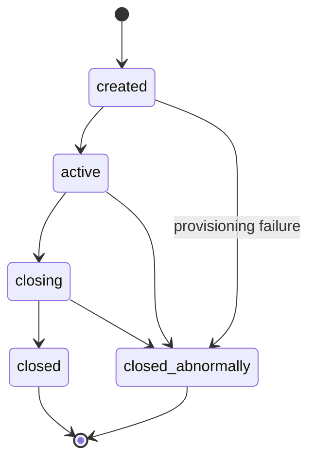
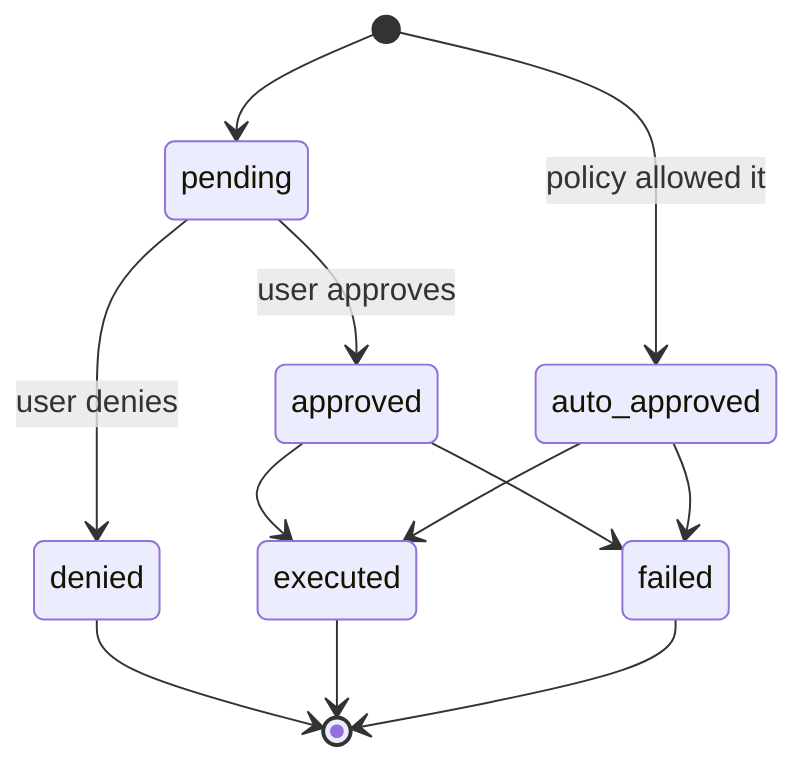
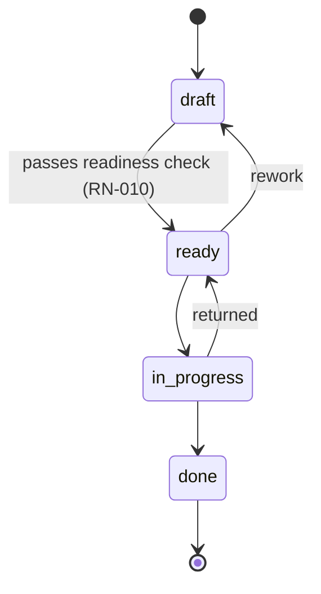
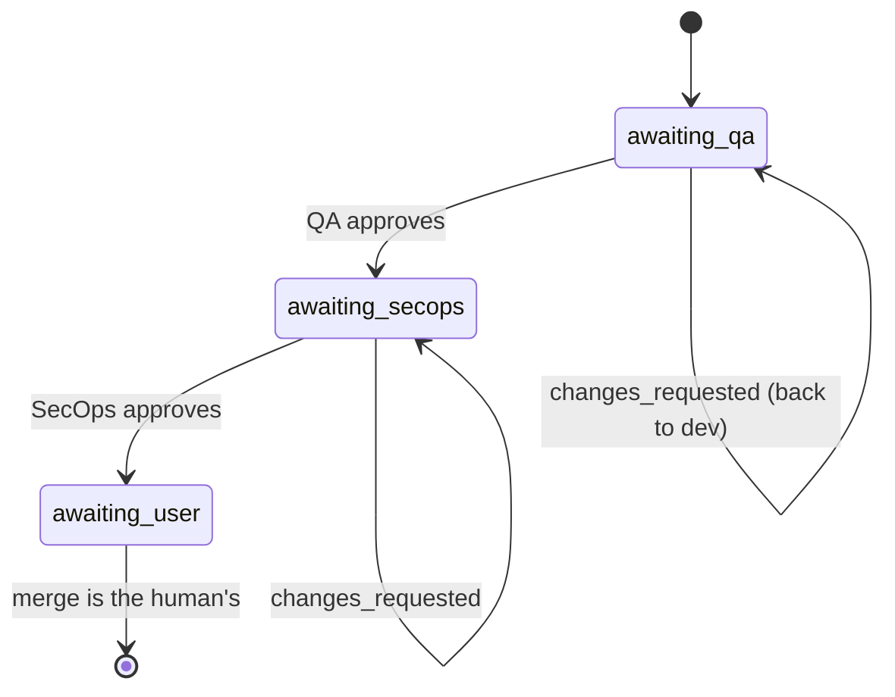

# API

## 会话

Brabo 通过 AI 智能体执行工程工作。有两股力量几乎塑造了这里的每一条规则：

**智能体在构造上就不可信。** 它是语言模型：可能产生幻觉、陷入循环，或请求具有破坏性的操作。这些规则的存在，是为了让可能的损害由结构来约束，而不是由提示词的质量来约束。

**花费是真实且持续的。** 每一轮都会消耗付费 token。预算、上限和计量不是行政上的便利——它们是阻止智能体循环变成亏损的东西。

### 参与者

| 参与者 | 是谁 | 权限 |
|---|---|---|
| **用户** | 人。角色：`viewer`、`developer`、`maintainer`、`owner` | 对任何具有外部效果的操作拥有最终决定权；合并专属于用户 |
| **智能体** | 带有角色的长时运行进程（Criativo、PO、Arquiteto、Dev、Infra、QA、SecOps、Psicólogo、Anamnese） | 提议；从不单独决定策略不允许的事 |
| **系统** | api 和 engine | 执行策略、记录事件、计量成本 |

词汇见[术语表](../glossary.md)。

---

## 业务背景

### RN-001 — 会话有五种状态和封闭的转换 {#rn-001}

`created → active → closing → closed`，`closed_abnormally` 可从任何非终止状态到达。**从 `closing` 永远无法回到 `active`**，终止状态没有出口。



- **位置：** `apps/api/src/domain/sessions/session-state-machine.ts:29`
- **测试：** `test/domain/sessions/session-state-machine.spec.ts`
- **边界情况：** `closing` 是**过渡**状态。卡在那里的会话意味着排空已开始但未完成——对此有告警，见[运维手册](../runbook.md)。

### RN-002 — 每个会话事件都不可变，且 `seq` 是稠密的 {#rn-002}

`session_events` 上永远没有 `UPDATE`。`seq` 在每个会话内唯一（`unique(session_id, seq)`）且没有空洞：从 1 开始并连续。

- **位置：** `apps/api/src/db/schema/sessions.ts`（表 `session_events`）
- **测试：** 在恢复时校验——如果
  `count(*) ≠ max(seq) − min(seq) + 1` 或 `min(seq) ≠ 1`，`docker/backup/restore.sh` 会失败
- **原因：** 正是它让 Psicólogo 的证据可追溯、让备份可校验。需要变化的状态存放在旁边它自己的表里。

## 操作审批

系统的核心。每个具有外部效果的操作都以
`proposed_action` 的形式诞生。

### RN-003 — 操作有六种状态，denied 是终止状态 {#rn-003}



- **位置：** `apps/api/src/domain/actions/action-state-machine.ts:36`
- **测试：** `test/domain/actions/action-state-machine.spec.ts`
- **边界情况：** 已批准并执行的操作变为 `executed`，**而不是**仍然是 `approved`。按 `status = 'approved'` 统计批准数会得到错误的数字——正确的标准是 `decided_by IS NOT
  NULL`。

### RN-004 — 决定分三个阶段评估，`deny` 立即胜出 {#rn-004}

顺序：**(a) IAM → (b) `agent_autonomy` → (c) `permissions.json`**。每个阶段只能**提高**宽松度；沉默的阶段永远不会降低前一个阶段。任何阶段的 `deny` 都立即返回。

- **位置：** `apps/api/src/domain/actions/decide.ts:118`
- **测试：** `test/domain/actions/decide.spec.ts`（10 KB——领域中最大的）

### RN-005 — 每种操作类型的最低角色 {#rn-005}

在任何策略之前是 IAM：每个 `ActionType` 都要求一个最低有效角色。不满足时，`deny` 并给出明确理由。

- **位置：** `apps/api/src/domain/actions/decide.ts:110`（`MIN_ROLE_FOR_ACTION_TYPE`）
- **测试：** `test/domain/actions/decide.spec.ts`

### RN-006 — 上限：合并到受保护分支永远不可自动批准 {#rn-006}

`dev`、`qa`、`rc` 和 `main` 是受保护的。目标为其中之一的 `git_merge` 在所有策略运行**之后**从 `auto_approve` 降级为 `require_approval`。`agent_autonomy` 和 `permissions.json` 都不能提升它。

`rc` 即使在该步骤离开策略（[ADR 0030](../adr/0030-politica-de-branches-mecanizada.md)）且引导程序不再创建它（[RN-029](#rn-029)）之后仍留在列表中。这个列表决定锁**拒绝**什么，而由早期版本引导的仓库仍然有这个分支：保护一个不存在的分支没有代价；取消保护一个存在的分支代价高昂。

- **位置：** `apps/api/src/domain/actions/decide.ts:498`（`isProtectedBranch`，合并锁的上限）+ `protected-branches.ts:4`
- **测试：** `test/domain/actions/decide.spec.ts`
- **来源：** [ADR 0011](../adr/0011-infra-dev-agents-worktrees-merge-lock.md) §1
- **注：** **平台上**（GitHub/GitLab）的等效保护在不同提供方之间存在差异，并不是 gate——见
  [ADR 0028](../adr/0028-protecao-de-branch-divergencia-entre-providers.md)。

### RN-007 — 上限：指令补丁永远不可自动批准 {#rn-007}

修改智能体的指令总是需要人的决定。该功能的价值在于人看到 diff；自动批准就等于智能体在改写自己。

- **位置：** `apps/api/src/domain/actions/decide.ts:168`
- **测试：** `test/domain/actions/decide.spec.ts`
- **来源：** [ADR 0016](../adr/0016-anamnese-proficiencia-patches-instrucao.md) §8

### RN-008 — 命令匹配按模式，而非子串 {#rn-008}

`permissions.json` 以结构化模式匹配终端命令，命令经过正确的分词——而不是用 `includes()`。

- **位置：** `apps/api/src/domain/actions/command-matcher.ts`
- **测试：** `test/domain/actions/command-matcher.spec.ts`

---

## Backlog

### RN-009 — 用户故事有四种状态，`done` 是终止状态 {#rn-009}

`draft → ready → in_progress → done`。允许返工：`ready → draft` 和
`in_progress → ready`。



- **位置：** `apps/api/src/domain/backlog/story-state-machine.ts:27`
- **测试：** `test/domain/backlog/story-state-machine.spec.ts`

### RN-010 — `draft → ready` 需要四样东西，在领域中校验 {#rn-010}

要让用户故事变为 `ready`，它需要以下**全部**：

1. `dod` 非空——完成的定义（Definition of Done）
2. `dor` 非空——就绪的定义（Definition of Ready）
3. 至少 1 条功能需求（`rf`）
4. 至少 1 条关联的业务规则（`businessRuleIds`）

错误会**准确说出缺少什么**，而不是笼统的“无效”。

- **位置：** `apps/api/src/domain/backlog/story-readiness.ts:39`
- **测试：** `test/domain/backlog/story-readiness.spec.ts`
- **来源：** [ADR 0009](../adr/0009-agente-po-backlog-rastreabilidade.md) §3
- **原因：** 正是它阻止 PO 把一个含糊的用户故事丢进 dev 队列。

### RN-011 — 没有用户故事的业务规则是发现，不是错误 {#rn-011}

规则→用户故事的覆盖是计算出来的，没有用户故事的会显示为**待处理**——是信息，不是失败。

- **位置：** `apps/api/src/domain/backlog/coverage.ts`
- **测试：** `test/domain/backlog/coverage.spec.ts`

### RN-013 — 模块图不能有环 {#rn-013}

- **位置：** `apps/api/src/domain/architecture/module-graph.ts`
- **测试：** `test/domain/architecture/module-graph.spec.ts`

---

## PR Gates

### RN-014 — gate 顺序不可变，`awaiting_user` 是终止状态 {#rn-014}

`awaiting_qa → awaiting_secops → awaiting_user`。批准 QA **永远不会**直接跳到用户。`changes_requested` 把它送回给 dev，**在同一分支上**，不新建 PR。



- **位置：** `apps/api/src/domain/execution/pr-gate-state-machine.ts:24`
- **测试：** `test/domain/execution/pr-gate-state-machine.spec.ts`
- **来源：** [ADR 0013](../adr/0013-gates-qa-secops-pr.md) §1
- **边界情况：** `awaiting_user` **按设计**是终止状态——系统永远不合并（RN-006）。

### RN-015 — 循环 K：修正上限是有限的且可继承 {#rn-015}

每次 gate 退回都消耗一圈。上限耗尽后，任务会带着原因被**阻塞**，而不是永远打转。由并行化创建的子智能体**继承**基础智能体的上限。

自第 8b 阶段起，上限也适用于 QA 领域，无需改代码：`QaLeadServer` 是 `record_gate_verdict` 的唯一调用方，因此一轮 gate——无论其下咨询了多少专业——仍然恰好只消耗**一**圈。见
[RN-036](engine.md#rn-036)。

- **位置：** `DEFAULT_MAX_GATE_CORRECTIONS = 3`，位于
  `apps/api/src/application/use-cases/execution/record-gate-verdict.use-case.ts:21`；
  在 `activate-execution.use-case.ts:89` 中应用，在 engine 中于
  `qa_lead_server.ex:268` 和 `secops_agent_server.ex:142` 中应用
- **测试：** `apps/engine/test/engine/gates/qa_automacao_agent_test.exs`
  （专业返回 `{:blocked, ...}` 而不调用 api）
  和 `qa_lead_server_test.exs`（在这种情况下 Lead **从不**调用
  `record_gate_verdict`——正是这一点防止修正次数被白白消耗）
- **来源：** [ADR 0017](../adr/0017-lock-de-workspace-e-monitor-de-dev-agents.md) §4

### RN-017 — 预算的范围是互斥的：项目**或**会话 {#rn-017}

一个 `budget` 引用一个项目或一个会话，绝不同时引用两者——由数据库中的 `check` 保证，而不只是代码。

- **位置：** `apps/api/src/db/schema/llm.ts`（`budgets_scope_check`）
- **测试：** 约束本身就是保证

### RN-018 — 预算在 70%、90% 和 100% 时通知，不重复 {#rn-018}

每个阈值**只触发一次**；最后一次通知的阈值持久化在
`budgets.last_threshold_notified` 中。

- **位置：** `apps/api/src/domain/llm/budget-threshold.ts:1`
- **测试：** `test/domain/llm/budget-threshold.spec.ts`

### RN-019 — `policy = 'block'` 拒绝调用；`'allow'` 只做记录 {#rn-019}

- **位置：** `apps/api/src/domain/llm/budget-threshold.ts:4`
- **边界情况：** 处于 `allow` 的项目在达到上限时**不会停下**。这是"预算没拦住"最常见的原因——见
  [runbook](../runbook.md)。

### RN-020 — 模型按级联解析，从最具体到最一般 {#rn-020}

`session > agent > area > project > workspace`。第一个存在的胜出。`area` 在 FASE 23 加入——关于它的位置，以及对已经读过这个级联的人有什么变化，见 [RN-102](#rn-102)。

- **位置：** `apps/api/src/domain/llm/binding-resolver.ts`
- **测试：** `test/domain/llm/binding-resolver.spec.ts`

## Psicólogo 与 Anamnese

### RN-021 — 没有有效证据的假设不被记录 {#rn-021}

`evidenceEventIds` 必须指向**存在且属于被分析会话**的事件。校验按批次原子进行：一个无效 id 使整批失败。

- **位置：** `apps/api/src/domain/psychologist/hypothesis-evidence.ts`
- **测试：** `test/domain/psychologist/hypothesis-evidence.spec.ts`
- **来源：** [ADR 0015](../adr/0015-psicologo-real-toolloop-hipoteses-evidencia.md) §3

### RN-022 — 假设的生命周期是比较并交换 {#rn-022}

`proposed → accepted | dismissed`。对同一假设的两个并发决定：一个胜出，另一个收到冲突——不是 500，也不是沉默。

- **位置：** `apps/api/src/domain/psychologist/hypothesis-lifecycle.ts`
- **测试：** `test/domain/psychologist/hypothesis-lifecycle.spec.ts`
- **来源：** [ADR 0022](../adr/0022-fechamento-4b-psicologo.md) §7

### RN-024 — Anamnese 只对目录中的能力建立画像——结构性护栏 {#rn-024}

过程能力是**六种**，封闭的：`git`、`agile`、`arquitetura`、
`testes`、`seguranca`、`infra`。再加上从
`module_map` 推导出的技术栈。任何其他东西——“焦虑”、“心理健康”——**没有写入路径**：它是领域中的错误，而不是提示词指令。

- **位置：** `apps/api/src/domain/anamnese/competency-catalog.ts:16`
- **测试：** `test/domain/anamnese/competency-catalog.spec.ts`
- **来源：** [ADR 0016](../adr/0016-anamnese-proficiencia-patches-instrucao.md) §1
- **原因：** Anamnese 画像的是**技术能力**，而不是人。限制是结构性的，因为提示词指令不是保证。

### RN-025 — 删除画像就是真正删除，而 opt-out 阻止重新推导 {#rn-025}

- **位置：** `apps/api/src/domain/anamnese/proficiency-profile.entity.ts` +
  表 `anamnese_opt_outs`
- **来源：** [ADR 0016](../adr/0016-anamnese-proficiencia-patches-instrucao.md) §2

### RN-026 — 被拒绝的指令补丁不会被重新提议 {#rn-026}

比较针对的是**规范化**后的内容，而不是字面文本：重新缩进同一个补丁不会把它变成新提议。没有去重表——来源是 `actionType =
instruction_patch` 且 `status = denied` 的 `proposed_action` 自身的历史。

- **位置：** `apps/api/src/domain/instructions/patch-dedup.ts:22`
- **测试：** `test/domain/instructions/patch-dedup.spec.ts`

### RN-027 — 指令回滚是**向前**的操作 {#rn-027}

回退会用旧内容创建一个新版本；不删除历史。版本表只追加。

- **位置：** `apps/api/src/domain/instructions/`
- **来源：** [ADR 0016](../adr/0016-anamnese-proficiencia-patches-instrucao.md) §4

---

## Git

### RN-029 — Gitflow 引导是幂等且可恢复的 {#rn-029}

五个步骤；每一步在行动前先检查，并可从失败的位置恢复。`skip` 是成功，不是错误。

过去是六个。第六个创建 `rc` 分支，这是
[ADR 0030](../adr/0030-politica-de-branches-mecanizada.md) 从策略中移除的一级——引导程序继续创建、保护并**在用户的仓库中记录**一个产品早已放弃的阶梯（第一次 dogfooding 的第 3 号发现）。值 `create_rc_branch` 仍保留在 `bootstrap_step` 枚举中：旧行引用了它，而真实发生过的步骤不会从历史中抹去。

- **位置：** `apps/api/src/application/use-cases/git/bootstrap-steps.ts` +
  `domain/git/repo-bootstrap.entity.ts`（`RETIRED_BOOTSTRAP_STEPS`）
- **测试：** `test/domain/git/repo-bootstrap-status.spec.ts`
- **来源：** [ADR 0005](../adr/0005-repo-bootstrap-idempotent-steps.md)

---

### RN-030 — 重新出示已使用过的 refresh 会吊销整个家族 {#rn-030}

每次 refresh 都会消耗所出示的 token，并签发一个具有**相同** `family_id` 和相同 `family_started_at` 的子 token。出示一个已被消耗的 token 是盗用的特征——有人在使用副本——回应是吊销该家族所有存活的 token，并产生安全事件。

合法用户也会一并被登出。这是正确的行为，而不是缺陷：在服务器一侧，客户端的重复提交与窃贼的重放是完全相同的。

- **位置：** `apps/api/src/domain/auth/refresh-token.ts:50` +
  `application/use-cases/auth/refresh.use-case.ts:98`
- **测试：** `test/application/use-cases/auth/rotacao-e-reuso.spec.ts`
- **边界情况：** 出示**已被吊销**家族的 token 的人是下游受害者，而不是新的盗用：记录 `refresh_revoked`，**不**触发第二次级联。没有这个区分，在事件期间合法用户的每个标签页都会产生一次误报。
- **来源：** [ADR 0031](../adr/0031-auth-first-party-argon2id-e-rotacao-de-refresh.md)

### RN-031 — 登录失败按邮箱和按 IP 计数，锁定逐级升级 {#rn-031}

Postgres 中 15 分钟的滑动窗口，不用 Redis。每次尝试两个桶，更严格的胜出：邮箱（5 次失败 → 30s，8 → 5min，12 →
15min）和 IP（20 → 30s，30 → 2min）。成功登录会清空邮箱的桶；IP 的桶只随时间排空。

桶的键是**规范化后的邮箱**，绝不是用户 id。用 id 的话，桶只有在找到账户之后才会存在，锁定本身就会成为账户存在性的预言机。

- **位置：** `apps/api/src/domain/auth/lockout-policy.ts:97` +
  `infrastructure/persistence/drizzle/drizzle-login-throttle.ts:74`
- **测试：** `test/application/use-cases/auth/lockout.spec.ts`
- **边界情况：** 处于锁定期间，尝试**不**被记录。如果被记录，攻击者只要不断尝试就能让受害者的账户永远被锁住——锁定会变成针对它所保护之人的拒绝服务。
- **原因：** IP 的桶不能在成功时清空；拥有一个有效账户的人可以随意把窗口清零，无限制地喷洒猜测。
- **来源：** [ADR 0031](../adr/0031-auth-first-party-argon2id-e-rotacao-de-refresh.md)

### RN-032 — 没有任何响应能区分账户存在与否 {#rn-032}

任何不同于统一失败的响应，都只有在一次成功的密码校验**之后**才可能得到。在登录中，不存在的邮箱、错误的密码和被锁定的账户返回相同的 401，耗费相同的时间——没有账户的分支会对照一个用与真实哈希**相同参数**生成的虚拟哈希进行校验。在注册和重置请求中，已知和未知的地址都返回 202。

- **位置：** `apps/api/src/application/use-cases/auth/login.use-case.ts:79` +
  `register.use-case.ts:74`
- **测试：** `test/application/use-cases/auth/enumeracao.spec.ts`
- **边界情况：** 按邮箱的锁定检查在 argon2 **之后**运行，而不是之前。提前退出是任何审阅者都会建议的优化，而它恰恰就是泄漏——如果有人引入它，测试会变红。
- **边界情况：** 从 Keycloak *迁移*来的用户（存在于 `users` 中，在 `auth_credentials` 中没有行）同样收到统一的 401——并且"设置密码"的链接会被静默发出。响应 `password_pending` 会确认该地址存在**并且**是遗留账户。这就是为什么 `findByEmail` 是单次查询中的 LEFT JOIN：两次串联的查询会让这个分支多付一次数据库往返，时钟就会泄露响应体所隐藏的东西。
- **原因：** 所断言的是"没有任何分支跳过昂贵的工作，也没有任何分支产生可区分的响应"，**而不是**常数时间。后果见 ADR。
- **来源：** [ADR 0031](../adr/0031-auth-first-party-argon2id-e-rotacao-de-refresh.md)，
  迁移用户的边界情况见
  [ADR 0032](../adr/0032-corte-do-keycloak-e-sessao-em-cookie.md)

### RN-033 — 验证和重置 token 只能使用一次 {#rn-033}

通过带 `returning` 的条件 UPDATE 消耗：UPDATE 本身就是防护。零行涵盖不存在、用途不同、已消耗、已作废和已过期——都给出相同的响应。请求新链接会作废之前的链接。完成重置会吊销用户的**所有**会话，并且不签发 token。

- **位置：** `apps/api/src/infrastructure/persistence/drizzle/account-token.repository.ts:76`
- **测试：** `test/application/use-cases/auth/tokens-de-conta.spec.ts`
- **边界情况：** 两次同时提交不会都通过。竞争是**正常**情形，而不是例外：企业邮件扫描器会打开每封邮件中的每个链接，因此机器人通常在人点击之前就消耗了 token。
- **原因：** 重置刻意不签发会话——直接通过邮件收到的链接登录，会让攻破邮箱等同于接管账户，而没有第二步。
- **来源：** [ADR 0031](../adr/0031-auth-first-party-argon2id-e-rotacao-de-refresh.md)

### RN-034 — web 会话存在于带 CSRF 的 httpOnly cookie 中 {#rn-034}

refresh token 放在 cookie `brabo_refresh` 中（`httpOnly`、`SameSite=Strict`、
`Path=/auth`，生产环境中 `Secure`），并且**不**出现在任何响应体中。15 分钟的 access token 保存在客户端内存中，通过
`Authorization: Bearer` 传输。

`/auth/refresh` 和 `/auth/logout` 要求 `X-CSRF-Token` 等于 cookie
`brabo_csrf`，以常数时间比较。

- **位置：** `apps/api/src/interfaces/http/auth/session-cookies.ts:53` +
  `interfaces/http/auth/auth.controller.ts`
- **测试：** `test/interfaces/session-cookies.spec.ts`
- **边界情况：** CSRF 失败是 **403**，不是 401。如果是 401，客户端会尝试续期会话并陷入循环——凭据是好的，错的是请求。
- **原因：** 在响应体中也返回 refresh 会抵消 `httpOnly`——一个 XSS 读取登录响应就够了，它会带走长期会话，而不是 access 的 15 分钟。
- **来源：** [ADR 0032](../adr/0032-corte-do-keycloak-e-sessao-em-cookie.md)

### RN-035 — engine ↔ api 的内部流量要求服务密钥 {#rn-035}

32 条 `/internal/*` 路由都是 `@ServiceRoute()`：它们位于用户 JWT 之外，也位于速率限制之外。认证的是 `EngineServiceGuard`，以常数时间比较
`X-Brabo-Service-Token` 与 `BRABO_SERVICE_TOKEN`。同一个秘密在两个方向上都有效，`BRABO_SERVICE_TOKEN_PREVIOUS` 只在校验时被接受，使轮换没有不可用的窗口。

- **位置：** `apps/api/src/interfaces/http/auth/engine-service.guard.ts:44` +
  `infrastructure/security/service-token.ts` +
  `apps/engine/lib/engine_web/plugs/verify_service_token.ex`
- **测试：** `apps/engine/test/engine_web/plugs/verify_service_token_test.exs`、
  `test/interfaces/route-surface.spec.ts`，以及针对 api 一侧的轮换（之前的值只在校验时被接受，调用方发送当前值，移除之前的值后旧值失效）的 `test/infrastructure/security/service-token.spec.ts`
  （describe "rotação do BRABO_SERVICE_TOKEN"）和
  `test/interfaces/engine-service.guard.spec.ts`（[RN-597](#rn-597)）
- **边界情况：** 速率限制的豁免来自路由的*元数据*，而不是 guard。`RateLimitGuard` 是 `APP_GUARD`，在任何 controller 的 guard 之前运行——它作出决定时，`EngineServiceGuard` 还没有运行。
- **来源：** [ADR 0032](../adr/0032-corte-do-keycloak-e-sessao-em-cookie.md)

### RN-038 — workspace 摘要中计数的 agent = 本月花费了 token {#rn-038}

项目仪表板的摘要（"N 个活跃项目 · M 个 agent · 本月花费"）把在当月 `token_usage` 中至少有一行 `actor_kind = 'agent'` 的执行者计为"agent"，汇总 workspace 的所有项目。没有 `actor_kind` 过滤器，发送聊天的 `user` 或记录使用的 `system` 会让计数膨胀——`token_usage` 为任何类型的执行者记录，而不只是 agent。按月截断使用
`created_at >= date_trunc('month', now())`；只在上个月工作过的 agent 不计入，即使它仍出现在某个会话的名册中。计数自然包括 Fase 8 的区域子专业（`qa-automacao`、`qa-performance-seguranca`、`infra-workflows`）：每个在花费 token 时都有自己的 `actor_id`。

- **位置：** `apps/api/src/infrastructure/persistence/drizzle/token-usage.repository.ts`
  （`summarizeForWorkspaceThisMonth`）
- **测试：** `test/application/use-cases/iam/get-workspace-summary.use-case.spec.ts`

---

### RN-040 — agent 的 binding 要求原生 tool calling {#rn-040}

只有当模型具备 `supports_tool_calling` 时，才允许把模型绑定到**agent**（`scope = 'agent'`）。agent 只存在于 ToolLoop 之内，而 ToolLoop 只有在模型懂得**请求**工具时才能工作；否则失败会在后面表现为"agent 没做完就停了"，这正是
[ADR 0020](../adr/0020-destravar-gates-qa-secops.md) 所禁止的排除法诊断。拒绝是 422，消息指向**"适用于 agent"**过滤器——没有这个指引，规则就成了死胡同。

engine 的 `ToolCallRecovery` 会挽回模型以散文写出的调用，但它是**救援，而不是许可**：它依赖模型碰巧写对格式。

只有 `agent` 做校验。`workspace` 和 `project` 是人工聊天的回退，`session` 是对话——它们都不运行 ToolLoop，锁住它们会禁止产品中只能聊天的模型。`context-manager` agent 在构造上已被覆盖：它是 `agent` 范围*之内*的一个 slug，而不是一个独立的范围。

**附加说明——过滤器改为默认*勾选*，而打开它的是*范围*。** 上面一段说拒绝指向"适用于 agent"过滤器，"否则规则就成了死胡同"——而很长一段时间里它确实是：让选择器在打开时勾选过滤器的 prop 从 Fase 9c 起就存在，却**没有任何生产界面传递它**。agent 的选择器打开时提供只能聊天的模型，点击它们只是为了被拒绝。写入经校验范围的两个界面改为打开时即过滤——`ModelsSection`（agent）和
`ModelsSection`（区域）——，而决定谁打开它的尺子不是界面，而是
`assertModelFitsBindingScope`：api *拒绝*的地方，过滤器默认勾选；api 不拒绝的地方，由人来选择。因此*会话*选择器仍然没有过滤——在那里勾选会隐藏 api 接受的模型。**这并不消除 422**：过滤器只覆盖三个原因之一，另外两个（[RN-043](#rn-043)——在 workspace 中被停用、从提供方消失）仍然可能出现，不可用的模型仍会被*列出*并标记；[RN-470](web.md#rn-470) 的拒绝结果仍然是说明发生了什么的东西。而且它是复选框的*初始*状态，不是锁：取消勾选就会重新列出全部。

**后果：被过滤器隐藏的现行模型会被*说出来*。** `workspace` 和
`project` 从未要求 tool calling，而解析 agent 或区域 binding 的路由调用 `ResolveModelBindingUseCase` 时**不带**
`exigeToolCalling`——因此这些层级上只能聊天的默认值会被正常解析，成为该行的现行模型。在过滤器勾选时，触发器显示的名称不在打开的列表中，也没有任何选项被选中。选择器现在会点名该模型和原因；它*可以*点名原因，因为那里只有一个过滤器。当整个列表都为空时，说话的仍然是空列表文本，它已经让人取消勾选——关于同一个复选框的两条提示只是噪音。

**事实更正，而不是对上文的更正：**"Only `agent` validates" 描述的是 Fase 9a。自 [ADR 0064](../adr/0064-escopo-de-area-na-cascata-e-o-binding-de-agente-global.md) 起，
`area` 进入*同一*校验——它不是通用回退，区域模型唯一的消费者是该区域的 agent（[RN-102](#rn-102)）——，这就是打开过滤器的界面有*两个*的原因。

- **位置：** `apps/api/src/domain/llm/model-capabilities.ts:38`；
  `apps/web/src/components/ModelPicker.tsx`（过滤器和隐藏现行模型的提示），`apps/web/src/routes/settings/ModelsSection.tsx`、
  `apps/web/src/routes/settings/ModelsSection.tsx`（打开它的界面）
- **测试：** `test/domain/llm/model-capabilities.spec.ts`、
  `test/application/use-cases/llm/set-model-binding.use-case.spec.ts`；
  `apps/web/src/routes/settings/filtro-de-aptos.test.tsx` 和
  `apps/web/src/routes/SessionPage.filtro-de-aptos.test.tsx`（打开过滤器的两个界面，以及不打开的那个）
- **来源：** [ADR 0041](../adr/0041-base-openai-compativel-e-contrato-de-llm-providers.md)

### RN-041 — 提供方未给出的 token 计数被标记为估算 {#rn-041}

当提供方的响应不含 `usage` 时，OpenAI 兼容基类用 tokenizer 在本地计数，并以
`estimated: true` 发出 chunk。这个数字仍可用于计费，但这个标记保留了**"提供方说是零"**与**"提供方什么也没说"**之间的区别——正是它让 UI 能够限定成本，而不是显示一个来历不明的值。

另外两个提供方有分歧，而分歧被规范化，而不是被隐藏：Ollama 在没有 `done` 行时干脆不发出 `usage`；Anthropic 不能省略计数，因为在其协议中 `usage` 在
`message_start` 里是必需的。三种响应见
[docs/reference/llm-providers.md](../reference/llm-providers.md#normalized-divergences)。

- **位置：** `apps/api/src/infrastructure/llm/openai-compatible-provider.ts:167`
- **测试：** `test/contract/llm-provider.contract.ts`（场景
  `sem_usage`，针对三个提供方运行）
- **来源：** [ADR 0041](../adr/0041-base-openai-compativel-e-contrato-de-llm-providers.md)

### RN-042 — 计量记录*实际服务*调用的是谁，而不只是调用从哪里进入 {#rn-042}

当调用经过一个会告知真实提供方的 hub 时，`token_usage` 除了入口提供方外，还在 `upstream_provider` 中记录该提供方。没有 hub——或 hub 没有告知——时，该字段是**`null`**，绝不是空字符串：按提供方统计成本的查询需要区分"没有经过 hub"和"经过了 hub 但 hub 没说"。

在指标中，没有 hub 时 `upstream_provider` 标签重复提供方本身，因此 `sum by (upstream_provider)` 仍然汇总全部成本。

- **位置：** `apps/api/src/application/use-cases/llm/record-llm-usage.use-case.ts:73`
- **测试：** `test/application/use-cases/llm/record-llm-usage.use-case.spec.ts`
- **来源：** [ADR 0041](../adr/0041-base-openai-compativel-e-contrato-de-llm-providers.md)

### RN-043 — 新发现的模型以停用状态进入；消失的模型被标记，从不删除 {#rn-043}

目录同步有三种结果，没有一种是破坏性的：

1. **新模型**进入时**在任何 workspace 中都没有策展行**，而没有行*就是*停用状态。一个提供方的目录有数百行——把它们全部作为激活状态倒进来会让选择变得不可能，并在没有任何人决定的情况下打开一个昂贵的模型。激活是 owner 的策展，只在他的 workspace 中有效（[RN-052](#rn-052)）。
2. **从远程目录中消失的模型**获得
   `availability = 'unavailable'`，并**留在表中**：
   `model_bindings` 和 `token_usage` 指向这一行，删除它会把成本历史一起带走。
3. **回来的模型**恢复为 `available`，策展**保持不变**——owner 的选择能挺过提供方的暂时缺席。

两个维度刻意相互独立：策展是一个人的决定，`availability` 是对提供方的观察。谁都不写入对方——而自 [ADR 0049](../adr/0049-curadoria-de-modelo-por-workspace.md) 起，它们甚至不在同一张表中，因此同步即使想覆盖，也没有策展字段可以覆盖。

对系统其余部分有三个后果：

- 对停用或不可用模型的**新** binding 在领域中被拒绝（`ModelNotBindableError`，422）。已有的 binding 保留；
- `resolveBinding` 的**级联**跳过不可用的候选，把跳过的记录在 `skipped` 中，并且——当回合带有工具时——在*所有*层级重新校验
  `supports_tool_calling`。没有这一点，回退会让 agent 落在只能聊天的模型上，悄无声息地违反 [RN-040](#rn-040)；
- **失败的提供方不会让任何东西变得不可用**：401 是"我不知道那里有什么"，而不是"那里什么都没有"。该提供方被跳过，报告中带有失败的*来源*（`infra` | `modelo`）——绝不是排除法诊断。

- **位置：** `apps/api/src/application/use-cases/llm/sync-model-catalog.use-case.ts:160`,
  `apps/api/src/domain/llm/binding-resolver.ts:63`,
  `apps/api/src/domain/llm/model-capabilities.ts:49`
- **测试：** `test/application/use-cases/llm/sync-model-catalog.use-case.spec.ts`,
  `test/domain/llm/binding-resolver.spec.ts`,
  `test/application/use-cases/llm/set-model-binding.use-case.spec.ts`
- **来源：** [ADR 0042](../adr/0042-catalogo-vivo-ciclo-de-vida-do-modelo-e-preco-auditavel.md)

### RN-044 — 价格从此刻起生效，旧成本仍然可以核对 {#rn-044}

`token_usage` 的每一行都记录产生其 `cost_micros` 的价格。改变模型价格**不会对过去的消耗重新定价**——更进一步：旧成本仍然**可复现**，因为即使在 `models` 表经过三次修正之后，`tokens × 记录的价格` 仍与记录的成本一致。

每次价格变更都在 `model_price_changes` 中写入一行，只追加，带前后对照以及来源（`manual` | `sync`）。这一对值刻意一起记录：从上一行重建"之前"，取决于没有任何写入逃出审计路径，而这恰恰是审计要证明的东西。与当前相同的价格是无操作——一行"从 10 变为 10"会把日志变成噪音。

规则适用于**所有**改变价格的路径，而不只是界面的那条。过去有两种写入会逃过它：目录同步（它通过 `upsert` 改变价格，从未产生领域自 Fase 9c 起就声明的 `sync` 来源）和 `seed.ts`（它在已经 seed 过的数据库上运行——k8s 的 `bootstrap.sh` 中的 `BRABO_FORCE_SEED=1`——因此会悄无声息地修正价格）。两者现在都会审计，seed 复用 `UpdateModelPricingUseCase` 本身。

- **位置：** `apps/api/src/application/use-cases/llm/update-model-pricing.use-case.ts:44`,
  `apps/api/src/application/use-cases/llm/sync-model-catalog.use-case.ts:213`,
  `apps/api/src/db/seed.ts:376`
- **测试：** `test/application/use-cases/llm/update-model-pricing.use-case.spec.ts`,
  `test/application/use-cases/llm/sync-model-catalog.use-case.spec.ts`
- **来源：** [ADR 0042](../adr/0042-catalogo-vivo-ciclo-de-vida-do-modelo-e-preco-auditavel.md)

### RN-045 — 被采纳的仓库只能由已批准的计划修改 {#rn-045}

采纳现有仓库**只诊断不行动**。采纳校验访问（`getRepo`），写入项目的行，并产生一个**计划**：bootstrap 将要做的事情的序列化列表，通过调用每个步骤的 `check()` 获得——与自 [RN-029](#rn-029) 起提供幂等性的是同一个——而从不执行相应的变更。

只要 `repo_bootstraps.plan_decision` 为**空**，就不运行任何变更。闸门位于执行器**之前**，而不是其内部：bootstrap 的 runner 与 Fase 2 的相同，没有过滤器，只是根本不被调用。加上原本就会跳过受保护分支的防护，不存在任何代码路径会在已批准计划之外触碰分支。

两种结果：

- **批准**是全有或全无（批准零散的步骤会破坏
  `dev←main, qa←dev` 的级联）。执行的是在执行时**重新推导**的计划：等于或小于所展示的，**绝不更大**——在此期间变为受保护的分支会被跳过；
- **按现状采纳**免去 bootstrap，记录决定，并且**不**为了假装收敛而移动游标。计划被保存，作为刻意未应用之内容的证据。

对重新生成的计划作出决定会被拒绝（409）：决定携带用户看到的 `planGeneratedAt`，对另一件事说的"是"不算数。

正常的部署流程拒绝（409）在被采纳的仓库中运行——没有这道防护，恢复路径会在没有任何计划的情况下对第三方仓库运行 bootstrap。

**已知限制：**这里的"保护不一致"是有 × 无，因为契约只暴露这么多（`GitBranch.protected` 是布尔值，而
[ADR 0028](../adr/0028-protecao-de-branch-divergencia-entre-providers.md) 推迟了规范化的 `ProtectionPolicy`）。*部分*保护的分支被算作"未保护"，可能被覆盖——但只在已批准的计划之内。

- **位置：** `apps/api/src/application/use-cases/git/decide-bootstrap-plan.use-case.ts`,
  `apps/api/src/application/use-cases/git/bootstrap-plan.ts`,
  `apps/api/src/application/use-cases/git/bootstrap-steps.ts:112`
- **测试：** `test/application/use-cases/git/decide-bootstrap-plan.use-case.spec.ts`,
  `test/application/use-cases/git/bootstrap-plan.spec.ts`
- **来源：** [ADR 0044](../adr/0044-adocao-de-repositorio-existente.md)

### RN-046 — 每个项目仓库都声明其来源 {#rn-046}

`project_repositories.origin` 和 `repo_bootstraps.origin` 说明 Brabo 是**创建**了仓库（`created`）还是**采纳**了一个已存在的（`adopted`）。来源由写入该行的一方显式写入——而不是列的默认值——之后不再改变。

这不是装饰：正是它让产品把 Fase 10 不得不手工完成的事（在 `project_repositories` 和
`repo_bootstraps` 中插入行，让项目指向一个 fork）作为正当情形来处理。`adopted` 仓库有自己的分支策略，不经过部署流程，只按 [RN-045](#rn-045) 被修改。

迁移 `0031` 的回填把所有已存在的都标记为 `created`，并且可以在这一点上盲目：在它之前不存在采纳，因此没有被采纳的行会被错误分类。

- **位置：** `apps/api/src/db/schema/git.ts`, `apps/api/src/db/migrations/0031_special_winter_soldier.sql`,
  `apps/api/src/domain/git/repo-bootstrap.entity.ts`
- **测试：** `test/application/use-cases/git/adopt-repository.use-case.spec.ts`
- **来源：** [ADR 0044](../adr/0044-adocao-de-repositorio-existente.md)

### RN-048 — story 的晋升默认由用户进行；模式改变谁来触发，从不改变校验什么 {#rn-048}

`projects.story_promotion` 选择*谁*把 story 从 `draft` 晋升为
`ready`：

- **`manual`**：PO 把 story 完成后，它保持 `draft`，并带有
  `stories.proposed_ready = true`。**它的任何任务都不可领取**——
  `claimNext` 要求 `story.status = 'ready'`——由用户在 Backlog 中单独或批量地晋升它。
- **`auto`**（自 [RN-659](#rn-659) 起是新项目的默认）：PO 在完成一个完整的 story 时自行晋升它。这是 Fase 12c 之前的行为；`manual` 从 12c 起一直是默认值，直到 RN-659（迁移 `0065`）只改变了列的默认值——中途创建的项目仍为 `manual`。

**模式改变触发器，而不是标准。** 两条路径都经过
`assertPromotable`——就绪性（RF/DoD/DoR/规则）以及对照现行 `module_map` 解析的模块——这正是 `story-promotion.spec.ts` 中的对称性测试所锁定的：对于每个 story，`isPromotable` 都与 `assertPromotable` 抛出的结果一致。在这个阶段之前，校验是重复且不对称的（创建调用 `canBecomeReady`，转换调用 `assertReady` + `assertModulesResolved`）：通往同一状态的两扇门，锁不一样。让触发器可配置，首先需要把它们统一起来，否则"通过 UI 晋升"和"在创建时晋升"会是同名的不同规则。

**不完整**的 story 永远不会被提议。只有当 story 已经能通过校验时，`proposed_ready` 才会打开——提议领域会拒绝的东西，就是把 PO 的工作伪装成决定推给用户。

**拒绝**会把 story 退还给 PO：写入 `returned_reason`/`returned_at`，关闭 `proposed_ready`，发出 `backlog.story_promotion_returned`，并把原因作为*置顶*消息注入 PO 的会话，措辞与退还给 dev 的 gate 的优先级措辞相同（ADR 0020 的教训）。拒绝在与 engine 通信**之前**被记录，engine 失败也不会撤销它——这与 [RN-047](engine.md#rn-047) 中重新武装的顺序相反，理由是：那里事件断言的是*关于* engine 的事情，这里断言的是关于用户的事情，无论是否有值班的 PO 在听，它都是真的。

批量晋升**不是全有或全无**：每个 story 是它自己的事务，在提议和决定之间失去就绪性的 story 会带着原因以 `failed` 返回，而不会拖垮用户刚刚审阅过的其他 story。

`backlog.story_transitioned` 事件记录**真实的执行者**——手动晋升时是 `user`，自动晋升时是 `agent/po`。事件日志是不可变的，也是审计所读取的：在用户的决定中记录 PO，恰恰会抹去规则要交还的那个人工环节。

迁移 `0033` 做的是*有针对性*的回填，而不是盲目的：列以 `manual` 诞生，所有已存在的项目都被移到 `auto`。新的默认值适用于之后来的项目；进行中的项目不能因为一次部署而停止产出。

- **位置：** `apps/api/src/domain/backlog/story-promotion.ts`,
  `apps/api/src/db/migrations/0033_absurd_domino.sql`,
  `apps/api/src/application/use-cases/backlog/promote-stories.use-case.ts`,
  `apps/api/src/application/use-cases/backlog/return-story.use-case.ts`,
  `apps/engine/lib/engine/agents/po_server.ex` (`revision_message/1`)
- **测试：** `test/domain/backlog/story-promotion.spec.ts`（对称性），
  `test/db/story-promotion-migration.spec.ts`（有针对性的回填），
  `test/application/use-cases/backlog/promote-stories.use-case.spec.ts`,
  `test/application/use-cases/backlog/return-story.use-case.spec.ts`,
  `apps/engine/test/engine/agents/po_server_test.exs`（describe `revise/2`）
- **来源：** [ADR 0046](../adr/0046-promocao-de-story-com-autoridade-do-usuario.md)

### RN-049 — 对提议动作的每一个决定都留在事件日志中，并带有决定者 {#rn-049}

`proposed_action.created`、`.approved` 和 `.denied` 是 `session_events` 中的领域事件，此外还有把它们带到 engine 的 outbox 行。outbox **不是**记忆：它被排空，标记 `processed_at`，然后被修剪。

`actor` 是真正作出决定的人——`.approved`/`.denied` 中是**用户**，`.created` 中是提议的 **agent**。而 `created.payload.status` 说明动作是如何诞生的（`pending`、`auto_approved`、`denied`）。

这带来了产生指标的区分：**人工决定 = `proposed_action.approved` 事件**；策略自行决定只出现在带 `status: auto_approved` 和 agent 执行者的 `.created` 中，永远不会与一次点击混淆。这个计数——"批准点击"——正是 Fase 10 想测量却没能测量的，因为决定不存在于可查询的地方（发现 #17）。`approve_always` 算作批准，因为它委托给同一个用例，并在其上发出 `permission.granted`。

出于决定而被排除在外的：仓库 bootstrap 直接向 outbox 发出的 `proposed_action.created`。这些变更已经由同一会话中的 `bootstrap.step_*` 叙述，重复它们会在批准指标中把同一事实计算两次。

- **位置：** `apps/api/src/application/use-cases/actions/propose-action.use-case.ts`,
  `.../approve-action.use-case.ts`, `.../deny-action.use-case.ts`
- **测试：** `test/application/use-cases/actions/approve-deny-action.use-case.spec.ts`
  （describe `the decision in the event log`）
- **来源：** [ADR 0048](../adr/0048-decisao-no-log-e-a-ordem-do-gate.md)

### RN-051 — 手工输入的价格胜过提供方的目录 {#rn-051}

`manual_pricing = true` 的 `models` 行有一个数字，是有人在阅读提供方文档之后输入的。目录同步**不会碰它**——即使远程目录带有自己的价格也一样。schema 一直是这么说的（"同步价格的一方*不能*在没有显式决定的情况下覆盖此处标记的行"），而代码没有这样做：只要远程带有价格，它总是胜出，下一次同步会撤销那个修正了错误数字的人所做的更正。

这条规则之所以存在，是因为对若干提供方来说，输入的数字是**唯一存在的数字**：NVIDIA NIM 和 Bitdeer 在任何文档中都不公布按 token 的价格
（[提供方参考](../reference/llm-providers.md)），seed 的值是市场近似值。让远程目录覆盖它，会在无人决定的情况下用一个近似值换掉另一个已知的近似值。

新模型诞生时，标志来自目录，而不是固定的默认值：**有**价格被发现时，`manual_pricing = false`（来源是同步，由它保持该行最新）；**没有**价格被发现时，`true`——这一行在等人输入一个价格，标记它就已经保护了这个数字，免受第一个决定提供价格的目录覆盖。

- **位置：** `apps/api/src/application/use-cases/llm/sync-model-catalog.use-case.ts`
  （`resolverPreco`），`apps/api/src/db/schema/llm.ts:137`
- **测试：** `test/application/use-cases/llm/sync-model-catalog.use-case.spec.ts`
  (`manually typed price beats a catalog that REPORTS a price`)
- **来源：** [ADR 0042](../adr/0042-catalogo-vivo-ciclo-de-vida-do-modelo-e-preco-auditavel.md)

### RN-052 — 模型策展只在作出决定的 workspace 中有效 {#rn-052}

在选择器中打开或关闭一个模型，是*那个 workspace* 的决定，不会波及邻居。目录本身仍然是全局的——名称、价格、窗口和能力是提供方的事实，对所有人都一样，按 workspace 复制它们会对同一个模型产生 N 个真相，还会把 `token_usage.model_id` 劈成两半。

在此之前，`models.is_active` 是整个安装的一列：点击"激活"的人替所有 workspace 作了决定，界面对此没有任何提示。实际效果是一个 workspace 在另一个 workspace 的选择器中打开了昂贵的模型——花费出现在什么都没决定的人的预算中。

三条派生规则：

1. **没有行就是停用状态。** 没有单独的"从未决定"状态；同步发现的模型没有行，不出现在选择器中（[RN-043](#rn-043)）。
2. **停用是 `UPDATE`，不是 `DELETE`。** 删除这一行也会删除是谁、在何时作出的决定。读取把两种情况都视为未激活；记录是为审计者而存在的。
3. **`agent` 和 `session` 范围不检查策展。** 两者都没有 workspace 锚点——agent 的 binding 是按全局 slug 的。检查收到 `null`，只核对可用性，让缺口显式存在，而不是猜一个 workspace。

- **位置：** `apps/api/src/db/schema/llm.ts`（`workspace_models`），
  `apps/api/src/application/use-cases/llm/set-models-active.use-case.ts`,
  `apps/api/src/application/use-cases/llm/set-model-binding.use-case.ts`
  (`workspaceDoEscopo`)
- **测试：** `test/application/use-cases/llm/set-models-active.use-case.spec.ts`
  (`activating in one workspace does NOT turn on the model in its neighbor`)
- **来源：** [ADR 0049](../adr/0049-curadoria-de-modelo-por-workspace.md)

### RN-053 — 重新激活执行会唤醒停下的 agent，在已存在的会话之内 {#rn-053}

激活一个**已经在执行**的项目的执行，是重新激活，而不是从零开始：它落入当前的执行会话，并唤醒停下的 agent。分两部分，系统两侧各一部分。

**会话被复用。** 激活使用项目中已经带有 `execution.activated` 的 `active` 会话；只有在没有时才创建一个。没有列说明"这是执行会话"——区分它的是它保存的事件，查询的正是这个。关闭会话仍然是重新开始的方式：已关闭的会话不是候选，下一次激活会打开新的。

以前，`create` 是无条件的，而当 agent 已经存活时 engine 会**丢弃**新的 `session_id`。每次点击"激活"都会留下一个活跃会话，它收到 `execution.activated` 之后什么也没有——agent 的事件继续流向上一次激活的会话。

**agent 通过 wake 唤醒，而不是 `work`。** 从零开始会触发循环（`:work`——发出 `dev.started` 并领取任务）。已经存活的 agent 收到 `{:wake, :became_claimable}`，由服务器的状态防护决定：

| agent 状态 | 重新激活做什么 |
|---|---|
| `idle` | 领取下一个任务 |
| `working`, `awaiting_gate`, `awaiting_approval` | 什么都不做——进行中的任务不会被放弃 |
| `idle_tripped` | 什么都不做——只有显式的重新武装能解锁它（[RN-047](engine.md#rn-047)） |

向所有 agent 触发 `:work` 会比缺陷更糟：它无条件领取任务，对处于 `awaiting_gate` 的 agent 而言，意味着丢下 gate 正在扫描的 worktree——而且一次点击就绕过了熔断器。

- **位置：** `apps/api/src/application/use-cases/execution/activate-execution.use-case.ts`,
  `apps/api/src/infrastructure/persistence/drizzle/session.repository.ts`
  (`findActiveExecutionSession`),
  `apps/engine/lib/engine_web/controllers/execution_command_controller.ex`
  (`acordar/4`)
- **测试：** `test/application/use-cases/execution/activate-execution.use-case.spec.ts`
  （describe `reactivation doesn't open an orphan session`），
  `test/infrastructure/persistence/session-execution.repository.spec.ts`,
  `apps/engine/test/engine_web/controllers/execution_command_controller_test.exs`
  （describe `reactivation`）
- **来源：**
  [第一次 dogfooding](../explanation/primeiro-dogfooding.md) 的发现 #11

## PR Gates

### RN-054 — 外部 handoff 指向领域的 lead 或无领域的智能体——永远不指向子智能体 {#rn-054}

**从外部**与一个领域交谈的人与 lead 交谈。指向子智能体（`qa-automacao`、`qa-performance-seguranca`、
`infra-workflows`）的 handoff 会以类型化错误被拒绝，该错误**指出调用方本应指向的 lead**——拒绝却不说出正确路径，只会把一次层级违规换成一个卡住的智能体。

拒绝发生在 INSERT **之前**。之后再拒绝会在表中留下一个幽灵 handoff 和一个 `handoff.offered`——一个不可变的事件——断言一个策略不允许的提议。

内部委派（lead → 子智能体）**不**经过这里：它是领域私有的，有自己的表（`delegations`）和自己的路径
（`RecordDelegationUseCase`）。这条规则关乎领域的外部边界，而不是其内部发生的事。

ADR 0038 要求了这项校验，并点名了位置——
`CreateHandoffUseCase` 是系统中唯一写入
`toAgent` 的地方——但它从未被实现（第一次 dogfooding 的第 12 号发现）。engine 的 `offer_handoff` 把 `to_agent` 作为自由字符串原样传递，因此直到现在都没有任何东西阻止智能体违反层级。

**领域、lead 和成员只有一个来源**，自 FASE 18 起：
`apps/api/src/domain/agents/agent-areas.ts`。该列表过去在三处（api、web、engine）手写，而测试只比较 api 与 web——engine 悄悄地产生了分歧。现在
`apps/web/src/lib/agent-areas.generated.ts` 和
`apps/engine/lib/engine/agents/areas.ex` 由
`pnpm --filter api gerar:areas` 生成，测试会使磁盘上过时的内容失败。
自 AT-046 起，同一生成器还把 `SOLO_CONVERSATIONAL_AGENTS`
（RN-440）写入 web 文件——并且只写那里，因为 engine 没有它的读取方。
该列表仍是**目录**；`agent_areas` 是每个项目的**状态**
（RN-094），两者回答不同的问题。

- **位置：** `apps/api/src/domain/agents/agent-areas.ts`
  （`assertHandoffTargetAllowed`、`HandoffToSubagentError`）、
  `apps/api/src/application/use-cases/agents/create-handoff.use-case.ts`
- **测试：** `test/domain/agents/agent-areas.spec.ts`（规则 + 检查派生副本不偏离来源）、
  `test/application/use-cases/agents/create-handoff.use-case.spec.ts`
  （拒绝时没有行也没有事件）
- **来源：** [ADR 0038](../adr/0038-hierarquia-de-agentes.md)，由[第一次 dogfooding](../explanation/primeiro-dogfooding.md) 的第 12 号发现关闭

---

## 凭据

用户的 LLM 密钥和 git 令牌存放在同一张表中
（`user_credentials`），采用相同的信封加密。本节对两者都适用。

### RN-055 — 凭据总是被加密并保存；验证是单独的操作，有三种答案 {#rn-055}

注册**不评判凭据**：加密并保存，即使提供方会拒绝它。验证是对**已保存**凭据的显式操作——api 解密、调用提供方，只返回判定。明文永远不会出现在任何响应中，不论是片段还是拒绝原因。

过去恰恰相反：注册在持久化之前先测试，并拒绝保存
（[ADR 0004](../adr/0004-git-credential-registration.md)，在第 11a 阶段扩展到 LLM 密钥）。真实的失败模式与预期相反——由于字段是只写的，屏幕从不重新显示输入过的内容，一次拒绝会让用户**既没有凭据，也没有可供修改的文本**。

判定有**三个**值，第三个是必需的：

| | 何时 |
|---|---|
| `ok` | 提供方接受了 |
| `recusado` | 提供方拒绝了——携带**提供方的**理由 |
| `nao_suportado` | 没有经过验证的测试端点（`ollama`、`anthropic`、`openai`） |

没有 `nao_suportado`，一个测试器为空操作的提供方会返回 `ok`，屏幕就会断言一次从未发生的验证。这是
[ADR 0041](../adr/0041-base-openai-compativel-e-contrato-de-llm-providers.md)
的 capability 规则在此处的应用：只声明已被证明的。因此端口声明了
`supports()`——仅凭 `test()` 的沉默是有歧义的。

坏密钥**不是 HTTP 异常**：用例捕获
`LLMCredentialConnectionTestFailedError`/`GitCredentialConnectionTestFailedError`
并以 200 返回结果。唯一的例外是（用户，提供方）没有凭据——404，因为那时没有什么可测试的。

- **位置：**
  `apps/api/src/application/use-cases/credentials/test-stored-credential.use-case.ts`、
  `apps/api/src/application/use-cases/llm/upsert-user-credential.use-case.ts`、
  `apps/api/src/application/use-cases/git/register-git-credential.use-case.ts`、
  `apps/api/src/application/ports/llm-credential-connection-tester.port.ts`
  （`supports`）
- **测试：**
  `test/application/use-cases/credentials/test-stored-credential.use-case.spec.ts`
  （三种结果、git×LLM 分派、404 以及响应中不含密钥）；`test/application/use-cases/llm/upsert-user-credential.use-case.spec.ts`
  和 `test/application/use-cases/git/register-git-credential.use-case.spec.ts`
  （无条件保存，即这次反转）
- **来源：** [ADR 0050](../adr/0050-credencial-sempre-cifrada-verificacao-explicita.md)

---

### RN-056 — 能力的分面来自提供方；沉默保留原有的值 {#rn-056}

`supports_vision`、`supports_reasoning` 和 `generates_image` 是**提供方的事实**，而不是意见：它们在同步时来自远程目录，回退与 `supports_tool_calling` 相同——远程，然后本地，然后 `false`。

在 OpenRouter（目前唯一公布这些的）中，三者来自：
`architecture.input_modalities` 包含 `image`，
`supported_parameters` 包含 `reasoning`，以及
`architecture.output_modalities` 包含 `image`。接受图像和**生成**图像是不同的维度：把它们合并会把用户送到错误的模型。

以前，同步从已*写入*的数据读取 `supportsVision`，从不查询远程——该列以 `false` 诞生，没有途径变为 true。第一次真实同步的 338 个模型全部为 `false`，包括提供方声明为多模态的 181 个。

**没有声明不等于声明没有**
（[ADR 0041](../adr/0041-base-openai-compativel-e-contrato-de-llm-providers.md)）：当提供方沉默时，解析器*省略*该字段，`undefined` 保留本地值。因此界面只把分面用作*正向*过滤器，从不写"不能读图"——这里的 `false` 意味着"提供方没有声明"。

- **位置：** `apps/api/src/infrastructure/llm/openrouter-provider.ts`
  （`temModalidade`、`parseCatalogoOpenRouter`），
  `apps/api/src/application/use-cases/llm/sync-model-catalog.use-case.ts`,
  `apps/api/src/db/schema/llm.ts`（`models`）
- **测试：**
  `test/infrastructure/llm/openrouter-provider.contract.spec.ts`
  （`modalidade não declarada OMITE o campo em vez de afirmar false`）；
  `test/application/use-cases/llm/sync-model-catalog.use-case.spec.ts`
  （`catálogo que se cala sobre modalidade preserva a faceta gravada`）
- **来源：** [ADR 0051](../adr/0051-facetas-de-capability-e-curadoria-por-uso.md)

### RN-057 — "用途"是 workspace 的策展，标记用途不会打开模型 {#rn-057}

没有任何提供方的目录公布"适合写代码"。这是**操作者的意见**，在使用中发现——因此它位于 `workspace_models.uses`，与 workspace 的另一个决定（[RN-052](#rn-052)）并列，而不是在 `models` 中。

*封闭*的词汇——`codigo`、`documentacao`、`analise`、`imagem`、
`conversa`——，两侧都有编译期的穷尽性证明。自由文本会在一周内让 `code`、`coding` 和 `código` 出现在同一个过滤器中。

保持维度分离的两条规则：

1. **标记用途不会打开模型。** `workspace_models.is_active` 的 DEFAULT 是
   `true`，因此由用途标记创建的行以显式的 `is_active = false` 插入。没有这一点，对模型发表意见就会授权它花钱，违反 [RN-043](#rn-043)。
2. **更换用途不会关闭已经打开的。** `is_active` 不在 `ON CONFLICT` 的 `SET` 之中。

用途列表**替换**之前的，而不是相加：空列表就是全部取消标记的方式，并且是一个正当的状态——"没有人发表意见"不等于"没用"。

- **位置：** `apps/api/src/domain/llm/model-uses.ts`,
  `apps/api/src/db/schema/llm.ts`（`workspace_models.uses`），
  `apps/api/src/infrastructure/persistence/drizzle/workspace-model.repository.ts`
  （`setUses`），
  `apps/api/src/application/use-cases/llm/set-model-uses.use-case.ts`
- **测试：** `test/application/use-cases/llm/set-model-uses.use-case.spec.ts`
  （`marcar uso NÃO liga o modelo — a linha nova nasce inativa`、
  `trocar o uso não desliga o que já estava ligado`、
  `o uso vale só neste workspace`）
- **来源：** [ADR 0051](../adr/0051-facetas-de-capability-e-curadoria-por-uso.md)

### RN-058 — *AGENT* 花费的密钥是 workspace owner 的 {#rn-058}

LLM 凭据属于一个人（`user_credentials.user_id`），而 agent 不是人。agent 的回合按 **workspace owner**（`workspaces.created_by`）解析密钥，而不是按打开会话的人，也不是按创建项目的人：付账的人为 agent 买单，当团队中的另一个人开始会话时，这一点不变。

用 `created_by` 而不是 `workspace_members.role = 'owner'`：可能有多个 owner，"其中任意一个"会让使用的密钥在无人决定的情况下变化。

在此之前，回合在用户列中传入的是 **agent 的 slug**（`agentId ?? sessionId`）。查询以 `user_id = 'criativo'` 到达数据库，Postgres 拒绝了无效的 UUID，错误在消息流中变成**空响应**——没有指标，没有失败事件，界面上什么都没有。只有一次真实执行才揭示的实际效果是：**从来没有任何 agent 使用过带凭据的提供方**。只有 `ollama` 能工作，因为对它会跳过查找——而 Fase 4、Fase 10 的 dogfooding 以及所有演示都是用本地模型运行的。

人工聊天从未有过这个缺陷：它使用 `actor.id`，那是真正的用户。

- **位置：**
  `apps/api/src/application/use-cases/llm/resolve-credential-owner.use-case.ts`,
  `apps/api/src/application/use-cases/llm/stream-llm-turn.use-case.ts`,
  `apps/api/src/application/use-cases/llm/run-llm-turn.use-case.ts`
- **测试：** `test/application/use-cases/llm/resolve-credential-owner.use-case.spec.ts`
  （owner 胜过创建项目的人；找到的密钥是他的；不存在的项目是 404 而不是数据库错误）
- **来源：** FASE 13b 的真实执行

### RN-060 — 密钥的花费属于 owner，只有他能看到 {#rn-060}

按凭据的消耗报告（`GET /workspaces/:id/credential-spend`）要求在 workspace 中是 **`owner`**。不是 `maintainer`：自
[RN-058](#rn-058) 起，所有项目的 agent 都消耗所有者的凭据，而他的账单与只是操作某个项目的人无关。

报告按**提供方**分组，因为那是凭据的单位——每人每个提供方一个密钥。单一总数无法与任何账单对上。

并且它把 **agent** 与**人**分开：自 RN-058 起，两者都出自同一个密钥，而"我的 agent 贵吗？"与"我聊天用得多吗？"是不同的问题。这就是为什么这是产品中唯一*没有* [RN-038](#rn-038) 的 `actor_kind = 'agent'` 过滤器的成本汇总——这里的问题是从密钥中流出了多少，而 owner 自己的聊天也从中流出。

**已移除**凭据的花费仍留在报告中，带标记：消耗确实发生了，隐藏它会得到一个与提供方账单对不上的总数。

没有任何秘密穿过：响应包含提供方、token 和成本——绝不包含密钥，即使是加密的也不包含（[ADR 0050](../adr/0050-credencial-sempre-cifrada-verificacao-explicita.md)）。

- **位置：**
  `apps/api/src/application/use-cases/llm/get-credential-spend.use-case.ts`,
  `apps/api/src/interfaces/http/llm/budgets.controller.ts`,
  `apps/web/src/components/CredentialSpendSection.tsx`
- **测试：** `test/application/use-cases/llm/get-credential-spend.use-case.spec.ts`
  （按提供方分组；把 agent 与人分开；已移除的密钥带标记保留）；
  `apps/web/src/components/CredentialSpendSection.test.tsx`
- **来源：** 用户与 RN-058 一同作出的决定

### RN-065 — 每个*会话*一个 module_map；修订是另一个会话 {#rn-065}

`create_module_map` 拒绝**同一会话内**的第二次发出，并给出说明下一步的消息。跨会话时映射继续版本化（`version + 1`，`findCurrent` 返回最高的）——修订架构是期望的行为。

区别正是要点：跨会话时，新的发出是一次**修订**；在同一会话内，是模型**从零重新决定**。在一次真实执行中，Arquiteto 连续发出了四个映射，每次名称和划分都不同——`greeting`、`hello_core`、`greeting`、`hello-api-core`——循环之所以结束，只是因为网络断了（`%Req.TransportError{reason: :timeout}`）。

拒绝通过工具结果回到模型（[RN-061](engine.md#rn-061)）：它读到已经存在一个，就进入 `assign_story_modules`，即其 kickoff 的第 2 步。这就是回合在映射发出时**不**结束的原因——Arquiteto 还有三个步骤（关联故事、提议 ADR、记录张力），在那里结束会扼杀这三步。

- **位置：** `apps/api/src/application/use-cases/architecture/create-module-map.use-case.ts`
- **测试：** `test/application/use-cases/architecture/create-module-map.use-case.spec.ts`
  （`refuses the SECOND map of the same session`；跨会话的版本化在旁边继续得到证明）
- **来源：** FASE 13b 的真实执行

### RN-066 — 每个关于模块的响应都带有规范名称 {#rn-066}

Arquiteto **没有读取**现行 module_map 的工具。这就是它收到的三种关于模块的响应必须说出名称的原因：

1. 成功的 `create_module_map` 返回 **api 所记录的**模块——而不只是版本。
2. 被拒绝的 `assign_story_modules` 除了列出不存在的模块，还列出**有效**模块。
3. 被 [RN-065](#rn-065) 拒绝的 `create_module_map` 说明会话已经定义了**哪些**模块，而不是多少个。

没有任何映射时就没有名称可提供，而空列表读起来像"再猜一次"：这条路径点名真正的问题——缺少 kickoff 的第 1 步。

原因是具体的。在一次真实执行中，Arquiteto 发出了映射（`saudacao`、`api_http`），却无法重读它，于是诉诸蛮力：连续 18 次猜测——`api`、`core`、`http`、`greeting`、`domain`、`web`、
`hello-api`、`hello`、`greeting-api`、`saudacao`、`app`、`server`、`publico`、
`public-api`、`api-publica`——直到**碰巧猜中一个**。用它在事件日志中的话说：*"vou descobrir os nomes válidos testando candidatos
plausíveis"*。

损害不在于浪费，而在于结果：**四个**故事全部落在同一个模块（`saudacao`），包括端点那一个，`api_http` 没有任何故事，而结果声称*"Todas as 4 histórias foram
vinculadas a módulos com sucesso"*。由于执行会**为每个模块启动一个 dev agent**，设计的架构不会是建造出来的架构。

[RN-065](#rn-065) 的循环是这一点的症状：Arquiteto 重新发出映射，正是为了试图固定它无法读取的名称。

- **位置：** `apps/api/src/application/use-cases/architecture/assign-story-modules.use-case.ts`,
  `apps/api/src/application/use-cases/architecture/create-module-map.use-case.ts`,
  `apps/engine/lib/engine/harness/tools/create_module_map.ex`
- **测试：** `test/application/use-cases/architecture/assign-story-modules.use-case.spec.ts`
  （`the refusal lists the VALID modules`；`with no module_map, it directs
  creating the map`）和
  `create-module-map.use-case.spec.ts`（`the refusal says WHICH modules
  there are`）
- **来源：** FASE 13b 的真实执行

### RN-067 — 每个会话诞生时都发出 `session.created` {#rn-067}

`CreateSessionUseCase` 是创建会话的**唯一**位置。它在插入的**同一事务中**向 outbox 发出 `session.created`，正是这个事件让 engine 启动该会话的 `SessionServer`。

直接调用 `sessions.create(...)` 的人产生了一个 engine 从不知道的会话。效果是一连串无声的后果：

- Phoenix 通道永远响应 `REFUSED JOIN`——UI 只在控制台中抱怨，并每 10 秒重试一次；
- 没有通道就没有实时更新：消息流卡在输入指示器上，即使 agent 已经 `idle`；
- 没有人发送心跳，而关闭会话的正是心跳（[RN-064](web.md#rn-064)），因此它**永远**保持 `active`。

有三条路径这样做：`provision-repository`（两次调用）、
`adopt-repository` 和 `activate-execution`——最后一个创建的正是运行 **dev agent** 的会话。

来自一次真实执行的对照证明：助手的会话没有 `session.created`，`engine.session_states` 为空，并且 `REFUSED JOIN`；通过正常路由打开的会话有该事件、状态行和 `JOINED`。

测试刻意针对*源码*：行为测试一次只能证明一条路径，而这里的缺陷是没有人想到的那条路径。

- **位置：** `apps/api/src/application/use-cases/sessions/create-session.use-case.ts`
  （所有者），`git/provision-repository.use-case.ts`,
  `git/adopt-repository.use-case.ts`,
  `execution/activate-execution.use-case.ts`（调用者）
- **测试：** `test/application/use-cases/sessions/toda-sessao-emite-created.spec.ts`
  (`only CreateSessionUseCase calls sessions.create`)
- **来源：** FASE 13b 的真实执行

### RN-068 — dev agent 无需请求许可即可读取 worktree {#rn-068}

激活执行会在项目的 `allow` 中植入两族命令：**读取自己的 worktree**（`ls`、`pwd`、`find`、`cat`、`head`、`tail`、
`grep`、`wc`、`echo`、`git status`、`git diff`、`git log`）以及**构建与测试**。

第二族早已存在：`ReportDone` 只有在 `exit 0` 的 `terminal` 之后才允许打开 PR。第一族是新增的，因为 agent **在构建之前先看**，没有它就连开始都做不到。

原因是具体的。处于待定状态的 `:pipeline` 工具返回 `proposed_action <id> status pending` 作为*结果*——而不是命令的输出——ToolLoop 继续前进。在新部署的仓库中，agent 的每个 `ls -la` 都落入审批，什么也没教给它，还烧掉一次迭代。在一次真实执行中，结果是
`toolloop.limit_reached {iteration: 8, max_iterations: 8}`，任务因"达到迭代上限"而被阻塞，一行都没写——而用户给出的批准在循环耗尽之后才到达。

放开读取并不放松流水线，测试断言的正是这一点：`deny` 胜过 `allow`，`BUILTIN_DENY_PATTERNS` 仍然有效，匹配按 *TOKEN* 前缀进行（允许的 `ls` 不允许 `lsof`），复合命令要求*每个*段都匹配——`ls && rm -rf /` 不会因为 `ls` 而通过。

允许列表是缓解，不是解决方案：它是预期命令的列表，而模型会发明命令。结构性的修正——agent *等待*决定，而不是烧掉迭代——见
[ADR 0052](../adr/0052-dev-agent-espera-aprovacao-no-meio-do-laco.md)。

- **位置：** `apps/api/src/domain/actions/dev-terminal-patterns.ts`，
  由 `application/use-cases/execution/activate-execution.use-case.ts` 植入
- **测试：** `test/domain/actions/dev-terminal-patterns.spec.ts`
  （`allows ls -la`；`a composite command doesn't hitch a ride on the
  allowed segment`）
- **来源：** FASE 13b 的真实执行

### RN-070 — 每个声明的 gate 都指向证明它的证据 {#rn-070}

`docs/gates.yml` 中没有任何条目可以没有 `evidencia`，注册表不能断言多于它所校验的：`block` gate 要求 `verificacao:
script`，`planned` gate 不携带尚未发生之事的证据。

证据是一个**定位器**，而不是散文：`event_log` 带有事件类型以及将它们与相邻事件区分开来的 payload 过滤器；`teste` 和 `ci` 带有路径，消失的目标会*失败*。这与 docmap 所说的死 glob 是同一种失败模式——一条从不触发、却假装有覆盖的规则。

**最后这一断言是关于*仓库*的，从不在运行时评估。** 注册表分两层校验：`validarRegistro`（内容——`block` 需要 `script`，四个人工 gate 仍是人工的，`active` 需要证据，没有重复 id，没有孤立的 `entrada`）在文件被读取的任何地方都有效，也是 api 的 loader 所调用的；`validarLocalizadores`（目标文件在磁盘上）只有在 checkout 之内才有意义，由真实文件的测试和 `validacao-gates.ts` 的第 2 阶段来要求。

两者过去是同一个函数，这造成了一个生产缺陷，在已安装的 v6.1.0 中测得：`GET /gates` 返回 `500`，`RegistroDeGatesInvalido` 列出全部十一个目标缺失——大约 55 分钟内十二次 5xx，在每个安装中都是如此。生产镜像带有
`/app/docs/gates.yml`，而 `docs/` 中别无其他；`apps/api/test/`、`scripts/ci/`
和 `.github/` 从不进入镜像。规则没有被放宽——它被移到了问题存在的地方。不要把它放回 loader：在一个没有仓库的进程中，`arquivoExiste` 回答的是另一棵树。

界面掩盖了这一点：[RN-084](#rn-084) 让 `PrGateTimeline` 在路由失败时回落到完整流水线，因此 500 只出现在 api 的日志中。

三种类型，因为不是每个 gate 都存在于事件日志中：
[`merge-protegida`](#rn-014) 是一条纯规则中的上限，不发出自己的事件（保证它的是一个测试），`backmerge` 是 CI，状态在 `.release/gate.json` 中。因此把它们降级为 `warn`，就是对产品最硬的锁撒谎。

过滤器与类型同样重要：`qa-verificada` 和 `secops-segura` 写入*同一个* `pr.gate_changed`，而同一类型在 gate *打开*时也会触发，不带 `veredito`——没有过滤器，打开就会被算作通过。基础设施 PR 的两个 gate 也一样。这就是为什么没有任何一对（`event_types` +
`filtro`）可以重复。

过滤器只能触及 *PAYLOAD*，这是刻意的：接受任意列会打开整个查询。谁晋升了 story（人或 PO）存在于 `actor_kind` 列中，不在声明式词汇之内。

- **位置：** `apps/api/src/domain/gates/gate-registry.ts`
  （`validarRegistro` 和 `validarLocalizadores`），登记在
  `docs/gates.yml`，在 `apps/api/scripts/validacao-gates.ts` 中测量；
  刻意只调用第一个的 loader 是
  `apps/api/src/infrastructure/gates/gate-registry.loader.ts`
- **测试：** `apps/api/test/domain/gates/gate-registry.spec.ts`
  （`é válido: nenhum problema acumulado`；`todo alvo de prova citado
  existe no repositório`；`validarRegistro ignora o disco: alvo ausente
  não é problema DELE`；`nenhum par (event_types + filtro) se repete
  entre gates`）和
  `apps/api/test/infrastructure/gates/gate-registry.loader.spec.ts`
  （`carrega o registro real sem exigir os alvos que a imagem não leva`，
  针对按生产镜像目录树重建的根）
- **来源：** FASE 15a（ADR 0054）；两层划分来自在已安装的 v6.1.0 中测得的
  `GET /gates` 的 500（AT-086）

### RN-071 — 用户权限的四个 gate 不能被声明为自动 {#rn-071}

`acao-aprovada`、`story-promovida`、`plano-de-adocao` 和 `merge-protegida`
在构造上就是 `aprovacao_humana: true`。列表位于*领域*中（`GATES_HUMANOS_IMUTAVEIS`），而不是测试中：修改它必须是一个刻意的行为，像代码一样被审查。

`aprovacao_humana: true` 意味着决定属于用户——直接通过一次点击，或者委托给他自己在 `permissions.json` 中写下的策略。正是这一点让 `acao-aprovada` 可以与 `status: auto_approved` 共存：策略独自决定，就是用户事先已经作出了决定。`merge-protegida` 是连委托都不存在的情形——即使自主权打开，上限也会把 `auto_approve` 降为 `require_approval`。

反过来也会失败：列表中没有对应 gate 的 id 是一条死规则，指向虚无。

- **位置：** `apps/api/src/domain/gates/gate-registry.ts`
  （`GATES_HUMANOS_IMUTAVEIS`）；上限在
  `apps/api/src/domain/actions/decide.ts`
- **测试：** `apps/api/test/domain/gates/gate-registry.spec.ts`
  （`%s cannot have aprovacao_humana false`）；上限在
  `apps/api/test/domain/actions/decide.spec.ts`
- **来源：** FASE 15a（ADR 0054）

### RN-072 — 没有显式选择时，模型是 Criativo agent 的模型 {#rn-072}

当 binding 级联落在 **workspace** 的默认值上——也就是说，没有人为这个项目决定任何东西——继承的模型是 **Criativo** agent 的，而不是全局默认值。

Criativo agent 始终是项目的入口：第一次对话就是与它进行的，它的 binding 代表"这个项目用来思考的模型"。

继承只填补**空缺**，从不覆盖：会话、agent 或项目的 binding 是某个人的显式选择，继续胜出。这就是为什么它是级联*之后*的一步，而不是级联之内的新范围——它不争夺优先级。继承的模型经过同样的过滤：从目录中消失或没有 tool calling 意味着不被继承，理由与级联跳过它们相同（[RN-043](#rn-043)）。

这修复的是：workspace 的默认值是全局的，往往是一个小的本地模型。新会话和 dev agent——它们没有自己的 binding——会诞生在它上面，而 [ADR 0020](../adr/0020-destravar-gates-qa-secops.md) 禁止在语义步骤中使用小的本地模型。在一次真实执行中，必须在每个打开的会话中手动更换模型，三个 dev agent 在没有任何人要求的情况下运行在
`llama3.2:1b` 上。

- **位置：** `apps/api/src/domain/llm/binding-resolver.ts`
  （`herdarModeloDeStart`），应用于
  `application/use-cases/llm/resolve-model-binding.use-case.ts`
- **测试：** `apps/api/test/domain/llm/binding-resolver.spec.ts`
  （`fills the gap`；`does NOT override %s's explicit choice`）
- **来源：** 真实执行的发现 B 和 O（FASE 13c，阶段 A）

### RN-075 — 终端命令按其触及之处评估，而不只是按动词 {#rn-075}

项目文件夹（`<PROJECT_WORKSPACES_ROOT>/<workspace_dir_name>`——在 [RN-109](#rn-109) 之前的项目中是纯 UUID，在新项目中是 `<slug>-<id 的 8 个字符>`）是**范围**。
触及其外任何路径的 `terminal` 命令**永远**不会被自动批准，无论动词是否在 `allow` 中。在其内部，`cd` 不再需要许可——它是范围的声明，而不是动词。

测试锁定的四个性质：

- **收紧：**放开的 `Terminal(cat)` 不再自动执行
  `cat /workspace/apps/engine/.../git_executor.ex`。这是发现 U：匹配按*动词*进行，因此 agent 读取执行它的平台的代码，并触及其他项目的 worktree。
- **放松：**`cd <内部> && cat README.md` 变为 `auto_approve`。这是阶梯中代价最高的缺陷——dev agent 总是发出 `cd <路径> &&
  <动词>`，`cd` 不在任何 `allow` 中，而复合命令要求*所有*段都匹配。
- **允许但不豁免：**在范围之内，`allow` 之外的动词仍然需要请求。身处项目文件夹并不会让 `curl … | sh` 变得安全。
- **范围之外是 `require_approval`，绝不是 `deny`：**agent 可能有查看外部的正当理由，决定仍属于用户。

`deny` 仍然最先胜出，两个上限（[RN-006](#rn-006)、
[RN-007](#rn-007)）保持不动。没有向 `decide()` 提供根目录时，裁决与这条规则之前相同——没有任何调用者因省略而改变行为。

规范化是*词法*的，而不是 `realpath`：`<raiz>/../..` 会被解析并拒绝，但内部指向外部的符号链接不会被检测到。`decide()` 按契约是纯函数，解析符号链接需要在领域中做 IO。范围是策略；隔离是另一个问题，在 ADR 中声明为未解决。

**刻意不对输入使用正则。** 去掉根目录末尾的斜杠原来是 `.replace(/\/+$/, '')`，CodeQL 指出了多项式 ReDoS
（`js/polynomial-redos`，HIGH）：该模式迫使引擎尝试每个起始位置并扫描到末尾，退化为 O(n²)。现在是 O(n) 扫描，包括在退化情形下也等价——根目录 `/` 在两者中都变为空字符串，正是这一点让 `startsWith('/')` 对所有绝对路径成立。谁要是把它"简化"回正则，就会重新打开这条警报。

- **位置：** `apps/api/src/domain/actions/path-scope.ts`,
  `domain/actions/decide.ts`（范围上限和范围内的 `cd`），
  根目录推导于
  `infrastructure/filesystem/project-workspaces-root.ts`
- **测试：** `apps/api/test/domain/actions/path-scope.spec.ts` 和
  `apps/api/test/domain/actions/decide.spec.ts`
  （describe `decide — escopo de caminho`）
- **来源：** [ADR 0055](../adr/0055-escopo-de-caminho-na-politica-de-terminal.md)，
  发现 U，[backlog](../explanation/backlog.md) 的 Fase F

范围只有在其自身位于根目录之内时才有效——保证这一点的是 [RN-092](#rn-092)。

### RN-078 — 保护分支的失败可以被确认，且只有它可以 {#rn-078}

在 GitHub 免费计划的私有仓库中，`protect_branches` 会失败——向导**在开始之前就提醒这一点**。用户可以确认这个失败并继续；bootstrap 结束，项目变得可以访问。

**这解锁的东西比看起来更大。** 失败后唯一提供的按钮是"重试"，而它总是因为同样的原因失败。而 `provision_failed` 让仪表板**把点击项目重定向回部署页面**——项目永远无法访问，困在一个不可能成功的步骤中。

**只有保护可以被确认。** 它是*最后*一步，也是唯一一个失败后仍留下可用仓库的步骤：仓库存在，文件已提交，分支已创建。创建仓库或提交失败是另一回事——在那里"继续"会产生一个没有地方工作的项目，按钮会成为第一个谎言之上的第二个谎言。拒绝会说明这一点，而不只是否定。

**产品的保证不变。** 合并锁（[RN-006](#rn-006)）在 `decide.ts` 中施加，而不是由提供方的保护施加。没有它继续，去掉的是第二层，即 GitHub 的那一层——而不是 Brabo 的。正是这一点让这个出口诚实，而不是捷径。

决定以**用户**为执行者、原始错误放在 payload 中进入事件日志：不带保护继续是他的选择，之后阅读的人需要知道究竟豁免了什么。

- **位置：** `apps/api/src/application/use-cases/git/acknowledge-protection-failure.use-case.ts`,
  路由在 `interfaces/http/git/git.controller.ts`，按钮在
  `apps/web/src/routes/ProvisioningPage.tsx`
- **测试：** `apps/api/test/application/use-cases/git/acknowledge-protection-failure.use-case.spec.ts`
  （解锁；带执行者的日志中的决定；以及对先前失败的拒绝）
- **来源：** 发现 D，[backlog](../explanation/backlog.md) 的 Fase D

### RN-081 — 重复的故事：相同标题拒绝，相同理由警告 {#rn-081}

对两个不同的问题给出两种不同的回应：

- 项目中**相同的标题**是错误，而不是选择：故事被**拒绝**，什么都不创建；
- **相同的理由**——故事引用的所有业务规则都已被另一个故事覆盖——是可疑，而不是错误。故事**会被创建**，并发出 `backlog.story_overlap_warned`。同一规则的第二种切分可能是正当的，因此由用户来判断；产品只是拒绝让它不被注意地通过。

**是包含，不是交集。** 两个故事共享一条规则是正常的，对此发出警告会变成没人读的噪音。只有当新故事没有增加任何覆盖时，信号才存在。不引用任何规则的故事不产生警告：把空集当作一切的子集会指控所有故事。

**界限与 [RN-080](engine.md#rn-080) 相同，而发现中的那一对恰好越过了它：**
"Endpoint público de saudação determinística" 和 "Endpoint público GET /hello que
responde saudação imediata" 以不同的标题和理由覆盖同一个端点——没有任何机械的东西把它们联系起来，它们继续通过。有测试断言这一点，让界限可见而不是隐含。
自 [RN-681](#rn-681) 起，这一对会通过 embedding 被*警告*——仍然通过，断言*这个*机制界限的测试依然有效。

- **位置：** `apps/api/src/domain/backlog/story-overlap.ts`,
  `apps/api/src/application/use-cases/backlog/create-story.use-case.ts`
- **测试：** `apps/api/test/domain/backlog/story-overlap.spec.ts`,
  `apps/api/test/application/use-cases/backlog/create-story.use-case.spec.ts`
- **来源：** 发现 R，[backlog](../explanation/backlog.md) 的 Fase E

### RN-082 — 动作的 git 凭据是 workspace *OWNER* 的 {#rn-082}

当 api 针对远程提供方执行 git 动作（`pr_open`、
`git_merge`）时，token 来自 **workspace owner**——与 [RN-058](#rn-058) 同一个解析器，而不是来自决定该动作的人。

**按决定者解析只在人工点击时有效。** 由策略自动批准的动作没有决定者：`decided_by` 为 `NULL`，token 为 `undefined`，GitHub 回应 `Requires authentication`。实际上，在自主权打开时——而这正是 ADR 0055 要实现的模式——**没有任何 dev agent 能在远程提供方上打开 PR**。

**暴露缺陷的对照**发生在同一次执行中：在同一轮里，`git_push` 通过而 `pr_open` 失败。push 由 *ENGINE* 执行，它已经注入了 owner 的凭据（[RN-076](engine.md#rn-076)）；PR 由 API 打开，而它处于不对称之中。

此前没有出现，因为之前的每次验证都使用 `LocalGitProvider`，那里根本不查询 token。

原则与 RN-058 相同，值得重复，因为正是它防止两条规则随时间分歧：**付账的人为 agent 买单**，这不随点击者而变化。这就是解析器被*复用*而不是重新实现的原因。

- **位置：** `apps/api/src/application/use-cases/actions/execute-git-action.use-case.ts`，
  复用 `application/use-cases/llm/resolve-credential-owner.use-case.ts`
- **测试：** `apps/api/test/application/use-cases/actions/execute-git-action.use-case.spec.ts`
  （自动批准的 `pr_open`，带 `decidedBy: null`，请求 owner 的凭据）
- **来源：** 发现 AA，[13b 的真实验证](../explanation/validacao-real.md)

### RN-083 — lead 决定并行度；超过上限时由你授权 {#rn-083}

启动多少个 agent 不再是代码中的一个数字：评估的是**区域的 lead**。但它的决定在*花费*上并不至高无上——在 `agent_areas.max_parallel`（默认 **2**）之内它直接启动并继续；**超过时就成为 `parallelize` 类型的 `proposed_action`**，经过与所有外部效果动作相同的流水线。

**上限属于*会话*，而不是模块。** 这是规则中唯一不显而易见的部分，也是粗心的重构会撤销的部分：按模块计数会允许 N 个模块 × 2 个 agent 而不需要任何授权——换了个名字的旧漏洞。有测试正好断言这一点。

**零或负数的上限是无效配置，而不是"无限制"。** 把它当作无限，会把一个输入错误变成无限制的花费，这与流水线存在的目的正相反。

**提出请求的是 lead；作出决定的是你。** `proposed_action` 以 lead 为执行者诞生，决定以你的名字留在事件日志中——正是这一区分让历史之后可以重建（[ADR 0048](../adr/0048-decisao-no-log-e-a-ordem-do-gate.md)）。

原因在*不可变*的 payload 中传输，带三个数字（现有多少、请求多少、上限是多少）：六个月后阅读的人需要在不重建会话状态的情况下理解授权了什么。

`AcceptParallelizationUseCase` 不变：它仍然是*执行*者，无论是在直接路径上，还是在动作被批准时。从内部吸收它而不是重写它，正是让 Fase 4 的测试套件无需修改就保持绿色的原因——这证明了这一更换没有泄漏到外部契约。

**上限可按区域配置，并且只能由你配置。** `PATCH
/projects/:projectId/agent-areas/:key/max-parallel` 要求 `maintainer`——与激活执行相同的角色，理由也相同：改变上限就是决定产品可以不询问就花多少钱。没有自动提高它的途径。Anamnese 在注意到授权已成例行公事时可以*提议*，而提议在你接受之后仍要经过这条路由——一个自己提高自己花费上限的产品，正是审批流水线要阻止的东西。

改变上限对*之后*的请求有效。已经在等待决定的保持等待：动作在 payload 中带着它被创建时现行的上限，用新上限重新解读它，会改变你读完之后即将决定的东西。

- **位置：** `apps/api/src/domain/execution/paralelismo.ts`（纯规则），
  `application/use-cases/execution/request-parallelization.use-case.ts`,
  `application/use-cases/execution/set-area-max-parallel.use-case.ts`，
  在 `interfaces/http/execution/execution.controller.ts` 中暴露，在
  `apps/web/src/routes/settings/ParallelismSection.tsx` 中配置
- **测试：** `apps/api/test/domain/execution/paralelismo.spec.ts`,
  `test/application/use-cases/execution/request-parallelization.use-case.spec.ts`,
  `test/application/use-cases/execution/set-area-max-parallel.use-case.spec.ts`
  以及 `apps/web/src/routes/ProjectSettingsTab.test.tsx`（`ParallelismSection`）
- **Gate：** `docs/gates.yml`（`paralelismo-autorizado`）——自 fluxo.yml × 代码审计（发现 A1/B5）起为 `status: active`；机制本身没有变，变的只是自 FASE 14d 起错误地保持 `planned` 的登记，见
  [gates.md](../explanation/gates.md#a-registry-can-age-in-the-wrong-direction--stale-not-inactive)
- **来源：** [ADR 0053](../adr/0053-dev-lead-e-paralelismo-autorizado.md)，FASE 14d

### RN-084 — 显示的流水线来自 gate 注册表 {#rn-084}

团队面板显示 PR 所处的阶段，方法是**从
`docs/gates.yml` 推导**，而不是来自写在界面上的列表。离开注册表的 gate 从流水线上消失；`planned` gate 永不出现。

**这条规则因一种特定的老化形式而存在。** 在 FASE
15b 之前，界面的阶段固定在组件中，而注册表（FASE 15a）在别处描述 gate。没有东西把两者联系起来：在 YAML 中加一个 gate 不会改变界面，删除一个会让界面继续显示一个已不存在的阶段——没有任何测试失败，因为两个来源各自都是正确的。这与 `docs/.docmap.yml` 要防止的腐坏相同，回应也相同：只有一个来源，并对其消费进行检查。

三个边界情况的决定，都是为了让界面**降级**而不是消失：

- 界面还不知道怎么绘制的 PR gate 会被**忽略**，而不是破坏渲染——注册表可能先于界面获得标签而获得一个 gate；
- **标签属于界面**，而不是注册表：YAML 描述的是工程，界面对话的是等待 PR 的人；
- **没有注册表**（路由失败）时，显示完整流水线而不是空白——一条通用流水线比什么都没有提供更多信息。

- **位置：** `apps/web/src/components/PrGateTimeline.tsx`（`etapasDaEsteira`），
  读取 `GET /gates`（`apps/api/src/interfaces/http/gates/gates.controller.ts`）
- **测试：** `apps/web/src/components/PrGateTimeline.test.ts`
  （`gate que SAI do registro some da tela`、`gate de PR que a tela ainda não
  sabe desenhar é IGNORADO`、`sem registro, mostra a esteira completa`）
- **来源：** [ADR 0054](../adr/0054-gates-como-registro-declarativo.md)，FASE 15b

### RN-086 — 为更多 agent 花钱永远不会自动批准 {#rn-086}

触及**产品可以独自花多少钱**的两个动作——
`parallelize`（现在就超过上限）和 `raise_max_parallel`（改变上限）
——永远不可自动批准。`agent_autonomy` 不行，
`permissions.json` 也不行。这与合并锁和指令补丁上限是同一类保证。

**没有这一点，[RN-083](#rn-083) 的上限就只是装饰。** 一个在 `allow` 中带 `Parallelize()` 的 `permissions.json` 会让每次超限都自行批准——要*求*用户决定的规则会变成免除用户决定。而 `raise_max_parallel` 是更严重的情形：那将是产品提高自己的花费上限，正是审批流水线要阻止的东西。

**Anamnese 可以*提议*，它做的正是这件事。** 当再授权一个 agent 成为例行公事时，上限就是错的，而最先察觉的是阅读历史的那一方。信号本来就会到达它：窗口内用户的决定来自 `proposed_actions`，带有 `actionType` 和 `status`。

阈值是**三次批准且没有拒绝**，两半都重要：

- **两次不是例行——就是两次。** 三次是区分"发生过"与"总在发生"的东西；
- **一次拒绝就推翻整个信号**，不管有多少次批准。如果用户曾经拒绝过，上限就在做它的工作，提议提高它就是把信号读反了。

提议一个**等于或小于**现行值的上限会被 api 拒绝：Anamnese 周期性运行，每轮都会重新提议同样的东西，让用户需要阅读的队列充满噪音。

批准应用的是 **payload** 中的值，而不是当时重新计算的值——那是你在作决定时读到的数字。

- **位置：** `apps/api/src/domain/actions/decide.ts`（上限），
  `application/use-cases/execution/propose-max-parallel.use-case.ts`,
  `execute-max-parallel-raise.use-case.ts`,
  `apps/engine/lib/engine/anamnese/tools/propose_max_parallel.ex`，阈值在
  `apps/engine/lib/engine/workers/anamnese_worker.ex`（`nota_de_paralelismo/1`）
- **测试：** `apps/api/test/domain/actions/decide.spec.ts`
  （`decide — teto do paralelismo`），
  `test/application/use-cases/execution/propose-max-parallel.use-case.spec.ts`,
  `execute-max-parallel-raise.use-case.spec.ts`,
  `apps/engine/test/engine/anamnese/tools_test.exs` 和
  `test/engine/workers/anamnese_worker_test.exs`（`duas aprovacoes NAO sao
  rotina`、`uma NEGACAO derruba o sinal`）
- **来源：** [ADR 0053](../adr/0053-dev-lead-e-paralelismo-autorizado.md)，FASE 14d

## 项目面板

### RN-090 — 仪表盘读取工作区，而不是一次一个项目 {#rn-090}

卡片网格和侧边栏状态点由每个周期**一次**请求供数——`GET /workspaces/:workspaceId/projects-summary`——请求数量**不随项目数量增长**。

卡片显示 git 提供方、开通状态、预算、智能体标签和最近活动；侧边栏显示状态点和未读计数。这些过去都来自每个项目七个**轮询**查询，使 23 个项目每分钟花费 3,824 次请求，而限制是 300
（`RateLimitGuard`）——屏幕在加载完之前就以 429 把自己打垮了。[RN-088](web.md#rn-088) 让应用在这种情况下停止坚持；这一条则减少请求。

这条规则确定了两条边界，它们不是实现细节：

- **api 回答事实，而不是名册。** `roster` 带来事件日志中发生的事（已激活执行、模块、已打开的 gate、已委派的子智能体、已接受的 infra）。谁是领域的 lead、每个智能体用什么图标、成员如何变成标签，仍然属于 web——而**在场**规则只有一条
  （`rosterFromFacts`），与团队面板共享，这样一个新智能体就不会在一处出现而在另一处缺失。
- **铃铛抽屉只在打开时获取。** 直到
  [RN-091](#rn-091)，它都是唯一仍然每个项目一次请求的读取——“我读到哪里”的分界是存在浏览器中的 `seq`
  （`read-state`），服务器不知道它。如今浏览器会**发送**这个分界，抽屉也只需一次请求。

被接受且期望的副作用：`gatesEverOpened` 和 `delegatedSubagents`
开始覆盖**整个**会话。客户端过去从最近 200 个事件推导，在长会话中会丢失标签（见
[ADR 0021](../adr/0021-fechamento-4a-infra-e-painel.md)）——
`deriveAgentRoster` 的文本一直说的是“曾经打开过”。

- **位置：**
  `apps/api/src/application/ports/projects-summary-repository.port.ts`、
  `apps/api/src/infrastructure/persistence/drizzle/projects-summary.repository.ts`、
  `apps/api/src/interfaces/http/iam/workspaces.controller.ts`
  （`getProjectsSummary`）、`apps/web/src/lib/hooks.ts`（`useProjectsSummary`）、
  `apps/web/src/lib/agent-status.ts`（`rosterFromFacts`）、
  `apps/web/src/routes/Dashboard.tsx`、`apps/web/src/routes/Shell.tsx`
- **测试：** `apps/web/src/routes/Dashboard.fanout.test.tsx`（30 个项目的花费与 3 个相同；不调用任何按项目的端点）；
  `apps/api/test/infrastructure/persistence/drizzle/projects-summary.repository.spec.ts`
  （数据库查询次数不随 N 增长）；
  `apps/web/src/lib/agent-status.test.ts`（api 的事实产生与事件日志相同的标签）
- **来源：** 在浏览器中测量的 23 个项目的仪表盘——之前 3,824 req/min，之后 12

### RN-091 — 浏览器发送它读到哪里；铃铛只需一次请求 {#rn-091}

通知抽屉**打开**时，其内容来自每个周期**一次**请求——`POST /workspaces/:workspaceId/unread-events`——请求数量**不随项目数量增长**。

这是 [RN-090](#rn-090) 缺失的另一半。那一条把仪表盘从
3,824 降到 12 req/min，但铃铛仍然一次获取一个项目：
23 个项目在抽屉打开时测得 **286 req/min**，而限制是 300
（`RateLimitGuard`）。勉强通过，再多一个项目就会崩。

**障碍，以及为什么出路是这个。** 服务器上故意不存在“标记为已读”：分界是每个项目的一个 `seq`，存在每个浏览器的
`localStorage` 中（`read-state`）。有两条出路，它们之间的区别在于**产品**：

- 在抽屉打开时停止重新轮询会改变用户所见内容的时效性——**被拒绝**，没有人要求这种交换；
- 浏览器**发送** `projeto → afterSeq` 映射，能以相同节奏返回完全相同的数据。**这是纯粹的批处理：对看屏幕的人来说什么都没变**，新鲜度和内容都没变。

**这是不做任何变更的 `POST`**，api 以 `200`（永不 `201`）回应来表明这一点。选择这个动词是因为它是唯一有请求体的：有几十对数据，放在查询字符串中会变成长 URL——代理会截断——还会把用户的项目 id 放进访问日志，违反不通过查询字符串传递个人数据的规则。

路由确定了三项语义保证，因为对具有不同分界的读取进行批处理正是容易出错的地方：

- **空映射返回空**，且不触碰数据库。“我什么都没问”不等于“给我全部”；
- **每个项目遵守它自己的分界**——`seq` 严格大于它的分界；
- **50 个事件的上限是按项目的**，与 `GET .../events` 在没有 `limit` 时应用的相同。整个响应的上限会让吵闹的项目吃掉安静项目的配额。

指向其他工作区项目的游标会被**忽略**，而不是拒绝：它来自调用方的本地存储，可能是旧工作区的残留。

- **位置：**
  `apps/api/src/application/ports/projects-summary-repository.port.ts`
  （`unreadEventsForWorkspace`）、
  `apps/api/src/infrastructure/persistence/drizzle/projects-summary.repository.ts`、
  `apps/api/src/interfaces/http/iam/workspaces.controller.ts`
  （`getUnreadEvents`）、`apps/api/src/interfaces/http/iam/dto/unread-events.dto.ts`、
  `apps/web/src/lib/notifications.ts`（`useNotificationGroups`）、
  `apps/web/src/lib/api-client.ts`（`getUnreadEvents`）
- **测试：** `apps/web/src/routes/Dashboard.fanout.test.tsx`（抽屉**打开**时：一次请求，30 个项目的花费与 3 个相同）；
  `apps/api/test/infrastructure/persistence/drizzle/projects-summary.repository.spec.ts`
  （数据库查询次数不随 N 增长；空映射、按项目分界、按项目上限和工作区隔离）
- **来源：** [RN-090](#rn-090) 测得的残余——在 23 个项目的工作区中抽屉打开时 286 req/min

### RN-092 — `projectId` 是路径段，范围永远不离开根目录 {#rn-092}

`projectScopeRoot()` **拒绝**不是简单路径段（`^[A-Za-z0-9_-]{1,64}$`）的 `projectId`，抛出异常而不是拼出路径。

原因是 id 来自没有校验管道的 `@Param('projectId')`，而 Express **在交付之前就解码了段的百分号编码**：`..%2F..%2Fetc` 到达时是 `../../etc`，`join` 会毫无怨言地解析到根目录之外。这个函数的两个消费者都会受害，而第二个是严重的：

- `permissions.json` 会在任意路径上被读取**和写入**；
- [RN-075](#rn-075) 的范围授权在该文件夹下执行 `terminal` 命令。逃出根目录的范围，就是审批策略指向了错误的地方——这是*安全*失败，而不是找不到文件。

检查刻意**比 UUID 更宽**（接受字母、数字、连字符和下划线），以免绑定 id 的格式，同时又窄到结果永远无法逃出。它位于**根目录被推导的地方**，而不是每个调用者中，理由与这个函数存在的理由相同：两种推导必须一致，重复的检查就是有一天会分歧的检查。

正常路径不变——每个真实 id 都是来自数据库的 UUID。

- **位置：** `apps/api/src/infrastructure/filesystem/project-workspaces-root.ts`
  (`projectScopeRoot`)
- **测试：** `apps/api/test/infrastructure/filesystem/project-workspaces-root.spec.ts`
- **来源：** [ADR 0058](../adr/0058-csp-fechado-na-api-e-escopo-de-projeto-contido.md)，
  CodeQL 的 `js/path-injection` 警报

### RN-093 — 在生产环境中，api 不会以 OAuth `state` 的示例密钥启动 {#rn-093}

当 `NODE_ENV === 'production'` 且 `GIT_OAUTH_STATE_SECRET` 缺失、等于仓库的示例字面量或少于 16 个字符时，`resolveOauthStateSecret()` **使启动失败**。在生产环境之外，开发默认值继续有效。

这个密钥签署 git OAuth 的 `state`，而 `state` 是唯一阻止回调 `GET /git/oauth/:provider/callback`——出于必要而公开的路由——被伪造的东西。密钥一旦为人所知，任何人都能为任意的 `{projectId, userId, provider}` 签发 `state`，让回调把从提供方获得的 git token 写入该 payload 所指的项目。

**为什么拒绝字面量，而不只是空值。** 默认值位于一个开源仓库的 `.env.example` 中——它是已发布的秘密，而不是弱秘密。而 `docker-compose.prod.yml` 把它作为回退值提供，因此在真实的出错路径上变量是**已定义的**：一个"非空"检查会对整个缺陷视而不见。

解析位于唯一的函数中，而不是每个调用者中，理由与 [RN-092](#rn-092) 相同——原来是同一字面量的两份副本，而副本会分歧。在这里分歧的话，回调会拒绝所有合法的 `state`。

- **位置：** `apps/api/src/infrastructure/security/oauth-state-secret.ts`
  （`resolveOauthStateSecret`），在 `apps/api/src/main.ts` 启动时调用
- **测试：** `apps/api/test/infrastructure/security/oauth-state-secret.spec.ts`
- **来源：** [ADR 0059](../adr/0059-segredo-do-state-de-oauth-sem-default.md)

### RN-094 — agent 区域与项目一同诞生 {#rn-094}

创建项目会在 `agent_areas` 中写入三个区域（`dev`、`qa`、`infra`），以及每个区域的 lead 和在 `agent_area_members` 中**可枚举**的成员——在与创建*相同*的事务中。如果 seed 失败，项目不会诞生：没有区域的项目，就是 RN-083 读到空表、在没有任何人决定的情况下落到默认值的项目。

**这是对缺陷的修正，而不是新能力。** `agent_areas` 自 FASE 14d 起就存在，却从未被写入——`AgentAreaRepository.upsert` 有测试，却*没有任何*调用者。在生产环境中表是空的，`GET /projects/:projectId/agent-areas` 返回 `[]`，读取它的四个用例在虚无上运行。这与 FASE 14d 自身的失败相同，写在 CLAUDE.md 中：**测试部件不等于测试通向它的路径**。因此这条规则的测试从路由调用的用例进入，使用真实仓储：这里的假对象只会证明已经被证明且已经坏掉的东西。

**在*两个*地方 seed，每一处回答不同的问题。** 项目创建让区域*存在*——设置界面读取的是一个从未执行过的项目。执行激活说明 `dev` 区域的*成员*是谁：`module_map` 的每个模块一个 `dev-<modulo>`，项目诞生时还不存在。在成员被写入之前，支撑寻址规则（RN-087）的是谓词 `ehDevDeModulo`，它不查询数据库。

**seed 从不发送 `max_parallel`。** 激活是可重复的，发送默认值会让你提高到 5 的上限悄无声息地回到 2——产品在撤销你的决定。回填迁移也一样：它让区域存在，就此止步。

在此之前创建的项目由迁移 `0038` 覆盖，两张表都使用 `ON
CONFLICT DO NOTHING`。没有它，缺陷只会对从零开始的人得到修正。

- **位置：**
  `apps/api/src/application/use-cases/agents/seed-agent-areas.use-case.ts`，
  由 `application/use-cases/iam/create-project.use-case.ts` 和
  `application/use-cases/execution/activate-execution.use-case.ts` 调用；
  规范列表在 `apps/api/src/domain/agents/agent-areas.ts`；
  回填在 `apps/api/src/db/migrations/0038_wandering_lila_cheney.sql`
- **测试：**
  `test/application/use-cases/iam/create-project-semeia-areas.spec.ts`（针对数据库的路径，包括让创建失败的那种失败），
  `test/db/agent-areas-backfill.spec.ts`（真正运行的迁移，运行两次）以及 `test/application/use-cases/execution/activate-execution.use-case.spec.ts`
  （dev 的成员，以及从不发送的上限）
- **来源：** FASE 18，在 16–26 计划的调查中发现的缺陷；
  表来自 [ADR 0053](../adr/0053-dev-lead-e-paralelismo-autorizado.md)

### RN-095 — 仓库读取被限制在项目内并有上限 {#rn-095}

代码读取接口面（`GET /projects/:projectId/code/{tree,file,search}`
以及 PR 的 diff）有**两项**保证，而两项属于同一类型：产品拒绝做客户端请求的事。

**约束。** 来自客户端的每个文件路径都经过
`caminhoDeRepositorioContido()`，它把请求锚定在项目文件夹上，拒绝离开它的东西——`../`、绝对路径或 NUL 字节。它是唯一的一个函数，与 [RN-092](#rn-092) 的 `projectScopeRoot` 在同一文件中，复用终端范围的原语（`normalizarCaminho`/`dentroDoEscopo`）。**没有任何路由自行校验路径**，而这正是规则所断言的：同一约束的四个实现就是四次分歧的机会，CLAUDE.md 已经记录了保持中央检查、并在 CodeQL 面板上付出代价的决定（它看不到位于另一个函数中的屏障）。

它返回*规范化后*的路径，调用者使用返回的东西。返回原始路径会允许检查 `b` 却把 `a/../b` 发给提供方——这是约束存在却不生效的最常见形式。

向量不是"读错文件"。在 `github`/`gitlab` 中，路径会成为提供方 API 的 URL 段，因此一个 `../` 会**换掉端点**，而手里拿着 workspace owner 的凭据（[RN-058](#rn-058)/[RN-082](#rn-082)）。在 `local` 中，它成为 `git show <ref>:<path>` 的右侧。`ref` 在同一位置、出于同一理由被检查，其中的 `..` 被拒绝，因为对 git 而言 `dev..main` 是提交区间，而不是修订。

**上限。** 目录树和 diff 已经由契约截断
（`GIT_TREE_ENTRY_LIMIT`、`GIT_DIFF_FILE_LIMIT`，FASE 26a）。**搜索**不是：它不是契约的操作——它组合在 `listTree` 和 `getFileContent` 之上，是唯一一个成本随仓库*大小*而不是请求大小增长的读取。三个预算让它停下（遍历的目录、打开的文件、返回的匹配），一个短 TTL 缓存避免重复相同的调用，`truncated` 说明发生了截断。没有它们，`viewer` 可以随意消耗 owner 的凭据和速率限制——与仪表板每分钟 3,824 次请求（[RN-090](#rn-090)）同一族的缺陷。

截断总是**可见的**：每个可能被截断的响应都在一个字段中说明这一点。搜索中还会带上 `filesScanned`，因为没人看得见的成本就是没人修正的成本。

**读取不会变成 `proposed_action`。** 读取不是外部效果，把它变成审批动作会让队列充满噪音，直到再也没有人去读真正的那些。阶段的冻结是这件事的另一面：标签页只读，而写入——当它到来时——以 `proposed_action` 的形式诞生。

- **位置：**
  `apps/api/src/infrastructure/filesystem/project-workspaces-root.ts`
  （`caminhoDeRepositorioContido`），
  `apps/api/src/application/use-cases/git/read-project-code.use-case.ts`,
  `apps/api/src/domain/git/git-read-limits.ts`,
  `apps/api/src/domain/git/git-read-cache.ts`,
  `apps/api/src/interfaces/http/git/code.controller.ts`
- **测试：**
  `apps/api/test/infrastructure/filesystem/project-workspaces-root.spec.ts`
  （单独的约束），
  `apps/api/test/application/use-cases/git/read-project-code.use-case.spec.ts`
  （恶意路径在三条路由上于调用提供方**之前**被拒绝，以及三个预算各自让搜索停下），
  `apps/api/test/domain/git/git-read-cache.spec.ts`
- **来源：** FASE 26b，16–26 计划的第 34 项；约束扩展了
  [RN-092](#rn-092)（[ADR 0058](../adr/0058-csp-fechado-na-api-e-escopo-de-projeto-contido.md)）

## 会话

### RN-097 — 会话的类型是创建意图；执行仍然是事件 {#rn-097}

会话诞生时是 `consultiva`（咨询型）或 `criativa`（创作型），由**打开它的人**选择并记录在 `sessions.kind` 中。`consultiva` 只是对话；`criativa` 是产出的那一种——它与 Criativo 智能体一起开启构思，并且是**唯一**能进入执行的那一种。类型**永不改变**：没有任何路由可以替换它。

这条规则的风险不在于字段，而在于**第二个事实来源**。产品原本就知道如何判断会话是否在执行，而且是通过另一条路径知道的：`findActiveExecutionSession` 查找携带 `execution.activated` 事件的 `active` 会话（正是它让重新激活落到 dev agent 已经所在的会话上，即第一次 dogfooding 的第 11 号发现）。两者在一条防止它们互相冲突的规则下共存：

- **`kind` 分类的是创建意图。** 从未激活执行的 `criativa` 会话**不是**当前执行会话，基于事件的推导也继续不看 `kind`——如果开始看，每个打开的创作型会话都会成为接收 dev agent 的候选。
- **事件分类的是执行状态**，一如既往。
- **`consultiva` 会话上的 `execution.activated` 是错误**（409），永远不是静默转换。这一点决定了两个来源中谁胜出：让事件提升类型，恰恰就是让它们互相覆盖。

守卫位于**漏斗**——`AppendSessionEventUseCase`——而不在 `ActivateExecutionUseCase` 中，因为两条写入事件的路径（用户的路由和 engine 的 `/internal/*`）都经过它。额外的会话读取只在事件是执行事件时才付出代价。拒绝发生在 `incrementSeq` **之前**：被拒绝的尝试不能消耗 `seq`，否则 [RN-002](#rn-002) 就会被破坏。

该列的 DEFAULT 是 `consultiva`——能做的事**更少**的那种：通过不经过路由的路径到达的行（迁移、维护 SQL）不会因此获得执行的权利。迁移的**回填**则相反，而且是有意为之，依据 0033 的推理：在它运行的那一刻，每个会话都早于这一区分，其中一些是 dev agent 正在工作的会话——把它们唤醒为 `consultiva` 会让重新激活一个进行中的项目失败，而没有任何人做出过任何决定。

- **位置：** `apps/api/src/domain/sessions/session-kind.ts:50`
  （`podeAtivarExecucao`）、`apps/api/src/db/schema/sessions.ts:68`（该列）、
  `apps/api/src/application/use-cases/sessions/append-session-event.use-case.ts:53`
  （守卫）
- **测试：** `apps/api/test/application/use-cases/sessions/session-kind-e-nome.spec.ts`
- **来源：** [ADR 0061](../adr/0061-tipo-da-sessao-na-criacao.md)

## 项目面板

### RN-100 — 铃铛的顺序由 SQL 决定，而不是前端 {#rn-100}

通知抽屉按**从最新到最旧**的顺序显示事件，当一个项目的未读超过 50 的上限时，出现的是**最新**的那些。

**排序由数据库完成是出于必要，而不是喜好。** 查询用窗口函数在**每个项目** 50 条处截断
（`row_number() OVER (PARTITION BY session_id ORDER BY seq DESC)`），而正是它决定了**哪** 50 个事件留存下来——不仅仅是它们以什么顺序出现。用
`ASC` 时留存的是**最旧**的 50 个，而客户端的 `.sort()` 恰恰会按新近程度去排序查询已经选错的窗口：在一个有 300 条未读的项目中，第 251 个事件会显示为“最新的”。这就是为什么前端路径上没有任何排序，组件中的注释也说不能有。

**后果，以及为什么读取分界没有改变。** 分界是存在 `localStorage` 中的每个项目一个 `seq`，并且按照 [RN-091](#rn-091) 记录的决定，**不存在标记已读的端点**。按 `seq` 的分界标记的是一个**前缀**；抽屉现在显示的是一个**后缀**。把“显示的 50 条”标记为已读，在没有**按事件**的已读集合的情况下无法表达——那是新表，超出范围。仅有的两种可表达分界仍然是“什么都不”和“到现在为止的全部”。

出路不是改变语义（它仍然推进到最后一个 `seq`，与之前完全一样），而是**不再隐藏这种推进所吞掉的东西**：

- 每个项目显示未读**总数**，而不是窗口大小，并声明有多少被留在外面（`+ N mais antigos`）；
- 当窗口外还有内容时，按钮会说出它做什么——`marcar as N como lidas`；
- 缺少的数字来自**减法**，而不是请求：`latestSeq`
  减去分界已经包含在工作区摘要中（[RN-090](#rn-090)）。

由于分界的语义没有改变，这条规则**没有 ADR**：改变的是查询选择哪个窗口，以及抽屉对它的声明。

- **位置：**
  `apps/api/src/infrastructure/persistence/drizzle/projects-summary.repository.ts`
  （`unreadEventsForWorkspace`）、
  `apps/api/src/application/ports/projects-summary-repository.port.ts`、
  `apps/api/src/interfaces/http/iam/dto/iam.response.dto.ts`
  （`ProjectUnreadEventsResponseDto`）、
  `apps/web/src/lib/notifications.ts`（`useNotificationGroups`）、
  `apps/web/src/components/NotificationBell.tsx`
- **测试：**
  `apps/api/test/infrastructure/persistence/drizzle/projects-summary.repository.spec.ts`
  （"com mais não lidos que o teto, voltam os MAIS RECENTES, do novo para o
  velho"——先断言**集合**再断言顺序）；
  `apps/web/src/components/NotificationBell.test.tsx`（按收到的顺序渲染，不重新排序；计数是总数；按钮说出标记多少条）；
  `apps/web/src/lib/notifications.test.tsx`（窗口外的部分通过减法得出，没有第二次请求）；
  `apps/web/src/routes/Dashboard.fanout.test.tsx`（抽屉仍然是**一次**请求）
- **来源：** 用户在第一次真实浏览中的请求——“Sino e
  notificações devem sempre ordenar para última data modificada em descendente
  para a mais antiga”

---

### RN-101 — 同一笔花费，两类受众：账单属于 owner，消耗属于花钱的人 {#rn-101}

产品回答关于 `token_usage` 的**两个不同问题**，没有一个是另一个的切片。

**owner 的问题是按*凭据*的。** `GET /workspaces/:id/credential-spend` 保持 [RN-060](#rn-060) 留下的样子——按提供方，要求 `owner`，回答"从我的密钥里流出了多少"。与它一起，`GET /workspaces/:id/spend-report`（同样是 `owner`）按**模型、提供方、项目、执行者和日期**拆分 workspace——提供方维度由 [RN-186](#rn-186) 引入。owner 能看到两者，因为他是唯一能看到两者的人。

**成员的问题是按*执行者*的。** `GET /projects/:id/spend/me`（角色 `viewer`）以 token 和**估算**成本返回**调用者**在该项目中消耗了什么，按会话和日期。它**不按提供方或凭据拆分**——运行的密钥是 owner 的（[RN-058](#rn-058)），而他账单的一个切片不是成员所问的东西。

执行者**不是参数**：它来自已认证的用户，没有地方可以写入别人的 id。"成员看不到其他执行者的行"是用例签名的性质，而不是某个人可能忘记调用的检查。

**agent 不计入成员的账。** `token_usage` 记录的是谁*花了*钱，而不是谁让花钱；把 agent 归给启动它的人，就是编造一个表中没有的数据。agent 的花费出现在 owner 的报告中，密钥是他的。

**`provider` 维度存在，而成员够不着它。** 在
[ADR 0076](../adr/0076-provider-volta-a-ser-dimensao-de-gasto.md) 之前，它在聚合中根本不存在，正是这种缺失约束着成员的视图。如今
`sumGroupedBy` 有六个维度（`model`、`provider`、`project`、`actor`、
`session`、`day`），约束改变的是形式而不是力度：约束它的是*类型*——见 [RN-186](#rn-186) 和 [RN-187](#rn-187)。没有改变的是，提供同一模型名称的两个提供方，在 `model` 维度上仍然落在同一行。

- **位置：**
  `apps/api/src/application/use-cases/llm/get-my-spend.use-case.ts`,
  `apps/api/src/application/use-cases/llm/get-workspace-spend-report.use-case.ts`,
  `apps/api/src/application/ports/token-usage-repository.port.ts`,
  `apps/api/src/interfaces/http/llm/spend.controller.ts`,
  `apps/web/src/routes/ProjectSpendTab.tsx`
- **测试：** `apps/api/test/application/use-cases/llm/spend-audiencias.use-case.spec.ts`
  （成员看不到其他执行者的行，也看不到 agent 或 owner 的行；过滤按 `(kind, id)` 这一对进行；响应不携带提供方）；
  `apps/web/src/routes/ProjectSpendTab.test.tsx`
- **来源：** [ADR 0063](../adr/0063-duas-audiencias-para-o-mesmo-gasto.md)（FASE 22），
  由 [ADR 0076](../adr/0076-provider-volta-a-ser-dimensao-de-gasto.md) 修订

### RN-102 — 区域的模型是可继承的默认值；偏离是 agent 的决定，恢复继承会抹去该决定 {#rn-102}

binding 级联增加了一层：`sessão > agente > **área** > projeto >
workspace`。`area` 位于 agent 和项目*之间*——它是一个区域的 lead 和子 agent 共享的*默认值*（`qa`/`qa-automacao`/
`qa-performance-seguranca`、`infra`/`infra-workflows`、`dev`/`dev-<módulo>`），而 agent 自己的 binding 是覆盖它的*偏离*。如果区域位于 agent *之上*，它总会胜出，"可继承的默认值"实际上就成了"强加的默认值"——没有任何 agent 能选择别的模型。

新的层级进入与 [RN-041](#rn-041)/[RN-043](#rn-043) *相同*的能力重新校验：从提供方消失或不做 tool calling 的区域模型会被*跳过*并记录在 `skipped` 中，与 `agent` 原来一样。`assertModelFitsBindingScope`（RN-040）开始在 `area` 范围也要求 `supports_tool_calling`——它从不被人工聊天读取，只被 agent 读取，因此放它通过只会把同样的无声失败推迟一个层级。

**"恢复继承"会删除 binding，从不把下层的模型复制到上层。** 把区域决定的模型写入 agent，在界面上看起来一样，但并不一样：它会成为一份*副本*，区域的下一次变更会在无人察觉的情况下把这个 agent 甩在后面。继承是*没有*自己的决定，撤销偏离就是删除那一行——`DELETE
/projects/:id/agent-bindings/:slug` 和 `DELETE
/projects/:id/area-bindings/:key`，都是 204，当范围已经在继承时都是 404（如果是静默的 204，幂等性就会*撒谎*：删除不存在的东西和真正删除，对同一界面来说是不同的回答）。

更改*区域*的模型要求 `maintainer`，而不是像单个 agent 那样的 `developer`——理由与并行上限相同（[RN-083](#rn-083)）：区域的 binding 一次触及 lead 和*所有*子 agent，而选择模型就是决定产品不询问就花多少钱。

***界面*开始遵守*两个*最低要求，而且确实是两个。** 在此之前，
`ModelsSection`——按 agent 的模型表——不检查任何角色：现行模型列的 `ModelPicker` 和来源列的"恢复继承"对所有人都显示为可点击，包括 `viewer`，而 api 以 403 拒绝。出路*不*是复制姊妹部分的闸门（`owner || maintainer`）：那会把缺陷换成*相反*的缺陷，把一个 `developer` 锁在 `PUT`/`DELETE .../agent-bindings/:slug` 接受的操作之外——而相反的缺陷更糟，因为提供会被拒绝的东西至少会以一个 toast 告终，而失去能力对失去它的人是不可见的。最低要求属于*端点*，而不是部分，这两个部分在*同一*界面上相邻，最低要求却不同。比较从界面中移出，成为 `roleAtLeast`（`apps/web/src/lib/roles.ts`），基于已经存在的 `ROLE_ORDER`——与后端函数同名，因为这是线路两侧的同一条规则；手写层级（`role === 'owner' || role === 'maintainer'`）在最低要求高时碰巧正确，在低时悄无声息地出错。*缺失*的角色（查询进行中，或失败了）什么也够不着：向禁用的一侧犯错，重新加载就能修复。

**消失的是*控件*，绝不是*信息***（ADR 0064）。不能编辑的人仍然在触发器中看到现行模型以及完整的来源链（[RN-470](web.md#rn-470)），"恢复继承"仍留在该行中，处于非活动状态——正是它*说明*那个 agent 发生了偏离，隐藏它会抹去一个可以读取却不能更改的状态。它们变灰的原因在该部分的说明文字中以文字说*一次*，而不是在每一行用 `title` 说明：在 Chromium 中，`disabled` 元素上的 tooltip 不会打开（浏览器不在禁用控件上派发鼠标事件），一个不会出现的解释就是多了些代码的同一种缺失。

**这些都不是安全边界，限制是声明过的。** 拒绝的仍然是 `RolesGuard`。界面读取的角色是 *WORKSPACE* 的（`useCurrentWorkspaceWithRole`），而另一侧授权的是*项目*的有效角色（`ResolveEffectiveRoleUseCase.forProject`），`project_members` 中的一行会在两个方向上*覆盖*它——因此在项目中拥有自己角色的人，可能在这里看到一个 api 本会接受的禁用控件。关闭这一点需要一个 web 还没有的*按项目*角色查询，这与 `ModelsSection` 已经带着的缺口相同；只在一个部分中发明第二个角色来源，会比这个缺口更糟。

> **附加说明（[RN-471](web.md#rn-471)）：** 上一段的缺口是*一个*，而不是每个部分一个，在界面*已经*按项目查询角色的地方，它被关闭而不是被声明。**成员**部分获取
> `listProjectMembers`，它一次性为所有人执行 `findMemberRole`，并组合出 `projectRole ?? workspaceRole`——正是 `forProject` 所做的。这不是本段所拒绝的第二个角色来源：而是*同一*组合，来自该部分手头已有的数据。两个模型部分因为没有这些数据，继续使用近似。阅读上面的"在两个方向上*覆盖*"时要小心：它是字面意思，而有三处 OpenAPI 描述声称相反——见 RN-471。

- **位置：** `apps/api/src/domain/llm/binding-resolver.ts`（优先级），
  `apps/api/src/domain/llm/model-capabilities.ts`（`area` 的能力），
  `apps/api/src/application/use-cases/llm/resolve-model-binding.use-case.ts`
  （agent 的区域来自 `agent-areas.ts` 目录，无需往返数据库），`apps/api/src/application/use-cases/llm/clear-model-binding.use-case.ts`,
  `apps/api/src/interfaces/http/llm/model-bindings.controller.ts`
  （`area-bindings`，`agent-bindings` 和 `area-bindings` 上的 `DELETE`），
  `apps/web/src/routes/settings/ModelsSection.tsx`（带"恢复继承"的来源列，以及基于 `roleAtLeast` 重写、最低要求不变的 `maintainer` 闸门），
  `apps/api/src/interfaces/http/llm/model-bindings.controller.ts:273` 和 `:301`
  （两个 agent 端点上的 `developer`——这些行*没有*改变），
  `apps/web/src/lib/roles.ts:49`（`roleAtLeast`——缺失的比较），
  `apps/web/src/routes/settings/ModelsSection.tsx:89`（`podeEditar`，以及为什么是
  `developer` 而不是 `maintainer`），`:379`（禁用的选择器），`:446`（禁用的按钮，以及为什么原因不放在 `title` 中），`:546`（说明原因的说明文字）
- **测试：** `test/domain/llm/binding-resolver.spec.ts`,
  `test/domain/llm/model-capabilities.spec.ts`,
  `test/application/use-cases/llm/resolve-model-binding.use-case.spec.ts`,
  `test/application/use-cases/llm/clear-model-binding.use-case.spec.ts`,
  `apps/web/src/routes/ProjectSettingsTab.test.tsx`,
  `apps/web/src/routes/settings/papel-na-tabela-de-agentes.test.tsx`
  （`viewer` 不能编辑，点击不会到达 api；`developer` 能编辑，PUT/DELETE 会到达；缺失的角色是非活动的；行中的信息在控件变灰后保留；以及阻止"统一"两个部分的情形——同一个
  `developer` 同时看到 agent 表启用而区域表禁用）
- **来源：** [ADR 0064](../adr/0064-escopo-de-area-na-cascata-e-o-binding-de-agente-global.md)（FASE 23）

### RN-103 — agent 的 binding 是*按项目*的，不再是全局的 {#rn-103}

在 FASE 23 之前，`scope = 'agent'` 保存一个全局 SLUG（`scope_id = 'qa'`），而 `PUT /projects/:id/agent-bindings/:slug` 在路由中接收 `:projectId` 却刻意*丢弃*它——在一个项目的界面上选择 Arquiteto 的模型，会改变它在*所有*项目中的模型。当区域成为可继承的默认值（RN-102）之后，这站不住了：区域是按项目的，而一个位于按项目默认值*之上*的全局 agent binding，会让同一个 agent 只在存在区域的地方解析出不同的模型——并且会让"恢复继承"抹去一个波及无人关注的项目的决定。

出路是让 `agent` 也按项目，而不是把区域降到 agent 之下：`agent` 和 `area` 的 `scope_id` 变成*复合*的——`<projectId>:<agent 的 slug|区域的键>`——而不是为每个 binding 保存一个项目而发明一张新表。项目 UUID 和 agent slug 从不包含 `:`，这让第一个 `:` 成为无歧义的分隔符；读取在第一个处切分，而不是在所有处，这样带 `:` 的 slug（目前一个都没有，但没有什么阻止它）不会变成三段。

没有项目的 `scope_id`（旧格式）在写入时被*拒绝*，而不是被接受后忽略：写入它会创建一个级联再也找不到的 binding——不可见，而不是一个错误。迁移 0040 把每个现有的全局 agent binding 展开为每个项目一行（保留每个项目在变更之前解析的结果），并删除旧格式；之所以是*展开*而不是删除，是因为全局行从未保存它"属于"谁的信息——编造一个所有者项目就是编造原本不存在的数据。

- **位置：** `apps/api/src/domain/llm/binding-scope-id.ts`（格式和校验），`apps/api/src/application/use-cases/llm/set-model-binding.use-case.ts`
  （`workspaceDoEscopo` 也开始从 `agent`/`area` 推导 workspace——在此之前 RN-043 的策展在它们上无法核对），`apps/api/src/db/migrations/0040_tearful_night_nurse.sql`
- **测试：** `test/domain/llm/binding-scope-id.spec.ts`,
  `test/application/use-cases/llm/set-model-binding.use-case.spec.ts`,
  `test/application/use-cases/llm/resolve-model-binding.use-case.spec.ts`
  （"o binding de agente é POR PROJETO: o vizinho não o enxerga"）
- **来源：** [ADR 0064](../adr/0064-escopo-de-area-na-cascata-e-o-binding-de-agente-global.md)（FASE 23）

### RN-105 — 没有 Arquiteto 决定的镜像，容器不启动，代码标签页不打开 {#rn-105}

代码标签页（`GET /projects/:id/code/*`，[ADR 0060](../adr/0060-superficie-de-leitura-de-codigo.md)）在项目处于 `sem_decisao`——每个项目的初始状态——时响应 **409**。只有当 Arquiteto 通过 `choose_project_image` 工具发出 `artifact.project_image`，带有显式 tag 的 OCI 镜像（拒绝 `latest`）、`rationale` 和网络姿态时，`sem_decisao` 才变为 `decidido`。

检查位于与 [RN-095](#rn-095) 的路径约束*相同*的漏斗中（`ReadProjectCodeUseCase.alvo`），而不是在七条路由中的每一条中（目录树、文件、搜索、PR diff、[blame](contracts.md#rn-110)、[PR 列表](contracts.md#rn-111)和[详细分支](contracts.md#rn-112)，FASE 26b）——在七个调用者中重复的检查，就是有一天会在其中一个中分歧的检查（[ADR 0058](../adr/0058-csp-fechado-na-api-e-escopo-de-projeto-contido.md)）。在此更正计数：这条记录自 FASE 26 起写着"四条路由"，当 FASE 26b 把最后三条加入同一漏斗而没有人修订这个数字时，它就过时了。

工件没有表：它就是事件日志中的事件本身，带版本（每次发出 `version` 递增，现行的是 `version` 最大的），与 `artifact.module_map` 方式相同。修订镜像就是发出一个新版本，绝不覆盖之前的。

- **位置：** `apps/api/src/domain/containers/project-container.ts`,
  `apps/api/src/application/use-cases/containers/decidir-imagem-do-projeto.use-case.ts`,
  `apps/api/src/application/use-cases/containers/obter-container-do-projeto.use-case.ts`,
  `apps/api/src/application/use-cases/git/read-project-code.use-case.ts`（方法
  `portaoDoContainer`），`apps/engine/lib/engine/harness/tools/choose_project_image.ex`
- **测试：**
  `apps/api/test/domain/containers/project-container.spec.ts`,
  `apps/api/test/application/use-cases/containers/container-do-projeto.use-case.spec.ts`,
  `apps/api/test/application/use-cases/git/read-project-code.use-case.spec.ts`
  （"o portão do container" 块）
- **边界情况：** 409 而不是 403——请求者及其权限都没有任何问题；资源在*这个状态*下还不存在。也不是 404：标签页存在，只是尚未开放。消息说明缺少什么，让界面显示原因而不是一个无声的错误（RN-088）。
- **来源：** [ADR 0065](../adr/0065-container-por-projeto-a-fronteira-deixa-de-ser-politica.md)

### RN-106 — `git push`、PR 和部署不能通过终端发出——即使在项目范围之内 {#rn-106}

**由 [RN-418](#rn-418) 修订（ADR 0102，产品所有者的*全局*决定）**：本记录描述的 `deny` 成为了*绝对上限*（无条件的 `require_approval`）——本条目的其余部分是历史，忠实于修订之前的有效内容。

在项目的容器内，agent 是自由的（ADR 0065）：[ADR 0055](../adr/0055-escopo-de-caminho-na-politica-de-terminal.md) 的动词允许列表不收敛（发现 Z 和 AD——动词、形式和调用是不同的空间），出路是墙，而不是更长的列表。但有三种效果会穿过墙到达外部世界，而用户的决定原文是：*"agente livre
para o que quiser desde que não seja comandos de git ligado ao deploy e ao PR —
estas ações ainda devem ser humanas"*。

`decide()` 按 token *前缀*识别 `git push`、`git remote add/set-url`、`git merge`、提供方的 CLI（`gh pr create`、`gh pr merge`、`glab mr create/merge`、release 和 workflow dispatch）以及常见的部署命令（`kubectl apply`、`helm
upgrade`、`terraform apply`、`docker push`、`npm publish`、……），忽略中间的全局标志（`git -C /tmp push` 匹配）。复合命令中任何匹配的段都是 **`deny`**——而不是 `require_approval`："始终允许"会把模式写入 `allow`，一次点击就足以让第二扇门永远敞开。`deny` 在任何阶段都胜过 `allow`，并在 `decide()` 中任何宽松阶段*之前*应用。

拒绝并不剥夺 agent 的能力：消息会重定向到*类型化*动作（`git_push`、`git_merge`、`pr_open`）——它以 `proposed_action` 诞生，有自己的最低角色，并在事件日志中记录推送了什么、推送到哪里。这是 dev agent 已经在用的路径（`agent_io.ex` 提议 `git_push`）；变化在于现在由 `deny` 保证，而不只是约定俗成。

- **位置：** `apps/api/src/domain/actions/external-effect.ts`,
  `apps/api/src/domain/actions/decide.ts`（"FRONTEIRA DO CONTAINER" 块）
- **测试：** `apps/api/test/domain/actions/external-effect.spec.ts`,
  `apps/api/test/domain/actions/decide.spec.ts`（describe "a fronteira do
  container"）
- **边界情况：** 边界*不*覆盖受保护分支上的合并锁（RN-014，总是手动），也不覆盖路径范围（RN-095/ADR 0055）——三条规则共存，各自出于不同原因否决。
- **来源：** [ADR 0065](../adr/0065-container-por-projeto-a-fronteira-deixa-de-ser-politica.md)

### RN-109 — workspace 的文件夹名在创建时冻结，旧项目保留 UUID {#rn-109}

项目在 `PROJECT_WORKSPACES_ROOT` 中的物理文件夹原来是纯 UUID——在磁盘上打开时无法辨认。`projects.workspace_dir_name`（NOT NULL，UNIQUE）开始保存真正的名称：*新*项目为 `<slug>-<id 的 8 个字符>`（`apps/api/src/infrastructure/filesystem/project-workspaces-root.ts` 中的 `workspaceDirNameFor`），在代码中生成——id 来自 `CreateProjectUseCase` 中的 `crypto.randomUUID()`，而不是 Postgres 的 `defaultRandom()`，因为文件夹名在插入*之前*就需要 id。8 个字符遵循与会话标签相同的约定（`apps/web/src/lib/session-label.ts`）。

名称在创建时*冻结*，从不重新计算：`UpdateProjectUseCase` 允许之后编辑 `slug`，而这*不*触碰 `workspace_dir_name`——重新安排物理文件夹（其中可能有打开的工作树和 agent 的 worktree）是真实的风险，这个决定在构造上避免了它，而不是靠调用者的自律。

在这次迁移（0042）*之前*创建的项目保留它已有的物理文件夹：回填为每个现有行写入 `workspace_dir_name = id`——与磁盘上本来就为真的值相同——并且*从不*重命名任何目录。一个 `BEFORE INSERT` 触发器（`projects_workspace_dir_name_default_trg`）对任何不带该字段的插入应用*相同*的回退（`id::text`）——这是给忘记写入它的人的安全网（绝不是主路径，主路径总是显式写入），也是让几十个不知道这个概念的现有测试 fixture 无需逐个重写就能继续工作的原因。

从名称推导路径（`projectScopeRoot`，RN-092/RN-075）开始接收 `workspace_dir_name`，而不是原始的 `projectId`——同样的字符集校验，同样的纯粹性。engine 读取*同一*列（`Engine.Projects.Project.workspace_dir_name/1`）来解析
`Engine.Actions.Workspace.workspace_dir/1`，从不根据 id 重新计算名称：两种推导（api 和 engine）实际上是针对同一数据库的同一读取——这保证了 RN-075（终端范围）和 RN-092（代码读取）继续指向 engine 真正使用的*同一个*文件夹。

- **位置：** `apps/api/src/db/schema/iam.ts`（`projects.workspaceDirName`），
  `apps/api/src/db/migrations/0042_tough_captain_midlands.sql`,
  `apps/api/src/infrastructure/filesystem/project-workspaces-root.ts`
  （`workspaceDirNameFor`、`projectScopeRoot`），
  `apps/api/src/application/use-cases/iam/create-project.use-case.ts`,
  `apps/engine/lib/engine/projects/project.ex`
  （`workspace_dir_name/1`、`all_workspace_dirs/0`），
  `apps/engine/lib/engine/actions/workspace.ex`（`workspace_dir/1,2`），
  `apps/engine/lib/engine/dev/worktree_cleanup.ex`
- **测试：**
  `apps/api/test/db/workspace-dir-name-migration.spec.ts`（触发器、等价回填、唯一性），
  `apps/api/test/application/use-cases/iam/create-project-semeia-areas.spec.ts`
  （`workspaceDirName` 以 `<slug>-<8 chars>` 诞生，不同 workspace 中 slug 相同的两个项目文件夹不冲突），
  `apps/api/test/infrastructure/filesystem/project-workspaces-root.spec.ts`
- **边界情况：** 并行上限和合并 gate 不变——RN-109 只是文件夹的*名称*，绝不是策略。创建后重命名 slug 不会重命名文件夹；文件夹只通过已写入的 `workspace_dir_name` 读取。
- **来源：** ADR 0066（修订 ADR 0055）。

### RN-114 — `GIT_OAUTH_STATE_SECRET` 的四个姊妹秘密在生产环境中同样不会以示例值启动 {#rn-114}

[ADR 0059](../adr/0059-segredo-do-state-de-oauth-sem-default.md) 为 `GIT_OAUTH_STATE_SECRET` 关闭了这个模式，并明确保留了同一失败模式适用于四个姊妹秘密这一开放问题，它们在 `docker-compose.prod.yml` 中都有开发默认值：`AUTH_JWT_SECRET`、
`BRABO_SERVICE_TOKEN`、`CREDENTIALS_MASTER_KEY` 和 `SECRET_KEY_BASE`。这条 RN 关闭了这四个，完全复制同一条规则——这不是新的决定，而是把同一决定应用于姊妹们。

在生产环境（`NODE_ENV === 'production'`）中，当变量缺失/只有空格、等于仓库的示例字面量（它是公开的——在 `.env.example` 中）或少于 16 个字符时，每个解析器都**使启动失败**。在生产环境之外，开发默认值继续有效，因为没有 `.env` 的 `docker compose up` 必须能工作。

- `AUTH_JWT_SECRET`——推导出签署 access token 的 Ed25519 密钥对。使用公开默认值时，任何人都能伪造有效的 access token。
- `BRABO_SERVICE_TOKEN`——认证 api ↔ engine 的内部流量。使用公开默认值时，任何人都能不经过
  `EngineServiceGuard` 调用 `/internal/*` 路由。
- `CREDENTIALS_MASTER_KEY`——包裹加密用户凭据（LLM 密钥、git token）的 DEK。使用公开默认值时，任何人都能解密整个存量。**此处不在范围内**：任何轮换机制——它已经存在（`CREDENTIALS_MASTER_KEY_PREVIOUS` +
  `src/scripts/rewrap-deks.ts`）且不变；这里只是*启动*检查。
- `SECRET_KEY_BASE`（engine）——没有该变量时本来就会使启动失败（`runtime.exs`，`:prod` 块，Phoenix 的标准样板）。真正的缺陷不是 Elixir 中缺少检查：而是 `docker-compose.prod.yml` 把公开字面量作为回退值提供，使变量总是以*已定义*状态到达，掩盖了本已存在的 `raise`。这里的修正只是从 compose 中移除回退值——没有改动一行 Elixir。

拒绝字面量而不只是空值，理由与 ADR 0059 相同：`docker-compose.prod.yml` 把四个字面量作为回退值提供，因此在真实的出错路径上这些变量是**已定义的**——一个"非空"检查会对整个缺陷视而不见。

- **位置：** `apps/api/src/infrastructure/security/auth-key-material.ts`
  （`passphraseAtual`），`apps/api/src/infrastructure/security/service-token.ts`
  （`tokenDeServicoAtual`）和
  `apps/api/src/infrastructure/security/envelope-encryption.service.ts`
  （`EnvelopeEncryptionService`，在构造函数中检查）——前两个在 `apps/api/src/main.ts` 启动时调用，第三个在
  `NestFactory.create` 装配 provider 图时被执行。`SECRET_KEY_BASE` 在
  `apps/engine/config/runtime.exs`（未改变），回退值已从
  `docker/docker-compose.prod.yml` 中移除
- **测试：** `apps/api/test/infrastructure/security/auth-key-material.spec.ts`,
  `apps/api/test/infrastructure/security/service-token.spec.ts` 以及
  `apps/api/test/infrastructure/security/envelope-encryption.service.spec.ts` 中的 describe
  `validação de produção`
- **来源：** [ADR 0059](../adr/0059-segredo-do-state-de-oauth-sem-default.md)

### RN-127 — 代码标签页的 `ref`/`path` 拒绝以*数组*形式到达，而不只是拒绝范围之外的路径 {#rn-127}

`@Query('ref') ref?: string` 和 `@Query('path') path?: string`
（`code.controller.ts`）提取原始值，中间没有 DTO/`class-validator`，全局的 `ValidationPipe`（`main.ts`）也帮不上忙：按 Nest 的设计，它跳过原生基本类型（`String`），因此在 `ref`/`path` 作为方法参数到达之前，没有任何东西拦截它们。Express 把 `?ref=a&ref=b` 作为**数组**而不是字符串交付——TypeScript 的 `string` 注解只存在于编译期。

数组会逃过 [RN-095](#rn-095) 原本把值当作字符串进行的*两项*检查：在数组上，`ref.includes('..')` 的语义是*精确元素*（而不是子串），而 `REF_VALIDO.test(ref)` 在匹配之前对数组调用 `.toString()`——像 `['x/../y']` 这样的值包含 `..`，却仍能通过两项检查。

`garantirQueryEscalar(valor, criarErro)` 在任何其他检查*之前*拒绝数组，只在一处，由两个把查询当作字符串处理的地方复用：`caminhoDeRepositorioContido`（与 RN-092/095 同一文件）和
`ReadProjectCodeUseCase.alvo`（`ref`）。具体的错误（`CaminhoForaDoEscopoError`
或 `BadRequestException`）由调用者决定，以工厂形式传入——中央函数不决定错误类型，只决定检查的形式。

正常路径不变：每个合法的 `ref`/`path` 本来就是字符串。

- **位置：** `apps/api/src/infrastructure/filesystem/project-workspaces-root.ts`
  （`garantirQueryEscalar`，用于 `caminhoDeRepositorioContido`），
  `apps/api/src/application/use-cases/git/read-project-code.use-case.ts`
  （`alvo`，`ref`）
- **测试：**
  `apps/api/test/infrastructure/filesystem/project-workspaces-root.spec.ts`
  （单独的 `garantirQueryEscalar`，以及拒绝数组的 `caminhoDeRepositorioContido`），`apps/api/test/application/use-cases/git/read-project-code.use-case.spec.ts`
  （作为数组的 `ref`/`path` 在 `tree` 上是 400，所有其他路由通过 `alvo` 复用它）
- **来源：** CodeQL 的*严重*警报（HTTP 查询参数的类型混淆），阻塞了 qa→main 的晋升，在 PR #256 期间发现；扩展了
  [RN-095](#rn-095)

### RN-128 — `sessionId`/`projectId`/`agent`/`agentId` 在成为发往 engine 的内部请求 URL 段*之前*被校验 {#rn-128}

`HttpApiToEngineClient` 在模板字符串中插入这些值来构造 `/internal/*` 的 URL——中间没有 DTO/`class-validator`，与 [RN-127](#rn-127) 一样：它们来自 `@Param`/会话查找，在链条中某处没有校验管道，插入之前没有任何东西保证它们的形式。恶意值可能注入额外的路径段或破坏所构造 URL 的字符——`EngineServiceGuard` 认证的是*调用方*（RN-035），而不*核对*调用方在 URL 中发送了什么。

`garantirSegmentoDeUrlInterna` 复用与 `NOME_DE_PASTA_VALIDO`（RN-092/109）相同的宽度——十六进制、连字符和下划线，1 到 64 个字符——并在*两个*地方被调用，覆盖*所有*在 URL 中插入 id 的方法，而不只是 CodeQL 报告的那些：

- 在 `postCommand` 内部，大多数方法已经在使用它
  （`startAgent`、`sendAgentMessage`、`confirmReadiness`、`cancelAgentTurn`、
  `offerInfraHandoff`、`invalidateInstructions`、
  `startExecution`、`acceptParallelization`、`rearmDevAgent`、
  `reviseStory`）——调用者列出已经插入到 `path` 中的 `(nome, valor)` 元组，`postCommand` 在构造请求之前校验*全部*；
- 直接在 `reanalyzeSession`/`runAnamnese` 中，它们不经过
  `postCommand`（需要区分 503 与传输失败），因此是 CodeQL 能触及的仅有两个点。

正常路径不变：`sessionId`/`projectId` 总是来自数据库的 UUID，`agent`/`agentId` 总是短 slug。

- **位置：** `apps/api/src/infrastructure/http-clients/api-to-engine-client.ts`
  （`garantirSegmentoDeUrlInterna`、`postCommand`）
- **测试：** `apps/api/test/infrastructure/http-clients/api-to-engine-client.spec.ts`
  （格式错误的 id 在接触网络*之前*被拒绝——通过把 `ENGINE_URL` 指向一个没有监听的端口来证明——而正常路径会真正发出请求）
- **来源：** CodeQL 的*严重*警报（用未校验的值构造的内部请求 URL），阻塞了 qa→main 的晋升，在 PR #256 期间发现；与 [RN-092](#rn-092) 同一模式

### RN-135 — 激活执行会关闭发起请求的*聊天*会话 {#rn-135}

`ActivateExecutionUseCase` 总会解析*执行*会话（`findActiveExecutionSession`，或创建一个新的 `criativa`），但从不转换点击"激活执行"所在的*聊天*会话——与 Dev Lead/PO 的对话，位于一个单独的会话中。它永远保持 `active`，即使执行已经在另一个会话中独自运行，并继续作为打开的对话出现在列表中。

`execute()` 新增了 `originSessionId`，可选且放在最后——旧的调用者（目前只有从概览页激活，没有会话上下文）继续以*完全相同*的方式工作，什么都不关闭。传入时，在方法*末尾*（在其他一切都已发生之后：module_map、区域、自主权、`startExecution`、`execution.activated`）：

- **从不关闭自身的执行会话**——如果 `originSessionId` 等于刚收到 `execution.activated` 的会话，就跳过关闭，因为关闭它会摧毁 dev agent 刚获得的进程；
- **只关闭处于 `active` 的**——与
  `decide-bootstrap-plan.use-case.ts#fecharSessao` 同样的谨慎，如果会话已不存在或已不处于打开状态则什么都不做；
- **复用 `GetSessionPendingWorkUseCase`**（[RN-073](engine.md#rn-073)）——与阻止不活动心跳关闭会话的*同一*防护：已提供的 handoff、待定的 `proposed_action` 或之后没有 `idle` 的 `working` agent 都会阻止关闭；
- 在 `closed` 之前经过 `closing`——状态机（`active -> closing -> closed`）不允许直接跳转。

这里的失败或待定状态*绝不*传播给调用 `execute()` 的人：执行的激活已经发生，是主要效果；关闭来源聊天是*尽力而为*的附带效果。

- **位置：** `apps/api/src/application/use-cases/execution/activate-execution.use-case.ts`
  （`closeOriginSession`），`apps/api/src/interfaces/http/execution/dto/activate-execution.dto.ts`
  （`originSessionId`），`apps/api/src/interfaces/http/execution/execution.controller.ts`
- **测试：** `apps/api/test/application/use-cases/execution/activate-execution.use-case.spec.ts`，
  describe `fecha a sessão de origem (RN-135)`——没有待定时关闭，有待定时*不*关闭，*不*关闭已经不是 `active` 的会话，不带参数的旧调用者什么都不关闭，即使 `originSessionId` 与之一致也从不关闭自身的执行会话
- **来源：** 代码调查中的发现——已激活执行的创意会话在列表中仍为 `active`，即使其中有 35 个 dev agent 事件

### RN-139 — 执行者标签页读取*现行*的执行会话，绝不是项目最近的会话 {#rn-139}

`ProjectExecutorsTab` 原来按 `useLatestSession` 返回的会话获取 dev agent/QA 的事件——项目中 `createdAt` 最新的会话，不按 `kind` 过滤，也不要求 `execution.activated`。它之所以能工作只是**巧合**：执行会话通常是最新的。一旦有任何会话在它之后诞生——一次新的构思、一次咨询性聊天——标签页就会悄无声息地开始查看这个没有执行事件的新会话：界面上没有任何线索说明显示的是哪个会话。

正确的读取在后端已经存在：`findActiveExecutionSession`
（`SessionRepository`）——带有 `execution.activated` 的最近 `active` 会话——但它只在内部被 `ActivateExecutionUseCase` 用来决定是重新激活还是创建。修正通过 HTTP 暴露*同一*标准，而不是在前端重复它：

- **`GET /projects/:projectId/execution/session`**（`role:viewer`）返回现行会话或 `null`——从不根据最新的去推断；
- `ProjectExecutorsTab` 把 `useLatestSession` 换成 `useActiveExecutionSession`
  （基于上述路由的新 hook），作为整个标签页读取的会话来源；
- 标签页头部总是显示正在显示*哪个*会话——它的标签（hashtag + 名称）链接到 `SessionPage`，或在 `null` 时显示"没有活跃的执行"——再也不是隐含的。[RN-088](web.md#rn-088) 的三种状态适用于会话本身的获取：加载中、错误（带 `trace_id`）和空（`null`）是三种不同的渲染，绝不是把它们合并的 `if (!sessão) return null`。

- **位置：**
  `apps/api/src/application/use-cases/execution/get-active-execution-session.use-case.ts`,
  `apps/api/src/interfaces/http/execution/execution.controller.ts`（`getSession`），
  `apps/web/src/lib/hooks.ts`（`useActiveExecutionSession`），
  `apps/web/src/routes/ProjectExecutorsTab.tsx`
- **测试：**
  `apps/web/src/routes/ProjectExecutorsTab.test.tsx`——即使项目中存在更新的会话也显示执行会话，显式的"没有活跃的执行"状态，以及网络错误得到处理（不是空白）
- **来源：** 代码调查中的发现 + 实时测试——与 RN-088 为 429 关闭的同一类缺陷，现在针对的是"界面在看哪个会话"

### RN-143 — 只读的 git 子命令只有在被使读取无歧义的标志锚定时才被允许，绝不凭单独的动词 {#rn-143}

查询一次真实执行的数据库时发现，dev agent 在探索性子命令上烧掉了几十次人工审批——`git branch -a`、`git
remote -v`、`git worktree list`、`git show origin/dev --stat`、`git log
--all --oneline --graph`、`git for-each-ref`、`git ls-tree -r origin/dev
--name-only`、`git config user.name`——没有一个被 [RN-068](#rn-068) 覆盖，后者只允许 `git status`/`diff`/`log`（不带额外标志）。由于按 token 前缀匹配要求复合命令的*每个*段都在 `allow` 中，只要其中出现*一个*这样的子命令，一长串探索命令就整体落入 `require_approval`。

`DEV_TERMINAL_ALLOW_PATTERNS` 新增了
`git branch -a/-r/-v/--list/--show-current`、`git remote -v`/`git remote
show`、`git worktree list`、`git show`、`git for-each-ref`、`git
ls-tree`、`git rev-parse` 和 `git config --get`。`git log` 不需要新模式：匹配本来就是按 token *前缀*（允许额外的尾随 token），所以 `Terminal(git log)` 已经覆盖了 `git log
--all --graph --oneline --decorate`。

**这里的谨慎与 RN-068 对 `ls`/`lsof` 所展示的相同，只是应用于那些有一个接受同样截断形式的*变更型*兄弟的动词。**
`Terminal(git branch)` 会匹配 `git branch -D nome`（删除），也会匹配 `git
branch nome-nova`（创建）或单独的 `git branch`——模式看不到它所核对的前缀*之后*是什么。这就是为什么四个具有变更形式的动词（`branch`、`remote`、`worktree`、`config`）没有一个是凭单独的动词被接纳的；每一个都由使读取无歧义的标志*锚定*，无论后面跟什么：

- `git branch`——锚定在 `-a`/`-r`/`-v`/`--list`/`--show-current`，绝不在单独的动词上；`-D`/`-d`/`-m`/`-M`（删除/重命名）和单独的分支名（创建）被排除在外。
- `git remote`——锚定在 `-v` 和 `show`（其后只接受远程名，总是读取）；`add`/`remove`/`set-url` 被排除在外。
- `git worktree`——锚定在 `list`；`add`/`remove`/`prune` 被排除在外。
- `git config`——只接纳了 `--get`，因为它是 git 本身保证无论后面跟什么都是读取的唯一标志（一个键，或一个键 + 值模式）。*不带* `--get` 的 `git config user.name`/`git config
  user.email` 被刻意排除：键之后的第二个 token（`git config user.name "novo valor"`）是*写入*，而前缀匹配在不发明新的参数计数解析器的情况下，无法区分"没有多余 token"和"多一个 token"——这与已经阻止单独 `git branch` 的限制相同。`--global`/`--system` 从未被锚定。

- **位置：** `apps/api/src/domain/actions/dev-terminal-patterns.ts`
- **测试：** `test/domain/actions/dev-terminal-patterns.spec.ts`（describe
  `read-only git subcommands (found live)`——覆盖实时观察到的复合链被自动批准，以及每个使用*相同*命令词的变更变体——`git branch -D`、`git remote add`、`git worktree add`、
  `git config --global user.name`——仍处于 `require_approval`）
- **来源：** 对一次真实会话数据库的查询，在使用中发现

### RN-145 — Arquiteto 也有就绪按钮，*同一次*确认同时提供给 Infra 和 Dev Lead {#rn-145}

`OfferInfraHandoffUseCase`（`POST .../agents/arquiteto/handoff-infra`）自 Fase 4a 起就已存在——写入 `architecture.readiness_confirmed` 并调用 engine，后者向 Infra 提供 handoff，并在*同一次*确认中向 Dev Lead 提供（FASE 14d/ADR 0053）。缺少的是到达它的途径：前端没有任何地方调用这个端点。"确认架构就绪"按钮对 Criativo 来说一直都有（"我准备好产出了"，
[RN-131](web.md#rn-131)/[RN-142](engine.md#rn-142)）——Arquiteto 没有任何等价物，没有这次点击 handoff 就永远不会诞生：消息流中卡片优先级的修正（[RN-125](web.md#rn-125)）没有实际效果，因为没有东西可以显示。

`arquitetoActive` 对应 `criativoActive`（此会话中存在 Arquiteto 的 `agent.activated`），`arquiteturaJaDeclarada` 对应
`prontidaoJaDeclarada`（存在*任何*从 Arquiteto 发出的 handoff——确认已经发生的证据，因为 `OfferInfraHandoffUseCase` 在同一次调用中至少创建给 Infra 的那个）。按钮只在前者为真、后者为假时出现在输入框中——点击后消失，理由与 Criativo 的按钮在就绪后消失相同。

与 Criativo 不同，Arquiteto *没有*在缺少 `module_map` 时阻止确认的服务器护栏——`ArquitetoServer.offer_infra_handoff` 不拒绝任何东西，这与 `CriativoServer.confirm_readiness`（[RN-142](engine.md#rn-142)）不同。按钮只在 `streaming` 期间禁用；不在这里复制概览页的 `disabled={!hasModuleMap}` 是刻意的决定，理由与 Dev Lead 卡片上的"激活执行"（[RN-137](web.md#rn-137)）已经适用的相同——当这张卡片存在时，Arquiteto 已经决定了架构。

- **位置：** `apps/api/src/interfaces/http/agents/agents.controller.ts`
  （`handoffInfra`，已有路由），`apps/web/src/lib/api-client.ts`
  （`confirmArchitectureReadiness`），`apps/web/src/routes/SessionPage.tsx`
  （`arquitetoActive`、`arquiteturaJaDeclarada`、`handleArchitectureReadiness`、
  "确认架构就绪"按钮）
- **测试：**
  `apps/web/src/routes/SessionPage.arquiteto-modelo-icone.test.tsx`，describe
  "problema 1"——没有活跃 Arquiteto 时没有按钮，正常路径调用专用端点，失败时显示错误 toast，架构已声明后按钮消失
- **来源：** 代码调查——端点和 engine 的逻辑自 Fase 4a/14d 起就存在，却*没有任何* UI 路径通往它们

### RN-146 — `agent.response` 携带生成该响应的模型名称 {#rn-146}

模型名称原来只存在于 `token_usage` 中，与它所产生的具体 `agent.response` 事件没有关联——`SessionPage.tsx` 在 agent 名称旁显示*固定*字符串 `"modelo"`，从不显示真实名称。

变更贯穿三层，都使用*同一个*字段名（`modelName`），因此无需在它们之间转换：

1. **api**——`StreamLlmTurnUseCase`/`RunLlmTurnUseCase` 本来就为调用提供方而解析模型（`resolveModelBinding` → `models.findById`）；`final` 帧/`RunLlmTurnResult` 新增 `modelName: string |
   null`。只有当回合在解析出模型*之前*失败时（没有 binding，或 binding 指向不存在的模型）才为 `null`——其他情况下，包括预算超支，binding 已经解析完成，名称即使在错误帧中也会传输。
2. **engine**——四个对话型 agent（`criativo_server.ex`、
   `po_server.ex`、`arquiteto_server.ex`、`dev_lead_server.ex`）从 `final` 帧中提取 `Map.get(frame, "modelName")`，并把它放进
   `emit_response`/`agent.response` 的 payload（`%{content: content, modelName:
   model_name}`）。
3. **web**——`SessionPage.tsx` 读取 `event.payload.modelName`。在这次变更之前*写入*的事件没有这个键（`undefined`），而 api 没有解析出任何模型的回合会写入 `null`——两者都降级为通用标签 `"modelo"`，绝不会在界面上显示 `undefined`/`null`；与 `text === ''` 已经用于 RN-059 之前的响应的模式相同。

- **位置：** `apps/api/src/application/use-cases/llm/stream-llm-turn.use-case.ts`
  （`LlmTurnStreamEvent`），`apps/api/src/application/use-cases/llm/run-llm-turn.use-case.ts`
  （`RunLlmTurnResult`），`apps/api/src/interfaces/http/internal/dto/internal.response.dto.ts`
  （`LlmTurnResponseDto`/`LlmTurnStreamEventResponseDto`），
  `apps/engine/lib/engine/agents/{criativo,po,arquiteto,dev_lead}_server.ex`
  （`emit_response/3`），`apps/web/src/routes/SessionPage.tsx`（时间线的
  `agent.response` 块）
- **测试：** `apps/api/test/application/use-cases/llm/run-llm-turn.use-case.spec.ts`,
  `apps/api/test/application/use-cases/llm/stream-llm-turn.use-case.spec.ts`
  （正常路径、提供方错误和没有 binding 时的 `modelName`），
  `apps/engine/test/engine/agents/{criativo,po,arquiteto,dev_lead}_server_test.exs`
  （`agent.response` 携带模型名称；没有该键的帧这一边界情况），
  `apps/web/src/routes/SessionPage.arquiteto-modelo-icone.test.tsx`，describe
  "problema 2"——真实名称、没有该键的旧事件、`modelName: null`
- **来源：** 代码调查——确认数据已经存在于 `token_usage` 中，却从未到达事件的 payload

### RN-149 — C4 图的 Container 层级从 module_map 推导，绝不由模型重新键入 {#rn-149}

`create_c4_diagram`（Arquiteto 的新工具）生成 C4 图的两种 Mermaid 语法（Context + Container，Simon Brown 的模型）。工具调用只携带 `system_name`/`system_description`/`actors`——Container 层级的模块和依赖*不*属于输入：用例获取项目的*现行* `module_map`（`ModuleMapRepository.findCurrent`，与 `GetArchitectureUseCase` 相同的读取），并从中推导 Container 层级，使用 `create_module_map` 已经校验为无环的*相同*名称和依赖。

显而易见的替代方案——让模型在图的工具调用中再次描述模块，就像它已经为 `create_module_map` 做的那样——被刻意否决：模型写下"模块是 X、Y、Z"的第二个地方，就是这个列表可能与第一个分歧的第二个地方，而分歧会是*无声*的——没有任何东西会拒绝一张带有真实映射中已不存在的模块的图。从仓储推导在构造上关闭了这种分歧：如果 `module_map` 之后发生变化，图可能*过时*（重新发出就是重新生成，没有锁——见 ADR 0068），但它永远不会就生成时存在的东西*撒谎*。

没有现行 `module_map` 时，`create_c4_diagram` 以 400 被拒绝——没有模块可画就没有 Container 层级，错误消息会指示 Arquiteto 先调用 `create_module_map`（RN-061：拒绝通过工具结果返回，带着完整的原因）。

`artifact.c4_diagram` 工件在事件日志中带版本，没有自己的表——与 `artifact.project_image`（ADR 0065）的设计相同：现行的是 `version` 最大的，修订就是重新生成，绝不覆盖。

- **位置：** `apps/api/src/domain/architecture/c4-diagram.ts`
  （`gerarDiagramaContexto`/`gerarDiagramaContainer`，纯函数），
  `apps/api/src/application/use-cases/architecture/create-c4-diagram.use-case.ts`,
  `apps/api/src/application/use-cases/architecture/get-c4-diagram.use-case.ts`,
  `apps/engine/lib/engine/harness/tools/create_c4_diagram.ex`,
  `apps/web/src/components/C4DiagramView.tsx`（渲染，三种状态——
  RN-088），`apps/web/src/lib/mermaid-render.ts`（`mermaid` 被隔离在这里，动态 `import()`）
- **测试：** `apps/api/test/domain/architecture/c4-diagram.spec.ts`（从示例 `module_map` 生成有效的 Mermaid 语法，忽略悬空边，id 去重），
  `apps/api/test/application/use-cases/architecture/create-c4-diagram.use-case.spec.ts`
  （没有 module_map 时以 400 拒绝且不写入任何东西；Container 反映真实的模块/依赖；重新发出时版本化），
  `apps/engine/test/engine/harness/tools/create_c4_diagram_test.exs`,
  `apps/web/src/components/C4DiagramView.test.tsx`（成功变成 SVG，语法错误变成可读的 Alert 而不破坏界面，空图不尝试渲染）
- **来源：** 用户的请求——在项目概览中显示 Arquiteto 的 C4 图（ADR 0068）

### RN-151 — 侧边栏中的项目徽章是待批准数，而不是未读活动 {#rn-151}

`Shell.tsx` 中每个项目名称旁边的数字原来来自 `useProjectsUnread`——`latestSeq`（会话中已写入的最新 `seq`）减去浏览器在 `read-state.ts` 中保存的"上次查看"游标。这计算的是*任何*新事件——`tool.call`、`agent.response`、聊天——而不只是待定的决定。一个测试项目在侧边栏中显示"392"（一次真实执行累积的活动），而*同一*项目的审批标签页显示"8"（真实的计数）。一个点击后与任何可操作之事都对应不上的数字，比没有数字更糟。

仪表板的读模型（`ProjectsSummaryRepository.summarizeForWorkspace`，
RN-090）新增了 `pendingApprovalsCount`：对 `status = 'pending'` 的 `proposed_actions` 执行 `COUNT(*)`，按 `project_id` 聚合，作为已有 `Promise.all` 中多出的一次查询——与 `storiesAwaitingPromotion`（RN-048）相同的形式，不增加每个项目访问数据库的次数。汇总的是*整个*项目的所有会话——刻意与审批标签页（`ProjectApprovalsTab.tsx`）不同，后者只显示*最近*会话的待定项：徽章是按*项目*的，而不是按会话，旧会话中的待定项仍然是待定项。

`Shell.tsx` 不再导入 `useProjectsUnread`——它在那里唯一的消费者就是这个徽章。`Dashboard.tsx`/`ProjectCard.tsx` 获得了同样的连线：`ProjectCard` 的 `unreadCount` prop 从未有调用者（`ProjectCardContainer` 没有传它），它变成了 `pendingApprovalsCount`，值与侧边栏相同——两个界面，一个数字，一个来源。

- **位置：** `apps/api/src/application/ports/projects-summary-repository.port.ts`
  （`ProjectCardSummary.pendingApprovalsCount`），
  `apps/api/src/infrastructure/persistence/drizzle/projects-summary.repository.ts`
  （`summarizeForWorkspace`，对 `proposed_actions` 的聚合查询），
  `apps/web/src/routes/Shell.tsx`，`apps/web/src/routes/Dashboard.tsx`,
  `apps/web/src/components/ProjectCard.tsx`
- **测试：**
  `apps/api/test/infrastructure/persistence/drizzle/projects-summary.repository.spec.ts`
  （`pendingApprovalsCount soma o projeto INTEIRO...`，只计算 `pending`，不在项目之间泄漏，查询次数保持恒定），
  `apps/web/src/routes/Shell.test.tsx`（待批准徽章）
- **来源：** 用户浏览应用时的发现——侧边栏徽章显示"392"，而同一项目的审批标签页中真实数字是"8"

---

### RN-153 — "自动模式"：`ApprovalCard` 为一个 agent 之后的*任何*动作打开自主权 {#rn-153}

> **由 [RN-603](#rn-603) 修订**（ADR 0167）：`decide()` 开始同时接收自主权的*来源*，自动模式（处于 `auto_approve` 的通配符）不再经过路径范围上限。下面关于 `decide()` "不变"的内容描述的是原始设计。

在这条 RN 之前，`agent_autonomy` 只知道按 `(项目, agent, 动作类型)` 授予自主权——每种类型一行，一次 upsert *一条*规则（`SetAgentAutonomyUseCase`，
`apps/api/src/application/use-cases/actions/set-agent-autonomy.use-case.ts`）。广泛信任一个 agent 需要每种类型一行——`terminal`、`write_file`、`pr_open`……——而新类型诞生时没有规则，回到 `require_approval`。

"自动模式"是*同一*张表和*同一*端点（`PUT /projects/:projectId/agent-autonomy`）中的特殊值 `actionType: "*"`——不是新机制，而是现有的列（`agent_autonomy.action_type`，自由 `text`，没有枚举也没有外键——`apps/api/src/db/schema/agents.ts`）多接受一个值。通配符意味着"此 agent 的任何动作类型都有自主权"，在 `DrizzleAgentAutonomyRepository.findMode` 中解析（`apps/api/src/infrastructure/persistence/drizzle/agent-autonomy.repository.ts`）：在同一查询中查找*具体*规则和通配符，具体规则总是胜出——在 `"*": auto_approve` 已打开的情况下写入 `terminal: deny`，仍会拒绝该 agent 的 `terminal`，而放行其余。`decide()`（`apps/api/src/domain/actions/decide.ts`）不变：它在 `ctx.autonomyMode` 中接收已解析的 `PermissionPolicy`，与通配符出现之前完全一样——这就是绝对上限无需知道"自动模式"存在就能生效的原因（见 [RN-154](#rn-154)）。

`ApprovalCard`（`apps/web/src/components/ApprovalCard.tsx`）在"始终允许"旁边新增了"自动模式"按钮，只在以下情况下可见：(a) 动作处于 `pending`，(b) 提议者是 *AGENT*（`actor.kind === 'agent'`——没有可授予用户的 agent 自主权）以及 (c) 调用方（`ProjectApprovalsTab.tsx`/`SessionPage.tsx`）已经确认在 workspace 中拥有 `maintainer`/`owner` 角色——与端点的要求相同（`@RequireRole('maintainer')`，未改变）。对没有该角色的人，`onActivateAutoMode` prop 为 `undefined`——卡片*隐藏*按钮，而不是显示为禁用，检查位于调用方而不在卡片中（展示型组件，没有自己的查询）。

**关闭**复用 agent 卡片已有的手动/自动开关（Fase 8d）——没有新界面。`AgentTeamGrid.tsx` 开始在代表性规则*之前*查找 agent 的通配符规则（`autonomyActionTypeFor`）：如果存在，卡片的开关反映并编辑*通配符*，而不再是代表性类型——关闭就是把同一通配符写为 `require_approval`，而 agent 卡片上的开关正是这个"关闭"。

- **位置：** `apps/api/src/domain/actions/decide.ts`
  （`AGENT_AUTONOMY_ALL_ACTIONS`、`AgentAutonomyActionType`），
  `apps/api/src/infrastructure/persistence/drizzle/agent-autonomy.repository.ts`
  （具体 > 通配符优先级的 `findMode`），
  `apps/api/src/interfaces/http/actions/dto/set-agent-autonomy.dto.ts`
  （接受 `"*"`），`apps/web/src/components/ApprovalCard.tsx`（"自动模式"按钮），`apps/web/src/components/AgentTeamGrid.tsx`（开关开始优先考虑通配符），`apps/web/src/routes/ProjectApprovalsTab.tsx`
  和 `apps/web/src/routes/SessionPage.tsx`（`handleActivateAutoMode`，通过 `useCurrentWorkspaceWithRole` 的角色闸门）
- **测试：**
  `apps/api/test/infrastructure/persistence/drizzle/agent-autonomy.repository.spec.ts`
  （具体 > 通配符优先级；通配符按 agent；关闭就是把通配符重写为 `require_approval`），
  `apps/api/test/application/use-cases/actions/propose-action.use-case.spec.ts`
  （自动模式在*不*查询 `permissions.json` 的情况下自动批准普通动作；处于 `deny` 的具体规则胜过通配符），
  `apps/api/test/interfaces/http/actions/agent-autonomy.controller.spec.ts`
  （`PUT`/`GET` 仍要求 `maintainer`；DTO 接受 `"*"` 并拒绝列表之外的字符串），`apps/web/src/components/ApprovalCard.test.tsx`
  （没有 `onActivateAutoMode` 时按钮消失；点击调用回调；说明解释仍需决定的上限）
- **来源：** 用户的请求——"始终允许"只写入一个具体的命令模式，而 `agent_autonomy` 一次只覆盖一种动作类型；缺的是一键广泛信任一个 agent

### RN-154 — 即使"自动模式"打开，三个绝对上限仍然阻止 {#rn-154}

> **由 [RN-603](#rn-603) 修订**（ADR 0167）：这里列出的上限在自动模式下仍然有效；对它不再有效的是*路径范围*上限（ADR 0055），而那从来不在这个列表中。

"自动模式"（[RN-153](#rn-153)）的设计刻意无法突破 `decide()` 中已有的三个上限——它们*最后*应用，作用于 `current.policy`，不看宽松来自哪里（具体类型的 `agent_autonomy`、通配符或 `permissions.json`——该函数从来不知道如何区分来源，现在也仍然不知道）：

1. **在受保护分支上合并**（目标为 `dev`/`qa`/`rc`/`main` 的 `git_merge`，[RN-006](#rn-006)）——合并锁（`isProtectedBranch`）总是把 `auto_approve` 降为 `require_approval`，即使为该 agent 打开了 `"*": auto_approve`。
2. **`instruction_patch`**（[RN-007](#rn-007)）——更改另一个 agent 的指令要求人看到 diff；自动模式不改变这一点。
3. **`parallelize`/`raise_max_parallel`**（[RN-086](#rn-086)）——提高并行上限，或在上限之上请求更多 agent，仍然是用户的决定；打开了自动模式的 agent 无法自行授予自己更多的花费权力。

证明是靠*构造*，而不是逐个情形：由于三个上限只检查 `current.policy === 'auto_approve'`——从不检查来源——，而"自动模式"只能通过具体 `agent_autonomy` 规则本来就使用的*同一*路径（`ctx.autonomyMode`）到达 `current.policy === 'auto_approve'`，已经约束 `agent_autonomy` 的上限无需新代码就继续约束通配符。真正的风险不在上限——而在于有人在把 `agent_autonomy` 泛化为接受 `"*"` 时，把通配符检查插到上限*之前*，重新打开这扇门；因此 `AGENT_AUTONOMY_ALL_ACTIONS` 完全在*仓储*中解析（在 `decide()` 运行之前），`decide()` 本身没有增加任何一行——恰好足以让通配符没有地方可以突破。

- **位置：** `apps/api/src/domain/actions/decide.ts`（三个上限块，约第 207–258 行，未被这个功能改变）
- **测试：**
  `apps/api/test/application/use-cases/actions/propose-action.use-case.spec.ts`
  （"auto mode NÃO auto-aprova merge em branch protegida"、"... instruction_patch"、
  "... parallelize/raise_max_parallel"——三者都把 `agent_autonomy` "*" 写为 `auto_approve`，裁决仍为 `require_approval`）
- **来源：** 用户在请求"自动模式"时确认的设计约束——三个上限是不能倒退的保证

### RN-155 — 时间线排序使用 `proposed_action.created` 关联，绝不使用原始的 `action.seq` {#rn-155}

`SessionPage.tsx` 的 `timeline` 按单一可比较的数值轴对事件和提议动作排序。对事件而言是 `event.seq`（无间隙，按会话）。对动作而言是相关的 `proposed_action.created` 事件的 `seq`（通过 `payload.actionId === action.id` 找到，由 `ProposeActionUseCase` 在创建动作的*同一*事务中写入）——绝不是 `action.seq`，它是整张 `proposed_actions` 表唯一且全局的 `bigserial`，由系统的所有会话和项目共享，因此与 `event.seq` 不可比较（刻意的对比，见
`apps/api/src/db/schema/actions.ts`）。直接比较两者会在每次 `ApprovalCard` 与普通事件混在一起时产生不可预测的顺序。没有这种关联的动作（只有 Gitflow 的 bootstrap——
`git_repo_create`/`git_branch_create`，它们只写 outbox）降级为按 `createdAt` 插值的位置，锚定在之前的最后一个事件上。

- **位置：** `apps/web/src/routes/SessionPage.tsx`（`ordemDaAcaoNaTimeline`）
- **测试：** `apps/web/src/routes/SessionPage.ordenacao-e-avisos.test.tsx`
- **来源：** PR #286 的发现——审批卡片在时间线中顺序错乱，与普通事件混在一起

### RN-169 — 项目选择代码存放的位置：本地或容器 {#rn-169}

**由 [RN-421](#rn-421) 修订（ADR 0104）**：`workspace_mode`/`local` 变成了有*三个*值的 `execution_mode`（`container`/`mounted`/`runner`，迁移 `0048`）——本条目的其余部分是历史，忠实于修订之前的有效内容。

项目诞生时带有一个**workspace 模式**（`projects.workspace_mode`，迁移 `0043`），由它决定范围根从哪里推导：

- **`container`**（默认，也是一直存在的行为）：由产品*托管*的文件夹，`join(PROJECT_WORKSPACES_ROOT, workspace_dir_name)`
  （[RN-109](#rn-109)）；
- **`local`**：*用户*的文件夹，位于 `projects.workspace_path` 的绝对路径。

这一对由数据库中的 CHECK 约束绑定
（`(workspace_mode = 'local') = (workspace_path IS NOT NULL)`），而不仅仅由用例绑定：该列由*两个*进程（api 和 engine）读取，并由不经过用例的 seed/回填脚本写入。没有路径的 `local` 会让终端范围指向无处；带路径的 `container` 会成为等待与第一个分歧的第二个事实来源。

推导仍然**唯一**——`projectScopeRoot` 开始接收位置（`{workspaceDirName, workspaceMode, workspacePath}`）并选择分支；四个消费者（[RN-092](#rn-092)）中没有一个获得自己的校验。engine 在*查询*中解析同一个定位器（`container` 中是文件夹名，`local` 中是绝对路径），并通过开头的斜杠区分两者，这是无歧义的，因为文件夹名会对照 `^[A-Za-z0-9_-]{1,64}$` 校验。

`local` 模式的两个明确后果：

1. **Arquiteto 的镜像闸门（[RN-105](#rn-105)）*不*适用。**
   **由 [RN-494](broker.md#rn-494) 撤销（ADR 0135）**：豁免结束了——三种模式都开始要求在打开代码标签页之前作出镜像决定。本项的其余部分是历史。本地项目不启动容器，因此代码标签页会放行，而不等待一个永远不会发生的决定。豁免与 api 中的闸门位于同一漏斗中，界面也一致：当项目是本地时，`ProjectCodeTab` 甚至不去询问容器的状态（[RN-107](web.md#rn-107)）——如果只有 api 豁免，标签页会因为一个不存在的决定而在界面上保持阻塞。
2. **`permissions.json` 位于用户的文件夹中**，与代码在一起——因为策略必须从终端范围所授权的*同一*根读取。

`workspace_mode` 不要与 `GitProviderName` `'local'` 混淆：一个说的是*代码*在磁盘上的位置，另一个说的是 git *仓库*的位置，两种选择是正交的。

- **位置：** `apps/api/src/db/schema/iam.ts`（`projects`），
  `apps/api/src/infrastructure/filesystem/project-workspaces-root.ts`
  （`projectScopeRoot`），`apps/api/src/domain/iam/project.entity.ts`,
  `apps/api/src/application/use-cases/git/read-project-code.use-case.ts`
  （`portaoDoContainer`），`apps/web/src/routes/ProjectCodeTab.tsx`,
  `apps/engine/lib/engine/projects/project.ex`,
  `apps/engine/lib/engine/actions/workspace.ex`（`workspace_dir/2`），
  `apps/engine/lib/engine/dev/worktree_cleanup.ex`（它原是手写的第二个推导，改为使用唯一的那个），
  `apps/web/src/routes/NewProjectWizard.tsx`
- **测试：** `apps/api/test/infrastructure/filesystem/project-workspaces-root.spec.ts`
  （describe "projectScopeRoot no modo local"），
  `apps/api/test/infrastructure/filesystem/fs-permissions-file-store.spec.ts`
  （用户文件夹中的 permissions.json），
  `apps/api/test/application/use-cases/iam/create-project-modo-de-workspace.spec.ts`,
  `apps/api/test/application/use-cases/git/read-project-code.use-case.spec.ts`
  （本地项目不经过闸门），
  `apps/api/test/interfaces/http/iam/project-dto-modo-de-workspace.spec.ts`
  （模式被冻结：PATCH 不改变它），
  `apps/web/src/routes/ProjectCodeTab.test.tsx`（界面也豁免 gate），
  `apps/engine/test/engine/actions/workspace_test.exs`
  （describe "workspace_dir/2 com o localizador já resolvido"），
  `apps/web/src/routes/NewProjectWizard.test.tsx`
- **架构决策：** [ADR 0072](../adr/0072-projeto-local-ou-container.md)
- **来源：** 用户的请求（他的决定，明确选择了自由路径的变体）

### RN-170 — 本地路径在*创建*时校验，拒绝会给出指引 {#rn-170}

**由 [RN-422](#rn-422) 修订（ADR 0104）**：创建时的校验开始按模式*分歧*——`mounted`（改名后的 `local`）仍按此处描述触碰磁盘，`runner` 只校验*词法*，不做 I/O——本条目的其余部分是历史，忠实于修订之前的有效内容。

以 `local` 模式和一个 api 够不着的路径创建项目，会产生一个**之后才卡住**的项目——在第一个 agent 的第一个工具上，远离作出决定的那个界面。因此创建**以 400 拒绝**，消息说明还缺什么。

路径必须：

1. **是绝对路径**，任何段中都没有 `..` 或 `.`（写入的路径就是读取的路径；`/srv/app/../../etc` 就是 `/etc`，看起来却不像）；
2. **在 api 容器内存在且是文件夹**；
3. **进程可写**（`access(W_OK|X_OK)`）——镜像以非 root 运行（[ADR 0024](../adr/0024-fase5-imagens-producao-ci.md)），所有者不同的主机文件夹实际上会以只读方式挂载进来；
4. **位于根目录和系统文件夹之外**（`/`、`/etc`、`/usr`、`/var`、`/data`……及其下的一切）：项目的根是*授权* agent 终端的范围（[ADR 0055](../adr/0055-escopo-de-caminho-na-politica-de-terminal.md)），根在 `/etc` 的项目会把"agent 在它的项目里写东西"变成"agent 重写容器"；
5. **在*两个*方向上都不与 Brabo 的 checkout 重叠**——*包含*单体仓库的文件夹和位于其*内部*的文件夹。第二种情形就是 ADR 0055 报告的真实发生过的问题。

写入的路径是*规范化*后的，而不是原始字符串：校验一个字符串却写入另一个，就是校验在第二天失效的方式。与 `workspace_mode: container` 一起发送的 `workspacePath` 会被*拒绝*，而不是被忽略——被静默丢弃的字段会变成"可我配置过了"。

*词法*部分（第 1、4 和 5 项）**在读取时也会运行**，在每次推导 `projectScopeRoot` 时：绕过创建的唯一途径是直接写数据库，而由此得到的是 `/` 上的终端范围。*磁盘*部分（第 2 和 3 项）只在创建时运行，那时用户还可以修正。

文件夹缺失的拒绝会附带挂载说明——文件、两个服务以及那一行（`- <caminho>:<caminho>`），并指向
[runbook](../runbook.md)。只在 api 中挂载会产生一个 api 接受而 engine 看不到的项目：api 校验的是它看到的东西，无从得知另一个容器中挂载了什么。

- **位置：** `apps/api/src/infrastructure/filesystem/project-workspaces-root.ts`
  （`validarCaminhoDeWorkspaceLocal`、`CaminhoLocalInvalidoError`），
  `apps/api/src/application/use-cases/iam/create-project.use-case.ts`
  （`caminhoValidado`），`apps/api/src/interfaces/http/iam/dto/create-project.dto.ts`,
  `apps/web/src/lib/wizard.ts`（`caminhoLocalParecePlausivel`）
- **测试：** `apps/api/test/infrastructure/filesystem/project-workspaces-root.spec.ts`
  （describe "validarCaminhoDeWorkspaceLocal"），
  `apps/api/test/application/use-cases/iam/create-project-modo-de-workspace.spec.ts`
  （describe "a criação RECUSA o caminho que travaria depois"），
  `apps/web/src/lib/wizard.test.ts`, `apps/web/src/routes/NewProjectWizard.test.tsx`
- **架构决策：** [ADR 0072](../adr/0072-projeto-local-ou-container.md)
- **来源：** 自由路径变体所要求的防护（ADR 0072）

---

### RN-186 — `provider` 是 owner 报告的维度，且只属于它 {#rn-186}

`sumGroupedBy` 接受 `provider` 作为维度，
`GET /workspaces/:id/spend-report` 在模型、项目、执行者和日期旁边返回 `porProvider` 列表。[ADR 0063](../adr/0063-duas-audiencias-para-o-mesmo-gasto.md)
曾把这个维度排除在外；[ADR 0076](../adr/0076-provider-volta-a-ser-dimensao-de-gasto.md)
把它带了回来，**却没有推翻那个论点**：按提供方拆分花费仍然就是按*凭据*拆分，因此这个维度位于一条已经要求 `owner`（[RN-060](#rn-060)）的路由上——与 `credential-spend` 同一把尺子，后者继续回答*账单*的问题（按月，与今天存在的密钥相关联）。

`GET /projects/:id/spend/me` **什么都没有获得**。不对称正是设计：两个响应仍然不是彼此的切片（[RN-101](#rn-101)）。

`model` 维度**没有改变**：提供同一模型名称的两个提供方仍然在同一行。想要按凭据拆分的人有专门的列表，而交叉两个维度会让排名的行数成倍增加，却回答不了两个单独列表回答不了的问题。

- **位置：** `apps/api/src/application/ports/token-usage-repository.port.ts:137`
  （`SpendDimension`），
  `apps/api/src/infrastructure/persistence/drizzle/token-usage.repository.ts:255`
  （`GROUP BY`），`apps/api/src/application/use-cases/llm/get-workspace-spend-report.use-case.ts:112`,
  `apps/api/src/interfaces/http/llm/spend.controller.ts:56`
- **测试：** `apps/api/test/application/use-cases/llm/spend-audiencias.use-case.spec.ts`
  （"quebra por PROVIDER, e o mesmo nome de modelo em dois providers segue UMA
  linha"）
- **来源：** [ADR 0076](../adr/0076-provider-volta-a-ser-dimensao-de-gasto.md)

### RN-187 — 成员视图够不着 `provider`，保证它的是*类型* {#rn-187}

在这个维度不存在时，约束成员视图的是没有可传的参数这一**缺失**。维度回来之后，约束改由签名承担：`sumGroupedBy` 有**两个重载**，接受带 `actor` 的范围的那个——成员受众的范围，也是成员唯一拥有的——只接收
`SpendDimensionDoAtor`，即 `Exclude<SpendDimension, 'provider'>`。
`sumGroupedBy('provider', escopoComAtor)` **无法编译**。

仓储和用例都刻意没有针对这种组合的 `if`：运行时检查会给人一种保证是动态的印象，而支撑它的其实是编译器——而 `if` 正是下一次重构会在没有任何测试变红的情况下删掉的东西。

屏障是双重的，两半彼此独立：成员的路由**也没有维度参数**（只有 `projectId` 和 `dias`），因此像 `?dimensao=provider` 这样编造的查询在到达 handler 之前就被 Nest 丢弃。

用 `Exclude` 而不是第二个手写列表是刻意的：新维度诞生时两类受众都能触及，而把它移出成员的触及范围，会成为*在这一处*的显式行为——绝不是另一个文件中的遗忘。

- **位置：** `apps/api/src/application/ports/token-usage-repository.port.ts:121`
  （两个重载），`:147`（`SpendDimensionDoAtor`），`:163`/`:173`（两个范围），`apps/api/src/application/use-cases/llm/get-my-spend.use-case.ts:73`,
  `apps/api/src/interfaces/http/llm/spend.controller.ts:98`
- **测试：** `apps/api/test/application/use-cases/llm/spend-audiencias.use-case.spec.ts`
  （"não compila pedir `provider` com escopo de ator"——一个 `@ts-expect-error`，如果屏障倒下，`tsc` 会把它作为*未使用*的指令拒绝；以及 "só pede as
  dimensões `session` e `day`"），
  `apps/api/test/interfaces/spend.controller.spec.ts`（成员的路由只接受 `dias`，别无其他）
- **来源：** [ADR 0076](../adr/0076-provider-volta-a-ser-dimensao-de-gasto.md)

### RN-188 — 人与 agent 是按执行者列表的划分，不多做查询 {#rn-188}

owner 的报告除了保持完整的 `porAtor` 之外，还带有 `porOwner`（`actor_kind = 'user'` 的行）和
`porAgente`（`actor_kind = 'agent'`）。这两块在用例中由 `porAtor` **推导**——`actorKind` 自 FASE 22 起就已经在行中——，而不是两次带 `where actor_kind` 的查询。原因是测量过的：[ADR 0063](../adr/0063-duas-audiencias-para-o-mesmo-gasto.md)
表明这些查询的成本随 `token_usage` 的大小而不是请求的大小增长，因此为了分开已经在内存中分开的东西而多扫描两次窗口，会因为错误的原因而昂贵。

既不是人也不是 agent 的 `actor_kind`（目前是 `system`）**不进入任何一块**，并在 `porAtor` 和总数中保持可见。为它开第三块，就等于说产品有一类它并没有的受众。

"按 owner"这个标签来自设计 handoff，依据 [RN-058](#rn-058) 成立——所有这些行花的都是 owner 的密钥。workspace 的所有者是谁，仍然由 `ownerId` 字段决定，而不是每行的 `actorKind`。

- **位置：** `apps/api/src/application/use-cases/llm/get-workspace-spend-report.use-case.ts:120`
- **测试：** `apps/api/test/application/use-cases/llm/spend-audiencias.use-case.spec.ts`
  （"separa PESSOA de AGENTE em dois blocos, sem perder a lista por ator"）
- **来源：** [ADR 0076](../adr/0076-provider-volta-a-ser-dimensao-de-gasto.md)

### RN-189 — embedding 为每个输入返回一个向量，或者一个错误 {#rn-189}

`embed` 是*批量*操作：接收 N 段文本，返回 N 个向量，**顺序相同**。顺序是输入与向量之间唯一的联系，这就是更短的响应不可接受的原因——第 i 个向量最终会属于另一个句子，索引会悄无声息地出错，症状出现在*搜索*中，几周之后，远离原因。

因此，契约拒绝而不是降级三种情况：不完整的批次、空向量、同一响应中维度不同。空的输入列表也会在离开网络之前被拒绝——对它返回 `[]` 会让调用者写入一个空索引，以为自己索引了什么。

结果带有四个字段，每一个都回答一个在产品其他地方已经代价高昂的问题：`dimensions` 对照*返回*的内容核对（绝不从目录复制）；`model` 是提供方**声称**使用的，因为别名会解析为带日期的版本，进入计量的正是这个名称，理由与冻结价格相同（[RN-044](#rn-044)）；`inputTokens` 带有 `estimated`，保留 [RN-041](#rn-041) 中"提供方说是零"与"提供方什么也没说"的区别。

错误被**抛出**，按 `code` 规范化，而不是像 `chat` 中那样变成一个 chunk。chunk 的理由是保留进行中回合的花费；这里没有什么可保留——要么提供方返回了向量并收费，要么没有返回也没有收费。这与 `listModels` 的选择相同，分类法也相同：没有新的 `LLMErrorCode`。

- **位置：** `apps/api/src/application/ports/llm-provider.port.ts:61`,
  `apps/api/src/infrastructure/llm/embedding-result.ts:26`
- **测试：** `test/contract/llm-provider.contract.ts`（五个用例，针对每个声明该能力的提供方运行）
- **来源：** [ADR 0075](../adr/0075-embeddings-no-contrato-de-llm-provider.md)

### RN-190 — embedding 的能力有两层，模型那一层是互斥 {#rn-190}

与 tool calling（[RN-040](#rn-040)）一样，能力有两层：*提供方*（`capabilities.embeddings`，上限）和*模型*（目录行中的 `supportsEmbeddings`）。两种情形的区别正是这条规则要断言的：

- **tool calling 是一个梯度**——不请求工具的模型仍然可以对话，因此只有 agent 的 binding 被拒绝；
- **embedding 是互斥**——`nomic-embed-text` 不回答问题，`llama3.2` 不返回向量。它们是不相交的集合，Ollama daemon 用对使用聊天模型的 embedding 请求响应 **`501`**（"This server does not support
  embeddings"）证明了这一点。

`assertCanEmbed` 按最利于失败的顺序检查两者：先检查提供方，因为换模型修不好一个不做 embedding 的提供方。**没有声明**的模型也会被拒绝，消息不同——缺失意味着"提供方没说"
（[ADR 0041](../adr/0041-base-openai-compativel-e-contrato-de-llm-providers.md)），绝不是许可，读者应该做的是同步目录而不是换模型。禁止根据模型*名称*推断能力：那是穿着数据外衣的猜测。

- **位置：** `apps/api/src/domain/llm/embedding-capability.ts:64`,
  `apps/api/src/infrastructure/llm/ollama-provider.ts:319`
- **测试：** `test/domain/llm/embedding-capability.spec.ts`,
  `test/infrastructure/llm/ollama-provider.spec.ts`
- **来源：** [ADR 0075](../adr/0075-embeddings-no-contrato-de-llm-provider.md)

### RN-191 — `embeddings: true` 需要实际运行，而不是文档 {#rn-191}

本项目的规则（[ADR 0041](../adr/0041-base-openai-compativel-e-contrato-de-llm-providers.md)/[ADR 0043](../adr/0043-seis-providers-de-llm-e-o-fechamento-da-fase-9b.md)）应用于新能力：**只有 `ollama` 声明 `true`**，证明是针对真实 daemon 0.32.1 使用 `nomic-embed-text` 运行的 `POST /api/embed`——两个输入，两个 768 维向量，`prompt_eval_count: 10`。

其他八个声明 `false`，出于两个不同的原因：

- **缺乏证明**（七个）：环境中没有它们的密钥，唯一运行过的付费 smoke 测试（[验收](../explanation/aceite-providers.md)）是*聊天*——在 hub 中，embedding 路由到与聊天不同的提供方，一个端点的证明不是另一个的证明；
- **操作缺失**（Anthropic）：没有专门的 embedding 端点，其文档指向一个第三方，那是另一个提供方，另一个密钥，另一种方言。

OpenAI 兼容基类的*方言*单独证明，契约套件在打开能力的情况下对它再运行一次。正是这一点让某个提供方在它的密钥出现的那天变为 `true` 变得廉价：改字面量中的一行，解析已经被演练过。声明 `false` 却仍然暴露该方法的提供方会在接触网络之前**拒绝调用**。

- **位置：** `apps/api/src/infrastructure/llm/ollama-provider.ts:73`,
  `apps/api/src/infrastructure/llm/openai-compatible-provider.ts:325`
- **测试：** `test/contract/llm-provider.contract.ts`,
  `test/infrastructure/llm/openai-compatible-provider.contract.spec.ts`,
  `test/infrastructure/llm/ollama-provider.embeddings.smoke.spec.ts`
  （手动，针对真实 daemon）
- **来源：** [ADR 0075](../adr/0075-embeddings-no-contrato-de-llm-provider.md)

### RN-198 — 活动按*真实*的基础 agent/实例分组，绝不按编造的计数器 {#rn-198}

侧边栏的活动部分与 `AgentTimelineTree.tsx`/`timeline-tree.ts`（已经用于项目概览）是同一套分组逻辑，搬到了一个新地方——而不是重写。`montarArvore` 本来就按 `evento.actor.id` 分组；新内容是 `agruparPorInstancia`（`apps/web/src/lib/timeline-tree.ts`），它决定哪些分支构成两级的视觉分组。

"实例"不是重新编号的计数器（`-01`/`-02`）——它是产品已经写入的*真实* `agent_id`：`devAgentId`/`extraDevAgentId`
（`apps/api/src/application/use-cases/execution/activate-execution.use-case.ts:27-38`）产生 `dev-<modulo>` 和 `dev-<modulo>-2`（后缀总是恰好 `-2`，因为上限是每个模块*两个*，[RN-154](#rn-154)）。只有当基础 agent（去掉后缀）在同一列表中*也*有分支时，一个分支才成为另一个的"额外实例"——否则它就是 agent 本身。只有一个实例的 agent 直接展开到事件；有两个时，会显示第二层，每个实例一行，各有自己的计数——复用 `read-state.ts` 中已经为树的新增计数器存在的 `getAgentLastSeenSeq`/`setAgentLastSeenSeq`。

范围：只有*当前*路由的项目（`pathname`），而不是 workspace 的所有项目——聚合所有项目需要*每个*项目一次事件查询，与 RN-090/091 在仪表板中关闭的同一类 N+1。复用 `AgentTimelineTree`/`SessionPage` 已经使用的*同一对* hook（`useActiveExecutionSession` + `useSessionEvents`，相同的 `queryKey`）——两个界面同时挂载时零新请求。

打开/关闭的状态持久化在 `brabo.sidebar.agents` 中，采用 handoff 的格式并适配真实 id：`agenteBase`（打开的分组，例如
`dev-backend`）或 `${agenteBase}/${instancia}`（打开的特定实例，例如 `dev-backend/dev-backend-2`）。

- **位置：** `apps/web/src/lib/timeline-tree.ts`（`agruparPorInstancia`、
  `GrupoDeAgente`），`apps/web/src/routes/Shell.tsx:237-311`
  （`GrupoDeAtividade`、`InstanciaDeAgente`），`apps/web/src/routes/Shell.tsx:376-399`
  （范围和持久化）
- **测试：** `apps/web/src/lib/timeline-tree.test.ts`（describe
  "agruparPorInstancia"），`apps/web/src/lib/sidebar-state.test.ts`
- **来源：** PROGRAMA 28，Onda 1/frente B0（发现，无代码）和 Onda
  2/frente B（实现）

### RN-213 — 成本警报读取 `lastThresholdNotified`，绝不重新计算 {#rn-213}

`alertaDeOrcamento` 不重新实现 `crossedThresholds`
（`apps/api/src/domain/llm/budget-threshold.ts`）：它读取后端在真实调用越过 70/90/100% 时已经写入的字段，只决定颜色（低于 90 为 `warning`，从 90 起为 `danger`）以及文本是否应提示阻止已生效（`policy === 'block' && spentMicros >=
limitMicros`）。没有新的业务规则——纯粹是对已有数据的呈现。

- **位置：** `apps/web/src/lib/spend.ts`（`alertaDeOrcamento`）
- **测试：** `apps/web/src/lib/spend.test.ts`（describe "alertaDeOrcamento
  (RN-213)"）；`apps/web/src/routes/ProjectSpendTab.test.tsx`（describe "o
  orçamento do projeto"）

### RN-219 — chunk 索引的三个范围是诚实的，并通过 CHECK 相互排斥 {#rn-219}

Chat RAG 的索引只覆盖产品已经知道来源的三种文本源：`docs`、`adr` 和 `session`。源代码和 Pull Request 被刻意排除——在没有每次 `push` 都重新索引的 watcher 的情况下索引它们，会让索引在覆盖范围上撒谎，这与 ADR 0042 已经对模型能力拒绝的错误同类。`session_id`/`source_path` 通过 CHECK 而不是应用约定相互排斥，与 `projects.workspace_mode`/`workspace_path`（ADR 0072）相同的模式：`scope =
'session'` 要求 `session_id` 并拒绝 `source_path`；`docs`/`adr` 要求 `source_path` 并拒绝 `session_id`。锁放在数据库中，因为将要写这张表的是一个流水线（Onda 4），它不一定每次都经过同一个用例。

- **位置：** `apps/api/src/db/schema/rag.ts`（`chunkScopeEnum` 以及 `chunks` 表的两个 CHECK）
- **测试：** `apps/api/test/infrastructure/persistence/chunk.repository.spec.ts`
  （"recusa chunk de docs sem source_path — o CHECK da migração 0045, não
  validação de aplicação"）
- **ADR：** [0079](../adr/0079-tabela-de-chunks-vetor-e-tsvector-juntos.md)

### RN-220 — 向量和词法搜索存在于同一行中，绝不在分开的表中 {#rn-220}

`chunks.embedding`（pgvector）和 `chunks.search_vector`（tsvector）是*同一*张表的姊妹列，而不是通过 `chunk_id` 关联的两张表。分开需要在每次混合搜索（Onda 4）中做 JOIN，并为两者分歧留下空间——一个有向量却没有词法条目的片段，或者反过来——而数据库中没有任何机制阻止。一行，就是搜索两半的唯一事实来源。

- **位置：** `apps/api/src/db/schema/rag.ts`（`chunks` 表）
- **测试：** `apps/api/test/infrastructure/persistence/chunk.repository.spec.ts`
  （三个 spec 都在同一行中写入和读取两列）
- **ADR：** [0079](../adr/0079-tabela-de-chunks-vetor-e-tsvector-juntos.md)

### RN-221 — `search_vector` 从不由应用写入——它是 GENERATED 列 {#rn-221}

`search_vector` 是 `GENERATED ALWAYS AS (to_tsvector('portuguese', content))
STORED`。没有任何用例、仓储或脚本写入它——Postgres 在构造上使它与 `content` 保持一致，在 `INSERT` 的同一事务中就绪，不依赖任何 LLM 提供方响应（与 `embedding` 不同，后者只有在索引流水线存在时才会到来）。

- **位置：** `apps/api/src/db/schema/rag.ts`（`search_vector` 列）
- **测试：** `apps/api/test/infrastructure/persistence/chunk.repository.spec.ts`
  （"grava um chunk de docs com vetor e devolve o search_vector gerado pela
  GENERATED ALWAYS AS"）
- **ADR：** [0079](../adr/0079-tabela-de-chunks-vetor-e-tsvector-juntos.md)

### RN-222 — 向量的维度是记录在案的，而不是猜的，`embedding` 在 chunk 之后到来 {#rn-222}

`chunks.embedding` 是 `vector(768)`——Ollama 的 `nomic-embed-text` 的真实维度，这是目前唯一声明 `capabilities.embeddings:
true` 的提供方（RN-191，ADR 0075）。向量索引的维度是*固定*的：未来更换 embedding 模型是新的迁移，绝不是运行时参数。该列可为空：这张表保存 *CHUNK*（切分后的文本），而*向量*可以之后通过一个尚不存在的异步索引流水线（Onda 4）到来——没有这一点，分块就得等待 embedding，把两种性质不同的失败（文档解析与对提供方的网络调用）混进一次原子写入中。

- **位置：** `apps/api/src/db/schema/rag.ts`（`embedding` 列）
- **测试：** `apps/api/test/infrastructure/persistence/chunk.repository.spec.ts`
  （"grava um chunk de docs com vetor..." 写入时填充了 `embedding`；另外两个 spec 不带它写入，确认了可空性）
- **ADR：** [0079](../adr/0079-tabela-de-chunks-vetor-e-tsvector-juntos.md)；[RN-191](#rn-191)

### RN-223 — 向量索引是 HNSW 而不是 IVFFlat，因为表诞生时是空的 {#rn-223}

IVFFlat 需要已经加载的行来训练列表（`lists`），在空表上构建会很差——而这恰恰是这张表诞生时的状态，还没有索引流水线（Onda 4）。HNSW 逐次插入地增量构建图，没有训练步骤——从第一行起就很好。使用 `vector_cosine_ops`，因为这是文本 embedding 通常期望的度量（相似度排名不应随向量的模长变化）。

- **位置：** `apps/api/src/db/migrations/0045_shallow_randall.sql`
  （`chunks_embedding_idx`）
- **ADR：** [0079](../adr/0079-tabela-de-chunks-vetor-e-tsvector-juntos.md)

### RN-225 — 可能需要运维者权限的迁移诞生于 `breaking/` {#rn-225}

创建扩展要求应用的角色拥有 `CREATEDB`（或者扩展被 DBA 标记为 "trusted"）。本地角色是超级用户，但在生产环境中没有任何保证——托管 Postgres 的管理方常常不给应用超级用户。如果迁移在那里失败，这是部署之前*运维者*的操作（以超级用户身份运行一次 `CREATE
EXTENSION vector;`），而不是产品的 bug——这正是 CLAUDE.md 中诞生于 `breaking/` 而不是
`feature/`/`bugfix/` 的标准。

- **位置：** 分支 `breaking/tabela-de-chunks`，
  `apps/api/src/db/migrations/0045_shallow_randall.sql`（在迁移本身内部记录该决定的注释）
- **ADR：** [0079](../adr/0079-tabela-de-chunks-vetor-e-tsvector-juntos.md)

### RN-226 — `ChunkRepository` 只覆盖基本的写入/读取；`createMany` 是批量操作 {#rn-226}

端口只有 `create`、`createMany`、`findById` 和 `listByProject`——混合搜索（向量 + 词法、权重、阈值）属于 Onda 4（G2），刻意*不*放在这里：端口保存数据，用例决定拿它做什么。`createMany` 之所以存在，是因为一次索引会一次性把一个文档/会话切成 N 个片段，避免每个被索引的文档 N 次往返。

- **位置：** `apps/api/src/application/ports/chunk-repository.port.ts`,
  `apps/api/src/infrastructure/persistence/drizzle/chunk.repository.ts`
- **测试：** `apps/api/test/infrastructure/persistence/chunk.repository.spec.ts`
  （"createMany grava um lote e listByProject filtra por escopo, sem
  misturar docs e session"）
- **ADR：** [0079](../adr/0079-tabela-de-chunks-vetor-e-tsvector-juntos.md)

## PROGRAMA 28 — 第 4 波，G2 战线：Chat RAG 的索引流水线与混合检索（RN-231..238，ADR 0080）

first-party auth 的 RN 位于
**[业务规则——认证](autenticacao.md)**。

它们因为**篇幅**而不是主题离开这里：与成本一起，它们占了一个 640 KB 页面的一半。内容没有改变，锚点
`#rn-NNN` 也相同——改变的是承载它们的文件。

## 认证

### RN-231 — `ChunkRepository` 获得 DELETE 以及混合检索的两半 {#rn-231}

第 3 波的端口（RN-226）只覆盖基本的写入/读取。第 4 波加入了 `deleteByScope`/`deleteBySession`（用于通过完全重建实现的幂等重新索引——删除再重建，永不 UPDATE）以及
`searchByVector`/`searchByLexicalQuery`（混合检索的两半，各自是独立的查询，利用为其建立的索引——HNSW 或 GIN）。`deleteByScope` 的类型是 `Exclude<ChunkScope, 'session'>`：按整个项目删除 `session` 会删除此刻并未被重新索引的会话，因此会话只能通过 `deleteBySession` 删除。

- **位置：** `apps/api/src/application/ports/chunk-repository.port.ts`
  （第 105-146 行）、`apps/api/src/infrastructure/persistence/drizzle/chunk.repository.ts`
- **测试：** `apps/api/test/infrastructure/persistence/chunk.repository.spec.ts`
  ——describe "Onda 4 (G2)"（按范围/会话删除、按向量/词法检索，每一项的正常情况和空情况）
- **ADR：** [0080](../adr/0080-busca-hibrida-pesos-limiar-e-citacao.md)

### RN-232 — 被索引文本的来源：**本**项目仓库的 `docs`/`adr`，`session` 只来自 `chat.message`/`agent.response` {#rn-232}

`docs`/`adr` 通过 `ReadProjectCodeUseCase` 索引——与 Code 标签页相同的界面，使用相同的 owner 凭据、相同的容器门槛（RN-105）和相同的路径检查（RN-095）——从不是作为产品的 Brabo 的文档。`session` 只索引两种事件类型
（`chat.message`、`agent.response`）；事件日志的其余部分（`tool.call`、
`agent.status`、`agent.error`……）是机制/失败，不是可引用的知识。

- **位置：** `apps/api/src/application/use-cases/rag/index-project-docs.use-case.ts`
  （第 16-17、64 行）、`apps/api/src/application/use-cases/rag/index-session.use-case.ts`
  （第 29、45 行）
- **测试：** `apps/api/test/application/use-cases/rag/index-project-docs.use-case.spec.ts`、
  `apps/api/test/application/use-cases/rag/index-session.use-case.spec.ts`
  （正常情况 + "projeto sem docs/" + "evento sem payload.text é
  ignorado"）
- **ADR：** [0080](../adr/0080-busca-hibrida-pesos-limiar-e-citacao.md)

### RN-233 — embedding 提供方不可用：不带向量保存并声明缺口，永不假装索引完整 {#rn-233}

当 `ollama`/`nomic-embed-text` 无响应时，`RagEmbeddingService.embedMany`
不抛出——它返回 `available: false`，并为每个请求的条目返回 `null`。流水线仍然保存分块（`embedding: null`；`search_vector` 是
`GENERATED ALWAYS AS`，不依赖任何提供方），索引报告声明这一缺口（`embedding: { available, embedded, skipped,
reason }`）。同样的降级也适用于检索：`HybridSearchUseCase` 只用词法信号运行，并以 `vectorAvailable: false` 提示。

- **位置：** `apps/api/src/application/use-cases/rag/rag-embedding.service.ts`
  （第 53-58 行）
- **测试：** `apps/api/test/application/use-cases/rag/rag-embedding.service.spec.ts`
  ——"CASO DE FALHA: provider sem a capability..." 和 "CASO DE FALHA: provider
  que lança no meio do lote..."；`index-project-docs.use-case.spec.ts`/
  `index-session.use-case.spec.ts`——"CASO DE FALHA: provider de embedding
  indisponível grava os chunks SEM vetor..."；`hybrid-search.use-case.spec.ts`
  ——"quando o embedding está indisponível, degrada para busca só léxica"
- **ADR：** [0080](../adr/0080-busca-hibrida-pesos-limiar-e-citacao.md)

### RN-234 — 混合检索：两个独立查询、按权重融合（0.6/0.4）、阈值 0.2，以及引用契约 {#rn-234}

`searchByVector`/`searchByLexicalQuery` 是**分开的**查询（永不 JOIN），在 `HybridSearchUseCase` 中按加权和融合
（`RAG_SEARCH_WEIGHT_VECTOR = 0.6`、`RAG_SEARCH_WEIGHT_LEXICAL = 0.4`——余弦和归一化 `ts_rank` 的尺度本质上不可比较），并在 `RAG_SEARCH_SCORE_THRESHOLD = 0.2` 处截断。这四个数字没有一个来自真实数据的校准——它们是有文档记录的起点。引用（`HybridSearchHit`）暴露
`chunkId`/`content`/分开的分数（当该信号未找到分块时为 `null`，而不是零）/`origin`，后者是按 `kind` 区分的联合（`file` 带
`sourcePath`/`headingPath`，`session` 带 `sessionId`/`eventId`）。

- **位置：** `apps/api/src/application/use-cases/rag/hybrid-search.use-case.ts`
  （第 44-113 行）、`apps/api/src/domain/rag/rag-search-limits.ts`
  （第 60-93 行）、`apps/api/src/domain/rag/rag-citation.ts`（第 12-71 行）
- **测试：** `apps/api/test/application/use-cases/rag/hybrid-search.use-case.spec.ts`
  （融合/排序/阈值、超出范围的查询、仅词法降级、会话 origin）和 `apps/api/test/infrastructure/persistence/chunk.repository.spec.ts`
  （真正的 SQL 查询，针对真实的 pgvector/tsvector）
- **ADR：** [0080](../adr/0080-busca-hibrida-pesos-limiar-e-citacao.md)

### RN-235 — 分块：1200 个字符，150 个重叠，按段落/标题 {#rn-235}

`CHUNK_TARGET_CHARS = 1200`（葡萄牙语约 300 个 token），
`CHUNK_OVERLAP_CHARS = 150`（12.5%），在 200 个字符的窗口内优先在段落换行处切分，其次在单词处。Markdown（`docs`/`adr`）先按**标题**划分，再按大小切割，保留 `headingPath`。这些数字被记录为可调整的起点，没有针对检索质量的真实数据进行校准（目前还不存在一组在此索引上运行过的真实问题）。

- **位置：** `apps/api/src/domain/rag/chunking.ts`（第 30-31 行，第 53 行起）
- **测试：** `apps/api/test/domain/rag/chunking.spec.ts`（放得下/放不下的文本、空文本、真实重叠、没有空格的病态文本、嵌套标题、没有标题的 markdown）
- **ADR：** [0080](../adr/0080-busca-hibrida-pesos-limiar-e-citacao.md)

### RN-236 — 重新索引总是**手动**的，幂等的完全重建 {#rn-236}

没有基于推送或会话关闭的监视器。`ReindexProjectUseCase`
对 `docs`/`adr` 运行一次，并对项目的每个会话运行一次 `IndexSessionUseCase`，每次索引都先删除范围/会话再重建——连续运行两次不会重复。由 `POST /projects/:projectId/rag/reindex` 触发，
`role:maintainer`。

- **位置：** `apps/api/src/application/use-cases/rag/reindex-project.use-case.ts`
  （第 36 行）
- **测试：** `apps/api/test/application/use-cases/rag/reindex-project.use-case.spec.ts`
  （汇总 docs+会话，任一轮失败时 embeddingAvailable 为假，项目不存在）
- **ADR：** [0080](../adr/0080-busca-hibrida-pesos-limiar-e-citacao.md)

### RN-237 — 索引覆盖率是**真实**计数，永远不是编造的“N 分钟前” {#rn-237}

`GetRagCoverageUseCase` 统计项目仓库中真实的 `.md` 文件数与其中有分块的数量，以及项目会话数与其中有分块的数量。不存在按范围的索引时间戳列，响应也不包含任何“Xmin 前重新索引”——猜出来的数字会撒谎（与 ADR 0042 对模型说明采用的标准相同）。

- **位置：** `apps/api/src/application/use-cases/rag/get-rag-coverage.use-case.ts`
  （第 47 行）
- **测试：** `apps/api/test/application/use-cases/rag/get-rag-coverage.use-case.spec.ts`
- **ADR：** [0080](../adr/0080-busca-hibrida-pesos-limiar-e-citacao.md)

### RN-238 — RAG 的三个 HTTP 路由按谁**改变**产品的花费来划分角色 {#rn-238}

`POST .../rag/search` 和 `GET .../rag/coverage` 是 `role:viewer`（纯读取）；`POST .../rag/reindex` 是 `role:maintainer`，因为它会触发对项目仓库和 embedding 提供方的 N 次调用——与领域并行上限（RN-083）相同的“不经询问就改变产品花费”标准。

- **位置：** `apps/api/src/interfaces/http/rag/rag.controller.ts`（第
  50、57、81、98 行）、`docs/security-surface.md`
- **测试：** `apps/api/test/interfaces/route-surface.spec.ts`
  （角色分类、封闭标签、三个路由的 OpenAPI 元数据）
- **ADR：** [0080](../adr/0080-busca-hibrida-pesos-limiar-e-citacao.md)

## PROGRAMA 28 — 第 4 波，E2 战线：Code 标签页中的行虚拟化与小地图（RN-239..242）

### RN-243 — 容器的生命周期是**表**，其中没有一行调用 Docker {#rn-243}

`project_containers`（迁移 `0046`）记录项目容器的可变**状态**——区别于事件日志中的 `artifact.project_image`（ADR
0065），后者是 Arquiteto 不可变的**决定**。
`RegistrarTransicaoDeContainerUseCase` 和
`ObterCicloDeVidaDoContainerUseCase` 都不调用 Docker 守护进程：如今产品的任何服务都不挂载 `/var/run/docker.sock`，也不以 `privileged` 运行，而授予这些是本规则范围之外的安全决定。真正的编排器出现时，会在真正行动之后**消费**这张表——永远不是反过来。

- **位置：** `apps/api/src/domain/containers/container-lifecycle.ts`、
  `apps/api/src/application/use-cases/containers/registrar-transicao-de-container.use-case.ts`
- **测试：** `apps/api/test/application/use-cases/containers/ciclo-de-vida-do-container.use-case.spec.ts`
- **ADR：** [0081](../adr/0081-ciclo-de-vida-do-container-tabela-sem-orquestrador.md)

### RN-244 — 容器的状态机：只有 `removed` 通过重新开通离开 {#rn-244}

`provisioning → running ⇄ stopped`，`failed` 可从
`provisioning`/`running`/`stopped` 到达，`removed → provisioning` 是 `removed` 的**唯一**出口——没有任何状态是真正的终止状态，因为项目可以用 Arquiteto 修订过的镜像重新开通。表外的转换抛出 `InvalidContainerTransitionError`，用例将其转换为 409——与 `session-state-machine.ts`
和 `pr-gate-state-machine.ts` 的格式相同。

- **位置：** `apps/api/src/domain/containers/container-lifecycle.ts`
  （`ALLOWED_TRANSITIONS`）
- **测试：** `apps/api/test/domain/containers/container-lifecycle.spec.ts`
- **ADR：** [0081](../adr/0081-ciclo-de-vida-do-container-tabela-sem-orquestrador.md)

### RN-245 — 第一次转换要求镜像已确定，并**冻结**版本和资源 {#rn-245}

在第一次以 `to: 'provisioning'` 调用之前不存在任何行，而且只有当 Arquiteto 已经确定了项目镜像时（RN-105）它才被接受——与已经保护 Code 标签页的门槛相同，在源头应用而不是复制。那一刻 `artifact.project_image` 的版本和声明的资源被**冻结**在新行中（`image_version`、`cpus`、
`memory_mb`、`pids_limit`）：之后对制品的修订不会追溯性地改变已开通实例所承诺的内容。

- **位置：** `apps/api/src/application/use-cases/containers/registrar-transicao-de-container.use-case.ts`
- **测试：** `apps/api/test/application/use-cases/containers/ciclo-de-vida-do-container.use-case.spec.ts`
  ——"a primeira transição (provisioning) cria a linha…" 和 "sem decisão de
  imagem do Arquiteto, não há o que provisionar"
- **ADR：** [0081](../adr/0081-ciclo-de-vida-do-container-tabela-sem-orquestrador.md)

### RN-246 — `local` 模式的项目没有容器生命周期 {#rn-246}

`workspace_mode: 'local'` 的项目（ADR 0072，RN-169）运行在一贯的**智能体**容器中——不启动自己的容器。对 `local` 项目请求任何转换都会在触碰表**之前**以 400 拒绝，在源头拒绝，而不是之后在 UI 中过滤。

- **位置：** `apps/api/src/application/use-cases/containers/registrar-transicao-de-container.use-case.ts`
- **测试：** `apps/api/test/application/use-cases/containers/ciclo-de-vida-do-container.use-case.spec.ts`
  ——"projeto em modo `local` não tem ciclo de vida de container (ADR 0072)"
- **ADR：** [0081](../adr/0081-ciclo-de-vida-do-container-tabela-sem-orquestrador.md)

### RN-247 — 每个项目一行：`project_id` 唯一 {#rn-247}

每个项目同一时间只存在**一个**当前容器——与 engine 中 `dev_agent_states` 的设计相同（ADR 0045）。唯一约束位于**数据库**（`project_containers_project_id_unique`），而不只在用例中：对同一项目调用两次 `create` 会在写入时失败，永远不会静默产生第二行。

- **位置：** `apps/api/src/db/migrations/0046_chilly_forgotten_one.sql`
- **测试：** `apps/api/test/infrastructure/persistence/drizzle/container.repository.spec.ts`
  ——"só uma linha por projeto — create duplicado viola a constraint única"
- **ADR：** [0081](../adr/0081-ciclo-de-vida-do-container-tabela-sem-orquestrador.md)

### RN-248 — 资源上限是**声明的**，而不是施加的——字段为将来有编排器时而存在 {#rn-248}

`cpus`/`memory_mb`/`pids_limit` 记录开通时 Arquiteto 的制品所承诺的内容，但如今没有任何进程让内核遵守这个上限——没有编排器在调用 `docker run
--cpus … --memory … --pids-limit …`。字段仍然诞生，因为把列推迟到编排器存在时，会迫使在它到来那天写一个修正迁移；只要表不对**施加**撒谎，声明而不施加就是诚实的（如今没有任何屏幕或 API 响应断言“容器被限制为 X”——只说“记录的意图是 X”）。

- **位置：** `apps/api/src/db/schema/containers.ts`（`projectContainers`）
- **测试：** `apps/api/test/infrastructure/persistence/drizzle/container.repository.spec.ts`
  ——"create nasce em `provisioning`, com a versão e os recursos passados"
- **ADR：** [0081](../adr/0081-ciclo-de-vida-do-container-tabela-sem-orquestrador.md)

## PROGRAMA 28 — 第 5 波，G3 战线：Chat RAG 屏幕（RN-252..254，ADR 0082）

### RN-267 — `GET /projects/:projectId/container/lifecycle` 是容器生命周期的首次 HTTP 暴露 {#rn-267}

ADR 0081 有意创建了没有路由的 `ObterCicloDeVidaDoContainerUseCase`
（在真正的消费者存在之前，“暴露一个就是在猜测契约”）。第 5 波/F2 就是这个消费者（RN-268），路由作为用例的忠实镜像诞生：项目从未开通时为 `null`——这是如今预期的结果，因为在生产中没有真正的编排器转换
`project_containers`（`RegistrarTransicaoDeContainerUseCase` 在测试之外没有任何调用方）——或者是记录的状态
（`status`/`imageVersion`/`resources`/`failureReason`/`statusChangedAt`），**从不**与 Docker 守护进程核对，因为产品中不存在 Docker 客户端（RN-243）。与兄弟路由（`GET
/projects/:projectId/container`）权限相同：`viewer`、GET、没有 `@Post`——会转换生命周期的是一个尚不存在的编排器。

- **位置：** `apps/api/src/interfaces/http/containers/containers.controller.ts`
  （`cicloDeVida`）、`apps/api/src/interfaces/http/containers/dto/containers.response.dto.ts`
  （`CicloDeVidaDoContainerResponseDto`）
- **测试：** `apps/api/test/interfaces/http/containers/containers.controller.spec.ts`
- **边界情况：** 内部行的 `id`/`projectId`/`containerId` **不会**泄漏到响应中——HTTP 契约与数据库行不是同一形状。
- **ADR：** [0083](../adr/0083-terminal-mostra-estado-real-do-container.md)
  （修订 [0081](../adr/0081-ciclo-de-vida-do-container-tabela-sem-orquestrador.md)）

### RN-272 — 社交登录回调按**顺序**决定：已知身份，然后按邮箱关联，然后新账户 {#rn-272}

`SocialLoginCallbackUseCase` 分三步解析提供方的身份，按此顺序，绝不打乱：`(provider, providerUserId)`
已关联 → 直接登录；没有关联但邮箱与一个现有账户匹配 → 按 [RN-274](#rn-274)/[RN-275](#rn-275) 决定；两者都不是 → 开通新账户（[RN-278](#rn-278)）。第一步的查找键总是 `providerUserId`，从不是邮箱——避免在提供方更换邮箱时“丢失”关联。

- **位置：** `apps/api/src/application/use-cases/auth/social-login-callback.use-case.ts`
- **测试：** `apps/api/test/application/use-cases/auth/social-login-callback.use-case.spec.ts`
  ——`SocialLoginCallbackUseCase` 的七个用例
- **ADR：** [0084](../adr/0084-login-social-github-e-gitlab.md)

### RN-273 — 社交登录的 `state` 有其**自己**的用途，即使用与 git 连接流程相同的密钥签名 {#rn-273}

`domain/auth/social-oauth-state.ts` 用 `GIT_OAUTH_STATE_SECRET` 签名——与“把 git 连接到项目 X”的 `state`
（`domain/git/oauth-state.ts`）是**同一个** HMAC 密钥——但 payload 携带
`purpose: 'social_login'`，在任何其他字段**之前**检查。git 连接流程的
`state`，即使签名有效，在这里也会被拒绝：没有这个判别字段，接受它就等于以发起那次连接的人的
`userId` 登录——权限提升。

- **位置：** `apps/api/src/domain/auth/social-oauth-state.ts`
- **测试：** `apps/api/test/domain/auth/social-oauth-state.spec.ts`
  ——"RN-273: rejeita um state do fluxo de CONEXÃO de git, mesma chave"
- **ADR：** [0084](../adr/0084-login-social-github-e-gitlab.md)

### RN-274 — 把社交身份关联到现有账户需要提供方**已验证**的邮箱 {#rn-274}

当提供方返回的邮箱与已注册的账户匹配时，只有在提供方把该邮箱标记为已验证（`emailVerified: true`）时才会关联——GitHub 通过 `GET /user/emails`，GitLab 通过
`confirmed_at`。输入了但未验证的邮箱不是身份证明：任何人都可以在 OAuth 提供方注册别人的邮箱。不做这项检查就接受关联会打开账户接管——已经在 Brabo 拥有 `alguem@empresa.com` 的人，并没有要求让一个仅仅**输入**了该地址的他人 GitHub 继承这个账户。拒绝是
`403`，不保存任何关联。

- **位置：** `apps/api/src/application/use-cases/auth/social-login-callback.use-case.ts`
  （`vincularAContaExistente`）
- **测试：** `apps/api/test/application/use-cases/auth/social-login-callback.use-case.spec.ts`
  ——"RECUSA vincular quando o e-mail bate mas NÃO está verificado pelo provider"
- **ADR：** [0084](../adr/0084-login-social-github-e-gitlab.md)

### RN-275 — 开通**新**账户不需要已验证的邮箱——只有关联到现有账户才需要 {#rn-275}

RN-274 的邮箱验证保护的是一个已经存在的账户；当没有对应账户时，就没有什么需要保护，只有一个即将诞生的新账户。在这种情况下要求已验证邮箱会让常见路径代价更高（大多数 GitHub 用户有已验证邮箱，但不是全部，因此拒绝登录只会带来摩擦而没有相应的安全收益），却不降低任何风险——最坏情况是一个带有未证实邮箱的新账户，与密码注册在点击验证链接之前已经隐含接受的风险相同。

- **位置：** `apps/api/src/application/use-cases/auth/social-login-callback.use-case.ts`
  （`provisionarContaNova`）
- **测试：** `apps/api/test/application/use-cases/auth/social-login-callback.use-case.spec.ts`
  ——"provisiona conta nova mesmo com e-mail NÃO verificado"
- **ADR：** [0084](../adr/0084-login-social-github-e-gitlab.md)

### RN-276 — 社交身份的键是 `providerUserId`，从不是邮箱或登录名 {#rn-276}

`social_identities` 在 `(provider, provider_user_id)` 上有唯一索引——提供方**数字**的、稳定的 id。邮箱和登录名（用户名）可能在提供方处不经通知就更换主人或值；用它们作为键会让在 GitHub 上更换邮箱的人“丢失”已有账户的关联，或者更糟，让之后重新使用该地址的另一个人静默继承关联。

- **位置：** `apps/api/src/db/migrations/0047_complete_hannibal_king.sql`、
  `apps/api/src/application/ports/social-identity-repository.port.ts`
- **测试：** `apps/api/test/application/use-cases/auth/social-login-callback.use-case.spec.ts`
  ——"identidade já conhecida: login direto, sem criar segunda linha"
- **ADR：** [0084](../adr/0084-login-social-github-e-gitlab.md)

### RN-277 — 社交登录请求**最小**范围，从不请求仓库连接的范围 {#rn-277}

`buildLoginAuthorizeUrl` 请求 `read:user user:email`（GitHub）和
`read_user`（GitLab）——从不请求 git **连接**流程所请求的 `repo`/`api`。登录账户不应授予对任何仓库的访问；两个流程复用**同一个** OAuth 应用（RN-281），但请求不同的授权，在授权时决定，而不是在应用配置中决定。

- **位置：** `apps/api/src/infrastructure/git/github-oauth-client.ts`、
  `apps/api/src/infrastructure/git/gitlab-oauth-client.ts`
  （`buildLoginAuthorizeUrl`）
- **测试：** `apps/api/test/application/use-cases/auth/social-login-callback.use-case.spec.ts`
  ——"StartSocialLoginUseCase › caminho feliz"
- **ADR：** [0084](../adr/0084-login-social-github-e-gitlab.md)

### RN-278 — 通过社交登录开通的账户生来**没有**密码——与 Keycloak 迁移的“待定”状态相同 {#rn-278}

通过社交登录开通会在 `users` 中写入一行，而在
`auth_credentials` 中**不**写入任何行——与 Keycloak 迁移已经为“尚无密码的账户”留下的组合相同（见 RN-032 和 `migracao-keycloak.spec.ts`）。`LoginUseCase` 和 `ResetPasswordUseCase` 已经处理这种状态；社交登录不需要第二套“待定密码”机制。

- **位置：** `apps/api/src/application/ports/auth-credential-repository.port.ts`
  （`criarUsuarioSemCredencial`）、
  `apps/api/src/infrastructure/persistence/drizzle/auth-credential.repository.ts`
- **测试：** `apps/api/test/application/use-cases/auth/social-login-callback.use-case.spec.ts`
  ——"caminho feliz: provisiona um usuário NOVO, sem senha (RN-278)"
- **ADR：** [0084](../adr/0084-login-social-github-e-gitlab.md)

### RN-279 — 按已验证邮箱关联时，也会验证现有账户的邮箱 {#rn-279}

当一个通过密码注册（且从未验证）的账户被关联到一个提供方标记邮箱为已验证的社交身份时，该账户会作为副作用获得填充的 `emailVerifiedAt`。提供方刚刚通过一条独立的途径证明了点击验证链接所能证明的完全相同的事——在通过另一条同样强的途径证明了对邮箱的拥有之后，账户继续被禁止密码登录（RN-032）就说不通了。

- **位置：** `apps/api/src/application/use-cases/auth/social-login-callback.use-case.ts`
  （`vincularAContaExistente`）
- **测试：** `apps/api/test/application/use-cases/auth/social-login-callback.use-case.spec.ts`
  ——"vincula a conta existente (…) e marca o e-mail dela como verificado (RN-274/279)"
- **ADR：** [0084](../adr/0084-login-social-github-e-gitlab.md)

### RN-280 — 社交登录拒绝**已禁用**的账户，与密码登录标准相同 {#rn-280}

关联到 `auth_credentials.disabled_at` 已填充的账户的社交身份会被以 `403` 拒绝，无论是直接登录（已知身份）还是尝试关联时。禁用账户不能通过更换登录方式来绕过。

- **位置：** `apps/api/src/application/use-cases/auth/social-login-callback.use-case.ts`
  （`entrarComIdentidadeConhecida`、`vincularAContaExistente`）
- **测试：** `apps/api/test/application/use-cases/auth/social-login-callback.use-case.spec.ts`
  ——"recusa login de identidade vinculada a conta DESABILITADA"
- **ADR：** [0084](../adr/0084-login-social-github-e-gitlab.md)

### RN-281 — 社交登录复用 git 连接的**同一个** OAuth 应用——没有新的环境变量 {#rn-281}

`GITHUB_OAUTH_CLIENT_ID`/`_SECRET` 和 `GITLAB_OAUTH_CLIENT_ID`/`_SECRET`
仍然是唯一注册的 client id/secret。每个流程不同的是 `redirect_uri`（`/auth/oauth/<provider>/callback` 对
`/git/oauth/<provider>/callback`）和 `scope`（RN-277）——两者都在请求时决定。**运维人员**的操作仍然是必要的（在每个提供方的应用中注册第二个回调 URL），记录在 `.env.example` 中——正是这一要求，而不是新的环境变量，证明分支应以 `breaking/` 诞生。

- **位置：** `.env.example`、
  `apps/api/src/application/use-cases/auth/start-social-login.use-case.ts`
- **测试：** 手动（在 OAuth 应用中注册）——无法自动测试产品外部的配置
- **ADR：** [0084](../adr/0084-login-social-github-e-gitlab.md)

### RN-282 — 社交登录的 access token 从不在 URL 中或回调的请求体中传递 {#rn-282}

`GET /auth/oauth/:provider/callback` 写入会话 cookie
（`definirCookiesDeSessao`，与密码登录**相同**的函数）并重定向到 `WEB_ORIGIN/`。web 的启动（`restaurarSessao()`，每次页面加载都会调用）用刚写入的 refresh 换取 access token——除了按钮和错误路由别名之外，客户端没有新代码。

- **位置：** `apps/api/src/interfaces/http/auth/auth.controller.ts`
  （`oauthCallback`）
- **测试：** `apps/api/test/interfaces/route-surface.spec.ts`——覆盖该路由的公开分类和 OpenAPI 元数据；cookie→启动的完整流程是 E2E，超出单元测试范围
- **ADR：** [0084](../adr/0084-login-social-github-e-gitlab.md)

### RN-283 — 社交登录回调失败不会在 URL 中泄漏原因 {#rn-283}

任何失败（无效的 `state`、被提供方拒绝的 code、已禁用的账户、未验证的邮箱）都重定向到
`WEB_ORIGIN/login?oauth_error=1`——一个单一的通用信号，从不是真实原因。与 git 连接回调的模式相同
（`WEB_ORIGIN/git-error`）。

- **位置：** `apps/api/src/interfaces/http/auth/auth.controller.ts`
  （`oauthCallback`，`catch` 块）
- **测试：** `apps/api/test/application/use-cases/auth/social-login-callback.use-case.spec.ts`
  ——覆盖控制器映射到同一通用重定向的各种失败结果
- **ADR：** [0084](../adr/0084-login-social-github-e-gitlab.md)

---

## Analytics 与 delivery-metricas：两个角色变成**报告**（RN-320..322，ADR 0089）

产品负责人有意识地决定**提前**构建
`analytics` 和 `delivery-metricas` 角色（`docs/fluxo.yml`，`status: proposto`），而不等待各自早已声明的自然触发条件。两者变成**一个**脚本——`apps/api/scripts/analise-funil.ts`——与
`medir-execucao.ts`（第 13b 阶段）格式相同：`NestFactory.createApplicationContext`、必填的
`--projeto <uuid>`、通过 Drizzle 纯读取，没有任何写入。形式正是流程本身早已规定的：`analytics` “被 `medicao` 吸收”，`delivery-metricas` “永远不变成智能体”——没有 GenServer，没有 LLM 智能体。

### RN-320 — `analise-funil.ts` 是脚本，永远不是智能体——与 `medir-execucao.ts` 骨架相同 {#rn-320}

命令是 `pnpm --filter api analise:funil -- --projeto <uuid> [--json]`。它只读取 `proposed_actions`（按 `actionType IN (git_commit, pr_open,
git_merge)` 筛选）和 `projects`，从不写入。文件末尾的守卫
`if (process.argv[1]?.endsWith('analise-funil.ts')) void main();` 与 `medir-execucao.ts` 相同：没有它，在测试中导入该模块会启动整个 Nest，并在参数解析器的 `process.exit` 中搞垮进程。

- **位置：** `apps/api/scripts/analise-funil.ts:64-73`（`lerOpcoes`）、
  `:256-319`（`main`）、`:390`（执行守卫）
- **测试：** `apps/api/test/scripts/analise-funil.spec.ts`（只测纯函数——与数据库交互的部分通过真实运行来检验，与 `medir-execucao.spec.ts` 模式相同）
- **ADR：** [0089](../adr/0089-analytics-e-delivery-metricas-como-relatorio.md)

### RN-321 — 漏斗按阶段统计**会话**，只算 `executed` 的操作，前置时间使用执行的 `updated_at` {#rn-321}

`calcularFunil` 统计有多少会话至少产生了一个状态为 `status: 'executed'` 的 `git_commit`、
`pr_open` 和 `git_merge`——一个有三次提交的会话在其到达的每个阶段只计一次，永远不是三次。一个阶段的转化率是 `sessões-da-etapa / sessões-da-etapa-anterior`，当分母为零时为
`null`（不是 `0`，也不是 `Infinity`）——没有“从”什么转化可以测量。`calcularLeadTimes` 使用 `proposed_actions` 行的 `updated_at`，而不是 `created_at`：它是 `ExecuteGitActionUseCase#record` 真正写入 `execution_result` 的时刻（`updateExecutionResult` 会更新 `updatedAt`），而不是操作被**提议**的时刻——与 `token_usage`/冻结价格在另一个上下文中已经做出的区分相同（RN-042）。`updated_at` 早于提交的合并（同一会话中的两批，或不一致的数据）会被丢弃，永远不会变成负的前置时间。

- **位置：** `apps/api/scripts/analise-funil.ts:115-160`（`calcularFunil`）、
  `:170-193`（`calcularLeadTimes`）
- **测试：** `apps/api/test/scripts/analise-funil.spec.ts`（describe
  "calcularFunil"、"calcularLeadTimes"）
- **ADR：** [0089](../adr/0089-analytics-e-delivery-metricas-como-relatorio.md)

### RN-322 — 真实的部署频率筛选合并到**受保护**分支的操作；三项指标被**声明**为缺失，从不近似 {#rn-322}

`deploymentFrequencyPorDia` 只统计 `executionResult.targetBranch` 在 `PROTECTED_BRANCHES`
（`apps/api/src/domain/actions/protected-branches.ts`）中的 `executed` `git_merge`——合并到功能分支不是部署。它通过**引用**与 `backmerge` gate
（`docs/gates.yml`）交叉：后者的证据是 CI，位于 `.release/gate.json`，超出只读数据库的脚本的范围，因此没有数据连接，只有该 gate 观察的相同分支切片。

三项指标以一个“有意不测量”小节代替近似数字离开报告：

1. **完整的产品漏斗（构思 → 提交）。** `sessions` 没有
   `storyId`——[RN-230](web.md#rn-230) 已经在 Criativo 标签页中声明了这一缺口。关闭它需要新 schema，超出本战线的范围（没有迁移）。
2. **按功能的采用证据。** 这不是缺少待收集的数据：Brabo 不对它**构建**的项目进行埋点，如今不存在任何让这种遥测存在的路径。
3. **MTTR 和变更失败率。** 需要真实生产**事故**的信号——与 `docs/fluxo.yml` 为
   `secops-runtime`/`platform` 已经记录的依赖相同（`status: proposto`/`planned`，激活与 `DEPLOY_ENABLED` 同步）。

- **位置：** `apps/api/scripts/analise-funil.ts:220-247`
  （`deploymentFrequencyPorDia`）、`:372-386`（打印的“Não medido”小节）
- **测试：** `apps/api/test/scripts/analise-funil.spec.ts`（describe
  "deploymentFrequencyPorDia"）
- **ADR：** [0089](../adr/0089-analytics-e-delivery-metricas-como-relatorio.md)

---

## `implementavel` gate 激活——QA 策略作为 qa-lead 的第二个时刻（RN-340/341，ADR 0090）

### RN-340 — `implementavel` gate 在 dev agent 编写代码**之前**判定用户故事 {#rn-340}

`docs/gates.yml` 自 FASE 14d 起就以 `status: planned` 声明了 `implementavel` gate（负责人 `dev-lead`）——从未激活。[ADR 0090](../adr/0090-qa-estrategia-e-appsec-segundo-momento.md)
激活了它：Dev Lead 的 `assess_implementability` 工具把一个用户故事的**可实现性意见**（`implementavel`/`inviavel` + 理由）作为 `proposed_action` 提出，与
`propose_execution_plan`（[RN-284](engine.md#rn-284)）**相同**的模式——三种结果
（`{:ok, texto} | {:pending, action_id} | {:error, texto}`），在 `decide.ts` 中最低角色为
`maintainer`，并且**有意地**不在绝对上限块中（这是初始决定，而不是越过上限）。

**意见依赖于测试计划，后者是**前提**，而不是论据。** `run_assessment/2` 在 Dev Lead 自己会话的**历史**中读取该用户故事最近的 `artifact.plano_de_teste`（由 QA 策略发出，[RN-341](contracts.md#rn-341)）：

1. **还没有计划**——触发 `Engine.Gates.Dispatcher.run_qa_estrategia/3`
   （与 `run_qa/2`/`run_secops/2` 已在使用的、在测试中可替换的同一间接层），并返回 `{:error, texto}`，请求稍后重试。工具错误是循环的**输入**，不是终点（[RN-163](engine.md#rn-163)）：Dev Lead 有 14 次迭代的上限可以重试。等待窗口是被接受并声明的——QA 策略在单独的进程（`qa-lead`）中运行，同步的 `run/2` 不能在不耦合两个进程的情况下阻塞等待结果。
2. **有计划**——组装意见，并把测试计划**嵌入** payload（综述和可执行标准），这样用户无需打开两个事件就能决定，然后提议操作。

**自 [RN-674](engine.md#rn-674)（ADR 0192）起，上面两步不再成立。**
测试计划在 dev 交付**之后**诞生，并为 `qa-verificada` 供数；`run_assessment/2` 既不读取也不触发计划，在**第一次**调用时就基于 Dev Lead 上下文中已有的用户故事和 `module_map` 提出意见，payload 失去了 `planoDeTeste`/`criteriosExecutaveis`。
`Dispatcher.run_qa_estrategia/3` 被移除。本规则的其余部分（提议、三种结果、最低角色、不在绝对上限中）保持不变。

- **位置：** `apps/engine/lib/engine/agents/dev_lead_tools.ex`
  （`run_assessment/2`、`spec_assess_implementability/0`）、
  `dev_lead_server.ex`（`run_tool/3`）；`apps/api/src/domain/actions/decide.ts`
  （`assess_implementability`）；`docs/gates.yml`（`implementavel`、
  `status: active`）
- **测试：** `apps/engine/test/engine/agents/dev_lead_tools_test.exs`
  （describe "assess_implementability"）、`dev_lead_server_test.exs`
  （describe "suspensão em aprovação"——两个新测试）、
  `apps/api/test/domain/actions/decide.spec.ts`（describe "parecer de
  implementabilidade do Dev Lead"）
- **来源：** [ADR 0090](../adr/0090-qa-estrategia-e-appsec-segundo-momento.md)

## `secops-runtime`——基于 `rate_limit_hits` 的滥用报告（RN-375..377，ADR 0091）

产品负责人有意识地决定提前设立 `secops-runtime` 角色
（`docs/fluxo.yml`，`camada_seguranca`），该角色以 `proposto` 诞生，拆分标准是“produção com tráfego real (pós `DEPLOY_ENABLED` + `platform`
ativo)”。这个触发条件没有触发——没有生产流量。如今存在的是 `rate_limit_hits`（`RateLimitGuard`，ADR 0027）：每个被计数的请求一行，即使在 dev/CI 流量下也会写入。`secops-runtime` 以**脚本**形式加入（`pnpm --filter api relatorio:seguranca-runtime`），不是 LLM 智能体，也不是
`GenServer`——没有要做的决定，只有要汇总的数据。

### RN-375 — 报告声明时间窗口，从不假装有更长的历史 {#rn-375}

`DomainGaugesCollector.pruneRateLimit`
（`apps/api/src/infrastructure/observability/domain-gauges.collector.ts:177-186`）
每隔 `METRICS_GAUGE_INTERVAL_MS`（默认 15 秒）删除早于 `2 × RATE_LIMIT_WINDOW_MS`（默认 60 秒时为 240 秒）的命中——表中从不保存超过几分钟的数据。`relatorio-seguranca-runtime.ts` 打印**两个**窗口，从不只打印一个：**配置的**窗口（修剪的理论上限）和**观察到的**窗口（数据实际覆盖的范围，从读到的第一个到最后一个
`occurred_at`）。当两者一致时，报告明确说明这是修剪的迹象——更早的命中可能存在过并已被删除——从不说“命中次数不超过这些”。

### RN-376 — 排名只使用 `bucket_key` 保存的东西：桶和时间 {#rn-376}

`RateLimitGuard.registrarEContar`
（`apps/api/src/interfaces/http/shared/rate-limit.guard.ts:150-170`）只写入
`bucket_key`（`user:<uuid>` 或 `ip:<endereço>`）和 `occurred_at`——**没有**路由、HTTP 方法，也没有阻塞原因。`rankingDeBaldes` 和
`interpretarBalde`（`apps/api/scripts/relatorio-seguranca-runtime.ts`）只按这两个字段分类；不符合 `user:`/`ip:` 格式的 `bucket_key` 落入 `desconhecido` 而不是崩溃，这样如果未来的 `RateLimitGuard` 写入其他格式，脚本也不会坏。要求“按路由的 IP 排名”就是在发明一个表从未保存过的维度。

## `dbre` 角色变成两个机械脚本（RN-400..403，ADR 0093）

### RN-400 — 迁移意见是 SQL 的**静态**分析，当风险模式只出现在注释中时忽略它 {#rn-400}

`lintarConteudo`（`lint-migracao.ts` 的纯核心）逐行扫描
`apps/api/src/db/migrations/` 中的每个 `.sql`，不依赖 `--projeto`
也不依赖数据库——它发现的风险是 **SCHEMA** 层面的，而不是负载层面的，因此不依赖任何真实的数据量（`docs/fluxo.yml` 早已为该角色声明的拆分标准）。五种模式，每一种都在发现中附带理由：`DROP TABLE`/`TRUNCATE`（完全丢失，不可逆）、`DROP COLUMN`（丢失该列，不可逆）、
`ALTER COLUMN ... TYPE`/`SET DATA TYPE`（可能重写整张表），以及没有 `DEFAULT` 的 `ADD COLUMN ... NOT NULL`（对非空表会失败——这正是 `0042_tough_captain_midlands.sql` 有意识避免的模式，采用先可空、再回填、再 `SET NOT NULL`）。

以 `--` 开头的行（注释）被有意忽略：这个仓库在 SQL 本身中用文字解释为什么**避免**某个模式——分析注释文本会恰好在描述为什么没有使用它的那句话中发现该模式。

- **位置：** `apps/api/scripts/lint-migracao.ts`（`REGRAS`，第 75 行；
  `lintarConteudo`，第 126 行）
- **测试：** `apps/api/test/scripts/lint-migracao.spec.ts`——每种模式单独测试、同一迁移中多种模式的组合，以及 "ignora o
  padrão de risco quando ele aparece só em COMENTÁRIO"
- **ADR：** [0093](../adr/0093-dbre-linter-de-migracao-e-relatorio-de-backup.md)

## 审计 fluxo.yml × 代码——第 2 波：后端中的 RN-160 以及 Dev Lead → dev 的委派（RN-404/405，ADR 0094）

关闭审计的最后两个发现（D 节，
`docs/explanation/auditoria-fluxo-vs-codigo.md`）：B6（RN-160 只在客户端得到保证）和 B1（ADR 0053 第 5 项声明却从未实现的 Dev Lead → `dev-<modulo>` 委派）。

### RN-404 — “确认架构就绪”（RN-160）在**后端**重新校验，而不只是在 UI 中禁用 {#rn-404}

[RN-160](web.md#rn-160) 过去只通过在
`SessionPage.tsx` 中禁用按钮来保证规则（“在 Arquiteto→Dev Lead/Infra 双重 handoff 之前至少有 1 个已晋升的用户故事”）——直接对
`POST /agents/arquiteto/handoff-infra` 发起的 HTTP 调用，不经过 UI，就会完全绕过这条规则。`OfferInfraHandoffUseCase.execute` 现在查询
`StoryRepository.findByProject(projectId)`，当项目中**没有**任何用户故事满足 `status !== 'draft'` 时以 `BadRequestException` 拒绝——检查发生在写入 `architecture.readiness_confirmed` **之前**，也在任何对 engine 的调用**之前**（`offerInfraHandoff`；`offerDevHandoff` 在
[RN-672](#rn-672) 中被移除）：一次拒绝不能在不可变的事件日志中留下半提供的 handoff 痕迹。选择 `StoryRepository`（而不是 `ListBacklogUseCase`）是因为它更轻——回答“是否存在任何非 draft？”不需要组装 史诗→用户故事→任务 的树。

- **位置：** `apps/api/src/application/use-cases/agents/offer-infra-handoff.use-case.ts`
  （第 27-34 行，检查；在构造函数中注入 `StoryRepository`）
- **测试：** `apps/api/test/application/use-cases/agents/offer-infra-handoff.use-case.spec.ts`
  ——零个已晋升用户故事时拒绝，对 engine **零**调用，**零**事件写入；至少有一个 `ready`/`in_progress`/`done` 时，按正常流程进行
- **ADR：** [0094](../adr/0094-delegacao-dev-lead-vira-dado.md)

## 审计 fluxo.yml × 代码——第 6 波（最后一波）：`necessidade-validada` gate（RN-406，ADR 0095）

### RN-408 — `MAIL_TRANSPORT=smtp` 按 RN-114 的模式让启动失败，没有公开的默认值 {#rn-408}

关闭 backlog 项“MailSender 中的真实 SMTP”（[ADR 0096](../adr/0096-smtp-real-no-mailsender.md)）。
`resolverConfigSmtp()` 以与 [RN-114](#rn-114) **相同**的格式校验 `SMTP_HOST`/`SMTP_USER`/`SMTP_PASSWORD`/
`SMTP_FROM`——在生产环境中
（`NODE_ENV === 'production'`），任何一个缺失、只有空白，或者（就 `SMTP_HOST` 而言）等于 `.env.example` 中公布（被注释）的示例字面值时，都会让启动失败。`SMTP_FROM` 多一项检查：必须匹配 `"Nome <email@dominio>"` 或仅 `email@dominio`。无效的 `SMTP_PORT`（非数字或超出 1–65535）在生产中也会让启动失败。

与原始 RN-114 的区别是结构性的，而不是严格程度：RN-114 的四个密钥（`AUTH_JWT_SECRET` 等）**有**一个公开的开发默认值，正是这个默认值的存在使“非空”检查不够。这里没有任何默认值——没人设置时 `SMTP_HOST` 为空——所以整套标准只在 `NODE_ENV=production` **且** `MAIL_TRANSPORT=smtp` 时才应用。在生产之外，或者传输方式为 `log`（默认值，包括在生产中）时，这五个变量都不是必需的：真正发送邮件是运维人员的选择加入，没有这种明确的选择加入，行为仍然是一贯的仅记录日志——包括在生产中，这样如今已在运行产品的人升级时不会出问题。

校验在 `SmtpMailSender` 的构造函数中运行，由 Nest 组装 provider 图（`NestFactory.create()`）时 `AuthUseCasesModule` 的 `useFactory` 触发——而不是像原始 RN-114 的四个密钥那样在 `main.ts` 中急切调用。区别是有意的：那四个保护的是**任何**请求随时都可能触及的路径，因此在启动前失败很重要。`SmtpMailSender` 只在运维人员选择 `smtp` 时才实例化，而 `AuthUseCasesModule` 是无条件导入的（经由 `AuthHttpModule`），所以校验仍然发生在启动时——与 `CREDENTIALS_MASTER_KEY` 已经使用的设计相同（在 `EnvelopeEncryptionService` 的构造函数中校验，由同一次图组装触发）。

- **位置：** `apps/api/src/infrastructure/mail/smtp-config.ts`
  （`resolverConfigSmtp`、`resolverModoDeTransporte`）、
  `apps/api/src/infrastructure/mail/smtp-mail-sender.ts`（`SmtpMailSender`，在构造函数中调用 `resolverConfigSmtp()`）、
  `apps/api/src/application/use-cases/auth/auth-use-cases.module.ts`
  （`MailSender` 的 `useFactory`）
- **测试：** `apps/api/test/infrastructure/mail/smtp-config.spec.ts`
  （与 `auth-key-material.spec.ts`/`service-token.spec.ts` 相同的模式）、
  `apps/api/test/infrastructure/mail/smtp-mail-sender.spec.ts`
- **来源：** [ADR 0096](../adr/0096-smtp-real-no-mailsender.md)，扩展了
  [RN-114](#rn-114) 的模式（而后者又扩展了
  [ADR 0059](../adr/0059-segredo-do-state-de-oauth-sem-default.md)）

---

## 注册时自动创建个人工作区（RN-410）

在数据库重置后浏览产品时发现：仪表盘上的“新建项目”/“+”按钮什么都**不做**，也没有任何错误。根本原因在两层。可见的一层：`Dashboard.tsx` 只有在 `useCurrentWorkspace()` 找到一个工作区（`GET /workspaces` 的 `list[0]?.workspace`）时才打开 `NewProjectWizard`；一个都没有时，点击无处可去。深层的一层：`RegisterUseCase` 创建了用户和凭据，却**从不**创建工作区，`SocialLoginCallbackUseCase` 中开通新账户的分支也一样——**每次**新注册，无论通过密码还是社交登录，都会撞上这堵墙。之前没有出现，只是因为
`db/seed.ts` 总是随演示数据一起创建一个工作区，而产品中没有任何屏幕调用 `createWorkspace`（路由、用例和 HTTP 客户端都存在——只是 UI 中没有任何调用方）。

### RN-410 — 每个**新**账户都带着个人工作区诞生，在与账户**相同**的事务中 {#rn-410}

`RegisterUseCase`（邮箱/密码注册）和 `SocialLoginCallbackUseCase`
（通过社交登录开通新账户）创建工作区并把用户添加为 `owner`——与 `CreateWorkspaceUseCase` 已在使用的 `create`/`addMember` 组合相同——在已经创建用户和凭据的**同一个**事务中进行。这不是对该用例的第二次调用：那个用例会开启**自己的**事务，而关键在于中途若有失败，永远不存在没有工作区的用户。

名称和 slug 出自**一个**纯函数，
`nomeESlugDoWorkspacePessoal(nome, email, userId)`
（`apps/api/src/domain/auth/personal-workspace.ts`），两个创建点共同复用——这样规则不会在两个文件中产生分歧，这也是 `normalizarEmail`/`exigirSenhaValida` 位于领域中的原因。名称使用提供的 `nome`（社交登录使用提供方的登录名），没有名称时以邮箱的本地部分作为后备——两者都从不编造。slug 是同一文本的 kebab-case，**总是**以
`userId.slice(0, 8)` 为后缀（与
`extraDevAgentId`/`workspaceDirName`/会话标签相同的模式）：`workspaces.slug`
在数据库中是 `UNIQUE`，而产品中没有任何东西做冲突重试，所以两个名称或本地部分相同的注册在没有后缀时会冲突。没有**任何**字母数字字符的名称或邮箱降级为字面值 `workspace-<8 chars>`，从不降级为空字符串。

- **位置：** `apps/api/src/domain/auth/personal-workspace.ts`
  （`nomeESlugDoWorkspacePessoal`）、
  `apps/api/src/application/use-cases/auth/register.use-case.ts`、
  `apps/api/src/application/use-cases/auth/social-login-callback.use-case.ts`
  （方法 `provisionarContaNova`）
- **测试：** `apps/api/test/domain/auth/personal-workspace.spec.ts`（有/无 `nome` 的名称、回退到邮箱的本地部分、重音/大写变成 ASCII kebab-case、没有任何字母数字字符时回退为 `workspace-<id>`、由于后缀 slug 总是唯一）；
  `apps/api/test/application/use-cases/auth/register.use-case.spec.ts`
  （新账户获得以该用户为 `owner` 的工作区，重复邮箱不会创建第二个）；`apps/api/test/application/use-cases/auth/
  social-login-callback.use-case.spec.ts`（在通过社交登录开通新账户的分支中做同样的证明）
- **ADR：** 无——修正一条本应从一开始就这样做的路径，不是新的结构性决定
- **来源：** 通过真实使用、浏览产品发现——不是计划中的 backlog 项

## 仪表盘上的“N 个智能体在线”——**实时**状态，从不是历史在场（RN-409，ADR 0097）

### RN-412 — `dev.awaiting_gate`/`dev.awaiting_approval` 保持会话；有效的压缩窗口与传输层一致 {#rn-412}

通过**真实**使用发现（“nas PRs sempre está estourando entity too
large”），有两个相互串联的缺陷。QA/SecOps 的 gate 以 `413 request entity too large` 死掉 → 等待判定的 dev agent 无限期地卡在 `dev.awaiting_gate` → 这个状态**不在** [RN-411](ci.md#rn-411) 保持会话的三种状态之中 → 30 秒的心跳从底下关闭会话 → 执行者标签页要求会话处于活动状态（`findActiveExecutionSession`），于是清空了整个名册，尽管有真实的工作挂在那里。

**413 的原因来自 Brabo 自己的 api，从不来自 LLM 提供方**——见 [ADR 0098](../adr/0098-limites-de-transporte-e-janela-efetiva-de-compactacao.md)。两项修正，两者都是必要的（只做一项只会推迟溢出）：

1. `apps/api/src/main.ts` 从未配置 Express 的请求体限制——使用的是 100 KB 的默认值，这是 engine→api 方向上最窄的瓶颈（Phoenix 接受最多 8 MB）。`POST
   /internal/sessions/:sessionId/llm-turn` 在 `ToolLoop` 的每次迭代中重新发送**整个**对话历史，3-4 个 32 KiB 的工具结果（RN-150 的单项上限）加起来就已超过 100 KB。
   `API_JSON_BODY_LIMIT`（默认 `10mb`）关闭了这一端。
2. `Engine.Harness.ContextManager.Default` 有两个缺陷，使得在请求体溢出之前压缩无法触发：
   `estimate/1` 只统计 `content`，因此带有繁重 `toolCalls` 的 `assistant` 消息在估计中几乎不占 token；而压缩窗口只使用 `context_window`（gate 智能体中为 128,000 个 token——`qa_automacao_agent.ex`、`qa_performance_seguranca_agent.ex`、
   `qa_estrategia_agent.ex`、`appsec_agent.ex`、`dev_agent_server.ex`），在压缩前留出约 350 KB（`threshold` 0.7 × 窗口）。**有效**窗口现在是 `min(context_window, teto_de_transporte)`
   （`transport_max_body_bytes`，单一配置，默认 8 MiB），并且切分总是发生在 `ToolLoop` 的**迭代边界**上
   （`group_by_iteration/1`）——从不把带 `toolCalls` 的 `assistant` 消息与回答它的 `role: "tool"` 分开，那会破坏提供方的工具使用协议。

**待处理工作的标准**（`DEV_PENDING_TYPES`，
`get-session-pending-work.use-case.ts`）获得了两个类型：
`dev.awaiting_gate`（原来的论据——gate 现在不应再死掉，但因为它而锁住会话从来就不正确，这是纵深防御）和 `dev.awaiting_approval`，依据的是一个与 RN-411 当时排除时**不同**的论据：批准/拒绝的决定在 `ApproveActionUseCase` 的事务中**同步**写入 `proposed_actions.status`（第二个信号在那里已经看不到 `pending`），但 dev agent 的恢复是**异步**的——只有在 `avisarQuemEsperava()` 把 `task.action_settled`/`task.pr_settled` 写入 outbox 之后，`Engine.Outbox.Drain` 才会把唤醒 `DevAgentServer` 的 Oban 任务入队。在这个窗口中，没有任何东西保持会话：与 RN-411 相同的缺陷，只是更深一层。

**执行者/概览标签页**在 web 一侧有姊妹缺陷：
`executionActivated` 是从 `events.some((e) => e.type ===
'execution.activated')` 推导出来的，基于 `useSessionEvents`（`{ limit: 200, latest: true }`）只有 200 个事件的窗口——`execution.activated`
是执行会话中**最早**的事件之一，在任何真实会话中都会滑出窗口。正确的值早已存在，基于**所有**事件聚合（`bool_or(...)`，[RN-090](#rn-090)），在工作区摘要中
（`ProjectCardSummary.roster.executionActivated`）——`ProjectExecutorsTab.tsx`
和 `ProjectOverviewTab.tsx` 改为消费它，而不是从窗口推导。`gatesEverOpened` 患有**同一类**缺陷，被**声明**为已知限制，没有在这里修正——修正它需要改变 `deriveAgentRoster`/`rosterFactsFromEvents` 的签名，超出这次修正的范围。

- **位置：** `apps/api/src/main.ts`、`apps/engine/lib/engine/harness/context_manager.ex`、
  `apps/engine/lib/engine/harness/tokenizer.ex`、
  `apps/api/src/application/use-cases/sessions/get-session-pending-work.use-case.ts`、
  `apps/web/src/routes/ProjectExecutorsTab.tsx`、`apps/web/src/routes/ProjectOverviewTab.tsx`
- **测试：** `apps/api/test/main.spec.ts`（接受 1 MB 的请求体；超过限制 → 413）；`apps/engine/test/engine/harness/context_manager_test.exs`
  （繁重的 toolCalls 触发压缩；`:pinned` 留存；即使模型窗口很大，传输上限也会强制压缩）；
  `get-session-pending-work.use-case.spec.ts`（最后一个事件为
  `dev.awaiting_gate`/`dev.awaiting_approval` → `pending: true`）；
  `ProjectExecutorsTab.test.tsx`/`ProjectOverviewTab.test.tsx`（超过 200 个事件的会话仍然通过聚合摘要显示名册）
- **来源：** 通过真实使用发现——“nas PRs sempre está estourando
  entity too large”，与产品负责人一起调查

---

### RN-416 — 图是**派生**的记忆，可通过 outbox 投影重建 {#rn-416}

让 engine 直接写入 Neo4j 的替代方案被**拒绝**——它会在事件日志之外开辟第二条写入路径，破坏单一事实来源的保证。`GraphProjector`（api）排空**第二**行 outbox，在一贯的同一事务中，`aggregateType: 'graph_projection'`
——engine 一侧的 `Engine.Outbox.Drain` 永远不会匹配这个值（它的筛选是 `aggregate_type IN ('session', 'task')`），避免了复用 `'session'` 时会存在的竞争（engine 已经在约 2 秒内排空并标记该类型）。与 `deny-action.use-case.ts` 相同的模式，它早已在同一事务中写入两种
`aggregateType`。

在两处埋点：`AppendSessionEventUseCase`（针对
`handoff.offered`、`psychologist.hypothesis_proposed`、
`anamnese.profile_updated`——payload 只有 `{eventId}`，投影器在投影时从事件日志**重读**完整的信封，从不信任可能过时的副本）和 `TransitionSessionUseCase`（针对
`session.closed`/`session.closed_abnormally`，它们不经过
`session_events`）。`GraphProjector` 是一个轮询器（约 2 秒，与
`DomainGaugesCollector` 相同的形式），调用上一阶段基础中已有的写入用例——幂等性位于**它们**之中（按类型的自然键：`Hipotese.id`、`Handoff(sessionId,seq)`、
`PerfilAnamnese(userId,dimensao)`、`Interacao.sessionId` 带范围扩展）。批次中途的 `GraphUnavailableError` 会**停止**整个周期（其余部分会因同样的原因失败）——该行保持未处理状态，并在下一个周期自行重试，无需干预。

- **位置：** `apps/api/src/application/graph-projection/graph-projector.ts`；
  `apps/api/src/domain/graph/graph-projection-events.ts`；
  `apps/api/src/application/use-cases/sessions/append-session-event.use-case.ts`、
  `transition-session.use-case.ts`
- **测试：** `graph-projector.spec.ts`（四种类型的正常路径；假设的 证据→seq 解析；`GraphUnavailableError` 使该行不被标记并停止周期；下一个周期成功重新处理；把**同一**行处理两次不会在图中重复）；
  `append-session-event.use-case.spec.ts`/
  `transition-session.use-case.spec.ts` 中的新测试（可投影类型写入第二行；不可投影类型不额外写入任何东西）
- **来源：** 见 [ADR 0101](../adr/0101-memoria-relacional-como-projecao-do-event-log.md)

---

### RN-418 — git 外部效果和特权命令（sudo/doas）变成绝对上限，永远不是 `deny` {#rn-418}

**由 [RN-713](#rn-713) 修订**（AT-385，10月2日）：在自动模式下（`auto_approve` 中的通配符），push 和 PR 会被自动批准。

**由 [RN-689](#rn-689) 修订**（AT-347，负责人 10月1日 的决定）：下面的上限也适用于**类型化**操作 `git_push` 和 `pr_open`，它们此前只有最低角色，并通过通配符、特定规则或 `permissions.json` 以 `auto_approved` 诞生。本条目的其余部分仍然有效。

依据产品负责人**全局**且明确的决定修订 [RN-106](#rn-106)：`git push`、打开 PR、部署（与 RN-106 早已有的相同前缀检测）以及 `sudo`/`doas`（新增——在
`comandoPrivilegiadoNoComando` 中按**动词**匹配，扫描命令的所有分段）不再是无条件的 `deny`，而是变成**绝对上限**——无条件的 `require_approval`，位于**同一个**最终块中，采用与其他上限（受保护分支合并、`instruction_patch`、
`parallelize`/`raise_max_parallel`、路径范围）**相同**的代码模式：
`current.policy === 'auto_approve'` → 被覆盖。永远不能通过 `agent_autonomy`（包括自动模式的通配符 `"*"`）或 `permissions.json` 自动批准。

让这一点安全的条件——没有它，这个上限就只是装饰——是在**源头**关闭“总是允许”的那一半：
`ApproveAlwaysActionUseCase`/`patternsForAction` 拒绝为带 git 外部效果或特权命令的终端操作在 `allow` 中写入模式。具体实例仍可通过正常流程（`ApproveActionUseCase`）批准；只有会永久写入模式的那次点击被拒绝，并附带清晰的消息。这与原始 RN-106 用来为 `deny` 辩护的论据相同——在源头解决，而不再阻断症状。

在实现过程中，一个自动安全提示标记了这次变更（改写一条产品记录为绝对 `deny` 的规则值得审视）——产品负责人在审阅后明确确认这就是决定。

- **位置：** `apps/api/src/domain/actions/decide.ts`（绝对上限块）、`apps/api/src/domain/actions/external-effect.ts`
  （`comandoPrivilegiadoNoComando`、`mensagemDeComandoPrivilegiado`）、
  `apps/api/src/application/use-cases/actions/approve-always-action.use-case.ts`
- **测试：** `decide.spec.ts`（带自动模式 `"*"` **以及**在 `permissions.json` 中匹配 `allow` 的 `git push` 解析为 `require_approval`；
  `sudo` 同上；之前的上限保持完好——完整回归）；`approve-always-action.use-case.spec.ts`（对带外部效果的 git/sudo 的“总是允许”不写入模式；普通命令继续正常写入——回归）；`external-effect.spec.ts`
- **来源：** 见 [ADR 0102](../adr/0102-revisao-do-adr-0065-teto-absoluto-substitui-deny.md)

---

## ADR 0104 第 1 波——`execution_mode` 三个值，工作区由 runner 验证

ADR 0072（RN-169/RN-170）和 ADR 0103（RN-419/RN-420）从未互相对话：runner 复用同一个 `workspace_mode == 'local'` 标志而没有任何 bind-mount，因此真正使用 runner 仍需要经过**挂载文件夹**的校验。ADR 0104 调和了两者。迁移 `0048` 在单个事务中重建枚举（`project_workspace_mode` → `project_execution_mode`，`local` → `mounted`）——`ALTER TYPE ... ADD VALUE` 不能在添加它的同一事务中被引用——并新增 `workspace_verified_at`（可空）。

### RN-421 — `execution_mode` 有**三个**值：`container`/`mounted`/`runner` {#rn-421}

`projects.workspace_mode`（两个值）变成了 `projects.execution_mode`
（三个）：`container`（默认，不变）、`mounted`（原来的 `local`，**重命名**——行为相同，创建时的磁盘校验相同）和
`runner`（**新增**：用户的一个文件夹，没有 bind-mount，由 CLI
`brabo-runner` 确认）。数据库的 CHECK 变成 `(execution_mode <>
'container') = (workspace_path IS NOT NULL)`——用**相同**的条件覆盖两种非
`container` 模式，不需要按值显式 `OR`。

`projectScopeRoot`/`Project.workspace_dir_name`（api 和 engine）在两种非 `container` 模式中按**相同**的规则推导根目录：用户的路径就是根，通过开头的斜杠与受管文件夹名称区分。`mounted` 和 `runner` 之间改变的不是根在**哪里**——而是**何时/由谁**确认它真的存在（[RN-422](#rn-422)/[RN-423](runner.md#rn-423)）。

- **位置：** `apps/api/src/db/migrations/0048_quiet_iron_fist.sql`、
  `apps/api/src/db/schema/iam.ts`（`projectExecutionModeEnum`）、
  `apps/api/src/domain/iam/project.entity.ts`（`PROJECT_EXECUTION_MODES`）、
  `apps/api/src/infrastructure/filesystem/project-workspaces-root.ts`
  （`projectScopeRoot`）、`apps/engine/lib/engine/projects/project.ex`
- **测试：** `apps/api/test/infrastructure/filesystem/project-workspaces-root.spec.ts`
  （describe "projectScopeRoot nos modos mounted/runner"）、
  `apps/engine/test/engine/projects/project_test.exs`
- **架构决策：**
  [ADR 0104](../adr/0104-execution-mode-tres-valores-e-workspace-verificado-pelo-runner.md)
- **来源：** 产品负责人要求的、ADR 0072 与 0103 之间的调和

### RN-422 — 创建时的校验按模式**分化**：`mounted` 触碰磁盘，`runner` 只看词法 {#rn-422}

`CreateProjectUseCase.caminhoValidado` 获得了第三个分支。`mounted`
仍与 `local` 当年完全一样（RN-170，历史）：对容器内不存在、不是文件夹或不可写的路径以 `400` 拒绝，并附上挂载说明。`runner` 只校验**词法**——同样的禁止清单（绝对路径、不含 `..`、不在根/系统文件夹、不与 Brabo 的检出重叠）——不触碰磁盘：只有在真正的**宿主机**上运行的 runner 才有权确认文件夹存在。项目以 `workspace_verified_at: null` 诞生。

`caminhoDeWorkspaceLocalValido`（词法谓词）从
`project-workspaces-root.ts` **导出**，以便在两个需要它而不触碰磁盘的地方复用：`runner` 项目的创建和 runner 的确认（[RN-423](runner.md#rn-423)）——同一个函数，从不是有一天会分歧的两个副本。

- **位置：** `apps/api/src/application/use-cases/iam/create-project.use-case.ts`
  （`caminhoValidado`）、`apps/api/src/infrastructure/filesystem/project-workspaces-root.ts`
  （`caminhoDeWorkspaceLocalValido`，已导出）、`apps/api/src/interfaces/http/iam/dto/create-project.dto.ts`
- **测试：** `apps/api/test/application/use-cases/iam/create-project-modo-de-workspace.spec.ts`
  （`runner` 块）、`apps/api/test/interfaces/http/iam/project-dto-modo-de-workspace.spec.ts`、
  `apps/web/src/lib/wizard.test.ts`（针对 `runner` 的 `canAdvanceFromWorkspace`）
- **架构决策：**
  [ADR 0104](../adr/0104-execution-mode-tres-valores-e-workspace-verificado-pelo-runner.md)
- **来源：** ADR 0104 的调和

### RN-424 — PAT **只**认证 `runner-ticket`，由构造保证——该路由上永不与 JWT 双重认证 {#rn-424}

个人访问令牌（`brb_…`）永远不会授权
`POST /projects/:projectId/runner-ticket` 之外的任何路由。这种保证不是一个新路由可能忘记检查的 `if`：它是结构性的。`@RequirePatAuth()`
用 `IS_PAT_ROUTE_KEY` 标记处理器；`JwtAuthGuard`（全局 `APP_GUARD`）在尝试 JWT 的 `verify()` **之前**检查这个元数据，并不做任何校验地返回
`true`——与 `IS_PUBLIC_KEY` 和
`IS_SERVICE_ROUTE_KEY` 已经使用的绕过形式相同。`PatAuthGuard` 只通过 `@UseGuards()` 应用于这个处理器，它才是真正进行认证的：提取 bearer，对任何不以 `brb_` 开头的值拒绝（401）而不查询仓库——在这个路由上从不尝试作为 JWT 校验，也没有任何其他路由接受 `brb_…` 作为 bearer。

在 `PatAuthGuard` 填充 `request.user` 之后，`RolesGuard`/
`ResolveEffectiveRoleUseCase` 继续运行，不作改变——双保险：如果 PAT 的主人通过正常途径（`ProjectMember`/工作区）失去了在项目中的足够角色，即使没有被显式撤销，令牌也会停止授权。

考虑过并被拒绝的替代方案：全局 `JwtAuthGuard` 识别
`brb_` 前缀并直接填充 `request.user`，用于**任何**路由。那会授权 PAT 访问 api 其余部分中用户角色所允许的一切——“只请求 runner ticket”的范围就成了摆设。

- **位置：** `apps/api/src/interfaces/http/auth/pat-route.decorator.ts`
  （`IS_PAT_ROUTE_KEY`/`@RequirePatAuth()`）、
  `apps/api/src/interfaces/http/auth/jwt-auth.guard.ts`（第三个提前返回）、`apps/api/src/interfaces/http/auth/pat-auth.guard.ts`
  （`PatAuthGuard`）、`apps/api/src/interfaces/http/runner/runner-tickets.controller.ts`
  （`runnerTicket`，唯一被标记的处理器）
- **测试：** `apps/api/test/interfaces/pat-auth.guard.spec.ts`、
  `apps/api/test/interfaces/jwt-auth.guard.spec.ts`（`@RequirePatAuth()`
  不尝试 `verify()` 即通过）、`apps/api/test/interfaces/http/runner/runner-tickets.controller.spec.ts`
  （`runnerTicket` 有该装饰器，`terminalTicket` 没有）
- **架构决策：**
  [ADR 0105](../adr/0105-personal-access-token-do-runner-escopado-por-construcao.md)

### RN-425 — PAT 校验把不存在/已撤销/已过期折叠为同一个响应；范围错误是 403；`last_used_at` 从不节流 {#rn-425}

`PersonalAccessTokenRepository.validarEUsar(hash)` 是**一个**查询：
`UPDATE personal_access_tokens SET last_used_at = now() WHERE token_hash
= $1 AND revoked_at IS NULL AND (expires_at IS NULL OR expires_at >
now()) RETURNING id, user_id, project_id`。零行返回 `null`，守卫对“不存在”“已撤销”和“已过期”**以相同的消息响应 401**——出示被盗或过期令牌的人无法得知是三者中的哪一个（与
`AccountTokenRepository.consumir()` 相同的模式）。

项目范围不正确是**不同**的类别：如果查询返回的 `project_id` 与路由的 `:projectId` 不一致，就是 **403**，而不是
401——令牌确实通过了认证，只是对**这个**项目没有权利。

`last_used_at` 在**同一个**校验查询中**无条件**更新——从不在同一个 `WHERE` 中加节流（例如“只在 `last_used_at` 为 `NULL` 或超过 5 分钟时”）。在那里加节流是一个真实的缺陷：一个在 5 分钟内被出示两次的 PAT 第二次会落在 `WHERE` 之外（因为 `last_used_at` “太新鲜”），查询会对一个**有效**令牌返回零行——以 401 拒绝一次合法的重连。runner 的重试循环以秒而不是分钟为单位重连。不节流的代价是每次调用通过唯一索引对一行做一次 `UPDATE`——在真实的最坏情况下（最多连续 10 次尝试，runner 的上限）无关紧要。

- **位置：** `apps/api/src/infrastructure/persistence/drizzle/personal-access-token.repository.ts`
  （`validarEUsar`）、`apps/api/src/interfaces/http/auth/pat-auth.guard.ts`
- **测试：** `apps/api/test/infrastructure/persistence/personal-access-token.repository.spec.ts`
  （不存在/已撤销/已过期 → `null`；"toca `last_used_at` sempre
  que válido, sem throttle"——上述缺陷的回归测试）、
  `apps/api/test/interfaces/pat-auth.guard.spec.ts`（范围错误 → 403，不是 401）
- **架构决策：**
  [ADR 0105](../adr/0105-personal-access-token-do-runner-escopado-por-construcao.md)

### RN-426 — 列出/撤销 PAT 限定于用户**本人**，在查询的 WHERE 中——这一波没有跨用户的管理员 {#rn-426}

`ListPersonalAccessTokensUseCase`/`RevokePersonalAccessTokenUseCase`
在 SQL 查询内按 `userId` 筛选（`WHERE user_id = $1 AND ...`），从不先取出全部再在内存中筛选。每个用户只能看到、也只能撤销**自己**的令牌——即使在他是 `maintainer` 的项目中也是如此。

`revogar(id, userId, motivo)` 是**幂等**的：如果 `UPDATE`（带同样的 `WHERE user_id = $1`）因为令牌已被撤销而找不到行，第二次决胜查询会返回该行（再次撤销不是错误）；如果因为令牌不存在**或**不属于调用者而找不到，就返回 `null`——两种情况**相同**的响应（控制器中为 404），以免通过状态码泄露他人令牌的存在。

**已由 RN-427 关闭**：`maintainer` 撤销其他用户的 PAT——事故响应的情况（已离职的开发者令牌泄漏）——本节曾声明为范围之外，现已离开 backlog 并实现。本标准（自我撤销、按 `userId` 限定范围）没有任何改变。

- **位置：** `apps/api/src/application/use-cases/auth/list-personal-access-tokens.use-case.ts`
  （`ListPersonalAccessTokensUseCase`）、`apps/api/src/application/use-cases/auth/revoke-personal-access-token.use-case.ts`、
  `apps/api/src/infrastructure/persistence/drizzle/personal-access-token.repository.ts`
  （`listarDoUsuarioNoProjeto`、`revogar`）
- **测试：** `apps/api/test/application/use-cases/auth/list-personal-access-tokens.use-case.spec.ts`、
  `apps/api/test/application/use-cases/auth/revoke-personal-access-token.use-case.spec.ts`、
  `apps/api/test/infrastructure/persistence/personal-access-token.repository.spec.ts`
  （撤销其他用户的令牌 → `null`）
- **架构决策：**
  [ADR 0105](../adr/0105-personal-access-token-do-runner-escopado-por-construcao.md)

---

### RN-427 — `maintainer` 撤销项目中**任何**用户的 PAT，按 `project_id` 限定范围——事故响应 {#rn-427}

这是 RN-426 模型的扩展，而不是新的架构决定：与关闭 RN-407（PO 读取产品指标）时在既定模型上采用的模式相同，没有自己的 ADR。它关闭了 ADR 0105 声明为“不在这一波”的切口——真实的事故响应（已离职的开发者令牌泄漏），此时等待用户本人撤销不是选项。

`ListPersonalAccessTokensAsMaintainerUseCase`/
`RevokePersonalAccessTokenAsMaintainerUseCase` 是**新**用例，位于**单独**的路由（`GET .../personal-access-tokens/all`、
`DELETE .../personal-access-tokens/:tokenId/admin`，都是
`@RequireRole('maintainer')`）——从不是自助处理器内部的一个 `if`，与产品其余部分已用于按级别授权的原则相同（`OfferInfraHandoffUseCase`）。自我撤销路由（RN-426）完全不变。

`listarDoProjeto` 取出项目的**所有**令牌——不按
`userId` 筛选——并对 `users` 做 `innerJoin` 以获取主人的邮箱，与项目成员列表已在使用的模式相同：没有邮箱，一个 `maintainer` 看到“撤销谁的令牌？”时只有一个原始 UUID，而这一项的动机本身（事故响应）就需要知道主人是**谁**。

`revogarComoMaintainer(id, projectId, motivo)` 与 `revogar()` 是相同的幂等设计——条件 `UPDATE`，在 `UPDATE` 找不到行时接一个决胜 `SELECT`——但 `WHERE` 比较的是
`project_id`，从不是 `user_id`：`maintainer` 撤销**他所在项目内**任何主人的令牌，从不撤销其他项目的令牌。一行都没有时（令牌不存在**或**属于其他项目），返回 `null`——两种情况**相同**的响应（404），与 RN-426 已经应用的不泄露存在性的纪律相同。

- **位置：** `apps/api/src/application/use-cases/auth/list-personal-access-tokens-as-maintainer.use-case.ts`、
  `apps/api/src/application/use-cases/auth/revoke-personal-access-token-as-maintainer.use-case.ts`、
  `apps/api/src/infrastructure/persistence/drizzle/personal-access-token.repository.ts`
  （`listarDoProjeto`、`revogarComoMaintainer`）、
  `apps/api/src/interfaces/http/runner/personal-access-tokens.controller.ts`
  （`listAllPats`、`revokePatAsMaintainer`）、
  `apps/web/src/routes/settings/PersonalAccessTokensSection.tsx`
  （只对 `owner`/`maintainer` 可见的子列表）
- **测试：** `apps/api/test/application/use-cases/auth/list-personal-access-tokens-as-maintainer.use-case.spec.ts`、
  `apps/api/test/application/use-cases/auth/revoke-personal-access-token-as-maintainer.use-case.spec.ts`、
  `apps/api/test/infrastructure/persistence/personal-access-token.repository.spec.ts`
  （`listarDoProjeto`/`revogarComoMaintainer`）、
  `apps/api/test/interfaces/http/runner/personal-access-tokens.controller.spec.ts`、
  `apps/web/src/routes/ProjectSettingsTab.test.tsx`
- **架构决策：**
  [ADR 0105](../adr/0105-personal-access-token-do-runner-escopado-por-construcao.md)
  （现有模型的扩展，没有新 ADR）

---

### RN-430 — PR 是项目范围的；决定使用操作本身的 sessionId，从不使用最近的会话 {#rn-430}

`prs` 标签页解决了 `ProjectApprovalsTab.tsx` 的缺陷，后者把“评审中的 PR”一节限定在 `usePendingActions(projectId, latestSession?.id)`
——一旦新会话诞生，之前会话的待处理评审就会消失。列表直接来自提供方（`GET
/projects/:id/code/pull-requests`，按设计本就是项目范围的）；与对应的 `proposed_action`（例如 `git_merge`）的交叉使用新的
`ProposedActionRepository.findPendingByProject(projectId, actionType?)`，与已有的按会话限定的方法并列。决定（批准/拒绝/总是允许）使用 `ProposedAction` 自身携带的 `sessionId`，从不使用 `latestSession`——操作可能诞生于与当前不同的会话。

PR 标签页是 UI 中第一个真正产生 `git_merge` 的地方（`actor.kind:
'user'`）；`decide.ts` 中受保护分支的锁（RN-154）无论由谁提议都保持绝对。`git_merge` 在审批卡片中获得了自己的主体，而不是原始 JSON 的倾倒（与 RN-096 已为其他类型修正的缺陷相同）。

- **位置：** `apps/api/src/application/ports/proposed-action-repository.port.ts`、
  `apps/api/src/infrastructure/persistence/drizzle/proposed-action.repository.ts`、
  `apps/api/src/application/use-cases/actions/list-project-pending-actions.use-case.ts`、
  `apps/api/src/interfaces/http/actions/project-actions.controller.ts`
  （`GET /projects/:projectId/actions?status=pending&actionType=`）、
  `apps/web/src/routes/ProjectPrsTab.tsx`、`apps/web/src/components/ApprovalCard.tsx`
- **测试：** `list-project-pending-actions.use-case.spec.ts`（在项目范围内找到旧会话的待处理操作；按 actionType 筛选；从不返回已决定的操作）；`propose-action.use-case.spec.ts`（带 PR 标签页真实 payload 的 git_merge 即使在 `GitMerge()` 处于 allow、且通配符 agent_autonomy 开启时也保持 pending）；`ProjectPrsTab.test.tsx`（多个会话的 PR 一起出现；决定使用操作的 sessionId，而不是最近会话的）；`ApprovalCard.test.tsx`（`git_merge` 自己的主体）
- **ADR：** 无——已有读取路径的扩展，不改变决策流水线
- **来源：** 产品负责人的请求——“não há maneiras de gerir PRs”

---

## Runner 的文件夹浏览器变成三列，`runner` 项目的创建不再等待最后一步（RN-436/436）

### RN-439 — `POST .../runner-ticket` 在**同一个**守卫中认证**并**授权；`RolesGuard`（全局）在 `@RequirePatAuth()` 路由上弃权 {#rn-439}

`POST /projects/:projectId/runner-ticket` 对**每一个** PAT 都响应 `403 "Não autenticado"`，即使它有效、刚签发、范围限定在正确的项目——这是在 `brabo-runner` 连接到真实项目的一次**现场**验证中发现的，从未通过自动化测试发现。根本原因：`JwtAuthGuard` 和
`RolesGuard` 都是 `APP_GUARD`——**全局**的——而全局守卫**总是**在路由的**局部**守卫（`@UseGuards`）**之前**运行，无论控制器中装饰器的顺序如何。`JwtAuthGuard` 早已知道在这个路由上弃权（`IS_PAT_ROUTE_KEY` 的绕过早已存在，不填充 `request.user`，依赖 `PatAuthGuard` 之后进行认证）；`RolesGuard` 不知道，在 `request.user` 仍为空时拒绝了每一次调用——`PatAuthGuard` 从未有机会运行。控制器的注释把顺序描述反了（“`RolesGuard` roda DEPOIS do `PatAuthGuard`”），而事实从来不是这样。

修正遵循 `JwtAuthGuard` 早已为这个问题使用的**相同**模式：`RolesGuard` 获得了孪生的绕过（`IS_PAT_ROUTE_KEY` →
不检查 `request.user` 就返回 `true`），把全部授权委托给在这个路由上 `request.user` 被填充之后**唯一**运行的守卫——`PatAuthGuard` 本身，它现在还读取 `@RequireRole`（经由 `Reflector`）并解析有效角色
（`ResolveEffectiveRoleUseCase.forProject`），以 `RolesGuard` 会使用的**相同**消息拒绝（“Papel insuficiente para esta ação”）。这段逻辑在两个守卫之间**有意**重复——`RolesGuard` 位于 `iam`，
`PatAuthGuard` 位于 `auth`，仅为复用约 10 行代码而建立交叉依赖不值得。

**第二个**缺陷藏在第一个后面，只有当集成测试开始**同时**运行两个守卫时才出现：`PatAuthGuard`
在 `validarEUsar` 中把**原始**令牌直接与 `personal_access_tokens.token_hash` 比较——而后者总是期望**哈希**（`hashDeToken`，HMAC-SHA256+
pepper，与 `TokenFactory`/`IssuePersonalAccessTokenUseCase` 用来写入的相同）。修正为 `this.tokens.validarEUsar(hashDeToken(token))`。在 `RolesGuard` 先拒绝一切的时候，这第二个缺陷从未表现出来——只修正第一个会把“总是 403”换成“总是 401”，runner 仍然永远无法真正连接。

- **位置：** `apps/api/src/interfaces/http/iam/roles.guard.ts`（`IS_PAT_ROUTE_KEY` 绕过）；`apps/api/src/interfaces/http/auth/pat-auth.guard.ts`
  （按角色授权 + 令牌哈希）；`apps/api/src/interfaces/http/runner/runner-http.module.ts`
  （导入 `IamUseCasesModule`，为 `PatAuthGuard` 新需要的 `ResolveEffectiveRoleUseCase`）；在
  `apps/api/src/interfaces/http/runner/runner-tickets.controller.ts` 中修正了注释
- **测试：** `apps/api/test/interfaces/pat-auth.guard.spec.ts`（单独的按角色授权 + 令牌哈希）；`apps/api/test/interfaces/roles.guard.spec.ts`
  （`IS_PAT_ROUTE_KEY` 绕过）；`apps/api/test/interfaces/http/runner/runner-tickets.guards.integration.spec.ts`
  （**新增**——在真实的 Nest 中以 `supertest` 启动 `JwtAuthGuard`+`RolesGuard`+`PatAuthGuard`，相对顺序与 `AppModule` **相同**：这是缺失的测试，因为在此之前每个守卫都只被单独测试）。也经**现场**验证：`brabo-runner` 使用修正后签发的 PAT 真正连接到了一个真实的 `runner` 项目
- **ADR：** [0105](../adr/0105-personal-access-token-do-runner-escopado-por-construcao.md)
  ——对那里已作决定（PAT 认证这个路由）的实现中缺陷的修正，不是新决定
- **来源：** 针对真实项目真正运行 `brabo-runner` 并直接用 `curl` 隔离问题时发现——从未通过自动化测试发现，因为没有任何测试套件在同一个请求中运行 `RolesGuard` 和 `PatAuthGuard`

### RN-440 — `addressableAgents()` 是手动 handoff 的**封闭**目录，比 `assertHandoffTargetAllowed` 更严格 {#rn-440}

向任选智能体的手动 handoff（backlog，ADR 0109）：`assertHandoffTargetAllowed`
（ADR 0038）只拒绝领域的**子智能体**——一个把“abc”作为目标的智能体会毫无错误地通过它，因为智能体只会引用它通过自己的指令已经知道的目标。当做选择的是**人**、在一个由可能与后端产生分歧的客户端供数的 `<select>` 中选择时，这就不再成立。`addressableAgents()`（`apps/api/src/domain/agents/agent-areas.ts`）
是**封闭**目录——领域 lead（`AGENT_AREAS.map(a => a.lead)`）∪
`SOLO_CONVERSATIONAL_AGENTS`（`criativo`、`po`、`arquiteto`、`ux-designer`、
`staff`）——`RequestManualHandoffUseCase` 在调用 `CreateHandoffUseCase` **之前**以 400 拒绝其外的任何 `toAgent`。

`SOLO_CONVERSATIONAL_AGENTS` 是一个**独立**的列表，不是从名册
`apps/web/src/lib/agents.ts` 派生的（后者也列出 gate 智能体和 Psicólogo/Anamnese，它们都不能通过 handoff 寻址）。派生方向是从 api 到 web：自 AT-046 起，web 的副本不再是**手动**镜像，而是出自领域的**同一个**生成器（`pnpm --filter api gerar:areas`，第 18 阶段），位于 `apps/web/src/lib/agent-areas.generated.ts`，`agents.ts` 只是重新导出它。当磁盘与生成器的产物不一致时，`agent-areas.spec.ts` 会失败，生成的列表以 `as const satisfies readonly AgentKey[]` 输出——web 名册不认识的名字会让 web 的构建失败。engine **不**接收这个列表（那里没有消费者）。即使两个副本都已锁定，决定接受什么的仍然是
`RequestManualHandoffUseCase`。

- **位置：** `apps/api/src/domain/agents/agent-areas.ts`（`addressableAgents`、
  `SOLO_CONVERSATIONAL_AGENTS`）；`apps/api/src/application/use-cases/agents/request-manual-handoff.use-case.ts`；
  `apps/api/scripts/gerar-areas.ts`（`renderWeb`，把列表写入 web）；`apps/web/src/lib/agent-areas.generated.ts`（**生成**的副本，由 `apps/web/src/lib/agents.ts` 重新导出）
- **测试：** `apps/api/test/domain/agents/agent-areas.spec.ts`
  （`describe('addressableAgents (ADR 0109)')` 和
  `describe('a lista solo sai do gerador para o web (AT-046)')`，外加 web 文件的新鲜度检查器）；`apps/api/test/application/use-cases/agents/request-manual-handoff.use-case.spec.ts`
  （拒绝子智能体**并**拒绝未知智能体）；`apps/web/src/lib/agents.test.ts`
- **ADR：** [0109](../adr/0109-handoff-manual-a-agente-a-escolha.md)
- **来源：** 团队模型的 backlog——自 FASE 13c 起开放的一项，由 Staff（ADR 0088）和 UX Designer（ADR 0087）的真实案例关闭，两者的 engine 管线都已就绪，却没有任何通往它们的人工路径

---

### RN-441 — `POST .../sessions/:sessionId/handoffs` 要求 `developer`；手动 handoff 以 `offered` 诞生，没有新状态 {#rn-441}

写入 `toAgent` 的唯一路径仍然是 `CreateHandoffUseCase`
（ADR 0038）——而不是第二种机制。`RequestManualHandoffUseCase`
自行解析 `fromAgent`（会话中**最近**的 `agent.activated`，经由 `SessionEventRepository.listByTypeInSession`——与
`SessionPage.tsx` 中 `activeAgent` 的标准相同，发现 9 的修正；还没有任何智能体被激活的会话落到哨兵值 `"usuario"`，从不是猜测的名字），并调用 `CreateHandoffUseCase.execute`，传入 `actor: {kind: 'user', id:
userId}`——`CreateHandoffInput` 为此获得了可选字段 `actor?: Actor`，默认值 `{kind:'agent', id: fromAgent}` 为内部调用方（engine）保留一贯的行为。handoff 以 `offered` 诞生，与自动 handoff **完全一样**，已有的接受卡片（`SessionPage.tsx` 中的 `offeredHandoff`/`handleAcceptHandoff`）会在 `useHandoffs` 的下一次轮询中自行捕获它——接受路径**没有任何**改变。*（它并没有捕获，直到 AT-253 之前也没人发现：卡片按**参与者**匹配提议，而手动 handoff 的参与者是人。在 [RN-631](web.md#rn-631) 中修正，改为按 `handoffId` 匹配。）*

路由（`POST projects/:projectId/sessions/:sessionId/handoffs`）要求
`developer` 角色，与 `handoffs/:handoffId/accept` 相同（RN-136：在此屏幕中**对话**的人）。`ux-designer` 和 `staff` 在同一次变更中进入了 `AGENTES_DE_CHAT`
（`SessionPage.tsx`）——`message/2` 的两个子句早已存在于 `agent_command_controller.ex` 中（ADR 0087/0088），在编写任何一行 web 代码**之前**通过阅读确认，而两者都没有通往自己的人工路径。

- **位置：** `apps/api/src/interfaces/http/agents/agents.controller.ts`
  （`requestManual`）；`apps/api/src/interfaces/http/agents/dto/request-manual-handoff.dto.ts`；
  `apps/api/src/application/use-cases/agents/create-handoff.use-case.ts`
  （`actor?: Actor`）；`apps/web/src/routes/SessionPage.tsx`
  （`AGENTES_DE_CHAT`、`.manualHandoffRow`、`handleRequestManualHandoff`）；
  `apps/web/src/lib/api-client.ts`（`requestManualHandoff`）
- **测试：** `apps/api/test/interfaces/http/agents/agents.controller.spec.ts`
  （所需角色）；`apps/api/test/application/use-cases/agents/request-manual-handoff.use-case.spec.ts`
  （派生的 `fromAgent`、哨兵 `"usuario"`、`actor: user`）；
  `docs/security-surface.md` + `apps/api/test/interfaces/route-surface.spec.ts`
  （运行时的 `role:developer` 分类）
- **ADR：** [0109](../adr/0109-handoff-manual-a-agente-a-escolha.md)
- **来源：** 团队模型的 backlog（见 RN-440）

---

### RN-443 — 领域预算是对项目/会话预算的**附加**，永不级联；只有 `maintainer` 可以更改上限 {#rn-443}

关闭 ADR 0038 切口中自 FASE 8 起悬而未决的“按领域预算”一项。`agent_areas` 获得 `budget_micros`（可空——`null` 表示**没有上限**，即默认值）和 `spent_micros`（`NOT NULL DEFAULT 0`），完全镜像 `max_parallel`：同一行、同一个决定者、同一个
`AgentAreaRepository`。它**不是** ADR
0064 的模型绑定级联（`sessão > agente > área > projeto > workspace`，“最具体的胜出”）——两种机制都使用“领域”一词，此外再无共同之处。领域预算是与已存在的项目和会话上限并列的**第三个**独立上限：`CheckBudgetGateUseCase.execute` 现在解析 `agentId` 的领域（经由 `areaDo`，纯函数，除非找到对应项否则不触碰数据库），并并行检查三者——任何一个被阻断就拒绝调用，它们之间没有层级。

`RecordLlmUsageUseCase` 只要参与者属于某个领域（lead 或成员——`areaDo` 对两者都返回领域）就**总是**递增该领域的 `spent_micros`，无论是否配置了 `budget_micros`：在有人配置上限之前，领域的真实花费就已经可见。没有领域的参与者（聊天中的用户、不在任何领域的智能体）不写入任何东西——这不是静默遗漏，而是在没有可递增之物时的正确行为。

`SetAreaBudgetUseCase` 要求 `maintainer`（与
`SetAreaMaxParallelUseCase` 相同的标准——不经询问就改变产品能花多少），在控制器中把美元转换为微美元（与
`BudgetsController` 相同的约定），并且不发出领域事件（项目配置，没有可写入的会话——与
`SetAreaMaxParallelUseCase` 中已记录的推理相同）。`null` **清除**上限——一个接受 `null` 作为有效值的必填字段（`ValidateIf`，不是 `IsOptional`），与 `RenameSessionDto` 的模式相同。

- **位置：** `apps/api/src/db/schema/agents.ts`（`agentAreas`，列
  `budgetMicros`/`spentMicros` 和两个 CHECK）；`apps/api/src/domain/llm/area-budget.ts`
  （`isAreaBudgetExceeded`）；`apps/api/src/application/use-cases/llm/check-budget-gate.use-case.ts`；
  `apps/api/src/application/use-cases/llm/record-llm-usage.use-case.ts`；
  `apps/api/src/application/use-cases/execution/set-area-budget.use-case.ts`；
  `apps/api/src/infrastructure/persistence/drizzle/agent-area.repository.ts`
  （`setBudget`/`incrementSpent`）；`apps/api/src/interfaces/http/execution/execution.controller.ts`
  （`PUT agent-areas/:key/budget`）；`apps/web/src/routes/settings/BudgetSection.tsx`
- **测试：** `apps/api/test/application/use-cases/llm/check-budget-gate.use-case.spec.ts`
  （describe `budget de área — aditivo, não cascata`：领域超支时即使项目/会话正常也阻断，反之亦然，没有上限永不阻断，没有领域的智能体不受影响）；`apps/api/test/application/use-cases/llm/record-llm-usage.use-case.spec.ts`
  （describe `gasto por área`：为成员和 lead 递增，没有领域时不做任何有害的事，没有配置上限也累加）；
  `apps/api/test/application/use-cases/execution/set-area-budget.use-case.spec.ts`
  （写入、用 `null` 清除、拒绝负数/NaN/Infinity、零有效）；
  `apps/api/test/infrastructure/persistence/drizzle/agent-area.repository.spec.ts`
  （`setBudget`/`incrementSpent`，并发下的原子性）
- **ADR：** [0110](../adr/0110-budget-por-area-aditivo-nao-cascata.md)
- **来源：** 产品负责人在一次明确的规划会话中批准的 backlog 项——`docs/explanation/backlog.md`，“Older
  backlog”表

---

### RN-447 — 当项目中有任何 dev agent 不是 `idle` 时，转换**现有**项目的 `execution_mode` 会被拒绝（409） {#rn-447}

`ConvertProjectExecutionModeUseCase`（`PUT .../execution-mode`，角色
`maintainer`）按 `project_id` **直接**读取 `engine.dev_agent_states`（跨 schema，同一个物理数据库——与 RN-409 相同的路径），覆盖项目的**所有**会话，而不只是最近的。任何不同于 `idle` 的状态（`working`/`blocked`/`idle_tripped`/`awaiting_gate`/
`awaiting_approval`）都会拒绝转换：`Engine.Dev.DevAgentServer` **不会**自行重新解析 worktree——`workspace_root` 只在创建 worktree 时被捕获**一次**，在它底下替换该列会让智能体在一个 `permissions.json` 和终端策略（ADR 0055）已经抛弃的范围中写入。决定是**拒绝**并解释（与 RN-088/RN-422 相同的“拒绝并教导”模式）——从不排空或强制迁移一个活着的智能体。

`idle_tripped` 在这里算作**活动**，与 RN-409 不同（后者把它排除在
`onlineAgentCount` 之外）：两个问题不同——“此刻是否有人在看这个智能体工作”（RN-409）与“是否存在一个会变得过时的范围指针”（这里）。熔断器已触发的智能体仍然持有已捕获的 `workspace_root`，在等待人来解除阻塞——就转换而言它不是“空闲”的，尽管就计数而言它不是“在线”的。

与当前相同的（模式，路径）是**空操作**：dev agent 检查甚至不会运行——不做任何改动重新提交表单，不应该付出扫描活动智能体的代价。

- **位置：** `apps/api/src/application/use-cases/iam/convert-project-execution-mode.use-case.ts`；
  `apps/api/src/application/ports/dev-agent-activity.port.ts`；
  `apps/api/src/infrastructure/persistence/drizzle/dev-agent-activity.repository.ts`
- **测试：** `apps/api/test/application/use-cases/iam/convert-project-execution-mode.use-case.spec.ts`
  （有活动 dev agent 时拒绝，不写入任何东西；空操作不检查）；
  `apps/api/test/infrastructure/persistence/drizzle/dev-agent-activity.repository.spec.ts`
  （`idle` 不计入，其余全部计入，项目之间隔离）
- **ADR：** [0111](../adr/0111-conversao-de-execution-mode-de-projeto-existente.md)
- **来源：** 在实现 runner 第 1 波（ADR 0104）期间记录在 `docs/explanation/backlog.md` 中的修正，在这第 2 波中关闭

---

### RN-448 — `permissions.json` 在转换中被**重新定位**——内容从不改变，只改变路径 {#rn-448}

`PermissionsFileStore.move(from, to)` 在**旧**位置（`projectScopeRoot(localAntiga)`）读取文件，把**相同**的内容写入**新**位置并删除旧文件（尽力而为——如果已经不存在，就没有什么可删除的）。内容（`allow`/`deny`/`ask` 模式）自身不携带路径或模式，因此没有什么需要**改写**，只需要移动。
`from === to`（没有任何有效根目录改变）是空操作。

通过阅读 `projectScopeRoot`（`project-workspaces-root.ts`）确认：对于 `mounted`/`runner`，根**就是** `workspacePath`，被当作 **API 容器内**的路径——在 `runner` 中，这在这次交付**之前**就已如此（没有 bind-mount，文件位于一个只在**字符串**上与用户真实文件夹相同、与之断开的文件夹中）。转换不改变这一既有属性，只是一致地重新定位它——除了像任何其他组合一样使用 `move()` 之外，`runner` 没有特殊情况。

- **位置：** `apps/api/src/application/ports/permissions-file-store.port.ts`
  （`move`）；`apps/api/src/infrastructure/filesystem/fs-permissions-file-store.ts`
- **测试：** `apps/api/test/infrastructure/filesystem/fs-permissions-file-store.spec.ts`
  （内容存续并从源头删除；源头没有文件时写入空内容而不抛出；`from === to` 是空操作）
- **ADR：** [0111](../adr/0111-conversao-de-execution-mode-de-projeto-existente.md)

---

### RN-449 — 离开 `container` 时，容器的生命周期在列改变**之前**被终结（`removed`） {#rn-449}

`ConvertProjectExecutionModeUseCase` 调用
`RegistrarTransicaoDeContainerUseCase`（ADR 0081），在写入新的 `execution_mode` **之前**把 `project_containers` 的行推进到 `removed`——当它处于 `running` 时先经过 `stopped`（`container-lifecycle.ts` 没有直接的
`running -> removed` 边）。顺序是必需的：`RegistrarTransicaoDeContainerUseCase` 会拒绝（400）在调用**那一刻**不处于 `execution_mode = 'container'` 的项目上的任何转换，因此在替换列之后调用它总会失败。没有容器行时（从未开通的项目），不触发任何转换。

从 `mounted`/`runner` 进入 `container` **不会**自动开通任何东西——从那时起，Arquiteto 的镜像门槛（RN-105）和正常的生命周期生效，与任何 `container` 项目一样——从不是因为项目“在某处已经有代码”就跳过门槛的捷径。

- **位置：** `apps/api/src/application/use-cases/iam/convert-project-execution-mode.use-case.ts`
  （`removerContainerSeExistir`）
- **测试：** `apps/api/test/application/use-cases/iam/convert-project-execution-mode.use-case.spec.ts`
  （`running` 经过 `stopped`；`provisioning` 直接去；没有行时不转换；进入 `container` 从不触发转换）
- **ADR：** [0111](../adr/0111-conversao-de-execution-mode-de-projeto-existente.md)

---

### RN-450 — `workspaceVerifiedAt` 在**每次**真实转换时清零，即使以“相同”路径回到 `runner` {#rn-450}

它只在 `execution_mode: 'runner'` 中有意义（RN-423）：一个证明**已连接**的 runner 在真实宿主机上确认了路径的时间戳。任何真正改变（模式，路径）组合的转换——包括以看似相同的路径再次落到 `runner` 的转换——都会清零该字段，强制进行**新**的确认：旧时间戳证明的是在**不同**组合下发生的验证，把它带下去就是断言一次从未对新状态发生过的确认。空操作（RN-447）是唯一的例外——什么都没变，所以什么都不清零。

- **位置：** `apps/api/src/application/use-cases/iam/convert-project-execution-mode.use-case.ts`
- **测试：** `apps/api/test/application/use-cases/iam/convert-project-execution-mode.use-case.spec.ts`
  （`runner -> container` 清零；空操作保留）
- **ADR：** [0111](../adr/0111-conversao-de-execution-mode-de-projeto-existente.md)

---

## 附加的本地文件夹成为 RAG 索引的第四个范围，由**浏览器**读取（RN-455..457，ADR 0113）

产品负责人的请求：把用户**自己**机器上的一个文件夹附加到项目，作为智能体的阅读参考——不需要 CLI
`brabo-runner`（ADR 0103），不同于 `execution_mode: runner`
（ADR 0104），后者需要真实的**宿主机**路径，因为它会把命令路由过去。浏览器读取文件的**内容**（`File.text()`）以及所选文件夹内的**相对**路径（`File.webkitRelativePath`）——从不读取机器的绝对路径，因为浏览器的 `File` API 不向任何网站暴露它。跨越网络的是浏览器本就有权读取的文本，与任何普通文件上传相同的信任模型。

### RN-455 — `chunks.scope` 获得 `'local'`，复用整个 RAG 流水线 {#rn-455}

`ChunkScope` 从 `'docs' | 'adr' | 'session'` 扩展为包含 `'local'`
（迁移 `0052`，`ALTER TYPE ... ADD VALUE`）——附加的，没有数据迁移，没有新 CHECK：`chunks` 的两个 CHECK（迁移 `0045`）本就写成“是 `session` 或不是”，因此 `local` 与 `docs`/`adr` 落在同一边（有 `source_path`，没有 `session_id`），除了枚举值之外无需任何改动。`origemDoChunk`（`domain/rag/rag-citation.ts`）不需要任何新分支：`local` 分块与 `docs`/`adr` 一样携带 `sourcePath`，因此落入引用早已知道如何渲染的 `kind: 'file'`。

- **位置：** `apps/api/src/db/schema/rag.ts`（`chunkScopeEnum`）、
  `apps/api/src/db/migrations/0052_chunks_local_scope.sql`、
  `apps/api/src/application/ports/chunk-repository.port.ts`（`ChunkScope`）、
  `apps/api/src/application/use-cases/rag/index-local-folder.use-case.ts`
- **测试：** `apps/api/test/application/use-cases/rag/index-local-folder.use-case.spec.ts`
  （正常路径和完全重建）、`apps/api/test/interfaces/http/rag/rag.controller.spec.ts`
- **ADR：** [0113](../adr/0113-pasta-local-anexada-via-navegador-vira-chunks-scope-local.md)
- **来源：** 产品负责人的请求

### RN-457 — `maintainer`，重新附加就是重新同步的**机制**——从不是通用的“立即重新索引” {#rn-457}

`POST .../rag/local` 要求 `maintainer`，与 `POST .../rag/reindex`
（RN-238）相同的标准：两者都调用 embedding 提供方，并替换项目已经索引的内容。`ReindexProjectUseCase` **没有**被扩展为覆盖 `local`——它通过读取**服务器**能够重访的来源（项目仓库、事件日志）来重新索引，而 `local` 没有任何可重访的来源：文本只存在于附加者的浏览器中，服务器从未保存任何宿主机路径（根本没有）。在通用按钮中调用 `deleteByScope(projectId, 'local')` 会删除附加的参考而无法重建——重新附加文件夹（新的上传）**就是**重新同步的机制，并且是一个有意分开的按钮。两个用例都带有相互引用的注释说明原因，以免未来的“修正”把两者重新连起来，悄悄删掉用户的材料。

- **位置：** `apps/api/src/interfaces/http/rag/rag.controller.ts`
  （`anexarPastaLocal`，`@RequireRole('maintainer')`）、
  `apps/api/src/application/use-cases/rag/reindex-project.use-case.ts`
  （注释“Por que `local` NÃO entra aqui”）
- **测试：** `apps/api/test/interfaces/http/rag/rag.controller.spec.ts`
- **ADR：** [0113](../adr/0113-pasta-local-anexada-via-navegador-vira-chunks-scope-local.md)
- **来源：** 产品负责人的请求

### RN-458 — `local` 的覆盖率是**自己**的形状，`lastAttachedAt` 是“从不 Xmin”（RN-237）**唯一**的真正例外 {#rn-458}

`RagCoverage.local` 不复用 `RagFileCoverage`（RN-237，ADR 0080）：没有可比较的“仓库中的总数”——附加的文件夹没有服务器可以重新计数的总数。`RagLocalCoverage` 显示**现在**被索引的内容（`filesIndexed`、`folderName`）和 `lastAttachedAt`，即该范围上的一个**真实**的 `MAX(chunks.created_at)`——这是对“从不显示猜出来的‘Xmin 前重新索引’”规则的唯一声明的例外，因为这里真实的值**存在**且计算廉价（与 `GetRagCoverageUseCase` 已经获取的 `todosOsChunks` 相同）。

- **位置：** `apps/api/src/application/use-cases/rag/get-rag-coverage.use-case.ts`
  （`RagLocalCoverage`）、`apps/web/src/components/rag/RagCoveragePanel.tsx`
- **测试：** `apps/api/test/application/use-cases/rag/get-rag-coverage.use-case.spec.ts`、
  `apps/web/src/components/rag/RagCoveragePanel.test.tsx`
- **ADR：** [0113](../adr/0113-pasta-local-anexada-via-navegador-vira-chunks-scope-local.md)
- **来源：** 产品负责人的请求

## dev 引导中的原生 Ollama 与 Hugging Face 模型拉取（RN-461..463，ADR 0114/0115）

### RN-462 — Hugging Face 模型拉取需要两步的明确确认；从不自行运行 {#rn-462}

`POST .../huggingface/pull-requests` 只**创建**请求，状态为
`pending_confirmation`——不开始任何下载。只有一次**单独**的调用
`POST .../pull-requests/:id/confirm` 会把请求推进到
`confirmed` → `pulling`，并真正调用 `OllamaProvider.pullModel`。
`ConfirmModelPullUseCase` **拒绝**（409）确认一个已不处于 `pending_confirmation` 的请求——状态转换**就是**第二次确认，而不是另外的标志，因此不可重复执行。拉取过程中 Ollama 的失败会把请求标记为 `failed`，其 `failedReason` 以来源为前缀（`infra`/`modelo`/`código`，ADR
0020 的词汇）——从不静默失败，失败时目录中不激活任何东西。

- **位置：** `apps/api/src/application/use-cases/llm/huggingface/request-model-pull.use-case.ts:23`
  （`RequestModelPullUseCase`）、
  `apps/api/src/application/use-cases/llm/huggingface/confirm-model-pull.use-case.ts:45`
  （`ConfirmModelPullUseCase`）、
  `apps/api/src/interfaces/http/llm/huggingface-models.controller.ts:109-165`
  （两个路由，`role:maintainer`）
- **测试：** `apps/api/test/application/use-cases/llm/huggingface/request-model-pull.use-case.spec.ts`
  （以 `pending_confirmation` 创建，除此之外什么都不做）、
  `apps/api/test/application/use-cases/llm/huggingface/confirm-model-pull.use-case.spec.ts`
  （正常路径在目录中激活；Ollama 失败时以正确的来源标记 `failed`——`modelo`/`infra`；拒绝重新确认已离开 `pending_confirmation` 的请求；工作区中不存在的请求返回 404）
- **ADR：** [0115](../adr/0115-pedido-de-pull-de-modelo-huggingface-tabela-propria.md)
- **来源：** 产品负责人的请求

### RN-463 — 官方发布者的允许列表；社区需要明确的选择加入并附带安全警告 {#rn-463}

在 Hugging Face Hub 中的搜索默认只筛选**官方**发布者——
`HUGGINGFACE_OFFICIAL_PUBLISHERS`，一个**封闭**且手工策划的词汇表
（`meta-llama`、`google`、`mistralai`、`microsoft`、`Qwen`、`deepseek-ai`、
`openai`、`nvidia`），按**大小写完全一致**比较——小写的重新上传（`qwen/...`）不会继承官方组织（`Qwen/...`）的标识。`includeCommunity=true` 带来其余所有结果，每个结果都标记
`official: true|false`，从不隐藏这一区分。在屏幕上，社区开关生来**关闭**，开启时显示安全警告（`Alert tone="danger"`）——选择加入和警告是同一个动作，从不是用户开一次就忘了它还开着的偏好。

- **位置：** `apps/api/src/domain/llm/huggingface-official-publishers.ts:17-41`
  （`HUGGINGFACE_OFFICIAL_PUBLISHERS`/`isOfficialPublisher`）、
  `apps/api/src/application/use-cases/llm/huggingface/search-huggingface-models.use-case.ts:28-39`
  （默认筛选）、`apps/web/src/components/HuggingFaceModelBrowser.tsx:190-203`
  （开关 + 警告 `Alert`）
- **测试：** `apps/api/test/domain/huggingface/huggingface-official-publishers.spec.ts`
  （识别允许列表中的发布者；拒绝第三方的重新上传；区分大小写；没有 `/` 的 `repoId` 从不匹配）、
  `apps/api/test/application/use-cases/llm/huggingface/search-huggingface-models.use-case.spec.ts`
  （默认只有官方；`includeCommunity` 带来全部并标记）、
  `apps/web/src/components/HuggingFaceModelBrowser.test.tsx`
  （开关生来关闭，只在开启时显示警告；搜索遵守 `includeCommunity`）
- **ADR：** [0115](../adr/0115-pedido-de-pull-de-modelo-huggingface-tabela-propria.md)
- **来源：** 产品负责人的请求

## 通过浏览器配置 runner（RN-464..466，ADR 0118）

### RN-464 — runner 的设备密钥：自助注册/撤销；这一轮**没有** maintainer 视图（声明的切口） {#rn-464}

> **由 [RN-687](web.md#rn-687)（[ADR 0203](../adr/0203-aposenta-o-fluxo-do-runner-pelo-navegador.md)，10月1日）修订：**
> 浏览器流程被**退役**，`POST .../runner-device-keys` 随之移除——连同 `RegisterRunnerDeviceKeyUseCase` 及其测试，下文按原样引用。保留的是 `GET`/`DELETE` 和自助撤销；新密钥在终端中诞生（RN-551），由安装程序注册（RN-552）。已注册的项目密钥继续有效且可撤销。

`runner_device_keys` 只保存 runner 设备的 Ed25519 **公**钥——在浏览器中生成，从不保存私钥。`POST/DELETE
.../runner-device-keys` 要求最低角色 `developer`，并通过正常的**会话 JWT** 认证（不同于 `runner-ticket`：这里的调用方是已登录的浏览器在注册自己的设备，而不是在没有会话的情况下运行的 runner）。`RegisterRunnerDeviceKeyUseCase` 只校验 JWK 的最小**形式**（`kty:"OKP"`、`crv:"Ed25519"`、存在 `x`）——深度校验（它确实是有效的 Ed25519 点）留给使用时的 `jose.importJWK`，在 RN-465 中。`RevokeRunnerDeviceKeyUseCase` 是**幂等**的，并限定于调用者的
`userId`——与 RN-426 的 `revogar()` 设计相同——对不存在的密钥和其他用户的密钥都返回 404，与不泄露存在性的纪律相同。

**与 PAT 的声明的不对称**：与 RN-427（`maintainer` 撤销项目中**任何**用户的 PAT，事故响应）不同，设备密钥如今**没有**等效的 `maintainer` 路由——只有自我撤销。`RunnerDeviceKeysController` 的 docblock 明确声明这是这一轮的切口，而不是遗忘：如果有需要，把 RN-427 的同一模式扩展到设备密钥是直接的未来工作。

- **位置：** `apps/api/src/db/schema/auth.ts:338`（`runnerDeviceKeys`）、
  `apps/api/src/application/use-cases/auth/register-runner-device-key.use-case.ts`、
  `apps/api/src/application/use-cases/auth/revoke-runner-device-key.use-case.ts`、
  `apps/api/src/interfaces/http/runner/runner-device-keys.controller.ts`
- **测试：** `apps/api/test/application/use-cases/auth/register-runner-device-key.use-case.spec.ts`、
  `apps/api/test/application/use-cases/auth/revoke-runner-device-key.use-case.spec.ts`
- **ADR：** [0118](../adr/0118-configuracao-automatica-do-runner-pelo-navegador.md)
- **来源：** 产品负责人的请求

### RN-465 — `POST .../runner-ticket` 接受 PAT **或**设备密钥（Ed25519，TTL ≤60s）——**设备**凭据的第二种形式，从不与会话 JWT 双重认证（RN-439 的区分） {#rn-465}

> **由 [RN-687](web.md#rn-687)（[ADR 0203](../adr/0203-aposenta-o-fluxo-do-runner-pelo-navegador.md)，10月1日）修订：**
> 这条 RN 在守卫中没有任何改变——`PatAuthGuard` 继续接受**项目**密钥的 JWT，这就是为什么在 ADR 0203 之前通过浏览器配置的 runner 不会出问题。不再存在的是创建一个**新**的项目密钥：浏览器不再生成密钥对。

`PatAuthGuard` 在不变的 PAT（`brb_...`）旁边获得了第二条路径：紧凑 JWT 格式（三段）的 bearer 被当作设备密钥处理。守卫读取头部的 `kid`（尚不验证签名），在
`runner_device_keys` 中查找对应的**活动**公钥，然后才用
`jose.importJWK`/`jwtVerify` 验证 EdDSA 签名。短且**必需**的 TTL：`exp - iat` 不能超过 60 秒——针对令牌**签名**的有效期检查，而不是针对“现在”，从签名那一刻起关闭了泄露 JWT 的重放窗口。用于授权的 `userId`/`projectId` 总是来自数据库中保存的**注册记录**，从不来自 JWT 的声明——令牌只需要证明持有私钥，从不需要断言主人是谁。`projectId` 被核对**两次**（JWT 的声明对照路由，密钥的注册项目对照路由）——与 PAT 路径已经使用的 401 vs 403 纪律相同：对**错误**项目有效的令牌/密钥，与无效的令牌/密钥是不同的类别。runner 在 `assinarTicketComChaveDeDispositivo`
（`apps/runner/src/auth.ts`）中签署这个 JWT，使用已**加载**到内存中的私有 JWK——从不在那里读取文件，保持 `auth.ts` 的“没有文件 I/O”保证（读取文件的是 RN-466 的独立模块）。

**这并不重新打开 RN-439**：RN-439 确立了 `runner-ticket` 从不接受**登录** JWT 作为凭据的保证——它依然成立。设备密钥是一个**不同**的 JWT，由 runner 自己用一个 api 从未见过私钥的密钥自签名，没有任何用户的 `sub`——只是证明“我是某个用户在这个项目中的设备”的第二种形式，与它所补充的 PAT 一样限定范围。在这里接受会话 JWT 会让 `RolesGuard`/`@RequireRole` 授权该用户在 api 其余部分中做他角色允许的一切，突破
`runner:project:<id>` 的范围——这正是 RN-439 所阻止的。

- **位置：** `apps/api/src/interfaces/http/auth/pat-auth.guard.ts:104-216`
  （`autenticarChaveDeDispositivo`）、`apps/runner/src/auth.ts:143-188`
  （`assinarTicketComChaveDeDispositivo`、`obterTicketDoRunnerComCredencial`）
- **测试：** `apps/api/test/interfaces/pat-auth.guard.spec.ts`（describe
  "chave de dispositivo (JWT EdDSA autoassinado, ao lado do PAT)"——正常路径、无效签名、已撤销的密钥、声明中的 `projectId` 与路由不符、注册在另一个项目的密钥、TTL 过长、没有对应密钥的 `kid`）、`apps/runner/src/auth.spec.ts`（describe
  "assinarTicketComChaveDeDispositivo"/"obterTicketDoRunnerComCredencial"）
- **ADR：** [0118](../adr/0118-configuracao-automatica-do-runner-pelo-navegador.md)
- **来源：** 产品负责人的请求

## `project_members` 中的两个降级上限（RN-472）

### RN-472 — 没有人能降级工作区的 `owner`，也没有人能降级自己 {#rn-472}

[RN-471](web.md#rn-471) 记录了 `ResolveEffectiveRoleUseCase.forProject` 是
`projectRole ?? workspaceRole`——项目行在两个方向上**覆盖**工作区行。它没有记下的是后果：
`AddProjectMemberUseCase` 是到 upsert 的一行直通，两条写入路径都不看目标是**谁**。任何
`maintainer` 都可以 (a) 在一个项目中把**工作区的 `owner`** 降级为 `viewer`，把主人从自己的项目中移走，以及 (b) **降级自己而无法撤销**，因为撤销是同一个路由，需要 `maintainer`。

**覆盖在两个方向上**保留**。** `forProject` 不变。在敏感项目中限制某人（工作区 `developer` → 项目 X 中的 `viewer`）是有意的能力，“两者中较大者”会消除它——`resolve-effective-role.use-case.spec.ts` 自第 1 阶段起就固定了向上的那一半。加入的是**两个**上限，仅此而已：

| 上限 | 拒绝什么 | 状态 |
|---|---|---|
| 1 | 对**工作区** `owner` 设置低于 `owner` 的角色 | 403 |
| 2 | 当目标是调用者自己时，设置低于其当前角色的角色 | 403 |

**`owner` 是 `workspace_members.role`，从不是 `workspaces.created_by`。** 两者都存在于 `db/schema/iam.ts` 中，但不是同一回事：`created_by` 是历史事实，而 `role` 是系统其余各处授权所用的（`forWorkspace` 就是 `workspaces.findMemberRole`；`created_by` 不出现在任何授权路径中）。读取 `created_by` 会保护已经转让所有权的创建者，却让并未创建任何东西的当前 `owner` 暴露在外——这正是上限要关闭的漏洞。

**上限 2 是“对自己”，没有阈值**——而不是“低于 `maintainer`”。带阈值的版本会把控制器 `@RequireRole` 中的一个数字复制到领域中，在路由改变最低要求时悄悄过时。代价，已声明：想在自己的项目中把自己设为 `maintainer` 的 `owner`（可逆的变动）也会被拒绝，需要另一个 `maintainer`。**提升**自己的角色不是降级，仍然通过。

**上限位于**用例**中，规则在领域中——不在 `RolesGuard` 中。**
守卫根据路由的 `@RequireRole` 授权**调用者**，看不到请求体（`dto.role`）也看不到目标（`dto.userId`）；两个上限都关于**目标**以及参与者↔目标的关系。**形式**与 `domain/actions/decide.ts`（RN-154/RN-418）相同：纯函数，消息紧挨条件，没有配置键。不能照搬的是结果——在那里上限把智能体的 `proposed_action` 变成 `require_approval`，在这里调用已经是人工的、同步的，没有可以送去的队列。

**是 403，不是 409 也不是 400：** 这是授权拒绝——调用者拥有路由所需的角色，但没有权限做这个变动。等待不会改变任何东西（不是状态冲突），请求体是有效的（同一个请求体换一个目标就会通过）。

**上限**不**覆盖、仍然可能的：** 降级另一个不是工作区 `owner` 的 `maintainer`；**通过移除进行自我降级**——
`RemoveProjectMemberUseCase` 没有获得上限，移除自己的行会把有效角色降到工作区角色，当工作区能兜住时是无害的，兜不住时是不可逆的（仅凭项目行是 `maintainer`，在工作区是 `viewer`）；自我**提升**，之前就已经可能；以及在**工作区中**降级 `owner`（`POST workspaces/:workspaceId/members` 仍然没有上限）。移除的两种情况都在测试中**固定**，包括开放的那一种。

**屏幕留待以后，而拒绝会显示出来。** `MembersSection` 能自己计算上限 2，但计算不了上限 1：`listProjectMembers` 返回的是**项目行**的角色，而目标的工作区角色不在客户端的能力范围内。半个门槛会是一个对一种拒绝诚实、对另一种沉默的 `Select`——正是 RN-471 反对的第二个角色来源。与此同时，`handleRoleChange` 已经在 toast 中显示 `mensagemDaApi(erro, …)`（RN-471），而说明撞上了哪个上限的正是 api 的句子。

- **位置：** `apps/api/src/domain/iam/tetos-de-rebaixamento.ts`
  （`rebaixaOwnerDoWorkspace`、`ehAutoRebaixamento` 以及两条消息）、
  `apps/api/src/application/use-cases/iam/add-project-member.use-case.ts`
  （在 upsert 之前应用两者的地方）、
  `apps/api/src/interfaces/http/iam/projects.controller.ts`（提供参与者的 `@CurrentUser()`，以及两处已修正的描述）、
  `apps/api/src/interfaces/http/iam/dto/add-member.dto.ts`（第三处）、
  `apps/api/src/application/use-cases/iam/resolve-effective-role.use-case.ts`
  （**未动**——`projectRole ?? workspaceRole` 保持原样）、
  `apps/api/src/db/schema/iam.ts`（`workspaces.created_by` × `workspace_members.role`）
- **测试：** `apps/api/test/application/use-cases/iam/tetos-de-rebaixamento.use-case.spec.ts`
  （两个上限都拒绝；工作区 `owner` 获得项目 `owner` 通过；参与者角色来自项目行时也会自我降级；自我提升通过；**两项**合法能力得以保留——降级他人，以及工作区 `viewer` 在项目中成为 `maintainer`；允许自我移除；以及仍会降级调用者的移除，作为声明的缺口被固定）
- **来源：** [ADR 0127](../adr/0127-tetos-de-rebaixamento-em-project-members.md)，基于 #444 评审中记录在 RN-471 里的发现

---

## `kid` 是纽带，拒绝有名字（RN-475）

### RN-477 — 失败的开通会**说出**它失败了，对它的等待有上限 {#rn-477}

仓库开通**完全在 POST 内部**运行——它背后没有 worker 也没有队列（承诺 "continues in
the background" 的 OpenAPI 描述是错误的，已被修正）。因此，当响应到达时，失败已经发生了。这条 RN 关乎屏幕永远不对一项已经糟糕结束的工作断言“正在开通”。

**每次失败都变成**持久**状态，过去有两条路径不会这样。** 第一条是 `step.check()`，它在 `BootstrapRunner` 中位于所有 `try/catch` 之外，并执行网络 IO：令牌过期的 401、403 或超时会在不触碰该行的情况下抛出，该行仍保持 `pending` 且
`lastError: NULL`。第二条是 `createRepo` 中的拒绝，它发生在**该行存在之前**——`repo_bootstraps` 只在提供方确认仓库之后才诞生，所以项目一行都**没有**。现在第一条在一个地方（该步骤的 `catch`）写入 `status: 'failed'` + `lastError` 并发出 `bootstrap.step_failed`；第二条由状态端点从失败的 `git_repo_create` 的 `proposed_action` 中读取。

**创建失败**不**编造一个步骤。** `failedStep` 保持为 `null`：仓库从未存在过，所以 Gitflow 的六个步骤一个也没有被尝试，为了填满句子而点名一个，就是用错误的信息换掉沉默。屏幕为这种情况有自己的标题，不含 `{{step}}`。

**屏幕显示原因并提供出路。** `ProvisioningPage` 中空函数体的 `.catch(() => {})`——其注释声称“a falha aparece via
bootstrapQuery”，这在上面两条路径中都是假的——改为保存 api 的消息并显示它。“重试”按钮不再依赖
`status === 'provision_failed'`：它在 POST 被拒绝时也会出现，而那时恰恰没有可依赖的失败状态。

**等待有**上限**和三种不折叠的状态**，与 [RN-474](web.md#rn-474) 完全一样，原因也相同：1 秒的轮询是无限的。3 分钟仍未收敛时，屏幕说它停止了跟踪，**声明这并不证明失败**（开通在请求内运行，缓慢的提供方可能仍在工作），并提供“再次查找”——它在**不**触发第二次 POST 的情况下重新启动等待，因为第二次 POST 会再创建一个引导会话。

**仪表盘卡片知道。** 读模型与引导行一起查询失败的 `git_repo_create` 操作，因此一个在游标存在之前就失败的项目不再毫无徽章地出现——点击会重新引向开通屏幕，而过去它只在 `provision_failed` 时才跳转。

- **位置：** `apps/api/src/application/use-cases/git/bootstrap-runner.ts:181`
  （该步骤的 `catch`，唯一声明失败的地方）、
  `apps/api/src/domain/git/repo-bootstrap-status.ts:29`（第二个参数）、
  `apps/api/src/application/use-cases/git/get-repo-bootstrap-status.use-case.ts:59`
  （从 `proposed_action` 读取的创建失败）、
  `apps/api/src/infrastructure/persistence/drizzle/projects-summary.repository.ts`
  （卡片的徽章）、`apps/web/src/routes/ProvisioningPage.tsx`（原因、重试和上限）
- **测试：**
  `apps/api/test/application/use-cases/git/provision-repository.use-case.spec.ts`
  （CHECK 中的失败变成带原因和事件的 `failed`；**创建**失败不留下行，但状态会报告，`failedStep` 为空）、
  `apps/api/test/domain/git/repo-bootstrap-status.spec.ts`（没有行且有创建失败；有行时忽略旧的失败；纯 `pending`）、
  `apps/web/src/routes/ProvisioningPage.test.tsx`（原因出现；没有 `provision_failed` 时重试存在；等待停止并说出它不知道的；没有步骤的标题不编造一个）
- **来源：** 产品负责人的真实使用——开通永远停留在“待处理”，而原因（`permissão negada: /data/git-repos/exp001.git`，一个以 `root` 诞生的开发 Docker 卷）只记录在
  `proposed_actions.execution_result` 中，没有任何屏幕读取它

## RAG 检索留下痕迹，痕迹冻结权重（RN-479..481）

### RN-478 — `permissions.json` 位于 api **能到达**的地方，终端的范围指向**宿主机** {#rn-478}

项目根目录过去只有**一个**推导（`projectScopeRoot`）和**两个**需求相反的消费者。当两种带用户文件夹的模式都是 bind-mount 时，这是正确的；当 `runner` 模式诞生时就不再正确了（[RN-423](runner.md#rn-423)，[ADR 0104](../adr/0104-execution-mode-tres-valores-e-workspace-verificado-pelo-runner.md)），因为它有意**没有** bind-mount。

| 消费者 | 需要 | 原因 |
|---|---|---|
| 终端范围（[ADR 0055](../adr/0055-escopo-de-caminho-na-politica-de-terminal.md)） | **宿主机**的路径 | 命令在那里运行——在用户的机器上，经由 runner |
| `permissions.json`（api 读取**并写入**） | 一个 **api 能到达**的路径 | 它从自己的容器内部写入 |

**这是两个推导，两者位于同一个文件中**——来源仍然唯一，分开的是问题。`projectScopeRoot` 保持**不变**；`permissionsFilePath` 是新的，只在一点上与它分歧：在 `runner` 模式下，文件放到
`<PROJECT_WORKSPACES_ROOT>/<workspace_dir_name>/permissions.json`，即受管根目录，以 [RN-109](#rn-109) 在创建时冻结的名称为键。
`container` 和 `mounted` 不变——在 `mounted` 中文件夹**就是** bind-mount，移动文件会破坏磁盘上已有该文件的项目而没有任何收益。

**为什么是受管根目录而不是用户的磁盘**，尽管代码在那里：`permissions.json` 是**策略**，不是项目的代码。读取它的是 api；runner 从不读取它（收到的是已批准的命令），engine 在任何地方都不触碰它——`apps/engine/lib` 中对它的所有提及都是注释。把它保存在用户的机器上会让它可以被它所限制的人编辑，而且恰恰在 runner 断开时不可读，而那正是决定需要继续有效的时候。

**这修正了什么。** 激活执行是对该文件的第一次**写入**，它在 api 的容器内对一个宿主机路径执行 `mkdir -p`：`EACCES: permission denied, mkdir '/home/<usuario>'` → **500**。**读取**则悄悄降级（ENOENT → `EMPTY_PERMISSIONS_FILE`），这就是为什么更大的影响在没被看见的情况下穿了过去：**在 `runner` 项目中，`permissions.json` 从未存在过**，`decide()` 总是因为一个不存在的文件落入 `require_approval`。

**声明的代价：** 对于 `runner` 项目，策略文件不再与代码放在一起——在项目文件夹中找它的人不会找到。

**类型化的拒绝，400 而不是 500。** 推导中的两个 `throw new Error(...)` 变成 `LocalizacaoDeProjetoInvalidaError`，按
`CaminhoLocalInvalidoError` 的模子：可读的 pt-BR `motivo`，`ActivateExecutionUseCase` 把它映射为 **400**。一行不一致的项目数据（（模式，路径）这一对只有在创建流程之外被写入时才会变得无效）现在会说出要修正什么，而不是变成没有响应体的 500。概览屏幕改为显示这条消息——它过去打印常量“Não foi possível ativar a execução”，而会话聊天中的孪生按钮早已使用 `mensagemDaApi`：同一个按钮，两种诊断。

**留下的缺口，已声明：** engine 有**相同**的缺陷，这里没有修正。`Engine.Actions.Workspace.ensure!/4` 执行
`File.mkdir_p!(workspace_dir(project_id))`，在 `runner` 项目中那是宿主机路径——dev agent 的工作树无处诞生。它不会变成 500（`ensure_remoto/2` 的 `rescue` 返回 `{:error, …}`），而是变成一个不工作的 dev agent。单独修正它就是通过一条将被容器内执行取代的路径在宿主机上物化工作树；现在改变的只是**消息**，它点名原因，而不是原样转发“permissão negada”。

- **位置：**
  `apps/api/src/infrastructure/filesystem/project-workspaces-root.ts:231`
  （`projectScopeRoot`，未变）和 `:319`（`permissionsFilePath`，第二个推导），`LocalizacaoDeProjetoInvalidaError` 在 `:219`、
  `apps/api/src/infrastructure/filesystem/fs-permissions-file-store.ts:77`
  （文件路径的唯一调用方）、
  `apps/api/src/application/use-cases/execution/activate-execution.use-case.ts:176`
  （400）、`apps/api/src/interfaces/http/execution/execution.controller.ts:74`
  （OpenAPI 注解，它曾为两种从来不是 409 的情况承诺 409）、`apps/web/src/routes/ProjectOverviewTab.tsx:473`
  （`mensagemDaApi`）、`apps/engine/lib/engine/actions/workspace.ex:61`
  （留下的缺口的消息）
- **测试：**
  `apps/api/test/infrastructure/filesystem/project-workspaces-root.spec.ts`
  （三种模式下的 `permissionsFilePath`；以及 `projectScopeRoot` 在 `runner`/`mounted` 中继续返回宿主机路径的**非回归**——把两者重新合并会破坏 ADR 0055）、
  `apps/api/test/application/use-cases/execution/activate-execution.use-case.spec.ts`
  （使用**真正**的 `FsPermissionsFileStore`：文件落在受管根目录，宿主机文件夹保持不动；不一致的行变成能教人的 400）、
  `apps/web/src/routes/ProjectOverviewTab.test.tsx`（屏幕上 api 的消息）、`apps/engine/test/engine/actions/workspace_runner_test.exs`（在 `runner` 项目中失败点名原因，在其他模式中原样通过）
- **来源：** 产品负责人的真实使用——项目 `exp002` 中“激活执行”返回 500

---

### RN-479 — 每次混合检索都在 `rag_searches` 中写入一行，权重被**冻结**；遥测永远不让检索失败 {#rn-479}

`apps/api/src/domain/rag/rag-search-limits.ts` 在自己的注释中声明，混合检索的四个数字（两个权重、阈值和候选数）**没有一个**来自真实数据的校准。之所以没有，是因为无从校准：检索不留任何痕迹——没有表行，也没有事件。不测量就校准，只是用一个猜测换另一个。

`HybridSearchUseCase` 改为在每次检索时记录它返回了什么（`hits`，带每个片段的从 1 开始的**排名**）、在什么条件下（`degraded`/`vector_available`）、用了多久（`latency_ms`）、谁检索的（`actor_kind`/`actor_id`），以及在哪个会话中——或者**不在任何**会话中。

**为什么是**表**而不只是会话事件。** `session_events.session_id` 是
`NOT NULL`，而来自 RAG 标签页的检索属于**项目**：它没有会话。只作为事件记录会恰好丢失那些有人看过分数并做出判断的检索，而它们才携带真实的信号。这与迫使 embedding 计量被切掉的问题同类
（[ADR 0075](../adr/0075-embeddings-no-contrato-de-llm-provider.md)，
`token_usage.session_id NOT NULL`），出路也相同：自己的表，`session_id` **可空**。

**在行中冻结 `pesos` 就是重点。** `pesosVigentes()` 把当时的值复制进记录——与计量中冻结价格（[ADR 0042](../adr/0042-catalogo-vivo-ciclo-de-vida-do-modelo-e-preco-auditavel.md)）以及 `project_containers` 中的 `image_version` 相同的纪律。没有这份副本，第一次改动 `RAG_SEARCH_WEIGHT_VECTOR` 的校准就会让之前所有的测量悄悄地意味着另一回事——而“改动之后变好了吗？”这个遥测存在要回答的唯一问题，将无法提出。

**写入遥测**永远不会**让检索失败，也不会**静默**失败。** 提问的人不应因为测量仪器坏了而失去答案；仓库对变成沉默的失败有明确规定（[RN-059](engine.md#rn-059)）。因此失败的 INSERT 会变成带有已分类来源的日志（`infra`，[RN-023](engine.md#rn-023)），响应中 `searchId: null`——这不等于“没有结果”：它是“没有可附加投票的对象”，屏幕需要把两者分开，以免提供一个 api 会拒绝的控件（[RN-088](web.md#rn-088)）。

`degraded` 和 `vector_available` 有意是两列，如今的冗余（`degraded = !vector_available`）在 schema 中被声明而不是隐藏：`vector_available` 是关于**提供方**的事实——正是它让 `medir:rag` 失败——而 `degraded` 是与 engine 的**契约**中的词，其定义可能会扩展。

- **位置：** `apps/api/src/domain/rag/rag-telemetry.ts`（`pesosVigentes`、
  `RagSearchHitTelemetry`）、`apps/api/src/db/schema/rag.ts`（`ragSearches`）、
  `apps/api/src/application/use-cases/rag/hybrid-search.use-case.ts`
  （`registrarBusca`）、
  `apps/api/src/infrastructure/persistence/drizzle/rag-telemetry.repository.ts`
- **测试：**
  `apps/api/test/application/use-cases/rag/hybrid-search.use-case.spec.ts`
  （写入的带排名和权重的行；权重是**副本**而不是同一对象；标签页中没有会话的检索；以及**失败用例**——失败的 insert 不让检索失败，并返回 `searchId: null`）
- **ADR：** [0129](../adr/0129-telemetria-de-busca-do-rag-como-tabela.md)——为什么是**表**而不是事件，以及为什么权重被冻结；
  [0080](../adr/0080-busca-hibrida-pesos-limiar-e-citacao.md)，这条 RN **不**修订它的数字：它提供了之后修订它们的仪器
- **来源：** 产品负责人的计划，第 2 部分 / 第 1 步

### RN-480 — 对片段的投票是测量中唯一的**真实**信号，它要求检索返回的引用 {#rn-480}

延迟和降级率说明检索是否**运行**了；只有投票说明它是否**命中**了。`rag_feedback` 保存这个投票——两个值（`util`/`irrelevante`）而不是 1 到 5 的量表，因为细粒度的量表会引发投票者之间标准的差异，之后任何聚合都无法恢复。

**引用是必需的，两种拒绝都是能**教人**的 400。** 在该项目中不存在的 `searchId`，以及不在那次检索命中结果中的 `chunkId`，都在任何写入之前被拒绝。这不是装饰性的严格：被投票片段的**排名**正是区分两种被 `precision@1` 混淆的诊断的东西——贫乏的索引在任何位置都返回不了正确的片段，错误的权重则把正确的片段放在第 7 名。没有排名的投票产生没有意义的数字，比没有数字更糟。

拒绝在两条路径上都有效：经由标签页变成屏幕上的 400；经由智能体变成模型可以在下一次迭代中修正的**错误工具结果**（[RN-061](engine.md#rn-061)/[RN-163](engine.md#rn-163)），从不崩溃。

**每个参与者对每次检索的每个片段一票**（`unique (search_id, chunk_id,
actor_id)`，配合 `onConflictDoUpdate`）：改变主意会覆盖自己的投票。没有这把锁，点击两次的人在 `precision@k` 中就会占双倍权重，指标就会开始测量热情。

角色是 `viewer`，与 `search` **相同**——能读取结果的人就能评判它（[RN-102](#rn-102)：最低要求属于端点，投票既不花钱也不配置任何东西）。智能体的工具是 `:direct`，从不是 `proposed_action`：给片段打分不是外部效果，把它变成待批准的操作会让队列充满噪音。

- **位置：** `apps/api/src/db/schema/rag.ts`（`ragFeedback`、`ragVerdictEnum`）、
  `apps/api/src/application/use-cases/rag/record-rag-feedback.use-case.ts`、
  `apps/engine/lib/engine/harness/tools/rag_feedback.ex`、
  `apps/web/src/components/rag/RagCitationCard.tsx`（两个控件，位于分数已在的位置）
- **测试：**
  `apps/api/test/application/use-cases/rag/record-rag-feedback.use-case.spec.ts`
  （返回的排名；以及三个**失败用例**——未知的 `searchId`、不在命中结果中的 `chunkId`、另一个项目的检索）、
  `apps/engine/test/engine/harness/tools/rag_feedback_test.exs`（拒绝以带 api 消息的工具结果返回，从不崩溃；`:direct`；以及在已有 `rag_search` 的六个智能体中的注册）、
  `apps/web/src/components/rag/RagCitationCard.test.tsx`（控件的三种状态，以及没有 `searchId` 时控件的缺失）、
  `apps/api/test/scripts/medir-rag.spec.ts`（基于已评判内容的 `precision@k`）
- **ADR：** [0129](../adr/0129-telemetria-de-busca-do-rag-como-tabela.md)
- **来源：** 产品负责人的计划，第 2 部分 / 第 1 步

### RN-486 — **记录的**状态和**观察到的**状态从不合并，“没看”有自己的原因 {#rn-486}

`project_containers` 保存**记录的**内容。守护进程回答**观察到的**内容。在 broker 之前，这张表没法撒谎（`container_id` 总是 `NULL`）；现在可以了，而读取会说出这一点，而不是把它藏起来。

**生命周期路由分别返回两者。** 被外部杀死的容器显示为记录的 `running` 和观察到的 `exited`，它就应该这样显示。调和发生在**读取时**，而不是后台守护进程。

**单独的 `observado: null` 不是答案。** 它意味着两件不同的事，而 `naoObservado` 正是把它们分开的东西：那里的 `null` 意味着观察**发生了**并返回了空——即正面的断言“我看了，没有容器”——而 `broker-nao-configurado`、`broker-sem-resposta` 和
`broker-recusou` 意味着无法查看，每一种都有不同的修复方法。在这三种情况下继承记录的状态，正是 [RN-468](web.md#rn-468) 所禁止的：环境信号说出它**知道**的，代理永远不成为保证。

**broker 的任何拒绝都不会让读取失败。** 记录的生命周期本身就是合法的信息，在 broker 之前就存在；因为 broker 宕机而失去它，就是拿我们有的数据去换我们没有的数据。

**声明的缺口：** 从未有过生命周期行的项目的孤立容器不会出现在这条路由中——它先读取记录的内容。找到孤立容器的是按 `brabo.managed=true` 的扫描，而消费它的页面尚不存在。

- **位置：**
  `apps/api/src/application/use-cases/containers/obter-estado-observado-do-container.use-case.ts`
  （三种原因，以及不是原因的 `null`）、
  `apps/api/src/interfaces/http/containers/containers.controller.ts`（返回两者的路由）、
  `apps/api/src/application/ports/container-broker.port.ts`（`inspect` 的 `null` 是缺失；失败会**抛出**）
- **测试：**
  `apps/api/test/application/use-cases/containers/spec-e-observacao-de-container.use-case.spec.ts`
  （“看了，没有”和“没能看”不折叠；没有 `BROKER_URL` 时根本不调用 broker；拒绝变成带细节的原因，从不是异常）
- **ADR：** [0130](../adr/0130-broker-de-container.md)

### RN-487 — Arquiteto 逐个模块路由，但只提出**候选**——选出者是 Infra {#rn-487}

`route_modules_to_infra` 产生**一个**列表——当前 `module_map` 的每个模块一项 `{modulo, imagemCandidata,
porque}`——它变成事件 `artifact.module_routing`，没有表：与 `artifact.module_map`/
`artifact.project_image`/`artifact.c4_diagram` 的设计相同，事件**就是**制品。

**候选镜像经过与 `choose_project_image` **相同**的规则，逐项应用。** `validarDecisaoDeImagem` 早已拒绝没有显式 tag/digest 的镜像、`latest`，以及少于 10 个字符的 `rationale`——按模块重新实现这条规则会产生它的第二个版本，迟早与第一个分歧。`validarRoteamento`
（`domain/architecture/module-routing.ts`）委托给它，只添加列表**特有**的内容：空列表被拒绝（不是决定），重复的模块也被拒绝（同一模块两个镜像是有歧义的——哪个有效？）。

**当前 `module_map` 之外的模块会被拒绝，并点名**有效**的模块**，与 `AssignStoryModulesUseCase`（`missingModules`）相同的标准：只列出错误之处会迫使模型针对一个它无法重读的映射去猜；列出正确的名称则在第一次拒绝时就结束搜索。

**没有当前 `module_map` 就没有模块——以 400 拒绝，从不编造。** 这与 `create_c4_diagram` 在缺少 module_map 时的拒绝相同，原因也相同：没有模块，就没有可路由的 infra。`ArquitetoServer` 的 `build_kickoff/1`——模型学习工具**顺序**的**唯一**地方——把 `route_modules_to_infra` 列为紧随 `create_module_map` 的步骤。

**`:direct`，从不是 `proposed_action`。** 路由没有外部效果——不启动容器，不改变事件日志之外的任何东西——是**内部**的架构决定，与 `choose_project_image`/`create_c4_diagram` 同一量级。把它放进审批队列会把一份 Infra 还要审阅的草稿与已经有真实效果的决定混在一起。

**Arquiteto 提出候选，Infra 选出——而这次交付只是提出候选的那一半。** 在候选中**选出**（或全部拒绝）的那一半属于 Infra Lead，有自己的 `proposed_action`，在单独的 PR 中。这里存在的是事件日志中可审计的列表，在 Infra 拥有对它采取行动的工具之前——与 `module_map` 在 `create_c4_diagram` 需要它之前就已存在时所遵循的顺序相同。

- **位置：** `apps/api/src/domain/architecture/module-routing.ts`
  （`validarRoteamento`、`EVENTO_MODULE_ROUTING`）、
  `apps/api/src/application/use-cases/architecture/route-modules-to-infra.use-case.ts`、
  `apps/api/src/application/use-cases/architecture/get-module-routing.use-case.ts`、
  `apps/api/src/interfaces/http/internal/internal-sessions.controller.ts`
  （`POST .../module-routing`）、
  `apps/engine/lib/engine/harness/tools/route_modules_to_infra.ex`、
  `apps/engine/lib/engine/agents/arquiteto_server.ex`（`build_kickoff/1`，第 4 步）
- **测试：**
  `apps/api/test/domain/architecture/module-routing.spec.ts`（空列表、重复模块，以及对 `validarDecisaoDeImagem` 的委托——`latest` 和过短的 `rationale`）、
  `apps/api/test/application/use-cases/architecture/route-modules-to-infra.use-case.spec.ts`
  （两个模块的正常路径；没有当前 module_map；映射之外的模块；再次路由时的版本化）、
  `apps/engine/test/engine/harness/tools/route_modules_to_infra_test.exs`
  （`:direct`；工具调用键的规范化；api 的拒绝变成错误工具结果，从不崩溃——RN-061）
- **ADR：** [0131](../adr/0131-roteamento-de-modulos-para-infra.md)
- **来源：** 产品负责人的计划，第 1 部分 / PR 1.4

### RN-490 — RAG 命中率的 golden-set 按**文件路径**在 **TOP-5** 中测量，从不按确切分块或排名第 1 {#rn-490}

`rag-acertivo` gate（`docs/gates.yml`）测量混合检索是否针对由本仓库真实 RN/ADR 组成的 17 个问题返回正确的文件（golden-set，ADR 0123 的模子应用于 RAG）。“命中”的标准有两个有意的决定，两者都避免测量错误的问题：

- **文件路径，从不是确切分块。** 分块（1200/150）恰恰是这个计划为了能够修订而存在的参数之一（ADR 0080）——把 golden-set 锁定在分块上，会让**任何**分块调整都使 17 个用例失败，即使正确的文件仍被检索出来。
- **TOP-5，从不只是第一位。** 这就是产品使用结果的方式：Chat RAG 每次回答引用**多个**片段（`RagCitationCard`，复数），而不只是第一个。针对排名第 1 测量就是在测量 UI 不会提出的问题。是 `5`，而不是真实路由的 `RAG_SEARCH_RESULT_LIMIT`（10），以免测试一个比大多数真实检索所用的更宽松的 k。

标准是**纯**函数（`acertouCaminhoEsperado`/`rankDoCaminhoEsperado`），由种子（`seed-golden-set-rag.ts`）消费并被单独测试——与 `gate-registry.ts` 相同的纪律：“这命中了”的决定不依赖于结果是如何到达的。

golden-set **手动**运行（`mix golden_set.rag`），从不在普通的 `mix test` 中运行——与已为 QA 的 golden-set 记录的决定相同（ADR 0123）：没有 API LLM 的密钥或新的基础设施，就无法在 CI 中运行真正的 Ollama。它通过 `test_helper.exs` 中的**永久**标签（`:golden_set_rag`）被排除，从不通过检测“Ollama 可达”——与 QA 一侧的原因相同：这台机器一直有 Ollama 在运行。下限是**棘轮**（`>=`，从不是 `>`），是计数而不是百分比，以 **embedding** 模型为键（`nomic-embed-text`，如今产品唯一支持的），只由人写入。

**由 RN-498 修订：**“无法在 CI 中运行真正的 Ollama”在第 2 步时是事实，在第 3 步（ADR 0138）时不再是——一个专门的、定时的工作流现在在 CI 中针对真实的 Ollama 真正运行 `mix golden_set.rag`。上面 `test_helper.exs` 中的永久排除**继续**照样有效：它保护的是普通的 `mix test`（以及任何有 Ollama 运行的开发者的机器），从不是新的工作流，后者显式调用该标签，就像一直以来所需要的那样。

- **位置：** `apps/api/src/domain/rag/golden-set-criterio.ts`、
  `apps/api/scripts/seed-golden-set-rag.ts`、
  `apps/engine/test/engine/rag/rag_golden_test.exs`、
  `apps/engine/test/fixtures/golden_set_rag/floor.json`
- **测试：** `apps/api/test/domain/rag/golden-set-criterio.spec.ts`
- **ADR：** [0132](../adr/0132-golden-set-de-acerto-do-rag.md)
- **来源：** 产品负责人的计划，第 2 部分 / 第 2 步

### RN-493 — 真实容器内的终端获得自动批准的**下限**，不触碰绝对上限 {#rn-493}

当 `containerExecutionActive` 为真时（RN-492 的同一个**记录的** `running`，由 `ProposeActionUseCase` 只针对 `execution_mode: container` 项目中的 `actionType ===
'terminal'` 查询），`decide()` 内部 `current` 的**初始**值不再是 `require_approval`，而变为
`auto_approve`——这是**下限**，不是新的上限：后续阶段（`agent_autonomy`、`permissions.json`）仍然可以**降低**这个下限，就像它们过去降低默认的 `require_approval` 一样（显式的 `deny` 或匹配该命令的 `ask` 同样胜出），而 `decide.ts` 的**五个**绝对上限（范围、git push/特权命令、受保护合并、`instruction_patch`、并行）继续在**之上**运行，逐字节保持原样——即使 `auto_approve` 来自下限而不是显式规则。

**理由是**第二道**边界，而不是第一道的缺失。** 终端的词法范围（`terminalNoEscopo`，ADR 0055）继续在一贯的**宿主机**路径上运行——到达 `decide()` 的 `cwd`/`command` **从不**被转换为 `/work`（这种转换只在之后、在 engine 中发生——RN-492）。在真实容器内，在词法边界之上多了一道**更强**的边界：Docker 的挂载命名空间，进程在物理上无法穿越，再加上 broker 已经进行的 `/work` 校验（`DiretorioForaDoEscopoError`）。这是纵深防御——词法范围没有被取代，而是冗余的。

- **位置：** `apps/api/src/domain/actions/decide.ts`
  （`DecideContext.containerExecutionActive`，条件化的初始 `current`）、`apps/api/src/application/use-cases/actions/propose-action.use-case.ts`
- **测试：** `apps/api/test/domain/actions/decide.spec.ts`（describe "decide
  — piso do container ativo do projeto"：没有任何规则时自动批准；没有 `containerExecutionActive` 时不变；不影响非终端操作；显式的 `agent_autonomy`/`permissions.json` 降低下限；IAM 不足在下限之前就拒绝；范围继续在之上胜出；git push/sudo 继续 `require_approval`）、
  `apps/api/test/application/use-cases/actions/propose-action.use-case.spec.ts`
  （describe "piso do container ativo"：容器 running 时终端自动批准并**执行**；不影响 `container_start`；没有 `running` 行时不变；内置 deny/git push/sudo 继续胜出）
- **ADR：** [0134](../adr/0134-dev-agents-executam-dentro-do-container.md)
- **来源：** 产品负责人的计划，第 1 部分 / PR 1.6

### RN-495 — `container_stop`/`container_remove` 以 `proposed_action` 诞生，只有 `container_remove` 进入绝对上限 {#rn-495}

关闭 `ContainerBrokerPort` 的注释（ADR 0130）和 CLAUDE.md 自 PR 1.5 起声明的缺口：`stop`/`remove` 有现成的 HTTP **客户端**（`HttpContainerBrokerClient.stop`/`.remove`），却**零**调用方——全局容器页面（`/containers`，RN-496）是第一个。两者**从不**是智能体的操作：只有人在屏幕的某一行点击“停止”/“删除”才会提议。

**`container_stop` 遵循与 `container_start`（RN-491）**完全相同**的量级**：
`maintainer`，默认 `require_approval`，**可以**被配置为 `auto_approve`（从不播种）——`ExecuteContainerStopUseCase` 请求 broker 停止，并且只有当记录的状态仍是 `running` 时，才记录 `running -> stopped` 转换（`container-lifecycle.ts`）。记录的已是
`stopped`/`provisioning`/`failed`：仍然调用 broker（它是幂等的——停止已不在运行的东西在 Docker 一侧是空操作），但**不**写入任何转换——编造一个状态机并未真正描述的转换，与 RN-486 已为观察状态点名的缺陷相同。

**`container_remove` 是三者中**最具破坏性**的——它丢弃容器并要求从零重新开通（`container-lifecycle.ts`：`removed` 只能通过再次开通离开，从不“复活”）——因此它进入 `decide.ts` 中与 git push/特权命令**相同**的绝对上限（RN-418）：永远不能自动批准，无论是通过 `agent_autonomy` 还是 `permissions.json`，即使开启了“自动模式”。** “总是允许”的缝隙在**源头**被关闭，采用与 RN-418 相同的机制：`ApproveAlwaysActionUseCase`
拒绝（400）为 `container_remove` 写入模式——整个点击被拒绝，想删除的人通过正常流程批准该实例（`POST .../approve`）。在 web 中，`ApprovalCard.podeSemprePermitir` 为 `container_remove` 隐藏“总是允许”按钮，与 `instruction_patch` 早已适用的标准相同。

**`ContainerBrokerPort.remove` 就是 `docker rm --force`**——即使是 `running` 的容器也一次调用删除。状态机**没有**直接的 `running -> removed`（只有 `running -> stopped/failed`，然后才从**那里**到 `removed`）：当记录的仍是 `running` 时，`ExecuteContainerRemoveUseCase` 记录**两**跳（`stopped`，然后 `removed`），反映 Docker 一侧真正发生的事，而不为一个只会存在于这里的捷径扩展状态机。

**两者都不决定镜像**——不同于 `container_start`，后者复用 `DecidirImagemDoProjetoUseCase` 来发出新版本的
`artifact.project_image`。`stop`/`remove` 只请求 broker 对已存在的容器采取行动。

- **位置：** `apps/api/src/domain/actions/decide.ts`（`ACTION_TYPES`、
  `MIN_ROLE_FOR_ACTION_TYPE`、`container_remove` 的绝对上限）、
  `apps/api/src/domain/actions/command-matcher.ts`（`ACTION_TYPE_LABELS`）、
  `apps/api/src/domain/containers/container-stop-remove-execution-result.ts`、
  `apps/api/src/application/use-cases/actions/execute-container-stop.use-case.ts`、
  `apps/api/src/application/use-cases/actions/execute-container-remove.use-case.ts`、
  `apps/api/src/application/use-cases/actions/approve-action.use-case.ts`、
  `apps/api/src/application/use-cases/actions/propose-action.use-case.ts`、
  `apps/api/src/application/use-cases/actions/approve-always-action.use-case.ts`、
  `apps/web/src/lib/aprovacoes.ts`、`apps/web/src/components/ApprovalCard.tsx`
  （`podeSemprePermitir`）
- **测试：**
  `apps/api/test/domain/actions/decide.spec.ts`（"container_stop, a página
  global de containers"——**能**达到 auto_approve；"teto de container_remove"——**永远不能**）、
  `apps/api/test/application/use-cases/actions/execute-container-stop.use-case.spec.ts`、
  `apps/api/test/application/use-cases/actions/execute-container-remove.use-case.spec.ts`
  （从 `running` 起的两跳；从 `stopped`/
  `failed` 起只有一跳；幂等性；`BrokerRecusouError`/`BrokerIndisponivelError`
  从不传播）、
  `apps/api/test/application/use-cases/actions/approve-always-action.use-case.spec.ts`、
  `apps/web/src/lib/aprovacoes.test.ts`、
  `apps/web/src/routes/ContainersPage.test.tsx`
- **架构决策：** [ADR 0136](../adr/0136-pagina-global-de-containers.md)
- **来源：** 产品负责人的计划，第 1 部分 / PR 1.8

### RN-496 — 全局容器页面以**上限**询问 broker，从不把记录的与观察到的合并 {#rn-496}

与 RN-486/RN-468 同一家族，应用于一个**新**屏幕：`GET
workspaces/:workspaceId/containers`（`/containers`，跨项目）为工作区中每个已有 `project_containers` 的项目返回一行（`ContainersOverviewRepository`，**三个**批量查询，从不每个项目一个——与 `ProjectsSummaryRepository` 同样的精神），但向 broker 询问**观察到的**状态是每个项目一次**网络**调用，装不进一个 SQL 查询。

**上限（ADR 0060）有**两个**标准，而不是一个。** 首先，只有
`provisioning`/`running` 的行是**合格**的——`stopped`/`failed`/
`removed` 的容器不需要守护进程确认也能让屏幕说得通（没人期望它在运行）。其次，在合格的行中，**每次加载**最多有 `TETO_DE_VERIFICACOES_POR_CARGA`（20，可修订）个被询问 broker——并行，从不串行。任一标准之外的行携带 `naoVerificado`
（`fora_do_escopo_da_verificacao` | `teto_de_verificacoes_atingido`），这是屏幕**自己**的字段——从不与 `naoObservado`
（`broker-nao-configurado`/`broker-sem-resposta`/`broker-recusou`）混淆，后者关乎 broker **已被**询问却没有回答。上限之外的行，其 `observado`/`naoObservado`/`detalheDaObservacao` 全部为 `null`：屏幕从不编造 broker 没有给出的回答。

**读取的镜像是**冻结**的，而不是当前的。** `project_containers` 中的 `imageVersion` 指向行诞生时当前的 `artifact.project_image` 版本——Arquiteto 可能**之后**修订了决定。屏幕通过查找版本与 `imageVersion` 一致的 `artifact.project_image` 事件来解析镜像文本
（`decisaoNaVersao`，`domain/containers/project-container.ts`），从不使用最新的决定——显示最新的会对真正启动的容器使用哪个镜像撒谎。找不到该版本的事件时为 `null`（从不编造）。

**容器的待处理 `proposed_action`（如果有）在**同一次**批量读取中传递**，与另外两个一样按 `projectId IN (...)` 匹配——这使得屏幕能用内联的 `ApprovalCard` 取代三个操作按钮，而无需每个项目第四次查询。

- **位置：** `apps/api/src/application/ports/containers-overview-repository.port.ts`、
  `apps/api/src/infrastructure/persistence/drizzle/containers-overview.repository.ts`、
  `apps/api/src/application/use-cases/containers/obter-visao-geral-de-containers.use-case.ts`、
  `apps/api/src/domain/containers/project-container.ts`（`decisaoNaVersao`、
  `versaoDoPayload`）、`apps/api/src/interfaces/http/containers/containers-overview.controller.ts`、
  `apps/web/src/routes/ContainersPage.tsx`、`apps/web/src/lib/hooks.ts`
  （`useContainersOverview`）
- **测试：**
  `apps/api/test/infrastructure/persistence/drizzle/containers-overview.repository.spec.ts`
  （只有带 `project_containers` 的项目进入；镜像是**冻结**的而不是当前的；跨会话的 `acaoPendente`；查询数量不随项目数量增长）、
  `apps/api/test/application/use-cases/containers/obter-visao-geral-de-containers.use-case.spec.ts`
  （按状态的合格性；按加载的上限；`naoObservado` 从不与 `naoVerificado` 混淆）、
  `apps/api/test/interfaces/http/containers/containers-overview.controller.spec.ts`、
  `apps/web/src/routes/ContainersPage.test.tsx`
- **架构决策：** [ADR 0136](../adr/0136-pagina-global-de-containers.md)
- **来源：** 产品负责人的计划，第 1 部分 / PR 1.8

## 挂载项目的唯一基准目录（RN-500）

### RN-500 — 挂载的项目只有**一个**基准目录，它按身份挂载，缺失意味着“不提供该模式” {#rn-500}

`BRABO_PROJECTS_BASE` 是运维人员计算机上 Brabo 的容器能看到的**唯一**文件夹。它在 `api` 和 `engine` 服务中按**身份**（`$X:$X`）挂载，这意味着路径在宿主机上和两个容器内部是**相同**的。

身份不是风格偏好。`projects.workspace_path` 的字符串由用户输入并显示回给用户；如果宿主机 ≠ 容器，产品将不得不选择保存两者中的哪一个，而任何选择都会让屏幕对某人撒谎。也正是它让 `projectScopeRoot`（api）和
`Engine.Actions.Workspace.workspace_dir/2`（engine）在**不新增一行代码**的情况下继续正确——开头斜杠的判别仍然有效，ADR 0055 的终端范围继续恰好授权用户看到的那个文件夹。

**缺失是**正常**状态，不是错误。** 当变量未定义或为空时，`baseDeProjetos()` 返回 `null`，并且**从不**抛出。`null` 经由 `GET /workspaces/:workspaceId/projects-base` 一路传到客户端（`maintainer`，与 `POST .../projects` 相同的最低要求，因为这个值存在的目的就是决定那个路由提供什么），项目创建正是这样学会**不提供**“挂载文件夹”模式的。提供一个安装无法兑现的模式，会产生一个之后卡住的项目，在第一个智能体的第一个工具处，远离做出决定的屏幕——与 RN-170 是同一个教训。

`dentroDaBaseDeProjetos` 复用 `dentroDoEscopo`，即终端范围所用的同一个函数，而不是重新写一个前缀比较：陷阱恰恰是它已经解决的那个——`/home/voce/brabo2` **不在** `/home/voce/brabo` 之内，尽管字符串开头相同。基准目录本身算在内；基准为 `null` 时，什么都不在内。

**基准是**自己的**变量**，从不是 `PROJECT_WORKSPACES_HOST_DIR`。三个原因在 ADR 中，第一个有数据后果：受管工作区以 `workspace_dir_name`（UNIQUE）命名，而挂载项目由用户命名，所以 `<base>/loja` 和一个 `workspace_dir_name = loja` 的 `container` 项目会落在**同一个**物理文件夹中，`init_from_bare!` 会在另一个项目内执行 `git init`。

**检出守卫位于 preflight 中，而那是唯一可能做到的地方。** 当基准目录与 Brabo 的检出在两个方向上重叠时，`pnpm dev` **拒绝启动**。api 做不了这项检查：它与 `process.cwd()` 比较，而在它的容器内那是 `/workspace`，从来看不到磁盘上的真实路径。没有这个守卫，把 Brabo 克隆到 `$HOME/brabo` 并把基准指向那里的人会通过所有现有校验，让 dev agent 在产品自己的目录树中执行——ADR 0055 的失败从一扇它不看守的门进来。

**这条 RN **不**做的：** 它不要求 `mounted` 项目位于基准之内。`caminhoDeWorkspaceLocalValido` 和 `projectScopeRoot` 保持不动——那个谓词在每次**读取**时运行，基准之外的旧挂载项目会在被读取时出错。基准是**创建**和**转换**的规则，在下一条 RN 中进入。

- **位置：** `apps/api/src/infrastructure/filesystem/project-workspaces-root.ts:67`
  （`baseDeProjetos`）和 `:92`（`dentroDaBaseDeProjetos`）；
  `apps/api/src/interfaces/http/iam/workspaces.controller.ts:197`
  （`GET :workspaceId/projects-base`）；`scripts/dev/base-de-projetos.mjs` 以及
  `scripts/dev/preflight.mjs` 中的调用；`docker/docker-compose.yml` 和
  `docker/docker-compose.prod.yml`（`api`、`engine`、`broker` 服务）
- **测试：**
  `apps/api/test/infrastructure/filesystem/project-workspaces-root.spec.ts`
  （`describe('baseDeProjetos / dentroDaBaseDeProjetos')`）和
  `scripts/dev/base-de-projetos.spec.ts`
- **ADR：** [0141](../adr/0141-base-unica-dos-projetos-montados.md)
- **来源：** 产品负责人的计划，PR 1

---

## 挂载的文件夹在容器启动时诞生（RN-501）

### RN-501 — `mounted` 在创建时只校验**词法**和基准；文件夹之后由对磁盘有权限的一方**物化** {#rn-501}

`mounted` 项目的创建**不再触碰磁盘**。它要求两件事，两者都是词法上的：

1. 与 `runner` 早已使用的相同谓词（`caminhoDeWorkspaceLocalValido`）——绝对路径、不含 `..`、不在根和系统文件夹中、不与 Brabo 的检出重叠（RN-422/RN-423）；
2. 位于 **`BRABO_PROJECTS_BASE` 之内**（[RN-500](#rn-500)），它是计算机上 api 和 engine 容器唯一能看到的文件夹。

项目以 `workspaceVerifiedAt: null` 诞生，与 `runner` 完全一样。

**为什么推迟。** 这一要求来自产品负责人，而且是字面上的：*“se for Pasta
montada, o bind-mount deve ser criado APÓS a decisão do arquiteto”*。磁盘校验在**创建**时运行，那是流程的第一个屏幕，而 Arquiteto 的决定发生在许多会话之后——在创建时要求文件夹已就绪，就是在任何决定存在之前就要求它。也正是这一点阻止了 `mounted` 成为一等选择：向导**建议**的路径（`<base>/<slug>`）按构造就是一个尚不存在的路径。

`mounted` 与 `runner` 之间的区别从来不是*什么算作有效路径*——而是**何时由谁**确认磁盘。在 `runner` 中是 CLI 连接；在 `mounted` 中是物化。

**没有配置基准时，该**模式**不可用。** 拒绝会说出这一点，附上变量名和运维人员需要做什么——从不假装是路径错了。在基准之外，拒绝**点名基准**并**建议**
`<base>/<nome que a pessoa pediu>`，从不是光秃秃的基准，那会教人把项目放在所有项目的根下。两条消息出自**一个**来源（`motivoDeForaDaBaseDeProjetos`），因为应用该规则的两扇门——创建/转换和物化——出于同一原因拒绝。

**物化**（`materializarWorkspaceMontado`）是 `mkdir -p` 加上一贯的三个磁盘问题（存在吗？是文件夹吗？可写吗？），因位于基准之外的拒绝发生在 `mkdir` **之前**——否则一个在产品之外写入的路径会让 api 在它能到达的任何地方创建文件夹。两个调用方：

- **`ExecuteContainerStartUseCase`**——正常情况。当 Infra 启动容器时，文件夹被创建、被证明可写，`workspace_verified_at` 通过 `ConfirmProjectWorkspaceUseCase` 使用的**同一**路径盖上时间戳。失败是**具名**的 `failed`，从不是 throw 或 500——与 `BrokerIndisponivelError`/`RunnerNaoConectadoError` 相同的纪律——生命周期**不会**被标记为 `provisioning`：先标记再发现无法写入，会让 `project_containers` 断言一个从未存在过的状态。消息点名变量、路径、可能的原因（宿主机上文件夹的所有者；镜像以非 root 运行，ADR 0024）以及下一步（“再次批准 `container_start`”）。
- **`ConvertProjectExecutionModeUseCase`**——声明的例外。转换没有可以挂靠这项工作的容器步骤，并且紧接着它会把 `permissions.json` **移动**到 `permissionsFilePath(localNova)`，在 `mounted` 中那是用户的文件夹。把文件移进不存在的文件夹会失败，所以在这里“在决定时 mkdir”是对的——在事务之前进行，这样拒绝不会留下打开的事务，并变成 400。

**这条 RN **不**做的，而这是最容易造成的回归。** 基准规则**不**进入 `caminhoDeWorkspaceLocalValido`。这个谓词在**每次读取**时经由 `projectScopeRoot` 运行（终端范围、`permissions.json`、Code 标签页），一个**旧的** `mounted` 项目——创建于 bind-mount 还是每个项目一行 compose 的时候，因此在基准之外——会在仅仅被读取时以 `LocalizacaoDeProjetoInvalidaError` 出错。基准是**创建和转换**的规则；词法是**永久**的。

**没有迁移，数据库的 CHECK 保持完好。** `mounted` 继续写入**非空**的 `workspace_path`，因此
`(execution_mode <> 'container') = (workspace_path IS NOT NULL)` 仍然满足。推迟**验证**从不触碰**配对**不变量。

**声明的后果：** 在创建项目和启动容器之间，`workspace_path` 指向一个可能不存在的文件夹。什么都不会坏（`projectScopeRoot` 是词法的；`permissions.json` 降级为
`EMPTY_PERMISSIONS_FILE`，在一切上都是 `require_approval`），但屏幕需要**说出来**——一个显示路径却不说它尚不存在的屏幕，是在断言它不知道的事。

- **位置：** `apps/api/src/application/services/workspace-location.ts:93`
  （词法）和 `:108`（基准）；
  `apps/api/src/infrastructure/filesystem/project-workspaces-root.ts:575`
  （`motivoDeForaDaBaseDeProjetos`）、`:624`
  （`validarWorkspaceMontadoEmDisco`，原 `validarCaminhoDeWorkspaceLocal`）
  和 `:705`（`materializarWorkspaceMontado`）；
  `apps/api/src/application/use-cases/iam/convert-project-execution-mode.use-case.ts:139`；
  `apps/api/src/application/use-cases/actions/execute-container-start.use-case.ts:133`
  和 `:334`
- **测试：**
  `apps/api/test/infrastructure/filesystem/project-workspaces-root.spec.ts`
  （`describe('materializarWorkspaceMontado')` 以及非回归“projeto
  mounted LEGADO, FORA da base, continua resolvendo sem lançar”）；
  `apps/api/test/application/use-cases/iam/create-project-modo-de-workspace.spec.ts`
  （`describe('mounted valida só o léxico + a base na criação')`）；
  `apps/api/test/application/use-cases/iam/convert-project-execution-mode.use-case.spec.ts`；
  `apps/api/test/application/use-cases/actions/execute-container-start.use-case.spec.ts`
  （`describe` "ExecuteContainerStartUseCase — materialização do mounted"）
- **ADR：** [0142](../adr/0142-validacao-de-workspace-montado-adiada.md)，它引用 [0141](../adr/0141-base-unica-dos-projetos-montados.md)
- **来源：** 产品负责人的计划，PR 2

---

## 挂载的项目经由 **BROKER** 启动容器（RN-503）

### RN-503 — `mounted` 项目经由 **BROKER** 启动容器，穿过网络的是一个带判别的定位符——从不是绝对路径 {#rn-503}

在此之前，挂载文件夹模式的项目**得不到任何容器**，原因是两个独立的阻断：`ExecuteContainerStartUseCase` 把所有不同于 `container` 的模式都送往 **RUNNER**（需要已连接的 `brabo-runner`），而 broker 在源头以 `ModoDeExecucaoNaoSuportadoError` 拒绝任何不是 `container` 的模式。

两者存在的原因相同，是**几何**上的，而不是模式的名称：挂载项目的文件夹位于运维人员磁盘上的任意位置，服务器的 Docker 守护进程没有理由看得到它。ADR 0141（RN-500）改变了这种几何——每个挂载项目都改为位于**一个**按身份挂载的基准目录之下——而这条规则收获的就是这一点，仅此而已。

**分支改为按**目的地**，而不是按模式。** `container` **和** `mounted` 去往 **BROKER**；只有 `runner` 去往 runner，因为它的文件夹仍位于这台服务器无法到达的机器上（ADR 0137）。对三个生命周期操作同样适用——`container_start`、`container_stop` 和 `container_remove`：它们**必须**一起改变，否则挂载项目的容器在服务器上启动，而停止请求却去用户的机器上找它，让正在运行的东西继续运行而无法停止。

**ADR 0130 的不变量不动：没有任何绝对路径穿过网络。** broker 在宿主机上等同 root，并从**它自己的**根目录**组装** `-v`；如果 api 发送 `/home/voce/brabo/loja`，bind-mount 的约束就会依赖于 api 是否正确，而这正是 broker 存在要摆脱的依赖。改变的是那边现在有**两个**根目录，因此规格需要**说明**相对片段针对哪一个——它通过一个带判别的定位符来说明：

| `localizacao.tipo` | 片段 | broker 的根目录 |
|---|---|---|
| `gerenciada` | `workspace_dir_name`（RN-109） | `PROJECT_WORKSPACES_HOST_ROOT` |
| `montada` | 基准下的**相对**路径 | `BRABO_PROJECTS_HOST_BASE` |
| `indisponivel` | —（有 `motivo`） | 无 |

**三种状态而不是两种**，因为第三种真实存在，并有两种不同的修复：`runner` 项目（文件夹在另一台机器上——修复是那边的 runner）和在基准之外创建的**旧** `mounted` 项目（修复是移动文件夹）。把它们折叠成一个 `null` 会让同一种缺失把运维者引向错误的地方。**就是**基准本身的文件夹也落在这里，而不会变成空片段：`<raiz>/` 会把整个基准——**所有**挂载项目的文件夹——挂载进单个项目的容器中。

**一个根目录的缺失从不由另一个补上。** 没有
`BRABO_PROJECTS_HOST_BASE` 时，挂载项目的 `start` 会**点名该变量**拒绝（`BaseDeProjetosNaoConfiguradaError`，来源 `infra`，503），不触碰任何容器——与 `RaizDeWorkspacesNaoConfiguradaError` 相同的模子。默认落到另一个根目录将是最糟糕的结果：受管根目录按 `workspace_dir_name` 命名，基准按用户命名，所以同一个名字指向不同的文件夹，容器会带着**另一个**项目的文件夹启动，而没有任何迹象说明原因。出于同样的原因，broker 服务的模式列表是**允许**列表：枚举中的新模式生来就被拒绝并附带消息，而不是默认被接受。

**组装仍然经过三道屏障，而不是一道。** api 拒绝不在基准之下的东西（`segmentoSobABaseDeProjetos`）；broker 拒绝不是相对路径的片段（`segmentoDeProjetoValidado`——`..`、绝对路径、空、双斜杠、NUL）；拼接的结果在变成 `-v` 之前还要经过 `raizDeProjetoValidada`。校验片段而不校验拼接，就是信任字符串运算。

**`mounted` 像 `container` 一样**选出**镜像——而不是像 runner 那样读取当前的。** 这不是审美上的对称：它是唯一可行的设计。broker 从 `artifact.project_image` 组装，去 api **获取**它。一个没有写入这个制品的 Infra 选择将是惰性的——容器会以 Arquiteto 决定的镜像启动，人批准的 payload 却说是另一个，记录中没有任何东西揭露这种差异。runner 的路径之所以能读取当前的，恰恰是因为在那里 api 通过频道**发送**规格字段；在那里制品不是另一边查询的来源。

**这条规则**不**做的：** 它不物化任何文件夹——创建挂载项目文件夹的是 [RN-501](#rn-501)，在**同一个**用例中、在这个分支**之前**，正是因为服务器的守护进程需要文件夹存在才能挂载它。它也不触碰镜像门槛（自 RN-494 起 RN-105 已对三种模式有效），也不改变谁**提议** `container_start`——Infra Lead 仍然可以为没有已连接 runner 也没有已决定镜像的项目提议，这是自 RN-494 起声明的缺口。

- **位置：**
  `apps/api/src/application/use-cases/containers/obter-spec-de-container.use-case.ts`
  （`LocalizacaoDoProjeto`、`localizacaoDoProjeto`）；
  `apps/api/src/infrastructure/filesystem/project-workspaces-root.ts`
  （`segmentoSobABaseDeProjetos`）；
  `apps/api/src/interfaces/http/internal/dto/container-spec-internal.response.dto.ts`；
  `apps/api/src/application/use-cases/actions/execute-container-start.use-case.ts`、
  `…/execute-container-stop.use-case.ts`、`…/execute-container-remove.use-case.ts`
  （`!== 'runner'` 分支）；
  `packages/docker-port/src/docker-port.ts`（`segmentoDeProjetoValidado`）；
  `apps/broker/src/config.ts`（`baseDeProjetosNoHost`）和
  `apps/broker/src/operacoes.ts`（`raizDoProjetoNoHost`、
  `garantirModoSuportado`、`BaseDeProjetosNaoConfiguradaError`、
  `LocalizacaoIndisponivelError`）
- **测试：**
  `apps/api/test/application/use-cases/containers/spec-e-observacao-de-container.use-case.spec.ts`
  （`describe('… o localizador discriminado (RN-503)')`）；
  `apps/api/test/application/use-cases/actions/execute-container-{start,stop,remove}.use-case.spec.ts`；
  `packages/docker-port/src/docker-port.spec.ts`
  （`describe('segmentoDeProjetoValidado')`）；`apps/broker/src/operacoes.spec.ts`
  和 `apps/broker/src/config.spec.ts`
- **ADR：** [0130](../adr/0130-broker-de-container.md)、
  [0141](../adr/0141-base-unica-dos-projetos-montados.md)
- **来源：** 产品负责人的计划，PR 3

---

## 对话型智能体的决策制品（RN-505）

### RN-508 — `container_start_via_runner`：启动容器的第二种操作类型，`runner` 专用，Infra Lead 在提议**之前**就拒绝盲目操作 {#rn-508}

`container_start`（ADR 0130/0133）要求 `imagem`/`network`/`resources`/
`rationale`——Infra 从 Arquiteto 的路由中**选出**一个候选。在本次交付之前，同一个操作类型也服务于 `execution_mode: runner`
（`ExecuteContainerStartUseCase.executeViaRunner`），但 runner 的路径**从未**读取这四个字段中的任何一个：启动的镜像是已经**决定**的那个（没有可供选择的路由，因为 broker 永远到达不了 `runner` 项目的文件夹）。要求分派总会丢弃的 4 个字段，正是促使诞生一个单独**操作**、而不是一个按模式分支的“聪明” `container_start` 的缺陷。

**`container_start_via_runner` 只有 `rationale`（可选）。** 与 `container_start` 同一量级（`maintainer`，默认 `require_approval`，从不播种为自动批准，可以像另外三个容器操作一样在 `permissions.json` 中配置——不进入 `container_remove` 的绝对上限）。`ExecuteContainerStartUseCase` 失去了整个 `runner` 分支（`executeViaRunner`，`ApiToEngineClient`/`ObterSpecDeContainerUseCase` 离开构造函数）——变为 `container`/`mounted` 专用，两者都经由 **BROKER**（RN-503）。提取出的代码变成
`ExecuteContainerStartViaRunnerUseCase`，同级文件。两条路径通过复制共享的生命周期流程（`provisioning -> running`）变成 `SubirCicloDeVidaDoContainerUseCase`
（`apps/api/.../containers/`）——提取出来，以免在两个文件中重复状态机的推理。

**Infra Lead 在提议之前**本地**查询，不经 HTTP。** 新工具
（`Engine.Infra.Tools.ProposeContainerStartViaRunner`）被
`Engine.Infra.InfraLeadServer.dispatch_calls/2` 拦截，后者在调用 `propose_action` **之前**读取 `Project.get/1`
（execution_mode）和 `Engine.Runners.Registry.connected?/1`（runner 已连接）——这**两次**读取都已经是本地的，在同一个 BEAM 进程中。当项目处于 `container`（使用 `propose_container_start`）、`mounted`（同上，自 RN-503 起）或 `runner` 但此刻没有已连接的 runner 时，以**具名**原因拒绝（从不盲目提议）。这个缺口——“不知道能否成功就提议”——与 `propose_container_start` 自 RN-494 起存在的**相同**，对那个工具被声明并接受（触碰 Infra Lead 的提示词/指令会超出 API/领域的范围）；**新**工具生来就没有这个缺口，因为它生来就知道如何拒绝。

**api 组装的规格就是 runner **校验**的规格，而这已经被证明。** `EspecificacaoDeContainerParaRunner` 是 `EntradaDeEspecificacao`（`packages/docker-port`）的字段减去只有 runner 知道的 `raizDoProjeto`——**十个**，不是九个。它诞生时是九个，没有 `projectId`，后果是这条路径自存在以来**从未**启动过任何容器：engine 不透明地转发该映射，runner 把它交给 `especificacaoValidada`，后者要求 `projectId` 为非空文本，操作以 `failed` 结束：*“especificação de container recusada em `projectId`: esperava texto não vazio, recebi undefined”*——然后 [RN-507](runner.md#rn-507)/[RN-502](engine.md#rn-502) 的**正确**阻断完成了其余部分，没有任何 dev agent 认领任务。数据一直存在（`SpecDeContainer.projectId`，与 **BROKER** 通过 `GET .../container-spec` 收到的相同，这就是为什么只有 `runner` 模式坏了）；只是没有被复制。三个绿色的测试套件没有发现，因为每个都组装自己的夹具：用例的测试断言它自己期望的东西，runner 的测试组装了一个**带** `projectId` 的夹具，engine 不看这个映射。现在得到保证的是**整条链**——`ExecuteContainerStartViaRunnerUseCase` 组装的 payload 穿过真正的 `especificacaoValidada`——测试还锁定了字段集合：`raizDoProjeto` 是 api 唯一不发送的字段，所以一边新增字段而另一边没有就会失败。

- **位置：** `apps/api/src/domain/actions/decide.ts`（`container_start_via_runner`）；
  `apps/api/src/application/use-cases/actions/
  execute-container-start-via-runner.use-case.ts`（新）；
  `apps/api/src/application/use-cases/containers/
  subir-ciclo-de-vida-do-container.use-case.ts`（新）；
  `apps/api/src/application/use-cases/actions/propose-action.use-case.ts`；
  `apps/api/src/application/use-cases/actions/approve-action.use-case.ts`；
  `apps/api/src/application/ports/api-to-engine-client.port.ts`
  （`EspecificacaoDeContainerParaRunner`，十个字段）；
  `apps/web/src/lib/aprovacoes.ts`；
  `apps/engine/lib/engine/infra/tools/propose_container_start_via_runner.ex`
  （新）；`apps/engine/lib/engine/infra/infra_lead_server.ex`
- **测试：**
  `apps/api/test/application/use-cases/actions/execute-container-start.use-case.spec.ts`、
  `apps/api/test/application/use-cases/actions/
  execute-container-start-via-runner.use-case.spec.ts`（新）、
  `apps/api/test/contract/
  especificacao-de-container-para-runner.contract.spec.ts`（**整条链**——api 组装的 payload 对照真正的 `especificacaoValidada`）、
  `apps/web/src/lib/aprovacoes.test.ts`、
  `apps/engine/test/engine/infra/tools/
  propose_container_start_via_runner_test.exs`（新）、
  `apps/engine/test/engine/infra/infra_lead_server_test.exs`
- **ADR：** [0145](../adr/0145-docker-pre-requisito-do-runner.md)
- **来源：** 产品负责人的决定——Docker 成为 `runner` 模式的真正前提，不回退到宿主机

---

## 由 api 提供的文件夹浏览器（RN-504）

### RN-509 — 模块 Dev Agent 的“总是允许”限定于 `agent_autonomy`，**按智能体**——不再是整个项目的 `permissions.json` {#rn-509}

`ApproveAlwaysActionUseCase` 一直写入 `permissions.json/allow`——**整个项目**的范围，由任何参与者共享。这意味着为 `dev-checkout`“总是允许”一个命令，也会为 `dev-auth`、`dev-lead` 以及项目未来的任何智能体放开**同一个**命令：点击者的意图（“我信任**这个**智能体做**这件事**”）无从表达——只存在“我信任任何人做这件事”。

**写入改为按**参与者**分支**，在**同一个**用例内（不是新用例——在两处复制范围外终端/`git_push`/`sudo` 以及 `container_remove` 的两个绝对上限守卫，正是 RN-418/RN-495 存在要避免的缺陷）：

- `agent` 参与者且其 id 为 `dev-<modulo>`（ADR 0053/FASE 14d——`dev` 的**动态**领域，`module_map` 的每个模块一个智能体）：通过
  `activate-execution.use-case.ts` 早已调用来为每个模块播种三个 git 操作的**同一个** `AgentAutonomyRepository.upsert`，写入
  `agent_autonomy(projectId, agentId, actionType) = auto_approve`。`permissions.json` 保持不动。
- 任何其他参与者——`user`、`system`、不是模块 dev 的 `agent` 智能体，以及 `dev-lead`——继续写入一贯的 `permissions.json/allow`，整个项目的范围，与之前完全一样。

**`dev-lead` 是需要单独点名的例外。** `ehDevDeModulo`
（`agent-areas.ts`）是**纯粹**的 `agentId.startsWith('dev-')`，有意如此——而这会把 `dev-lead` 归类为 `true`。把 lead 排除在自己领域之外的是 `ehMembroDe`，而不是单独的 `ehDevDeModulo`（“lead 不是自己领域的成员”对任何领域都成立——在谓词内部重复这一排除会让两个副本都无法被测试覆盖，这一发现记录在 `agent-areas.ts` 自己的注释中）。因此分支使用
`ehDevDeModulo(actor.id) && actor.id !== DEV_LEAD`：没有第二项，在 `dev-lead` 的操作上点击“总是允许”会意外地以 **LEAD** 的 agentId 写入模块自治——一个不是 `dev` 成员、没有模块、领域也从不通过 `agent_area_members` 关注的智能体。

**`decide.ts` 的两个绝对上限继续在分支**之前**运行，顺序不变。** 带 git 外部效果的终端（`git push`、`gh pr
create`）或特权终端（`sudo`/`doas`）——RN-106/RN-418——以及
`container_remove`——RN-495——继续拒绝**整个**点击（400，操作甚至不被批准），对**任何**参与者，甚至在获取项目之前。按智能体限定写入范围并不是通往同一上限的第二扇门：两个拒绝 `if` 留在原处，新分支在其后进入。

**`permission.granted` 事件携带一种 payload 或另一种，从不是一种伪装成另一种。** `{ pattern }` 仍然是 `permissions.json` 路径的格式（写入文件的文本模式）；新路径发出 `{ agentId, actionType }`——当写入是一条按智能体为键的表行时，没有任何“模式”可以显示。

**没有数据迁移。** 在这条规则存在之前，为模块 dev 写入 `permissions.json` 的旧“总是允许”条目原样保留——只是从此以后不再收到这类条目。这是产品负责人有意识的决定，不是被遗忘的缺口。

- **位置：**
  `apps/api/src/application/use-cases/actions/approve-always-action.use-case.ts`
  （`ehAgenteDeModulo` 分支）、`apps/api/src/domain/agents/agent-areas.ts`
  （`ehDevDeModulo`、`DEV_LEAD`——被消费，未改动）、
  `apps/api/src/application/ports/agent-autonomy-repository.port.ts`
  （`upsert`，已存在，没有新方法）
- **测试：**
  `apps/api/test/application/use-cases/actions/approve-always-action.use-case.spec.ts`
  （描述 `escopo por Dev Agent de módulo (RN-509)`：正常路径
  `dev-checkout` 写入 `agent_autonomy` 而不泄露给 `dev-auth`；**两个**绝对上限对模块 dev 参与者拒绝整个点击；`dev-lead` 和 `user` 参与者——包括 id 以 `dev-` 开头的——继续走旧路径）
- **来源：** 产品负责人的计划，第 2 战线

---

## 镜像目标按项目设定（RN-515）

### RN-515 — 镜像目标按「项目」声明，绝不全局；`null` 是正常状态；api「只」校验词法，并说明自己只校验词法 {#rn-515}

`espelho` 能力（[RN-514](engine.md#rn-514)，[ADR 0147](../adr/0147-agente-local-com-capacidades.md)）把代理的工作复制到用户的、位于挂载基目录**之外**的文件夹——这正是它存在的理由，因为 bind mount 跨不过网络，也到达不了挂载范围之外的路径。本规则决定**这个目标放在哪里、用户如何声明它**；它**不**复制任何文件。

**按「项目」，绝不全局。** 目标是列 `projects.mirror_path` 和项目字段 `mirrorPath`，由 `PUT /projects/:projectId/mirror-path` 写入（`maintainer`，与 `execution-mode` 和 `projects-base` 的最低角色相同：该路由涉及运维者计算机上的路径）。绝不是 runner 中的全局配置，绝不是环境变量：全局目标会让项目 B 的产物落进项目 A 的文件夹，而用户会**通过内容、而非通过错误**发现这一点（ADR 0147，第 4 点）。

**`null` 是「正常」状态，不是遗留事项。** 该列可为空且初始为空；没有镜像的项目是多数，产品绝不会自行选择目标。清除是 `{"mirrorPath": null}`——该键是**必需的**，省略它是 **400**：省略字段的请求体与「清除」无法区分，而静默清除恰恰是缺陷。清除**总是**可行，即使在 `container` 项目中也一样，否则一行被转换过的记录会卡在规则所禁止的状态中。

**只有「词法」，且 api「说明」只是词法。** api **看不到**目标将要存在的那台机器——这是 `runner` 模式的处境（[RN-423](runner.md#rn-423)），而不是 `mounted` 的处境，后者的文件夹最终位于 api 确实能到达的基目录之内。它复用 `caminhoDeWorkspaceLocalValido`，即创建和转换使用的**同一个**谓词（绝对路径、不含 `..`/`.`、绝不是根目录或系统文件夹、绝不与 Brabo 的检出重叠），而不是同一把尺子的第四份拷贝——并且**不**要求 `BRABO_PROJECTS_BASE`，因为镜像目标按定义就是基目录覆盖不到的文件夹。拒绝消息会声明磁盘未经核实，以及由谁核实。

**同一个环的两个方向。** 目标位于 `workspacePath` **之内**，与目标**包含** `workspacePath`，是从两边看到的同一个拒绝（ADR 0147，第 2 点）：把镜像写进源头会让镜像复制镜像自身，而源头位于目标之内则会在每轮都嵌套一层副本。拒绝一个而允许另一个，就是关了门却留着窗。比较按**段**进行（`dentroDoEscopo`），绝不是原始的 `startsWith`：`/base-outra` **不**在 `/base` 之内，拒绝它就是在惩罚一个完全合法的兄弟文件夹。

**这是守卫的「词法」一半，仅此而已。** 另一半是 `realpath`，属于 RUNNER（`espelho-guard.ts`，ADR 0147 第 2 点），在两条路径真实存在的那台机器上执行。目标任一段中指回源头的 symlink 在这里会被放过——api 没有可以解析它的磁盘。**api 并没有保证不成环**；它阻止的是「写出来的」环。

**`container` 被拒绝，且拒绝会「点名」。** `container` 项目的源头是**服务器上**的托管卷，而负责复制的是**用户**机器上的进程，它看不到这个卷。接受却永不复制比拒绝更糟，因为看起来像已配置。`mounted` 和 `runner` 可以。出于同样的原因，**转换模式会「清空」目标**（[RN-447](#rn-447)..450）：在 `container` 中它不可能存在，即使在 `mounted` 与 `runner` 之间，转换也会「移动」用来校验环两个方向的源头。

**该值在每次读取项目时都会返回**（`ProjectResponseDto.mirrorPath`），这样镜像的实现和状态界面都不需要新路由。没有专用的读取端点。

**而且它「不是」`proposed_action`。** 镜像的写入是用户声明的配置，不是代理请求行动——ADR 0147 对此明确，而通过终端命令同步会落入 [ADR 0055](../adr/0055-escopo-de-caminho-na-politica-de-terminal.md) 的范围，变成例行审批的队列。

- **位置：** `apps/api/src/db/schema/iam.ts`（列 `mirror_path`，可为空，无 CHECK——对 `container` 的拒绝放在用例中，因为模式是「可转换的」）；`apps/api/src/db/migrations/0056_lovely_firelord.sql`；
  `apps/api/src/domain/iam/project.entity.ts`（`mirrorPath`）；
  `apps/api/src/application/services/workspace-location.ts`
  （`validarDestinoDeEspelho`——复用的词法、对 `container` 的拒绝以及环的两个方向）；
  `apps/api/src/application/use-cases/iam/set-project-mirror-path.use-case.ts`；
  `apps/api/src/application/use-cases/iam/convert-project-execution-mode.use-case.ts`
  （转换清空目标）；
  `apps/api/src/interfaces/http/iam/dto/set-mirror-path.dto.ts`（`@IsDefined`
  + `@ValidateIf`，绝不用 `@IsOptional`，那会把 `null` 和 `undefined` 混为一谈）；
  `apps/api/src/interfaces/http/iam/projects.controller.ts`
  （`PUT :projectId/mirror-path`，`maintainer`）；
  `apps/api/src/interfaces/http/iam/dto/iam.response.dto.ts`
- **测试：**
  `apps/api/test/application/use-cases/iam/set-project-mirror-path.use-case.spec.ts`
  （写入、规范化、清除、在 `container` 中也能清除，拒绝非绝对路径/`..`/根目录/系统文件夹/Brabo 检出，环的两个方向，`/base-outra` 与 `/base` 「不」算在内，`container` 被拒绝，404）；`apps/api/test/interfaces/http/iam/projects-execution-mode.controller.spec.ts`
  （`describe "destino do espelho (RN-515)"`——`maintainer` 以及 `null` 的透传）；
  `apps/api/test/application/use-cases/iam/convert-project-execution-mode.use-case.spec.ts`
  （转换清空目标）；
  `apps/api/test/interfaces/route-surface.spec.ts`（该路由在 `docs/security-surface.md` 中的分类）
- **ADR：** [0147](../adr/0147-agente-local-com-capacidades.md)，第 4 点
- **来源：** FASE 28，第 6 次会话（A 半部——目标放在哪里；复制、`mirror_sync` 和第二遍 `realpath` 是 B 半部，在 engine 和 runner 中）

---

## 镜像的状态可见，三种状态不会坍缩（RN-517）

### RN-517 — 镜像每一轮的结果经频道返回，并在自己的表中成为「遥测」；「从未同步」「已同步但什么都没复制」和「失败」是「三种」答案，成功与错误并存 {#rn-517}

FASE 28 的第 8 次会话，以及 [ADR 0147](../adr/0147-agente-local-com-capacidades.md) 的**第 7 点**。[RN-516](runner.md#rn-516) 让镜像真正开始复制，并让 `mirror_sync` 保持 **fire-and-forget**——协议中有意没有 `mirror_sync_result`，因为遥测的格式是本次交付的决定。由它来闭合这个环。

**路径与 `workspace_confirm` 相同，别无其他。** runner 在一轮**结束之后**，在频道 `terminal:<projectId>` 上推送 `mirror_sync_result`；engine 在 `handle_in/3` 中处理，并通过内部 HTTP（`POST /internal/projects/:projectId/mirror-sync-result`）「转发」给 api，由 api 通过用例写入。engine **不写这张表**——第二条写入路径会成为同一真相的第二个来源，也是最先出现分歧的东西。这是 runner 讲述自身情况的唯一先例，正因如此 ADR 才点名了它。

**绝不是乐观的「ok」。** 上报的结果是「真实」的：`sincronizarEspelho` 返回的三个计数（已复制、已跳过、已拒绝——绝不重新计数）或点名的错误。`tratarMirrorSync` 的「三种」出口都会上报，且消息各不相同：因目标未授予而拒绝、复制失败、成功。`ok` 「绝不」从是否有计数或消息推断出来——无论在 runner、engine 的转换还是 api 的用例中都不：推断会让复制了 **0** 个文件（完全正常）的一轮与根本没运行的一轮无法区分。

**「表」，而不是 event log。** `project_mirror_states`，每个项目一行（`project_id` 唯一，与 `project_containers` 同样的设计）。原因与让 `rag_searches` 成为表的原因相同（[RN-479](#rn-479)）：`session_events.session_id` 是 `NOT NULL`，而一轮镜像**没有会话**——event log 会丢掉整件事，而不是其中一部分。它在任何情况下都不是 `proposed_action`：镜像的写入是用户声明的配置，不是代理请求行动。

**[RN-088](web.md#rn-088) 的「三种」状态，它们不会坍缩。** 「从未同步」是**不存在**这一行。「已同步但什么都没复制」是存在一行且 `files_copied = 0`——这是一个结果，不是空白。「失败」是 `last_error_at` 比 `last_synced_at` 更新。这是三种不同的答案，人在每种情况下的行动都不同，而用一个横线同时表示三者，就是界面拒绝说出它知道的东西（[RN-470](web.md#rn-470)）。

**成功与错误在同一行中「并存」。** 两种写入涉及**互不相交**的列：成功的写入不碰 `last_error`/`last_error_at`，失败的写入不碰任何成功列，两者都不抹掉对方。决定哪一个「当前有效」的是两个时间戳的比较（`deriveMirrorSyncStatus`，领域中的纯函数），正是这一点让界面能说出 *"a última rodada falhou — última cópia boa em ontem, com 412 arquivos"*。一边对另一边的破坏性写入，恰恰会丢掉镜像损坏期间界面所拥有的最有用的信息。同一方向上的两个较小选择：没有目标的失败不会抹掉上一次成功复制的目标；时间戳完全相等时判定为 `failed`——在断言一切正常和断言出了问题之间，安全的断言是让人去看一眼的那个。

**`destination` 被「冻结」**，就像 `project_containers` 中的 `image_version` 和 `rag_searches` 中的权重一样（[RN-479](#rn-479)）：它是那一轮的「真实」目标，在用户机器上于 `mkdir -p` 之后通过 `realpath` 解析得到。在显示时才读取 `projects.mirror_path`，会把「现在」的目标说成昨天那份副本的目标——两者确实会分歧，因为授予随 join 传递，只在 runner 重新连接时才改变（[RN-516](runner.md#rn-516)）。两者分歧时，界面会「说出」这一点。

**写入遥测绝不会拖垮它所测量的东西。** 上报发出时复制已经结束；engine 的 `handle_in` 只「记录」api 的拒绝，在两个分支中都返回 `{:noreply, socket}`，runner 的频道保持存活。没有频道时（连接在请求与复制结束之间断开），runner 不上报也不抛出——已经发生的那一轮不会因此被撤销。而一个目标在中途被「清除」的项目仍会记录：那一轮确实发生了，而它的错误通常正是解释发生了什么的东西。

**在界面上**，这一行进入 `AmbienteDoProjeto`（概览的侧栏，紧挨着执行模式和 runner 的行），并且**只存在于有 `mirrorPath` 的项目中**——在没有镜像的项目里，「从未同步」将是一种捏造出来的缺席，这与 runner 那一行早已适用的论点相同。使用带保留说明的「绝对」日期，绝不用表示「在运行」的绿点，与 `workspaceVerifiedAt` 的先例相同：时间戳说明某一轮发生过，而不是说文件夹与之后的变更保持同步（触发点是一个具名时刻，即提交——绝不是 watcher）。`status` 从 api 到达时已「解析」：决定哪个时间戳有效的规则只有一个来源，正是它决定人读到三句话中的哪一句。

**「读」需要 `viewer` 角色，写目标需要 `maintainer`**——应用 [RN-102](#rn-102) 的尺子：最低角色属于「端点」，而这个端点只读。目标已经随每次项目读取传递（`GET /projects/:projectId`，`viewer`），所以这里要求 `maintainer` 会把信息锁在已经在同一项目中看到它的人之外，这是两种缺陷中更糟的一种，因为失去能力的人看不见它。

- **位置：** `apps/api/src/db/schema/iam.ts`（`project_mirror_states`，放在 `iam` 聚合中，因为目标就住在那里——没有 `domain/runners`）；
  `apps/api/src/db/migrations/0057_brave_silver_centurion.sql`；
  `apps/api/src/domain/iam/mirror-state.ts`（`deriveMirrorSyncStatus`，三种状态的规则，纯函数）；`apps/api/src/application/ports/mirror-state-repository.port.ts`
  （「两个」写入方法，而不是一个所有字段可选的 upsert——正是这让不相交成为类型的不变量，而不是调用方的约定）；
  `apps/api/src/infrastructure/persistence/drizzle/mirror-state.repository.ts`；
  `apps/api/src/application/use-cases/iam/record-mirror-sync.use-case.ts` 和
  `.../get-project-mirror-state.use-case.ts`；
  `apps/api/src/interfaces/http/internal/internal-projects.controller.ts`
  （`POST .../mirror-sync-result`）；
  `apps/api/src/interfaces/http/iam/projects.controller.ts`
  （`GET .../mirror-state`，`viewer`）；
  `apps/engine/lib/engine/sessions/engine_api_client.ex`
  （`report_mirror_sync/2`）；
  `apps/engine/lib/engine_web/channels/terminal_channel.ex`
  （`handle_in("mirror_sync_result", …)` 以及词汇的转换）；
  `apps/runner/src/channel.ts`（`MirrorSyncResultMessage`、
  `enviarMirrorSyncResult`）；`apps/runner/src/index.ts`（`tratarMirrorSync`
  上报三种出口）；`apps/web/src/components/AmbienteDoProjeto.tsx`
- **测试：**
  `apps/api/test/application/use-cases/iam/mirror-sync-telemetry.use-case.spec.ts`
  （纯函数和读取中的三种状态；不抹掉成功的错误；更换的目标；计数 0；无文本的消息和长消息；没有目标但仍然记录的项目）；
  `apps/api/test/infrastructure/persistence/drizzle/mirror-state.repository.spec.ts`
  （针对真实数据库的不相交列不变量——假实现只能证明假实现）；
  `apps/engine/test/engine_web/channels/terminal_channel_test.exs`
  （`describe "mirror_sync_result"`——带转换的转发、不会消失的 `filesCopied: 0`、缺失字段「不」变成 `nil`、缺少 `sucesso` 时变成 `ok: false`、忽略 `:web`，以及拒绝但不拖垮频道的 api）；
  `apps/runner/src/index-handlers.spec.ts`
  （`describe "o desfecho é reportado em mirror_sync_result"`——真实计数、空仓库作为成功、点名的失败、无目标的拒绝，以及断开的连接既不上报也不抛出）；
  `apps/web/src/components/AmbienteDoProjeto.test.tsx`
  （`describe "linha do espelho"`——没有 `mirrorPath` 时该行消失且不查询；三种状态三句话；没有任何存活性词汇；说出已更换的目标）
- **ADR：** [0147](../adr/0147-agente-local-com-capacidades.md)，第 7 点
- **来源：** FASE 28，第 8 次会话。已声明且「未」做：没有告警、没有通知，也没有对失败一轮的自动重试——下一轮照常在下一个具名时刻发生，而界面是今天唯一能看到失败的地方

---

## 设备密钥的吊销不再是盲目的，并能到达活动连接（RN-519..520）

### RN-519 — 没有人能吊销自己看不到的东西：设备密钥获得「所有者本人」的列表，`maintainer` 的视图因「决定」而不在范围内 {#rn-519}

FASE 28 的第 7 次会话，以及 [ADR 0147](../adr/0147-agente-local-com-capacidades.md) 的**第 6 点**。吊销自 [ADR 0118](../adr/0118-configuracao-automatica-do-runner-pelo-navegador.md) 起就存在（`DELETE /projects/:projectId/runner-device-keys/:deviceKeyId`，`developer`，204，幂等）——**却没有办法看到要吊销的东西。**

**真实的缺口比 docblock 说的更大。** 它把这种缺失声明为 *"sem a visão de `maintainer` (listar/revogar de qualquer usuário) que o
PAT tem"*。但 `PersonalAccessTokensController` 有**五个**路由——为用户本人的 `@Post()`、`@Get()` 和 `@Delete(':tokenId')`，加上为 `maintainer` 的 `@Get('all')` 和 `@Delete(':tokenId/admin')`（[RN-427](#rn-427)）——而设备密钥的只有**两个**。缺的不只是 `maintainer` 的视图：缺的是「所有者本人」的列表。一把孤儿密钥（在 [RN-473](web.md#rn-473) 流程中途关闭了标签页）是惰性的、不可见的、永久的，没有任何可以吊销它的界面——这是 `CLAUDE.md` 早已声明的缺口。

**加入 `@Get()`，`developer`，格式与 PAT 已有的相同**，并在仓储的 WHERE 中限定到用户本人，绝不在用例的过滤中。

**已吊销的「仍留在」列表中。** 与 PAT 的 `listarDoUsuarioNoProjeto` 相同的选择：吊销了的人需要看到自己已吊销，而让这一行消失会让界面断言这把密钥从未存在过。`revokedAt` 区分两者，`lastUsedAt` 为空是「孤儿」的信号——已登记但从未被任何 runner 使用。

**绝不返回公钥 JWK。** 它不是秘密，但在这里没有任何用处：列表的存在是为了吊销，为此 `id`、名称和三个日期就够了。私钥那一半 api 从未见过。

**`maintainer` 的视图仍然「不在范围内」——现在是出于决定，而不是遗漏。** PAT 的两个管理员路由源于事件响应（[RN-427](#rn-427)）：已离职的开发者手中有一个「共享」秘密在流传。设备密钥不是这种东西——私钥从不离开生成它的浏览器，所以没有落在别人手中需要遏制的秘密。这里的 `DELETE` 作为交换得到的是「到达范围」（[RN-520](#rn-520)），而不是广度。

- **位置：** `apps/api/src/interfaces/http/runner/runner-device-keys.controller.ts:99`
  （`@Get()`、`listDeviceKeys`、`developer`）；
  `apps/api/src/application/use-cases/auth/list-runner-device-keys.use-case.ts:24`；
  `apps/api/src/application/ports/runner-device-key-repository.port.ts:90`
  （`listarDoUsuarioNoProjeto`）；
  `apps/api/src/infrastructure/persistence/drizzle/runner-device-key.repository.ts:69`；
  `apps/api/src/interfaces/http/runner/dto/runner-device-key-list.response.dto.ts:19`
  （「两个」类型锁 `Wire`/`MesmasChaves`，与登记的 DTO 不同）
- **测试：**
  `apps/api/test/application/use-cases/auth/list-runner-device-keys.use-case.spec.ts`
  （以正确顺序带 `userId`/`projectId` 委托；留在列表中的已吊销密钥；`lastUsedAt` 为空的孤儿；拒绝并传播的仓储）；
  `apps/api/test/interfaces/http/runner/runner-device-keys.controller.spec.ts`
  （「三个」路由都是 `developer`；委托；不会误返回空列表的路由）
- **ADR：** [0147](../adr/0147-agente-local-com-capacidades.md)，第 6 点
- **来源：** FASE 28，第 7 次会话。已声明且「未」做：**没有任何界面**。本次交付是服务端的一半；`CLAUDE.md` 的缺口关闭了一半——api 开始能够列出和吊销，而 `apps/web` 还没有地方做这件事
- **另一半已在 [RN-561](web.md#rn-561) 中「关闭」：** 设置标签页获得了列出和吊销的部分，并标记每把密钥的「种类」。这里仍然开放的是 `maintainer` 的视图（如上，出于决定）以及断开连接的目标 `{projeto, usuário}`（[RN-520](#rn-520)）

---

### RN-520 — 吊销不再只是阻止「新」票据，而是开始断开「活动」连接；目标是 `{projeto, usuário}`，绝不是 `{chave}`，而断开失败绝不会让吊销失败 {#rn-520}

> **由 [RN-685](#rn-685) 修订（[ADR 0201](../adr/0201-revogacao-por-chave.md)）：**
> 套接字票据开始记录是「哪个」凭据请求了它，密钥（以及 PAT）的吊销只断开「用它」打开的连接——同一用户的另一个 runner，用另一把密钥或用 PAT，会继续运行。下面的「已声明的代价」不再成立。`{projeto, usuário}` 这一对作为成员移除的目标（[RN-615](#rn-615)）、作为发布期间「遗留」连接（没有凭据的票据）的目标，以及作为 engine 不认识按凭据路由时的 B 计划而保留下来。

[ADR 0147](../adr/0147-agente-local-com-capacidades.md) **第 6 点**的另一半。吊销一把设备密钥只会阻止「下一个」票据，仅此而已：已经连接的 `brabo-runner` 会让频道 `terminal:<projectId>` 继续运行——执行已批准的命令、服务 PTY、启动容器——带着已被吊销的密钥，直到自己断掉。

**发出命令的是 api；能到达 pid 的是 engine。** api 调用 `POST /internal/projects/:projectId/runner/disconnect`（一直以来的、带 service token 的同一个内部 HTTP，绝不是第二种机制），engine 通过 `Engine.Runners.Registry.whereis/1` 找到频道——它早已提供的 pid。engine **不查询密钥表**，api **不和频道对话**；两者都不做对方的工作，与 `EngineWeb.ContainerCommandController` 相同的划分（[RN-497](produto.md#rn-497)）。

**现有的精度是 `{projeto, usuário}`，不存在的是 `{chave}`——这由构造决定，而非偏好。** `Engine.Runners.SocketTicket` 只保存 `project_id`、`user_id` 和 `kind`；api 用 `{userId, kind}` 请求票据。产生票据的「凭据」身份（PAT，或设备密钥的 `kid`——[RN-475](web.md#rn-475)）在 `PatAuthGuard` 中消亡，从未到达套接字。把它带到那里需要 `runner_socket_tickets` 中的新列、内部请求中的新字段以及 `connect/3` 中的新 assign：认证契约的变更，不在本次交付范围内。

**已「声明」的代价，并且在代码中点名，不只在这里：** 同一用户用 PAT 连接的 runner，或用同一项目另一把密钥连接的 runner，也会断开。它会自行重连——下一轮请求新票据，仍然有效的凭据会得到一个。被吊销的得不到，吊销正是在这里生效。同一项目中「另一个」用户的 runner **不会断开**：比较的是 `socket.assigns.user_id`，在频道进程内部进行，只有它能读取——而 `de_outro_dono` 这一结果会返回给请求方，而不是一个无法描述发生了什么的 `:ok`。

**断开的是「传输」，而不只是频道进程。** 只停止频道会让套接字保持存活，Phoenix 客户端会带着已被消费的票据永远重新加入该主题——静默的降级，恰恰是 ADR 0147 存在就是为了不重蹈的缺陷。`EngineWeb.RunnerSocket.id/1` 不再是 `nil`，开始为连接命名（`runner_socket:<kind>:<projectId>:<userId>`），频道使用 Phoenix 文档化的机制 `Endpoint.broadcast(id,
"disconnect", %{})`。runner 正是借此「察觉」断开：`onDisconnected` 结束这一轮，循环请求新票据，而 api 拒绝。

**副作用「绝不」拖垮主效果。** `DELETE` 仍然是 204 且幂等：engine 宕机、没有 runner 连接或超时，都不能让吊销失败或变成 5xx。对 engine 的调用位于一个只「记录日志」的 `try/catch` 中，在用例内部——与 `rag_searches`（[RN-479](#rn-479)）和 `mirror_sync_result`（[RN-517](#rn-517)）「同一把」尺子。四种结果是信息，不是错误：`sem_runner` 是吊销孤儿密钥的人的正常情况（[RN-519](#rn-519)），而来自 engine 的「未知」结果变成 `timeout`，绝不变成 `derrubado`——在断言连接已断开和断言也许没有之间，安全的断言是不承诺自己不知道的东西的那一个。

**先「吊销」，再断开**，项目取自被吊销的「那一行」，绝不取自 URL：路由的 `projectId` 在 `DELETE` 中本来就被忽略，在这里读取它会让一个不一致的 `projectId` 断开与这把密钥毫无关系的项目的 runner。

- **位置：** `apps/api/src/application/use-cases/auth/revoke-runner-device-key.use-case.ts:63`
  （顺序、取自那一行的项目以及只记录日志的 `try/catch`）；
  `apps/api/src/application/ports/api-to-engine-client.port.ts:411`
  （`disconnectRunnerOfUser`、`DesfechoDeDesconexaoDeRunner`）；
  `apps/api/src/infrastructure/http-clients/api-to-engine-client.ts:477`；
  `apps/engine/lib/engine/runners/revogacao.ex:92`（`derrubar/3`）；
  `apps/engine/lib/engine_web/channels/terminal_channel.ex:697`
  （`handle_info({:derrubar_por_revogacao, …})`）；
  `apps/engine/lib/engine_web/channels/runner_socket.ex:79`（`id/1`，不再是 `nil`）；
  `apps/engine/lib/engine_web/controllers/runner_connection_command_controller.ex:27`；
  `apps/engine/lib/engine_web/router.ex:86`
- **测试：**
  `apps/api/test/application/use-cases/auth/revoke-runner-device-key.use-case.spec.ts`
  （`describe "a revogação alcança a conexão viva"`——取自那一行的项目；吊销→断开的顺序；不会拖垮吊销的宕机 engine；不断开任何人的 404）；
  `apps/api/test/infrastructure/http-clients/api-to-engine-client.spec.ts`
  （路由和请求体；未知结果变成 `timeout`；会「抛出」的 500，交给用例处理）；
  `apps/engine/test/engine/runners/revogacao_test.exs`（没有 runner；所有者；另一个所有者；上限；格式不对的参数不会抛出）；
  `apps/engine/test/engine_web/channels/terminal_channel_test.exs`
  （`describe "revogação alcança a conexão viva"`——停止并释放 `Registry` 中存在的「真实」频道、另一个所有者的频道保持运行、`:web` 永远不是目标）；
  `apps/engine/test/engine_web/controllers/runner_connection_command_controller_test.exs`
  （带结果的 200，以及格式错误请求的 400）
- **ADR：** [0147](../adr/0147-agente-local-com-capacidades.md)，第 6 点
- **来源：** FASE 28，第 7 次会话。已声明且「未」做：吊销不会到达在「另一个」项目中用同一把密钥连接的 runner——不存在这种情况，因为 `runner_device_keys.project_id` 把密钥绑定到唯一一个项目；目前也没有任何界面触发它（[RN-519](#rn-519) 的 web 一半）

### RN-521 — 页面 `/containers` 列出 workspace 中的「每个」项目，并成为启动容器的「人工」途径，按 `execution_mode` 分支 {#rn-521}

> **由 [RN-574](#rn-574) 扩展（ADR 0161）：** 第四个本地拒绝原因 `sem_broker_na_instalacao`，针对没有容器 broker 的安装中的 `container`/`mounted`——位于「已经在运行」之后、「没有已决定的镜像」之前。
>
> **由 [RN-590](#rn-590) 扩展（AT-105）：** 同样的读取适用于模式转换、停止/删除，以及 Infra Lead 的提议（提议时 api 返回 409 拒绝）。

启动项目的容器原本只有**一条**途径：Infra Lead 在会话中调用它的工具。在一次 `exp004`（`runner` 模式）的真实执行中，`container_start_via_runner` 因 [RN-508](#rn-508) 所关闭的缺陷而失败——而且没有办法「重试」。五个 dev agent 连续数小时发出 `dev.blocked_by_container`（[RN-502](engine.md#rn-502)），唯一的出路是开一个新会话，和一个代理对话来重新执行一个机器操作。

全局容器页面（[ADR 0136](../adr/0136-pagina-global-de-containers.md)，[RN-495](#rn-495)）本来就是「人」决定容器生命周期的地方——但它甚至不显示这个项目：尺子是「每个已有 `project_containers` 的项目一行」，而在「登记之前」就失败的启动不会留下任何一行。界面恰恰隐藏了它需要为之存在的那个项目。

**「第三种」状态有自己的名字，它不是 `stopped`。** 读模型改为 LEFT JOIN（原为 INNER），对从未配置过的项目 `registrado` 变成 `null`——这不是 `ContainerLifecycleStatus` 的新值（`stopped` 是「曾经存在」后停止的容器），也不是「未观察」（那是关于是否询问过守护进程）。界面显示 **"nunca provisionado"**，观察列显示 `sem_container_registrado`，即 `naoVerificado` 的第三个原因——三者不会坍缩（[RN-088](web.md#rn-088)/[RN-486](#rn-486)）。

**列表变宽了；「预算」没有。** 向 broker 询问观察状态是每个项目一次网络调用，每次加载上限 20 次（`TETO_DE_VERIFICACOES_POR_CARGA`）。没有 `project_containers` 的项目没有可观察的东西，所以永远不符合条件，**永远不占用名额**：在有数百个空项目的 workspace 中，真正有容器的项目仍然像以前一样被核实。而且无论有多少项目，仍然是「三次」批量查询——没有一次在循环中。

**操作按 `execution_mode` 分支，与后端同一把尺子（[RN-497](produto.md#rn-497)/[RN-503](#rn-503)）：** `container` 和 `mounted` 提议 `container_start`（broker，在服务器上），`runner` 提议 `container_start_via_runner`（本地代理，在用户机器上）。「两种」payload 有意不同，互不复制：`container_start` 携带镜像的「选定」（镜像、网络、资源），在点击时从项目当前有效的决定中读取；`container_start_via_runner` 的 schema **只有 `rationale`**（[RN-508](#rn-508)），因为它启动的是「已经」决定的镜像，不选任何东西。

**界面「不」提议已知会失败的东西——并在按钮的位置说明原因。** 三种拒绝，各有自己的文字，顺序是「世界的状态先于查看者的能力」（这样 `viewer` 仍能读到「还需要决定镜像」，而不只是「你不能」）：

1. **没有已决定的镜像**——[RN-105](#rn-105) 的闸门，自 [RN-494](broker.md#rn-494) 起在「三种」模式中都有效；没有 `artifact.project_image` 就没有可启动的东西；
2. **从未确认过文件夹的 `runner`**（`workspaceVerifiedAt` 为空，[RN-423](runner.md#rn-423)）——从来没有任何本地代理连接过，所以该操作肯定会失败。与 Infra Lead 的工具在提议前于「本地」拒绝时已经践行的诚实相同（[RN-508](#rn-508)）；
3. **角色低于 `maintainer`**——最低角色是「端点」的（[RN-102](#rn-102)）：两种类型在 `decide.ts` 中都要求 `maintainer`，比较来自 `roleAtLeast`，绝不来自手写的角色列表。去掉的是「控件」，绝不是「信息」（[ADR 0064](../adr/0064-escopo-de-area-na-cascata-e-o-binding-de-agente-global.md)）：无权操作的人仍然看到状态、镜像和资源，原因以「文字」说明「一次」——`disabled` 元素上的 `title` 在 Chromium 中不会弹出。

**而界面「不」知道的，它会声明而不是承诺。**
`workspaceVerifiedAt` 是「一次」确认的记录，绝不是心跳（[RN-468](web.md#rn-468)）：非空并不证明本地代理「现在」已连接，而 api 没有存在信号（知道「现在」的是 engine 中的 Phoenix 频道）。所以 `runner` 那一行提供按钮时**附有书面保留说明**——「如果它现在没有在运行，该操作在被批准时会失败」——而不是一个会说谎的绿点。

**没有任何上限被改动。** 这个界面的每个提议都是 `proposed_action`，总是由「人」点击，绝不由代理；`container_remove` 仍处于绝对上限（[RN-418](#rn-418)），`decide.ts` 逐字节不变。读取的角色是「workspace」的，缺口已声明：有效角色是 `projectRole ?? workspaceRole`（[RN-471](web.md#rn-471)），而逐行查询 `project_members` 就是这个页面存在就是为了不付出的网络 N+1——在某个项目中被「降级」的人仍然看到按钮并收到 403，这是可修复的缺陷（以 toast 结束），而不是不可见的那种。

- **位置：**
  `apps/api/src/infrastructure/persistence/drizzle/containers-overview.repository.ts:96`
  （LEFT JOIN、`ORDER BY` 和 `temImagemDecidida`）；
  `apps/api/src/application/ports/containers-overview-repository.port.ts:20`
  （`executionMode`/为空的 `lifecycle`/`temImagemDecidida`/`workspaceVerifiedAt`）；
  `apps/api/src/application/use-cases/containers/obter-visao-geral-de-containers.use-case.ts:33`
  （`sem_container_registrado`）和 `:101`（`elegivelParaVerificacao`，正是它保持预算不变）；
  `apps/api/src/interfaces/http/containers/containers-overview.controller.ts:60`；
  `apps/web/src/routes/containers-subida.ts:114`（`decidirSubida`，完整的规则，纯函数）；
  `apps/web/src/routes/ContainersPage.tsx:119`（两种 payload）
- **测试：**
  `apps/api/test/application/use-cases/containers/obter-visao-geral-de-containers.use-case.spec.ts`
  （有自己原因的第三种状态；25 个空项目「不会」把 20 个有真实容器的项目挤出核实）；
  `apps/api/test/infrastructure/persistence/drizzle/containers-overview.repository.spec.ts`
  （列表中没有 `project_containers` 的项目；`temImagemDecidida`；待处理的 `container_start_via_runner`；不会增长的「三次」查询）；
  `apps/api/test/interfaces/http/containers/containers-overview.controller.spec.ts`
  （嵌套的 `registrado` 以及在转换后幸存的 `null`）；
  `apps/web/src/routes/containers-subida.test.ts`（按模式分支、三种拒绝、保留说明、角色层级）；
  `apps/web/src/routes/ContainersPage.test.tsx`（`exp004` 的「真实」场景：`runner` 项目、没有行、镜像已决定、文件夹已确认 → 提议的操作是只带 `rationale` payload 的 `container_start_via_runner`，`GET .../container` 甚至不被调用）
- **ADR：** [0136](../adr/0136-pagina-global-de-containers.md)（页面），
  [0145](../adr/0145-docker-pre-requisito-do-runner.md)（操作类型），
  [0133](../adr/0133-infra-elege-imagem-do-roteamento.md)（另一个）
- **来源：** `exp004` 的真实执行，产品负责人的决定。已声明且「未」做：界面不知道「现在」是否有本地代理连接（api 中不存在存在信号），读取的角色是 workspace 的，而不是项目的有效角色

## 仓库在给 Dev Lead 的 handoff 时诞生（RN-522）

### RN-522 — 仓库在「接受」Arquiteto → Dev Lead 的 handoff 时配置，始终为 `local`，失败绝不拖垮接受 {#rn-522}

> **由 [RN-582](#rn-582) 修订（[ADR 0165](../adr/0165-o-repositorio-nasce-no-handoff-ao-arquiteto.md)）：**
> 「触发器」变成了给 **Arquiteto** 的 handoff 的接受。下面描述的给 Dev Lead 的接受继续进行配置，作为第二道幂等的门，本规则的其余部分（始终 `local`、失败作为事件、已采用不算失败）继续有效。下面的文字是最初决定的文字。

[RN-541](web.md#rn-541) 把配置从创建中拿走，并声明触发器随后到来。这就是触发器——没有它，创建的项目将**永远**没有仓库，因为 `ProvisioningPage` 是 web 中 `provisionRepository` 的唯一调用方，而创建不再导航到那里。

时刻是**接受 Arquiteto 给 Dev Lead 的 handoff**，而不是激活执行。这是「不同」的两个时刻，按此顺序：接受 handoff 会激活 Dev Lead；激活执行是 dev agent 开始认领 task 的时候。正是在第一个时刻，「开发开始了」变为真，这也是产品负责人所要求的——*"quando o arquiteto passar o handoff para o
desenvolvedor iniciar o desenvolvimento"*。

该分支位于 `AcceptHandoffUseCase` 中，紧挨着早已存在的 `'infra'` 分支，并且出于相同的顺序原因：效果发生在 `activateAgent` **之前**，这样代理醒来时所在的项目已经有了工作的地方。

**始终 `local`。** 它是唯一不要求任何凭据的 provider——`ProvisionRepositoryUseCase` 的 `if (providerName !== 'local')` 永远不会去解析密钥，`LocalGitProvider.createRepo` 甚至不读取签名所接受的 `accessToken`。这正是让**自动**配置成为可能的东西：接受过程中没有人选择托管，所以没有要获取的凭据，也没有要问的问题。发布到远程 provider 仍然是另一条路径（采用，或在设置中转换）——已声明，而非遗忘。已接受的副作用：本地 provider 中的 `protectBranch: false` 让 bootstrap 的最后一步**降级**（`step_degraded`），绝不失败。

**失败成为「事件」，绝不是异常。** 这个用例没有事务：配置运行时，`updateStatus('accepted')` 和 `handoff.accepted` 事件已经「提交」。抛出会对一个在数据库中已被接受的 handoff 向用户返回 500，还会阻止紧随其后的 `activateAgent`，让 Dev Lead 因为一次 git 失败而无法醒来。所以结果作为 `repository.provision_failed` 进入 event log，带有 `origem` 和真实消息，接受继续进行。这是一贯的尺子：失败记录来源，绝不变成空回应。

**「不」算失败的：** 「采用」了仓库的项目。`ProvisionRepository` 有意以 `ConflictException` 拒绝这种情况——第三方仓库的 bootstrap 只能通过计划审批运行（RN-045）——，但项目「有」仓库，所以没有要配置的东西，把它记录为失败会对它的状态撒谎。分支查询 `findByProjectId` 并提前退出。已存在的 `created` 仓库**不会**被跳过：它落入正常的用例，后者按设计是幂等的（「再运行一次不会失败」），中断的 bootstrap 正是这样完成的。

- **位置：**
  `apps/api/src/application/use-cases/agents/accept-handoff.use-case.ts`——`execute` 中的 `dev-lead` 分支以及私有方法 `provisionarRepositorio`，带有 `try/catch` 和对已采用仓库的提前退出；
  `apps/api/src/application/use-cases/agents/agents-use-cases.module.ts`（`GitUseCasesModule` 的导入——箭头是 `agents → git`，而 `git` 不导入 `agents`，所以没有循环）
- **测试：**
  `apps/api/test/application/use-cases/agents/accept-handoff.use-case.spec.ts`
  ——正常路径（"aceitar para o Dev Lead provisiona `local` com o slug do
  projeto"）、两个失败用例（"provisionamento que falha NÃO derruba o
  aceite nem a ativação" 和 "a falha vira evento nomeado, com origem e a mensagem
  real"）以及边界（"aceitar para OUTRO agente não provisiona nada"、
  "projeto que ADOTOU repositório não provisiona, e isso não é falha"、
  "repositório já CRIADO cai no caso de uso, que é idempotente por desenho"）
- **来源：** 产品负责人的要求——*"o gatilho deve vir quando o arquiteto
  passar o handoff para o desenvolvedor iniciar o desenvolvimento"*

## 安装程序登记的「机器」密钥（RN-552）

### RN-552 — 内部路由为安装的「唯一」用户登记「机器」设备密钥，登记即「替换」 {#rn-552}

[FASE 30](../explanation/fase-30-runner-por-maquina.md) 的第 7 次会话，关闭 [ADR 0155](../adr/0155-a-primeira-conta-nasce-no-terminal.md) 第 4 点，涉及 [ADR 0154](../adr/0154-chave-de-dispositivo-de-maquina.md) 创建的密钥种类。这是 [RN-543](produto.md#rn-543) 以书面形式声明、并按 `DEPLOY_ENABLED` 的尺子有意留下的缺口：*"nenhuma rota da api cria chave
de máquina ainda; isso é o `install.sh`, e nasce com o primeiro chamador"*。调用方到了——是第 6 次会话的安装程序——，所以路由诞生。

**路由。** `POST /internal/machine-device-keys`，`engine-service`。请求体 `{ name, publicKeyJwk }`，回应 `201`，带
`{ id, userId, name, createdAt, replacedKeyIds }`。没有 `GET`，也没有 `DELETE`。

**凭据是「SERVICE TOKEN」，替代方案因书面理由被拒绝。** 这是同一个安装程序，在同一分钟内，紧接 [RN-546](produto.md#rn-546) 那一步：`BRABO_SERVICE_TOKEN` 由 `install.sh` 本身生成并以模式 `600` 写入 `.env`，所以出示它证明的是对**机器**的控制——这正是这一步想要证明的。另一边真正的候选是刚创建用户的凭据，而它违背了
ADR 0155 本身：密码在 TTY 中读取，*"usada e descartada"*，第 5 点声明 *"o instalador não faz login por ninguém"*，这就是为什么第一个账户的回应不返回会话令牌。在这里要求它，会迫使安装程序在机器上创建那个 ADR 拒绝创建的活动会话。

**这一选择的代价，已声明而不加隐藏。** 一个泄露的 `BRABO_SERVICE_TOKEN` 开始能够**伪造**某个用户的持久访问凭据——而不只是和内部路由对话。这一点写在这里、[`security-surface.md`](../security-surface.md) 以及 controller 的 docblock 中，紧挨着第一个账户的姊妹声明。密钥授予的东西没有增加：它给本地代理的恰好是其所有者以 `developer` 已能到达的项目，针对所请求的项目解析（[RN-543](produto.md#rn-543)）。

**路由不知道如何选择密钥属于谁。** **请求体中没有 `userId`。** 所有者是安装的「唯一」用户，由 `UserRepository.usuarioUnicoDaInstalacao()` 解析（`LIMIT 2`，绝不用 `LIMIT 1`：只有一行时无法区分「恰好一个」与「很多」）；为零或多于一个时返回 `409`，**什么都不写入**。这与 [RN-546](produto.md#rn-546) 的条件完全对应——针对「安装」，绝不针对所请求的参数——，正是它阻止持有令牌的人挑选受害者。已声明的后果：在有两个人的安装中，这条路由对任何人都不再有效。它像第一个账户的路由一样沉默下来，原因也相同——它属于安装的「时刻」，而不属于产品的生命周期。

**登记即「替换」，绝不累积。** 所有者的每一把活动「机器」密钥都在「同一」事务中被吊销，其 id 在 `replacedKeyIds` 中返回。重新安装的机器是合法情况，继续通过；一千把机器密钥变得不可能——不是靠一个会过时的数字，而是因为一个用户存活的机器密钥集合永远不超过一个。吊销发生在登记「之前」：之后再吊销会留下一个两者都存活的窗口，而中途失败会让安装拥有两个机器凭据，却无法知道哪个是新的。只有「机器」密钥会失效（`project_id IS NULL`）：「项目」密钥来自浏览器（[ADR 0118](../adr/0118-configuracao-automatica-do-runner-pelo-navegador.md)），在这条路由不了解的流程中产生，断掉它们会抹掉已在使用产品的人的配对——这正是 [RN-545](runner.md#rn-545) 在拒绝静默转换他人安装时所点名的错误。

**回应返回 `id`，因为它会变成 `kid`。** 这是 [RN-475](web.md#rn-475) 的教训，这一领域代价最高的教训：登记的 id 被写进私有 JWK「之内」的 `kid` 中，整条链只是「转交」它——本地代理读取 `jwk.kid`，票据 JWT 把它放在头部，`PatAuthGuard` 凭它找到公钥。没有人从别的东西推导出这个 id，而浏览器的自动模式之所以从未认证成功，正是因为缺了它。`userId` 也会返回，由 api「解析」：调用方不发送它，返回它让安装程序能对照刚刚创建的账户进行**核对**，而不是假设。

**私钥从不传输，到达的私钥会被「拒绝」。** 密钥对在机器上生成，只有公钥那一半上传——与浏览器相同的设计，出于相同的原因，让 [RN-519](#rn-519) 所使用的那句话保持为真。形式校验变成了领域中「唯一」的尺子（`exigirJwkPublicaEd25519`），由「两个」登记方调用：两份拷贝会在其中一份改动的第一天就分歧，正如 [RN-546](produto.md#rn-546) 的密码策略已经解决的那样。它还获得了两者都没有的一个情况：带 **`d`** 的 JWK 回应 `400` 并说明到达了什么。`d` 是 OKP JWK 的私有一半（RFC 8037 §2），只会因为序列化了整个密钥对的人的失误而到来——之前它能通过检查（像任何公钥一样有 `kty`、`crv` 和 `x`）并被**写入**。拒绝就是答案；消息点名到达的东西，因为笼统的「JWK inválida」会让人用同一个文件再试一次。

**认证轨迹中有「自己的」kind。** `machine_device_key_registered`：这是唯一一种用户的持久凭据，在该用户没有认证任何东西的情况下诞生——证明者是对机器的控制。在怀疑 service token 泄露时，正是这一行说明它是何时、为谁创建的，而 `metadata` 携带它所替换的 id，绝不携带 JWK 或名称。

**没有 `GET` 也没有 `DELETE`，以及这的代价。** 在这里列出，会向只拥有机器令牌的人公开一个人的凭据清单；吊销已经存在于有人类所有者的地方（`DELETE /projects/:projectId/runner-device-keys/:deviceKeyId`，按 `{id, usuário}` 匹配，绝不按项目）。这种不对称有代价，且已声明：在还没有项目的安装中，**没有任何界面能到达机器密钥**——这正是为什么登记会「替换」，而不是留下孤儿，那些孤儿会存活且无法到达。

**「未」纳入的：** 公开路由（与 [RN-546](produto.md#rn-546) 相同的赛跑）；请求体中的 `userId`；为团队安装提供机器密钥（上面已声明为缺口，而非偶然）；新表（机器密钥仍是 `runner_device_keys` 中 `project_id NULL` 的一行，[ADR 0154](../adr/0154-chave-de-dispositivo-de-maquina.md) 第 1 点）——以及**没有任何迁移**，因为该列自 [RN-543](produto.md#rn-543) 起已可为空。

- **代码：** `apps/api/src/interfaces/http/internal/internal-machine-device-keys.controller.ts:87`
  （路由的 `@Post()`，以及记录凭据选择的 docblock），
  `apps/api/src/application/use-cases/auth/registrar-chave-de-maquina.use-case.ts:122`
  （解析所有者）、`:124`（`409`）、`:136`（登记之前的替换）和 `:146`（`projectId: null`，正是它让这把密钥成为机器密钥），
  `apps/api/src/domain/auth/jwk-de-dispositivo.ts:33`（唯一的尺子）和 `:59`（对私钥的拒绝），
  `apps/api/src/infrastructure/persistence/drizzle/user.repository.ts:31`
  （`usuarioUnicoDaInstalacao`，`LIMIT 2`），
  `apps/api/src/infrastructure/persistence/drizzle/runner-device-key.repository.ts:148`
  （`revogarChavesDeMaquina`，两个 `IS NULL`），
  `apps/api/src/domain/auth/auth-event.ts`（`machine_device_key_registered`），
  `apps/api/src/interfaces/http/internal/dto/machine-device-key-internal.dto.ts`
  和 `…/machine-device-key-internal.response.dto.ts`
- **测试：** `apps/api/test/application/use-cases/auth/registrar-chave-de-maquina.use-case.spec.ts`
  （`projectId` 为空且所有者已解析的正常路径；没有唯一用户时的 `409`，不写入任何东西；登记「之前」的替换；在打开事务之前拒绝私钥；不含 JWK 的轨迹）；
  `apps/api/test/domain/auth/jwk-de-dispositivo.spec.ts`（唯一的尺子，含 `d` 以及曲线的优先级）；
  `apps/api/test/interfaces/http/internal/internal-machine-device-keys.controller.spec.ts`
  （回应的契约、「没有」所有者的请求体，以及守卫的三种情况）；
  `apps/api/test/infrastructure/persistence/drizzle/user.repository.spec.ts`
  （一个用户时返回它；两个时返回 `null`，绝不是「第一个」）；
  `apps/api/test/infrastructure/persistence/drizzle/runner-device-key.repository.spec.ts`
  （针对真实 Postgres 的替换，以及它「不」断掉的东西）；
  `apps/api/test/interfaces/route-surface.spec.ts`（路由的分类）
- **ADR：** [0155](../adr/0155-a-primeira-conta-nasce-no-terminal.md) 第 4 点，涉及 [0154](../adr/0154-chave-de-dispositivo-de-maquina.md) 创建的种类

## 自我降级的上限也适用于「移除」（RN-556）

### RN-556 — 当净效果是降级时，移除自己在 `project_members` 中的那一行会以 403 被拒绝 {#rn-556}

> **关于编号。** 从 [RN-542](produto.md#rn-542) 跳到 556 是有意的：543–555 区间保留给 FASE 30，它已在进行中的分支里分配了这些编号。在这里分配会造成本仓库已经在同一时刻观察到三次的冲突（ADR 0148 ×2、RN-522 ×2、RN-523 ×2），事后按「日期」解决。没有任何编号是被误跳过的。

[ADR 0127](../adr/0127-tetos-de-rebaixamento-em-project-members.md) 只把 [RN-472](#rn-472) 的两个上限放在「写入」路径上，并以书面形式声明第三个动作是开放的，附有估计的代价：*"`RemoveProjectMemberUseCase`
NÃO ganhou teto… A premissa de que 'a remoção é sempre benigna' é falsa, e fica
escrita aqui para não ser redescoberta"*。本 RN 关上这扇门——这是 `BRB-001`，安全 P1。

**移除不是删掉一个角色，而是「替换」有效角色。** `ResolveEffectiveRoleUseCase.forProject` 是 `projectRole ?? workspaceRole`（[RN-471](web.md#rn-471)），而覆盖在「两个」方向上都成立。项目行消失后，有效角色改由第二项解析——它可能「更低」。一个权威来自项目行、在 workspace 中是 `viewer` 的 `maintainer`，移除自己的那一行就会掉到 `viewer`，无法通过界面回来：恢复要用 `POST :projectId/members`，而它要求刚刚放弃的 `maintainer`。没有任何 workspace 角色时，就掉到「完全无法访问」。

**这是上限 2，不是新上限。** `ehAutoRebaixamento` 比较「今天」与「之后」的有效角色，从来不需要知道第二个是经由哪条路由到来的：在 `add` 中之后的角色来自请求体，在移除中来自 workspace。`remocaoEhAutoRebaixamento` 就是这种应用，并且「委托」——不重新实现任何比较。它作为独立函数存在，是因为「一个」另一个函数的签名无法表述的情况：没有 workspace 角色的执行者，之后的角色是「无」，而它不是一个 `Role`。这种情况是最大程度的降级，会被拒绝。

| 动作 | 结果 |
|---|---|
| 移除自己的那一行，workspace 角色「相同」 | 通过——这就是一个人离开名单的方式 |
| 移除自己的那一行，workspace 角色「更低」 | **403** |
| 移除自己的那一行，「没有」workspace 角色 | **403**——掉到完全无法访问 |
| 移除「另一个人」的那一行，即使对方会掉级 | 通过——一直以来的正当能力 |
| 移除限制着 workspace `owner` 的那一行 | 通过——只可能「提升」 |

**上限 1 没有对应项，这种缺席是决定。** `owner` 是 `ROLE_ORDER` 的顶端：移除 workspace 中为 `owner` 的人的项目行，只可能提升或保持其有效角色。这不只是无害，它还是撤销上限 1 阻止创建的那种限制的「唯一」方式。在那里设上限只会拒绝良性的动作，并让 ADR 0127 生来要消除的状态永久化。这一点写在函数旁边，并由测试固定。

**没有阈值，与上限 2 一样——代价也随之而来。** 拒绝的是「对自己」，而不是「低于 `maintainer`」，原因与 RN-472 相同：阈值会把 controller 的 `@RequireRole` 中的一个数字复制到领域中，并在路由改变最低角色时悄悄过时。已声明的代价是在项目中为 `owner`、在 workspace 中为 `maintainer` 的人的自我移除：可逆，也被拒绝。这是之前唯一通过、现在被拒绝的良性动作；仍然可由另一个 `maintainer` 完成。

**消息是「自己的」。** 点击「移除」的人并没有要求改变任何角色，所以 `MENSAGEM_TETO_AUTO_REBAIXAMENTO_POR_REMOCAO` 说明的是「机制」——没有项目行，角色就落到 workspace 的角色，回来需要被放弃的那个角色——而不是复用 `add` 的语句，那会谈论一个人没有做过的动作。

**界面不变，而拒绝会显示出来。** `MembersSection.handleRemove` 已经在 toast 中显示 `mensagemDaApi(erro, …)`（[RN-471](web.md#rn-471)），所以 api 的语句无需改动一行 web 就能到达。与上限 1 不同，这个闸门「可以」在客户端计算——但只计算它会产生 ADR 0127 拒绝过的半个闸门。

- **代码：** `apps/api/src/domain/iam/tetos-de-rebaixamento.ts`
  （`remocaoEhAutoRebaixamento` 和 `MENSAGEM_TETO_AUTO_REBAIXAMENTO_POR_REMOCAO`，以及说明上限 1 为何没有对应项的注释），
  `apps/api/src/application/use-cases/iam/remove-project-member.use-case.ts`
  （带 `atorId` 的签名以及两次角色读取），
  `apps/api/src/interfaces/http/iam/projects.controller.ts`
  （`@Delete(':projectId/members/:userId')` 中的 `@CurrentUser()`、更正的描述以及 `@ApiForbiddenResponse`），
  `apps/api/src/application/use-cases/iam/resolve-effective-role.use-case.ts`
  （「未改动」——`projectRole ?? workspaceRole` 照旧）
- **测试：** `apps/api/test/application/use-cases/iam/tetos-de-rebaixamento.use-case.spec.ts`，
  块 *"Teto 2 pela outra porta — a remoção da própria linha"*（三种拒绝；良性的自我移除；移除他人；以及把项目还给 workspace `owner` 的移除）。其中第一个是 ADR 0127 的缺口测试「反转」过来，名称保留了来源
- **ADR：** [0156](../adr/0156-teto-de-auto-rebaixamento-na-remocao.md)，它引用 [0127](../adr/0127-tetos-de-rebaixamento-em-project-members.md) 并关闭其声明的缺口
- **来源：** `BRB-001`，维护者登记表中的安全 P1——ADR 0127 以 *"quem for fechá-lo vê o teste falhar"* 这句话写下的缺口

---

## 主密钥轮换不再是试错（RN-562，RN-563）

### RN-562 — 主密钥轮换经端到端证明，覆盖两张表 {#rn-562}

[Runbook](../runbook.md#rotacao-da-chave-mestra) 中结局最糟糕的流程开始有「点名」的校验：一个测试走完整个轮换——**用 K1 加密、发布 K2、重新封装、丢弃 K1 后仍能解密**——针对 `user_credentials` **和** `project_git_connections`，使用真实的 Postgres。

**为什么是集成测试，而不是又一个单元用例。** 已有的（`envelope-encryption.service.spec.ts`，describe `rotação da chave mestra`）在内存中演练 `encrypt`/`decrypt`/`rewrap`，这证明不了 runbook 第 3 步所依赖的唯一一件事：脚本遍历了**两张**表。转换一半存量并报告成功的话，丢弃旧密钥会让另一半永远不可读。证明这一点的是关于两行的断言——当脚本的表列表缩小时它会失败。

**幂等性进入同一个测试**，因为这是 runbook 向中断脚本的人承诺的属性：第二轮在两张表中都报告 `re-embrulhados=0` 和 `já na chave atual=1`。

**一行不可读的记录不会中止其他行。** 由「第三」把密钥封装的记录——runbook 称之为「veio de outro ambiente」的情况——会被计数，按表和 id 标识，并让其余记录继续；它的信封保持不变。

**测试对代码提出的要求：** `rewrap-deks.ts` 原本是在模块「加载」时就触发的 `main()`，所以从 spec 中导入它就会运行轮换。核心变成了导出的 `reenvelopar(db, cofre, reportarFalha)`，而 `main()`——读取环境、打开连接池、打印并选择退出码——改为只在 `require.main === module` 下运行。脚本名和 runbook 的调用方式（`node scripts/rewrap-deks.js`）都「没有」改变。

**测试中没有任何密钥或秘密是字面量**：两者每轮都由 `randomBytes` 生成。fixture 中的常量 passphrase 是一个看起来像秘密的字符串进入历史，而 gitleaks 会扫描分支。

- **代码：** `apps/api/src/scripts/rewrap-deks.ts:93`（`reenvelopar`，导出的函数）、`:100`（两张表的列表，正是测试所固定的）、`:209`（阻止导入时轮换的 `require.main === module`）
- **测试：** `apps/api/test/scripts/rewrap-deks.spec.ts`——正常路径（K1 → K1+K2 → 重新封装 → 只有 K2 的序列）、幂等性，以及来自另一环境的那一行的失败用例，它还断言报告中「不」携带任何秘密
- **来源：** AT-033（EP-015/HS-022），发现 `BRB-010`

### RN-563 — 信封说明是哪把密钥封装了它，而这个标签绝不决定它能否打开 {#rn-563}

`user_credentials` 和 `project_git_connections` 获得**可为空**的 `key_id text`——封装那个 DEK 的主密钥的指纹。有了它，决定轮换第 3 步的问题（*"还有凭据在旧密钥上吗？"*）变成一条查询：

```sql
select count(*) from user_credentials      where key_id is distinct from '<atual>'
union all
select count(*) from project_git_connections where key_id is distinct from '<atual>';
```

用 `IS DISTINCT FROM`，绝不用 `<>`：用 `<>` 的话，`key_id` 为 NULL 的行——这一列出现之前的存量——会从计数中消失，*"不知道是哪把密钥"* 会变成 *"已经在当前密钥上"*，而这正是让人过早丢弃旧密钥的那种解读。

**值是截断为 8 字节的 `HMAC-SHA256(chave derivada, 'brabo-master-key-id')`**，而不是 `.env` 中的计数器，也不是 passphrase 的哈希。没有新的预言机（oracle），这一点是「测量」过的，不是假设：读取数据库的人已经拥有一个完美的校验预言机——信封本身是 AES-256-GCM，它会认证，所以测试一个候选 passphrase 本来就要花一次 `scrypt` 和一次解密。拿它对照指纹测试花的是「同样」的 `scrypt`。也没有让运维者出错的新变量：这个值是他已发布密钥的纯函数。

**标签是「可观测性」，绝不是「权威」。** `decrypt` 逐字节保持原样——试当前的，回退到前一个，由 GCM 决定——而 `rewrap` 仍然通过「尝试」来决定「已经在当前密钥上」。信任标签会让一个「撒谎」的行（标签为「当前」，信封在旧密钥上）被静默跳过、不计入重新封装的计数，而第 3 步会让它永远不可读。不一致的元数据会变成秘密的丢失；这就是为什么固定本规则的测试是一个撒谎的行照样被重新封装的测试。

**标签在失败时换来的东西：** 当两把密钥都打不开时，消息不再笼统，而是点名情况——「veio de outro ambiente」（未知标签）、「rótulo incoerente ou registro adulterado」（标签说是当前却打不开）和「não tem key_id」（这一列之前的行）是不同的诊断，有不同的行动。这些消息都不携带 passphrase、派生密钥或秘密的内容——只有指纹。

**不迁移存量。** `key_id` 在下一次写入时诞生（`encrypt` 和 `rewrap` 会写入它）。今天的行保持 `NULL`，在已有安装中，这条查询只在第一次轮换之后才开始有效。为了填充这一列而强制重新封装所有东西，会把可观测性变成对所有凭据的高风险操作。

**运维者需要当前指纹**，否则这一列无从比较：api 在启动时用一行记录它，已有的轮换警告开始点名「两个」指纹。

- **代码：** `apps/api/src/infrastructure/security/envelope-encryption.service.ts:130`
  （`impressaoDigital`）、`:107`（启动行）、`:113`（带两个指纹的警告）、`:226`（`rewrap` 的诊断）、`:251`（`diagnosticoDaChave`）；
  `apps/api/src/db/schema/llm.ts:259` 和 `apps/api/src/db/schema/git.ts:76`
  （两张表中的列）；迁移
  `apps/api/src/db/migrations/0059_key_id_no_envelope.sql`
- **测试：** `apps/api/test/infrastructure/security/envelope-encryption.service.spec.ts` 中的 `key_id da chave mestra` describe
  ——正常路径（稳定且确定的指纹，由 `encrypt` 和 `rewrap` 写入）、**标签不做决定的证明**（撒谎的行被重新封装）、没有标签的遗留行，以及两个失败用例（点名密钥而不泄露秘密的消息；「sem rótulo」照实说出）。真实的 SQL 查询在 `apps/api/test/scripts/rewrap-deks.spec.ts` 中，包括 `NULL` 行算作待处理的情况
- **ADR：** [0158](../adr/0158-o-id-da-chave-mestra-gravado-no-envelope.md)
- **来源：** AT-034（EP-015/HS-022），发现 `BRB-016`

---

## 设备密钥获得界面，界面说明吊销的范围（RN-561）

### RN-567 — `proposed_action.created` 说明是「哪条」规则做出决定：`decide()` 的 `reason` 在操作通过时也得以保留 {#rn-567}

`decide()` 一直返回一对值——`policy` 和 `reason`——，原因在每个返回点都会写出：IAM 不足、容器的下限（[RN-492](engine.md#rn-492)）、`agent_autonomy`、`permissions.json` 的规则行、复合命令，以及每个绝对上限。但 `ProposeActionUseCase` 只在一个地方保存它：`rejectionReason`，`initialStatusFor` **只**在策略拒绝时填写它。在自动批准中——最需要审计的结果——event log 说的是 *"策略做出了决定"*（[RN-049](#rn-049)），却从不说是*哪条*规则。`status` 让自动批准与点击可以区分；原因是下一级台阶。

**规则：** 「会话」事件 `proposed_action.created` 的 payload 获得 `reason`，带有 `decide()` 的字符串**原样**，在「三种」结果中都是——`auto_approved`、`pending` 和 `denied`。不会诞生第二把「结构化」的尺子：字符串已经是来源，一个平行的枚举会在第一个新上限上与它分歧。在 `denied` 中，该值与变成 `rejectionReason` 的「相同」。

**outbox 「不」获得这个字段，这是决定。** outbox 的 `proposed_action.created` 行是 api↔engine 的契约，engine 中没有任何消费者读取原因；在没有消费者的情况下扩宽契约，正是 [ADR 0153](../adr/0153-deploy-enabled-o-gatilho-que-ninguem-cria.md) 所点名的那种取舍。`AppendSessionEventUseCase` 为同一事件写入的 `session_event.appended` 行只携带 `eventId`/`seq`/`type`，所以原因也不会经由它泄露。

**缺失不等于「没有原因」。** 本规则之前写入的事件没有这个字段，没有重新处理，也没有新列：读者把缺失的 `reason` 当作「未记录」。每个新事件都有这个字段，因为 `Decision.reason` 在类型中是必需的 `string`。

`decide()` 中没有任何改变——没有上限、没有裁决、没有字符串。界面在本规则中也不改变：原因开始「存在」于日志中，显示它是另一项交付。（自 [RN-614](web.md#rn-614) 起，界面在日志面板的事件行和 `ApprovalCard` 中，以同一句话显示它。）

**原因「不」说明的，已声明：** 它点名规则，而不是范围的「根」——[ADR 0055](../adr/0055-escopo-de-caminho-na-politica-de-terminal.md) 第 7 点要求的是*哪个根*授权，而 `escopo: cd dentro da pasta do projeto` 不携带路径。（自 [RN-609](#rn-609) 起，根以「自己的」字段进入事件，是相对路径，绝不是绝对路径。）在复合命令中，原因说明所有段都命中了 `allow`，却不说明哪个模式匹配了哪个段。而 `permissions.json` 的规则行在文字中重复命令的「令牌」（`matchAgainstFile` 的 `label`）——与已经存放在 `proposed_actions.payload` 和审批卡片中的同一个命令。

- **代码：** `apps/api/src/application/use-cases/actions/propose-action.use-case.ts:259`
  （会话事件 payload 中的 `reason`）、`:223`（关于 outbox 不带该字段的注释）、`:227`（outbox 的 payload，不变）、`:356`（`rejectionReason`，仍然只在 `deny` 中）；
  `apps/api/src/domain/actions/decide.ts:278`（`Decision`，字符串的来源）
- **测试：** `apps/api/test/application/use-cases/actions/propose-action.use-case.spec.ts:902`
  （正常路径：自动批准写入 `agent_autonomy: auto_approve`）、
  `:948`（因默认值和合并锁上限而 `require_approval`）、
  `:1047`（`deny`，文字与 `rejectionReason` 相同）、`:999`（不带 `reason` 的 outbox）
- **ADR：** [0048](../adr/0048-decisao-no-log-e-a-ordem-do-gate.md)，
  [0055](../adr/0055-escopo-de-caminho-na-politica-de-terminal.md)（第 7 点，部分）
- **来源：** AT-066

### RN-569 — 图由 event log 通过与活动投影器「相同」的翻译器重建，不触碰 outbox，绝不以静默的成功结束 {#rn-569}

[ADR 0152](../adr/0152-backup-de-volumes-contra-compose.md)（决定 4）拒绝备份 `neo4j_data`，所依据的前提——*图可以丢弃，因为它可以重建*——其机制并不存在：在 `apps/` 和 `scripts/` 中 `grep` `reprojet`/`reproject` 返回为空，`application/graph-projection/` 只有「向前」的投影器。在它存在之前，图不是可丢弃的：而是会丢失的。

**规则：** `apps/api/src/scripts/reprojetar-grafo.ts`
（`pnpm --filter api grafo:reprojetar`；镜像中为 `node scripts/reprojetar-grafo.js`）通过扫描来源重建图。五个决定，各有原因：

1. **只有一个翻译器。** 事件 → 节点/边的翻译从 `GraphProjector` 「移出」到 `GraphEventTranslator`，两条路径都调用它——投影器通过一行 outbox 到达来源，重新投影通过游标。两个翻译器会分歧，而分歧的那个会是一年运行一次的那个。投影器的注入面「没有」改变（它用已接收的依赖组装翻译器）。一个测试会在 `GRAPH_PROJECTABLE_EVENT_TYPES` 中出现没有翻译的新类型时失败。
2. **来源有两个，都是真正的来源。** `handoff.offered`、
   `psychologist.hypothesis_proposed` 和 `anamnese.profile_updated` 来自 `session_events`；`Interacao` 来自处于 `closed`/`closed_abnormally` 的 `sessions`，因为关闭会话是纯粹的转换，不在日志中留下事件。`PromptTemplate`/`PromptVersion` 「不」来自 event log，也「不」被重新投影——它们通过 `scripts/dev/seed-prompts.ts` 回来。
3. **幂等、分批、绝不删除。** 每次写入都是对自然键的 `MERGE`；再运行一次就是恢复的方式。`session_events` 按 `id`（ULID，主键）的顺序扫描，每批 200，`--after-event` 从打印出的游标之后恢复。带 `--project` 时，只处理那个项目的会话。
4. **不触碰 outbox。** 活动投影器把进度保存在 `outbox_events.processed_at` 中；重新投影既不读也不写这张表，所以它可以在 api 运行时执行，不会抢走、重新打开或标记任何行。
5. **绝不静默成功。** 图被关闭时在读取日志「之前」就拒绝（空范围会以零投影「通过」）；Neo4j 中途宕机时停在最后完成的事件；不存在的项目被拒绝且不写入任何东西；payload 不一致的项会被计数、点名，进程以 1 退出。

**本规则「不」关闭的：** `PerfilAnamnese` 是按用户 + 维度的快照，「没有」项目——最后写入的胜出——，所以一次带 `--project` 的运行可能把它留在那个项目的值上，而另一个项目在之后写过；完整运行会恢复全局的最后值。没有在大型 event log 上的耗时测量（唯一一次真实运行是开发 compose，98 个事件，2.5 秒），BRB-018 所要求的本地集群证明也没有做——它仍然开放。

- **代码：** `apps/api/src/application/graph-projection/graph-event-translator.ts:15`
  （`EVENTOS_DO_LOG_PROJETAVEIS`）、`:31`（`FECHAMENTOS_DE_SESSAO`）、`:56`（翻译器）、`:75`（`projetarEvento`）、`:99`（`projetarFechamentoDeSessao`）；
  `apps/api/src/application/graph-projection/graph-projector.ts:77`（投影器组装「同一个」翻译器）、`:141`（通过 outbox 到达来源并委托）；
  `apps/api/src/scripts/reprojetar-grafo.ts:124`（`montarTradutor`）、`:145`
  （`reprojetarGrafo`）、`:154`（读取之前的拒绝）、`:163` 和 `:169`（不存在的项目）、`:187`（事件阶段，按游标）、`:213`（点名的中断）、`:218`（计数但不中止其余部分的失败）、`:230`（已关闭会话的阶段）、`:301`（`lerArgumentos`）、`:370`（只有直接调用才重新投影）；`apps/api/package.json:44`（`grafo:reprojetar`）；`Makefile:61`
  （`test-reprojecao`）
- **测试：** `apps/api/test/scripts/reprojetar-grafo.spec.ts:349`（向前投影器 → 删除子图 → 重新投影整个日志 → 相同的节点和边数量以及相同的键列表；第二次运行完全相同；outbox 不变）、
  `:394`（按项目）、`:417`（不存在的项目，不写入任何东西——失败用例）、`:432`（图不可用是点名的错误——失败用例）、`:441`（未知参数被拒绝）、`:452`（翻译器恰好覆盖可投影的类型）；`apps/api/test/application/graph-projection/graph-projector.spec.ts`
  （向前投影器，未改变，基于抽取出的翻译器）。前四个需要 Neo4j 在运行，没有它时「跳过」——api 的 CI 不启动 Neo4j。
- **来源：** AT-032（BRB-018）——ADR 0152 没有机制的前提

### RN-573 — 创建向导只预选安装能执行的模式：没有 broker 时建议 `runner`，`container`/`mounted` 保持惰性并以文字说明原因 {#rn-573}

在一次 v6.1.0 的真实安装中（AT-085），向导预选了 `mounted`——`install.sh` 总是写入 `BRABO_PROJECTS_BASE`，而基目录已知时 [RN-513](web.md#rn-513) 会预选该模式。但通过 Release 的安装没有容器 broker（镜像未发布，[ADR 0150](../adr/0150-instalador-de-uma-linha.md) 的决定 7），而 `container`/`mounted` 只能通过 broker 启动容器（[RN-503](#rn-503)）。结果：六个 `dev.blocked_by_container` 和两个 `container.start_failed`——没有人在项目上工作，永远（[RN-502](engine.md#rn-502)）。

**规则（[ADR 0161](../adr/0161-a-tela-so-oferece-o-modo-que-a-instalacao-executa.md)）：**

1. **api 在向导已经读取的路由中说明是否有 broker。**
   `GET workspaces/:workspaceId/projects-base` 开始在 `projectsBase` 旁返回 `brokerConfigurado`——同一个问题（「这个「安装」执行什么模式？」）、同一个最低角色（`maintainer`）、没有新路由。来源是 `ContainerBrokerPort.configurado()`，与观察状态的读取相同。它说明 `BROKER_URL` 存在，绝不说明 broker 有回应。
2. **三种状态，不会坍缩。** broker **已确认**：RN-513 不变。**已确认**缺失：`container` 和 `mounted` 仍在界面上，**惰性**（控件去掉，信息保留——[RN-102](#rn-102)），原因在卡片下方以文字说明「一次」，`runner` 被预选。**不知道**（加载中、查询失败、字段缺失）：不变成「有」——「不」预选 `mounted`，这是对 RN-513 的修订——也不变成「没有」：没有卡片被锁定，也不以文字断言任何东西；`container` 仍被选中，与以前一样。
3. **人的选择不会指向无法运行的东西。** 在回应到达之前点击了某个模式、而回应确认它在这里不执行的人，会落到 `runner`——与基目录消失时已经让 `mounted` 落下的规则相同。

**本规则「不」关闭的：** 模式转换（[RN-559](web.md#rn-559)）在没有 broker 的安装中仍然提供 `container`/`mounted`；安装程序不询问是否开启 broker，因为通过 Release 的安装无法获取它的镜像（已测量——见 ADR 0161）；在开发 compose 中，它默认启动 broker（[RN-512](infra.md#rn-512)），但在有人把 `BROKER_URL` 放进 `.env` 之前它为空，提示会出现——这是对的，因为没有这个变量，api 永远不会调用 broker。

- **代码：** `apps/api/src/interfaces/http/iam/workspaces.controller.ts:404`
  （`getProjectsBase`，`:256` 是新字段），
  `apps/api/src/interfaces/http/iam/dto/iam.response.dto.ts:554`，
  `apps/api/src/interfaces/http/iam/iam-http.module.ts`（仅为 `configurado()` 这个问题而导入的 broker 模块）；
  `apps/web/src/routes/NewProjectWizard.tsx:257`（`brokerConfirmado`）、`:260`
  （`semBrokerConfirmado`）、`:270`（`modoExecutavel`）、`:283`（当前模式）、
  `:716`（惰性卡片）、`:728`（文字说明的原因）；
  `apps/web/src/locales/{pt-BR,en}/newProject.json`（`workspace.noBroker`）
- **测试：** `apps/api/test/interfaces/http/iam/workspaces-projects-base.controller.spec.ts:59`
  （有 `BROKER_URL`，`true`）、`:69`（没有时为 `false`，即使有基目录——失败用例）、`:79`（只有空格算作缺失）、`:52`（最低角色仍是 `maintainer`）；`apps/web/src/routes/NewProjectWizard.test.tsx:504`（没有 broker：预选 `runner`，两张卡片惰性，原因以文字说明）、
  `:523`（broker 未知：不预选 `mounted`，也不锁定任何东西）、
  `:534`（在回应之前点击 `container` 会落到 `runner`）、`:479`
  （失败的查询不断言缺失）
- **来源：** AT-085——2026-09-14 v6.1.0 的真实安装，由维护者于 2026-09-18 决定

### RN-574 — 在没有 broker 的安装中，`/containers` 在点击之前就拒绝启动 `container`/`mounted`，并以文字给出自己的原因 {#rn-574}

AT-085 的同一个安装允许通过容器页面（[RN-521](#rn-521)）批准两个只能以 `BrokerIndisponivelError` 结束为 `failed` 的 `container_start`。页面已经在本地拒绝它知道会失败的东西——没有镜像、文件夹未确认的 `runner`、角色低于 `maintainer`——却不知道这一点。

**规则（[ADR 0161](../adr/0161-a-tela-so-oferece-o-modo-que-a-instalacao-executa.md)）：**

1. **列表在每一行中说明是否有 broker。**
   `GET workspaces/:workspaceId/containers` 每行获得 `brokerConfigurado`，所有行的值「相同」，每次加载只读「一次」——这是安装的配置，把列表换成一个信封会破坏契约。
2. **第四个拒绝原因 `sem_broker_na_instalacao`，**在 `brokerConfigurado !== true` 时适用于 `container` 和 `mounted`（「不知道」不变成「有」）。它紧接在「已经在运行」之后、「没有已决定的镜像」之前：在没有人能启动容器的安装中，让人去决定镜像就是指错了门。文字说明是什么（此安装不为这两种模式启动容器）、为什么（没有 broker，`BROKER_URL` 为空）以及什么不受影响（`runner`）。
3. **`runner` 永远不会落入它。** 谁依赖 broker 由 `acaoDeSubidaDoModo`（`usaBroker`）的「同一」按目标分支决定，而不是第二把尺子。

**本规则「不」关闭的：** 停止和删除没有获得这一拒绝（没有 broker 就没有处于运行状态的已登记 `container`/`mounted` 容器可停，这种情况也没有测量），Infra Lead 仍然不知道 broker 缺失——它按「模式」拒绝（[RN-566](engine.md#rn-566)），在没有 broker 的安装中由代理提议 `container_start` 仍然可能。

- **代码：** `apps/api/src/application/use-cases/containers/obter-visao-geral-de-containers.use-case.ts:71`
  （字段）、`:150`（每次加载读一次）；
  `apps/api/src/interfaces/http/containers/dto/containers.response.dto.ts:408`；
  `apps/web/src/routes/containers-subida.ts:33`（原因）、`:94`
  （`usaBroker`）、`:122`（拒绝）；
  `apps/web/src/locales/{pt-BR,en}/containers.json`
  （`actions.bloqueio.sem_broker_na_instalacao`）
- **测试：** `apps/api/test/application/use-cases/containers/obter-visao-geral-de-containers.use-case.spec.ts:252`
  （没有 broker，每行都是 `false`——失败用例）、`:264`（有 broker，`true`）；`apps/web/src/routes/containers-subida.test.ts:54`（`container` 和 `mounted` 在镜像之前拒绝）、`:70`（`runner` 不受影响）、`:84`
  （缺失字段拒绝）、`:93`（已在运行时仍然这样说）；
  `apps/web/src/routes/ContainersPage.test.tsx:562`（按钮惰性，原因以文字说明，从不提议）、`:636`（`runner` 继续启动）
- **来源：** AT-085——2026-09-14 v6.1.0 的真实安装，由维护者于 2026-09-18 决定

---

## 安装中的容器 broker，经同意开启（RN-575）

### RN-581 — 进行中的对话最多让会话保持 8 小时，已结束的会话拒绝对话 {#rn-581}

在 `exp001` 中，心跳在标签页停止 30 秒后关闭了会话，而 Criativo 刚刚提出问题——event log 在 `closed_at` 之后的四分钟里仍在接收事件。两个缺陷，关闭的两侧各一个：[RN-064](web.md#rn-064) 的待办工作信号中，没有一个能看到等待用户的对话（结束回合的 Criativo 处于 `idle`，没有 handoff、没有操作、没有 `dev.*`），而且没有任何东西——事件漏斗、对话的用例、engine 都没有——在写入之前查看会话的状态。

**规则，心跳一侧：**

1. **等待用户的对话就是待办工作。** 这是 `pending-work` 的「第五」个信号：会话中最近的回合结束事件（代理一侧的 `agent.response`、`chat.structured_question` 或 `agent.error`；用户一侧的 `chat.message` 或 `chat.structured_question_answered`）属于「代理」，且执行者是对话型代理。`agent.error` 有意算作回合结束：按 [RN-059](engine.md#rn-059)，代理在线程中说明发生了什么，下一步轮到用户。不进行对话者（Psicólogo、dev agent）的发言不会保持会话。
2. **这是唯一带「上限」的信号：8 小时**，从代理回合「结束」时（该事件的 `created_at`）开始计算，而不是从最后一次心跳。api 返回这一时刻（`aguardandoUsuarioDesde`），engine 应用上限（`SESSION_CONVERSATION_IDLE_TIMEOUT_MS`，默认 `28800000`）。超过后，会话以「自己的」原因 `conversation_idle_timeout` 关闭为 `closed`——不是 `heartbeat_timeout`，因为读取 `termination_reason` 的人（Psicólogo、按会话的指标）需要区分消失的标签页与无人继续的对话。`TerminationClassifier` 把它读作 `:timeout`：api 在假设中认识六种原因，开第七种就是改变那个契约。**标签页「打开」时上限也有效**（AT-152）：`SessionServer` 有自己的时钟（`:conversation_idle_check`，每 5 分钟——没有环境变量，只有测试钩子 `:session_conversation_idle_check_ms`），独立于心跳——标签页的 ping 不会重置也不会推迟它。每一轮它读取待办，只因上限而「关闭」（同一原因 `conversation_idle_timeout`）；api 宕机、没有待办或待办没有时刻时只是重新安排，因为因 api 宕机而结束会话的仍然是心跳。以前，上限只在心跳到期时检查，一个打开的标签页（约每 10 秒 ping 一次）让它无法到达：永生的会话。
3. **没有上限的信号优先。** 当有 `offered` 的 handoff、`pending` 的操作、代理正在回合中或 dev agent 正在工作时，时刻返回 `null`，会话没有上限，一如既往。这就是为什么这个信号是列表中「最后」一个。
4. **存在但不可读的时刻是「错误」，绝不是 `nil`。** `nil` 加 `pending: true` 是没有上限的待办；格式损坏会变成永生的会话。作为错误，它落入 api 宕机的路径——通过心跳结束，并说明原因。

**规则，已结束会话一侧：**

5. **`closed`/`closed_abnormally` 的会话以「点名」的 409 拒绝「对话」事件**：`{ message, reason: "sessao_encerrada", status, type }`。`closing` 仍然接受——这把锁针对的是「终止」状态。
6. **「对话」有两个子句，两者都必要。** 「类型」只作为对话存在（`chat.message`、`chat.structured_question[_answered]`、`agent.status`、`agent.activated`、`handoff.offered`/`accepted`、`readiness.confirmed`、`necessity.validated`、`architecture.readiness_confirmed`），「或者」执行者是对话型代理（六个加上 `dev-lead` 和 `infra`）。按类型的「允许」列表经测量被拒绝：在已关闭会话中合法写入的是关闭的「消费者」——Psicólogo 针对它运行一个 `ToolLoop` 并写入 `tool.call`、`agent.response`、`agent.error`；Anamnese 写入它自己的结果——，它们使用与 Criativo「相同」的通用词汇。类型是一样的；不同的是执行者。
7. **对操作的人类决定仍然进入。** `action.approved`/`action.denied` 以及执行结果不是对话：操作是一个在会话之后仍然存在的「持久」队列中的条目，拒绝这个决定会留下一个无法解决的待办。正常情况甚至到不了这里（`pending` 操作会保持会话，RN-064 的信号 2）；它只在会话经由另一扇门死去时才存在。
8. **拒绝不留痕迹。** 状态来自预留 `seq` 的「同一个」`UPDATE`（在最热的路径上不多一次查询，处于转换的同一行锁下），拒绝在事务内部抛出：增量回滚，`seq` 保持无间隙。不经过漏斗写入 `chat.message` 的人类聊天有同样的锁。在事件「之前」就有效果的用例在效果之前拒绝：`CreateHandoff` 在创建行之前，`AcceptHandoff` 在标记 `accepted`（会激活下一个代理）之前，`ActivateAgent` 在调用 engine 之前。
9. **关闭会「停止」对话型代理。** `SessionLifecycleWorker`——每个关闭都经过它（心跳、空闲对话、人、崩溃）——在「所有」节点上停止会话的对话型代理（`Engine.Agents.Conversacionais`，通过 `:erpc`——注册表是本地的，作业可能落在任何副本上）。进行中的回合在六个服务器的 `terminate/2` 中被「放弃」（`TurnoAssincrono.abandonar/1`）：task 死去，不写入也不广播任何东西，因为写入就是向 api 请求它会拒绝的东西。没有需要给出的回应：自 [RN-578](engine.md#rn-578)（ADR 0163）起，触发回合的一方在接受时已经收到 `:ok`。出于同样原因，Arquiteto 留到回合收尾时的 `offer_dev_handoff` 在收尾是会话的收尾时「不」运行——handoff 会被拒绝（自 [RN-672](#rn-672) 起没有什么需要保留了：给 Dev Lead 的 handoff 来自 Infra）。在 `handle_call` 内运行回合的 Infra Lead，如果 5 秒内不退出就会被杀掉。
10. **在 engine 中拒绝绝不沉默。** 几乎每个 `append_event/3` 的调用者都丢弃返回值；客户端把 409 `sessao_encerrada` 作为警告记入日志，返回值照旧。
11. **界面通过「代码」识别 409，并说明会话已关闭**（AT-154）。`ehRecusaDeSessaoEncerrada` 检查 `status === 409` 「并且」`body.reason === "sessao_encerrada"`——绝不检查文字，也绝不只检查 409，它也表示「回合进行中」。在四个对话操作中（发送消息、回答结构化问题、确认 Criativo 和 Arquiteto 的就绪），界面显示自己的语句而不是通用错误，重新读取会话（是新的 `status` 让输入框消失），并且「不」丢失已输入的内容：消息回到草稿，并以只读方式显示在输入框的位置，表单的回答保留在字段中。这句话不承诺「Reabrir」——这个操作不存在。而「Encerrar」按钮在「两个」终止状态中都惰性（`sessaoEhTerminal`，`isTerminal` 的镜像），而不只是在 `closed` 中（AT-155）。

**本规则「不」关闭的：** 上限只在「心跳」到期时测量——标签页打开且发送心跳时，会话保持存活而没有上限，一如既往（正在看的人不是空闲对话）。无状态人类聊天对一个在会话打开时「开始」的回合的回复，即使会话在中途关闭也会进入（执行者是模型，花费已被计量）。`deploy/k8s/` 不携带 `SESSION_CONVERSATION_IDLE_TIMEOUT_MS`，自 AT-153 起这是写在 engine Deployment 中的「决定」，而不是待办：那里没有任何东西拦截环境，缺失就是 `runtime.exs` 的默认值，写下这个数字会产生没有防分歧守卫的第二份拷贝——在那里改变上限是 overlay 中 engine 补丁里的一个 `env:` 条目。「三个」compose 都以代码默认值映射它（安装用的那个只自 AT-153 起，在那之前安装的 `.env` 中的那一行是无效的），由 `scripts/ci/teto-ocioso-nos-composes.spec.ts` 守卫。自 AT-154 起，界面以自己的语句处理 409（第 11 项）；界面中其他写入已关闭会话的操作仍显示 api 的消息。

- **代码：** `apps/web/src/lib/sessao-encerrada.ts`
  （`ehRecusaDeSessaoEncerrada`、`sessaoEhTerminal`）；
  `apps/api/src/domain/sessions/conversa-em-sessao-encerrada.ts:56`
  （`AGENTES_CONVERSACIONAIS`）、`:67`（`TIPOS_DA_CONVERSA`）、`:95`
  （`ehEventoDeConversa`）、`:117`（`garantirQueSessaoAceitaEvento`）；
  `apps/api/src/application/use-cases/sessions/append-session-event.use-case.ts:44`
  （`conflitoDeSessaoEncerrada`）、`:114`（与 `seq` 同一个 `UPDATE` 中的状态）、
  `:241`（`garantirQueAceita`）；
  `apps/api/src/infrastructure/persistence/drizzle/session.repository.ts:117`
  （`incrementSeq`）；
  `apps/api/src/application/use-cases/llm/send-chat-message.use-case.ts:78`
  （人类聊天）；`apps/api/src/application/use-cases/agents/create-handoff.use-case.ts:67`，
  `accept-handoff.use-case.ts:90`、`activate-agent.use-case.ts:52`；
  `apps/api/src/application/use-cases/sessions/get-session-pending-work.use-case.ts:30`
  （`FALA_DO_AGENTE`）、`:238`（第五个信号）；
  `apps/api/src/infrastructure/persistence/drizzle/session-event.repository.ts:124`
  （`findLatestOfTypesInSession`）；
  `apps/engine/lib/engine/sessions/session_server.ex:115`（带时刻的待办）、`:141`（自己时钟的 `handle_info`，AT-152）、`:168`
  （`conversa_ociosa`）、`:193`（`encerrar`）、`:222`
  （`conversation_idle_timeout_ms`）；`apps/engine/lib/engine/sessions/monitor.ex:185`
  （`classify`）；`apps/engine/lib/engine/psychologist/termination_classifier.ex:46`；
  `apps/engine/lib/engine/sessions/engine_api_client.ex:1112`
  （`narrar_recusa_de_sessao_encerrada`）、`:1464`（`pendencia_da_resposta`）；

  `apps/engine/lib/engine/sessions/engine_api_client.ex:1112`
  （`narrar_recusa_de_sessao_encerrada`）、`:1464`（`pendencia_da_resposta`）；
  `apps/engine/lib/engine/agents/conversacionais.ex:49`（`parar_da_sessao`）、
  `:69`（`parar_da_sessao_no_cluster`）；
  `apps/engine/lib/engine/agents/turno_assincrono.ex:411`（`abandonar`）；
  `apps/engine/lib/engine/workers/session_lifecycle_worker.ex:88`
  （`parar_conversacionais`）；`apps/engine/config/runtime.exs:79`
- **测试：** `apps/api/test/application/use-cases/sessions/conversa-em-sessao-encerrada.spec.ts:144`
  （已结束会话以点名的 409 拒绝 `chat.message`——失败用例）、
  `:167`（没有事件，没有消耗 `seq`）、`:183`（Psicólogo 和 Anamnese 继续进入）、`:211`（对操作的决定继续进入）、`:223`
  （活动会话接受——正常路径）、`:244`（`closing` 接受）、`:258`
  （`SendAgentMessage` 不调用 engine）、`:263`（没有孤立的 handoff）、
  `:276`（接受不激活任何人）、`:309`（激活不启动代理）；`apps/api/test/application/use-cases/sessions/get-session-pending-work.use-case.spec.ts:478`
  （Criativo 已回复：带时刻的待办）、`:519`（用户最后发言）、`:546`（不对话者不保持会话）、`:563`（没有上限的信号优先）；
  `apps/engine/test/engine/sessions/session_lifecycle_test.exs:87`（上限之内，重新安排）、`:106`（超过上限，`conversation_idle_timeout`，`closed`）、`:124`（默认是 8 小时）、`:151`（没有时刻的待办仍没有上限）、`:152` 和 `:194`（AT-152：标签页打开——有 ping——超过上限的空闲对话会关闭，上限之内不关闭）；`apps/engine/test/engine/sessions/pendencia_de_conversa_test.exs:28`
  （无效时刻变成错误）；`apps/engine/test/engine/agents/conversacionais_test.exs:60`
  （只停止会话中的那些）、`:85`（AT-204：Registry 中已死的 pid 不进入已停止列表）、`:126`（`session.closed` 停止活着的 Criativo）；
  `apps/engine/test/engine/agents/turno_assincrono_test.exs:161`（放弃不写入也不广播，不再回应）、`:194`（`terminate/2` 放弃）；
  `apps/engine/test/engine/psychologist/termination_classifier_test.exs:20`
- **来源：** AT-072——`exp001`；维护者于 2026-09-18 的决定（8 小时上限和自己的原因；已结束会话拒绝对话，点名）

## 仓库在给 Arquiteto 的 handoff 接受时诞生，没有它执行就不开始（RN-582）

### RN-582 — 给 Arquiteto 的 handoff 接受时配置仓库；给 Dev Lead 的接受是幂等的第二道门；没有仓库的 `execution/activate` 是点名的 409 {#rn-582}

修订 [RN-522](#rn-522) 的「触发器」，后者兑现了 [RN-541](web.md#rn-541) 的承诺。机制不变——同一个 `ProvisionRepositoryUseCase`，由同一个 `AcceptHandoffUseCase` 调用，始终 `local`，失败变成 `repository.provision_failed`，绝不拖垮接受。结构性决定在 [ADR 0165](../adr/0165-o-repositorio-nasce-no-handoff-ao-arquiteto.md) 中。

**真实安装所显示的（AT-092，v6.1.0，2026-09-14）。** Arquiteto 在仓库存在之前三次提议 `open_adr_pr`；给 `infra` 和 `dev-lead` 的 handoff 被一起提议，只有 `infra` 的被接受，而 `POST /projects/:id/execution/activate` 回应了 **201**。`project_repositories`、`project_git_connections` 和 `repo_bootstraps` 表保持为空——项目永远没有仓库。两个缺陷：触发器来得比需要仓库的人「晚」（Arquiteto 和 Infra Lead 在 Dev Lead 之前就要写入它），而唯一的触发器是「可跳过」的（激活执行不要求给 Dev Lead 的接受）。

**1. 触发器是给 `arquiteto` 的 handoff 的接受。** Arquiteto 只由发给它的 `accepted` handoff 激活（`canActivateAgent`），而这个 handoff 来自 PO（`offer_handoff(to_agent: "arquiteto")`）或用户（手动 handoff）——两扇门都经过同一个接受。配置在 `activateAgent` 「之前」运行：Arquiteto 醒来时，项目已经有可以写入的地方。后果：由 Arquiteto「发出」的 handoff 激活的 Infra Lead，再也不会在没有仓库的情况下醒来。

**2. 给 `dev-lead` 的接受继续配置，作为「第二道门」。** 这是本规则之前已经经过 Arquiteto 的项目的出路（AT-092 的 `exp001`：Arquiteto 已接受，Dev Lead 为 `offered`），也是在给 Arquiteto 接受时失败的配置的自然恢复。当 `created` 仓库已经存在时，第二次调用不创建任何东西——没有仓库、没有会话、没有 bootstrap 行、没有分支、没有提交——，这一点通过「两扇」门依次针对真实的 Postgres 和 `LocalGitProvider` 得到证明。

**3. 没有仓库的 `execution/activate` 以 409「拒绝」**，紧接 `module_map` 的检查之后、任何效果（持久化的预算、`permissions.json`、会话、engine、事件）「之前」。语句根据项目 handoff 的状态选择，由 `HandoffRepository.findByProject` 读取（所有会话的——给 Arquiteto 的 handoff 住在 PO 的会话中）：给 Arquiteto 的 handoff 为 `offered` → 接受它；否则给 Dev Lead 的为 `offered` → 接受它；否则两者之一已经 `accepted` → 配置没有留下仓库，查看 `repository.provision_failed` 并使用配置页面（`/projects/:id/provisioning?provider=local`）；否则 → 没有任何给 Arquiteto 的 handoff 被接受。提议给「另一个」代理的 handoff 绝不会变成接受的指令（接受 Infra 不配置任何东西）。「采用」的仓库算作仓库。在这里拒绝而不配置是一个决定：在激活中配置会隐藏一个 git 效果，而在它之前的代理仍会没有仓库。

**4. 界面去掉控件，并以文字说明原因一次**（[RN-102](#rn-102) 和 [ADR 0064](../adr/0064-escopo-de-area-na-cascata-e-o-binding-de-agente-global.md) 的尺子）。在概览的执行部分，当 `GET .../git/repository` 「确认」回应 `null` 时，「Ativar execução」在原位惰性，文字说明仓库在哪里诞生，并有一个去配置的链接。在会话中给 Dev Lead 的 handoff 卡片上，「Ativar execução」快捷方式消失，卡片说明接受该 handoff 会配置仓库。加载中或出错时，什么都不锁——「不知道」不变成「没有」，后端无论如何都会拒绝。接受 handoff 会使仓库查询失效，因为接受可能已创建了它。

**技术会话不会挤掉工作会话（AT-131）。** 配置所打开的会话（`repo_bootstraps.session_id`，名称 `git-bootstrap`）诞生在 Arquiteto 阶段的「中间」，只按 `createdAt` 选择「最近的」会把它放在工作会话的位置，直到下一个会话诞生（ADR 0165 已声明这一点）。现在 workspace 摘要中按 `createdAt` 的两种读取（`latestSessionId` 和未读的截断）在 `createdAt` 「之前」先按「是否为 bootstrap 会话」排序，概览（`useLatestSession`）也同样处理。技术会话只有在它是「唯一」会话时才是最近的——在手动配置流程中，项目就是从它开始的。api 通过 `repo_bootstraps` 读取标记；web 只有会话的「名称」，重命名它会让两者分歧（这时概览会把摘要当作另一个会话的而不使用它）。这个标准不改变 ADR 0165 所决定的东西（仓库在哪里诞生），因此没有新的 ADR。

> **由 [RN-592](#rn-592) 修订（AT-183）：** web 不再读取「名称」——会话列表通过 `repo_bootstraps` 中的同一关联返回 `technical` 标记，重命名会话不再让两者分歧。

**激活的拒绝不会让人去接受已结束会话的 handoff（[RN-581](#rn-581)，AT-131）。** 在终止会话中接受 handoff 是 409 `sessao_encerrada`，在 handoff 变为 `accepted` 「之前」检查——所以不会有半途的配置。拒绝的语句现在查询每个 `offered` handoff 的会话状态：只有住在「打开」会话中的才会变成「接受它」；如果唯一的 `offered` 在已结束会话中，语句会说明这一点并指向配置页面。找不到的会话算作打开（「不知道」不变成「已结束」）。配置写入的事件不落入 RN-581：执行者是 `system`，目标是刚创建的 `git-bootstrap` 会话。仍「未」覆盖的：概览和会话中的 handoff 卡片读取的是仓库的状态，而不是每个会话的状态，它们没有改变。

- **位置：**
  `apps/api/src/application/use-cases/agents/accept-handoff.use-case.ts:66`
  （`AGENTES_QUE_PROVISIONAM_O_REPOSITORIO`，触发器和第二道门）和 `:141`
  （分支，在 `activateAgent` 之前）；
  `apps/api/src/application/use-cases/execution/activate-execution.use-case.ts:143`
  （拒绝，在任何效果之前）；
  `apps/api/src/domain/execution/repositorio-para-executar.ts:50`
  （`motivoDeExecucaoSemRepositorio`，以及接受也使用的两个代理名）；`apps/api/src/infrastructure/persistence/drizzle/handoff.repository.ts:55`
  （`findByProject`）；`apps/web/src/routes/ProjectOverviewTab.tsx:369` 和 `:511`；
  `apps/web/src/routes/SessionPage.tsx:147`；`apps/web/src/routes/session-timeline-montagem.tsx:495`；
  `apps/web/src/lib/session-acoes-de-handoff.ts:122`；
  `apps/engine/lib/engine/projects/project_repository.ex:74`（[RN-577](engine.md#rn-577) 拒绝的文字，它点名旧的触发器，随之改变）
- **测试：**
  `apps/api/test/application/use-cases/agents/accept-handoff.use-case.spec.ts`
  （"aceitar para o Arquiteto provisiona `local` com o slug do projeto"、"o
  repositório nasce ANTES de o Arquiteto acordar"、"aceitar para o Dev Lead
  continua provisionando `local` (segunda porta)"）；
  `apps/api/test/application/use-cases/agents/accept-handoff-provisiona-uma-vez.spec.ts`
  （针对数据库的两扇门："UM createRepo, UMA linha, nenhuma falha"，以及
  "o exp001: Arquiteto aceito SEM repositório, e a segunda porta provisiona"）；
  `apps/api/test/application/use-cases/execution/activate-execution.use-case.spec.ts:725`
  （"sem repositório: 409, e NENHUM efeito antes da recusa"、"a frase nomeia o
  handoff ao Dev Lead pendente — a saída do exp001"、"repositório ADOTADO conta
  como repositório"）；`apps/api/test/domain/execution/repositorio-para-executar.spec.ts`；
  `apps/api/test/infrastructure/persistence/handoff-por-projeto.repository.spec.ts`；
  `apps/web/src/routes/ProjectOverviewTab.test.tsx:409`、`:427` 和 `:440`；
  `apps/web/src/routes/SessionPage.handoff-devlead-e-colapso.test.tsx:575`；
  `apps/engine/test/engine/agents/arquiteto_server_test.exs:134` 和
  `apps/engine/test/engine/infra/infra_lead_server_test.exs:520`（拒绝点名新的触发器）
- **来源：** AT-092——2026-09-14 v6.1.0 的真实安装，由维护者于 2026-09-18 决定

### RN-583 — hub 的路由标准属于 binding，随之传输，并在计量中冻结 {#rn-583}

模型 binding 可以保存一个**路由标准**——
`routing_preference`：`price`、`throughput` 或 `latency`——告诉 *HUB* 如何选择服务该模型的上游。可为空：`null` 是一贯的行为，不向线路发送任何东西，由 hub 自行决定。

1. **随胜出的 binding 传输，从不独自级联。** 级联仍然是 binding 的级联：胜出的层级带来模型*和*它的标准。级联*跳过*的层级（模型不可用、没有 tool calling）会把标准一起带走——只让标准存活会产生没有人选择过的组合。
2. **写入有三种形式。** 在五个范围的 `PUT .../model-binding` 中，`routingPreference` **缺失**时，如果新模型的提供方声明了该能力则保留已记录的，否则变为 `null`；**`null`** 清除；为没有该能力的提供方提供**值**则返回 **422**
   （`RoutingPreferenceNotSupportedError`）。不变式：没有 binding 会为不声明该能力的提供方保存标准。
3. **冻结*发送到线路上*的东西。** `token_usage.routing_preference` 按调用记录，与 [RN-042](#rn-042) 的 `upstream_provider` 并列：发送的标准，当 binding 没有标准或提供方不声明该能力时为 `null`（没有发送的东西不是任何东西的来源）。与冻结价格（ADR 0042）同一把尺子。
4. ***提供方*的能力，只凭证明。**
   `LLMProviderCapabilities.routingPreference` 在九个提供方中都是必需的，自 2026-09-29（AT-158）起*只*在 OpenRouter 中为 `true`：使用真实凭据的 smoke（`openrouter-provider.roteamento.smoke.spec.ts`）显示标准*改变*了实际服务的上游——在 `meta-llama/llama-3.3-70b-instruct` 上，
   `price` 落在 DeepInfra，`throughput` 落在 Groq（`latency` 在一次测量中是 Groq，另一次是 CoreWeave），而没有标准时 hub 在 Novita/DeepInfra 之间交替。证明是*差异*，而不是被接受：旧默认模型（`~deepseek/deepseek-v4-flash-latest`）对三种标准和无标准都返回*同一个*上游，这无法区分"hub 遵守了"和"根本没有选择"。其他八个仍为 `false`，对它们而言这个功能仍然*休眠*：路由以 422 拒绝，界面以文字说明提供方没有经过证明的选项，线路上什么都不变。证明*不*断言的是：每种标准会选择哪个上游——那是 hub 的决定，并随时间变化。

- **位置：** `apps/api/src/domain/llm/routing-preference.ts:56`（写入），
  `apps/api/src/domain/llm/routing-preference.ts:75`（发送到线路上的东西），
  `apps/api/src/domain/llm/binding-resolver.ts:100`（随 binding 传输），
  `apps/api/src/application/use-cases/llm/record-llm-usage.use-case.ts:118`
  （在计量中冻结），
  `apps/api/src/infrastructure/llm/openrouter-provider.ts:327` (`openrouterConfig`，经过证明的能力)
- **测试：** `test/domain/llm/routing-preference.spec.ts`,
  `test/application/use-cases/llm/set-model-binding.use-case.spec.ts`,
  `test/application/use-cases/llm/run-llm-turn.use-case.spec.ts`,
  `test/infrastructure/llm/openrouter-provider.contract.spec.ts`；能力的手动证明是 `test/infrastructure/llm/openrouter-provider.roteamento.smoke.spec.ts`
- **来源：** [ADR 0166](../adr/0166-preferencia-de-roteamento-no-binding-de-modelo.md)（AT-090）

### RN-590 — 产物的 `docs/` 文件夹由 event log 通过与活动投影器「相同」的翻译器重建，不触碰 outbox，绝不以静默的成功结束 {#rn-590}

[ADR 0148](../adr/0148-artefatos-projetados-em-arquivo.md) 称 `docs/` 文件夹可重建，并在代价 3 中声明**不存在重新投影命令**：删除文件夹不会重建它，因为 outbox 行已被标记。这与 [RN-569](#rn-569) 为图关闭的缺口相同，只是在第二个消费者中。通过阅读代码测量：Postgres 的恢复、`project_workspaces` 卷的丢失以及 `execution_mode` 的转换（不触碰 `docs/`）会让文件夹缺失或留在旧位置，而没有任何东西重写它。

**规则：** `apps/api/src/scripts/reprojetar-artefatos.ts`
（`pnpm --filter api artefatos:reprojetar`；镜像中为 `node scripts/reprojetar-artefatos.js`）扫描 `session_events` 并重写文件夹。与 RN-569 一样：

1. **只有一个翻译器。** 事件 → 代理文件夹、文件名和 Markdown 的翻译从 `ArtifactProjector` 「移出」到 `ArtifactEventTranslator`；投影器通过一行 outbox 到达事件，重新投影通过游标，两者都调用它。投影器的接口（构造函数、`drainOnce`）没有改变。被投影的列表仍是 `ARTIFACT_PROJECTABLE_EVENT_TYPES`——新类型进入那里并在同一处翻译，绝不在第二个翻译器中。
2. **幂等且绝不删除。** 名称是事件的函数（版本化：`<tipo>.md`；append-only：带 `seq`），所以再运行一次会重写相同的文件；恢复就是再运行一次，或从打印出的游标开始用 `--after-event`。用户放进 `docs/` 的文件会保留。
3. **不触碰 outbox**（`aggregate_type = 'artifact_projection'`）：在 api 运行时执行，不抢走、不重新打开、不标记任何行。
4. **绝不静默成功。** 与图不同，没有会让一切停止的目标（写入失败属于「单项」，ADR 0148）：每个失败都被计数并以事件 id 点名，其余照常写入，进程以 1 退出。不存在的 `--project` 被拒绝且不写入任何东西。

**本规则「不」关闭的：** (a) 版本化的类型（`module_map`、`module_routing`、`project_image`、`c4_diagram`）显示按 `id` 顺序的「最后」一个事件；从两个版本之间开始的 `--after-event` 可能留下较旧的一个——只有完整运行才能保证当前有效的那个；(b) 它写入项目的「当前」位置，需要看到与 api 相同的磁盘；(c) 不重建从未成为文件的 `qa_verdict`/`secops_verdict`/`task_blocked`/`infra_delegation_files`；(d) 没有在大型 event log 上的耗时测量；(e) 「不」进入备份——它是派生的，即 [ADR 0152](../adr/0152-backup-de-volumes-contra-compose.md) 的论点。

- **代码：** `apps/api/src/application/artifact-projection/artifact-event-translator.ts:21`
  （`ArtifactEventTranslator`）、`:24`（`projetarEvento`）；
  `apps/api/src/application/artifact-projection/artifact-projector.ts:64`
  （投影器组装「同一个」翻译器）、`:131`（委托）；
  `apps/api/src/scripts/reprojetar-artefatos.ts:96`（`reprojetarArtefatos`）、
  `:115`（翻译器）、`:137`（在 `session_events` 上按游标扫描）、
  `:163`（计数但不中止的失败）、`:185`（`lerArgumentos`）、`:241`（只有直接调用才重新投影）；`apps/api/package.json:45`（`artefatos:reprojetar`）
- **测试：** `apps/api/test/scripts/reprojetar-artefatos.spec.ts:215`（向前投影器 → 删除文件夹 → 重新投影 → 相同的路径和内容；第二次运行完全相同；outbox 不变）、`:254`（绝不删除）、`:265`（按项目）、
  `:275`（不存在的项目——失败用例）、`:289`（写入失败被计数而不中止其余部分——失败用例）、`:314`（未知参数）；
  `apps/api/test/application/artifact-projection/artifact-projector.spec.ts`
  （向前投影器，未改变，基于抽取出的翻译器）
- **来源：** AT-128——ADR 0148 声明的缺口（代价 3）

### RN-591 — 没有 broker 的安装在模式转换、停止/删除以及 Infra Lead 的提议中被说明，与 RN-574 使用同一来源 {#rn-591}

[RN-573](#rn-573)/[RN-574](#rn-574)（ADR 0161）教会了项目**创建**和 `/containers` 中的**启动**知道安装没有 broker（`BROKER_URL` 为空）。收尾时声明其余部分不在范围内：模式转换、停止/删除以及 Infra Lead。本规则覆盖这三扇门，使用「同一个」来源——`ContainerBrokerPort.configurado()`——且没有新路由。它说明变量「存在」，绝不说明 broker 有回应（那仍是 `naoObservado`，[RN-486](#rn-486)）。

1. **模式转换（`ExecutionModeSection`）。** `brokerConfigurado` 字段本来就在这一节已读取的 `GET .../projects-base` 中。在**已确认**缺失（`false`）时转换为 `container`/`mounted`，按钮惰性并以文字说明原因；「查询中」、失败的查询和缺失的字段不断言任何东西——「不知道」既不变成「有」也不变成「没有」——也不阻止。转换为 `runner`，或转换为项目已有的模式，永远不会被阻止。这是「界面」规则，与创建时的一样：`PUT projects/:projectId/execution-mode` 不应用它。
2. **`/containers` 中的停止/删除。** `container`/`mounted` 中的 `container_stop`/`container_remove` 也经过 broker（[RN-495](#rn-495)），所以没有它只能以失败告终：界面让「Parar」/「Remover」惰性并有自己的文字（`sem_broker_para_parar`），与启动时一样用 `!==
   true`。`runner` 永远不会落到这里。
3. **api 在提议时拒绝。** 当 `configurado()` 为 `false` 时，对于非 `runner` 项目中的 `container_start`/`container_stop`/`container_remove`，`ProposeActionUseCase` 在创建提议「之前」回应 409 `sem_broker_na_instalacao`。这就是 Infra Lead 如何在循环中不使用 HTTP 就知道的决定：engine 不读取 `BROKER_URL`（第二个来源会与 `configurado()` 分歧），而工具「已经」在做的调用会返回拒绝。`dispatch_container_start/2` 改为把 api 消息的「文字」（`container_start recusado: …`）作为工具结果交给模型（[RN-163](engine.md#rn-163)），而不是原始元组。[RN-566](engine.md#rn-566) 保持原样：按「模式」的本地拒绝。

**「不」关闭的：** 因缺少「镜像」而盲目提议仍然可能（[RN-566](engine.md#rn-566) 已经声明）；api 的拒绝也适用于非代理的调用方，这正是所期望的——批准只会以 `failed` 告终；`PUT execution-mode` 仍接受直接调用进行的转换。

- **代码：** `apps/api/src/application/use-cases/actions/propose-action.use-case.ts:90`
  （409 拒绝）、`apps/web/src/routes/containers-subida.ts:181`
  （`semBrokerParaCicloDeVida`）和 `:192`（`conversaoSemBroker`）、
  `apps/web/src/routes/settings/ExecutionModeSection.tsx`（惰性按钮）、
  `apps/engine/lib/engine/infra/infra_lead_server.ex:817`
  （`motivo_da_recusa_da_api`）
- **测试：** `apps/api/test/application/use-cases/actions/propose-action.use-case.spec.ts:207`
  （三个操作中的 409，有 broker 时 `container_stop` 仍为 `pending`），
  `apps/web/src/routes/containers-subida.test.ts`（两个函数，三种状态），
  `apps/web/src/routes/settings/conversao-de-modo.test.tsx`，
  `apps/web/src/routes/ContainersPage.test.tsx`，
  `apps/engine/test/engine/infra/infra_lead_server_test.exs`（409 的文字到达模型）
- **来源：** AT-105——由 ADR 0161 声明在范围之外

### RN-592 — 会话列表通过 `repo_bootstraps` 中的关联说明哪个是技术会话，界面读取标记而不是名称 {#rn-592}

[RN-582](#rn-582)（AT-131）让配置的技术会话——`repo_bootstraps.session_id` 的那个——不再作为「最近的」挤掉工作会话，但使用了「两个」标准：api 通过 `repo_bootstraps` 中的关联识别它，web 通过「名称」（`git-bootstrap`）识别。名称是用户可以重命名的标签（[RN-098](web.md#rn-098)），所以重命名会话会让概览和 workspace 摘要对哪个是工作会话产生分歧。

1. **api 返回标记。** `GET /projects/:projectId/sessions` 的每个条目携带 `technical: boolean`（`SessionListItemResponseDto`），只有「该」项目的 `repo_bootstraps.session_id` 会话为 `true`（每个项目一个，`unique(project_id)`）。这与 workspace 摘要的标准「相同」（`sessaoTecnicaDeBootstrap`），绝不是名称：重命名不改变标记，一个名为 `git-bootstrap` 的工作会话也不会变成技术会话。
2. **只有列表携带它。** 标记不是 `sessions` 的列，也不是 `Session` 实体的字段：单个会话的 GET 以及创建/重命名/转换的回应仍使用 `SessionResponseDto`，不带它。是列表让界面排序以找出「最近的」。
3. **界面读取标记。** `sessaoMaisRecente`（`useLatestSession`）跳过 `technical: true` 的会话，只在它是「唯一」时才返回它——RN-582 的规则不变，只是换了来源。web 的 `SessaoListada` 类型从 OpenAPI「生成」的类型中取这个字段。

**「不」关闭的：** 概览和会话中的 handoff 卡片仍不查询每个 handoff 的会话状态（RN-582 声明的缺口）；决定它们是否开始查询是另一个决定，不在本规则范围内。

- **代码：** `apps/api/src/application/use-cases/sessions/list-sessions-for-project.use-case.ts:30`
  （`execute`）、`apps/api/src/interfaces/http/sessions/dto/sessions.response.dto.ts:110`
  （`SessionListItemResponseDto`）、`apps/web/src/lib/hooks.ts:147`
  （`sessaoMaisRecente`）
- **测试：** `apps/api/test/application/use-cases/sessions/list-sessions-for-project.use-case.spec.ts:81`
  （关联而非名称；另一个项目的技术会话不标记），
  `apps/web/src/lib/sessao-mais-recente.test.ts:28`（重命名后仍被排除）和
  `:36`（名为 `git-bootstrap` 的工作会话不是技术会话）
- **来源：** AT-183——AT-131 的发现

### RN-595 — 服务读取的每个 `_PREVIOUS` 都通过三个 compose 到达它，默认为空 {#rn-595}

三种零停机轮换（`AUTH_JWT_SECRET`、`BRABO_SERVICE_TOKEN`、
`CREDENTIALS_MASTER_KEY`）依赖于进程在窗口期间通过 `_PREVIOUS` 变量看到旧值。Compose 不传递主机的环境，而三者都不在任何 compose 的 `environment:` 中：在 `.env` 中定义 `_PREVIOUS` 没有效果，按 runbook 操作的人不知不觉地做了一次轮换本来要避免的硬切换。现在 api 接收这三个，engine 和 broker 接收 `BRABO_SERVICE_TOKEN_PREVIOUS`，在开发、生产和安装的 compose 中都是，默认值总是*空*——定义了就是轮换进行中，而填充了的默认值会让安装永远处于轮换中途。在三个读取方中，空与缺失等同。

- **位置：** `docker/docker-compose.yml`、`docker/docker-compose.prod.yml` 和
  `docker/docker-compose.install.yml`（`api`、`engine` 和 `broker` 服务）；
  读取方是 `apps/api/src/infrastructure/security/auth-key-material.ts:136`
  （`passphraseAnterior`），`apps/api/src/infrastructure/security/service-token.ts:92`
  （`tokenDeServicoAnterior`），`apps/api/src/infrastructure/security/envelope-encryption.service.ts:93`,
  `apps/engine/config/runtime.exs:70` 和 `apps/broker/src/config.ts:85`
- **测试：** `scripts/ci/previous-nos-composes.spec.ts`——从三个服务的代码中*推导*所读取的 `_PREVIOUS` 列表，在三个 compose 中任何一个缺失或带非空默认值时失败；"ExternalSecret
  do k8s" 块拒绝没有 `dataFrom.extract` 的 `ExternalSecret`、`data:` 中的 `_PREVIOUS`，以及没有 `envFrom: brabo-secrets` 的 api/engine Deployment
- **Kubernetes（AT-220，维护者的决定）：** Pod 读取
  `envFrom: brabo-secrets`，而 `ExternalSecret`
  （`deploy/k8s/base/common/externalsecrets.yaml`）通过 `dataFrom.extract` 从 store 拉取*整个* `brabo` 对象——`_PREVIOUS` 存在时进入，被移除时在下一次同步中退出。它不能列在 `data:` 中：ESO 没有可选键，缺失的属性（正常状态）会让整个 Secret 的同步失败。声明的代价：对象的*每个*键都会成为 api、engine、迁移和备份的变量，而缺失的*必需*键不再让同步失败——指出问题的是消费者。通过真实 ESO 的同步在一次性的 k3d 中手工演练过，不在 CI 中
- **来源：** AT-201（AT-196 的发现），与 RN-540 同类；Kubernetes 一半在 AT-220

### RN-597 — 更换 pepper 等于全局登出 {#rn-597}

为不透明 token 的 HMAC 提供密钥的 pepper 没有 `_PREVIOUS`，更换它会带来后果，而不是一个流程：每个流通中的 refresh token、每个未完成的邮箱验证和密码重置链接，以及每个个人访问 token（PAT）都不再能被找到，因为用新 pepper 重新计算的哈希与已存储的不匹配。被拒绝的 refresh 记录 `refresh_unknown`（而不是 `refresh_reuse_detected`），链接显示 "Link inválido
ou expirado"，锁定桶的键会改变——被锁的账户解锁。*密码*不受影响（argon2id，每条记录有 salt，没有 pepper）：更换 pepper 的代价是一次登录，绝不是一个账户，api 用新值正常启动。

在 [RN-613](#rn-613) 之前，没有自己值的 pepper 会落到
`AUTH_JWT_SECRET` 上，JWT 的轮换也就是 pepper 的轮换，带有上面所有的后果。自那以后，pepper 在生产环境中是必需的，绝不从 JWT 借用。

- **位置：** `apps/api/src/infrastructure/security/auth-key-material.ts:212`
  (`pepper`), `:228` (`hashDeToken`), `:247` (`baldeDeEmail`);
  `apps/api/src/interfaces/http/auth/pat-auth.guard.ts:142`
- **测试：** `test/application/use-cases/auth/rotacao-dos-segredos.spec.ts`，
  针对测试用 Postgres
- **边界情况：** "更换"的*目标*包括这样一种错误：把 pepper 与 JWT 分开的人生成了一个新值，而不是复制当前值——这是同一种更换，以同样的方式登出（在同一个 spec 中锁定，"a ordem errada"）。
- **来源：** [ADR 0031](../adr/0031-auth-first-party-argon2id-e-rotacao-de-refresh.md)，
  AT-196

### RN-598 — *之前*的服务 token 经过与当前 token 相同的尺子 {#rn-598}

在轮换期间，`BRABO_SERVICE_TOKEN_PREVIOUS` 和当前 token 一样能打开 `/internal/*`。它经过*一把*尺子，与当前 token 的相同（`exigirTokenDeProducao`），没有任何副本。周围的空格被丢弃，只由空格组成的值视为缺失。在生产环境中，公开的开发字面量（`dev-service-token-change-me`）以及 trim 后少于 16 个字符的值会让 api 启动*失败*，消息中点名
`BRABO_SERVICE_TOKEN_PREVIOUS`。在此之前，变量被原样比较：使用示例值的之前 token 会向任何读过这个仓库的人打开内部大门，而且不报任何错误。必需性是当前规则中唯一*不*被复制的部分，因为在轮换之外，之前值缺失是正常状态。等于当前值（trim 后）的之前值仍然不算轮换。

- **位置：** `apps/api/src/infrastructure/security/service-token.ts:63`
  （`exigirTokenDeProducao`），`:92`（`tokenDeServicoAnterior`）；
  `apps/api/src/main.ts:50`（`tokenDeServicoAnterior`），它在启动时与当前值并列运行
- **测试：** `test/infrastructure/security/service-token.spec.ts`（describe
  "tokenDeServicoAnterior (RN-598)"）
- **边界情况：** 这条 RN 是 api 一侧。engine 和 broker 自 [RN-601](engine.md#rn-601) 起应用同一把尺子。
- **来源：** AT-205（AT-196 的发现）

### RN-603 — 自动模式放开路径范围，且只放开它 {#rn-603}

产品所有者在 2026-09-26 的决定（AT-226，
[ADR 0167](../adr/0167-modo-automatico-libera-o-escopo-de-caminho.md)）：在某个 agent 上打开"自动模式"——[RN-153](#rn-153) 的通配符 `"*"` 解析为 `auto_approve`——时，agent 无需请求批准就能运行*任何*终端命令，*包括*在项目文件夹之外。ADR 0055 的路径范围上限对该 agent 不再有效。在 `exp001`（`mounted` 模式，容器运行中）中测得：模式打开时有 51 条命令请求批准，其中 47 条仅仅因为引用了 `/work` 或 `/tmp`——dev agent 在容器中运行，而范围是与*主机*的根比较的。

`decide()` 开始接收自主权的*来源*（`ctx.autonomyOrigin`：
`'especifica'` 或 `'curinga'`），由已经解析优先级的*同一*仓储解析——`findMode` 成为 `resolve` 的一种读取，而不是第二把尺子。只有处于 `auto_approve` 的通配符才是自动模式（`modoAutomaticoDoAgente`）；缺少来源视为具体规则。在自动模式下，有两种请求不再存在：*范围*上限，以及当某段在 `permissions.json` 中没有任何规则时*复合*命令合成的 `require_approval`（文件没有意见，它从不降级之前的阶段）——没有第二点，`cd /work && npm test` 仍会请求批准。

在自动模式下，其余一切照旧：`deny`（来自文件、内置模式或具体自主权）胜出；文件中*写明*的 `ask` 会请求批准；外部效果/特权命令上限（push、PR、部署、`sudo`/`doas`，[RN-418](#rn-418)）先运行且不看来源；在受保护分支上合并、`instruction_patch`、
`parallelize`/`raise_max_parallel` 和 `container_remove` 永远不可自动批准（[RN-154](#rn-154)）。该类型的具体规则在仓储中胜过通配符，并以 `'especifica'` 到达：通配符打开时，`terminal: require_approval` 仍然请求批准。关闭（agent 卡片的开关把通配符写为 `require_approval`）恢复上限。自
[RN-670](#rn-670)（ADR 0189）起，位于 `auto_approve` 通配符之下的 `auto_approve` 具体规则——dev agent 的"始终允许"所写入的——解析为*通配符*，不再关闭自动模式；而在自动模式之外，范围与真实的执行文件夹比较（[RN-669](#rn-669)）。

界面在点击之前说明模式放开了什么、什么仍然需要请求：`ApprovalCard` 的说明出现在*两种*变体中（聊天和审批队列），agent 卡片在开关下方显示一句话——只在*通配符*打开时，因为针对代表性类型的开关写入的是具体规则，它不放开范围。

- **位置：** `apps/api/src/domain/actions/decide.ts:295` (`modoAutomaticoDoAgente`),
  `apps/api/src/domain/actions/decide.ts:370`（被忽略的复合命令合成裁决），`apps/api/src/domain/actions/decide.ts:455`（被跳过的范围上限），
  `apps/api/src/infrastructure/persistence/drizzle/agent-autonomy.repository.ts:25`
  （`resolve`，带来源），
  `apps/api/src/application/use-cases/actions/propose-action.use-case.ts:216`
  (`autonomyOrigin`), `apps/web/src/components/AgentTeamGrid.tsx:108`
  (`autonomyHint`), `apps/web/src/components/ApprovalCard.tsx:313`（两种变体中的说明）
- **测试：** `apps/api/test/domain/actions/decide.spec.ts`（"modo automático
  libera o escopo de caminho (RN-603)"：范围之外和复合命令自动批准；push/`sudo`/`deny`/写明的 `ask` 照旧；具体规则和关闭的通配符不放开；其他上限不变），
  `apps/api/test/application/use-cases/actions/propose-action.use-case.spec.ts`
  （使用真实仓储的端到端），
  `apps/api/test/infrastructure/persistence/drizzle/agent-autonomy.repository.spec.ts`
  （`resolve` 返回来源），`apps/web/src/components/AgentTeamGrid.test.tsx`,
  `apps/web/src/components/AgentCard.test.tsx`,
  `apps/web/src/components/ApprovalCard.test.tsx`
- **来源：** 产品所有者在 `exp001` 测试之后的决定（AT-226）

### RN-604 — 对 broker 的调用有「按操作」的上限，耗尽的上限会说明是上限 {#rn-604}

broker 的 HTTP 客户端对五个操作应用「一个」上限，5 秒。docblock 以界面的「读取」路径（[RN-486](#rn-486)）为它辩护，而它也适用于 `exec`——其请求「携带」自己的 `timeoutMs`——以及等待 `docker run` 和它所做镜像拉取的 `start`。在 AT-233 中复现：一个在 6 秒内回应 `exec`、`timeoutMs` 为 8 秒的假 broker，返回为 `BrokerIndisponivelError('sem-resposta')`——「o broker de container não respondeu … The operation was aborted due to
timeout」。也就是说，在有 `running` 容器的 `container`/`mounted` 项目中（[RN-492](engine.md#rn-492)），每个超过 5 秒的终端命令都会以 broker 宕机为由失败，而命令仍在运行。

engine 也会截断：`container-exec` 调用不传 `receive_timeout`，落入 Req 的默认值 15 秒——与 `TERMINAL_ACTION_TIMEOUT_MS` 的默认值「相同」。用一个在 16 秒内回应的假 api（Bandit）复现：`{:error, %Req.TransportError{reason: :timeout}}`。只在 api 中提高上限什么都修不好。

规则：

1. **`inspect` 保持短（5 秒）**——它是 `/containers` 和生命周期路由的读取，等待 broker 最坏情况的界面比声明「未观察」的界面更糟。
2. **`exec` 由 `timeoutMs` 「推导」**（或者在没有时由 broker 的 15 秒默认值推导）：broker 的上下文（10 秒）+ `ps`（30 秒）+ 命令与诊断用 `docker version`（30 秒）中较大者 + 5 秒余量。broker 在 `timeoutMs` 时截断命令并「回应」`timedOut: true`；回应到达时 api 必须仍在等待。
3. **`start`/`stop`/`remove` 等待 broker 「自身」的最坏情况**：上下文 + `ps` + 操作（带拉取的 `run`；带 10 秒宽限的 `stop`；`rm --force`）+ 它失败时运行的 `docker version`，再加余量。等待这些就是等待 broker 的「回应」，包括它点名的拒绝。这个计算诞生时是 105 秒，并漏掉了 `resolver` 的「第二个」`ps`（托管的和同名的）：真实最坏情况是 130 秒。自 [RN-605](contracts.md#rn-605) 起它计算 `start` 的六次控制调用，得到 195 秒。
4. **engine 比 api 等得更久**：`timeoutMs` + 90 秒。链条是 broker < api < engine，两边的测试都核对它（api 把 engine 的余量镜像为 `FOLGA_DO_EXEC_NO_ENGINE_MS`，engine 的测试从 api 源码读取这个数字）。
5. **耗尽的上限有自己的原因**：`BrokerIndisponivelError` 获得 `teto-excedido`，与 `sem-resposta`（连接被拒、DNS）不同，消息点名操作和数字——对于长操作，还说明后果：命令可能仍在容器中运行；`run`/拉取可能已经发生，所以重试之前检查 `/containers`。在界面读取中，`teto-excedido` 落入一贯的「同一个」`naoObservado: 'broker-sem-resposta'`，文字在 `detalhe` 中——DTO 中没有新值。

另一边的数字（`TIMEOUT_DE_CONTROLE_MS`、`TIMEOUT_DE_EXEC_PADRAO_MS`、broker 上下文客户端的 `TIMEOUT_MS`）以具名常量「镜像」，而不是导入：api 不消费 Docker 端口的包。broker 的约束（[ADR
0130](../adr/0130-broker-de-container.md)）、`DockerPort` 以及 [RN-502](engine.md#rn-502) 都不变。

**已声明、未关闭：**

- **超过 30 秒的拉取仍然失败——在 broker 中。** 拉取在 Docker 端口的 `TIMEOUT_DE_CONTROLE_MS`（30 秒）下运行，大镜像第一次尝试启动不了。自 [RN-605](contracts.md#rn-605) 起，超时有了「名字」（`PullExcedeuTetoError`，来源 `infra`），而不是 `origem: null` 的「código -1」；上限本身没有提高，这是维护者的决定。
- **Node 的 `fetch` 最多等待 300 秒的响应头。** `timeoutMs` 超过约 255 秒的 `exec` 会在本规则的上限之前被 undici 截断；错误以 `teto-excedido` 发出并点名这 300 秒。外部那一跳（`/internal/actions/execute`，api → engine）也没有显式上限，落入同样的 300 秒，所以超过约 210 秒的 `TERMINAL_ACTION_TIMEOUT_MS` 无法完整到达。
- **`ps` 中生病的 broker**（`docker ps` 花满 30 秒，诊断再花 30 秒）可能在短命令下超过 `exec` 的上限；以 `teto-excedido` 发出，名字是对的。

- **代码：**
  `apps/api/src/infrastructure/http-clients/container-broker.client.ts:240`（`tetoDaOperacao`）、
  `:205`（`TETO_DE_MUTACAO_MS`）、`:217`（`FOLGA_DO_EXEC_NO_ENGINE_MS`）、
  `:270`（`erroDeTransporte`）；
  `apps/api/src/application/ports/container-broker.port.ts:89`（`MotivoDeBrokerIndisponivel`）；
  `apps/engine/lib/engine/sessions/engine_api_client.ex:1950`（`teto_do_container_exec_ms`）

  `apps/engine/lib/engine/sessions/engine_api_client.ex:1950`（`teto_do_container_exec_ms`）
- **测试：** `apps/api/test/infrastructure/http-clients/container-broker.client.spec.ts:286`
  （复现，针对一个延迟 6 秒的 `node:http` broker）、`:182`（`AbortSignal` 中每个操作的上限）、`:204` 和 `:229`（点名操作和数字的 `teto-excedido`）、`:245`（undici 的上限）、`:330`（describe `tetoDaOperacao`，包括 broker < api < engine 的顺序）；
  `apps/api/test/application/use-cases/containers/spec-e-observacao-de-container.use-case.spec.ts:298`
  （界面仍说 `broker-sem-resposta`）；
  `apps/api/test/application/use-cases/containers/executar-comando-no-container.use-case.spec.ts:98`；
  `apps/engine/test/engine/sessions/engine_api_client_container_exec_test.exs:72`
  （engine 一侧的复现，使用 Bandit 的真实 HTTP）、`:91`（api 中镜像的余量）
- **来源：** AT-233

### RN-609 — `proposed_action.created` 说明范围比较的是「哪个」根，相对的，绝不是绝对的 {#rn-609}

[RN-567](#rn-567) 把做出决定的「规则」（`reason`）放进事件，并声明了排除在外的东西：[ADR 0055](../adr/0055-escopo-de-caminho-na-politica-de-terminal.md) 第 7 点要求*哪个范围*授权，而 `escopo: cd dentro da pasta do projeto` 不说明那天范围是哪个文件夹。根会变——模式转换、新的基目录——，而事件是唯一保存决定那一刻什么有效的地方。

**规则：** `terminal` 操作的「会话」事件 `proposed_action.created` 的 payload 获得 `scopeRoot`，有三个字段——`executionMode`、`ancora` 和 `segmento`：

| 模式 | `ancora` | `segmento` |
|---|---|---|
| `container` | `raiz_gerenciada` | `workspace_dir_name`——根「就是」`<PROJECT_WORKSPACES_ROOT>/<segmento>` |
| `mounted` | `base_de_projetos` | `BRABO_PROJECTS_BASE` 之下的那一段，通过 broker 使用的「同一个」`segmentoSobABaseDeProjetos` |
| `mounted`（没有基目录、在基目录之外，或就是基目录本身） | `indisponivel` | `null` |
| `runner` | `nome_da_pasta` | `workspace_dir_name`——它标识文件夹，而不相对于服务器知道的任何东西 |

**绝不是绝对路径，这就是决定（AT-147，维护者的）。** event log 被项目的每个成员读取，事件不会被改写；在 `mounted`/`runner` 中，根是用户机器上的文件夹，路径中带着他的 `$HOME`。这就是 `indisponivel` 存在的原因：「为了不丢失信息」而退回到绝对路径恰恰就是泄露。在 `runner` 中，代理的本地基目录从不穿过网络，所以服务器没有可以计算的相对段——`ancora` 说明这个值是一个「名称」而不是路径。

**只在 `terminal` 中。** 这是 `decide()` 唯一查询范围的类型（`terminalNoEscopo`）；在其他类型中这个字段不存在，而不是存在却说着决定没有用到的东西。推导就是 `projectScopeRoot` 的——`raizDoEscopoNoEvento` 与它住在同一个文件中，不是第二把尺子：它做的是在不带绝对部分的情况下「表达」同一个根。

**增量，缺失不等于「没有根」。** 本规则之前写入的事件，或其他类型的事件，没有这个字段；没有重新处理，也没有新列。outbox 不携带它，原因与 [RN-567](#rn-567) 相同（engine 中没有消费者）。`decide()` 中没有任何改变，没有上限改变，界面也不变——它在哪里出现是另一项交付（AT-148）。（自 [RN-614](web.md#rn-614) 起，根与原因一起出现在日志面板的事件行和 `ApprovalCard` 中，始终是相对的，对 `indisponivel` 有自己的文字。）web 把 payload 当作通用记录读取，所以旧事件和新事件经过同样的读取。

**已声明：** 在 `mounted` 中，段相对于决定「那一刻」配置的基目录——如果之后基目录改变，旧的段仍说明当时为真的东西，这正是要点。范围与 `permissions.json` 之间的分离（[RN-478](#rn-478)）不进入这个字段：它描述的是「范围」的根，绝不是策略文件住在哪里。

- **代码：** `apps/api/src/infrastructure/filesystem/project-workspaces-root.ts:907`
  （`raizDoEscopoNoEvento`）、`:901`（`RaizDoEscopoNoEvento`）、`:117`
  （`segmentoSobABaseDeProjetos`，复用）；
  `apps/api/src/application/use-cases/actions/propose-action.use-case.ts:297`
  （仅在 `terminal` 中的 `scopeRoot`）；
  `apps/api/src/domain/actions/decide.ts:604`（`terminalNoEscopo`，范围的唯一消费者）
- **测试：** `apps/api/test/application/use-cases/actions/propose-action.use-case.spec.ts:1143`
  （`container`）、`:1123`（`mounted`）、`:1123`（`runner`）、`:1123`（`/home/usuario/…` 下的绝对路径「绝不」泄露，三种情况都是，包括在基目录之外）、`:1213`（`indisponivel`）、`:1163`（其他类型以及不带该字段的 outbox）、`:1183`（之前的事件，没有该字段，经过同样的读取）；
  `apps/api/test/infrastructure/filesystem/project-workspaces-root.spec.ts:772`
  （纯函数，三种模式以及 `indisponivel` 的三种情况）
- **ADR：** [0055](../adr/0055-escopo-de-caminho-na-politica-de-terminal.md)（第 7 点）
- **来源：** AT-147（EP-025/HS-043）

### RN-611 — 「机器」密钥获得按「账户」的列表和吊销，不带 `:projectId`：只有机器密钥，只有用户本人的，吊销仍是一贯的「同一个」 {#rn-611}

[RN-552](#rn-552) 和 [RN-561](web.md#rn-561) 以书面形式声明的缺口：*"numa instalação que ainda não tem PROJETO, a listagem e a revogação — as duas
por `/projects/:projectId/runner-device-keys` — não têm projeto contra o que
responder"*。一行安装（[RN-547](produto.md#rn-547)）恰好造成了这种情况：账户和机器密钥在任何项目**之前**诞生，密钥活着却无法到达。维护者的决定（AT-118）：**是的，放在账户中**。

**两个新路由，只有两个。** `GET /users/me/machine-device-keys` 列出，`DELETE /users/me/machine-device-keys/:deviceKeyId` 吊销（204，幂等）。没有 `@RequireRole`，与 `users/me/credentials` 和 `users/me/preferences` 一样：范围是用户「本人」，没有可以用来解析角色的项目或 workspace。`userId` 来自会话 JWT 并进入 `WHERE`；没有任何参数点名另一个人，`maintainer` 对他人密钥的视图仍按 [RN-519](#rn-519) 的决定**排除在外**——这条路由不会从另一扇门重新打开它。

**只有「机器」种类。** 列表「只」返回 `project_id IS NULL`（`especie: "maquina"`），包括已吊销的（RN-519 的尺子：让那一行消失会让界面断言密钥从未存在）。项目密钥有自己的家——它们项目的 `device-keys` 节，在那里说明吊销它们的范围——，把它们带进账户会让账户在不点名项目的情况下断开项目的配对。出于同样的原因，按账户的吊销以 **404** 拒绝「项目」密钥，与不存在或属于他人的密钥「相同」的回应：问题去往界面的「同一个」列表，按 `userId` 过滤，所以无法通过询问他人的密钥得知它存在。

**吊销实际断开什么，目标「不」变。** 按账户的吊销不是新的吊销：`RevokeMachineDeviceKeyUseCase` 核对该密钥在调用者的机器密钥之中，然后逐字节「委托」给 `RevokeRunnerDeviceKeyUseCase`。它写入那一行，并对机器密钥向 engine 请求对所有者能到达的每个 `runner` 模式项目执行一次 `disconnectRunnerOfUser`（[RN-520](#rn-520)/[RN-543](produto.md#rn-543)）。目标仍是 `{projeto, usuário}`，**绝不是** `{chave}`：同一用户在这些项目中的另一个 runner 也会一起断开，即使用 PAT 或另一把密钥，如果其凭据仍然有效，它会重连。在**没有项目**的安装中，项目列表为空，吊销只写入那一行——这就足够了：等待第一个项目的机器代理（[RN-550](runner.md#rn-550)）没有任何要断开的连接，它请求的下一个票据会被拒绝。改变目标仍是另一条带 ADR 的战线（AT-013）。

**「登记即替换前一个」「保留」。** [RN-552](#rn-552) 有两个理由在每次登记时吊销前一把机器密钥：(a) service token 不能批量伪造持久凭据，重新安装的机器不能留下没人记得吊销的活密钥；(b) 孤儿会「无法到达」。本 RN 推翻了 (b)，(a) 完好——它不依赖界面。改变的是被替换的那把开始以已吊销状态「出现」在账户中；由于没有人通过界面吊销它，这一节以「文字」说明重新安装会吊销前一把，免得那一行被读成事件。

**界面放在账户中**（`/account`），这个页面本来就是为跨项目跟随一个人的东西而存在的。它列出名称、创建日期、最后使用和状态，并「完整」继承 [RN-561](web.md#rn-561)/[RN-548](web.md#rn-548) 的词汇：`lastUsedAt` 是「登记」的使用，绝不是连接，为空时有自己的文字（「nunca usada」）；「ativa」/「revogada」谈论的是「那一行」，绝不是代理在运行——而「ativa」**不**是绿色，因为机器种类绝不会变成绿色，而那里只有它。没有种类列：只有一个种类时，它会在每一行重复同一个词，而它在项目节中所承载的东西——「范围」——在图例和确认中说明（「derruba o agente local em TODOS os seus
projetos em modo runner; sem projeto nenhum, só impede a chave de ser usada de
novo」），连同 RN-520 的附带代价。加载中、失败、空、已吊销和从未使用是五种状态、五段文字（[RN-088](web.md#rn-088)/[RN-470](web.md#rn-470)）。端点没有最低角色，界面也不捏造一个：在这里 `roleAtLeast` 会锁住有权限的人，这是两种缺陷中更糟的那个。

**在一个列表中吊销会使「所有」列表失效。** 机器密钥出现在账户的列表中（`['machine-device-keys']`），也出现在所有者「每个」项目的列表中（`['runner-device-keys', projectId]`，由 `RunnerOnboardingPanel` 和 `device-keys` 节读取）。`invalidarChavesDeDispositivo` 按「前缀」使按项目的列表失效（缓存中的每个项目），并总是使账户的失效，「两个」吊销界面都调用它——以前，在项目节中吊销只会使打开的那个项目的列表失效，其他列表仍在宣布已吊销的密钥。

- **代码：** `apps/api/src/interfaces/http/runner/machine-device-keys.controller.ts:48`
  （`MachineDeviceKeysController`）、`:69`（`listMachineDeviceKeys`）、`:93`
  （`revokeMachineDeviceKey`）；
  `apps/api/src/application/use-cases/auth/list-machine-device-keys.use-case.ts:33`
  （`ListMachineDeviceKeysUseCase`）；
  `apps/api/src/application/use-cases/auth/revoke-machine-device-key.use-case.ts:33`
  （`RevokeMachineDeviceKeyUseCase`）；
  `apps/api/src/infrastructure/persistence/drizzle/runner-device-key.repository.ts:97`
  （`listarDeMaquinaDoUsuario`）；
  `apps/web/src/routes/MachineDeviceKeysSection.tsx:69`
  （`MachineDeviceKeysSection`）；
  `apps/web/src/lib/chaves-de-dispositivo-queries.ts:31`
  （`invalidarChavesDeDispositivo`）；
  `apps/web/src/lib/api-client.ts:447`（`listMachineDeviceKeys`）；
  `apps/web/src/locales/{en,pt-BR}/machineKeys.json`
- **测试：** `apps/api/test/application/use-cases/auth/machine-device-keys.use-case.spec.ts`
  （只按用户的列表，包括已吊销的；「真实」吊销在每个项目中断开 `{projeto, usuário}`；没有项目时只写入；不属于调用者的密钥为 404 且不吊销任何东西）；
  `apps/api/test/interfaces/http/runner/machine-device-keys.controller.spec.ts`
  （没有 `@RequireRole`、204、来自 JWT 的 `userId`、传播的 404）；
  `apps/api/test/infrastructure/persistence/drizzle/runner-device-key.repository.spec.ts`
  （针对 Postgres：只有用户的机器密钥、列表中已吊销的被替换者、另一个用户的被排除、没有项目的安装）；
  `apps/web/src/routes/MachineDeviceKeysSection.test.tsx`（列表、五种状态、带范围的确认、账户「以及」每个项目的失效——也在缓存中的一个项目条目上得到证明——、带 api 语句的失败，以及两种语言）；
  `apps/api/test/interfaces/route-surface.spec.ts`（两个路由在 `docs/security-surface.md` 中被归类为 `jwt`）
- **已声明且「未」关闭的：** (1) 吊销的目标仍是 `{projeto, usuário}`（RN-520，AT-013）；(2) `maintainer` 的视图仍排除在外（RN-519）；(3) 「创建」机器密钥的路由仍只服务「一个」人的安装（RN-552）——账户列出并吊销，不创建。
- **来源：** AT-118（EP-003/HS-007）

### RN-613 — `AUTH_TOKEN_PEPPER` 是必需的且独立的；迁移者用当前的 `AUTH_JWT_SECRET` 定义它 {#rn-613}

不透明 token（refresh、账户链接、PAT、锁定桶）的 HMAC pepper 不再回落到 `AUTH_JWT_SECRET`。静默回退（`AUTH_TOKEN_PEPPER ?? passphraseAtual()`）让 JWT 的每一次"零停机"轮换都成为 pepper 的更换，而那是*常见*路径：生产和安装的 compose 甚至没有传递这个变量。在生产环境中，没有它 api *拒绝*启动，拒绝信息会说明修正方法——*"defina com o valor ATUAL de
AUTH_JWT_SECRET para não deslogar ninguém"*——，因为显而易见的修正（生成一个随机值）正是会让所有人登出的那个。pepper 等于旧 JWT 时，哈希与之前逐字节相同，refresh token 和 PAT 继续有效，此后 JWT 可以独自轮换。等于 JWT 的 pepper *不会*被拒绝：它是每个迁移过的安装的正当状态。JWT 的尺子（RN-114）同样适用：空白、仓库的两个示例字面量以及少于 16 个字符都会让启动失败。在生产环境之外，使用*独立*的开发默认值（`dev-auth-token-pepper-change-me`），绝不是 JWT 的那个。

`install.sh` 负责迁移：*全新*安装生成随机 pepper；如果文件夹中有之前的 `.env`，它会在被覆盖之前被*读取*（绝不执行），并保留其中的 pepper——或者，没有 pepper 时，以其中的 `AUTH_JWT_SECRET` 生成。终端会说明值来自哪里，绝不说出值本身。

- **位置：** `apps/api/src/infrastructure/security/auth-key-material.ts:168`
  （`pepperAtual`），`:212`（`pepper`）；`apps/api/src/main.ts:46`（启动检查）；`install.sh:702`（`valor_no_env_anterior`），`:734`（`gerar_segredos`），
  `:831`（`dizer_a_origem_do_pepper`）；三个 compose 中的变量
  （`docker/docker-compose.yml`、`docker-compose.prod.yml`、
  `docker-compose.install.yml`），`docker/smoke.sh` 中以及 `.env.example` 中
- **测试：** `test/infrastructure/security/auth-key-material.spec.ts`
  （describe "pepperAtual (RN-613)"：即使有 JWT 也拒绝没有 pepper、消息、示例值、下限、接受等于 JWT 的值、开发默认值）；
  `test/application/use-cases/auth/rotacao-dos-segredos.spec.ts`（describe "a
  migração do RN-613"：用*旧*公式写入的 refresh 在 pepper 等于旧 JWT 时仍然有效，并能挺过 JWT 的更换；`AUTH_JWT_SECRET` 的 describe：生产之外没有 pepper 时，更换 JWT 不会登出）；
  `scripts/dev/install-env.spec.ts`（describe "o AUTH_TOKEN_PEPPER do
  instalador (RN-613)"，针对 `docker compose config`，完整的值）
- **边界情况：** 安装程序只能看到它运行所在文件夹的 `.env`。`.env` 位于别处的安装、自有 compose 以及使用 `ExternalSecret` 的 Kubernetes 需要按 runbook 手工迁移——在 Kubernetes 中，`AUTH_TOKEN_PEPPER` 属性已经存在于 `ExternalSecret` 和 `bootstrap.sh` 中，没有它的提供方本来就会让同步失败。而安装程序的迁移会删除卷（ADR 0150）：refresh 只对恢复 Postgres dump 的人存活，而这正是重要的情形。
- **来源：** AT-210（AT-196 的发现），维护者的决定：用当前值迁移

### RN-615 — WORKSPACE 成员的移除诞生时就继承了上限 2：移除自己是 403，正是这一条款在不计数的情况下守住最后一个 owner {#rn-615}

上限这条线的第五道门（[RN-472](#rn-472)、[RN-556](#rn-556)、[RN-557](produto.md#rn-557)），也是 [ADR 0157](../adr/0157-teto-de-auto-movimento-no-upsert-de-workspace.md) 拒绝顺手打开的路由。在此之前 `WorkspacesController` 没有成员的 `@Delete`，离职要写数据库。维护者的决定（AT-115/HS-006）：**路由诞生，由「条款」保护。**

**路由。** `DELETE /workspaces/:workspaceId/members/:userId`，`owner`（与 upsert 「相同」的最低角色），204，幂等。

**上限是继承的，没有新尺子。** `remocaoEhAutoRebaixamento` 接收执行者在 WORKSPACE 中的角色作为今天的有效角色，`null` 作为「之后」的角色——在 workspace 中没有更高的层级来接住下落，所以移除自己的那一行总是落到「完全无法访问」，这正是该函数已为没有 workspace 行的项目表述过的分支。移除「自己」**总是 403**，有自己的语句：*"Você não pode remover a si mesmo deste workspace: aqui não há
papel acima para segurar a queda, e sem a linha você perde o workspace e todos
os projetos dele. Voltar exige o owner que você estaria abandonando. Peça a
outro owner."*

**最后一个 owner，靠「同一个」条款。** 只有 `owner` 调用该路由；没有人能移除自己；因此每次成功的移除都至少留下「调用者」作为 `owner`。移除最后一个需要他自己移除自己——而这个动作被拒绝。计数仍被拒绝（ADR 0157，第 2 点）。路由的最低角色 `owner` 是证明的「一半」，因此在测试中断言。

| 动作 | 结果 |
|---|---|
| 从 workspace 中移除「自己」，无论是否有其他 owner | **403** |
| 移除「另一个」`owner` | 通过——这就是完全撤销所有权的方式 |
| 由另一个 owner 移除「持有者」（`created_by`） | **409** `criador_do_workspace`——[RN-616](#rn-616) |
| 移除任何其他人 | 通过 |
| 移除没有 workspace 行的人 | 204——他在 workspace 中的项目行照样移除 |

**级联，在一个事务中。** `workspace_members` 的那一行；被移除者在「本」workspace 各项目中的 `project_members` 行（没有它们，[RN-471](web.md#rn-471) 的 `projectRole ?? workspaceRole` 覆盖会让他留在每个有自己行的项目中）；以及他绑定到这些项目的凭据——「项目」设备密钥和 PAT——，以原因 `workspace_member_removed` 吊销。提交之后，他的 runner 活动连接经由 [RN-520](#rn-520) 的路径在 workspace 的「每个」项目中断开，放在只记录日志的 `try/catch` 中：engine 宕机不会拖垮移除。

**已声明且「未」做：** 「机器」密钥（它属于账户并服务其他 workspace；在这里它不再能到达，因为角色解析为无）；被移除者已连接的「会话」套接字和 `:web` 终端（一直到断开为止；新票据被拒绝）；界面（`apps/web` 中没有 workspace 成员节）。「持有者」（`workspaces.created_by`）不能经由这条路由离开——那是 [RN-616](#rn-616)。

- **代码：** `apps/api/src/interfaces/http/iam/workspaces.controller.ts:262`
  （`removeMember`）；
  `apps/api/src/application/use-cases/iam/remove-workspace-member.use-case.ts:79`
  （`RemoveWorkspaceMemberUseCase`）；
  `apps/api/src/domain/iam/tetos-de-rebaixamento.ts:88`
  （`MENSAGEM_TETO_AUTO_REMOCAO_DO_WORKSPACE`）、`:248`
  （`remocaoEhAutoRebaixamento`）；
  `apps/api/src/infrastructure/persistence/drizzle/workspace.repository.ts:84`
  （`removeMember`）；
  `apps/api/src/infrastructure/persistence/drizzle/project.repository.ts:167`
  （`removeMemberFromWorkspaceProjects`）；
  `apps/api/src/infrastructure/persistence/drizzle/runner-device-key.repository.ts:169`
  （`revogarChavesDeProjetoNoWorkspace`）；
  `apps/api/src/infrastructure/persistence/drizzle/personal-access-token.repository.ts:187`
  （`revogarDoUsuarioNoWorkspace`）
- **测试：**
  `apps/api/test/application/use-cases/iam/remove-workspace-member.use-case.spec.ts`
  （针对 Postgres：移除另一个成员，完整级联且不影响 workspace 之外的东西；移除另一个 owner；engine 宕机不拖垮；幂等；拒绝自己且不写入任何东西；自己的语句；唯一的 owner 不会离开；有两个 owner 时，执行移除的人留下）；
  `apps/api/test/interfaces/http/iam/workspaces-members.controller.spec.ts`
  （两个成员路由中的 `owner`、204、执行者/目标的顺序、传播的 403）；
  `apps/api/test/interfaces/route-surface.spec.ts`（路由在 `docs/security-surface.md` 中的分类）
- **ADR：** [0173](../adr/0173-remocao-de-membro-de-workspace.md)
- **来源：** AT-115（EP-002/HS-006）

---

### RN-616 — workspace 的「持有者」不能经由成员移除离开：在转移之前为 409 `criador_do_workspace`，持有权只能转给另一个 `owner` {#rn-616}

维护者对 [RN-615](#rn-615) 留下的问题做出的决定（AT-115，[ADR 0173](../adr/0173-remocao-de-membro-de-workspace.md)，第 7 点）。`workspaces.created_by` 不授权任何东西——授权的是角色（[RN-472](#rn-472)）——，但代理所花费的 LLM 凭据、代理操作的 git 凭据（[RN-058](#rn-058)）以及花费报告的所有者（[RN-060](#rn-060)）都是通过它解析的。移除创建者会让代理花费一个已不在 workspace 中的人的凭据。这一列在规则中被称为**持有者**。

**拒绝。** 目标为持有者的 `DELETE /workspaces/:workspaceId/members/:userId` 是带 `code: "criador_do_workspace"` 的 **409**：*"Não é possível remover o titular
do workspace: a credencial de LLM que os agentes gastam, a de git das ações de
agente e o relatório de gasto são dele (RN-058/RN-060). Transfira antes a
titularidade para outro owner (PUT /workspaces/:workspaceId/owner-of-record) e
remova depois."* RN-615 的上限优先：试图移除自己的持有者收到自我移除的 403。

**转移。** `PUT /workspaces/:workspaceId/owner-of-record`，`owner`，请求体 `{ userId }`，回应 workspace（200）。目标必须「已经」是 workspace 的 `owner`，否则为 **409** `titular_precisa_ser_owner`（*"A titularidade só vai
para quem já é owner deste workspace: o titular paga o que os agentes gastam
(RN-058). Promova a pessoa a owner antes, ou escolha outro owner."*）。在与角色读取同一个事务中写入 `created_by`；转移给当前持有者是幂等的。任何 `owner` 都可以转移，包括转给一个没有提出请求的「另一个」owner——已声明，这与移除所有者是同一个权威。

**花费，自提交起。** `ResolveCredentialOwnerUseCase` 返回新的持有者：代理回合为模型的 provider 查找「他的」凭据，git 操作查找他的 git 凭据。没有凭据时，结果与已有的相同——回合以 *"Nenhuma credencial cadastrada para
<provider>"* 结束，远程 git 读取失败并点名缺少的是谁的凭据。转移「不」事先核对这一点（已在 ADR 中声明）。已记录的花费不会移动：`token_usage` 不保存持有者，整个报告（包括历史）都归新持有者。没有领域事件：留下一行带「从/到/谁」的日志。

- **代码：** `apps/api/src/domain/iam/titularidade-do-workspace.ts:22`
  （`CODIGO_CRIADOR_DO_WORKSPACE`）、`:38`（`removeOTitular`）；
  `apps/api/src/application/use-cases/iam/remove-workspace-member.use-case.ts:120`
  （`removeOTitular`）；
  `apps/api/src/application/use-cases/iam/transfer-workspace-ownership.use-case.ts:39`
  （`TransferWorkspaceOwnershipUseCase`）；
  `apps/api/src/infrastructure/persistence/drizzle/workspace.repository.ts:98`
  （`transferirTitularidade`）；
  `apps/api/src/interfaces/http/iam/workspaces.controller.ts:324`
  （`transferOwnership`）
- **测试：**
  `apps/api/test/application/use-cases/iam/remove-workspace-member.use-case.spec.ts`
  （`describe` "o TITULAR não sai"：带代码的 409 且不写入任何东西；移除自己的持有者收到 403；转移之后，移除原创建者通过，新持有者成为受保护者——以及 `describe`
  "TransferWorkspaceOwnershipUseCase"：转给 owner 写入 `created_by`；转给 `maintainer` 和非成员为 409 `titular_precisa_ser_owner`；转给当前持有者是幂等的）；
  `apps/api/test/interfaces/http/iam/workspaces-members.controller.spec.ts`
  （`owner` 以及转移的委托）
- **ADR：** [0173](../adr/0173-remocao-de-membro-de-workspace.md)，第 7 点
- **来源：** AT-115（EP-002/HS-006）

---

## 代理回复的语言（RN-618..620、RN-622..624、ADR 0177）

史诗 EP-028 诞生于一段用葡萄牙语进行、却被用西班牙语回复的对话。维护者 2026-09-28 的决定（AT-168、AT-169）确定了「回复」的语言放在哪里——账户、会话和项目——以及各来源之间的优先级。这些规则都不触及「界面」的语言（[RN-432](web.md#rn-432)）。

### RN-618 — 回复的语言属于「人」：在账户中选择，按会话覆盖，优先级链总是以一种语言结束 {#rn-618}

1. **开放列表，规范形式。** 回复的语言是任何其语言子标签能被 api 的 ICU 识别的 BCP-47 代码，以规范形式记录（`pt-br` 变成 `pt-BR`）——绝不是界面的 `pt-BR`/`en` 枚举，后者仍是封闭的。`und`、私有用途和自由文本以点名规则的 400 被拒绝。
2. **新账户以「自动」诞生。** 在人做出选择之前，`users.response_language` 为 `NULL`（「自动」）；api 以 `automatico` 作为这一状态的名称来显示和接受。
3. **界面和回复相互独立。** `PATCH /users/me/preferences` 把 `locale` 和 `responseLanguage` 都作为「可选」接受；发送其中一个不会触及另一个，两者都没有的请求体是 400，而无效的 `responseLanguage` 会在写入任何字段之前拒绝「整个」请求体。
4. **检测到的只有经确认才有效。** 由人的消息检测出的语言（检测是 [RN-624](#rn-624)）只有与 `detected_language_confirmed_at` 一起才进入 `users.detected_language`——一个 CHECK 拒绝其中一个没有另一个。单靠检测不会改变任何东西。
5. **按会话的覆盖只属于设置它的人。**
   `PUT projects/:projectId/sessions/:sessionId/response-language`
   （`developer`，向代理发送消息的角色——覆盖只改变对本人消息的回复）为「调用者」在那个会话中固定一种语言；`language: null`（必需的键）释放并重新从账户继承。`GET`（`viewer`）返回调用者的有效语言。键是会话×用户这一对：同一会话的另一参与者永远不受影响，也没有读取或改动他人设置的路由。
6. **优先级**，按人解析，绝不按会话：会话覆盖 > 账户选择 > 已确认的检测 > `users.locale`。由于 `users.locale` 是 `NOT NULL`，这条链总是以一种语言结束，来源（`sessao`/`conta`/`detectado`/`interface`）随之传递。消息中的临时请求（「翻译成英语」）不是一级台阶：满足它的是模型。

**谁消费：** 自 [RN-622](engine.md#rn-622) 起，有效语言到达模型——api 用发给代理的每条消息的「作者」和会话调用 `ResolverIdiomaDaRespostaUseCase`，engine 在该回合的每次 LLM 调用末尾加上指引。账户不再说这个值「ainda não chega」。

- **代码：** `apps/api/src/domain/iam/idioma-de-resposta.ts:56`
  （`normalizarIdiomaBcp47`）、`:118`（`resolverIdiomaDaResposta`）；
  `apps/api/src/db/schema/iam.ts:104`（`responseLanguage`）、`:111`
  （`detectedLanguage`）、`:128`（`users_idioma_detectado_so_confirmado`）；
  `apps/api/src/db/schema/sessions.ts:120`（`sessionLanguageOverrides`）；
  `apps/api/src/application/use-cases/iam/resolver-idioma-da-resposta.use-case.ts:44`
  （`ResolverIdiomaDaRespostaUseCase`）；
  `apps/api/src/application/use-cases/iam/update-user-preferences.use-case.ts:25`
  （`idiomaDaRespostaOuRecusa`）、`:47`（`UpdateUserPreferencesUseCase`）；
  `apps/api/src/application/use-cases/iam/idioma-da-resposta-na-sessao.use-case.ts:19`
  （`IdiomaDaRespostaNaSessaoUseCase`）；
  `apps/web/src/routes/ResponseLanguageSection.tsx`
- **测试：** `apps/api/test/domain/iam/idioma-de-resposta.spec.ts:12`（尺子，以及它拒绝的东西——失败用例）、`:40`（优先级）；
  `apps/api/test/application/use-cases/iam/idioma-da-resposta.use-case.spec.ts:96`
  （新账户为自动）、`:124`（以规范形式写入，不触及界面）、
  `:158`（无效的什么都不写入——失败用例）、`:188`（覆盖到不了另一个参与者）、`:209`（另一个项目会话的 404）；
  `apps/api/test/infrastructure/persistence/session-language-override.repository.spec.ts:73`
  （数据库中的 CHECK）、`:93`（按对 upsert）；
  `apps/web/src/routes/ResponseLanguageSection.test.tsx:76`（带来源的有效语言，没有旧的「ainda não chega」提示）、`:115`（输入的代码只在按钮点击时保存）
- **来源：** AT-162，基于 AT-168（回答 1、2、3、4 和 6）以及 AT-169（回答 2）的决定；AT-079 的规格

### RN-619 — 项目有一种语言，即所有没有人类作者的东西的语言，它由创建者的语言产生 {#rn-619}

1. **它管辖什么**（维护者的决定：AT-168 回答 8，AT-169 回答 1）：「共享」产物（product brief、业务规则、ADR）以及「没有」人类作者的回合（`kickoff` 开场、dev agent、gate、提交消息、PR 正文）的语言。代理对一个「人」的回复仍是此人的回复语言（[RN-618](#rn-618)）。
2. **总是一种具体的语言。** `projects.language` 是 `NOT NULL`，按 RN-618 的「同一」尺子为规范的 BCP-47 代码——但没有「自动」，那是按某个人的消息来解析的，不适用于没有人的东西。`automatico` 和无法识别的代码是 400，项目不会诞生（或不会改变）。
3. **新项目**：创建时请求的 `language`，经规范化；没有请求时，为「创建者」回复的「有效」语言（`ResolverIdiomaDaRespostaUseCase`，不带会话：账户选择 > 已确认的检测 > 界面语言）。原提议是创建者的 `users.locale`；之所以选择整条链，是因为已经说过想用什么语言工作的人，不应看到项目以另一种语言诞生——而在没有选择也没有检测时，它「就是」`users.locale`。
4. **已存在的项目**：迁移 `0062_idioma_do_projeto` 写入 workspace「持有者」的语言（`workspaces.created_by`，代理所花费凭据的所有者——RN-058/RN-616），走同一条链。迁移时还没有人有选择或检测，所以值就是他的 `users.locale`。是持有者，而不是 `workspace_members` 中的「某个 owner」，因为他只有「一个」，迁移不能在两个之间做选择。
5. **谁来更改**：带 `language` 的 `PATCH /projects/:projectId`（`maintainer`，路由的最低角色），以及设置中的「Idioma do projeto」一节，达不到的人看到惰性控件和文字原因（RN-102）。列的默认值 `pt-BR` 只是绕过用例插入者（seed、脚本、fixture）的安全网。

**谁消费，以及剩下的：** 自 [RN-622](engine.md#rn-622) 起 engine 读取这一列（`Engine.Projects.Project`，直接从 Postgres），并在每次「没有」人类作者的回合的 LLM 调用中把它发给模型，自 [RN-623](engine.md#rn-623) 起也作为代理在「有」人类作者的回合中写入的共享产物的语言——本规则声明的分歧已经关闭。

- **代码：** `apps/api/src/db/schema/iam.ts:262`（`language`）；
  `apps/api/src/db/migrations/0062_idioma_do_projeto.sql`（回填）；
  `apps/api/src/application/use-cases/iam/idioma-do-projeto.ts:13`
  （`idiomaDoProjetoOuRecusa`）；
  `apps/api/src/application/use-cases/iam/create-project.use-case.ts:72`
  （`language`）；`apps/api/src/application/use-cases/iam/update-project.use-case.ts:18`
  （`idiomaDoProjetoOuRecusa`）；
  `apps/api/src/interfaces/http/iam/dto/iam.response.dto.ts:233`
  （`language`）；`apps/web/src/routes/settings/ProjectLanguageSection.tsx`
- **测试：** `apps/api/test/application/use-cases/iam/idioma-do-projeto.use-case.spec.ts:63`
  （以创建者的语言诞生）、`:74`（账户选择优先于界面）、`:100`（无效和 `automatico`——失败用例，项目不诞生）、`:132`（无效的 PATCH 什么都不改）、`:152`（迁移写入持有者的）；`apps/web/src/routes/settings/idioma-do-projeto.test.tsx:84`
  （当前值以及对尚未遵循它的东西的声明）、`:125`（低于 `maintainer`：值保留，控件惰性）
- **来源：** AT-243，基于 AT-168（回答 8）和 AT-169（回答 1）的决定

### RN-624 — api 通过作者自己的消息检测其语言并「询问」；只有确认过的才成为偏好 {#rn-624}

[RN-618](#rn-618) 留下了「已确认的检测结果」这一级，已就绪但为空。维护者的决定（AT-168 第 4、6、7 条答复）：**检测，「询问」语言是否正确，确认的结果成为默认值**——按人、全局，问题出现在已经显示并可更正语言的界面上。

1. **标准只有「一个」，位于 api 中。** AT-080 的启发式规则，经 AT-160 测量（`pt`/`es`/`en` 的对比标记，以及对代码、日志、引用、URL 和标识符的清理），从 `scripts/idioma/` 移到了 `apps/api/src/domain/iam/heuristica-de-idioma.ts`，测量工具从那里「重新导出」它——产品运行的就是工具测量的。关于「什么」算证据的规则（只有 `user` 角色；在表单中只有回答，跳过带 agent 标签的回显）也只有一个，`evidenciasDoAutor`，供真实语料提取和检测共同使用。本地运行，不用 LLM，不加新依赖。
2. **样本来自 event log，滞后判断是重算的。** 检测读取该人在「所有」会话中最近的 11 条证据（10 条的窗口加上滞后判断要重算的那一条），当样本的「最后两次」评估指向同一语言时作出判断（`idiomaConcordante`）。不保存任何检测状态：对前一条消息的评估用截至该消息的窗口重新计算。读取由一个「部分」索引提供（`session_events_evidencia_de_idioma_idx`，`user` 角色和两种证据类型）：在 20 万个事件上测量，走索引 0.056 ms，不走索引的扫描 13.5 ms。
3. **阈值是「临时」的。** `PARAMETROS_PROVISORIOS` 是 AT-080 的候选值，只有「一处」不同：最少证据为 10 个词而不是 20——在「合成」语料中，取 10 时可判定样本的覆盖率从 42.2% 升到 58.9%，错误仍是同样的三个（都是这三种之外的语言）。列表 `at080`；阈值 0.8，边距 0.3，样本 10 条消息 / 2,000 个字符，滞后 2。合成语料与启发式规则出自同一人之手：这些数字都没有校准过，负责人会用真实语料重新校准（`pnpm --filter @brabo/scripts idioma:medir --real`），修改该对象，那是 api 读取它们的唯一地方。
4. **何时询问。** `GET .../sessions/:sessionId/response-language` 返回带有待询问语言的 `detectionQuestion`，或 `null`。以下情况不询问：检测结果不一致（短文本、「ok」、代码、日志、混合）；有效语言来自「明确」选择——会话覆盖或账户——因为确认会写入比它们「低」的一级，回复不会改变；检测结果已是有效语言，按「子标签」比较（`pt` 与 `pt-BR` 不算不同——启发式只知道语种）；或者该人已经拒绝过这种语言。
5. **检测绝不自行改变任何东西。** 只有 `POST /users/me/preferences/detected-language` 会写入：`confirm` 写入 `detected_language` + `detected_language_confirmed_at` 这一对（RN-618 的 CHECK），并删除同一语言的旧拒绝记录——当消息已不再指向该语言时返回 409 `deteccao_mudou`，不写入（该列表示「检测到的」，不能保存启发式没有检测到的东西）；`decline` 把拒绝写入 `detected_language_declines`（每人每种语言一行，带日期），「该」语言不会再被询问。保存的是语言和该人的决定——绝不保存国家、国籍或熟练程度。
6. **问题出现在哪里。** 出现在会话栏语言指示器正下方的一个小卡片中（[RN-620](web.md#rn-620)）：「Detectamos que você escreve em espanhol (es) — usar espanhol (es) nas respostas?」，带「Usar」「Não」和「Agora não」。没有模态框，不遮挡 composer；「Agora não」只在此界面隐藏，不写入，下次读取时问题会再次出现。发送消息（或回答表单）会重新读取指示器，因为新消息正是可能让问题出现的证据。
7. **失败绝不阻塞任何东西。** 检测在「读取」语言时运行，而不是在 `SendAgentMessageUseCase` 内部：证据已在 event log 中，问题在刷新页面后依然存在并出现在任何会话中，而发送消息不经过它——不会增加延迟，也不会因它失败。在读取中，任何失败（数据库、启发式）都会变成 `warning` 和 `detectionQuestion: null`；语言依然显示。
8. **成本：** 在合成语料上、在这台机器上测得的 CPU——清理并分类一条消息 11.6 µs，每次检测 110 µs（11 条消息，两次评估），外加第 2 项的索引读取。零 token。

**本规则「不」覆盖的内容，已声明：** 启发式只认识三种语言，而语言列表是开放的——加利西亚语和法语可能被判成 `es`/`pt`（合成语料中的错误），在本规则下代价是一个错误的问题，由该人拒绝。葡萄牙语窗口中的一条西班牙语消息会让样本在其存在期间不确定（不提问，不更换）。并且启发式文件不能有 `import`：测量工具通过 type stripping 执行它，而 `scripts/idioma/` 有自己的 tsconfig，不带 `verbatimModuleSyntax`，以接受一个 CommonJS 模块的 `export`。

- **代码：** `apps/api/src/domain/iam/heuristica-de-idioma.ts:175`
  （`PARAMETROS_PROVISORIOS`），`:457`（`evidenciasDoAutor`），`:500`
  （`mensagensNecessarias`），`:520`（`idiomaConcordante`）；
  `apps/api/src/domain/iam/deteccao-de-idioma.ts:43`（`idiomaAPerguntar`）；
  `apps/api/src/application/use-cases/iam/detectar-idioma-do-autor.use-case.ts:57`
  （`DetectarIdiomaDoAutorUseCase`），`:66`（`detectar`），`:88`（`pergunta`），
  `:123`（`responder`）；
  `apps/api/src/infrastructure/persistence/drizzle/deteccao-de-idioma.repository.ts:27`
  （`ultimasEvidencias`），`:75`（`confirmar`）；
  `apps/api/src/db/schema/iam.ts:144`（`detectedLanguageDeclines`）；
  `apps/api/src/db/schema/sessions.ts:164`
  （`session_events_evidencia_de_idioma_idx`）；
  `apps/api/src/interfaces/http/iam/session-response-language.controller.ts:66`
  （`comPergunta`）；`apps/api/src/interfaces/http/iam/user-preferences.controller.ts:94`
  （`answerDetected`）；`apps/web/src/routes/SessionLanguageIndicator.tsx`；
  `scripts/idioma/heuristica.ts`（重新导出）
- **测试：** `apps/api/test/domain/iam/deteccao-de-idioma.spec.ts:29`（临时值），`:42`（两次评估一致），`:48`（只有一次不够），`:52`（不确定时不指向——失败情形），`:77`（跳过表单回显），`:105`..`:158`（何时询问）；
  `apps/api/test/application/use-cases/iam/detectar-idioma-do-autor.use-case.spec.ts:109`
  （询问但不写入），`:116`（确认），`:131`（拒绝后不再询问），`:142`（不确定时不询问——失败情形），`:148`（明确的账户设置），`:159`（检测出错变为「无问题」——失败情形），`:169`（409 `deteccao_mudou`）；
  `apps/api/test/infrastructure/persistence/deteccao-de-idioma.repository.spec.ts:87`
  （只有作者，所有会话），`:166`（部分索引），`:200`（这一对与被删除的拒绝记录）；`apps/web/src/routes/SessionLanguageIndicator.test.tsx:117`
  （「Usar」），`:148`（「Não」），`:162`（「Agora não」不写入），`:172`（409 变为 toast）
- **来源：** AT-163，基于 AT-168 的决定（第 4、6、7 条答复）、AT-080 的规格和 AT-160 的测量

## 在聊天中决定，就在负责人所在的地方（RN-626）

### RN-628 — 已执行的合并会关闭 PR 对应的任务：`done`，只一次 {#rn-628}

QA/SecOps 的 gate 以 `awaiting_user` 结束，此后没有任何东西再改动任务的 `status`：在 9月29日的真实使用中，`pr-6` 被合并了三次，而任务仍停在 `in_review`（AT-275）。

1. **在合并之后，绝不代替合并。** `git_merge` 仍是无条件 `require_approval`（[RN-418](#rn-418)）；本规则在 `ExecuteGitActionUseCase` 「内部」运行，在记录合并结果的事务中，且仅当 provider 返回 `state: 'merged'` 时（打开的 PR 或失败的合并不触及任务）。
2. **通过打开它的 PR 找到任务。** 项目中每个 `pr_open`，其 `pullRequestId` 是被合并的 PR，且 payload 中带有 `storyTaskId`。没有任务的 PR（infra、ADR）不改变任何东西。
3. **幂等。** `TaskRepository.markDoneIfNotDone` 是一个 `UPDATE … WHERE
   status <> 'done'`：同一 PR 的重复合并返回 `null`，不再移动，也「不」记录事件。移动时，记录「一个」不可变事件 `backlog.task_status_changed`（`cause: 'pr_merged'`、`pullRequestId`、`actionId`），仅追加，不对事件表做 UPDATE。没有 migration。
4. **声明的边界（AT-249）。** 本规则「不」拒绝对已合并 PR 的合并，也不查询 `gate_status`。对已合并 PR（以及重复提议）的拒绝是后来在 [RN-663](#rn-663) 中加入的，在合并到达这里之前；待处理的 gate，依负责人的决定，只是界面上的提示。

- **位置：** `apps/api/src/application/use-cases/actions/execute-git-action.use-case.ts:295`
  （`settleMerge`），`apps/api/src/infrastructure/persistence/drizzle/backlog.repository.ts:480`
  （`markDoneIfNotDone`）
- **测试：** `apps/api/test/application/use-cases/actions/execute-git-action.use-case.spec.ts`
  （"git_merge marca a tarefa como done"：正常、重复、打开的 PR/失败的合并、没有任务的 PR）
- **来源：** AT-275

### RN-630 — 会话中谁是活跃的，从「整个」会话读取，而不是最近 200 个事件 {#rn-630}

「谁是活跃的」和「谁接收 composer」来自 `agent.activated`，即在 200 个事件窗口（`latest: true`）中看到的那个。在长会话中，Arquiteto 和 Infra 的激活事件移出了窗口；发给它们的 handoff 提议又显得可以接受，而「oi」被发给了最后一个仍然可见的 agent。这是 RN-180 那一类缺陷（静默上限让界面对没读到的东西下结论），对 QA/SecOps 的在场情况已在 [RN-568](web.md#rn-568) 中关闭。

**规则：** 项目摘要（[RN-090](#rn-090)）返回 `roster.activatedAgents`——在最近的会话中至少有一个 `agent.activated` 的 agent，每个 agent 一条，最近激活的（按 `seq`）排在前面。四项决定：

1. **来源仍是 event log。** 没有派生列、没有索引、没有 migration：该字段进入已经计算 `executionActivated`/`gatesEverOpened` 的「同一次」按会话扫描（`array_agg ... filter`），因此摘要访问数据库的次数不变（常数次数的 spec 仍然有效）。预留的 migration 0066 没有被使用。
2. **轮询中没有新的 HTTP。** 该字段随界面已经读取的摘要一起传递（[RN-579](engine.md#rn-579)）。
3. **客户端把它「加」到窗口上，并且只信任「同一」会话的摘要**（`latestSessionId === sessionId`），同 RN-568：激活是单调的（已激活的 agent 不会被停用），所以窗口只会给出假阴性。其他会话的摘要无效；没有摘要时由窗口单独决定。
4. **api 说明发生了什么，而不是谁接收。** 聊天中明确可见的接收者（AT-251）和按 `handoffId` 接受（AT-253）在 web 中使用此字段，「不」属于本规则。

**声明的缺口：** 本轮只交付 api 的「契约」。`apps/web`（`session-readiness.ts`、`session-handoffs.ts`）仍读取窗口，直到 AT-251/AT-253 开始使用 `roster.activatedAgents`。

> **已在 [RN-631](web.md#rn-631) 中关闭（AT-251）：** 会话界面中 composer 的接收者和 handoff 提议把 `roster.activatedAgents` 「加」到窗口上，带有同一会话的守护。`criativoActive`/`arquitetoActive`
> （`session-readiness.ts`）仍然只读取窗口。

- **位置：** `apps/api/src/infrastructure/persistence/drizzle/projects-summary.repository.ts:212`
  （`activatedAgents`）；`apps/api/src/application/ports/projects-summary-repository.port.ts:32`
  （`activatedAgents`）
- **测试：** `apps/api/test/infrastructure/persistence/drizzle/projects-summary.repository.spec.ts`
  （"activatedAgents cobre ativações anteriores à janela de 200 eventos" 和
  "activatedAgents é da sessão MAIS RECENTE: ativação de sessão antiga não vale"）
- **来源：** AT-252

### RN-635 — 项目中每个目标只有一个待处理的 handoff 提议；失效的那个变为 `superseded` {#rn-635}

`handoffs` 原先只记录 `offered`/`accepted`，没有过期、取代或去重：双击「arquitetura pronta」会产生 2× Infra 和 2× Dev Lead，发给已激活 agent 的提议则永远可操作（AT-291，[ADR 0182](../adr/0182-ciclo-de-vida-do-handoff.md)）。

1. **每个（项目，目标）最多「一个」`offered`。** 由 `decidirOferta` 决定：没有待处理的，就创建；在「同一」会话中有待处理的且没有新产物（新产物为 `null` 或相同），就返回现有的（`desfecho: ja_oferecido`，不加行也不加事件）；其他任何情况，创建新的并取代待处理的（`substituiu_oferta`）——返回旧的会丢掉新产物，或让请求者在其所在会话中没有可接受的东西。
2. **谁取代谁写入。** 该行变为 `superseded`，并在「旧」提议所在会话中产生一个 `handoff.superseded` 事件（`handoffId`、`toAgent`、`motivo`、`substitutaId`），角色 `system`，即使会话已结束。原来的 `handoff.offered` 不被触碰。
3. **按目标串行化。** `CreateHandoffUseCase` 在一个事务中运行，对（项目，目标）这一对使用 `pg_advisory_xact_lock`：两个标签页同时到达只产生「一」行。以前的重复项会在下一次提议或激活时收敛，并带有事件；migration 不改写任何行。
4. **已激活的 agent 不接收提议：** 409 `reason: agente_ja_ativo`，不加行也不加事件。激活 = 在项目的某个「非」终止会话中有 `agent.activated`。`message` 是模型读到的文本：`offer_handoff` 原样转述它，`FalhaDeTurno.origem/1` 把它归类为 `politica`。
5. **激活即取代。** `ActivateAgentUseCase`（接受和直接激活）与 `ActivateExecutionUseCase`（按 `dev-<modulo>`）在激活之后取代项目任何会话中发给该 agent 的所有待处理提议；已接受的不被触碰，被拒绝的激活不取代任何东西。
6. **「Arquitetura pronta」是幂等的。** `OfferInfraHandoffUseCase` 不触发已有待处理提议或已激活的目标（`infra`、`dev-lead`）；两者都如此时，不写入也不调用 engine（`desfecho: ja_oferecido`，`jaAtendidos` 带每一方的原因）。

- **位置：** `apps/api/src/domain/sessions/ciclo-de-vida-do-handoff.ts:71`
  （`decidirOferta`），`:104`（`mensagemDeAgenteJaAtivo`）；
  `apps/api/src/application/use-cases/agents/ciclo-de-vida-do-handoff.service.ts:43`
  （`sessaoOndeEstaAtivo`），`:71`（`substituir`），`:97`
  （`substituirOfertasAoAtivar`）；
  `apps/api/src/application/use-cases/agents/create-handoff.use-case.ts:109`
  （`travarOfertasDoDestino`）；
  `apps/api/src/infrastructure/persistence/drizzle/handoff.repository.ts:94`
  （`travarOfertasDoDestino`）；
  `apps/api/src/application/use-cases/agents/activate-agent.use-case.ts:88`
  （`substituirOfertasAoAtivar`）；
  `apps/api/src/application/use-cases/execution/activate-execution.use-case.ts:319`
  （`substituirOfertasAoAtivar`）；
  `apps/api/src/application/use-cases/agents/offer-infra-handoff.use-case.ts:96`
  （`jaAtendido`）；
  `apps/engine/lib/engine/harness/tools/offer_handoff.ex:132`
  （`agente_ja_ativo`）；`apps/engine/lib/engine/agents/falha_de_turno.ex:63`
  （`agente_ja_ativo`）；`apps/api/src/db/migrations/0064_ciclo_de_vida_do_handoff.sql`
- **测试：** `apps/api/test/application/use-cases/agents/ciclo-de-vida-do-handoff.spec.ts`
  （针对 Postgres：同一会话中重复、并发双击、新产物、另一个已结束的会话、ADR 之前的数据、已激活的 agent 以及在已结束会话中激活、取代的激活和被拒绝的激活）；
  `apps/api/test/application/use-cases/agents/offer-infra-handoff.use-case.spec.ts`
  （"ADR 0182: segundo clique…"，"ADR 0182: só aciona o destino que falta…"）；
  `apps/api/test/application/use-cases/agents/activate-agent.use-case.spec.ts`；
  `apps/api/test/application/use-cases/execution/activate-execution.use-case.spec.ts`
  （"ciclo de vida do handoff"）；
  `apps/engine/test/engine/harness/tools/offer_handoff_test.exs`；
  `apps/engine/test/engine/agents/falha_de_turno_test.exs`；
  `apps/web/src/lib/session-handoffs.test.ts`（界面：`superseded` 不会在消息流、窗口外固定条或 Infra 卡片中变成可操作的卡片）
- **来源：** AT-291

### RN-637 — 界面读取会话操作的「尾部」，旧的待处理项也一并返回 {#rn-637}

`GET /projects/:projectId/sessions/:sessionId/actions` 按 `seq` 升序排列，上限 200，而 `usePendingActions` 从不分页：从一个会话的第 201 个操作起——真实执行很容易达到，一个 dev agent 每个任务提议几十条命令——「新的」待处理项落在唯一读取的那一页之外，从消息流、「执行者」和「审批」中消失（AT-296），恰恰是在有人等着它的时候。

**规则：**

1. **路由接受 `latest=true` 和 `status=pending`。** `latest` 返回 `limit` 个操作，即 `seq` 最高的那些，按「升序」返回，不带 `nextCursor`，忽略 `afterSeq`——与事件的 `latest` 契约相同（ADR 0021）。`status` 只接受 `pending`（其他值为 400，不查询）；与 `latest` 组合时，返回最新的待处理项，而不让已决定的占据窗口。不带这两个参数时契约同以前。
2. **界面问两个问题，第二个只在需要时问。** `buscarAcoesDaSessao` 读取尾部（200）；只有在尾部「满」时才同时请求待处理项，并按 `id` 合并，按 `seq` 升序。被尾部挤出去的旧待处理项仍是需要作出的决定，不会因为等得太久而消失。短会话——常见情形——仍只花「一次」请求，而读取待处理项失败会让查询失败（界面说明失败了，绝不假装队列为空——RN-088）。

**本规则「不」覆盖的内容：** 一个会话中有超过 200 个「待处理」项时，超出部分中较旧的会落在外面（上限是同一个 `limit`）；消息流展示的「已决定」项仍是尾部——较旧的已决定操作，若不在最新的 200 个之内，不会出现在消息流中。整个「项目」的待处理项是另一种读取（[RN-638](web.md#rn-638)）。

- **代码：** `apps/api/src/infrastructure/persistence/drizzle/proposed-action.repository.ts:96`
  （`listPaginated`），`:113`（`latest` 分支）；
  `apps/api/src/interfaces/http/actions/actions.controller.ts:105`（`list`），
  `:114`（对 `status` 的拒绝）；
  `apps/api/src/application/ports/proposed-action-repository.port.ts`
  （`ListProposedActionsOptions`）；
  `apps/web/src/lib/acoes-da-sessao.ts:48`（`buscarAcoesDaSessao`），`:30`
  （`juntarCaudaEPendentes`）；`apps/web/src/lib/hooks.ts:432`
  （`usePendingActions`）
- **测试：** `apps/api/test/infrastructure/persistence/proposed-action-latest.repository.spec.ts`
  （没有 `latest` 时新的待处理项落在外面——缺陷；有 `latest` 时它在尾部；`status=pending` 返回旧的；且不带出其他会话）；
  `apps/api/test/interfaces/http/actions/actions-list.controller.spec.ts`
  （参数的传递和 400——失败情形）；
  `apps/web/src/lib/acoes-da-sessao.test.ts`（短会话一次请求；有 250 个操作的满尾部返回第 3 个和第 250 个待处理项；读取待处理项失败会让查询失败）
- **来源：** AT-296（HS-076）

### RN-642 — 「Sempre permitir」在「同一个」事务中批准并写入模式；对已批准操作的点击是命名的成功 {#rn-642}

在 9月29日的真实使用中，173 次点击「Sempre permitir」中有 45 次返回 409（AT-310）：模式在批准「之前」写入，而一个已经离开 `pending` 的操作（双击、两个面板中的同一待处理项、另一个标签页）会抛出 409，此时模式「已经」写入，却「没有」`permission.granted` 事件。

1. **同一事务，在状态转换之后。** `ApproveActionUseCase` 接受一个 `aoAprovar`，它在决定的事务「内部」运行，在 `assertTransition` 通过之后、执行之前；模式（`permissions.json/allow` 或 `agent_autonomy`，[RN-509](#rn-509)）和 `permission.granted` 都通过它写入。「先批准、后写入」分在不同事务的方案被拒绝：那会把缺陷换成操作已批准（甚至已执行）而模式随后写入失败。`agent_autonomy` 和事件与决定是原子的；`permissions.json` 是文件，不进入事务——它只在转换有效后才写入，写入失败会撤销批准。剩下的已声明窗口是：文件写入后 COMMIT 失败。
2. **事件伴随写入，且仅伴随写入。** 已存在的模式不会被重写，也不会再次叙述（`padraoGravado: false`）。
3. **已批准的操作是命名的成功。** 如果转换因为操作已经是 `approved`/`auto_approved`/`executed`/`failed` 而被拒绝，回应是 201，带 `desfecho: 'ja_aprovada'`（正常路径返回 `'aprovada'`），不重复执行，只在模式缺失时写入——连同事件。在决定已确认之后来自「执行」的无效转换「不」会变成 `ja_aprovada`：照常向上传播。
4. **被「拒绝」的操作仍返回命名的 409**（`reason: 'acao_ja_recusada'`），不写模式也不写事件：永久放行某人刚刚拒绝的东西不是幂等。
5. **上限不受影响。** `git push`/PR/deploy、`sudo`/`doas`（`motivoDeRecusaSempreAprovar`，[RN-418](#rn-418)）和 `container_remove` 在读取任何状态「之前」仍以 400 拒绝——即使操作已批准。模式仍是该操作的「精确」模式（按动词泛化是 AT-257，不在此处）。
6. **上限中的「类型」也一样（AT-320）。** 在 9月30日的审计中测得：api 只拒绝在终端中「输入」的 `git push`；「类型化」的 `git_push` 能通过并把 `GitPush()` 写入 `allow`（或模块的自主权），而 `ApprovalCard` 也提供了按钮。`TIPOS_SEM_SEMPRE_PERMITIR` 是「唯一」列表——`git_push`、`pr_open`、`git_merge`（整个：`GitMerge()` 模式会对所有目标生效）、`container_remove`、`instruction_patch`、`parallelize`、`raise_max_parallel`——`motivoDeRecusaDoSempreAprovar` 按命令判断终端，其余按类型判断。拒绝是 400，带 `reason:
   'teto_do_sempre_permitir'` 和 `actionType`。web 通过 `apps/web/src/lib/sempre-permitir.ts` 中的副本隐藏按钮，该副本由测试与 api 的副本对照；终端命令仍保留按钮（在界面上重复解析器就是第二套标准），并接收 api 的拒绝。诞生时它「不」改变 `decide()`，也不改变初始写入；自 [RN-689](#rn-689) 起两者都改变了——`git_push`/`pr_open` 处于 `decide()` 的上限中，激活只写入 `git_commit`——点击为它们写入的模式将是无效的。

- **位置：** `apps/api/src/application/use-cases/actions/approve-always-action.use-case.ts:109`
  （`execute`），`:190`（`cliqueSobreAcaoJaDecidida`），`:240`
  （`gravarPadraoSeFaltar`），`apps/api/src/application/use-cases/actions/approve-action.use-case.ts:255`
  （`approve`），`apps/api/src/domain/actions/sempre-permitir.ts:30`
  （`TIPOS_SEM_SEMPRE_PERMITIR`），`:65`（`motivoDeRecusaDoSempreAprovar`），
  `apps/web/src/lib/sempre-permitir.ts:15`（`TIPOS_SEM_SEMPRE_PERMITIR`）
- **测试：** `apps/api/test/application/use-cases/actions/approve-always-action.use-case.spec.ts`
  （"ordem e idempotência (RN-642)"：双击、并发点击、经由其他路径批准的操作、被拒绝 → 命名的 409 且无模式、模式失败撤销批准、操作已批准时的上限；"tipos do teto
  (AT-320)"），`apps/api/test/domain/actions/sempre-permitir.spec.ts`，
  `apps/web/src/lib/sempre-permitir.test.ts`（web 的副本与 api 的相同），
  `apps/web/src/components/ApprovalCard.test.tsx`（类型化 git 没有该按钮）
- **来源：** AT-310，AT-320

## 已结束的会话可以重新打开（RN-649/RN-650）

### RN-649 — `closed`/`closed_abnormally` 会话以完好的日志重新打开为 `active`，之前的关闭变成新事件 {#rn-649}

[RN-001](#rn-001) 说终止状态没有出口。自 [ADR 0183](../adr/0183-reabrir-sessao-encerrada.md) 起有「一个」，仅此一个：重新打开，从 `closed` 或 `closed_abnormally` 到 `active`，经由自己的路径。「通用」转换仍以 409 拒绝 `closed → active`，`closing → active` 在任何路径下仍被禁止。

1. **回来的是整个会话。** event log 不被触碰——对话、业务规则、已回答的问题、handoff 的提议和接受。在关闭时停止的对话型代理在第一条消息时通过幂等的 `start_agent` 回来，并重建历史（[RN-580](engine.md#rn-580)）。对话重新进入，因为 [RN-581](#rn-581) 的拒绝读取的是会话的状态，而它现在是 `active`。
2. **之前的关闭不会被抹掉。** `sessions` 中的行失去 `closed_at` 和 `termination_reason`；「新」事件 `session.reopened` 使用同一个 `seq`（[RN-002](#rn-002)），以重新打开它的人作为执行者，携带 `{from, to, closedAt, terminationReason}`。没有事件被编辑或重新编号，`kind` 不变（[RN-097](#rn-097)）。
3. **有执行的会话不重新打开**——409 `sessao_com_execucao`。重新打开一个有 `execution.activated` 的会话会把它还给 `findActiveExecutionSession`（[RN-139](#rn-139)）。这是负责人的决定，在 [ADR 0184](../adr/0184-reabrir-sessao-decisoes-do-dono.md) 中确认。
4. **没有期限。** 每个已结束的会话都可以重新打开（负责人的决定，ADR 0184）。
5. **engine 在事务之前被调用**，与激活时一样：它失败时会话保持结束状态，没有事件。非终止的其他状态是 409 `sessao_nao_encerrada`。
6. **被重新打开撤销的关闭不会停止存活的会话。** `SessionLifecycleWorker` 读取会话的 `status`，并带日志地忽略针对 api 已说明为非终止的会话的 `session.closed`/`session.closed_abnormally` 作业。
7. **Psicólogo 的第二次自动分析被已有的 `alreadyAnalyzed` 阻止**；手动重新处理仍然可行。图的第二次整合会扩展同一个 `Interacao` 的窗口。

- **位置：** `apps/api/src/domain/sessions/session-state-machine.ts:66`
  （`canReopen`）、`:70`（`assertReopen`）；
  `apps/api/src/domain/sessions/reabertura-de-sessao.ts:24`
  （`SessaoComExecucaoNaoReabreError`）、`:44`
  （`garantirQueSessaoSemExecucaoReabre`）、`:58`（`payloadDaReabertura`）；
  `apps/api/src/application/use-cases/sessions/reopen-session.use-case.ts:53`
  （`execute`）、`:96`（`garantirQuePodeReabrir`）；
  `apps/engine/lib/engine/workers/session_lifecycle_worker.ex:59`
  （`encerrar_se_ainda_encerrada`）；
  `apps/engine/lib/engine/sessions/project_session.ex:48`（`status`）
- **测试：** `apps/api/test/domain/sessions/session-state-machine.spec.ts:56`
  （只有终止状态能重新打开；`closing` 永远不回来）；
  `apps/api/test/application/use-cases/sessions/reopen-session.use-case.spec.ts:121`
  （`closed` 重新打开，日志保留，`session.reopened` 带之前的关闭——正常路径）、`:151`（`closed_abnormally`）、`:163`（对话重新进入）、`:186`（`closing` 是 409，没有 engine 也没有事件——失败用例）、`:208`（有执行的会话是 409 `sessao_com_execucao`）、`:239`
  （engine 宕机：什么都不变）；
  `apps/engine/test/engine/workers/session_lifecycle_worker_test.exs:66`
  （已是 `active` 的会话的关闭不会停止进程）、`:82`（`closed` 会话的关闭会停止，一如既往）
- **来源：** AT-071（HS-048），关于 `exp001`

### RN-650 — 重新打开需要 `developer`，经由自己的路由，界面只对达到该角色的人提供按钮 {#rn-650}

`POST projects/:projectId/sessions/:sessionId/reopen` 要求 `developer`——
与结束会话的通用转换「相同」的角色：能宣布它结束的人，就能把它带回来。以会话回应 200。`viewer` 是 403。[ADR 0183](../adr/0183-reabrir-sessao-encerrada.md) 曾把 `maintainer` 定为临时默认值；负责人于 2026-09-30 决定为 `developer`（[ADR 0184](../adr/0184-reabrir-sessao-decisoes-do-dono.md)），同时确认了另外两个决定——没有期限，以及拒绝有 `execution.activated` 的会话。

在会话界面上，已结束会话的横条显示「Reabrir sessão」以及一句说明什么会回来的话。低于 `developer`（`roleAtLeast`，WORKSPACE 角色——界面上已声明的 [RN-471](web.md#rn-471) 缺口）时按钮惰性，原因以「文字」说明。api 的拒绝（有执行的会话的 409、403）变成带其语句的 toast。线程把 `session.reopened` 叙述为「sessão reaberta」，在之前关闭的原因已记录时附上它。

- **位置：** `apps/api/src/interfaces/http/sessions/sessions.controller.ts:210`
  （`reopen`）；`apps/web/src/lib/api-client.ts:623`（`reopenSession`）；
  `apps/web/src/routes/SessionPage.tsx:153`（`podeReabrir`）；
  `apps/web/src/lib/session-acoes-da-sessao.ts:77`（`handleReopen`）；`apps/web/src/routes/SessionComposer.tsx:383`（按钮）；
  `apps/web/src/lib/activity.ts:633`（线程中的语句）
- **测试：** `apps/api/test/interfaces/http/sessions/sessions-reopen.controller.spec.ts:22`
  （`developer`，与通用转换相同）、`:36`（viewer 达不到路由的角色；developer、maintainer 和 owner 达到）、`:49`（200）；
  `apps/web/src/routes/SessionPage.reabrir-sessao.test.tsx:143`（developer 通过自己的路由重新打开——正常路径）、`:167`（maintainer 和 owner 也可以）、`:178`（viewer/无角色：惰性，原因以文字说明——失败用例）、`:191`（api 的拒绝变成 toast）、`:213`（活动会话不提供）；
  `apps/web/src/lib/activity.test.ts`（"reabertura de sessão"）
- **来源：** AT-071；角色在 AT-337 中决定

## 实时跟进而不狂轰滥炸（RN-639）

### RN-654 — 所有 agent 和区域的已解析 binding 在一次读取中获得 {#rn-654}

[RN-645](web.md#rn-645) 在「配置」标签页的加载中测得 49 次请求，其中 20 次是每个 agent（17）和每个区域（3）的「已解析」binding，每个键一条路由。三个节读取这些键——按 agent 的模型、按区域的模型和按能力的最佳模型——而每分钟 300 次请求的上限属于「用户」（[RN-579](engine.md#rn-579)）。

**规则：**

1. **`GET projects/:projectId/model-bindings/resolved?agents=…&areas=…`**
   返回 `{ agents: [{ key, binding }], areas: [{ key, binding }] }`，按请求的顺序，不重复。每个 `binding` 「恰好」就是单独路由对该键的回应（`GET .../agent-bindings/:slug`、`GET .../area-bindings/:key`）：同样的无会话级联 `workspace › projeto › área ›
   agente`，界面把它变成链条的同样来源（[RN-470](web.md#rn-470)），Criativo 的继承，以及没有任何层级有模型时为 `null`。没有新的级联：用例逐键调用 `ResolveModelBindingUseCase`，入参与单独路由传入的相同。
2. **最低角色是单独读取路由的角色，`viewer`。** 无法访问项目的人收到「相同」的 403。
3. **读取是受控的**（[ADR 0060](../adr/0060-superficie-de-leitura-de-codigo.md)）：键以逗号分隔的列表传入，使用 slug 的字母表（小写、数字、`-`、`_`），合计最多 64 个（`TETO_DE_CHAVES_NO_LOTE`）。格式错误的键或超出上限的批量返回 400 并点名原因，绝不静默丢弃键——否则回应断言的键会比界面请求的少。
4. **web 通过「一个」`queryKey` 读取批量**（`['model-bindings-resolved',
   projectId]`），以一次请求服务「配置」的三个节，自 AT-339 起也服务「概览」和「执行者」标签页（`useBindingsDosAgentes`）：roster 中目录认识的 agent 来自这「同一个」键——一个标签页预热的缓存无需请求即可服务另一个——目录不认识的（`dev-<modulo>`）来自额外的「一次」批量读取，使用相同前缀，按相同上限分片。对 agent 或区域 binding 的每次写入都通过该「前缀」重新读取整个批量，它覆盖这两种读取；不存在按 agent 需要失效的键。这些读取失败时，agent 卡片没有模型——「不知道」，绝不断言某个模型——并且不会回落到按 agent 的路由。
5. **批量失败不会变成「没有模型」。** 只有一次读取时，失败是所有键同时失败：该节说明原因「一次」，附上 api 的句子和重新读取的操作，每一行在链条的位置显示「não lido」。批量未响应时，该行显示「lendo…」。「Sem modelo em nenhum nível」只保留给 api 断言的 `null`。

**数字：** 标签页的加载从 49 次请求降到 30 次（`configuracoes.orcamento.test.tsx`，在 94e5dc721d 处的 `dev` 上）；停留一分钟仍是 64，全部来自框架。在 AT-339 中，「执行者」标签页的加载从 29 降到 27，「概览」从 33 降到 31（`duas-abas.orcamento.test.tsx`，基础 roster 为三个 agent——有团队和模块时，每张卡片减少一次），从「配置」转到「概览」不再获取任何 binding（之前为 3）。

**本规则「不」覆盖的内容：** 按键的路由仍存在于 api 中（已没有界面读取它们）。键超过 64 个字符的 `dev-<modulo>` 会被批量的格式拒绝，额外项的读取会整体失败——未在真实项目中测量，已声明。

- **代码：** `apps/api/src/application/use-cases/llm/resolve-model-bindings-em-lote.use-case.ts:12`
  （`TETO_DE_CHAVES_NO_LOTE`），`:37`（`lerListaDeChaves`），`:77`
  （`ResolveModelBindingsEmLoteUseCase`）；
  `apps/api/src/interfaces/http/llm/model-bindings.controller.ts:233`
  （`getResolvedBindings`）；`apps/web/src/lib/api-client.ts:1149`
  （`getResolvedModelBindings`）；`apps/web/src/lib/bindings-resolvidos.ts:43`
  （`invalidarBindingsResolvidos`），`:69`（`useBindingsResolvidos`），`:111`
  （`useBindingsDosAgentes`）；`apps/web/src/routes/ProjectOverviewTab.tsx:144`
  和 `apps/web/src/routes/ProjectExecutorsTab.tsx:155`（调用方）；
  `apps/web/src/components/AgentTeamGrid.tsx:46`（`bindingDoAgente`）；
  `apps/web/src/routes/settings/LeituraDosBindings.tsx:19`
  （`AvisoDeBindingsNaoLidos`），`:40`（`MarcaDeBindingNaoLido`）
- **测试：** `apps/api/test/interfaces/http/llm/model-bindings-em-lote.integration.spec.ts:182`
  （针对 Postgres 的正常路径：viewer 读取批量，每个键与单独路由相同），`:256`（按角色拒绝，与单独路由相同的 403），`:275`（格式错误的键），`:287`（超出上限的批量）；
  `apps/web/src/routes/settings/bindings-em-lote.test.tsx:150`（两个节由「一次」调用渲染，没有按键路由），`:182`（批量失败会被说明，没有一行变成「sem modelo」），`:217`（读取中，不是「sem modelo」）；
  `apps/web/src/routes/configuracoes.orcamento.test.tsx:233`（加载读取批量一次，控制在 30 以内），`:279`（转到「概览」不获取 binding）；`apps/web/src/routes/ProjectOverviewTab.test.tsx:472`（卡片的模型来自「一次」批量读取，没有按 agent 路由），`:493`（被拒绝的批量不会捏造模型，也不回落到按 agent 路由）；
  `apps/web/src/routes/ProjectExecutorsTab.test.tsx:524`（目录之外的 `dev-<modulo>` 来自额外项的读取），`:547`（被拒绝的额外项让卡片没有模型）；`apps/web/src/routes/duas-abas.orcamento.test.tsx:334`
  （两个标签页的加载读取批量一次，控制在 27 和 31 以内）
- **来源：** AT-334（负责人对 [RN-645](web.md#rn-645) 中声明缺口的决定）；AT-339（「概览」和「执行者」标签页纳入批量）

## 工作区成员的读取（RN-655）

### RN-655 — `GET workspaces/:id/members` 为 `viewer`，只返回 id、名字、电子邮件和角色 {#rn-655}

会话消息流（[RN-652](web.md#rn-652)）只能称呼在 `project_members` 中有行的人；仅通过「工作区」角色进入项目的人会变成「Outro membro」，因为没有读取工作区成员的路由（负责人的决定，AT-335）。该路由产生于三条成员「写入」路由旁边（成员的 `POST`/`DELETE` 和 `PUT owner-of-record`，都是 `owner`），而它的最低要求「不」与它们相同：最低要求以「端点」为准（[RN-102](#rn-102)），读取列表不等于维护它。它是 `viewer`，与相邻的读取（`GET workspaces/:id`、`.../projects`）以及它所补全的 `GET projects/:id/members` 相同——打开会话的人需要知道是谁在其中发言，而工作区的 `viewer` 已经能看到工作区的所有项目。

回应与项目读取的形式「相同」——`userId`、`name`、`email`、`role`（「工作区」角色）——别无其他：没有 `createdAt`，没有账户状态。不存在的工作区为 404，非成员被 `RolesGuard` 拒绝（403）。仍然没有工作区成员的「界面」：读取是为了称呼，写入路由仍然是 API。

- **代码：** `apps/api/src/interfaces/http/iam/workspaces.controller.ts:216`
  （`listMembers`）；
  `apps/api/src/application/use-cases/iam/list-workspace-members.use-case.ts:16`
  （`execute`）；
  `apps/api/src/infrastructure/persistence/drizzle/workspace.repository.ts:127`
  （`listMembers`）
- **测试：**
  `apps/api/test/application/use-cases/iam/list-workspace-members.use-case.spec.ts:75`
  （回应的形式，针对 Postgres——正常路径），`:96`（不存在的工作区为 404），`:104`（最低是 `viewer`），`:112`（`viewer` 通过 guard），`:125`（非成员收到 403）
- **来源：** AT-335

## 每张审批卡片上的策略原因（RN-656）

### RN-656 — 会话事件的读取按 `actionId` 过滤，「审批」标签页的每张卡片通过它读取自己的原因 {#rn-656}

操作不保存策略的原因：原因位于 `proposed_action.created` 中（[RN-567](#rn-567)，[RN-609](#rn-609)）。「审批」标签页读取「项目」的队列（[RN-638](web.md#rn-638)）和「一个」会话的日志，因此自 AT-333 起，它在一条统一的说明中告诉有多少操作没有原因（[RN-614](web.md#rn-614)）。负责人的决定（AT-336）：每张卡片显示「自己」的原因。

**测量了什么。** 卡片的两个出路是事件读取上的 `actionId` 过滤，或一条按操作读取事件的路由。过滤更小：复用路由（`GET .../sessions/:sessionId/events`，`viewer`）、DTO 和用例，而操作已经带有提议它的会话的 `sessionId`。不新增索引也不新增 migration：对 `payload->>'actionId'` 的谓词在会话「内」运行，唯一索引 `(session_id, seq)` 已经把它切出来。按 `actionId` 的「项目」级读取需要一条新路由来找到卡片早已知道的会话。

**api 中的规则。** `actionId` 只返回 `payload.actionId` 为该操作的事件，在所请求的会话中——绝不跨会话。它可与其他参数组合，`limit` 只计算匹配的；`seq` 在页面中不再连续，因此过滤的一方「不」通过相减推导省略数（[RN-180](web.md#rn-180)）。空值为 400：一个遇到错误字符串就消失的过滤，会把整个日志返回给只请求一个操作原因的人。

**界面中的规则。** `useDecisoesDaPolitica`：事件已在标签页「已经」加载的日志中的操作直接使用它，不发请求；其他操作在自己的会话中按操作读取，带 `staleTime: Infinity`——事件不可变，因此只要缓存存在，每个操作只花「一次」读取，队列轮询时不会重复任何一次。标签页仍在加载自己的日志时，不请求任何东西。返回了「没有」该事件的读取给出「原因未记录」的句子（绝不沉默）；只有「失败」的读取让卡片沉默，而顶部的说明计数的正是这一种，且只计这一种（*"de N das M ações abaixo"*）。自 AT-340 起，聊天中「其他」会话待处理项的卡片（[RN-626](web.md#rn-626)，`PendenciasDeOutrasSessoes`，也在「执行者」标签页中）经过「同一个」hook 和「同一个」缓存：那里的每个操作都属于另一个会话，因此没有一个被界面的日志覆盖，每个都按操作读取——只有「绘制出来」的那些，在块的卡片上限之内，「审批」标签页已经读过的在那里不花任何代价（反之亦然）。失败的读取同样让卡片沉默，并在块的顶部说明一次。「需要你处理」面板「不」使用这条路径：它不读取任何日志，打开也不触发查询，因此那里的卡片仍保持沉默，正如 [RN-614](web.md#rn-614) 已经说过的——这是决定，不是缺口。没有任何上限改变。

- **代码：** `apps/api/src/interfaces/http/sessions/sessions.controller.ts:256`
  （`listEvents`）；
  `apps/api/src/infrastructure/persistence/drizzle/session-event.repository.ts:61`
  （过滤）；
  `apps/web/src/lib/decisao-da-politica-queries.ts:35`（`useDecisoesDaPolitica`）；
  `apps/web/src/routes/ProjectApprovalsTab.tsx:307`（调用方），`:481`（失败的说明），`:499`（每张卡片上的原因）；
  `apps/web/src/components/PendenciasDeOutrasSessoes.tsx:74`（聊天调用同一个 hook），`:145`（每张卡片上的原因），`:181`（失败的说明）
- **测试：**
  `apps/api/test/application/use-cases/sessions/list-session-events-por-acao.use-case.spec.ts:80`
  （只有该操作的事件，带原因——正常路径，针对 Postgres），
  `:109`（不跨会话），`:123`（另一项目的会话为 404），
  `:134`（空的 `actionId` 为 400）；
  `apps/web/src/routes/ProjectApprovalsTab.test.tsx:267`（另一会话的操作按操作读取原因，已加载日志中的不会变成请求），`:294`（事件缺失时显示「não registrado」），`:304`（失败的读取说明一次，只计它自己）；
  `apps/web/src/components/PendenciasDeOutrasSessoes.test.tsx:204`（聊天中的卡片在其会话中按操作读取原因，重新挂载不会重读），`:228`（失败的读取让卡片沉默并说明一次）
- **来源：** AT-336；AT-340（聊天中其他会话的待处理项）

- **来源：** AT-329（`docs/explanation/auditoria-visual-rodada-29.md` 的发现 N2）

## 一次点击关闭就绪、需求和 PO 的接受（RN-657/RN-658）

### RN-657 — 「Estou pronto — a necessidade está validada」在一次 POST 中关闭「两个」gate，`product_brief` 在点击之后产生 {#rn-657}

依负责人的决定修订 [RN-406](contracts.md#rn-406)（9月30日，AT-311）：Criativo 的按钮改名为 **「Estou pronto — a necessidade está validada」**（en："I'm ready — the need is validated"），正是这个标签让点击成为 [ADR 0095](../adr/0095-gate-necessidade-validada.md) 要求单独进行的「价值」判断——该人用两者的措辞同时声明两件事。`POST .../sessions/:id/readiness` 按以下顺序写入：

1. `readiness.confirmed`，角色为该人，带标记 `{ necessidadeValidada: true, aceiteImplicitoDoPo: true }`（[RN-658](#rn-658) 读取这个标记；payload 为 `{}` 的旧事件不接受任何东西）；
2. 给 engine 的命令（整合 `product_brief` 的轮次，[RN-142](engine.md#rn-142)）；
3. 只有当 engine「接受」了该轮时，才写 `necessity.validated`，角色为同一人，带 `productBriefId: null`（brief 尚不存在——它从点击触发的轮次中产生）、`via: 'readiness.confirmed'` 以及第 1 步的 `readinessEventId`。

engine 的拒绝（409 轮次进行中，422 没有业务规则）在第 3 步「之前」向上抛出：没有被接受的轮次就没有正在产生的 brief，需求「不」算已验证。gate 仍为 `warn`（`docs/gates.yml`）——下游没有任何东西查询它。界面不再有「Confirmar necessidade validada」按钮；启用按钮的标题说明点击关闭了什么，成功提示说明摘要就绪后 PO 会加入。

- **代码：** `apps/api/src/application/use-cases/agents/confirm-readiness.use-case.ts:26`（`ConfirmReadinessUseCase`），
  `:42`（`necessity.validated`）；
  `apps/api/src/domain/sessions/estou-pronto.ts:27`（`MARCA_DO_ESTOU_PRONTO`）；
  `apps/web/src/routes/SessionComposer.tsx:315`（按钮的标题）；
  `apps/web/src/lib/session-acoes-da-sessao.ts:143`（`handleReadiness`）
- **测试：** `apps/api/test/application/use-cases/agents/confirm-readiness.use-case.spec.ts:49`
  （两个事件，带标记且 brief 尚未产生——正常路径），`:72`
  （engine 返回 422：只有就绪被写入——失败情形）；
  `apps/web/src/routes/SessionPage.estou-pronto.test.tsx:150`（一次点击，需求已验证的提示，没有单独的按钮），`:169`（拒绝：不会说任何东西已验证）
- **ADR：** [0185](../adr/0185-estou-pronto-fecha-os-dois-gates.md)，它修订了 [0095](../adr/0095-gate-necessidade-validada.md)
- **来源：** AT-311（AT-309 的调查，发现 1）

### RN-658 — Criativo→PO handoff 的接受隐含在「Estou pronto」中：「相同」的事件，以该人为角色并带 `implicito` 标记 {#rn-658}

负责人的决定（9月30日，AT-312）：单独接受 PO 的点击被取消。Criativo→PO 的 handoff 在点击「之后」产生（由点击触发的轮次提出它，`CriativoServer.executar_confirm_readiness/1`），因此接受无法放进点击的 POST 中：它发生在「创建」提议的内部路由中（`POST /internal/sessions/:id/handoffs`），紧接在 `CreateHandoffUseCase` 之后，并经过与卡片「相同」的 `AcceptHandoffUseCase`。

修改前测得，通过卡片接受会写入：该行转换为 `accepted`，`handoff.accepted`（角色为该人，`{handoffId, toAgent}`），`agent.activated`（角色为该人，`{agent}`），以及根据 [RN-635](#rn-635)，项目中给 PO 的其他提议的 `handoff.superseded`。隐含接受写入的正是这些，使用「相同」的人类角色——点击的人，从带标记的 `readiness.confirmed` 中读取——并加上标记 `implicito: { via: 'readiness.confirmed', readinessEventId }`，放在 `handoff.accepted` 和 `agent.activated` 的 payload 中。没有任何事件被编辑，没有系统角色取代该人，通过卡片的接受仍然不带标记。

只有当「所有」条件都成立时才接受（`decidirAceiteImplicitoDoPo`）：提议是 `criativo` → `po`、`offered`、属于「本」会话，并且作为产物带有 `product_brief`，它在最近一次带标记的 `readiness.confirmed`「之后」产生。除此之外，提议保持 `offered`，卡片照常出现：ADR 0185 之前的会话（没有标记）、点击之前的 brief，以及从不带产物的「手动」handoff（[RN-633](web.md#rn-633)——之后「Estou pronto」仍留在界面上）。接受失败「不」会向上传给 engine（提议已创建，而 Criativo 会说「não consegui oferecer」——那是假的）：它变成持久的 `agent.error`，角色 `system`/`aceite-implicito`，带来源（`infra` 或 `politica`）和 `reason: aceite_implicito_falhou`。「não está
`offered`」的 400 不是失败：有人在这期间通过别的路径决定了提议，这已经记在日志中。界面在点击时把 composer 的接收者交给 PO（召唤它的动作，[RN-631](web.md#rn-631)）；在它加入之前，这一选择无效，Criativo 继续接收。没有任何上限移动：接受 PO 不会配置仓库（只有 Arquiteto 和 Dev Lead，[RN-582](#rn-582)），不会合并也不会推送。

- **代码：** `apps/api/src/domain/sessions/estou-pronto.ts:62`（`decidirAceiteImplicitoDoPo`）；
  `apps/api/src/application/use-cases/agents/aceite-implicito-do-po.use-case.ts:37`（`AceiteImplicitoDoPoUseCase`），
  `:45`（`seCouber`）；
  `apps/api/src/interfaces/http/internal/internal-sessions.controller.ts:414`（`handoff`）；
  `apps/api/src/application/use-cases/agents/accept-handoff.use-case.ts:135`（`implicito` 位于 `handoff.accepted`）；
  `apps/api/src/application/use-cases/agents/activate-agent.use-case.ts:80`（`implicito` 位于 `agent.activated`）
- **测试：** `apps/api/test/application/use-cases/agents/aceite-implicito-do-po.use-case.spec.ts:105`
  （以点击者的名义接受——正常路径），`:129`（接受失败变为 `agent.error`，不向上抛出——失败情形），`:120`，`:146`；
  `apps/api/test/domain/sessions/estou-pronto.spec.ts:58`，`:72`，`:83`，`:94`；
  `apps/api/test/application/use-cases/agents/accept-handoff.use-case.spec.ts:318`
  （相同的事件、人类角色和标记），`:338`（通过卡片则没有标记）
- **ADR：** [0185](../adr/0185-estou-pronto-fecha-os-dois-gates.md)
- **来源：** AT-312（AT-309 的调查，第 4 步）

## 每张审批卡片上的策略原因（RN-656）

### RN-659 — 新项目以自动故事提升开始；现有项目保持原有模式 {#rn-659}

`projects.story_promotion` 的默认值从 `manual` 改为 `auto`（负责人 9月30日的决定，AT-313）：PO 的每个完整故事都以 `ready` 产生，不再需要 AT-309 调查中算作 +N 步的逐故事提升点击。两种模式的校验「相同」（RN-048）；变的只是由谁触发。

改变的是列的「默认值」，通过 migration `0065`（`ALTER COLUMN … SET DEFAULT 'auto'`），仅此而已：没有任何行被改写，因此以 `manual` 产生的项目会一直是 `manual`，直到有人在「配置」中修改。创建「不」发送该字段——值就是列的默认值，单一来源——两个界面都「说明」该值：创建的「确认」步骤显示「Promoção de histórias: automática — o PO promove」，并说明在哪里修改；「配置」中的那一节说明新项目以「自动」开始，在那里修改只对该项目生效。演练手动流程的两个验证脚本（`validacao-fase-12.ts`、`validacao-real.ts`）改为显式请求 `manual`。

- **代码：** `apps/api/src/db/schema/iam.ts:287`（`storyPromotion`）；
  `apps/api/src/db/migrations/0065_default_de_promocao_auto.sql`；
  `apps/web/src/routes/NewProjectWizard.tsx:978`（「确认」中的那一行）；
  `apps/web/src/routes/settings/PromotionSection.tsx:75`（默认值的说明）
- **测试：** `apps/api/test/db/story-promotion-migration.spec.ts:29`（新项目以 `auto` 产生——正常路径），`:40`（`manual` 的现有项目不变——失败情形）；`apps/web/src/routes/NewProjectWizard.test.tsx:254`
  （「确认」说明该值）；`apps/web/src/routes/ProjectSettingsTab.test.tsx:625`
  （旧项目仍是 `manual`，界面说明默认值），`:646`（api 拒绝修改，界面说明未保存）
- **来源：** AT-313（AT-309 的调查，第 5 步）；修订了 [RN-048](#rn-048) 的默认值

### RN-660 — 当 backlog 已覆盖且仓库是本地且无凭据时，PO 给 Arquiteto 的 handoff 由「系统」接受 {#rn-660}

engine 创建的 `po → arquiteto` 提议（`POST
/internal/sessions/:id/handoffs`）在四个条件都成立时被接受，无需点击，在同一请求中、在提议的事务「之后」（`decidirAceiteAutomatico`，纯函数）：

1. 提议处于 `offered`；
2. **backlog 已覆盖**：项目至少有「一条」业务规则（`artifact.business_rule`），且「没有」一条规则缺少在 `businessRuleIds` 中引用它的故事——与 Backlog 标签页和 PO 读取「相同」的 `computeCoverage`（RN-164）。零条规则不算覆盖；
3. 仓库是**本地且无凭据**的：项目没有仓库（接受时会配置 `local`）或者有一个 `local` 仓库，并且在 `project_git_connections` 中没有 git 连接（OAuth）；
4. 打开会话的人在项目中仍有 `developer`（有效角色，RN-471）——人工接受路由的最低要求。

负责接受的仍是 `AcceptHandoffUseCase`：仓库在那里、在 `activateAgent` 之前产生（RN-582，ADR 0165），以打开会话者的名义。接受是可审计的：`handoff.accepted` 和 `agent.activated` 以「系统」角色 `handoff-auto-accept` 发出，`handoff.accepted` 带有 `automatico: true`、`emNomeDe` 和 `criterio`（`regras`、`cobertas`、`repositorio`）。不满足的条件不写入任何东西——提议保留常规按钮，给 engine 的回应说明原因（`regras_sem_historia`、`repositorio_nao_local`、`credencial_de_git_no_projeto`……）。在决定「是」之后发生的失败不会向上抛出：它变成事件 `handoff.auto_accept_failed`（来源 `infra`），消息流会显示它。接受完成后，工具 `offer_handoff` 告诉 PO Arquiteto 已被激活。远程或带凭据的仓库仍需要点击，手动 handoff（ADR 0109）也一样。

- **代码：** `apps/api/src/domain/sessions/aceite-automatico-do-handoff.ts:81`
  （`decidirAceiteAutomatico`），`:74`（`backlogCoberto`）；
  `apps/api/src/application/use-cases/agents/aceitar-handoff-automaticamente.use-case.ts:44`
  （`AceitarHandoffAutomaticamenteUseCase`）；
  `apps/api/src/application/use-cases/agents/accept-handoff.use-case.ts:91`
  （`AceitePeloSistema`）；
  `apps/api/src/interfaces/http/internal/internal-sessions.controller.ts:414`
  （`handoff`）；`apps/engine/lib/engine/harness/tools/offer_handoff.ex:59`；
  `apps/web/src/routes/session-timeline-montagem.tsx:604`（消息流中的提示）
- **测试：** `apps/api/test/application/use-cases/agents/aceitar-handoff-automaticamente.use-case.spec.ts:73`
  （backlog 已覆盖且没有仓库：由系统接受——正常路径），
  `:89`（规则没有故事：不接受，不写入任何东西——失败情形），
  `:99`（远程仓库），`:109`（git 连接），`:128`（失败变为 `handoff.auto_accept_failed`）；
  `apps/api/test/domain/sessions/aceite-automatico-do-handoff.spec.ts:37`，
  `:49`（每种拒绝原因）；
  `apps/api/test/application/use-cases/agents/accept-handoff.use-case.spec.ts:323`
  （系统角色、标准以及激活前的配置）；
  `apps/web/src/routes/SessionPage.handoff-aceite-automatico.test.tsx:174`，
  `:196`；`apps/engine/test/engine/harness/tools/offer_handoff_test.exs:38`
  （本次会话未运行：环境中没有 Elixir）
- **来源：** AT-314，[ADR 0186](../adr/0186-aceite-automatico-do-handoff-ao-arquiteto.md)

## Infra Lead 不宣布它没有做的启动（RN-668）

### RN-663 — PR 合并会拒绝已合并的 PR 和重复的提议；待处理的 gate 只是提示 {#rn-663}

9月29日的真实使用测得了两个漏洞：`pr-6` 有「三个」`git_merge` 处于 `executed`，`pr-4` 在任务处于 `awaiting_qa` 时被合并。api 不按 PR 对 `git_merge` 去重（只有界面去重，且仅在同一列表中），而 `LocalGitProvider` 对已合并的 PR 不报错地返回——执行器为同一次合并写下第二个 `executed`。

1. **提议。** `git_merge` 针对的 PR 若已被之前某次执行合并（`executed` 且 `state: 'merged'`），则为 409 `pr_ja_mergeado`；同一 PR 存在「活着」的提议（`pending`、`approved` 或 `auto_approved`）时，409 `merge_ja_proposto`。两种情况都不创建任何东西。被拒绝或失败的不计入：拒绝过或看到失败的人可以再试。比较依据 payload 中的 `pullRequestId`，在整个项目中（任何会话）。
2. **批准。** 批准一个待处理的 `git_merge`，而其 PR 已被「另一个」提议合并，会返回 409 `pr_ja_mergeado`，在任何效果之前，该操作对看到它被拒绝的人仍保持 `pending`。仅仅「活着」的兄弟提议不妨碍决定这一个。
3. **Provider。** `LocalGitProvider` 拒绝合并已合并的 PR，抛出 `GitPullRequestAlreadyMergedError`，目标不移动——与 GitHub 一致，GitHub 也拒绝重复合并。
4. **待处理的 gate 是「提示」，绝不是拒绝**（负责人的决定，9月30日）。PR 标签页和聊天中的「Mergear」以「文字」说明缺少哪个 gate（`qa-verificada` 在 `awaiting_qa` 或 gate 尚未打开时，`secops-segura` 在 `awaiting_secops` 时），按钮和卡片保持可用。`awaiting_user`、任务 `done` 以及没有任务的 PR 不提示。「gate bloqueado」（任务 `blocked`）保持原样。
5. **没有任何上限移动。** 在受保护分支上合并仍是无条件的、由人进行的 `require_approval`（[RN-418](#rn-418)，`decide.ts`）：本规则只阻止提议或批准没有东西可合并的操作。已声明：同一 PR 的两个同时提议不会被串行化（没有按 PR 的锁），是第 2 条规则挡住第二个。

- **代码：** `apps/api/src/domain/actions/merge-de-pr.ts:56`（`recusaDeMerge`），
  `:40`（`mergeouAPr`）；
  `apps/api/src/application/use-cases/actions/propose-action.use-case.ts:120`（`recusaDeMerge`）；
  `apps/api/src/application/use-cases/actions/approve-action.use-case.ts:282`（`recusaDeMerge`）；
  `apps/api/src/infrastructure/git/local-git-provider.ts:339`（`GitPullRequestAlreadyMergedError`）；
  `apps/web/src/lib/gate-do-merge.ts:19`（`gatePendenteNoMerge`）；
  `apps/web/src/routes/ProjectPrsTab.tsx:232`（`gatePendenteNoMerge`）；
  `apps/web/src/routes/session-timeline-montagem.tsx:1100`（`gatePendenteNoMerge`）
  `apps/web/src/routes/ProjectPrsTab.tsx:232`（`gatePendenteNoMerge`）；
  `apps/web/src/routes/session-timeline-montagem.tsx:1100`（`gatePendenteNoMerge`）
- **测试：** `apps/api/test/application/use-cases/actions/propose-action.use-case.spec.ts:664`
  （`merge_ja_proposto`），`:687`（`pr_ja_mergeado`——失败情形），`:696`

  `apps/web/src/routes/session-timeline-montagem.tsx:1100`（`gatePendenteNoMerge`）
- **测试：** `apps/api/test/application/use-cases/actions/propose-action.use-case.spec.ts:664`
  （`merge_ja_proposto`），`:687`（`pr_ja_mergeado`——失败情形），`:696`
  （被拒绝的不阻塞，另一个 PR 不冲突——正常路径）；
  `apps/api/test/application/use-cases/actions/approve-deny-action.use-case.spec.ts:473`；
  `apps/api/test/infrastructure/git/local-git-provider.contract.spec.ts:150`；
  `apps/web/src/routes/ProjectPrsTab.test.tsx:266`，`:300`，`:315`；
  `apps/web/src/routes/MergearNoChat.test.tsx:135`，`:148`；
  `apps/web/src/lib/gate-do-merge.test.ts:5`，`:18`
- **来源：** AT-249（9月29日真实使用分析的 A3 项/额外 E3）

### RN-665 — 提供方返回的真实成本就是计量的数字；目录价格用在没有真实成本的地方 {#rn-665}

所有者的决定（9月30日）：**真实成本成为数字**。当 LLM 调用的响应说明了提供方收取多少——在 OpenRouter 中是流最后一帧中的 `usage.cost`——，这个值就是该行的 `token_usage.cost_micros`、回合返回给 engine 的值（循环将其累加到本地预算）、增加项目/会话/区域预算的值，以及支出报告汇总的值。没有它时，由目录的冻结价格产生数字，与
[ADR 0042](../adr/0042-catalogo-vivo-ciclo-de-vida-do-modelo-e-preco-auditavel.md) 中一样。

1. **一条规则，三条路径。** `RunLlmTurnUseCase`、`StreamLlmTurnUseCase`
   和 `SendChatMessageUseCase` 都经过同一个 `custoDaChamada`；没有第二把尺子。
2. **隐含价格，带标记。** 有真实成本时，两个价格列都记录 `custo ÷ tokens`（同一个值：提供方返回*一个*成本）以及
   `price_implicit = true`——这保持了 `tokens × preço = custo`
   （[RN-044](#rn-044)），而不假装是价目表价格。没有真实成本时，
   `price_implicit = false`，各列是目录的值。
3. **目录价格放在旁边。** `catalog_cost_micros` 记录按目录价格本应收取的金额，只在数字为真实成本的行中（其他行为 `null`）——这是逐行的估算与账单之间的差距。
4. **`estimated` 仍然只说 *TOKEN***（[RN-041](#rn-041)）。带真实成本的行 `estimated = false`，因为成本只会随提供方的 `usage` 一起到达；把*成本*标记为真实的是 `price_implicit`。
5. **响应关于自身说了什么，就记录什么。** `resolved_model_name`（帧中的 `model`——解析后的别名）和 `generation_id`（`id`，在 OpenRouter 中是 `gen-…`），对方言的所有提供方都适用。`model_name` 仍然是目录的那个，即报告的维度。
6. **只有经过证明的才读取成本。** `extrairCustoReal` 钩子只存在于 OpenRouter；没有它的提供方会忽略存在的 `usage.cost`。不是有限非负数的成本视为"没说"（真正的零是真实成本），而在 `is_byok: true` 时*不*读取成本：那是 hub 的费用，推理在别处计费——该行回落到目录价格。

- **位置：** `apps/api/src/domain/llm/custo-da-chamada.ts:43` (`custoDaChamada`),
  `apps/api/src/application/use-cases/llm/run-llm-turn.use-case.ts:225` (`custoDaChamada`),
  `apps/api/src/application/use-cases/llm/stream-llm-turn.use-case.ts:238` (`custoDaChamada`),
  `apps/api/src/application/use-cases/llm/send-chat-message.use-case.ts:227` (`custoDaChamada`),
  `apps/api/src/infrastructure/llm/openai-compatible-provider.ts:319` (`extrairCustoReal`),
  `apps/api/src/infrastructure/llm/openrouter-provider.ts:243` (`extrairCustoRealOpenRouter`),
  `apps/api/src/db/schema/llm.ts:357` (`priceImplicit`)
- **测试：** `test/domain/llm/custo-da-chamada.spec.ts`,
  `test/infrastructure/llm/openrouter-provider.contract.spec.ts`（录制响应：成本、解析后的模型、id；BYOK；没有 `cost`；没有钩子的提供方），`test/application/use-cases/llm/run-llm-turn.use-case.spec.ts`,
  `test/application/use-cases/llm/stream-llm-turn.use-case.spec.ts`,
  `test/application/use-cases/llm/send-chat-message.use-case.spec.ts`；有凭据时，手动 smoke `openrouter-provider.smoke.spec.ts`
- **来源：** [ADR 0188](../adr/0188-o-custo-real-do-provider-vira-o-numero-do-metering.md)
  （AT-270）

### RN-666 — 计量记录输入中有多少来自缓存、输出中有多少是推理 {#rn-666}

`token_usage` 的每一行记录提供方在 OpenAI 方言的 `usage` 中给出的两个*部分*：`cached_input_tokens`
（`prompt_tokens_details.cached_tokens`——`input_tokens` 中有多少由缓存提供，以价格的一小部分计费）和 `reasoning_tokens`
（`completion_tokens_details.reasoning_tokens`——`output_tokens` 中有多少是推理）。

1. **是部分，绝不是相加。** `input_tokens`/`output_tokens` 仍然是提供方给出的总数，已经包含这些部分；不往它们上面加任何东西，也不据此重新计算任何成本——成本的数字是
   [RN-665](#rn-665) 的那个。
2. **"没说"不是零。** `null` = 提供方未告知；0 = 告知没有。不是非负整数的值视为"没说"。
3. **测量会说明缓存占多少。** `medir-execucao.ts` 开始按 agent 显示读取的缓存和推理及其占总数的百分比，*只*针对告知了的调用（不是全部时说明有多少次），没有任何调用告知时显示"未测量"——另外还显示有多少次调用的成本是真实成本。
4. **对方言的所有提供方都读取**，因为这两个字段是 OpenAI 自己的；不发送它们的提供方保持 `null`。Anthropic 在其协议中告知缓存（`cache_read_input_tokens`），这里*不*读取——保持 `null`，已声明；Ollama 不告知。

- **位置：** `apps/api/src/infrastructure/llm/openai-compatible-provider.ts:323` (`cachedInputTokens`),
  `apps/api/src/infrastructure/llm/openai-compatible-provider.ts:650` (`contagem`),
  `apps/api/src/application/use-cases/llm/run-llm-turn.use-case.ts:175` (`cachedInputTokens`),
  `apps/api/src/application/use-cases/llm/record-llm-usage.use-case.ts:113` (`cachedInputTokens`),
  `apps/api/src/db/schema/llm.ts:374` (`cachedInputTokens`),
  `apps/api/scripts/medir-execucao.ts:89` (`formatarParteMedida`)
- **测试：** `test/infrastructure/llm/openrouter-provider.contract.spec.ts`
  （带两个部分的录制响应；没有细节；无效值和零），`test/application/use-cases/llm/run-llm-turn.use-case.spec.ts`,
  `test/scripts/medir-execucao.spec.ts` (`formatarParteMedida`)
- **来源：** [ADR 0188](../adr/0188-o-custo-real-do-provider-vira-o-numero-do-metering.md)
  （AT-272）

### RN-669 — 路径范围与「真实」执行文件夹比较：容器运行时为 `/work` 和容器的 `/tmp` {#rn-669}

ADR 0055 的范围上限把每条命令都与「宿主机」上的项目文件夹比较，即使命令在容器「内」运行（RN-492/RN-502）。在 9月29日的真实使用中，37 个「escopo」请求都是 `/work/...` 和 `/tmp`，被拿来与 `/home/<usuario>/projetos-brabo/<projeto>` 比较（AT-258）。

有已「登记」的 `running` 容器、且项目为 `container` 或 `mounted` 时，范围的根是 `/work`——挂载点，项目的文件夹和 `.worktrees` 都在其中——再加上「该」容器自己的 `/tmp`。`cwd` 以宿主机路径到达，转换为 `/work`，按 engine 的同一规则（`cwd_para_container/2`）：根变成 `/work`，其下的变成 `/work/...`，其外的原样保留并留在范围之外。在 `mounted` 中转换是双射的。没有容器时，根仍是宿主机上的项目文件夹，宿主机的 `/tmp` 在范围「之外」。

适用于不在自动驾驶中的一方（具体规则 `terminal`）：自动驾驶不经过范围（[RN-603](#rn-603)，由 [RN-670](#rn-670) 维持）。`projectScopeRoot` 不变，也不与 `permissionsFilePath` 合并（[RN-478](#rn-478)）；自动批准的「下限」仍只属于 `container` 模式（[RN-493](#rn-493)）。`runner` 有意排除在外：api 不知道 runner 会路由到容器还是宿主机（RN-558）。有容器时，带「宿主机」路径的命令参数算作在范围之外——engine 只转换 `cwd`，而该路径在容器内不存在。

- **代码：** `apps/api/src/domain/actions/path-scope.ts:153`（`cwdNoContainer`），
  `:174`（`comandoNoEscopoDoContainer`），`:112`（`comandoNoEscopo`，现在有多个根），`:137`（`PONTO_DE_MONTAGEM_DO_CONTAINER`）；
  `apps/api/src/domain/actions/decide.ts:275`（`execucaoNoContainer`），`:616`
  （`execucaoNoContainer`，在 `terminalNoEscopo` 中）；
  `apps/api/src/application/use-cases/actions/propose-action.use-case.ts:174`
  （`containerExecutionActive`，与 `execucaoNoContainer` 分开）
- **测试：** `apps/api/test/domain/actions/decide.spec.ts:1274`（有容器时 `/work`、`.worktrees`、`/tmp` 和 `..` 在范围内——正常路径；`/etc`、另一个项目、`/workspace`、`/tmp/../etc` 在范围外；没有容器时 `/tmp` 和 `/work` 在范围外——失败情形）；`apps/api/test/domain/actions/path-scope.spec.ts:216`
  （以及 `/work` 的副本，对照 `packages/docker-port` 锁定）；
  `apps/api/test/application/use-cases/actions/propose-action.use-case.spec.ts:1141`
  （`mounted` 模式有容器和没有容器，以及没有下限）
- **来源：** AT-258（9月29日真实使用分析的 A12 项），负责人 10月1日的决定，[ADR 0189](../adr/0189-o-piloto-automatico.md)

### RN-670 — 自动模式就是「自动驾驶」，「Sempre permitir」不会关闭它 {#rn-670}

负责人 10月1日的决定（[ADR 0189](../adr/0189-o-piloto-automatico.md)）：[RN-603](#rn-603)「不」被撤销。通配符 `*: auto_approve` 批准「一切」，包括 `permissions.json` 中合成的复合命令、文件夹之外的路径、`git commit` 以及创建「本地」分支。仍排除在外、永不可自动批准的：通过终端的 push/PR/merge/deploy 以及 `sudo`/`doas`（[RN-418](#rn-418)）、在受保护分支上合并、`container_remove`、`instruction_patch` 和并行化。明确的 `deny` 胜出，文件中写的 `ask` 会请求审批。保证这一切触及不到 Brabo 代码的是容器的隔离——只有一个文件夹，在 `/work`，严格位于 broker 根目录之下，没有 Docker 套接字也没有特权——由 `apps/broker/src/contencao-do-brabo.spec.ts` 证明；证明「不」覆盖的部分已在 ADR 0189 中声明。

**「Sempre permitir」不会关闭自动驾驶（AT-255）。** dev agent 的点击写入 `terminal: auto_approve`（[RN-509](#rn-509)），而仓库原先在通配符「之前」返回这条具体规则，来源为 `especifica`——`decide()` 便不再识别自动模式（9月29日真实使用中 97 + 37 个请求，界面上模式是开着的）。现在，位于通配符 `auto_approve` 之下的具体规则 `auto_approve` 按「通配符」解析。表达其他意思的具体规则（`require_approval`、`deny`）仍然胜出，开关切回手动时，点击写入的具体规则重新单独生效，并带范围。点击仍写入具体规则；判断它是否已存在的是解析结果中的 `especifica` 字段，绝不是解析出的模式。

**界面说明自动驾驶放行什么、不放行什么**，在开启该模式的三个地方使用「一个」列表：「执行者」的批量卡片（[RN-661](web.md#rn-661)，展开）、`ApprovalCard` 和 agent 卡片的开关（收起）。「不放行」是 RN-661 已有的文字，被复用。

- **代码：** `apps/api/src/infrastructure/persistence/drizzle/agent-autonomy.repository.ts:25`
  （`resolve`），`:67`（`modoEspecifico`，自动驾驶的例外）；
  `apps/api/src/application/ports/agent-autonomy-repository.port.ts:5`
  （`AutonomiaResolvida`，带 `especifica`）；
  `apps/api/src/application/use-cases/actions/approve-always-action.use-case.ts:263`
  （`especifica`）；`apps/api/src/domain/actions/decide.ts:295`
  （`modoAutomaticoDoAgente`）；`apps/web/src/components/OQueOPilotoLibera.tsx:16`
  （`OQueOPilotoLibera`）；`apps/web/src/components/ApprovalCard.tsx:434`，
  `apps/web/src/components/AgentCard.tsx:164`，
  `apps/web/src/components/ModoAutomaticoDoTime.tsx:134`
- **测试：** `apps/api/test/application/use-cases/actions/approve-always-action.use-case.spec.ts:850`
  （测得的场景：通配符 +「Sempre permitir」仍不产生请求——正常路径；开关切回手动后回到范围——失败情形）；
  `apps/api/test/infrastructure/persistence/drizzle/agent-autonomy.repository.spec.ts:115`；
  `apps/api/test/domain/actions/decide.spec.ts:1210`（commit 和本地分支放行；push、merge、PR、deploy 和 `doas` 仍需请求）；
  `apps/broker/src/contencao-do-brabo.spec.ts:105`（隔离）；
  `apps/web/src/components/ModoAutomaticoDoTime.test.tsx:86`，
  `apps/web/src/components/ApprovalCard.test.tsx:145`，
  `apps/web/src/components/AgentCard.test.tsx:81`
- **来源：** AT-259 和 AT-255（9月29日真实使用分析的 A9 和 A13 项），负责人 10月1日的决定

### RN-671 — Infra 在接受 handoff 时启动容器：服务器提议，预置的自主权批准 {#rn-671}

负责人 10月1日的决定（[ADR 0190](../adr/0190-a-infra-sobe-o-container-no-aceite.md)），修订 [RN-491](web.md#rn-491) 的「从不预置」。在 9月29日的真实使用中，Infra 宣布「并行」启动却没有提议；容器只是经由 `/containers` 才启动（AT-260）。

1. **预置。** 接受发给 `infra` 的 handoff 时，除了 `open_infra_pr: auto_approve` 和 `terminal: deny`，还写入自主权 `container_start: auto_approve`。容器相关的只有它：`container_start_via_runner` 和 `container_stop` 仍从不预置，`container_remove` 仍在绝对上限之中（[RN-495](#rn-495)）。
2. **触发方是「服务器」。** 在 Infra Lead 的 kickoff 中，在第一次调用模型「之前」，只要有当前路由（`artifact.module_routing` 为 `roteado`，有候选）且项目为 `container`/`mounted`，服务器就提议 `container_start`，通过与工具 `propose_container_start`「相同」的路径：先是按模式和状态的本地拒绝（[RN-566](engine.md#rn-566)，[RN-610](engine.md#rn-610)），然后是 `propose_action`，api 在那里对没有 broker 的情况拒绝（[RN-591](#rn-591)），解析自主权，自动批准后执行启动，通过 `DecidirImagemDoProjetoUseCase` 以 `decidedBy: 'infra-lead'` 选定镜像（[RN-491](web.md#rn-491)）。`runner` 没有服务器步骤：仍通过 `container_start_via_runner`，由模型提议、由人决定。
3. **选择是确定性的。** 模块数最多的候选；并列时取路由中的第一个。网络 `none`，默认资源，以及一个说明是服务器所为的 `rationale`。*（由 [RN-683](#rn-683) 修订：资源被省略，api 以从 `module_map` 派生的最小值启动，而不是默认值。）*
4. **痕迹说明是谁调用的。** 持久的 `tool.call`（带 `origem: "servidor"`）和 `tool.result`，模型历史中没有工具消息；kickoff 以文字说明「已经」发生了什么（返回的状态，或拒绝的原因）。
5. **[RN-668](engine.md#rn-668) 的收尾仍然成立。** 服务器的启动像工具的启动一样标记该轮：已提议时，收尾不说话；被拒绝时，它说明被拒绝了。被策略「拒绝」的提议（状态 `denied`，例如由非 `maintainer` 打开的会话）在两种来源中都算作拒绝。

没有任何上限移动：最低角色仍是 `maintainer`（打开会话者的有效角色），`deny`（来自 `permissions.json`）仍然胜出，`/containers` 不变（它以人的身份提议，agent 的自主权对它不适用）。已声明：卡片的手动/自动开关写入的是通配符，而具体规则胜出——把 Infra 设为「manual」不会关闭这一预置。

- **代码：** `apps/api/src/application/use-cases/agents/accept-handoff.use-case.ts:38`
  （`INFRA_AUTONOMY_SEEDS`）；
  `apps/engine/lib/engine/infra/infra_lead_server.ex:256`（`handle_cast`），
  `:647`（`propor_container_start`），`:728`（`subir_no_aceite`），`:780`
  （`eleger_candidata`），`:1356`（`passo_da_subida`）

  `:626`（`propor_container_start`），`:707`（`subir_no_aceite`），`:759`
  （`eleger_candidata`），`:1319`（`passo_da_subida`）
- **测试：** `apps/api/test/application/use-cases/agents/accept-handoff.use-case.spec.ts:250`
  （预置，且仅此一项——正常路径），`:267`（其他 agent 不预置——失败情形）；
  `apps/engine/test/engine/infra/infra_lead_server_test.exs:1263`（服务器在模型之前选定并提议——正常路径），`:1454`（`mounted`），`:1464`
  （`runner` 不由服务器启动），`:1377`（没有路由），`:1387`（api 在没有 broker 时拒绝——失败情形），`:1427`（容器已 `running`），`:1439`
  （被策略拒绝），`:1576`（`eleger_candidata/1`）
- **来源：** AT-260（9月29日真实使用分析的 A14 项）

### RN-672 — 给 Dev Lead 的 handoff 由 Infra 发出，且仅在项目容器为 `running` 时 {#rn-672}

负责人 10月1日的决定（[ADR 0190](../adr/0190-a-infra-sobe-o-container-no-aceite.md)，AT-262）。此前「Confirmar arquitetura pronta」提出「两个」handoff——给 Infra 和给 Dev Lead（FASE 14d，`handoff-duplo`，位于 `docs/fluxo.yml`）——Dev Lead 可能在 dev agents 工作所需的容器存在之前就被接受（[RN-502](engine.md#rn-502)）。在 9月29日的真实使用中，两者产生于同一次确认（会话 `be70`，seq 252/254）。

1. **架构确认只向 Infra 提出。** `OfferInfraHandoffUseCase` 只有一个目标（`infra`）；engine 端口的 `offerDevHandoff`、路由 `POST /internal/sessions/:id/agent/offer-dev-handoff` 以及 Arquiteto 的 `:offer_dev_handoff`/`handoff_dev_pendente` 都不再存在。`ja_oferecido` 改为表示「Infra 已有提议或已激活」。
2. **向 Dev Lead 提出的是 Infra Lead 的服务器**，通过 `create_handoff_if_absent/5`（`infra → dev-lead`，ADR 0182）：项目任何会话中的待处理提议原样返回，Dev Lead 已激活（409 `agente_ja_ativo`）不是失败。这不是工具：模型不决定 Dev Lead 何时加入。
3. **仅当容器已「登记」为 `running` 时**（`ProjectContainerLifecycle` 的本地读取）。这个问题在两个时刻提出：在 Infra 每一轮结束时（`concluir`）——常见情况，因为接受时服务器的启动（[RN-671](#rn-671)）在 kickoff 内执行——以及当 outbox 的 `container.running` 在轮次之外到达时（之后的批准、`/containers`、`container_start_via_runner`）：`Engine.Outbox.Drain` 改为也把 `Engine.Workers.InfraOfereceDevLeadWorker` 加入队列，它通过 PubSub 通知项目的 Infra Lead。
4. **不是「已处理」的失败是持久的 `agent.error`**，带来源（[RN-116](engine.md#rn-116)），不中断该轮；Infra 下一轮结束时会再试。

保持原样的：在接受 Dev Lead 时仓库的第二道入口（[RN-582](#rn-582)）——接受不变，只是提出者变了——以及在接受时串联的执行激活（RN-161）。已声明：outbox 的通知是至多一次的，与 `Engine.Dev.Wake` 相同；那一刻没有运行中的 Infra Lead 时，提议会等到它下一轮结束。

- **代码：** `apps/api/src/application/use-cases/agents/offer-infra-handoff.use-case.ts:15`
  （`ALVOS_DA_CONFIRMACAO`）；
  `apps/engine/lib/engine/infra/infra_lead_server.ex:1090`（`oferecer_ao_dev_lead`），
  `:1085`（`concluir`），`:345`（`handle_info`），`:1075`

  `:1057`（`concluir`），`:345`（`handle_info`），`:1074`
  （`topico_do_container`）；
  `apps/engine/lib/engine/workers/infra_oferece_dev_lead_worker.ex:29`（`perform`）；
  `apps/engine/lib/engine/outbox/drain.ex:107`（`handlers_for`）
- **测试：** `apps/engine/test/engine/infra/infra_lead_server_test.exs:1490`
  （轮次结束时容器 `running`：提出——正常路径），`:1504`
  （没有 `running`：不提出——失败情形），`:1515`（轮次之外的通知），`:1532`（轮次进行中的通知），`:1544`（409 不是失败；500 变为 `agent.error`）；
  `apps/engine/test/engine/agents/arquiteto_server_test.exs:256`（Arquiteto 不再向 Dev Lead 提出）；
  `apps/engine/test/engine/workers/infra_oferece_dev_lead_worker_test.exs:9`；
  `apps/engine/test/engine/outbox/drain_test.exs:266`；
  `apps/api/test/application/use-cases/agents/offer-infra-handoff.use-case.spec.ts:104`，
  `:147`
- **来源：** AT-262（9月29日真实使用分析的 A16 项）

---

### RN-675 — 「Sempre permitir」写入「动词 + 子命令」，命令的每个片段一个模式 {#rn-675}

负责人 10月1日的决定（AT-257，它关闭了 AT-170——ADR 0055 的第 6 点，泛化的单位；[ADR 0189](../adr/0189-o-piloto-automatico.md)）。此前点击写入「整条」命令，逐字节（`Terminal(<comando>)`）：下一条命令几乎从不相同——9月29日真实使用中 173 次点击——而复合命令变成「一个」模式，其内容只匹配「第一个」片段，因此 `cd src && npm test` 只放行了 `cd src`。

现在命令的每个「片段」（与 `decide()` 相同的切分：`&&`、`||`、`;`、`|`、`&`）都变成一个模式，单位是：

- 单独的动词（`ls`）→ 该动词；
- 动词 + 单词（`npm test`、`git status`、`mix test`、`npx vitest`）→ 两者。「单词」以字母开头，不含 `/`、`.`、`=`、通配符或标志；看起来像单词的参数（`cd src`）作为子命令保留——这是疑问中「较窄」的一侧，因为区分两者需要一个动词列表，而这正是发现 Z/AD 所说无法收敛的空间；
- 动词 + 非单词的参数（`cat src/x.ts`、`cd ../lib`）→ 该动词；
- 动词 + 「标志」（`ls -la src`、`git -C /x status`）→ 「精确」片段：带标志的形式正是动词与调用方式分歧之处，在那里泛化等于从代码内部选择一种形式；
- 作为 [RN-418](#rn-418) 某个上限「前缀」的单位（`git remote`、`gh pr`）→ 「精确」片段；如果连精确片段也是前缀（单独的 `git`），则该片段不写任何模式。

匹配仍照旧（token 前缀），对具有外部效果或特权的命令的点击仍在之前被整体拒绝（`motivoDeRecusaDoSempreAprovar`，400 `teto_do_sempre_permitir`），`decide()` 的上限在文件之后运行，路径范围在自动驾驶之外仍限制「在哪里」（[RN-669](#rn-669)）。可以写入的仍是原本就可以的人（端点的角色，未变）；与自动模式的优先级是 [RN-670](#rn-670) 的优先级。模块 dev agent 的「Sempre permitir」仍写到 `agent_autonomy`（[RN-509](#rn-509)），没有模式。只有「缺失」的模式被写入并叙述；`permission.granted` 带有 `patterns`（写入的列表）和 `pattern`（同一列表以逗号连接，供时间线使用）。

- **代码：** `apps/api/src/domain/actions/pattern-for-action.ts:22`
  （`patternsForAction`），`:62`（`unidadeDoSegmento`），`:43`（`SUBCOMANDO`）；
  `apps/api/src/domain/actions/external-effect.ts:237`（`padraoAlcancaTeto`）；
  `apps/api/src/application/use-cases/actions/approve-always-action.use-case.ts:277`
  （`faltam`），`:315`（`patternsForAction`）
- **测试：** `apps/api/test/domain/actions/pattern-for-action.spec.ts:18`
  （单位，正常路径），`:103`（作为上限前缀的片段不写入任何东西——失败情形）；`apps/api/test/domain/actions/external-effect.spec.ts:11`
  （`padraoAlcancaTeto`）；
  `apps/api/test/application/use-cases/actions/approve-always-action.use-case.spec.ts:936`
  （对复合命令的点击放行下一条使用相同动词的命令；其他子命令仍需请求；会推送的复合命令仍被拒绝）；
  `apps/web/src/components/ApprovalCard.test.tsx:253`（说明中写明单位）
- **来源：** AT-257（9月29日真实使用分析的 A11 项）和 AT-170（EP-025），负责人 10月1日的决定

## 带凭据的 git 在 runner 的宿主机上运行（RN-676）

### RN-677 — 接受 Dev Lead 只是让它来做规划；「批准」它的计划才激活执行 {#rn-677}

> **修订 [RN-161](web.md#rn-161)**（负责人的决定，10月1日）：接受给 Dev Lead 的 handoff 不再串联
> `POST .../execution/activate`，对「所有」角色都是如此。卡片上明确的「Ativar
> execução」快捷方式（[RN-137](web.md#rn-137)）以及「概览」上的快捷方式保留——它们是独立的点击，不是接受。

9月29日的真实使用测得了这种颠倒：执行在 06:45:01 接受 handoff 时被激活——web 为 `maintainer`/`owner` 串联了激活（`session-acoes-de-handoff.ts`，RN-161）——而 Dev Lead 在 06:47:47 提出的计划停在 `pending`，从未被使用。计划没有消费者：`propose_execution_plan` 没有执行流水线，批准后永远停在 `approved`。修改前在 `dev` 上测得：接受的后端（`AcceptHandoffUseCase`）「从未」发出 `execution.activated`；发出它的只有 `ActivateExecutionUseCase`，只由 `execution/activate` 路由调用。

**规则：**

1. **接受 Dev Lead 只是为了规划而激活它。** `handleAcceptHandoff` 只接受，别无其他；`AcceptHandoffUseCase` 不变——仍作为幂等的第二道入口配置仓库（[RN-582](#rn-582)）。
2. **批准 `propose_execution_plan` 会「激活」执行。** 该操作在 api 中获得了执行器 `ExecuteExecutionPlanUseCase`，由手动批准（`ApproveActionUseCase`）和自动批准（`ProposeActionUseCase`——该类型不在 `decide.ts` 的绝对上限中，因此「可以」被配置为自动批准）调用。它写入任务的模块（[RN-678](#rn-678)），并调用与按钮「相同」的 `ActivateExecutionUseCase`——没有第二套标准：没有仓库时的 409、咨询会话中 `execution.activated` 的 409（[RN-097](#rn-097)）以及通过 `findActiveExecutionSession` 的幂等重新激活都留在那里，不被触碰。
3. **激活者就是「批准」者**（`decidedBy`）；在自动批准中，是打开会话的人——`decide()` 针对其解析角色的人。两者都要求 `maintainer`，与 `execution/activate` 的最低要求相同，因此 dev agents 的 `git_*` 的有效角色解析（执行会话的 `createdBy`）不会更换主人。
4. **Dev Lead 的会话「不」关闭**（不作为 `originSessionId` 传入，[RN-135](#rn-135)）：它在那里恢复挂起的轮次并叙述结局。
5. **结局是命名的、持久的。** 操作以 `executed` 结束并带 `{ sessaoDeExecucao, modulos, tarefasAtribuidas }`，或以 `failed` 结束并带 `motivo`（api 的句子，例如没有仓库时的 409），并在时间线上加上事件 `execution.plan_applied`/`execution.plan_failed`。Dev Lead 恢复时读到真实的结局（「execução ATIVADA na sessão …」或「a ativação falhou: …」），绝不是「plano registrado」。失败不会撤销批准：人的决定已经写入。

- **位置：** `apps/api/src/application/use-cases/execution/execute-execution-plan.use-case.ts:89`
  （`execute`）；`apps/api/src/application/use-cases/actions/approve-action.use-case.ts:192`
  （`executeExecutionPlan`）；`apps/api/src/application/use-cases/actions/propose-action.use-case.ts:390`
  （`executeExecutionPlan`）；`apps/web/src/lib/session-acoes-de-handoff.ts:91`
  （`handleAcceptHandoff`）；`apps/engine/lib/engine/agents/dev_lead_tools.ex:220`
  （`classificar`）；`apps/engine/lib/engine/agents/dev_lead_server.ex:699`
  （`texto_do_desfecho`）；`apps/web/src/lib/aprovacoes.ts:317`
  （`propose_execution_plan`）
- **测试：** `apps/api/test/application/use-cases/execution/execute-execution-plan.use-case.spec.ts:106`
  （批准后以批准者身份激活——正常路径），`:129`（自动批准：打开会话的人），`:151`（因缺少仓库而被拒绝的激活变为带句子的 `failed`——失败情形）；
  `apps/api/test/application/use-cases/actions/approve-deny-action.use-case.spec.ts:399`
  （批准会调用执行器并通知 Dev Lead）；
  `apps/web/src/routes/SessionPage.handoff-devlead-e-colapso.test.tsx:396`
  （接受不会激活，三种角色都是），`:416`（明确的快捷方式保留）；
  `apps/web/src/lib/aprovacoes.test.ts:118`（句子说明批准即激活）；
  `apps/engine/test/engine/agents/dev_lead_tools_test.exs:134`，`:141`；
  `apps/engine/test/engine/agents/dev_lead_server_test.exs:426`，`:457`
- **架构决策：** [ADR 0194](../adr/0194-aprovar-o-plano-ativa-a-execucao.md)
- **来源：** AT-263（9月29日真实使用分析的 A17 项）

### RN-678 — 任务属于一个模块，由 Dev Lead 在计划中指定，只有该模块的 dev 才能领取 {#rn-678}

在 9月29日的真实使用中，`dev-input-keyboard` 领取了「Implementar loop de queda automática da peça」，`dev-board-engine` 领取了「Mapear teclas…」：任务没有模块，故事有多个，`claimNext` 让故事任何模块的任何 dev 领取其中任何任务（`s.module_ids ? $1`）。

**规则：**

1. **任务有模块**——`tasks.module`，可空的 `text`（migration `0068_modulo_da_tarefa`）。指定它的是 **Dev Lead**，在执行计划中：`propose_execution_plan` 增加了 `tarefas: [{ taskId, modulo }]`，它的 kickoff 列出「项目」backlog 中的待处理任务，带上 `task_id` 和故事的模块。
2. **有效集合是当前的 `module_map`。** api 在「提议」时读取计划（`lerPlanoDeExecucao`，纯函数），并在以下情况以 400 `plano_de_execucao_invalido` 拒绝且不创建操作：计划没有 `tarefas`；某个任务没有 `taskId` 或**没有模块**；模块（任务的或计划的）**不在 `module_map` 中**；任务出现两次；或任务不存在于本项目。句子点明任务、模块和有效模块，并作为工具错误回到 Dev Lead（循环的输入，[RN-163](engine.md#rn-163)），让它修正。
3. **批准时重新读取**计划，对照当时的 `module_map`（它可能已改变）：拒绝变为 `failed`，不写入任何东西，也不激活。通过时，模块在激活「之前」写入，这样刚启动的 dev agent 不会去找没有归属的任务。
4. **只有该模块的 dev 才能领取。** `claimNext` 和 `countClaimableByModule` 使用「同一个」谓词（`daTarefaDoModulo`）：有模块的任务属于拥有该模块的人，别无他人——故事的 `module_ids` 不再起决定作用。**没有**模块的任务只有在故事只有「一个」模块且它就是该 dev 的模块时才可领取：这是「该模块的 dev」不含糊的唯一情况，也是不经计划从「概览」激活的路径。属于多模块故事的无模块任务等待下一个计划。

已声明排除在外的：计划「之后」创建的任务不带模块（PO 不指定）；通知 `task.became_claimable` 仍按「故事」的模块路由（多唤醒一个 dev 不会领取任何东西，只花一次查询）；计划中按模块的 `agentes` 仍只是信息性的——激活仍像以前一样按 `module_map` 的每个模块启动一个 dev，额外的并行仍通过 `parallelize`（[RN-083](#rn-083)）。

- **位置：** `apps/api/src/domain/execution/plano-de-execucao.ts:33`
  （`lerPlanoDeExecucao`）；`apps/api/src/infrastructure/persistence/drizzle/backlog.repository.ts:680`
  （`daTarefaDoModulo`），`:403`（`claimNext`），`:391`（`assignModules`）；
  `apps/api/src/application/use-cases/actions/propose-action.use-case.ts:137`
  （`recusaNaProposta`）；`apps/api/src/application/use-cases/execution/execute-execution-plan.use-case.ts:67`
  （`recusaNaProposta`）；`apps/api/src/db/schema/backlog.ts:187`（`module`）；
  `apps/engine/lib/engine/agents/dev_lead_tools.ex:372`
  （`tarefas_do_backlog`）；`apps/engine/lib/engine/agents/dev_lead_tools.ex:204`
  （`erro_da_proposta`）
- **测试：** `apps/api/test/domain/execution/plano-de-execucao.spec.ts:22`
  （正常路径），`:41`（没有模块的任务——失败情形），`:49`（模块不在 `module_map` 中），`:80`（重复的以及其他项目的）；
  `apps/api/test/application/use-cases/execution/claim-next-task.use-case.spec.ts:127`
  （有两个模块的故事：只有任务所属模块的 dev），`:152`（没有模块且有多个模块：没有人），`:169`（任务的模块胜出）；
  `apps/api/test/application/use-cases/actions/propose-action.use-case.spec.ts:289`
  （命名的 400，没有提议）；
  `apps/api/test/application/use-cases/execution/execute-execution-plan.use-case.spec.ts:135`
  （批准时模块不在映射中：不写入，不激活）；
  `apps/engine/test/engine/agents/dev_lead_tools_test.exs:110`，`:118`；
  `apps/engine/test/engine/agents/dev_lead_server_test.exs:131`
- **架构决策：** [ADR 0194](../adr/0194-aprovar-o-plano-ativa-a-execucao.md)
- **来源：** AT-274（9月29日真实使用分析的 A28 项 / 额外 E5）

### RN-679 — 策展拒绝 OpenRouter 的自由路由别名 {#rn-679}

所有者的决定（10月1日）：**`~` 别名不进入策展**——只接受上游固定的模型。OpenRouter 的自由路由别名（以 `~` 开头的 id，如 `~deepseek/deepseek-flash-latest`）"总是重定向到该家族最新的那个"：目录发布的是*橱窗*价格（在 9月29日的真实使用中，是该家族最便宜端点的价格），端点列表为空，收费的是实际服务的上游。没有一个上游能让
[ADR 0042](../adr/0042-catalogo-vivo-ciclo-de-vida-do-modelo-e-preco-auditavel.md) 的冻结价格有任何意义。替代方案——按上游定价——被否决。

1. **尺子属于提供方。** `ehAliasDeRoteamentoLivre` 是 `provider =
   'openrouter'` *且*名称以 `~` 开头；其他提供方中相同的前缀不是别名，不会拒绝。
2. **激活会拒绝，带代码。** `POST .../models/activate` 带
   `isActive: true` 且批次中有任何别名时，返回 **422**，带
   `code: "alias_de_roteamento_livre"`、被拒绝的 `modelIds` 以及点名它们的句子。*整个*批次被拒绝，与不存在 id 的 404 一样
   （[RN-043](#rn-043)）：同一批次中上游固定的模型也不会被打开。目录界面在一个有专门标题的 toast 中显示 api 的句子，并按 `code` 匹配，绝不按文本。
3. **同步*不*过滤别名。** 它继续留在目录中——从那里消失会让同步把已策展的东西标记为 `unavailable`，级联会悄无声息地跳过它的 binding。策展的读取会*标记*它：
   `freeRoutingAlias`，在读取时由提供方和名称推导，从不写入。该行在有人尝试激活之前，以*文字*显示徽章和原因。
4. **已策展的继续工作。** 这是可测量的（OpenRouter 行中带 `~` 的名称），选择的出路是最不令人意外的：规则之前已激活的别名**保持激活**——它的 binding 继续解析，选择器继续显示——，在目录中带标记出现，并且可以被*关闭*。关闭后不会回来。什么都不删除，也不重写任何 binding。对仍处于激活状态的别名新建 binding 在这里不会被拒绝：规则属于策展，binding 遵循 [RN-043](#rn-043)。

- **位置：** `apps/api/src/domain/llm/alias-de-roteamento-livre.ts:23` (`ehAliasDeRoteamentoLivre`),
  `:41` (`AliasDeRoteamentoLivreError`),
  `apps/api/src/application/use-cases/llm/set-models-active.use-case.ts:59` (`AliasDeRoteamentoLivreError`),
  `apps/api/src/infrastructure/persistence/drizzle/workspace-model.repository.ts:67` (`freeRoutingAlias`),
  `apps/api/src/interfaces/http/shared/llm-binding-error.filter.ts:60` (`code`),
  `apps/web/src/components/ModelCatalogSection.tsx:693` (`recusaDeAliasLivre`)
- **测试：** `test/application/use-cases/llm/set-models-active.use-case.spec.ts`
  （整个批次被拒绝，带代码和 id；上游固定的激活；OpenRouter 之外的 `~` 激活；规则之前已策展的别名保持激活、带标记、可关闭且不会回来），`test/interfaces/http/shared/llm-binding-error.filter.spec.ts`,
  `apps/web/src/components/ModelCatalogSection.test.tsx`（徽章和原因；拒绝的 toast；其他错误的通用 toast）
- **来源：** AT-271（9月29日真实使用分析的 A25 项）；补充
  [RN-665](#rn-665)

### RN-681 — 与现有相似的故事和规则通过 embedding 产生*警告*，绝不拒绝；检查的花费是计量中的独立一行 {#rn-681}

在写入一个故事（`create_story`）或一条业务规则（`business_rule` 的 `emit_artifact`）之后，api 将其*标题*与*项目*中同类现有条目的标题比较，使用 RAG embedding 模型向量之间的余弦，当最接近的达到阈值时*发出警告*。

1. **警告，绝不拒绝。** 检查运行时条目已经存在。警告在工具结果中返回给 agent——句子点名相似条目、id 和数值——并以 `backlog.semantic_duplicate_warned` 留在日志中。*精确*重复仍会在此之前被 [RN-080](engine.md#rn-080) 和
   [RN-081](#rn-081) 拒绝，因此规范化后相同的标题不参与比较。
2. **阈值是 0.80，是*起点*，未经校准**（ADR 0198，与
   [ADR 0080](../adr/0080-busca-hibrida-pesos-limiar-e-citacao.md) 的权重一样）：在规则诞生的环境中，无法记录发现 R 那一对以及非重复对的真实向量。一旦 `vetores.json` 被记录，证明会自行运行；在那之前它被*跳过*并给出警告。
3. **没有 embedding 提供方时，检查被*跳过*并*说明***——能力缺失、daemon 不在、超时：`backlog.semantic_duplicate_check_skipped`，原因写入日志和给 agent 的句子。绝不会让发出失败。
4. **花费作为独立一行进入计量**：执行者
   `system`/`duplicata-semantica`，RAG 的提供方和模型，输出为零，模型在目录中时使用目录价格。这是对
   [ADR 0075](../adr/0075-embeddings-no-contrato-de-llm-provider.md) 划分的*唯一*例外——RAG 的索引和搜索仍在其外——，之所以成立，是因为发出发生在会话之内。
5. **上限：** 最近的 100 个现有条目（截断时结果会说明是多少中的多少）以及整个检查 10 s 的挂钟时间。

- **位置：** `apps/api/src/domain/backlog/duplicata-semantica.ts:35` (`LIMIAR_DE_DUPLICATA_SEMANTICA`),
  `:44` (`TETO_DE_COMPARACOES_DE_DUPLICATA`), `:53` (`TETO_DE_TEMPO_DA_CHECAGEM_MS`),
  `:107` (`ehDuplicataSemantica`),
  `apps/api/src/application/use-cases/backlog/verificar-duplicata-semantica.use-case.ts:111` (`VerificarDuplicataSemanticaUseCase`),
  `:241` (`medir`), `:285` (`narrar`), `:349` (`fraseParaOAgente`),
  `apps/api/src/application/use-cases/backlog/create-story.use-case.ts:193` (`semanticDuplicate`),
  `apps/api/src/interfaces/http/internal/internal-sessions.controller.ts:640` (`semanticDuplicateCheck`),
  `apps/api/src/application/use-cases/rag/rag-embedding.service.ts:106` (`uso`),
  `apps/engine/lib/engine/harness/tools/emit_artifact.ex` (`aviso_semantico`),
  `apps/engine/lib/engine/harness/tools/create_story.ex` (`aviso_semantico`)
- **测试：** `test/application/use-cases/backlog/verificar-duplicata-semantica.use-case.spec.ts`
  （高于阈值时警告；花费成为独立一行；低于阈值时不叙述；没有提供方时跳过并说明；时间上限；比较次数上限；通过事件处理规则；计量和日志失败不会拖垮），
  `test/application/use-cases/backlog/create-story.use-case.spec.ts`
  (`duplicata semântica (RN-681)`), `test/domain/backlog/duplicata-semantica.spec.ts`,
  `test/domain/backlog/limiar-de-duplicata.calibracao.spec.ts`（*数值*——在向量被记录之前跳过），
  `apps/engine/test/engine/harness/duplicata_semantica_test.exs`,
  `apps/web/src/lib/activity.test.ts` (`duplicata semântica (RN-681)`)
- **来源：** [ADR 0198](../adr/0198-duplicata-semantica-por-embedding-com-limiar-que-so-avisa.md)
  （AT-171，发现 R）

## 重新启用的 Anamnese：合格的对象与档案事实（RN-680）

### RN-682 — 没有 agent 的咨询会话需要一个 agent：composer 没有接收者时不发送，聊天路由以命名的方式拒绝 {#rn-682}

此前，没有 agent 的**咨询**会话中的消息会去往 `POST .../chat` 的 SSE（`SendChatMessageUseCase`），它只把当前文本发给绑定的模型——没有历史、没有系统提示词、没有工具——并以「模型名称」作为角色记录回答。在 9月29日的真实使用中测得：会话 5d66 回答「não tenho acesso a conversas anteriores」。负责人的决定（10月1日）是：没有活跃 agent 时，咨询会话**要求选择一个 agent**——与 [RN-584](engine.md#rn-584) 相同的标准（没有默认接收者）延伸到仍有默认接收者的最后一种情况：原始模型。

**修复前的测量：** 聊天路由只有「一个」客户端，即界面（`handleSend`，仅在没有接收者时——自 [RN-631](web.md#rn-631) 起，这只发生在没有 agent 的咨询会话中：创意会话总有 Criativo 作为选项）。seed 打印的 `curl` 是开发提示，在创意会话中。该用例还有「第二个」合法消费者：provider 的 smoke（`*-provider.smoke.spec.ts`）在没有 agent 的会话中直接把它作为端到端工具使用（凭据 → 调用 → 计量）。因此 api 的拒绝放在「路由」上，用例不变。

**规则：**

1. **界面没有接收者时不发送。** 零选项时「Enviar」和 Enter 被锁住，就像以前两个选项而未选择时一样；SSE 分支已从 `handleSend` 中移除。
2. **接收者行「显示」可以召唤谁。** 没有选项时，手动 handoff 的选择器（[RN-440](#rn-440)）移到该行内——「Para」、列表和「Chamar」——上方的选择器消失，以免同一选择出现在两个地方。列表是会对话的 agent（`AGENTES_DE_CHAT`，engine 以专属子句匹配的那些）中手动 handoff 能到达的，减去已经加入的，**再减去 Criativo**：咨询会话在邀请中承诺它不会加入，因为开启构思是创意会话的事（[RN-097](#rn-097)）。「Chamar」提出 handoff；在消息流中接受它会让该 agent 成为接收者（RN-631）。
3. **api 对任何客户端拒绝同样的情况。** 调用 `POST .../chat`，而会话为咨询会话且没有记录任何 `agent.activated` 时，返回 **422** `{reason: "destinatario_ausente"}`，句子指向 `.../agents/:agent/message`，在任何效果「之前」：不写入任何东西，也不调用任何模型。拒绝以 HTTP 回应发出，而不是 200 流中的 `error` 帧——handler 返回 `Promise<Observable>`，在 SSE 头之前的拒绝会变成正常回应。

**本规则「不」覆盖的内容，已声明：**

- **在这种情况之外，路由仍以原始模型回应**：在没有 agent 的创意会话中（seed 的 `curl`），以及在「有」agent 的咨询会话中，对手动调用它的人。界面在这两种情况下都不调用它；负责人的决定针对的是没有 agent 的咨询会话，关闭整条路由是另一项决定。
- 带历史的自由聊天，即 AT-254 的另一个选项，没有做。

- **代码：** `apps/api/src/domain/sessions/chat-sem-destinatario.ts:24`
  （`chatSemDestinatarioRecusado`），`:17`（`MOTIVO_CHAT_SEM_DESTINATARIO`）；
  `apps/api/src/application/use-cases/llm/garantir-destinatario-do-chat.use-case.ts:27`
  （`GarantirDestinatarioDoChatUseCase`）；
  `apps/api/src/interfaces/http/llm/chat.controller.ts:82`（`chat`）；
  `apps/web/src/lib/session-destinatario.ts:329`（`agentesParaChamar`）；
  `apps/web/src/routes/SessionPage.tsx:678`（`handleSend`）；
  `apps/web/src/routes/SessionComposer.tsx:276`
- **测试：** `apps/api/test/application/use-cases/llm/garantir-destinatario-do-chat.use-case.spec.ts:82`
  （没有 agent 的咨询会话——失败情形），`:96`，`:113`，`:120`；
  `apps/api/test/interfaces/http/llm/chat.controller.spec.ts:56`（422 作为 HTTP 回应），`:79`（正常路径）；
  `apps/web/src/routes/SessionPage.destinatario-do-chat.test.tsx:458`（不发送——失败情形），`:471`（列表和「Chamar」——正常路径）；
  `apps/web/src/lib/session-destinatario.test.ts:93`；
  `apps/web/src/routes/SessionPage.ideacao-automatica.test.tsx:177`
- **来源：** AT-254（2026-09-29 真实使用分析的 A8 项），负责人 10月1日的决定

## 测试计划在 dev 交付之后产生（RN-674，ADR 0192）

### RN-683 — Infra 以「最小」的合格资源启动容器，该资源由 Arquiteto 在 `module_map` 中按模块声明的内容派生 {#rn-683}

负责人 10月1日的决定（[ADR 0199](../adr/0199-recurso-minimo-derivado-do-module-map.md)，AT-261）。此前省略的 `resources` 变成 `RECURSOS_PADRAO`（2 个 cpu，4096 MiB，512 个 pid），而接受时服务器的启动（[RN-671](#rn-671)）总是省略它：每个容器都以默认值产生，没有最小值的概念。

1. **每个模块声明自己的。** `module_map` 按模块增加 `resources`（`cpus`、`memoryMb`、`pidsLimit`）——「该」模块在容器中单独需要的。工具 `create_module_map` 会要求它；api 接受缺省，并在创建映射时以 400 拒绝：只声明「一半」（三项全有或全无）、非正值或超出上限，以及模块之间的「总和」超出上限。该字段存放在产物的 JSON 中，没有 migration。
2. **最小值是逐字段的「总和」。** 一个项目只有「一个」容器（`project_id UNIQUE`，位于 `project_containers`），各模块同时在其中运行；取模块之间的最大值会在两个模块同时运行时让容器规格不足。
3. **没有声明的模块：以当前默认值为下限。** 不捏造数字。只要有模块没有声明，最小值就是已声明之和与 `RECURSOS_PADRAO` 中的较大者，逐字段计算，`rationale` 会「点名」没有声明的模块。完全没有声明时（本规则之前的所有映射），以及没有当前 `module_map` 时，最小值恰好是当前的默认值。
4. **`container_start` 的执行逐字段解析。** 省略的变成最小值（服务器的启动全部省略）；低于最小值是命名的 `failed`，不写镜像决定也不启动；高于最小值在上限之内有效，上限不变。写入的 `rationale`（属于 `artifact.project_image`）增加「Recursos mínimos (RN-683): …」，带上相加的模块和映射的版本。
5. **只有一套标准。** 由 api 派生；engine 不做任何加法，服务器的启动在 rationale 中说明资源是派生出的最小值。

已声明排除在外的：`choose_project_image`（Arquiteto 决定它的镜像和资源）和 `container_start_via_runner`（启动已决定的镜像）不变；低于最小值的拒绝发生在执行时，而不是提议时。

- **代码：** `apps/api/src/domain/containers/recursos-minimos.ts:70`
  （`validarRecursosDoModulo`），`:108`（`derivarRecursosMinimos`），`:150`
  （`validarSomaNoTeto`），`:171`（`resolverRecursosDaSubida`），`:206`
  （`explicarRecursosMinimos`）；
  `apps/api/src/application/use-cases/architecture/create-module-map.use-case.ts:134`
  （`normalizarModulo`）；
  `apps/api/src/application/use-cases/actions/execute-container-start.use-case.ts:175`
  （`resolverRecursosDaSubida`）；
  `apps/engine/lib/engine/harness/tools/create_module_map.ex:103`（`normalize`）；
  `apps/engine/lib/engine/infra/infra_lead_server.ex:803`
  （`rationale_do_servidor`）
- **测试：** `apps/api/test/domain/containers/recursos-minimos.spec.ts:18`
  （求和——正常路径），`:35`（旧映射 = 默认值），`:41`（下限并点名），
  `:54`（总和超出上限——失败情形），`:94`（低于最小值）；
  `apps/api/test/application/use-cases/architecture/create-module-map.use-case.spec.ts:190`
  （写入），`:208`（只声明一半——失败情形），`:217`（总和在上限内）；
  `apps/api/test/application/use-cases/actions/execute-container-start.use-case.spec.ts:530`
  （服务器以总和启动），`:556`（没有声明），`:575`（高于），
  `:588`（低于——失败情形），`:608`（没有映射）；
  `apps/engine/test/engine/harness/tools/create_module_map_test.exs:94`，`:109`；
  `apps/engine/test/engine/infra/infra_lead_server_test.exs:1307`
- **来源：** AT-261（9月29日真实使用分析的 A15 项）

## 重新启用的 Anamnese：合格的对象与档案事实（RN-680）

### RN-684 — 模块间的契约是 Arquiteto 的版本化产物，dev agent 通过工具读取它，绝不在另一个 dev 的 worktree 中读取 {#rn-684}

负责人的决定（10月1日），记录于 [ADR 0200](../adr/0200-contrato-entre-modulos-artefato-do-arquiteto.md)。在 9月29日的真实使用中，`dev-board-engine` 在 24 个工具步骤中花了 5 个去读其他模块的 worktree 以了解它们的接口：`module_map` 说明谁依赖谁，从不说明一个模块暴露什么。把 [RN-164](engine.md#rn-164) 应用于 dev agents。

1. **产物是 `artifact.module_contracts`**，没有表，与 `module_routing` 和 `c4_diagram` 一样：当前的是 `version` 最大的那个，平局按 `seq`。每次声明都带上「完整」列表并「取代」之前的；修改契约就是 Arquiteto 的新版本。
2. **按模块，只有它「暴露」的内容**：`{modulo, expoe: [{tipo, assinatura,
   descricao}]}`，`tipo` 取值于 `funcao | rota | evento | dado`，`assinatura` 必填（最多 300 个字符），1 到 40 项。它「消费」的是 `dependsOn`（属于当前 `module_map`），在读取时推导——绝不重新输入。
3. **api 以 400 和完整原因拒绝**（原因回到模型，RN-061）：空列表、重复模块、不在当前 `module_map` 中的模块（列出有效的）或没有 `module_map`、`expoe` 为空或超过 40、未知的 `tipo`、`assinatura` 为空或超过 300。不写入任何东西。
4. **与 `module_map` 「分开」的产物**，绝不是它的一个字段：修订一个不会重新发出另一个。
5. **dev 通过 `listar_contratos_de_modulos` 读取**，`:direct`，位于 `Engine.Dev.Tools` 的注册中：项目范围来自路由，「没有」参数，dev 的模块来自 `ctx.module`。完整显示它自己的以及它消费的；消费它的以及其余的只显示名称；上限 120 项，并说明截断。已从映射中移除的模块的契约会被「说明」，绝不会被归属。
6. **dev 的 kickoff 说明到哪里读另一个模块的接口**，并且不是在另一个 dev agent 的 worktree 中。显示的模块没有契约时，工具要求按 story 和 task 所说的实现，如果缺少接口，就 `report_blocked` 并点名该模块——绝不重读 worktree。

- **代码：** `apps/api/src/domain/architecture/module-contracts.ts:110`
  （`validarContratos`）；
  `apps/api/src/application/use-cases/architecture/declare-module-contracts.use-case.ts:55`
  （`execute`），`:80`（`missingModules`）；
  `apps/api/src/application/use-cases/architecture/get-module-contracts.use-case.ts:23`
  （`execute`）；
  `apps/api/src/application/use-cases/architecture/list-module-contracts.use-case.ts:42`
  （`execute`）；
  `apps/api/src/interfaces/http/internal/internal-sessions.controller.ts:779`
  （`moduleContracts`）；
  `apps/api/src/interfaces/http/internal/internal-projects.controller.ts:178`
  （`moduleContracts`）；
  `apps/engine/lib/engine/harness/tools/declare_module_contracts.ex:91`（`run`）；
  `apps/engine/lib/engine/harness/tools/listar_contratos_de_modulos.ex:43`
  （`run`），`:66`（`renderizar`）；
  `apps/engine/lib/engine/dev/tools.ex:36`（`ListarContratosDeModulos`）；
  `apps/engine/lib/engine/dev/dev_agent_server.ex:497`（`module`），`:501`；
  `apps/engine/lib/engine/agents/arquiteto_server.ex:112`，`:335`，`:399`
- **测试：** `apps/api/test/application/use-cases/architecture/module-contracts.use-case.spec.ts:173`
  （写入版本 1——正常路径），`:185`（当前版本取代），`:210`
  （模块不在映射中——失败情形），`:222`（没有 `module_map`），`:123`
  （领域层的拒绝），`:239` 和 `:257`（dev 的读取）；
  `apps/engine/test/engine/harness/tools/declare_module_contracts_test.exs:26`，
  `:65`（api 的拒绝）；`apps/engine/test/engine/harness/tools/listar_contratos_de_modulos_test.exs:71`，
  `:76`，`:97`，`:109`，`:128`；`scripts/jev/kickoff.spec.ts:19`。ExUnit 测试没有在此环境中通过 `mix` 运行（`repo.hex.pm` 403；它们在一个手工编译模块的独立 harness 中运行过）；由 CI 证明。
- **来源：** AT-276（2026-09-29 真实使用分析的 A30 项），负责人 10月1日的决定

### RN-685 — 撤销一个凭据只会断开「用它」打开的连接：套接字的 ticket 保存凭据，目标不再是 `{projeto, usuário}` {#rn-685}

修订 [RN-520](#rn-520)。此前，撤销设备密钥会按 `{projeto, usuário}` 这一对断开 runner 的活动连接，因为凭据的身份在 `PatAuthGuard` 中丢失了：「同一」用户用 PAT 或另一把密钥连接的 runner 也会一起断开，而「机器」密钥（[RN-543](produto.md#rn-543)）会按项目把这种情况成倍放大。撤销 PAT 则什么也不会断开。

**ticket 保存是「哪个」凭据请求了它。** `runner_socket_tickets`（engine 的表）增加 `credential_kind`（`device_key` | `pat`）和 `credential_id`（`kid`，即记录的 id——[RN-475](web.md#rn-475)——或 PAT 的 id），两者都「可为空」：`terminal` 的 ticket 属于 web 标签页，没有设备凭据，而由旧版 api 签发的 `runner` ticket 到达时不带凭据。`PatAuthGuard` 在授权「之后」标注凭据（`request.credencialDeDispositivo`），`runner` 的 ticket 把它带到 engine，`terminal` 的从不带；不完整的一对或未知的类别都视为「缺失」，绝不捏造凭据。

**套接字保存凭据，它的 id 也是。** `connect/3` 设置 `assigns.credencial`，存在凭据时 id 变为 `runner_socket:<kind>:<projectId>:<userId>:<espécie>:<id>`——通道向自身 id 广播的 `disconnect` 只触及该凭据。

**撤销「一个」凭据时：**

1. **作废它的「待处理」ticket**——撤销前几秒发出的请求不会在撤销后进入（`consumed_at`，与「已使用」相同的状态，没有新状态）；
2. **询问集群中的「每一个」runner** 是否由该凭据产生——只有通道知道——只有由它产生的才断开。机器密钥是「一次」请求，会在它打开过连接的每个项目中断开，包括 api 不会列出的项目；
3. 返回一份「汇总」（`derrubados`、`legados`、`intocados`、`semResposta`、`ticketsAnulados`）——零断开是孤儿密钥的正常情况（[RN-519](#rn-519)）。

适用于三种撤销：密钥的撤销（按项目和通过账户，[RN-611](#rn-611)）以及 PAT 的两种撤销（所有者的，[RN-426](#rn-426)，以及 `maintainer` 的，[RN-427](#rn-427)）。先撤销，后断开，断开仍是只「记日志」的副作用——`DELETE` 仍是 204 且幂等。

**原来会断开的仍会断开**（AT-013 的禁令）。「旧式」连接——没有凭据的 ticket——属于同一所有者、位于「密钥」撤销作为范围发送的某个项目中（该行的项目，或机器的候选项目），照旧按这一对断开；PAT 不获得旧式范围，因为它以前什么也不断开。如果 engine 不认识按凭据的路由（旧版 engine 的 404），密钥的撤销会回退到这一对，`disconnectRunnerOfUser`，逐个项目进行。

**`{projeto, usuário}` 这一对仍然存在，换了主人：** 它是成员移除（[RN-615](#rn-615)）的目标，移除的是「人」，无论用的是什么凭据。

**界面说明这种精确性**（[RN-561](web.md#rn-561)）：撤销的确认——「配置」中的设备密钥和「账户」中的机器密钥——把 *"outro
runner seu também cai"* 换成 *"só cai o que se conectou com ESTA chave"*。改变的是标签，不是行为。

- **位置：** `apps/api/src/interfaces/http/auth/pat-auth.guard.ts:151`
  （`credencialDeDispositivo`，PAT），`:236`（`credencialDeDispositivo`，密钥）；
  `apps/api/src/interfaces/http/runner/runner-tickets.controller.ts:67`
  （`runnerTicket`）；
  `apps/api/src/application/use-cases/runner/request-runner-ticket.use-case.ts:55`
  （`execute`）；
  `apps/api/src/application/use-cases/auth/revoke-runner-device-key.use-case.ts:71`
  （`execute`），`:109`（`derrubarConexoesDaChave`）；
  `apps/api/src/application/use-cases/auth/derrubar-conexoes-do-pat.ts:21`
  （`derrubarConexoesDoPat`）；
  `apps/api/src/infrastructure/http-clients/api-to-engine-client.ts:633`
  （`disconnectRunnerCredential`）；
  `apps/engine/lib/engine/runners/socket_ticket.ex:107`（`emitir`），`:207`
  （`anular_pendentes_da_credencial`）；
  `apps/engine/lib/engine/runners/revogacao.ex:131`（`derrubar_credencial`）；
  `apps/engine/lib/engine/runners/registry.ex:64`（`todos`）；
  `apps/engine/lib/engine_web/channels/runner_socket.ex:81`（`socket_id`）；
  `apps/engine/lib/engine_web/channels/terminal_channel.ex:772`
  （`handle_info`），`:879`（`desfecho_da_revogacao_por_credencial`）；
  `apps/engine/lib/engine_web/controllers/runner_connection_command_controller.ex:58`
  （`disconnect_credential`）；
  `apps/engine/priv/repo/migrations/20261001120000_add_credential_to_runner_socket_tickets.exs`；
  `apps/web/src/routes/settings/RunnerDeviceKeysSection.tsx:346`，
  `apps/web/src/routes/MachineDeviceKeysSection.tsx:202`
- **测试：**
  `apps/api/test/application/use-cases/auth/revoke-runner-device-key.use-case.spec.ts`
  （`describe "o alvo da queda é a CHAVE"`——正常路径；`describe "CASO DE
  FALHA: o engine não atende o pedido por chave"`——按这一对的备用方案；机器只需一次请求）；
  `apps/api/test/application/use-cases/auth/machine-device-keys.use-case.spec.ts`；
  `apps/api/test/application/use-cases/auth/revoke-personal-access-token.use-case.spec.ts`
  和 `revoke-personal-access-token-as-maintainer.use-case.spec.ts`；
  `apps/api/test/interfaces/pat-auth.guard.spec.ts`（两条路径中都标注凭据，拒绝时不标注）；
  `apps/api/test/interfaces/http/runner/runner-tickets.guards.integration.spec.ts`
  （真实 PAT 一直到对 engine 的请求）；
  `apps/api/test/application/use-cases/runner/request-runner-ticket.use-case.spec.ts`
  （`terminal` 从不带凭据）；
  `apps/api/test/infrastructure/http-clients/api-to-engine-client.spec.ts`
  （`describe "o alvo é a CREDENCIAL"`，包括会「抛出」的 404）；
  `apps/engine/test/engine_web/channels/terminal_channel_test.exs`
  （`describe "revogação por CREDENCIAL"`——真实通道断开、同一用户的 PAT 保持连接、没有列表的两个项目中的机器、按这一对的旧式连接、作废的待处理 ticket）；
  `apps/engine/test/engine/runners/socket_ticket_test.exs`，
  `apps/engine/test/engine_web/channels/runner_socket_test.exs`，
  `apps/engine/test/engine_web/controllers/runner_connection_command_controller_test.exs`
  （200 带汇总，格式错误的凭据为 400）；
  `apps/web/src/routes/settings/chaves-de-dispositivo.test.tsx`，
  `apps/web/src/routes/MachineDeviceKeysSection.test.tsx`（精确性的句子，以及旧目标的句子不再回来）
- **ADR：** [0201](../adr/0201-revogacao-por-chave.md)
- **来源：** AT-013（HS-008，EP-003），负责人 10月1日的决定。已声明且「未」做：「没有」凭据的 ticket（旧版 api 的）在撤销时不被作废——没有可比较的东西，而窗口只有 30 秒，仅在发布期间；ExUnit 测试只在 CI 中运行（在编写它们的环境中 `repo.hex.pm` 返回 403）

## 类型化入口同样适用 RN-418 的上限（RN-689）

### RN-689 — 类型化的 `git_push` 和 `pr_open` 永不可自动批准：RN-418 的上限对命令「和」操作都有效 {#rn-689}

**由 [RN-713](#rn-713) 修订**（AT-385，10月2日）：自动模式（`auto_approve` 中的通配符）改为放行 `git_push` 和 `pr_open`。

依负责人的决定（10月1日）修订 [RN-418](#rn-418)。此前 `decide()` 的外部效果上限只看 `actionType === 'terminal'`：「输入」的 `git push` 变为 `require_approval`，消息要求改用类型化操作 `git_push`——而它在满足最低角色（`maintainer`）后，会经由三个阶段中的「任何一个」以 `auto_approved` 产生：自动模式的通配符 `"*"`（[RN-153](#rn-153)，[RN-670](#rn-670) 的自动驾驶）、`agent_autonomy` 的具体规则（执行激活会把 `git_push`/`pr_open` 预置为 `auto_approve`，针对每个 `dev-<modulo>`），或 `allow`（在 `permissions.json` 中）。修正前在 `decide.spec.ts` 中测得：六种情况（两种类型 × 三个阶段）都输出 `auto_approve`。

**规则：** `git_push` 和 `pr_open` 进入绝对上限块——如果到那时为止的裁决是 `auto_approve`，就变为无条件 `require_approval`，带命名的原因（「teto de efeito externo (RN-418): … nunca é auto-aprovável」），写在 `proposed_action.created` 中。`deny` 在此之前已返回，仍然胜出；自主权的「来源」无关紧要。两者的「始终允许」早已在源头被拒绝（[RN-642](#rn-642)，`TIPOS_SEM_SEMPRE_PERMITIR`），正是这一半让上限不至于形同虚设。

**预置随之调整：** `DEV_AUTO_GIT_ACTIONS` 改为只有 `git_commit`——在激活时以及在接受并行化时。预置 push 和 PR 等于写入一项 `decide()` 永远不会兑现的自主权，界面承诺不会发生的事（RN-642 的论点）。已写入的行留在数据库中，不起作用。dev agent 走 [RN-050](engine.md#rn-050) 的路径：commit 执行，push 和 PR 为 `pending`，agent 处于 `awaiting_approval` 并保留 worktree 直到 `task.pr_settled`；之后 gate 才打开。

有意排除在外的：`git_merge`（受保护分支有自己的上限）；`git_commit`（留在本机，RN-670）；`open_adr_pr` 和 `open_infra_pr`（在 provider 上打开真实 PR，但负责人的决定不覆盖它们——`open_infra_pr` 在接受 Infra 时被预置为 `auto_approve`，[RN-671](#rn-671)）；bootstrap 操作（`git_repo_create`/`git_branch_create`/`git_branch_protect`，不经过 `decide()`）；以及 `deploy`，它不是 `proposed_action` 的类型——只作为终端命令消息的目标存在。

- **位置：** `apps/api/src/domain/actions/decide.ts:414`（`ehAcaoTipadaComEfeitoExterno`）；
  `apps/api/src/domain/actions/external-effect.ts:258`
  （`ACOES_TIPADAS_COM_EFEITO_EXTERNO`），`:266`（`ehAcaoTipadaComEfeitoExterno`），
  `:280`（`mensagemDoTetoDaAcaoTipada`）；
  `apps/api/src/application/use-cases/execution/activate-execution.use-case.ts:71`
  （`DEV_AUTO_GIT_ACTIONS`）
- **测试：** `apps/api/test/domain/actions/decide.spec.ts:1375`（两种类型在通配符、具体规则和 `allow` 下都输出 `require_approval`；`deny` 仍然胜出——失败情形；指向未受保护分支的 `git_commit` 和 `git_merge` 不在此列）；`apps/api/test/application/use-cases/actions/propose-action.use-case.spec.ts:953`
  （使用 Postgres：以 `pending` 产生，原因在事件中）；
  `apps/api/test/application/use-cases/execution/activate-execution.use-case.spec.ts:473`
  和 `accept-parallelization.use-case.spec.ts:141`（只预置 `git_commit`）；
  `apps/api/test/application/use-cases/actions/approve-always-action.use-case.spec.ts:795`
  （「始终允许」被拒绝，400 `teto_do_sempre_permitir`）
- **来源：** AT-347，负责人 10月1日的决定

### RN-696 — 按能力的熟练度等级到达与该人对话的 agent {#rn-696}

在代码中测得：此前 Anamnese 写入的 `proficiency_profiles` 不会到达任何 agent——只有该人接受的 Psicólogo「事实」（[RN-680](engine.md#rn-680)）进入轮次。档案只是界面。

**规则：** api 读取消息「作者」在本项目中按能力的等级（`listByUser`），并把它追加到「同一个」`perfilDoAutor` 文本中，engine 把该文本作为临时 `system` 消息放入轮次（`Engine.Harness.PerfilDoAutor`）——没有任何 agent 服务器改变。只发送 `competência: nível`，以及校准提问数量的指引；`rationale` 和证据「不」发送，超出等级范围的会被丢弃。上限 12 项能力，整段文本仍在 2 000 个字符的 `TETO_DO_TEXTO` 之下。读取失败记日志，轮次在没有它的情况下继续，与图的读取无关。`fatosDoPerfil`（位于 `chat.message`）仍只计算 Psicólogo 的事实。

排除在外、属于待定的产品决定：Anamnese 观察到的关于「agent」行为的内容（循环、用户取消轮次）变成产品改进信号，与人的档案分开。

> **TODO(humano)：** 来自 Anamnese 的产品改进信号是事件
> （`anamnese.agent_signal`，主体不是人）还是独立的表，由谁读取
> （Staff？一个改进界面？），保存多久？这是新的数据边界，需要 ADR（已预留 0205）。

- **位置：** `apps/api/src/domain/anamnese/proficiencia-do-autor.ts:22`
  （`textoDaProficienciaDoAutor`）；
  `apps/api/src/application/use-cases/agents/send-agent-message.use-case.ts:111`
  （`resolverPerfil`），`:134`（`resolverProficiencia`）
- **测试：** `apps/api/test/application/use-cases/agents/send-agent-message.use-case.spec.ts:254`
  （等级发送，rationale 不发送），`:274`（读取失败，消息继续——失败情形）；`apps/api/test/domain/anamnese/proficiencia-do-autor.spec.ts`
- **来源：** AT-356（前一半）

### RN-703 — 没有模型的子 agent 继承区域 lead 解析出的模型 {#rn-703}

"应用到所有 agent"（RN-476）为设置目录中的每个 agent 写入一个 binding——17 行——，而 engine 在这个列表之外运行的子 agent 在任何层级都没有模型：`appsec` 以来源 `infra` 的 `agent.error`（"Nenhum modelo vinculado para esta sessão"）告终，对除 `dev-backend`/`dev-frontend` 之外的每个 `dev-<modulo>` 以及 `qa-estrategia` 也是如此。当*子 agent* 的级联找不到值（或者只找到没有人为项目选择的 workspace 全局默认值）时，它使用其区域 lead 的*已解析* binding：目录（`agent-areas.ts`）中区域的 lead，或者——对于 `appsec` → `secops` 和 `qa-estrategia` → `qa`，它们由 engine 在 lead 内部运行但不接收 handoff——旁边的一张表，只服务于这种继承。响应带有指明 lead 的 `herdadoDoLead`，`origin` 仍然是 lead 的 binding 的来源（RN-470：界面不断言自有配置）。tool calling 过滤器（RN-040）在 lead 的解析中与子 agent 的解析中同样适用。如果仍然没有模型，失败消息会说明在哪里配置。

- **位置：** `apps/api/src/application/use-cases/llm/resolve-model-binding.use-case.ts:76`
  (`leadDoSubagente`); `apps/api/src/domain/agents/agent-areas.ts:123` (`leadDoSubagente`);
  `apps/api/src/domain/llm/binding-resolver.ts:66` (`MENSAGEM_SEM_MODELO`)
- **测试：** `apps/api/test/application/use-cases/llm/resolve-model-binding.use-case.spec.ts`
  （`appsec` 继承自 `secops`，`dev-api` 继承自 `dev-lead`；lead 也没有模型时仍为 `null`——失败用例）
- **来源：** AT-367

---

## 安装程序提供本地模型，并且不把 dev 环境误认为一次安装（RN-691，RN-692）

### RN-704 — 本地仓库的合并是真正的合并，冲突是命名的拒绝 {#rn-704}

- **规则：** `mergePullRequest`（属于 `local` provider）只在目标是来源的祖先时才快进；两者分叉时，构建一个有两个父提交的合并 commit（`git merge-tree --write-tree` + `commit-tree`，不用工作树，消息为 `Merge pull request #N from <branch>`，身份为 `Brabo
  Bot`）。目标的 ref 通过带期望旧值的 `update-ref` 移动，因此并发合并会失败而不是覆盖。冲突时抛出带冲突文件的 `GitMergeConflictError`：ref 保持不变，PR 仍为 `open`，`git_merge` 操作以 `failed` 结束，原因写在 `action.failed` 中，通过 HTTP 时错误为 409 `merge_conflict`。
- **测量（AT-377）：** 来自同一基准 commit 的两个 PR（#3 和 #4）依次合并：`dev` 只剩下 #4，#3 的 commit 不再是它的祖先。旧的 `update-ref` 是强制重置。
- **位置：** `apps/api/src/infrastructure/git/local-git-provider.ts:783`（`mergeShas`），
  `apps/api/src/domain/git/git-errors.ts:89`（`GitMergeConflictError`），
  `apps/api/src/interfaces/http/shared/git-provider-error.filter.ts`
- **测试：** `apps/api/test/infrastructure/git/local-git-provider.contract.spec.ts`
  （"duas PRs divergentes sem conflito: os dois commits ficam no alvo, por
  commit de merge"；失败情形："conflito: recusa nomeada com os arquivos,
  alvo intacto e PR aberta"）
- **声明的缺口：** GitHub 和 GitLab 通过自己的 API 拒绝有冲突的合并（405/406），没有转换为 `GitMergeConflictError`。
- **来源：** AT-377

### RN-705 — 合并的拒绝出现在 PR 标签页，失败会记录操作的类型 {#rn-705}

- **规则：** 失败的 git 操作写入 `execution_result`，带有该操作「自身」的 `kind`（`git_merge`、`pr_open`、`git_commit`、`git_push`）、`failed:
  true`、`error`，以及对 `git_merge` 而言的 `pullRequestId`；此前每次失败都写入 `{kind: 'git_push', branch: ''}`。合并冲突（`GitMergeConflictError`，RN-704）还会写入 `conflictingFiles`，并在 PR 的每个任务中写入事件 `backlog.task_merge_conflict`。`GET
  projects/:projectId/actions` 接受 `status=failed`（只与 `actionType` 一起），PR 标签页从那里读取每个打开 PR 最近一次合并拒绝：原因、文件，以及需要先解决冲突的句子。它是文字「提示」，与待处理 gate 的提示一样（RN-663）：「Merge」按钮保持可用，决定仍由人作出。批准合并会使 PR 列表失效，通道的 `action.git_merge`/`action.failed` 通知也会；「审批」中的「PRs em revisão」列表不再显示 `done` 任务。合并卡片通过成员读取（RN-655）称呼人类角色，并显示 PR 的「编号」（`#3`，而不是 `#pr-3`），本地 provider 记录 PR 的作者（`<agente>[bot]`）。
- **测量（AT-383/AT-382，10月2日，loja-teste）：** #6 以 `failed` 结束，带有 `package.json` 中的冲突，PR 标签页仍显示「ABERTA」和「Merge」按钮，没有任何文字；操作写入的是 `kind: git_push`。一次合并执行后，PR 一直留在「Abertas」直到刷新，卡片显示用户的 UUID 和 `#pr-3`，每个本地 PR 都是「autor desconhecido」。
- **位置：** `apps/api/src/application/use-cases/actions/execute-git-action.use-case.ts:72`（`resultadoDaFalha`），
  `apps/api/src/application/use-cases/actions/list-project-pending-actions.use-case.ts:22`（`execute`），
  `apps/web/src/routes/ProjectPrsTab.tsx:65`（`ultimaRecusaDeMerge`），
  `apps/web/src/lib/canal-vivo.ts:134`（`alvosDoEvento`）
- **测试：** `apps/api/test/application/use-cases/actions/execute-git-action.use-case.spec.ts`
  （"conflito de merge → kind git_merge, arquivos no resultado e evento na
  tarefa"；失败情形："falha que não é conflito não grava arquivos nem
  evento de conflito"），`apps/web/src/routes/ProjectPrsTab.test.tsx`（"conflito
  de merge: mostra motivo e arquivos..."；"recusa de OUTRA PR não aparece
  nesta"），`apps/api/test/infrastructure/git/local-git-provider.contract.spec.ts`
  （"grava o autor ao abrir..."）
- **声明的缺口（已在 [RN-715](#rn-715) 中关闭）：** 冲突「不」会唤醒任务的 dev agent 去 rebase 并重新提交。QA 使用的路径（`DevAgentServer.correct/3`）只在 agent 处于 `:awaiting_gate` 且在「同一」任务上时起作用，而在合并时 gate 已经结束（`task.gate_resolved` 带 `done`，让 agent 进入 `finish_task`，它清空任务、worktree 和分支并领取另一个）。复用它需要决定 agent 如何在现有分支上重新接管一个 `in_review` 任务，以及 rebase 之后 gate 是否重新运行——这是设计决定，此处没有作出。任务保持 `in_review`，带有持久的 `backlog.task_merge_conflict`。
- **来源：** AT-383，AT-382

## 自动模式放行 push 和 PR（RN-713）

### RN-713 — 在 agent 的自动模式下，`git_push` 和 `pr_open` 被自动批准；只有通配符能放行 {#rn-713}

依负责人的决定（10月2日，AT-385），修订 [RN-418](#rn-418) 和 [RN-689](#rn-689)，仅限 push 和 PR 那一半。当通配符 `agent_autonomy`
`actionType: "*"` 处于 `auto_approve` 时（自动模式，[RN-153](#rn-153)，[RN-670](#rn-670) 的自动驾驶），类型化的 `git_push` 和 `pr_open` 以及通过终端命令产生的相同效果（`git push`、`git remote add/set-url`、`gh pr create`、`glab mr create`）输出 `auto_approve`，原因「modo automático (RN-713)」写在 `proposed_action.created` 中（[RN-567](#rn-567)）。

只有通配符能放行：没有它的具体规则 `auto_approve`、「Sempre
permitir」（在源头被拒绝，[RN-642](#rn-642)）以及 `allow`（在 `permissions.json` 中）仍处于 RN-418 的上限之中，激活仍只预置 `git_commit`。即使在自动模式下仍是绝对上限的：合并（受保护分支上的类型化合并，以及通过终端的 `git merge`/`gh pr merge`）、deploy、`sudo`/`doas`、`container_remove`、`instruction_patch` 和并行化。开关切回手动会恢复审批。

- **位置：** `apps/api/src/domain/actions/decide.ts:296`（`modoAutomaticoDoAgente`），
  `:311`（`decide`）；`apps/api/src/domain/actions/external-effect.ts:294`
  （`mensagemDoModoAutomaticoNoEfeitoExterno`）；
  `apps/web/src/components/OQueOPilotoLibera.tsx`
- **测试：** `apps/api/test/domain/actions/decide.spec.ts`（自动驾驶放行 `git push`/`gh pr create` 和类型化操作；`git merge`、`gh pr merge` 和 `sudo` 仍为 `require_approval`；没有通配符时具体规则和 `allow` 仍在上限之中；通配符为 `require_approval` 时请求审批——失败情形）；
  `apps/api/test/application/use-cases/actions/propose-action.use-case.spec.ts`
  （使用 Postgres：自动批准并执行，原因在事件中；单独的具体规则以 `pending` 产生）；`apps/web/src/components/ModoAutomaticoDoTime.test.tsx`，
  `AgentCard.test.tsx`，`ApprovalCard.test.tsx`（界面说明 push 和 PR 被放行）
- **架构决策：** [ADR 0204](../adr/0204-modo-automatico-libera-push-e-pr.md)
- **来源：** AT-385，负责人 10月2日的决定

## 安装程序提供本地模型，并且不把 dev 环境误认为一次安装（RN-691，RN-692）

### RN-715 — 合并冲突把任务退回给所属的 dev agent，gates 重新评判 {#rn-715}

- **规则：** 当一个 PR 已批准的合并因与 `dev` 冲突而被拒绝时（`GitMergeConflictError`，[RN-704](#rn-704)），PR 中每个处于 `in_review` 的任务回到 `in_progress`，`gate_status` 清零（QA/SecOps 的旧裁决对即将改变的分支无效），写入 `backlog.task_status_changed`，带 `cause: merge_conflict`，并把 `task.merge_conflict` 放入 outbox，带上提议 `pr_open` 的 agent（「所有者」）、PR 和冲突的文件。engine 通过 `Engine.Dev.Wake` 交给所有者；空闲时，它「重新接管」PR 的分支（`WorktreeManager.adopt/3`，同一个 `garantir_base`，不丢失 commit），并以文本中的原因运行「修正」循环：引入 `origin/dev`，通过 `git fetch`/`git merge`，解决文件，运行测试套件。在 `report_done` 中，它按常规路径提议 commit 和 push（由当前的审批策略决定），gate 从 QA「重新开始」（`open_gate` + QA），不新建 `pr_open`——PR 是同一个分支。没有新的任务状态：`in_progress`，原因在事件中。
- **命名的结局：** 所有者在 `dev_agent_states` 中没有行——任务被「阻塞」（`conflito de merge sem dev agent para resolvê-lo`，来源 `infra`）；所有者的断路器已打开（`idle_tripped`）——被阻塞，来源 `politica`；分支无法恢复（`adopt` 失败）——被阻塞，来源 `infra`。忙碌的所有者（`working`/`awaiting_gate`/`awaiting_approval`）会在 30 秒后再次收到冲突。合并的拒绝（[RN-705](#rn-705)）不依赖于这些：在 engine 动作之前，操作已经是 `failed`，并带有原因。已不再是 `in_review` 的任务（重复合并）不会被重新打开，也不唤醒任何人，由人打开的 PR 没有可唤醒的所有者。
- **测量（AT-383，10月2日，loja-teste）：** #6 以 `failed` 结束，原因是 `package.json` 中的冲突，任务停留在 `in_review`，没有人去解决它。
- **位置：** `apps/api/src/application/use-cases/actions/execute-git-action.use-case.ts:392`（`devolverAoDono`），
  `apps/api/src/infrastructure/persistence/drizzle/backlog.repository.ts:490`（`reabrirPorConflitoDeMerge`），
  `apps/engine/lib/engine/workers/dev_agent_wake_worker.ex:151`（`task.merge_conflict`），
  `apps/engine/lib/engine/dev/dev_agent_server.ex:350`（`handle_info`），
  `apps/engine/lib/engine/dev/dev_agent_server.ex:831`（`trigger_gate_recheck`），
  `apps/engine/lib/engine/dev/worktree_manager.ex:47`（`adopt`）
- **测试：** `apps/api/test/application/use-cases/actions/execute-git-action.use-case.spec.ts`（"conflito de merge → kind git_merge, arquivos no
  resultado e evento na tarefa"；失败："RN-715: tarefa que já não está em
  revisão não é reaberta nem acorda ninguém"），
  `apps/engine/test/engine/dev/dev_agent_server_test.exs`（describe "conflito
  de merge (RN-715)"：重新接管、轮次中的原因、commit+push 而不新建 PR、gate 从 QA 重新打开；失败：分支无法恢复以及断路器已打开），
  `apps/engine/test/engine/workers/dev_agent_wake_worker_test.exs`（"dono que
  não existe: bloqueia a task com motivo nomeado, nada calado"），
  `apps/engine/test/engine/dev/worktree_manager_test.exs`（"readotar a branch
  da PR preserva os commits dela"）
- **声明的缺口：** 对忙碌所有者的再次交付存放在内存中——在这个窗口中重启 engine 会丢失它，任务停留在 `in_progress` 直到人工介入（与 `Engine.Dev.Wake` 的缺口同属一类，ADR 0045）。agent 通过 MERGE 而非 rebase 整合 `dev`：rebase 所需的强制推送在 git 执行器中不存在。`NoopDevAgentServer` 不处理冲突。
- **来源：** AT-383

### RN-716 — Anamnese 不对它没有观察到的东西记录等级，批准不等于精通 {#rn-716}

- **规则：** 只有当证据中至少包含一个由被评估者「本人」写下、且不是审批点击（`proposed_action.approved`、`handoff.accepted`、`readiness.confirmed`）的事件时，才记录熟练度档案。只有其他角色的证据是「未观察到」——缺乏机会，绝不是知识不足——而「未观察到」是独立的状态：该批次以命名的原因被拒绝，不写入任何东西，也不产生 `anamnese.profile_updated`。与本人的互动并存的审批仍被接受。修复 agent 失败的本人消息是「agent」的偏差，不是她的特征：提示词说明了这一点，记录位于 [RN-717](engine.md#rn-717)。
- **测量（AT-376）：** 在 10月2日的 loja-teste 中，「Git → iniciante」和「Infra →
  iniciante」出现时，该人与两者都没有互动过，「aprova 2 ADRs
  sem hesitar」被当作高级架构能力。
- **位置：** `apps/api/src/domain/anamnese/proficiency-validation.ts:53`
  （`ehEvidenciaObservadaDaPessoa`），`apps/api/src/domain/anamnese/proficiency-validation.ts:74`
  （`validateProficiencyBatch`），`apps/api/src/application/use-cases/anamnese/record-proficiency.use-case.ts:189`
  （`resolveKnownEventIds`），kickoff 中的规则（`prompts/anamnese-kickoff.md`
  v3 以及 `anamnese_worker.ex` 的内联后备）
- **测试：** `apps/api/test/domain/anamnese/proficiency-validation.spec.ts`
  （"RN-716: aprovação ao lado de interação da pessoa passa"；失败："só
  evidência de outro ator é \"não observado\""，"aprovação sem leitura não é
  evidência"），`apps/api/test/application/use-cases/anamnese/record-proficiency.use-case.spec.ts`
  （"evidência só de aprovação não grava perfil nem profile_updated"）
- **声明的缺口：** 在档案批次中识别「修复」消息由模型负责（提示词）；代码不对消息文本做分类。
- **来源：** AT-376

## 一个缓存键，一个问题（RN-718）

### RN-720 — PO 补全已有的故事，在规则未覆盖时不向 Arquiteto 提出 handoff {#rn-720}

**背景：** 在 loja-teste-2 的真实使用中（10月2日），PO 创建了十二个没有关联规则的故事，在 `listar_regras_de_negocio` 中读到八条规则中有七条「没有」覆盖，写道它没有编辑故事的工具，却仍向 Arquiteto 调用了 `offer_handoff`——并在消息流中声称覆盖已完整、系统会自行接受。[RN-660](#rn-660) 的自动接受没有发生（条件不满足），它重新创建的故事触发了语义重复提示（[RN-681](#rn-681)）。

**规则：**

1. PO 拥有 `complete_story`：补全项目中一个「已存在」的 `draft` 故事——传入的 `business_rule_ids` 会「加到」已关联的规则上（补全绝不解除规则关联；不是 `artifact.business_rule` 的 id 为 400），传入的非空列表替换当前的，省略的保留。不是 `draft` 的故事为 409；其他项目的为 404。写入后，提升遵循与 `create_story`「相同」的标准（`isPromotable`；`auto` 进入 `ready`，`manual` 设置 `proposedReady`），写入会记录 `backlog.story_completed`。
2. PO 向 Arquiteto 的 `offer_handoff` 被「拒绝」，不创建提议，只要还有没有故事的规则或不完整的 `draft` 故事（没有 `proposedReady`）——结果列出这两类，带 id 和标题，并要求用 `complete_story` 补全。覆盖率是 api 的（`computeCoverage`，与自动接受相同），绝不在 engine 中另算一次；读取失败不会变成拒绝。其他 agent 和目标不经过这项检查。
3. 当 PO 的 `emit_artifact`（`business_rule`）带着相似提示返回（`status: warned`）时，结果会补充说明该规则似乎在「修改」一条已有规则，它应先询问用户（`ask_structured_questions`）以哪条为准再继续（AT-389：用户说「taxa fixa de R$ 10」，Criativo 记录为「R$ 10 por pedido」，PO 发出了「R$ 10 por torrefador」）。已写入的规则不会撤销；提示仍只是提示。

PO 的 kickoff 说明这三件事。

- **位置：** `apps/api/src/application/use-cases/backlog/complete-story.use-case.ts:52`
  （`CompleteStoryUseCase`）；
  `apps/api/src/interfaces/http/internal/internal-sessions.controller.ts:541`
  （`completeStoryRoute`）；`apps/engine/lib/engine/harness/tools/complete_story.ex:47`
  （`run`）；`apps/engine/lib/engine/harness/tools/offer_handoff.ex:52`
  （`recusa_por_cobertura`）；`apps/engine/lib/engine/harness/tools/emit_artifact.ex:188`
  （`pergunte_antes`）
- **测试：** `apps/api/test/application/use-cases/backlog/complete-story.use-case.spec.ts`
  （关联规则并提议提升；`auto` 进入 `ready`；不存在的规则、其他项目和 `ready` 故事被拒绝）；
  `apps/engine/test/engine/harness/tools/offer_handoff_test.exs`（describe
  "cobertura (RN-720)"：带列表拒绝，覆盖完整时提出且自动接受继续）；`apps/engine/test/engine/harness/tools/complete_story_test.exs`；
  `apps/engine/test/engine/harness/duplicata_semantica_test.exs`（PO 中的提示要求询问；PO 之外或没有提示时不要求）
- **声明的缺口：** PO 的服务器仍按 RN-700 在轮次结束时自行提出，该规则本就要求覆盖；这里的拒绝属于「工具」。在 loja-teste-2 的真实情况中语义重复是否发出了提示，本次修改没有测量（那次执行的数据库没有被读取）。
- **来源：** AT-388，AT-389

## Anamnese 不为同一窗口付两次钱，gate 救援不重启正在等人的周期（RN-722）

### RN-727 — draft 故事可以被修正和归档，由 PO 和用户进行，不删除任何东西 {#rn-727}

- **规则：** `draft` 故事，若「没有」执行中任务（`in_progress` 或 `in_review`），可以修正标题，也可以被「归档」——由 PO（工具 `update_story`，它也能修正描述，以及 `archive_story`）和用户在 Backlog 标签页中进行（「Editar título」和「Arquivar」，带确认）。两个入口经过「同一」标准（`recusaDeCorrecaoDeHistoria`），拒绝是「命名」的 409：`historia_arquivada`、`historia_nao_draft` 或 `historia_com_tarefa_em_execucao`，带有模型和 toast 显示的句子。归档「不」删除：`stories` 的那一行获得 `archived_at`/`archived_reason`（migration `0069`，[ADR 0212](../adr/0212-historia-arquivada.md)），任务保留，「新」事件 `backlog.story_archived` 保存是谁、为什么以及哪些任务；编辑写入带旧标题的 `backlog.story_updated`。归档的故事退出 backlog（包括 `listar_backlog`——PO 看不到它，以免再次补全它）、覆盖率（`computeCoverage` 只读未归档的）、提升队列、Dev Lead 的计划和领取，它的任务也随故事一起退出；状态转换、`complete_story` 和 `create_task` 拒绝已归档的故事。用户的最低角色与其他 backlog 写入（提升/退回，RN-048）相同：`developer`；低于它时按钮不可操作并以文字说明原因，对不在 `draft` 或有执行中任务的故事也一样。每个故事显示它有多少任务。
- **位置：** `apps/api/src/domain/backlog/correcao-de-historia.ts:33`
  （`recusaDeCorrecaoDeHistoria`），
  `apps/api/src/application/use-cases/backlog/corrigir-historia.use-case.ts:47`
  （`editar`），`:95`（`arquivar`），
  `apps/api/src/infrastructure/persistence/drizzle/backlog.repository.ts:97`
  （`findByProject`），`:403`（`claimNext`），
  `apps/api/src/interfaces/http/backlog/backlog.controller.ts:205`
  （`updateTitle`），`:219`（`archive`），
  `apps/api/src/interfaces/http/internal/internal-sessions.controller.ts:576`
  （`updateStoryRoute`），`:609`（`archiveStoryRoute`），
  `apps/engine/lib/engine/harness/tools/update_story.ex:45`（`run`），
  `apps/engine/lib/engine/harness/tools/archive_story.ex:38`（`run`），
  `apps/web/src/routes/ProjectBacklogTab.tsx:76`（`motivoDeCorrecaoInerte`）
- **测试：** `apps/api/test/application/use-cases/backlog/corrigir-historia.use-case.spec.ts`
  （正常：标题和归档带事件；失败：`in_progress`/`in_review` 的任务为 409 `historia_com_tarefa_em_execucao`，不写入），
  `apps/api/test/application/use-cases/execution/claim-next-task.use-case.spec.ts`
  （"não pega task de story ARQUIVADA, nem a conta, nem a lista"，针对 Postgres），`apps/api/test/interfaces/http/backlog/backlog-corrigir-historia.controller.spec.ts`
  （两条路由的角色与提升相同；`viewer` 达不到），
  `apps/engine/test/engine/harness/tools/corrigir_historia_test.exs`（命名的拒绝到达模型），`apps/web/src/routes/ProjectBacklogTab.test.tsx`
  （"corrigir história (RN-727)"：正常，执行中的任务和低于 `developer` 的角色使其不可操作并说明原因）
- **来源：** AT-406（10月3日的 TP-01：PO 创建了两个重复的故事，调用了 `delete_story`，收到「ferramenta desconhecida」；重复的故事获得了任务并进入了计划），负责人 10月3日的决定（「PO e
  usuário」）

### RN-729 — infra 的 PR 指向 `dev` 并说明在哪里合并；侧边栏只展开当前打开的项目 {#rn-729}

- **规则：** 在 TP-01（10月3日）中测得的四个条款。
  (1) infra 的 PR（`open_infra_pr`）遵循 [RN-664](engine.md#rn-664)：分支 `feature/infra-setup` 从 `dev` 产生，PR 指向 `dev`——dev agent 的 worktree 从 `dev` 产生，所以合并到 `main` 的 Dockerfile 从未到达它。没有 `dev` 的仓库由 provider 以命名方式失败，不回落到默认分支。PR 带有作者 `<agente>[bot]`（角色不是 agent 时为 `infra[bot]`），与 [RN-705](#rn-705) 的身份相同。在「审批」中，每个审查中的 infra PR 获得「Mergear na aba PRs」，它把框架切换到 PR 标签页（合并所在之处）。(2) 打开一个项目会在侧边栏中「折叠」其他项目，并把列表滚动到它；在 Dashboard 中没有项目被强制展开；箭头仍可手动切换。(3)「Novo projeto」向导的文本字段（名称、路径、接管的仓库）带有 `SEM_AUTOFILL`，与 [RN-693](web.md#rn-693) 的属性集相同。(4) 在 PR 标签页决定一次合并会使项目的整个待处理队列失效，因此侧边栏的「PRs」计数器不会在下一次轮询之前一直显示已执行的合并；QA（或 SecOps）的 lead 在最后一份意见之后、当该区域的某个子 agent 记录 `delegation.failed` 时，不再显示「trabalhando」——改为 `falhou`。没有新的查询或轮询。
- **位置：** `apps/api/src/application/use-cases/actions/execute-infra-pr.use-case.ts:71`
  （`ExecuteInfraPrUseCase`），
  `apps/web/src/routes/ProjectApprovalsTab.tsx:106`（`ProjectApprovalsTab`），
  `apps/web/src/routes/Shell.tsx:545`（`idDoProjetoAtual`），
  `apps/web/src/routes/NewProjectWizard.tsx:155`（`NewProjectWizard`），
  `apps/web/src/routes/ProjectPrsTab.tsx:141`（`invalidateMergeActions`），
  `apps/web/src/lib/agent-status.ts:222`（`gateStatus`）
- **测试：** `apps/api/test/application/use-cases/actions/execute-infra-pr.use-case.spec.ts`
  （"a branch nasce de dev, a PR mira dev e leva infra[bot]"；失败：
  "repositório sem dev falha nomeado, sem cair na default"），
  `apps/web/src/routes/Shell.test.tsx`（"abrir um projeto recolhe o visitado
  antes e rola até o aberto"，"no Dashboard nenhum projeto fica forçado
  expandido"），`apps/web/src/routes/NewProjectWizard.test.tsx`（"o campo de
  nome não convida o autofill"），`apps/web/src/lib/agent-status.test.ts`
  （"delegação falhada depois do parecer encerra o trabalhando"）
- **来源：** AT-411，AT-412，AT-413，AT-415

### RN-730 — provider 的 402 有自己的 `code`，由它决定额度是否耗尽 {#rn-730}

- **规则：** LLM provider 的 HTTP 402 被规范化为 `insufficient_credit`（此前落入 `upstream`），在 ADR 0041 的同一状态表中——其他状态保持不变。`code` 以 `errorCode` 的形式与 `error` 一起传到 engine，位于 `llm-turn` 的响应体和 `final` 帧（属于 `llm-turn/stream`）中（没有错误或错误不来自 provider 时为 `null`，例如预算和缺少 binding）。在 engine 中，`FalhaDeTurno.credito_esgotado?/1` 首先按 `code` 决定（`insufficient_credit` 是额度问题；其他 `code` 不是，即使带有那句话），对话型 agent 的 `{:final, texto, code}` 帧按代码给出来源 `infra`。RN-726 的按文本识别只作为「兜底」：没有该字段的旧版 api，以及只带消息的路径。
- **位置：** `apps/api/src/domain/llm/llm-provider-errors.ts:38`
  （`LLMInsufficientCreditError`），`:81`（`normalizeHttpStatus`），
  `apps/api/src/application/use-cases/llm/run-llm-turn.use-case.ts:207`
  （`streamErrorCode`），
  `apps/api/src/application/use-cases/llm/stream-llm-turn.use-case.ts:219`
  （`streamErrorCode`），
  `apps/engine/lib/engine/agents/falha_de_turno.ex:83`（`credito_esgotado?`），
  `:71`（`origem`），`apps/engine/lib/engine/harness/tool_loop.ex:148`
  （`last_error_code`），`apps/engine/lib/engine/dev/dev_agent_server.ex:906`
  （`handle_outcome`）
- **测试：** `apps/api/test/contract/llm-provider.contract.ts`（`erro_402 vira
  chunk de erro com code "insufficient_credit"`；失败：`erro_500` 仍为 `upstream`），由所有 provider 契约套件运行；
  `apps/engine/test/engine/agents/falha_de_turno_test.exs`（"insufficient_credit
  é crédito esgotado e origem infra, sem frase nenhuma"；失败："outro code não
  é crédito, mesmo com a frase; sem code, o texto é a rede"）
- **来源：** AT-416（RN-726 中声明的缺口）

### RN-734 — OpenAI 兼容路径「总是」发送输出上限 {#rn-734}

- **规则：** 通过 `/chat/completions` 方言的每次聊天调用（从 `OpenAICompatibleProvider` 派生的 provider，包括 OpenRouter）都带有输出上限字段——`max_tokens` 或 `max_completion_tokens`，取决于 `maxTokensField`——即使调用方没有定义 `maxTokens`。未定义时，值为 `MAX_TOKENS_PADRAO`（4096），与 `DEFAULT_MAX_TOKENS`（属于 `anthropic-provider.ts`）「相同」，让 agent 在两种方言中有相同的上限。原因是额度的「预留」：没有该字段时，OpenRouter 每次调用都预留模型的「最大」输出，并以 402（「would exceed your available credits given your current in-flight
  requests」）拒绝，而余额本足以支付真实调用。目前没有任何调用方（engine → `llm-turn`）定义 `maxTokens`，因此默认值适用于所有 agent。被上限截断的回答（`finish_reason: "length"`）自 [RN-737](#rn-737) 起会被读取并叙述（RN-698 叙述的是「迭代」上限，不是 token 上限）。「未」用真实密钥测量的假设：预留解释了 TP-01 的 402。
- **位置：** `apps/api/src/infrastructure/llm/openai-compatible-provider.ts:38`
  （`MAX_TOKENS_PADRAO`），`:484`（`flags`）
- **测试：** `apps/api/test/infrastructure/llm/openai-compatible-provider.contract.spec.ts`
  （没有 `maxTokens` 时请求体带 `max_tokens: 4096`；有 `maxTokens: 123` 时带 123；有 `maxTokensField: 'max_completion_tokens'` 时字段改变，`max_tokens` 不发送）
- **来源：** AT-419（10月3日的 TP-01：可用 1.79 美元，Dev Lead 和 dev agent 的调用却返回 402）

### RN-737 — 被输出上限截断的回答会被标记、不执行并被说明 {#rn-737}

- **规则：** api 以两种方言读取停止原因——OpenAI 兼容格式中的 `finish_reason:
  "length"`（包括 OpenRouter）和 Anthropic 中的 `stop_reason:
  "max_tokens"`——并且只在回答被输出上限（RN-734）截断时，返回 `truncated: true`，在 `llm-turn` 的回应和 `final` 帧（属于 `llm-turn-stream`）中（附加字段；正常情况下不出现）。engine 在每次 LLM 调用时把这个信号记在轮次进程中：(a) 被截断回答中的工具调用「不」执行——作为命名的错误回到循环（「a resposta foi cortada pelo limite de tokens… Reenvie o
  argumento em partes menores」），模型读到后会修正（RN-163）；(b) 被截断的文本收尾在模型文本「之后」、不改写它地加上一行，使用轮次的语言（RN-622，仿照 RN-731）：`pt*` 为「Resposta
  cortada pelo limite de tamanho.」，其他任何语言——或没有——为「Response cut
  off by the length limit.」。Ollama 不读取停止原因（不在范围内，已声明）。
- **位置：** `apps/api/src/infrastructure/llm/openai-compatible-provider.ts:257`
  （`cortadaPeloTeto`），
  `apps/api/src/infrastructure/llm/anthropic-provider.ts:198`（`finalMessage`），
  `apps/api/src/application/use-cases/llm/run-llm-turn.use-case.ts:204`
  （`truncated`），
  `apps/api/src/application/use-cases/llm/stream-llm-turn.use-case.ts:217`
  （`truncated`），
  `apps/engine/lib/engine/harness/resposta_cortada.ex:43`（`registrar`），
  `:89`（`descarregar`），
  `apps/engine/lib/engine/harness/argumentos_de_ferramenta.ex:26`（`executar`），
  `apps/engine/lib/engine/agents/texto_do_turno.ex:65`（`payload_do_turno`）
- **测试：** `apps/api/test/contract/llm-provider.contract.ts`（"resposta
  cortada pelo teto de saída emite o sinal truncated" 和 "resposta normal não
  traz o sinal de corte"，由 OpenAI 兼容和 Anthropic 的 harness 用假服务器运行），
  `apps/engine/test/engine/harness/resposta_cortada_test.exs`（被截断回答中的工具不运行并返回命名的错误；正常回答运行；被截断的收尾以 pt-BR 加上这一行而不改写；正常收尾不变；pt/en）
- **来源：** AT-423（RN-734 中声明的缺口）

### RN-739 — 诊断带上 provider 完整的错误体，气泡保持简短 {#rn-739}

- **规则：** provider 规范化错误（ADR 0041）的消息带上错误体，最多 `LIMITE_DO_DETALHE` = 4 000 个字符（原为 200，会在说明错误性质的 `metadata.reason` 之前截断 OpenRouter 的 JSON）。这条消息是最终帧的文本，并原样成为 `reason`（属于 `agent.error`）（`FalhaDeTurno.diagnostico/1`，RN-733）。气泡的句子「不」随之变长：在额度情形之外（它已有简短句子），叙述的文本进入气泡时截断到 300 个字符并加上「…」。
- **位置：** `apps/api/src/domain/llm/llm-provider-errors.ts:159`
  （`LIMITE_DO_DETALHE`），`apps/engine/lib/engine/agents/falha_de_turno.ex:284`
  （`@teto_da_bolha`），`:286`（`curto`）
- **测试：** `apps/api/test/domain/llm/llm-provider-errors.spec.ts`（402 完整带有 `"metadata":{"reason":"insufficient_credits"`；超出上限的错误体被截断），`apps/engine/test/engine/agents/falha_de_turno_test.exs`
  （RN-739：`reason` 包含 `metadata`；长错误在气泡中截断，在诊断中不截断）
- **来源：** AT-424（TP-01，第 3 轮，10月3日：`reason` 在 `…"code":402,"metadata":{"reason":"in…` 处被截断）

### RN-741 — 推理有自己的预算，不吃掉可见输出 {#rn-741}

- **规则：** 当 binding 的模型会推理时（`models.supports_reasoning`，来自目录），LLM 用例向 provider 发送 `reasoning: true`。配置了 `campoDeRaciocinio` 的 provider（目前只有 OpenRouter）发送「明确」的推理预算——`reasoning: { max_tokens:
  ORCAMENTO_DE_RACIOCINIO }`，4096——调用的 `max_tokens` 改为可见输出（RN-734 的上限）「加上」这个预算，让文本和工具调用保留各自的上限。推理从不被关闭（不发送 `exclude`/`enabled: false`）。不推理的模型以及没有该配置的 provider，发送与以前逐字节相同的请求体。直接的 `anthropic-provider` 不发送 `thinking`，因此模型在那里不推理，这个漏洞不存在——已声明，没有改动。字段的形式取自 OpenRouter 的文档（Reasoning Tokens：`reasoning.max_tokens`；调用的 `max_tokens` 必须大于它）。
  **由 [RN-782](#rn-782)/[RN-783](#rn-783) 修订（AT-467）：** 10月10日用凭据进行的测量表明 Haiku 5.5「忽略」`reasoning.max_tokens`；该字段不再发送，`max_tokens` 中的余量保留。
- **位置：** `apps/api/src/infrastructure/llm/openai-compatible-provider.ts:48`
  （`ORCAMENTO_DE_RACIOCINIO`），`:490`（`controla`）
- **测试：** `apps/api/test/infrastructure/llm/openai-compatible-provider.contract.spec.ts`
  （`raciocínio com orçamento próprio (RN-741)`：预算与相加后的上限；没有推理时请求体不变；没有该字段的 provider 不捏造预算）
- **来源：** AT-427（TP-01，10月8日：`anthropic/claude-haiku-5.5` 在 PO 的两次连续调用中 `output_tokens = reasoning_tokens = 4096`）

### RN-752 — 已合并的 infra PR 退出「PRs de infra em revisão」 {#rn-752}

- **规则：** 读取 `GET .../infra-artifacts`（「审批」标签页的「PRs de infra em
  revisão」一节）不返回其 PR 已被合并的 infra 产物。产物的 gate 以 `awaiting_user` 结束，合并后没有任何东西移动它；不新增列，标准是「推导」的：产物的 PR 是 `pullRequestId`，取自打开它的 `open_infra_pr` 的结果（`prActionId`），当项目中某个 `git_merge` 状态为 `executed` 且为该 id 返回了 `state: 'merged'` 时它就是已合并的——与关闭任务所用的按 `pullRequestId` 匹配相同（RN-628）。失败或仍待处理的合并不会从列表中移除任何东西。在消息流或「需要你处理」面板中提示「PR de infra pronta para merge」此处「没有」做。
- **位置：** `apps/api/src/application/use-cases/execution/list-infra-artifacts.use-case.ts:26`
  （`execute`）
- **测试：** `apps/api/test/application/use-cases/execution/list-infra-artifacts.use-case.spec.ts`
  （已执行的合并移除该 PR；失败或待处理的合并保留它）
- **来源：** AT-436（TP-01：在 PR 标签页「Merge」→「Aprovar」之后，PR 仍显示 Dev ✓ QA ✓ SecOps ✓ 以及待处理的「Você」）

### RN-758 — Jev 的截取绝不会拿走 agent 必需的工具 {#rn-758}

- **规则：** 当 Jev 截取该步骤的菜单时（[RN-625](engine.md#rn-625)，P3），菜单会补回 agent 的「下限」：对 PO 是 `create_story` 和 `create_task`；对 Arquiteto 是 `create_module_map`、`route_modules_to_infra`、`declare_module_contracts`、`propose_adr` 和 `create_c4_diagram`。只加入该步骤目录中有的——下限绝不增加 agent 原本没有的工具，任何回退时完整目录照旧。下限按 agent 是「静态」的，这一点已声明：api 没有廉价的信号知道该步骤哪项义务待完成，因此只要有截取它就生效。dev agents 有意没有下限（它们的义务每步都在变；对它们只适用 [RN-759](#rn-759)）——除了 `report_done`/`report_blocked`，自 [RN-839](#rn-839) 起它们进入了 dev agents 的下限。
- **位置：** `apps/api/src/domain/llm/tool-router.ts:392`（`menuComPiso`）和
  `apps/api/src/application/use-cases/llm/decidir-ferramenta-do-passo.use-case.ts:248`
  （`menuComPiso`）
- **测试：** `apps/api/test/application/use-cases/llm/decidir-ferramenta-do-passo.use-case.spec.ts`
  （菜单为 `["listar_backlog","create_story"]` 的 PO 保留 `create_task`；9 个中有 2 个的 Arquiteto 保留五个产物工具）
- **来源：** AT-445（10月9日的 TP-01：没有 `create_task` 的 PO 回答「Não
  tenho uma ferramenta para criar tarefas」并以 8 个没有任务的故事收尾；9 个中只有 2 个的 Arquiteto 收尾时没有路由、契约、ADR 和 C4）

### RN-759 — 被截取的步骤会告知模型菜单是一个截取 {#rn-759}

- **规则：** 当应用了 Jev 的截取时（`aplicado: true`），对「该」步骤的 provider 调用在末尾带上一条「临时」`system` 消息，说明该步骤收到了多少个以及哪些工具，其余的在后续轮次中仍然可用，agent 不应断定自己没有某个工具，也不应为等它而结束轮次。它绝不进入 agent 的历史，也不进入 event log，没有截取或回退时不存在。它在 api 中组装，而不是像 [RN-622](engine.md#rn-622) 那样在 engine 的门面中，因为只有 api 知道 Jev 之后的菜单。评估过在结束轮次的那一轮不应用截取但没有做：api 在回应之前不知道这一轮会是最后一轮。
- **位置：** `apps/api/src/domain/llm/tool-router.ts:411`（`avisoDeRecorte`）和
  `apps/api/src/application/use-cases/llm/decidir-ferramenta-do-passo.use-case.ts:263`
  （`avisoDeRecorte`）
- **测试：** `apps/api/test/application/use-cases/llm/decidir-ferramenta-do-passo.use-case.spec.ts`
  （有截取时提示作为最后一条消息到达；没有截取和回退时，消息就是请求中的那些）
- **来源：** AT-445（dev agent 在拥有 `write_file` 的情况下以「sem ferramenta para
  editar arquivos」阻塞了一个任务）

### RN-761 — 安装的依赖不进入仓库：基础 `.gitignore`、排除它们的 commit 以及指出它们的 gate {#rn-761}

- **规则：** 三层，使用「同一」目录列表（`node_modules`、`deps`、`_build`、`.venv`、`venv`、`__pycache__`、`vendor`、`target`）：
  1. 仓库的 bootstrap（三个 provider 和接管）增加步骤 `commit_gitignore`，提交一个基础 `.gitignore` 到 `main`，在 `dev` 产生「之前」，因此每个工作分支都继承它。这是唯一的点，因为「每个」创建或接管的仓库都会在任何 agent 写入之前经过它；通过 `module_map` 的 Infra 会在 dev 的第一个 commit 之后才到，而且只在经过它的项目中。该步骤只「创建」文件：已存在的 `.gitignore`，即使不同，也属于用户，不进入计划；
  2. dev agent 的 commit（`git_commit`）以及阻塞时保留 worktree 的 commit（[RN-743](engine.md#rn-743)）暂存除这些目录「以外」的所有内容，任意深度（pathspec `:(exclude,glob)`），即使没有 `.gitignore`；
  3. SecOps gate 把出现在 PR diff 中的列表目录作为发现（`changes_requested`）指出，并附文件数量。
  列表的两份副本（api 和 engine）由测试对照。已声明：本规则之前「已经」被跟踪的依赖文件不会被 commit 移除（排除不会暂存删除）；已 bootstrap 的项目只有在 bootstrap 再次运行时才得到 `.gitignore`；在 `runner` 模式下 commit 通过同一个 `GitExecutor` 运行，同样的排除在 engine 执行 git 的地方生效。
- **位置：** `apps/api/src/application/use-cases/git/bootstrap-templates.ts:28`
  （`gitignoreContent`），`apps/api/src/application/use-cases/git/bootstrap-steps.ts:164`
  （`soSeAusente`），`apps/engine/lib/engine/actions/diretorios_de_dependencia.ex:20`
  （`argumentos_do_add`），`:28`（`commitados`），
  `apps/engine/lib/engine/gates/secops_agent_server.ex:162`
  （`dependencias_commitadas`）
- **测试：** `apps/api/test/application/use-cases/git/bootstrap-plan.spec.ts`
  （空仓库计划 3 个文件；用户的 `.gitignore` 不进入计划），`apps/api/test/application/use-cases/git/provision-repository.use-case.spec.ts`
  （本地收敛 6 个步骤），
  `apps/engine/test/engine/actions/git_executor_test.exs`（`commit exclui
  diretórios de dependência mesmo sem .gitignore`），
  `apps/engine/test/engine/actions/diretorios_de_dependencia_test.exs`（列表与 api 的相同；SecOps 指出 `node_modules`）
- **来源：** AT-446（10月9日的 TP-01：一个有 1,453 个文件的 PR，其中 1,437 个在 `node_modules/` 中，被 QA 和 SecOps 批准）

### RN-762 — 因修正周期耗尽而阻塞时记录来源 `politica` {#rn-762}

- **规则：** 当 gate 用尽修正上限（`maxGateCorrections`），task 以「ciclo de correção esgotado (gate)」被阻塞时，`backlog.task_blocked` 和 task 行都带有 `origin: "politica"`——上限是配置决定，不是真实失败（ADR 0020 的词汇，RN-059 的规则）。此前输出 `origin: null`。同一原因导致的 infra 产物阻塞（`infra.artifact_blocked`）没有来源字段，保持原样，已声明。
- **位置：** `apps/api/src/application/use-cases/execution/record-gate-verdict.use-case.ts:215`
  （`politica`）
- **测试：** `apps/api/test/application/use-cases/execution/record-gate-verdict.use-case.spec.ts`
  （耗尽的周期调用 `MarkTaskBlockedUseCase`，带 `'politica'`；批准的裁决不阻塞）
- **来源：** AT-450（10月9日的 TP-01：`backlog.task_blocked` 带 `origin: null`）

### RN-770 — 项目界面的小问题：ADR PR 的作者、Infra 的模型、dev PR 的标题、执行的徽章、路径和表格 {#rn-770}

- **规则：** (1) ADR 的 PR 带上 agent 的身份（`<agente>[bot]`，否则 `arquiteto[bot]`），与 infra 的一样（[RN-729](#rn-729)）——PR 标签页不再显示「autor desconhecido」；(2) Infra Lead 的 `agent.response` 带有最终帧的 `modelName`，与其他对话型 agent 一样——气泡不再显示「modelo não registrado」；(3) dev agent 的 PR 标题以「任务」开头，然后是故事（`<tarefa> — <história>`），这样同一故事的三个 PR 在末尾被截断时看起来不会一样；(4) 有活动执行时（与 [RN-769](web.md#rn-769) 相同的谓词），会话栏显示「Execução」而不是写入的 `kind`（`criativa`，它不变——[RN-097](#rn-097)），composer 在 Criativo 激活之前不提供它；(5) 在创建确认中，路径的每一段都是 `nowrap`：只在斜杠之后换行，绝不在连字符处；(6) 气泡中的 Markdown 表格每「列」下限为 `12rem`，按比例增长，容器为 `min-content`——用 `max-content` 时它会是不换行文本的宽度（在 Chromium 中测得：在 708px 的气泡中为 2 236px），最后一列消失。
- **位置：** `apps/api/src/application/use-cases/actions/execute-adr-pr.use-case.ts:96`
  （`openPullRequest`）；`apps/engine/lib/engine/infra/infra_lead_server.ex:1521`
  （`gravar_texto_do_turno`）；`apps/engine/lib/engine/dev/dev_agent_server.ex:1164`
  （`propose_pr`）；`apps/web/src/lib/session-destinatario.ts:210`
  （`agentesEmConversa`）和 `apps/web/src/lib/session-kind.ts:69`
  （`tipoDaSessao`）；`apps/web/src/routes/NewProjectWizard.tsx:1122`
  （`quebraPorSegmento`）；`apps/web/src/components/ui/MarkdownMessage.tsx:139`
  （`TabelaMarkdown`）
- **测试：** `apps/api/test/application/use-cases/actions/execute-adr-pr.use-case.spec.ts`，
  `apps/engine/test/engine/infra/infra_lead_server_test.exs`（"agent.response
  carrega o nome do modelo"），`apps/engine/test/engine/dev/dev_agent_server_test.exs`
  （正常流程），`apps/web/src/lib/session-destinatario.test.ts`，
  `apps/web/src/lib/session-kind.test.ts`，`apps/web/src/routes/NewProjectWizard.test.tsx`，
  `apps/web/src/components/ui/MarkdownMessage.test.tsx`
- **来源：** AT-455（10月9日的 TP-01，发现 2、3、8、9、16 和 18）

### RN-776 — 在等人处理的执行任务会保住执行会话 {#rn-776}

- **规则：** 心跳不会关闭项目的「当前」执行会话（最近一个 `active` 且带 `execution.activated` 的会话），只要还有未归档故事的任务处于「阻塞」、PR 处于 `awaiting_user`，或因合并冲突被退回（[RN-715](#rn-715)，本会话中的 `backlog.task_merge_conflict`）且仍为 `in_progress`。这是 [RN-064](web.md#rn-064) 的第六个信号，没有上限，与其他等人的信号一样；它在对话空闲信号（[RN-581](#rn-581)）之前，后者仍是唯一有上限的。同一项目「旧的」执行会话不会被任务保住：任务属于项目，没有这个截取它将永不消亡。
- **位置：** `apps/api/src/application/use-cases/sessions/get-session-pending-work.use-case.ts:242`
  （`findPendenteDaExecucao`），`apps/api/src/infrastructure/persistence/drizzle/backlog.repository.ts:252`
  （`findPendenteDaExecucao`）
- **测试：** `apps/api/test/application/use-cases/sessions/get-session-pending-work.use-case.spec.ts`
  （阻塞的、PR 等待合并的和冲突的会保住；什么都没有时关闭；旧的执行会话不被保住）
- **来源：** AT-457（10月9日的 TP-01：两个执行会话都在 `dev.idle` 之后 2–8 秒关闭，当时有被阻塞的任务和等待合并的 PR）

### RN-777 — 解除任务阻塞会唤醒「它」所属模块的 dev {#rn-777}

- **规则：** `task.became_claimable` 的原因为 `task_unblocked` 时，以任务的模块作为 `modules`（`tasks.module`，[RN-678](#rn-678)），在它存在时，只有任务没有模块时才用故事的模块——领取按任务的模块进行，所以要唤醒的是它的 dev。合并冲突已经会唤醒所有者（[RN-715](#rn-715)）；执行会话保持运行时（[RN-776](#rn-776)），所有者在 `dev_agent_states` 中仍有行可被唤醒。
- **位置：** `apps/api/src/application/use-cases/execution/unblock-task.use-case.ts:68`
  （`modules`）
- **测试：** `apps/api/test/application/use-cases/execution/unblock-task.use-case.spec.ts`
  （有模块的任务唤醒该模块的 dev）
- **来源：** AT-457

### RN-782 — 接受推理参数不等于请求推理 {#rn-782}

- **规则：** 修订 [RN-741](#rn-741)。具有 `supportsReasoning` 的模型（在 OpenRouter 中是 `reasoning`，位于 `supported_parameters`——478 个模型中有 341 个，也就是说「接受该参数」，而不是「会推理」）在上限中继续保留「余量」：`max_tokens` = 可见输出（RN-734）+ `ORCAMENTO_DE_RACIOCINIO`（4096）。去掉的是 `reasoning: { max_tokens }` 字段：它不再发送给任何模型。10月10日的付费测量（AT-467）：在没有该字段时不推理的 `anthropic/claude-haiku-4.5` 上，它在 74% 的调用中「开启」了推理，成本为 2.8 倍；在 `anthropic/claude-haiku-5.5` 上它被「忽略」（请求 1024，仅推理就花了 8192）。请求什么的决定只在一处，`opcoesDeRaciocinio`，由三个轮次用例调用。RN-741 的 TODO(humano) 随这次测量关闭。
- **位置：** `apps/api/src/domain/llm/raciocinio-do-agente.ts:18`
  （`opcoesDeRaciocinio`），`apps/api/src/infrastructure/llm/openai-compatible-provider.ts:490`
  （`controla`），`apps/api/src/application/use-cases/llm/run-llm-turn.use-case.ts:189`
  （`opcoesDeRaciocinio`）
- **测试：** `apps/api/test/infrastructure/llm/openai-compatible-provider.contract.spec.ts`
  （`modelo que raciocina: folga no teto e NENHUM campo de raciocínio (RN-782)`，请求体逐字节），`apps/api/test/domain/llm/raciocinio-do-agente.spec.ts`
- **来源：** AT-467（10月10日的付费测量）

### RN-783 — 执行型 dev agents 在关闭推理的情况下运行 {#rn-783}

- **规则：** 负责人 10月10日的决定。对于 `dev-<modulo>` agent（Dev Lead，`dev-lead`，是对话型，不在此列），若其模型具有 `supportsReasoning`，能够表达「关闭」的 provider（目前只有 OpenRouter，`campoDeRaciocinioDesligado`）发送 `reasoning: { enabled: false }`，保留 [RN-782](#rn-782) 的余量。在 Haiku 5.5 上测得：8 个回答中 0 个被截断，成本 −42%。对话型 agent 和 gates 不变（没有该字段），没有 `supportsReasoning` 的模型什么也不发送。这不是静默的：模型目录中「thinking」维度的帮助说明，在执行型 dev agents 中以及自 RN-838 起在 QA de Automação 中，推理是关闭的（所选的最低值；选择器和气泡不变）。
- **位置：** `apps/api/src/domain/llm/raciocinio-do-agente.ts:23`
  （`raciocinioDesligadoParaOAgente`），`apps/api/src/infrastructure/llm/openrouter-provider.ts:224`
  （`campoDeRaciocinioDesligadoOpenRouter`）
- **测试：** `apps/api/test/infrastructure/llm/openai-compatible-provider.contract.spec.ts`
  （`dev agent: raciocínio desligado explícito, com a folga (RN-783)`），
  `apps/api/test/domain/llm/raciocinio-do-agente.spec.ts`（dev-* 关闭；criativo 和 dev-lead 只有余量；没有 `supportsReasoning` 时什么也不发）
- **来源：** AT-467（负责人 10月10日的决定）

### RN-784 — Arquiteto 的状态读取进入 Jev 的下限 {#rn-784}

- **规则：** 修订 [RN-758](#rn-758) 和 [RN-772](engine.md#rn-772)（负责人的决定）。Arquiteto 的下限增加 `listar_adrs_propostas` 和 `listar_backlog`：Jev 的截取绝不去掉它们，这样 Arquiteto 不会在无法查询的情况下断言 ADR 的状态或 backlog 的任务（[RN-773](engine.md#rn-773)）。下限只交还该步骤目录中已有的内容，这一点仍然有效。
- **位置：** `apps/api/src/domain/llm/tool-router.ts:311`（`PISO_DO_MENU`）
- **测试：** `apps/api/test/application/use-cases/llm/decidir-ferramenta-do-passo.use-case.spec.ts`
  （`Arquiteto recortado pelo Jev: as leituras de estado (ADRs propostas,
  backlog) continuam no menu (RN-784)`）
- **来源：** AT-460（10月9日的 TP-01：Jev 从 Arquiteto 的菜单中去掉了 AT-454 的读取）

### RN-785 — 依赖另一个尚未完成的故事的需求，在 QA gate 中是观察 {#rn-785}

- **规则：** 除了兄弟任务（[RN-765](engine.md#rn-765)），QA 策略和 QA 自动化收到的截取还带有同一模块中「其他」故事「未」完成的任务，附故事标题（`moduleOpenTasks`，位于 `GET .../dev-context`）。模块是任务的模块，否则是请求的，否则是故事的；已归档的故事被排除。受控读取（ADR 0060）：最多 20 个，真实总数在 `moduleOpenTasksTotal` 中，截断在截取中说明。交付中依赖于另一个故事尚未交付内容（一条路由、一个界面）的需求，作为观察进入 `resumo`，不导致否决。这是「提示词」标准，与 RN-765 相同。
- **位置：** `apps/api/src/application/use-cases/execution/get-dev-task-context.use-case.ts:210`
  （`tarefasAbertasDoModulo`），`apps/engine/lib/engine/gates/recorte_da_tarefa.ex:20`
  （`texto`）
- **测试：** `apps/api/test/application/use-cases/execution/get-dev-task-context.use-case.spec.ts`
  （只有同一模块另一个故事的未完成任务；已归档的排除；上限带真实总数）和 `apps/engine/test/engine/gates/recorte_da_tarefa_test.exs`
  （未完成的任务以及文本中的截断）。QA 的 golden-set 没有增加用例（裁决需要付费调用）——已声明。
- **来源：** AT-461（10月9日的 TP-01，会话 `80e3ce09`：任务「middleware
  JWT」被否决，因为「não há rotas de criar, listar, apagar links nem de
  painel no diff」，而那些是其他尚未完成的故事的路由）

### RN-786 — QA 的 gate 读取模块的契约，与故事的分歧是观察 {#rn-786}

- **规则：** QA 策略和 QA 自动化收到的截取带有任务所属模块的「当前」契约（`artifact.module_contracts`，[RN-684](#rn-684)），位于 `moduleContract` 中（属于 `GET .../dev-context`），作为「接口」的来源。模块是任务的模块，否则是请求的，否则是故事唯一的模块；有多个模块的故事且任务没有模块时是有歧义的，不带契约。当故事与契约在某个接口名称上（路由、函数、事件）不一致时，遵循契约的交付不因此被否决：意见在 `resumo` 中点明这一「分歧」（故事说 X，契约说 Y），供用户和 Arquiteto 参考。「提示词」标准，与 [RN-765](engine.md#rn-765) 相同。自 [RN-792](engine.md#rn-792) 起，Arquiteto 在声明契约时会对照故事中引用的路由检查它。
- **位置：** `apps/api/src/application/use-cases/execution/get-dev-task-context.use-case.ts:255`
  （`moduloDoContrato`），`apps/engine/lib/engine/gates/recorte_da_tarefa.ex:66`

- **位置：** `apps/api/src/application/use-cases/execution/get-dev-task-context.use-case.ts:255`
  （`moduloDoContrato`），`apps/engine/lib/engine/gates/recorte_da_tarefa.ex:70`
  （`secao_do_contrato`）
- **测试：** `apps/api/test/application/use-cases/execution/get-dev-task-context.use-case.spec.ts`
  （故事所属模块的契约；没有契约或模块有歧义时为 `null`）和
  `apps/engine/test/engine/gates/recorte_da_tarefa_test.exs`（契约一节带分歧标准；没有契约时没有该节）
- **来源：** AT-462（10月9日的 TP-01，会话 `80e3ce09`：故事要求 `GET /painel`，契约声明了 `GET /panel`，dev 遵循了契约，QA 按故事否决了）

### RN-802 — Dev Lead 计划的估算把每个模块第一个任务算作两倍 {#rn-802}

`propose_execution_plan` 的审批卡片（RN-709）原来说"最多 N × 上限"，忽略了每个模块的第一个任务有两倍上限（RN-774）。现在 api 在 payload 中、在 `orcamentoPorTarefaMicros` 旁边带上
`multiplicadorDaPrimeiraDoModulo`，句子汇总*有效*上限：（任务数 − 有任务的模块数）× 上限 + 有任务的模块数 × 倍数 × 上限，并说明"每个模块的第一个算两倍"。一个模块 8 个任务、上限 US$ 0.50 时：最多 US$ 4.50。这是上限：已经有任务被领取过的模块的第一个不会获得两倍，句子仍然说"最多"。payload 中没有倍数（旧提议）时，用旧的算法。

倍数只在 engine 中*应用*（`Engine.Dev.TetoDaTarefa`）；api 有一个声明的镜像，因为界面不应该复制这个常量，而提议时不会询问 engine。改一个就要改另一个。

- **位置：** `apps/api/src/application/use-cases/execution/activate-execution.use-case.ts:83` (`MULTIPLICADOR_DA_PRIMEIRA_TAREFA_DO_MODULO`);
  `apps/api/src/application/use-cases/actions/propose-action.use-case.ts:237` (`multiplicadorDaPrimeiraDoModulo`);
  `apps/web/src/lib/aprovacoes.ts:346` (`multiplicador`)
- **测试：** `apps/web/src/lib/aprovacoes.test.ts`（it "RN-802 (AT-473)"：8 个任务、1 个模块 → US$ 4.50；3 个任务、2 个模块 → US$ 2.50；没有预算则没有数字——失败用例）；
  `apps/api/test/application/use-cases/actions/propose-action.use-case.spec.ts`（"plano válido nasce pending"）
- **来源：** AT-473

### RN-809 — Arquiteto 关于模块和镜像的义务进入 Jev 的下限 {#rn-809}

- **规则：** 扩展 [RN-758](#rn-758) 和 [RN-784](#rn-784)。Arquiteto 的下限增加 `assign_story_modules` 和 `choose_project_image`，即它 kickoff 的第 2 和第 3 步（`arquiteto_server.ex`）：Jev 的截取绝不去掉它们，Arquiteto 不会在故事没有模块、镜像未决定时以工具「não está disponível nesta
  etapa」收尾。`emit_insight`（第 8 步，记录张力）和 `emit_artifact` 不在下限之中：它们不是该阶段的义务。下限只交还该步骤目录中已有的内容，这一点仍然有效。
- **位置：** `apps/api/src/domain/llm/tool-router.ts:311`（`PISO_DO_MENU`）
- **测试：** `apps/api/test/application/use-cases/llm/decidir-ferramenta-do-passo.use-case.spec.ts`
  （`Arquiteto recortado pelo Jev sem assign_story_modules/choose_project_image:
  as duas continuam no menu (RN-809)`）
- **来源：** AT-481（TP-01：截取只留下 11 个工具中的 7 个，Arquiteto 没有把故事分配到模块）

### RN-812 — 同一分支已打开的 PR 会被复用，绝不重复 {#rn-812}

- **规则：** 在为 `pr_open` 打开 PR 之前，执行器询问 provider（`listPullRequests`，只看打开的）是否已有来源和目标都相同的「打开」PR。如果有，就复用它：操作以 `executed` 结束，带它的 URL 和 id 以及 `reaproveitada: true`，不再打开另一个——task 的 push 已经更新了它。在真实使用中，阻塞后重新打开的 task 在 pr-8 仍打开时为同一分支打开了 pr-9，PR 标签页显示了两个。没有列表功能的 provider，或列表失败，都不妨碍打开：常规路径照旧。[RN-797](engine.md#rn-797) 以「已在 dev 中」关闭的分支所对应的 PR 保持原样：它不会在 provider 中被关闭。
- **位置：** `apps/api/src/application/use-cases/actions/execute-git-action.use-case.ts:32`
  （`prAbertaDaBranch`），`apps/api/src/application/use-cases/actions/execute-git-action.use-case.ts:204`
  （`prAbertaDaBranch`）
- **测试：** `apps/api/test/application/use-cases/actions/execute-git-action.use-case.spec.ts`
  （"pr_open com PR aberta da mesma branch → reaproveita, sem abrir outra"；
  "pr_open: listar PRs falha → abre a PR como sempre"）
- **来源：** AT-485（10月10日的 TP-01）

### RN-827 — 上下文面板统计整个会话，窗口只提供细节 {#rn-827}

- **规则：** 「Contexto da sessão」面板的「数字」——业务规则、已记录的决定和按 agent 的产物——来自服务器统计的「整个」会话的聚合（`GET .../sessions/:sessionId/context-summary`，`viewer`，读取不需要新表），按 [RN-568](web.md#rn-568) 的方式「加」到界面已加载的事件窗口上：计数是单调的，所以取两者中较大者。「细节」（规则卡片、决定、backlog 树）仍是窗口中的，截取提示（「Mostrando N de
  M」）只出现在细节不完整的那一节；产物全部在窗口之前的 agent 获得带总数的分组。聚合「缺失」（加载中或失败）就是「没读到」：面板回落到 [RN-180](web.md#rn-180)/[RN-701](web.md#rn-701) 声明的截取，空的「Arquivos tocados」说明没读到，绝不说「Nada ainda」。聚合「不」轮询（[RN-579](engine.md#rn-579)，[RN-632](web.md#rn-632)）：当窗口看到新的产物或 commit/PR 操作时（查询的键）、获得焦点时以及重新挂载时重新读取。
- **位置：** `apps/api/src/infrastructure/persistence/drizzle/session-context-summary.repository.ts:22`
  （`resumir`），`apps/web/src/lib/contexto-da-sessao.ts:15`
  （`useContextoDaSessaoInteira`），`apps/web/src/lib/contexto-da-sessao.ts:34`
  （`totalDaSessao`），`apps/web/src/routes/ContextAside.tsx:174`（`resumo`）
- **测试：** `apps/api/test/infrastructure/persistence/drizzle/session-context-summary.repository.spec.ts`
  （"conta a sessão INTEIRA, além de qualquer cauda de 200…"），
  `apps/api/test/application/use-cases/sessions/get-session-context-summary.use-case.spec.ts`
  （失败："sessão de outro projeto é 404 e não lê nada"），
  `apps/web/src/routes/ContextAside.sessao-inteira.test.tsx`（"com o agregado
  maior que a janela, mostra o total da sessão…"；失败："sem o agregado, os
  arquivos dizem \"não li\"…"）
- **来源：** AT-498（10月10日的 TP-01：有 301 个事件的会话在 11 条规则中显示 0 条，6 项决定中显示 2 项）

### RN-828 — 「Arquivos tocados」包括关联的执行会话，带上限和真实总数 {#rn-828}

- **规则：** 聚合（[RN-827](#rn-827)）的已触及文件列表合并所请求会话与关联到它的「执行」会话的 `git_commit`/`git_push`——即在「本」会话中获批的 Dev Lead 计划所激活的那个（`executionResult.sessaoDeExecucao`，属于已执行的 `propose_execution_plan`），同一项目。没有这种关联的会话不计入。列表从新到旧，截断为 100（`TETO_DE_ARQUIVOS_TOCADOS`），`total` 给出真实数量；截断时界面声明截取。
- **位置：** `apps/api/src/infrastructure/persistence/drizzle/session-context-summary.repository.ts:31`
  （`ligadas`），`apps/web/src/routes/ContextAside.tsx:366`（`filesTouched`）
- **测试：** `apps/api/test/infrastructure/persistence/drizzle/session-context-summary.repository.spec.ts`
  （"…e soma os arquivos da execução ligada"；失败："corta a lista de arquivos
  no teto e devolve o total real; não lê sessão sem ligação"）
- **来源：** AT-498

### RN-838 — QA de Automação 在关闭推理的情况下运行 {#rn-838}

- **规则：** 扩展 [RN-783](#rn-783)（负责人 10月10日的决定）。gate `qa-automacao` 获得与执行型 dev agents 相同的处理：模型具有 `supportsReasoning` 时，能够表达「关闭」的 provider 发送 `reasoning: { enabled: false }`，保留 [RN-782](#rn-782) 的余量。QA 策略（`qa-estrategia`）和其他 gates 不变。促成它的测量：gates 的推理从每轮 4.4 万 token 升到 21.1 万，它们的成本从 0.15 美元升到 0.55 美元。
- **位置：** `apps/api/src/domain/llm/raciocinio-do-agente.ts:34`
  （`raciocinioDesligadoParaOAgente`）
- **测试：** `apps/api/test/domain/llm/raciocinio-do-agente.spec.ts`
  （`QA de Automação desliga; QA-estratégia e outros gates não (RN-838)`；
  `falha: QA de Automação com modelo sem supportsReasoning não manda nada`）
- **来源：** AT-504（负责人 10月10日的决定）

### RN-839 — `report_done` 和 `report_blocked` 进入 dev agents 的 Jev 下限 {#rn-839}

- **规则：** 修订 [RN-758](#rn-758)/[RN-759](#rn-759)（负责人 10月10日的决定）。执行型 dev agents（`dev-<modulo>`，绝不是 `dev-lead`）不再没有下限，「仅」针对 task 的两个结局工具：Jev 的截取绝不去掉 `report_done` 或 `report_blocked`。它们步骤中的其余部分仍可截取，带 RN-759 的截取提示。与所有下限一样，它只交还该步骤目录中已有的内容。
- **位置：** `apps/api/src/domain/llm/tool-router.ts:351`（`pisoDoMenu`）
- **测试：** `apps/api/test/domain/llm/piso-dos-dev-agents.spec.ts`
  （`recorte que deixa só \`terminal\` para dev-api: report_done e
  report_blocked continuam`；`falha: dev-lead e outro agente não ganham as
  ferramentas de desfecho`）
- **来源：** AT-499（后续，负责人 10月10日的决定）

### RN-840 — 每个 gate agent 的意见工具进入 Jev 的下限 {#rn-840}

- **规则：** 把 [RN-758](#rn-758) 和 [RN-839](#rn-839) 扩展到「gate」agent。Jev 的截取绝不去掉每个 agent 自己的「意见」工具，且只限它自己的：`qa-automacao` → `emit_qa_verdict`，`qa-performance-seguranca` → `emit_perf_seguranca_verdict`，`qa-estrategia` → `emit_plano_de_teste`，`appsec` → `emit_threat_model`。没有它时，gate 会运行测试套件后停下而没有裁决，委派以来源 `modelo` 失败，已完成的任务被阻塞。gates 之外的 agent 不获得意见工具，下限只交还该步骤目录中已有的内容。
- **位置：** `apps/api/src/domain/llm/tool-router.ts:311`（`PISO_DO_MENU`）
- **测试：** `apps/api/test/domain/llm/tool-router-piso-dos-gates.spec.ts`
  （id 和工具对照 engine 的 `.ex` 校验；只剩 `terminal`/`read_file` 的截取最终带有意见工具；失败：`criativo`、`dev-api` 和 `dev-lead` 不获得意见工具；下限不添加目录之外的工具）
- **来源：** AT-509（TP-01，第 12 次执行）

### RN-844 — 上下文面板列出整个会话的规则、决定以及 PR 的文件 {#rn-844}

- **规则：** [RN-827](#rn-827) 和 [RN-828](#rn-828) 的扩展。聚合 `GET .../sessions/:sessionId/context-summary` 除了数字之外还返回「条目」：会话的业务规则（`itensDeRegras`：标题、描述以及引用了多少来源）和已记录的决定（`itensDeDecisoes`：选择和背景），最新的在前，每种最多 50 个（`TETO_DE_ITENS_DO_CONTEXTO`）；总数仍在 `regras`/`decisoes` 中。有聚合时，面板列出这些条目而不是 200 个事件的窗口——位于窗口之前的规则仍会出现——截取说明「Mostrando as N mais recentes de M」。「Arquivos tocados」改为包括本会话及关联执行会话中 PR 的文件（已执行的 `pr_open`/`open_adr_pr`/`open_infra_pr`，带 `pullRequestId`），从与 PR 标签页「相同」的 diff 读取（`ReadProjectCodeUseCase.pullRequestDiff`），排在 commit payload 的文件之前，上限 100 并带真实总数。受控读取（[ADR 0060](../adr/0060-superficie-de-leitura-de-codigo.md)）：没有自由参数，每次调用最多 20 个 diff（`TETO_DE_PRS_LIDAS`）；超出上限或 diff 失败的 PR 进入 `prsNaoLidas`，界面说明有多少被排除。有聚合但没有可列出的内容时，空状态说明没有的是什么（本会话或关联执行中没有 PR 或 commit 的文件），绝不说「Nada
  ainda」。该用例位于 git 模块中，因为读取仓库的是它；另一项目的会话仍为 404，不读取任何 PR。
- **位置：** `apps/api/src/infrastructure/persistence/drizzle/session-context-summary.repository.ts:140`
  （`itensDeRegras`），`apps/api/src/infrastructure/persistence/drizzle/session-context-summary.repository.ts:184`
  （`prsDasSessoes`），`apps/api/src/application/use-cases/git/resumir-contexto-da-sessao.use-case.ts:37`
  （`prs`），`apps/web/src/routes/ContextAside.tsx:197`（`businessRules`），
  `apps/web/src/routes/ContextAside.tsx:222`（`decisoes`）
- **测试：** `apps/api/test/infrastructure/persistence/drizzle/session-context-summary.repository.spec.ts`
  （"RN-844: devolve os ITENS de regra e decisão fora de qualquer cauda, com
  teto de 50"；"RN-844: lista as PRs executadas da sessão e da execução
  ligada…"），`apps/api/test/application/use-cases/git/resumir-contexto-da-sessao.use-case.spec.ts`
  （"lê os arquivos das PRs das sessões lidas…"；失败："corta no teto de
  arquivos, conta PR fora do teto e diff que falhou em prsNaoLidas" 和 "sessão
  de outro projeto é 404 e não lê PR nenhuma"），
  `apps/web/src/routes/ContextAside.sessao-inteira.test.tsx`（"…lista os itens
  do servidor (RN-844)"；"agregado sem arquivo diz O QUE não houve…"）
- **来源：** AT-513（10月11日的 TP-01：9 条规则没有列表，决定「mostrando 1 de 4」，有 12 个已合并 PR 时「Arquivos tocados: Nada ainda」）

### RN-847 — 已合并的 PR 仍会说明它修改了哪些文件 {#rn-847}

- **规则：** [RN-844](#rn-844) 的扩展。在「本地」git provider 中，PR 的 diff 在合并之后也是 `target...source`——而那时合并基准就是来源的末端本身，所以已合并的 PR 返回「零」个文件（在测试中测得：快进和合并 commit 都是 `[]`），「Contexto da sessão」面板在有 14 个已合并 PR 时显示「Nenhum arquivo nas PRs」，`prsNaoLidas` 中什么也没有（diff 没有失败，只是为空）。现在合并会在 PR 的存储中记录合并时刻的合并基准和来源末端（`mergedBaseSha`/`mergedHeadSha`），已合并 PR 的 diff 是 `mergedBaseSha...mergedHeadSha`。在这些字段之前合并的 PR 回落到目标上的合并 commit（第一父提交），其第二父提交是来源的末端；没有这些字段的快进合并无法重建，仍为空（声明的缺口）。GitHub 和 GitLab 已经由平台本身返回已合并 PR 的 diff。在界面上，上下文摘要在与重新读取 PR 列表「相同」的触发点上重新读取（[RN-841](web.md#rn-841)）：通道的 `prs` 目标（带它 2 秒的窗口，没有额外获取）以及 backlog 签名的变化，按前缀 `['session-context-summary', projectId]`。
- **位置：** `apps/api/src/infrastructure/git/local-git-provider.ts:374`
  （`mergedBaseSha`），`apps/api/src/infrastructure/git/local-git-provider.ts:862`
  （`rangeDoDiff`），`apps/web/src/lib/canal-vivo.ts:221`（`prs`），
  `apps/web/src/components/PendenciasDeOutrasSessoes.tsx:101`（`invalidateQueries`）
- **测试：** `apps/api/test/infrastructure/git/local-git-provider.contract.spec.ts`
  （"PR mergeada por fast-forward devolve os arquivos que mudou"；"PR mergeada
  por commit de merge devolve só os arquivos dela"；"PR mergeada antes de os
  SHAs serem gravados acha o commit de merge"），
  `apps/web/src/lib/contexto-da-sessao.test.tsx`（"o merge que chega pelo canal
  relê o resumo"；"CASO DE FALHA: evento que não mexe em PR não relê o
  resumo"），`apps/web/src/components/PendenciasDeOutrasSessoes.test.tsx`
  （"RN-841: a tarefa que entra em awaiting_user relê as PRs…"）。计入 `prsNaoLidas` 的读取失败仍由
  `apps/api/test/application/use-cases/git/resumir-contexto-da-sessao.use-case.spec.ts`
  覆盖（"corta no teto de arquivos, conta PR fora do teto e diff que falhou em
  prsNaoLidas"）。
- **来源：** AT-518（TP-01，第 13 次：有 14 个已合并 PR 时显示「Nenhum arquivo nas PRs nem nos commits」，标签页也不重新读取摘要）

### RN-848 — 在内部请求中执行的操作所产生的效果会通知会话通道 {#rn-848}

- **规则：** [RN-579](engine.md#rn-579)（AT-157）的扩展。api 不为来自 engine 的写入（`/internal/*`）通知通道，因为 engine 的门面会通知「它」请求写入的事件。api 作为在该请求中执行的自动批准操作的「效果」而自行写入的内容（`infra.pr_opened`、`adr.pr_opened`、`action.*`），没有任何门面通知，现在会被通知：`ProposeActionUseCase` 在 `runComoEfeitoDeAcao` 标记下执行操作，notifier 只在来源为 engine 且「没有」该标记时保持沉默。engine 请求的事件（包括 `proposed_action.created`）仍不由 api 通知，以免重复。
- **位置：** `apps/api/src/application/efeito-de-acao.ts:18`（`ehEfeitoDeAcao`），
  `apps/api/src/application/use-cases/actions/propose-action.use-case.ts:314`
  （`runComoEfeitoDeAcao`），
  `apps/api/src/infrastructure/http-clients/session-channel-notifier.ts:73`
  （`ehEfeitoDeAcao`）
- **测试：** `apps/api/test/application/use-cases/sessions/aviso-ao-canal-da-sessao.spec.ts`
  （"AT-516: efeito de ação executada dentro de /internal avisa o canal, uma
  vez"；失败/回归："escrita vinda do engine (/internal) não é avisada de
  novo pela api"）
- **来源：** AT-516（自动批准的 infra PR 约 5 分钟后才通过回退轮询进入聊天的「PRs prontas」）

### RN-852 — infra 的 PR 声明如何运行交付物，这会成为产物 {#rn-852}

- **规则：** `open_infra_pr`「要求」`run` = `{command, urls, envExample}`（ADR 0213）：`command` 为非空文本，最多 300 个字符；`urls` 1 到 5 项 `{label (até 60), url, kind}`，`url` 以 `http://localhost:` 或 `http://127.0.0.1:` 开头，`kind` ∈ `api_docs` | `web`；`envExample` 为布尔值。api 在「提议」时以 400 `run_invalido` 拒绝（文本回到 Infra Lead），并在「执行」时再次校验，以命名的方式失败且不提交。PR 打开（或更正）后，api 发出 `artifact.run_instructions` `{command, urls, envExample, prUrl, version}`——版本化，没有表，`version` 最大的为当前（`artifact.project_image` 的设计），并像其他版本化产物一样投影到 `docs/` 中。`GET /projects/:projectId/run-instructions`（`viewer`）返回当前版本（`+ version, eventId, declaredAt`）或 `null`。它由 Infra「声明」，绝不在读者的机器上验证（RN-468）。并且 Infra 的上下文（`/internal/.../infra-context`）改为带上 `projectImage`，即当前的镜像、网络和资源决定，没有决定时为 `null`。
- **位置：** `apps/api/src/domain/infra/run-instructions.ts:44`（`recusaDoRun`），
  `apps/api/src/application/use-cases/actions/propose-action.use-case.ts:155`
  （`recusaDoRun`），
  `apps/api/src/application/use-cases/actions/execute-infra-pr.use-case.ts:111`
  （`recusaDoRun`），`:328`（`EVENTO_INSTRUCOES_DE_EXECUCAO`），
  `apps/api/src/application/use-cases/execution/get-run-instructions.use-case.ts:26`
  （`execute`），
  `apps/api/src/application/use-cases/execution/get-infra-context.use-case.ts:89`
  （`projectImage`）
- **测试：** `apps/api/test/application/use-cases/actions/propose-action.use-case.spec.ts`
  （"sem `run`: 400 `run_invalido`, sem proposta"；"URL fora de localhost: 400
  nomeando o campo"；"`run` válido: a proposta nasce"），
  `apps/api/test/application/use-cases/actions/execute-infra-pr.use-case.spec.ts`
  （"PR aberta emite artifact.run_instructions com prUrl e versão seguinte"；
  失败："`run` inválido na execução falha sem commitar nem emitir"），
  `apps/api/test/application/use-cases/execution/get-run-instructions.use-case.spec.ts`
  （"devolve o vigente — o de maior version"；"null sem artefato, e o de outro
  projeto não vaza"），
  `apps/api/test/application/use-cases/execution/get-infra-context.use-case.spec.ts`
  （"RN-852: projectImage é a decisão vigente…"；"…null sem decisão de imagem"）
- **来源：** AT-517（TP-01 的交付物没有说明如何在用户的机器上运行）

### RN-856 — 解除阻塞不会结束执行，孤儿进行中任务有回路 {#rn-856}

- **规则：** 同一缺陷的三个部分（TP-01 测得「Desbloquear」与 dev 领取之间只有 1 秒，心跳就在这时结束了会话）。(1) [RN-064](web.md#rn-064) 的第六个信号（[RN-776](#rn-776)）在当前执行会话中也计入：`todo` 任务（属于 `ready` 故事），其模块属于「本」执行的某个 dev agent（会话中 `dev.*` 事件的角色），以及分配给其中某个的 `in_progress` 任务——没有上限，与其他信号一样。(2) 领取在 `todo` 队列「之前」恢复已属于该 agent 的 `in_progress` 任务（相同的 `assigned_to`，不在 gate 中，未被阻塞）；它的分支如果存在且未合并，就是 worktree 的起点（`WorktreeManager` 的恢复）。(3) 结束执行会话（[RN-763](engine.md#rn-763)）也会阻塞 `in_progress` 任务，其所有者为 `dev-*`、却没有任何 `dev_agent_states` 行持有它，使用相同的原因和来源 `politica`；该列表只针对「执行」会话，因此结束同一项目的咨询会话不阻塞任何东西。
- **位置：** `apps/api/src/infrastructure/persistence/drizzle/backlog.repository.ts:252`
  （`findPendenteDaExecucao`），`:403`（`claimNext`），`:221`（`listEmCursoDeDev`），
  `apps/api/src/application/use-cases/sessions/get-session-pending-work.use-case.ts:49`
  （`em_curso_de_dev`），
  `apps/engine/lib/engine/dev/encerramento_da_sessao.ex:133`（`bloquear_orfas`）
- **测试：** `apps/api/test/application/use-cases/sessions/get-session-pending-work.use-case.spec.ts`
  （"tarefa recém-desbloqueada (todo) do módulo de um dev da execução segura a
  sessão"；"tarefa todo de módulo SEM dev na execução não segura"；"tarefa
  in_progress atribuída a dev da execução segura a sessão"；"listEmCursoDeDev
  lista a in_progress de dev só para sessão de EXECUÇÃO"），
  `apps/api/test/application/use-cases/execution/claim-next-task.use-case.spec.ts`
  （"retoma a in_progress que já é DELE antes da fila todo"；"não retoma a
  in_progress dele que está em gate"），
  `apps/engine/test/engine/dev/encerramento_da_sessao_test.exs`（"bloqueia a
  task em curso ÓRFÃ…"；"sem nenhuma linha, a órfã também é bloqueada…"）
- **来源：** AT-522（TP-01，第 14 次：会话 `538a0ba5` 在解除阻塞 1 秒后被结束，`in_progress` 任务卡在没有进程的 `dev-api` 上）

### RN-857 — dev agent 的修正步骤在 Jev 的截取中拥有写入和终端 {#rn-857}

- **规则：** 当 Jev 的截取（RN-625）决定执行型 dev agent（`dev-<modulo>`，绝不是 `dev-lead`）的菜单，且该步骤的「最后」一条 `user` 消息是 engine 组装的修正意见时——gate 要求修正（「pediu correção nesta PR」）或因冲突被拒绝的合并（RN-715）——菜单在结局下限（RN-839）之外再获得 `write_file` 和 `terminal`。判断依据是 api 已经收到的文本，没有新字段；每个步骤的固定下限不扩大（RN-759），其他 agent 不获得，下限只加入该步骤目录中已有的内容（P3）。
- **位置：** `apps/api/src/domain/llm/tool-router.ts:368`（`PISO_DA_CORRECAO_DO_DEV`），
  `:379`（`ehPassoDeCorrecao`），`:392`（`menuComPiso`），
  `apps/api/src/application/use-cases/llm/decidir-ferramenta-do-passo.use-case.ts:248`（`menuComPiso`）
- **测试：** `apps/api/test/domain/llm/tool-router-correcao-do-dev.spec.ts`
  （"dev agent em correção recebe write_file e terminal"；"passo comum de
  leitura do dev não alarga"；"outro agente com a mesma mensagem não ganha"；
  "as marcas existem no texto que o engine monta"）
- **来源：** AT-523

### RN-858 — agent 的未决问题是持久记录，只有会话作者可以回答 {#rn-858}

- **规则：** agent 留给用户的疑问变成事件 `artifact.open_question`（仅追加，在其产生的会话日志中），带 `{questionId (uuid), pergunta (até 500), sugestao (até 300, opcional),
  afeta: {regras, historias, tarefas}, autor, sessionId}`——事件漏斗以 400 拒绝不符合该格式的 payload，无论来自 engine 还是 api。它以 `open_question.answered` `{questionId, resposta,
  aceitouSugestao, decisionEventId, respondidaPor}` 关闭；「状态」来自日志（未决 = 没有 `answered`），绝不来自表。`GET
  /projects/:projectId/open-questions?status=open|answered|all`（`viewer`，默认 `open`）按从新到旧列出，上限 50 并带 `total`（RN-180），并在 `autorDaSessao` 中说明谁可以回答。`POST
  .../open-questions/:questionId/answer` 带 `{resposta}` 或 `{aceitarSugestao: true}`，只接受来源会话「作者」的请求（403 `so_o_autor_da_sessao`）；已回答为 409 `pergunta_ja_respondida`，其他项目的问题为 404，空回答（或不存在的建议）为 400。回答在一个事务中写入以用户为角色的 `artifact.decision_record`（`context` = 问题，`choice` = 回答，`consequences` = 影响范围，外加 `questionId` 和 `afeta`）以及 `open_question.answered`，通知会话通道（经由漏斗，RN-579），并请求 engine 恢复每个受影响任务的「已停放」QA gate（RN-724 的路径）——尽力而为：未停放的 gate 或 engine 不在线不会撤销回答。ADR 0214。
- **位置：** `apps/api/src/domain/open-questions/pergunta-em-aberto.ts:44`
  （`validarPerguntaEmAberto`），`:112`（`respostaEscolhida`），
  `apps/api/src/application/use-cases/sessions/append-session-event.use-case.ts:101`
  （`EVENTO_PERGUNTA_EM_ABERTO`），
  `apps/api/src/application/use-cases/backlog/perguntas-em-aberto.use-case.ts:72`
  （`listar`），`:106`（`responder`），`:189`（`resumeParkedGate`），
  `apps/api/src/interfaces/http/backlog/open-questions.controller.ts:51`
  （`list`），`:81`（`answer`）
- **测试：** `apps/api/test/application/use-cases/backlog/perguntas-em-aberto.use-case.spec.ts`
  （"o autor responde: decision_record (ator usuário, com questionId) e
  answered, e o gate é religado"；"aceitar a sugestão grava a sugestão como
  escolha"；失败："quem não é o autor da sessão recebe 403
  so_o_autor_da_sessao, sem escrever"；"já respondida é 409
  pergunta_ja_respondida"；"pergunta de outro projeto é 404"；"o funil de
  eventos recusa com 400 antes de qualquer escrita"）
- **来源：** AT-521（TP-01：Criativo 的四个问题从视野中消失，流程在没有回答的情况下继续）

### RN-859 — 用户的决定到达工作者，并解锁对 `ready` 故事的修正 {#rn-859}

- **规则：** `GET /internal/sessions/:sessionId/dev-context` 返回 `decisoes`：项目中的 `artifact.decision_record`，其 `afeta` 涉及该任务、它的故事或故事引用的某条规则——从新到旧，最多 10 个，问题和决定各截断到 1 500 个字符（`{id, questionId, pergunta, decisao, decididaEm}`）。没有 `afeta` 的决定不计入。冲突时它们胜过 RF/DoR（dev 的 kickoff 和 QA 的截取会显示它们——engine）。并且故事修正的标准（RN-727，`recusaDeCorrecaoDeHistoria`）被修订（ADR 0214，基于 ADR 0212）：`ready` 故事也可以修正，当请求引用一个用户「已经」回答的 `questionId` 时——未决或不存在的问题解锁不了任何东西，`in_progress`/`in_review` 任务的锁仍然有效。PO 的两个入口都接受 `questionId`：`update_story`（标题/描述，事件带上它）和 `complete_story`（RF/DoD/DoR；故事保持 `ready`，没有新的提升，`backlog.story_completed` 带上 `questionId`）。
- **位置：** `apps/api/src/application/use-cases/execution/get-dev-task-context.use-case.ts:122`
  （`decisoesDaTarefa`），`:374`（`decisoesDoContexto`），
  `apps/api/src/domain/backlog/correcao-de-historia.ts:33`
  （`recusaDeCorrecaoDeHistoria`），
  `apps/api/src/application/use-cases/backlog/corrigir-historia.use-case.ts:126`
  （`respostaDoUsuario`），
  `apps/api/src/application/use-cases/backlog/complete-story.use-case.ts:82`
  （`corrigindoReady`）
- **测试：** `apps/api/test/application/use-cases/execution/get-dev-task-context.use-case.spec.ts`
  （"devolve só as que afetam a tarefa, a história ou uma regra dela, mais
  recentes primeiro"；"decisão sem afeta não entra; teto de 10 e texto cortado
  em 1 500"），
  `apps/api/test/application/use-cases/backlog/corrigir-historia.use-case.spec.ts`
  （"história ready citando pergunta RESPONDIDA é corrigida, e o evento a
  cita"；失败："história ready citando pergunta AINDA ABERTA segue
  recusada"；"história ready com tarefa em revisão segue recusada mesmo com a
  resposta"），
  `apps/api/test/application/use-cases/backlog/complete-story.use-case.spec.ts`
  （"história ready com pergunta respondida tem RF/DoR corrigidos e segue
  ready"；"história ready com pergunta ainda aberta é recusada"）
- **来源：** AT-521（在用户已经作出决定之后，QA 读着一个没人能修正的 `ready` 故事的 DoR 否决了三次）

### RN-860 — QA gate 等待用户而不消耗修正周期 {#rn-860}

- **规则：** gate 意见（`POST /internal/sessions/:sessionId/gates/verdict`）接受裁决 `needs_user_decision`，只来自 gate `qa`，带 `pergunta`（最多 500）和 `sugestao`（最多 300）或一个已存在的 `openQuestionId`——两者都没有为 400。状态机保持「同一」gate，「不」增加修正计数，在上限时也不，因此周期不会到达 RN-762 的 `politica` 阻塞。没有 `openQuestionId` 时，api 写入 `artifact.open_question`（角色和作者为 `qa-agent`，在执行会话中，影响该任务及其故事），`pr.gate_changed` 带 `esperandoUsuario: true` 和 `openQuestionId` 发出（界面正是借此把任务显示为「esperando você」），回应返回 `nextAction:
  "await_user"` 和 `openQuestionId`——engine 停放周期（ADR 0207），对问题的回答会重新启动它（RN-858）。这种结局不产生任何 outbox 行。ADR 0214。
- **位置：** `apps/api/src/domain/execution/pr-gate-state-machine.ts:63`
  （`nextGateStatus`），
  `apps/api/src/application/use-cases/execution/record-gate-verdict.use-case.ts:135`
  （`esperaUsuario`），`:171`（`nextAction`）
- **测试：** `apps/api/test/domain/execution/pr-gate-state-machine.spec.ts`
  （"needs_user_decision mantém o gate e NÃO incrementa o contador, nem no
  teto"），
  `apps/api/test/application/use-cases/execution/record-gate-verdict.use-case.spec.ts`
  （"needs_user_decision no teto: grava a pergunta, não conta correção, não
  bloqueia"；失败："needs_user_decision sem pergunta nem openQuestionId é
  recusado"）
- **来源：** AT-521（QA de Automação以「não confirmado
  pelo usuário」否决了四次，直到周期耗尽）

### RN-870 — 裁决只等待存在且未决的问题 {#rn-870}

- **规则：** `POST /internal/sessions/:sessionId/gates/verdict` 带 `needs_user_decision` 和 `openQuestionId` 时，在任何写入（PR 评论、gate 状态、事件）「之前」检查问题是否存在于项目中且未决。不存在或属于其他项目：404 `reason: "pergunta_nao_encontrada"`。已回答：409 `reason: "pergunta_ja_respondida"`，`decisao` 中带用户的决定——不写入，也没有 `pr.gate_changed`。状态来自日志（RN-858）。
- **位置：** `apps/api/src/application/use-cases/execution/record-gate-verdict.use-case.ts:85`
  （`exigirPerguntaAberta`），`apps/api/src/domain/open-questions/pergunta-em-aberto.ts:154`
  （`estadoDaPergunta`）
- **测试：** `apps/api/test/application/use-cases/execution/record-gate-verdict.use-case.spec.ts`
  （"pergunta aberta: estaciona sem gravar outra"；失败："inexistente ou de
  outro projeto: 404 nomeado, sem escrita"，"já respondida: 409 com a decisão,
  sem escrita nem pr.gate_changed"）
- **来源：** AT-526，ADR 0215

### RN-871 — `afeta.regras` 接受规则的精确标题并保存 id {#rn-871}

- **规则：** 在事件漏斗中，`artifact.open_question` 若其 `afeta.regras` 带有项目中某个 `artifact.business_rule` 的精确「标题」，就以该规则的 id 写入（标题重复时取最近的）；既不是 id 也不是精确标题的，以 400 拒绝并点名这些值。在 dev 的上下文中，`decisoes` 也按故事规则的标题匹配，以照顾本规则之前写入的决定。
- **位置：** `apps/api/src/domain/open-questions/pergunta-em-aberto.ts:179`
  （`resolverRegrasDoAfeta`），`apps/api/src/application/use-cases/sessions/append-session-event.use-case.ts:117`
  （`resolverRegrasDoAfeta`），`apps/api/src/application/use-cases/execution/get-dev-task-context.use-case.ts:134`
  （`decisoesDoContexto`）
- **测试：** `apps/api/test/application/use-cases/backlog/perguntas-em-aberto.use-case.spec.ts`
  （"título exato é convertido para o id da regra"；失败："texto que não é id
  nem título de regra: 400 sem escrita"），
  `apps/api/test/application/use-cases/execution/get-dev-task-context.use-case.spec.ts`
  （"decisão legada com TÍTULO de regra em afeta.regras casa pelo título"）
- **来源：** AT-526，ADR 0215

### RN-872 — 项目的其他决定以独立一节到达 dev 和 QA {#rn-872}

- **规则：** `GET /internal/sessions/:sessionId/dev-context` 除了 `decisoes`（涉及该任务的，RN-859）之外，还返回 `decisoesDoProjeto`：项目中其余的 `artifact.decision_record`，从新到旧，格式相同。10 的上限是「共享」的——任务的决定排在前面并先消耗上限。对这个列表修订 ADR 0214 中「decisão sem `afeta` não entra」这句话。该字段是附加的（不认识它的 engine 会忽略它）。
- **位置：** `apps/api/src/application/use-cases/execution/get-dev-task-context.use-case.ts:134`
  （`decisoesDoContexto`），`apps/api/src/interfaces/http/internal/dto/internal.response.dto.ts:237`
  （`decisoesDoProjeto`）
- **测试：** `apps/api/test/application/use-cases/execution/get-dev-task-context.use-case.spec.ts`
  （"as que não tocam a tarefa vêm em decisoesDoProjeto; teto de 10 somado, as
  da tarefa primeiro"）
- **来源：** AT-526，ADR 0215

### RN-886 — OpenRouter 的预算 403 是额度耗尽，带限额、花费和重置时间 {#rn-886}

- **规则：** OpenRouter 带 `Budget limit exceeded` / `limit_source: openrouter_guardrail_budget` 的 403（密钥的每月护栏）「不是」凭据被拒绝：api 把它规范化为与 402 「相同」的 `insufficient_credit`（RN-730）——契约中没有新代码——额度路径的其余部分同样适用：来源 `infra`（RN-726），暂停且不自动恢复（绝不是短暂故障，RN-864）。简短句子使用轮次的语言（RN-733），说明从响应体中读到的限额、花费和重置时间（`limit_usd`、`spend_usd`、`resets_at`，有什么用什么），并请 OpenRouter 管理员提高预算；dev 以这句话作为原因阻塞任务，而不是来源为 `codigo` 的「parou sem concluir nem reportar bloqueio」。没有该标记的 403 仍是 `auth`。
- **位置：** `apps/api/src/domain/llm/llm-provider-errors.ts:81`（`normalizeHttpStatus`），
  `:135`（`pareceOrcamento`）；`apps/engine/lib/engine/agents/falha_de_turno.ex:205`
  （`orcamento_esgotado`），`:219`（`frase_de_orcamento`），`:163`
  （`credito_esgotado?`）；`apps/engine/lib/engine/dev/dev_agent_server.ex:961`
  （`motivo_de_credito`）
- **测试：** `apps/api/test/domain/llm/llm-provider-errors.spec.ts`（"o 403 de
  orçamento vira insufficient_credit com o corpo inteiro"；失败："403 sem
  marcador de orçamento continua credencial rejeitada"）；
  `apps/engine/test/engine/agents/falha_de_turno_test.exs`（"RN-886: o 403 de
  orçamento do OpenRouter"）
- **来源：** AT-534

### RN-891 — 界面有四种语言，以 pt-BR 为默认和后备 {#rn-891}

- **规则：** 界面语言（`users.locale`）接受 `pt-BR`、`en`、`ru` 和 `zh-Hans`，拒绝其他任何语言；账户的默认值仍是 `pt-BR`。在 web 中，`pt-BR` 是默认值和 `fallbackLng`（修订 RN-432，它曾让 `en` 成为 web 的默认值）。账户中保存的选择总是胜出；没有它时，由浏览器建议：`pt*` → `pt-BR`；`zh`、`zh-CN`、`zh-SG`、`zh-Hans*` → `zh-Hans`；`ru*` → `ru`；`en*` → `en`；其余（德语、繁体中文……）→ `pt-BR`。在 `locales/` 中没有目录的 locale 不会破坏启动：界面落到 pt-BR，「账户」的选择器使用原生标签并说明「tradução em andamento」。`<html lang>` 跟随当前语言。键的一致性把每个现有 locale 与 pt-BR 源进行比较。
- **位置：** `apps/api/src/domain/iam/user.entity.ts:8`（`USER_LOCALES`），
  `apps/web/src/lib/idioma.ts:65`（`resolverIdiomaDoNavegador`），
  `apps/web/src/lib/i18n.ts:72`（`fallbackLng`）
- **测试：** `apps/api/test/interfaces/http/iam/user-preferences-locale.dto.spec.ts`
  （"aceita pt-BR, en, ru e zh-Hans"；"recusa idioma fora da lista"）；
  `apps/web/src/lib/idioma.test.ts`（"idioma sem catálogo cai no pt-BR, nunca
  no inglês"）；`apps/web/src/lib/i18n-paridade.test.ts`
- **来源：** AT-548，ADR 0216（第 1–4 项）

### RN-892 — 调用的稳定前缀带标记发往 prompt 缓存，能力只在 OpenRouter 中打开，并经过证明 {#rn-892}

在 TP-01（10月15日）中测得：经由 OpenRouter 的 `anthropic/claude-haiku-5.5` 收到 840 万输入 token，其中缓存为 **0**，输入占 US$ 1.02 中的 US$ 0.84。Anthropic 模型只从缓存读取在文本内容块中以 `cache_control: { type: "ephemeral" }` 标记的前缀（最多四个点，TTL 5 分钟——https://openrouter.ai/docs/features/prompt-caching）。

1. **提供方能力，必需。** `LLMProviderCapabilities.promptCaching`
   只在 OpenRouter 中为 `true`，在其他八个中为 `false`。声明它而没有 `marcarCacheDePrompt` 钩子会在构造时失败。关闭时，请求体与之前逐字节相同。
2. **配置中的模型层。** 在 OpenRouter 中只有 `anthropic/*` 获得缓存点；其他模型自行缓存，原样返回。
3. **两个点，放在不变的东西上。** 前缀的最后一个 `system`（指令，以及其前的工具）和末尾 `system` 尾部之前的最后一个 `user`/`tool`。尾部——语言（RN-622）、环境（RN-706）、流程（RN-711）、档案（RN-680）——位于最后一个点*之后*，消息的顺序从不改变。
4. **证明（ADR 0041/0042）。** 2026-10-15，smoke 使用真实凭据运行（`OPENROUTER_TEST_KEY=… pnpm --filter api exec vitest run
   test/infrastructure/llm/openrouter-provider.cache.smoke.spec.ts`），对 `anthropic/claude-haiku-5.5` 的第二次调用返回
   `cached_input_tokens=8011`；只有在那之后，OpenRouter 的能力才变为
   `true`。打开其他提供方需要等效的 smoke。收益通过 [RN-666](#rn-666) 出现在计量中。

- **代码：** `apps/api/src/infrastructure/llm/openrouter-provider.ts:276` (`marcarCacheDePromptOpenRouter`);
  `apps/api/src/infrastructure/llm/openai-compatible-provider.ts:501` (`mensagens`)
- **测试：** `apps/api/test/infrastructure/llm/openrouter-provider.contract.spec.ts`（"pontos de cache de prompt (RN-892)"：打开时标记两个点；关闭时逐字节相同；有能力而无钩子会失败——失败用例）
- **来源：** AT-543

### RN-894 — 与项目中另一史诗同名的史诗会被拒绝 {#rn-894}

- **规则：** `create_epic` 拒绝（400）规范化标题与同一项目中另一史诗相同的史诗，
  拒绝时把已有史诗的 id 返回给模型："Já existe o épico «título» (id …) neste
  projeto — use este id em epic_id"。规则与用户故事相同（发现 R，
  `tituloDuplicado`），没有第二份副本。语义重复（RN-681）不适用于史诗：只看标题相同。
  拒绝时不创建任何内容，也不写入事件日志。
- **位置：** `apps/api/src/application/use-cases/backlog/create-epic.use-case.ts:25` (`tituloDuplicado`)
- **测试：** `apps/api/test/application/use-cases/backlog/create-epic.use-case.spec.ts:41`
  （无同名时创建）和 `:49`（同名时拒绝并返回已有 id）
- **来源：** AT-581

### RN-902 — 重建容器会冻结当前的镜像决策，过期镜像会被提示 {#rn-902}

- **规则：** `removed → provisioning` 和 `failed → provisioning` 转换会重新读取当前镜像决策，并重写 `project_containers` 行的 `imageVersion` 和 `resources`。没有当前决策时返回 409（[RN-105](#rn-105)）。`stopped → running` 不改变版本。`/containers` 页面新增 `decisaoVigente` 和 `imagemDesatualizada`；差异比较的是内容（镜像、网络、资源），而不是版本号，并以文字提示"停止 → 移除 → 再次启动"。`choose_project_image` 的结果带有 `containerDePe`，并提醒该决策只有在重建容器后才生效。不存在一步"重建"；审批上限不变（[RN-495](#rn-495)）。
- **位置：** `apps/api/src/application/use-cases/containers/registrar-transicao-de-container.use-case.ts:131`（`recongelar`）、`apps/api/src/domain/containers/project-container.ts:342`（`containerDivergeDaDecisao`）、`apps/engine/lib/engine/harness/tools/choose_project_image.ex:99`（`mensagem_de_fixada`）
- **测试：** `apps/api/test/application/use-cases/containers/ciclo-de-vida-do-container.use-case.spec.ts`；`apps/api/test/domain/containers/project-container.spec.ts`；`apps/web/src/routes/ContainersPage.test.tsx`
- **来源：** AT-595

### RN-906 — 当模块技术栈需要下载依赖时，API 拒绝网络 `none` {#rn-906}

- **规则：** 决定项目镜像时，若网络为 `none`，且当前 `module_map` 中某模块的 `stack`
  按整词匹配封闭的依赖下载生态列表（node、npm、pnpm、yarn、python、pip、elixir、
  mix、go、rust、cargo、ruby、java、maven、gradle、php、dotnet……），API 返回 400，
  指明模块、技术栈和匹配词，并要求使用 `egress`。不写入任何内容，也绝不自行切换网络：
  `egress` 由用户授权。适用于架构师（`choose_project_image`）和 Infra 的选择，二者走
  同一个用例（对 Infra，`container_start` 以 `failed` 结束并给出原因，不调用 broker）。
  没有 `module_map` 或技术栈不匹配时，仍只有 RN-735 的警告。无可配置的例外。修订
  RN-735（该情形下由警告变为拒绝）。
- **位置：** `apps/api/src/application/use-cases/containers/decidir-imagem-do-projeto.use-case.ts:80`
  (`stackQueBaixaDependencias`)
- **测试：** `apps/api/test/application/use-cases/containers/container-do-projeto.use-case.spec.ts`；
  `apps/api/test/domain/containers/project-container.spec.ts`；
  `apps/api/test/application/use-cases/actions/execute-container-start.use-case.spec.ts`
- **来源：** AT-593（EP-031）。

### RN-909 — 9Router 是第 10 个提供商：按安装配置 URL、凭据必填、按公开价格策展 {#rn-909}

- **规则：** 提供商 `9router` 与所有者机器上的网关通信。基础 URL 为 `NINE_ROUTER_BASE_URL`（默认 `http://host.docker.internal:20128/v1`），提供商和连接测试（带密钥的 `GET /models`）每次使用时读取。凭据必填。提供商能力为 `false`（仅 `listModels` 和合约要求的 `streaming` 为 `true`），直到带密钥的 smoke 证明其余能力（ADR 0041）。模型价格不自动发现：通过人工策展录入，并按所有者的决定，订阅模型记录等价 API 的公开价格，而不是零。提供商在每次调用中发送 `x-9router-token-saver: off`，避免 9Router 压缩 `tool_result`。
- **位置：** `apps/api/src/infrastructure/llm/nine-router-provider.ts:83`（`nineRouterConfig`）
- **测试：** `apps/api/test/infrastructure/llm/nine-router-provider.contract.spec.ts:109`（能力、环境中的 URL、请求头、连接测试、合成固件解析）；手动 smoke 位于 `nine-router-provider.smoke.spec.ts`。
- **来源：** AT-576a（EP-026），ADR 0222，所有者 22/10 的决定。

### RN-910 — 每个区域的默认上限：dev 为 5，qa 为 4，infra 为 2 {#rn-910}

每个 agent 区域诞生时都带有一个来自目录的并行上限：`dev` 5、`qa` 4、`infra` 2（AT-599，所有者于 22/10 提出）。迁移 `0073` 把相同的值应用到**所有**已有项目，覆盖了已经做出的决定——这是所有者的决定，明知蓄意设定的上限会因此丢失。

- **目前执行时只应用 `dev` 的上限。** `RequestParallelizationUseCase` 在决定并行度时读取 `dev` 区域。`qa` 和 `infra` 的值已记录、可显示且可编辑，但没有任何代码查询它：提高它们的上限不会改变任何执行。
- **`dev` 的上限只有在 3 个或以上模块时才起作用。** dev agent 的最大数量是每个模块一个加一个额外的（`dev-<modulo>-2`），即 2 × 模块数（RN-083）。有 2 个模块时最大为 4，低于 5。
- **只有 INSERT 使用目录值。** 再次播种不会改动该行（RN-094）。列仍为 `default(2)`：该值只会出现在用例之外的原始 INSERT 中。
- **位置：** `apps/api/src/domain/agents/agent-areas.ts:73`（`maxParallelPadrao`）；`apps/api/src/application/use-cases/agents/seed-agent-areas.use-case.ts:53`（`maxParallelAoNascer`）；`apps/api/src/infrastructure/persistence/drizzle/agent-area.repository.ts:62`（`nascer`）；`apps/api/src/application/use-cases/execution/request-parallelization.use-case.ts:13`（`MAX_PARALLEL_PADRAO`）；迁移 `apps/api/src/db/migrations/0073_paralelismo_padrao_por_area.sql`。
- **测试：** `test/application/use-cases/iam/create-project-semeia-areas.spec.ts`（新项目以 5/4/2 诞生）、`test/infrastructure/persistence/drizzle/agent-area.repository.spec.ts`（再次播种不会撤销已修改的上限）、`test/db/paralelismo-padrao-migration.spec.ts`（值为 2、3 和 7 的行最终为 5/4/2）以及 `test/application/use-cases/execution/request-parallelization.use-case.spec.ts`（默认值 5 决定 dev 的并行度）。
