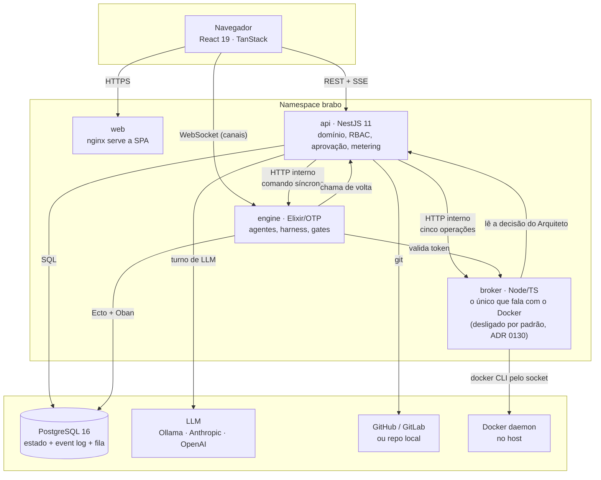
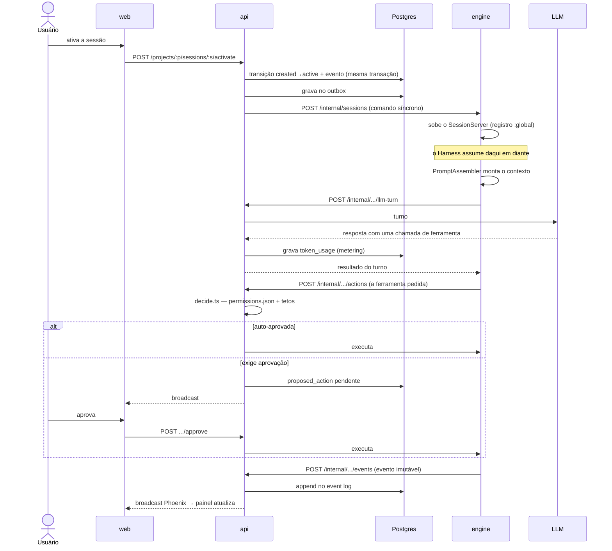
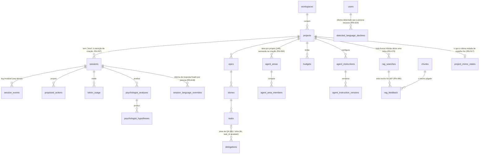

# Arquitetura

Este documento é o mapa para quem vai **trabalhar** no código. Ele diz por
onde começar a ler, o que cada fronteira promete e o que já se sabe que está
torto.

As decisões e suas justificativas moram nos [ADRs](adr/index.md) — 229
deles, vários registrando um defeito real encontrado em execução. Aqui não
repetimos o argumento: apontamos para ele.

## A visão de fora {#the-outside-view}

O Brabo recebe **uma intenção de produto** ("quero um sistema que faça X") e
devolve **um repositório git com código, testes e um histórico de decisões**,
produzido por um time de agentes de IA. Entre a entrada e a saída, toda ação
com efeito no mundo — rodar um comando, commitar, abrir uma PR, gastar
tokens — passa por um pedido de aprovação que o humano decide.

Visto de fora, é uma aplicação web. O que a distingue é que o trabalho é
feito por processos de longa duração conversando com modelos de linguagem, e
que o sistema é construído para que **nada aconteça sem rastro e sem
permissão**.

## Containers {#containers}

Duas coisas neste desenho não são óbvias e explicam muito:

**O engine nunca fala com o LLM nem com o git diretamente.** Ele pede à api.
É isso que garante que metering, orçamento e o pipeline de aprovação não têm
desvio — não há caminho que escape deles.

**A comunicação api→engine é dupla.** Um evento assíncrono via *transactional
outbox* no Postgres (consumido pelo Oban), e HTTP interno para um comando
síncrono. O outbox existe porque gravar o estado e publicar o evento precisam
ser a mesma transação; o HTTP existe porque algumas operações precisam de
resposta imediata.

O outbox drena três `aggregate_type`s: `session` (desde a Fase 5),
`task` (Fase 12b — `task.gate_resolved`/`task.became_claimable`, o
reagendamento do dev agent depois que um gate resolve ou uma tarefa nova fica
pegável) e `container` ([ADR 0143](adr/0143-agentes-de-dev-so-depois-do-container.md)
/[RN-502](business-rules.md#rn-502) — `container.running`, anexado na
mesma transação que registra o container do projeto chegando a `running`, para
que os dev agents que a ausência dele estacionou em `:idle` acordem sozinhos; um
agregado próprio em vez de um `task` emprestado, porque o evento não é sobre
tarefa nenhuma).
O motivo de ser um outbox, e não uma chamada HTTP síncrona como as outras:
um reinício do engine entre o veredito do gate e a reação do agente não pode
perder o sinal — a linha sobrevive ao processo que a leria, o HTTP não
sobreviveria à morte de quem esperava a resposta.
Um dev agent que CAI (qualquer saída que não seja `:normal`/`:shutdown`) não é
tratado como encerrado: `Engine.Dev.Monitor` registra um `agent.error` durável
(origem `infra`) e o reinicia a partir da própria linha em `dev_agent_states`, até
três vezes; a tarefa interrompida é bloqueada com diagnóstico pela recuperação
de reinício que já existia ([RN-742](business-rules.md#rn-742)).
`dev_agent_states` ganhou `consecutive_blocked`/`max_consecutive_blocked`
(o disjuntor, [RN-047](business-rules/custo.md#rn-047)); a decisão completa está no
[ADR 0045](adr/0045-reagendamento-por-evento-do-dev-agent.md).
Uma tarefa bloqueada por falha transitória de rede/provider (DNS, conexão
resetada, 5xx/429) é desbloqueada de novo por um job do Oban depois de 1, 3 e 10 min
(até três vezes, pelo mesmo caso de uso de desbloqueio do humano), e o
dev agent pausa por um minuto em vez de pegar a próxima tarefa
([RN-864](business-rules.md#rn-864)).

Os agentes de gate (`QaLeadServer`/`SecOpsAgentServer`) não passam pelo
outbox nas transições intermediárias (`correct`/`run_secops` continuam uma
chamada direta em memória — a prova mecânica está no comentário de
`record-gate-verdict.use-case.ts`: só os desfechos TERMINAIS, `done`/`blocked`,
viajam pelo outbox), então ganharam a MESMA rede de segurança que os dev agents
já tinham: `gate_states`, mais um `GateRescuer` que varre ciclos parados e os
retoma sozinho — nenhuma tabela nova para o caminho do outbox, porque o problema
não era falta de outbox, era falta de estado durável para o que acontece
ENTRE duas chamadas no mesmo processo. Ver
[RN-140](business-rules.md#rn-140), [ADR 0067](adr/0067-o-gate-sobrevive-ao-restart.md).

O gate de QA tem um TERCEIRO veredito além de `approved`/`changes_requested`:
`needs_user_decision`, para um requisito que o usuário nunca confirmou (ou que
uma decisão vigente contradiz). Ele não consome uma correção; o QA Lead
o consolida acima de `approved`, e o ciclo é ESTACIONADO pelo mecanismo do
[ADR 0207](adr/0207-ciclo-de-gate-velho-estaciona.md) até o usuário responder à
pergunta, o que o retoma. O lado conversacional da mesma regra é a ferramenta
`declare_open_question` (Criativo, PO, Arquiteto, Dev Lead), que grava
`artifact.open_question`; as respostas do usuário voltam ao dev e ao QA como
"decisões do usuário" no dev-context ([RN-862](business-rules.md#rn-862),
[ADR 0214](adr/0214-pergunta-em-aberto-vira-pendencia.md)).

Quem PEDE um gate nunca é o próprio gate: `Engine.Gates.Dispatcher` é um
behaviour com cinco callbacks (QA de PR e SecOps, os dois gates de infra
determinísticos e o AppSec de design — o de estratégia de QA saiu com o
[ADR 0192](adr/0192-plano-de-teste-depois-da-entrega.md), quando o plano de teste
virou o primeiro passo do próprio QA de PR) cujo único trabalho é subir o
GenServer por projeto se necessário e fazer cast nele. A indireção existe para
os testes de quem chama: `Engine.Agents.DevLeadTools` é exercitado por um teste
LEVE sem sandbox do Ecto, e subir um GenServer real ali só para provar que um gate
foi PEDIDO amarraria o teste do Dev Lead ao banco. O mais novo dos
cinco, `run_appsec_design/2`, fechou o último gate que era acionável sem
chamador de produção: `assess_implementability` agora pede o modelo de ameaças
de design da história EM PARALELO — o veredito nunca espera por ele, e o pedido
acontece uma única vez por história ([RN-539](business-rules.md#rn-539),
[ADR 0090](adr/0090-qa-estrategia-e-appsec-segundo-momento.md)).

## Mapa do código {#code-map}

### `apps/api` — NestJS, 906 arquivos em `src/` (medido em 2026-09-25) {#appsapi--nestjs-906-files-in-src-measured-2026-09-25}

Quatro camadas, e a ordem importa:

| diretório | o que é | comece por | para o que **não** serve |
|---|---|---|---|
| `src/domain/` (72) | regra de negócio pura. Sem IO, sem framework | `actions/decide.ts` — o coração da aprovação | não sabe o que é HTTP, banco ou NestJS |
| `src/application/` (177) | casos de uso. Orquestram domínio e portas | `use-cases/sessions/` | não guarda regra; se tem um `if` de negócio, está no lugar errado |
| `src/infrastructure/` (76) | implementações de porta: Drizzle, clientes HTTP, cripto | `persistence/drizzle/` | não decide nada |
| `src/interfaces/http/` (105) | controllers, guards, DTOs | `auth/jwt-auth.guard.ts` | não tem regra nem consulta |

Símbolos para dar grep quando estiver perdido: `decide(`, `assertTransition`,
`@RequireRole`, `PROTECTED_BRANCHES`, `EncryptionService`.

**Ponto de entrada:** `src/main.ts` — e a ordem dos `imports` nele é
significativa (`./tracing-boot` é o primeiro de propósito; a
auto-instrumentação do OpenTelemetry não pega um módulo já carregado, e um
módulo separado é o que garante isso: o TypeScript iça todos os `require`s para
o topo, então uma chamada escrita entre imports rodaria tarde demais).

### `apps/engine` — Elixir/OTP, 219 arquivos em `lib/` (medido em 2026-09-25) {#appsengine--elixirotp-219-files-in-lib-measured-2026-09-25}

| módulo | o que é | comece por |
|---|---|---|
| `harness/` (33) | montagem de contexto, ToolLoop, compactação. **Nenhuma chamada de LLM acontece fora daqui** | `harness/tool_loop/` |
| `dev/` (15) | dev agents, worktrees, monitor | `dev/dev_agent_server.ex` |
| `gates/` (20) | a área de QA (Lead + Automação, subespecialidades de Performance/Segurança e de estratégia de QA — o segundo momento do Lead, ADR 0090 — todas com LLM) e SecOps (determinístico) | `gates/qa_lead_server.ex` |
| `infra/` (9) | a área de Infra (Lead conversacional, escopado à sessão — desde a [RN-617](business-rules.md#rn-617) o sétimo agente conversacional, alcançável pelo composer e rodando seus turnos no `TurnoAssincrono` — + subespecialidade Workflows via ToolLoop — duas famílias arquiteturais na mesma área, ver RN-037) | `infra/infra_lead_server.ex` |
| `sessions/` (9) | ciclo de vida da sessão, registro `:global` | `sessions/session_server.ex` |
| `actions/` (9) | executores de terminal e git, detectores de lint/scanner | `actions/git_executor.ex` |
| `agents/` (16) | Criativo, PO, Arquiteto, Dev Lead, Staff (ADR 0088, dormente para disparo automático) — cada turno roda numa Task supervisionada (`TurnoAssincrono`, RN-122), não mais dentro do `handle_call`, então um `:cancel` consegue de fato interrompê-lo | `agents/turno_assincrono.ex` |
| `psychologist/` (6) · `anamnese/` (6) | análise e melhoria do time | — |

**Ponto de entrada:** `lib/engine/application.ex` — a árvore de supervisão
inteira está lá, e é o melhor arquivo para entender o que está rodando.

### `apps/broker` — Node/TS, 9 arquivos em `src/` (medido em 2026-09-25) {#appsbroker--nodets-9-files-in-src-measured-2026-09-25}

O único processo do produto com acesso a um Docker daemon
([ADR 0130](adr/0130-broker-de-container.md)), e o menor serviço daqui:
sem framework, `node:http`, seis rotas (medido em 2026-09-25 em `src/servidor.ts`).

| arquivo | o que é |
|---|---|
| `src/operacoes.ts` | as CINCO operações, e a composição da spec. Nada que vira um `docker run` vem de fora |
| `src/servidor.ts` | a lista fechada de rotas, a checagem do token e a tabela de falhas (status + `origem`) |
| `src/api-client.ts` | como ele LÊ a decisão do Arquiteto na api — a chamada que o faz não aceitar uma spec |
| `src/config.ts` | quatro variáveis de ambiente, e a recusa de subir em produção com o token público do repositório |

**Ponto de entrada:** `src/index.ts`. O acesso ao Docker em si não está aqui: vem de
`packages/docker-port`, o mesmo arquivo que o runner usa.

### `apps/web` — React 19, 487 arquivos em `src/` (medido em 2026-09-25) {#appsweb--react-19-487-files-in-src-measured-2026-09-25}

`src/lib/api-types.ts` e `src/lib/activity.ts` são os dois arquivos que vale
ler primeiro: o primeiro é o contrato com a api, o segundo
classifica os 40 tipos de evento do log em algo exibível — é a
melhor fonte de verdade sobre o que cada evento significa.

Três derivações do mesmo event log, respondendo perguntas diferentes:

| arquivo | responde |
|---|---|
| `lib/activity.ts` | "o que aconteceu" — o feed cronológico |
| `lib/agent-status.ts` | "quem existe e em que estado está" — os cards do time |
| `lib/timeline-tree.ts` | "o que cada agente fez, e o que está fazendo AGORA" — a árvore |

`lib/aprovacoes.ts` responde uma quarta pergunta, e ela não vem do
event log: "o que acontece se eu aprovar". O verbo e a frase de cada tipo de
`proposed_action` moram ali, e as três telas de decisão os consomem — a
fila de Aprovações, o card dentro do chat e a aba Insights
([RN-096](business-rules.md#rn-096)).

**A união `ActionType` ERA uma cópia, e a cópia envelheceu — duas vezes, em
produção** (os três tipos do bootstrap do Gitflow; depois
`parallelize`/`raise_max_parallel`), as duas vezes sem o compilador perceber,
porque `apps/api` não é dependência de `apps/web`. O ADR 0116 fechou a
classe: `ActionType` agora é gerado pelo `openapi-typescript` a partir de
`docs/reference/openapi.json` (`lib/api-types.generated.ts`, reexportado por
`lib/api-types.ts`) em vez de digitado à mão, e o compilador agora exige que os
mapas `Record<ActionType, ...>` em `lib/aprovacoes.ts` sejam exaustivos a cada
edição. O resto de `api-types.ts` — ~1600 linhas — continua escrito à mão; só
este tipo, com um custo repetido provado, migrou. `lib/aprovacoes.test.ts`
também fica, mas para um trabalho mais estreito: não precisa mais pegar uma
entrada FALTANDO (o compilador pega), só uma ruim — frase curta demais, sem
ponto final, `snake_case` cru vazando para a prosa em português. Na dúvida, a UI
ainda degrada em vez de derrubar a árvore do React.

A árvore inverte o eixo do feed (agente primeiro, tempo depois) porque numa
sessão com Criativo, PO, Arquiteto e N devs a coluna cronológica
não conseguia responder quem estava fazendo o quê. Nenhuma das três tem estado
ou rota própria — todas derivam dos mesmos eventos, e um evento que não está no
log não aparece em nenhuma delas.

**Escopo de leitura: a tela de projeto pergunta por sessão, a tela de lista
pergunta por workspace.** Dentro de um projeto as consultas são por sessão e
por projeto, que é o recorte natural do que está aberto. Mas o dashboard e a
sidebar mostram TODOS os projetos, e ali o recorte por projeto vira N+1 — eram
sete consultas com polling por card, 3.824 req/min com 23 projetos contra um
limite de 300, e a tela se derrubava sozinha com 429s. As duas leem
de `GET /workspaces/:id/projects-summary` — um read model que atravessa
agregados (git, orçamento, sessão, backlog, arquitetura) e cujo número de
idas e voltas ao banco não cresce com a quantidade de projetos
([RN-090](business-rules.md#rn-090)).

A gaveta do sino segue o mesmo recorte, com uma diferença que vale
registrar: ela precisa do ponto de corte de leitura de cada projeto, e esse
ponto é um `seq` guardado no navegador de quem está olhando (`lib/read-state.ts`) — o
servidor não tem, e não vai ter, um "marcar como lido". Então o cliente
**envia** o mapa `project → afterSeq` no corpo de
`POST /workspaces/:id/unread-events`, que é uma leitura apesar do verbo e
devolve `200` ([RN-091](business-rules.md#rn-091)). O verbo decorre
do corpo, não de uma mutação: são dezenas de pares, e uma query string desse
tamanho quebra num proxy, além de pôr ids de projeto em logs de acesso.

Esse endpoint devolve FATOS do event log, nunca componentes
montados: `lib/agents.ts` (quem é lead, ícone, cor) e `rosterFromFacts`
(`lib/agent-status.ts`) continuam sendo trabalho do web, e a regra de presença é a
mesma que o painel do time usa. É a mesma fronteira das três
derivações acima — a api diz o que aconteceu, o web decide o que se
desenha a partir disso.

Duas checagens de UI são automáticas: contraste (`lib/contraste.ts`, um teste sobre
`design/tokens.css`) e layout (`scripts/dev/validacao-visual.js`, rodado no
navegador). Explicadas em `design/README.md`.

**A instalação decide o que o assistente de projeto oferece.** `getProjectsBase`
(`lib/api-client.ts`) lê `GET /workspaces/:workspaceId/projects-base` — a
base única de projetos montados desta instalação ([ADR
0141](adr/0141-base-unica-dos-projetos-montados.md)) — e o assistente de Novo
Projeto é seu único chamador ([RN-513](business-rules.md#rn-513)). `projectsBase:
null` é um estado normal, não uma falha: a instalação não tem
`BRABO_PROJECTS_BASE`, então o card de pasta montada simplesmente não é oferecido e
`container` continua o padrão. O mesmo vale enquanto a resposta está a caminho e
quando a consulta FALHA — desconhecido nunca vira oferta, a mesma regra da
[RN-088](business-rules.md#rn-088)/[RN-468](business-rules.md#rn-468). Com uma
base, o card vem PRÉ-SELECIONADO e o campo de caminho abre em `<base>/<slug>`,
composto por `caminhoSugeridoNaBase` (`lib/wizard.ts`) — uma função pura, ao lado
de `caminhoDentroDaBase`, que responde "este caminho está sob a base?" por
SEGMENTO e espelha o `dentroDoEscopo` da api. Nem a pré-seleção nem a
sugestão sobrescrevem uma escolha humana.

**O seletor de pastas é a única leitura do web com DOIS TRANSPORTES**, e a interface
que a torna uma só mora em `lib/fs-browser.ts`
([RN-504](business-rules.md#rn-504)). `FsBrowser` — `listarDiretorio` /
`diretorioInicial` / `fechar` — tem duas implementações, e elas não falam
com a mesma máquina: `criarFsBrowserViaApi(workspaceId)` chama
`GET /workspaces/:workspaceId/project-folders` na api, escopado rigidamente a
`BRABO_PROJECTS_BASE` ([ADR 0141](adr/0141-base-unica-dos-projetos-montados.md)),
enquanto `connectFsBrowserChannel(projectId)` (`lib/fs-browser-channel.ts`) fala
o canal Phoenix `terminal:<projectId>` e lê o disco do USUÁRIO pelo
runner.

A interface foi extraída do módulo do canal justamente porque ele
deixou de ter uma implementação só. `FolderBrowserModal` escolhe entre elas com
uma união discriminada — `origem: { tipo: 'api'; workspaceId } | { tipo:
'runner'; projectId }`, não duas props opcionais, para que "nenhuma" e "ambas" não
sejam estados representáveis que o componente precise tratar em runtime — e o corpo
dele nunca fica sabendo qual recebeu. Só três coisas ramificam por `origem`: qual
fábrica roda, quais atalhos existem (`/` não é oferecido pelo transporte da api;
está fora da base por construção, e o botão só poderia terminar num
400) e se o `RunnerOnboardingPanel` faz sentido.

`ListagemResultado` ganhou três campos OPCIONAIS — `arquivos`, `simbolicos`,
`truncado` — e eles são opcionais porque só o transporte da api conta o que
excluiu. O protocolo do runner (`FsEntrada` em `apps/runner/src/channel.ts`)
devolve pastas e arquivos misturados e não conta nada; preencher zeros ali
afirmaria "nada ficou de fora", o que é diferente de não saber.

A RN-504 apontou OS DOIS modos para a api e declarou o preço: para `runner`, a
lista deixou de ser a máquina do usuário e virou a base. Isso foi aceito
porque o modo `runner` sairia do assistente de criação — não saiu, e a
[RN-533](business-rules.md#rn-533) ([ADR 0151](adr/0151-base-consentida-no-runner.md)
ponto 7) o reverte. Agora é o MODO que escolhe o transporte, porque eles respondem
perguntas diferentes: `mounted` pergunta à api (sua pasta mora sob a base, no
SERVIDOR), `runner` pergunta ao agente local (sua pasta mora numa máquina que o
servidor não enxerga). O ramo `runner` se ancora no projeto que o assistente
já criou antecipadamente ([RN-437](business-rules.md#rn-437)); quando essa
criação falha, nenhum modal abre, porque cair para a api
mostraria a base do SERVIDOR sob o rótulo "sua máquina".

A falha carrega um motivo DISCRIMINADO (`MotivoDeFalhaDoAgente`): `sem-agente`
é o servidor AFIRMANDO que não há runner, `sem-resposta` é um timeout, um
socket caído ou um ticket recusado — ignorância, dita como ignorância
([RN-088](business-rules.md#rn-088)/[RN-468](business-rules.md#rn-468)). O
componente decidia por `includes('Nenhum runner conectado')`, casando uma
frase em pt-BR que mora no `.ex` do engine; o casamento de substring agora mora
em exatamente um lugar, o módulo dono do protocolo do canal, e uma mensagem do
engine reescrita degrada para `sem-resposta`, nunca para "há um agente". Os dois
motivos montam `EsperaDoRunner` — a espera da RN-474, REUSADA: mesmos três estados, mesmo
teto, mesmo sinal — que refaz sozinha a listagem que falhou quando o
carimbo muda. Uma espera por tela: `RunnerOnboardingPanel` recebe
`mostrarEspera`, falso só onde o hospedeiro dele já mostra uma. E o seletor
DIZ de quem é o disco que está listando, nas duas origens — a única pista antes disso era
o rótulo de um atalho, que nomeia um lugar, não uma máquina.

**O painel também RECONHECE uma máquina que já está pareada**
([RN-548](business-rules.md#rn-548), [ADR 0154](adr/0154-chave-de-dispositivo-de-maquina.md)).
`listRunnerDeviceKeys` em `lib/api-client.ts` lê
`GET /projects/:projectId/runner-device-keys`, que desde a
[RN-543](business-rules.md#rn-543) marca a ESPÉCIE de cada chave — e a
derivação inteira mora fora do componente, em `lib/agente-de-maquina.ts`, porque
a regra é sobre o DADO e o componente é sobre o desenho. Sete estados,
nenhum colapsando em outro, e a falha é derivada de `isError` e não
de um status, então um erro de rede diz "não sei" em vez de girar em
"verificando…" para sempre. Uma chave registrada NÃO é um agente rodando — a mesma
disciplina que `workspaceVerifiedAt` já impõe — e a lista pertence à
CONTA, não a este navegador, então a frase mais forte disponível é "sua
conta tem uma máquina pareada". Os dois limites são ditos na tela. O
fluxo pelo navegador do [ADR 0118](adr/0118-configuracao-automatica-do-runner-pelo-navegador.md)
(gerar a chave, baixar o binário, gravar a pasta) foi
aposentado no [ADR 0203](adr/0203-aposenta-o-fluxo-do-runner-pelo-navegador.md)
([RN-687](business-rules.md#rn-687)): o painel agora mostra o comando do `install.sh`,
que sai quando uma chave que atende o projeto é reconhecida, e o
comando manual com PAT fica num `
` nomeado pelo caso que ele responde
(outra máquina). O mínimo da leitura vem de `roleAtLeast`
contra o `developer` do ENDPOINT, e um 403 real cai no mesmo estado —
o papel de workspace é um proxy, a api é a autoridade.

**A aba Código (FASE 26) é o mesmo padrão de leitura**, aplicado a código
em vez de eventos: `getContainerState`/`getCodeTree`/`getCodeFile`/
`searchCode`/`getCodeDiff` em `lib/api-client.ts` espelham as rotas de leitura da
api (`container` mais as sete em `code.controller.ts`, FASE 26b), com
os tipos em `lib/api-types.ts` (`EstadoDoContainer`, `CodeTree`, `CodeFile`,
`CodeSearchResult`, `CodeDiff`) copiados dos DTOs — a mesma convenção
do resto do arquivo, sem importar `apps/api`. `routes/code/
highlight.ts` é um tokenizador PRÓPRIO baseado em regex para realce de sintaxe,
zero dependência nova. O portão do `ProjectCodeTab.tsx` (RN-107) pergunta pelo
estado do container ANTES de tentar ler código, para que ele apareça como
mensagem própria em vez de como nota de rodapé de um 409.

**A FASE 26b acrescentou `getCodeBlame`/`getCodePullRequests`/`getCodeBranches` ao
mesmo padrão**, com `CodeBlame`/`CodePullRequestList`/
`CodeBranchDetailList` em `lib/api-types.ts` — fundação para os três itens
pendentes declarados da aba Código (RN-110/111/112). Os três agora têm
consumidor: `CodeEditor.tsx` (o toggle de blame), `code/PrListAndDiff.tsx` (lista
de PRs + diff, consumido tanto por `CodeDiffPanel.tsx` quanto pela aba `prs`
avulsa) e `CodeBranchPicker.tsx` (o dropdown rico de branches).

O portão da imagem de container (RN-105) é um funil único
(`ReadProjectCodeUseCase.alvo`) compartilhado pelas sete rotas, então qualquer uma delas
pode dar 409 enquanto o Arquiteto não decidiu a imagem — não só a árvore.
`ProjectCodeTab.tsx` evita esse 409 com uma pré-checagem (`RN-107`, acima); a
aba `prs` não tem leitura de árvore/arquivo contra a qual pré-checar, então
`code/PrListAndDiff.tsx` reage ao 409 das próprias chamadas
`getCodePullRequests`/`getCodeDiff`. Os dois caminhos renderizam a mesma
apresentação, `ContainerImageGateNotice`
(`components/ContainerImageGate.tsx`), detectada por `isContainerImageGateError`
(`lib/api-client.ts`, casa `ApiError.status === 409`) — um bug achado pelo
uso: antes disso, a aba `prs` exibia esse 409 como um erro transitório genérico
com um botão "tentar de novo", que é a affordance errada para um estado
que só se resolve quando o Arquiteto age.

**A página global de containers (`/containers`, ADR 0136/RN-495) é uma leitura de
WORKSPACE**, não de projeto — `getContainersOverview` em `lib/api-client.ts`
chama `GET workspaces/:workspaceId/containers`, e `ContainerOverviewItem`
em `lib/api-types.ts` espelha `ContainerOverviewItemResponseDto`. O lado da
api é um read model dedicado, `ContainersOverviewRepository`/
`DrizzleContainersOverviewRepository`, com a mesma disciplina de "sem N+1 entre
projetos" do `ProjectsSummaryRepository` — três consultas constantes (`projects`
com LEFT JOIN nas linhas de container, os eventos `artifact.project_image` em
lote, as `proposed_actions` de container pendentes em lote), nunca uma por
projeto. O que NÃO dá para fazer em lote — perguntar ao broker o estado observado —
ganha em vez disso um orçamento explícito por carga
(`ObterVisaoGeralDeContainersUseCase.TETO_DE_VERIFICACOES_POR_CARGA`, só
linhas `provisioning`/`running` são perguntadas, com teto de 20): uma linha fora do
orçamento diz `naoVerificado`, nunca reaproveitando em silêncio a resposta de outra
linha nem herdando o estado registrado. As ações (parar/remover/subir) são
`proposed_action`s como em todo lugar — a página nunca chama o broker
diretamente — e a ação pendente de cada linha (se houver) vem junto na mesma
leitura em lote, renderizada como um `ApprovalCard` inline, o mesmo padrão
que `ProjectPrsTab.tsx` já usa para propostas de merge.

Desde a [RN-521](business-rules.md#rn-521) o join é LEFT e a página
lista TODO projeto do workspace, porque ela virou o caminho humano para subir
o PRIMEIRO container: uma subida que falha antes de registrar não deixa linha, e
o INNER JOIN antigo escondia exatamente o projeto que precisava da página.
`ContainerOverviewItem.registrado` é portanto anulável — um terceiro estado nomeado
no tipo, distinto de `stopped` e de "não pôde ser observado" — e linhas
sem container nunca são elegíveis ao orçamento do broker, então não podem
expulsar um container real. A ramificação entre `container_start` (broker) e
`container_start_via_runner` (agente local) é uma função pura do CLIENTE,
`routes/containers-subida.ts`: ela também decide quando NÃO oferecer o botão (sem
imagem decidida, `runner` cuja pasta nenhum agente jamais confirmou, papel abaixo de
`maintainer` por `roleAtLeast`) e cada recusa tem texto próprio — a tela
nunca propõe uma ação que já sabe que vai falhar, e nunca esconde por quê.

O OUTRO proponente — o agente Infra Lead — ramifica do mesmo jeito desde a
[RN-566](business-rules.md#rn-566). As duas ferramentas dele passam por uma única
`recusa_local_de_subida/2` em `infra_lead_server.ex`, que lê o projeto
UMA vez (`Project.get/1`, mesmo processo BEAM, nunca HTTP: uma chamada de rede dentro do
laço do agente é o custo que esta correção não podia pagar) e devolve `nil` ou um motivo
NOMEADO, uma cláusula por ferramenta — `container`/`mounted` propõem `container_start`,
`runner` é recusado apontando para `container_start_via_runner`, e a
cláusula de `container_start` é uma LISTA DE PERMITIDOS como a do broker, então um modo novo
no enum nasce recusado. A recusa é texto de RESULTADO de ferramenta que o modelo lê (entrada do laço,
[RN-163](business-rules/autenticacao.md#rn-163)), nunca um `agent.error`, e o `tool.call`
continua sendo emitido para que uma recusa local nunca suma da timeline. O que o
agente NÃO checa, e a tela checa, é a imagem decidida e a
pasta confirmada.

### Fora das aplicações {#outside-the-applications}

| diretório | o que é |
|---|---|
| `packages/shared/` | o `GitProviderContract` — quinze operações, **tipos e nada mais**: um valor que sobrevive ao `tsc` quebra o boot da api (travado por um teste), então a constante mora no consumidor |
| `packages/docker-port/` | a PORTA do Docker (cinco operações) e seu adaptador de CLI, compartilhados por `apps/runner` e `apps/broker` — [ADR 0130](adr/0130-broker-de-container.md). É código de runtime, e é exatamente por isso que NÃO está em `packages/shared`; não tem passo de build e os dois consumidores o EMPACOTAM, então nenhuma imagem jamais o resolve a partir de `node_modules` |
| `docker/` | imagens de dev e de produção; `smoke.sh` |
| `deploy/k8s/` | base do Kustomize + overlays (local, staging, prod) |
| `design/` | design system: tokens, tipografia, componentes |

## O fluxo de um turno de agente {#an-agent-turns-flow}

O caminho quente, de ponta a ponta. É aqui que mora a maior parte da complexidade.

O laço `Harness → chamada de ferramenta → aprovação → evento` se repete até o agente
chamar a ferramenta de encerramento ou bater num teto (iterações, tokens, orçamento).

## Fronteiras e invariantes {#boundaries-and-invariants}

Esta é a parte que mais importa. Cada item abaixo é verificável, e
vários têm um teste que falha na violação.

**1. O domínio é puro.** `apps/api/src/domain/` não importa
`infrastructure`, `application`, `@nestjs` nem nenhum driver de banco —
verificado: **zero** ocorrências dos três. A direção é sempre
`interfaces → application → domain`, e 89 arquivos de `application` importam
`domain`. Se você precisa de IO dentro de `domain/`, o desenho está errado: crie uma
porta em `application/ports/`.

**2. Um evento de domínio é imutável.** Nunca há `UPDATE` numa tabela de
eventos. `session_events` tem `unique(session_id, seq)` e o `seq` é denso por
sessão — o teste de restauração verifica que não há buraco. Estado que precisa
mudar (o ciclo de vida de uma hipótese, o status de um handoff) mora na sua própria
tabela mutável, ao lado dos eventos. Uma oferta de handoff que deixa de ser a vigente
vira `superseded` nessa tabela e ganha seu próprio evento `handoff.superseded`
— nunca uma edição do `handoff.offered` que a anunciou ([ADR
0182](adr/0182-ciclo-de-vida-do-handoff.md)).

**3. Nenhuma chamada de LLM fora do Harness.** Não é convenção: o engine
não tem cliente de LLM. Ele pede à api, que faz o metering.

**4. Toda ação com efeito externo vira um `proposed_action`.**
`deny` sempre vence `allow` no `permissions.json`, e dois **tetos** são
aplicados por último, por cima do veredito já calculado: merge numa
branch protegida e um patch de instrução **nunca** são auto-aprováveis.
Ver [RN-006 e RN-007](business-rules.md).

**5. Merge numa branch protegida é manual.** Não há opção de
automatizá-lo. É um teto no domínio (`decide.ts`), garantido por um
teste.

**6. Uma sessão, um dono.** O `SessionServer` é registrado sob
`:global`, não num `Registry` local — sem isso, N réplicas hospedariam N
cópias da mesma sessão, e as cópias sem heartbeat matariam
a sessão viva ([ADR 0026](adr/0026-fase5-observabilidade-e-graceful-shutdown.md)).

**7. Falha de agente registra a ORIGEM** (`infra | model | code | policy`),
nunca um diagnóstico por eliminação. Uma lição cara do
[ADR 0020](adr/0020-destravar-gates-qa-secops.md): uma queda de provider foi
registrada como "o modelo parou sem sinalizar", e o sistema culpou
o modelo por um problema de infraestrutura.

**8. O container de um projeto é decidido, nunca implícito.** A aba Código só
destrava depois que o Arquiteto emite `artifact.project_image` — enquanto o
estado é `sem_decisao`, ler código devolve `409`
([RN-105](business-rules/autenticacao.md#rn-105)). E `git push`, abrir uma PR e
deploy não passam pelo terminal, mesmo dentro do escopo do projeto:
`decide()` os reconhece pelo prefixo do comando e devolve `deny` ANTES de qualquer
etapa permissiva — não `require_approval`, porque "sempre permitir" gravaria
o padrão em `allow` e reabriria a porta
([RN-106](business-rules/autenticacao.md#rn-106),
[ADR 0065](adr/0065-container-por-projeto-a-fronteira-deixa-de-ser-politica.md)).
O ciclo de vida do container (provisionar, reciclar, limpar) ainda não existe
— um corte declarado da FASE 25, registrado no CLAUDE.md — então este invariante
convive, por ora, com a política de escopo de caminho do
[ADR 0055](adr/0055-escopo-de-caminho-na-politica-de-terminal.md).

E desde o [ADR 0143](adr/0143-agentes-de-dev-so-depois-do-container.md)
/[RN-502](business-rules.md#rn-502), uma imagem decidida não é mais a única
pré-condição: **um dev agent não pega tarefa nenhuma até o container do
projeto estar REGISTRADO `running`**. A guarda mora em
`Engine.Dev.AgentIo.try_claim/2` — o ponto único de claim — e não só no
`activate-execution` da api, porque a reidratação chega a `try_claim/2`
sem passar por rota nenhuma (`DevAgentServer.init/1` ->
`finish_restart_recovery/1`). Sem container o agente cai para `:idle`
(o único estado que um wake ainda resgata) e diz isso com
`dev.blocked_by_container`. A outra metade da mesma regra é que
`Engine.Actions.TerminalExecutor` deixou de cair no `System.cmd` dentro
do processo do engine quando não há container: ele recusa, nomeado, como o
modo `runner` já fazia.

**9. Um agente que ESCREVE tem de poder LER e tem de poder PERGUNTAR.**
As duas metades são a mesma lição, e vieram de um agente que só tinha
ferramentas de escrita: o PO montava o contexto uma vez, no kickoff, e agia dali em diante
sobre um retrato velho — diante de uma lacuna, escolhia entre inventar e
parar ([RN-164](business-rules/autenticacao.md#rn-164),
[RN-165](business-rules/autenticacao.md#rn-165)). Ler **não** vira um
`proposed_action` (o invariante 4 é sobre efeito EXTERNO, e ler não é
um), mas é contido no sentido do
[ADR 0060](adr/0060-superficie-de-leitura-de-codigo.md): escopo fechado pelo
caminho da rota, custo constante por chamada e um teto de linhas no texto
entregue ao modelo. E o laço de um agente não termina calado — um
teto de iterações emite `toolloop.limit_reached`, uma obrigação não cumprida emite
um desfecho durável com origem ([RN-166](business-rules/autenticacao.md#rn-166)).

## Preocupações transversais {#cross-cutting-concerns}

**Origem cruzada.** O web é servido da própria origem e fala com
**duas** outras, então CORS é uma fronteira arquitetural, não um detalhe de
configuração ([ADR 0037](adr/0037-cors-do-engine-e-a-porta-como-contrato.md)).
Quatro caminhos, e só três passam por CORS:

| caminho | mecanismo |
|---|---|
| web → api, HTTP | o CORS do Nest, origem exata de `WEB_ORIGIN` + `credentials` |
| web → engine, HTTP (`/health`) | `EngineWeb.Plugs.Cors`, só rotas de health |
| web → engine, WebSocket | o `check_origin` do endpoint Phoenix — **WebSocket não passa por CORS** |
| api ↔ engine, HTTP | **CORS não se aplica**: um cliente de servidor, não um navegador |

Uma única variável — `WEB_ORIGIN` — alimenta as três primeiras, nos dois
serviços. Lê-la duas vezes de forma independente foi como o CORS do engine acabou
sem origem nenhuma enquanto o `check_origin` já tinha a lista certa; no
engine ela agora é resolvida uma vez, em `runtime.exs`.

E a **porta faz parte da origem**: o web em `:5174` é um sistema diferente
aos olhos do navegador. É por isso que `vite.config.ts` usa
`strictPort`.

**Autenticação.** First-party, no domínio da api — não há IdP
externo. Senhas com argon2id, um access token EdDSA de 15 minutos e um refresh
token opaco com rotação obrigatória; a sessão do web mora num cookie
`httpOnly` com CSRF por double-submit. `JwtAuthGuard` é global e
**lê** o usuário pelo `sub` do token (que é `users.id`); uma rota aberta
exige `@Public()` explícito.

Nenhuma decisão de RBAC lê uma claim do token: o papel vem de `request.user.id` e
de linhas no banco. É por isso que a matriz de permissões sobreviveu à troca de
emissor sem mudar. Decisões no
[ADR 0031](adr/0031-auth-first-party-argon2id-e-rotacao-de-refresh.md) e no
[ADR 0032](adr/0032-corte-do-keycloak-e-sessao-em-cookie.md).

Chamadas do engine não passam pelo JWT: as rotas `/internal/*` são
`@ServiceRoute()` e o `EngineServiceGuard` compara um segredo compartilhado
(`BRABO_SERVICE_TOKEN`) em tempo constante. A superfície inteira está classificada em
[`security-surface.md`](security-surface.md), e um teste de tabela reprova uma
rota nova sem classificação.

**Autorização.** RBAC no domínio, com o papel efetivo resolvido
a partir do projeto (caindo para o workspace). `@RequireRole` nas
rotas.

**Erro.** Erros de domínio são classes tipadas
(`InvalidSessionTransitionError`, `StoryNotReadyError`) traduzidas para HTTP
por filtros globais em `main.ts`. Erros de provider de git são normalizados por um
contrato único ([ADR 0002](adr/0002-git-error-normalization.md)) — quem
chama não sabe se falou com GitHub ou GitLab.

**Logging.** JSON de **uma linha** por evento em produção nos três
apps, com `trace_id` correlacionado; legível por humanos em desenvolvimento. A api
usa pino com redação obrigatória de `apiKey`, `access_token`,
`clientSecret` e do service token api↔engine. Cada linha diz de qual
classe e método veio, e uma linha por request mostra o **caminho
pelas camadas** com a duração de cada passo — ver
[observabilidade](explanation/observability.md).

**Transação.** O padrão é *unit of work*: gravar o estado e publicar o
evento na **mesma** transação, via outbox. Publicar fora da
transação criaria um evento para um estado que nunca persistiu.

**Tracing.** OpenTelemetry de ponta a ponta, e o `trace_id` nasce no
**web**: o navegador gera o `traceparent`, a api o adota como
pai, e o engine adota o da api. Uma sessão é **um trace raiz** —
o `traceparent` é persistido em `sessions.trace_parent` e viaja no
envelope do outbox, então o trabalho assíncrono disparado por um evento fica no
trace de quem o produziu.

Instrumentar e **exportar** são independentes
([ADR 0035](adr/0035-observabilidade-legivel-e-trace-sem-coletor.md)): um
span é sempre criado e o `trace_id` sempre vai para o log, mesmo
sem coletor; `OTEL_EXPORTER_OTLP_ENDPOINT` só decide se ele
sai do processo. É isso que dá correlação no `pnpm dev`.

**Segredos.** Envelope encryption: uma DEK aleatória por registro, embrulhada pela
chave mestra. Rotação sem downtime via `CREDENTIALS_MASTER_KEY_PREVIOUS` —
ver o [runbook](runbook.md).

**Hierarquia de agentes.** Desde a Fase 8b
([ADR 0038](adr/0038-hierarquia-de-agentes.md)), uma área pode ter um LEAD e
subespecialidades — hoje "qa" (`qa-lead`, `qa-automacao`,
`qa-performance-seguranca`) e "infra" (`infra` como lead,
`infra-workflows` como subagente — Fase 8c, RN-037). O lead é o único
ponto de contato externo: a delegação interna nunca vira handoff, e
nunca é visível fora da área. A primeira instância prova a garantia
central do modelo — `QaLeadServer` consolida os vereditos das duas
subespecialidades num único `qa_verdict`, e o contrato que a api já tinha
(`RecordGateVerdictUseCase`, `nextGateStatus`) não mudou uma linha. A
segunda mostra que o modelo não exige a mesma implementação interna:
`InfraLeadServer` continua um GenServer conversacional escopado à sessão
(espelhando o `ArquitetoServer`, contato externo inalterado por pedido
explícito do CLAUDE.md 8c), e delega ao `WorkflowsAgent` — que, sem
usuário do outro lado, roda como um `ToolLoop` limitado, igual aos
subagentes de QA. Desde a [RN-617](business-rules.md#rn-617)
([ADR 0175](adr/0175-infra-lead-conversa-pelo-composer.md)) o Infra Lead
também recebe mensagens do composer, e os três turnos dele (kickoff, correção
de gate, mensagem) rodam na mesma Task do `TurnoAssincrono` que os outros seis
agentes conversacionais. As `delegations` genéricas da 8b precisaram de UM ajuste para servir
à segunda área: `task_id` virou anulável, porque a Infra delega sobre a
sessão, não sobre uma tarefa do backlog.

A Fase 8d fecha o ciclo do lado de `apps/web`, sem rota nova —
tudo vem dos mesmos `session_events` que o painel já busca
(`useSessionEvents`). `apps/web/src/lib/agents.ts` ganhou
`AREAS`/`areaFor`: o registro que liga a `AgentKey` de um subagente
(`qa-automacao`, `qa-performance-seguranca`, `infra-workflows`) à
área do lead — é essa busca reversa que agrupa o painel do time (lead
com um selo "Lead" + subespecialidades recolhíveis), agrupa o Insights por
área e narra `delegation.completed`/`failed`/`dispensed` no feed
(`activity.ts`). `consolidated_verdict` (decisão nº 4 do ADR 0038) nunca
virou um artefato real — QA e Infra reusam `qa_verdict`/`open_infra_pr`,
ver a [nota de fechamento do ADR](adr/0038-hierarquia-de-agentes.md#fechamento-fase-8d).

## Dados {#data}

57 tabelas no total. A mais recente é `detected_language_declines`
([RN-624](business-rules.md#rn-624)): uma linha por pessoa e idioma que a
pessoa RECUSOU quando perguntada "notamos que você escreve em X — usar X nas
respostas?", com a data. A presença dela é o que impede a mesma pergunta de
voltar; confirmar esse idioma depois apaga a linha. A detecção
em si não guarda estado — a amostra é lida de `session_events` pelo
índice parcial `session_events_evidencia_de_idioma_idx` (ator usuário, os dois
tipos de evidência) e a histerese é recalculada —, então esta tabela e o
par confirmado em `users` são tudo o que ela grava, e só quando a pessoa responde.
Antes dela, a mais recente era `session_language_overrides`
([RN-618](business-rules.md#rn-618),
[ADR 0177](adr/0177-idioma-das-respostas-por-conta-sessao-e-projeto.md)): o
idioma de resposta que uma pessoa fixou numa sessão, chaveado pelo PAR
`{session_id, user_id}` para que dois participantes nunca se toquem. É
configuração, não evento — fixar de novo é um upsert, liberar é um
`DELETE`. O mesmo ADR acrescenta `users.response_language` (`NULL` é "automático")
e o par de detecção confirmada `users.detected_language` /
`detected_language_confirmed_at`, amarrados por um CHECK; `users.locale` continua sendo o
idioma da interface, fechado em `pt-BR`/`en`. E `projects.language`
([RN-619](business-rules.md#rn-619)) é o idioma do que não tem autor
humano — artefatos compartilhados e turnos que ninguém digitou —, sempre um código
BCP-47 concreto. Antes dela, a mais recente era
`project_mirror_states`
([RN-517](business-rules.md#rn-517),
[ADR 0147](adr/0147-agente-local-com-capacidades.md) ponto 7): uma linha por
projeto, `project_id` único, guardando o que a ÚLTIMA rodada de espelho fez — a última
sincronização bem-sucedida com suas três contagens e seu destino congelado, mais o último
erro. Uma TABELA e não um evento pelo mesmo motivo de `rag_searches` logo
acima: uma rodada de espelho não tem sessão, e `session_events.session_id` é
`NOT NULL`, então o event log descartaria tudo em silêncio. Três estados
que nunca colapsam ([RN-088](business-rules.md#rn-088)): "nunca sincronizado" é a
linha AUSENTE, "sincronizado e não copiou nada" é uma linha presente com `files_copied = 0`,
e "falhou" é `last_error_at` mais novo que `last_synced_at`. As colunas de sucesso e de falha
são DISJUNTAS e nenhuma escrita toca as da outra — e é por isso que a
tela consegue dizer "falhando desde hoje, a última cópia boa foi ontem com 412
arquivos" em vez de perder a coisa mais útil que tem.

As duas antes dela são `rag_searches`/`rag_feedback`
(RN-479/480): o rastro da busca híbrida e o voto sobre o que ela
devolveu, acrescentadas porque `rag-search-limits.ts` declara no próprio comentário
que nenhum dos quatro números da busca híbrida vem de calibração
com dados reais — e não havia como calibrar enquanto a busca não deixava
rastro. São TABELAS e não só eventos de sessão por um motivo concreto:
`session_events.session_id` é `NOT NULL`, e uma busca vinda da aba de RAG
é uma busca de *projeto* sem sessão, então o event log descartaria em silêncio
exatamente as buscas que um humano rodou olhando os scores (a mesma
classe de problema que forçou o corte do metering de embedding do
[ADR 0075](adr/0075-embeddings-no-contrato-de-llm-provider.md)).
`rag_searches.pesos` congela os pesos de cada busca na própria linha —
mesma disciplina do preço congelado no metering
([ADR 0042](adr/0042-catalogo-vivo-ciclo-de-vida-do-modelo-e-preco-auditavel.md)) — para que uma
calibração posterior não mude em silêncio o que toda medição anterior significava.
`session_socket_tickets` fica fora do diagrama pelo mesmo motivo de
`refresh_tokens`/`account_tokens`: um mecanismo de auth, não uma relação de domínio.

`projects.mirror_path` (FASE 28, [RN-515](business-rules.md#rn-515),
[ADR 0147](adr/0147-agente-local-com-capacidades.md) ponto 4) é uma coluna e
não uma tabela porque é UM valor opcional por projeto: o caminho absoluto,
na máquina do USUÁRIO, para onde a capacidade `espelho` do agente local copia o
trabalho. É anulável e `NULL` é o estado NORMAL — um projeto sem
espelho é a maioria, e o produto nunca escolhe um destino sozinho.
Ela deliberadamente **não** carrega CHECK que a amarre a `execution_mode`, ao contrário de
`workspace_path` logo ao lado: `container` não pode ter destino (sua
origem é um volume gerenciado no SERVIDOR, e o processo que copiaria roda
na máquina do usuário), mas `execution_mode` é CONVERSÍVEL
([RN-447](business-rules.md#rn-447), [ADR 0111](adr/0111-conversao-de-execution-mode-de-projeto-existente.md)),
então um CHECK faria a conversão para `container` explodir no Postgres em vez de
recusar com motivo. A recusa mora no caso de uso, e a conversão
zera a coluna — a mesma forma de `workspace_verified_at`, e por um
motivo adicional: os dois sentidos do laço origem↔destino foram
validados contra o `workspace_path` ANTIGO.
Desde a [RN-516](business-rules.md#rn-516) o engine LÊ esta coluna — é
ela que decide se o `join` do runner exige a capacidade `espelho`, e
é ela que viaja de volta na concessão desse join (`Engine.Runners.Espelho`,
`EngineWeb.TerminalChannel`). O engine nunca a escreve. Desde a
[RN-517](business-rules.md#rn-517) HÁ uma rota interna na
vizinhança — `POST /internal/projects/:projectId/mirror-sync-result` — mas ela
grava `project_mirror_states`, nunca esta coluna: o destino é
CONFIGURAÇÃO (o usuário o declara) e o desfecho da rodada é TELEMETRIA (o
agente local o relata), e fundi-los deixaria um relato sobrescrever uma escolha.
**As constraints são regras de negócio**: o unique `(session_id, seq)` do event log, o `check` que exige
exatamente um escopo em `budgets` (projeto **ou** sessão, nunca os dois), os
índices parciais que garantem a idempotência da análise — e, desde a Fase 8b,
os três `check`s de `delegations` que travam qual campo é obrigatório por
`status` (`completed` → `parecerArtifactId`, `failed` → `failureOrigin`,
`dispensed` → `justification`; ver
[RN-036](business-rules.md#rn-036)). `delegations.task_id` nasceu
`NOT NULL` e virou anulável na Fase 8c — a área de Infra delega sobre
a sessão, sem tarefa de backlog por trás de uma PR de infra (ver
[RN-037](business-rules.md#rn-037)).

`agent_areas` (FASE 14d,
[ADR 0053](adr/0053-dev-lead-e-paralelismo-autorizado.md)) é o que a Fase 8
tinha cortado. Voltou porque a área de **dev** não é enumerável no código:
`qa` e `infra` cabem numa lista fixa, mas os membros de dev são um por
módulo do `module_map`, decididos pelo Arquiteto e diferentes em cada
projeto. O unique `(project_id, key)` é o que torna a semeadura idempotente,
e `max_parallel` (nasce com 5 no `dev`, 4 no `qa` e 2 na `infra`, [RN-910](business-rules/custo.md#rn-910)) é o teto que o lead usa sem perguntar
— acima dele, `proposed_action`
(ver [RN-083](business-rules/custo.md#rn-083)). `budget_micros`/`spent_micros`
(ADR 0110) espelham `max_parallel` na mesma linha — um teto de gasto que é
ADITIVO a `budgets` (projeto/sessão), nunca uma cascata: é checado
e incrementado de forma independente, pelos mesmos `CheckBudgetGateUseCase`/
`RecordLlmUsageUseCase` que já cuidam do gasto de projeto e de sessão (ver
[RN-443](business-rules.md#rn-443)). Não confunda isso com a cascata de
binding de modelo do [ADR 0064](adr/0064-escopo-de-area-na-cascata-e-o-binding-de-agente-global.md)
(`session > agent > area > project > workspace`) — aquela escolhe um único
vencedor; o orçamento de área nunca escolhe.

**Migrations:** Drizzle na api (`src/db/migrations/`, aplicadas por um
Job de execução única — as réplicas **não** migram no boot, senão disputariam a
mesma migration) e Ecto no engine, no seu próprio schema (`engine`).
Não há referência cruzada entre os dois schemas, então eles rodam em
paralelo.

## Dívida técnica conhecida {#divida-tecnica}

Derivada dos hotspots do histórico e dos ADRs que registram estado em aberto.

| dívida | evidência | impacto |
|---|---|---|
| ~~`schema.ts` é o arquivo mais alterado do repo (23 mudanças) e concentra 51 tabelas num único arquivo~~ | histórico → **fechada pelo** [ADR 0121](adr/0121-schema-dividido-por-agregado-de-dominio.md) | o schema agora é um arquivo por agregado de domínio em `apps/api/src/db/schema/`, espelhando `src/domain/*`, com o caminho antigo mantido como barrel de `export *` para que nenhum dos 144 consumidores mudasse nada. Dois agregados agora podem ser editados ao mesmo tempo sem conflito. O que isto NÃO toca: as migrations são idênticas byte a byte (o critério de aceite foi um `drizzle-kit generate` com diff zero), e a linha do contrato api↔engine abaixo é uma dívida diferente, ainda aberta |
| O contrato api↔engine está espalhado por 4 arquivos quentes (`internal-sessions.controller.ts`, `api-to-engine-client.ts`, `engine_api_client.ex`, `router.ex`) sem fonte única | histórico | uma mudança exige editar os quatro em sincronia; nada garante que concordem |
| A demo dos gates **não é teste de regressão** — depende do julgamento de um modelo local de 7B | [ADR 0020](adr/0020-destravar-gates-qa-secops.md) | o caminho semântico do gate não tem cobertura automatizada |
| Fase 4a com um critério de aceite marcado **NÃO FECHADO** | [ADR 0021](adr/0021-fechamento-4a-infra-e-painel.md) | há trabalho admitidamente incompleto sem issue de acompanhamento |
| A fila do Oban acumula `AnamneseWorker` de execuções anteriores; a guarda só bloqueia enfileiramentos **novos** | [ADR 0020](adr/0020-destravar-gates-qa-secops.md) | desligar a guarda não basta — a fila precisa ser expurgada |
| `TerminalExecutor` roda a suíte do projeto gerenciado **dentro** da imagem do engine | [ADR 0024](adr/0024-fase5-imagens-producao-ci.md) | não escala para stacks arbitrárias; a saída é sandbox por projeto |
| ~~As imagens não são publicadas num registry; o overlay de produção aponta para `ghcr.io/OWNER/*`~~ | [ADR 0027](adr/0027-fase5-backup-hardening-release.md) → **fechada pelo** [ADR 0119](adr/0119-imagens-publicadas-no-ghcr-por-digest.md) | as quatro imagens publicam no GHCR a cada tag final e o overlay fixa por digest a partir de `.release/images.json`. O que sobra NÃO é esta dívida: nada faz deploy automaticamente, e as imagens não são assinadas nem atestadas |
| ~~`SessionPage.tsx` tinha 169 KiB com 25 arquivos de teste importando-o; `ProjectSettingsTab.tsx` tinha 90 KiB~~ | [ADR 0122](adr/0122-sessionpage-dividido-em-cinco-prs.md) + [ADR 0124](adr/0124-hook-do-canal-de-turno-do-sessionpage.md) + [ADR 0125](adr/0125-projectsettingstab-dividido-por-secao.md) — **esta linha FECHA nas duas metades** | as cinco PRs mecânicas do ADR 0122 foram mergeadas primeiro: a PR 1 extraiu os helpers puros de timeline/turno para `apps/web/src/lib/session-timeline.ts`, a PR 2 extraiu `StorySlide` para `apps/web/src/routes/StorySlide.tsx`, a PR 3 extraiu `StructuredQuestionCard` (mais seu helper privado `permiteOutra`) para `apps/web/src/routes/StructuredQuestionCard.tsx`, a PR 4 extraiu os helpers da árvore de backlog (`urlDaPr`, `vinculoDeBacklog`, `montarArvoreDeBacklog`, `totalDeDescendentes`) para `apps/web/src/lib/session-backlog-tree.ts` e `ItemDeBacklog` + `ContextAside` (a sidebar direita inteira) para `apps/web/src/routes/ContextAside.tsx`, e a PR 5 extraiu as seis derivações de prontidão (`criativoActive`, `arquitetoActive`, `hasBusinessRule`, `hasPromotedStory`, `hasProductBrief`, `activeAgent`) para um hook `useSessionReadiness` em `apps/web/src/lib/session-readiness.ts` — `SessionPage.tsx` foi de 3 807 para 2 661 linhas, deixando explicitamente fora de escopo o aglomerado de estado do canal de turno (`turnoViaCanal`/`statusAgent`/`pensandoVisivel`/`atividadeDoTurno`) para um ADR futuro próprio. O ADR 0124 é esse ADR: uma PR mecânica de deduplicação primeiro fez `handleSend`/`handleReadiness`/`handleArchitectureReadiness` chamarem o par já existente `iniciarTurnoDoAgente`/`finalizarTurnoDoAgente` em vez de duplicar o braço deles inline, e depois uma segunda PR extraiu o estado, o efeito de canal `connectSessionHeartbeat` e as três funções de ciclo de vida para um hook `useTurnoDoAgente` (`apps/web/src/lib/session-turno.ts`). `SessionPage.tsx` agora tem 2 479 linhas; os 25 (24 depois da migração da PR 1) arquivos `SessionPage.*.test.tsx` passaram sem edição pelas sete PRs dos dois ADRs. O ADR 0125 fecha a OUTRA metade, numa PR em vez de cinco: `ProjectSettingsTab.tsx` se divide em um arquivo por seção em `apps/web/src/routes/settings/` (17 seções + um `settings/shared.ts` de dois símbolos guardando só `ORIGIN_TONE` e `formatarCustoMicros`, os dois helpers com mais de um chamador), indo de 2 532 para 77 linhas e FICANDO no seu caminho como entrada e barrel — o que sustenta carga, porque `ProjectSettingsTab.test.tsx` importa 11 nomes dele e `ProjectPage.test.tsx`/`project-tabs.test.tsx` fazem `vi.mock` dele PELO CAMINHO. Uma PR e não cinco porque este arquivo nunca teve o formato do `SessionPage.tsx`: o pai não guardava estado nenhum (17 filhos JSX, nenhum hook, nenhuma query, nenhuma checagem de papel), nenhuma seção recebia mais que `{projectId}`, e 11 das 17 já eram exportadas. `ProjectSettingsTab.module.css` continua uma folha de estilo compartilhada com 15 importadores (a mesma resposta que o ADR 0122 deu para `SessionPage.module.css`). A suíte inteira do web — 142 arquivos, 1 537 testes — passou com ZERO arquivos de teste editados |
| ~~`SessionPage.tsx` voltou a crescer depois de a linha dele fechar: **2 559 linhas** (116 KiB, 26 arquivos `SessionPage.*.test.tsx`), medido na `dev` em `b61bc49cd` em **2026-09-13** — a linha acima o fechou em **2 479**~~ | `git show --numstat` nos dois commits que o tocaram desde o [ADR 0124](adr/0124-hook-do-canal-de-turno-do-sessionpage.md): `62eebad55` (+8, o seletor de modelo "aptos para agentes") e `a26ddd84d` (+72, o card acionável de handoff da Infra, RN-499) | a linha fechada acima está certa para `ProjectSettingsTab.tsx` (agora uma barra e barrel de 96 linhas) e **não está mais certa para `SessionPage.tsx`**. Ninguém fez nada errado — cada acréscimo foi uma feature legítima — e é exatamente por isso que uma dívida fechada **por um número** precisa do número remedido: sem isso, a regressão é a soma de decisões corretas. Esta linha **declara**, não decompõe: dividir mais é um programa com ADR próprio, no molde de 0122/0125. Não há portão de tamanho no CI, de propósito — uma catraca num arquivo que ninguém está decompondo só produz PRs vermelhas. A linha fechada fica como histórico. **O programa agora existe:** o [ADR 0176](adr/0176-sessionpage-abaixo-de-mil-linhas.md) (AT-138, 2026-09-28) remediu **2 637 linhas** na `dev` em `018b8cd24c` e declara dez PRs mecânicas empilhadas até 834, com o portão de tamanho nascendo só na última. **Fechada** pela última PR desse programa: o arquivo tem **834 linhas**, e `apps/web/src/routes/SessionPage.teto.test.ts` o reprova com 1 000 ou mais — o portão de tamanho que esta linha recusou num arquivo que ninguém estava decompondo existe agora que alguém decompôs |
