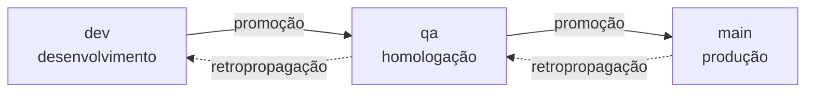

# Política de branches e de versionamento {#branch-and-versioning-policy}

Esta página é a **fonte** da política. Os workflows que a aplicam derivam
daqui — se um mecanismo diverge do que está escrito, o mecanismo está errado.

## Por que mecanizar {#why-mechanize-it}

Uma política de branches combinada em reunião sobrevive até a primeira
sexta-feira à noite. A pressa não é má-fé: é que a regra mora na cabeça das
pessoas, e uma cabeça sob pressão otimiza para o curto prazo.

Por isso a política aqui **não pede cooperação** — ela é imposta pelo CI.
Não por desconfiança, mas porque uma regra que depende de disciplina
individual não sobrevive a um incidente, e é justamente durante um incidente
que ela mais importa.

Duas consequências que aceitamos de propósito:

- **O PR fica mais burocrático.** Um nome de branch errado reprova o check.
  Esse é o custo.
- **A mensagem de erro tem de ensinar.** Um check que só diz "inválido"
  treina as pessoas a contorná-lo. Todo erro cita a regra, o que chegou e o
  exemplo correto.

## A escada {#the-ladder}

Três branches permanentes, **uma por ambiente**. O código sobe um degrau
por vez.



| branch | ambiente | o que significa estar aqui |
|---|---|---|
| `dev` | desenvolvimento | integrado, testado pelo CI |
| `qa` | homologação | em validação funcional |
| `main` | produção | o que está no ar |

Existia um quarto degrau, `rc` (pré-produção), entre `qa` e `main`. Ele foi
removido: com um único mantenedor e um ciclo curto, o degrau a mais custava
uma promoção inteira e um ambiente para separar "validado" de "quase pronto"
— uma distinção que não se pagava. `qa` passa a ser o único portão antes da
produção.

A remoção demorou a assentar por completo. O `pr-police` passou a operar com
três degraus imediatamente, mas o **bootstrap do Gitflow** continuou criando
`rc`, protegendo `rc` e commitando no repositório do usuário um
`branching-policy.md` que ensinava a escada de quatro degraus — o produto
documentando, para quem o usava, uma política que ele próprio já tinha
abandonado. Foi o achado nº 3 da
[primeira rodada de dogfooding](./primeiro-dogfooding.md), fechado depois
([RN-029](../business-rules.md#rn-029)).

Duas pontas soltas ficaram de pé de propósito, e por motivos diferentes: o
valor `create_rc_branch` continua no enum `bootstrap_step` do banco
(bootstraps já executados têm linhas com ele), e `rc` continua na lista de
**merge protegido** — veja a nota em
[permissions.md](../reference/permissions.md).

**Nenhum degrau pode ser pulado.** `dev → main` não existe, nem em
emergência — emergência tem caminho próprio (`hotfix`, abaixo), e ele também
respeita a escada, só que começando do topo.

## Taxonomia {#taxonomy}

Toda branch é `funcao/descritivo`, validada por `^.{0,30}/\S{0,32}$` — até 30
caracteres para a função, até 32 para o descritivo, sem espaços.

```
✅ feature/pr-police          ✅ bugfix/rate-limit-off-by-one
✅ hotfix/vaza-token          ✅ docs/politica-de-branches

❌ minha-branch               (sem função)
❌ ci/build-paralelo          (`ci` não está na lista; use `chore`)
❌ fix/algo                   (`fix` não está na lista; use `bugfix`)
```

A regex sozinha não basta: a função precisa estar na **lista fechada**.

### Quem nasce de onde {#whos-born-where}

| função | nasce de | PR mira | para |
|---|---|---|---|
| `breaking` | `dev` | `dev` | mudança incompatível |
| `feature` | `dev` | `dev` | funcionalidade nova |
| `bugfix` | `dev` | `dev` | correção comum |
| `perf` | `dev` | `dev` | desempenho |
| `refactor` | `dev` | `dev` | reestruturação sem mudança de comportamento |
| `chore` | `dev` | `dev` | manutenção, ferramentas, CI |
| `docs` | `dev` | `dev` | documentação |
| `test` | `dev` | `dev` | cobertura |
| `hotfix` | `main` | `main` | incidente em produção |

Uma correção achada em **homologação** não tem prefixo próprio: ela vira um
`bugfix/` partindo de `dev` e sobe a escada. Existia um `rcfix/` para a
pré-produção, e ele saiu junto com o degrau `rc` — prefixo sem branch de
origem é armadilha.

A origem não é sugestão — ela é **verificada por merge-base**. Um `hotfix`
nascido de `dev` leva junto tudo o que está em `dev` e ainda não foi
validado; empurrar isso às pressas para produção durante um incidente é como
o desastre acontece.

### Correção nascida no alto desce {#a-fix-born-high-goes-back-down}

O `hotfix` entra direto no degrau onde o problema apareceu. Isso deixa os
degraus de baixo **desatualizados** — a correção existe em `main` e não em
`dev`.

Por isso toda correção nascida no alto gera uma **retropropagação**: `main →
qa → dev`, em cadeia, em ordem. Enquanto ela não se completa, os degraus
afetados ficam travados — veja [O portão de retropropagação](#the-back-merge-gate).

A cadeia completa de um hotfix são **três PRs**: o hotfix mais as duas
retropropagações.

## Famílias de PR {#pr-families}

Todo PR recebe um rótulo de família, aplicado automaticamente:

| família | quando | exemplo |
|---|---|---|
| `trabalho` | uma função de trabalho → `dev` | `feature/pr-police` → `dev` |
| `correcao-alta` | `hotfix` → `main` | `hotfix/vaza-token` → `main` |
| `promocao` | degrau adjacente, subindo | `dev` → `qa` |
| `retropropagacao` | degrau adjacente, descendo | `main` → `qa` |

O rótulo não é enfeite: é ele que permite responder "quantos hotfixes
tivemos neste trimestre?" sem arqueologia no git.

<a id="push-direto-é-bloqueado"></a>

## Push direto é bloqueado {#direct-push-is-blocked}

Nenhuma das três permanentes aceita push direto. Toda mudança entra por PR.
É a **porta única** — e ela tem exatamente três exceções, todas de bots,
todas escritas aqui porque exceção não documentada vira precedente:

| exceção | quem | por quê |
|---|---|---|
| tags `v*` | `brabo-release[bot]` | versão nasce de workflow, nunca à mão |
| `.release/gate.json` em `main` | `brabo-release[bot]` | o portão precisa se escrever quando trava e destrava |
| a branch `gh-pages` | `github-actions[bot]` | publicar a documentação por degrau exige uma árvore mutável ([ADR 0034](../adr/0034-documentacao-publicada-por-degrau.md)) |

**A terceira é a mais fácil das três de aceitar, e vale dizer por quê, para
que ela não abra precedente para as difíceis.** `gh-pages` **não é branch de
código**: nada nela é fonte, tudo é gerado a partir de `docs/` e `website/`,
e apagá-la inteira não perde nada — o próximo push a reconstrói. Não há
revisor possível para um site gerado, e um PR por publicação seria cerimônia
sem leitor. O `git log` dela é o registro de cada publicação, com data e sha
de origem.

Ela também **não é permanente**, então não entra nos rulesets — é por isso
que o `GITHUB_TOKEN` basta, sem bypass e sem `BRABO_BOT_TOKEN`.

A segunda é a mais desconfortável das três, então vale dizer por que o
portão existe em vez de passar por PR: o portão trava as branches, e um PR
para abrir a trava seria bloqueado pelo próprio portão. A alternativa —
guardar o estado fora do repositório — trocaria uma exceção visível no
histórico por um estado invisível em algum painel. O commit do bot fica no
`git log`, com data e conteúdo.

O `tag-release` reconhece esse commit **pelo conteúdo** (ele só toca
`.release/`), nunca por autor ou mensagem: quem o escreveu é verificável,
quem *afirma* tê-lo escrito não é.

A configuração exata está em [Rulesets](../reference/rulesets.md), e
aplicá-la é passo manual — o repositório versiona a fonte, o GitHub recebe a
aplicação.

## Branches mergeadas são arquivadas {#merged-branches-get-archived}

Toda branch cujo PR foi mergeado sai da lista de branches **7 dias depois do
merge** — mecanicamente, por `archive-merged-branch.yml`, que roda uma vez
por dia (`schedule:`, mais `workflow_dispatch`) e percorre todas as branches
do repositório (AT-557, decisão do dono de 2026-10-15). Até lá a branch fica
onde está, para que uma correção de acompanhamento ainda possa ir por cima
dela. Uma branch só é arquivada quando todas estas valem:

- ela não é um dos nomes excluídos abaixo, nem vem de fork;
- nenhum PR com essa head está **aberto**;
- um PR com essa head foi **mergeado** neste repositório, e o mais recente
  foi mergeado há 7 dias ou mais (`DIAS_ATE_ARQUIVAR`);
- a ponta da branch ainda é o `head.sha` desse PR — uma branch que recebeu
  commit depois do merge **fica**.

Uma branch que nunca teve PR mergeado não tem data de merge e **nunca** é
arquivada por este job; removê-la continua sendo decisão manual. O resumo do
job lista o que foi arquivado, o que foi mantido (com o motivo) e o que
falhou; a falha em uma branch não para as outras, e deixa o job vermelho.

"Arquivada" é literal, não eufemismo para apagada: a branch passa de
`refs/heads/<nome>` para `refs/archive/<nome>`, um namespace que a interface
do GitHub não mostra como branch. O objeto do commit e o histórico dele
continuam no repositório exatamente como estavam — recuperáveis por quem
conhece a ref, com um único
`git push origin refs/archive/<name>:refs/heads/<name>` para trazê-la de
volta.

Quatro nomes nunca são arquivados, e o motivo é o mesmo para os quatro:
nenhum deles é trabalho descartável de feature.

| nome | por que é excluído |
|---|---|
| `dev`, `qa`, `main` | as três permanentes — elas aparecem como `head` de todo PR de promoção mergeado (`dev`→`qa`, `qa`→`main`), que é exatamente o caso que esta exclusão existe para pegar |
| `gh-pages` | a branch de deploy do site de documentação (veja "Push direto é bloqueado" acima) — não é branch de feature, e apagar `refs/heads/gh-pages` derrubaria o site no ar junto |

Uma quinta condição não é um nome, é uma fronteira: um PR cuja branch de
head mora num **fork** (`head.repo.full_name != base.repo.full_name`) nunca é
tocado. O `GITHUB_TOKEN` do workflow tem escopo neste repositório — ele não
tem nada que reescrever refs no de outra pessoa.

A decisão em si — quais quatro nomes são excluídos, e a checagem de fork — é
uma função pura testada
([`scripts/ci/archive-branch.ts`](https://github.com/daneiel/brabo/blob/dev/scripts/ci/archive-branch.ts)),
não shell inline: é a parte deste mecanismo em que errar de fato justifica
testes — e a elegibilidade de 7 dias também (`aptaParaArquivar`, mesmo
arquivo). O mesmo script então chama a API do GitHub: cria a ref
`refs/archive/` (ou a força, quando o nome já foi arquivado antes), a lê de
volta e confere que ela aponta para o SHA da branch, e só então apaga a
`refs/heads/` — assim uma falha nunca derruba uma branch sem deixar a cópia
arquivada para trás.

## Bots pulam a escada {#bots-skip-the-ladder}

PRs abertos por `dependabot[bot]` e `github-actions[bot]` são **isentos** da
validação de nome, origem e destino.

O motivo é prático: o Dependabot nomeia branches como
`dependabot/npm_and_yarn/brace-expansion-5.0.8`, e não há como ensinar a
taxonomia a ele. Recusá-lo significaria renomear branches à mão a cada
alerta de segurança — atrito em cima justamente do fluxo que precisa ser
rápido.

Mensagem pedagógica não ensina bot. A isenção é por **autor**, não por
prefixo, para que ninguém a use como brecha nomeando uma branch
`dependabot/`.

### Branches do Dependabot são permitidas sem limite de caracteres {#dependabot-branches-are-allowed-with-no-character-limit}

Além da isenção genérica de bots, a política nomeia as branches do
Dependabot explicitamente: **`dependabot/…` é nome de branch permitido, sem
critério de caracteres** — sem o limite de 30/32, com qualquer número de
barras. Nomes reais deste repositório:
`dependabot/npm_and_yarn/npm_and_yarn-582a9020a7`,
`dependabot/github_actions/dev/anthropics/claude-code-action-1.0.221` — o
segundo reprovaria no formato `funcao/descritivo` como branch de trabalho.

É uma regra nomeada (`PREFIXO_DO_DEPENDABOT` e `ehBranchDoDependabot` em
`scripts/ci/pr-police.ts`), e ela só vale quando **as duas** coisas são
verdade: a head começa com `dependabot/` **e** o autor é o próprio
Dependabot (`dependabot[bot]`, `app/dependabot`, ou `dependabot` com o
`type: Bot` da API). Um humano que nomeia uma branch `dependabot/…` continua
passando pela regra inteira e reprova em `FUNCAO-DESCONHECIDA`, com uma
mensagem dizendo que o prefixo é reservado e que atualização de dependência
feita à mão é `chore/`. A regra não confere o destino: trazer um PR de
segurança de `main` para `dev` é trabalho do `dependabot-para-dev.yml`
(próxima seção).

## O Dependabot entra pela dev {#dependabot-enters-through-dev}

A isenção acima é sobre o **nome** da branch. O **destino** não é isento:
uma atualização de dependência entra pela `dev`, como todo o resto, e chega
à `main` pela promoção `dev → qa → main`. Uma dependência mergeada direto na
`main` pula a escada e faz a `main` divergir da branch onde o trabalho
acontece.

Dois mecanismos, porque o GitHub trata os dois tipos de atualização de
forma diferente:

- **Atualizações de versão** obedecem a `target-branch: dev` em
  `.github/dependabot.yml`.
- **Atualizações de segurança** são ligadas na interface do repositório e o
  GitHub sempre as abre contra a branch **default** (`main`), ignorando
  `target-branch`. O `.github/workflows/dependabot-para-dev.yml` pega cada PR
  aberto do Dependabot contra a `main` e faz uma de duas coisas, decidida por
  uma função pura testada
  ([`scripts/ci/dependabot-para-dev.ts`](https://github.com/daneiel/brabo/blob/dev/scripts/ci/dependabot-para-dev.ts)):
  - **fecha** o PR com a justificativa, quando o lockfile da `dev` já resolve
    toda dependência do PR só em versões `>=` o limiar;
  - **redireciona** o PR para a `dev` em todos os outros casos — uma versão
    abaixo do limiar, um pacote ausente do lockfile, uma versão que não se
    compara, um corpo que ele não consegue ler.

O **limiar** é a primeira versão *corrigida* dos alertas abertos para aquele
pacote naquele lockfile, e só sem alerta ele é a versão-alvo do PR. A
diferença foi medida no PR #553: ele subia `@vitest/mocker` para `5.0.0`
enquanto a `dev` resolvia `4.1.11`, que é exatamente a primeira versão
corrigida do alerta — o Dependabot propõe a versão **mais nova**, não a
menor que corrige. Se os alertas não puderem ser lidos, a comparação cai
para a versão-alvo, que é mais estrita: ela só pode redirecionar mais, nunca
fechar mais. **Na dúvida, o PR é redirecionado, nunca fechado.**

O workflow roda em **push na `dev`**, e esse é o gatilho que importa.
`pull_request_target` e `schedule` só enxergam workflows da branch default,
e `pull_request` roda o workflow do merge de uma head que o Dependabot criou
a partir da `main` com a `main` — nenhum deles enxerga um arquivo que só
existe na `dev`, e a `main` só avança pela escada (a mesma armadilha medida
no `pr-police.yml`). Um push na `dev` roda a cópia da `dev`, então todo
merge ali varre os PRs abertos do Dependabot contra a `main`. O
`workflow_dispatch` evita esperar pelo próximo merge; o
`pull_request_target` passa a valer, e de imediato, quando o arquivo chegar
à `main`.

**Medido na primeira execução (2026-09-13):** a leitura dos alertas
**falhou** com o `GITHUB_TOKEN` do workflow, então hoje toda decisão cai
para a versão-alvo do PR. A consequência é a segura — um PR de segurança que
a `dev` já corrige, como o #553, é **redirecionado** em vez de fechado, e
fechá-lo continua sendo passo manual. O aviso no log da execução agora traz
a mensagem da API; ler os alertas com outra credencial é decisão à parte.

**Declarado:** depois de um redirecionamento, os checks obrigatórios da
`dev` **não** rodam sozinhos — eventos criados pelo `GITHUB_TOKEN` não
disparam workflows, e o Dependabot não aceita comandos desse bot. Alguém com
acesso de escrita comenta `@dependabot rebase`; o comentário do workflow diz
isso no PR.

### Atualização de pin se justifica sozinha {#a-pin-bump-justifies-itself}

Um PR do Dependabot que atualiza uma action toca arquivos de workflow, e o
check de deriva da documentação dispara por **arquivo**: o `release.yml` é
vigiado pela regra `politica-de-branches`, em `block`. Quando o diff inteiro
é o SHA do `uses:` e o comentário de versão ao lado, essa regra não tem nada
a perguntar — os PRs #578 e #580 foram destravados à mão, com um humano
escrevendo `docs-not-needed:` no corpo.

Desde a AT-094 **o bot escreve essa linha**, e só nessa classe de PR. Um
passo do job `Drift, gerados e build` (`.github/workflows/docs-check.yml`),
logo antes da deriva, chama
[`scripts/ci/dependabot-justifica-pin.ts`](https://github.com/daneiel/brabo/blob/dev/scripts/ci/dependabot-justifica-pin.ts)
sobre o mesmo intervalo que a deriva avalia. Ele escreve a linha quando **as
duas** coisas valem:

- o **autor** é o Dependabot (`ehBranchDoDependabot`: o prefixo
  `dependabot/` **e** o login do app — o prefixo sozinho seria uma porta
  para um humano);
- o **diff** é só troca de pin: todo arquivo é YAML sob
  `.github/workflows/` ou `.github/actions/`, modificado no lugar (nunca
  criado, apagado, renomeado nem com modo alterado), e toda linha alterada é
  um `uses: <action>@<sha>  # <version>` pareado com outro da **mesma**
  action, na **mesma** indentação, mudando só o SHA e/ou o token de versão.

Qualquer outra coisa — um job, um gatilho, um `with:`, um `package.json`, um
lockfile, um workflow novo, um autor humano — e nada é escrito: o docmap
julga como sempre julga. A regra nunca vira "PR de bot pula o docmap". A
linha leva um marcador HTML (`<!-- dependabot-justifica-pin -->`), e é o
marcador que a torna **reversível**: se um push posterior acrescentar algo
que não é pin, a linha do bot é **removida**. Um `docs-not-needed:` escrito
por humano nunca é tocado, nem para duplicar nem para apagar, e no `edited`
o passo só avalia quando quem editou é o próprio bot, então um humano que
apaga a linha do bot vence.

Desde a AT-100 esse caso do `edited` é explícito: `@dependabot rebase` emite
`synchronize` **e** `edited` de uma vez, o `concurrency` cancela um deles, e
quando o sobrevivente era o `edited` o passo era pulado e a deriva lia um
corpo sem a linha (#578, execuções `35412983999`/`35412984299`). O `edited`
do próprio bot agora avalia; o de um humano, não.

**Por que um passo no job de deriva e não um workflow irmão** — três
medições:

- editar o corpo com o `GITHUB_TOKEN` não dispara `edited`, então um
  workflow separado escreveria a linha e deixaria o check obrigatório
  vermelho;
- reexecutar o job de deriva não ajuda: a reexecução reusa o **payload** do
  evento original, com o corpo antigo (execução 34898913072, tentativa 2, em
  2026-09-17: o corpo já tinha a linha, o `PR_BODY` não, e a deriva
  reprovou);
- `pull_request_target`, onde o token escreve sem perguntar, só roda o
  workflow da branch **default** — a armadilha medida no `pr-police.yml`.

No mesmo job a deriva lê o corpo novo de `PR_BODY_FILE`, em ordem, sem
corrida e sem redisparo. Se a edição falhar, nenhum arquivo é escrito e a
deriva lê o corpo do evento: fail-closed, o PR fica bloqueado como antes.
Medido contra todo PR do Dependabot da história do repositório: os dez de
`github_actions` (#561–#565, #577–#581) são troca pura de pin; o de
`npm_and_yarn` (#553) não é.

## Quem aprova {#who-approves}

A exigência de aprovação tem **dois modos**, escolhidos pela variável de
repositório `APPROVAL_MODE`. Os dois estão implementados e testados; trocar
de um para o outro é **só mudar variáveis**, sem tocar código.

### Modo `solo` — o que vale hoje {#solo-mode--what-applies-today}

O projeto tem **um mantenedor**. A escada completa de aprovadores pressupõe
times que ainda não existem, e uma regra que não pode ser cumprida é uma
regra que ensina a trapacear.

| situação | exigência |
|---|---|
| PR de terceiro | **1 aprovação do owner** |
| PR de autoria do owner | passa no check **sem revisão** |

A segunda linha não é privilégio, é como o GitHub funciona: **ninguém
consegue aprovar o próprio PR pela interface**. Num projeto BDFL, o **merge
manual do owner é a aprovação** — é o ato deliberado dele, no momento em que
ele escolhe clicar no botão. Exigir uma revisão que a plataforma não permite
só produziria um check permanentemente vermelho.

A exigência de **pessoas distintas fica suspensa** neste modo, e suspensa de
propósito: com um único mantenedor, ela é aritmeticamente impossível.

### Modo `community` — para quando houver gente {#community-mode--for-when-there-are-people}

| destino | exigência |
|---|---|
| `dev` | 1 × devs |
| `qa` | 2 × devs |
| `main` | 1 × PO **+** 1 × gestão |

Para `main`, **pessoas distintas** — a exigência volta a valer. Para `dev` e
`qa` a distinção é automática: as vagas são do mesmo papel e cada pessoa só
conta uma revisão.

Os papéis são **listas de handles** em variáveis de repositório, não times
do GitHub:

```
APROVADORES_DEVS    = ana,bruno,carla
APROVADORES_PO      = paula
APROVADORES_GESTAO  = gustavo
```

Times seriam o caminho óbvio e **não funcionam aqui**: eles só existem
dentro de uma organização, este repositório pertence a um usuário, e o
`GITHUB_TOKEN` não consegue ler a filiação a times nem dentro de uma org —
isso exigiria um PAT com `read:org`. Com listas, o modo `community` é
ativável hoje e a troca é mesmo só uma variável.

O custo honesto: manter as listas atualizadas é trabalho manual, e uma
pessoa que sai do projeto continua aprovando até alguém editar a variável.
Se o projeto virar uma org com times de verdade, mudar a fonte é mudança de
uma função — a escada e a regra de pessoas distintas não mudam.

#### Por que "pessoas distintas" precisa de mais do que contar {#why-distinct-people-needs-more-than-counting}

Para `main`, quem está nas **duas listas** (`po` e `gestao`) poderia
preencher as duas vagas sozinho, se o check simplesmente contasse aprovações
por papel. O check trata isso como um problema de **atribuição**: existe uma
distribuição de aprovadores distintos que preencha todas as vagas?

Isso também evita o erro oposto. Se `paula` é a única em `po` mas também
está em `gestao`, dar a vaga de `gestao` a ela deixaria `po` descoberto —
mesmo que outra pessoa pudesse tê-la preenchido. A atribuição correta
existe, e o check a encontra.

### Regras comuns aos dois modos {#rules-common-to-both-modes}

- Só contam revisões **`APPROVED` no último commit**. Uma aprovação num
  commit antigo não conta: o que foi aprovado não é o que está para ser
  mergeado.
- O resumo do check mostra **o modo ativo, quem aprovou e o que falta**. Um
  check que só diz "faltam aprovações" obriga a adivinhar.

### Migrando para o modo `community` {#migrating-to-community-mode}

Pré-requisitos, antes de virar qualquer variável:

1. **Todo papel com gente de verdade.** `main` exige PO **e** gestão; se as
   duas listas apontam para a mesma pessoa, nenhum PR para `main` passa
   nunca — a regra de pessoas distintas não pode ser satisfeita. `qa` exige
   **dois** devs distintos: uma lista com um nome só bloqueia a promoção.
2. **Um critério de quem entra em cada lista**, definido e escrito — quem
   entra, quem sai, e com base em quê.

Passo a passo da troca:

```bash
gh variable set APROVADORES_DEVS   --body "ana,bruno,carla"
gh variable set APROVADORES_PO     --body "paula"
gh variable set APROVADORES_GESTAO --body "gustavo"

# last: with empty lists, community rejects everything
gh variable set APPROVAL_MODE --body community
```

A ordem importa. Com `APPROVAL_MODE=community` e as listas ainda vazias,
todo PR fica vermelho dizendo qual variável falta — correto, mas barulhento
sem necessidade. Preencha-as antes.

Para voltar: `gh variable set APPROVAL_MODE --body solo`.

**Sem deploy, sem merge, sem mudança de código** — a troca é só
configuração, e há um teste que passa a mesma entrada pelos dois modos
afirmando vereditos diferentes.

O critério de quem entra em cada lista — quem entra, quem sai, e com base em
quê — mora em `GOVERNANCE.md`, na raiz do repositório. Esta seção continua
sendo a fonte do MECANISMO (a escada, a exigência de pessoas distintas, o
passo a passo da troca); `GOVERNANCE.md` é a fonte do CRITÉRIO de quem
preenche cada papel.

## Promoção {#promotion}

O código sobe um degrau por um **PR de promoção**, aberto pelo workflow
`promote` (`workflow_dispatch`, entrada: o par da esteira).

O workflow **não mergeia nada** — ele calcula e abre o PR. O merge continua
sendo ato manual, como toda entrada numa branch permanente.

| passo | o quê |
|---|---|
| 1 | **quem dispara** — sob `APPROVAL_MODE=solo`, só o
`OWNER_HANDLE`. Qualquer outro ator reprova, nomeando quem pode |
| 2 | **par adjacente** — `dev→qa` e `qa→main`. `dev→main` é recusado,
apontando para o caminho em degraus |
| 3 | **versão do ciclo** — calculada a partir dos PRs mergeados desde a
última tag final |
| 4 | **PR aberto** — corpo listando cada PR, sua função, seu impacto e a
versão proposta |

O corpo do passo 4 é uma **tabela markdown**, e o título de um PR é texto
que ninguém controla — por isso ele é escapado antes de virar célula de
tabela (`celulaDeTabela`, em `scripts/ci/promote.ts`). Escapar o `|` não
basta — a barra invertida tem de ser escapada **primeiro**, senão um título
terminado em `\` logo antes de um `|` produz `\\|`, que o GFM lê como uma
barra invertida escapada seguida de um DELIMITADOR de coluna — a linha
ganha uma célula a mais e a tabela quebra. É por isso que a ordem das duas
substituições é estrutural, e o teste em `promote.spec.ts` conta os
delimitadores REAIS da linha em vez de comparar a string inteira.

### Promoção automática para qa (fase de teste) {#automatic-promotion-to-qa}

Enquanto a QA está na **fase de teste**, `dev` → `qa` se promove sozinha
(ADR 0217, decisão do dono de 15/10). O interruptor é a variável de
repositório **`QA_FASE_DE_TESTE`** (Settings → Variables): `true` liga;
apagá-la ou qualquer outro valor desliga, e a promoção volta ao workflow
manual `promote` acima.

Com ela ligada, todo push na `dev` roda o `promote-auto-qa.yml`: o mesmo
cálculo de versão (`promote.ts`) e o mesmo passo de abertura
(`scripts/ci/abrir-pr-de-promocao.sh`) abrem ou atualizam o PR `dev` → `qa`
pelo `BRABO_BOT_TOKEN`. Depois, `scripts/ci/promocao-automatica.ts` espera
até que **todo** check run na head do PR tenha terminado — o repositório não
tem checks obrigatórios, então `--auto` não esperaria — e mergeia com merge
commit só se nenhum terminou em `failure`, `cancelled` ou `timed_out` (entre
outros). Qualquer falha para a promoção e o resumo do job nomeia o check e o
link dele. Sem `BRABO_BOT_TOKEN` o job falha de forma visível. Um push sem
nada novo no ciclo (um merge de promoção, uma retropropagação, `dev` já
igual a `qa`) é desfecho normal, não falha: um `::notice::` e "nada a
promover: o ciclo está vazio" no resumo, saída 0, sem PR. No `promote`
manual, ciclo vazio continua reprovando.

A escada de aprovação dispensa a aprovação do owner **só** para esse PR:
par `dev` → `qa`, variável ligada e autor igual ao usuário do
`BRABO_BOT_TOKEN` (resolvido com `gh api user`). `qa` → `main` e todo outro
par continuam exigindo aprovação.

> **Fase de teste: a QA é promovida automaticamente a cada merge na dev e
> ainda não é considerada ambiente validado.** O site `/brabo/qa/` mostra
> isso na barra de anúncio, e o corpo do PR automático abre com essa frase.
> Cada promoção automática também produz uma tag `-qa.N` e republica
> `/brabo/qa/`.

### O check de promoção {#the-promotion-check}

Um PR de promoção passa por um check próprio, separado do `pr-police`.
Aquele valida a **forma** (nome, origem, destino); este valida o
**estado**:

| verificação | por quê |
|---|---|
| **intervalo limpo** | a head do PR é a ponta da branch de origem. Se
alguém empurrou algo depois de o PR abrir, o que seria promovido
não é o que está lá |
| **degrau anterior carimbado** | o commit tem a tag do estágio de baixo.
Promover sem ela é promover algo que nunca passou
por lá |
| **merge commit possível** | promoção é `--no-ff`. Um squash
achataria os commits do degrau de baixo, e a tag do estágio acabaria
apontando para um commit que não existe mais |

Uma verificação que **não pôde ser feita** conta como reprovada, nunca como
aprovada — uma ref que não resolve é ignorância, não permissão.

As duas primeiras verificações são exercitadas por
`scripts/ci/promotion-check.spec.ts`, no mesmo espírito dos specs do
`pr-police` e do `approval-ladder`. O que ele fixa não é a implementação mas
a regra: qual carimbo cada destino exige, e que o carimbo tem de ser
**daquele commit** — uma tag em outro commit, em outro estágio, ou uma que
não conseguiu resolver um sha não contam. Aceitar qualquer uma delas
deixaria a `qa` receber código que nunca passou pela `dev`.

A exceção é ler a **configuração de merge**: o token do workflow
legitimamente não tem permissão para lê-la, e bloquear toda promoção por
causa disso seria pior do que a falha que se quer evitar. Ali, a
impossibilidade vira **aviso**, e a garantia real mora no `tag-release`:
depois do merge, ele confirma que o commit tem **dois pais**. Isso não
depende de permissão nenhuma, e olha para o fato consumado em vez da
intenção declarada.

## Versionamento {#versioning}

Toda tag nasce de workflow, no formato `vX.Y.Z-dev.N` / `-qa.N` / final.

**A versão mora na TAG, não em arquivos.** Ninguém consegue commitar direto
numa branch permanente para subir o `package.json`, então exigir que os
quatro arquivos de versão acompanhem forçaria um PR de bump a cada ciclo — a
cerimônia que o cálculo automático existe para eliminar. O `release.yml`
confere os arquivos como **aviso** e só dispara numa tag final.

### O que a tag final produz {#what-the-final-tag-produces}

O `release.yml` é o fim da esteira, e o que ele entrega é deliberadamente
modesto:

| entrega | o quê |
|---|---|
| GitHub Release | com notas geradas do CHANGELOG por
`scripts/changelog.mjs` |
| conferência de versão | os quatro arquivos versionados, como **aviso** |
| as cinco imagens de produção | construídas para provar que a tag é **construível** — a quinta, o broker de containers, desde o [ADR 0162](../adr/0162-broker-publicado-e-oferecido-pelo-instalador.md) |
| a versão gravada em três delas | gravada como `ARG` na api,
no web e no broker — veja abaixo |
| **Trivy nas cinco imagens publicadas** | **por digest**, do registry, **antes** de assinar — HIGH/CRITICAL com correção reprova o release; o que não tem correção é relatado no resumo do job e como o asset `trivy-sem-correcao.md` da Release ([ADR 0172](../adr/0172-trivy-no-release-antes-de-assinar.md)) |
| **assinaturas das cinco imagens** | `cosign` keyless, **por digest**,
assinadas e depois verificadas na mesma execução
([ADR 0149](../adr/0149-assinatura-dos-artefatos-publicados.md)) |

A última linha é o que uma tag final ganhou na FASE 29, e vale ser preciso
sobre **por que por digest**: assinar `:5.0.0` atestaria aquilo para que a
tag apontava no instante da assinatura, e uma tag é um ponteiro móvel. O
digest é o que o `.release/images.json` já registra e o que o overlay de
produção já aplica.

A varredura vem **antes** da assinatura, e a ordem é a regra: uma imagem que
o Trivy reprova nunca é assinada, então o instalador nunca a pega. Ela usa
exatamente as flags e o `.trivyignore.yaml` da varredura do `ci.yml`, porque
a imagem que uma tag publica é um build frio de outra execução — não a que o
PR varreu. O push já aconteceu quando a varredura roda (é ele que cria o
digest), então uma tag reprovada deixa imagens sem assinatura no GHCR e
nenhuma Release; o `scripts/ci/trivy-do-release.spec.ts` guarda a ordem e as
flags, já que nenhum PR jamais roda este workflow.

A assinatura é **verificada na mesma execução, antes de a Release existir**.
Uma assinatura que ninguém tenta verificar é mais um arquivo no registry, e
a falha de outro modo apareceria na máquina de quem instala — o pior lugar
possível para descobri-la.

Os binários do runner vêm em seguida no `build-runner-binaries.yml`, com
**um** `checksums.txt` assinado cobrindo os quatro alvos em vez de uma
assinatura por binário: verificar três e esquecer o quarto é um modo de
falha que ninguém percebe, e um manifesto único o elimina.

#### A versão mora na tag, e o release é o que a leva ao artefato {#the-version-lives-in-the-tag-and-the-release-is-what-carries-it-to-the-artifact}

A tag é a fonte da versão, mas uma imagem não consegue ler a própria tag: o
container não sabe sob que nome foi publicado, e a tag pode ser movida. Por
isso o `release.yml` **passa a versão para o build** — e é o único lugar do
repositório que faz isso.

`VERSION` é uma variável do `docker-bake.hcl`, separada de `TAG`, com
default `dev`. Os alvos `api` e `broker` a convertem em `BRABO_VERSION` e o
alvo `web` em `VITE_BRABO_VERSION`; cada `Dockerfile.prod` a declara como
`ARG` com o mesmo default. Dali ela chega ao `service.version` dos spans da
api e ao rodapé das telas de auth no web
([ADR 0036](../adr/0036-telas-de-auth-fieis-ao-design-e-fontes-auto-hospedadas.md)).

Duas consequências, e as duas são intencionais:

- **Só um release carimba versão.** O `ci.yml` usa o mesmo bakefile com
  `TAG=prod` e não define `VERSION`, então as imagens dele reportam `dev`.
  Se a versão viesse de `TAG`, todo span de CI sairia com
  `service.version=prod`, que não é versão de nada.
- **Versão não é configuração.** Ela é `ARG` de build, não chave de
  ConfigMap, porque é propriedade do artefato: `brabo-web:1.1.2` não deveria
  conseguir reportar outra coisa. URLs continuam configuradas em runtime,
  via `/config.js`, porque essas são propriedade do ambiente (ADR 0024).

Mexer nessa cadeia é mexer na política: quem muda `VERSION` no bakefile ou
nos `ARG`s precisa mudar os dois lados juntos, ou a versão volta calada para
`dev` — sem erro em lugar nenhum, porque `dev` é um valor válido.

**As imagens não são publicadas** — `push: false`. Publicar num registry
ainda não foi decidido (o overlay de produção aponta para
`ghcr.io/OWNER/*`, um marcador), e a decisão está registrada no
[ADR 0027](../adr/0027-fase5-backup-hardening-release.md). Construir sem
publicar não é meia-medida: é o que impede uma tag de existir para um
commit que não compila.

Elas são construídas a partir do mesmo `docker-bake.hcl` que o `ci.yml`
usa, em paralelo. Antes eram quatro `docker build` sequenciais — mesmo
veredito, ~160s a mais por release.

**Não há passo de deploy, nem aqui nem em lugar nenhum.** A tag é o registro
do que **estaria** em cada ambiente, e isso vale mesmo sem ambiente. Um
passo que nunca roda apodrece: ninguém o testa, ninguém percebe quando
quebra, e no dia em que for ligado estará errado. Quando houver ambiente, o
deploy será um workflow **próprio**, disparado pela tag.

#### A Release depende do PAT, e a falta dele já custou seis {#the-release-depends-on-the-pat-and-its-absence-has-already-cost-six}

O `release.yml` dispara no `push` de uma tag final. Mas **uma tag empurrada
com o `GITHUB_TOKEN` não dispara workflow** — é a regra anti-recursão do
GitHub. O `tag-release` usa `secrets.BRABO_BOT_TOKEN || github.token`: sem o
PAT, a tag nasce e a Release não sai.

A degradação é visível de propósito (há um aviso em toda execução), mas
visível não é o mesmo que evitada: **`v0.2.0`, `v0.3.0`, `v0.3.1`,
`v1.0.0`, `v1.0.1` e `v1.1.0` existem sem Release** — seis ciclos inteiros
em que o aviso apareceu e ninguém agiu.

Com o PAT configurado, a `v1.1.1` fechou a esteira sozinha: tag empurrada
pelo token, `release.yml` disparado por ela, Release publicada. Antes dela,
só a `v0.1.0` tinha Release, e por um push manual. **O PAT não recupera as
seis anteriores** — ele só vale para tags novas.

Isso separa dois problemas fáceis de confundir:

| problema | correção |
|---|---|
| a Release não sai **sozinha** | configurar o
`BRABO_BOT_TOKEN` |
| uma Release que não saiu **não consegue sair depois** |
o `workflow_dispatch` do `release.yml` |

O segundo continuaria aberto mesmo com o PAT no lugar: qualquer falha de
workflow deixaria a tag órfã para sempre, porque republicar exigiria apagar
e recriar a tag — reescrever o registro para corrigir o efeito dele. Quem
republica é o dono do release, a mesma restrição do `promote`. O
procedimento está em
[Rulesets](../reference/rulesets.md#republishing-a-tag-that-was-orphaned).

### O CHANGELOG volta por PR, e por que não por push {#the-changelog-comes-back-via-pr-and-why-not-by-push}

Com a Release publicada, o `release.yml` abre um PR `chore/changelog-<tag>`
para a **`dev`** com o corte da versão no `CHANGELOG.md` — e, no mesmo
commit, com a versão anunciada em prosa nos **dois** arquivos que a
escrevem: `README.md` e `docs/intro.md`, a primeira página do site
publicado. Quem reescreve os dois é `scripts/ci/readme-version.ts`, e ele lê
e troca todos antes de escrever qualquer um: uma frase ausente em qualquer
um reprova o release inteiro em vez de deixá-lo escrito pela metade.

**O corte CONSOME a seção `## Unreleased`**, ele não acrescenta por cima
dela. Essa distinção não é cosmética: a prosa escrita no bloco `Unreleased`
de cada PR é a *explicação* do que mudou, e por cinco releases ela nunca
chegou à versão publicada — o `changelog.mjs` acrescentava a seção gerada no
topo e deixava a escrita à mão enterrada embaixo, para sempre. O merge é por
título de subseção, com as entradas **escritas** primeiro (elas explicam) e
o inventário de commits depois (ele prova o que entrou).

As três coisas se movem juntas de propósito. A versão é **gerável** (o
release sabe qual é), e o `docs:check` confere que ela bate com o corte mais
recente do CHANGELOG em cada um dos arquivos; separar as duas pontas faria
todo PR de changelog nascer vermelho, aberto pelo bot e esperando uma mão
humana que a política não prevê. Uma frase não encontrada REPROVA o passo em
vez de passar batido — a regex deste script e a de
`scripts/docs/generate.mjs` são os dois lados do mesmo contrato, e um teste
guarda o acordo.

Por PR, e não por push, porque nenhum dos caminhos diretos existe: a `main`
só aceita tag (bot de release) e `.release/gate.json` (bot do portão), e
commitar na `qa` ou na `dev` antes da promoção quebraria o **intervalo
limpo** do check de promoção — a head do PR deixaria de ser a ponta da
origem.

**Consequência aceita:** o `CHANGELOG.md` da `main` fica um ciclo atrás. Não
é perda de informação: a fonte autoritativa das notas é a **GitHub
Release**, publicada no mesmo instante que a tag, e o corte chega no ciclo
seguinte como qualquer outra mudança.

### O `.release/images.json` vai no mesmo PR — e não acrescenta exceção {#releaseimagesjson-rides-the-same-pr--and-adds-no-exception}

Desde o [ADR 0119](../adr/0119-imagens-publicadas-no-ghcr-por-digest.md),
o `release.yml` publica as imagens de produção no GHCR — cinco desde o
[ADR 0162](../adr/0162-broker-publicado-e-oferecido-pelo-instalador.md) — e
registra o que aquela tag publicou, **por digest**, em
`.release/images.json`. O instalador lê as cinco dali; o overlay do
Kubernetes aplica as quatro que a base dele declara (não há Deployment do
broker, por decisão).

A implementação óbvia — o bot escrevendo os digests em
`deploy/k8s/overlays/prod/kustomization.yaml` e empurrando — foi recusada
**aqui**, nesta política, antes de ser recusada no ADR: a porta única tem
exatamente três exceções, e um mecanismo que precisa de uma quarta toda vez
que cresce deixa de ser política e vira hábito. Ela também deixaria uma tag
decidir sozinha o que está rodando em produção, e essa decisão não é da tag.

Então o arquivo pega os dois caminhos que já existem. Ele é um **asset da
GitHub Release**, publicado no mesmo passo das notas — a cópia autoritativa,
disponível no instante em que a tag existe — e entra por `git add` no
**mesmo PR `chore/changelog-<tag>`** descrito acima, que é como a cópia
versionada chega à `dev` e sobe a escada como qualquer outra mudança. Mesma
consequência aceita do CHANGELOG, pelo mesmo motivo: a cópia da `main` fica
um ciclo atrás, e o asset da Release é o confiável nesse meio-tempo.

> Antes disso, **nada jamais escrevia no arquivo**. O gerador só era chamado
> com `--stdout`, para montar o corpo da Release, e o `CHANGELOG.md` tinha
> acumulado doze versões dentro de um único "Unreleased" — enquanto seis
> Releases saíram com corpo vazio, porque a "tag anterior" incluía as
> pré-releases da própria versão.

### A versão do ciclo {#the-cycles-version}

Vem do **maior impacto** entre os PRs mergeados desde a última tag final:

| função da branch | impacto |
|---|---|
| `breaking/` | MAJOR |
| `feature/` | MINOR |
| todo o resto | PATCH |

Um único `breaking` entre dez `docs` torna o ciclo inteiro MAJOR. E é a
**função da branch** que decide, não o rótulo de família: `breaking/x` e
`docs/y` estão os dois na família `trabalho`.

#### `breaking/` exige o marcador no commit {#breaking-requires-the-marker-on-the-commit}

O `pr-police` recusa um PR `breaking/` cujos commits não marcam a quebra —
`!` no assunto (`feat(api)!: …`) ou `BREAKING CHANGE:` no corpo — e também
recusa o inverso: um commit marcado numa branch que não é `breaking/`.

A regra existe porque são **dois mecanismos para o mesmo fato**, e eles
moravam separados: a versão vem da FUNÇÃO da branch (a tabela acima), e o
CHANGELOG detecta quebra pelo MARCADOR do commit. Nada os ligava.

O custo foi medido. `breaking/fase-7-auth-e-openapi` removeu o Keycloak,
deslogou todo mundo e subiu MAJOR corretamente — e o CHANGELOG não registra
quebra nenhuma, em **nenhuma** das doze versões, porque nenhum commit da
história jamais tinha usado os marcadores. As duas metades funcionavam; a
informação só nunca atravessou de uma para a outra.

Os dois sentidos importam, e o segundo é pior:

| situação | o que acontecia |
|---|---|
| `breaking/` sem marcador | a versão salta MAJOR e o
changelog não diz o que quebrou |
| marcador fora de `breaking/` | o changelog anuncia quebra e a
versão sai PATCH — quem confia no número quebra sem
aviso |

Uma verificação que não pôde ser feita (checkout raso, ref não buscada)
**não reprova**: a regra só roda quando o intervalo `base..head` é legível,
a mesma doutrina do check de contaminação.

Um ciclo **vazio** — nenhum PR desde a última final — reprova com mensagem
em vez de gerar tag. Uma tag nova apontando para o mesmo commit da anterior
faria o histórico de versões mentir.

#### De onde vêm os PRs do ciclo {#where-the-cycles-prs-come-from}

Do `git log` entre a última tag final e a `dev`, lendo o número do PR no
assunto do commit. Os **dois estilos de merge** precisam ser entendidos,
porque o número cai em lugares diferentes:

| estilo | assunto |
|---|---|
| squash | `feat(ci): faz coisa (#53)` |
| merge commit | `Merge pull request #56 from daneiel/feature/x` |

Ler só o primeiro foi um bug real: o `--no-merges` do intervalo escondia
justamente a linha que cita o número num merge commit, e o ciclo inteiro
parecia vazio — mergear o #56 na `dev` não gerou tag nenhuma.

**Promoção e retropropagação não contam.** Elas nascem de uma branch
permanente, e o que carregam já foi contado ou já foi lançado. Sem essa
exclusão, uma retropropagação de hotfix sozinha geraria um ciclo novo
inteiro: uma tag `-dev.N` numa versão que não mudou nada.

Duas peças fazem essa descoberta e **têm de concordar**: o `tag-release`,
que carimba na hora do merge, e o `promote`, que calcula a versão do PR de
promoção. Se divergirem, o PR de promoção anuncia uma versão e a tag sai com
outra. As duas usam a mesma função — a duplicação da lógica já custou uma
promoção, recusada como "ciclo vazio" logo depois de o `tag-release` ter
carimbado `-dev.2`.

> **O `promote` roda com o código da branch DEFAULT.** Ele é
> `workflow_dispatch` (veja a tabela de gatilhos em
> [Rulesets](../reference/rulesets.md)), então corrigir o cálculo na `dev`
> **não** corrige o disparo até a correção chegar à `main`. Até lá, o
> contorno é o já documentado: rodar `node scripts/ci/promote.ts` à mão, com
> o mesmo script.

### O `N` {#the-n}

`N` é quantas tags daquela versão já existem naquele estágio, mais um.

Não há estado guardado em lugar nenhum: **as próprias tags são o
contador**. É isso que faz "promovido, recusado, corrigido, repromovido"
virar `-qa.2` sem ninguém registrar a recusa — e o número acaba dizendo
quantas voltas o ciclo deu antes de passar.

### A âncora da tag final {#the-final-tags-anchor}

A tag final só nasce se o que está na `main` é **exatamente** o que passou
pela `qa`. Se não for, o workflow falha alto em vez de publicar.

Como a promoção é `--no-ff`, o merge **cria um commit novo** — o sha da
`main` nunca será o sha da `qa`. Comparar shas seria uma verificação
impossível de passar. O que se compara são duas coisas, e juntas elas são
mais fortes:

| verificação | o que garante |
|---|---|
| o `-qa.N` é **pai** do commit na `main` | foi aquele
que entrou, não algum ancestral |
| a **árvore** é idêntica | o conteúdo é byte a byte o que foi
validado |

A segunda é a que realmente importa. Se o outro lado do merge trouxesse um
arquivo, a árvore mudaria e a verificação reprovaria — exatamente o caso que
a âncora existe para pegar. Igualdade de árvore é mais forte que igualdade
de commit: ela olha para conteúdo, não para identidade.

### Os dois caminhos da `main` {#mains-two-paths}

A `main` recebe merges de duas formas, e elas pedem versões diferentes. A
distinção vem do **segundo pai** do merge commit — o lado que entrou:

| segundo pai | caminho | versão |
|---|---|---|
| o commit de um `-qa.N` | promoção | a do ciclo, **com âncora** |
| qualquer outra coisa | hotfix | última final **+ PATCH**, sem âncora |

O hotfix nasce da `main` e nunca passa pela `qa`. Exigir âncora dele seria
exigir o impossível — e a tag PATCH tem de nascer, porque é ela que os PRs
de retropropagação citam.

Um `-dev.N` como segundo pai **não** conta como promoção: um merge direto da
`dev` na `main` pula a `qa`, e a tag final acabaria carimbando código que
ninguém validou.

Casos que falham alto em vez de adivinhar:

| situação | por quê |
|---|---|
| um merge na `main` com um único pai | um squash apaga o lado
que entrou; sem ele o caminho não pode ser determinado |
| um hotfix sem tag final publicada ainda | PATCH é incremento sobre
algo já lançado |

E dois casos que **não geram tag nenhuma**, de propósito: o commit do
portão (só toca `.release/`) e a retropropagação `main → qa`/`dev`, que
carrega conteúdo que já está na `main`. Sem essa segunda saída, a
retropropagação carimbaria um `-qa.N` num commit que nunca foi promovido da
`dev` — uma tag dizendo "isto passou pela qa" em algo que não passou.

### Não há deploy {#theres-no-deploy}

Os workflows **terminam na tag**. Não há ambiente, não há GitHub
Environments, não há passo de deploy — nem um desligado. A tag é o registro
do que *estaria* em cada estágio, e se sustenta sozinha.

Um passo de deploy que nunca roda é um passo que apodrece: ninguém o testa,
ninguém percebe quando quebra, e no dia em que for ligado estará errado.
Quando houver ambiente, o deploy será um workflow próprio, disparado **pela
tag**.

Para ver com os próprios olhos o que uma tag carimbou:

```bash
make deploy-local TAG=v0.2.0-qa.1
```

### Squash num merge de esteira, e o alarme que tem destinatário {#squash-on-a-conveyor-merge-and-the-alarm-that-has-an-addressee}

Promoção é `--no-ff`, e esta é a regra mais quebrada: **três vezes** (#367,
#394, #464). Ela merece seção própria porque o dano é invisível no momento
em que acontece e só aparece um ciclo depois.

Um squash produz um commit com **um pai**. Numa promoção, o segundo pai era
a única coisa que amarrava os dois degraus: sem ele, o histórico da `qa` não
contém mais os commits da `dev`, a tag do estágio aponta para um commit que
não está mais nesse histórico, e — o sintoma que as pessoas de fato
encontram — **o próximo PR de promoção abre com arquivos em "conflito" que
não são conflito nenhum**, só ancestralidade perdida. Mergear esse
"conflito" pegando qualquer um dos lados é como o conteúdo diverge calado
entre os degraus.

**Onde isso é imposto, e por que não pode ser antes.** O método de merge é
escolhido no clique, depois de todo check do PR já ter rodado. Nenhum check
pré-merge consegue observá-lo: o `promotion-check` lê no máximo a
*configuração* do repositório, e muitas vezes não tem permissão nem para
isso. A verificação que conta olha para o fato consumado, no `tag-release`
(`conferirMergeDeEsteira`, `scripts/ci/version.ts`), e a regra difere por
branch porque a taxa de base difere:

| branch | o que entra | regra |
|---|---|---|
| `qa`, `main` | só tráfego da esteira | um pai só é sempre defeito |
| `dev` | trabalho, o dia todo, por squash **de propósito** | defeito só quando o PR trazia uma **aresta nova** — a head dele era um merge cujo segundo pai ainda não estava na base |

Essa distinção da `dev` é estreita de propósito. Um PR de trabalho que puxou
a `dev` para si antes de mergear também tem um merge como head — mas o
segundo pai dele já está na base, então um squash não perde nada. O PR que
não pode ser squashado é aquele cuja *entrega inteira é a aresta*, como o
#464: ele só existia para restaurar a ancestralidade, foi squashado, e não
entregou nada parecendo mergeado. Um alarme que disparasse em todo PR de
trabalho seria um alarme que ninguém lê, que é o modo de falha que esta
seção existe para evitar.

**Detectar nunca foi a lacuna — o destinatário era.** O check da `qa` existe
desde 2026-07-27 e disparou corretamente tanto no #367 quanto no #394. Nada
resultou disso: um workflow disparado por `push` falhando numa branch
permanente não tem PR para deixar vermelho — o merge já aconteceu —, então
ele deixa uma execução vermelha na aba Actions e nada mais. O repositório
tinha zero issues em toda a sua história; não havia canal. Por isso o
`tag-release` agora tem um job `avisar` que **abre uma issue** nomeando a
branch, o commit, a execução e a correção, e comenta na existente em vez de
abrir uma segunda para a mesma branch. Ele se autentica com `github.token`,
nunca com o PAT — um `BRABO_BOT_TOKEN` inválido é ele mesmo uma das falhas
que ele tem de relatar, e um alarme que depende do que pode estar quebrado é
um alarme que se cala exatamente quando é preciso.

**Corrigindo depois do fato.** O conteúdo já está correto dos dois lados; o
que falta é uma aresta no grafo. Um merge com estratégia `ours` a restaura
sem mudar uma linha:

```bash
git checkout -b chore/reconciliar-<algo> origin/dev
git merge -s ours origin/qa -m "chore: reconcilia ancestralidade"
```

E esse PR **também** tem de entrar como merge commit. Squashá-lo é
matematicamente garantido de não funcionar: a correção *é* o segundo pai.
Foi exatamente assim que o #464 falhou.

## O portão de retropropagação {#the-back-merge-gate}

O `hotfix` resolve o incidente e cria um problema novo: a correção está na
`main` e não na `qa` nem na `dev`. Se alguém promover `dev → qa → main`
antes de a correção descer, o release **desfaz o hotfix** — sem conflito,
sem aviso, meses depois, e ninguém vai ligar o bug de volta àquele merge.

O portão fecha esse buraco travando os degraus de baixo até a correção
descer.

### O estado {#the-state}

O portão mora em `.release/gate.json`, na `main`:

```json
{
  "versao": 1,
  "locked": ["qa", "dev"],
  "awaiting": "v0.2.1",
  "order": ["qa", "dev"],
  "historico": [
    { "tag": "v0.2.1", "sha": "…", "em": "…", "prs": { "qa": 60, "dev": 61 } }
  ]
}
```

| campo | o quê |
|---|---|
| `locked` | branches que não aceitam merge nenhum |
| `awaiting` | a tag do hotfix mais recente — `null` quando limpo |
| `order` | a ordem em que as travas saem: sempre de cima para baixo |
| `historico` | todo hotfix desta rodada; zera quando a cadeia fecha |

Ele é lido **sempre da `main`**, nunca da branch do PR: os PRs de
retropropagação levam uma cópia do arquivo junto, e ler essa cópia daria o
estado velho justamente durante a cadeia que ele muda a cada merge.

### O que acontece quando um hotfix é mergeado {#what-happens-when-a-hotfix-merges}

Tudo no mesmo workflow (`tag-release`), nesta ordem — e a ordem importa,
porque os PRs precisam citar a tag:

1. a tag **PATCH** nasce normalmente (`v0.2.0` + hotfix → `v0.2.1`);
2. os **dois PRs de retropropagação** são abertos: `main → qa` e
   `main → dev`;
3. o `.release/gate.json` é escrito na `main`, travando `qa` e `dev`.

### O acúmulo vem de graça {#accumulation-comes-free}

Um segundo hotfix durante um portão ativo **não abre PR novo e não cria fila
paralela**. Os PRs `main → qa` e `main → dev` já estão abertos e carregam o
que a `main` tiver — inclusive o hotfix novo. O portão só acrescenta a
entrada em `historico` e reafirma a trava. Uma branch já destravada **trava
de novo**, porque agora há conteúdo novo que precisa descer.

### O check, em todo PR {#the-check-on-every-pr}

| situação | veredito |
|---|---|
| `locked` vazio | ✓ passa |
| `main` → primeiro degrau ainda travado | ✓ é a retropropagação daquele degrau |
| `main` → degrau fora de ordem | ✗ "destrave `qa` antes de `dev`" |
| qualquer PR para uma branch travada | ✗ com o link para o PR que a
resolve |
| `hotfix/` → `main` | ✓ a `main` nunca é travada |

Um `bugfix/` para a `dev` durante um portão ativo é **bloqueado**. A
tentação é pensar "é correção, então deveria passar": não pode. Ele nasce da
`dev`, não carrega o hotfix, não resolve a trava, e só empilha mais trabalho
em cima do buraco.

### A ordem não é burocracia {#the-order-isnt-bureaucracy}

Destravar a `dev` antes da `qa` deixaria o degrau do meio sem a correção —
exatamente o buraco que o portão existe para fechar. O último destravamento
limpa `awaiting` e zera o histórico.

### A trava é conferida, não só declarada {#the-lock-is-checked-not-just-declared}

`locked` é o **registro da intenção**; a verdade é a contenção. Antes de
avaliar, o check pergunta ao git se o commit do hotfix **já** está em cada
branch travada, e deixa cair as travas que a realidade já satisfez.

Isso não é preciosismo: é a correção de uma armadilha real. Os PRs de
retropropagação levam o `gate.json` para a `qa` e a `dev`; meses depois,
uma promoção `qa → main` poderia trazer essa cópia velha de volta para cima.
Sem a conferência, uma trava fantasma reapareceria na `main` sem hotfix
nenhum por trás — e nada a destravaria, porque não há retropropagação
pendente. O repositório ficaria preso para sempre.

**Falhar ao conferir mantém a trava.** Desconhecido não é permissão.

## O que a política não resolve {#what-the-policy-doesnt-solve}

**Ela não impede código ruim.** Ela garante que o código passou pelos
degraus, não que ele é bom. Isso é trabalho da revisão, dos testes e dos
gates de QA/SecOps.

**Ela não substitui o julgamento durante um incidente.** Ela dá um caminho
rápido e seguro (`hotfix`) para que ninguém tenha de escolher entre "seguir
a regra" e "corrigir agora". Se a política está atrapalhando durante um
incidente, o problema é a política — abra uma issue depois, não trapaceie
durante.

## Papéis {#roles}

Enquanto `APPROVAL_MODE=solo`, os dois papéis abaixo ficam com o **owner**.
Não é concentração por descuido — é o reconhecimento, escrito em vez de
deixado implícito, de que um projeto de um único mantenedor não tem a quem
delegar.

| papel | quem | o que faz |
|---|---|---|
| **dono do release** | owner | o único autorizado a disparar
o `promote` |
| **plantão de hotfix** | owner | aprova o merge na `main` durante um
incidente |

As duas atribuições **se reabrem ao migrar para `community`**. Ali, o
plantão volta a ser uma pergunta de verdade: a escada vai exigir um PO + um
gestor para a `main`, e alguém precisa poder agir às 3h da manhã quando os
dois estiverem dormindo. Esse plano B terá de ser uma **exceção documentada
no mapa de exigências** — com quem pode exercê-la e o que fica registrado
depois —, nunca um contorno informal.

---

> **TODO(humano):** esta página foi reconstruída a partir do `CLAUDE.md`,
> não da apresentação original da política. Se a apresentação disser algo
> que não está aqui — SLA de retropropagação, papéis nomeados, uma política
> de branches obsoleta —, confira e complete.

---

<sub>Esteira exercitada de ponta a ponta em 2026-07-27: `v0.2.0-dev.1` → `-dev.2`
→ `-qa.1` → `-qa.2` → final, com uma recusa encenada entre os dois carimbos
de `qa` para provar que o `N` conta sozinho.</sub>
