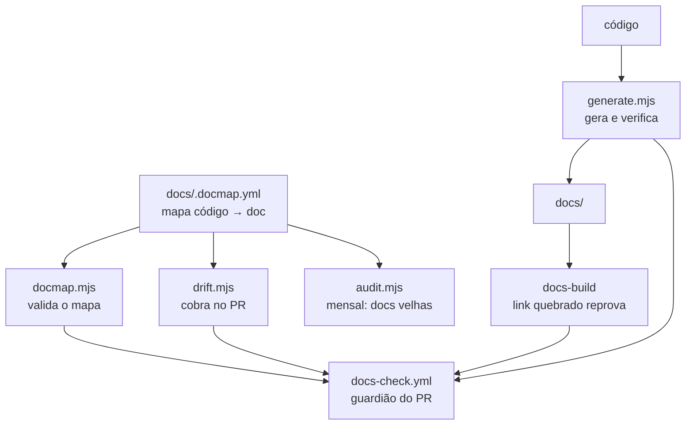

# Como a documentação se mantém viva {#how-documentation-stays-alive}

Documentação não morre por falta de escrita inicial. Ela morre por
**drift**: o código muda, a doc fica, e um dia alguém percebe que ela
descreve um sistema que não existe mais. Desse ponto em diante ninguém
confia em página nenhuma, inclusive nas que estão certas.

Esta página explica o mecanismo que existe para evitar isso. Leia-a se
o CI reclamou de você — e leia-a antes de desligar qualquer parte dele.

## O princípio: gerar > verificar > lembrar {#the-principle-generate--verify--remember}

Três níveis, em ordem decrescente de confiabilidade:

| nível | como funciona | quando usar |
|---|---|---|
| **Gerar** | a doc sai do código; drift é impossível | a lista É o conteúdo |
| **Verificar** | a doc é escrita à mão, o CI confere que está completa | a prosa importa mais que a lista |
| **Lembrar** | o CI avisa quem abriu o PR | quando é preciso julgamento humano |

O último nível é o mais fraco, e é por isso que ele é o último recurso.
Um aviso que ninguém lê não protege nada.

### Número em prosa é caso de *verificar* {#a-number-in-prose-is-a-verify-case}

Um número no meio de uma frase — "os 30 ADRs", "o próximo é `0031`" —
não é gerável: ele mora dentro do texto, e trocá-lo por um marcador
deixaria a prosa da fonte ilegível. Mas ele é **verificável**, e é aí
que deve morar.

Sem isso, ele envelhece calado. Foi o que aconteceu: o site publicado
dizia "28 deles" e "as 29 decisões" quando já eram 30, e "o próximo é
0030" com o 0030 já feito. Nada quebrou, nenhuma checagem reclamou — só
ficou errado.

**A lista de números verificados cresceu depois que um terceiro caso
provou o mesmo ponto.** Uma revisão externa achou o README anunciando
"as 158 RNs" quando havia 331 escritas — errado por mais do dobro, na
tabela que apresenta o repositório. Foi corrigido à mão (PR #412), o que
só zera o relógio: a próxima RN o deixaria desatualizado de novo. Então
a checagem deixou de cobrir só contagens de ADR e passou a cobrir
**três** famílias, cada uma lida do ARTEFATO e nunca de outra prosa:

| número em prosa | fonte de verdade |
|---|---|
| contagem de ADRs, número do próximo ADR | os arquivos em `docs/adr/` |
| contagem de RNs | os cabeçalhos `### RN-NNN` em `business-rules.md` |
| contagem de providers de LLM | os literais `capabilities` que `descobrirProviders()` encontra — a mesma fonte da tabela gerada em `llm-providers.md` |

A de providers é escrita **por extenso** ("nove providers"), e a
checagem compara com a palavra em vez de forçar a prosa a virar dígito:
a checagem existe para proteger o texto, não para remodelá-lo.

**Desde a AT-399 (2026-10-03) esses números também são reescritos.** PRs
paralelos que adicionavam cada um uma RN ou um ADR escreviam os números
compartilhados à mão, e cada merge deixava os outros desatualizados: o
guardião de docs falhou 8 de 30 execuções em três horas só por isso.
Então `pnpm docs:generate` (modo de escrita) agora corrige no lugar o que
a fonte determina — as contagens de ADR e RN acima, o número do próximo
ADR (descartando uma linha duplicada "o próximo é" deixada por um merge),
o recuo das entradas de `docs/adr/temas.yml` escritas na coluna 0 e a
linha de uma referência com símbolo (abaixo). As funções puras moram em
`scripts/docs/reescrita.mjs`, `refs-com-simbolo.mjs` (`novaLinha`,
`reancorar`) e `temas-de-adr.mjs` (`corrigirRecuo`). `--check` mantém a
mesma severidade: arquivo commitado desatualizado continua reprovando o
CI, e a correção é `pnpm docs:generate` mais um commit, como nos
arquivos gerados. O que ainda precisa de um humano: uma frase cujo
padrão parou de casar (`CEGO`), um ADR sem tema, uma variável sem
descrição e uma referência cujo símbolo saiu do arquivo, andou mais de
40 linhas ou empata entre duas ocorrências mais próximas.

O caso mais caro foi a **versão anunciada em prosa**: o README anunciou
`v0.1.0` da Fase 5 até a v2.1.0 — sete releases atrás da realidade, na
primeira coisa que um recém-chegado lê. A checagem compara a prosa com o
primeiro `## vX.Y.Z` do CHANGELOG, que é escrito pelo workflow de
release e volta por PR; uma tag lida do git não funcionaria, porque o
checkout raso do CI pode não ter tag nenhuma. O **badge**, por outro
lado, saiu da checagem e virou geração: ele lê a release do GitHub
direto (`shields.io/github/v/release`) e se atualiza sozinho — só se
verifica o que não dá para gerar.

E aconteceu **uma vez por porta de entrada**. `docs/intro.md` — a
primeira página do site publicado, à qual nem todo mundo chega pelo
README — continuou dizendo "Fases 1 a 5 concluídas, v0.1.0" enquanto o
produto estava na Fase 26. Conferir só o README nunca protegeu a segunda
porta, então `verificarVersaoAnunciada` passou a receber os dois
arquivos numa lista, e `scripts/ci/readme-version.ts` passou a escrever
nos dois no mesmo commit do CHANGELOG. As duas metades andam juntas de
propósito: uma checagem que cobrasse o que o gerador não escreve faria
todo release nascer vermelho num PR que o bot abre e ninguém consegue
consertar.

O padrão do `intro.md` exige a frase **inteira** — "Phases 1 through NN
complete, version vX.Y.Z" — e não só a versão: as duas metades
envelhecem juntas, e casar só metade deixaria a contagem de fases
mentindo ao lado de uma versão correta. A contagem de fases não é
gerável daqui: o release sabe a versão, não a fase.

`generate.mjs` agora confere essas afirmações contra a realidade do
diretório. E **padrão que para de casar também reprova**: uma checagem
cuja regex parou de achar a frase é pior que checagem nenhuma, porque
fica verde para sempre afirmando ter conferido algo para o qual nunca
olhou. Quando a frase muda, o CI diz `CEGO` e pede que o padrão seja
ajustado.

Acrescentar uma afirmação nova à checagem é uma entrada numa das listas
`afericoes` — `verificarContagensDeAdr` (arquivo, padrão, valor
esperado) quando a fonte de verdade é o diretório de ADRs,
`verificarVersaoAnunciada` quando é a última release do CHANGELOG — ou
uma função própria ao lado delas, quando não é nenhum dos dois.

**Contagens derivadas do código (AT-123).** Uma varredura em 2026-09-25
de `docs/`, `README.md`, `CONTRIBUTING.md`, `THIRD_PARTY_NOTICES.md` e
`CLAUDE.md` achou cinco números já errados — "nove schemas" (onze),
"doze operações" do contrato de git (quinze), "dez abas" (doze), "três
imagens" construídas pelo CI (cinco), "Thirteen types" de
`proposed_action` (vinte e um) — nenhum com checagem por trás. As
contagens cuja fonte é um lugar do código agora moram em
`scripts/docs/contagens-do-codigo.mjs`, chamado por
`verificarContagensDerivadasDoCodigo`: uma linha de tabela por FRASE (a
mesma contagem dita em dois arquivos são duas frases que envelhecem
separadas), cada uma apontando para um extrator que conta o artefato —
os blocos `overrides` dos dois `pnpm-workspace.yaml`, os `CASOS` e
`ARQUIVOS_CURADOS` do golden-set e o `floor.json` dele, o total que
`scripts/ci/imagens-pinadas.ts` imprime, `ALVOS`, o laço non-root do
smoke, os métodos de `GitProviderContract` e de `DockerPort`, o
`REGISTRO` de abas, os serviços do compose de dev sem `profiles:` (que
precisam TODOS ter healthcheck, senão o valor esperado vira uma frase
que a prosa não tem), `ACTION_TYPES`, o enum `action_status` e as
chamadas `pgTable(`. A comparação ignora maiúsculas e segue a forma da
frase (palavras em português no masculino/feminino, palavras em inglês
ou dígitos). Como os extratores são muitos, cada um é provado por
MUTAÇÃO em `contagens-do-codigo.spec.ts`: mude o artefato e não a prosa,
e ele tem de reprovar `DESATUAL`; remova a frase ou a fonte, e ele tem
de reprovar `CEGO`.

O que foi **datado em vez de derivado**, e por quê: as contagens de
arquivos por app em `architecture.md` e as "seis rotas" do broker mudam
com quase todo PR ou são lidas de um `switch`, então uma checagem só
acrescentaria ruído — elas levam "medido em 2026-09-25". Números que
descrevem um invariante de desenho ("duas camadas", "três estados") ou
uma medição passada já datada no lugar (`THIRD_PARTY_NOTICES.md`, as
transcrições de restauração do runbook) ficaram como estavam.

### Referências de linha com símbolo {#line-references-with-a-symbol}

Uma RN cita código por `caminho:linha`, e um número de linha envelhece
toda vez que alguém edita o arquivo. A RN-547 citava
`fechar_a_instalacao` em `install.sh:966` e `post_interno` em `:682`. Em
2026-09-17 eles estavam em `:1107` e `:809`, e em 2026-09-18 em `:1463`
e `:1165`. Um número de linha não pode ser gerado e, em geral, também
não pode ser verificado, porque `apps/api/src/foo.ts:40` sozinho não diz
o que deveria estar lá. Quando a RN também **nomeia o símbolo** ao lado
da linha, porém, a linha *pode* ser verificada. Esse é o único caso que
`generate.mjs` confere (`verificarRefsComSimbolo`, com a lógica em
`scripts/docs/refs-com-simbolo.mjs`, testada).

**O padrão é estreito de propósito.** Uma checagem barulhenta é
desligada no primeiro mês. Ela lê os três arquivos de RN
(`business-rules.md`, `business-rules/custo.md`,
`business-rules/autenticacao.md`) e pega só estas duas formas:

```
`<path>:<N>` (`<symbol>`     explicit reference
`:<N>` (`<symbol>`           continuation — inherits the path
```

- O símbolo tem de vir **logo depois** da referência, abrindo um
  parêntese e entre crases. Só espaço em branco pode ficar entre eles,
  inclusive uma quebra de linha.
- O símbolo tem de ser um **identificador**: `fechar_a_instalacao`,
  `join/3`, `git_dir?`, `Engine.Runners.RunnerReadiness`, `decide()`.
  `MARCADOR_SCHEMA=3`, uma frase ou um caminho não é símbolo, e é
  pulado.
- **Pares ambíguos são pulados**: `:640`/`:647` (`a`/`b`), ou duas
  referências antes de um símbolo. A checagem não tem como saber qual
  símbolo vai com qual linha.
- Uma continuação herda o último caminho explícito **no mesmo item de
  lista**. Uma linha em branco ou um novo `- ` encerra o item.
- O caminho é resolvido a partir da raiz do repositório. Se não estiver
  lá, a checagem usa o **único** arquivo rastreado cujo caminho termina
  com ele. Se nenhum arquivo casar, ou mais de um casar, a referência é
  contada à parte como não resolvida.

Uma referência **bate** quando o símbolo, ou o último segmento dele
após `.`, aparece como palavra inteira a até **±3 linhas** de `N`. A
janela admite uma citação que aponta para o docblock em vez da
assinatura. Ela fica pequena porque o drift anda dezenas ou centenas de
linhas. Quando uma referência não bate, a saída nomeia a linha mais
próxima onde o símbolo aparece. Desde a AT-399, `pnpm docs:generate`
reescreve `N` para essa linha quando a ocorrência mais próxima é
**única** (sem empate na mesma distância) e está a no máximo **40
linhas** (`DISTANCIA_MAXIMA_DE_REANCORA`); quando o símbolo sumiu do
arquivo, andou mais longe ou duas ocorrências empatam, a referência fica
como está e tem de ser relida pelo símbolo, à mão. A ocorrência mais
próxima pode ser uma chamada e não a definição — esse é o preço aceito
por não editar números à mão através de PRs paralelos, e o diff do
arquivo regenerado mostra cada movimento para revisão.

**Medido em 2026-09-18**, sobre todo `caminho:N` dos três arquivos:

| | contagem |
|---|---|
| referências `…:N` no total | 592 |
| casam com o padrão | 187 |
| corretas (dentro de ±3) | 116 |
| erradas | 71 |
| caminho não resolvido | 0 |

Uma conferência por amostragem das 71 não achou falso positivo: cada
referência que ela cobriu era drift real, uma renomeação ou um símbolo
que mudou de arquivo. Alargar a janela para ±5 limparia só três delas.
Nove estão entre 4 e 10 linhas fora, e as outras 62 mais longe. O item
de código da RN-547 foi relido pelo símbolo e corrigido no mesmo PR, o
que deixa **63**. São muitas para corrigir uma a uma dentro desta
mudança, e a ocorrência mais próxima nem sempre é a definição. A lista é
o que `pnpm docs:check` imprime.

**Severidade ao nascer: `warn`.** Ela relatava e não reprovava, porque
um `block` teria parado todo PR que tocasse um arquivo de RN por uma
dívida que outra pessoa deixou. Havia uma exceção, a regra da casa: se a
checagem extrai **zero** referências, isso é `CEGO` e **reprova**. Zero
significa que a sintaxe de RN mudou ou o extrator quebrou, e uma
checagem cega fica verde para sempre.

**O critério original para `block`** (PR #593): quando a lista estiver
**vazia**, e depois de **quatro semanas seguidas** de `docs:check` na
`dev` sem nenhuma referência errada nova nas RNs tocadas nessas semanas.
A partir daí, toda referência errada nova é culpa do PR corrente, e o PR
pode corrigi-la. Promover antes cobraria de cada PR a dívida de outra
pessoa. Se o padrão mostrar um falso positivo real antes disso, estreite
o padrão. Não alargue a janela.

**A lista zerou em 2026-09-26** (AT-122). Nos oito dias depois de a
checagem entrar, as 63 referências sabidamente erradas tinham crescido
para **75**. Esse crescimento é o drift que a checagem existe para
mostrar. As 75 foram relidas pelo símbolo contra o código daquele dia, e
nenhuma era falso positivo do padrão. A maioria tinha andado dezenas de
linhas. Uma era renomeação: `modo_de_execucao/1` virou
`exigencias_do_projeto/1` na RN-516. Uma tinha mudado de arquivo:
`escreverEnv` foi de `preflight.mjs` para `env-file.mjs`. Duas
apontavam para o teste certo, mas na linha do `it(`, enquanto o símbolo
(`types`) só aparece algumas linhas abaixo, no corpo. Essas duas agora
apontam para a linha do corpo. A janela ficou em ±3. Os itens com o pior
drift (RN-566, RN-567, RN-570 e RN-514) tiveram as referências vizinhas
não conferidas relidas na mesma passada. Depois disso, **273
referências casam com o padrão, 273 estão corretas e 0 estão erradas**.
As quatro semanas começariam a contar quando essa mudança chegasse à
`dev`.

**Promovida a `block` em 2026-10-01** (AT-122), por decisão do
mantenedor, sem esperar as quatro semanas. Cinco dias depois de a lista
zerar, a `dev` tinha **140** referências erradas de novo, de 896 que
casam com o padrão: o `warn` não segurou o drift, porque um aviso sobre
o qual ninguém tem de agir é um aviso que ninguém lê. As 140 foram
relidas pelo símbolo na mesma mudança que promoveu a checagem, nunca
somando um delta, e a janela ficou em ±3. Nenhuma era falso positivo do
padrão, e nenhum símbolo faltava no arquivo dele. O que a passada achou
além do drift de linha:

- **Sobras de merge.** Três itens tinham sido duplicados por resolução
  de conflito, uma cópia com números mais antigos ao lado de uma com
  números mais novos (o `Where` da RN-120, o `Código` da RN-547 e a
  linha de `SessionPage.tsx` da RN-626). A cópia desatualizada foi
  removida, e é por isso que o total foi de 896 para **883**.
- **Uma referência cujo assunto mudou (drift de estado, não de
  linha).** A RN-587 citava o teste de uma mensagem do `infra`; desde a
  RN-617 o Infra Lead conversa, e o teste agora usa `qa` como o agente
  do roster sem conversa. A referência agora diz isso. A regra da RN
  não mudou.
- Vizinhas não conferidas nos itens com o pior drift (RN-547, RN-567,
  RN-587, RN-609, RN-663, RN-566) foram relidas na mesma passada onde
  o teste ou a cláusula que elas nomeiam pôde ser identificado.

Depois disso, **883 referências casam com o padrão, 883 estão corretas
e 0 estão erradas**.

**Severidade agora: `block`.** Uma referência que não bate, **ou** cujo
caminho não resolve mais a um único arquivo rastreado, reprova o
`docs:check`. As duas são o mesmo drift: a RN aponta para onde o código
não está. Zero referências continua `CEGO` e continua reprovando. O
veredito é `veredito` em `refs-com-simbolo.mjs`, provado por mutação no
spec ao lado: uma referência movida para fora da janela reprova, um
símbolo que saiu do arquivo reprova, um caminho que não resolve mais
reprova, e texto reescrito até a extração dar zero é `CEGO`, nunca `ok`.
Quando reprovar, corrija a referência **pelo símbolo** (a saída nomeia
a linha mais próxima onde ele aparece, o que é uma pista, não uma
correção). Não alargue a janela, e não estreite o padrão para fazer uma
referência real sumir; estreite-o só por um falso positivo real, com o
caso no spec.

As traduções pt-BR dos três arquivos de RN sob `website/i18n/` **não**
são conferidas. Elas têm poucas referências (23 casam com o padrão, 15
delas erradas em 2026-10-01), e a tradução está atrás da fonte em inglês
de todo modo; conferir uma cópia que ninguém mantém em dia reprovaria
todo PR pelo atraso da tradução.

### Todo cabeçalho de RN carrega sua âncora {#every-rn-heading-carries-its-anchor}

A âncora `{#rn-NNN}` num cabeçalho de RN é o contrato para links de
fora: ela sobrevive a uma RN com título novo e a uma RN movida para
outro arquivo. Em 2026-09-26 (AT-230) a `dev` tinha **451** cabeçalhos
`### RN-` e **449** âncoras. A RN-305 e a RN-306 tinham sido escritas
sem uma, em `business-rules.md` e na tradução pt-BR dele, e nada
reprovou. O build do site não pega isso: sem âncora explícita o
Docusaurus deriva o id do texto do cabeçalho e a página compila. O que
quebra é um link `#rn-305` que alguém escreve depois. A contagem de RNs
também não pega, porque conta cabeçalhos, não âncoras.

`generate.mjs` agora confere isso (`verificarAncorasDeRn`, com a lógica
em `scripts/docs/ancoras-de-rn.mjs`, provada por mutação em
`ancoras-de-rn.spec.ts`). Todo cabeçalho, de qualquer nível, que
**começa** com `RN-<dígitos>` tem de **terminar** em `{#rn-<mesmos
dígitos>}`, zeros à esquerda incluídos (`RN-001` → `rn-001`). Âncora
ausente e âncora com outro número ou nome reprovam as duas, uma linha
por cabeçalho, com arquivo e linha. Zero cabeçalhos encontrados é
`CEGO` e também reprova.

**Severidade: `block`**, diferente das referências de linha acima: não
há dívida herdada (as duas âncoras ausentes foram acrescentadas na
mesma mudança), e cada cabeçalho novo é escrito pelo PR que o
acrescenta.

**As traduções também são cobertas.** Os arquivos são achados por glob:
`docs/business-rules.md`, `docs/business-rules/*.md` (a fonte pt-BR,
ADR 0216), e os mesmos dois caminhos sob
`website/i18n/<locale>/docusaurus-plugin-content-docs/current/` para
cada locale traduzido em `LOCALES_TRADUZIDOS` (`en`, `ru`, `zh-Hans`).
O site de um locale serve `business-rules#rn-305` a partir do arquivo
traduzido, e uma tradução anterior tinha copiado o cabeçalho sem a
âncora. A regra é por cabeçalho, então uma tradução parcial não é
problema: uma RN que não foi traduzida cai na fonte pt-BR, que é
conferida de qualquer modo.

### A tabela de procedimentos do runbook {#the-runbook-procedures-table}

O runbook termina com uma tabela dos seus procedimentos de **operação**
— `procedure | anchor | verification | schedule` — dizendo o que prova
cada um e o que roda essa prova
([Procedures and how each is verified](../runbook.md#procedimentos-e-verificacao)).
Ela existe por causa do critério de fechamento do EP-015: nenhuma linha
com verificação vazia ou que diga "ver abaixo", e as provas que existem
rodam por agenda, não de memória. Medido em 2026-09-25 (AT-129), a
tabela de que o critério falava não existia no repositório: uma cópia
de sete linhas morava nas notas do mantenedor, contra 28 procedimentos
de operação aqui, e uma linha apontava para outra nota. Uma tabela de
nomes de arquivo escrita à mão envelhece do mesmo jeito que números em
prosa — um spec é renomeado, um workflow perde o `schedule:`, e a
célula continua afirmando.

`generate.mjs` a confere (`verificarProcedimentosDoRunbook`, lógica em
`scripts/docs/procedimentos-do-runbook.mjs`, provada por mutação em
`procedimentos-do-runbook.spec.ts`). Por linha, ela reprova quando:

- a célula **anchor** não tem link `(#id)`, ou o id não é um `{#id}`
  explícito num cabeçalho do runbook — o mesmo contrato das âncoras de
  RN: uma seção com título novo não pode quebrar o link;
- a célula **verification** está vazia, diz "see below/above", nomeia
  um arquivo que não é rastreado pelo git ou um alvo `make` que o
  `Makefile` não tem, ou não nomeia nada conferível e não começa com
  `**None**` — a declaração explícita de que não existe prova;
- um segmento de **schedule** (eles são separados por `;`) não começa
  com sua classe de gatilho — `weekly`/`daily`/`monthly`, `every PR`,
  `every tag` ou `manual` — ou um workflow que ele cita não existe ou
  não tem esse gatilho no `on:` lido (`schedule:`, `pull_request`,
  `push: tags`). Um segmento `manual` não pode citar workflow.

A coluna se chama `schedule` e ainda aceita `every PR` e `every tag` de
propósito. A pergunta do critério é "roda sem alguém lembrar?", e um
spec que o `ci.yml` roda em todo pull request responde que sim;
chamá-lo de `manual` seria errar no sentido oposto. O que a checagem
garante é que a classe escrita é a que o workflow **tem**: `weekly`
apontando para um workflow sem `schedule:` reprova, que é o caso que a
AT-193 nomeou.

Seção ausente, tabela ausente, cabeçalhos de coluna mudados ou zero
linhas é `CEGO` e reprova.

**Severidade: `block`**, pelo mesmo motivo das âncoras de RN: a tabela
nasceu com toda linha conferida, então não há dívida herdada, e o que a
quebrar depois (um spec renomeado, um workflow que perdeu a agenda) é
culpa do PR que a quebrou, que é também o PR que pode consertá-la.

**Só o runbook da fonte (`docs/runbook.md`) tem a tabela.** A cópia
pt-BR antiga dele estava atrás (AT-209) e saiu com o ADR 0216; uma
tradução futura sob `website/i18n/<locale>/` cai na regra `traducao` do
docmap (`warn`) e não teria os dez ids explícitos que esta tabela
acrescentou. Uma segunda cópia da tabela ali, sem conferência, seria
exatamente a cópia que a tabela existe para substituir.

### O índice de ADR é agrupado por tema {#the-adr-index-is-grouped-by-theme}

O índice de ADR era agrupado por fase. Quando as fases acabaram, a
última seção virou o índice: medido em 2026-10-01, 148 das 191 linhas
moravam sob `## Phase 12`. O [ADR 0202](../adr/0202-o-indice-de-adr-por-tema.md)
o agrupa por **tema**, e põe o tema **fora** do ADR — um ADR aceito
nunca é editado, nem para ganhar uma chave `tema:` no frontmatter.

O tema mora em `docs/adr/temas.yml`, ao lado do índice: `temas:` é a
lista fechada e ordenada (`id`, `titulo`, `descricao`) e `adrs:` mapeia
cada número de ADR para UM tema. O índice é **conferido, não gerado** —
as descrições de uma linha são curadas e nenhum script as escreve, o
mesmo motivo que `verificarIndiceAdr` dá — e cada tema é uma seção
`## <titulo> {#tema-<id>}`, na ordem da lista, com as linhas em ordem
numérica.

`generate.mjs` o confere (`verificarTemasDeAdr`, logo depois de
`verificarIndiceAdr`; lógica em `scripts/docs/temas-de-adr.mjs`,
provada por mutação em `temas-de-adr.spec.ts`). Ele reprova um arquivo
de ADR sem tema, um tema no mapa que não está na lista, uma entrada do
mapa para um ADR que não existe, um tema listado sem ADR, um id ou
título de tema repetido ou malformado e, no índice, uma seção de tema
ausente, repetida, com nome errado, fora de ordem ou desconhecida, ou
uma linha de ADR sob a seção de outro tema, fora de qualquer seção de
tema, repetida ou fora de ordem numérica. YAML ilegível, lista ou mapa
vazio, ou um índice sem seção de tema nenhuma (o antigo índice por
fase) é `CEGO` e reprova.

**Severidade: `block`**, como a tabela do runbook: nasceu com todo ADR
classificado, então o que a quebrar depois é um ADR novo cujo PR
esqueceu a linha dele em `temas.yml` — o PR que pode consertá-la. As
traduções do índice moram sob `website/i18n/<locale>/` e não são
conferidas; a regra `traducao` avisa, como sempre.

## As peças {#the-pieces}



### `docs/.docmap.yml` — o mapa {#docsdocmapyml--the-map}

Liga caminhos de código aos documentos que dependem deles. É a única
fonte que diz "quem mexe nisto precisa revisar aquilo".

Duas severidades: `block` reprova o PR, `warn` só comenta. E um
atributo `generated: true`, que marca os documentos que saem do gerador.

Uma regra que cobra o que não faz sentido ensina as pessoas a recorrer
à saída de emergência por reflexo. É por isso que `politica-de-branches`
vigia uma **lista de permitidos** em `scripts/ci/` — os scripts que *são*
a política de branches e os specs deles — em vez de `scripts/ci/**`
menos uma lista de exclusões mantida à mão, na qual todo spec novo de
alcance do repositório inteiro naquela pasta tinha de entrar (onze até
a AT-206). A lista de permitidos não abre mão de falhar fechada:
`scripts/docs/politica-de-branches.spec.ts` deriva o conjunto do
repositório — todo arquivo de `scripts/ci/` cujo docblock de abertura
cita `branching-policy.md`, mais o spec dele — e reprova se a regra
divergir. Um script novo de política declara sua fonte no cabeçalho,
como os outros, e o spec faz o resto.

### `docmap.mjs` — valida o mapa {#docmapmjs--validates-the-map}

Roda antes de todo o resto, porque um mapa quebrado faz o resto mentir.
Reprova se:

- **um glob não casa com arquivo nenhum** — uma regra morta. Ela nunca
  dispara, e dá a impressão de uma cobertura que não existe. É o defeito
  mais silencioso que um docmap pode ter, e foi encontrado em 8 globs
  quando o validador entrou.
- um documento para o qual o mapa aponta não existe
- há id duplicado ou `severity` inválida

### `generate.mjs` — gera e verifica {#generatemjs--generates-and-verifies}

Dois modos de saída:

**Arquivo inteiro** — `docs/reference/scripts.md`. Não há prosa a
preservar: a lista de comandos é o conteúdo. Ela vem do `package.json`
de cada pacote e dos alvos anotados do `Makefile`. A lista de pacotes é
declarada em `gerarScripts`, incluindo os dois pacotes fora do
workspace (`website/`, `e2e/`, rodados com `--dir`), e um `package.json`
ausente ou que não parseia reprova a geração nomeando-o — antes ele
descartava o pacote em silêncio (AT-224).

**Bloco marcado** — o trecho entre `<!-- BEGIN:GENERATED:<id> -->` e
`<!-- END:GENERATED:<id> -->` dentro de um arquivo escrito à mão. É o
caso de `configuration.md` e `events.md`: ali, a prosa ("o que quebra
quando esta variável está errada") vale muito mais que a lista, mas a
**lista** precisa estar completa. O bloco é o inventário; o texto em
volta é a explicação.

O inventário marca com ⚠️ o que aparece no código e **não** tem
descrição na prosa. Foi assim que `tool.result` e `agent.response` —
dois tipos de evento reais — apareceram depois de terem ficado de fora
do primeiro rascunho.

**O que o inventário de ambiente pega, medido (AT-124, 2026-09-25).**
As fontes e seus globs moram em `scripts/docs/fontes-de-env.mjs`,
provadas contra a árvore real por `fontes-de-env.spec.ts`. Uma mutação
por fonte — um `process.env.X` novo num arquivo direto sob `e2e/`,
aninhado em `e2e/suporte/`, direto sob `apps/api/scripts/` e aninhado
um nível abaixo dele, cada um com `git add` — fez o `--check` reprovar
com `DESATUAL` em `configuration.md` nos quatro. Um buraco foi achado e
fechado: o filtro `.spec.`, certo para fontes onde um spec é teste
unitário ao lado do código, também descartava `e2e/testes/*.spec.ts` —
os próprios testes Playwright, onde uma variável nova de `e2e/` tem mais
chance de nascer — e essa mutação passava verde. Um limite fica
declarado: o inventário lê só arquivos **versionados** (`git ls-files`),
então um arquivo não rastreado é invisível até o `git add`.

**`deploy/k8s/*.sh` virou fonte (AT-212, 2026-09-28).** O bootstrap e
as provas de propriedade leem vinte e poucas variáveis do ambiente —
nome do cluster, namespace, a conta do smoke, os tetos de cada prova — e
nenhuma estava no inventário. Elas são fonte `ferramenta`, casadas pela
**expansão com default** do shell (`${X:-…}`, `${X:=…}`, `${X:?…}`) e só
por ela: um `${X}` puro é quase sempre variável do próprio script.
Mutação: um `${X:-x}` novo em `deploy/k8s/validate.sh`, no stage, fez o
`--check` reprovar com `DESATUAL` e uma linha `SEM DESC.` nomeando a
variável e o arquivo.

**O ⚠️ de ambiente é portão (AT-211, 2026-09-27).** Até então o que
reprovava era só o **bloco desatualizado**: assim que o `docs:generate`
o reescrevia, a variável ficava ali com ⚠️ e o `--check` passava —
`HUGGINGFACE_API_TOKEN` e `HUGGINGFACE_HUB_URL` ficaram assim por meses.
Por decisão do mantenedor, o `--check` agora reprova **qualquer** ⚠️ no
inventário de ambiente, para as **duas** espécies de fonte (`produto` e
`ferramenta`), mesmo com o bloco em dia. A falha nomeia a variável, o
arquivo que a lê e a seção de `configuration.md` onde a descrição vai
(linhas `SEM DESC.`). A regra mora em `scripts/docs/inventario-de-env.mjs`
e é provada por mutação em `inventario-de-env.spec.ts`: uma variável
nova sem descrição reprova, a mesma com descrição passa.

Um `**TODO(humano):**` na linha que cita a variável **conta como
descrição** e não reprova: a regra de docs é "nunca inventar; sem
informação, TODO(humano)", e um portão que reprovasse o TODO empurraria
quem não sabe o que a variável faz a inventar uma frase para ficar
verde. O TODO é uma lacuna **declarada**, com a pergunta escrita onde a
resposta vai; o ⚠️ é uma lacuna **silenciosa**. O `--check` ainda lista
as variáveis descritas só por um TODO, numa linha `TODO`, sem reprovar.
O inventário de eventos em `events.md` mantém seu ⚠️ como lacuna
visível — a decisão cobriu só o inventário de ambiente.

`--check` não escreve nada e reprova se qualquer coisa fosse ficar
diferente. É o modo do CI.

### `drift.mjs` — cobra no PR {#driftmjs--enforces-it-in-the-pr}

Cruza `git diff --name-only <base>...HEAD` com o mapa. Para toda regra
disparada cujo documento não foi tocado: `block` reprova, `warn`
comenta.

Num PR do Dependabot cujo diff é só troca de pin de action, um passo
logo antes do drift (`scripts/ci/dependabot-justifica-pin.ts`) escreve a
linha `docs-not-needed:` no corpo, no mesmo job, para escrever e ler
numa execução só. O workflow escuta `edited`, e `@dependabot rebase`
emite `synchronize` e `edited` juntos; o `concurrency` cancela um, então
a execução que sobrevive pode ser a do `edited`. Por isso o passo também
avalia no `edited` **quando quem editou é o bot** (AT-100), e nunca
quando é um humano (a remoção da linha por ele vence). Não tem como
entrar em laço: edições de corpo feitas com o token do workflow não
disparam `edited`. A falha fica fechada: se a escrita falha, o drift lê
o corpo do evento e o PR continua bloqueado.

### `audit.mjs` — a auditoria mensal {#auditmjs--the-monthly-audit}

A checagem de drift pega uma doc que ficou **errada** num PR. A
auditoria pega uma doc que ficou **velha** sem ninguém mexer nela — o
que é mais difícil de notar. Ela relata:

- páginas sem alteração há meses cujo código correspondente mudou desde
  então
- itens `TODO(human)` pendentes
- referências `arquivo:linha` que não resolvem mais
- ADRs em status `proposed` há mais de 60 dias

Sempre na **mesma** issue, atualizada no lugar. Uma issue nova todo mês
vira spam, e spam é desligado.

### O build do site {#the-site-build}

`onBrokenLinks`, `onBrokenAnchors` e `onBrokenMarkdownLinks` estão em
`throw`. Mover um arquivo sem corrigir quem aponta para ele quebra o CI
em vez de virar um 404 em produção. É o mecanismo mais barato do
conjunto inteiro.

### Página nova precisa entrar à mão no `sidebars.ts` {#a-new-page-needs-to-be-added-to-sidebarsts-by-hand}

O conteúdo Markdown mora em `docs/`, mas o **roteamento** mora em
`website/sidebars.ts` — e as seções dele enumeram os itens um a um, em
vez de varrer o diretório. Criar um arquivo em `docs/` sem acrescentá-lo
lá produz uma página que existe, é servida por URL direta e **não
aparece na navegação**.

O build **não** reprova por isso: uma página órfã não é um link
quebrado. É uma conferência visual, e é o único passo do mecanismo sem
rede de segurança — depois do `pnpm docs:build`, abra a barra lateral e
confirme que a página está lá.

A exceção são os ADRs: o grupo "Decisões (ADR)" é **derivado** a cada
build de `docs/adr/temas.yml` e dos arquivos em `docs/adr/` — uma
subcategoria por tema, na ordem da lista, com os ADRs em ordem numérica
(AT-560). ADR novo entra no grupo do tema dele sem tocar no
`sidebars.ts`. Se o parser não achar tema nenhum, ADR mapeado nenhum ou
um ADR sem tema (que o `docs:check` já reprova), o build quebra com erro
nomeado em vez de desenhar uma lateral errada. A Explicação é enumerada à mão em
cinco grupos por assunto, e página nova ali ainda entra pelo caminho
acima.

### `api-render-check.mjs` — build verde não é página que renderiza {#api-render-checkmjs--a-green-build-isnt-a-page-that-renders}

Esta peça existe por causa de uma lição cara: **as 117 páginas de
operação da referência da API foram ao ar mortas nas releases `v1.0.0`
e `v1.0.1`**, e nenhuma checagem pegou.

A configuração do Docusaurus não declarava `docItemComponent:
'@theme/ApiItem'`, então o Docusaurus usou o `@theme/DocItem` padrão.
`ApiItem` é o único lugar do `docusaurus-theme-openapi-docs` que monta o
`<Provider>` do redux, e o `@theme/ApiExplorer/MethodEndpoint` que cada
`.api.mdx` importa lê esse store com `useSelector`. Sem o invólucro, o
contexto é nulo — e o error boundary trocava a página inteira por
*"This page crashed."*

O modo de falha é o que importa aqui, porque ele derrota todas as outras
peças deste mecanismo:

| etapa | resultado |
|---|---|
| MDX compila | ✅ os componentes do tema existem e resolvem |
| SSR renderiza | ✅ o HTML servido tem o conteúdo da rota |
| `pnpm docs:build` | ✅ **verde** |
| hidratação no navegador | ❌ a página é apagada |

Em outras palavras: **"o build passou" nunca foi prova de que a página
funciona.**

Desde o ADR 0206 esse plugin saiu: a referência é **uma página Redoc**
(redocusaurus, renderizada no servidor) em `/reference/api/`, e não há
`ApiItem` para esquecer. A lição fica, então a guarda fica também:
`api-render-check.mjs` roda depois do `docs:build` e afirma, nos dois
locales, que `reference/api.html` existe, carrega o `info.title` do spec
e contém uma seção renderizada no servidor por operação de
`docs/reference/openapi.json` (o `data-section-id=tag/<tag>/operation/<id>`
do Redoc).

Ela pega a página sumindo, renderizando vazia ou perdendo operações —
não uma falha de hidratação, que exigiria um navegador headless.

O mesmo episódio produziu a regra `site-e-publicacao` do mapa:
`website/**` não era coberto por regra nenhuma, e mudar a configuração
do site não cobrava documentação.

### Quatro locales, com pt-BR como fonte (ADR 0216) {#four-locales-with-pt-br-as-the-source-adr-0216}

`docs/` é a árvore **pt-BR**, a fonte e o locale padrão
(`defaultLocale: 'pt-BR'`, servido na raiz de cada ambiente). Os locales
traduzidos são `en`, `ru` e `zh-Hans`, sob
`website/i18n/<locale>/docusaurus-plugin-content-docs/current/`, com os
rótulos do tema em `website/i18n/<locale>/docusaurus-theme-classic/` e
os rótulos da barra lateral em
`.../docusaurus-plugin-content-docs/current.json`. Uma página sem
tradução num locale é servida a partir da fonte pt-BR no mesmo slug. A
busca local indexa `pt`, `en`, `ru` e `zh`. Páginas cuja cópia pt-BR
antiga estava desatualizada ficam em `docs/` no idioma em que estão até
o lote delas.

O site em inglês saiu da raiz para `/brabo/<environment>/en/…`, e links
antigos para `/brabo/<environment>/pt-BR/…` são reescritos pelo
`404.html` da raiz (`scripts/docs/landing.mjs`) para
`/brabo/<environment>/…`, no mesmo molde de `/main/` → `/prd/` (ADR
0073).

A regra `traducao` do docmap (era `traducao-pt-br`) vigia a fonte e
aponta para `website/i18n/`. Ela é `warn` e nunca `block`: exigir
tradução em todo PR de doc custaria três traduções por mudança.

### A paridade de tradução é gerada, e a página diz quando está atrás (AT-550) {#translation-parity-is-generated-and-the-page-says-when-it-is-behind-at-550}

O que segura o atraso é medição, não o docmap.
`scripts/docs/paridade-de-traducao.mjs` (provado por mutação no spec ao
lado) roda dentro do `pnpm docs:generate` e escreve dois arquivos:
`docs/reference/paridade-de-traducao.md` (`generated: true`) e
`website/src/data/traducao.json`. Por locale ele conta páginas e
caracteres traduzidos sobre a fonte (`docs/` inteiro, `reference/` incluído desde o ADR 0219, menos o próprio relatório e o `openapi.json`),
e divide as páginas traduzidas em **em dia**, **desatualizadas** e **sem
proveniência**. A proveniência é o `traducao_de: <SHA>` no frontmatter
da página traduzida, o último commit da fonte que ela traduz. Uma página
está desatualizada quando a fonte tem um commit com COMMIT DATE
posterior a esse SHA, quando a fonte tem alterações não commitadas, ou
quando o SHA não existe. Ele nunca usa o relógio, então o `--check` dá a
mesma resposta antes e depois do commit que toca a fonte. Para a UI ele
compara as chaves de cada namespace em `apps/web/src/locales/<l>/` com o
pt-BR, e exige toda forma de plural que o `Intl.PluralRules` dá àquele
locale. O `--check` reprova quando qualquer um dos dois arquivos está
desatualizado.

A faixa é um swizzle de wrap de `@theme/DocItem/Content`
(`website/src/theme/DocItem/Content/index.tsx`). Fora do pt-BR, uma
página cujo `metadata.source` está sob `@site/docs/` é o fallback pt-BR
e diz isso; uma página traduzida que o `traducao.json` marca como
desatualizada mostra a data da tradução e diz que o original mudou. Os
textos moram no `code.json` de cada locale.
`scripts/docs/faixa-de-traducao-check.mjs` roda depois do
`pnpm docs:build` e confere o HTML estático: uma página de fallback tem a
faixa (a amostra vem do primeiro locale, `en`, `ru` ou `zh-Hans`, que ainda
tenha página sem tradução; com todos completos não há fallback a conferir),
enquanto a mesma página na raiz e uma página traduzida para `en` que não está
desatualizada não têm. As regras para quem
traduz estão em [Localização](localizacao.md).

### `links-do-locale.mjs` — link reescrito escapa da checagem de link quebrado {#links-do-localemjs--a-rewritten-link-skips-the-broken-link-check}

O hook `markdown.hooks.onBrokenMarkdownLinks` em
`website/docusaurus.config.ts` reescreve links que quebram só por causa
de uma lacuna de tradução conhecida (`reference/`, `adr/`,
`explanation/`) para `pathname://`. Essa é a saída de emergência oficial
do Docusaurus, e escapar é o objetivo: **um link `pathname://` nunca
mais é conferido**, então uma reescrita errada não consegue reprovar o
build.

Uma reprovou, para o site pt-BR inteiro (AT-221). A reescrita devolvia
`pathname:///pt-BR/<slug>`, mas `pathname://` não é um caminho absoluto
no domínio — o `<Link>` o passa por `useBaseUrl`, e o baseUrl do build
pt-BR já é `/brabo/prd/pt-BR/`. Todo link reescrito saía como
`/brabo/prd/pt-BR/pt-BR/...`: 441 hrefs em 56 páginas, todos 404, com o
`docs:build` verde.

A reescrita agora mora em `scripts/docs/links-do-locale.mjs` como
função pura com spec, e devolve o slug puro — o locale vem do baseUrl
de qualquer locale que esteja compilando, e a página de destino existe
lá (traduzida, ou servida por fallback no mesmo slug). O mesmo módulo,
rodado depois do `docs:build` no `docs-check.yml`, varre o HTML gerado
e reprova qualquer `href` com prefixo de locale duplicado. Um locale
novo entra também em `LOCALES_COM_PREFIXO`, senão a duplicação dele
passa calada. Desde o ADR 0216 essa lista é `en`, `ru` e `zh-Hans` — o
pt-BR é o padrão e não tem prefixo.

Com traduções parciais, compilar `en` quebra um link de uma página não
traduzida (servida da fonte pt-BR) para uma traduzida em qualquer
pasta, não só nas três zonas. Então um link também é tratado como
lacuna quando o destino **existe na fonte `docs/`**
(`paginaExisteNaFonte`) — essa é a página que o locale serve, traduzida
ou por fallback. Um destino que não existe em lugar nenhum continua
reprovando o build.

A isenção de `adr/` também engolia um nome de arquivo de ADR digitado
errado: ela olhava só a *forma* do nome (`NNNN-*.md`), então
`0055-politica-de-terminal.md` — um ADR que nunca existiu com esse nome
— era reescrito para um slug que nenhum locale tem. Vinte e três links
assim estavam nas docs, 404 (AT-227). Desde então um destino com cara
de ADR tem de existir em `docs/adr/` **antes** de qualquer isenção de
lacuna valer, inclusive de uma fonte dentro de `adr/`, `reference/` ou
`explanation/`; um slug errado reprova o `docs:build` em todo locale.

O que a guarda ainda **não** pega: um link que não é de ADR, de dentro
de uma das zonas de lacuna, cujo destino não existe no repositório.

### Publicação, um site por degrau {#publishing-one-site-per-rung}

Cada branch permanente publica no seu próprio lugar do mesmo GitHub
Pages:

| branch | URL | indexado por buscadores |
|---|---|---|
| — (índice) | `https://daneiel.github.io/brabo/` | ❌ |
| `main` | `https://daneiel.github.io/brabo/prd/` | ✅ |
| `qa` | `https://daneiel.github.io/brabo/qa/` | ❌ |
| `dev` | `https://daneiel.github.io/brabo/dev/` | ❌ |

Os três são **simétricos** desde o
[ADR 0071](../adr/0071-publicacao-simetrica-por-degrau.md); a raiz é
uma página gerada que lista os três com a versão carimbada de cada um,
e todo site tem um seletor no topo para trocar de degrau. Antes disso, a
`main` publicava na raiz, e esse caso especial obrigava o workflow a
preservar `/dev/` e `/qa/` num caminho que só rodava um terço das vezes.

**O caminho não é o nome da branch.**
O [ADR 0073](../adr/0073-o-caminho-publicado-nomeia-o-ambiente.md)
separou os dois: o endereço nomeia o **ambiente** para quem lê, e
`main` é vocabulário de quem commita. É por isso que a `main` publica
em `/prd/`; `qa` e `dev` coincidem por acaso, não por regra. O mapa
branch→caminho existe num ponto por processo — o passo "qual degrau, e
onde publica" do workflow, a tabela `DEGRAUS` em `docusaurus.config.ts`
e a de `landing.mjs` — e todo o resto deriva dele.

Duas consequências que vale lembrar antes de mexer nisso:

- **`/brabo/main/` era publicado, e não é mais.** Como a árvore é
  montada e empurrada com `keep_files: false`, o diretório some. O que
  preserva os links salvos é o `404.html` da raiz, que **reescreve** o
  prefixo (`/brabo/main/<algo>` → `/brabo/prd/<algo>`) como caso
  próprio, separado do redirecionamento genérico — que produziria
  `/brabo/prd/main/<algo>`. A guarda contra laço só cobre caminhos que
  existem (`prd|qa|dev`).
- **`/prd/` foi semeado a partir de `gh-pages:main`** na transição,
  pelo mesmo motivo por que o ADR 0071 semeou `/main/` a partir da raiz
  antiga: sem isso, `/brabo/prd/` responderia 404 entre o primeiro push
  da `dev` e a próxima promoção para a `main`. A semente é
  **reescrita** de `/brabo/main/` para `/brabo/prd/`, porque o
  `404.html` não salva sub-recursos — CSS e JS pedidos no endereço
  antigo receberiam HTML de volta com status 404, e o site serviria
  texto cru.

Isso fecha uma lacuna da esteira: entre um merge na `dev` e a promoção
final, ler a documentação daquele estado exigia clonar o repositório. O
`docs-check` constrói o site em todo PR mas **descarta o build** — o
veredito dele é "constrói sem links quebrados", nunca "mora em algum
lugar que eu possa abrir". E foi exatamente essa lacuna entre escrever e
olhar que deixou a referência da API ir ao ar quebrada por duas
releases.

Três detalhes que não são óbvios e já custaram um bug cada:

- **`baseUrl` vem de `DOCS_BASE_URL`**, com o valor de produção como
  padrão. Ele entra em toda URL de asset: um site em `/brabo/dev/` com
  `baseUrl: '/brabo/'` carrega o HTML e mais nada, e a página fica
  *quebrada sem erro*.
- **O degrau é declarado em `DOCS_BRANCH`, não deduzido do `baseUrl`.**
  Antes era `BASE_URL === '/brabo/'`, e funcionava enquanto a `main`
  era a única na raiz. Com os três sob um subdiretório, essa comparação
  vira falsa também para a `main`, e o efeito seria `noIndex` na
  documentação REAL — fora do Google, calado, com o CI verde, porque
  nada no build reprova por subindexação. O ADR 0073 é exatamente o
  cenário para o qual essa separação foi construída: o caminho mudou
  para `/prd/` e `E_PRODUCAO` não precisou saber.
- **`noIndex` fora da `main` exige `forceIgnoreNoIndex` na busca.**
  O `@easyops-cn/docusaurus-search-local` descarta toda página com
  `<meta name="robots" content="noindex">`, então as duas salvaguardas
  se anulariam: os degraus publicariam com a busca morta, um índice de
  666 bytes, *"No results"* para tudo. `noIndex` fala com buscadores
  **externos**; `forceIgnoreNoIndex` fala com o índice **local**.
- **A `main` monta a árvore antes de publicar**, trazendo `/dev/` e
  `/qa/` de volta. `keep_files: true` seria mais simples e estaria
  errado: nunca removeria nada, e uma página apagada do repositório
  ficaria publicada para sempre.

### Publicar são DOIS workflows, e só um é nosso {#publishing-is-two-workflows-and-only-one-is-ours}

Isto engana quem procura o deploy na aba Actions:

| ordem | workflow | onde mora | o que faz |
|---|---|---|---|
| 1 | **`Documentação`** (`docs-deploy.yml`) | `.github/workflows/` | constrói o site e **commita no `gh-pages`** |
| 2 | **`pages build and deployment`** | `dynamic/pages/` — **gerado pelo GitHub** | lê o `gh-pages` e **o serve** |

O segundo não está no repositório e não aparece na lista de workflows
versionados; o GitHub o cria sozinho quando a fonte do Pages é uma
branch. O nosso workflow termina no commit — ele **não** publica no
Pages, embora o job dele ainda se chame "Publish to GitHub Pages".

> **Consequência prática:** o site pode estar velho mesmo com
> `Documentação` verde. Se o `build_type` do Pages não for
> `legacy`/`gh-pages`, o commit acontece e ninguém o serve — e nada no
> CI fica vermelho. A conferência é `gh api repos/daneiel/brabo/pages`,
> registrada em [Rulesets](../reference/rulesets.md).

O desenho inteiro, com as alternativas descartadas, está no
[ADR 0034](../adr/0034-documentacao-publicada-por-degrau.md).

## As cores do site vêm do produto {#site-colors-come-from-the-product}

O `website/src/css/custom.css` IMPORTA `design/tokens.css` — a mesma fonte
de cor do `apps/web` (ADR 0181) — e só aponta os `--ifm-*` do Infima para os
tokens: escuro preto, claro branco, primary terracota (`--accent`), realce de
código pelos `--syntax-*`. Nenhum hex é copiado. As fontes ficam as de sistema
de propósito: o site não carrega as famílias que os `--font-*` nomeiam.
`scripts/docs/contraste-do-site.spec.ts` resolve os `--ifm-*` de texto até hex
nos dois temas e reprova abaixo de 4,5:1 contra o fundo (e reprova como CEGO
se nada resolver).

A exceção é o índice da raiz (`/brabo/`, escrito por `scripts/docs/landing.mjs`):
ele é HTML avulso no Pages, não alcança o `tokens.css` e por isso COPIA os
valores, nos dois temas pela preferência do sistema. A cópia é amarrada por
`scripts/docs/landing.spec.ts`, que resolve os tokens e reprova o valor que
divergir — ela já ficou petróleo uma vez depois do ADR 0181.

## Rodando na sua máquina {#running-it-on-your-machine}

`website/` tem `pnpm-lock.yaml` próprio desde o [ADR 0117](../adr/0117-lockfile-proprio-para-o-website.md) —
o `pnpm install` da raiz não o alcança mais, então a primeira vez (ou
depois que o lockfile dele muda) precisa de um passo a mais:

```bash
cd website && pnpm install && cd ..  # only the first time, or when website/pnpm-lock.yaml changes

pnpm docs:check      # validates the map + checks generated content is up to date
pnpm docs:generate   # regenerates
pnpm docs:drift      # simulates the PR check (origin/dev...HEAD)
pnpm docs:build      # the build CI runs — pnpm --dir website build under the hood
pnpm docs:start      # local server, with hot reload

# does the API reference render? needs the build above, and isn't part
# of docs:check because that one doesn't build the site
node scripts/docs/api-render-check.mjs
node scripts/docs/links-do-locale.mjs   # no href with a doubled locale prefix (AT-221)
```

Ou, se você está no Claude Code, `/sync-docs` roda o ciclo inteiro e
entrega um relatório do que mudou, do que virou `TODO(human)` e do que
foi deliberadamente **deixado** sem mudar.

### Conjunção por padrão, disjunção quando a doc foi partida {#conjunction-by-default-disjunction-when-the-doc-was-split}

A lista `docs:` de uma regra é uma **conjunção**: todo documento listado
tem de mudar, senão a regra dispara. É o padrão certo — é o que torna
cobrável "mudou o gate, atualize a doc do gate E as regras".

Ele ficou errado exatamente uma vez, e a correção é `docs_alternativos:`,
uma **disjunção**: qualquer um dos documentos listados satisfaz a regra.
Ela existe porque `business-rules.md` foi partido por tamanho (Custo e
Autenticação sozinhos eram metade de uma página de 640 KB), então uma
regra de negócio agora mora em um de três arquivos. Sob conjunção, mudar
uma regra de auth cobraria também o índice — um arquivo que não contém
mais aquela regra — e a saída de quem fosse cobrado seria a saída de
emergência `docs-not-needed`. **Uma regra que ensina as pessoas a usar a
saída de emergência é pior que regra nenhuma**: ela as treina a ignorar
a checagem.

`docmap.mjs` valida as duas listas do mesmo jeito: um caminho que não
existe é o mesmo erro silencioso de um glob morto — uma alternativa com
erro de digitação nunca poderia satisfazer a regra, e ninguém veria.

## Quando a checagem reclama injustamente {#when-the-check-complains-unfairly}

Ela vai reclamar injustamente às vezes. Uma refatoração que renomeia
variáveis internas dispara `dominio-e-regras` sem mudar regra de negócio
nenhuma. Isso é esperado: o mapa funciona por caminho de arquivo, não
por semântica.

Há **duas** saídas, e as duas exigem alguém explicando por quê:

```
PR label:      docs-not-needed
or in the body: docs-not-needed: internal refactor, no RN changed
```

Use sem culpa quando couber. A saída de emergência existe **de
propósito**: sem uma saída legítima, o hábito que se forma é trapacear
— um commit cosmético na doc só para a checagem passar. Aí o mecanismo
começa a mentir, o que é pior que não existir.

**Uma classe de PR recebe a linha do corpo de um bot**, e só uma: um PR
do Dependabot cujo diff não é nada além de trocas de pin de action (o
SHA do `uses:` e o comentário de versão dele). Um passo logo antes do
drift escreve a linha, marcada como do bot, e o drift continua lendo só
a linha — ver
[A pin bump justifies itself](./branching-policy.md#a-pin-bump-justifies-itself).
Como editar o corpo com o `GITHUB_TOKEN` não dispara evento `edited`, e
uma reexecução reusa o payload original, o drift lê o corpo de
`PR_BODY_FILE` quando esse passo o reescreveu, e do evento caso
contrário.

O que **não** está certo é usar a saída de emergência por pressa. Se
você a usou três vezes na mesma semana para a mesma regra, a regra é o
problema: ajuste o glob em `docs/.docmap.yml`, ou baixe a severidade de
`block` para `warn`.

## Quando o próprio mecanismo está errado {#when-the-mechanism-itself-is-wrong}

| sintoma | correção |
|---|---|
| a regra dispara numa mudança irrelevante | glob largo demais — estreite o `watch` |
| a regra nunca dispara | glob morto — o `pnpm docs:check` o aponta |
| o conteúdo gerado está sempre desatualizado no CI | alguém o editou à mão; corrija o gerador ou a fonte |
| o build quebra num `{` ou num HTML solto | `.md` é CommonMark; se precisar de componente React, renomeie para `.mdx` |
| a auditoria relata a si mesma | acrescente o arquivo à lista `META` em `audit.mjs` |

## O que este mecanismo não faz {#what-this-mechanism-doesnt-do}

**Ele não confere se o texto está correto.** Ele confere se o texto foi
*revisado* quando o código mudou, e se as listas estão completas. Uma
frase factualmente errada que ninguém tocou passa em toda checagem — é
para isso que servem a leitura humana e o `/sync-docs`.

**Ele não escreve documentação.** Ele gera um inventário e cobra
revisão. O que uma variável faz quando está errada, por que um teto
existe, o que investigar durante um incidente — isso continua sendo
trabalho que tem de ser escrito.

**Ele não cobra o `README.md`, nem nada que regra nenhuma vigia.** O
docmap é piso, não teto: em 2026-07-29 nenhuma regra vigiava o coração
da observabilidade (`tracing.ts`, `infrastructure/observability/**`,
`telemetry/**`, `lib/logger.ts`), e o `README.md` mal é exigido por
alguma regra. Entregar só o que o CI cobra é como as duas frases sobre
`OTEL_EXPORTER_OTLP_ENDPOINT` ficaram erradas por meses. Quando você
mudar código, varra `docs/` procurando o que a mudança tornou falso —
inclusive o que ninguém pediu para você olhar.
