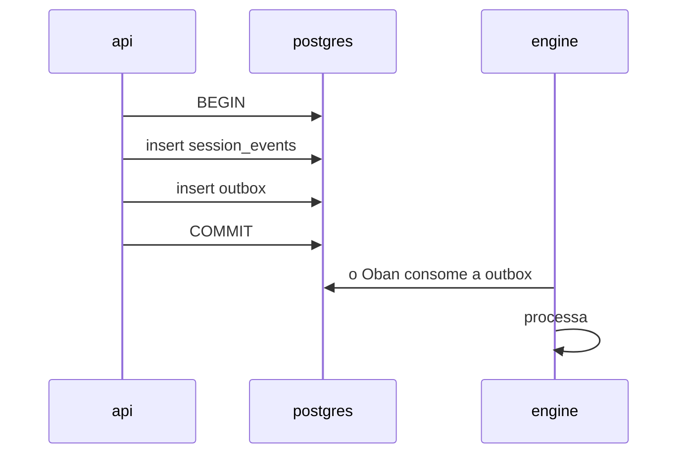

# Eventos

Três famílias de nomes convivem no Brabo, e é fácil confundi-las porque todas
usam `assunto.verbo`:

| família | onde mora | durabilidade |
|---|---|---|
| **Evento de domínio** | linha em `session_events` | **permanente e imutável** |
| **Broadcast** | canal Phoenix → navegador | efêmero, não persistido |
| **Span** | trace do OpenTelemetry | retenção do Tempo (24 h localmente) |

Só a primeira é contrato. As outras duas são transporte e observação.

## Evento de domínio

Uma linha em `session_events`, append-only, com um `seq` denso por sessão
([RN-002](../business-rules.md#rn-002)). Colunas:

| coluna | o quê |
|---|---|
| `id` | uuid |
| `session_id` | a sessão dona |
| `seq` | ordem dentro da sessão, começando em 1, sem buracos |
| `type` | o identificador abaixo |
| `actor` | quem causou: `{kind, id}` — usuário, agente ou sistema |
| `payload` | jsonb, formato próprio de cada tipo |
| `created_at` | — |

> **`type` é uma `string` livre no código** — não há union do TypeScript nem
> enum do banco listando os tipos válidos. A lista abaixo foi extraída dos
> pontos de emissão, e por isso pode envelhecer sem quebrar nada. Veja a nota
> no fim desta página.

### Sessão

| tipo | quando |
|---|---|
| `session.created` | a sessão nasce em `created` |
| `session.activated` | passou para `active` |
| `session.draining` | o nó que a hospeda está drenando |
| `session.closed` | encerramento normal |
| `session.closed_abnormally` | encerramento com causa — `node_shutdown` é a mais comum |
| `session.reopened` | uma sessão `closed`/`closed_abnormally` voltou para `active` (ADR 0183) |

**Sessão terminal não recebe mais conversa ([RN-581](../business-rules.md#rn-581)).**
Quando a sessão está `closed` ou `closed_abnormally`, gravar um evento de
conversa é recusado com **409** e `reason: "sessao_encerrada"`. Conversa é um
tipo que só existe como conversa (`chat.message`,
`chat.message_cancelled`, `chat.structured_question`, `chat.structured_question_answered`,
`agent.status`, `agent.activated`, `handoff.offered`, `handoff.accepted`,
`readiness.confirmed`, `necessity.validated`,
`architecture.readiness_confirmed`) ou qualquer evento cujo ator é um agente
conversacional — por isso `tool.call`/`agent.response` do Criativo são
recusados, enquanto os mesmos tipos vindos do Psicólogo, que roda **sobre** a
sessão fechada, continuam entrando. Decisões humanas sobre uma ação pendente
(`action.approved`/`action.denied`) também continuam entrando: a fila de ações
sobrevive à sessão. A sessão fechada porque a conversa ficou parada além do
teto leva `termination_reason: "conversation_idle_timeout"` e termina
`closed`, como `heartbeat_timeout`.

**Sessão fechada pode ser reaberta ([RN-649](../business-rules.md#rn-649), ADR 0183).**
`POST /projects/:projectId/sessions/:sessionId/reopen` (`developer`, ADR 0184) leva
uma sessão `closed`/`closed_abnormally` de volta a `active` e grava
`session.reopened` com `{from, to, closedAt, terminationReason}` — o único
registro do intervalo em que ela esteve fechada, já que `closed_at` e
`termination_reason` são limpos na linha. Nenhum evento anterior é editado, e
o `kind` da sessão não muda. Sessão que já tem `execution.activated` é
recusada com 409 `sessao_com_execucao`.

### Chat e agentes

| tipo | quando |
|---|---|
| `chat.message` | mensagem no fio da sessão, do usuário ou do agente |
| `chat.message_queued` | a mensagem chegou com o agente no meio do turno e entrou na FILA dele em vez de ser recusada ([RN-673](../business-rules.md#rn-673), [ADR 0191](../adr/0191-a-mensagem-com-turno-em-curso-entra-numa-fila.md)). Ator: o agente. Payload: `mensagemId` (o id do `chat.message`), `texto`, `idioma` e `posicao`. O texto viaja aqui porque é o que a fila relê depois de um reinício do engine. A mensagem enfileirada fica PENDENTE até um `chat.message_delivered` ou `chat.message_cancelled` nomeá-la; no máximo 10 por agente e sessão |
| `chat.message_delivered` | começou o turno que lê a fila: as mensagens pendentes são lidas JUNTAS, em ordem, num turno só. Ator: o agente. Payload: `mensagemIds` |
| `chat.message_cancelled` | quem ENVIOU uma mensagem pendente a cancelou — nenhum agente a leu. Ator: esse usuário. Payload: `mensagemId`, `agente`. Gravado pelo engine; recusado em sessão fechada ([RN-581](../business-rules.md#rn-581)) |
| `chat.structured_question` | o Criativo pediu VÁRIAS respostas de uma vez, por formulário — ferramenta `ask_structured_questions` (RN-162). Cada pergunta leva `id`, `label`, `type`, `options` e `allowOther` — este é a saída de texto livre do `select`, e vale `true` quando o modelo não declara nada ([RN-171](../business-rules/autenticacao.md#rn-171)) |
| `chat.structured_question_answered` | o usuário respondeu o formulário; as respostas também voltam como `chat.message` para o agente ler |
| `agent.activated` | um agente assumiu trabalho na sessão |
| `agent.response` | a resposta completa e consolidada do agente. `modelName` diz QUAL modelo a gerou, nos três produtores (os cinco agentes conversacionais, o `ToolLoop` de todo agente de execução/gate e o chat da api sem agente ativo) — `null` quando o turno falhou antes de resolver o binding, e ausente em eventos gravados antes de a regra existir ([RN-175](../business-rules/autenticacao.md#rn-175)). Vindo de agente conversacional, `content` é só o texto de FECHO do turno e `passos` (ausente quando não há) lista, em ordem, o texto das rodadas anteriores, que o fio recolhe sob "Passos do turno" ([RN-698](../business-rules.md#rn-698), AT-395) |
| `agent.error` | falha do agente, com `origem` (`infra`/`modelo`/`codigo`/`politica`) e a `mensagem` que ele diz no fio ([RN-059](../business-rules/custo.md#rn-059)). Também emitido com `reason: turno_interrompido_por_reinicio` (origem `infra`) quando o engine reiniciou no meio do turno e o status `working` órfão é fechado no boot ou na subida do agente, seguido de `agent.status: idle` ([RN-586](../business-rules.md#rn-586)). Cobre o turno inteiro e também a falha de UMA ferramenta no meio do laço, com `tool` e `retentativa` no payload ([RN-163](../business-rules/autenticacao.md#rn-163)) |
| `tool_router.decided` | o passo em que o Jev escolheu a ferramenta ([RN-625](../business-rules.md#rn-625), [ADR 0179](../adr/0179-o-laco-pergunta-ao-jev-qual-ferramenta.md)): `menuAntes`/`menuDepois`, `escolha`, `confianca`, `segunda`, `anterior`, `aplicado` (o menu saiu menor que o catálogo), `motivoDaQueda` + `origemDaQueda` (`infra`/`modelo`/`codigo`) quando o Jev caiu, `latenciaMs`, `custoMicros` (o `usage.cost` REAL) e `foraDoCardapio` (ferramentas que o modelo chamou sem terem sido oferecidas). Gravado pela fachada do engine para todo agente; ausente quando o roteador não foi consultado (provider que não é o OpenRouter, menos de duas ferramentas, chave do workspace desligada). A medida do ganho (AT-239) é lida deste evento e de `token_usage`, nunca anotada |
| `tool.result` | resultado da execução de uma ferramenta, gravado pelo hook `Engine.Harness.Hooks.EventLog` e, para os sete agentes conversacionais (o Infra Lead desde a [RN-617](../business-rules.md#rn-617)), pelos servidores deles com `tool`, `ok` e `resultado` (ou `erro`), cortado em 2.000 caracteres com `resultadoTotal` quando corta ([RN-589](../business-rules.md#rn-589)). O mesmo payload vem do Infra Lead para toda ferramenta que ele despacha em linha, e do Dev Lead quando uma chamada suspensa é resolvida — nunca enquanto ela espera aprovação ([RN-593](../business-rules.md#rn-593)) |
| `handoff.offered` | um agente ofereceu o trabalho a outro |
| `handoff.accepted` | o destinatário aceitou. Em geral por uma pessoa (ator `user`). Quando o aceite estava implícito no clique "Estou pronto" ([RN-658](../business-rules.md#rn-658)), o ator continua sendo essa pessoa e o payload — e o do `agent.activated` que segue — leva também `implicito: { via: "readiness.confirmed", readinessEventId }`. Desde a [RN-660](../business-rules.md#rn-660) ([ADR 0186](../adr/0186-aceite-automatico-do-handoff-ao-arquiteto.md)) a oferta do PO ao Arquiteto pode ser aceita pelo ator `system` `handoff-auto-accept`, e então o payload leva também `automatico: true`, `emNomeDe` (quem abriu a sessão — o repositório é provisionado em nome dessa pessoa) e `criterio` (`regras`, `cobertas`, `repositorio`) |
| `handoff.auto_accept_failed` | o sistema decidiu aceitar a oferta do PO ao Arquiteto ([RN-660](../business-rules.md#rn-660)) e o aceite falhou. Payload: `handoffId`, `toAgent`, `origem` (`infra`) e `error`. Ator `system` `handoff-auto-accept`. A oferta mantém o botão quando não foi marcada `accepted` |
| `handoff.superseded` | um handoff `offered` deixou de ser o vigente e não pode mais ser aceito ([RN-635](../business-rules.md#rn-635), [ADR 0182](../adr/0182-ciclo-de-vida-do-handoff.md)). Payload: `handoffId`, `toAgent`, `motivo` (`agente_ativado` — o destino foi ativado por qualquer caminho; `nova_oferta` — uma oferta mais nova ao mesmo destino no projeto a substituiu) e `substitutaId` (a oferta que a substituiu, `null` para `agente_ativado`). Gravado pelo ator `system` `handoff-lifecycle` na sessão da oferta ANTIGA, que pode estar fechada — é registro, não conversa, então a RN-581 o deixa entrar. O `status` da linha vira `superseded`; o evento é o histórico |
| `context.compacted` | o gerenciador de contexto resumiu os turnos mais antigos do histórico de um agente para caber na janela. Desde a [RN-580](../business-rules.md#rn-580) o payload leva, além de `tokensBefore`/`tokensAfter`, o `summary` que substituiu esses turnos, o `agent` dono do histórico e `messagesSummarized`. Eventos gravados antes disso levam só as duas contagens — o resumo se perdeu, e a reidratação diz isso em vez de inventar um |

**O que um agente conversacional relê ([RN-580](../business-rules.md#rn-580)).**
Quando um dos sete agentes conversacionais sobe sobre uma sessão que já tem
conversa, `Engine.Agents.Reidratacao` reconstrói o histórico dele a partir da
**cauda** deste log (os últimos 200 eventos): `chat.message`, `agent.response`,
`chat.structured_question` (como turno do próprio agente, com rótulos e opções)
e os PRÓPRIOS `tool.call`/`tool.result` (como nota de texto — os eventos não
levam id de chamada, então nunca são repetidos como `role: tool`).
`chat.structured_question_answered` é pulado de propósito: a api grava as
mesmas respostas como `chat.message` logo depois, e foi isso que o agente leu
ao vivo. Um `chat.message` cancelado na fila, ou ainda pendente para este
agente, também é pulado ([RN-673](../business-rules.md#rn-673)): o primeiro
nunca foi dito, o segundo chega pelo turno que lê a fila. Desde a
[RN-589](../business-rules.md#rn-589) os sete gravam `tool.result` com o texto
que a ferramenta devolveu (`resultado`, cortado em 2.000 caracteres, com
`resultadoTotal` dando o tamanho real quando corta); uma chamada de sessão
gravada antes disso não tem `tool.result`, e a nota diz que o log não tem
desfecho. Quando a conversa é maior que a cauda, o histórico abre com uma
mensagem de sistema dizendo quantos eventos anteriores ficaram de fora, o
último resumo de compactação gravado e as mensagens de abertura.

### Ações propostas

| tipo | quando |
|---|---|
| `proposed_action.created` | a ação nasceu — antes de qualquer execução. `payload.status` diz como ela nasceu (`pending`, `auto_approved` ou `denied`), e é isso que distingue decisão humana de política ([RN-049](../business-rules/custo.md#rn-049)). `payload.reason` diz QUAL regra da política decidiu — a string que `decide()` devolve, nos três desfechos; ausente em eventos gravados antes de a regra existir, o que quer dizer "não gravado", nunca "sem motivo". A linha da outbox de mesmo nome NÃO o leva ([RN-567](../business-rules.md#rn-567)). Nas ações `terminal` — o único tipo cuja decisão consulta o escopo de caminho — `payload.scopeRoot` diz contra QUAL raiz o escopo comparou, como `{ executionMode, ancora, segmento }`: `container` → `ancora: raiz_gerenciada` e o `workspace_dir_name`; `mounted` → `ancora: base_de_projetos` e o segmento sob `BRABO_PROJECTS_BASE` (`ancora: indisponivel`, `segmento: null` quando a pasta está fora da base ou não há base); `runner` → `ancora: nome_da_pasta` e o `workspace_dir_name`. NUNCA o caminho absoluto, que exporia o `$HOME` do usuário a todo membro. Ausente em eventos antigos e nos outros tipos de ação; também não está na outbox ([RN-609](../business-rules.md#rn-609)) |
| `proposed_action.approved` | decidida pelo usuário — `actor` é **quem clicou**. A auto-aprovação NÃO passa por aqui: ela aparece em `created` com `status: auto_approved` e ator agente |
| `proposed_action.denied` | negada — estado terminal. `actor` é quem recusou, e `payload.reason` é o motivo |
| `proposed_action.executed` | executada com sucesso |
| `action.failed` | executada e falhou |
| `permission.granted` | concessão gravada na política |

### Backlog

| tipo | quando |
|---|---|
| `backlog.epic_created` | — |
| `backlog.story_created` | — |
| `backlog.story_transitioned` | mudança de estado da história. `actor` diz quem a promoveu: `agent/po` no modo `auto`, `user` no modo `manual` ([RN-048](../business-rules/custo.md#rn-048)) |
| `backlog.story_completed` | o PO completou uma história `draft` existente com `complete_story` — regras vinculadas, RF/DoD/DoR preenchidos — em vez de recriá-la ([RN-720](../business-rules.md#rn-720)) |
| `backlog.story_promotion_proposed` | o PO terminou uma história COMPLETA num projeto em modo `manual`: ela fica `draft` aguardando a decisão do usuário, e nenhuma tarefa dela é pegável até lá ([RN-048](../business-rules/custo.md#rn-048)) |
| `backlog.story_promotion_returned` | o usuário RECUSOU a promoção e devolveu a história ao PO com um motivo — que vira mensagem fixada na sessão dele, igual a um gate devolvido a um dev ([RN-048](../business-rules/custo.md#rn-048)) |
| `backlog.story_updated` | o título e/ou a descrição de uma história `draft` sem tarefa em execução foi corrigido, pelo usuário (aba Backlog) ou pelo PO (`update_story`). Leva `previousTitle`, `title` e `descriptionChanged` (RN-727) |
| `backlog.story_archived` | uma história `draft` sem tarefa em execução foi ARQUIVADA, pelo usuário ou pelo PO (`archive_story`): ela e as tarefas dela saem do backlog, da cobertura, do plano e do claim; a linha fica. Leva `reason` e `taskIds` (RN-727, ADR 0212) |
| `backlog.story_demoted` | um módulo sumiu do `module_map`; a história voltou para `draft` ([RN-012](../business-rules.md#rn-012)) |
| `backlog.story_overlap_warned` | a história foi criada, mas TODAS as regras que ela cita já estavam cobertas por outra — aviso, não bloqueio: quem julga se é sobreposição é o usuário ([RN-081](../business-rules/custo.md#rn-081)) |
| `backlog.semantic_duplicate_warned` | foi gravada uma história ou regra de negócio cujo TÍTULO está, por embedding, no limiar ou acima dele em relação a uma existente do mesmo tipo no projeto — aviso, nunca recusa; o payload nomeia o item parecido e o cosseno. Ator `system`/`duplicata-semantica` ([RN-681](../business-rules/custo.md#rn-681)) |
| `backlog.semantic_duplicate_check_skipped` | a checagem de duplicata semântica NÃO pôde rodar — sem provider de embedding, daemon fora do ar, o teto de 10 s — e o `reason` diz qual; o item foi gravado assim mesmo ([RN-681](../business-rules/custo.md#rn-681)) |
| `backlog.story_modules_assigned` | vínculo história ↔ módulo |
| `backlog.task_created` | — |
| `backlog.task_claimed` | um dev agent pegou a tarefa |
| `backlog.task_status_changed` | — |
| `backlog.task_merge_conflict` | o merge aprovado da PR da tarefa foi recusado por conflito de merge: `taskId`, `pullRequestId`, `conflictingFiles`, `actionId`. Desde a [RN-715](../business-rules.md#rn-715) a tarefa volta para `in_progress` e o dev agent dono é acordado pela linha `task.merge_conflict` da outbox ([RN-705](../business-rules.md#rn-705)) |
| `backlog.task_blocked` | teto de tentativas de correção esgotado, ou um impedimento foi registrado |
| `backlog.task_unblocked` | — |
| `backlog.epic_without_story` | o PO terminou um turno tendo criado um épico e NENHUMA história para ele. Épico não gera tarefa — história gera —, então este é o estado que trava a execução sem erro visível. Desfecho explícito no padrão da [RN-059](../business-rules/custo.md#rn-059): evento durável com `origem`, `epicIds`/`epicTitles` e a mensagem, mais o broadcast `agent.error`. Reportado UMA vez por ocorrência, nunca em laço ([RN-165](../business-rules/autenticacao.md#rn-165)) |
| `backlog.handoff_not_offered` | o PO terminou um turno com toda regra de negócio coberta mas não conseguiu oferecer o handoff ao Arquiteto: alguma história está sem tarefa (`origem: modelo`, com `storyIds`/`storyTitles`), ou ler o backlog ou criar a oferta falhou (`origem: infra`). Com toda história com tarefa, o próprio servidor do PO oferece o handoff ([RN-700](../business-rules.md#rn-700)) |

### Execução e gates

| tipo | quando |
|---|---|
| `execution.plan_proposed` | **DESCONTINUADO desde o ADR 0086** ([RN-284](../business-rules.md#rn-284)) — sessões antigas ainda podem ter este tipo no log; sessões novas usam uma `proposed_action` do tipo `propose_execution_plan` (ver `docs/reference/permissions.md`), porque o plano do Dev Lead virou decisão de verdade, aprovada ou recusada em Aprovações, e não mais um evento simples |
| `execution.activated` | a fase de execução começou. **Só entra em sessão `criativa`** — numa `consultiva` a gravação responde 409 ([RN-097](../business-rules.md#rn-097)). Continua sendo este evento, e não a coluna `sessions.kind`, que diz se uma sessão ESTÁ executando |
| `execution.parallelization_suggested` | o sistema propôs paralelizar — emitido na ativação só quando o projeto tem um container `running` registrado (senão os dev agents ficam bloqueados, `dev.blocked_by_container`, e mais agentes só multiplicariam os bloqueados; AT-104) |
| `execution.plan_applied` | o humano APROVOU o `propose_execution_plan` do Dev Lead (ou ele foi auto-aprovado) e essa aprovação ATIVOU a execução: cada tarefa do plano ganhou o módulo dela e `ActivateExecutionUseCase` rodou ([RN-677](../business-rules.md#rn-677), [RN-678](../business-rules.md#rn-678)). Payload: `actionId`, `sessaoDeExecucao`, `modulos`, `tarefasAtribuidas` e — quando o plano leva `tarefas` — `tarefasPorModulo` e `modulosSemTarefa` (módulos que ficaram sem agente, RN-709). Gravado na sessão do Dev Lead, ator `system`/`action-executor` |
| `execution.plan_failed` | o plano aprovado NÃO ativou a execução — o plano não bate mais com o `module_map` vigente, ou a ativação recusou (por exemplo, 409 sem repositório). Payload: os mesmos campos mais `motivo`, a frase da própria api. A decisão humana fica registrada; nada foi gravado nas tarefas quando o próprio plano foi recusado |
| `execution.parallelization_accepted` | aceita — o subagente herda o teto do agente base |
| `dev.started` | o dev agent começou o ciclo (ativação, paralelização — NÃO reidratação, que nunca redispara) |
| `dev.working` | pegou uma tarefa e montou o worktree |
| `dev.idle` | a fila do módulo está vazia — nenhuma tarefa pegável agora |
| `dev.blocked_by_container` | o agente NÃO pegou tarefa, porque o projeto não tem container REGISTRADO `running` ([RN-502](../business-rules.md#rn-502)). Ele para em `:idle` como os dois acima — `idle` é o único estado que um wake ainda resgata — e este evento é a única coisa que distingue "sem container" de "fila vazia" (`dev.idle`) e de "o claim falhou" (`dev.error`). A api nunca é chamada: a guarda roda ANTES de `claim_task/1`, então nenhuma tarefa fica pega sem dono vivo. Resolve-se sozinho: `container.running` na outbox acorda todo agente `:idle` do projeto |
| `dev.awaiting_approval` | as ações de git ficaram pendentes de aprovação (Fase 12e): **o gate NÃO abre** — sem PR não há o que julgar — e o worktree fica preso até `task.pr_settled` ([RN-050](../business-rules/custo.md#rn-050)) |
| `dev.awaiting_gate` | PR aberta, esperando o gate (Fase 12b) — `task_id`/`worktree` continuam presos |
| `dev.blocked` | a tarefa foi devolvida com diagnóstico (limite de iterações, orçamento estourado, `report_blocked`, falha de worktree/contexto). Desde a [RN-743](../business-rules.md#rn-743) leva `trabalhoPreservado` (`{branch, commit}` ou `null`): o trabalho não commitado foi commitado na branch da tarefa como `<agente>[bot]`, e a próxima tarefa do agente parte dessa branch |
| `dev.idle_tripped` | o disjuntor desarmou (RN-047) — N tarefas bloqueadas seguidas param o agente |
| `dev.credit_exhausted` | o provider do modelo recusou por falta de crédito (RN-726) — o agente pausa em `idle_tripped` sem contar para o disjuntor nem pegar a próxima tarefa; Rearmar retoma |
| `dev.rearmed` | o usuário rearmou um agente travado (Fase 12b) — `actor` é o USUÁRIO que clicou, não o agente |
| `pr.gate_changed` | a PR passou para um novo gate (`awaiting_qa` → `awaiting_secops` → `awaiting_user`) |
| `infra.gate_changed` | o gate da Infra |
| `gate.rescue_parked` | o `GateRescuer` ESTACIONOU um ciclo de QA/SecOps parado há mais de 2 h em vez de reiniciá-lo ([RN-722](../business-rules.md#rn-722), ADR 0207); o fio mostra um botão "Retomar gate" ([RN-724](../business-rules.md#rn-724)). Payload: `taskId`, `gate`, `idadeSegundos`, `motivo`. Ator `system`/`gate-rescuer` |
| `gate.interrupted` | no BOOT do engine, um ciclo de gate `in_progress` recente não tinha processo vivo em nenhum nó do cluster: o reinício o matou, e o resgatador o reinicia na hora em vez de esperar o limiar de 15 minutos ([RN-823](../business-rules.md#rn-823)). Payload: `taskId`, `gate`, `ultimaAtividadeEm`, `retomadoEm`. Ator `system`/`gate-rescuer`; o fio o mostra como aviso. Não é projetado no grafo |
| `infra.artifact_blocked` | o artefato da Infra foi rejeitado |

### Delegação (Fase 8b, ADR 0038)

| tipo | quando |
|---|---|
| `delegation.completed` | a subespecialidade terminou; `payload.parecerArtifactId` referencia o `artifact.qa_verdict` INTERNO dela — nunca o que chega ao gate |
| `delegation.failed` | a subespecialidade não terminou; `payload.failureOrigin` é a ORIGEM (`infra`\|`modelo`\|`codigo`\|`politica`, nunca por eliminação — ADR 0020) |
| `delegation.dispensed` | o lead decidiu NÃO delegar; `payload.justification` explica por quê — dispensar nunca é calado |

Os três são emitidos pelo `QaLeadServer`, um por subespecialidade, SEPARADOS da
chamada a `record_gate_verdict` — o evento `pr.gate_changed` acima continua
sendo o único que descreve o gate em si; estes descrevem a área por trás dele.

### Laço de ferramentas

| tipo | quando |
|---|---|
| `toolloop.limit_reached` | o laço bateu no teto de iterações. `payload` leva `iteration` e `max_iterations` — o teto é por TIPO de agente ([RN-085](../business-rules/custo.md#rn-085)) |
| `toolloop.budget_exceeded` | o orçamento de tokens daquele laço acabou antes do trabalho; `payload` leva `tokens_spent_micros` e `token_budget_micros` |

Emitidos pelo `Engine.Harness.ToolLoop` e — desde a
[RN-166](../business-rules/autenticacao.md#rn-166) — também pelo `PoServer`, que
tem laço PRÓPRIO e, até então, esgotava o teto **calado**. Mesmo tipo e mesmo
payload de propósito: é o mesmo fato, e quem lê o log não deveria aprender um
segundo nome só porque o agente conversacional não usa o `ToolLoop`.

### Artefatos

| tipo | schema |
|---|---|
| `artifact.product_brief` | `title`, `summary`, `rules` |
| `artifact.business_rule` | `title`, `description`, `origin` |
| `artifact.decision_record` | `context`, `options`, `choice`, `consequences` — um "ADR resumido" que qualquer um dos seis agentes conversacionais pode emitir; reusa o padrão genérico em vez do dedicado, e convive com `open_adr_pr` (só o Arquiteto, documento commitado de verdade) ([RN-505](../business-rules.md#rn-505)) |
| `artifact.module_map` | o mapa de módulos do Arquiteto |
| `artifact.module_routing` | a imagem candidata do Arquiteto por módulo, um item por módulo do `module_map` vigente — o Arquiteto CANDIDATA, a Infra ELEGE ([RN-487](../business-rules.md#rn-487), [ADR 0131](../adr/0131-roteamento-de-modulos-para-infra.md)) |
| `artifact.module_contracts` | o contrato entre módulos do Arquiteto: por módulo, o que ele EXPÕE (`modulo`, `expoe: [{tipo, assinatura, descricao}]`), com `version` — a lista inteira a cada vez, a vigente substitui a anterior; o que um módulo consome é o `dependsOn` do `module_map` ([RN-684](../business-rules.md#rn-684), [ADR 0200](../adr/0200-contrato-entre-modulos-artefato-do-arquiteto.md)) |
| `artifact.project_image` | `image`, `rationale`, `network`, `resources`, `version` (quem decidiu é o ator: `arquiteto` ou `infra-lead`) — a imagem de container do projeto, emitida pela api (`DecidirImagemDoProjetoUseCase`) quando o Arquiteto a decide ou o Infra Lead elege uma candidata ([RN-491](../business-rules.md#rn-491)); versionada, sem tabela. O engine só LÊ se ela existe, para recusar localmente `container_start_via_runner` sem ela ([RN-610](../business-rules.md#rn-610)) |
| `artifact.insight` | — |
| `artifact.prototipo_navegavel` | `personas`, `jornadas`, `prototipo` (`telas`, `anotacoes`), `resumo` — o protótipo do UX Designer ([RN-286](../business-rules.md#rn-286), ADR 0087) |
| `artifact.rfc_staff` | — (validado em `Engine.Agents.StaffTools`, não pelo `ArtifactSchemas` — mesmo caso de `artifact.insight`): `problema`, `opcoes` (lista de `descricao`/`tradeoffs`), `recomendacao`, `poc` (`escopo`, `descartavel: true` fixo). A RFC do Staff (ADR 0088), devolvida ao Arquiteto por handoff na mesma chamada de ferramenta |
| `artifact.plano_de_teste` | `storyId`, `taskId`, `planoDeTeste`, `criteriosExecutaveis`, `estrategiaDeAutomacao` — a entrega de qa-estratégia (ADR 0090), escrita DEPOIS da entrega do dev e consumida pelo ciclo `qa-verificada` desde o [ADR 0192](../adr/0192-plano-de-teste-depois-da-entrega.md) ([RN-674](../business-rules.md#rn-674)) |
| `artifact.threat_model` | `storyId`, `threatModel`, `requisitosDeSeguranca` — o "segundo momento" do SecOps sobre o DESENHO de uma história ([RN-360](../business-rules.md#rn-360), ADR 0090) |

Os schemas são fechados: campo faltando recusa a emissão
(`Engine.Harness.ArtifactSchemas`).

### Arquitetura e prontidão

| tipo | quando |
|---|---|
| `architecture.readiness_confirmed` | — |
| `readiness.confirmed` | o usuário clicou "Estou pronto — a necessidade está validada" com o Criativo. Desde o [ADR 0185](../adr/0185-estou-pronto-fecha-os-dois-gates.md) o payload leva `necessidadeValidada: true` e `aceiteImplicitoDoPo: true`, a marca que o aceite implícito do PO lê ([RN-658](../business-rules.md#rn-658)); eventos mais antigos levam `{}` |
| `necessity.validated` | gate `necessidade-validada` (Criativo → PO): uma pessoa — nunca uma inferência do modelo — declara que a necessidade de negócio que o Criativo consolidou está certa. Desde o [ADR 0185](../adr/0185-estou-pronto-fecha-os-dois-gates.md) é gravado pelo MESMO clique de `readiness.confirmed`, assim que o engine aceita o turno, com `productBriefId: null` (o brief vem desse turno), `via: "readiness.confirmed"` e `readinessEventId` ([RN-657](../business-rules.md#rn-657)). Eventos do clique separado do ADR 0095 ([RN-406](../business-rules.md#rn-406)) levam `productBriefId` apontando para o `artifact.product_brief` validado |

### Git e bootstrap

| tipo | quando |
|---|---|
| `project.git_connected` | credencial de git vinculada ao projeto |
| `project.repository_provisioned` | repositório **criado** pelo Brabo |
| `project.repository_adopted` | um repositório que **já existia** passou a ser do projeto ([RN-046](../business-rules/custo.md#rn-046)) |
| `bootstrap.repository_adopted` | o mesmo fato na sessão dedicada, com a `defaultBranch` observada no provider |
| `bootstrap.step_started` | um dos seis passos do Gitflow começou |
| `bootstrap.step_completed` | concluído |
| `bootstrap.step_skipped` | já estava feito — **isso é sucesso**, não erro ([RN-029](../business-rules.md#rn-029)) |
| `bootstrap.step_degraded` | concluído sem uma das capacidades do provider (por exemplo, proteção de branch no Local) |
| `bootstrap.step_failed` | falhou; o bootstrap é retomável a partir deste ponto |
| `bootstrap.plan_approved` | o usuário aprovou o plano de adoção — **só a partir daqui o bootstrap roda num repositório adotado** ([RN-045](../business-rules/custo.md#rn-045)) |
| `bootstrap.adopted_as_is` | o usuário dispensou o bootstrap; nenhum passo rodou, e o plano fica como prova do que não foi aplicado |

### Custo

| tipo | quando |
|---|---|
| `budget.threshold_crossed` | 70%, 90% ou 100% — **uma vez por limiar** ([RN-018](../business-rules/custo.md#rn-018)) |

### Telemetria do RAG (RN-479/480/481)

Estes dois são **narração, nunca a fonte da medição**, e só existem quando há
sessão — isto é, no caminho do agente. Uma busca vinda da aba RAG é busca de
*projeto* e não tem sessão nenhuma, e `session_events.session_id` é
`NOT NULL`, então medir pelo event log perderia em silêncio justamente as
buscas que um humano fez olhando os scores. A fonte da medição é o par de
tabelas `rag_searches`/`rag_feedback` (lido por `pnpm --filter api medir:rag`);
o evento só põe o mesmo fato na linha do tempo da sessão.

| tipo | quando |
|---|---|
| `rag.search` | um agente fez uma busca híbrida dentro de uma sessão — o payload leva o `searchId` da linha de telemetria, a consulta, `topK`, quantos resultados passaram do limiar, se a busca foi `degraded` e os ids dos chunks ([RN-479](../business-rules.md#rn-479), [RN-481](../business-rules.md#rn-481)) |
| `rag.feedback` | um agente julgou um chunk recuperado como `util`/`irrelevante` — o payload leva `searchId`, `chunkId`, o veredito e a **posição** que aquele chunk ocupava naquela busca ([RN-480](../business-rules.md#rn-480)) |

### Runner local (ADR 0103/0104)

| tipo | quando |
|---|---|
| `project.workspace_verified` | o `brabo-runner` conectou e confirmou o caminho de um projeto com `execution_mode: runner` — o runner é a fonte de verdade do caminho, sobrescrevendo o que foi digitado na criação ([RN-423](../business-rules.md#rn-423)) |

### Psicólogo

| tipo | quando |
|---|---|
| `psychologist.analysis_completed` | — |
| `psychologist.analysis_failed` | com causa classificada: `infra`, `modelo`, `código` ou `política` |
| `psychologist.analysis_skipped` | a sessão não tinha evento ANALISÁVEL e a análise não rodou — `payload.analisaveis` e `payload.eventCount` mostram a diferença ([RN-079](../business-rules/custo.md#rn-079)) |
| `psychologist.hypothesis_proposed` | uma hipótese com `evidenceEventIds` válidos ([RN-021](../business-rules.md#rn-021)) |
| `psychologist.hypothesis_accepted` | — |
| `psychologist.hypothesis_dismissed` | — |
| `psychologist.hypothesis_accepted_for_anamnese` | aceita e encaminhada — o elo que fecha o laço com a Anamnese |

### Anamnese e instruções

| tipo | quando |
|---|---|
| `anamnese.run_completed` | — |
| `anamnese.run_failed` | — |
| `anamnese.run_skipped` | a rodada terminou SEM perfil, de propósito — `payload.motivo` diz por quê ([RN-063](../business-rules/custo.md#rn-063)) |
| `anamnese.analysis` | o texto que o modelo da Anamnese escreveu durante a rodada (`payload.content`); nunca desenhado no fio da sessão ([RN-695](../business-rules.md#rn-695)) |
| `anamnese.profile_updated` | o `proficiency_profile` mudou |
| `anamnese.agent_deviation` | um desvio do AGENTE visto pela Anamnese (laço, cancelado pelo usuário, reparado pelo usuário) — sinal do produto, nunca traço do usuário; o `payload` é só `agente`, `tipo` e `evidenceEventIds`, sem dado pessoal, não projetado no grafo ([RN-717](../business-rules.md#rn-717), [ADR 0205](../adr/0205-desvio-do-agente-como-sinal-do-produto.md)) |
| `instruction.rolled_back` | rollback de uma versão de instrução — cria uma versão nova, não apaga ([RN-027](../business-rules.md#rn-027)) |

---

## Broadcast

Mensagens do canal Phoenix para o navegador. Elas **não** são persistidas: quem
recarrega a página não as recebe de volta — recebe o event log de volta.

| broadcast | o quê |
|---|---|
| `agent.delta` | pedaço de texto do streaming do modelo |
| `agent.status` | mudança visível de estado do agente |
| `agent.done` | o turno terminou |
| `agent.error` | o turno falhou |
| `event.appended` | um evento novo entrou no log — o gatilho de atualização do painel; leva só `type` e `actorId` |

Um evento de domínio quase sempre produz um `event.appended`; o contrário não
vale. Desde a [RN-579](../business-rules.md#rn-579) o engine o emite para
**toda** escrita que a api confirmou pela fachada `EngineApiClient` (gravações,
ações propostas, handoffs, o backlog do PO), e nunca para uma recusada. As
escritas que a api faz por conta própria — um humano decidindo uma ação, uma
transição de sessão — chegam ao mesmo broadcast desde a AT-157: a api o pede ao
engine depois do commit da escrita (`POST /internal/sessions/:id/event-appended`),
e não o pede para escritas vindas do engine, que já as anuncia. O navegador o
usa só como gatilho: invalida o que o `type` afeta (eventos e orçamento sempre;
ações, handoffs ou backlog pelo prefixo), com uma janela mínima por alvo, e com
o canal vivo os polls da tela de sessão caem para 15s (30s para o orçamento).

### Quem pode ouvir (RN-108)

Entrar no canal `session:<id>` — e portanto receber qualquer um destes
broadcasts — exige um ticket opaco de uso único emitido por
`POST /projects/:projectId/sessions/:sessionId/socket-ticket` (TTL de 30s).
Antes da RN-108, o `connect/3` do socket Phoenix não checava nada além de o
`session_id` existir: quem descobrisse o UUID podia entrar e ouvir tudo. O
ticket não é persistido nem lido no event log — mora em
`session_socket_tickets`, verificado e consumido pelo próprio engine —, por
isso não aparece no inventário de eventos de domínio abaixo. Ver
[RN-108](../business-rules/autenticacao.md#rn-108).

## Span

Nomes de span do OpenTelemetry. Uma sessão é um **trace raiz** que atravessa a
api e o engine ([ADR 0026](../adr/0026-fase5-observabilidade-e-graceful-shutdown.md)).

### Nomes de domínio

Nomeados à mão, um por operação que importa. São os que se procuram no Tempo:

| span | onde |
|---|---|
| `session.create` | api — a raiz |
| `agent.turn` | engine — uma passada do ToolLoop |
| `llm.turn` | engine — a chamada ao modelo |
| `tool.call` | engine — a execução de uma ferramenta |
| `gate.scanner` | engine — um scanner do SecOps, com o nome do scanner num atributo |
| `outbox.session_lifecycle` | engine — job do Oban, preso ao trace da sessão |
| `outbox.psychologist` | engine — idem, a análise do Psicólogo |

### Nomes derivados do código

O decorator `@Traced` da api
([ADR 0035](../adr/0035-observabilidade-legivel-e-trace-sem-coletor.md)) nomeia
o span como **`Classe.metodo`** — por exemplo `TransitionSessionUseCase.execute`,
`DrizzleOutboxRepository.append`. Eles não cabem numa lista aqui: nascem e
morrem com o código, e a lista envelheceria na primeira renomeação.

A distinção importa na consulta: um nome de domínio é estável e pode ir para
uma consulta salva ou um dashboard; um nome derivado do código não pode.

Os atributos que esses spans levam — `brabo.layer`, `code.namespace`,
`code.function` — servem para buscar no Tempo e **não são contrato**, ao
contrário do `trace_id`. Podem ser renomeados sem quebrar nada fora do Tempo.

Como navegar de uma sessão até um `tool.call` está documentado no
[runbook](../runbook.md#observabilidade); o modelo inteiro está documentado em
[observabilidade](../explanation/observability.md).

---

## Como o evento chega ao engine

Não por uma fila externa. A api grava o evento e a intenção de publicá-lo **na
mesma transação** (transactional outbox); o Oban consome direto do Postgres. É
isso que impede "o evento foi gravado, mas o engine nunca soube".

---

## Inventário completo

As seções acima dizem **quando** cada evento acontece. Esta é a varredura
mecânica dos pontos de emissão, refeita a cada `pnpm docs:generate` — é ela que
faz um identificador novo aparecer aqui mesmo que ninguém tenha escrito sobre
ele.

<!-- BEGIN:GENERATED:eventos-inventario -->

> ⚠️ Bloco gerado por `pnpm docs:generate`. Não edite à mão — o próximo build o sobrescreve.

Extraídos dos pontos de emissão: **110 identificadores**, dos quais **3** não estão descritos acima.

- `action.failed` (apps/api/src/application/use-cases/actions/execute-git-action.use-case.ts)
- `agent.activated` (apps/api/src/application/use-cases/agents/activate-agent.use-case.ts)
- `agent.delta` (apps/engine/lib/engine/agents/arquiteto_server.ex)
- `agent.done` (apps/engine/lib/engine/agents/turno_assincrono.ex)
- `agent.error` (apps/api/src/application/use-cases/agents/aceite-implicito-do-po.use-case.ts)
- `agent.response` (apps/api/src/application/use-cases/llm/send-chat-message.use-case.ts)
- `agent.status` (apps/engine/lib/engine/agents/turno_assincrono.ex)
- `agent.turn` (apps/engine/lib/engine/harness/tool_loop.ex)
- `anamnese.agent_deviation` (apps/engine/lib/engine/anamnese/tools/report_agent_deviation.ex)
- `anamnese.analysis` (apps/engine/lib/engine/workers/anamnese_worker.ex)
- `anamnese.profile_updated` (apps/api/src/application/use-cases/anamnese/record-proficiency.use-case.ts)
- `anamnese.run_completed` (apps/api/src/application/use-cases/anamnese/record-proficiency.use-case.ts)
- `anamnese.run_failed` (apps/engine/lib/engine/session_events/event.ex)
- `anamnese.run_skipped` (apps/engine/lib/engine/session_events/event.ex)
- `architecture.readiness_confirmed` (apps/api/src/application/use-cases/agents/offer-infra-handoff.use-case.ts)
- `artifact.business_rule` (apps/engine/lib/engine/agents/arquiteto_server.ex)
- `artifact.decision_record` (apps/api/src/application/use-cases/backlog/perguntas-em-aberto.use-case.ts)
- `artifact.insight` (apps/engine/lib/engine/harness/tools/emit_insight.ex)
- `artifact.module_map` (apps/api/src/application/use-cases/architecture/create-module-map.use-case.ts)
- `artifact.open_question` — ⚠️ **não descrito acima** (apps/engine/lib/engine/harness/decisoes_do_projeto.ex)
- `artifact.plano_de_teste` (apps/engine/lib/engine/gates/qa_lead_server.ex)
- `artifact.product_brief` (apps/engine/lib/engine/agents/arquiteto_server.ex)
- `artifact.project_image` (apps/engine/lib/engine/harness/ambiente_do_agente.ex)
- `artifact.prototipo_navegavel` (apps/engine/lib/engine/agents/ux_designer_tools.ex)
- `artifact.rfc_staff` (apps/engine/lib/engine/agents/staff_tools.ex)
- `artifact.secops_verdict` — ⚠️ **não descrito acima** (apps/engine/lib/engine/gates/secops_agent_server.ex)
- `artifact.threat_model` (apps/engine/lib/engine/agents/dev_lead_tools.ex)
- `backlog.epic_created` (apps/api/src/application/use-cases/backlog/create-epic.use-case.ts)
- `backlog.epic_without_story` (apps/engine/lib/engine/agents/po_server.ex)
- `backlog.handoff_not_offered` (apps/engine/lib/engine/agents/po_server.ex)
- `backlog.semantic_duplicate_check_skipped` (apps/api/src/application/use-cases/backlog/verificar-duplicata-semantica.use-case.ts)
- `backlog.semantic_duplicate_warned` (apps/api/src/application/use-cases/backlog/verificar-duplicata-semantica.use-case.ts)
- `backlog.story_archived` (apps/api/src/application/use-cases/backlog/corrigir-historia.use-case.ts)
- `backlog.story_completed` (apps/api/src/application/use-cases/backlog/complete-story.use-case.ts)
- `backlog.story_created` (apps/api/src/application/use-cases/backlog/create-story.use-case.ts)
- `backlog.story_demoted` (apps/api/src/application/use-cases/architecture/create-module-map.use-case.ts)
- `backlog.story_modules_assigned` (apps/api/src/application/use-cases/architecture/assign-story-modules.use-case.ts)
- `backlog.story_overlap_warned` (apps/api/src/application/use-cases/backlog/create-story.use-case.ts)
- `backlog.story_promotion_proposed` (apps/api/src/application/use-cases/backlog/complete-story.use-case.ts)
- `backlog.story_promotion_returned` (apps/api/src/application/use-cases/backlog/return-story.use-case.ts)
- `backlog.story_transitioned` (apps/api/src/application/use-cases/backlog/transition-story.use-case.ts)
- `backlog.story_updated` (apps/api/src/application/use-cases/backlog/corrigir-historia.use-case.ts)
- `backlog.task_blocked` (apps/api/src/application/use-cases/execution/mark-task-blocked.use-case.ts)
- `backlog.task_claimed` (apps/api/src/application/use-cases/execution/claim-next-task.use-case.ts)
- `backlog.task_created` (apps/api/src/application/use-cases/backlog/create-task.use-case.ts)
- `backlog.task_merge_conflict` (apps/api/src/application/use-cases/actions/execute-git-action.use-case.ts)
- `backlog.task_status_changed` (apps/api/src/application/use-cases/actions/execute-git-action.use-case.ts)
- `backlog.task_unblocked` (apps/api/src/application/use-cases/execution/unblock-task.use-case.ts)
- `bootstrap.adopted_as_is` (apps/api/src/application/use-cases/git/decide-bootstrap-plan.use-case.ts)
- `bootstrap.plan_approved` (apps/api/src/application/use-cases/git/decide-bootstrap-plan.use-case.ts)
- `bootstrap.repository_adopted` (apps/api/src/application/use-cases/git/adopt-repository.use-case.ts)
- `bootstrap.step_acknowledged` — ⚠️ **não descrito acima** (apps/api/src/application/use-cases/git/acknowledge-protection-failure.use-case.ts)
- `bootstrap.step_completed` (apps/api/src/application/use-cases/git/bootstrap-runner.ts)
- `bootstrap.step_degraded` (apps/api/src/application/use-cases/git/bootstrap-runner.ts)
- `bootstrap.step_failed` (apps/api/src/application/use-cases/git/bootstrap-runner.ts)
- `bootstrap.step_skipped` (apps/api/src/application/use-cases/git/bootstrap-runner.ts)
- `bootstrap.step_started` (apps/api/src/application/use-cases/git/bootstrap-runner.ts)
- `budget.threshold_crossed` (apps/api/src/application/use-cases/llm/record-llm-usage.use-case.ts)
- `chat.message` (apps/api/src/application/use-cases/agents/send-agent-message.use-case.ts)
- `chat.message_cancelled` (apps/engine/lib/engine/agents/fila_de_mensagens.ex)
- `chat.message_delivered` (apps/engine/lib/engine/agents/fila_de_mensagens.ex)
- `chat.message_queued` (apps/engine/lib/engine/agents/fila_de_mensagens.ex)
- `chat.structured_question` (apps/engine/lib/engine/agents/reidratacao.ex)
- `chat.structured_question_answered` (apps/api/src/application/use-cases/agents/answer-structured-question.use-case.ts)
- `delegation.completed` (apps/api/src/application/use-cases/execution/record-delegation.use-case.ts)
- `delegation.dispensed` (apps/api/src/application/use-cases/execution/record-delegation.use-case.ts)
- `delegation.failed` (apps/api/src/application/use-cases/execution/record-delegation.use-case.ts)
- `event.appended` (apps/engine/lib/engine/sessions/live_broadcast.ex)
- `execution.activated` (apps/api/src/application/use-cases/execution/activate-execution.use-case.ts)
- `execution.parallelization_accepted` (apps/api/src/application/use-cases/execution/accept-parallelization.use-case.ts)
- `execution.parallelization_suggested` (apps/api/src/application/use-cases/execution/activate-execution.use-case.ts)
- `gate.interrupted` (apps/engine/lib/engine/gates/gate_rescuer.ex)
- `gate.rescue_parked` (apps/engine/lib/engine/gates/gate_rescuer.ex)
- `gate.scanner` (apps/engine/lib/engine/gates/scanner.ex)
- `handoff.accepted` (apps/api/src/application/use-cases/agents/accept-handoff.use-case.ts)
- `handoff.auto_accept_failed` (apps/api/src/application/use-cases/agents/aceitar-handoff-automaticamente.use-case.ts)
- `handoff.offered` (apps/api/src/application/use-cases/agents/create-handoff.use-case.ts)
- `handoff.superseded` (apps/api/src/application/use-cases/agents/ciclo-de-vida-do-handoff.service.ts)
- `infra.artifact_blocked` (apps/api/src/application/use-cases/execution/mark-infra-artifact-blocked.use-case.ts)
- `infra.gate_changed` (apps/api/src/application/use-cases/execution/record-infra-gate-verdict.use-case.ts)
- `instruction.rolled_back` (apps/api/src/application/use-cases/instructions/rollback-instruction.use-case.ts)
- `llm.turn` (apps/engine/lib/engine/sessions/engine_api_client.ex)
- `necessity.validated` (apps/api/src/application/use-cases/agents/confirm-readiness.use-case.ts)
- `permission.granted` (apps/api/src/application/use-cases/actions/approve-always-action.use-case.ts)
- `pr.gate_changed` (apps/api/src/application/use-cases/execution/open-gate.use-case.ts)
- `project.git_connected` (apps/api/src/application/use-cases/git/handle-git-oauth-callback.use-case.ts)
- `project.repository_adopted` (apps/api/src/application/use-cases/git/adopt-repository.use-case.ts)
- `project.repository_provisioned` (apps/api/src/application/use-cases/git/provision-repository.use-case.ts)
- `project.workspace_verified` (apps/api/src/application/use-cases/iam/confirm-project-workspace.use-case.ts)
- `proposed_action.approved` (apps/api/src/application/use-cases/actions/approve-action.use-case.ts)
- `proposed_action.created` (apps/api/src/application/use-cases/actions/propose-action.use-case.ts)
- `proposed_action.denied` (apps/api/src/application/use-cases/actions/deny-action.use-case.ts)
- `proposed_action.executed` (apps/api/src/application/use-cases/actions/execute-git-action.use-case.ts)
- `psychologist.analysis_completed` (apps/api/src/application/use-cases/execution/propose-hypotheses.use-case.ts)
- `psychologist.analysis_failed` (apps/engine/lib/engine/workers/psychologist_worker.ex)
- `psychologist.analysis_skipped` (apps/engine/lib/engine/workers/psychologist_worker.ex)
- `psychologist.hypothesis_accepted` (apps/api/src/application/use-cases/execution/accept-hypothesis.use-case.ts)
- `psychologist.hypothesis_accepted_for_anamnese` (apps/api/src/application/use-cases/execution/accept-hypothesis.use-case.ts)
- `psychologist.hypothesis_dismissed` (apps/api/src/application/use-cases/execution/dismiss-hypothesis.use-case.ts)
- `psychologist.hypothesis_proposed` (apps/api/src/application/use-cases/execution/propose-hypotheses.use-case.ts)
- `rag.feedback` (apps/api/src/application/use-cases/rag/record-rag-feedback.use-case.ts)
- `rag.search` (apps/api/src/application/use-cases/rag/hybrid-search.use-case.ts)
- `readiness.confirmed` (apps/api/src/application/use-cases/agents/confirm-readiness.use-case.ts)
- `session.activated` (apps/api/src/db/seed.ts)
- `session.closed` (apps/engine/lib/engine/outbox/drain.ex)
- `session.closed_abnormally` (apps/engine/lib/engine/outbox/drain.ex)
- `session.created` (apps/api/src/application/use-cases/sessions/create-session.use-case.ts)
- `session.draining` (apps/engine/lib/engine/shutdown.ex)
- `tool.call` (apps/engine/lib/engine/agents/arquiteto_server.ex)
- `tool.result` (apps/engine/lib/engine/agents/arquiteto_server.ex)
<!-- END:GENERATED:eventos-inventario -->

---

> **TODO(humano):** `type` é uma `string` livre em
> `application/ports/session-event-repository.port.ts` — nada impede um erro
> de digitação de criar um tipo novo em silêncio, e nada garante que esta
> página cubra todos. Uma union do TypeScript exportada de `packages/shared`
> resolveria os dois problemas e deixaria esta lista ser **gerada** em vez de
> mantida à mão. Enquanto ela não existe, a lista acima é uma extração datada
> dos pontos de emissão.
