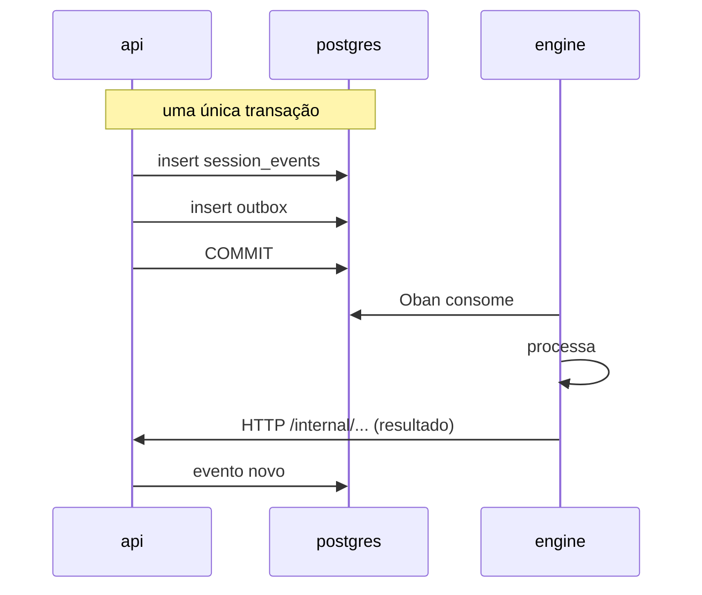

# API interna (api ↔ engine)

A api e o engine conversam de **duas** formas, e a escolha entre elas não é
estilística:

| direção | mecanismo | quando |
|---|---|---|
| api → engine | **outbox + Oban** | eventos: algo aconteceu, o engine reage quando puder |
| api → engine | **HTTP** | comandos síncronos: preciso da resposta agora |
| engine → api | **HTTP** (`/internal/*`) | o engine pede dados ou registra um resultado |

O critério: se a operação precisa ser atômica com uma escrita no banco, ela passa
pela outbox — a api grava o evento e a intenção de publicá-lo na mesma
transação, e não existe janela em que um exista sem o outro. Se precisa de
resposta imediata, passa por HTTP.

**Fora do escopo desta página**: rotas HTTP autenticadas pelo JWT normal do usuário
(RBAC por papel, `@RequireRole`) — como
`/projects/:projectId/agent-autonomy`, `/projects/:projectId/container/lifecycle`
([RN-267](../business-rules.md#rn-267)),
`.../agents/criativo/validate-necessity` (gate `necessidade-validada`,
[RN-406](../business-rules.md#rn-406), ADR 0095) ou o CRUD de
`/projects/:projectId/personal-access-tokens` ([RN-426](../business-rules.md#rn-426),
ADR 0105) — incluindo as duas rotas de `maintainer`
(`GET .../personal-access-tokens/all`,
`DELETE .../personal-access-tokens/:tokenId/admin`,
[RN-427](../business-rules.md#rn-427)) — não são "internas" no sentido deste documento, mesmo quando um
agente é quem efetivamente chama por elas. O mesmo vale para as quatro
rotas do `HuggingFaceModelsController` sob
`/workspaces/:workspaceId/huggingface/*`
([RN-462](../business-rules.md#rn-462), [RN-463](../business-rules.md#rn-463),
ADR 0115): `role:maintainer`, ação direta de um humano nas Configurações do
Projeto/Workspace, nunca chamadas pelo engine. O mesmo vale para as duas rotas de
associação, `POST`/`DELETE /projects/:projectId/members`
([RN-471](../business-rules.md#rn-471),
[RN-472](../business-rules.md#rn-472), ADR 0127) — e ali o fato é
estrutural, não só verdadeiro: os dois tetos de rebaixamento que a rota agora
impõe (ninguém rebaixa um `owner` de workspace, ninguém rebaixa a si mesmo)
moram DENTRO de `AddProjectMemberUseCase`, então seriam contornáveis por qualquer
segunda porta para `project_members`. Não há nenhuma — nenhuma rota `/internal/*`
escreve essa tabela, e o caso de uso tem exatamente um chamador, a própria rota
RBAC. O
service token compartilhado NUNCA serve de credencial nessas rotas, e o JWT do
usuário nunca funciona em `/internal/*` — os dois mecanismos não se sobrepõem
([RN-035](../business-rules/autenticacao.md#rn-035)).

**Uma terceira credencial, nem service token nem JWT de usuário**:
`POST /projects/:projectId/runner-ticket` é `role:developer` como qualquer
rota RBAC, mas não aceita o JWT normal de sessão — só uma de DUAS
credenciais de escopo de dispositivo, ambas tratadas pelo mesmo `PatAuthGuard`/
`@RequirePatAuth()`, escopadas por construção a esta única rota: um
Personal Access Token (`brb_…`, [RN-424](../business-rules.md#rn-424), ADR
0105), ou um JWT EdDSA autoassinado de vida curta (≤60s) que prova a posse de
uma chave de dispositivo Ed25519 em `runner_device_keys` — uma chave de máquina criada no
terminal e registrada pelo instalador
([RN-552](../business-rules.md#rn-552)), ou uma chave de projeto que o navegador
registrou antes de o [ADR 0203](../adr/0203-aposenta-o-fluxo-do-runner-pelo-navegador.md)
aposentar esse fluxo ([RN-465](../business-rules.md#rn-465), ADR 0118) — somada ao PAT,
nunca substituta. Vale anotar aqui porque é a distinção que esta
página existe para explicar: "não é `/internal/*`" não quer dizer "então é JWT
de usuário" — as duas credenciais de dispositivo são um terceiro mecanismo, sem
sobreposição com os outros dois.

Também fora do escopo: as
rotas `@Public()` que são o PONTO DE ENTRADA de fato, antes de existir
qualquer sessão — `POST /auth/login`, `POST /auth/register`,
`GET /auth/oauth/:provider/start`/`callback` (login social, ADR 0084) e o
resto de `auth.controller.ts`. Nenhuma delas usa o service token nem o JWT do
usuário (é o que ELAS emitem, não o que exigem), então a
distinção service token × JWT que esta página existe para explicar não se aplica —
elas simplesmente não têm credencial nenhuma na entrada. A classificação de exposição de
toda rota HTTP, interna ou não, está em
[docs/security-surface.md](../security-surface.md).

## Autenticação

Nenhuma ponta confia na rede privada. Todas apresentam o **mesmo
service token** — um segredo compartilhado via env, rotacionável, no
cabeçalho `X-Brabo-Service-Token`:

| chamador | verificado por | comparação |
|---|---|---|
| engine → api | `EngineServiceGuard` | `comparaEmTempoConstante` |
| api → engine | `EngineWeb.Plugs.VerifyServiceToken` | `Plug.Crypto.secure_compare/2` |
| broker → api | `EngineServiceGuard` | `comparaEmTempoConstante` |
| api → broker | `tokenConfere` (`apps/broker/src/config.ts`) | `timingSafeEqual` |
| `install.sh` → api | `EngineServiceGuard` | `comparaEmTempoConstante` |

O broker ([ADR 0130](../adr/0130-broker-de-container.md)) entrou nesta tabela
sem mudá-la: mesmo cabeçalho, mesmo segredo, mesma rotação. Ele responde `401`
onde a api responde `403`, igual ao engine — o que falta é
autenticação do chamador, e o `403` da api é uma restrição de compatibilidade
documentada, não uma divergência.

> **Este tráfego não passa pelo JWT.** As rotas `/internal/*` são anotadas com
> `@ServiceRoute()`, que as tira do `JwtAuthGuard` e as isenta do
> `RateLimitGuard` (que roda antes do guard do controller, então a isenção
> precisa vir do metadado). Um access token de usuário, mesmo de um `owner`,
> não abre nenhuma delas; e o service token não abre nenhuma outra rota. Ver
> [RN-035](../business-rules/autenticacao.md#rn-035).

> **Rotação sem indisponibilidade.** `BRABO_SERVICE_TOKEN` é o valor enviado;
> `BRABO_SERVICE_TOKEN_PREVIOUS` é aceito **só na verificação**. Como os dois
> lados enviam o atual e aceitam os dois, a rotação é a mesma dança em três passos
> do `AUTH_JWT_SECRET`, descrita no
> [runbook](../runbook.md#rotacao-das-chaves-do-auth).

## Correlação

Toda chamada entre os dois serviços leva também o cabeçalho `traceparent` (W3C),
e isso vale nas **duas direções e em todos os métodos** — GET, POST e o stream
SSE do turno de LLM. Cada lado tem um funil único que monta os cabeçalhos:

| chamador | funil |
|---|---|
| api → engine | `HttpApiToEngineClient.buildHeaders()` |
| engine → api | `EngineApiClient.headers/0` |

Até o [ADR 0035](../adr/0035-observabilidade-legivel-e-trace-sem-coletor.md) o
`traceparent` do lado do engine só era injetado nos POSTs, então as leituras
(`list_events`, o contexto do agente) e o `llm_turn_stream` chegavam à api sem
correlação — apareciam no Tempo como traces órfãos. Se você acrescentar uma
chamada nova a este contrato, use o funil: é ele que garante que ela não nasça órfã.

> A recusa de um service token é logada nos dois lados, com rota e origem
> — e **sem** o token apresentado. Um 401 aqui é indistinguível, sem logs,
> de "engine fora do ar", que era exatamente o sintoma antes.

> As rotas `/internal/*` **não são internas por convenção de nome.** O prefixo
> é para legibilidade; o que as protege é o guard verificando o service token. A
> classificação completa está em
> [`docs/security-surface.md`](../security-surface.md), e um teste de tabela
> reprova rota nova sem classificação.

## engine → api

Vinte e oito rotas, todas sob `/internal/sessions/:sessionId/` salvo indicação em contrário.
Agrupadas pelo que fazem.

Uma rota desta família tem um chamador que **não** é o engine — ver
[broker → api](#broker--api), abaixo. A classificação nomeia o mecanismo, não
o remetente.

### Event log e ações

| método | caminho |
|---|---|
| GET · POST | `/events` |
| POST | `/actions` |
| POST | `/termination` |
| POST | `/handoffs` |

O engine nunca escreve direto na tabela de eventos — ele **pede** à api, que
controla o `seq` e a atomicidade com a outbox.

`POST /handoffs` mantém **no máximo um handoff `offered` por (projeto, alvo)**
([RN-635](../business-rules.md#rn-635),
[ADR 0182](../adr/0182-ciclo-de-vida-do-handoff.md)). A resposta é a oferta
VIGENTE mais `desfecho`: `criado`, `substituiu_oferta` (a pendente virou
`superseded`, com um evento `handoff.superseded`) ou `ja_oferecido` (sem linha nova —
mesma sessão e nenhum artefato novo). Um alvo já ativo numa sessão não fechada
do projeto é recusado com **409** `reason: "agente_ja_ativo"`, e a
`message` é a frase que o agente lê como resultado da ferramenta
(`Engine.Harness.Tools.OfferHandoff` a repassa literalmente;
`FalhaDeTurno.origem/1` a classifica como `politica`). O campo opcional do corpo
`seAusente: true` — enviado pelo AppSec por `create_handoff_if_absent/5`
([RN-636](../business-rules.md#rn-636)) — devolve QUALQUER oferta pendente ao
alvo em vez de substituí-la.

A oferta Criativo→PO que um clique em "Estou pronto — a necessidade está validada" pediu
é ACEITA na mesma chamada, em nome de quem clicou
([RN-658](../business-rules.md#rn-658),
[ADR 0185](../adr/0185-estou-pronto-fecha-os-dois-gates.md)): a oferta é
`criativo` → `po`, desta sessão, levando o `product_brief` nascido depois
do último `readiness.confirmed` marcado. O aceite passa pelo mesmo
`AcceptHandoffUseCase` do card (mesmos eventos, a pessoa como ator, uma marca
`implicito`), e a resposta então leva `status: "accepted"`. O
engine só casa `{:ok, _}`, então nada muda do lado dele; um aceite implícito
que falha nunca vira erro para o engine — vira um
`agent.error` durável e a oferta é devolvida assim mesmo.

`GET /events` é o que os sete agentes conversacionais leem quando o processo deles
sobe sobre uma sessão que já tem conversa, e o que os kickoffs
leem para achar o brief, as regras, o mapa de módulos e as histórias
([RN-580](../business-rules.md#rn-580)). Até ali a rota só entendia
`afterSeq` e `limit`, e o engine só mandava `limit=200` — então recebia os
**primeiros** 200 eventos, e um agente acordado numa conversa de 201 eventos subia
sem a mensagem que estava respondendo. Entraram dois parâmetros de query, ambos
**aditivos** (sem eles a resposta é byte a byte a antiga):

| parâmetro | efeito |
|---|---|
| `latest=true` | devolve a **cauda** — os últimos `limit` eventos, ainda em `seq` crescente — e ignora `afterSeq`; mesma semântica da rota humana (ADR 0021) |
| `types=a.b,c.d` | só eventos desses tipos, e `limit` conta só eles; no máximo 20 tipos, cada um casando `^[a-z][a-z0-9_]*(\.[a-z0-9_]+)*$`, senão **400** |

A página continua com teto de **200** ([ADR 0060](../adr/0060-superficie-de-leitura-de-codigo.md)):
nenhum dos parâmetros torna a leitura ilimitada. Do lado do engine as leituras novas
passam por `EngineApiClient.list_events/3`; `list_events/2` continua existindo, sem mudança,
para os chamadores que não migraram (`InfraLeadServer`, `DevLeadTools`).

E é por isso que a guarda de tipo de sessão mora no caso de uso de append, e não
em `ActivateExecutionUseCase`: o `POST /events` daqui e a rota do usuário caem no
mesmo funil. Desde a FASE 20, `execution.activated` numa sessão `consultiva`
responde **409** por este caminho também — o tipo é intenção de criação e o
evento não o promove ([RN-097](../business-rules.md#rn-097)). Nenhuma outra
mudança de contrato: os outros tipos de evento continuam idênticos, e a recusa
acontece **antes** de `incrementSeq`, então uma tentativa recusada não abre buraco
no `seq`.

Desde a [RN-581](../business-rules.md#rn-581) o mesmo funil também recusa
**conversa** numa sessão já `closed`/`closed_abnormally`:
**409** com corpo nomeado — `{ message, reason: "sessao_encerrada", status,
type }`. "Conversa" é um tipo que só existe como conversa
(`chat.message`, `chat.structured_question[_answered]`, `agent.status`,
`agent.activated`, `handoff.offered`/`accepted`, os eventos de prontidão) **ou**
qualquer evento cujo ator é um agente conversacional (os seis mais `dev-lead` e
`infra`). O que o próprio fechamento produz continua entrando — o
`ToolLoop` do Psicólogo, os desfechos da Anamnese, o humano decidindo uma ação pendente. O
status vem do **mesmo** `UPDATE` que reserva o `seq`, e a
recusa desfaz esse incremento: também sem buraco. O
`append_event/3` do engine loga a recusa como aviso em vez de descartá-la, já que
a maioria dos chamadores dele descarta o retorno.

`ActivateExecutionUseCase` ganhou um segundo efeito colateral que **não** passa
por nenhuma rota deste documento ([RN-135](../business-rules/custo.md#rn-135)): no
fim da ativação, se a rota do usuário informa `originSessionId` (a sessão de
CHAT de onde veio o clique), ele fecha essa sessão via
`TransitionSessionUseCase` — o mesmo caminho que o `POST /termination` desta
página usa para o engine reportar encerramento, mas disparado pela api, sem ida
nenhuma ao engine. Nenhuma rota nova, nenhuma mudança no contrato `engine → api`
existente.

`GET /projects/:projectId/execution/session` ([RN-139](../business-rules/autenticacao.md#rn-139))
é a mesma história ao contrário: expõe por HTTP externo uma leitura
(`findActiveExecutionSession`) que antes só existia dentro de
`ActivateExecutionUseCase`. Nenhum caminho `engine → api` novo, nenhum efeito
colateral — é um `SELECT`, e o critério (uma sessão `active` com `execution.activated`
gravado) não muda nada do que o engine já fazia.

Desde a [RN-579](../business-rules.md#rn-579) (AT-093) a fachada `EngineApiClient`
tem um efeito colateral por cima destas rotas, e ele é no canal PRÓPRIO do
engine, não na api: quando a api **confirma** uma escrita numa sessão —
`POST /events` (tanto `append_event` quanto `append_event_returning`),
`POST /actions` (`proposed_action.created`), `POST /handoffs`
(`handoff.offered`) e o `create_epic`/`create_story`/`create_task` do PO
(`backlog.*_created`) — a fachada transmite `event.appended` em
`session:<id>` só com `type` e `actorId`. Escrita recusada não transmite
nada. Nenhuma rota e nenhum corpo de requisição mudou; antes disso, só o
`ArtifactEmitter` e o Infra Lead transmitiam, à mão, e até para escritas que
a api tinha recusado. É o que deixa o navegador largar o poll de 3s enquanto o
canal está vivo.

Escritas que a api faz por conta própria — um humano decidindo uma ação, uma
transição de sessão, uma mensagem de chat respondida pelo próprio turno de LLM da api — não passam
por essa fachada, e desde a AT-157 chegam ao canal pelo caminho
inverso: depois que a escrita **comita**, a api chama
`POST /internal/sessions/:id/event-appended` (ver *api → engine*) e o
engine transmite o mesmo `event.appended`. Escritas que chegaram do próprio
engine (`/internal/*`) não são anunciadas uma segunda vez — exceto os
eventos que a api grava por CONTA PRÓPRIA como efeito de uma ação que ela auto-aprovou
e executou dentro daquela requisição interna (`infra.pr_opened`,
`adr.pr_opened`, `action.*`): a fachada do engine só anuncia a escrita que ela
pediu, então estes são anunciados uma vez pela api
([RN-848](../business-rules.md#rn-848)). A chamada é
melhor esforço e nunca esperada; se ela se perde, o poll de fallback de 15s do navegador
cobre, como antes. O `:id` só é enviado quando o id da sessão é um
UUID (o tipo da coluna): a api o confere onde monta a URL, codifica o
segmento e confirma que o resultado mantém a origem de `ENGINE_URL` e o caminho
esperado — qualquer outra coisa é descartada sem chamada (AT-344).

### LLM

| método | caminho |
|---|---|
| POST | `/llm-turn` |
| POST | `/llm-turn-stream` |

Toda chamada de modelo passa pela api. Não é indireção gratuita: é onde
o metering acontece e onde o orçamento pode **recusar** a chamada. Um engine que
falasse direto com o provider tornaria o teto de gasto impossível de impor.

Os **dois** caminhos usam o mesmo teto de tempo, `LLM_TURN_TIMEOUT_MS` (padrão
300.000 ms). Um turno de LLM não é uma chamada de API comum: com modelo local o
primeiro turno ainda carrega vários GB de pesos antes do primeiro token, e com
provider de API um contexto grande demora. Em `/llm-turn-stream` o valor vale
POR CHUNK recebido — ou seja, é o teto de INATIVIDADE que o
[ADR 0041](../adr/0041-base-openai-compativel-e-contrato-de-llm-providers.md)
pede — e não o da
resposta inteira.

O teto precisa ser explícito nos dois: sem passá-lo, o `Req` usa o
padrão dele, 15 segundos. Enquanto só o caminho sem stream o passava, os quatro
agentes conversacionais — que usam só o com stream — falhavam aos 15s com
`%Req.TransportError{reason: :timeout}`, classificado como origem `infra`. Com
modelo local o turno cabia em 15s e o defeito não aparecia.

#### Toda chamada sem stream roda em processo próprio ([RN-742](../business-rules.md#rn-742))

`post_returning/3` e todo GET do `EngineApiClient.Live` rodam a chamada do `Req`
dentro de uma `Task` descartável (`isolado/1`); os cabeçalhos são montados antes, no
chamador. Uma resposta que chega depois do `receive_timeout` cai num processo
que já terminou, nunca na caixa de correio do chamador — em 08/10 essa mensagem
perdida derrubou o dev agent na chamada SEGUINTE. O caminho com stream fica no
chamador (o `into:` dele escreve o dicionário de processo do chamador, e os
agentes conversacionais já o chamam da `Task` do turno).

#### A última mensagem pode ser a orientação de idioma ([RN-622](../business-rules.md#rn-622))

As `messages` que o engine manda aos dois caminhos podem terminar com UMA mensagem
`role: "system"` a mais — a orientação de idioma da resposta, acrescentada pela
fachada `EngineApiClient` em toda chamada de um turno de agente (o idioma do autor
para um turno que alguém digitou, o do projeto nos demais; nunca para o
sumarizador `context-manager`). Ela é efêmera: nunca entra no
histórico do agente. A api não faz nada de especial com ela — é uma mensagem de sistema como
qualquer outra, e os tokens de entrada dela são medidos como o resto (18–29 por chamada medidos
com cl100k/o200k, sob um teto de 50 tokens).

Desde a [RN-623](../business-rules.md#rn-623) a fachada também lê as `tools`
da MESMA chamada: num turno com autor, quando essas ferramentas incluem uma que
grava artefato compartilhado do projeto e o idioma do projeto difere do do
autor, a mesma mensagem ganha uma segunda frase ("Write project artifacts
in X." / "Artefatos do projeto: em X."). Continua uma mensagem, continua efêmera,
até 42 tokens no pior par real medido. O corpo da requisição não
muda.

Desde a [RN-706](../business-rules.md#rn-706) as chamadas dos agentes `dev-*` e
dos subagentes de QA (o `ToolLoop`) podem levar MAIS UMA mensagem efêmera `role: "system"`
ANTES do perfil do autor e da orientação de idioma (a de idioma
continua por último): o ambiente do agente, montado por `Engine.Harness.AmbienteDoAgente`
— a pasta de trabalho real (`/work/...` quando há container `running`), a
imagem e a rede do último `artifact.project_image`, que o git passa
pelas ações tipadas, e o módulo dele e os contratos que consome.
Teto de 1 200 caracteres; leitura que falha a deixa de fora. A api a trata como
qualquer outra mensagem de sistema e mede os tokens dela como o resto. O corpo da
requisição não muda.

Desde a [RN-711](../business-rules.md#rn-711) as chamadas dos sete
agentes conversacionais levam MAIS UMA mensagem efêmera `role: "system"`, depois
da de ambiente e ANTES do perfil do autor e da orientação de idioma:
o fluxo de entrega, montado por `Engine.Harness.FluxoDoTime` — as sete etapas em
ordem, onde o agente está, o próximo passo real e quem o dispara (humano ou
sistema). Mesmo texto em todo turno do mesmo agente; nunca guardado no
histórico do agente. O corpo da requisição não muda. Desde a
[RN-862](../business-rules.md#rn-862) a mesma mensagem termina, só para Criativo,
PO, Arquiteto e Dev Lead (os agentes com `declare_open_question`), com
uma frase central: toda dúvida deixada para o usuário vira
`declare_open_question`, com a sugestão do agente e o que ela afeta — nunca
uma pergunta só no texto do turno.

Desde a [RN-874](../business-rules.md#rn-874) as chamadas do PO levam mais uma
mensagem efêmera `role: "system"` logo depois da de fluxo, montada por
`Engine.Harness.DecisoesDoProjeto`: as decisões do usuário (`decision_record`)
e as perguntas ainda abertas no projeto, lidas localmente do event log,
com teto de 10 + 10 itens e 3 000 caracteres. Omitida quando não há nada a
dizer ou a leitura falha.

#### O frame final leva o nome do modelo ([RN-146](../business-rules/autenticacao.md#rn-146))

`RunLlmTurnResult` e o frame `final` de `LlmTurnStreamEvent` ganham
`modelName: string | null` — o nome do modelo que a api resolveu
(`resolveModelBinding` → `models.findById`) antes de chamar o provider.
`null` só quando o turno falhou ANTES de resolver qualquer modelo (sem
binding, ou binding para um modelo que não existe mais); em todos os outros casos —
inclusive orçamento estourado — o binding já tinha resolvido e o nome viaja
até no frame de erro. Os quatro agentes conversacionais do engine
extraem o campo do frame e o incluem no payload de `agent.response`
(`modelName`), que é o que `SessionPage.tsx` lê para mostrar o modelo ao lado
do nome do agente.

#### O Jev pode estreitar o menu de ferramentas ([RN-625](../business-rules.md#rn-625))

Desde o [ADR 0179](../adr/0179-o-laco-pergunta-ao-jev-qual-ferramenta.md) os dois
caminhos podem perguntar ao roteador de ferramentas Jev qual ferramenta serve ao passo antes de chamar o
modelo de chat, e então oferecer ao modelo só o menu que sobrou. As mudanças de
contrato são aditivas:

- **Requisição:** os dois corpos aceitam um `catalogoCompleto: boolean` opcional.
  `true` pula o roteador naquela chamada e oferece a lista `tools` inteira. O
  engine o liga quando repete um passo cujo menu restrito fez o modelo
  responder sem chamar ferramenta (uma vez por passo).
- **Resposta:** `RunLlmTurnResult` e o frame `final` de
  `LlmTurnStreamEvent` ganham um `toolRouting` opcional — o menu antes e
  depois, a escolha, a confiança dela, a ferramenta anterior da execução, a latência, o
  custo real do Jev e, em qualquer queda para o catálogo inteiro, `motivoDaQueda` e
  `origemDaQueda` (`infra`/`modelo`/`codigo`). Ele fica AUSENTE quando o roteador não
  foi consultado: provider que não é o OpenRouter, menos de duas ferramentas ou a
  chave do workspace (`tool_router_enabled`) desligada. O engine o grava como o
  evento `tool_router.decided`.
- **Stream:** `/llm-turn-stream` pode emitir um frame `tool_routing_started`
  ANTES de qualquer `delta`. Engines que não o conhecem o ignoram como tipo de
  frame desconhecido.

O turno nunca falha por causa do roteador: todo erro cai no catálogo
inteiro, com o motivo em `toolRouting`. Nenhuma rota entrou ou saiu.

#### `usage.costMicros` é o custo real quando o provider o informa ([RN-665](../business-rules/custo.md#rn-665))

Desde o [ADR 0188](../adr/0188-o-custo-real-do-provider-vira-o-numero-do-metering.md) o `usage.costMicros`
que os dois caminhos devolvem — e que o engine soma no orçamento da área — é
o custo REAL que o provider devolveu, quando devolveu um (hoje só o
`usage.cost` do OpenRouter, e nunca numa chamada BYOK). Senão é o
preço congelado do catálogo, como antes ([ADR 0042](../adr/0042-catalogo-vivo-ciclo-de-vida-do-modelo-e-preco-auditavel.md)).
O nome e a forma do campo não mudam; o que muda é o número que o engine
recebe para a mesma chamada, que pode ser maior que o do catálogo.

#### Código de erro do provider: `errorCode`

Ao lado de `error`, o corpo de `/llm-turn` e o frame `final` de
`/llm-turn-stream` levam um `errorCode` aditivo — o `code` normalizado do
erro do provider ([ADR 0041](../adr/0041-base-openai-compativel-e-contrato-de-llm-providers.md)),
`null` quando não há erro ou quando o erro não é do provider (orçamento,
binding de modelo ausente). Um 402 do provider é `insufficient_credit`
([RN-730](../business-rules.md#rn-730)): o engine decide "crédito esgotado"
por esse código primeiro (`FalhaDeTurno.credito_esgotado?/1`) e mantém a comparação de texto
só como fallback para uma api mais velha que o campo ([RN-726](../business-rules.md#rn-726)).

#### Resposta cortada no teto de saída: `truncated`

Quando o provider fechou a resposta no teto de saída (`finish_reason:
"length"` no dialeto OpenAI-compatível, `stop_reason: "max_tokens"` na
Anthropic), o corpo de `/llm-turn` e o frame `final` de `/llm-turn-stream`
levam `truncated: true` ([RN-737](../business-rules.md#rn-737)). O campo é
aditivo e ausente nos demais casos. O texto e os argumentos de `toolCalls` vêm cortados:
o engine não executa tool call de resposta truncada (devolve um
erro de ferramenta nomeado ao laço) e acrescenta uma linha curta de "cortado" a um
texto de fecho truncado.

#### Relatórios de gasto NÃO passam por aqui

O metering é escrito **neste** caminho: cada `/llm-turn` grava uma linha em
`token_usage` antes de a resposta voltar ao engine. LER esse dado — a
fatura do owner (`/workspaces/:id/credential-spend` e
`/workspaces/:id/spend-report`) e o consumo do membro
(`/projects/:id/spend/me`) — é superfície **externa**, autenticada por JWT e
classificada em [security-surface.md](../security-surface.md).

Isto não é detalhe organizacional: essas três rotas ramificam pelo **papel da
pessoa** — `owner` para a fatura, `viewer` para o próprio consumo
([RN-101](../business-rules/custo.md#rn-101)). O `X-Brabo-Service-Token` não carrega
pessoa nenhuma, então uma contraparte interna teria de escolher entre não
distinguir os públicos ou receber o id do ator como parâmetro — o que é
exatamente o que o [ADR 0063](../adr/0063-duas-audiencias-para-o-mesmo-gasto.md)
rejeita. O engine escreve o gasto; quem o lê são as pessoas.

O [ADR 0076](../adr/0076-provider-volta-a-ser-dimensao-de-gasto.md) revisou o
0063 e reabriu a quebra por **provider**, que é uma quebra por CREDENCIAL. Nem a
rota nem o papel mudaram — as duas seguem classificadas como acima —,
mas o que a rota do owner DEVOLVE mudou, e é por isso que vale dizer a fronteira
aqui: `porProvider` só existe no relatório do workspace (`owner`), e o consumo do
membro continua sem provider e sem credencial. O que mudou de verdade foi o
mecanismo de garantia: a dimensão pedida com escopo de ator **não compila**
([RN-187](../business-rules/custo.md#rn-187)), em vez de depender de a rota não
oferecer o parâmetro. O argumento do parágrafo acima continua de pé — é ele que
explica por que esta leitura nunca desce para cá.

### Ciclo de vida da sessão

| método | caminho |
|---|---|
| GET | `/internal/sessions/:id/pending-work` (**não** é escopada à sessão no sentido das outras: é sobre a sessão, não dentro dela) |

O `SessionServer` pergunta antes de fechar por heartbeat. O timeout mede
inatividade da ABA — 30 segundos —, e fechar uma sessão é sobre o TRABALHO ter
terminado, não sobre quem ainda está olhando. Numa execução real isso segurou
um handoff `offered` para o Arquiteto dentro de uma sessão fechada
([RN-064](../business-rules/custo.md#rn-064)).

Resposta: `{ pending, motivo, aguardandoUsuarioDesde }`. `motivo` vai para o log do engine — uma sessão que
se recusa a fechar sem dizer por quê é indiagnosticável. E a api fora do ar
**não** impede o fechamento: trocar sessão órfã por sessão imortal seria
trocar um defeito por outro.

`aguardandoUsuarioDesde` é o quinto sinal
([RN-581](../business-rules.md#rn-581)), e o único com **teto**:
quando o evento de fim de turno mais recente da conversa (`agent.response`,
`chat.structured_question`, `agent.error` do lado do agente; `chat.message`,
`chat.structured_question_answered` do lado do usuário) veio de um
agente conversacional, a conversa está esperando o usuário, e a api
devolve o instante ISO em que aquele turno terminou. A api diz *desde quando*; o engine
decide *por quanto tempo* (`SESSION_CONVERSATION_IDLE_TIMEOUT_MS`, 8h) e, passado
isso, fecha a sessão como `closed` com causa `conversation_idle_timeout`. Ele
é `null` sempre que algum dos quatro sinais sem teto está presente — esses vencem,
como sempre venceram. Um valor presente que o engine não consegue interpretar é tratado como
erro (o fechamento por heartbeat), nunca como "sem teto".

### Registro de gates

| método | caminho |
|---|---|
| GET | `/internal/gates` (**não** escopada à sessão) |

Leitura do registro declarativo em `docs/gates.yml`
([ADR 0054](../adr/0054-gates-como-registro-declarativo.md)). Não é
escopada à sessão pela mesma razão do catálogo de modelos: o registro é global —
quais gates existem é um fato sobre o produto, o mesmo para todo projeto.

Só leitura, e sem rota de escrita **de propósito**: o registro muda por revisão
de PR, não em runtime. Uma rota de escrita transformaria uma decisão de engenharia em
configuração de produção, que é o que o ADR rejeitou ao escolher
YAML em vez de tabela.

O arquivo viaja dentro da imagem (`COPY docs/gates.yml` em
`docker/api/Dockerfile.prod`), como as migrations: o loader sobe a partir de
`__dirname` até achá-lo, e em produção o acha em `/app/docs/gates.yml`. O
carregamento é preguiçoso — arquivo ilegível devolve erro nesta rota, em vez de
impedir a api de subir.

O mecanismo inteiro está documentado em
[docs/explanation/gates.md](../explanation/gates.md).

**Há uma segunda rota para o mesmo registro, e ela NÃO é interna.** O painel
do time (FASE 15b) lê `GET /gates`, autenticada por JWT de usuário como qualquer
rota de produto. Não é duplicação por descuido: `/internal/*` é autenticada por
**service token**, que o navegador não tem e não pode ter — entregá-lo ao front-end
daria a ele a superfície interna inteira, não só os gates. As duas diferem também
no que devolvem: a interna entrega o registro como está no YAML, a
pública devolve **só os gates `active`**, porque um gate `planned` é
planejamento de engenharia e não tem por que aparecer na tela de quem espera
uma PR. A classificação das duas está em
[docs/security-surface.md](../security-surface.md).

### Catálogo de modelos

| método | caminho |
|---|---|
| POST | `/internal/models/sync` (**não** escopada à sessão) |

Uma das duas rotas `engine → api` fora de `/internal/sessions/:sessionId/` (a
outra é o [remoto de trabalho do projeto](#project-working-remote)), porque a
sincronização do catálogo não pertence a sessão nem a workspace: o catálogo é
GLOBAL — nome, preço, janela e capabilities são um fato sobre o provider, o mesmo para
todos. Desde o [ADR 0051](../adr/0051-facetas-de-capability-e-curadoria-por-uso.md)
isso inclui as facetas de modalidade (lê imagem, gera imagem, thinking), que a
mesma chamada reconcilia a partir do catálogo remoto — modalidade que o
provider não declara é preservada, não zerada. O que é por workspace é a **curadoria**, e a sincronização não a alcança
([ADR 0049](../adr/0049-curadoria-de-modelo-por-workspace.md)). Quem
**agenda** é o engine (`ModelSyncSchedulerWorker`, Oban, com o mesmo idioma de worker
que se reagenda do `AnamneseSchedulerWorker`); quem tem as credenciais e
o registro de providers é a api. Duplicar o registro em Elixir significaria manter dois
catálogos — ver [ADR 0042](../adr/0042-catalogo-vivo-ciclo-de-vida-do-modelo-e-preco-auditavel.md).

Responde **200** com um relatório por provider (`porProvider[]`), nunca 5xx por causa de
um provider: cada linha leva `descobertos`, `reencontrados`,
`indisponibilizados` e — quando o provider não foi sincronizado — `pulado`
(`sem_capability` | `sem_credencial` | `falha`) com `origemDaFalha`
(`infra` | `modelo`) e `detalhe`. Provider pulado **não desativa nada**:
"não sei o que há lá" não é "não há nada lá"
([RN-043](../business-rules/custo.md#rn-043)). O corpo completo está no
[OpenAPI gerado](/reference/api/) sob a tag `internal`.

Duas coisas que esta rota **não** faz, e que já foram diferentes:

- **Ela não liga nem desliga modelo em workspace nenhum.** `descobertos` conta
  linhas novas em `models`; nenhuma delas ganha curadoria. Um modelo descoberto
  não tem linha em `workspace_models`, e a ausência de linha é o estado desligado
  ([RN-052](../business-rules/custo.md#rn-052)).
- **Ela não muda preço em silêncio.** Preço marcado `manual_pricing` é preservado
  como está, e toda mudança que a sincronização faz grava uma linha em
  `model_price_changes` com origem `sync` — na mesma transação da escrita
  ([RN-044](../business-rules/custo.md#rn-044), [RN-051](../business-rules/custo.md#rn-051)).

### Remoto de trabalho do projeto {#project-working-remote}

| método | caminho |
|---|---|
| GET | `/internal/projects/:projectId/git-remote` (**não** escopada à sessão) |

A segunda rota `engine → api` fora de `/internal/sessions/:sessionId/` a
existir — as duas leituras do PO, na seção seguinte, vieram depois — e a
**única do produto que devolve segredo decifrado**
([ADR 0056](../adr/0056-o-engine-trabalha-em-repositorio-remoto.md)).

Ela existe pela mesma divisão da sincronização do catálogo, aplicada a outro recurso:
quem trabalha no sistema de arquivos é o engine, quem tem a chave mestra é a
api. Sem ela, um projeto em provider remoto fazia a metade conversacional e parava
na de construção — `get_local_repo_path/1` recusava tudo que não fosse `local`,
e worktree, terminal, diff do gate e contexto paravam junto.

Responde com a origem **limpa** (`origin`), a branch default e, para provider
remoto, `token` e `username` separados. A separação não é cosmética:

> **A `origin` nunca leva credencial.** Este é o valor gravado no
> `.git/config` do workspace, **dentro da pasta onde o dev agent tem
> leitura auto-aprovada** ([RN-075](../business-rules/custo.md#rn-075)). Uma URL como
> `https://x-access-token:TOKEN@…` ali estaria a um `cat .git/config`
> de virar contexto de LLM.

Quem a consome tem a obrigação simétrica: injetar o token **por invocação**, no
ambiente do processo filho de cada chamada de git, e nunca em argv nem em
arquivo ([RN-076](../business-rules/custo.md#rn-076), `Engine.Actions.GitAuth`).

A credencial é a do **owner do workspace**, pelo mesmo resolvedor da
[RN-058](../business-rules/custo.md#rn-058). O provider `local` **não chega aqui**: ele
é resolvido direto do banco pelo engine, não tem token e não depende de a api
estar de pé — é o caminho que o `pnpm dev` e a suíte de testes inteira exercitam.

#### A aba Código NÃO passa por aqui, e a assimetria é o ponto

A superfície de leitura de código da FASE 26b (`/projects/:projectId/code/*`)
**não tem contraparte interna**, e vale explicar por quê — a rota acima existe
para o caso oposto, e as duas juntas mostram a divisão.

O engine precisa de `git-remote` porque trabalha no **sistema de arquivos**:
clona, cria worktree, roda comando. A aba Código não trabalha em lugar nenhum —
ela pede ao **provider** o conteúdo de uma ref, pela api, com a
credencial que a api já tem. Nada neste caminho precisa de segredo decifrado
atravessando processo, e é por isso que nada neste caminho abre rota interna.

A consequência prática é a que importa: a única rota do produto que devolve
segredo decifrado continua sendo UMA. Ler código não a multiplicou.

#### A indexação do RAG do chat (Onda 4/G2) também não abre rota interna

`docs`/`adr` são indexados por `ReadProjectCodeUseCase` — a MESMA
superfície da aba Código, mesma credencial do owner, mesmo portão de container
(RN-105) — pela razão acima: nada neste caminho decifra
segredo em processo separado. `session` lê `chat.message`/`agent.response`
direto do event log, sem sair da api. O embedding (`RagEmbeddingService`)
nunca passa pelo resolvedor de credencial da RN-058: ele pede o provider
FIXO `ollama` direto ao `LLMProviderRegistry`, o mesmo caminho que a
RN-058 já descreve como "a busca é pulada" para esse provider — não há
segredo de usuário a decifrar aqui, e é por isso que também não há
rota interna a abrir ([RN-232](../business-rules.md#rn-232),
[ADR 0080](../adr/0080-busca-hibrida-pesos-limiar-e-citacao.md)).

### O que o PO relê: regras de negócio e backlog

| método | caminho |
|---|---|
| GET | `/internal/projects/:projectId/business-rules` (**não** escopada à sessão) |
| GET | `/internal/projects/:projectId/backlog` (**não** escopada à sessão) |

As outras duas rotas fora de `/internal/sessions/:sessionId/`, e pelo
mesmo critério das anteriores: o recurso pertence ao **projeto**, e um
segmento de sessão aqui seria decorativo — pior, seria enganoso, porque é
exatamente o escopo de sessão que causou o defeito que estas rotas corrigem
([RN-164](../business-rules/autenticacao.md#rn-164)).

O PO tinha **quatro ferramentas e todas de escrita** (`create_epic`,
`create_story`, `create_task`, `offer_handoff`). O contexto dele era montado
uma vez, no kickoff, a partir dos **primeiros** 200 eventos da **sessão corrente** (esta
página dizia "últimos"; eram os primeiros, que é o que a
[RN-580](../business-rules.md#rn-580) mediu e corrigiu) —
e depois disso ele nunca mais relia nada. Numa sessão longa, ou numa
retomada, ele não sabia quais regras existiam, quais já tinha coberto, nem o que
já tinha criado ele mesmo. O sintoma que apareceu no uso real foi um backlog com
um épico e **nenhuma história**: sem história não há tarefa, e sem tarefa a
execução trava sem erro nenhum.

`/business-rules` devolve todo `artifact.business_rule` das sessões do projeto
— com a `description` completa, quais histórias já citam cada regra
(`coveredByStoryIds`) e o `uncoveredCount`. Não é o `GetCoverageUseCase`
de novo: aquele responde "quanto do produto já virou história" para a
TELA e por isso só leva o título; este responde "o que eu preciso transformar em
história" para o MODELO, e sem a descrição o PO teria o enunciado da regra e
não o conteúdo dela. O CÁLCULO da cobertura é o mesmo (`computeCoverage`,
puro) — dois cálculos do mesmo fato divergiriam no primeiro ajuste.

`/backlog` devolve a MESMA árvore épico → história → tarefa da aba Backlog,
pelo mesmo `ListBacklogUseCase` (três leituras por projeto, nunca N+1).

Nenhuma das duas devolve segredo, e **nenhuma das duas aceita parâmetro além
do id do projeto**: nem termo de busca, nem paginação, nem filtro. É
deliberado, e é o que as mantém do lado certo do
[ADR 0060](../adr/0060-superficie-de-leitura-de-codigo.md): ler não é
efeito externo e não vira `proposed_action`, mas a leitura de um agente precisa ser
CONTIDA — e rota sem parâmetro não tem onde o modelo escrever o que
quiser. O custo por chamada é constante, e o texto entregue ao modelo tem
teto de linhas, sempre declarando o total real quando trunca.

### O que o PO relê: métricas de produto

| método | caminho |
|---|---|
| GET | `/internal/projects/:projectId/product-metrics` (**não** escopada à sessão) |

A TERCEIRA rota de leitura do PO, mesmo desenho das duas acima
([RN-407](../business-rules.md#rn-407)) — fecha o último item pendente da
auditoria `fluxo.yml` × código
([item B4](../explanation/auditoria-fluxo-vs-codigo.md#b-gaps-in-active-roles-already-implementable-work)):
`docs/fluxo.yml` (papel `po`, entrada `metricas-de-produto`) declarava
`status: lacuna` desde o ADR 0089 — o DADO já existia (o
script `analise:funil` mede o funil sessão → commit → PR → merge, o lead time
real e a frequência real de deploy), só faltava o MECANISMO de leitura dentro do
turno.

O relatório é montado pelas MESMAS funções puras e pela MESMA query do script —
`calcularFunil`/`calcularLeadTimes`/`leadTimeMedioMs`/
`deploymentFrequencyPorDia`/`buscarAcoesGitDoFunil`, extraídas para
`apps/api/src/application/services/funil-metrics.ts` (`scripts/` não pode
importar `src/` no sentido inverso, e um caso de uso não pode importar de
`scripts/`), para que a leitura do PO e o relatório humano nunca divirjam sobre
o mesmo fato. `apps/api/scripts/analise-funil.ts` agora REEXPORTA dali
em vez de definir localmente — sem mudança de assinatura nem de comportamento.

O corpo JSON não tem campo nenhum para as três ausências permanentes que o
script declara ("Não medido, de propósito": funil completo de produto
ideação → commit, evidência de adoção por feature, MTTR/change failure
rate) — a ferramenta do PO (`listar_metricas_de_produto`) nomeia as três
pelo nome no TEXTO que devolve ao modelo, nunca deixando-o concluir por
omissão que não há lacuna.

### O que o dev agent lê: os contratos entre módulos

| método | caminho |
|---|---|
| GET | `/internal/projects/:projectId/module-contracts` (**não** escopada à sessão) |

A leitura que o dev agent faz dos contratos do Arquiteto
([RN-684](../business-rules.md#rn-684),
[ADR 0200](../adr/0200-contrato-entre-modulos-artefato-do-arquiteto.md)), para
que ele pare de ler o worktree de outro módulo para descobrir uma interface.
Mesmo desenho das leituras do PO: nenhum parâmetro além do projeto, custo constante
(o `module_map` vigente e uma leitura por tipo de evento). A resposta tem uma
entrada por módulo do `module_map` VIGENTE — `modulo`, `dependeDe` (o
`dependsOn` do mapa: o que ele consome) e `expoe` (os itens do contrato
vigente, ou `null` quando o Arquiteto não declarou nenhum) — mais
`contratosForaDoMapa`, os contratos de módulos que o mapa não tem mais, ditos
e nunca anexados a nada. `status: sem_contratos` com `version: 0` é uma
resposta legítima, não um erro. A ferramenta do engine (`listar_contratos_de_modulos`)
renderiza por inteiro só o módulo do próprio dev e os que ele consome, com teto de
120 itens que diz o que foi cortado.

### Onde mora o workspace do projeto — e por que LER ainda não é rota

O `execution_mode` do projeto ([ADR 0072](../adr/0072-projeto-local-ou-container.md)/
[ADR 0104](../adr/0104-execution-mode-tres-valores-e-workspace-verificado-pelo-runner.md),
[RN-169](../business-rules/autenticacao.md#rn-169)/[RN-421](../business-rules.md#rn-421))
segue a mesma divisão. Por ele um projeto pode ser `container` (a
pasta gerenciada em `PROJECT_WORKSPACES_ROOT`, o padrão), `mounted` (um
caminho absoluto do usuário, montado por bind-mount) ou `runner` (um caminho
absoluto do usuário, SEM bind-mount, confirmado por um `brabo-runner` conectado) — e o
engine precisa saber qual, porque é ele que cria o worktree e roda comandos
dentro dele.

**LER continua sem rota interna.** O engine resolve o localizador lendo
as MESMAS colunas do MESMO banco (`projects.execution_mode` e
`projects.workspace_path`), como já fazia com `workspace_dir_name` desde o
[ADR 0066](../adr/0066-nome-de-pasta-legivel-do-workspace.md). É o mesmo
argumento de sempre: as duas derivações — api e engine — precisam concordar, e
concordar lendo a mesma linha é mais barato e mais difícil de divergir
do que concordar por um contrato HTTP. Não há segredo envolvido, então não há razão
para uma rota de leitura.

O engine distingue `container` dos outros dois pela **barra inicial** do
localizador: nome de pasta em `container`, caminho absoluto em
`mounted`/`runner` — os dois compartilham a MESMA derivação de raiz; o que
muda entre eles é QUANDO/QUEM confirma que o caminho existe de fato (ver a
próxima seção).

**A base de projetos muda onde moram as pastas `mounted`, e de propósito não
muda nada aqui** ([ADR 0141](../adr/0141-base-unica-dos-projetos-montados.md),
[RN-500](../business-rules.md#rn-500)). Desde esse ADR, projetos `mounted` moram
sob uma base única configurada pelo operador — `BRABO_PROJECTS_BASE` — em vez de
cada um precisar de uma linha de bind-mount escrita à mão nos dois serviços. A base é
montada por **identidade** (`$X:$X`) em `api` e `engine`, e é exatamente
por isso que este contrato fica intocado: o caminho absoluto gravado em
`projects.workspace_path` quer dizer a mesma coisa nos dois containers e no
host, então o discriminador pela barra inicial acima continua funcionando, `projectScopeRoot`
(api) e `Engine.Actions.Workspace.workspace_dir/2` (engine) continuam concordando, e
**nenhuma rota entrou em nenhuma das direções**. Um ponto de montagem fixo teria
forçado uma tradução neste contrato; a identidade é o que compra a ausência dela.

**Adiar a checagem de disco também não muda nada aqui**
([ADR 0142](../adr/0142-validacao-de-workspace-montado-adiada.md),
[RN-501](../business-rules.md#rn-501)). Criar um projeto `mounted` deixou de
exigir que a pasta exista — a criação valida a forma léxica mais a
base, e a pasta é criada quando a Infra sobe o container —, então entre
esses dois momentos o engine pode ler um `workspace_path` apontando para uma pasta
que ainda não está lá. Isso não é mudança de contrato e não precisa de rota: o
engine já tinha de sobreviver a isso, porque `runner` tem a mesma janela
desde o ADR 0104 (o caminho é gravado na criação e só confirmado depois), e
`Engine.Actions.Workspace.ensure!/4` já cria o que precisa. O que a
janela custa está dito no ADR e pertence à TELA, não a este
contrato: um projeto nesse estado tem `workspace_verified_at = null`, e a
interface tem de dizer que a pasta ainda não está lá em vez de mostrar um caminho como se estivesse.

#### Navegar nessa base também NÃO é rota interna

O seletor de pastas que ajuda um humano a escolher onde um projeto `mounted` vai
morar é `GET /workspaces/:workspaceId/project-folders`
([RN-504](../business-rules.md#rn-504)) — uma rota **pública** do
controller `workspaces`, atrás de `@RequireRole('maintainer')` e documentada em
[a superfície de segurança](../security-surface.md), não uma `internal/`.

A distinção é a mesma que esta página traça em todo lugar: `internal/` existe
para o que o ENGINE precisa e não consegue ler do banco — nunca para o que um
NAVEGADOR precisa. Ninguém no engine navega em pastas; o chamador aqui é uma pessoa
clicando num seletor no assistente de projeto, autenticada como ela mesma e
autorizada pelo papel dela no workspace. Passá-la pelo service token
trocaria uma autorização por usuário por um segredo compartilhado, numa rota cuja
função inteira é expor parte da topologia do sistema de arquivos do operador.

Os dois mecanismos que faziam esse trabalho antes moravam ambos FORA deste contrato:
o `FolderBrowserModal` navegava pelo websocket do próprio runner
(`fs_list_dir`/`fs_home_dir`, o canal `terminal:<projectId>` — então a
listagem vinha da máquina do usuário, nunca do servidor), e o
`RunnerOnboardingPanel` usava `showDirectoryPicker`, que devolve um handle do
navegador e nunca um caminho absoluto.

Esta rota substituiu o primeiro para o modo `mounted`, e só para ele. A RN-504
tinha apontado OS DOIS modos para cá na premissa de que o modo `runner` sairia da
criação de projeto; não saiu, e a
[RN-533](../business-rules.md#rn-533) ([ADR 0151](../adr/0151-base-consentida-no-runner.md)
ponto 7) mandou o seletor do `runner` de volta para o canal. Os dois não são
redundantes — leem discos diferentes, e nenhum responde pelo outro: esta
rota responde sobre a ÚNICA pasta que a api enxerga, a base acima; o canal
responde sobre a máquina que o servidor não enxerga de jeito nenhum. Nada no contrato
desta rota mudou com isso.

#### E declarar o destino do espelho também não

`PUT /projects/:projectId/mirror-path` ([RN-515](../business-rules.md#rn-515),
[ADR 0147](../adr/0147-agente-local-com-capacidades.md) ponto 4) grava a
pasta para onde a capacidade `espelho` copia o trabalho de um projeto — uma pasta FORA
da base montada. É uma rota **pública** do controller `projects`,
`@RequireRole('maintainer')`, documentada em
[a superfície de segurança](../security-surface.md), pela mesma razão do
seletor acima: o chamador é uma PESSOA configurando o projeto dela, não o engine
lendo algo que não consegue tirar do banco.

Esta rota só decide **onde o destino mora e o que conta como um
válido**. O protocolo que o leva ao runner e a cópia em si
são do engine e do runner, e existem desde a
[RN-516](../business-rules.md#rn-516) — **sem rota interna nova**, que
é o ponto que vale escrever aqui. O engine lê a coluna direto —
`mirror_path` em `projects`, `null` quando o projeto não tem espelho, que é
o estado normal — pelas mesmas leituras de `Engine.Projects.Project` que ele já
usa para `workspace_path` e `execution_mode`, e o valor também vai junto em
toda resposta de projeto (`ProjectResponseDto.mirrorPath`), então o web também não precisa
de nenhuma.

Onde o destino chega ao runner é a **resposta do `join` do canal
`terminal:<projectId>`**, e em nenhum outro lugar: quando o projeto tem
destino e a capacidade `espelho` foi concedida, a resposta leva
`%{espelho: %{destino: "<path>"}}`. O runner recusa `mirror_sync` para qualquer
destino que não foi concedido naquela conexão — nunca uma configuração global
do lado dele, nunca uma variável de ambiente, porque um destino global
aterrissaria o artefato do projeto B na pasta do projeto A e o usuário descobriria
pelo conteúdo, não por um erro. Duas consequências seguem, ambas deliberadas:
um destino declarado faz de `espelho` uma capacidade **obrigatória**, então um
`brabo-runner` mais velho que essa versão para de conectar a esse projeto (recusa
nomeada, fatal, sem nova tentativa — ver [RN-514](../business-rules.md#rn-514)); e
trocar o destino com um runner conectado exige reconectá-lo,
porque a concessão pertence ao join.

Uma assimetria que vale escrever: a api valida este caminho **só
lexicamente**, e diz isso. Ela não tem disco a quem perguntar — o destino mora na
máquina do usuário, exatamente como no modo `runner`. A metade `realpath` da guarda
(um symlink em algum segmento do destino apontando de volta para dentro da origem)
é do runner (`apps/runner/src/espelho-guard.ts`, RN-516), e nada
neste contrato deve ser lido como se a api já a tivesse estabelecido.

### O que a rodada do espelho FEZ — o relatório, que É rota nova ([RN-517](../business-rules.md#rn-517))

| método | caminho |
|---|---|
| POST | `/internal/projects/:projectId/mirror-sync-result` (**não** escopada à sessão) |

A mesma exceção, um passo depois, e pela mesma razão: a única parte
que sabe o que aconteceu na máquina do usuário é o `brabo-runner`. Ele
empurra `mirror_sync_result` pelo canal `terminal:<projectId>` depois que a
rodada TERMINA — nunca um "ok" otimista antes —, e o engine o repassa
para cá (`Engine.Sessions.EngineApiClient.report_mirror_sync/2`). O handler do
canal é moldado em `workspace_confirm`, abaixo, de propósito: é o único
precedente de o runner dizer ao servidor algo sobre si mesmo, e um
segundo mecanismo seria uma segunda fonte da mesma verdade.

O engine NÃO escreve a tabela. Ele traduz o vocabulário pt-BR do protocolo
(`sucesso`/`erro`/`destino`/`copiados`, a mesma forma de
`container_start_result`) para o corpo desta rota (`ok`/`error`/`destination`/
`filesCopied`) e o posta. `ok` nunca é inferido da presença de uma contagem:
uma rodada que copiou 0 arquivos é normal, e inferir a tornaria
indistinguível de uma rodada que nunca rodou.

A api grava `project_mirror_states` — uma TABELA, nunca o event log, porque
uma rodada de espelho não tem sessão e `session_events.session_id` é `NOT NULL`
(o mesmo raciocínio que fez de `rag_searches` uma tabela,
[RN-479](../business-rules.md#rn-479)) — e nunca uma `proposed_action`, porque
a escrita do espelho é configuração que o usuário declarou, não agente pedindo para
agir.

**Gravar nunca quebra o que mede.** A cópia já aconteceu quando
esta rota é chamada; um `404`, um timeout ou qualquer outra recusa só é LOGADO pelo
handler do canal, e a conexão do runner fica intocada. É também por isso que
um projeto cujo destino foi limpo nesse meio-tempo ainda grava: a rodada
aconteceu, e o erro dela costuma ser o que explica o que deu errado.

O que a tela lê é uma rota **pública**, não esta:
`GET /projects/:projectId/mirror-state` (`viewer`), que resolve os três
estados da [RN-088](../business-rules.md#rn-088) — `never` (linha ausente), `synced`
(possivelmente com `filesCopied: 0`) e `failed` — do lado da api, para que a regra
que decide qual dos dois carimbos é o vigente tenha fonte única.

### Confirmação do workspace pelo runner — a ESCRITA, que é rota nova ([RN-423](../business-rules.md#rn-423))

| método | caminho |
|---|---|
| POST | `/internal/projects/:projectId/workspace-verification` (**não** escopada à sessão) |

A exceção à regra da seção anterior: ESCREVER o caminho de um projeto
`runner` não pode ser leitura direta de coluna, porque quem tem autoridade
sobre o caminho não é nem a api nem o engine — é o `brabo-runner`, rodando no
HOST real. O canal `terminal:<projectId>` recebe `workspace_confirm`
do runner logo depois do `join`; o engine o repassa a esta rota
(`Engine.Sessions.EngineApiClient.confirm_workspace/4`), que:

1. Recusa com `400` se o projeto não está em `execution_mode: "runner"`;
2. Revalida o caminho com o MESMO predicado léxico da criação
   (`caminhoDeWorkspaceLocalValido`) — raiz de sistema e sobreposição com o
   checkout do Brabo continuam proibidas mesmo vindo do runner;
3. **Sobrescreve** `workspacePath` e grava `workspaceVerifiedAt = now()` — o
   runner é a fonte de verdade, sem exigir igualdade com o que foi digitado
   no assistente;
4. É idempotente: reconectar com o MESMO caminho não regrava nada
   (`changed: false`);
5. Tenta gravar `project.workspace_verified` no event log da sessão mais
   recente do projeto — ainda sem sessão, o `UPDATE` acontece do mesmo jeito
   e só o evento é pulado, a mesma degradação que `pty_open`/`pty_close`
   já aceitam.

`Engine.Actions.TerminalExecutor.decisao_de_execucao/1` é quem CONSOME o
resultado: roteia para o runner só com `workspaceVerifiedAt` não nulo **e**
um runner conectado agora; faltando qualquer um dos dois, recusa
explicitamente — nunca caindo no `System.cmd`/bind-mount do `mounted`, que não
existe para um projeto `runner`.

### Instância de QA efêmera — rotas novas ([RN-935](../business-rules.md#rn-935) a [RN-937](../business-rules.md#rn-937), [ADR 0229](../adr/0229-instancia-de-qa-efemera-com-servicos-declarados-pela-infra.md))

| método | caminho |
|---|---|
| POST | `/internal/projects/:projectId/qa-environments/:taskId/start` |
| POST | `/internal/projects/:projectId/qa-environments/:taskId/remove` |
| POST | `/internal/qa-environments/sweep` |

`:taskId` é o id completo ou a chave de 8 caracteres. As duas primeiras
respondem 200 com `{ sucesso, status, chave, motivo }` (`sucesso: false` é a
forma normal de broker recusando); 404 para projeto ou tarefa de outro projeto;
409 `instancia_de_qa_ocupada` (teto de 1 ativa por projeto),
`qa_nao_suporta_runner` ou `tarefa_ambigua`. O `sweep` recebe
`{ taskIdsEmVoo: uuid[], projectId?: uuid }` e responde `{ removidas, falhas }`.
O `container-exec` aceita `alvo: { qa: true, taskId }` e a `container-spec`
aceita `?papel=qa&task=<id ou chave>` (acrescenta `qa: { chave, services }`).

### Execução de comando de terminal dentro do container real — rota nova ([RN-492](../business-rules.md#rn-492), [ADR 0134](../adr/0134-dev-agents-executam-dentro-do-container.md))

| método | caminho |
|---|---|
| POST | `/internal/projects/:projectId/container-exec` |

O quinto desfecho de `decisao_de_execucao/1`, `:executar_no_container`: quando
o projeto é `execution_mode: container` E tem um container REGISTRADO
`running` em `project_containers` (lido direto,
`Engine.Containers.ProjectContainerLifecycle.running?/1` — mesmo padrão da
leitura do localizador de workspace acima, sem rota para essa checagem também),
o comando deixa de rodar por `System.cmd` dentro do processo do engine. Ele
atravessa esta rota (`Engine.Sessions.EngineApiClient.executar_comando_no_container/4`),
que faz proxy para `ContainerBrokerPort.exec` (`ExecutarComandoNoContainerUseCase`)
e o roda dentro do container real por `docker exec`.

Esta rota mora em `InternalProjectsController`, não em
`InternalContainersController` (o que o BROKER lê para compor uma
spec) — a direção é a oposta: aqui é o ENGINE chamando a
api, e a chamada não escreve `project_containers` de jeito nenhum, então não
cai na regra "nenhum `@Post` aqui" daquele controller (essa regra é sobre quem
tem autoridade para ESCREVER o estado do ciclo de vida, que esta rota nunca
toca).

`cwd`, quando presente, chega JÁ traduzido do caminho do HOST (dentro de
`PROJECT_WORKSPACES_ROOT`) para dentro de `/work` — o engine faz essa
tradução (`cwd_para_container/2`) antes de chamar esta rota; a api
nunca vê caminho de host aqui.

O corpo da resposta nunca lança por recusa do broker nem por container morto/removido
(`RN-486`: registrado e observado nunca se fundem — uma linha `running`
não garante que o container esteja de pé agora). `{ sucesso: false,
motivo }` é a forma NORMAL disso; o engine a transforma num
`failed_result` comum, igual a qualquer outro comando que falhou — nunca um
crash, nunca uma queda silenciosa de volta para `System.cmd` fora do container.

**Cada salto espera mais que o de baixo**
([RN-604](../business-rules.md#rn-604)). O broker corta o comando em
`timeoutMs` e responde `timedOut: true`; a chamada da api ao broker espera
`timeoutMs` mais a sobrecarga do próprio broker (`tetoDaOperacao` em
`container-broker.client.ts` — no máximo `timeoutMs` + 45s, 5s para o
`inspect` da tela, 195s para `start`/`stop`/`remove` — [RN-605](../business-rules.md#rn-605)); e a chamada do engine a esta
rota passa `receive_timeout: timeoutMs + 90s`
(`teto_do_container_exec_ms/1`). Antes da AT-233 o engine caía no padrão de
15s do Req — o mesmo número de `TERMINAL_ACTION_TIMEOUT_MS` — e a api
usava 5s para tudo, então qualquer comando acima de 5s voltava como "o broker não
respondeu". Um teto que se esgota agora diz isso: `motivo` nomeia a
operação e o número (`teto-excedido`), distinto de broker
inalcançável.

O salto de FORA também tem teto ([RN-757](../business-rules.md#rn-757)): uma
ação `terminal` que a api auto-aprova é executada dentro da mesma
requisição `POST /internal/sessions/:sessionId/actions` (api →
`/internal/actions/execute` → esta rota), então o engine a chama com
`receive_timeout: TERMINAL_ACTION_TIMEOUT_MS + 120s`
(`teto_do_propose_action_de_terminal_ms/0`). Antes da AT-440 ela usava o padrão
de 15s do Req e um `npm install` chegava ao agente como um
`%Req.TransportError{reason: :timeout}` cru; esse desfecho agora chega ao modelo
nomeando o teto e sugerindo `nohup … &`.

### Contexto por agente

| método | caminho |
|---|---|
| GET | `/dev-context` |
| GET | `/infra-context` |
| GET | `/psychologist-context` |
| GET | `/anamnese-context` |
| GET | `/infra-artifacts/:prActionId/files` |

Um endpoint por agente, em vez de um genérico: cada um monta exatamente o que
aquele papel precisa, e o Harness não acaba filtrando no engine o que
a api poderia simplesmente não ter mandado.

`/dev-context` ganhou `siblingTasks` na AT-448 ([RN-765](../business-rules.md#rn-765))
— as OUTRAS tarefas da mesma história, `{id, title, status}` cada uma, sem a
própria tarefa (`tarefasIrmas` em `get-dev-task-context.use-case.ts`), lista
vazia quando a história tem uma tarefa. É o que `Engine.Gates.RecorteDaTarefa`
põe na frente do plano de testes do QA e da revisão do `qa-automacao`, para que o
veredito seja sobre o que ESTA tarefa entrega e um requisito de uma irmã
vire observação em vez de reprovação. Só leitura, mesma rota, mesmo
guard `engine-service`: a superfície HTTP não muda.

`/dev-context` também ganhou `task.primeiraDoModulo` na AT-433
([RN-774](../business-rules/custo.md#rn-774)) — `true` quando o
`backlog.task_claimed` mais antigo do projeto para aquele módulo é esta tarefa
(`ehPrimeiraTarefaDoModulo` em `get-dev-task-context.use-case.ts`), `false`
sem módulo ou sem claim nenhum. `Engine.Dev.TetoDaTarefa.efetivo/2`
o lê para dar à primeira tarefa de cada módulo o dobro do orçamento por tarefa.
Só leitura, mesma rota, mesmo guard `engine-service`: a superfície HTTP não
muda.

`/dev-context` também ganhou `moduleOpenTasks` e `moduleOpenTasksTotal` na
AT-461 ([RN-785](../business-rules.md#rn-785)) — as tarefas ainda não concluídas das
OUTRAS histórias do mesmo módulo, cada uma com o título da história, no máximo 20, com
o total real ao lado (`tarefasAbertasDoModulo` em
`get-dev-task-context.use-case.ts`); histórias arquivadas ficam de fora.
`Engine.Gates.RecorteDaTarefa` as lista ao QA para que um requisito que
depende de outra história ainda não entregue vire observação em vez de
reprovação. Só leitura, mesma rota, mesmo guard `engine-service`: a superfície HTTP
não muda.

`/dev-context` também ganhou `moduleContract` na AT-462
([RN-786](../business-rules.md#rn-786)) — o contrato vigente
(`artifact.module_contracts`) do módulo da tarefa, `null` quando a história tem
mais de um módulo e a tarefa não tem nenhum. O recorte do QA o apresenta como a
fonte da interface: quando a história e o contrato divergem, o veredito
nomeia a divergência em vez de reprovar o dev que seguiu o contrato.
Só leitura, mesma rota, mesmo guard `engine-service`: a superfície HTTP não
muda.

`/dev-context` também ganhou `decisoes` na AT-521
([RN-859](../business-rules.md#rn-859)) — os `decision_record`s do usuário cujo
`afeta` toca a tarefa, a história dela ou uma das regras da história, mais novos primeiro,
no máximo 10, cada texto cortado em 1.500 caracteres. Eles vencem RF/DoR em
conflito. Só leitura, mesma rota: a superfície HTTP não muda.

Desde a AT-526 ([RN-872](../business-rules.md#rn-872),
[ADR 0215](../adr/0215-decisao-do-projeto-chega-ao-dev-e-ao-qa.md)) ela também
devolve `decisoesDoProjeto`: as outras decisões do projeto, aquelas cujo `afeta`
não toca a tarefa, numa lista separada dentro do MESMO teto de 10 (as decisões
da tarefa o ocupam primeiro). `decisoes` também casa decisões legadas cujo
`afeta.regras` guarda o TÍTULO da regra em vez do id. Campo aditivo: um
engine que não o conhece o ignora.

`/infra-context` ganhou `gitProvider` na FASE 8c (`null` sem repositório
provisionado) — é como o subagente de Workflows decide `.github/workflows/
ci.yml` × `.gitlab-ci.yml`, sem rota nova (mesmo padrão "um GET por
agente" — ver [RN-037](../business-rules.md#rn-037)). Ele **não** é
`capabilities` do `GitProvider`: GitHub e GitLab têm as MESMAS capabilities
(`{protectBranch: true, pullRequests: true}`) — só `provider.name` os distingue.

`/infra-context` também ganhou `moduleRouting` (ADR 0131/0133, [RN-491](../business-rules.md#rn-491))
— as candidatas roteadas do Arquiteto (`artifact.module_routing`, o
primeiro consumidor HTTP do `GetModuleRoutingUseCase`), `{status, roteamento,
version, eventId, createdAt}`, `SEM_ROTEAMENTO` quando o Arquiteto ainda não
rodou `route_modules_to_infra`. É o que `InfraLeadServer.build_kickoff/1`
lista para que o modelo eleja uma candidata por `propose_container_start`
em vez de inventar uma imagem fora dela.

`/infra-context` também ganhou `projectImage` ([RN-852](../business-rules.md#rn-852),
ADR 0213) — a decisão VIGENTE de `artifact.project_image` (`{image,
rationale, network, resources}`), `null` quando nenhuma foi decidida. É o
`FROM` do Dockerfile e a rede que o compose da Infra respeita.

### Backlog e arquitetura

| método | caminho |
|---|---|
| POST | `/epics` · `/stories` · `/tasks` |
| POST | `/stories/:storyId/complete` (RN-720) |
| POST | `/stories/:storyId/update` · `/stories/:storyId/archive` (RN-727) |
| POST | `/story-modules` |
| POST | `/module-map` |
| POST | `/c4-diagram` |
| POST | `/module-routing` |
| POST | `/module-contracts` |
| POST | `/project-image` |
| POST | `/tasks/claim` |
| POST | `/tasks/:taskId/status` |
| POST | `/tasks/:taskId/block` |
| POST | `/tasks/:taskId/unblock` (RN-864) |
| GET | `/tasks/in-progress-by-dev` (RN-856) |

`tasks/claim` é atômico do lado da api — é o que impede dois dev agents de
pegarem a mesma tarefa. Desde a RN-856 ele devolve a tarefa `in_progress` PRÓPRIA
do agente (fora dos gates, não bloqueada) antes da fila `todo`.
`tasks/:taskId/unblock` é a nova tentativa automática do engine depois de uma falha
transitória de rede/provider ([RN-864](../business-rules.md#rn-864)): o mesmo caso
de uso do desbloqueio humano, com ator `system`, e sem efeito quando a tarefa
já não está bloqueada.
`tasks/in-progress-by-dev` lista as tarefas `in_progress` do projeto seguradas por um
agente `dev-*` (vazia salvo se a sessão é de execução); o engine
bloqueia as que nenhum dev agent vivo segura quando para uma execução.

`/stories/:storyId/update` (título e/ou descrição) e
`/stories/:storyId/archive` (`reason` opcional) são o `update_story` e o
`archive_story` do PO ([RN-727](../business-rules.md#rn-727),
[ADR 0212](../adr/0212-historia-arquivada.md)). Os dois passam pela mesma régua
das rotas do usuário — só história `draft` sem tarefa `in_progress` ou
`in_review` — e recusam com 409 nomeado (`historia_arquivada`,
`historia_nao_draft`, `historia_com_tarefa_em_execucao`) que chega ao modelo
como resultado da ferramenta. Uma história arquivada sai do backlog, da cobertura, da
fila de promoção, do plano do Dev Lead e do claim; `/stories/:storyId/complete`
e `/tasks` a recusam. Corpo: `projectId` mais `title` (≤ 200) e/ou
`description` para atualizar (`UpdateStoryInternalDto`), `projectId` mais um
`reason` opcional para arquivar — os dois em `create-story-internal.dto.ts`.

`/module-map` aceita, por módulo, um objeto `resources` opcional (`cpus`,
`memoryMb`, `pidsLimit` — os três ou nenhum): o que AQUELE módulo precisa sozinho
no container do projeto ([RN-683](../business-rules.md#rn-683),
[ADR 0199](../adr/0199-recurso-minimo-derivado-do-module-map.md)). Uma
declaração parcial, um valor acima do teto do container, ou uma SOMA dos módulos acima
dele devolve `400` com o motivo — os módulos compartilham UM container, então a soma é
o mínimo com que a Infra o sobe.

`/project-image` é a ferramenta `choose_project_image` do Arquiteto (FASE 25a,
[ADR 0065](../adr/0065-container-por-projeto-a-fronteira-deixa-de-ser-politica.md)):
fixa a imagem de container do projeto. Mesmo calibre de `/module-map` — o
artefato É o evento `artifact.project_image`, sem tabela própria, versionado
(o vigente é o de maior `version`). Imagem sem tag explícita
(`latest` recusado), `rationale` curto ou recurso acima do teto devolvem `400`, com
o motivo completo no corpo — é o que deixa o modelo se corrigir pelo
tool-result em vez de reemitir a mesma coisa ([RN-061](../business-rules/custo.md#rn-061)).
Enquanto nenhuma versão existe, `GET /projects/:projectId/container` (rota pública,
`role:viewer`) devolve `status: "sem_decisao"`, e é o mesmo estado que
faz a aba Código responder `409` ([RN-105](../business-rules/autenticacao.md#rn-105)).

`/c4-diagram` é a ferramenta `create_c4_diagram` do Arquiteto
([RN-149](../business-rules/autenticacao.md#rn-149),
[ADR 0068](../adr/0068-diagrama-c4-do-arquiteto.md)): gera a sintaxe
Mermaid dos níveis Context e Container do diagrama C4 (o modelo de Simon
Brown). Mesmo calibre de `/module-map`/`/project-image` — o artefato É o
evento `artifact.c4_diagram`, sem tabela, versionado (o vigente é o de
maior `version`; revisar é gerar de novo). O corpo leva só
`system_name`/`system_description`/`actors` — os módulos do nível Container
NÃO vêm no corpo: o caso de uso busca o `module_map` VIGENTE do projeto
e os deriva dali, nunca do que o modelo reescreve. Sem
module_map vigente, `400` (não há nível Container sem módulos). `GET
/projects/:projectId/architecture` (rota pública, `role:viewer`) devolve o
diagrama vigente em `c4Diagram`, no mesmo objeto que já leva `moduleMap`
e `adrs`.

`/module-routing` é a ferramenta `route_modules_to_infra` do Arquiteto
([RN-487](../business-rules.md#rn-487),
[ADR 0131](../adr/0131-roteamento-de-modulos-para-infra.md)): uma imagem
candidata por módulo do `module_map` VIGENTE, cada uma com um `porque`. Mesmo
calibre de `/module-map`/`/c4-diagram`/`/project-image` — o artefato É o
evento `artifact.module_routing`, sem tabela, versionado. O corpo leva
`roteamento: [{modulo, imagemCandidata, porque}, ...]`; a imagem de cada item é
validada pela MESMA regra que `/project-image` usa (tag/digest explícito,
`latest` recusado, `rationale` não trivial), e `modulo` precisa nomear um módulo
que existe no `module_map` vigente — nome desconhecido, lista vazia ou
módulo repetido devolvem `400` nomeando o que está errado. O Arquiteto só
CANDIDATA: eleger entre as candidatas (ou recusar todas) é um
passo posterior, da Infra.

`/module-contracts` é a ferramenta `declare_module_contracts` do Arquiteto
([RN-684](../business-rules.md#rn-684),
[ADR 0200](../adr/0200-contrato-entre-modulos-artefato-do-arquiteto.md)): por
módulo do `module_map` VIGENTE, o que ele EXPÕE a quem depende dele.
Mesmo calibre de `/module-routing` — o artefato É o evento
`artifact.module_contracts`, sem tabela, versionado, e cada chamada
leva a lista INTEIRA e substitui a versão anterior. O corpo leva
`contratos: [{modulo, expoe: [{tipo, assinatura, descricao}]}]`, `tipo` em
`funcao | rota | evento | dado`. O que um módulo CONSOME não está no corpo: é
o `dependsOn` do `module_map` vigente, derivado na leitura. Lista vazia,
módulo repetido, módulo fora do `module_map` vigente (ou sem nenhum),
`expoe` vazio ou grande demais (1 a 40 itens), `tipo` desconhecido, ou `assinatura`
ausente ou grande demais (300 caracteres) devolvem `400` nomeando o módulo
e o item. É um artefato SEPARADO do `module_map`, nunca um campo
dele.

**Sem tarefa pegável, a resposta é `201` com corpo VAZIO**, não `null` no
corpo: o caso de uso devolve `null` e o NestJS serializa isso como `content-length: 0`.
Quem consome precisa tratar corpo vazio como "nada a pegar" — e é
exatamente o que `EngineApiClient.claim_task/4` faz, normalizando para `nil`
antes de entregar ao `AgentIo`.

Vale escrever porque a suposição oposta custou caro: o cliente supunha
`null` decodificado, recebia `""`, e o dev agent tratava a string vazia como se
fosse uma tarefa — morrendo no momento mais comum que existe, a fila do módulo
esvaziando (achado W, em
[achados-execucao-real.md](../explanation/achados-execucao-real.md)).

### Gates

| método | caminho |
|---|---|
| POST | `/tasks/:taskId/gate/open` |
| POST | `/gates/verdict` |
| POST | `/infra-gates/verdict` |
| POST | `/delegations` |

A **máquina de estados do gate mora na api**, não no engine. O engine reporta o
veredito; quem decide se a transição é legal — e recusa o QA tentando pular para
`awaiting_user` — é o domínio ([RN-014](../business-rules.md#rn-014)).

Desde a AT-521 `/gates/verdict` também aceita `veredito: "needs_user_decision"`
(só QA — [RN-860](../business-rules.md#rn-860), ADR 0214), com `pergunta`
e `sugestao` ou um `openQuestionId` existente. Ele mantém o mesmo gate SEM
contar correção, grava um `artifact.open_question` (autor `qa-agent`,
afetando a tarefa) quando nenhum `openQuestionId` é dado, marca `pr.gate_changed`
com `esperandoUsuario: true`, e responde `nextAction: "await_user"` mais o
`openQuestionId` — o engine estaciona o ciclo (ADR 0207) e responder a
pergunta o retoma. O engine grava `artifact.open_question` por
`POST /events` como qualquer outro artefato; a api valida o payload dele ali
([RN-858](../business-rules.md#rn-858)). `stories/:storyId/update` e
`stories/:storyId/complete` aceitam um `questionId` opcional: uma história `ready` só é
corrigida quando cita uma pergunta que o usuário já respondeu
([RN-859](../business-rules.md#rn-859)).

Desde a AT-526 um `openQuestionId` no veredito precisa existir no projeto e
estar ABERTO, conferido antes de qualquer escrita ([RN-870](../business-rules.md#rn-870)):
desconhecido (ou de outro projeto) é **404** `reason: "pergunta_nao_encontrada"`;
já respondido é **409** `reason: "pergunta_ja_respondida"` com a
decisão do usuário em `decisao` — nada é gravado e nenhum `pr.gate_changed` é emitido.
Em `POST /events`, um `artifact.open_question` cujo `afeta.regras` guarda o
TÍTULO exato de um `artifact.business_rule` do projeto o tem convertido para o id;
qualquer coisa que não seja nem id nem título exato é **400**
([RN-871](../business-rules.md#rn-871)).

Do lado do engine ([RN-862](../business-rules.md#rn-862),
[ADR 0214](../adr/0214-pergunta-em-aberto-vira-pendencia.md)) o corpo de um
veredito `needs_user_decision` leva `pergunta`, `sugestao` e/ou
`openQuestionId` ao lado dos campos de sempre (chaves ausentes são omitidas; os outros
vereditos mandam o mesmo corpo de sempre). Depois de enviá-lo o `QaLeadServer`
estaciona o ciclo ele mesmo — linha em `gate_states` com passo `awaiting_user_decision`,
`parked_at` preenchido, `gate.rescue_parked` no log —, então o resgate periódico nunca
o reinicia; isso não depende de ler `await_user` de volta. A api o retoma
pelo `POST /internal/projects/:p/tasks/:t/gates/qa/resume` existente
([RN-724](../business-rules.md#rn-724)).

`/delegations` é DIFERENTE das outras três: ela não move a máquina de
estados do gate — só grava o desfecho de um delegado de área (QA, FASE 8b; Infra,
FASE 8c — [ADR 0038](../adr/0038-hierarquia-de-agentes.md)). O lead da área
chama esta rota uma vez por delegado (`completed`/`failed`/`dispensed`),
SEPARADA da chamada que a área usa para reportar o resultado consolidado para
fora (`/gates/verdict` para QA, `open_infra_pr` para Infra) — ver
[RN-036](../business-rules.md#rn-036)/[RN-037](../business-rules.md#rn-037).
Escopada à sessão, não à tarefa: `taskId` vai no CORPO, opcional — o QA sempre
o manda, a Infra nunca (a delegação é sobre a sessão, sem tarefa de backlog
por trás de uma PR de infra).

### Psicólogo e Anamnese

| método | caminho |
|---|---|
| POST | `/hypotheses` |
| POST | `/proficiency` |
| POST | `/anamnese-window` |
| POST | `/instruction-patches` |
| POST | `/max-parallel-proposals` |

A validação de evidência ([RN-021](../business-rules.md#rn-021)) e o catálogo
fechado de competências ([RN-024](../business-rules.md#rn-024)) são impostos
**aqui**, na api. O engine não consegue gravar hipótese sem evidência
válida nem perfilar competência fora do catálogo, mesmo que o modelo peça.

`/anamnese-window` ([RN-722](../business-rules.md#rn-722)) fecha a janela
analisada quando uma rodada termina SEM perfil (`skip_proficiency`): grava uma
linha em `anamnese_runs` com zero perfis, para que a próxima rodada comece no
`window_to` dela em vez de reler — e pagar por — a mesma janela para sempre.
`/proficiency` continua exigindo lista não vazia; uma falha aqui é só um
aviso no log do engine, nunca uma rodada falha. O lado do engine é
o `EngineApiClient` em `engine_api_client.ex`.

`/max-parallel-proposals` (FASE 14d) segue a mesma divisão: a Anamnese propõe
subir o teto de paralelismo de uma área, e é a **api** que recusa uma proposta
que não sobe nada — a Anamnese roda periodicamente, e sem essa
recusa repropunha a mesma coisa a cada rodada. A ação que nasce disso
**nunca é auto-aprovável** ([RN-086](../business-rules/custo.md#rn-086)): automatizar o ajuste
seria o produto subindo o próprio limite de gasto.

Esta rota **respondia `400` em todo projeto** até a FASE 18, e nada no contrato
denunciava isso: a validação `área "<key>" não existe neste projeto` é a
primeira coisa que ela faz, e `agent_areas` nunca era escrita — o `upsert` do repositório
não tinha chamador nenhum. Agora a área nasce com o projeto
([RN-094](../business-rules/custo.md#rn-094)) e a recusa volta a significar o que
diz: chave de área inexistente. Projetos anteriores à correção são cobertos
pela migration de backfill.

### Grafo de conhecimento e RAG ([ADR 0099](../adr/0099-neo4j-grafo-de-conhecimento-e-templates.md)/[0100](../adr/0100-rag-search-e-modelos-garantidos-no-boot.md)/[0101](../adr/0101-memoria-relacional-como-projecao-do-event-log.md))

| método | caminho |
|---|---|
| GET | `/internal/graph/prompt-templates/:name` |
| POST | `/internal/graph/prompt-templates` |
| POST | `/internal/rag/search` |
| POST | `/internal/rag/feedback` |

As duas rotas de template gravam/leem versões de prompt no Neo4j, idempotentes
por hash — `Engine.Harness.InstructionFiles` (fonte `:graph`) e os
workers do Psicólogo/Anamnese resolvem kickoff/identidade por aqui, sempre com fallback
para o texto inline em qualquer falha ([RN-413](../business-rules.md#rn-413)/[RN-417](../business-rules.md#rn-417)).
`scripts/dev/seed-prompts.ts` popula o grafo a partir de `prompts/*.md`.

`/internal/rag/search` é uma PROJEÇÃO fina sobre `HybridSearchUseCase` (a
mesma busca híbrida vetorial+léxica que a aba "Chat RAG" já usa) — service
token em vez de JWT de usuário, mesmo formato de resposta com `degraded` explícito
quando o embedding não estava disponível
([RN-414](../business-rules.md#rn-414)). Desde a [RN-479](../business-rules.md#rn-479)
o corpo dela também leva os OPCIONAIS `sessionId`/`agent`: a api não consegue deduzir
nenhum dos dois, e são eles que a deixam gravar o ator da telemetria e — só quando
há sessão — narrar `rag.search` na timeline. A resposta ganhou
`searchId` mais um `chunkId` por resultado, que juntos formam a referência de que o
voto do agente precisa.

`/internal/rag/feedback` é esse voto ([RN-480](../business-rules.md#rn-480)),
a ferramenta `rag_feedback` do lado do engine. Ela reusa o MESMO caso de uso da
rota humana — não há segundo caminho de julgamento —, e um
`searchId`/`chunkId` desconhecido volta como **400 que a ferramenta transforma em
tool-result de erro** para o modelo corrigir ([RN-061](../business-rules/custo.md#rn-061)),
nunca um crash. **Nenhuma das quatro é o caminho de ESCRITA da memória
relacional** — handoff, hipótese, perfil e fechamento de sessão
chegam ao grafo pelo `GraphProjector`, do lado da api, drenando uma
segunda linha da outbox transacional; o engine nunca escreve no grafo diretamente
([RN-416](../business-rules.md#rn-416)).

## broker → api {#broker--api}

Desde o [ADR 0130](../adr/0130-broker-de-container.md) existe um TERCEIRO serviço,
e ele fala o mesmo protocolo interno: o **broker** de containers
(`apps/broker`), o único processo do produto com acesso a um daemon Docker
no servidor.

| método | caminho |
|---|---|
| GET | `/internal/projects/:projectId/container-spec` (**não** escopada à sessão) |

Mesma autenticação de tudo acima (`X-Brabo-Service-Token`, comparação em tempo
constante, `BRABO_SERVICE_TOKEN_PREVIOUS` aceito durante a rotação) e o
mesmo segredo compartilhado. Um segundo segredo foi considerado e recusado: os três
serviços rodam no mesmo cluster e leem o mesmo Secret, então daria a
impressão de compartimentar sem compartimentar nada, ao
custo de dobrar o que precisa ser rotacionado em conjunto — o raciocínio completo mora
em `apps/api/src/infrastructure/security/service-token.ts`.

**A direção desta chamada é o ponto inteiro** ([RN-485](../business-rules.md#rn-485)).
O broker não RECEBE uma spec de container — ele recebe um `projectId` mais uma
de cinco operações e vem aqui ler:

1. a identidade do projeto (`projectId`, `projectSlug`, `workspaceId`) e
   `workspaceDirName`, o nome de pasta congelado na criação ([RN-109](../business-rules/autenticacao.md#rn-109));
2. `executionMode`. O broker atende `container` **e** `mounted`, e recusa
   `runner` com `409` — a pasta de um projeto runner está na máquina do usuário e
   este host não a enxerga ([RN-503](../business-rules.md#rn-503));
3. `localizacao`, o localizador discriminado da pasta do projeto — ver abaixo;
4. a decisão de imagem vigente do Arquiteto, ou `null` enquanto não há nenhuma
   ([RN-105](../business-rules/autenticacao.md#rn-105)), caso em que só `start` é recusado
   e as outras quatro operações continuam funcionando;
5. desde o [ADR 0228](../adr/0228-comando-do-app-e-rede-do-container.md), quatro
   campos opcionais, cada um `null` quando não há declaração (e sempre `null`
   em projeto `runner`): `comandoDoApp`, o `run.app.command` vigente em
   `artifact.run_instructions` ([RN-933](../business-rules.md#rn-933)); e
   `ports` (`[{host, container, protocol: 'tcp'}]`), `dns` (IPs) e `extraHosts`
   (`[{name, ip}]`), do `artifact.container_network` vigente
   ([RN-932](../business-rules.md#rn-932)). O broker revalida os quatro com as
   regras do `docker-port` antes do daemon, e eles só valem num container
   recriado (`container_recreate`, [RN-934](../business-rules.md#rn-934)).

A partir disso o broker COMPÕE imagem, rede, recursos e o único mount, e
revalida tudo antes de entregar qualquer coisa ao daemon. Não há campo em
que um chamador escreva `privileged`, `cap_add`, `network: host` ou um `-v` livre,
porque não há campo.

**Duas coisas que esta rota de propósito não devolve.** `rationale`, que existe
para um humano revisar a decisão e não tem consumidor num `docker run`; e
**caminho absoluto nenhum** — a origem do bind é resolvida pelo daemon contra o
sistema de arquivos do HOST, então `/data/project-workspaces/<x>` (um caminho dentro do container
da api) faria o daemon criar e montar uma pasta VAZIA.

**`localizacao`: qual raiz, mais o pedaço que essa raiz não cobre**
([RN-503](../business-rules.md#rn-503),
[ADR 0144](../adr/0144-a-segunda-raiz-do-broker.md)). O broker tem DUAS raízes
próprias, e a spec diz a qual delas um segmento pertence em vez de o
broker adivinhar:

| `localizacao.tipo` | `segmento` | raiz contra a qual resolve |
|---|---|---|
| `gerenciada` | `workspaceDirName` ([RN-109](../business-rules/autenticacao.md#rn-109)) | `PROJECT_WORKSPACES_HOST_ROOT` |
| `montada` | o caminho RELATIVO sob a base (pode conter `/`) | `BRABO_PROJECTS_HOST_BASE` |
| `indisponivel` | ausente — há um `motivo` no lugar | nenhuma |

`BRABO_PROJECTS_HOST_BASE` é derivada nos composes a partir de
`BRABO_PROJECTS_BASE` ([ADR 0141](../adr/0141-base-unica-dos-projetos-montados.md)),
e o broker recusa `start` NOMEANDO qual das duas falta, sem
tocar em container. Ele nunca cai na outra: a raiz gerenciada é
nomeada por `workspace_dir_name` e a base é nomeada pelo usuário, então o mesmo
nome aponta para pastas diferentes e o container subiria com o código de
outra pessoa dentro.

**Três variantes, não duas.** `indisponivel` não é um `null` disfarçado: é
"nenhuma raiz deste servidor alcança aquela pasta", e tem duas correções diferentes —
um projeto `runner` (correção: o runner, do outro lado) e um projeto `mounted`
LEGADO criado fora da base (correção: mover a pasta). Colapsá-las
mandaria quem opera para o lugar errado metade das vezes. Uma pasta que É a
própria base também cai aqui em vez de virar segmento vazio: `<root>/`
montaria a base inteira — todo projeto montado — dentro do container de
um projeto.

`usuarioDaPasta` (`{ uid, gid }` ou `null`) é o DONO da pasta como a api
o mediu ([ADR 0180](../adr/0180-container-com-o-dono-da-pasta.md),
[RN-627](../business-rules.md#rn-627)): o broker sobe o container com
`--user uid:gid` para que o dev agent consiga escrever em `/work` sob `--cap-drop ALL`.
`null` quando a pasta não pode ser medida, o dono é root ou o projeto é
`runner`. Ele nunca viaja numa requisição ao broker.

Não há rota de escrita nesta direção. Quem ESCREVE o ciclo de vida do container
continua sendo `RegistrarTransicaoDeContainerUseCase`, pela rota que já
existe; dar ao broker autoridade sobre o estado que ele produz tiraria a
autoridade da api.

### api → broker

A outra direção não é `/internal/*` deste lado — é a superfície própria do
broker, cinco operações mais `/health`, alcançável só pela api (uma rede
Compose `internal: true`, sem porta publicada). A porta da api é
`ContainerBrokerPort`, e hoje as **cinco** têm chamadores. `inspect` é a
única leitura: `GET /projects/:projectId/container/lifecycle` a usa para devolver o
estado OBSERVADO ao lado do REGISTRADO ([RN-486](../business-rules.md#rn-486)).
As outras quatro são efeito externo e não acontecem sem uma
`proposed_action` — `start`/`stop`/`remove` atrás dos três tipos de ação de
ciclo de vida ([ADR 0133](../adr/0133-infra-elege-imagem-do-roteamento.md),
[ADR 0136](../adr/0136-pagina-global-de-containers.md)) e `exec` atrás do
comando de terminal de um dev agent dentro de um container rodando
([ADR 0134](../adr/0134-dev-agents-executam-dentro-do-container.md)). Desde a
[RN-503](../business-rules.md#rn-503) esses chamadores alcançam o broker para
projetos `container` **e** `mounted`; só `runner` vai para o runner
no lugar.

## install.sh → api

Desde a [RN-546](../business-rules.md#rn-546) /
[ADR 0155](../adr/0155-a-primeira-conta-nasce-no-terminal.md) existe um QUARTO
chamador, e ele não é um serviço de vida longa: o **instalador de uma linha**, uma vez,
no fim de uma instalação.

| método | caminho |
|---|---|
| POST | `/internal/first-account` (**não** escopada à sessão, **não** escopada a projeto) |
| POST | `/internal/machine-device-keys` (idem — [RN-552](../business-rules.md#rn-552)) |

Mesma autenticação de tudo acima — e aqui a escolha do mecanismo está
fazendo mais trabalho que o normal. `BRABO_SERVICE_TOKEN` é gerado pelo próprio `install.sh`
e gravado no `.env` em modo `600`, então apresentá-lo prova
controle da **máquina**, que é exatamente a credencial que este passo quer.

**Por que a rota existe.** Uma instalação nova não deixa ninguém entrar. O
`.env` gerado não leva variável de e-mail, `MAIL_TRANSPORT` cai em `log`, e o
registro normal espera um e-mail de verificação que nunca é enviado — o
único jeito de passar é pescar o link em `docker compose logs api`. Então o
instalador cria a primeira conta ele mesmo, com a senha digitada no TTY,
e a conta nasce **já verificada**.

**Por que nascer verificada não é afrouxamento.** O que a verificação de e-mail prova
é *"esta pessoa controla esta caixa de correio"*. Quem está rodando o instalador já
provou algo mais forte — a máquina, o `.env` com os cinco
segredos e o daemon Docker. Exigir a prova mais fraca, por um canal que a
instalação sabe estar desligado, é teatro. O registro normal fica
intocado.

**Ela recusa quando a instalação tem QUALQUER usuário** (`409`). A condição é
sobre a INSTALAÇÃO, não sobre o e-mail pedido — um e-mail que ninguém
jamais usou é recusado do mesmo jeito. É isso que a separa de um criador de
contas: não há como continuar chamando-a com endereços diferentes. Uma
restauração de migração ([RN-530](../business-rules.md#rn-530)) silencia o passo pelo
mesmo teste.

**Nenhuma rota pública nasceu.** Uma rota pública "criar o primeiro owner" é uma corrida
entre quem instalou e quem varreu a porta, e perder essa corrida
perde a instalação — `owner` do primeiro workspace não é papel que se
recupera por HTTP.

**O que viaja, e o que nunca viaja.** O corpo é `{ email, senha, nome? }`;
a resposta é `{ userId, email, workspaceId }`. A senha é usada e
descartada — nunca no `.env`, nunca no marcador do instalador, nunca num
log — e nunca é gerada por código nenhum, então nenhuma instalação nasce com uma
senha que outra pessoa conhece. O workspace pessoal
([RN-410](../business-rules.md#rn-410)) é criado na MESMA transação: uma
conta sem ele entraria num painel onde "Novo projeto" não tem onde
criar.

Não há `GET` perguntando "esta instalação tem usuário?". O `POST`
já responde isso com `201` ou `409`, e uma rota de leitura publicaria o mesmo
fato com uma superfície a mais — uma cuja resposta é justamente o sinal que um scanner
quer.

### O passo seguinte: a chave de dispositivo de MÁQUINA

O instalador não para na conta. O próximo passo dele
([ADR 0155](../adr/0155-a-primeira-conta-nasce-no-terminal.md) ponto 4) é
parear o agente local, e parear precisa de uma credencial — a única que
existia era presa a um PROJETO
([ADR 0118](../adr/0118-configuracao-automatica-do-runner-pelo-navegador.md)), numa
instalação que ainda não tem projeto. Desde a
[RN-543](../business-rules.md#rn-543) uma chave de máquina é só uma chave de dispositivo com
`project_id NULL`; o que faltava era uma rota que criasse uma, e a
[RN-552](../business-rules.md#rn-552) é ela.

**A credencial é o mesmo service token, e a alternativa foi recusada por
um motivo escrito.** Exigir a credencial do próprio usuário recém-criado
forçaria um login com a senha digitada no TTY — uma senha que é *usada e
descartada* por decisão, numa rota cujo próprio ADR diz que o instalador *"não
faz login por ninguém"*, e é por isso que a resposta da primeira conta não leva
token de sessão. Provar controle da máquina é do que este passo realmente trata, e
o service token prova exatamente isso.

**O que viaja.** O corpo é `{ name, publicKeyJwk }` e a resposta é
`{ id, userId, name, createdAt, replacedKeyIds }`. O par é gerado NA
MÁQUINA e só a metade pública é enviada; uma JWK levando `d` é recusada com
`400` que diz isso, nunca guardada. O `id` é o campo que importa: ele vai
DENTRO da JWK privada como `kid` ([RN-475](../business-rules.md#rn-475)), o
único vínculo entre o arquivo em disco e a metade pública no servidor — todo
passo seguinte só o repassa.

**Não há `userId` no corpo, e essa ausência é a contenção.** O
dono é o ÚNICO usuário da instalação, resolvido pela api; com nenhum ou mais
de um ela responde `409` e não grava nada. Mesma forma da condição da primeira
conta — sobre a INSTALAÇÃO, nunca sobre o argumento pedido —, então
ter o token nunca compra a escolha de para quem cunhar a credencial, e a
rota se cala de vez quando a instalação tem um time.

**Registrar SUBSTITUI.** As chaves de MÁQUINA ativas do dono são revogadas na
mesma transação e os ids delas voltam em `replacedKeyIds`. Uma máquina
reinstalada é um caso legítimo e continua funcionando; mil chaves de máquina se tornam
impossíveis, limitadas por uma cláusula e não por um número que envelheceria. Chaves
de projeto nunca são tocadas — vieram do fluxo do navegador, do qual esta rota não sabe
nada.

Também não há `GET` nem `DELETE` aqui. Listar publicaria o inventário de
credenciais de uma pessoa a quem só tem o segredo da máquina, e revogar
já existe onde há um dono humano
(`DELETE /projects/:projectId/runner-device-keys/:deviceKeyId`, que casa por
`{id, user}` e nunca por projeto).

## api → engine

Vinte e uma rotas de comando, mais as de saúde. Sob `/internal` com `VerifyServiceToken`:

| método | caminho | o que dispara |
|---|---|---|
| POST | `/sessions` | sobe o `SessionServer` |
| POST | `/sessions/:id/event-appended` | corpo `{type, actorId}` — a api gravou um evento por conta própria (AT-157, [RN-579](../business-rules.md#rn-579)); o engine transmite `event.appended` em `session:<id>` só com esses dois campos. `204`; `400` sem `type`. Não precisa de processo de sessão: sem assinante a transmissão não faz nada |
| POST | `/sessions/:id/agent/start` | inicia um turno de agente |
| POST | `/sessions/:id/agent/message` | mensagem do usuário no fio — corpo `{projectId, agent, text, idiomaDaResposta?, mensagemId?, perfilDoAutor?}`. **`202` no ACEITE**, antes de o turno terminar: corpo vazio quando o turno começou (`lida`), `{entrega: "enfileirada", posicao}` quando o agente estava no meio de um turno e a mensagem entrou na FILA dele — lida com as outras num turno só quando o atual termina ([RN-673](../business-rules.md#rn-673), [ADR 0191](../adr/0191-a-mensagem-com-turno-em-curso-entra-numa-fila.md)). **`409`** `{error, motivo}` quando o agente recusa antes de começar: `aguardando_aprovacao` (Dev Lead suspenso) ou `fila_de_mensagens_cheia` (10 já na fila) — mensagem não recebe mais `turno_em_andamento` ([RN-578](../business-rules.md#rn-578), [ADR 0163](../adr/0163-o-clique-responde-ao-aceitar.md)). `mensagemId` é o id do `chat.message` que a api gravou; é o que cancela a mensagem enfileirada. `idiomaDaResposta` é OPCIONAL: o idioma que a api resolveu para o AUTOR da mensagem naquela sessão; o engine o acrescenta como mensagem de sistema efêmera no fim de toda chamada de LLM daquele turno ([RN-622](../business-rules.md#rn-622)). Ausente (api mais velha, ou a resolução falhou) quer dizer sem orientação — nunca recusa |
| POST | `/sessions/:id/agent/queued-message/cancel` | corpo `{projectId, agent, mensagemId, userId}` — cancela UMA mensagem esperando na fila do agente ([RN-673](../business-rules.md#rn-673)); a api já conferiu que foi `userId` quem a enviou. Com o agente de pé, o processo dele decide: `204`, ou **`409`** `mensagem_fora_da_fila` (já lida ou cancelada). Com o agente fora, `chat.message_cancelled` é gravado direto — a fila é o log. **`422`** para agente sem conversa ou corpo incompleto |
| POST | `/sessions/:id/agent/cancel` | cancela o turno em curso do agente ativo ([RN-122](../business-rules.md#rn-122)) — mata a Task que segura a chamada de LLM (`Task.shutdown/2`, `:brutal_kill`); idempotente, NO-OP sem turno em curso |
| POST | `/sessions/:id/agent/readiness` | confirmação de prontidão — `202` no aceite; `409` turno em curso, **`422`** `sem_regra_de_negocio` ([RN-578](../business-rules.md#rn-578)) |
| POST | `/sessions/:id/agent/revise` | devolve ao PO uma história que o usuário recusou promover (FASE 12c — RN-048); **404 se o PO não está de pé**, e isso não é erro para a api; `202` no aceite, `409` turno em curso ([RN-578](../business-rules.md#rn-578)) |
| POST | `/sessions/:id/agent/offer-infra-handoff` | oferta de handoff à Infra — `202` no aceite, com o turno de fecho ainda rodando; `409` turno em curso ([RN-578](../business-rules.md#rn-578)). É a ÚNICA oferta que a confirmação de arquitetura faz: a rota `offer-dev-handoff` saiu, e o Dev Lead é oferecido pelo Infra Lead quando o container do projeto está `running` ([RN-672](../business-rules.md#rn-672)) |
| POST | `/sessions/:id/execution/start` | ativa a fase de execução |
| POST | `/sessions/:id/execution/parallelize` | cria subagentes — **executa, não decide** (ver abaixo) |
| POST | `/sessions/:id/dev-agents/:agentId/rearm` | rearma um dev agent travado (FASE 12b — RN-047); 404 se não existe, **409 se não está `idle_tripped`** |
| POST | `/sessions/:id/psychologist/reanalyze` | reanálise sob demanda |
| GET | `/psychologist/status` | lê a flag global `PSYCHOLOGIST_ENABLED` ([RN-454](../business-rules.md#rn-454)) — sem efeito colateral, global (não escopada a sessão) |
| POST | `/projects/:id/anamnese/run` | rodada da Anamnese, enfileirada com `origem: "manual"`: rodada sem sujeito elegível não faz chamada de LLM e grava `anamnese.run_skipped` com `causa: "sem_sujeito_elegivel"` ([RN-680](../business-rules.md#rn-680)) |
| POST | `/sessions/:id/agent/resume` | o botão "Retomar" do turno que o reinício do engine interrompeu (AT-582, ADR 0226) — corpo `{projectId, agent}`; grava `agent.turn_resumed` com `automatica: false` e sobe o turno pela `TurnoAssincrono`; `202` ao aceitar, `409` `turno_nao_interrompido` (o último desfecho do agente não é o reinício, ou há turno/retomada em curso) ou `agente_sem_retomada` (agente que não conversa ou cujo servidor não sabe retomar) |
| POST | `/projects/:id/tasks/:taskId/gates/:gate/resume` | retoma, por gesto humano, um ciclo de gate ESTACIONADO ([RN-724](../business-rules.md#rn-724), [ADR 0207](../adr/0207-ciclo-de-gate-velho-estaciona.md)) — `202` e o gate é despachado de novo; `409` `gate_nao_estacionado` quando o ciclo não está estacionado (ou o gate não é `qa`/`secops`) |
| POST | `/projects/:id/agents/:agent/instructions/invalidate` | invalida o cache de instruções |
| POST | `/actions/execute` · `/actions/execute-git` | executa uma ação **já aprovada**; desde a AT-612 o corpo de `/actions/execute` pode trazer `alvo: {qa: true, taskId}`, que a api só repassa quando o ator é `qa-automacao` e a tarefa é do projeto ([RN-938](../business-rules.md#rn-938)), e o engine roda o comando na instância de QA da tarefa em vez do container de trabalho ([RN-940](../business-rules.md#rn-940)) |
| POST | `/projects/:id/containers/start` · `/containers/stop` · `/containers/remove` | pede ao RUNNER conectado ao projeto que suba/pare/remova o container dele ([RN-497](../business-rules.md#rn-497), [ADR 0137](../adr/0137-o-runner-sobe-o-container-do-projeto.md)) — só para projetos `mounted`/`runner`; `container` continua passando pelo broker, nunca por aqui |
| POST | `/projects/:id/runner/disconnect` | derruba a conexão VIVA do runner daquele usuário no projeto, qualquer que seja a credencial usada ([RN-520](../business-rules.md#rn-520), [ADR 0147](../adr/0147-agente-local-com-capacidades.md)) — desde o [ADR 0201](../adr/0201-revogacao-por-chave.md) chamada pela remoção de membro ([RN-615](../business-rules.md#rn-615)) e como fallback de uma revogação de chave; sempre `200`, com `desfecho` = `derrubado` \| `sem_runner` \| `de_outro_dono` \| `timeout` |
| POST | `/runner/disconnect-credential` | derruba toda conexão de runner aberta COM uma credencial, em qualquer projeto, e anula os tickets pendentes dela ([RN-685](../business-rules.md#rn-685), [ADR 0201](../adr/0201-revogacao-por-chave.md)) — chamada quando uma chave de dispositivo ou um PAT é revogado. Corpo: `credentialKind` (`device_key` \| `pat`), `credentialId` e, só para conexão LEGADA (ticket sem credencial), `userId` + `projectIds`. `200` com a contagem `derrubados`/`legados`/`intocados`/`semResposta`/`ticketsAnulados`; `400` só para credencial malformada |

**`runner/disconnect` é a outra metade de uma revogação, e quem é dono da
decisão é a api.** `RevokeRunnerDeviceKeyUseCase` grava a revogação
primeiro e depois pergunta aqui — a ordem oposta deixaria uma janela em que o
runner cai e reconecta com a chave ainda válida. O engine NÃO lê
a tabela de chaves de dispositivo: ele só alcança o pid do canal
(`Engine.Runners.Registry.whereis/1`), compara o `user_id` daquela
conexão, derruba o transporte e para. E a api NÃO fala com o
canal. Todo desfecho é `200`: do lado do chamador o `DELETE` é 204
e idempotente, e uma revogação não pode falhar porque por acaso ninguém estava
conectado.

**Desde o [ADR 0201](../adr/0201-revogacao-por-chave.md) o alvo da revogação
é a CREDENCIAL, e `runner/disconnect-credential` é a rota dela.**
`runner_socket_tickets` grava qual credencial pediu cada ticket
(`credential_kind`/`credential_id`, enviados pela api como
`credentialKind`/`credentialId` em `runner-tickets`), o socket a guarda em
`assigns` e no `id` dele, e o engine pergunta a TODO runner registrado se
ele nasceu da credencial revogada — uma chave de máquina não tem projeto a
endereçar. Outro runner do mesmo usuário, com PAT ou outra chave, fica de pé.
A rota `{projeto, usuário}` fica para a remoção de membro, e como fallback da api
quando o engine responde 404 à rota de credencial.

**As três rotas `containers/*` são o espelho de `container-exec`, abaixo, na
direção oposta.** `container-exec` é o ENGINE pedindo à api que rode
um comando dentro do container do SERVIDOR (pelo broker); `containers/*` é
a API pedindo ao ENGINE que rode uma operação no container que mora na
máquina do USUÁRIO (pelo runner, pelo canal `terminal:<projectId>`).
A resposta é sempre `200`, `{ sucesso: false, motivoCodigo, motivo }` para
"nenhum runner conectado"/"timeout", `{ sucesso: false, motivo }` para "o runner
tentou e recusou" — nunca um status HTTP de erro para nenhum dos dois, mesma disciplina
de `container-exec`.

**A `spec` de `containers/start` é opaca para o engine e exata para o
runner.** `ContainerCommandController.start/2` repassa o mapa sem
ler um único campo dele, então o contrato é entre as duas pontas: a api
compõe os dez campos de `EspecificacaoDeContainerParaRunner`
(`workspaceDirName`, `projectId`, `projectSlug`, `workspaceId`, `imagem`,
`imagemVersao`, `rede`, `cpus`, `memoriaMb`, `pidsLimit`) e o runner entrega
esse mapa, mais a `raizDoProjeto` que só ele conhece, a `especificacaoValidada`
(`packages/docker-port`), que recusa a especificação inteira se faltar qualquer um
deles. Ela recusava toda vez até a [RN-508](../business-rules.md#rn-508)
virar verdade no código: `projectId` nunca era copiado, então este caminho nunca
subiu container. Como nada no meio valida o mapa, um campo
faltando seria invisível às três suítes — a corrente é o que
`apps/api/test/contract/especificacao-de-container-para-runner.contract.spec.ts`
prova, passando o payload da api pelo validador real, e ele também fixa
`raizDoProjeto` como o único campo que o servidor nunca manda (nenhum caminho absoluto de host
atravessa o fio, [ADR 0130](../adr/0130-broker-de-container.md)).

`containers/stop` e `containers/remove` NÃO levam spec: mandam
`workspaceDirName` e nada mais, porque do outro lado só precisam de
`nomeDeWorkspaceValidado` para derivar o nome do container. Um campo pedido, um
campo enviado — foram conferidos contra o mesmo validador e estão corretos.

#### Quem PEDE `containers/start` mudou, e continua não sendo rota interna

Até a [RN-521](../business-rules.md#rn-521) havia exatamente UM jeito de chegar a
estas três rotas: o Infra Lead, dentro de uma sessão, chamando a própria ferramenta. Quando
esse caminho falhou numa execução real do `exp004` não havia como repetir uma
operação de máquina exceto abrir uma sessão nova e conversar com um agente — cinco dev agents
ficaram horas emitindo `dev.blocked_by_container`.

O caminho humano que a RN-521 acrescentou mora na página global de containers
(`/containers`) e **não** acrescenta rota interna, nem contorna uma. O
clique propõe uma `proposed_action` pela api PÚBLICA
(`POST /projects/:id/sessions/:sessionId/actions`, `maintainer`), ramificando por
`execution_mode` exatamente como o backend já fazia:
`container`/`mounted` propõem `container_start` (broker) e `runner` propõe
`container_start_via_runner`. Só a APROVAÇÃO dessa ação chega aqui —
`ExecuteContainerStartViaRunnerUseCase` compondo a spec de dez campos acima e
chamando `POST /projects/:id/containers/start`. A ordem é o invariante, não um
detalhe: a api decide, o engine executa, e uma tela que pudesse pedir ao
engine diretamente seria uma porta dos fundos em volta do pipeline de aprovação, a mesma
razão de `/actions/execute` existir como existe.

As duas ofertas de handoff vêm da **mesma** confirmação de arquitetura
pronta, e são rotas separadas de propósito: Infra e Dev são áreas com desfechos
independentes, e uma chamada única faria a falha de uma derrubar a outra. A ordem
importa — Infra primeiro, porque o event log é imutável e um handoff já
oferecido não teria como ser retirado.

`/actions/execute` merece atenção: ela executa, não decide. A decisão já
aconteceu na api. Se o engine pudesse decidir, o pipeline de aprovação teria
uma porta dos fundos.

**`execution/parallelize` é o mesmo caso, e desde a FASE 14d isso é visível.**
A rota PÚBLICA de mesmo nome (`POST /projects/:projectId/sessions/:sessionId/execution/parallelize`)
passa primeiro pelo teto da área ([RN-083](../business-rules/custo.md#rn-083)): dentro
dele o agente sobe na hora; acima dele a api cria uma `proposed_action` e **não
chama o engine**. Quando o engine recebe este comando, a decisão já foi tomada
— pelo teto ou por você.

Vale notar que o nome repetido nos dois lados esconde a assimetria: a rota
pública é o PORTÃO, a interna é o EXECUTOR. É a mesma divisão de
`/actions/execute`, e a razão de existir é idêntica.

**As perguntas estruturadas do Criativo (RN-162) não abrem rota interna nova.** A
rota pública `POST /projects/:projectId/sessions/:sessionId/agents/:agent/structured-question/:questionSetId/answer`
(`AnswerStructuredQuestionUseCase`) grava `chat.structured_question_answered`
e depois chama esta MESMA `/sessions/:id/agent/message` acima — as respostas do formulário
viram uma mensagem concatenada ("1. {label}: {resposta}"), como se
o usuário a tivesse digitado no fio. Do lado do engine não há canal separado
para "ler resposta estruturada": o Criativo lê o próximo `chat.message`
normalmente, no turno seguinte.

### Saúde e métricas

| caminho | responde |
|---|---|
| `/health` | conexão com o Postgres |
| `/live` | **sem tocar no banco** — um liveness preso ao Postgres reiniciaria todas as réplicas de uma vez com o banco lento |
| `/ready` | só abre tráfego depois que a reidratação das sessões terminou; vira 503 durante o drain |
| `/metrics` | Prometheus, incluindo `oban_queue_depth{queue,state}` |

Três probes porque as perguntas são diferentes
([ADR 0025](../adr/0025-fase5-deploy-kubernetes-kustomize.md)).

## O caminho do evento

Não há broker. A fila é o Postgres, via Oban — e é por isso que a
profundidade dela é uma métrica do banco, consultável por SQL, e serve de sinal para o HPA.

O diagrama acima é o caminho para `aggregate_type = "session"` — todo evento de
domínio grava uma linha em `session_events` na mesma transação da outbox. A FASE 12b
acrescentou `aggregate_type = "task"` (`task.gate_resolved`,
`task.became_claimable`, o reagendamento do dev agent): sem
`session_events` correspondente, só a linha da outbox — o Drain a roteia para o
`Engine.Workers.DevAgentWakeWorker`, que entrega por PubSub a UM
agente específico ou a todos os agentes `idle` de um módulo. Ver
[ADR 0045](../adr/0045-reagendamento-por-evento-do-dev-agent.md).

## Onde mora o contrato

Desde a FASE 7b existe **OpenAPI** para a direção engine → api: as 32 rotas
abaixo estão na [referência gerada](/reference/api/), sob a tag `internal`, com
corpo de requisição, corpo de resposta e códigos de erro. O documento é gerado
a partir do código por `pnpm docs:generate` e o `docs:check` reprova quando ele
fica desatualizado.

| lado | fonte |
|---|---|
| rotas da api | o [OpenAPI gerado](/reference/api/) (contrato) e [`security-surface.md`](../security-surface.md) (exposição) |
| rotas do engine | `apps/engine/lib/engine_web/router.ex` |
| tipos compartilhados | `packages/shared/src/index.ts` (só api ↔ web) |
| cliente do engine | `apps/engine/lib/engine/sessions/engine_api_client.ex` |

> **TODO(humano):** a referência gerada dá às duas pontas a mesma fonte contra a
> qual conferir, mas **não fecha a lacuna**: ainda não há conferência
> automática de que `engine_api_client.ex` bate com as rotas da api. É o
> arquivo mais alterado do engine, e uma mudança de assinatura ainda só aparece
> em runtime. O que fecharia de verdade é gerar o cliente Elixir a partir do
> `openapi.json`, ou um teste de contrato entre as duas pontas.
