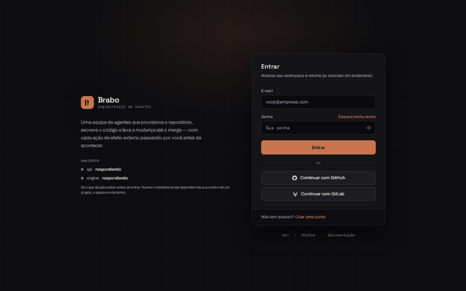
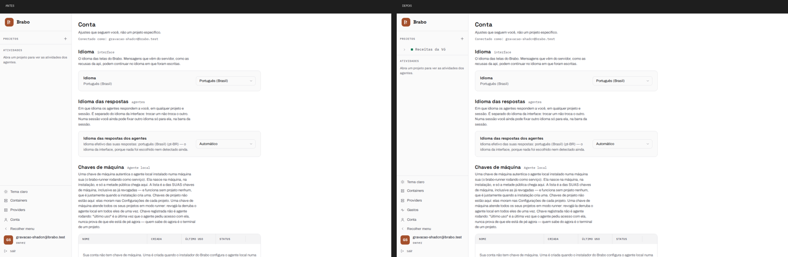
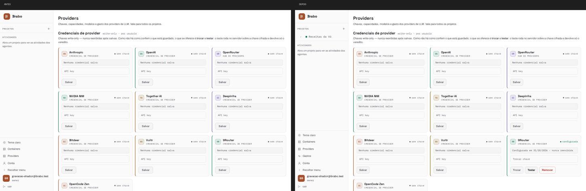
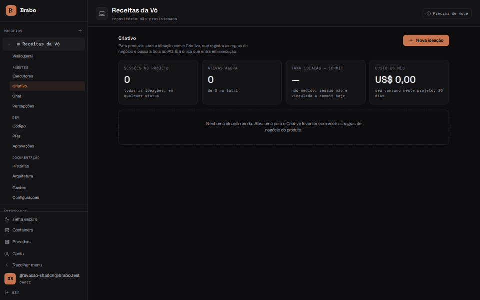
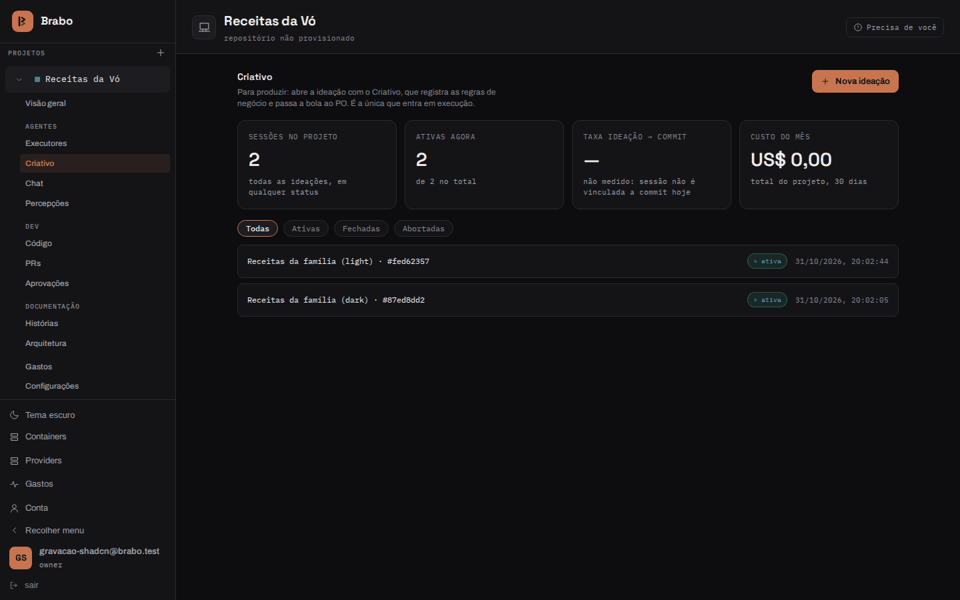
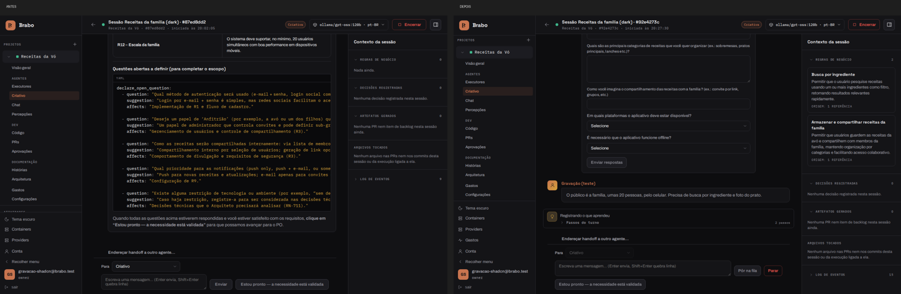
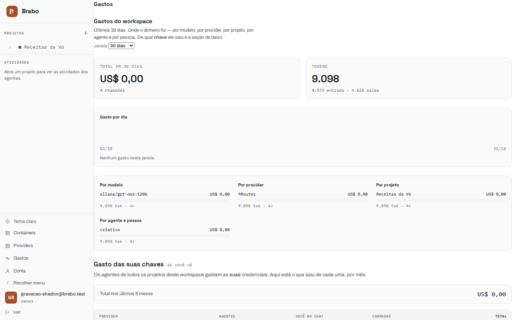

# Interface antes e depois do shadcn (31/10/2026)

Registro visual da rodada que trocou a base do front para shadcn/ui com Base UI
([ADR 0232](../adr/0232-shadcn-com-base-ui-no-apps-web.md)) e que, no mesmo dia,
fez o 9Router receber as ferramentas dos agentes
([RN-950](../business-rules.md#rn-950)). O **antes** é a instalação com a `dev`
de 31/10 de manhã; o **depois** é a `dev` `5851354c7c`, com as primitivas da casa
(`Button`, `Badge`, `Card`, `Alert`, `Table`, `Input`, `Select`, `Modal`,
`Disclosure`, abas) já servidas pelos componentes do shadcn.

Como foi gravado: navegador sem interface (Playwright) contra a instalação local,
numa conta de teste nova, telas de 1440×900 nos dois temas. O chat usa o 9Router
com um modelo gratuito (`ollama/gpt-oss:120b`), sem custo.

## O percurso pelas telas

Login, início, Containers, Providers, Conta e Status, primeiro no tema escuro e
depois no claro. A meta da migração era **nenhuma tela mudar**; o que muda entre
os dois é dado (o projeto de teste criado entre as gravações) e a página nova de
Gastos.

| Antes | Depois |
|---|---|
|  |  |

## Uma sessão do Criativo

A mesma conversa nas duas instalações: o Criativo abre a sessão, recebe a ideia
("um app para guardar as receitas da minha avó") e depois o público e os
requisitos.

- **Antes:** o 9Router não recebia as ferramentas, e o modelo as escrevia como
  texto (o bloco `declare_open_question` em YAML no fio). Nenhuma regra de negócio
  foi gravada: o painel lateral fica em zero.
- **Depois:** o Criativo chama as ferramentas de verdade. A pergunta vira
  formulário estruturado e o painel mostra as regras de negócio gravadas.

| Antes | Depois |
|---|---|
|  |  |

## Página nova de Gastos

A página global `/spend` ([RN-952](../business-rules/custo.md#rn-952)) não existia
no antes. Na gravação do depois ela aparece sem a margem da página — o conteúdo
encosta na barra lateral; o defeito foi registrado para correção.

