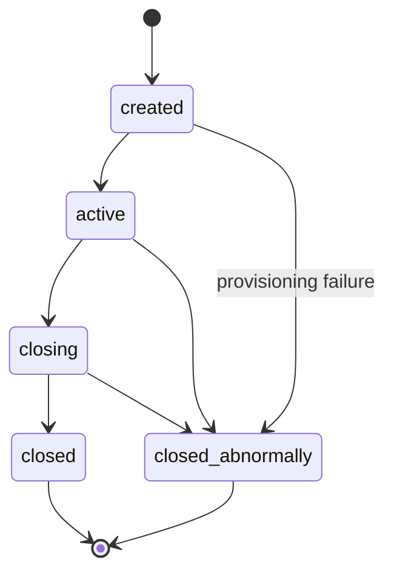
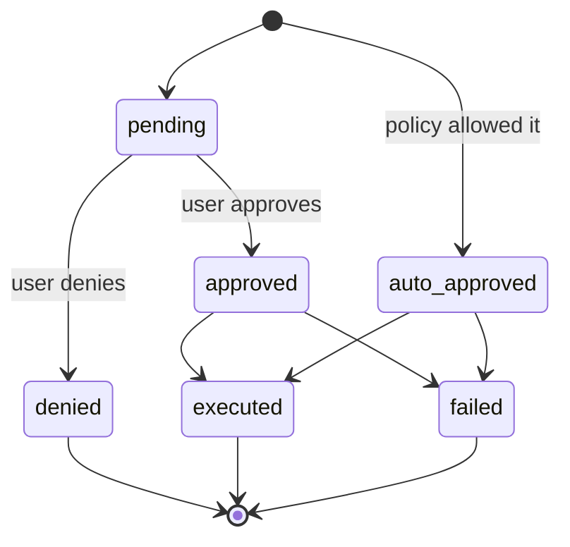
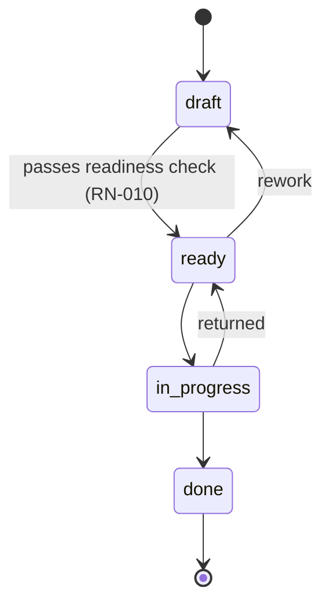
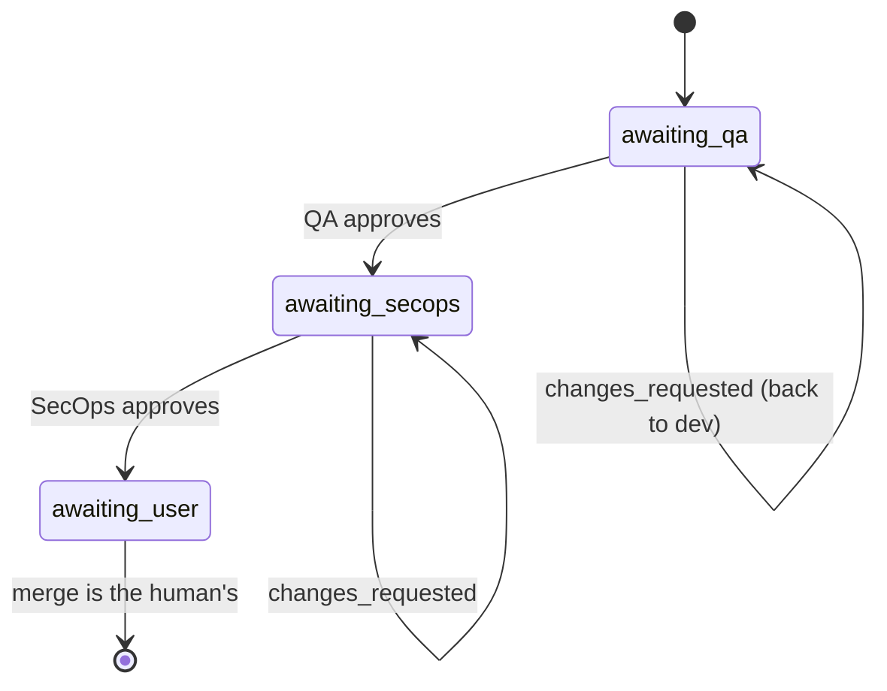

# Business rules

Each rule has a **statement**, **where it lives** (`file:line`), and **the
test that covers it**. If you change a rule, update the line here in the same
change — that's what
[`.docmap.yml`](https://github.com/daneiel/brabo/blob/dev/docs/.docmap.yml)
requires with `block` severity.

They all live in `apps/api/src/domain/`, which is **pure**: no IO, no
framework, no database. That's why each one has a fast, deterministic unit
test.

## Business context

Brabo executes engineering work through AI agents. Two forces shape virtually
every rule here:

**The agent is not trustworthy by construction.** It's a language model: it
can hallucinate, get stuck in a loop, or request something destructive. The
rules exist so the possible damage is bounded by structure, not by prompt
quality.

**Spend is real and continuous.** Every turn consumes a paid token. Budget,
ceiling, and metering aren't administrative conveniences — they're what
stops an agent loop from turning into a loss.

### Actors

| actor | who it is | authority |
|---|---|---|
| **User** | the person. Roles: `viewer`, `developer`, `maintainer`, `owner` | final decision on any action with external effect; merge is theirs exclusively |
| **Agent** | long-running process with a role (Creative, PO, Architect, Dev, Infra, QA, SecOps, Psychologist, Anamnesis) | proposes; never decides alone what policy doesn't allow |
| **System** | api and engine | enforces policy, records the event, measures cost |

The vocabulary is in the [glossary](glossary.md).

---

## Session

### RN-001 — The session has five states and closed transitions {#rn-001}

`created → active → closing → closed`, with `closed_abnormally` reachable
from any non-terminal state. **From `closing` there's never a way back to
`active`**, and terminal states have no exit.



- **Where:** `apps/api/src/domain/sessions/session-state-machine.ts:29`
- **Test:** `test/domain/sessions/session-state-machine.spec.ts`
- **Edge case:** `closing` is a **transient** state. A session stuck there
  means the drain started and didn't complete — there's an alert for that,
  see the [runbook](runbook.md).

### RN-002 — Every session event is immutable and `seq` is dense {#rn-002}

There's never an `UPDATE` on `session_events`. `seq` is unique per session
(`unique(session_id, seq)`) and has no gaps: it starts at 1 and is contiguous.

- **Where:** `apps/api/src/db/schema/sessions.ts` (table `session_events`)
- **Test:** verified on restore — `docker/backup/restore.sh` fails if
  `count(*) ≠ max(seq) − min(seq) + 1` or `min(seq) ≠ 1`
- **Why:** it's what makes the Psychologist's evidence traceable and the
  backup verifiable. State that needs to change lives in its own table,
  alongside.

### RN-097 — The session's kind is creation intent; execution stays an event {#rn-097}

The session is born `consultiva` (consultative) or `criativa` (creative),
chosen by **whoever opens it** and recorded in `sessions.kind`. `consultiva`
is just conversation; `criativa` is the one that produces — it opens ideation
with the Creative agent and is the **only** one that enters execution. The
kind **never changes**: there's no route that swaps it.

The risk in this rule isn't the field, it's the **second source of truth**.
The product already knew how to say whether a session is executing, and knew
it through another path: `findActiveExecutionSession` looks for the `active`
session that carries the `execution.activated` event (it's what makes
reactivation land on the session where the dev agents already are, finding
#11 of the first dogfooding). The two coexist under a rule that keeps them
from fighting:

- **`kind` classifies creation INTENT.** A `criativa` session that never
  activated execution **is not** the current execution session, and the
  event-based derivation keeps not looking at `kind` — if it started to, every
  open creative session would become a candidate to receive the dev agents.
- **The event classifies execution STATE**, as always.
- **`execution.activated` on a `consultiva` session is an ERROR** (409), never
  silent conversion. This is the point that decides which of the two sources
  wins: letting the event promote the kind would be exactly having them write
  over each other.

The guard lives in the **funnel** — `AppendSessionEventUseCase` — not in
`ActivateExecutionUseCase`, because both paths that write an event (the
user's route and the engine's `/internal/*`) go through it. The extra session
read is only paid when the event is the execution one. The refusal happens
**before** `incrementSeq`: a refused attempt can't consume `seq`, or
[RN-002](#rn-002) would break.

The column's DEFAULT is `consultiva` — the kind that can do **less**: a row
arriving through a path that doesn't go through the route (migration,
maintenance SQL) doesn't earn the right to execute. The migration's
**backfill** does the opposite and is deliberate, by the 0033 reasoning: at
the moment it runs, every session predates the distinction, and some are
sessions where dev agents are working — waking them up as `consultiva` would
make reactivating an in-progress project fail without anyone having decided
anything.

- **Where:** `apps/api/src/domain/sessions/session-kind.ts:50`
  (`podeAtivarExecucao`), `apps/api/src/db/schema/sessions.ts:68` (the column),
  `apps/api/src/application/use-cases/sessions/append-session-event.use-case.ts:53`
  (the guard)
- **Test:** `apps/api/test/application/use-cases/sessions/session-kind-e-nome.spec.ts`
- **Origin:** [ADR 0061](adr/0061-tipo-da-sessao-na-criacao.md)

### RN-098 — The session name adds to the hashtag, never replaces it {#rn-098}

The session can receive a friendly name (`sessions.name`, optional), at
creation or later, via `PATCH /projects/:projectId/sessions/:sessionId`. The
label shown on screen is **composite**: `<name> · #<first 8 characters of the
id>`. With no name, it degrades to the **hashtag alone**.

The hashtag never disappears, and the reason is operational: it's what gets
pasted into a URL, a command, or a conversation, and a name chosen by a
person **isn't unique** — two sessions named "Checkout" are normal. A blank
name (or whitespace only) counts as **absence**, both on creation and on
renaming: writing `''` would turn the label into `" · #a1b2c3d4"`, worse than
the hashtag alone. `null` in the `PATCH` body is the way to **undo**.

Renaming is **not** a session event. The event log is what the session lived
through, and the name is a navigation label, changed as many times as
desired — N renaming events would push exactly what matters out of the
200-event tail.

- **Where:** `apps/web/src/lib/session-label.ts:61` (`rotuloDaSessao`),
  `apps/api/src/application/ports/session-repository.port.ts:52` (`rename`).
  Reachable both from inside the session
  (`apps/web/src/routes/SessionPage.tsx:439`, `handleRename`) and from the
  project's list, without needing to open the session first
  (`apps/web/src/routes/ProjectSessionsTab.tsx:101`, `handleRenomear`) — both
  screens call the same `renameSession` and the same `rotuloDaSessao`.
- **Test:** `apps/web/src/lib/session-label.test.ts`,
  `apps/api/test/application/use-cases/sessions/session-kind-e-nome.spec.ts`,
  `apps/web/src/routes/ProjectSessionsTab.test.tsx`
- **Origin:** [ADR 0061](adr/0061-tipo-da-sessao-na-criacao.md)

### RN-104 — The tab derives from the recorded kind, and creates in that kind {#rn-104}

The project has **two** session tabs — **Creative** and **Chat** — and each
one is a `kind`: it lists the sessions whose `sessions.kind` is its own, and
its CTA creates in that `kind`, **without asking again**. There's no third
tab listing both together.

The kind was already immutable ([RN-097](#rn-097)), and that's what makes it
a legitimate navigation coordinate instead of a saved filter: a session never
switches tabs. The tab reads the **recorded** field — it doesn't derive the
kind from any event, for the same reason as RN-097: `execution.activated`
classifies execution STATE, and a tab that looked at it would move on its
own.

Two consequences the rule fixes, and which aren't screen detail:

- **The kind choice leaves the form.** It used to live in a radio-button
  `fieldset`, and now it happens the moment the person clicks the tab.
  Keeping both would offer the chance to create a session that contradicts
  the place you're standing in. What's left in the form is the **name**,
  which stays optional ([RN-098](#rn-098)).
- **One action, one place at a time.** "Start ideation" still exists — it's
  what brings the Creative agent into the session, and from there on the
  owner's key starts being spent ([RN-058](business-rules/custo.md#rn-058)); no one steps in alone.
  What changed is where it lives: **inside the invite** while the invite is
  on screen, and in the topbar when it isn't. The invite used to POINT to the
  topbar ("use Start ideation, at the top of the screen"), which is the
  literal version of the problem that originated [RN-097](#rn-097) — the
  action in one place and the explanation in another. The topbar can't
  simply lose the button: it's possible to type into a creative session
  without ever having called the Creative agent, and then the invite leaves
  the scene.

The three screens honor the three states of [RN-088](#rn-088), with **error
before empty**: the filtered list is empty in both cases, and saying "no
ideation yet" after a 429 would be lying about what happened.

The Chat's deep-link key stays `sessions`, not `chat`. That's what makes an
old bookmarked `?tab=sessions` link open the Chat **with the tab marked in
the tab bar** — resolving the old key as an alias only in the panel would
leave the tab bar with no selection at all, because `Tabs` compares `active`
to `key`, and whoever writes `active` receives the raw key from
`validateSearch`.

- **Where:** `apps/web/src/routes/project-tabs.ts:95` (both entries),
  `apps/web/src/routes/ProjectSessionsTab.tsx:114` (the filter by recorded
  `kind`) and `:98` (the CTA creating in the tab's `kind`),
  `apps/web/src/routes/SessionPage.tsx:716` (`conviteVisivel`, the one
  question the topbar and the invite share)
- **Test:** `apps/web/src/routes/ProjectSessionsTab.test.tsx`,
  `apps/web/src/routes/project-tabs.test.tsx`,
  `apps/web/src/routes/SessionPage.sessao.test.tsx`
- **Edge case:** a project with no session of that kind shows the empty
  state OF THAT KIND, even when it has sessions of the other kind — that's
  information, not an error.
- **Origin:** [ADR 0061](adr/0061-tipo-da-sessao-na-criacao.md)

### RN-123 — Creative session with no active Creative agent: the first message ALSO activates it {#rn-123}

In a `kind: 'criativa'` session ([RN-097](#rn-097)) with no `agent.activated`
yet, sending the first message through the composer activates the Creative
agent first (waiting for activation to finish) and only then delivers that
message to it through the real path (`sendAgentMessage` — history, system
prompt, `emit_artifact` tool). Before this rule, whoever typed without
clicking "Start ideation" fell into a generic SSE chat with no history and no
business rules: it was NOT the real Creative agent, and the conversation
recorded nothing in the domain.

The "Start ideation" click still exists ([RN-104](#rn-104)) — it's still
what triggers activation when the person prefers the explicit gesture, and
it's from it that the owner's key ([RN-058](business-rules/custo.md#rn-058)) starts being spent on
either of the two paths. What changed is that the FIRST MESSAGE now also
counts as that gesture: no one should need a separate click before talking
to whoever the screen already invited them to talk to.

- **Where:** `apps/web/src/routes/SessionPage.tsx:678` (`handleSend`)
- **Test:** `apps/web/src/routes/SessionPage.ideacao-automatica.test.tsx`
- **Edge case:** a `consultiva` session has no Creative agent — the rule
  doesn't apply, and the generic SSE path stays the right one for it.

### RN-119 — The session's ACTIVE agent is the one with the most recent `agent.activated` — never a fixed chain {#rn-119}

`SessionPage` decides two things from the SAME agent: who the composer's
message goes to, and which agent the topbar resolves the displayed model
from (the full cascade session→agent→area→project→workspace, the same one
`RunLlmTurnUseCase` uses to actually run the turn). The two questions used
to have DIFFERENT answers before this rule: routing used a fixed precedence
chain (architect > po > creative, based on historical EXISTENCE — "has
already activated once", which never "turned off"), and the displayed model
didn't even know who was active — the model-binding route received no agent
at all and always fell back to the Creative agent's fixed fallback
(`herdarModeloDeStart`), even after a handoff to the PO, Architect, or Dev
Lead.

The single definition: the ACTIVE agent is the one with the most RECENT
`agent.activated` (by `seq`), among the conversational agents of the chat
flow (Creative, PO, Architect, Dev Lead). **Infra Lead is left out**:
`agent_command_controller.ex` (engine) only has a `message` route for
po/dev-lead/arquiteto (plus Creative, as the last clause's implicit
fallback) — Infra never had `message` wired, only `start`. Sending a message
to "infra" today would silently fall through to the Creative agent; treating
it as the composer's active agent would reopen that trap instead of closing
one.

> **Superseded in part by [RN-631](#rn-631) (AT-251):** "most recent
> `agent.activated` wins" was itself an implicit default recipient, and an
> invisible one. The composer's recipient is now CHOSEN by the person (a "To"
> selector listing the agents already in the session) and the topbar model
> follows that recipient. What survives from this rule is the half about the
> model: the binding route receives the agent, never falls back silently.

- **Where:** `apps/web/src/lib/session-destinatario.ts:272`
  (`useDestinatarioDoChat`, since RN-631),
  `apps/web/src/lib/api-client.ts:1124` (`getSessionModelBinding`, the
  `agentId`), `apps/api/src/interfaces/http/llm/model-bindings.controller.ts:166`
  (`getSessionBinding`, `@Query('agentId')`)
- **Test:** `apps/web/src/routes/SessionPage.destinatario-do-chat.test.tsx`
  (formerly `SessionPage.agente-mais-recente.test.tsx`),
  `apps/web/src/routes/SessionPage.modelo-do-agente-ativo.test.tsx`,
  `apps/api/test/application/use-cases/llm/resolve-model-binding.use-case.spec.ts`
- **Edge case:** Infra Lead doesn't participate in composer routing nor in
  the "active agent" definition — it's proactive (Phase 4), not
  conversational through the composer.

### RN-120 — The session's event poll pauses during an in-progress turn {#rn-120}

`useSessionEvents` fetched events every few seconds with NO awareness of an
in-progress turn. If the poll landed DURING a turn (common — turns usually
last longer than the interval), it brought already-persisted
`chat.message`/`agent.response`, which rendered ALONGSIDE the
optimistic/streaming state still on screen: the same message, twice.

The fix pauses only the TIMER (`refetchInterval`) while `streaming` is
`true` — the query stays `enabled`, so the explicit invalidation that
already fires at the end of the turn (`finalizarTurnoDoAgente`) keeps
fetching fresh data at the right time. `pausarPoll` is an OPTIONAL
parameter, default `false`: the hook's other consumers (Overview, Code,
Provisioning, AdoptionPlan) have no conversational turn in progress and
stay as they were.

- **Where:** `apps/web/src/lib/hooks.ts:221` (`useSessionEvents`),
  `apps/web/src/routes/SessionPage.tsx:277` (`eventsQuery`)
- **Test:** `apps/web/src/lib/hooks.pausar-poll.test.tsx`
- **Edge case:** pausing the timer isn't disabling the query — explicit
  invalidation keeps working, and the fix depends on it to never miss data.

### RN-122 — The "Stop" button cancels the turn FOR REAL, killing the task holding the LLM call {#rn-122}

Until now there was no cancellation anywhere. The root was structural:
`agent_command_controller.ex` handled the user's message with
`GenServer.call(pid, {:user_message, texto}, ...)` — SYNCHRONOUS — and the
entire turn (tool loop + SSE call to the LLM) ran INSIDE `handle_call`. The
agent's process stayed blocked until the turn finished and handled NO other
message in the meantime — not even a future cancel command.

The fix: the turn `handle_call`/`handle_cast` of the four conversational
agents (Creative, PO, Architect, Dev Lead) spawns a
`Task.Supervisor.async_nolink/2` (`Engine.Agents.TurnoAssincrono`, new,
shared by all four) with the heavy work and returns `{:noreply, state}` —
the reply to the original `GenServer.call` is DEFERRED until the task
finishes (`GenServer.reply/2`, fired when `{ref, resultado}` arrives at
`handle_info`). Since the agent process STOPS being blocked, a new
`handle_cast(:cancel, state)` arrives and is handled while the turn runs:
`Task.shutdown/2` in `:brutal_kill` mode kills the task, which drops the
HTTP (SSE) connection it holds with the api — that's what makes cancellation
actually save tokens, not just stop rendering on the client. The original
`from` receives `{:error, :cancelado}`, and a TERMINAL `agent.error` is
recorded with origin `"politica"` (policy — the same origin as
budget/credential/binding — cancelling is a user decision to stop spending
tokens, not a fifth value in ADR 0020's closed vocabulary) — without it,
`GetSessionPendingWorkUseCase` would see `agent.activated` with no
subsequent `agent.response`/`agent.error`, and the session would stay hung
on the pending-work signal.

Two competing messages to the same agent (the user sends again while a turn
is already running) never spawn a second task:
`TurnoAssincrono.iniciar/3` replies `{:error, :turno_em_andamento}`
(turn in progress) right away.

> **Revised by [RN-578](#rn-578) (ADR 0163):** the reply to the original
> `GenServer.call` is no longer deferred until the task finishes — it goes out
> on ACCEPTANCE, as soon as the task is up, and cancelling answers nobody (the
> caller already has `:ok`). `{:error, :turno_em_andamento}` stopped being
> discarded by the controller: it is a named 409 and a durable `agent.error`.

- **Where:** `apps/engine/lib/engine/agents/turno_assincrono.ex` (the
  mechanism), `apps/engine/lib/engine/agents/{criativo,po,arquiteto,dev_lead}_server.ex`
  (the four turn `handle_call`/`handle_cast`), `apps/engine/lib/engine_web/controllers/agent_command_controller.ex:361`
  (`cancel/2`), `apps/engine/lib/engine_web/router.ex` (`POST
  /internal/sessions/:sessionId/agent/cancel`),
  `apps/api/src/application/use-cases/agents/cancel-agent-turn.use-case.ts`,
  `apps/api/src/interfaces/http/agents/agents.controller.ts` (`POST
  /projects/:projectId/sessions/:sessionId/agents/:agent/cancel`),
  `apps/web/src/routes/SessionPage.tsx` (`handleCancel`, "Stop" button in
  the composer)
- **Test:** `apps/engine/test/engine/agents/turno_assincrono_test.exs` (the
  task dies FOR REAL — `Process.alive?/1` before and after — not just
  "stopped importing the result"), `apps/api/test/application/use-cases/agents/cancel-agent-turn.use-case.spec.ts`
- **Edge case:** cancelling with no turn in progress is an idempotent
  NO-OP — there's no task to kill nor pending `from` to reply to.
  Cancellation does NOT undo a side effect that already ran BEFORE the task
  died (e.g., a tool that had already been dispatched and recorded its
  event) — it only interrupts what hasn't happened yet.
- **Origin:** this session's investigation; no dedicated ADR (a concurrency
  pattern change INSIDE the harness, not a layer/database boundary).

### RN-142 — Confirming readiness with NO business rule at all is refused by the engine, not just hidden in the UI {#rn-142}

Before, clicking "I'm ready to produce" — or calling the route directly —
ALWAYS created the `product_brief` and offered the handoff to the PO, even
in a conversation where zero business rules had been captured.
`business_rule_refs(state)` already existed in `criativo_server.ex`, but
only to POPULATE the brief's `"rules"` field — never as a blocking
condition. In the UI, `SessionPage.tsx` disabled the button only during
`streaming`, without checking the rule count.

The real guarantee had to live on the server, not on the screen: whoever
calls the route directly (or a future client that isn't this frontend)
can't punch through the guardrail just because the button is drawn
disabled. `CriativoServer.handle_call(:confirm_readiness, ...)` now checks
`business_rule_refs(state)` BEFORE spawning the
`Engine.Agents.TurnoAssincrono` `Task` ([RN-122](#rn-122)) — empty, it
refuses right there, without running the consolidation turn, without a
`product_brief`, without a handoff.

The refusal doesn't turn into an HTTP 4xx:
`agent_command_controller.ex#readiness/2` IGNORES this `GenServer.call`'s
return and always answers 202, the same pattern `message/2` already uses
since RN-122 ("this response is just the acknowledgment" — the real
outcome lives in the event log). That's why the refusal is narrated as a
DURABLE `agent.error` (RN-059), with origin `"politica"` (policy — it's a
product decision, not an infra/model/turn failure) — and a message
explaining why; the session thread already knows how to render this event
type (`lerFalhaDeTurno`, the same red bubble as any other turn failure).

The complementary UX, in `SessionPage.tsx`: the button is born `disabled`
(with a `title` explaining why) while `events` has no
`artifact.business_rule` — the SAME source that already feeds the
"Business rules" panel (`ContextAside`), with no second read that could
diverge from the first.

- **Where:** `apps/engine/lib/engine/agents/criativo_server.ex`
  (`handle_call(:confirm_readiness, ...)`, `emit_falha_sem_regra/1`),
  `apps/web/src/routes/SessionPage.tsx` (`hasBusinessRule`, the "I'm ready
  to produce" button)
- **Test:**
  `apps/engine/test/engine/agents/criativo_server_test.exs` ("readiness:
  refuses when NO business rule was captured" — no turn, no brief, no
  handoff; the refusal narrated with origin `"politica"`),
  `apps/web/src/routes/SessionPage.readiness-exige-regra.test.tsx` (button
  disabled with no rule, enabled with 1+)
- **Edge case:** the session already had `readiness.confirmed` recorded by
  the api BEFORE signaling the engine (`ConfirmReadinessUseCase`) — that
  doesn't change: it's the record of the user's CLICK, a fact that happened
  independent of the engine accepting or refusing afterward.
- **Origin:** code investigation confirming a user report — no ADR (new
  guardrail on an already-existing flow, no layer/database boundary
  change).

---

## Action approval

The heart of the system. Every action with an external effect is born as a
`proposed_action`.

### RN-003 — The action has six states, and denied is terminal {#rn-003}



- **Where:** `apps/api/src/domain/actions/action-state-machine.ts:36`
- **Test:** `test/domain/actions/action-state-machine.spec.ts`
- **Edge case:** an approved action that executed becomes `executed`,
  **not** still `approved`. Counting approvals by `status = 'approved'`
  gives the wrong number — the correct criterion is `decided_by IS NOT
  NULL`.

### RN-004 — The decision is evaluated in three stages, and `deny` wins immediately {#rn-004}

Order: **(a) IAM → (b) `agent_autonomy` → (c) `permissions.json`**. Each
stage can only **raise** permissiveness; a silent stage never lowers the
previous one. `deny` at any stage returns immediately.

- **Where:** `apps/api/src/domain/actions/decide.ts:118`
- **Test:** `test/domain/actions/decide.spec.ts` (10 KB — the largest in
  the domain)

### RN-005 — Minimum role per action type {#rn-005}

Before any policy, IAM: each `ActionType` requires a minimum effective
role. Without it, `deny` with an explicit reason.

- **Where:** `apps/api/src/domain/actions/decide.ts:110` (`MIN_ROLE_FOR_ACTION_TYPE`)
- **Test:** `test/domain/actions/decide.spec.ts`

### RN-006 — Ceiling: merge into a protected branch is never auto-approvable {#rn-006}

`dev`, `qa`, `rc`, and `main` are protected. A `git_merge` targeting one of
them is downgraded from `auto_approve` to `require_approval` **after** all
the policy has run. Neither `agent_autonomy` nor `permissions.json` can
promote it.

`rc` stays on the list even after the step left the policy
([ADR 0030](adr/0030-politica-de-branches-mecanizada.md)) and the bootstrap
stopped creating it ([RN-029](#rn-029)). This list decides what the lock
**refuses**, and repositories bootstrapped by earlier versions still have
the branch: protecting one that doesn't exist costs nothing; unprotecting
one that exists costs dearly.

- **Where:** `apps/api/src/domain/actions/decide.ts:498` (`isProtectedBranch`, the merge lock ceiling) + `protected-branches.ts:4`
- **Test:** `test/domain/actions/decide.spec.ts`
- **Origin:** [ADR 0011](adr/0011-infra-dev-agents-worktrees-merge-lock.md) §1
- **Note:** the equivalent protection **on the platform** (GitHub/GitLab)
  diverges between providers and isn't the gate — see
  [ADR 0028](adr/0028-protecao-de-branch-divergencia-entre-providers.md).

### RN-007 — Ceiling: an instruction patch is never auto-approvable {#rn-007}

Changing an agent's instruction always requires a human decision. The
feature's value is in the human seeing the diff; auto-approving would be
the agent rewriting itself.

- **Where:** `apps/api/src/domain/actions/decide.ts:168`
- **Test:** `test/domain/actions/decide.spec.ts`
- **Origin:** [ADR 0016](adr/0016-anamnese-proficiencia-patches-instrucao.md) §8

### RN-008 — Command matching is by pattern, not substring {#rn-008}

`permissions.json` matches a terminal command by structured pattern, with
the command properly tokenized — not by `includes()`.

- **Where:** `apps/api/src/domain/actions/command-matcher.ts`
- **Test:** `test/domain/actions/command-matcher.spec.ts`

---

## Backlog

### RN-009 — The story has four states, and `done` is terminal {#rn-009}

`draft → ready → in_progress → done`. Rework is allowed: `ready → draft` and
`in_progress → ready`.



- **Where:** `apps/api/src/domain/backlog/story-state-machine.ts:27`
- **Test:** `test/domain/backlog/story-state-machine.spec.ts`

### RN-010 — `draft → ready` requires four things, validated in the domain {#rn-010}

For a story to become `ready` it needs, **all of them**:

1. `dod` not empty — Definition of Done
2. `dor` not empty — Definition of Ready
3. at least 1 functional requirement (`rf`)
4. at least 1 linked business rule (`businessRuleIds`)

The error names **exactly what's missing**, not a generic "invalid".

- **Where:** `apps/api/src/domain/backlog/story-readiness.ts:39`
- **Test:** `test/domain/backlog/story-readiness.spec.ts`
- **Origin:** [ADR 0009](adr/0009-agente-po-backlog-rastreabilidade.md) §3
- **Why:** it's what stops the PO from dumping a vague story into the dev
  queue.

### RN-011 — Business rule with no story is a finding, not an error {#rn-011}

Rule→story coverage is computed, and what has no story shows up as
**pending** — information, not a failure.

- **Where:** `apps/api/src/domain/backlog/coverage.ts`
- **Test:** `test/domain/backlog/coverage.spec.ts`

### RN-012 — A module removed from `module_map` demotes the story {#rn-012}

A story linked to a module that ceased to exist goes back to `draft`, with
a `backlog.story_demoted` event.

- **Where:** `apps/api/src/domain/architecture/module-resolution.ts`; the
  event is emitted in
  `application/use-cases/architecture/create-module-map.use-case.ts:73`
- **Test:** `test/domain/architecture/module-resolution.spec.ts`

### RN-013 — The module graph cannot have a cycle {#rn-013}

- **Where:** `apps/api/src/domain/architecture/module-graph.ts`
- **Test:** `test/domain/architecture/module-graph.spec.ts`

---

## PR Gates

### RN-014 — The gate order is immutable and `awaiting_user` is terminal {#rn-014}

`awaiting_qa → awaiting_secops → awaiting_user`. Approving QA **never**
skips straight to the user. `changes_requested` sends it back to the dev
**on the same branch**, with no new PR.



- **Where:** `apps/api/src/domain/execution/pr-gate-state-machine.ts:24`
- **Test:** `test/domain/execution/pr-gate-state-machine.spec.ts`
- **Origin:** [ADR 0013](adr/0013-gates-qa-secops-pr.md) §1
- **Edge case:** `awaiting_user` is terminal **by design** — the system
  never merges (RN-006).

### RN-015 — Cycle K: the correction ceiling is finite and inherited {#rn-015}

Every gate return consumes a lap. Once the ceiling is exhausted, the task
is **blocked** with a reason, instead of spinning forever. A subagent
created by parallelization **inherits** the base agent's ceiling.

Since Phase 8b the ceiling also applies to the QA AREA, with no code
change: `QaLeadServer` is the only caller of `record_gate_verdict`, so one
gate round — no matter how many specializations it consulted underneath —
still consumes exactly ONE lap. See
[RN-036](#rn-036).

- **Where:** `DEFAULT_MAX_GATE_CORRECTIONS = 3` in
  `apps/api/src/application/use-cases/execution/record-gate-verdict.use-case.ts:21`;
  applied in `activate-execution.use-case.ts:89` and, in the engine, in
  `qa_lead_server.ex:268` and `secops_agent_server.ex:142`
- **Test:** `apps/engine/test/engine/gates/qa_automacao_agent_test.exs`
  (the specialization returns `{:blocked, ...}` without calling the api)
  and `qa_lead_server_test.exs` (the Lead NEVER calls
  `record_gate_verdict` in that case — that's what stops the correction
  from being burned)
- **Origin:** [ADR 0017](adr/0017-lock-de-workspace-e-monitor-de-dev-agents.md) §4

### RN-016 — The gate's verdict prevails over the task's statement {#rn-016}

If the task description says one thing and the gate's verdict says
another, the verdict wins.

Since Phase 8b, "the verdict" can come from two specializations — the rule
doesn't change: each one prevails over the task WITHIN what it evaluates
(Automation over test coverage; Performance/Security over performance NFRs
and code findings). `QaLead.consolidar/1` doesn't arbitrate between them
and the task: any `changes_requested` from any of them already fails the
whole thing (see [RN-036](#rn-036)).

- **Where:** prompt for each specialization in
  `apps/engine/lib/engine/gates/qa_automacao_agent.ex` and
  `qa_performance_seguranca_agent.ex`
- **Origin:** [ADR 0020](adr/0020-destravar-gates-qa-secops.md) §9

### RN-036 — QA becomes an area: the Lead consolidates without changing the gate's contract {#rn-036}

The Automation specialization (Phase 4a's `QAAgent`) always delegates;
Performance/Security only when the story has a pertinent performance NFR
(`Engine.Gates.QaLead.rnf_de_performance?/1` — a keyword heuristic, not
NLP). The decision NOT to delegate is always recorded — a `dispensed`
delegation with a justification, never silence.

Consolidation: `approved` only if ALL delegations that ran approved; any
`changes_requested` fails the whole thing, with `itens` (items) from the
specialization(s) that requested changes, each item prefixed with the
label of whoever raised it (`"[QA de Automação] ..."`) — that's how the
origin is traced WITHOUT changing `itens` from `string[]` to another
shape. Delegation failure (any origin — `infra`, `modelo`, `codigo`,
`politica`) NEVER becomes `changes_requested`: the Lead blocks the task
with the real origin (RN-015).

The `qa_verdict` that reaches the api is the SAME artifact and goes
through the SAME route as always (`RecordGateVerdictUseCase`,
`nextGateStatus`) — neither of the two changed. What the api learns about
the area lives only in the `delegation.completed`/`delegation.failed`/
`delegation.dispensed` events, which the specialization and the Lead
record separately.

- **Where:** `apps/engine/lib/engine/gates/qa_lead.ex` (`consolidar/1`,
  `rnf_de_performance?/1`), `qa_lead_server.ex` (the wiring);
  `apps/api/src/application/use-cases/execution/record-delegation.use-case.ts`;
  `apps/api/src/db/schema/agents.ts` (table `delegations`, enum `failure_origin`)
- **Test:** `apps/engine/test/engine/gates/qa_lead_test.exs` (the pure
  decision tree), `qa_lead_server_test.exs` (the wiring: decision →
  delegation → recording → consolidation → the SAME call as always), and —
  the proof that the contract didn't change —
  `record-gate-verdict.use-case.spec.ts`, `pr-gate-state-machine.spec.ts`
  and `record-infra-gate-verdict.use-case.spec.ts` pass **with no change
  at all**
- **Origin:** [ADR 0038](adr/0038-hierarquia-de-agentes.md)

On the `apps/web` side (Phase 8d): the team panel groups `qa`/
`qa-automacao`/`qa-performance-seguranca` as lead + collapsible
specializations, the PR timeline expands the consolidated verdict into
its internals (`ProjectApprovalsTab.tsx`, `PrGateTimeline.tsx`), and the
feed narrates `delegation.*` — see `apps/web/src/lib/agents.ts`
(`AREAS`/`areaFor`).

---

### RN-054 — External handoff addresses the area's lead or an agent with no area — never a subagent {#rn-054}

Whoever talks to an area **from outside** talks to the lead. A handoff
addressed to a subagent (`qa-automacao`, `qa-performance-seguranca`,
`infra-workflows`) is refused with a typed error that **names the lead**
the caller should have addressed — refusing without saying the right path
would just trade a hierarchy breach for a stuck agent.

The refusal happens **before** the INSERT. Refusing afterward would leave
a ghost handoff in the table and a `handoff.offered` — an immutable
event — asserting an offer the policy doesn't allow.

Internal delegation (lead → subagent) does **not** go through here: it's
private to the area, has its own table (`delegations`) and its own path
(`RecordDelegationUseCase`). The rule is about the area's external
boundary, not about what happens inside it.

ADR 0038 called for this validation, naming the place —
`CreateHandoffUseCase` is the only one in the system that writes
`toAgent` — and it had never been implemented (finding #12 of the first
dogfooding). The engine's `offer_handoff` passed `to_agent` through as a
free string, so until now nothing stopped an agent from breaching the
hierarchy.

**Area, lead, and members have ONE source** since PHASE 18:
`apps/api/src/domain/agents/agent-areas.ts`. The list used to be
hand-written in three places (api, web, engine) and the test only
compared api against web — the engine silently diverged. Now
`apps/web/src/lib/agent-areas.generated.ts` and
`apps/engine/lib/engine/agents/areas.ex` are produced by
`pnpm --filter api gerar:areas`, and the test fails what's stale on disk.
Since AT-046 the same generator also writes `SOLO_CONVERSATIONAL_AGENTS`
(RN-440) into the web file — and only there, since the engine has no reader
for it.
The list is still the CATALOG; `agent_areas` is the per-project STATE
(RN-094), and the two answer different questions.

- **Where:** `apps/api/src/domain/agents/agent-areas.ts`
  (`assertHandoffTargetAllowed`, `HandoffToSubagentError`),
  `apps/api/src/application/use-cases/agents/create-handoff.use-case.ts`
- **Test:** `test/domain/agents/agent-areas.spec.ts` (the rule + the check
  that the derived copies don't diverge from the source),
  `test/application/use-cases/agents/create-handoff.use-case.spec.ts`
  (refusal with no row and no event)
- **Origin:** [ADR 0038](adr/0038-hierarquia-de-agentes.md), closed from
  finding #12 of the [first dogfooding](explanation/primeiro-dogfooding.md)

---

### RN-037 — Infra becomes an area: Workflows generates CI per provider, Lead consolidates into a single PR {#rn-037}

Second instance of the ADR 0038 model, after the QA area (RN-036) — with
one structural difference: the Infra area's two delegations ALWAYS run
(Dockerfiles/compose by the Lead itself — "delegates to itself"; CI
pipeline by the Workflows subagent), never is one dispensed. `Workflows`
decides the pipeline format from the context's `gitProvider`
(`GetInfraContextUseCase`, read from `project_repositories.provider` —
**not** from `GitProvider` `capabilities`, which are the SAME for GitHub
and GitLab): `"gitlab"` generates `.gitlab-ci.yml`; any other value
(`"github"`, `"local"`, or unknown) generates `.github/workflows/ci.yml`.
Each file goes through `validate_infra_file` before finishing — hadolint
for Dockerfile, `actionlint` for GitHub Actions workflow
([ADR 0039](adr/0039-actionlint-e-validacao-do-pipeline-de-ci-gerado.md);
`.gitlab-ci.yml` has no local validation, a documented gap, not a
half-solution).

Consolidation: the two delegates' files are merged by `path` (Workflows'
wins on collision) into a SINGLE PR — the mechanism to propose the PR
(`propose_infra_pr`) changes from "the tool calls the api directly" to
"the tool signals the Lead, which consolidates and calls once" — the
`open_infra_pr` the api receives is the SAME as always, byte for byte
(`ExecuteInfraPrUseCase` untouched). Failure of any delegate (origin
`infra`/`modelo`/`codigo`/`politica`) NEVER opens a partial PR — the same
rule as RN-036, one level up again.

Each delegate (even the Lead, on itself) is tracked as a `delegations`
row — reused exactly as RN-036 left it, with ONE correction: the
`task_id` column became NULLABLE (the Infra area delegates on the
SESSION, with no backlog task behind an infra PR), and the route
`POST /internal/sessions/:sessionId/delegations` stopped being nested
under `/tasks/:taskId` — `taskId` now goes in the body, optional. Cycle K
and budget have no dedicated column in the Infra area (the original
InfraAgent never had per-task budget, and this work didn't introduce
one).

- **Where:** `apps/engine/lib/engine/infra/infra_lead.ex` (`consolidar/2`),
  `infra_lead_server.ex` (the wiring), `workflows_agent.ex`,
  `tools/validate_infra_file.ex` (dispatch by extension),
  `apps/api/src/application/use-cases/execution/get-infra-context.use-case.ts`
  (`gitProvider`), `record-delegation.use-case.ts` (`taskId` optional)
- **Test:** `apps/engine/test/engine/infra/infra_lead_test.exs` (the merge
  and the block, pure), `infra_lead_server_test.exs` (the wiring: single
  PR with both file sets, two delegations, `gitProvider: "gitlab"` →
  `.gitlab-ci.yml`, Workflows failure → no PR), `workflows_agent_test.exs`
  — and the proof that the `ExecuteInfraPrUseCase`/`InfraGateRunner`
  contract didn't change: `execute-infra-pr.use-case.spec.ts` and
  `infra_gate_runner_test.exs` pass **with no change at all**
- **Origin:** [ADR 0038](adr/0038-hierarquia-de-agentes.md), [ADR 0039](adr/0039-actionlint-e-validacao-do-pipeline-de-ci-gerado.md)

On the `apps/web` side (Phase 8d): the team panel groups `infra`/
`infra-workflows` the same way as QA (RN-036), and the feed narrates the
area's delegations — the same `AREAS`/`areaFor` registry from
`apps/web/src/lib/agents.ts`, with no Infra-specific code in the UI.

---

### RN-140 — A gate cycle that dies mid-way resumes on its own, with no manual intervention {#rn-140}

`QaLeadServer`/`SecOpsAgentServer` are `restart: :temporary`, and the
gate's intermediate transitions (`DevAgentServer.correct/3`,
`Dispatcher.run_secops/2`) are direct in-memory calls — made AFTER
`record_gate_verdict` has already durably advanced `gate_status` on the
api. A crash between the two used to trap the PR forever in
`awaiting_qa`/`awaiting_secops`: nothing knew that step had been left
pending, and no engine restart fixed it — [ADR 0057](adr/0057-o-gate-espera-a-aprovacao.md)
itself already declared suspension in `{:awaiting, ...}` as a known
limit, and investigating again found that the window between a recorded
verdict and a dispatch call is, in practice, easier to hit.

`gate_states` (schema `engine`, key `{project_id, task_id, gate}`)
records the in-flight cycle at the SAME points where the transitions
already happened — `"in_progress"` before any subagent/scanner runs,
`"dispatch_pending"` right after `record_gate_verdict` returns
`correct`/`run_secops` and before the in-process call.
`Engine.Gates.GateRescuer` scans rows stuck for more than 15 minutes
(configurable, `GATE_RESCUE_STALE_AFTER_SECONDS`) — generous on purpose,
because a QA subagent's ToolLoop legitimately runs up to
`TOOL_LOOP_MAX_ITERATIONS_GATE` (60) iterations, and a short threshold
would rescue (and duplicate) a cycle that's merely slow — and resumes:
`"in_progress"` restarts the whole area (no surgical resumption of
`ctx`, which doesn't survive a restart, the same choice as the dev
agent); `"dispatch_pending"` resends exactly the lost call. Called on
boot and by an Oban tick self-rescheduled every 5 minutes
(`GATE_RESCUE_INTERVAL_SECONDS`),
`Engine.Workers.GateRescueSchedulerWorker` — the same idiom as
`ModelSyncSchedulerWorker`/`AnamneseSchedulerWorker`.

Two guards against duplicating work: a process alive ON THE SAME node
(`Registry.lookup`) is never disturbed, and the staleness threshold
covers what the local guard doesn't reach (remote replica — `Registry`
is local to the node, the same caveat as `Engine.Dev.Wake` since
[ADR 0045](adr/0045-reagendamento-por-evento-do-dev-agent.md)). The
worst outcome of a residual race is duplicated, cheap work — the api
rejects a second `record_gate_verdict` for a gate that no longer owns
`gate_status` (`nextGateStatus`), and `DevAgentServer.correct/3` is
already idempotent via a state guard since ADR 0052 — never
inconsistent data.

- **Where:** `apps/engine/lib/engine/gates/gate_state.ex`,
  `gate_rescuer.ex`, the write points in `qa_lead_server.ex`
  (`run_area/3`, `apply_gate_result/6`) and `secops_agent_server.ex`
  (`run_secops/3`, `apply_verdict/6`), and
  `apps/engine/lib/engine/workers/gate_rescue_scheduler_worker.ex`
- **Test:** `apps/engine/test/engine/gates/gate_rescuer_test.exs` — kills a
  real `QaLeadServer` with the cycle in flight
  (`DynamicSupervisor.terminate_child/2`, the durable row surviving the
  process) and proves `GateRescuer.run/0` reconnects the area on its own
  up to a real outcome; the scenario in the statement (lost
  `run_secops`) and the lost `correct` return, both with REAL process and
  dispatch, no `FakeGateDispatcher`; and the two guards (a live local
  process isn't disturbed; a recent row isn't touched)
- **Origin:** [ADR 0067](adr/0067-o-gate-sobrevive-ao-restart.md), which
  extends [ADR 0057](adr/0057-o-gate-espera-a-aprovacao.md)

---

## Cost

The budget, metering, and cost-ceiling RNs live in
**[Business rules — Cost](business-rules/custo.md)**.

Same reason as the Authentication section below: size, not subject.
`#rn-NNN` anchors unchanged.

## Projects panel

### RN-039 — Project status dot: risk always beats inactivity {#rn-039}

The dashboard sidebar shows a health dot per project, derived from three
independent signals: budget (the same 70%/90% thresholds as RN-018), blocked
task (`tasks.blocked`), and recent activity (7 days). Colors: green =
healthy and active; amber = budget ≥70%; red = budget ≥90% **or**
blocked task; gray = no activity in the last 7 days. When a risk signal
(amber/red) and the inactivity signal (gray) apply at the same
time, the risk one wins — an overrun, stalled project is still something to
look at, not something to hide behind "no activity".

- **Where:** `apps/web/src/lib/project-status.ts` (`deriveProjectStatus`)
- **Test:** `apps/web/src/lib/project-status.test.ts`
- **Origin:** fidelity of the projects dashboard to the approved design

### RN-088 — Load failure is said on screen; 429 is not retried {#rn-088}

Every screen that loads data from the api distinguishes three states, never two:
**loading** (skeleton), **error** (the message the api sent, with the
`trace_id` and a try-again button), and **empty** (the empty-list text).
`if (!dado) return null` collapses the three, and the observed outcome was the worst
possible: with the api rate-limiting with `429`, the main area of `/projects/:id`
was **completely blank** — no message, no error, no skeleton — and
the reason existed only in the console. On the dashboard it was worse than blank: `!projects`
was also true on error, so the screen invited you to create the **first**
project of a workspace that could have twenty.

It's [RN-059](business-rules/custo.md#rn-059) on the other end of the wire: failure never becomes an empty response.
Whoever fails, says so.

The sentence is **the api's**, extracted by `mensagemDaApi` — the same function the
mutation path already used in toasts. A generic text of ours doesn't know the
difference between "rate limit exceeded, try again shortly" (wait) and
"access denied" (waiting won't help).

The other side of the same rule is not answering the limit with more traffic. **4xx
is not retried**: `429` is literally the server telling you to stop, and `401` has already
been renewed once inside `request()`. And **polling stops when the query errors**
— it comes back on window focus, on remount, or on the button. Before, there were three
retries per failure added to ~25 polls of 3 to 5 seconds that didn't know how to
stop: a real session accumulated **1128 429 errors** against a limit of 300
requests per minute per user (`RateLimitGuard`), and the loop kept the
sliding window from recovering. 5xx and network failure keep the three
attempts, where repeating is the right reaction.

- **Where:** `apps/web/src/lib/query-policy.ts` (`deveRetentar`,
  `pollQueParaNoErro`), `apps/web/src/components/ErroDeCarregamento.tsx`,
  `apps/web/src/routes/ProjectPage.tsx`, `apps/web/src/routes/Dashboard.tsx`,
  `apps/web/src/routes/Shell.tsx`, `apps/web/src/main.tsx`
- **Test:** `apps/web/src/lib/query-policy.test.ts`;
  `apps/web/src/routes/ProjectPage.test.tsx` (429 becomes a message with the api's
  sentence; 403 shows the 403's reason; loading is not an error);
  `apps/web/src/routes/Dashboard.test.tsx` (error on the list doesn't become "no
  project yet"); `apps/web/src/routes/Shell.test.tsx` (the sidebar says so instead
  of staying empty)
- **Origin:** real navigation on `/projects/:id` with 1128 429 errors in the console

### RN-089 — A repeated project name is disambiguated in the sidebar {#rn-089}

Project name **is not unique** — nothing in the domain prevents it. When two or more
projects in the list have the same name, each of them shows in the sidebar the
abbreviated id and the creation date (`#a1b2c3d4 · 07/08 14:32`), both already present
in the project payload. Projects with a unique name show nothing: the caption on every
row would be noise in the place with the least space on screen.

Concrete origin: a validation run created twenty projects called
`validacao-real`, and the twenty sidebar rows were visually identical.

- **Where:** `apps/web/src/lib/project-label.ts` (`nomesRepetidos`,
  `desempateDoProjeto`), `apps/web/src/routes/Shell.tsx`
- **Test:** `apps/web/src/routes/Shell.test.tsx` (repeated name gets a
  tiebreaker, unique name doesn't)
- **Origin:** real navigation with the sidebar full of validation projects

### RN-090 — The dashboard reads the workspace, not one project at a time {#rn-090}

The card grid and the sidebar dots are fed by **one** request
per cycle — `GET /workspaces/:workspaceId/projects-summary` —, and the number of
requests **doesn't grow with the number of projects**.

The card shows git provider, provisioning status, budget, agent
chips, and last activity; the sidebar shows the status dot and the unread
counter. All of that came from seven POLLED queries per project, which made
23 projects cost 3,824 requests per minute against a limit of 300
(`RateLimitGuard`) — the screen knocked itself down with 429 before finishing
loading. [RN-088](#rn-088) made the app stop insisting when that happens;
this one reduces the request.

Two boundaries the rule fixes, which are not implementation detail:

- **The api answers facts, not a roster.** `roster` brings what happened in the event
  log (execution activated, modules, gate already opened, delegated subagents, infra
  accepted). Who is area lead, which icon each agent has, and how members
  become a chip remain the web's — and the PRESENCE rule is a single one
  (`rosterFromFacts`), shared with the team panel, so that a new agent
  doesn't appear in one place and go missing in the other.
- **The bell drawer only fetches when open.** It was, until
  [RN-091](#rn-091), the only read that was still one request per
  project — the "where I stopped reading" cutoff is a `seq` kept in the browser
  (`read-state`), which the server doesn't know. Today the browser **sends** that
  cutoff, and the drawer is also a single request.

Accepted and desired side effect: `gatesEverOpened` and `delegatedSubagents`
now cover the ENTIRE session. The client derived from the last 200 events and
lost chips in long sessions (see
[ADR 0021](adr/0021-fechamento-4a-infra-e-painel.md)) — the text of
`deriveAgentRoster` always said "has opened at some point".

- **Where:**
  `apps/api/src/application/ports/projects-summary-repository.port.ts`,
  `apps/api/src/infrastructure/persistence/drizzle/projects-summary.repository.ts`,
  `apps/api/src/interfaces/http/iam/workspaces.controller.ts`
  (`getProjectsSummary`), `apps/web/src/lib/hooks.ts` (`useProjectsSummary`),
  `apps/web/src/lib/agent-status.ts` (`rosterFromFacts`),
  `apps/web/src/routes/Dashboard.tsx`, `apps/web/src/routes/Shell.tsx`
- **Test:** `apps/web/src/routes/Dashboard.fanout.test.tsx` (30 projects
  cost the same as 3; no per-project endpoint is called);
  `apps/api/test/infrastructure/persistence/drizzle/projects-summary.repository.spec.ts`
  (the number of database queries doesn't grow with N);
  `apps/web/src/lib/agent-status.test.ts` (the api's facts produce the same
  chips as the event log)
- **Origin:** dashboard of 23 projects measured in the browser — 3,824 req/min
  before, 12 after

### RN-091 — The browser sends where it stopped reading; the bell is one request {#rn-091}

With the notifications drawer **open**, its content comes from **one**
request per cycle — `POST /workspaces/:workspaceId/unread-events` — and the
number of requests **doesn't grow with the number of projects**.

It's the missing half of [RN-090](#rn-090). That one brought the dashboard down from
3,824 to 12 req/min, but the bell kept fetching one project at a time:
23 projects with the drawer open measured **286 req/min** against the limit of 300
(`RateLimitGuard`). It passed, and vanished with one more project.

**The obstacle, and why this is the way out.** There's no "mark as read" on the
server, on purpose: the cutoff is a per-project `seq` kept in each browser's
`localStorage` (`read-state`). There were two ways out, and the
difference between them is PRODUCT:

- stop repolling while the drawer is open changes how current what the
  user sees is — **refused**, nobody asked for that trade;
- the browser **sending** the `project → afterSeq` map returns exactly the
  same data at the same cadence. **It's pure batching: nothing changes for whoever
  looks at the screen**, neither freshness nor content.

**It's a `POST` that mutates nothing**, and the api answers `200` (never `201`) to say
so. The verb was chosen for being the only one with a BODY: there are dozens of pairs, and
in a query string that becomes a long URL — which proxies truncate — besides putting the user's
project id in access logs, against the rule of not passing personal data
through query strings.

Three semantic guarantees the route fixes, because batching reads with different
cutoffs is where the easy mistake lives:

- **an empty map returns empty**, without touching the database. "I asked nothing" is not
  "give me everything";
- **each project respects ITS cutoff** — `seq` strictly greater than its own;
- **the 50-event ceiling is per project**, the same one `GET .../events` applies
  without `limit`. A limit on the whole response would let the noisy project
  eat the quiet ones' quota.

A cursor pointing to a project of another workspace is **ignored**, not refused:
it comes from the caller's local storage and may be a leftover from an old
workspace.

- **Where:**
  `apps/api/src/application/ports/projects-summary-repository.port.ts`
  (`unreadEventsForWorkspace`),
  `apps/api/src/infrastructure/persistence/drizzle/projects-summary.repository.ts`,
  `apps/api/src/interfaces/http/iam/workspaces.controller.ts`
  (`getUnreadEvents`), `apps/api/src/interfaces/http/iam/dto/unread-events.dto.ts`,
  `apps/web/src/lib/notifications.ts` (`useNotificationGroups`),
  `apps/web/src/lib/api-client.ts` (`getUnreadEvents`)
- **Test:** `apps/web/src/routes/Dashboard.fanout.test.tsx` (with the drawer
  OPEN: one request, and 30 projects cost the same as 3);
  `apps/api/test/infrastructure/persistence/drizzle/projects-summary.repository.spec.ts`
  (the number of database queries doesn't grow with N; empty map, per-project
  cutoff, per-project ceiling, and workspace isolation)
- **Origin:** measured residual of [RN-090](#rn-090) — 286 req/min with the drawer
  open on a 23-project workspace

### RN-099 — Activity paginates the past without repolling what doesn't change {#rn-099}

The Overview's **Activity** column shows a **window** of 100 events
anchored at the session's **tail**, and goes down into the past page by page. Each
page uses the `afterSeq`/`nextCursor` that
`GET /projects/:p/sessions/:s/events` **already** returns: no new route,
no new parameter.

**Two questions, two queries.** `useSessionEvents` answers "how is it
now" — the last 200 under polling — and feeds the team panel, the tree
timeline, the execution section, and the Approvals tab. None of them
paginates. Activity's answers "what happened", and it was the only one asking
that question with the other one's answer: 200 items at once, with no beginning or
end, and still not reaching the start of a long session.

**The anchor is the tail, not the start of the session.** The endpoint paginates
FORWARD, and there's no `beforeSeq` — inventing one would be a new contract. But opening
the feed at event #1 of a session with thousands delivers the wrong screen: whoever
opens Activity wants what just happened. So the first page is the
same `latest` read the screen already does, with the **same `queryKey`** (React
Query serves both with ONE fetch), and each click goes down a fixed window with
`afterSeq`.

**What pagination can't cost.** One request per poll cycle — the
same as before, and the savings of [RN-090](#rn-090)/[RN-091](#rn-091) don't
regress. Three pieces guarantee that:

- the tail is the query the screen already had, shared by `queryKey`;
- the first click does **not** become a request: the `latest` read brings 200 and the
  window shows 100, so revealing what was already paid for comes before asking
  again;
- an old page is a **closed** `seq` window over **immutable** events
  (there's never an UPDATE on an event table): `staleTime: Infinity` and
  **no** `refetchInterval`. A poll there would be paying N requests to
  receive N identical responses.

**The count is honest about what it knows.** The filters by agent and by
type run over the **loaded page**, not over the session — so the UI says
`N of M loaded`, not "N results". Taking the filter to the server would give the
true total and touch the event repository; it's not for this phase, and
saying the wrong total would be worse than saying less.

The three states of [RN-088](#rn-088) apply here: **error before empty** — the
column said "no activity" when the api had refused.

- **Where:** `apps/web/src/lib/hooks.ts` (`useSessionEventHistory`,
  `EVENTOS_POR_PAGINA`), `apps/web/src/components/ActivityFeed.tsx`,
  `apps/web/src/routes/ProjectOverviewTab.tsx`,
  `apps/api/src/infrastructure/persistence/drizzle/session-event.repository.ts`
  (`listPaginated`, already existing)
- **Test:** `apps/web/src/lib/session-history.test.tsx` (opens at the tail; the
  first click costs no request; the next paginates with contiguous `afterSeq`;
  the loop ends at the start of the session; mounted together with the current
  state, the tail is ONE fetch; an old page doesn't repoll);
  `apps/web/src/components/ActivityFeed.test.tsx` (the "N of M loaded"
  follows the filter; without the pagination props nothing changes)
- **Origin:** user request on the first real navigation — "Activity in
  the Overview tab must be paginated, so it isn't infinite"

### RN-100 — The bell's order is SQL's, not the front end's {#rn-100}

The notifications drawer shows events **from most recent to
oldest**, and when a project has more unread than the 50 ceiling the ones that
appear are the **NEWEST**.

**The ordering is the database's out of necessity, not taste.** The query cuts at
50 **per project** with a window function
(`row_number() OVER (PARTITION BY session_id ORDER BY seq DESC)`), and it's what
decides **which** 50 events survive — not just in what order they come out. With
`ASC`, the 50 **oldest** survived, and a `.sort()` on the client would sort
by recency precisely the window the query had already chosen wrongly:
in a project with 300 unread, the 251st event would appear as "the most recent".
That's why there's no sorting at all in the front-end path, and the comment in the
component says there can't be.

**The consequence, and why the read cutoff didn't change.** The cutoff is a per-project `seq`
in `localStorage`, and **there's no mark-as-read endpoint**, by
decision recorded in [RN-091](#rn-091). A `seq` cutoff marks a
**prefix**; the drawer now shows a **suffix**. Marking as read "the 50
displayed" is inexpressible without a set of reads **per event** — a new table,
out of scope. The only two expressible cutoffs remain "nothing" and
"everything up to now".

The way out wasn't changing the semantics (it keeps advancing to the last `seq`,
exactly as before), it was **to stop hiding what that advance swallows**:

- each project shows the **total** unread, not the window size, and
  declares how many were left out (`+ N older`);
- the button now says what it does — `mark the N as read` — when there's something
  outside the window;
- the missing number comes from **subtraction**, not a request: `latestSeq`
  minus the cutoff already comes in the workspace summary ([RN-090](#rn-090)).

Since the cutoff's semantics didn't change, **there's no ADR** for this rule: what changed
was which window the query chooses and what the drawer declares about it.

- **Where:**
  `apps/api/src/infrastructure/persistence/drizzle/projects-summary.repository.ts`
  (`unreadEventsForWorkspace`),
  `apps/api/src/application/ports/projects-summary-repository.port.ts`,
  `apps/api/src/interfaces/http/iam/dto/iam.response.dto.ts`
  (`ProjectUnreadEventsResponseDto`),
  `apps/web/src/lib/notifications.ts` (`useNotificationGroups`),
  `apps/web/src/components/NotificationBell.tsx`
- **Test:**
  `apps/api/test/infrastructure/persistence/drizzle/projects-summary.repository.spec.ts`
  ("with more unread than the ceiling, the MOST RECENT come back, from new to
  old" — asserts the SET before the order);
  `apps/web/src/components/NotificationBell.test.tsx` (renders in the order
  received, without reordering; the counter is the total; the button says how many it marks);
  `apps/web/src/lib/notifications.test.tsx` (what was left out of the window comes out
  by subtraction, without a second request);
  `apps/web/src/routes/Dashboard.fanout.test.tsx` (the drawer is still
  ONE request)
- **Origin:** user request on the first real navigation — "Bell and
  notifications must always sort by last modified date descending
  to the oldest"

---

### RN-118 — The team tree exposes execution detail per milestone, and opens the "last 5" {#rn-118}

`AgentTimelineTree`/`timeline-tree.ts` (PHASE 14b) already grouped the event log by
agent, but with three gaps: the criterion for opening a branch was only
active/stopped (unrelated to how many agents existed), the header
counter was the TOTAL of milestones (never "what's new"), and `tool.call`/
`tool.result`/`agent.response` became a milestone showing only the
tool name — `args`, `result`, and `iteration`, which the event log already records,
never reached the screen.

**Default opening** becomes "the 5 agents with the most recent activity
(highest `seq` of the last milestone)", with active keeping priority over
recency — they don't add up: since `montarArvore` already sorts actives first and,
within each group, from most recent to oldest, the two criteria
collapse into a single slice (`ramosAbertosPorPadrao`, the first
`max(number of actives, 5)` branches). More than 5 actives: all open, with no cutoff.

**The novelty counter** per agent uses the SAME mechanism as the bell
(`read-state.ts`, `localStorage`), granular by `projectId:agentId` instead
of only `projectId` — there was no "last seen" at that granularity before.
A collapsed branch with a milestone `seq` greater than that agent's last seen
shows the NOVELTY count in place of the total; opening the branch (automatically
or manually) marks as seen up to the most recent `seq`.

**Expandable detail** is per MILESTONE, not per branch — only `tool.call`,
`tool.result`, and `agent.response` (`EVENTOS_EXPANSIVEIS`) become an individual
button, because only they carry a payload worth expanding. The
visual grouping by ITERATION uses `iteration` from the
`agent.response` payload when it exists (ToolLoop — `tool.call`/`tool.result`
inherit the iteration of the response that dispatched them, because in the ToolLoop they
are emitted AFTER it); agents outside the ToolLoop (PO, Criativo, with no
`iteration` in the payload) get their OWN counter per agent, incremented
on each response — inference by `seq` proximity, not a new field in the
event log.

- **Where:** `apps/web/src/lib/timeline-tree.ts` (`Marco.iteracao`,
  `Marco.eventType`, `Marco.payload`, `ramosAbertosPorPadrao`,
  `marcoExpansivel`), `apps/web/src/components/AgentTimelineTree.tsx`,
  `apps/web/src/lib/read-state.ts` (`getAgentLastSeenSeq`/
  `setAgentLastSeenSeq`)
- **Test:** `apps/web/src/lib/timeline-tree.test.ts` (grouping by
  real and inferred iteration, `ramosAbertosPorPadrao` with active/recency/no
  cutoff), `apps/web/src/components/AgentTimelineTree.test.tsx` (default
  opening, novelty counter appearing/disappearing, milestone expanding with
  args/result/iteration)
- **Origin:** user request — gaps confirmed by investigation of the existing
  PHASE 14b component; no ADR, same "unseen" semantics
  as the bell, only a new granularity

---

### RN-096 — Every decision says in plain language what happens; the raw payload is born collapsed {#rn-096}

Every `proposed_action` type has a **sentence in Portuguese** describing the
effect of approving, and it is the first visible thing on the card — before any
detail, on the three screens where a decision is asked for (the Approvals queue, the card
inside the session chat, and the Insights tab). The raw payload remains accessible,
**inside a collapse that is born closed**, and is never dumped on the screen.

**What existed was a dump.** Every type without its own visual body fell into an
`Object.entries(payload).map(([k, v]) => k + ': ' + JSON.stringify(v))`, always
open. Whoever opened the queue read `worktree: /workspaces/dev-api`,
`coAuthor: Brabo User <user@brabo.dev>`, and `proposto: 4` — and had to deduce what
would happen if they clicked Approve. Approval that requires deduction is
approval given on autopilot, and the whole product rests on the user
being the final authority.

**The sentence degrades, and that's what makes it reliable.** None of them assumes that
a payload key exists: with an empty payload the sentence is still a true
sentence, just less specific ("Records a commit in the project's
repository."). The payload comes from the engine and from ten different use cases, and none
of them promises a format — a sentence that only works with the right fixture is a sentence
that breaks on the first real approval.

**A type the web doesn't know yet is not a theoretical case.** The web's `ActionType`
union has already fallen behind twice: first with the three Gitflow bootstrap
types, and again with `parallelize`/`raise_max_parallel`, which came in during PHASE
14d. The compiler doesn't catch it: the canonical list is in `apps/api`, which the web doesn't
import. Hence two things at once — the card **degrades** (neutral verb
+ "see details", with the payload collapsed, instead of the `undefined` in the
icon map that took down the whole React tree), and the **test reads the backend's
`decide.ts`** and fails when a type comes in without a sentence.

**The open/closed default is derived, not configured.** The rule is a single one —
it opens what is still waiting for a decision from whoever is looking: in the chat, a `pending` action;
in the queue, never (there are N cards, and N open details are the same wall of text);
in Insights, a `proposed` hypothesis. And the RAW payload doesn't open in any variant.
The project consequence is that `ApprovalCard` **gained no new mandatory
prop**: the default comes from `variant` and `status`, which already existed.

**Verb and sentence come from a single module**, consumed by the three screens. The Psicólogo's
hypothesis literally uses the `instruction_patch` verb instead of a
parallel vocabulary — and its sentence says what accept really does
(queues it for the Anamnese, which **may** propose the adjustment, which still comes for
approval), never "the instruction will be changed".

**`write_file` had a sentence, but no body.** It was born outside
`COM_CORPO_PROPRIO`: the sentence showed only the `path`, and the detail fell into the same
collapsed raw-JSON dump this RN exists to avoid — so a write
that genuinely asked for approval (outside the `dev-` prefix, or a path outside the
agent's scope) required one more click to see the `content`. It entered
`COM_CORPO_PROPRIO` with its own body: `path` and a preview of the `content` (up to
25 lines/4,000 characters, with a truncation notice — never the entire
file, same rule as the raw payload), open by default in the chat while
pending, like `terminal`.

**An empty payload is not an absent payload.** `command` (terminal) or
`path`/`content` (write_file) arriving as an empty string — a malformed tool call
from the model, not a rendering bug — degraded into a `$ ` prompt
or a blank preview, which the user read as a screen defect. The two
bodies now distinguish the two cases and show "the model did not produce a
valid X for this action" instead of a blank.

- **Where:** `apps/web/src/lib/aprovacoes.ts` (`VERBO_DA_ACAO`, `fraseDaAcao`,
  `descreverAcao`, `descreverHipotese`), consumed by
  `apps/web/src/components/ApprovalCard.tsx` (Approvals + session chat,
  `COM_CORPO_PROPRIO`, `previewConteudo` for the `write_file` `content`) and
  `apps/web/src/components/HypothesisCard.tsx` (Insights); collapse via the
  `Disclosure` of `apps/web/src/components/ui/Disclosure.tsx`
- **Test:** `apps/web/src/lib/aprovacoes.test.ts` (reads `ACTION_TYPES` from
  `apps/api/src/domain/actions/decide.ts` and requires verb + sentence for each type,
  with an empty payload); `apps/web/src/components/ApprovalCard.test.tsx`
  (`frase e colapso` — payload collapsed in both variants, readable JSON on
  opening, an unknown type doesn't take the screen down, `write_file` with its own body
  open by default and preview truncation, empty `command`/`path`/`content`
  showing the fallback message);
  `apps/web/src/components/HypothesisCard.test.tsx` (`frase e colapso`)
- **Origin:** PHASE 19 of program 16–26, from the request "today reading is very
  hard" on the first real navigation after the database reset

---

### RN-121 — Dev agent and QA are "executors": their own tab, outside the "Agent team" {#rn-121}

The Overview's "Agent team" grid and "Team timeline"
mixed Criativo/PO/Arquiteto/Infra with dev-`<module>` and QA (lead +
`qa-automacao`/`qa-performance-seguranca`) — seven, eight agents in the same
grid, without distinguishing who CREATES/DECIDES from who IMPLEMENTS/VERIFIES. The
**Executors** tab isolates the last two, with the SAME rendering as the
Overview (`AgentCard`, the area grid — extracted to `AgentTeamGrid.tsx` — and
`AgentTimelineTree`), never a reinvented card.

**The separation rule is a single function**, `isExecutorGroup`/
`isExecutorAgentId` (`lib/agent-status.ts`): `dev-lead`/`dev-<any
module>` and the entire `qa` area (lead + sub-specialties) are executors;
the rest isn't. BOTH screens filter the SAME `groupRosterByArea` with that
function — the Overview with `!isExecutorGroup`, Executors with
`isExecutorGroup` — so an agent can't appear in both nor vanish
from both: it's always exactly one side.

**The tree doesn't duplicate**: each tab filters the EVENTS before passing them to
`AgentTimelineTree` (by whether `actor.id` belongs to the set of
executors), so a dev agent's branch appears only in Executors, never
also in the Overview. The Activity column (`ActivityFeed`, RN-099/100)
was NOT filtered — it answers "what happened" in the whole session,
dev/QA included, and the component's own per-agent filter already lists
everyone who spoke; only the grid and the "who is doing what" tree
change place.

- **Where:** `apps/web/src/lib/agent-status.ts` (`isExecutorGroup`,
  `isExecutorAgentId`, `autonomyActionTypeFor` — moved from
  `ProjectOverviewTab.tsx`), `apps/web/src/components/AgentTeamGrid.tsx`
  (extracted from the grid that already existed), `apps/web/src/routes/
  ProjectExecutorsTab.tsx`, `apps/web/src/routes/ProjectOverviewTab.tsx`,
  `apps/web/src/routes/project-tabs.ts` (`key: 'executores'`, `ordem: 12`
  — right after the Overview, before Criativo/Chat/Code)
- **Test:** `apps/web/src/lib/agent-status.test.ts` (`isExecutorAgentId`/
  `isExecutorGroup` — dev-`<module>`, `dev-lead`, the entire `qa` area are
  executors; criativo/po/arquiteto/infra/secops are not);
  `apps/web/src/routes/ProjectExecutorsTab.test.tsx` (shows only dev/QA,
  empty state without both, header count);
  `apps/web/src/routes/ProjectOverviewTab.test.tsx` (dev-backend/QA disappear
  from the grid, the rest of the team remains); `apps/web/src/routes/
  project-tabs.test.tsx` (the new tab enters the registry's generic
  sweep — ruler, panel, deep-link, unique order)
- **Edge case:** SecOps is NOT an executor — it enters the roster through the SAME
  `pr.gate_changed` that brings QA (Phase 4a, `rosterFactsFromEvents`), but
  stays in the Overview. `dev-lead` is in the executor list for
  completeness (RN-087 describes it as conversational), although today no
  path instantiates it in the session roster (the Dev Lead →
  `dev-<module>` delegation remains out of scope, ADR 0053 item 5).
- **Origin:** user request — its own "Executors" for dev agent and QA,
  outside the Overview's mixed grid.

---

### RN-125 — Handoff acceptance is INLINE in the thread, with a CTA for the Dev Lead pointing to Executors {#rn-125}

The "X passed the baton to Y" divider that already existed in the timeline (`handoff.offered`)
becomes an **actionable card** — with the accept button embedded — whenever it
represents the **current** pending offer (the same one `offeredHandoff` already
resolved for the topbar button). The topbar button **was removed**: with acceptance
living inside the thread, at the exact place where the handover happened, keeping
both would pull two buttons with IDENTICAL text visible at the same time — the
same problem `ApprovalCard` already avoids by never duplicating the action outside the
thread (RN-096).

**Which event becomes the card is decided by PAIR, not by id.** The
`handoff.offered` payload carries only `toAgent`; the `fromAgent` is the event's `actor`
(RN-054 already used that reading for the divider text). Without the handoff id
in the event, "this is the current offer" is answered by finding the most RECENT
`handoff.offered` (highest `seq`) with the SAME `fromAgent`/`toAgent` pair as
`offeredHandoff` — which prevents reopening an accept invite that an older
offer for the same pair has already resolved (accepted, declined, or superseded
by a new offer).

**The card for the Dev Lead gets a second link**, "Follow the execution in
Executors", to the tab that already exists (RN-121) — it's the start of EXECUTION, and whoever
accepts needs to know where to look afterwards. The other offers (PO, Arquiteto…)
don't get the link: their session remains the place to follow along itself,
there's no "elsewhere to look".

- **Where:** `apps/web/src/routes/SessionPage.tsx` (`timeline` — the
  `handoff.offered` block, `offeredHandoffEventSeq`; `isActive` moved to before the
  `useMemo`), `apps/web/src/routes/SessionPage.module.css` (`.handoffCard`,
  `.timelineLink`)
- **Test:** `apps/web/src/routes/SessionPage.handoff-inline-e-links.test.tsx`
  (actionable card only on the current offer, an old offer of the same pair stays silent,
  an already-accepted handoff shows no button, Executors link only on
  `dev-lead`); `apps/web/src/routes/SessionPage.pista-e-status.test.tsx`
  updated for the inline button (no longer in the topbar)
- **Verified by real execution:** accepting a handoff to the PO in a creative
  session against an isolated build (its own Docker stack, real project/session)
  — the card becomes a silent divider and the event log advances as soon as the
  click returns from the api; the CTA for the Dev Lead navigates to `?tab=executores` for
  real.
- **Origin:** user request — handoff acceptance also inline in the thread,
  not only in the topbar.

### RN-124 — The PO narrates epic/story created in the thread, with a direct link to the Backlog {#rn-124}

`backlog.epic_created`/`backlog.story_created` — which the PO already recorded in the
event log (`CreateEpicUseCase`/`CreateStoryUseCase`) — had no
handling at all in the session timeline: creating a story left NO trace
in the thread, only in the Backlog tab, for those who already knew to go look there. The two
types get an entry in the timeline, in the SAME visual body as the agent's other
messages (`.message`/`.bubble`) — no new class for the chip
itself, only the link.

The link ("See in Backlog") reuses the tab's generic deep-link (`?tab=backlog`,
the same mechanism as the dashboard card's "Set budget" CTA) — it doesn't
try to highlight the newly created story inside the tab, which is out of scope.

- **Where:** `apps/web/src/routes/SessionPage.tsx` (`timeline` — the
  `backlog.epic_created`/`backlog.story_created` block)
- **Test:** `apps/web/src/routes/SessionPage.handoff-inline-e-links.test.tsx`
  (`item 2`)
- **Verified by real execution:** epic and story inserted into the event log
  of a real session appear as "Epic created"/"Story created" with the
  title, and the link navigates to `?tab=backlog` for real.
- **Origin:** user request — link from the PO to the created stories, straight
  to the Backlog.

### RN-126 — Story promotion is decidable INLINE in the thread, with the same mechanism as the Backlog tab {#rn-126}

`backlog.story_promotion_proposed` (RN-048) gets the same treatment that
RN-125 gave to the handoff: the event becomes an **actionable card** in the session
timeline, with the "Promote" and "Return" buttons calling the SAME
`promoteStories`/`returnStory` that `PromotionQueue`
(`ProjectBacklogTab.tsx`) already uses — no new endpoint, no second
source of truth. The decision still happens in ONE place (the backend), only
the trigger gained a second path.

**Resolution by later event, not by separately derived status.** The card
disappears on its own (becomes a silent divider, without buttons) as soon as an event with a
GREATER seq decides the fate of the SAME story —
`backlog.story_transitioned{storyId}` (promoted, emitted by
`PromoteStoriesUseCase` via `TransitionStoryUseCase`) or
`backlog.story_promotion_returned{storyId}` (returned). Without that check,
promoting or returning would leave the same two buttons planted in the thread,
offering again a decision already made.

`backlog.story_promotion_returned` gets symmetric narration in the thread (reason
included), reusing the same sentence that `apps/web/src/lib/activity.ts` already
used only in the sidebar's collapsed log.

- **Where:** `apps/web/src/routes/SessionPage.tsx` (`timeline` — the
  `backlog.story_promotion_proposed`/`backlog.story_promotion_returned` blocks,
  `handlePromoteStory`/`handleReturnStory`, reason modal reusing
  `Modal`/`Textarea`)
- **Test:** `apps/web/src/routes/SessionPage.promocao-inline-e-volta.test.tsx`
  (card with the buttons, promoting calls `promoteStories` with the payload's
  `storyId`, returning requires a reason and calls `returnStory`, a story resolved
  by a later `story_transitioned` becomes a silent divider, `story_promotion_returned`
  narrates with the reason)
- **Origin:** user request — inline story promotion in the thread, a cheap
  option reusing RN-048 instead of gating story creation.

### RN-131 — Three races confirmed LIVE in the session thread: invite over the history, anxious indicator, and a turn stuck in `handleReadiness` {#rn-131}

Three defects found by actually navigating `SessionPage.tsx` in Chrome, not
by test — and all three were race conditions or an incomplete criterion
disguised as a product decision.

**1. `conversaComecou` became "ANY event exists", not "a
`chat.message`/`agent.response` exists".** The previous criterion (finding G) was born
so as not to confuse the git bootstrap cards with conversation, but had the
opposite effect: a session created by `git-bootstrap` (commit/branch
actions already approved, zero `chat.message`) showed the invite on
top of them, and the same happened — much more seriously — in the session that
execution activation uses, with dozens of real events (`tool.call`,
`tool.result`, task events) and no `chat.message`/`agent.response`: the
invite covered the **entire** execution history. A new session is the only one
with no event at all — that's the right question.

**2. `conviteVisivel` waits for `useSessionEvents` to finish loading.** With a
cold cache (page reload), `session` could arrive while `events`
was still `[]` — the default of `data?.items`, indistinguishable from "truly empty
session" until the first fetch resolved. Without the
`!eventsQuery.isPending` gate, the invite flickered over sessions with a
large history.

**3. The "thinking" indicator (bubble with the 3 dots) only turns on after
5s with no text arriving.** Before, it turned on the instant
`streaming`/`statusAgent` became truthy — visual noise on most
turns, which answer in under a second. A `useEffect` arms a
`setTimeout(…, 5000)` when the turn starts with no text yet, and disarms it (via
cleanup) as soon as the first delta arrives or the turn ends before the deadline.
Real text (`streamingText`) still appears **immediately**, never
waits for the timer — only the empty indicator gained patience.

**4. `handleReadiness` got the same safety net that `handleSend` already
had.** `confirmReadiness` is, like `sendAgentMessage`, a synchronous
`GenServer.call` in the engine (up to 120s) — and the Phoenix channel may not have finished
connecting (ticket + join, RN-108) when the turn ends, losing the
`agent.done` broadcast forever. `handleSend` already called
`finalizarTurnoDoAgente()` as soon as the synchronous call resolved,
regardless of whether the channel had delivered the event; `handleReadiness` had been
left out of that fix, and without it the agent's bubble stayed stuck empty
(`streaming: true`, no text) until the page reloaded.

- **Where:** `apps/web/src/routes/SessionPage.tsx` (`conversaComecou`,
  `conviteVisivel`, the `pensandoVisivel` `useEffect` right below
  `agenteExibido`, and the success block of `handleReadiness`)
- **Test:**
  `apps/web/src/routes/SessionPage.convite-so-em-sessao-vazia.test.tsx`
  (an empty session shows the invite; a session with git-bootstrap events or with
  dozens of `tool.call`/`tool.result` hides it; `eventsQuery.isPending`
  holds the invite until the first fetch resolves),
  `apps/web/src/routes/SessionPage.pista-e-status.test.tsx` (finding B —
  the indicator doesn't appear before 5s, appears after, disappears on the first delta,
  and never appears when the turn ends before the deadline), and
  `apps/web/src/routes/SessionPage.readiness-turno-preso.test.tsx`
  (`confirmReadiness` resolving without `onAgentDone` reconciles the state
  the same way `SessionPage.turno-preso.test.tsx` already proves for
  `handleSend`)
- **Origin:** LIVE investigation of the product in Chrome — all three reproduced
  manually before the fix.

### RN-136 — The actionable handoff card in the chat only considers those who CONVERSE on this screen {#rn-136}

> **Since [ADR 0185](adr/0185-estou-pronto-fecha-os-dois-gates.md)
> ([RN-658](#rn-658))** the Criativo→PO handoff that "I'm ready" requested
> is born and accepted in the same call, on behalf of whoever clicked — its
> accept card only appears when that acceptance doesn't fit (a session predating the ADR,
> a brief that didn't come from the click) or failed. The filter below doesn't change.

`OfferInfraHandoffUseCase` offers the handoff to Infra and, in the SAME
confirmation, offers it to the Dev Lead right after (PHASE 14d) — two separate
calls, the Infra one first. `handoffs` (what `SessionPage.tsx` reads from
`useHandoffs`) comes sorted by `createdAt` ASC
(`DrizzleHandoffRepository#findBySession`), and the `offeredHandoff` that decides
which card becomes "actionable" resolved with a plain `.find()` — always the
**oldest** `offered`. Since the Infra Lead isn't conversational (it isn't
in `AGENTES_DE_CHAT`, and is never accepted by this screen), the Dev Lead's card would only
become actionable after someone accepted the Infra one in a place this
screen doesn't show — in practice, never: the user only saw "accept handoff from
Infra" and the invite for the Dev Lead stayed invisible behind it.

The filter restricts `offeredHandoff` to handoffs addressed to an agent of
`AGENTES_DE_CHAT`. The handoff to Infra is still **narrated** in the thread — its
`handoff.offered` becomes a silent divider, like any offer that isn't "the
current one" — only the card with a button now ignores it: Infra never had (nor
needs to have) a way to be accepted from here.

- **Where:** `apps/web/src/routes/SessionPage.tsx` (`offeredHandoff`)
- **Test:**
  `apps/web/src/routes/SessionPage.handoff-devlead-e-colapso.test.tsx`,
  describe "problema 1" — older Infra + newer Dev Lead resolves to the
  Dev Lead's card, never to Infra's; only Infra `offered` shows no card
  at all
- **Origin:** code investigation + live test in Chrome — the handoff
  to the Dev Lead never became actionable after PHASE 14d

### RN-137 — "Activate execution" has an inline shortcut on the Dev Lead card, without lowering the role requirement {#rn-137}

The accept card of the handoff to the Dev Lead gained an "Activate execution" button
next to the "Follow the execution in Executors" link — a shortcut for those who already
know what they want, without going through the conversation. It calls the SAME
`activateExecution` that the Overview uses, now with `sessionId` (the open
chat session) as `originSessionId` — without this the session that brought the
Dev Lead stayed `active` forever, even with execution (in a
SEPARATE session) having already taken off through this shortcut ([RN-135](business-rules/custo.md#rn-135)).

**The route still requires `maintainer`** — DELIBERATELY not aligned with the
`developer` that already suffices to accept the handoff on the same card. Whoever activates
becomes the `session.createdBy` of the execution session, and that's the role that
`ProposeActionUseCase` resolves (`ResolveEffectiveRoleUseCase.forProject`)
as the EFFECTIVE one of every `git_commit`/`git_push`/`pr_open` the dev agents
propose from then on — it's the same reason that already justified the
`maintainer` of the Overview button
(`ExecutionController#activate`). Lowering the requirement here would silently invert that
resolution: every PR the execution opened would go from
`auto_approve` to `require_approval` whenever whoever clicked was
`developer`, without anyone having decided that. Whoever isn't `maintainer` receives
the api's real sentence ("Papel insuficiente para esta ação", via
`mensagemDaApi`) instead of a generic error.

No client-side `module_map` gate: when this card exists, the Arquiteto
has already defined it — it's the artifact that precedes the handoff offer to the Dev Lead —,
so replicating the Overview's `disabled={!hasModuleMap}` would lock the button
for nothing. The rare case (inconsistent session) falls into the same catch that handles
403/other errors.

- **Where:** `apps/web/src/routes/SessionPage.tsx`
  (`handleActivateExecution`), `apps/web/src/lib/api-client.ts`
  (`activateExecution` gained `originSessionId`)
- **Test:**
  `apps/web/src/routes/SessionPage.handoff-devlead-e-colapso.test.tsx`,
  describe "problema 2" — the click calls `activateExecution` with
  `sessionId`; 403 shows the api's real sentence; the button coexists with the
  accept-handoff one and with the Executors link
- **Origin:** code investigation + live test in Chrome — shortcut request,
  with the role divergence confirmed and kept by decision
  (not fixed by automatic alignment)

### RN-138 — An agent's messages collapse after it passes the baton {#rn-138}

The chat timeline showed everything always expanded, without grouping by author —
in a long session with Criativo, PO, and Arquiteto taking turns, the history of
those who already left the scene competed for space with whoever is speaking now. Each
timeline entry gained an `agentId` (the `actor.id` of whoever generated it,
when it's an agent — `agent.response`, `agent.error`, epic/story
created by the PO, approval card); user entries and those that mark
a TRANSITION (handoff, story promotion) are left without `agentId` on
purpose, because they're cut points by nature.

A CONSECUTIVE sequence of the same `agentId` becomes a collapsible header
(the design system's `Disclosure`, closed by default — agent name +
count, reopens with one click) when both conditions hold:

1. **the agent has already passed the baton** — there's a handoff from it (`fromAgent`)
   with `status: 'accepted'` (the same truth the event log's `handoff.accepted`
   records, without needing to rebuild by joining events); and
2. **none of its actions is `pending`** — the check is by `actor.id` across
   ALL the session's `actions`, not only those in the current sequence: an
   open approval race can't stay hidden behind a click at ANY point of the thread.

A sequence of 1 entry never collapses — "So-and-so · 1 message" in place
of the message itself gains nothing. Any entry without `agentId`, or from
a different agent, breaks the current sequence exactly as a change
of agent does — it only groups what is really consecutive.

- **Where:** `apps/web/src/routes/SessionPage.tsx` (`TimelineEntry.agentId`,
  `timelineAgrupada`), `apps/web/src/routes/SessionPage.module.css`
  (`.agentGroup*`)
- **Test:**
  `apps/web/src/routes/SessionPage.handoff-devlead-e-colapso.test.tsx`,
  describe "problema 3" — collapses with the baton passed and no pending action;
  doesn't collapse without an accepted handoff; doesn't collapse with a pending action from the same
  agent; a message from another author in the middle breaks the grouping
- **Origin:** code investigation + live test in Chrome — collapse
  request, with `AgentTimelineTree`/`timeline-tree.ts` as the reference of
  FORM (group by agent, name + count, open/closed), adapted to the
  chat's heterogeneous interleaved timeline

---

## Psicólogo and Anamnese

### RN-021 — A hypothesis without valid evidence is not recorded {#rn-021}

The `evidenceEventIds` must point to events **that exist and belong to the
analyzed session**. Validation is atomic per batch: one invalid id fails the
entire batch.

- **Where:** `apps/api/src/domain/psychologist/hypothesis-evidence.ts`
- **Test:** `test/domain/psychologist/hypothesis-evidence.spec.ts`
- **Origin:** [ADR 0015](adr/0015-psicologo-real-toolloop-hipoteses-evidencia.md) §3

### RN-022 — The hypothesis lifecycle is compare-and-swap {#rn-022}

`proposed → accepted | dismissed`. Two concurrent decisions on the same
hypothesis: one wins, the other gets a conflict — not 500, not silence.

- **Where:** `apps/api/src/domain/psychologist/hypothesis-lifecycle.ts`
- **Test:** `test/domain/psychologist/hypothesis-lifecycle.spec.ts`
- **Origin:** [ADR 0022](adr/0022-fechamento-4b-psicologo.md) §7

### RN-023 — The termination cause is a deterministic classification {#rn-023}

It comes from the recorded **reason**, never from the LLM's judgment and never by
elimination. Every failure records its origin: `infra | modelo | código | política`.

- **Where:** `apps/engine/lib/engine/psychologist/termination_classifier.ex`
- **Origin:** [ADR 0022](adr/0022-fechamento-4b-psicologo.md) §5 and
  [ADR 0020](adr/0020-destravar-gates-qa-secops.md) §6

### RN-024 — The Anamnese only profiles competencies from the catalog — a structural guardrail {#rn-024}

Process competencies are **six**, closed: `git`, `agile`, `arquitetura`,
`testes`, `seguranca`, `infra`. Plus the technical stacks derived from the
`module_map`. Anything else — "anxiety", "mental health" — **has no
write path**: it's a domain error, not a prompt instruction.

- **Where:** `apps/api/src/domain/anamnese/competency-catalog.ts:16`
- **Test:** `test/domain/anamnese/competency-catalog.spec.ts`
- **Origin:** [ADR 0016](adr/0016-anamnese-proficiencia-patches-instrucao.md) §1
- **Why:** the Anamnese profiles **technical competence**, not the person. The limit
  is structural because a prompt instruction is not a guarantee.

### RN-025 — Deleting the profile really deletes it, and the opt-out prevents re-derivation {#rn-025}

- **Where:** `apps/api/src/domain/anamnese/proficiency-profile.entity.ts` +
  table `anamnese_opt_outs`
- **Origin:** [ADR 0016](adr/0016-anamnese-proficiencia-patches-instrucao.md) §2

### RN-026 — A denied instruction patch is not proposed again {#rn-026}

The comparison is on the **normalized** content, not on the literal text:
reindenting the same patch doesn't turn it into a new proposal. There's no
dedup table — the source is the `proposed_action` history itself with `actionType =
instruction_patch` and `status = denied`.

- **Where:** `apps/api/src/domain/instructions/patch-dedup.ts:22`
- **Test:** `test/domain/instructions/patch-dedup.spec.ts`

### RN-027 — Instruction rollback is a **forward** operation {#rn-027}

Reverting creates a new version with the old content; it doesn't delete history. The
versions table is append-only.

- **Where:** `apps/api/src/domain/instructions/`
- **Origin:** [ADR 0016](adr/0016-anamnese-proficiencia-patches-instrucao.md) §4

---

## Git

### RN-028 — Capability decides, not the provider's name {#rn-028}

An unsupported operation (branch protection on the local provider) is declared in
`capabilities` and rejected with `GitNotSupportedError` — never a silent failure.

There are **four** capabilities: `protectBranch` and `pullRequests` since Phase 2, and
`listTree` and `pullRequestDiff` since PHASE 26 (Code tab, read-only). The rule
didn't change with them — its reach did. And the criterion for declaring is still
proof: a capability is only `true` when the suite exercises it on that provider; without
proof, it's declared `false` and degrades (same criterion as ADRs 0041/0042).

- **Where:** `packages/shared/src/index.ts` (`GitProviderCapabilities`); the
  ceilings of the two read operations in
  `apps/api/src/domain/git/git-read-limits.ts`, outside shared because it's
  100% types
- **Test:** single contract suite, `test/contract/git-provider.contract.ts`,
  run against the three providers
- **Origin:** [ADR 0001](adr/0001-git-provider-contract-shape.md)

### RN-029 — The Gitflow bootstrap is idempotent and resumable {#rn-029}

Five steps; each one checks before acting and can be resumed from the point where it
failed. `skip` is success, not error.

There used to be six. The sixth created the `rc` branch, a rung that
[ADR 0030](adr/0030-politica-de-branches-mecanizada.md) removed from the policy —
the bootstrap kept creating, protecting, and **documenting in the user's
repository** a ladder the product had already abandoned (finding #3 of the first
dogfooding). The value `create_rc_branch` remains in the `bootstrap_step` enum:
old rows reference it, and a step that really happened isn't erased from
history.

- **Where:** `apps/api/src/application/use-cases/git/bootstrap-steps.ts` +
  `domain/git/repo-bootstrap.entity.ts` (`RETIRED_BOOTSTRAP_STEPS`)
- **Test:** `test/domain/git/repo-bootstrap-status.spec.ts`
- **Origin:** [ADR 0005](adr/0005-repo-bootstrap-idempotent-steps.md)

---

## Credentials

The user's LLM key and git token live in the same table
(`user_credentials`), under the same envelope encryption. This section applies to
both.

### RN-055 — A credential is always encrypted and saved; verifying is a separate action, with three answers {#rn-055}

Registration **doesn't judge the credential**: it encrypts and saves, even if the provider
would refuse it. Verifying is an explicit action on the **already saved**
credential — the api decrypts, calls the provider, and returns only the verdict. The plain
text never comes back in any response, not in pieces, not in the refusal reason.

It used to be the opposite: registration tested before persisting and refused to save
([ADR 0004](adr/0004-git-credential-registration.md), extended to LLM
keys in Phase 11a). The real failure mode was the opposite of what was predicted — since the field
is write-only and the screen never redisplays what was typed, a refusal left the
user **with no credential and without the text to fix it**.

The verdict has **three** values, and the third is mandatory:

| | when |
|---|---|
| `ok` | the provider accepted |
| `recusado` | the provider rejected — carries **its** reason |
| `nao_suportado` | there's no verified test endpoint (`ollama`, `anthropic`, `openai`) |

Without `nao_suportado`, a provider whose tester is a NO-OP would come back `ok` and the screen
would assert a verification that never happened. It's the capability rule of
[ADR 0041](adr/0041-base-openai-compativel-e-contrato-de-llm-providers.md)
applied here: only what was proven is declared. That's why the port declares
`supports()` — the silence of `test()` alone is ambiguous.

A bad key **is not an HTTP exception**: the use case catches
`LLMCredentialConnectionTestFailedError`/`GitCredentialConnectionTestFailedError`
and returns a result, with 200. The only exception is when there's no credential for
(user, provider) — 404, because then there's nothing to test.

- **Where:**
  `apps/api/src/application/use-cases/credentials/test-stored-credential.use-case.ts`,
  `apps/api/src/application/use-cases/llm/upsert-user-credential.use-case.ts`,
  `apps/api/src/application/use-cases/git/register-git-credential.use-case.ts`,
  `apps/api/src/application/ports/llm-credential-connection-tester.port.ts`
  (`supports`)
- **Test:**
  `test/application/use-cases/credentials/test-stored-credential.use-case.spec.ts`
  (the three results, the git×LLM dispatch, the 404, and the absence of the secret in the
  response); `test/application/use-cases/llm/upsert-user-credential.use-case.spec.ts`
  and `test/application/use-cases/git/register-git-credential.use-case.spec.ts`
  (the unconditional save, which is the inversion)
- **Origin:** [ADR 0050](adr/0050-credencial-sempre-cifrada-verificacao-explicita.md)

---

## Authentication

The first-party auth RNs live in
**[Business rules — Authentication](business-rules/autenticacao.md)**.

They left here because of SIZE, not subject: together with Cost they were
half of a 640 KB page. The content didn't change, and the
`#rn-NNN` anchors are the same — what changed was the file that hosts them.

## PROGRAM 28 — Wave 4, front G2: indexing pipeline and hybrid search for Chat RAG (RN-231..238, ADR 0080)

### RN-231 — `ChunkRepository` gains DELETE and both halves of hybrid search {#rn-231}

The Wave 3 port (RN-226) only covered basic write/read. Wave 4
added `deleteByScope`/`deleteBySession` (for idempotent reindexing
by full rebuild — delete and recreate, never UPDATE) and
`searchByVector`/`searchByLexicalQuery` (the two halves of hybrid search,
each an independent query, taking advantage of the index built for it —
HNSW or GIN). `deleteByScope` is typed `Exclude<ChunkScope, 'session'>`:
deleting `session` for a whole project would delete sessions that aren't being
reindexed now, so a session is only deleted by `deleteBySession`.

- **Where:** `apps/api/src/application/ports/chunk-repository.port.ts`
  (lines 105-146), `apps/api/src/infrastructure/persistence/drizzle/chunk.repository.ts`
- **Test:** `apps/api/test/infrastructure/persistence/chunk.repository.spec.ts`
  — describes "Onda 4 (G2)" (delete by scope/session, search by
  vector/lexical, happy and empty case of each)
- **ADR:** [0080](adr/0080-busca-hibrida-pesos-limiar-e-citacao.md)

### RN-232 — Source of the indexed text: `docs`/`adr` from the project's OWN repository, `session` only from `chat.message`/`agent.response` {#rn-232}

`docs`/`adr` are indexed via `ReadProjectCodeUseCase` — the same surface
as the Code tab, with the same owner credential, the same container gate
(RN-105), and the same path check (RN-095) — never Brabo's documentation
as a product. `session` indexes only two event types
(`chat.message`, `agent.response`); the rest of the event log (`tool.call`,
`agent.status`, `agent.error`...) is mechanism/failure, not citable
knowledge.

- **Where:** `apps/api/src/application/use-cases/rag/index-project-docs.use-case.ts`
  (lines 16-17, 64), `apps/api/src/application/use-cases/rag/index-session.use-case.ts`
  (line 29, 45)
- **Test:** `apps/api/test/application/use-cases/rag/index-project-docs.use-case.spec.ts`,
  `apps/api/test/application/use-cases/rag/index-session.use-case.spec.ts`
  (happy cases + "project without docs/" + "event without payload.text is
  ignored")
- **ADR:** [0080](adr/0080-busca-hibrida-pesos-limiar-e-citacao.md)

### RN-233 — Embedding provider unavailable: saves without a vector and declares the gap, never pretends complete indexing {#rn-233}

When `ollama`/`nomic-embed-text` doesn't respond, `RagEmbeddingService.embedMany`
doesn't throw — it returns `available: false` and `null` per requested entry. The
pipeline saves the chunks anyway (`embedding: null`; `search_vector` is
`GENERATED ALWAYS AS` and doesn't depend on any provider), and the indexing
report declares the gap (`embedding: { available, embedded, skipped,
reason }`). The same degradation applies to search: `HybridSearchUseCase` runs with only
the lexical signal and `vectorAvailable: false` warns.

- **Where:** `apps/api/src/application/use-cases/rag/rag-embedding.service.ts`
  (lines 53-58)
- **Test:** `apps/api/test/application/use-cases/rag/rag-embedding.service.spec.ts`
  — "CASO DE FALHA: provider sem a capability..." and "CASO DE FALHA: provider
  que lança no meio do lote..."; `index-project-docs.use-case.spec.ts`/
  `index-session.use-case.spec.ts` — "CASO DE FALHA: provider de embedding
  indisponível grava os chunks SEM vetor..."; `hybrid-search.use-case.spec.ts`
  — "quando o embedding está indisponível, degrada para busca só léxica"
- **ADR:** [0080](adr/0080-busca-hibrida-pesos-limiar-e-citacao.md)

### RN-234 — Hybrid search: two independent queries, weighted fusion (0.6/0.4), threshold 0.2, and the citation contract {#rn-234}

`searchByVector`/`searchByLexicalQuery` are SEPARATE queries (never a
JOIN), fused in `HybridSearchUseCase` by weighted sum
(`RAG_SEARCH_WEIGHT_VECTOR = 0.6`, `RAG_SEARCH_WEIGHT_LEXICAL = 0.4` — the
scales of cosine and normalized `ts_rank` aren't comparable by
nature) and cut at `RAG_SEARCH_SCORE_THRESHOLD = 0.2`. None of the
four numbers comes from calibration with real data — they're a documented
starting point. The citation (`HybridSearchHit`) exposes
`chunkId`/`content`/separate scores (`null`, not zero, when the signal didn't
find the chunk)/`origin` as a union discriminated by `kind` (`file` with
`sourcePath`/`headingPath`, `session` with `sessionId`/`eventId`).

- **Where:** `apps/api/src/application/use-cases/rag/hybrid-search.use-case.ts`
  (lines 44-113), `apps/api/src/domain/rag/rag-search-limits.ts`
  (lines 60-93), `apps/api/src/domain/rag/rag-citation.ts` (lines 12-71)
- **Test:** `apps/api/test/application/use-cases/rag/hybrid-search.use-case.spec.ts`
  (fusion/ordering/threshold, out-of-range query, lexical-only degradation,
  session origin) and `apps/api/test/infrastructure/persistence/chunk.repository.spec.ts`
  (the actual SQL queries, against real pgvector/tsvector)
- **ADR:** [0080](adr/0080-busca-hibrida-pesos-limiar-e-citacao.md)

### RN-235 — Chunking: 1200 characters, 150 of overlap, by paragraph/heading {#rn-235}

`CHUNK_TARGET_CHARS = 1200` (~300 tokens in Portuguese),
`CHUNK_OVERLAP_CHARS = 150` (12.5%), with the cut preferring a paragraph
break, then a word break, within a 200-character window.
Markdown (`docs`/`adr`) is split by HEADING before being cut by
size, preserving `headingPath`. Numbers documented as an adjustable starting
point, not calibrated against real retrieval-quality data
(there isn't, yet, a body of real questions run against
this index).

- **Where:** `apps/api/src/domain/rag/chunking.ts` (lines 30-31, 53
  onward)
- **Test:** `apps/api/test/domain/rag/chunking.spec.ts` (text that
  fits/doesn't fit, empty text, real overlap, pathological text with no
  space, nested headings, markdown without heading)
- **ADR:** [0080](adr/0080-busca-hibrida-pesos-limiar-e-citacao.md)

### RN-236 — Reindexing is always MANUAL, an idempotent full rebuild {#rn-236}

There's no watcher on push nor on session close. `ReindexProjectUseCase`
runs `docs`/`adr` once and one `IndexSessionUseCase` per project session,
each indexing deleting the scope/session before recreating — running twice
in a row doesn't duplicate. Triggered by `POST /projects/:projectId/rag/reindex`,
`role:maintainer`.

- **Where:** `apps/api/src/application/use-cases/rag/reindex-project.use-case.ts`
  (line 36)
- **Test:** `apps/api/test/application/use-cases/rag/reindex-project.use-case.spec.ts`
  (aggregates docs+sessions, embeddingAvailable false when any run
  fails, nonexistent project)
- **ADR:** [0080](adr/0080-busca-hibrida-pesos-limiar-e-citacao.md)

### RN-237 — Index coverage is a REAL count, never an invented "N minutes ago" {#rn-237}

`GetRagCoverageUseCase` counts real `.md` files in the project's
repository against how many have a chunk, and the project's sessions against how many have a
chunk. There's no per-scope indexing timestamp column, and the
response includes no "reindexed Xmin ago" — a guessed number
would lie (same ruler as ADR 0042 for a model's grade).

- **Where:** `apps/api/src/application/use-cases/rag/get-rag-coverage.use-case.ts`
  (line 47)
- **Test:** `apps/api/test/application/use-cases/rag/get-rag-coverage.use-case.spec.ts`
- **ADR:** [0080](adr/0080-busca-hibrida-pesos-limiar-e-citacao.md)

### RN-238 — The three RAG HTTP routes split role by who CHANGES what the product spends {#rn-238}

`POST .../rag/search` and `GET .../rag/coverage` are `role:viewer` (pure
read); `POST .../rag/reindex` is `role:maintainer`, because it triggers N
calls to the project's repository and to the embedding provider — the same
"changes what the product spends without asking" ruler as the area
parallelism ceiling (RN-083).

- **Where:** `apps/api/src/interfaces/http/rag/rag.controller.ts` (lines
  50, 57, 81, 98), `docs/security-surface.md`
- **Test:** `apps/api/test/interfaces/route-surface.spec.ts`
  (role classification, closed tags, OpenAPI metadata of the three
  routes)
- **ADR:** [0080](adr/0080-busca-hibrida-pesos-limiar-e-citacao.md)

## PROGRAM 28 — Wave 4, front E2: line virtualization and minimap in the Code tab (RN-239..242)

### RN-239 — Line virtualization: only the visible window becomes a DOM node {#rn-239}

`CodeEditor.tsx` renders only the lines within the visible window (plus
`OVERSCAN = 20` of margin) as `[data-line-row]`; the rest becomes two
spacers that reserve the height without existing as a node. The decision NOT to
use `react-window`/`react-virtual`: line height is FIXED
(`ALTURA_LINHA = 21`, monospace), which reduces "which line is visible"
to an integer division over `scrollTop` — the problem those libs really
solve is VARIABLE height per item, which isn't the case for the Code
tab.

- **Where:** `apps/web/src/routes/code/CodeEditor.tsx` (lines 38-96, 45,
  48)
- **Test:** `apps/web/src/routes/code/CodeEditor.test.tsx` — describe
  "CodeEditor — virtualização", "caminho feliz: arquivo de 5.000 linhas
  renderiza uma janela pequena de nós, não o arquivo inteiro" (`< 150`
  `[data-line-row]` nodes) and "rolar para o meio do arquivo troca a janela —
  linha 1 some, linhas do meio aparecem"

### RN-240 — Without a height measurement, it degrades to a generous default window, never renders everything {#rn-240}

When `containerHeight` hasn't been measured yet (1st render, or jsdom without
`ResizeObserver` in tests), the window falls to `LINHAS_SEM_MEDICAO = 40` —
generous enough not to truncate the small files the tests
use, small enough never to become "render everything" on a truly
large file.

- **Where:** `apps/web/src/routes/code/CodeEditor.tsx` (line 57)
- **Test:** `apps/web/src/routes/code/CodeEditor.test.tsx` — "falha/borda:
  sem medição de altura (jsdom sem ResizeObserver, clientHeight 0),
  degrada para uma janela padrão em vez de não renderizar nada"

### RN-241 — The minimap reuses the SAME tokenization as virtualization — zero second pass over the file {#rn-241}

`minimap.ts` tokenizes nothing: it summarizes the output `highlight.ts` already
produced (`HighlightToken[][]` from `highlightFile`, called only once) —
the SAME one virtualization uses to color the visible lines.
Tokenizing again just for the minimap would pay the cost of reading the
file a second time, and that's why the minimap only comes in after
virtualization is in place, never before.

- **Where:** `apps/web/src/routes/code/minimap.ts` (lines 1-18, 39)
- **Test:** `apps/web/src/routes/code/minimap.test.ts`

### RN-242 — The minimap is a CANVAS, a single DOM node, never one `<div>` per line {#rn-242}

The drawing is on `<canvas>` (`desenharMinimapa`), not one element per
line: a minimap with one node per line would double again the count that
virtualization (RN-239) just cut. With no 2D canvas context
available (jsdom without the `canvas` package), the clickable overlay keeps
working — only the drawing is skipped, never the interaction.

- **Where:** `apps/web/src/routes/code/minimap.ts` (lines 14-16, 91)
- **Test:** `apps/web/src/routes/code/CodeEditor.test.tsx` — describe
  "CodeEditor — minimapa", "caminho feliz: clicar no minimapa rola o
  editor e troca a janela renderizada" and "falha: sem contexto de canvas
  2D (jsdom sem o pacote `canvas`), o overlay continua clicável e nada
  quebra"

### RN-243 — The container lifecycle is a TABLE, and none of its rows calls Docker {#rn-243}

`project_containers` (migration `0046`) records the mutable STATE of a project's
container — distinct from `artifact.project_image` in the event log (ADR
0065), which is the Arquiteto's immutable DECISION. Neither
`RegistrarTransicaoDeContainerUseCase` nor
`ObterCicloDeVidaDoContainerUseCase` calls a Docker daemon: no product
service mounts `/var/run/docker.sock` nor runs `privileged`
today, and granting that is a security decision outside the scope of this rule.
A real orchestrator, when it exists, CONSUMES this table after really
acting — never the other way around.

- **Where:** `apps/api/src/domain/containers/container-lifecycle.ts`,
  `apps/api/src/application/use-cases/containers/registrar-transicao-de-container.use-case.ts`
- **Test:** `apps/api/test/application/use-cases/containers/ciclo-de-vida-do-container.use-case.spec.ts`
- **ADR:** [0081](adr/0081-ciclo-de-vida-do-container-tabela-sem-orquestrador.md)

### RN-244 — The container state machine: only `removed` exits by reprovisioning {#rn-244}

`provisioning → running ⇄ stopped`, with `failed` reachable from
`provisioning`/`running`/`stopped`, and `removed → provisioning` as the
ONLY exit from `removed` — no state is truly terminal, because a
project can reprovision with an image revised by the Arquiteto.
A transition outside the table throws `InvalidContainerTransitionError`, which the
use case translates to 409 — same format as `session-state-machine.ts`
and `pr-gate-state-machine.ts`.

- **Where:** `apps/api/src/domain/containers/container-lifecycle.ts`
  (`ALLOWED_TRANSITIONS`)
- **Test:** `apps/api/test/domain/containers/container-lifecycle.spec.ts`
- **ADR:** [0081](adr/0081-ciclo-de-vida-do-container-tabela-sem-orquestrador.md)

### RN-245 — The first transition requires the image already decided, and FREEZES version and resources {#rn-245}

There's no row until the first call with `to: 'provisioning'`, and it's only
accepted if the Arquiteto has already decided the project's image (RN-105) —
the same gate that already protects the Code tab, applied at the source instead of
duplicated. The version of `artifact.project_image` and the resources declared
at that instant are FROZEN in the new row (`image_version`, `cpus`,
`memory_mb`, `pids_limit`): a later revision of the artifact doesn't
retroactively change what an already provisioned instance promises.

- **Where:** `apps/api/src/application/use-cases/containers/registrar-transicao-de-container.use-case.ts`
- **Test:** `apps/api/test/application/use-cases/containers/ciclo-de-vida-do-container.use-case.spec.ts`
  — "a primeira transição (provisioning) cria a linha…" and "sem decisão de
  imagem do Arquiteto, não há o que provisionar"
- **ADR:** [0081](adr/0081-ciclo-de-vida-do-container-tabela-sem-orquestrador.md)

### RN-246 — A project in `local` mode has no container lifecycle {#rn-246}

A project with `workspace_mode: 'local'` (ADR 0072, RN-169) runs in the
usual AGENT container — it doesn't bring up its own container. Requesting
any transition for a `local` project is refused with 400 BEFORE
touching the table, at the source, not filtered later in the UI.

- **Where:** `apps/api/src/application/use-cases/containers/registrar-transicao-de-container.use-case.ts`
- **Test:** `apps/api/test/application/use-cases/containers/ciclo-de-vida-do-container.use-case.spec.ts`
  — "projeto em modo `local` não tem ciclo de vida de container (ADR 0072)"
- **ADR:** [0081](adr/0081-ciclo-de-vida-do-container-tabela-sem-orquestrador.md)

### RN-247 — One row per project: `project_id` is unique {#rn-247}

There's only ONE current container per project at a time — the same design
as `dev_agent_states` in the engine (ADR 0045). The unique constraint lives in the
DATABASE (`project_containers_project_id_unique`), not only in the use case:
`create` called twice for the same project fails on write, never
producing a silent second row.

- **Where:** `apps/api/src/db/migrations/0046_chilly_forgotten_one.sql`
- **Test:** `apps/api/test/infrastructure/persistence/drizzle/container.repository.spec.ts`
  — "só uma linha por projeto — create duplicado viola a constraint única"
- **ADR:** [0081](adr/0081-ciclo-de-vida-do-container-tabela-sem-orquestrador.md)

### RN-248 — Resource ceiling DECLARED, not enforced — the field exists for when there is an orchestrator {#rn-248}

`cpus`/`memory_mb`/`pids_limit` record what the Arquiteto's artifact
promised at provisioning time, but no process today makes the
kernel respect that ceiling — there's no orchestrator calling `docker run
--cpus … --memory … --pids-limit …`. The field is born anyway because
postponing the column until the orchestrator exists would force a corrective
migration on the day it arrived; declaring without enforcing is honest
as long as the table doesn't lie about ENFORCING (no screen or API
response today asserts "the container is limited to X" — only "the recorded
intent was X").

- **Where:** `apps/api/src/db/schema/containers.ts` (`projectContainers`)
- **Test:** `apps/api/test/infrastructure/persistence/drizzle/container.repository.spec.ts`
  — "create nasce em `provisioning`, com a versão e os recursos passados"
- **ADR:** [0081](adr/0081-ciclo-de-vida-do-container-tabela-sem-orquestrador.md)

## PROGRAM 28 — Wave 4, front H4: the remaining ad-hoc collapses migrate to `Disclosure` (RN-249..251)

### RN-249 — The click target of a milestone with detail goes from 20px up to `Disclosure`'s 24px floor {#rn-249}

The milestone WITH detail in `AgentTimelineTree` had `min-height: 20px` on the
clickable header — below WCAG 2.2 AA 2.5.8 (Target Size, minimum
24px), which a previous comment already promised without delivering. The migration
to the shared `Disclosure` fixes that for free: the generic
component is already born at 24px, and there's no need to remember to set the ruler in
each new consumer.

- **Where:** `apps/web/src/components/AgentTimelineTree.module.css`
  (lines 135-155, `.marcoLinha`)
- **Test:** `apps/web/src/components/AgentTimelineTree.test.tsx`
- **ADR:** none — a one-off a11y fix, same pattern as ADR 0036

### RN-250 — The diff file strip in `ApprovalCard` does NOT migrate to `Disclosure` — its own animation is the reason {#rn-250}

The diff file strip in `ApprovalCard` rotates the chevron via
`transform: rotate(90deg)` with its own transition
(`.chevron.open`/`ApprovalCard.module.css`); the generic `Disclosure`
SWAPS the icon (right arrow → down arrow) with no animation at all. Forcing the
migration would erase the micro-interaction with no gain — exclusivity (only one
file open at a time) already comes from outside (`expandedFile`), the same thing the
controlled `Disclosure` would do. What was missing, and wasn't a peculiarity —
it's the same defect `Disclosure` exists to close —, was
`aria-controls` pointing to a named region: fixed directly,
without changing component.

- **Where:** `apps/web/src/components/ApprovalCard.tsx` (lines 511-539)
- **Test:** `apps/web/src/components/ApprovalCard.test.tsx`

### RN-251 — Five call sites migrate to the shared `Disclosure`; the component gains `testId` as its only new hook {#rn-251}

`ModelCatalogSection` (the original reference that generated the component in
PHASE 16), `AgentTimelineTree` (branch + milestone), `code/CodeExplorer.tsx`
(tree folder), and `code/CodeShell.tsx` (bottom panel) now use
the shared `Disclosure` — none of the six ad-hoc implementations that
survived PHASE 16 is left out, except the declared exception of
RN-250. `testId` is the only new prop a consumer needed (`data-
testid` on the header, so existing tests keep
selecting the right button without rewriting the whole suite). The controlled
region exists in the DOM even when closed — only `hidden` and without the children
mounted —, because `aria-controls` pointing to an id that doesn't resolve
is worse than not having the attribute (a screen reader would announce control of
something nonexistent); it's that same property that allows collapsing expensive
lists (the OpenRouter catalog has 338 models) without mounting what
nobody is looking at.

- **Where:** `apps/web/src/components/ui/Disclosure.tsx` (lines 33-71),
  `apps/web/src/components/ModelCatalogSection.tsx`,
  `apps/web/src/components/AgentTimelineTree.tsx`,
  `apps/web/src/routes/code/CodeExplorer.tsx`,
  `apps/web/src/routes/code/CodeShell.tsx`
- **Test:** `apps/web/src/components/ui/Disclosure.test.tsx`,
  `apps/web/src/routes/code/CodeExplorer.test.tsx`,
  `apps/web/src/routes/code/CodeShell.test.tsx`

## PROGRAM 28 — Wave 5, front G3: the Chat RAG screen (RN-252..254, ADR 0082)

### RN-252 — The Chat RAG screen shows the two honest degradations the backend already declares, never hides them {#rn-252}

`HybridSearchUseCase` already returns `vectorAvailable: false` when the embedding
provider didn't respond (RN-233) and `GetRagCoverageUseCase` already never
includes an indexing timestamp (RN-237) — but an honest contract in the
backend doesn't guarantee an honest screen if it decides not to read both
fields. `ProjectRagTab` shows a warning above the results when
`vectorAvailable` is `false` (with `vectorUnavailableReason`, when
it exists), and `RagCoveragePanel` only renders a REAL count (`filesIndexed`/
`filesInRepo`, `sessionsIndexed`/`sessionsInProject`) — no text of the
kind "reindexed Xmin ago" is born on this screen, because the response doesn't carry
that data and inventing it would lie (same ruler as ADR 0042 for a model's
grade).

- **Where:** `apps/web/src/routes/ProjectRagTab.tsx` (lines 27-31, 176-182),
  `apps/web/src/components/rag/RagCoveragePanel.tsx` (lines 27-34)
- **Test:** `apps/web/src/routes/ProjectRagTab.test.tsx` — "CASO DE FALHA
  (degradação honesta): vectorAvailable false avisa..."; `apps/web/src/components/rag/RagCoveragePanel.test.tsx`
  — "CASO DE FALHA (degradação honesta): nunca escreve..."
- **ADR:** [0082](adr/0082-chat-rag-aba-de-busca-hibrida.md)

### RN-253 — A citation with `session` origin navigates to the exact EVENT, reusing the Psicólogo's mechanism {#rn-253}

`RagCitationCard` doesn't invent a second navigation path: origin
`{ kind: 'session', sessionId, eventId }` calls `useNavigate` to
`/projects/:projectId/sessions/:sessionId` with `search: { highlightEvent:
eventId }` — the SAME route and the SAME parameter that the Psicólogo's evidence
chips already use (`HypothesisCard.tsx`, Phase 4b) to scroll the thread to
the event and highlight it. Origin `{ kind: 'file' }` shows path and
`headingPath` as text, without a link: the Code tab today has no deep-link
by path, and building that navigation is outside the scope of this
front.

- **Where:** `apps/web/src/components/rag/RagCitationCard.tsx` (lines
  32-38, 49-56)
- **Test:** `apps/web/src/components/rag/RagCitationCard.test.tsx` —
  "caminho feliz: origem de sessão navega até o evento exato ao clicar"
- **ADR:** [0082](adr/0082-chat-rag-aba-de-busca-hibrida.md)

### RN-254 — The reindex button is maintainer/owner on the SCREEN, mirroring the route's ruler {#rn-254}

`POST .../rag/reindex` already requires `role:maintainer` (RN-238) — the
api guarantees it. `ProjectRagTab` mirrors the ruler on the CLIENT with the same
pattern that `ProjectSettingsTab`/`ProjectApprovalsTab` already use for other
`maintainer` gates (`useCurrentWorkspaceWithRole`, since there's
no PROJECT role on the client today, only the workspace one the listing
returns): the "Reindex now" button doesn't even appear for whoever isn't
`owner`/`maintainer`, instead of appearing disabled — reindexing triggers
N calls to the project's repository and to the embedding provider (same
"changes what the product spends without asking" ruler as the parallelism ceiling,
RN-083), and a visible but always-refused button would only teach people to
ignore the 403.

- **Where:** `apps/web/src/routes/ProjectRagTab.tsx` (lines 43-44, 109)
- **Test:** `apps/web/src/routes/ProjectRagTab.test.tsx` — "botão de
  reindexar só aparece para maintainer/owner..."; "maintainer vê e pode
  disparar a reindexação"
- **ADR:** [0082](adr/0082-chat-rag-aba-de-busca-hibrida.md)

### RN-267 — `GET /projects/:projectId/container/lifecycle` is the first HTTP exposure of the container lifecycle {#rn-267}

ADR 0081 created `ObterCicloDeVidaDoContainerUseCase` without a route, on purpose
("exposing one would be guessing a contract" before a real consumer existed).
Wave 5/F2 is that consumer (RN-268), and the route is born as a faithful mirror of the
use case: `null` when the project has never been provisioned — the result
expected today, because no real orchestrator transitions
`project_containers` in production (`RegistrarTransicaoDeContainerUseCase` has
no caller at all outside tests) — or the recorded state
(`status`/`imageVersion`/`resources`/`failureReason`/`statusChangedAt`), NEVER
confirmed against a Docker daemon, because there's no Docker client in the
product (RN-243). Same permission as the sibling route (`GET
/projects/:projectId/container`): `viewer`, GET, no `@Post` — whoever
would transition the lifecycle is an orchestrator that doesn't exist yet.

- **Where:** `apps/api/src/interfaces/http/containers/containers.controller.ts`
  (`cicloDeVida`), `apps/api/src/interfaces/http/containers/dto/containers.response.dto.ts`
  (`CicloDeVidaDoContainerResponseDto`)
- **Test:** `apps/api/test/interfaces/http/containers/containers.controller.spec.ts`
- **Edge case:** `id`/`projectId`/`containerId` of the internal row do NOT leak into the
  response — the HTTP contract isn't the same shape as the database row.
- **ADR:** [0083](adr/0083-terminal-mostra-estado-real-do-container.md)
  (revises [0081](adr/0081-ciclo-de-vida-do-container-tabela-sem-orquestrador.md))

### RN-268 — The Terminal tab shows the REAL state of the container, never pretends a terminal that doesn't exist {#rn-268}

The original plan for this front was the full interactive terminal, but the
investigation confirmed that PHASE 25b remains cut: no service mounts
`/var/run/docker.sock`, and even after ADR 0081 (Wave 4) nothing transitions
`project_containers` in production. Implementing a terminal that pretends to execute
commands — or that runs in the same container as Brabo's monorepo, the debt
ADR 0055 already describes as policy and not isolation — would be inventing
capability, the same mistake ADRs 0041/0042 already refuse for LLM
provider and catalog model.

What the tab GAINS is honest: under the explanatory text that already existed (PHASE
26b), `CodeBottomPanel` fetches `GET .../container/lifecycle` (RN-267) only
while the Terminal tab is open (`enabled: aba === 'terminal'` — no
background polling, the same traffic discipline as RN-107) and shows
the status with a `Badge` (`provisioning`/`running`/`stopped`/`failed`/
`removed`, in pt-BR), how long ago, and the `failureReason` when the state is
`failed`. A project never provisioned — the common case today — shows the sentence
"not provisioned yet", never an invented badge.

- **Where:** `apps/web/src/routes/code/CodeBottomPanel.tsx`,
  `apps/web/src/routes/code/CodeBottomPanel.module.css`,
  `apps/web/src/lib/api-client.ts` (`getContainerLifecycle`),
  `apps/web/src/lib/api-types.ts` (`CicloDeVidaDoContainer`)
- **Test:** `apps/web/src/routes/code/CodeBottomPanel.test.tsx`
  (describe "Terminal — o estado REAL do ciclo de vida do container")
- **Edge case:** the interactive terminal itself is NOT born here — it's PHASE 25b, which
  remains cut and depends on the container's physical wall (the agent's
  worktree living inside it), not on this read route.
- **ADR:** [0083](adr/0083-terminal-mostra-estado-real-do-container.md)

### RN-272 — The social login callback decides in ORDER: known identity, then link by e-mail, then new account {#rn-272}

`SocialLoginCallbackUseCase` resolves the provider's identity in three
steps, in this order, and never out of it: `(provider, providerUserId)`
already linked → direct login; no link but the e-mail matches an existing
account → decides by [RN-274](#rn-274)/[RN-275](#rn-275); neither of the
two → provisions a new account ([RN-278](#rn-278)). The lookup key of the
first step is always `providerUserId`, never e-mail — it prevents changing
the e-mail at the provider from "losing" the link.

- **Where:** `apps/api/src/application/use-cases/auth/social-login-callback.use-case.ts`
- **Test:** `apps/api/test/application/use-cases/auth/social-login-callback.use-case.spec.ts`
  — the seven cases of `SocialLoginCallbackUseCase`
- **ADR:** [0084](adr/0084-login-social-github-e-gitlab.md)

### RN-273 — The social login `state` has its OWN purpose, even though signed with the same key as the git connection flow {#rn-273}

`domain/auth/social-oauth-state.ts` signs with `GIT_OAUTH_STATE_SECRET` —
the SAME HMAC key as the `state` of "connect git to project X"
(`domain/git/oauth-state.ts`) — but the payload carries
`purpose: 'social_login'`, checked BEFORE any other field. A
`state` from the git connection flow, even with a valid signature, is
refused here: without the discriminator, accepting it would amount to logging in as the
`userId` of whoever started that connection — privilege escalation.

- **Where:** `apps/api/src/domain/auth/social-oauth-state.ts`
- **Test:** `apps/api/test/domain/auth/social-oauth-state.spec.ts`
  — "RN-273: rejeita um state do fluxo de CONEXÃO de git, mesma chave"
- **ADR:** [0084](adr/0084-login-social-github-e-gitlab.md)

### RN-274 — Linking a social identity to an existing account requires an e-mail VERIFIED by the provider {#rn-274}

When the e-mail returned by the provider matches an already registered account,
the link only happens if the provider marks that e-mail as verified
(`emailVerified: true`) — GitHub via `GET /user/emails`, GitLab via
`confirmed_at`. A typed but unverified e-mail is not proof of
identity: anyone can register someone else's e-mail at an OAuth
provider. Accepting the link without that check would open account takeover —
whoever already has `alguem@empresa.com` on Brabo didn't ask for someone else's
GitHub, with that address only TYPED, to inherit the account. The refusal is
`403`, and no link is saved.

- **Where:** `apps/api/src/application/use-cases/auth/social-login-callback.use-case.ts`
  (`vincularAContaExistente`)
- **Test:** `apps/api/test/application/use-cases/auth/social-login-callback.use-case.spec.ts`
  — "RECUSA vincular quando o e-mail bate mas NÃO está verificado pelo provider"
- **ADR:** [0084](adr/0084-login-social-github-e-gitlab.md)

### RN-275 — Provisioning a NEW account doesn't require a verified e-mail — only linking to an existing one does {#rn-275}

RN-274's e-mail verification protects an account that already exists; when
there's no matching account, there's nothing to protect, only a new account to
be born. Requiring a verified e-mail in that case would make the common path
more expensive (most GitHub users have a verified e-mail, but not all, and
refusing the login for that would be friction with no corresponding security
gain) without reducing any risk — the worst case is a new account
with an unproven e-mail, the same risk that password registration already
implicitly accepts until the click on the verification link.

- **Where:** `apps/api/src/application/use-cases/auth/social-login-callback.use-case.ts`
  (`provisionarContaNova`)
- **Test:** `apps/api/test/application/use-cases/auth/social-login-callback.use-case.spec.ts`
  — "provisiona conta nova mesmo com e-mail NÃO verificado"
- **ADR:** [0084](adr/0084-login-social-github-e-gitlab.md)

### RN-276 — `providerUserId`, never e-mail or login, is the social identity key {#rn-276}

`social_identities` has a unique index on `(provider, provider_user_id)` —
the provider's stable NUMERIC id. E-mail and login (username) can
change owner or value at the provider without notice; using them as a key
would make an e-mail change on GitHub "lose" the link of whoever already had
an account, or worse, silently inherit the link of another person who
reused that address later.

- **Where:** `apps/api/src/db/migrations/0047_complete_hannibal_king.sql`,
  `apps/api/src/application/ports/social-identity-repository.port.ts`
- **Test:** `apps/api/test/application/use-cases/auth/social-login-callback.use-case.spec.ts`
  — "identidade já conhecida: login direto, sem criar segunda linha"
- **ADR:** [0084](adr/0084-login-social-github-e-gitlab.md)

### RN-277 — Social login asks for MINIMAL scope, never the repository connection one {#rn-277}

`buildLoginAuthorizeUrl` asks for `read:user user:email` (GitHub) and
`read_user` (GitLab) — never the `repo`/`api` that the git CONNECTION flow
asks for. Entering the account shouldn't grant access to any repository;
the two flows reuse the SAME OAuth app (RN-281) but ask for different
authorizations, decided at authorization time, not in the app's configuration.

- **Where:** `apps/api/src/infrastructure/git/github-oauth-client.ts`,
  `apps/api/src/infrastructure/git/gitlab-oauth-client.ts`
  (`buildLoginAuthorizeUrl`)
- **Test:** `apps/api/test/application/use-cases/auth/social-login-callback.use-case.spec.ts`
  — "StartSocialLoginUseCase › caminho feliz"
- **ADR:** [0084](adr/0084-login-social-github-e-gitlab.md)

### RN-278 — An account provisioned by social login is born WITHOUT a password — the same "pending" state as the Keycloak migration {#rn-278}

Provisioning by social login writes one row in `users` and NONE in
`auth_credentials` — the same pair the Keycloak migration already left
for "account without a password yet" (see RN-032 and `migracao-keycloak.spec.ts`).
`LoginUseCase` and `ResetPasswordUseCase` already handle that state; no
second "pending password" mechanism was needed for social login.

- **Where:** `apps/api/src/application/ports/auth-credential-repository.port.ts`
  (`criarUsuarioSemCredencial`),
  `apps/api/src/infrastructure/persistence/drizzle/auth-credential.repository.ts`
- **Test:** `apps/api/test/application/use-cases/auth/social-login-callback.use-case.spec.ts`
  — "caminho feliz: provisiona um usuário NOVO, sem senha (RN-278)"
- **ADR:** [0084](adr/0084-login-social-github-e-gitlab.md)

### RN-279 — Linking by verified e-mail also verifies the existing account's e-mail {#rn-279}

When an account registered by password (and never verified) is linked to
a social identity whose e-mail the provider marks as verified, the
account gets `emailVerifiedAt` filled in as a side effect. The
provider has just proven, through an independent path, exactly what
clicking the verification link would prove — it makes no sense for the account
to remain blocked from password login (RN-032) after proving possession
of the e-mail through another equally strong path.

- **Where:** `apps/api/src/application/use-cases/auth/social-login-callback.use-case.ts`
  (`vincularAContaExistente`)
- **Test:** `apps/api/test/application/use-cases/auth/social-login-callback.use-case.spec.ts`
  — "vincula a conta existente (…) e marca o e-mail dela como verificado (RN-274/279)"
- **ADR:** [0084](adr/0084-login-social-github-e-gitlab.md)

### RN-280 — Social login refuses a DISABLED account, same ruler as password login {#rn-280}

A social identity linked to an account with `auth_credentials.disabled_at`
filled in is refused with `403`, both on direct login (already known
identity) and on the attempt to link. Disabling an account can't
be bypassed by switching the sign-in method.

- **Where:** `apps/api/src/application/use-cases/auth/social-login-callback.use-case.ts`
  (`entrarComIdentidadeConhecida`, `vincularAContaExistente`)
- **Test:** `apps/api/test/application/use-cases/auth/social-login-callback.use-case.spec.ts`
  — "recusa login de identidade vinculada a conta DESABILITADA"
- **ADR:** [0084](adr/0084-login-social-github-e-gitlab.md)

### RN-281 — Social login reuses the SAME OAuth app as the git connection — no new environment variable {#rn-281}

`GITHUB_OAUTH_CLIENT_ID`/`_SECRET` and `GITLAB_OAUTH_CLIENT_ID`/`_SECRET`
remain the only registered client id/secret. What changes per
flow is the `redirect_uri` (`/auth/oauth/<provider>/callback` versus
`/git/oauth/<provider>/callback`) and the `scope` (RN-277) — both
decided at request time. OPERATOR action is still needed
(registering the second callback URL in each provider's app), documented
in `.env.example` — it's that requirement, not a new env var, that justifies
the branch being born `breaking/`.

- **Where:** `.env.example`,
  `apps/api/src/application/use-cases/auth/start-social-login.use-case.ts`
- **Test:** manual (registration in the OAuth app) — there's no way to
  automatically test a configuration external to the product
- **ADR:** [0084](adr/0084-login-social-github-e-gitlab.md)

### RN-282 — The social login access token never travels in the URL nor in the callback body {#rn-282}

`GET /auth/oauth/:provider/callback` writes the session cookies
(`definirCookiesDeSessao`, the SAME function as password login) and
redirects to `WEB_ORIGIN/`. The web boot (`restaurarSessao()`,
called on every page load) exchanges the freshly written refresh for an
access token — no new client-side code besides the buttons and the
error route alias.

- **Where:** `apps/api/src/interfaces/http/auth/auth.controller.ts`
  (`oauthCallback`)
- **Test:** `apps/api/test/interfaces/route-surface.spec.ts` — covers the
  public classification and the route's OpenAPI metadata; the complete
  cookie→boot flow is E2E, outside the scope of unit testing
- **ADR:** [0084](adr/0084-login-social-github-e-gitlab.md)

### RN-283 — A social login callback failure doesn't leak the reason in the URL {#rn-283}

Any failure (invalid `state`, code rejected by the provider, disabled
account, unverified e-mail) redirects to
`WEB_ORIGIN/login?oauth_error=1` — a single generic signal, never the
real reason. Same pattern as the git connection callback
(`WEB_ORIGIN/git-error`).

- **Where:** `apps/api/src/interfaces/http/auth/auth.controller.ts`
  (`oauthCallback`, `catch` block)
- **Test:** `apps/api/test/application/use-cases/auth/social-login-callback.use-case.spec.ts`
  — covers the failure outcomes the controller maps to the same
  generic redirect
- **ADR:** [0084](adr/0084-login-social-github-e-gitlab.md)

---

## fluxo.yml × code audit — the Dev Lead's plan becomes a real approval (RN-284, ADR 0086)

It's not a planned phase: it's the fix for a divergence that the
`docs/fluxo.yml` × code audit found (`docs/explanation/auditoria-fluxo-vs-codigo.md`,
finding A2) — the flow already declared the `dev-lead`'s `plano-de-paralelismo` output
as `via: proposed_action`, and the code was never adjusted to match.

### RN-284 — A conversational agent's turn can SUSPEND waiting for human approval {#rn-284}

> **Revised by [RN-677](#rn-677) (ADR 0194):** `propose_execution_plan`
> gained an execution pipeline — approving the plan records the tasks' module
> ([RN-678](#rn-678)) and ACTIVATES execution; the action ends `executed` or
> `failed`, and that outcome is what the Dev Lead reads when resuming. Item 1 below
> ("has no execute-* pipeline") no longer holds for this type.

> **Revised by [RN-578](#rn-578) (ADR 0163):** EVERY conversational agent's turn
> stopped holding the `GenServer.call` — the `from` is answered
> on acceptance, and the suspension described here changed only the turn's CLOSING
> (`awaiting_approval` instead of `agent.done`), no longer the moment of the response.
> A `user_message` refused during suspension now becomes 409 on the click.

The first time a conversational agent (Criativo, PO, Arquiteto, Dev Lead —
all run a synchronous turn via a `GenServer.call` of up to 180s, mediated by
`Engine.Agents.TurnoAssincrono`) suspends waiting for a human decision. The
pattern already existed for the dev agent ([RN-073](business-rules/custo.md#rn-073), ADR 0052) and the
QA/Infra gates (ADR 0057), but both are triggered by `cast` and never waited for a
synchronous response — that's exactly the point this mechanism solves, and the
parallelism ceiling that made the Dev Lead exist ([RN-083](business-rules/custo.md#rn-083)) is the reason
the first suspended approval is its.

**The mechanism, in four pieces:**

1. `Engine.Agents.DevLeadTools.run/2`
   (`apps/engine/lib/engine/agents/dev_lead_tools.ex:81-107`) calls
   `EngineApiClient.propose_action/5` instead of `append_event/3`, and returns
   `{:ok, texto}` (status `executed`/`auto_approved`/`approved` — all three
   count as success, because `propose_execution_plan` has no execute-*
   pipeline of its own and manual approval stays at `"approved"` forever),
   `{:pending, action_id}`, or `{:error, texto}`.
2. `Engine.Agents.DevLeadServer.run_turn/2`
   (`apps/engine/lib/engine/agents/dev_lead_server.ex`, `tool_calls`
   dispatch block) uses `Enum.reduce_while` to STOP at the first `:pending`,
   without processing the following calls nor recursing — and returns the `state` with
   the key `:aguardando_aprovacao` set
   (`%{action_id:, tool_call_id:, tool_name:, remaining:}`, the `remaining`
   already discounting the suspended iteration against the ceiling). The `role:
   "tool"` message does NOT enter `state.messages` at that moment — writing "pending" there
   would lie to the model that the command had already answered that (same reasoning as the
   dev agent, `Engine.Harness.Hooks.ActionPipeline`).
3. `Engine.Agents.TurnoAssincrono.tratar_resultado/2`
   (`apps/engine/lib/engine/agents/turno_assincrono.ex`) answers the `from`
   the same way and at the same time as always — that's what breaks the synchronous
   block at the right moment —, but instead of `finalizar/1` (which emits
   `agent.done` and `agent.status: idle`) it calls `suspender/1`: only
   `agent.status: awaiting_approval`, no `agent.done`, because the turn hasn't
   ended. The check is by the key's VALUE (`Map.get/2`, truthy), never
   by its presence — the Dev Lead carries `aguardando_aprovacao: nil` since
   `init/1`, so the key itself is always present.
4. `Engine.Sessions.LiveBroadcast.agent_status/4`
   (`apps/engine/lib/engine/sessions/live_broadcast.ex:38-39`) widened the
   guard from `["working", "idle"]` to include `"awaiting_approval"` — without
   this, the `agent.status` from step 3 wouldn't even be persisted.

**The resumption.** `Engine.Agents.DevLeadServer` subscribes
`Engine.Dev.Wake.subscribe(project_id, "dev-lead")` in `init/1` — the SAME
module that `Engine.Gates.QaLeadServer` already reuses for the QA subagents,
despite the name being "dev": delivery of `{:action_settled, ...}` is per AGENT,
routed by the payload's `agentId` (`apps/engine/lib/engine/workers/dev_agent_wake_worker.ex`),
not by agent type. When the decision arrives, a `handle_info` builds the
`role: "tool"` message with the REAL result (`texto_do_desfecho/1`, same
vocabulary as the dev agent and `QaLeadServer`), clears `aguardando_aprovacao`, and
resumes with `TurnoAssincrono.iniciar(state, nil, fn -> run_turn(state,
pendente.remaining) end)`.

**While suspended, a second `user_message` doesn't start a new turn** — a
guard on `handle_call({:user_message, _text}, _from, %{aguardando_aprovacao:
%{}})`, tested BEFORE the generic clause, emits `agent.error` (origin
`politica`) explaining that there's a pending decision in Approvals, without starting
any task.

**Accepted gap, declared — restart during the wait.** Unlike the dev
agent (which rehydrates `laco_pendente` via `handle_continue` in `init/1`, ADR
0052), the Dev Lead does NOT rehydrate `aguardando_aprovacao` — it's in memory only. If the
engine restarts while it's suspended, the decision remains recorded and
visible in Approvals (it's durable in the api), but the Dev Lead doesn't narrate the outcome
automatically: the process that subscribed to `Wake` died, and the next restart
brings up a new Dev Lead, with no subscription for that action. Closing this would require the
same mechanism as ADR 0052 — outside the scope of this change, which only makes the
behavior match what `docs/fluxo.yml` already declared.

- **Where:** `apps/engine/lib/engine/agents/dev_lead_tools.ex`,
  `dev_lead_server.ex`; `apps/engine/lib/engine/agents/turno_assincrono.ex`
  (shared by the four conversational agents); `apps/engine/lib/engine/sessions/live_broadcast.ex`;
  `apps/api/src/domain/actions/decide.ts` (`propose_execution_plan`)
- **Test:** `apps/engine/test/engine/agents/dev_lead_tools_test.exs`,
  `dev_lead_server_test.exs` (describe "suspensão em aprovação"),
  `turno_assincrono_test.exs` (describe "resultado com :aguardando_aprovacao"),
  `live_broadcast_test.exs`, `wake_do_outbox_ao_dev_lead_test.exs` (the
  ENTIRE chain — outbox → drain → worker → `Engine.Dev.Wake` → the
  Dev Lead's process, same pattern as `Engine.Dev.WakeDoOutboxAoAgenteTest`),
  `apps/api/test/domain/actions/decide.spec.ts` (describe "plano de
  execução do Dev Lead")
- **ADR:** [0086](adr/0086-dev-lead-plano-suspende-para-aprovacao.md)
  (revises part of [ADR 0053](adr/0053-dev-lead-e-paralelismo-autorizado.md);
  direct precedent: [ADR 0052](adr/0052-dev-agent-espera-aprovacao-no-meio-do-laco.md)
  and [ADR 0057](adr/0057-o-gate-espera-a-aprovacao.md))

---

## UX Designer — the fifth conversational agent (RN-285..287, ADR 0087)

It's not a triggered separation trigger (`docs/fluxo.yml` always declared "when
the MANAGED project has its own interface to design" as the criterion) — it's a
conscious decision by the product owner to bring the role forward. `teste-de-
usabilidade` (requires a real human user) stays out of reach; `metricas-de-
uso` remains a gap, because it depends on the `analytics` role, which is still
`proposto`.

### RN-285 — The UX Designer is a SOLO conversational agent, with no area {#rn-285}

`Engine.Agents.UxDesignerServer` (`apps/engine/lib/engine/agents/ux_designer_server.ex:40`)
mirrors `Engine.Agents.ArquitetoServer`/`DevLeadServer`: a GenServer per session,
its own bounded tool-use loop with a ceiling of 14 (same caliber as Arquiteto/Dev
Lead — a reasoning agent, not light conversation like Criativo/PO). Activated
by an `accepted` handoff addressed to "ux-designer" — an already existing GENERIC
mechanism (`ActivateAgentUseCase`/`canActivateAgent` in the api gained
no line at all: any agent with an accepted handoff is already activatable).

The kickoff (`build_kickoff/1`, `ux_designer_server.ex:222`) reads the session's most recent
`artifact.product_brief` — the SAME "business
need" the Criativo produces, with no new artifact. The design system
(`design/tokens.css`, `design/COMPONENTS.md`) is DESCRIBED in the identity
(`Engine.Harness.Agents`, entry `"ux-designer"`), static text, because the
conversational agents have no tool for reading files from the repo — it's
the only prompt layer present in EVERY turn, not only in the kickoff.

No area, no subagents: `docs/fluxo.yml` already classified the role as
`camada_produto`, alongside Criativo and PO, neither of which has an area.

### RN-286 — `propose_prototype` records an artifact with no table and no dedicated use case, and offers TWO handoffs over the SAME artifact {#rn-286}

`artifact.prototipo_navegavel` follows the table-less design of
`artifact.project_image`/`artifact.c4_diagram` ([RN-149](business-rules/autenticacao.md#rn-149)) — the event
log is the record —, but through a DIFFERENT path from the one those two use.
`choose_project_image`/`create_c4_diagram` need a use case IN THE API
(`DecidirImagemDoProjetoUseCase`/`CreateC4DiagramUseCase`) because they have
content DERIVED from another artifact (the Container level comes from the current
`module_map`) or a domain refusal shared by more than one consumer (the image's
resource ceiling). `propose_prototype`
(`Engine.Agents.UxDesignerTools.run/2`,
`apps/engine/lib/engine/agents/ux_designer_tools.ex:122`) has neither of the
two reasons — it's SELF-CONTAINED content that only the UX Designer itself writes and
only it reads back —, so FORM validation lives in the engine
(`Engine.Harness.ArtifactSchemas`, type `"prototipo_navegavel"`,
`artifact_schemas.ex:49/135` — non-empty personas and journeys, at least one
screen) and recording uses the GENERIC path the api already exposes for any
event type (`EngineApiClient.append_event_returning/3`), the same
mechanism as the Criativo's `artifact.product_brief`. No new route in the api.

After recording, `gravar_e_ofertar_handoffs/2` (`ux_designer_tools.ex:149`)
offers TWO handoffs over the SAME artifact — `create_handoff` to "po" and
to "dev-lead", both with the prototype's `artifactId`. Never a second
artifact for "spec-visual" (`docs/fluxo.yml`): the PO reads `resumo`/`prototipo`
to design the backlog, the Dev Lead reads the SAME `telas`/`anotacoes` as a
visual implementation reference — duplicating the content would risk the two
copies diverging on the next revision, the same argument behind the C4 not
retyping the `module_map`.

Failing to offer ONE of the two handoffs doesn't undo the already recorded artifact nor the
other handoff (RN-116) — the reason comes back as tool-result text, an input to the
loop and not the end of the line (RN-163): the model reads it and can report to the user in the
next response.

A SUCCESSFUL `propose_prototype` ends the turn
(`ux_designer_server.ex:120`, same guard as `propose_execution_plan` in the Dev
Lead) — without it the loop would go back to the model, which could propose again and
produce two prototypes with the same total. There's only ONE tool here
(there's no second tool call to chain as in the Arquiteto), so "stops at the
first success" loses nothing.

### RN-287 — `uxDesignerActive` in the roster, in BOTH sources (RN-090) {#rn-287}

Same criterion as `infraActive`: an `accepted` handoff addressed to
"ux-designer" in the session. `apps/web/src/lib/agent-status.ts`
(`rosterFactsFromEvents`/`rosterFromFacts`) gained the fact and pushes it
conditionally into the roster as a SOLO agent — with no corresponding `pushAreaMembers`,
because it isn't an area.

RN-090 requires BOTH sources in sync (team panel via event log; the
dashboard card via `ProjectCardSummary.roster`, computed in the api) so that
a new agent doesn't appear in one place and go missing in the other. The fact went into
both: `apps/api/src/infrastructure/persistence/drizzle/projects-summary.repository.ts`
widens the SAME `infraActive` query (an `inArray(handoffs.toAgent,
['infra', 'ux-designer'])` in place of the single `eq`, split into two `Set`s by
`toAgent`) — no new query, the count of twelve constant queries
that `projects-summary.repository.spec.ts` proves doesn't grow.

- **Where:** `apps/engine/lib/engine/agents/ux_designer_server.ex`,
  `ux_designer_tools.ex`, `ux_designer_supervisor.ex`;
  `apps/engine/lib/engine/harness/agents.ex` (identity),
  `artifact_schemas.ex` (type `prototipo_navegavel`);
  `apps/engine/lib/engine/application.ex`;
  `apps/engine/lib/engine_web/controllers/agent_command_controller.ex`;
  `apps/web/src/lib/agents.ts`, `agent-status.ts`;
  `apps/api/src/application/ports/projects-summary-repository.port.ts`,
  `apps/api/src/infrastructure/persistence/drizzle/projects-summary.repository.ts`
- **Test:** `apps/engine/test/engine/agents/ux_designer_server_test.exs`,
  `ux_designer_tools_test.exs`; `apps/web/src/lib/agent-status.test.ts`;
  `apps/api/test/infrastructure/persistence/drizzle/projects-summary.repository.spec.ts`
  (describe with both `toAgent`s in the same session)
- **ADR:** [0087](adr/0087-ux-designer-agente.md)

---

## Staff: code ready, dormant for automatic triggering (RN-305/RN-306, ADR 0088)
It's not a planned phase: `docs/fluxo.yml` declares the Staff/Principal Engineer as
`status: planned` since ADR 0085 ("contract ready, activation decided,
awaiting trigger"). The product owner decided to bring the CODE forward even knowing
that the automatic trigger (the Anamnese noticing a RECURRING systemic
problem) won't fire — the Anamnese is paused
(`ANAMNESE_ENABLED=false`, product decision of 2026-08-10). See the
pending item already documented in RN-086: the same signal that would make the Anamnese
propose raising the parallelism ceiling is what would make it propose a handoff to the
Staff, and neither fires while it is paused.

### RN-305 — The Staff activates through the GENERIC handoff path, without `USER_STARTED_AGENTS`, and without `kickoff/1` {#rn-305}

`USER_STARTED_AGENTS` (`apps/api/src/domain/sessions/agent-activation.ts`) is
the Criativo's exception (starts WITHOUT a handoff, by user command) — the Staff
does NOT enter it. Investigation confirmed that `canActivateAgent` already activates
any agent with an `accepted` handoff addressed to it, the same path that
already applies to `dev-lead`/`arquiteto`/`infra`; and `assertHandoffTargetAllowed`
(`apps/api/src/domain/agents/agent-areas.ts`) only refuses a handoff addressed to an area
SUBAGENT — the Staff has no area, so no domain change
in the api was necessary. "Manually triggerable" means the domain
MECHANICS allow it (any agent can call
`EngineApiClient.create_handoff(..., "staff", ...)`, and a human accepts through the
already existing route), not that there's a dedicated screen today to choose
"address handoff to the Staff" — the generic UI for handoff to an agent of choice
remains in the backlog (`docs/explanation/backlog.md`), as it already was before this
change.

`Engine.Agents.StaffServer` (`apps/engine/lib/engine/agents/staff_server.ex`)
is the fifth solo conversational agent (along with Criativo, PO, Arquiteto, Dev
Lead), mirroring the Arquiteto — a `GenServer` per session, rehydration from the event
log, bounded tool-use loop with a ceiling of 14 (`staff_server.ex:49`) — but **without
`kickoff/1`**: the other leads synthesize an opening instruction from
a previous artifact in the session's event log (product_brief, module_map,
backlog); the Staff has no such source, because the systemic problem is born outside
the session. `StaffSupervisor.start_agent/2` brings up the process (rehydrates the
history) and it stays idle until the first `user_message`
(`staff_server.ex:60`) — which is how whoever addressed the handoff explains the
problem. `apps/engine/lib/engine_web/controllers/agent_command_controller.ex:60`
(the `start/2` clause for `"staff"`) never calls `kickoff` (the function doesn't even
exist), unlike po/arquiteto/dev-lead/infra.

- **Where:** `apps/api/src/domain/sessions/agent-activation.ts`
  (`canActivateAgent`, `USER_STARTED_AGENTS` — untouched),
  `apps/api/src/domain/agents/agent-areas.ts`
  (`assertHandoffTargetAllowed` — untouched),
  `apps/engine/lib/engine/agents/staff_server.ex`,
  `staff_supervisor.ex`,
  `apps/engine/lib/engine_web/controllers/agent_command_controller.ex`
  (the `start/2`/`message/2`/`via_for/2` clauses for `"staff"`),
  `apps/engine/lib/engine/application.ex` (`Engine.Agents.StaffSupervisor`
  in the supervision tree)
- **Test:** `apps/engine/test/engine/agents/staff_server_test.exs`
  (rehydration, absence of automatic kickoff — the turn only runs via
  `user_message`)
- **ADR:** [0088](adr/0088-staff-agente-dormente-para-disparo-automatico.md)

### RN-306 — `propose_rfc` records the artifact DIRECTLY and returns the handoff in the SAME tool call, without `proposed_action` {#rn-306}

`Engine.Agents.StaffTools.propose_rfc`
(`apps/engine/lib/engine/agents/staff_tools.ex:41`) is the Staff's only
tool: problem, options with trade-offs, recommendation, and the scope of a
DISPOSABLE PoC (`descartavel: true` is FIXED — never written by the model). `run/2`
(`staff_tools.ex:89`) records `artifact.rfc_staff` via
`EngineApiClient.append_event_returning/3` — the same pattern WITHOUT a table and WITHOUT a
dedicated use case as `Engine.Harness.Tools.EmitInsight` (the Arquiteto's `emit_insight`),
and not that of `artifact.c4_diagram` (ADR 0068), which has its own use
case in the api because it DERIVES the Container level from the current `module_map` —
the RFC derives nothing from that side, the whole payload comes from the tool call.

After recording, the SAME `run/2` calls
`EngineApiClient.create_handoff(..., "staff", "arquiteto", artifact_id)` —
with no human confirmation in between, same pattern as
`CriativoServer.executar_confirm_readiness/1` emitting the product_brief and
offering the handoff to the PO in the same response. `propose_rfc` is NOT a
`proposed_action`: recording an architecture document isn't an external
effect (it isn't git, terminal, nor agent spend) — the real decision
(adopt, adapt, refuse the recommendation) is the Arquiteto's, in the handoff the
tool already returns. Failing to create the handoff does NOT take down the process nor
lose the already recorded RFC (RN-116) — the reason goes into the tool-result, and the model
knows it needs to retry only the handoff, not rewrite the RFC.

- **Where:** `apps/engine/lib/engine/agents/staff_tools.ex`
- **Test:** `apps/engine/test/engine/agents/staff_server_test.exs`
  ("propõe o RFC, grava o artefato e devolve o handoff ao arquiteto";
  "propose_rfc com opções vazias vira tool-result de erro"; "falha ao
  devolver o handoff ao arquiteto NÃO derruba o processo")
- **ADR:** [0088](adr/0088-staff-agente-dormente-para-disparo-automatico.md)

**Declared, not hidden**: the team panel's roster
(`apps/web/src/lib/agent-status.ts`, `staffActive`) and the dashboard card
(`ProjectCardSummary.roster`, `apps/api/.../projects-summary.repository.ts`)
show the Staff when active, same criterion as `infraActive` — avoiding the
divergence the `RosterFacts` comment already warned about. `SessionPage.tsx`
was NOT touched: `staff` stays out of `AGENTES_DE_CHAT`, the same pattern already
accepted for `infra` (a REAL and ACTIVE lead also outside that list — the
handoff to it "is never accepted HERE", as the file's own comment
says). Today's end-to-end usage path is the internal route
(`POST .../agent/message`, `agent: "staff"`), not the Session screen.

---

## The `implementavel` gate activates — QA-strategy as the qa-lead's second moment (RN-340/341, ADR 0090)

### RN-340 — The `implementavel` gate decides the story BEFORE the dev agent writes code {#rn-340}

`docs/gates.yml` declared the `implementavel` gate (owner `dev-lead`) since
PHASE 14d with `status: planned` — never activated. [ADR 0090](adr/0090-qa-estrategia-e-appsec-segundo-momento.md)
activates it: the Dev Lead's `assess_implementability` tool proposes the
**implementability opinion** of a story (`implementavel`/`inviavel` +
justification) as a `proposed_action`, the SAME pattern as
`propose_execution_plan` ([RN-284](#rn-284)) — three outcomes
(`{:ok, texto} | {:pending, action_id} | {:error, texto}`), minimum role
`maintainer` in `decide.ts`, and DELIBERATELY outside the block of absolute
ceilings (it's an initial decision, not exceeding a ceiling).

**The opinion depends on the test plan, which is a PREREQUISITE, not an
argument.** `run_assessment/2` reads the story's most recent `artifact.plano_de_teste`
in the HISTORY of the Dev Lead's own session (emitted by the
QA-strategy, [RN-341](#rn-341)):

1. **No plan yet** — triggers `Engine.Gates.Dispatcher.run_qa_estrategia/3`
   (the same test-swappable indirection that `run_qa/2`/`run_secops/2` already use)
   and returns `{:error, texto}` asking to try again shortly. A tool
   error is an INPUT to the loop, not the end of the line ([RN-163](business-rules/autenticacao.md#rn-163)): the
   Dev Lead has a ceiling of 14 iterations to try again. The wait window
   is accepted and declared — QA-strategy runs in a separate process
   (`qa-lead`), and a synchronous `run/2` can't block waiting for the
   result without coupling the two processes.
2. **With a plan** — builds the opinion with the test plan EMBEDDED in the payload
   (synthesis and executable criteria), so the user can decide without needing to
   open two events, and proposes the action.

**Since [RN-674](#rn-674) (ADR 0192) the two steps above NO LONGER hold.**
The test plan is born AFTER the dev's delivery and feeds `qa-verificada`;
`run_assessment/2` neither reads nor triggers a plan, proposes the opinion on the
FIRST call, over the story and the `module_map` the Dev Lead already has in context,
and the payload lost `planoDeTeste`/`criteriosExecutaveis`.
`Dispatcher.run_qa_estrategia/3` was removed. The rest of this rule (proposal, three
outcomes, minimum role, outside the absolute ceilings) remains the same.

- **Where:** `apps/engine/lib/engine/agents/dev_lead_tools.ex`
  (`run_assessment/2`, `spec_assess_implementability/0`),
  `dev_lead_server.ex` (`run_tool/3`); `apps/api/src/domain/actions/decide.ts`
  (`assess_implementability`); `docs/gates.yml` (`implementavel`,
  `status: active`)
- **Test:** `apps/engine/test/engine/agents/dev_lead_tools_test.exs`
  (describe "assess_implementability"), `dev_lead_server_test.exs`
  (describe "suspensão em aprovação" — the two new tests),
  `apps/api/test/domain/actions/decide.spec.ts` (describe "parecer de
  implementabilidade do Dev Lead")
- **Origin:** [ADR 0090](adr/0090-qa-estrategia-e-appsec-segundo-momento.md)

### RN-341 — QA-strategy is the qa-lead's second MOMENT, and never suspends {#rn-341}

`docs/fluxo.yml` declared the `qa-estrategia` role as `proposto`, with the
separation criterion written in the registry itself: "it can be the qa-lead
itself in a second MOMENT, not necessarily a new agent — the separation is
by deliverable". [ADR 0090](adr/0090-qa-estrategia-e-appsec-segundo-momento.md)
builds exactly that: `Engine.Gates.QaEstrategiaAgent` is a STATELESS module
(not a `GenServer`), triggered by `Engine.Gates.QaLeadServer.run_design/3`
— a NEW and ADDITIVE entry point in the SAME `qa-lead` process, without touching
`run/2` (the usual path, PR review, tied to
`DevAgentState.find_by_task_id`).

**The context is LIGHT, and that's where the deliverable separation shows up.**
`Engine.Gates.QaEstrategiaContext.fetch/3` fetches ONLY the story (from
`EngineApiClient.list_backlog/1`, the tree the PO already reads — [RN-164](business-rules/autenticacao.md#rn-164))
and the current `module_map` (from `EngineApiClient.get_infra_context/2`, the SAME
`GetInfraContextUseCase` the Infra Lead consumes, here only through the
`moduleMap` field) — NO `dev_state`, NO `worktree_path`: the `implementavel` gate
runs PRE-DEV, before a dev agent, worktree, or `task_id` exists. No new
route in the api — both functions already existed.

**It never suspends.** The tool registry (`ReadFile`, `SearchWorkspace`,
`EmitPlanoDeTeste`) includes neither `terminal` nor `write_file` — the ONLY TWO
tools that `Engine.Harness.Hooks.ActionPipeline` intercepts to create a
`proposed_action`. With no call at all going through the actions pipeline, this
agent's `ToolLoop` never produces `:pending`, and `run_design/3` runs
SYNCHRONOUSLY inside the `handle_cast` itself — with no
suspension/resumption mechanism, unlike the rest of the QA area.

**The iteration ceiling stays at 8 (conversational), not 60 (gate) — on
purpose, not a gap.** This agent runs WITHOUT `token_budget_micros` — there's no
task nor task budget yet. The criterion of [RN-085](business-rules/custo.md#rn-085) isn't "who
works a lot": it's "what holds spend beyond the iteration ceiling". With no
budget underneath, raising the ceiling would multiply the worst case with nothing to
contain it — the SAME reason why `infra-workflows` stays at 8 even though it uses a
tool. `"qa-estrategia"` did NOT get its own clause in
`Engine.Harness.Iteracoes.tipo/1`: falling into the default is the right decision.

The deliverable — `emit_plano_de_teste` (synthesis, verifiable executable
criteria, a GENERIC automation strategy with no framework — a scope decision
of this front, in the `spec/0` the model reads, not a validation in
code) — becomes the `artifact.plano_de_teste` artifact
(`ArtifactEmitter.emit/5`, validated schema, `criteriosExecutaveis` can't
be empty), in the event log of the SAME session that called `run_design/3` — that's
where `assess_implementability` ([RN-340](#rn-340)) reads it afterwards. Failure
(iteration limit, budget, a model that stops without emitting) is NEVER
silent: a durable `agent.error` with origin, same ruler as
[RN-059](business-rules/custo.md#rn-059).

**Since [RN-674](#rn-674) (ADR 0192) the MOMENT changed.** The second moment
still belongs to the `qa-lead`, with no new agent, and still never suspends;
but it runs AFTER the delivery, at the start of the `run/2` cycle, with the
dev's worktree and the diff's files — `run_design/3` and `QaEstrategiaContext` were removed, and
the artifact gained `taskId`. The ceiling is still 8, now WITH the task's budget
underneath.

- **Where:** `apps/engine/lib/engine/gates/qa_estrategia_agent.ex`,
  `qa_lead_server.ex` (`run_area/3`, since [RN-674](#rn-674)),
  `tools/emit_plano_de_teste.ex`, `hooks/termination_plano_de_teste.ex`;
  `apps/engine/lib/engine/harness/artifact_schemas.ex` (`plano_de_teste`);
  `apps/engine/lib/engine/harness/iteracoes.ex` (NO new clause, see
  above); `docs/fluxo.yml` (`qa-estrategia`, `status: active`)
- **Test:** `apps/engine/test/engine/gates/qa_estrategia_agent_test.exs`,
  `qa_lead_server_test.exs` (describe "plano de teste da entrega (ADR 0192)"), `apps/engine/test/engine/harness/artifact_schemas_test.exs`
  (describe "plano_de_teste"), `iteracoes_test.exs` ("qa-estrategia é
  conversacional DE PROPÓSITO")
- **Origin:** [ADR 0090](adr/0090-qa-estrategia-e-appsec-segundo-momento.md)

---

## appsec gains secops's second moment (RN-360/361, ADR 0090)

`docs/fluxo.yml` already declared `id: appsec` as `proposto`, with the
separation criterion written in advance: "same pattern as QA: two MOMENTS, not
two agents for now". This change builds that second moment — a DESIGN threat
model, BEFORE code/PR exists — a conscious decision by the product
owner to bring the activation forward, without waiting for the `implementavel` gate the
registry itself cited as the trigger.

### RN-360 — The DESIGN threat model runs over story + module_map, without worktree/task_id, in the SAME secops process {#rn-360}

Whoever runs appsec is the SAME `Engine.Gates.SecOpsAgentServer` that already exists
for the deterministic PR verdict — not a new process. `run_design/2`
(`apps/engine/lib/engine/gates/secops_agent_server.ex:76`) is a `GenServer.cast`
to the same `Registry` key (`{project_id, "secops"}`) that `run/2` already
uses; the `handle_cast({:run_design, story_id}, state)`
(`secops_agent_server.ex:93`) fetches the context via
`Engine.Gates.AppSecContextBuilder.fetch/2`
(`apps/engine/lib/engine/gates/appsec_context_builder.ex:31`) — the story in the
project's backlog (`EngineApiClient.list_backlog/1`, the SAME read that
RN-164 gave the PO) and the current `module_map` of the session that created the story
(`EngineApiClient.get_infra_context/2`, the SAME read without task/story that the
Infra area already does) — and then calls `Engine.Gates.AppSecAgent.run/3`
(`apps/engine/lib/engine/gates/appsec_agent.ex:47`).

`AppSecAgent` is a STATELESS module (not a GenServer, same shape as
`QaPerformanceSegurancaAgent`), with a tool registry WITHOUT `Terminal` —
`[ReadFile, SearchWorkspace, EmitThreatModel]` — running a STRIDE-lite
checklist (Spoofing/Tampering/Repudiation/Information disclosure/Denial of
service/Elevation of privilege) via `Engine.Harness.ToolLoop.run/1`. The
structural difference of the "second moment without Terminal, without task_id" from the
earlier gate pattern: no `dev_state`/`worktree_path` enters the `ctx` —
`ReadFile`/`SearchWorkspace` degrade to the fallback of
`Engine.Actions.Workspace.workspace_dir/1` (the project's SHARED checkout,
not an agent worktree), and `session_id` comes from
`story["sessionId"]`, never from a `dev_state`. `EmitThreatModel`
(`apps/engine/lib/engine/gates/tools/emit_threat_model.ex`) has no
`approved`/`changes_requested` verdict — appsec always ENDS by recording the
threat model, never approving/failing anything —, and that's why it doesn't reuse
`Engine.Gates.Hooks.Termination` (the extracted shape is different): it has its
OWN hook, `Engine.Gates.Hooks.AppSecTermination`.

Finished successfully, `run_appsec_design/3`
(`secops_agent_server.ex:234`) emits `artifact.threat_model`
(`storyId`/`threatModel`/`requisitosDeSeguranca`/`riscos`, schema in
`apps/engine/lib/engine/harness/artifact_schemas.ex:71` — `riscos` stays out
of the required keys because an empty list is a valid answer). Failure
(iteration ceiling, budget, or the model stopping without calling
`emit_threat_model`) becomes a durable `agent.error` with origin
(`modelo`/`politica`/`infra`), same ruler as RN-059 — never an empty response
nor silence only in broadcast.

**The automatic trigger exists since [RN-539](#rn-539)**. This delivery was
kept self-contained on purpose (no file of another front touched:
`decide.ts`, `docs/gates.yml`, and `dev_lead_tools.ex` untouched), and declared the
gap: `run_design/2` was TRIGGERABLE and nothing triggered it on its own. The trigger
point it named — the Dev Lead's `assess_implementability`, front
`qa-estrategia`, gate `implementavel`, same ADR 0090 — became the
real caller, in parallel and only once per story.

- **Where:** `apps/engine/lib/engine/gates/secops_agent_server.ex` (`run_design/2`,
  `handle_cast/2`, `run_appsec_design/3`, `emit_threat_model/3`,
  `emit_bloqueio_appsec/3`); `apps/engine/lib/engine/gates/appsec_agent.ex`;
  `apps/engine/lib/engine/gates/appsec_context_builder.ex`;
  `apps/engine/lib/engine/gates/tools/emit_threat_model.ex`;
  `apps/engine/lib/engine/gates/hooks/appsec_termination.ex`;
  `apps/engine/lib/engine/harness/artifact_schemas.ex` (schema `threat_model`)
- **Test:** `apps/engine/test/engine/gates/appsec_agent_test.exs`,
  `apps/engine/test/engine/gates/appsec_context_builder_test.exs`,
  `apps/engine/test/engine/gates/secops_agent_server_test.exs` (the three
  `run_design` tests)
- **Origin:** [ADR 0090](adr/0090-qa-estrategia-e-appsec-segundo-momento.md)

### RN-361 — The completed threat model creates THREE handoffs, always addressing the LEAD {#rn-361}

`criar_handoffs_appsec/3` (`secops_agent_server.ex:326`) creates one handoff per
target declared in `docs/fluxo.yml` (`saidas` of `appsec`): arquiteto,
dev-lead, and infra — same pattern as
`OfferInfraHandoffUseCase`/`ArquitetoServer.executar_offer_infra_handoff/1`
(SEPARATE calls, one per target, so that one handoff failure doesn't undo the
other two already created). The flow id is `area-infra`, but the addressable
AGENT is `"infra"` (`apps/api/src/domain/agents/agent-areas.ts` —
`lead: 'infra'`), never `area-infra`: an external handoff addresses only the area's
LEAD (ADR 0038), and `CreateHandoffUseCase.assertHandoffTargetAllowed`
would refuse a `toAgent` that doesn't resolve to a lead/agent-with-no-area. Failure of ONE
target becomes an `agent.error` narrated per target (RN-116) — the other two handoffs
already created are not undone.

**Since [RN-636](#rn-636) the three are ASKED, no longer always
created:** a destination that already has a pending offer or is already active in the project doesn't
get another one, and that isn't a failure.

- **Where:** `apps/engine/lib/engine/gates/secops_agent_server.ex:55`
  (`@appsec_handoff_targets`), `:362` (`criar_handoffs_appsec/3`)
- **Test:** `apps/engine/test/engine/gates/secops_agent_server_test.exs`
  ("run_design: threat model concluído emite artifact.threat_model e cria
  os TRÊS handoffs")
- **Origin:** [ADR 0090](adr/0090-qa-estrategia-e-appsec-segundo-momento.md)

---

## Analytics and delivery-metricas: both roles become a REPORT (RN-320..322, ADR 0089)

A conscious decision by the product owner to BRING FORWARD the construction of the
`analytics` and `delivery-metricas` roles (`docs/fluxo.yml`, `status: proposto`) without
waiting for the organic trigger each one already declared. Both become a single
SCRIPT — `apps/api/scripts/analise-funil.ts` — in the same format as
`medir-execucao.ts` (Phase 13b): `NestFactory.createApplicationContext`,
mandatory `--projeto <uuid>`, pure read via Drizzle, no writes
at all. The shape is the one the flow itself already prescribed: `analytics` is
"absorbed by `medicao`" and `delivery-metricas` "never becomes an agent" —
no GenServer, no LLM agent.

### RN-320 — `analise-funil.ts` is a script, never an agent — same skeleton as `medir-execucao.ts` {#rn-320}

The command is `pnpm --filter api analise:funil -- --projeto <uuid> [--json]`.
It only reads `proposed_actions` (filtered by `actionType IN (git_commit, pr_open,
git_merge)`) and `projects`, never writes. The guard
`if (process.argv[1]?.endsWith('analise-funil.ts')) void main();` at the end of the
file is the same as `medir-execucao.ts`: without it, importing the module in the
test would bring up all of Nest and take down the process at the argument
parser's `process.exit`.

- **Where:** `apps/api/scripts/analise-funil.ts:64-73` (`lerOpcoes`),
  `:256-319` (`main`), `:390` (execution guard)
- **Test:** `apps/api/test/scripts/analise-funil.spec.ts` (only the pure
  functions — the part that talks to the database is exercised by real execution,
  same pattern as `medir-execucao.spec.ts`)
- **ADR:** [0089](adr/0089-analytics-e-delivery-metricas-como-relatorio.md)

### RN-321 — The funnel counts SESSIONS per stage, only `executed` actions, and lead time uses the execution's `updated_at` {#rn-321}

`calcularFunil` counts how many sessions produced at least one `git_commit`,
`pr_open`, and `git_merge` with `status: 'executed'` — a session with three
commits enters only once in each stage it reached, never three times. A stage's
conversion rate is `sessions-of-the-stage / sessions-of-the-previous-stage`, and is
`null` (not `0`, not `Infinity`) when the denominator is zero — there's no
"conversion from" anything to measure. `calcularLeadTimes` uses the `updated_at` of the
`proposed_actions` row, not `created_at`: it's the instant when
`ExecuteGitActionUseCase#record` actually wrote the `execution_result`
(`updateExecutionResult` bumps `updatedAt`), not when the action was
PROPOSED — the same distinction that `token_usage`/frozen price already make in
another context (RN-042). A merge whose `updated_at` precedes the commit's (two
batches in the same session, or incoherent data) is discarded, never becoming a negative lead
time.

- **Where:** `apps/api/scripts/analise-funil.ts:115-160` (`calcularFunil`),
  `:170-193` (`calcularLeadTimes`)
- **Test:** `apps/api/test/scripts/analise-funil.spec.ts` (describe
  "calcularFunil", "calcularLeadTimes")
- **ADR:** [0089](adr/0089-analytics-e-delivery-metricas-como-relatorio.md)

### RN-322 — Real deployment frequency filters merges into a PROTECTED branch; three metrics stay DECLARED absent, never approximated {#rn-322}

`deploymentFrequencyPorDia` only counts `executed` `git_merge`s whose
`executionResult.targetBranch` is in `PROTECTED_BRANCHES`
(`apps/api/src/domain/actions/protected-branches.ts`) — a merge into a feature
branch isn't a deploy. It crosses by REFERENCE with the `backmerge` gate
(`docs/gates.yml`): its evidence is CI, in `.release/gate.json`, out of
reach of a script that only reads the database, so there's no data join, only the
same branch slice the gate observes.

Three metrics leave the report with a "Not measured, on purpose" section
instead of an approximate number:

1. **Complete product funnel (ideation → commit).** `sessions` has no
   `storyId` — [RN-230](business-rules/autenticacao.md#rn-230) already declares the gap in the Criativo tab.
   Closing it requires a new schema, outside the scope of this front (no
   migration).
2. **Evidence of adoption per feature.** It isn't data that's missing to collect: 
   Brabo doesn't instrument the projects it BUILDS, and there's no
   path at all for that telemetry to exist today.
3. **MTTR and change failure rate.** They require a real production INCIDENT
   signal — the same dependency `docs/fluxo.yml` already records for
   `secops-runtime`/`platform` (`status: proposto`/`planned`, activation
   synchronized with `DEPLOY_ENABLED`).

- **Where:** `apps/api/scripts/analise-funil.ts:220-247`
  (`deploymentFrequencyPorDia`), `:372-386` (printed "Not measured" section)
- **Test:** `apps/api/test/scripts/analise-funil.spec.ts` (describe
  "deploymentFrequencyPorDia")
- **ADR:** [0089](adr/0089-analytics-e-delivery-metricas-como-relatorio.md)

---

## `secops-runtime` — abuse report over `rate_limit_hits` (RN-375..377, ADR 0091)

A conscious decision by the product owner to bring forward the `secops-runtime` role
(`docs/fluxo.yml`, `camada_seguranca`), which was born `proposto` with the
separation criterion "production with real traffic (after `DEPLOY_ENABLED` + `platform`
active)". That trigger didn't fire — there's no production traffic. What exists
today is `rate_limit_hits` (`RateLimitGuard`, ADR 0027): one row per counted
request, written even under dev/CI traffic. `secops-runtime` comes in as a
SCRIPT (`pnpm --filter api relatorio:seguranca-runtime`), not an LLM agent nor a
`GenServer` — there's no decision to make, only data to aggregate.

### RN-375 — The report declares the window, never pretends a longer history {#rn-375}

`DomainGaugesCollector.pruneRateLimit`
(`apps/api/src/infrastructure/observability/domain-gauges.collector.ts:177-186`)
deletes hits older than `2 × RATE_LIMIT_WINDOW_MS` (240s with the default of
60s), every `METRICS_GAUGE_INTERVAL_MS` (15s by default) — the table never
keeps more than a few minutes. `relatorio-seguranca-runtime.ts` prints
TWO windows, never just one: the CONFIGURED one (the pruning's theoretical ceiling) and the
OBSERVED one (what the data actually covers, from the first to the last
`occurred_at` read). When the two coincide, the report says explicitly
that it's a sign of pruning — older hits may have existed and have already been
deleted — never "there were no more hits than that".

### RN-376 — The ranking works only with what `bucket_key` keeps: bucket and when {#rn-376}

`RateLimitGuard.registrarEContar`
(`apps/api/src/interfaces/http/shared/rate-limit.guard.ts:150-170`) records only
`bucket_key` (`user:<uuid>` or `ip:<endereço>`) and `occurred_at` — there's NO
route, HTTP method, nor block reason. `rankingDeBaldes` and
`interpretarBalde` (`apps/api/scripts/relatorio-seguranca-runtime.ts`)
classify by these two fields and only them; a `bucket_key` outside the
`user:`/`ip:` format falls into `desconhecido` instead of blowing up, so the script doesn't
break if a future `RateLimitGuard` writes another format. Asking for an "IP
ranking by route" would be inventing a dimension the table never kept.

### RN-377 — The "not measured" section is permanent, and names the three gaps {#rn-377}

`montarRelatorio` always includes `naoMedido`: automatic incident
detection, incident response, and security postmortem. All three depend
on the same trigger `docs/fluxo.yml` already declared for `secops-runtime` —
real production traffic — and none of them is simulated with a sample
incident or invented number (same principle as ADRs 0041/0042/0077: without the
real data, the gap stays visible instead of faked). The section only leaves the list
when the product has real traffic to measure against it — it isn't a TODO to
delete in the next cleanup.

- **Where:** `apps/api/scripts/relatorio-seguranca-runtime.ts`,
  `apps/api/package.json` (`relatorio:seguranca-runtime`)
- **Test:** `apps/api/test/scripts/relatorio-seguranca-runtime.spec.ts`
- **ADR:** [0091](adr/0091-secops-runtime-relatorio-de-abuso.md)

---

## `platform` gets a first delivery: on-demand telemetry report (RN-385/386, ADR 0092)

### RN-385 — The `platform` role is born as a one-off read SCRIPT, over the same sources as `DomainGaugesCollector` {#rn-385}

`docs/fluxo.yml` describes `platform` (`camada_plataforma`) as "SRE / Platform
— owner of the feedback loop", `status: planned`, with activation synchronized with
`DEPLOY_ENABLED` — which doesn't exist. The product owner decided to bring forward
the half that already has real data behind it: `pnpm --filter api relatorio:telemetria
[--projeto <uuid>] [--json]` reads, on demand, the SAME questions that
`DomainGaugesCollector` already answers every `METRICS_GAUGE_INTERVAL_MS` for the
Prometheus scrape — active/closing sessions per project, blocked tasks
per project, state of the last backup (age, status, size, always GLOBAL,
never per project, because the product has a single backup). It isn't an LLM agent nor a
`GenServer`: it's a standalone, stateless read that ends after printing.

The SQL queries are REPLICATED, not imported from the collector — its methods
(`collectSessions`/`collectBlockedTasks`/`collectBackup`) are private and
end by writing into a Prometheus gauge (`this.metrics.*.set(...)`); there's no
pure "query only" half to reuse without coupling a standalone script to the
lifecycle of a NestJS `@Injectable`. The script is also NOT a second
collector: it registers no metric, doesn't run on `setInterval`.

The output always brings "where to see more" (the three versioned dashboards in
`deploy/k8s/observability/dashboards/*.json`, the alerts in
`deploy/k8s/observability/alerts/brabo-alerts.yaml`, `docs/runbook.md
#observabilidade`, and `pnpm dev:obs` for local observability) — the script
LINKS to what already exists, never duplicates.

- **Where:** `apps/api/scripts/relatorio-telemetria.ts`; mirrors
  `apps/api/src/infrastructure/observability/domain-gauges.collector.ts`
- **Test:** `apps/api/test/scripts/relatorio-telemetria.spec.ts` (pure
  functions — `parseArgs`, `formatarIdade`, `formatarBytes` — same slice as
  `medir-execucao.spec.ts`: the part that talks to the database is exercised by running
  the script against a real database)
- **ADR:** [0092](adr/0092-platform-relatorio-de-telemetria-sob-demanda.md)

### RN-386 — The telemetry report declares, without inventing, what it does NOT measure {#rn-386}

The real trigger of the `platform` role (`DEPLOY_ENABLED`) doesn't exist: there's no
production environment with real traffic, no numeric SLO defined anywhere
in the product, and no postmortem possible without a real incident.
`relatorio-telemetria.ts` says so in its OWN output, in a "not measured" section,
instead of pretending coverage it doesn't have — the same discipline as ADR 0042 for a
model's grade and ADR 0077 for code quality: without the real data, the
product DECLARES the gap, never invents the number.

Three gaps, all explicit: **formal numeric SLO** (none is
defined); **postmortem** (depends on a real incident that hasn't happened); and
**telemetry back into the product in a closed loop** (the script is a one-off
on-demand read — observing, deciding, and acting on its own is what would make
`platform` `active` in `docs/fluxo.yml`, and that's why the role's `gate_saida: { id:
operavel, status: planned }` remains `planned`, untouched by this
change).

- **Where:** `apps/api/scripts/relatorio-telemetria.ts` (function `imprimir`,
  "Não medido" section); `docs/fluxo.yml` (`camada_plataforma › platform ›
  saidas_alvo`, artifact `telemetria-consolidada`, field `nota`)
- **Test:** indirect coverage — the section is fixed text verified by reading
  the file; there's no conditional truth to test here (nothing to get wrong between
  "measured" and "not measured" beyond the text itself)
- **ADR:** [0092](adr/0092-platform-relatorio-de-telemetria-sob-demanda.md)

---

## The `dbre` role becomes two mechanical scripts (RN-400..403, ADR 0093)

### RN-400 — The migration opinion is STATIC SQL analysis, and ignores the risk pattern when it appears only in a comment {#rn-400}

`lintarConteudo` (the pure core of `lint-migracao.ts`) scans each `.sql` of
`apps/api/src/db/migrations/` line by line, without depending on `--projeto`
or a database — the risk it finds is SCHEMA risk, not load risk, and that's why it
doesn't depend on any real data volume (the separation criterion that
`docs/fluxo.yml` already declared for the role). Five patterns, each with the
reason attached to the finding: `DROP TABLE`/`TRUNCATE` (total loss,
irreversible), `DROP COLUMN` (loss of the column, irreversible),
`ALTER COLUMN ... TYPE`/`SET DATA TYPE` (can rewrite the whole table),
and `ADD COLUMN ... NOT NULL` without `DEFAULT` (fails against a non-empty table —
the pattern `0042_tough_captain_midlands.sql` consciously avoided,
with nullable-first-then-backfill-then-`SET NOT NULL`).

A line starting with `--` (comment) is ignored on purpose: this
repository explains in prose, in the SQL itself, why a pattern was
AVOIDED — analyzing the comment's text would find the pattern exactly in the
sentence describing why it wasn't used.

- **Where:** `apps/api/scripts/lint-migracao.ts` (`REGRAS`, line 75;
  `lintarConteudo`, line 126)
- **Test:** `apps/api/test/scripts/lint-migracao.spec.ts` — each pattern
  individually, a combination of several in the same migration, and "ignora o
  padrão de risco quando ele aparece só em COMENTÁRIO"
- **ADR:** [0093](adr/0093-dbre-linter-de-migracao-e-relatorio-de-backup.md)

### RN-401 — The linter is not a CI gate: it scans the whole repository, not the PR's diff {#rn-401}

Running `pnpm --filter api lint:migracao` against the repository's real
migrations FINDS three occurrences in migrations already merged and accepted
(`0006_whole_princess_powerful.sql:22` and `0034_quick_saracen.sql:33` —
`DROP COLUMN`; `0007_groovy_bullseye.sql:2` — `ALTER COLUMN ... SET DATA
TYPE`). That's not a defect to fix in passing (same CLAUDE.md
rule that protects findings Z/AD/AE): they're already accepted migrations, and
deleting them would erase the evidence of why the decision was made. It's also
why the script exits `!= 0` but is **not** wired into
`.github/workflows/ci.yml` — a gate that fails the whole repository
would fail every PR forever, for a finding that isn't its own. Becoming a real
blocking gate requires scoping to the DIFF against the PR's base (the same
technique as `scripts/ci/pr-police.ts`), left for when `dbre` needs to
BLOCK a merge — today it's a manual opinion, not an automatic verdict.

- **Where:** `apps/api/scripts/lint-migracao.ts` (`principal`, exit code at the
  end of the file); decision documented in the file's header and in the ADR
- **Test:** not applicable to CI (there's no step); the manual run against the
  real repository is recorded in ADR 0093, Consequences section
- **ADR:** [0093](adr/0093-dbre-linter-de-migracao-e-relatorio-de-backup.md)

### RN-402 — The backup report rereads exactly the logic of `collectBackup()`, never a second way of computing {#rn-402}

`relatorio-backup.ts` isn't a new Prometheus gauge — it's the SAME read
of `backup_runs` that `DomainGaugesCollector.collectBackup()` already does
(last SUCCESS, for age and size; the LAST run, to catch the
case of failing for days with an older good backup), on
demand. `avaliarBackup` is pure — it receives the two rows and the current
instant, returns `status`
(`ok`|`atrasado`|`nunca_houve`|`falha_recente_com_sucesso_antigo`). The
"late" threshold (26h = `BACKUP_AGE_ATRASADO_SEGUNDOS`) is the SAME as the
`brabo-backup-atrasado` alert
(`deploy/k8s/observability/alerts/brabo-alerts.yaml`), duplicated (not
imported — the Grafana YAML isn't read by the Node process) and subject to
diverging if one side changes without the other.

- **Where:** `apps/api/scripts/relatorio-backup.ts` (`avaliarBackup`, line
  82; `BACKUP_AGE_ATRASADO_SEGUNDOS`, line 54)
- **Test:** `apps/api/test/scripts/relatorio-backup.spec.ts` — there was never
  a backup, backup ok, late, exactly at the threshold (doesn't count as
  late), recent failure with an old success, late takes priority
  over recent failure, age never negative
- **ADR:** [0093](adr/0093-dbre-linter-de-migracao-e-relatorio-de-backup.md)

### RN-403 — The backup report does NOT rerun the restore; it points to the already tested procedure {#rn-403}

The procedure for actually restoring (`make test-restore` /
`deploy/k8s/test-restore.sh`) has already been executed and is documented in
`docs/runbook.md#restore`, with real RTO (~40s against a ~108 KB database)
recorded in that document's "Last verified run" section.
`relatorio-backup.ts` answers a narrower and more
frequent question — "is the backup that this restore would use healthy now?" — and
cites the runbook for whoever really needs to restore, instead of duplicating the
procedure or rerunning it.

- **Where:** `apps/api/scripts/relatorio-backup.ts` (final message of
  `imprimir`, citing `docs/runbook.md#restore`)
- **Test:** not applicable (it's static text pointing to the runbook,
  not logic); the existence of the tested procedure is an RN of
  `docs/runbook.md#restore` itself
- **ADR:** [0093](adr/0093-dbre-linter-de-migracao-e-relatorio-de-backup.md)

---

## fluxo.yml × code audit — Wave 2: RN-160 in the backend and Dev Lead → dev delegation (RN-404/405, ADR 0094)

Closes the audit's last two findings (section D,
`docs/explanation/auditoria-fluxo-vs-codigo.md`): B6 (RN-160 guaranteed only on the
client) and B1 (the Dev Lead → `dev-<modulo>` delegation declared by ADR 0053
item 5 and never implemented).

### RN-404 — "Confirm architecture ready" (RN-160) is revalidated in the BACKEND, not only disabled in the UI {#rn-404}

[RN-160](business-rules/autenticacao.md#rn-160) guaranteed the rule ("at least 1 promoted story before the
double Arquiteto→Dev Lead/Infra handoff") only by disabling the button in
`SessionPage.tsx` — a direct HTTP call to
`POST /agents/arquiteto/handoff-infra`, without going through the UI, ignored the rule
entirely. `OfferInfraHandoffUseCase.execute` now queries
`StoryRepository.findByProject(projectId)` and refuses with `BadRequestException`
when NO story of the project has `status !== 'draft'` — the check comes
BEFORE recording `architecture.readiness_confirmed` and BEFORE any
call to the engine (`offerInfraHandoff`; `offerDevHandoff` was removed in
[RN-672](#rn-672)): a refusal can't
leave a trace of a half-offered handoff in the event log, which is immutable.
`StoryRepository` was chosen (and not `ListBacklogUseCase`) for being
lighter — it doesn't need to build the epic→story→task tree to answer
"is there any non-draft?".

- **Where:** `apps/api/src/application/use-cases/agents/offer-infra-handoff.use-case.ts`
  (lines 27-34, the check; injection of `StoryRepository` in the constructor)
- **Test:** `apps/api/test/application/use-cases/agents/offer-infra-handoff.use-case.spec.ts`
  — zero promoted stories refuses with ZERO calls to the engine and ZERO events
  recorded; with at least one `ready`/`in_progress`/`done`, it follows the normal flow
- **ADR:** [0094](adr/0094-delegacao-dev-lead-vira-dado.md)

### RN-405 — The Dev Lead → dev delegation becomes data in `delegations`, with `parecerArtifactId` redefined as "what justified the decision" {#rn-405}

ADR 0053 (PHASE 14d) already foresaw the Dev Lead → `dev-<modulo>` delegation as
"the same path as QA and Infra" (`delegations`, `area = 'dev'`), but
declared it out of scope. `dev_lead_server.ex` never wrote to the table —
only QA (`qa_lead_server.ex`) and Infra (`infra_lead_server.ex`) did, both
on the ENGINE side, because that's where the subagent produces an OPINION (a
single-round verdict) that justifies `parecerArtifactId`.

The Dev Lead doesn't have that pattern: activating a `dev-<modulo>` happens on the
API side, in `AcceptParallelizationUseCase.execute` — called both by the
direct path (`RequestParallelizationUseCase`, below the session ceiling of
[RN-083](business-rules/custo.md#rn-083)) and by the approved one (`ExecuteParallelizationUseCase`,
after the user approves the `parallelize`-type `proposed_action`). The
recording went INSIDE that method — it covers both paths for free,
because both already converge there —, with `status: 'completed'` REDEFINED for
this area: it means "the delegation was CARRIED OUT" (the agent came up), not "the
subagent finished and emitted an opinion" as in QA/Infra (decision recorded in
[ADR 0094](adr/0094-delegacao-dev-lead-vira-dado.md)).

`parecerArtifactId` points to the `id` of the project's most recent and current
`artifact.module_map` event — obtained from
`SessionEventRepository.listByTypeForProject(projectId, 'artifact.module_map')`
(an already existing generic method, used by `computeCoverage` for
`artifact.business_rule`; no new query was written, just one more call to
it — the last item of the list is the most recent, because the function sorts
by `createdAt` ASC) — the artifact that justified the decision to delegate.
`area: 'dev'`, `leadAgent: 'dev-lead'`, `subagent` is the exact id of the
activated agent (`extraDevAgentId(module)`, the SAME function that builds the id in all
the rest of the use case — no new format). With no `artifact.module_map` in the
project (it shouldn't happen — it's a mandatory input of the Dev Lead in
`docs/fluxo.yml`), the delegation is NOT recorded with an invented id: it only logs the
unexpected state, by the same lesson as RN-059 (never a silent failure, but
also never pretending a justification that doesn't exist). And a failure of
`RecordDelegationUseCase.execute` (e.g. database down) is caught and
logged, never propagated — the dev agent's activation is already a success when the
attempt to record the delegation happens, and can't be taken down by an
auxiliary write.

- **Where:** `apps/api/src/application/use-cases/execution/accept-parallelization.use-case.ts`
  (`recordDevDelegation`, called at the end of `execute`)
- **Test:** `apps/api/test/application/use-cases/execution/accept-parallelization.use-case.spec.ts`,
  describe "delegação Dev Lead → dev (área dev, ADR 0094)" — records with
  `area: 'dev'` pointing to the most recent module_map; without a module_map it doesn't
  record (and doesn't throw); `RecordDelegationUseCase` failing doesn't take down the
  activation
- **ADR:** [0094](adr/0094-delegacao-dev-lead-vira-dado.md)

---

## fluxo.yml × code audit — Wave 6 (last): the `necessidade-validada` gate (RN-406, ADR 0095)

Closes the last finding of the audit plan (section D,
`docs/explanation/auditoria-fluxo-vs-codigo.md`) — B2. The other five
waves had already closed (3, 4, and 5 brought forward out of order by ADRs
0089/0090; 1 and 2 in the previous PRs). `docs/fluxo.yml` (role
`criativo`) declared `gate_saida: { id: necessidade-validada, status:
proposto }` since ADR 0085 with no mechanism at all behind it — and
`modelo-de-time.md` already recorded why: the Criativo (the model) deciding
on its own that the need it produced itself is validated would be
self-validation, not a real gate.

### RN-406 — The `necessidade-validada` gate closes with a SEPARATE click from the user, never with the Criativo validating itself {#rn-406}

> **Revised by [ADR 0185](adr/0185-estou-pronto-fecha-os-dois-gates.md)
> ([RN-657](#rn-657)), by the owner's decision on 09/30.** The click is no longer
> SEPARATE: "I'm ready — the need is validated" records
> `readiness.confirmed` and `necessity.validated` in the same POST, with the
> `product_brief` produced AFTER the click (`productBriefId: null`). The
> "Confirm validated need" button left the screen. What still holds
> from this rule: whoever validates is always a PERSON, never the Criativo; the gate stays
> `warn`. `POST .../agents/criativo/validate-necessity` remains in the api, with no
> consumer on screen — it's the path for a session whose "I'm ready" predates
> ADR 0185. The text below is the design of ADR 0095, kept as
> history.

`SessionPage.tsx` gains a third confirmation button, in the SAME
interaction pattern as "I'm ready to produce" (RN-142) and "Confirm
architecture ready" ([RN-160](business-rules/autenticacao.md#rn-160)): "Confirm validated need"
(`handleValidateNecessity`) calls `POST
.../agents/criativo/validate-necessity`, which records `necessity.validated`
with `payload.productBriefId` pointing to the session's most recent
`artifact.product_brief`.

The button only enables AFTER `confirm_readiness` has already consolidated the
`product_brief` (`hasProductBrief`, `events.some(e => e.type ===
'artifact.product_brief')`) — it makes no sense to "validate" an executive
summary that hasn't been produced yet, and that's the most
consistent reading with `docs/fluxo.yml`: `necessidade-validada` is the Criativo's EXIT
gate, the moment when its work has already delivered a concrete
artifact. `ValidateNecessityUseCase` revalidates the same precondition in the
BACKEND (`SessionEventRepository.listByTypeInSession(sessionId,
'artifact.product_brief')`, takes the last by `seq`) — the disabled UI
alone wouldn't suffice, same lesson as [RN-404](#rn-404).

Unlike `OfferInfraHandoffUseCase` (RN-160), this confirmation does NOT
signal the engine: the Criativo→PO handoff has already happened inside
`confirm_readiness` itself
(`CriativoServer.executar_confirm_readiness/1`), so there's no agent
waiting for this event — it's only the record that a human
validated the MERIT of what was already delivered. `ValidateNecessityUseCase` doesn't
receive `ApiToEngineClient` in the constructor.

`docs/gates.yml` gains the `necessidade-validada` gate: `status: active`,
`aprovacao_humana: true` (it's literally a human click),
`verificacao: script`, but `severidade: warn` — nothing in the product today
CHECKS the passage of this gate before letting the PO proceed (unlike
`story-promovida`/`plano-de-adocao`, which are `block` because a real
code lock prevents them from being skipped). `docs/fluxo.yml` (role
`criativo`) goes `status: proposto` → `status: ativo`.

- **Where:** `apps/api/src/application/use-cases/agents/validate-necessity.use-case.ts`;
  `apps/api/src/interfaces/http/agents/agents.controller.ts`
  (`validateNecessityHandoff`); `apps/web/src/routes/SessionPage.tsx`
  (`hasProductBrief`, `necessidadeJaValidada`, `handleValidateNecessity`)
- **Test:** `apps/api/test/application/use-cases/agents/validate-necessity.use-case.spec.ts`
  — without `product_brief`, refuses BEFORE recording any event; with one or
  more, records referencing the MOST RECENT;
  `apps/web/src/routes/SessionPage.validar-necessidade.test.tsx` — button
  disabled without `product_brief`, enabled with it, disappears after
  `necessity.validated`
- **ADR:** [0095](adr/0095-gate-necessidade-validada.md)

---

### RN-407 — The PO reads the delivery funnel and partial DORA, a third read scoped to the project {#rn-407}

The PO gained a THIRD read tool — `listar_metricas_de_produto`
(`:direct`, with no parameter at all) — served by
`GET /internal/projects/:projectId/product-metrics`, the same design as the two
siblings of [RN-164](business-rules/autenticacao.md#rn-164): scope closed on the project, no search term,
no pagination.

`docs/fluxo.yml` (role `po`, input `metricas-de-produto`) declared
`status: lacuna` since [ADR 0089](adr/0089-analytics-e-delivery-metricas-como-relatorio.md),
which had already delivered the DATA — the script `pnpm --filter api analise:funil`
measures the real session → commit → PR → merge funnel, the real lead time, and the
real deployment frequency from `proposed_actions`. What was missing was
only the MECHANISM: the PO never had a way to reread that report within the turn.
It closes item B4 of the `fluxo.yml` × code audit
([docs/explanation/auditoria-fluxo-vs-codigo.md](explanation/auditoria-fluxo-vs-codigo.md)) —
the LAST pending item of the "Team model backlog" table
(docs/explanation/backlog.md), which is empty after this one.

The CALCULATION is the SAME as the script's, never duplicated: the pure functions
(`calcularFunil`/`calcularLeadTimes`/`leadTimeMedioMs`/
`deploymentFrequencyPorDia`) and the query that builds `AcaoGit[]`
(`buscarAcoesGitDoFunil`) were extracted from `apps/api/scripts/analise-funil.ts`
to `apps/api/src/application/services/funil-metrics.ts` — a use case in
`src/` can't import from `scripts/`, and the script now REEXPORTS from there
instead of defining locally, without changing signature or behavior (the
script's regression test stays green without being touched).

The JSON body the route returns **has no field at all** for the three
permanent absences the script already declared in text ("Not measured, on
purpose": complete product funnel ideation → commit, evidence of adoption
per feature, MTTR/change failure rate) — the report's shape never reserved
space for them. The PO's tool names all three in the
TEXT it returns to the model, always, and not only when the number is zero: without that
section the PO would read only the funnel numbers and conclude by omission that there's
no gap at all.

- **Where:** `apps/api/src/application/services/funil-metrics.ts`;
  `apps/api/scripts/analise-funil.ts` (reexports);
  `apps/api/src/application/use-cases/backlog/list-product-metrics.use-case.ts`;
  `apps/api/src/interfaces/http/internal/internal-projects.controller.ts`;
  `apps/api/src/interfaces/http/internal/dto/product-metrics.response.dto.ts`;
  `apps/engine/lib/engine/harness/tools/listar_metricas_de_produto.ex`;
  `apps/engine/lib/engine/agents/po_server.ex`;
  `apps/engine/lib/engine/sessions/engine_api_client.ex`
- **Test:** `apps/api/test/application/use-cases/backlog/list-product-metrics.use-case.spec.ts`;
  `apps/api/test/scripts/analise-funil.spec.ts` (regression — still
  imports from `scripts/analise-funil.ts`, unchanged);
  `apps/engine/test/engine/harness/tools/listar_metricas_de_produto_test.exs`;
  `apps/engine/test/engine/agents/po_server_test.exs`
- **Origin:** same pattern as [RN-164](business-rules/autenticacao.md#rn-164) (agent read scoped
  to the project, no external effect, no `proposed_action`); the data is from
  [ADR 0089](adr/0089-analytics-e-delivery-metricas-como-relatorio.md) — this RN only
  closes the read mechanism that was missing.

### RN-408 — `MAIL_TRANSPORT=smtp` gates boot by the RN-114 pattern, without the public default {#rn-408}

Closes the backlog item "Real SMTP in MailSender" ([ADR 0096](adr/0096-smtp-real-no-mailsender.md)).
`resolverConfigSmtp()` validates `SMTP_HOST`/`SMTP_USER`/`SMTP_PASSWORD`/
`SMTP_FROM` in the SAME format as [RN-114](business-rules/custo.md#rn-114) — in production
(`NODE_ENV === 'production'`), each one takes down the boot if missing, whitespace
only, or (in the case of `SMTP_HOST`) equal to the example literal
published (commented out) in `.env.example`. `SMTP_FROM` has one more
check: it must match `"Nome <email@dominio>"` or just `email@dominio`.
An invalid `SMTP_PORT` (non-numeric or outside 1–65535) also takes down the boot
in production.

The difference from the original RN-114 is structural, not of rigor: the four
secrets of RN-114 (`AUTH_JWT_SECRET` and company) HAVE a public development
default, and it's the existence of that default that makes "not
empty" an insufficient check. Here there's no default at all — `SMTP_HOST`
stays blank if nobody sets it —, so the whole ruler is only applied
when `NODE_ENV=production` AND `MAIL_TRANSPORT=smtp`. Outside production, or
with the transport at `log` (the default, including in production), none of the
five variables is required: sending real e-mail is opt-in by the operator, and
without that explicit opt-in the behavior stays the usual log-only
one — including in production, so that whoever already runs the product today doesn't
break on updating.

The validation runs inside the constructor of `SmtpMailSender`, exercised by the
`useFactory` of `AuthUseCasesModule` when assembling Nest's provider graph
(`NestFactory.create()`) — not by an eager call in `main.ts`, like
the four secrets of the original RN-114. The difference is deliberate: those
four protect a path that ANY request can exercise at any
moment, so failing before coming up matters. `SmtpMailSender` is only
instantiated when the operator opted for `smtp`, and `AuthUseCasesModule` is
imported unconditionally (via `AuthHttpModule`), so validation
still happens at boot — the same design `CREDENTIALS_MASTER_KEY` already uses
(validated in the constructor of `EnvelopeEncryptionService`, exercised by the
same graph assembly).

- **Where:** `apps/api/src/infrastructure/mail/smtp-config.ts`
  (`resolverConfigSmtp`, `resolverModoDeTransporte`),
  `apps/api/src/infrastructure/mail/smtp-mail-sender.ts` (`SmtpMailSender`,
  calls `resolverConfigSmtp()` in the constructor),
  `apps/api/src/application/use-cases/auth/auth-use-cases.module.ts`
  (`useFactory` of the `MailSender`)
- **Test:** `apps/api/test/infrastructure/mail/smtp-config.spec.ts`
  (same pattern as `auth-key-material.spec.ts`/`service-token.spec.ts`),
  `apps/api/test/infrastructure/mail/smtp-mail-sender.spec.ts`
- **Origin:** [ADR 0096](adr/0096-smtp-real-no-mailsender.md), extending the
  pattern of [RN-114](business-rules/custo.md#rn-114) (which in turn extends
  [ADR 0059](adr/0059-segredo-do-state-de-oauth-sem-default.md))

---

## "N agents online" on the dashboard — LIVE status, never historical presence (RN-409, ADR 0097)

An item from the previous backlog. Prior investigation (`docs/explanation/backlog.md`)
confirmed that there was no liveness aggregate at all — neither per project, nor
per workspace: what existed was only HISTORICAL presence
(`RosterFacts` — "has appeared in the session at some point") and REAL live status
only on the client, derived from the event log, and only when a project is
OPEN (`deriveAgentRoster`). The dashboard card today forced
`() => 'ocioso'` because it drew no status at all — that's the hardcode
this RN replaces.

### RN-409 — "N online" adds two mechanisms by the SAME ruler: not idle, not tripped {#rn-409}

`ProjectCardSummary.onlineAgentCount` (`GET /workspaces/:workspaceId/
projects-summary`) is the count of agents ONLINE now — working or with
a pending item waiting for a decision —, never team size. Calling
"online" a number that is really "has appeared at some point" would be misleading
(same principle as [ADR 0041](adr/0041-base-openai-compativel-e-contrato-de-llm-providers.md)/
[0042](adr/0042-catalogo-vivo-ciclo-de-vida-do-modelo-e-preco-auditavel.md)/
[0077](adr/0077-ranking-de-modelos-por-capacidade-sem-nota-inventada.md) against faked
data).

Two SOURCES, one ruler:

- **Dev agents** — `engine.dev_agent_states.status`, aggregated in batch by
  `project_id` (`status NOT IN ('idle', 'idle_tripped')`). `working`,
  `awaiting_gate`, and `awaiting_approval` count (RN-047/ADR 0052 — the five
  states of the dev's machine); `idle`/`idle_tripped` don't. `dev-<modulo>` and
  `dev-<modulo>-2` are DISTINCT keys (`agent_id` in the table), so they count
  separately with no effort at all — it's the primary key itself that already separates them.
- **Conversational agents** (criativo/po/arquiteto/dev-lead/ux-designer/
  staff/infra) — the last `agent.status` event of each `actor_id`, in the project's MOST
  RECENT session (the same session scope the rest of `RosterFacts`
  uses, RN-090). `agent.status` has only three possible values
  (`Engine.Sessions.LiveBroadcast.agent_status/4` refuses any other):
  `working`/`awaiting_approval` count, `idle` doesn't.

**QA/SecOps NEVER count** — it isn't a filter, it's an ABSENCE of data: neither of
the two emits `agent.status` (they run a single verdict per invocation, with no notion of
"idle" between calls — their status comes from `pr.gate_changed`/
`infra.gate_changed`, a separate mechanism that `deriveAgentRoster` already handles
separately). No explicit exclusion was needed: the query only sums what has
the right event type.

The ruler is the SAME that `deriveAgentRoster` would already apply if the project were
open (`'trabalhando'`/`'aguardando'` on the client ≅ `working`/
`awaiting_gate`/`awaiting_approval` on the backend) — BOTH paths compute
"online" from the same eventual state (event log/persisted state
table), only by different MECHANISMS (SQL aggregation on the backend,
a fold over already fetched events on the client), in the same spirit as
`infraActive`/`uxDesignerActive`/`staffActive` (RN-090/RN-287: two sources,
one ruler). There's no shared function between `apps/api` and `apps/web` for
this — the two already diverge in language/runtime for the rest of `RosterFacts`
too, and introducing a shared package just for one count would be
a heavier weight than the problem.

**A new query against a schema the api doesn't migrate.** `engine.dev_agent_states`
is an ENGINE table (Ecto, Postgres schema `"engine"`), same physical database,
same connection — not a second data source, a second NAMESPACE in the
same Postgres. The precedent already existed: `apps/api/scripts/medir-execucao.ts`
already reads `engine.oban_peers` the same way (raw SQL via Drizzle), only
as a manual SCRIPT, never tested. This RN raises the pattern to tested PRODUCTION
code — see [ADR 0097](adr/0097-leitura-direta-do-schema-do-engine-para-online-agent-count.md)
for the decision NOT to expose this as an internal HTTP route in the engine.

**Cost measured, not pretended free.** The two new queries take the read
model's total from TWELVE to FOURTEEN (RN-090 still holds — fourteen is
CONSTANT, proven by `projects-summary.repository.spec.ts` counting trips
to the database with 2 and with 20 projects). Neither has a time `WHERE` — the
`agent.status` one scans the same `session_events` of the most recent sessions
that `lastEvents`/`marcos` already scan next to it, so the marginal cost is
that of one more `type` filter over a query plan that was going to happen anyway,
not a new table being scanned from scratch. DECLARED gap: there's no recent
real execution (dogfooding) with production volume to measure real `ms`
against the Phase 22 ruler (525 thousand rows, `EXPLAIN ANALYZE`) — the two
new queries remain without a measured number, only the structural argument above.

- **Where:** `apps/api/src/application/ports/projects-summary-repository.port.ts`,
  `apps/api/src/infrastructure/persistence/drizzle/projects-summary.repository.ts`,
  `apps/api/src/interfaces/http/iam/dto/iam.response.dto.ts`,
  `apps/web/src/lib/api-types.ts`, `apps/web/src/components/ProjectCard.tsx`,
  `apps/web/src/routes/Dashboard.tsx`
- **Test:** `apps/api/test/infrastructure/persistence/drizzle/projects-summary.repository.spec.ts`
  (`describe('onlineAgentCount (RN-409)')` — dev agent working/idle/
  idle_tripped, awaiting_gate/awaiting_approval, two instances of the same
  base agent, conversational agent working/idle/awaiting_approval, only the
  LAST `agent.status` counts, QA/SecOps never count, sum between the two
  sources, isolation between projects);
  `apps/api/test/support/global-setup.ts` (`ensureEngineFixture` — the engine's
  table created as a MINIMAL and declared fixture, only so the test above
  can exist);
  `apps/web/src/components/ProjectCard.test.tsx` (the "N online" badge disappears with
  `0`/`undefined`, appears with `onlineAgentCount > 0`)
- **Origin:** `docs/explanation/backlog.md` (item inherited from PHASE 13c/
  the dogfooding harvest); product decision that the number had to be
  real liveness, not historical presence, recorded in the prompt that
  commissioned this fix

---

### RN-411 — The fourth pending-work signal: dev agents speak `dev.*`, not `agent.status` {#rn-411}

Found by real USE, not by test: in an execution session, five dev
agents came up, became `idle_tripped` (the circuit breaker of
[RN-047](business-rules/custo.md#rn-047), stuck waiting for the user to unblock a task
manually), and the 30-second heartbeat
(`Engine.Sessions.SessionServer.handle_info(:heartbeat_timeout, state)`)
closed the session from underneath while the work — and the wait for a human
decision — continued.

`GetSessionPendingWorkUseCase` already had a third signal
([RN-064](business-rules/custo.md#rn-064)) for the same problem: an agent activated, with no later
`idle`, holds the session. But that signal only reads `agent.status`, the
vocabulary of CONVERSATIONAL agents (Criativo/PO/Arquiteto/Dev
Lead/UX Designer/Staff/Infra). `Engine.Dev.DevAgentServer` (via
`Engine.Dev.AgentIo`) never emits `agent.status` — it uses its OWN
vocabulary in the session's event log: `dev.started`, `dev.working`,
`dev.awaiting_gate`, `dev.awaiting_approval`, `dev.idle`,
`dev.idle_tripped`, `dev.blocked`, `dev.blocked_by_container`,
`dev.error`. An execution session
with a dev agent working OR stuck always returned `pending: false`
by the third signal, because no `agent.status` exists for it.

The FOURTH signal fetches the LAST `dev.*` event of each `actor.id`
(`dev-<modulo>`/`dev-<modulo>-2`, the same key as
[RN-195](business-rules/autenticacao.md#rn-195)) that has already appeared in the session — like the third signal,
but over multiple event types instead of just one, because the
dev agent's state isn't ONE type with a variable `payload.status`, it's distinct event
TYPES per transition. The ruler: `pending: true` when the
last one is `dev.working`, `dev.blocked`, or `dev.idle_tripped` — all three
mean "there's work running or a human needs to act", and stuck
waiting for unblocking IS pending work (it's literally what the
user was doing when the session closed in the real execution). Only
`dev.idle` (no task at all to pick up, truly drained) doesn't
count.

`dev.awaiting_gate` and `dev.awaiting_approval`, as the last event, did NOT
originally trigger this signal — they were left out of the ruler as
decided at the time. `awaiting_gate` was a KNOWN residual gap; 
[RN-412](#rn-412) closed it, together with `awaiting_approval` (by a
new argument, not the original — see RN-412).

`dev.blocked_by_container` came in LATER, by the same argument and through an
equally real finding. The type was born with
[RN-502](#rn-502)/[ADR 0143](adr/0143-agentes-de-dev-so-depois-do-container.md) — the dev
agent doesn't claim a task before the project has a registered `running`
container — and the use case's `DEV_EVENT_TYPES` list didn't keep up.
Since it's the list the use case QUERIES, the event became invisible: the
api didn't see it even to ignore it. In the real `exp004` execution (session
`f782257e`) five dev agents emitted `dev.started` and
`dev.blocked_by_container` at 22:41:38, the engine closed by
`heartbeat_timeout` at 22:42:07 — exactly 30 seconds —, and events
from that session kept arriving 13 and 32 minutes later. The last
VISIBLE event per agent was `dev.started`, which is deliberately
outside the ruler. The five were waiting for a HUMAN to bring up the container, which is the
definition of pending work the other signals already use.

The claim that the list was "the complete vocabulary, confirmed by
direct reading of the engine's code" was true when it was written —
and it's what silently aged. What keeps it true now is
MECHANISM: `scripts/ci/vocabulario-de-eventos-dev.spec.ts` extracts the
`dev.*` types from `apps/engine/lib/**/*.ex` and fails when they diverge
from the use case's two lists, naming the missing type. It COMPARES
instead of GENERATING (the `agent-areas.ts` precedent) because only half of the
pair is derivable: `DEV_EVENT_TYPES` is mechanical, `DEV_PENDING_TYPES` is
judgment — which states mean "a human needs to act".

The SAME drift had a third instance, in the WEB, and the mechanism
now covers it. `DEV_STATUS_EVENTS`
(`apps/web/src/lib/agent-status.ts`), which the team panel queries to
tell each dev agent's state, also didn't know
`dev.blocked_by_container` nor `dev.awaiting_approval` — and there the
consequence wasn't invisibility, it was a LIE: both fell into the
`switch`'s `default: return 'trabalhando'`, so in `exp004` the panel
said that five dev agents stopped for HOURS, waiting for a human to
bring up the container, were working. Both map to
`aguardando`, the same state `dev.awaiting_gate` already used (the agent
doesn't proceed until something OUTSIDE it happens), with no new state in
`AgentStatus`; `dev.error`, which wasn't in any list and therefore
made the panel go back to the previous `dev.working`, maps to `falhou`.
The list stopped being a list: it became a `type -> AgentStatus` MAP, which
erases the `default` and makes it impossible to add a type without answering what
it means. And the cross test gained the engine × web pair, with a
requirement the api doesn't have — an explicit DECISION per type, mapped OR
declared in `DEV_STATUS_EVENTS_FORA` (`type -> reason`, empty today) —,
because in the panel a `dev.*` type MAY legitimately not matter; what
it can't do is be left out by forgetfulness.

- **Where:** `apps/api/src/application/use-cases/sessions/get-session-pending-work.use-case.ts`
- **Test:** `apps/api/test/application/use-cases/sessions/get-session-pending-work.use-case.spec.ts`
  (dev agent `dev.working`/`dev.blocked`/`dev.idle_tripped`/`dev.blocked_by_container`
  as the last event → `pending: true`, including the five agents of the
  `exp004` scenario and with `dev.blocked_by_container` beating an earlier
  `dev.idle`; `dev.idle` → `pending: false`; a session without a
  `dev.*` event keeps the previous behavior; only each agent's LAST event
  matters; `dev-<modulo>-2` also holds; isolation between
  sessions), `scripts/ci/vocabulario-de-eventos-dev.spec.ts` (the engine's
  `dev.*` vocabulary × the api's two lists AND × the panel's
  map, plus the three fabricated cases that prove the
  `DEV_STATUS_EVENTS_FORA` valve, which no real data exercises today), and
  `apps/web/src/lib/agent-status.test.ts` (`dev.blocked_by_container` and
  `dev.awaiting_approval` → `aguardando`, `dev.error` → `falhou`, never
  `trabalhando`; and the most recent event still prevailing)
- **Origin:** found by real use — a real execution session with five dev
  agents in `idle_tripped` closed by the heartbeat while the user
  was still unblocking tasks manually; and, later, five dev agents
  in `blocked_by_container` in `exp004`, by the same mechanism

---

### RN-412 — `dev.awaiting_gate`/`dev.awaiting_approval` hold the session; the effective compaction window is consistent with the transport {#rn-412}

Found by real USE ("on PRs it's always blowing up with entity too
large"), with two defects that chain together. The QA/SecOps gate
died with `413 request entity too large` → the dev agent waiting for the
verdict stayed stuck in `dev.awaiting_gate` indefinitely → that
state was NOT one of the three [RN-411](#rn-411) held → the
30s heartbeat closed the session from underneath → the Executors tab required
an active session (`findActiveExecutionSession`) and erased the entire roster,
even with real work hanging.

**The cause of the 413 was Brabo's own api, never the LLM
provider** — see [ADR 0098](adr/0098-limites-de-transporte-e-janela-efetiva-de-compactacao.md).
Two fixes, both necessary (one without the other only postpones the
overflow):

1. `apps/api/src/main.ts` never configured Express's body limit —
   the 100 KB default applied, the narrowest bottleneck in the
   engine→api direction (Phoenix accepts up to 8 MB). `POST
   /internal/sessions/:sessionId/llm-turn` resends the conversation's ENTIRE
   history on each `ToolLoop` iteration, and 3-4 tool results of
   32 KiB (RN-150's individual ceiling) already added up to more than 100 KB.
   `API_JSON_BODY_LIMIT` (default `10mb`) closes that end.
2. `Engine.Harness.ContextManager.Default` had two defects that
   made compaction unreachable before the body overflowed:
   `estimate/1` counted only `content`, so `assistant` messages
   with heavy `toolCalls` cost ~zero tokens in the estimate; and the
   compaction window used only `context_window` (128,000 tokens in the
   gate agents — `qa_automacao_agent.ex`, `qa_performance_seguranca_agent.ex`,
   `qa_estrategia_agent.ex`, `appsec_agent.ex`, `dev_agent_server.ex`),
   giving ~350 KB before compacting (`threshold` 0.7 × window). The
   EFFECTIVE window is now `min(context_window, transport_ceiling)`
   (`transport_max_body_bytes`, a single config, default 8 MiB), and the cut
   always happens at an ITERATION BOUNDARY of the `ToolLoop`
   (`group_by_iteration/1`) — never separating an `assistant` message
   with `toolCalls` from the `role: "tool"` that answer it, which would break the
   provider's tool-use protocol.

**The pending-work ruler** (`DEV_PENDING_TYPES`,
`get-session-pending-work.use-case.ts`) gained two types:
`dev.awaiting_gate` (the original argument — the gate now shouldn't
die anymore, but locking the session because of it was never correct, it's
defense in depth) and `dev.awaiting_approval`, by an argument
DIFFERENT from what RN-411 had discarded: the
approval/denial decision writes `proposed_actions.status` SYNCHRONOUSLY in the
`ApproveActionUseCase` transaction (the second signal no longer sees
`pending` there), but the dev agent's resumption is ASYNCHRONOUS — only after
`avisarQuemEsperava()` writes `task.action_settled`/`task.pr_settled`
to the outbox does `Engine.Outbox.Drain` enqueue the Oban job that
wakes `DevAgentServer`. In that window, nothing held the session: the same
defect as RN-411, one level deeper.

**The Executors/Overview tabs** had the sibling defect on the web side:
`executionActivated` was derived from `events.some((e) => e.type ===
'execution.activated')` over the window of only 200 events of
`useSessionEvents` (`{ limit: 200, latest: true }`) — `execution.activated`
is among the FIRST events of an execution session and left the window in
any real session. The correct value already existed, aggregated over ALL
events (`bool_or(...)`, [RN-090](#rn-090)), in the workspace summary
(`ProjectCardSummary.roster.executionActivated`) — `ProjectExecutorsTab.tsx`
and `ProjectOverviewTab.tsx` now consume it instead of deriving from the
window. `gatesEverOpened` suffers from the SAME class of defect and was
DECLARED as a known limitation, not fixed here — fixing it
would require changing the signature of `deriveAgentRoster`/`rosterFactsFromEvents`,
outside the scope of this fix.

- **Where:** `apps/api/src/main.ts`, `apps/engine/lib/engine/harness/context_manager.ex`,
  `apps/engine/lib/engine/harness/tokenizer.ex`,
  `apps/api/src/application/use-cases/sessions/get-session-pending-work.use-case.ts`,
  `apps/web/src/routes/ProjectExecutorsTab.tsx`, `apps/web/src/routes/ProjectOverviewTab.tsx`
- **Test:** `apps/api/test/main.spec.ts` (1 MB body accepted; above the
  limit → 413); `apps/engine/test/engine/harness/context_manager_test.exs`
  (heavy toolCalls trigger compaction; `:pinned` survives; the transport
  ceiling forces compaction even with a large model window);
  `get-session-pending-work.use-case.spec.ts` (last event
  `dev.awaiting_gate`/`dev.awaiting_approval` → `pending: true`);
  `ProjectExecutorsTab.test.tsx`/`ProjectOverviewTab.test.tsx` (a session
  with >200 events still shows the roster via the aggregated summary)
- **Origin:** found by real use — "on PRs it's always blowing up with
  entity too large", investigated together with the product owner

---

### RN-413 — Prompt templates live outside the code, versioned in the graph {#rn-413}

Every agent prompt was an inline Elixir heredoc until this delivery —
identities (`Engine.Harness.Agents`), the kickoffs of PO/Arquiteto/Dev
Lead/UX/Infra, the `ContextManager` summarization prompt. A prompt
template can now live as `(:PromptTemplate {name})-[:HAS_VERSION]->
(:PromptVersion {version, body, hash, active})` in Neo4j, written via
`POST /internal/graph/prompt-templates` and read via `GET
/internal/graph/prompt-templates/:name`. Upsert is idempotent by hash —
writing the SAME content twice doesn't create a new version, only the already
existing version with an equal hash is returned.

First batch extracted to `prompts/*.md` (front-matter `name`/`version`,
placeholders documented in a "Variáveis" section for passages that in
the original `.ex` were interpolation): `ux-designer-identity`,
`psychologist-kickoff`, `anamnese-kickoff`, `context-manager-summarize`.
`scripts/dev/seed-prompts.ts` reads `prompts/*.md`, computes the sha256 hash of the
body, and sends it to the endpoint above. **No `.ex` was edited in this
delivery** — the four GenServers keep the inline text; consuming
the templates from the graph (the `:graph` source of `InstructionFiles`, precedence
`db > graph > dir > root`) is the next Wave, declared out of scope here.

- **Where:** `apps/api/src/application/use-cases/graph/upsert-prompt-template.use-case.ts`,
  `get-prompt-template.use-case.ts`; `apps/api/src/interfaces/http/internal/internal-graph.controller.ts`;
  `prompts/*.md`, `prompts/README.md`; `scripts/dev/seed-prompts.ts`
  (`SECAO_DE_DOCUMENTACAO`, `corpoSemDocumentacao`, `parseFrontMatter`)
- **Test:** use cases with a mocked `GraphStore` (upsert with the same hash
  doesn't duplicate) + integration test against real Neo4j, skipping
  gracefully when unavailable; `scripts/dev/seed-prompts.spec.ts`
  (front-matter parsing, deterministic hash, malformed template
  fails with a clear message; and, since AT-244, the sweep of EVERY
  `prompts/*.md`: the seeded body doesn't have the documentation section and each
  placeholder appears in it only once, and the summarizer receives the turns only
  once through the same engine render)

> **Since AT-244** the "## Variáveis" section of each file is NOT seeded: the
> template's body ends at the `## Variáveis` line, and the seeder discards from it
> onward. Before, the body carried the whole section — documentation that cites the
> same `{{placeholders}}` as the body —, and since each consumer replaces ALL
> occurrences (`String.replace/3`), with `graph_templates_enabled?` on the
> model received the documentation and the data TWICE: the `ContextManager`
> summarizer the turns doubled, the kickoffs of the Psicólogo and the Anamnese the
> event log doubled, and the UX identity (behind
> `graph_instruction_templates_enabled?`) the documentation in every turn. The
> four files had the shape; the cut lives in the SEEDER, and not in the render,
> because there's one render per consumer and the question "what is body" is about the
> file, which only the seeder reads. The versions went up (`anamnese-kickoff` and
> `ux-designer-identity` to `"2"`, `psychologist-kickoff` and
> `context-manager-summarize` to `"3"`) with the SAME prompt text. **It
> doesn't close on its own in an installation that has already seeded**: the ACTIVE version in the graph stays
> the old one, with the documentation, until `scripts/dev/seed-prompts.ts` runs
> again — the body's hash changed, so the seeder creates the new version and deactivates the
> previous one. With the flags off (the default) the defect never existed: the
> inline text applies, which never had the section.
- **Origin:** product owner's decision, inspired by the repository
  [ErickWendel/neo4j-ai-experiments](https://github.com/ErickWendel/neo4j-ai-experiments)
  (see [ADR 0099](adr/0099-neo4j-grafo-de-conhecimento-e-templates.md))

---

### RN-414 — `rag_search`: agents get the tool the product had never exposed {#rn-414}

`grep -rn "rag" apps/engine/lib` gave ZERO occurrences before this
delivery — the complete RAG (pgvector, hybrid search) was only consumed by the
"Chat RAG" web tab. The new tool `rag_search`
(`apps/engine/lib/engine/harness/tools/rag_search.ex`, category
`:direct`, reading isn't an external effect) calls `POST /internal/rag/search`
— a new route that REUSES `HybridSearchUseCase` without duplicating the search
logic — and returns hits formatted with citation (`path` + excerpt), always
with `degraded: true` visible at the START of the text when embedding wasn't
available (never hidden by the ceiling cut).

Its own ceilings, in the spirit of RN-150: `top_k` clamped to 10 within the
tool itself (it doesn't trust what the api would accept), a 16 KiB ceiling on the formatted
text (smaller than the 32 KiB of `search_workspace`/`read_file` — each
RAG hit is already a whole chunk+excerpt). A network failure becomes an error readable
by the model, never a `ToolLoop` crash (RN-163).

Registered in `Engine.Harness.Tools` (PO/Arquiteto/conversational) and
`Engine.Dev.Tools` (dev agent); also extended to the read gates that
already cite indexed ADRs/conventions (QA-automation, QA-strategy, AppSec,
QA-performance/security) — not to `Infra.WorkflowsAgent` nor
Psicólogo/Anamnese, which reason over the event log, not over the project's docs/code.

- **Where:** `apps/engine/lib/engine/harness/tools/rag_search.ex`;
  `apps/engine/lib/engine/sessions/engine_api_client.ex` (`rag_search/4`);
  `apps/api/src/interfaces/http/internal/internal-rag.controller.ts`
- **Test:** `rag_search_test.exs` (hits formatted with citation;
  visible degradation; network failure without crash; byte ceiling truncating
  with a clear mark; `top_k` clamp); `engine_api_client_rag_test.exs`
- **Origin:** see [ADR 0100](adr/0100-rag-search-e-modelos-garantidos-no-boot.md)

---

### RN-415 — Ollama models guaranteed at boot, RAG degradation declared {#rn-415}

`nomic-embed-text` (`RAG_EMBEDDING_MODEL`) was never pulled
automatically — a real bug, not only of this feature: the `ollama` service's
entrypoint only pulled `llama3.2:1b`, and RAG degraded to
lexical-only SILENTLY in any clean environment, with no sign
that this was happening. A new service `ollama-model-loader` (one-shot,
dev and prod `docker-compose.yml`), reading `OLLAMA_REQUIRED_MODELS`
(default `gemma3:1b,yi-coder:1.5b,nomic-embed-text`), additive to the existing
`ollama` service — its entrypoint stays untouched.

The degradation is no longer silent: `rag_search` (RN-414) and the api's hybrid
search already returned `degraded: true` when embedding failed
— what was missing was a CONSUMER that made that flag visible. Now
that the tool exists, the model itself sees the warning in the formatted text, and the
model-loader reduces the chance of degradation happening in the first place.

- **Where:** `docker/docker-compose.yml`, `docker/docker-compose.prod.yml`,
  `docker/ollama/pull-models.sh`; `deploy/k8s/base/neo4j/`,
  `deploy/k8s/base/ollama/job-model-loader.yaml` (template, NOT wired
  into any kustomization — `deploy/k8s/` doesn't yet have an `ollama` Service
  to point to, wiring it today would cause CrashLoopBackOff in every real deploy)
- **Test:** `scripts/dev/verificar-modelos-ollama.sh`, executed end
  to end with a real small model (`all-minilm`) so as not to pay
  the cost of several GB of the production list on a shared machine
- **Origin:** found during the foundation of the knowledge graph — see
  [ADR 0100](adr/0100-rag-search-e-modelos-garantidos-no-boot.md)

---

### RN-416 — The graph is DERIVED memory, rebuildable by projection from the outbox {#rn-416}

The alternative of the engine writing to Neo4j directly was REFUSED — it would open
a second write path besides the event log, breaking the guarantee of a
single source of truth. `GraphProjector` (api) drains a SECOND outbox
row, the usual same transaction, `aggregateType: 'graph_projection'`
— a value the engine-side `Engine.Outbox.Drain` never matches (its
filter is `aggregate_type IN ('session', 'task')`), avoiding the race that
would exist if it reused `'session'` (the engine already drains and marks that type in
~2s). Same pattern as `deny-action.use-case.ts`, which already writes in two
`aggregateType`s in the same transaction.

Instrumented at two points: `AppendSessionEventUseCase` (for
`handoff.offered`, `psychologist.hypothesis_proposed`,
`anamnese.profile_updated` — payload only `{eventId}`, the projector REREADS the
complete envelope from the event log at projection time, never trusting a
potentially stale copy) and `TransitionSessionUseCase` (for
`session.closed`/`session.closed_abnormally`, which don't go through
`session_events`). `GraphProjector` is a poller (~2s, same shape as
`DomainGaugesCollector`) that calls the write use cases already
existing from the previous foundation — idempotency lives IN THEM (natural
key per type: `Hipotese.id`, `Handoff(sessionId,seq)`,
`PerfilAnamnese(userId,dimensao)`, `Interacao.sessionId` with range
extension). A `GraphUnavailableError` in the middle of a batch STOPS the whole cycle
(the rest would fail for the same reason) — the row stays unprocessed and
retries on its own in the next cycle, with no intervention.

- **Where:** `apps/api/src/application/graph-projection/graph-projector.ts`;
  `apps/api/src/domain/graph/graph-projection-events.ts`;
  `apps/api/src/application/use-cases/sessions/append-session-event.use-case.ts`,
  `transition-session.use-case.ts`
- **Test:** `graph-projector.spec.ts` (happy path of the four types;
  evidence→seq resolution of a hypothesis; `GraphUnavailableError` leaves the
  row unmarked and stops the cycle; the following cycle reprocesses
  successfully; reprocessing the SAME row twice doesn't duplicate in the graph);
  new tests in `append-session-event.use-case.spec.ts`/
  `transition-session.use-case.spec.ts` (a projectable type writes the second
  row; a non-projectable type writes nothing extra)
- **Origin:** see [ADR 0101](adr/0101-memoria-relacional-como-projecao-do-event-log.md)

---

### RN-417 — Psicólogo and Anamnese query by relevance, with declared degradation to recency {#rn-417}

`Psychologist.ContextBuilder`/`Anamnese.ContextBuilder` keep reading what
they always read (recent events / time window), and gain a
SECOND source, `EngineApiClient.rag_search/4`, with a query derived from the
analysis's TRIGGER — the already classified termination cause, in the Psicólogo;
catalog competencies still without `current_profile`, in the Anamnese
(NEVER free text of a hypothesis/rationale, by the already established prohibition
on the Anamnese ever inferring health/personality/age/gender — the query
only contains competency/member/project names). The hits enter the
EXISTING `Triage` budget (`max_prompt_events`/`max_payload_chars`)
— they take slots from the recents window, never adding outside it.

The RAG call is strictly ADDITIVE: with no hit (RAG unavailable, error,
or simply no result), the behavior is IDENTICAL to before
this RN — no pre-existing test needed to change. `degraded: true`
(RAG fell back to lexical-only for lack of embedding) appears EXPLICITLY
in the final context, in both agents — never hidden by the ceiling
cut.

The kickoffs of the Psicólogo (`psychologist-kickoff`) and the Anamnese
(`anamnese-kickoff`) now resolve as a graph TEMPLATE
(`EngineApiClient.get_prompt_template/2`) when `graph_templates_enabled?`
is on (`GRAPH_TEMPLATES_ENABLED`, default `false`) — with a mandatory
fallback to the inline text on any failure (api down, template not
seeded, flag off). `:pinned => true` stays the same on both
paths.

The THIRD consumer of the same flag is the `ContextManager`'s summarization prompt
(`context-manager-summarize`, the fourth and last template of the
[RN-413](#rn-413) batch — it was the only one still without a consumer, a gap that
[ADR 0101](adr/0101-memoria-relacional-como-projecao-do-event-log.md)
declared open and that closes here). Same ruler, byte for byte: flag on
tries the template and replaces `{{turnos}}` with the SAME `<role>:
<content>` body the inline path already built; any outcome that isn't
`{"body" => corpo}` with a non-empty binary body falls to the inline — WITHOUT an error and
WITHOUT an error log, because flag off, template not yet seeded, and the graph
api down are the SAME degradation path. With the flag off (the
default) the api isn't even called. The render is its OWN private function, not a
shared helper: the set of placeholders belongs to the template, not to the
mechanism — each of the three consumers has its own. And the deterministic
fallback for when the MODEL fails (`"(N turnos anteriores
omitidos)"`) is something else and does NOT go through any template: it's code
behavior, not prompt text, and the template's own `.md` declares so.

> **Since [RN-621](#rn-621)** the summary prompt, on both paths, asks that
> each turn keep its original language and that quotation and code not be translated;
> the versioned template went up to version `"2"`.

**Consumption of the rest of the graph (`query_user_context` — hypotheses with
evidence and profiles read DIRECTLY from Neo4j) stays DECLARED out of this
delivery**: still with no exposed HTTP route on the api side; Psicólogo/Anamnese
today only query RAG (pgvector) via `rag_search`, not the relations
graph itself.

- **Where:** `apps/engine/lib/engine/psychologist/context_builder.ex`,
  `apps/engine/lib/engine/workers/psychologist_worker.ex`;
  `apps/engine/lib/engine/anamnese/context_builder.ex`,
  `apps/engine/lib/engine/workers/anamnese_worker.ex`;
  `apps/engine/lib/engine/harness/context_manager.ex` (`prompt/1`,
  `render_template/2`, `prompt_inline/1`)
- **Test:** `context_builder_test.exs` of both agents (hits present;
  RAG failure degrades without error; `degraded: true` visible; `top_k`
  clamp; query derived from the trigger); `psychologist_worker_test.exs`/
  `anamnese_worker_test.exs` (template with success and with fallback;
  `:pinned` identical on both paths; flag off never calls the api);
  `context_manager_test.exs` (template with `{{turnos}}` replaced;
  `{:error, :not_found}` falls to the inline and compaction ends normally;
  flag off never calls `get_prompt_template`)
- **Origin:** see [ADR 0101](adr/0101-memoria-relacional-como-projecao-do-event-log.md)

---

### RN-418 — Git external effect and privileged command (sudo/doas) become an absolute ceiling, never `deny` {#rn-418}

**Revised by [RN-713](#rn-713)** (AT-385, 10/02): with automatic mode
(the wildcard on `auto_approve`), push and PR are auto-approved.

**Revised by [RN-689](#rn-689)** (AT-347, owner's decision of 10/01): the ceiling
below also applies to the TYPED actions `git_push` and `pr_open`, which until then
only had the minimum role and were born `auto_approved` by the wildcard, by a
specific rule, or by `permissions.json`. The rest of this entry still holds.

Revises [RN-106](business-rules/autenticacao.md#rn-106) by a GLOBAL and explicit decision of the
product owner: `git push`, PR opening, deploy (the same prefix detection
RN-106 already had), and `sudo`/`doas` (new — matched by VERB
in `comandoPrivilegiadoNoComando`, scanning all segments of the
command) stop being an unconditional `deny` and become an ABSOLUTE CEILING —
unconditional `require_approval`, in the SAME final block and SAME code
pattern as the other ceilings (protected merge, `instruction_patch`,
`parallelize`/`raise_max_parallel`, path scope):
`current.policy === 'auto_approve'` → overridden. Never auto-approvable
by `agent_autonomy` (including automatic mode's `"*"` wildcard) nor
by `permissions.json`.

The condition that makes this safe — without which the ceiling would be decorative —
is the half that closes "always allow" AT THE SOURCE:
`ApproveAlwaysActionUseCase`/`patternsForAction` refuse to write a pattern into
`allow` for a terminal action with a git external effect or a privileged
command. The specific instance can still be approved through the normal
flow (`ApproveActionUseCase`); only the click that would write a pattern forever
is refused, with a clear message. It's the same argument the original RN-106
used to justify `deny` — resolved at the source, no longer
blocking the symptom.

An automatic security warning flagged this change during
implementation (rewriting a rule the product documented as an absolute
`deny` deserves scrutiny) — the product owner confirmed
explicitly, after reviewing, that this was the decision.

- **Where:** `apps/api/src/domain/actions/decide.ts` (absolute ceilings
  block), `apps/api/src/domain/actions/external-effect.ts`
  (`comandoPrivilegiadoNoComando`, `mensagemDeComandoPrivilegiado`),
  `apps/api/src/application/use-cases/actions/approve-always-action.use-case.ts`
- **Test:** `decide.spec.ts` (`git push` with auto mode `"*"` AND with
  `allow` matching in `permissions.json` resolve to `require_approval`;
  `sudo` likewise; the previous ceilings stay intact — complete
  regression); `approve-always-action.use-case.spec.ts` ("always allow"
  over git with external effect/sudo doesn't write a pattern; a common command
  keeps writing normally — regression); `external-effect.spec.ts`
- **Origin:** see [ADR 0102](adr/0102-revisao-do-adr-0065-teto-absoluto-substitui-deny.md)

---

### RN-419 — The local runner authenticates with a single-use ticket, scoped to project and role {#rn-419}

**REVISED by [RN-421](#rn-421) (ADR 0104)**: the ticket's refusal condition
cited below (`workspaceMode !== 'local'`) became `executionMode
!== 'runner'` — same ruler, new name. The rest of this entry still
holds as is.

The `terminal:<projectId>` channel (new Phoenix socket, `/runner`) receives
two distinct roles — `:runner` (the CLI on the user's machine, at
most ONE per project, exclusivity guaranteed by
`:global.register_name/3`) and `:web` (the Terminal tab, multiple
simultaneous) — and both come in authenticated by a SINGLE-USE TICKET,
the same security pattern as RN-108 (session socket ticket), with an
ownership inversion: the ticket is ISSUED BY THE ENGINE
(`runner_socket_tickets`, schema `"engine"`, its own Ecto migration — not
an extension of the session ticket table, which belongs to the api), and the API requests it
via a new internal HTTP route (`POST /internal/projects/:projectId/runner-tickets`)
— the inverse of the session ticket flow, where the api writes directly into its
own table.

`POST /projects/:projectId/runner-ticket` (role `developer`+, refuses if
`workspaceMode !== 'local'`) and `POST /projects/:projectId/terminal-ticket`
(role `viewer`+, any mode) are the two public routes that issue the
ticket to the right client — the runner asks for the first, the web asks for the
second. The ticket is consumed (validation + single-use conditional `UPDATE`)
at the channel's `join`; a ticket from ANOTHER project or reused never opens
the topic.

- **Where:** `apps/engine/lib/engine/runners/socket_ticket.ex`,
  `apps/engine/lib/engine/runners/registry.ex`,
  `apps/engine/lib/engine_web/channels/{runner_socket,terminal_channel}.ex`;
  `apps/api/src/interfaces/http/runner/runner-tickets.controller.ts`,
  `apps/api/src/application/use-cases/runner/request-runner-ticket.use-case.ts`
- **Test:** `runner_socket_test.exs`/`terminal_channel_test.exs` (join
  with a valid ticket succeeds; reused ticket refuses; a ticket from another
  project doesn't open the wrong topic; a second `:runner` on the same project is
  refused; a second runner manages to connect after the first
  drops); `request-runner-ticket.use-case.spec.ts`/
  `runner-tickets.controller.spec.ts` (refuses for a non-`local` project on the
  runner ticket; the terminal ticket works for any mode)
- **Origin:** see [ADR 0103](adr/0103-runner-local-execucao-na-maquina-do-usuario.md)

---

### RN-420 — An agent command routed to the runner goes through the SAME approval pipeline; PTY is a user action, audited {#rn-420}

**REVISED by [RN-423](#rn-423) (ADR 0104)**: the condition to route
is no longer binary. `workspace_mode == "local"` became `execution_mode ==
"runner"` **AND** non-null `workspace_verified_at` **AND** runner connected —
missing any of the THREE, the command is explicitly REFUSED, never
falling into the `System.cmd`/bind-mount of `mounted` (which doesn't exist for a
`runner` project, with no bind-mount at all). The rest of this entry — the usual
approval pipeline, PTY as a user action — still holds as
is.

`Engine.Actions.TerminalExecutor` decides to route a command to the runner (instead
of the usual `System.cmd`, inside the container) **AFTER** the
normal pipeline (`decide()`/`proposed_action`) has already approved — routing
is only a choice of DESTINATION for the same already authorized command, never a
second execution path escaping the policy (which keeps the
absolute ceilings of RN-418 applying the same, sudo/git included). Condition
to route (history, see revision above): `workspace_mode == "local"` AND
runner connected (`Engine.Runners.Registry.connected?/1`) — without either
of the two, the usual behavior continues (`System.cmd` in the
container via bind-mount, ADR 0072 becomes the FALLBACK, never removed).

Interactive PTY is DIFFERENT: it's an action of the authenticated USER typing in the
terminal of their own machine, not the agent's — that's why it does NOT go through
`proposed_action`. But it needs to leave a trace: `pty_open`/`pty_close`
coming from the web emit `terminal.session.started`/`terminal.session.ended`
in the event log (addressed to the project's most recent session,
`ProjectSession.latest_id/1`, the same mechanism the Anamnese already uses to
narrate something project-scoped). A real finding during consolidation: with no runner
connected, the web needs an EXPLICIT `pty_error` back — discarding
the request with only a log on the server would leave the tab stuck in "loading"
forever, never reaching the "no runner" state the screen already knew how
to show.

- **Where:** `apps/engine/lib/engine/actions/terminal_executor.ex`,
  `apps/engine/lib/engine/runners/runner_router.ex`,
  `apps/engine/lib/engine_web/channels/terminal_channel.ex`
- **Test:** `terminal_executor_test.exs` (routes to the runner with
  `local` mode + runner connected; `cwd` is passed along; falls to the current path
  without a connected runner; never routes in `container` mode);
  `terminal_channel_test.exs` (`pty_open` without a connected runner returns
  `pty_error` to the web, never stays without an answer)
- **Origin:** see [ADR 0103](adr/0103-runner-local-execucao-na-maquina-do-usuario.md)

## Automatic personal workspace on sign-up (RN-410)

Found while navigating the product after a database reset: the dashboard's "New
project"/"+" button did NOTHING, with no error at all. The root cause
was in two layers. The visible one: `Dashboard.tsx` only opens the
`NewProjectWizard` when `useCurrentWorkspace()` finds a workspace
(`list[0]?.workspace` from `GET /workspaces`); with none, the click has
nowhere to go. The deep one: `RegisterUseCase` created user and credential but NEVER
a workspace, and the same held for `SocialLoginCallbackUseCase` in the branch
that provisions a new account — EVERY new sign-up, by password or by social
login, hit that wall. It just hadn't shown up before because
`db/seed.ts` always creates a workspace along with the demo data, and
no product screen calls `createWorkspace` (the route, the use case, and
the HTTP client exist — they just have no caller at all in the UI).

### RN-410 — Every NEW account is born with a personal workspace, in the SAME transaction as the account {#rn-410}

`RegisterUseCase` (e-mail/password registration) and `SocialLoginCallbackUseCase`
(provisioning a new account via social login) create the workspace and
add the user as `owner` — the same `create`/`addMember` pair that
`CreateWorkspaceUseCase` already uses — inside the SAME transaction that already creates
user and credential. It isn't a second call to the use case: that one opens its
OWN transaction, and the point is that a user without a workspace never exists if something
fails midway.

Name and slug come from ONE pure function,
`nomeESlugDoWorkspacePessoal(nome, email, userId)`
(`apps/api/src/domain/auth/personal-workspace.ts`), reused by both
creation points — so the rule doesn't diverge in two files, the same
reason behind `normalizarEmail`/`exigirSenhaValida` living in the
domain. The name uses the given `nome` (social login uses the provider's login),
with the e-mail's local-part as a fallback when there's no name —
it never invents either. The slug is kebab-case of the same text, ALWAYS
suffixed with `userId.slice(0, 8)` (same pattern as
`extraDevAgentId`/`workspaceDirName`/session label): `workspaces.slug`
is `UNIQUE` in the database and nothing in the product does retry-on-conflict, so two
sign-ups with an equal name or local-part would collide without the suffix. A name or
e-mail with NO alphanumeric character degrades to the
literal `workspace-<8 chars>`, never to an empty string.

- **Where:** `apps/api/src/domain/auth/personal-workspace.ts`
  (`nomeESlugDoWorkspacePessoal`),
  `apps/api/src/application/use-cases/auth/register.use-case.ts`,
  `apps/api/src/application/use-cases/auth/social-login-callback.use-case.ts`
  (method `provisionarContaNova`)
- **Test:** `apps/api/test/domain/auth/personal-workspace.spec.ts` (name
  with/without `nome`, fallback to the e-mail's local-part, accent/uppercase
  becoming ASCII kebab-case, `workspace-<id>` fallback with no alphanumeric
  character at all, slug always unique thanks to the suffix);
  `apps/api/test/application/use-cases/auth/register.use-case.spec.ts`
  (a new account gets a workspace with the user as `owner`, a duplicate e-mail
  doesn't create a second); `apps/api/test/application/use-cases/auth/
  social-login-callback.use-case.spec.ts` (same proof in the branch that
  provisions a new account via social login)
- **ADR:** none — the fix of a path that should have done this from
  the start, not a new structural decision
- **Origin:** found by real use, navigating the product — not a planned
  backlog item

## Wave 1 of ADR 0104 — `execution_mode` in three values, workspace verified by the runner

ADR 0072 (RN-169/RN-170) and ADR 0103 (RN-419/RN-420) never talked to each other: the
runner reused the same `workspace_mode == 'local'` flag without any
bind-mount, so really using the runner still required going through the
MOUNTED FOLDER validation. ADR 0104 reconciles the two. Migration `0048`
recreates the enum (`project_workspace_mode` → `project_execution_mode`,
`local` → `mounted`) in a single transaction — `ALTER TYPE ... ADD VALUE` can't
be referenced in the same transaction where it was added — and adds
`workspace_verified_at` (nullable).

### RN-421 — `execution_mode` has THREE values: `container`/`mounted`/`runner` {#rn-421}

`projects.workspace_mode` (two values) became `projects.execution_mode`
(three): `container` (DEFAULT, unchanged), `mounted` (the old `local`,
RENAMED — same behavior, same disk validation on creation), and
`runner` (NEW: a user folder without bind-mount, confirmed by the
`brabo-runner` CLI). The database CHECK became `(execution_mode <>
'container') = (workspace_path IS NOT NULL)` — it covers both non-
`container` modes with the SAME condition, with no explicit `OR` per value.

`projectScopeRoot`/`Project.workspace_dir_name` (api and engine) derive the
root by the SAME rule in both non-`container` modes: the user's path
is the root, distinguished from the managed folder name by the leading slash. What
changes between `mounted` and `runner` isn't WHERE the root is — it's WHEN/WHO
confirms that it really exists ([RN-422](#rn-422)/[RN-423](#rn-423)).

- **Where:** `apps/api/src/db/migrations/0048_quiet_iron_fist.sql`,
  `apps/api/src/db/schema/iam.ts` (`projectExecutionModeEnum`),
  `apps/api/src/domain/iam/project.entity.ts` (`PROJECT_EXECUTION_MODES`),
  `apps/api/src/infrastructure/filesystem/project-workspaces-root.ts`
  (`projectScopeRoot`), `apps/engine/lib/engine/projects/project.ex`
- **Test:** `apps/api/test/infrastructure/filesystem/project-workspaces-root.spec.ts`
  (describe "projectScopeRoot nos modos mounted/runner"),
  `apps/engine/test/engine/projects/project_test.exs`
- **Architectural decision:**
  [ADR 0104](adr/0104-execution-mode-tres-valores-e-workspace-verificado-pelo-runner.md)
- **Origin:** reconciliation requested by the product owner, between ADRs 0072
  and 0103

### RN-422 — Creation validation DIVERGES by mode: `mounted` touches disk, `runner` only the lexicon {#rn-422}

`CreateProjectUseCase.caminhoValidado` gained a third branch. `mounted`
remains exactly as `local` was (RN-170, history): it refuses with `400`
a path that doesn't exist, isn't a folder, or isn't writable inside the
container, with the mounting instruction. `runner` validates only the
LEXICON — the same list of prohibitions (absolute, no `..`, outside root/system
folder, no overlap with Brabo's checkout) — without touching disk:
only the runner, running on the real HOST, has the authority to confirm that
the folder exists. The project is born with `workspace_verified_at: null`.

`caminhoDeWorkspaceLocalValido` (the lexical predicate) was EXPORTED from
`project-workspaces-root.ts` to be reused on both sides that need
it without touching disk: the creation of a `runner` project and the runner's
confirmation ([RN-423](#rn-423)) — the same function, never two copies that one day
diverge.

- **Where:** `apps/api/src/application/use-cases/iam/create-project.use-case.ts`
  (`caminhoValidado`), `apps/api/src/infrastructure/filesystem/project-workspaces-root.ts`
  (`caminhoDeWorkspaceLocalValido`, exported), `apps/api/src/interfaces/http/iam/dto/create-project.dto.ts`
- **Test:** `apps/api/test/application/use-cases/iam/create-project-modo-de-workspace.spec.ts`
  (`runner` block), `apps/api/test/interfaces/http/iam/project-dto-modo-de-workspace.spec.ts`,
  `apps/web/src/lib/wizard.test.ts` (`canAdvanceFromWorkspace` for `runner`)
- **Architectural decision:**
  [ADR 0104](adr/0104-execution-mode-tres-valores-e-workspace-verificado-pelo-runner.md)
- **Origin:** reconciliation of ADR 0104

### RN-423 — The runner CONFIRMS the path; without confirmation, the command is refused — it never falls into the container {#rn-423}

The runner is the **source of truth** for a `runner` project's path, not
what was typed in the wizard. Right after the Phoenix channel connects
(`terminal:<projectId>`, `:runner` role), `apps/runner/src/index.ts`
pushes `workspace_confirm` with the `--dir` it received on the command line.
The engine passes it on (`Engine.Sessions.EngineApiClient.confirm_workspace/4`)
to `POST /internal/projects/:projectId/workspace-verification`
(`ConfirmProjectWorkspaceUseCase`), which:

1. Refuses with `400` if the project isn't in `runner` mode;
2. Revalidates the path with the SAME lexical predicate as creation
   ([RN-422](#rn-422)) — even coming from the runner, system root and
   overlap with Brabo remain forbidden;
3. **OVERWRITES** `workspacePath` with the normalized path and writes
   `workspaceVerifiedAt = now()` — without requiring equality with what was
   typed at creation: the runner rules;
4. Is IDEMPOTENT — reconnecting reporting the SAME path rewrites nothing
   (`changed: false`); a DIFFERENT path rewrites, because the runner
   remains the source of truth at each reconnection;
5. With no session in the project yet (`ProjectSession.latest_id/1` returns
   `nil`): the `UPDATE` happens all the same, only the
   `project.workspace_verified` event (and the evidence for the
   `workspace-verificado` gate) is absent — the SAME degradation that
   `pty_open`/`pty_close` already accept (RN-108/RN-420). An accepted and
   declared gap, not a silent one.

`Engine.Actions.TerminalExecutor.decisao_de_execucao/1` gained FOUR
outputs, not two: `runner` with `workspace_verified_at: nil` refuses
(`:recusar_nao_verificado`); verified `runner` without a connected runner
refuses (`:recusar_runner_desconectado`); verified and connected `runner`
routes (`:rotear_runner`); any other mode follows the usual path
(`:caminho_de_sempre`). The two refusals NEVER fall into `System.cmd` — a
`runner` project has no bind-mount, and "falling to the usual path" would be
executing blindly in a folder the engine's process doesn't see. The
same refusal applies in the race (`Registry` said connected at the start of
`run/3`, but the runner dropped before the dispatch answered).

- **Where:** `apps/api/src/application/use-cases/iam/confirm-project-workspace.use-case.ts`,
  `apps/api/src/interfaces/http/internal/internal-projects.controller.ts`
  (`POST :projectId/workspace-verification`),
  `apps/engine/lib/engine/actions/terminal_executor.ex`
  (`decisao_de_execucao/1`), `apps/engine/lib/engine_web/channels/terminal_channel.ex`
  (`handle_in("workspace_confirm", ...)`), `apps/engine/lib/engine/sessions/engine_api_client.ex`
  (`confirm_workspace/4`), `apps/runner/src/channel.ts`
  (`enviarWorkspaceConfirm`), `apps/runner/src/index.ts`
- **Test:** `apps/api/test/application/use-cases/iam/confirm-project-workspace.use-case.spec.ts`,
  `apps/engine/test/engine/actions/terminal_executor_test.exs`
  (describe "roteamento pro runner local"),
  `apps/engine/test/engine_web/channels/terminal_channel_test.exs`
  (describe "workspace_confirm"), `apps/runner/src/channel.spec.ts`
  (`enviarWorkspaceConfirm` after the join)
- **Edge case:** `docs/gates.yml` registers `workspace-verificado` as
  `severidade: warn` — what really locks is the engine's explicit refusal,
  the gate is only the record/evidence.
- **Architectural decision:**
  [ADR 0104](adr/0104-execution-mode-tres-valores-e-workspace-verificado-pelo-runner.md)
- **Origin:** reconciliation of ADR 0104, decision confirmed with the product
  owner (the runner is the source of truth; with no session, the UPDATE happens
  anyway; command explicitly refused without verification/connection)

---

### RN-424 — A PAT authenticates ONLY `runner-ticket`, by construction — never dual-auth with JWT on that route {#rn-424}

A Personal Access Token (`brb_…`) never authorizes any route other than
`POST /projects/:projectId/runner-ticket`. The guarantee isn't an `if` that
a new route could forget to check: it's structural. `@RequirePatAuth()`
marks the handler with `IS_PAT_ROUTE_KEY`; `JwtAuthGuard` (the global
`APP_GUARD`) checks that metadata BEFORE trying JWT `verify()` and returns
`true` without validating anything — the same bypass shape that `IS_PUBLIC_KEY` and
`IS_SERVICE_ROUTE_KEY` already use. `PatAuthGuard`, applied only to that handler
via `@UseGuards()`, is what actually authenticates: it extracts the bearer, refuses
(401) any value not starting with `brb_` without querying the
repository — it never tries to validate as JWT on that route, and no other
route accepts `brb_…` as a bearer.

After `PatAuthGuard` populates `request.user`, `RolesGuard`/
`ResolveEffectiveRoleUseCase` keep running, unchanged — belt and
suspenders: if the PAT's owner loses sufficient role in the project through the
normal path (`ProjectMember`/workspace), the token stops authorizing even without
having been explicitly revoked.

The alternative considered and refused: the global `JwtAuthGuard` recognizing
the `brb_` prefix and populating `request.user` directly, for ANY route. That
would authorize the PAT for everything the user's role allows in the rest of the api —
the "only asks for a runner ticket" scope would become decorative.

- **Where:** `apps/api/src/interfaces/http/auth/pat-route.decorator.ts`
  (`IS_PAT_ROUTE_KEY`/`@RequirePatAuth()`),
  `apps/api/src/interfaces/http/auth/jwt-auth.guard.ts` (the third
  early-out), `apps/api/src/interfaces/http/auth/pat-auth.guard.ts`
  (`PatAuthGuard`), `apps/api/src/interfaces/http/runner/runner-tickets.controller.ts`
  (`runnerTicket`, the only marked handler)
- **Test:** `apps/api/test/interfaces/pat-auth.guard.spec.ts`,
  `apps/api/test/interfaces/jwt-auth.guard.spec.ts` (`@RequirePatAuth()`
  passes without trying `verify()`), `apps/api/test/interfaces/http/runner/runner-tickets.controller.spec.ts`
  (`runnerTicket` has the decorator, `terminalTicket` doesn't)
- **Architectural decision:**
  [ADR 0105](adr/0105-personal-access-token-do-runner-escopado-por-construcao.md)

### RN-425 — PAT validation collapses nonexistent/revoked/expired into a single answer; wrong scope is 403; `last_used_at` is never throttled {#rn-425}

`PersonalAccessTokenRepository.validarEUsar(hash)` is ONE query:
`UPDATE personal_access_tokens SET last_used_at = now() WHERE token_hash
= $1 AND revoked_at IS NULL AND (expires_at IS NULL OR expires_at >
now()) RETURNING id, user_id, project_id`. Zero rows returns `null`, and
the guard answers **401 for "doesn't exist", "revoked", and "expired" with the
SAME message** — whoever presents a stolen or expired token doesn't
find out which of the three is the reason (same pattern as
`AccountTokenRepository.consumir()`).

Incorrect project scope is a DIFFERENT category: if the `project_id`
returned by the query doesn't match the route's `:projectId`, it's **403**, not
401 — the token really authenticated, it just has no right to THIS project.

`last_used_at` is updated UNCONDITIONALLY, in the SAME validation
query — never with a throttle (e.g. "only if `last_used_at` is `NULL`
or older than 5 minutes") in the same `WHERE`. A throttle there is a real
bug: a PAT presented twice in under 5 minutes would fall out
of the `WHERE` the second time (because `last_used_at` would be "too
fresh"), and the query would return zero rows for a **valid** token —
rejecting a legitimate reconnection with 401. The runner's retry loop
reconnects in seconds, not minutes. The cost of not throttling is a
one-row `UPDATE` by unique index per call — irrelevant in the
real worst case (up to 10 attempts in a row, the runner's ceiling).

- **Where:** `apps/api/src/infrastructure/persistence/drizzle/personal-access-token.repository.ts`
  (`validarEUsar`), `apps/api/src/interfaces/http/auth/pat-auth.guard.ts`
- **Test:** `apps/api/test/infrastructure/persistence/personal-access-token.repository.spec.ts`
  (nonexistent/revoked/expired → `null`; "toca `last_used_at` sempre
  que válido, sem throttle" — regression of the bug above),
  `apps/api/test/interfaces/pat-auth.guard.spec.ts` (wrong scope → 403,
  not 401)
- **Architectural decision:**
  [ADR 0105](adr/0105-personal-access-token-do-runner-escopado-por-construcao.md)

### RN-426 — Listing/revoking a PAT is scoped to the user's OWN tokens, in the query's WHERE — no cross-user admin in this wave {#rn-426}

`ListPersonalAccessTokensUseCase`/`RevokePersonalAccessTokenUseCase`
filter by `userId` inside the SQL query (`WHERE user_id = $1 AND ...`),
never fetching everything and filtering afterwards in memory. Each user only
sees and only revokes their OWN tokens — including within a project
where they're `maintainer`.

`revogar(id, userId, motivo)` is IDEMPOTENT: if the `UPDATE` (with the same
`WHERE user_id = $1`) finds no row because it was already revoked, a
second tie-breaking query returns the row (revoking again isn't an
error); if it finds none because the token doesn't exist OR doesn't belong to the
calling user, it returns `null` — the SAME answer (404 in the controller) for
both cases, so as not to leak the existence of someone else's token through the
status code.

**Closed by RN-427**: a `maintainer` revoking another user's PAT —
the incident response case (a dismissed dev with a leaking token) — which
this section declared out of scope left the backlog and is implemented.
This ruler (self-revocation, scope by `userId`) didn't change at all.

- **Where:** `apps/api/src/application/use-cases/auth/list-personal-access-tokens.use-case.ts`
  (`ListPersonalAccessTokensUseCase`), `apps/api/src/application/use-cases/auth/revoke-personal-access-token.use-case.ts`,
  `apps/api/src/infrastructure/persistence/drizzle/personal-access-token.repository.ts`
  (`listarDoUsuarioNoProjeto`, `revogar`)
- **Test:** `apps/api/test/application/use-cases/auth/list-personal-access-tokens.use-case.spec.ts`,
  `apps/api/test/application/use-cases/auth/revoke-personal-access-token.use-case.spec.ts`,
  `apps/api/test/infrastructure/persistence/personal-access-token.repository.spec.ts`
  (revoking another user's token → `null`)
- **Architectural decision:**
  [ADR 0105](adr/0105-personal-access-token-do-runner-escopado-por-construcao.md)

---

### RN-427 — A `maintainer` revokes the PAT of ANY user of the project, scoped by `project_id` — incident response {#rn-427}

An extension of RN-426's model, not a new architecture decision: the same
pattern already used to close RN-407 (PO reading product metrics) over
an already decided model, with no ADR of its own. It closes the cut that ADR 0105
declared "outside this wave" — real incident response (a dismissed dev
with a leaking token), where waiting for the user themselves to revoke isn't an option.

`ListPersonalAccessTokensAsMaintainerUseCase`/
`RevokePersonalAccessTokenAsMaintainerUseCase` are NEW use cases,
on SEPARATE routes (`GET .../personal-access-tokens/all`,
`DELETE .../personal-access-tokens/:tokenId/admin`, both
`@RequireRole('maintainer')`) — never an `if` inside the
self-service handlers, the same principle already used in the rest of the product for
authorization by level (`OfferInfraHandoffUseCase`). The
self-revocation route (RN-426) doesn't change at all.

`listarDoProjeto` brings ALL of the project's tokens — with no
`userId` filter — with an `innerJoin` on `users` for the owner's e-mail, the same pattern
the project members listing already uses: without the e-mail, a
`maintainer` seeing "revoke whose token?" would only have a raw UUID, and the
item's very reason (incident response) asks to know WHO the owner is.

`revogarComoMaintainer(id, projectId, motivo)` is the same idempotent
design as `revogar()` — a conditional `UPDATE` followed by a tie-breaking `SELECT`
when the `UPDATE` finds no row —, but the `WHERE` compares
`project_id`, never `user_id`: a `maintainer` revokes any owner
WITHIN their project, never a token of another project. With no row
at all (the token doesn't exist OR belongs to another project), it returns `null` — the
SAME answer (404) for both cases, the same discipline of not leaking
existence that RN-426 already applied.

- **Where:** `apps/api/src/application/use-cases/auth/list-personal-access-tokens-as-maintainer.use-case.ts`,
  `apps/api/src/application/use-cases/auth/revoke-personal-access-token-as-maintainer.use-case.ts`,
  `apps/api/src/infrastructure/persistence/drizzle/personal-access-token.repository.ts`
  (`listarDoProjeto`, `revogarComoMaintainer`),
  `apps/api/src/interfaces/http/runner/personal-access-tokens.controller.ts`
  (`listAllPats`, `revokePatAsMaintainer`),
  `apps/web/src/routes/settings/PersonalAccessTokensSection.tsx`
  (sub-list visible only to `owner`/`maintainer`)
- **Test:** `apps/api/test/application/use-cases/auth/list-personal-access-tokens-as-maintainer.use-case.spec.ts`,
  `apps/api/test/application/use-cases/auth/revoke-personal-access-token-as-maintainer.use-case.spec.ts`,
  `apps/api/test/infrastructure/persistence/personal-access-token.repository.spec.ts`
  (`listarDoProjeto`/`revogarComoMaintainer`),
  `apps/api/test/interfaces/http/runner/personal-access-tokens.controller.spec.ts`,
  `apps/web/src/routes/ProjectSettingsTab.test.tsx`
- **Architectural decision:**
  [ADR 0105](adr/0105-personal-access-token-do-runner-escopado-por-construcao.md)
  (extension of the existing model, no new ADR)

---

### RN-428 — The story promotion carousel survives the event window {#rn-428}

`promocoesPendentes`/the PO's promotion carousel (RN-148) no longer depends
on a scan over the window of the last 200 events of `useSessionEvents`. The source
of content/count is `useBacklog` (`Story.proposedReady`, per session,
complete and without a window) — in a long session, `backlog.story_promotion_proposed`
leaves the window while the story is still really pending, and before this
the carousel shrank (or vanished) silently. The same class of bug that
RN-180 already fixed for `ContextAside`.

When the story isn't in the loaded backlog (query hasn't answered yet),
it degrades story by story to the usual window scan. The anchoring in the
timeline still comes from the event within the window when it exists; if the
event that opened the batch has already left the window, the carousel anchors at the
TOP of the visible stretch instead of vanishing — never hiding a real state because of
a read cutoff.

- **Where:** `apps/web/src/routes/SessionPage.tsx` (`useMemo` `timeline`)
- **Test:** `apps/web/src/routes/SessionPage.carrossel-janela-estourada.test.tsx`
- **ADR:** none — a bug fix, the same class already fixed by RN-180
- **Origin:** found by real use ("the chat failed to show the PO's carousel")

---

### RN-429 — Local folder navigation is a pure relay through the Runner, never the api enumerating the container {#rn-429}

The `terminal:<projectId>` channel gains two events, in the SAME relay
design as the PTY: `fs_list_dir`/`fs_home_dir` (`:web` asks, the engine relays DIRECTLY
to the registered runner's pid, immediate error when there's no connected runner
— it never waits for a response that won't come) and
`fs_list_dir_reply`/`fs_home_dir_reply` (`:runner` answers, a broadcast
filtered only to `:web`, correlated by a client-generated `ref`). The api
does NOT gain any new route — it still doesn't enumerate the filesystem, the
argument ADR 0072 had already fixed against a folder picker still
stands. `apps/runner/src/guard.ts` (which restricts the `cwd` of an already
approved command to the project root) on purpose does NOT apply to navigation — listing
a directory is a free read on the user's machine, with the privileges
they already have, and an entry without permission is skipped, it doesn't abort the
whole listing.

Declared gap: the channel's ticket is issued PER already existing PROJECT — on
the project creation screen (`NewProjectWizard.tsx`), the project is only born on
confirmation, so `FolderBrowserModal` receives `projectId: null` there and
shows the declared state instead of trying an impossible connection; the free
text field remains the manual path, as before.

- **Where:** `apps/engine/lib/engine_web/channels/terminal_channel.ex`;
  `apps/runner/src/fs-browser.ts`, `apps/runner/src/channel.ts`,
  `apps/runner/src/index.ts`; `apps/web/src/lib/fs-browser-channel.ts`,
  `apps/web/src/components/FolderBrowserModal.tsx`,
  `apps/web/src/components/RunnerOnboardingPanel.tsx`,
  `apps/web/src/routes/NewProjectWizard.tsx`,
  `apps/web/src/routes/code/TerminalPanel.tsx`
- **Test:** `terminal_channel_test.exs` (pure web↔runner relay, immediate
  error without runner, wrong role ignored); `fs-browser.spec.ts`
  (ordering, empty/nonexistent folder/file, permission per entry);
  `FolderBrowserModal.test.tsx` (null projectId, navigation, selection, no
  runner); `NewProjectWizard.test.tsx` ("Browse folder..." button)
- **ADR:** [0107](adr/0107-navegacao-de-pasta-local-via-o-runner.md), revises
  [0072](adr/0072-projeto-local-ou-container.md) without editing it
- **Origin:** product owner's request — "I couldn't link to a
  user folder"

---

### RN-430 — PRs are project-wide; the decision uses the action's own sessionId, never the most recent one {#rn-430}

The `prs` tab resolves the defect of `ProjectApprovalsTab.tsx`, which scoped the
"PRs in review" section to `usePendingActions(projectId, latestSession?.id)`
— a pending review from a previous session disappeared as soon as a new
session was born. The listing comes straight from the provider (`GET
/projects/:id/code/pull-requests`, already project-wide by design); the
crossing with the corresponding `proposed_action` (e.g. `git_merge`) uses
`ProposedActionRepository.findPendingByProject(projectId, actionType?)`,
new, next to the already existing one scoped by session. The decision
(approve/deny/always allow) uses the `sessionId` the
`ProposedAction` itself carries, never `latestSession` — the action may have been born
in a session different from the current one.

The PRs tab is the first real producer of `git_merge` through the UI (`actor.kind:
'user'`); the protected branch lock in `decide.ts` (RN-154) remains
absolute regardless of who proposes. `git_merge` gained its own body in the
approval card instead of the raw JSON dump (the same defect that
RN-096 already fixed for other types).

- **Where:** `apps/api/src/application/ports/proposed-action-repository.port.ts`,
  `apps/api/src/infrastructure/persistence/drizzle/proposed-action.repository.ts`,
  `apps/api/src/application/use-cases/actions/list-project-pending-actions.use-case.ts`,
  `apps/api/src/interfaces/http/actions/project-actions.controller.ts`
  (`GET /projects/:projectId/actions?status=pending&actionType=`),
  `apps/web/src/routes/ProjectPrsTab.tsx`, `apps/web/src/components/ApprovalCard.tsx`
- **Test:** `list-project-pending-actions.use-case.spec.ts` (a pending action
  from an old session found project-wide; filter by actionType; never
  returns a decided action); `propose-action.use-case.spec.ts` (git_merge with
  a real payload from the PRs tab stays pending even with `GitMerge()` in allow, and
  with the agent_autonomy wildcard on); `ProjectPrsTab.test.tsx` (PRs from
  multiple sessions appear together; the decision uses the action's sessionId, not the
  most recent session's); `ApprovalCard.test.tsx` (`git_merge`'s own
  body)
- **ADR:** none — extension of an already existing read path, without
  changing the decision pipeline
- **Origin:** product owner's request — "there are no ways to manage PRs"

---

### RN-431 — The Architecture tab badge counts pending validation items, never "diagram not generated" {#rn-431}

`contagens.arquiteturaPendente` (tab ruler) comes from
`architecture.pendencies.length` (story↔module cross-validation
divergence), not from `c4Diagram.status === 'sem_diagrama'`. The other
three counts of the ruler (`promocoesPendentes`, `aprovacoesPendentes`,
`hipotesesPendentes`) all mean "something is waiting for YOUR decision" — generating the
diagram is the Arquiteto's work, not the user's decision queue, and
badging for it would be noise.

- **Where:** `apps/web/src/routes/ProjectPage.tsx`
- **Test:** `ProjectPage.test.tsx`
- **ADR:** none
- **Origin:** design decision made when extracting the Architecture tab from the
  Overview

---

### RN-432 — The language preference comes in the login/refresh payload, never in an extra call {#rn-432}

> Revised by [RN-891](#rn-891): the column also accepts `ru` and `zh-Hans`,
> and the web's default went from `en` to `pt-BR` (ADR 0216).

Foundation of the interface's i18n (Wave 6a of a larger program — the mass
extraction of the rest of the app's strings is a separate stage, in parallel). A
`locale` column in `users` (`'pt-BR' | 'en'`, default `'pt-BR'` — never silently
flips whoever already has an account). `EmitirSessaoUseCase` is the ONLY point
that issues a session (login, refresh, social login) — `locale` embedded in the
body of `/auth/login`/`/auth/refresh` from it, with no additional
round-trip. `GET/PATCH /users/me/preferences` exists as a REDUNDANT path,
for `AccountPage` to reassert the value without waiting for the next refresh.

`en` is the app's DEFAULT language from now on (`react-i18next`, a new
dependency — the same "a new dependency needs a justification" ruler
that `mermaid`/`@xterm/xterm` already followed); `pt-BR` remains available.
`apps/web/src/lib/idioma.ts` (same design as `tema.ts`): the SERVER is the
source of truth, `localStorage['brabo.locale']` is only a cache to avoid
a flash of the wrong language on the first paint. A user without an account yet uses
`navigator.language` only as a DISPLAY suggestion, never persisting anything
before an account exists.

- **Where:** `apps/api/src/application/use-cases/auth/emitir-sessao.use-case.ts`,
  `apps/api/src/interfaces/http/iam/user-preferences.controller.ts`,
  `apps/web/src/lib/idioma.ts`, `apps/web/src/lib/i18n.ts`,
  `apps/web/src/routes/AccountPage.tsx`
- **Test:** `apps/web/src/lib/idioma.test.ts`,
  `apps/web/src/routes/AccountPage.test.tsx`,
  `apps/api/test/application/use-cases/auth/*.spec.ts`,
  `apps/api/test/interfaces/route-surface.spec.ts`
- **ADR:** none — an additive extension of an already existing choke point, without
  changing the session format for anyone who doesn't use the new field
- **Origin:** product owner's request — interface and docs in English by
  default, with Portuguese preserved

---

## Local runner terminal stuck at "Opening terminal..." forever (RN-433)

Found testing a new project in `runner` mode (ADR 0103/0104) and opening
Code → Dev → Terminal: the screen never left the loading skeleton, and the
console showed `socket do terminal com erro`/`socket do terminal fechado`
in a loop, with growing backoff until stabilizing at ~5-6s — the pattern of the
`phoenix.js` DEFAULT backoff.

### RN-433 — The terminal socket gives up after a timeout, the `ENGINE_PUBLIC_URL` default is reachable BY THE BROWSER, and the endpoint doesn't duplicate the path {#rn-433}

Three stacked defects. The first two were found investigating the
symptom; the THIRD only showed up after fixing the first two — without
them, the browser never reached the engine to reveal the path bug
underneath. Fixing only one leaves the others standing:

1. `ENGINE_PUBLIC_URL` (RN-419) never had any default in
   `docker/docker-compose.yml` — only `ENGINE_URL` (`http://engine:4000`,
   a hostname that ONLY resolves inside the Compose network). The code's fallback
   (`process.env.ENGINE_PUBLIC_URL ?? process.env.ENGINE_URL ?? …`,
   `request-runner-ticket.use-case.ts`) silently fell to the wrong
   value, and the browser tried to open a WebSocket against a hostname
   it never resolves. `docker/docker-compose.yml` gained
   `ENGINE_PUBLIC_URL: ${ENGINE_PUBLIC_URL:-http://localhost:4000}` in the
   `api` service — the SAME default `VITE_ENGINE_URL` already uses in the
   `web` service, for the same reason.
2. Even with the right URL, a transport that NEVER opens (engine down,
   firewall, a wrong future reconfiguration) had no ceiling at all:
   `apps/web/src/lib/terminal-channel.ts` never passed `reconnectAfterMs`
   to the `Socket`, so `phoenix.js` fell into its DEFAULT backoff and kept
   trying to reconnect on its own forever — the module's own docblock
   already declared the intent of "no automatic reconnection" (same ruler as
   `session-channel.ts`/RN-108), but it was never fulfilled in practice. Without
   `onError`/`onClose` calling `handlers.onErro`, `TerminalPanel` stayed
   stuck in `'carregando'` (RN-088 — every screen distinguishes loading/error/
   empty — silently violated). Fixed with `reconnectAfterMs` returning
   a value that practically never fires (24h, same pattern as
   `session-channel.ts`) and an OWN 8s timeout
   (`TIMEOUT_CONEXAO_MS`): if `onOpen` doesn't fire before that, the module
   calls `handlers.onErro` with an actionable message and disconnects.
3. **The defect that actually prevented the connection, masked by the two
   above**: `terminal-channel.ts` concatenated `'/runner/websocket'` to an
   `engineWsUrl` the api already returns READY — `ws://host:porta/runner`
   (`engineWsUrlPublico()`) —, and `phoenix.js`'s OWN `Socket` also
   appends `/websocket` by itself in the constructor
   (`this.endPoint = ${endPoint}/websocket`). The result hit the engine
   as `GET /runner/runner/websocket/websocket`, which
   `Phoenix.Router.NoRouteError` refuses — confirmed in the engine's log
   (`docker logs brabo-engine-1`) during the end-to-end verification of this
   fix. `apps/runner/src/channel.ts` (the CLI side) already did it
   right — it passes `engineWsUrl` straight to the `Socket`, without touching it — and the
   `terminal-channel.ts` test never caught it because the mock of
   `getTerminalTicket` used an `engineWsUrl` (`http://engine.local`, without
   `/runner`) that doesn't reflect the api's real contract; fixed along with it.
   Fix: `terminal-channel.ts` now uses `engineWsUrl` (only with the
   defensive `.replace(/^http/, 'ws')`) directly, without concatenating any
   path.

Verified END TO END against `exp001` (`runner` mode, without a real
`brabo-runner` connected): before the fix, the tab spun forever; after, the
engine's log shows `CONNECTED TO EngineWeb.RunnerSocket` →
`JOINED terminal:<projectId>` → `pty_resize descartado — sem runner
conectado`, and the screen shows `RunnerOnboardingPanel` with the
`brabo-runner` command in under 1s — never item 2's 8s timeout, which
remains as a safety net for the case of the engine being genuinely
down.

- **Where:** `docker/docker-compose.yml`, `.env.example`,
  `apps/web/src/lib/terminal-channel.ts`
- **Test:** `apps/web/src/lib/terminal-channel.test.ts` (a socket that never
  opens calls `onErro` within the timeout, without phoenix's automatic
  reconnection; the mock's `engineWsUrl` fixed to reflect the real contract —
  already with `/runner`, without `/websocket` — and the happy path assertion
  now requires the URL used in the `Socket` EQUAL to the ticket's
  `engineWsUrl`, with no concatenation)
- **ADR:** none — a bug fix restoring the behavior that ADR
  0103/0104 and the module's own docblock already declared as intent
- **Origin:** found manually testing a new project in
  `runner` mode; item 3 only showed up when verifying the fix of items 1/2
  end to end in the browser against the real engine

---

### RN-434 — On Linux, the local runner's `--dir` is only accepted inside the user's `$HOME` {#rn-434}

The `brabo-runner` CLI (`runner` mode, ADR 0103/0104) only validated that
`--dir` exists and is a folder — with no restriction at all on WHERE that folder
could be in the file system. `lerArgumentos()`
(`apps/runner/src/index.ts`) now calls
`validarDirDentroDoHomeNoLinux(dir, process.platform, homedir())`
(`apps/runner/src/guard.ts`) right after the existence check: on
Linux (`process.platform === 'linux'`), `--dir` is only accepted inside
`os.homedir()` — the `$HOME` itself or any subfolder of it; a path
outside that tree (`/etc`, `/root`, `/`, or even another account in `/home`)
is refused with `process.exit(2)` and a message explaining the reason and
showing the expected home. Outside Linux (macOS, Windows) the
behavior doesn't change — the restriction is Linux-only.

The check reuses `dentroDoEscopo`/`semBarraFinal`, the same path comparison
primitives that `validarCwdDentroDaRaiz` already uses in the same
module, but is deliberately simpler than it: no `realpath` nor
TOCTOU/symlink protection, because it doesn't protect against a malicious
SERVER (that's the role of `validarCwdDentroDaRaiz`, exercised on each
`exec`) — it's a STARTUP check of the local CLI itself, guiding the
user who typed a wrong path when bringing up the runner.

- **Where:** `apps/runner/src/guard.ts`
  (`DirForaDoHomeError`/`validarDirDentroDoHomeNoLinux`),
  `apps/runner/src/index.ts` (`lerArgumentos`)
- **Test:** `apps/runner/src/guard.spec.ts`
  (`describe('validarDirDentroDoHomeNoLinux', …)` — accepts the home
  itself and a subfolder of it on Linux, refuses a path outside home and another
  account inside `/home` on Linux, and confirms the restriction does NOT
  apply outside Linux)
- **ADR:** [0104](adr/0104-execution-mode-tres-valores-e-workspace-verificado-pelo-runner.md)
  (additive extension — the runner was already declared "source of truth of the
  path"; this rule only narrows what it accepts as `--dir` on
  Linux)
- **Origin:** explicit request from the product owner, during a real
  project creation test (an attempt to point `--dir` at a path
  outside home, `/home/dev/exp001`, which didn't exist on the machine — it led
  to the decision to lock paths outside `$HOME` on Linux)

---

### RN-435 — A nonexistent local runner `--dir` is created, not refused {#rn-435}

The `brabo-runner` CLI (`runner` mode, ADR 0103/0104) refused with
`process.exit(2)` any `--dir` that didn't yet exist on disk — the
project folder had to be created manually before bringing up the CLI.
`garantirDiretorio()` (`apps/runner/src/guard.ts`) now creates the folder
automatically (`mkdirSync(dir, { recursive: true })`) when it doesn't
exist, and `lerArgumentos()` (`apps/runner/src/index.ts`) calls that function
RIGHT AFTER `validarDirDentroDoHomeNoLinux` (RN-434) — the ORDER is the
rule: the `$HOME` check works on a path that doesn't exist yet (only
`resolve()`, without touching disk), so it runs first and keeps refusing
`--dir` outside home on Linux even when it doesn't exist yet, BEFORE
any creation attempt — creating first would reopen the hole that
RN-434 had just closed. `--dir` pointing to an already existing FILE
remains a real error (`DirNaoEUmaPastaError`, `process.exit(2)`,
without trying to create anything) — this CLI never overwrites a file
silently. A failure in the creation itself (permission denied, disk full,
etc.) also refuses (`NaoConsegiuCriarDiretorioError`), with the original
error's message embedded.

- **Where:** `apps/runner/src/guard.ts`
  (`garantirDiretorio`/`DirNaoEUmaPastaError`/`NaoConsegiuCriarDiretorioError`),
  `apps/runner/src/index.ts` (`lerArgumentos`)
- **Test:** `apps/runner/src/guard.spec.ts`
  (`describe('garantirDiretorio', …)` — does nothing when the folder already
  exists, creates recursively when it doesn't, refuses without creating when the
  path already exists and is a file, and wraps a `mkdir` failure in
  `NaoConsegiuCriarDiretorioError`; and one more case in
  `describe('validarDirDentroDoHomeNoLinux', …)` proving that a `--dir`
  outside home and NOT YET EXISTING stays refused, confirming that the
  order of the two checks opens no hole)
- **ADR:** [0104](adr/0104-execution-mode-tres-valores-e-workspace-verificado-pelo-runner.md)
  (additive extension — it doesn't change the design of the runner as source of truth
  of the path, it only reduces the friction of bringing up a new project)
- **Origin:** product owner's request, upon noticing that the folder of a
  new project in `runner` mode didn't exist on the machine and needed to be
  created manually before running the CLI — the same scenario that motivated
  RN-434 (nonexistent `/home/dev/exp001`), now solved by creating the
  folder instead of just refusing

---

### RN-453 — A relative local runner `--dir` resolves against `INIT_CWD`, not against pnpm's rebased cwd {#rn-453}

`resolve(dirBruto)` in `lerArgumentos()` resolved a relative `--dir` against
`process.cwd()` — correct when the CLI runs directly (standalone binary,
`npm install -g @brabo/runner`), but WRONG in the only invocation path
that exists today without a real npm publication (a real finding, ADR 0106/backlog):
`pnpm --filter runner start` REBASES `process.cwd()` to the PACKAGE's
folder (`apps/runner`), not the folder from which the user typed the command.
`pnpm --filter runner start -- --dir ../exp001`, run from `~/dev/brabo`,
created `~/dev/brabo/apps/exp001` instead of `~/dev/exp001` — silently,
with no error, because RN-435 already makes a nonexistent `--dir` get created instead of
refused.

`resolverDir()` (`apps/runner/src/guard.ts`) resolves against `INIT_CWD`
when present — the variable that npm/pnpm ALWAYS defines with the original
invocation folder, existing only when the process is born from a
`package.json` script — and falls back to `process.cwd()` when absent (direct
binary, where it's already the right folder). Node's `resolve()` already ignores the base
when `dirBruto` is absolute, so an absolute path (the case documented in the
README) doesn't change behavior.

- **Where:** `apps/runner/src/guard.ts` (`resolverDir`), `apps/runner/src/index.ts` (`lerArgumentos`)
- **Test:** `apps/runner/src/guard.spec.ts` (`describe('resolverDir', …)`
  — relative against `INIT_CWD` when present, falls back to the process's cwd
  when absent, absolute ignores both bases)
- **ADR:** [0104](adr/0104-execution-mode-tres-valores-e-workspace-verificado-pelo-runner.md)
  (additive extension, same category as RN-435 — it reduces invocation friction,
  it doesn't change the runner as source of truth of the path)
- **Origin:** found in real use, running `pnpm --filter runner start --
  dir ../exp001` from inside the monorepo checkout — the only invocation
  path available today, because `@brabo/runner` hasn't really been published
  on npm yet (`NPM_TOKEN` pending, see ADR 0106's backlog)

---

## The Runner's folder explorer becomes three columns, and creating a `runner` project no longer waits for the final step (RN-436/436)

Two changes requested by the product owner after testing the creation of a
real project: (1) the existing folder browser
(`FolderBrowserModal`) was a simple list with a breadcrumb, when the
visual reference he sent (a GNOME Files/GTK-style picker, with three
columns) already existed as a ready design handoff to adapt; (2) "Browse
folder..." didn't work on the project's CREATION SCREEN — only after
it was created — because the Runner channel's ticket (ADR 0107) is anchored to a
`projectId` that, until this fix, was only born on confirmation.

### RN-436 — `FolderBrowserModal` becomes a three-column explorer: shortcuts, a list where one click selects/double click enters, and a details panel {#rn-436}

The single-list layout became three columns inside the `Modal size="full"`:
shortcuts (Home folder, which calls `diretorioInicial()`; Root, `/`), the
central list with breadcrumb, and a details panel on the right. The protocol
(`FsEntrada`, in `apps/web/src/lib/fs-browser-channel.ts`) only has
`{ nome, isDir }` — no size nor modification date — and wasn't
extended (it would touch `apps/engine`/`apps/runner`, outside the scope of this
delivery); the details panel only shows what can be derived client-side:
name, type, and the item count when the displayed item is the ALREADY OPEN
folder (never of a merely selected folder, which would require an extra call to the
runner).

The TWO gestures that were previously fused into a single click (which already navigated
into the folder) were separated: one click now only SELECTS (highlights
the item and updates the details panel) and a double click ENTERS. The
final button ("Use this folder", renamed from "Select this folder" — the
`folderBrowserModal.select` key of `pt-BR`/`en` changed along with it) uses the
selected item when there is one (`selected.kind === 'dir' ? join(path,
selected.name) : path`) or the currently open folder when there's
none. The list stopped filtering files — the whole listing appears
now, with files rendered as `<div aria-disabled>` instead of
`<button>`: visually dimmed and with no gesture at all, because only folders
remain navigable/selectable.

- **Where:** `apps/web/src/components/FolderBrowserModal.tsx`,
  `FolderBrowserModal.module.css`,
  `apps/web/src/locales/{pt-BR,en}/terminal.json`
- **Test:** `apps/web/src/components/FolderBrowserModal.test.tsx` — a single
  click selects without calling `listarDiretorio` again; a double click navigates;
  a file appears in the list but isn't reachable by `getByRole('button')`;
  "Home folder"/"Root" shortcuts; and "Use this folder" uses the selected one
  when there is one, otherwise the open folder
- **ADR:** none — a UI redesign over a component that already existed, with no
  protocol change nor data boundary change (ADR 0107 still
  describes the mechanism behind it)
- **Origin:** product owner's request, after testing the creation of a
  real project and finding the folder browser not much like a real
  file explorer — a visual reference sent by him
  (three-column picker, GNOME Files/GTK style)

### RN-437 — In `runner` mode, "Browse folder..." creates the project IN ADVANCE, and the final confirmation reuses it by identity SNAPSHOT {#rn-437}

ADR 0107 had already declared this gap in its own Consequences section:
with no project yet, the channel's ticket (RN-429) has nothing to anchor to, and
"Browse folder..." always fell into the "available after the project
exists" state — even in `runner` mode, where creation does NOT depend on validating
disk (ADR 0104, item 2). Closed by [ADR 0108](adr/0108-projeto-runner-nasce-ao-navegar-pasta-no-wizard.md):
`NewProjectWizard.tsx` (`handleProcurarPasta`) calls `createProject` when
clicking "Browse folder..." when `modoDeWorkspace === 'runner'` — using the
already typed path, or a lexically valid and clearly
provisional placeholder (`/workspace-a-confirmar`) when the field is still empty, never
blocking the click. `mounted` mode **doesn't change**: it keeps
`projectId={null}` until confirmation, because there disk validation runs
on creation and creating early with an empty path would return RN-422's refusal at a
moment when the user hasn't even thought about a path yet.

An identity SNAPSHOT (`{ name, externalId, adotando }` — never
`caminhoLocal`, whose refinement is the PURPOSE of browsing) decides when to reuse:
clicking "Browse folder..." again with the identity intact reopens the modal
with the SAME project, without creating another; changing the name (or going back and swapping the
repository to adopt) invalidates the snapshot, and the next browse creates a
new project. `handleConfirm` applies the same ruler — it reuses the project
already created when browsing when the snapshot still matches, and only calls `createProject`
when there's nothing to reuse. `montarPayloadDeCriacao`, a pure function extracted
from what used to live only inside `handleConfirm`, is reused by both
paths.

The button's prerequisite is stated BEFORE the click (AT-214): in this mode the list
comes from the local agent, so without a `brabo-runner` running and connected to the
newly created project the modal can only show the wait and the onboarding. The
screen now says so in TEXT below the field (`aviso-procurar-runner`,
ADR 0064 — never a tooltip), with the command
`brabo-runner --project <id> --dir <pasta>` and the alternative that depends on
nothing: typing the path in the field, which the runner confirms on connecting. The
mechanism (the early creation, the transport through the local agent) didn't change.

- **Where:** `apps/web/src/routes/NewProjectWizard.tsx`
  (`handleProcurarPasta`, `handleConfirm`, `montarPayloadDeCriacao`,
  `snapshotDeIdentidade`/`mesmaIdentidade`)
- **Test:** `apps/web/src/routes/NewProjectWizard.test.tsx`, describe
  `navegação de pasta antecipada no modo Runner` — creates the project and opens the
  modal with the real id; uses the placeholder when the field is empty; clicking
  again without changing anything doesn't create another; changing the name invalidates the snapshot and
  creates a different project; `handleConfirm` reuses instead of duplicating. The
  preexisting test "'Procurar pasta...' mostra o estado declarado" (`mounted`
  mode) stays green, unchanged — it proves the scope didn't leak
- **ADR:** [0108](adr/0108-projeto-runner-nasce-ao-navegar-pasta-no-wizard.md)
  — a structural change (WHEN a project comes to exist in the creation
  flow), with the accepted side effect of an orphan "not provisioned" project
  when the wizard is closed without finishing (the SAME state that any
  interrupted creation already produces today, not a new regression)
- **Origin:** product owner's request, after testing the creation of a
  real project in Runner mode and not being able to browse folders before
  confirming — the gap ADR 0107 had already declared and postponed

### RN-438 — `fs-browser-channel.ts` had the SAME duplicated-path bug that RN-433 had already fixed in its sibling `terminal-channel.ts` {#rn-438}

Found while verifying RN-437 end to end in Chrome, against the real engine:
the modal opened with the right `projectId`, but the connection dropped immediately with "The
connection to the runner dropped — close and reopen to try again." instead of
showing `RunnerOnboardingPanel`. `apps/web/src/lib/fs-browser-channel.ts`
concatenated `'/runner/websocket'` to an `engineWsUrl` the api already returns
READY (`ws://host:porta/runner`, from `engineWsUrlPublico()`) — the same
`phoenix.js` `Socket` also appends `/websocket` on its own in the
constructor, and the result hit the engine as `GET
/runner/runner/websocket/websocket`, which `Phoenix.Router.NoRouteError`
refuses. It's EXACTLY item 3 of RN-433, only in the SIBLING module — the
fix there had never been replicated here, and no suite caught it
because this module had no test at all until now (its own docblock
said, incorrectly, that `terminal-channel.test.ts` covered it "indirectly").
Fix: the same line as RN-433 — `engineWsUrl.replace(/^http/, 'ws')`, without
concatenating any path.

Verified END TO END against a real `runner` project (owner logged in,
`teste-navegacao`, created by RN-437): before the fix, the modal fell
straight into the connection error; after, it shows `RunnerOnboardingPanel` with the
command `brabo-runner --project <id-real> --dir <pasta>` in under 2s —
the expected result without a real runner connected.

- **Where:** `apps/web/src/lib/fs-browser-channel.ts`
- **Test:** `apps/web/src/lib/fs-browser-channel.test.ts` (new — the
  module had no test of its own at all until this fix). The happy path
  confirms `socket.url === engineWsUrl` without concatenation; plus
  `diretorioInicial`/`listarDiretorio` roundtrip, failure fetching the ticket, and
  idempotent `fechar()`
- **ADR:** none — it restores the behavior that ADR 0103/0107 and RN-433
  already declared as intent, only in a module the previous fix didn't
  reach
- **Origin:** found manually testing RN-437 (early creation of a
  `runner` project) against Chrome and the real engine — the first time
  `FolderBrowserModal` was exercised end to end against a real
  connection, because before this delivery "Browse folder..." never reached
  a real project before confirmation

### RN-439 — `POST .../runner-ticket` authenticates AND authorizes in the SAME guard; `RolesGuard` (global) abstains on an `@RequirePatAuth()` route {#rn-439}

`POST /projects/:projectId/runner-ticket` answered `403 "Não autenticado"`
for EVERY PAT, even a valid one, freshly issued, scoped to the right project —
found in a LIVE verification of `brabo-runner` connecting to a real
project, never by an automated test. Root cause: `JwtAuthGuard` and
`RolesGuard` are the two `APP_GUARD`s — GLOBAL — and a global guard ALWAYS
runs BEFORE a route's LOCAL guard (`@UseGuards`), regardless of the order of the
decorators in the controller. `JwtAuthGuard` already knew how to abstain on this route (the
`IS_PAT_ROUTE_KEY` bypass already existed, without populating `request.user`,
counting on `PatAuthGuard` to authenticate afterwards); `RolesGuard` didn't,
and refused every call with `request.user` still empty — `PatAuthGuard`
never got to run. The controller's comment described the order
backwards ("`RolesGuard` runs AFTER `PatAuthGuard`"), and it never was so.

The fix followed the SAME pattern `JwtAuthGuard` already used for this
problem: `RolesGuard` gained the twin bypass (`IS_PAT_ROUTE_KEY` →
returns `true` without checking `request.user`), delegating the entire authorization
to whoever becomes the ONLY guard running after `request.user` is
populated on this route — `PatAuthGuard` itself, which now also reads
`@RequireRole` (via `Reflector`) and resolves the effective role
(`ResolveEffectiveRoleUseCase.forProject`), refusing with the SAME message
`RolesGuard` would use ("Papel insuficiente para esta ação"). The logic is
duplicated between the two guards ON PURPOSE — `RolesGuard` lives in `iam`,
`PatAuthGuard` lives in `auth`, and a cross dependency just to reuse
~10 lines wouldn't be worth it.

A SECOND defect was hidden behind the first, and only showed up when
the integration test started exercising the two guards TOGETHER: `PatAuthGuard`
compared the RAW token directly against `personal_access_tokens.token_hash`
in `validarEUsar` — which always expects the HASH (`hashDeToken`, HMAC-SHA256+
pepper, the same one `TokenFactory`/`IssuePersonalAccessTokenUseCase` use
to write). Fixed to `this.tokens.validarEUsar(hashDeToken(token))`.
While `RolesGuard` refused everything before, this second bug never got
to manifest — fixing only the first would have swapped an always-403 for an
always-401, and the runner would still never really connect.

- **Where:** `apps/api/src/interfaces/http/iam/roles.guard.ts` (the
  `IS_PAT_ROUTE_KEY` bypass); `apps/api/src/interfaces/http/auth/pat-auth.guard.ts`
  (authorization by role + token hash); `apps/api/src/interfaces/http/runner/runner-http.module.ts`
  (`IamUseCasesModule` imported, for the `ResolveEffectiveRoleUseCase` that
  `PatAuthGuard` now needs); comment fixed in
  `apps/api/src/interfaces/http/runner/runner-tickets.controller.ts`
- **Test:** `apps/api/test/interfaces/pat-auth.guard.spec.ts` (authorization
  by role in isolation + token hash); `apps/api/test/interfaces/roles.guard.spec.ts`
  (`IS_PAT_ROUTE_KEY` bypass); `apps/api/test/interfaces/http/runner/runner-tickets.guards.integration.spec.ts`
  (NEW — brings up `JwtAuthGuard`+`RolesGuard`+`PatAuthGuard` in a real Nest, with
  `supertest`, in the SAME relative order as `AppModule`: it's the test that
  was missing, because each guard was only exercised in isolation before this).
  Also verified LIVE: `brabo-runner` really connected to a
  real `runner` project with a PAT issued after the fix
- **ADR:** [0105](adr/0105-personal-access-token-do-runner-escopado-por-construcao.md)
  — a bug fix in the implementation of the decision already made there (PAT
  authenticates this route), not a new decision
- **Origin:** found running `brabo-runner` for real against a real
  project and isolating with `curl` directly — never by an automated test, because
  no suite exercised `RolesGuard` and `PatAuthGuard` in the same
  request

### RN-443 — Area budget is ADDITIVE to the project/session ones, never a cascade; only `maintainer` changes the ceiling {#rn-443}

Closes the "budget per area" item of ADR 0038's cut, open since
PHASE 8. `agent_areas` gains `budget_micros` (nullable — `null` is NO
CEILING, the default) and `spent_micros` (`NOT NULL DEFAULT 0`), mirroring
exactly `max_parallel`: same row, same decision owner, same
`AgentAreaRepository`. It's **not** the model binding cascade of ADR
0064 (`session > agent > area > project > workspace`, "the most specific
wins") — the two mechanisms use the word "area" and have nothing else in
common. The area budget is a THIRD independent ceiling alongside the
project and session ones that already existed: `CheckBudgetGateUseCase.execute` now
resolves the `agentId`'s area (via `areaDo`, a pure function, without touching the database
unless it finds a match) and checks all three in parallel — any one
blocked already refuses the call, with no hierarchy among them.

`RecordLlmUsageUseCase` increments the actor's area `spent_micros` WHENEVER
it belongs to one (lead or member — `areaDo` returns an area for both),
with or without a configured `budget_micros`: the area's real spend becomes visible
even before anyone configures a ceiling. An actor without an area (user in the chat,
agent outside any area) records nothing — it isn't a silent omission,
it's the correct behavior when there's nothing to increment.

`SetAreaBudgetUseCase` requires `maintainer` (same ruler as
`SetAreaMaxParallelUseCase` — changing how much the product can spend without
asking), converts dollar→micro-USD in the controller (same convention as
`BudgetsController`) and emits no domain event (project config, with no
session to record into — the same reasoning already recorded in
`SetAreaMaxParallelUseCase`). `null` CLEARS the ceiling — a required field that
accepts `null` as a valid value (`ValidateIf`, not `IsOptional`), the same
pattern as `RenameSessionDto`.

- **Where:** `apps/api/src/db/schema/agents.ts` (`agentAreas`, columns
  `budgetMicros`/`spentMicros` and the two CHECKs); `apps/api/src/domain/llm/area-budget.ts`
  (`isAreaBudgetExceeded`); `apps/api/src/application/use-cases/llm/check-budget-gate.use-case.ts`;
  `apps/api/src/application/use-cases/llm/record-llm-usage.use-case.ts`;
  `apps/api/src/application/use-cases/execution/set-area-budget.use-case.ts`;
  `apps/api/src/infrastructure/persistence/drizzle/agent-area.repository.ts`
  (`setBudget`/`incrementSpent`); `apps/api/src/interfaces/http/execution/execution.controller.ts`
  (`PUT agent-areas/:key/budget`); `apps/web/src/routes/settings/BudgetSection.tsx`
- **Test:** `apps/api/test/application/use-cases/llm/check-budget-gate.use-case.spec.ts`
  (describe `budget de área — aditivo, não cascata`: an exceeded area blocks
  with project/session OK and vice versa, no ceiling never blocks, an agent without an
  area isn't affected); `apps/api/test/application/use-cases/llm/record-llm-usage.use-case.spec.ts`
  (describe `gasto por área`: increments for the member and the lead, does nothing
  harmful without an area, adds up with no ceiling configured);
  `apps/api/test/application/use-cases/execution/set-area-budget.use-case.spec.ts`
  (writes, clears with `null`, refuses negative/NaN/Infinity, zero is valid);
  `apps/api/test/infrastructure/persistence/drizzle/agent-area.repository.spec.ts`
  (`setBudget`/`incrementSpent`, atomicity under concurrency)
- **ADR:** [0110](adr/0110-budget-por-area-aditivo-nao-cascata.md)
- **Origin:** backlog item approved by the product owner in an explicit
  planning session — `docs/explanation/backlog.md`, "Older
  backlog" table

---

### RN-440 — `addressableAgents()` is the CLOSED catalog of the manual handoff, stricter than `assertHandoffTargetAllowed` {#rn-440}

Manual handoff to an agent of choice (backlog, ADR 0109): `assertHandoffTargetAllowed`
(ADR 0038) only refuses an area SUBAGENT — an agent citing "abc" as a
target would pass through it without error, because an AGENT only cites targets it already
knows from its own instruction. That stops being true when whoever
chooses is a HUMAN, in a `<select>` fed by a client that may
diverge from the backend. `addressableAgents()` (`apps/api/src/domain/agents/agent-areas.ts`)
is the CLOSED catalog — area leads (`AGENT_AREAS.map(a => a.lead)`) ∪
`SOLO_CONVERSATIONAL_AGENTS` (`criativo`, `po`, `arquiteto`, `ux-designer`,
`staff`) — and `RequestManualHandoffUseCase` refuses with 400 any
`toAgent` outside it, BEFORE calling `CreateHandoffUseCase`.

`SOLO_CONVERSATIONAL_AGENTS` is its OWN list, not derived from the
`apps/web/src/lib/agents.ts` roster (which also lists gate agents and the
Psicólogo/Anamnese, none addressable by handoff). The direction of the derivation
is from the api to the web: since AT-046 the web's copy is no longer a MANUAL
mirror and comes out of the SAME generator as the areas (`pnpm --filter api gerar:areas`,
Phase 18), in `apps/web/src/lib/agent-areas.generated.ts`, which `agents.ts`
only reexports. `agent-areas.spec.ts` fails when the disk diverges from what the
generator produces, and the generated list comes out `as const satisfies readonly AgentKey[]`
— a name the web's roster doesn't know breaks the web's build. The engine
does NOT receive the list (there's no consumer there). Even with both copies
locked, what decides what's accepted is still
`RequestManualHandoffUseCase`.

- **Where:** `apps/api/src/domain/agents/agent-areas.ts` (`addressableAgents`,
  `SOLO_CONVERSATIONAL_AGENTS`); `apps/api/src/application/use-cases/agents/request-manual-handoff.use-case.ts`;
  `apps/api/scripts/gerar-areas.ts` (`renderWeb`, which writes the list into the
  web); `apps/web/src/lib/agent-areas.generated.ts` (GENERATED copy,
  reexported by `apps/web/src/lib/agents.ts`)
- **Test:** `apps/api/test/domain/agents/agent-areas.spec.ts`
  (`describe('addressableAgents (ADR 0109)')` and
  `describe('a lista solo sai do gerador para o web (AT-046)')`, plus the
  freshness check of the web's file); `apps/api/test/application/use-cases/agents/request-manual-handoff.use-case.spec.ts`
  (refuses a subagent AND refuses an unknown agent); `apps/web/src/lib/agents.test.ts`
- **ADR:** [0109](adr/0109-handoff-manual-a-agente-a-escolha.md)
- **Origin:** team model backlog — an item open since PHASE 13c,
  closed by the real case of the Staff (ADR 0088) and of the UX Designer (ADR 0087),
  both with engine plumbing ready and no human path to them

---

### RN-441 — `POST .../sessions/:sessionId/handoffs` requires `developer`; a manual handoff is born `offered`, with no new state {#rn-441}

The only path to write `toAgent` is still `CreateHandoffUseCase`
(ADR 0038) — not a second mechanism. `RequestManualHandoffUseCase`
resolves `fromAgent` on its own (the session's most RECENT `agent.activated`,
via `SessionEventRepository.listByTypeInSession` — the same criterion as
`activeAgent` in `SessionPage.tsx`, finding 9-fix; a session with no agent
activated yet falls to the `"usuario"` sentinel, never a guessed name) and
calls `CreateHandoffUseCase.execute` passing `actor: {kind: 'user', id:
userId}` — `CreateHandoffInput` gained the optional field `actor?: Actor`
for that, with default `{kind:'agent', id: fromAgent}` preserving the
usual behavior for the internal caller (the engine). The handoff
is born `offered`, the SAME way as an automatic one, and the already existing accept card
(`offeredHandoff`/`handleAcceptHandoff` in `SessionPage.tsx`)
picks it up on its own on the next `useHandoffs` poll — with NO change to the
accept path. *(It didn't pick it up, and nobody saw it until AT-253: the card matched the
offer by ACTOR, and the manual one's actor is the person. Fixed in
[RN-631](#rn-631), which matches by `handoffId`.)*

The route (`POST projects/:projectId/sessions/:sessionId/handoffs`) requires
the `developer` role, the same as `handoffs/:handoffId/accept` (RN-136: those who
CONVERSE on this screen). `ux-designer` and `staff` entered `AGENTES_DE_CHAT`
(`SessionPage.tsx`) in the same change — the two `message/2` clauses already
existed in `agent_command_controller.ex` (ADR 0087/0088), verified by
reading BEFORE writing any web line, and neither of them had a
human path to itself.

- **Where:** `apps/api/src/interfaces/http/agents/agents.controller.ts`
  (`requestManual`); `apps/api/src/interfaces/http/agents/dto/request-manual-handoff.dto.ts`;
  `apps/api/src/application/use-cases/agents/create-handoff.use-case.ts`
  (`actor?: Actor`); `apps/web/src/routes/SessionPage.tsx`
  (`AGENTES_DE_CHAT`, `.manualHandoffRow`, `handleRequestManualHandoff`);
  `apps/web/src/lib/api-client.ts` (`requestManualHandoff`)
- **Test:** `apps/api/test/interfaces/http/agents/agents.controller.spec.ts`
  (required role); `apps/api/test/application/use-cases/agents/request-manual-handoff.use-case.spec.ts`
  (derived `fromAgent`, `"usuario"` sentinel, `actor: user`);
  `docs/security-surface.md` + `apps/api/test/interfaces/route-surface.spec.ts`
  (`role:developer` classification at runtime)
- **ADR:** [0109](adr/0109-handoff-manual-a-agente-a-escolha.md)
- **Origin:** team model backlog (see RN-440)

---

### RN-447 — Converting the `execution_mode` of an EXISTING project refuses (409) while any of the project's dev agents is not `idle` {#rn-447}

`ConvertProjectExecutionModeUseCase` (`PUT .../execution-mode`, role
`maintainer`) reads `engine.dev_agent_states` DIRECTLY (cross-schema, same
physical database — the same path as RN-409) by `project_id`, across ALL
of the project's sessions, not only the most recent one. Any status other than
`idle` (`working`/`blocked`/`idle_tripped`/`awaiting_gate`/
`awaiting_approval`) refuses the conversion: `Engine.Dev.DevAgentServer` does NOT
re-resolve the worktree on its own — `workspace_root` is captured ONCE, at the
worktree's creation, and swapping the column underneath it would leave the agent
writing in a scope that `permissions.json` and the terminal policy
(ADR 0055) have already abandoned. The decision is to REFUSE and explain (same
"refuse and teach" pattern as RN-088/RN-422) — never to drain or force the migration of
a live agent.

`idle_tripped` counts as ACTIVE here, unlike RN-409 (which excludes it from
`onlineAgentCount`): the two questions are different — "is someone
watching this agent work now" (RN-409) versus "is there a scope pointer
that would become stale" (here). An agent with the circuit breaker
tripped still has `workspace_root` captured, waiting for human
unblocking — it isn't "idle" for conversion purposes, even though it isn't
"online" for counting purposes.

The same (mode, path) as today is a NO-OP: the dev agent check doesn't even run —
resubmitting the form without changing anything shouldn't cost a sweep of
active agents.

- **Where:** `apps/api/src/application/use-cases/iam/convert-project-execution-mode.use-case.ts`;
  `apps/api/src/application/ports/dev-agent-activity.port.ts`;
  `apps/api/src/infrastructure/persistence/drizzle/dev-agent-activity.repository.ts`
- **Test:** `apps/api/test/application/use-cases/iam/convert-project-execution-mode.use-case.spec.ts`
  (refuses with an active dev agent, writing nothing; a no-op doesn't check);
  `apps/api/test/infrastructure/persistence/drizzle/dev-agent-activity.repository.spec.ts`
  (`idle` doesn't count, everything else counts, isolation between projects)
- **ADR:** [0111](adr/0111-conversao-de-execution-mode-de-projeto-existente.md)
- **Origin:** a fix recorded in `docs/explanation/backlog.md` during
  the implementation of Wave 1 of the runner (ADR 0104), closed in this Wave 2

---

### RN-448 — `permissions.json` is RELOCATED on conversion — the content never changes, only the path {#rn-448}

`PermissionsFileStore.move(from, to)` reads the file at the OLD location
(`projectScopeRoot(localAntiga)`), writes the SAME content at the NEW
location, and deletes the old one (best-effort — if it no longer exists, there's nothing to
delete). The content (`allow`/`deny`/`ask` patterns) carries neither path nor
mode inside it, so there's nothing to REWRITE, only to move.
`from === to` (no effective root changed) is a no-op.

Confirmed by reading `projectScopeRoot` (`project-workspaces-root.ts`):
for `mounted`/`runner` the root IS the `workspacePath`, treated as a path
INSIDE THE API'S CONTAINER — in `runner`, that was already true BEFORE this
delivery (with no bind-mount, the file lives in a folder that only coincides in
STRING with the user's real folder, disconnected from it). The conversion doesn't
change that existing property, it only relocates it consistently —
with no special case for `runner` besides using `move()` like any other
pair.

- **Where:** `apps/api/src/application/ports/permissions-file-store.port.ts`
  (`move`); `apps/api/src/infrastructure/filesystem/fs-permissions-file-store.ts`
- **Test:** `apps/api/test/infrastructure/filesystem/fs-permissions-file-store.spec.ts`
  (content survives and is deleted from the origin; an origin without a file writes empty
  without throwing; `from === to` is a no-op)
- **ADR:** [0111](adr/0111-conversao-de-execution-mode-de-projeto-existente.md)

---

### RN-449 — Leaving `container`, the container lifecycle is ended (`removed`) BEFORE the column changes {#rn-449}

`ConvertProjectExecutionModeUseCase` calls
`RegistrarTransicaoDeContainerUseCase` (ADR 0081) to take the
`project_containers` row to `removed` — via `stopped` first when it's
`running` (`container-lifecycle.ts` has no direct
`running -> removed` edge) — BEFORE writing the new `execution_mode`. The order is
mandatory: `RegistrarTransicaoDeContainerUseCase` refuses (400) any
transition in a project that isn't in `execution_mode = 'container'`
AT THE MOMENT of the call, so calling it after swapping the column would always
fail. With no container row (a project that never provisioned), no
transition is triggered.

Entering `container` from `mounted`/`runner` does NOT auto-provision
anything — the Arquiteto's image gate (RN-105) and the normal lifecycle
apply from then on, as for any `container` project — never a
shortcut that skips the gate because the project "already had code somewhere".

- **Where:** `apps/api/src/application/use-cases/iam/convert-project-execution-mode.use-case.ts`
  (`removerContainerSeExistir`)
- **Test:** `apps/api/test/application/use-cases/iam/convert-project-execution-mode.use-case.spec.ts`
  (`running` goes through `stopped`; `provisioning` goes directly; with no row,
  no transition; entering `container` never triggers a transition)
- **ADR:** [0111](adr/0111-conversao-de-execution-mode-de-projeto-existente.md)

---

### RN-450 — `workspaceVerifiedAt` resets on EVERY real conversion, even going back to `runner` with the "same" path {#rn-450}

It only makes sense in `execution_mode: 'runner'` (RN-423): a timestamp
proving that a CONNECTED runner confirmed the path on the real host.
Any conversion that actually changes the (mode, path) pair — including one
that lands in `runner` again with a seemingly equal path — resets the
field, forcing a NEW confirmation: the old timestamp attests a
verification that happened under a DIFFERENT pair, and carrying it forward
would assert a confirmation that never happened for the new state. The
no-op (RN-447) is the only exception — nothing changes, so nothing resets.

- **Where:** `apps/api/src/application/use-cases/iam/convert-project-execution-mode.use-case.ts`
- **Test:** `apps/api/test/application/use-cases/iam/convert-project-execution-mode.use-case.spec.ts`
  (`runner -> container` resets; no-op preserves)
- **ADR:** [0111](adr/0111-conversao-de-execution-mode-de-projeto-existente.md)

---

### RN-451 — The standalone binary smoke runs the real SUBPROCESS, never a mock {#rn-451}

The same discipline pattern that `smoke-dist.mjs` (ADR 0106) already applies to
the `dist/index.cjs` published to npm now also applies to
`dist-bin/brabo-runner-<platform>-<arch>[.exe]` (ADR 0112): no suite
proves that a PACKAGED artifact works by reading its source code — only by
executing the real artifact, as a subprocess, and observing real
output. `scripts/smoke-bin.mjs` runs the COMPILED binary (never
`node src/index.ts` nor any non-compiled form) with `--self-test-pty`
— an internal flag, not documented in `uso()` — which resolves `node-pty`
exactly as production does and spawns a real PTY via `GerenciadorDePty`,
writing to and reading from it. Only the line `node-pty carregado com sucesso` +
`SELF_TEST_PTY_OK:` in the real process's stdout counts as proof; no
mock of `node-pty` nor of `child_process` is acceptable for this specific
test, because what it exists to prove is precisely that the embedded native `.node`
(`with { type: 'file' }`, `native-pty-embed.generated.ts`)
loads and works INSIDE the binary — mocking any piece of the path
would erase the only thing the test needs to prove.

- **Where:** `apps/runner/scripts/smoke-bin.mjs`; `apps/runner/src/index.ts`
  (`rodarAutoTestePty`, the implementation of `--self-test-pty`)
- **Test:** `smoke-bin.mjs` itself — there's no unit test that
  replaces it, on purpose (it's the same design as `smoke-dist.mjs`, which
  also has no unit counterpart)
- **ADR:** [0112](adr/0112-binario-standalone-do-runner-via-bun-build-compile.md)
- **Origin:** explicit requirement from the product owner for this backlog
  item ("no mocking")

---

### RN-452 — `node-pty` resolved by injection, not static import — and the gap this opened in the npm smoke was closed in the same commit {#rn-452}

`pty.ts` stopped doing a static `import * as nodePty from 'node-pty'` at the
top of the module — it now receives the already resolved module by injection in the
constructor of `GerenciadorDePty`, resolved once in `main()`
(`src/index.ts`) via `native-pty-loader.ts#carregarNodePty()`. The change
exists for the standalone binary (ADR 0112): the compiled path needs to
extract the embedded files to a real directory BEFORE resolving
`node-pty`, which requires an asynchronous call — incompatible with a
hoisted static `import`. Outside the compiled binary, the behavior is
identical to before (`await import('node-pty')`, resolved from the
`node_modules` of whoever installed the package).

**The gap the change opened, closed in the SAME commit**: ADR 0106 already
recorded that the static `import` of `node-pty`, being hoisted before
any argument parsing, made `smoke-dist.mjs` prove that the native binding
loaded just by IMPORTING `dist/index.cjs` — even on the
`uso()` path (zero arguments), which never reaches `main()`. Moving the resolution
into `main()` silently broke that guarantee, because
`smoke-dist.mjs` only exercised the `uso()` path. `smoke-dist.mjs`
gained a third check — it runs the CLI with valid arguments (but without
real api/engine on the other side) and waits for the line `node-pty carregado com
sucesso` on stdout before killing the process — closing the gap the
change itself opened, instead of leaving it as a silent loss of coverage.

- **Where:** `apps/runner/src/pty.ts` (`GerenciadorDePty`, injection of
  `NodePtyModule`); `apps/runner/src/native-pty-loader.ts`
  (`carregarNodePty`); `apps/runner/src/index.ts` (`main`, resolves once);
  `apps/runner/scripts/smoke-dist.mjs` (third check,
  `verificarNodePtyCarrega`)
- **Test:** `apps/runner/scripts/smoke-dist.mjs` (npm/tsup path) and
  `apps/runner/scripts/smoke-bin.mjs` (binary path, RN-451) — the only two
  places that exercise the really packaged artifact, no
  unit test replaces them
- **ADR:** [0112](adr/0112-binario-standalone-do-runner-via-bun-build-compile.md)
- **Origin:** a technical need of the standalone binary; the gap in the npm
  smoke was found by an audit of the change itself, not by a real run
  reporting failure

### RN-454 — The Insights tab knows the Psicólogo is paused BEFORE the user runs into the 503 {#rn-454}

Found by USE: the Insights tab, with zero hypotheses, showed "No hypotheses
yet — the Psicólogo analyzes each closed session" even with
`PSYCHOLOGIST_ENABLED=false` — the same sentence that appears when the Psicólogo
is ACTIVE and just hasn't run yet. The two situations are indistinguishable by the
text, which is the same class of defect RN-088/RN-107 already closed
for other screens: a state that exists and that the product knows, but doesn't show.

[RN-117](business-rules/autenticacao.md#rn-117) already covered discovering the pause, but only on the CLICK of
"Reanalyze" (503 → `PsychologistDisabledError`) — and that button only exists
in the analyses strip, which only appears when `runs.length > 0`. A session
with no hypothesis at all never gets near it, so the pause was invisible
precisely on the empty screen.

`GET /internal/psychologist/status` (engine, `PsychologistCommandController.status/2`)
is a pure read of `PsychologistWorker.enabled?/0` — WITH NO side effect,
unlike `/reanalyze`, which creates a job when enabled. The api exposes
`GET /projects/:projectId/psychologist/status` (`GetPsychologistStatusUseCase`,
`role:viewer`) on top of that — the project in the URL only for consistency with the
sibling routes (`hypotheses`, `psychologist/analyses`); the flag itself is GLOBAL,
as RN-117 already records. `ProjectInsightsTab.tsx` consumes that read
(`usePsychologistStatus`) and chooses the empty state's sentence by it: paused
shows "The Psicólogo is paused — no session is analyzed until it's
reactivated" (`insights.projectInsightsTab.emptyPaused`); otherwise, it keeps
the original sentence, which IS honest when the feature is indeed active. The
persistent warning (`pausedNotice`) and the "Reanalyze" buttons also
now reflect that proactive read, and not only the `useState` discovered
by the 503 — which still exists, as reinforcement, for the rare case of the
flag changing IN FLIGHT between the status read and the click.

- **Where:** `apps/engine/lib/engine_web/controllers/psychologist_command_controller.ex`
  (`status/2`), `apps/engine/lib/engine_web/router.ex`
  (`GET /internal/psychologist/status`),
  `apps/api/src/application/ports/api-to-engine-client.port.ts`
  (`getPsychologistStatus`),
  `apps/api/src/infrastructure/http-clients/api-to-engine-client.ts`,
  `apps/api/src/application/use-cases/execution/get-psychologist-status.use-case.ts`,
  `apps/api/src/interfaces/http/psychologist/psychologist.controller.ts`
  (`status`), `apps/web/src/lib/api-client.ts` (`getPsychologistStatus`),
  `apps/web/src/lib/hooks.ts` (`usePsychologistStatus`),
  `apps/web/src/routes/ProjectInsightsTab.tsx`
- **Test:**
  `apps/engine/test/engine_web/controllers/psychologist_command_controller_test.exs`
  (`status/2`, `enabled: true`/`false`),
  `apps/api/test/infrastructure/http-clients/api-to-engine-client.spec.ts`
  (`getPsychologistStatus`),
  `apps/api/test/application/use-cases/execution/get-psychologist-status.use-case.spec.ts`,
  `apps/web/src/routes/ProjectInsightsTab.test.tsx`
- **Edge case:** the flag remains GLOBAL (see RN-117) — the api route accepts
  `projectId` in the URL only to match the pattern of the controller's sibling
  routes, and not because the response varies per project.
- **Origin:** found by real USE navigating the Insights tab with
  `PSYCHOLOGIST_ENABLED=false`, not a script. No ADR — a one-off extension of the
  already existing read mechanism of RN-117, the same pattern as RN-088/
  RN-107 for the rest of the product.

---

## An attached local folder becomes the fourth scope of the RAG index, read by the BROWSER (RN-455..457, ADR 0113)

The product owner's request: attach a folder from the user's OWN machine to
a project as a read reference for the agents — without requiring the
`brabo-runner` CLI (ADR 0103), unlike `execution_mode: runner`
(ADR 0104), which needs a real HOST path because it routes commands
there. The browser reads the files' CONTENT (`File.text()`) and the RELATIVE
path inside the chosen folder (`File.webkitRelativePath`) — never an
absolute machine path, because the browser's `File` API doesn't expose one, for any site. What crosses the network is text the browser already
had the right to read, the same trust model as any ordinary file
upload.

### RN-455 — `chunks.scope` gains `'local'`, reusing the entire RAG pipeline {#rn-455}

`ChunkScope` goes from `'docs' | 'adr' | 'session'` to include `'local'`
(migration `0052`, `ALTER TYPE ... ADD VALUE`) — additive, with no data
migration, no new CHECK: the two CHECKs of `chunks` (migration `0045`) are already
written as "is `session` or isn't", so `local` falls on the same side as
`docs`/`adr` (has `source_path`, doesn't have `session_id`) with no change
at all besides the enum value. `origemDoChunk` (`domain/rag/rag-citation.ts`)
needed no new branch: a `local` chunk carries `sourcePath`
exactly like `docs`/`adr`, so it falls into the `kind: 'file'` the citation already
knew how to render.

- **Where:** `apps/api/src/db/schema/rag.ts` (`chunkScopeEnum`),
  `apps/api/src/db/migrations/0052_chunks_local_scope.sql`,
  `apps/api/src/application/ports/chunk-repository.port.ts` (`ChunkScope`),
  `apps/api/src/application/use-cases/rag/index-local-folder.use-case.ts`
- **Test:** `apps/api/test/application/use-cases/rag/index-local-folder.use-case.spec.ts`
  (happy path and full rebuild), `apps/api/test/interfaces/http/rag/rag.controller.spec.ts`
- **ADR:** [0113](adr/0113-pasta-local-anexada-via-navegador-vira-chunks-scope-local.md)
- **Origin:** product owner's request

### RN-456 — The aggregate ceiling REJECTS (400) the whole upload; a large/binary individual file is only SKIPPED {#rn-456}

Unlike `docs`/`adr` (a background sweep, with nobody watching),
attaching a folder is a SINGLE gesture with a folder picker on the
screen. `IndexLocalFolderUseCase` refuses (400) the whole batch when the
number of files (`RAG_LOCAL_FILE_COUNT_LIMIT`, 500) or the summed bytes
(`RAG_LOCAL_TOTAL_BYTES_LIMIT`, 8 MiB) overflow — it never truncates
silently, because whoever clicked "Attach" can choose a smaller folder. An
individual file that's too large (`RAG_LOCAL_FILE_BYTES_LIMIT`, 512 KiB) or
with an unrecognized extension (`RAG_LOCAL_ALLOWED_EXTENSIONS`, allowlist) is
only SKIPPED (`filesSkipped`), it never takes down the batch — the same distinction that
`IndexProjectDocsUseCase` already makes implicitly by filtering only `.md`.
A path with `..` or a leading slash is REFUSED (400), never accepted
silently, the same discipline of never trusting a path coming from the
client (RN-092/095) even when it "shouldn't" contain that.
`apps/web/src/lib/rag-local-limits.ts` mirrors the same numbers on the
client, only as a UX convenience (summary before sending) — what really
guarantees it is the server.

- **Where:** `apps/api/src/domain/rag/rag-search-limits.ts` (`RAG_LOCAL_*`),
  `apps/api/src/application/use-cases/rag/index-local-folder.use-case.ts`
- **Test:** `apps/api/test/application/use-cases/rag/index-local-folder.use-case.spec.ts`
  (count and summed-bytes ceilings reject; a large/binary file is
  skipped; a path with `..`/leading slash is refused)
- **ADR:** [0113](adr/0113-pasta-local-anexada-via-navegador-vira-chunks-scope-local.md)
- **Origin:** product owner's request

### RN-457 — `maintainer`, and reattaching is the MECHANISM to resync — never the generic "Reindex now" {#rn-457}

`POST .../rag/local` requires `maintainer`, the same ruler as `POST .../rag/reindex`
(RN-238): both call the embedding provider and replace what the
project had already indexed. `ReindexProjectUseCase` was NOT extended to
cover `local` — it reindexes by reading from a source the SERVER can
revisit (the project's repository, the event log), and `local` has no
source at all to revisit: the text only exists in the browser of whoever
attached it, and the server never kept any host path (there isn't one).
Calling `deleteByScope(projectId, 'local')` on the generic button would delete the
attached reference with no way to recreate it — reattaching the folder (a new
upload) IS the resync mechanism, and it's a deliberately
separate button. Both use cases carry a cross comment explaining
why, so that a future "fix" doesn't rewire the two and silently
delete the user's material.

- **Where:** `apps/api/src/interfaces/http/rag/rag.controller.ts`
  (`anexarPastaLocal`, `@RequireRole('maintainer')`),
  `apps/api/src/application/use-cases/rag/reindex-project.use-case.ts`
  (comment "Por que `local` NÃO entra aqui")
- **Test:** `apps/api/test/interfaces/http/rag/rag.controller.spec.ts`
- **ADR:** [0113](adr/0113-pasta-local-anexada-via-navegador-vira-chunks-scope-local.md)
- **Origin:** product owner's request

### RN-458 — `local` coverage has its OWN shape, and `lastAttachedAt` is the ONLY real exception to "never Xmin" (RN-237) {#rn-458}

`RagCoverage.local` doesn't reuse `RagFileCoverage` (RN-237, ADR 0080): there's no
"total in the repository" to compare — an attached folder has no total
the server can recount. `RagLocalCoverage` shows what is
indexed NOW (`filesIndexed`, `folderName`) and `lastAttachedAt`, a
REAL `MAX(chunks.created_at)` over the scope — the only declared exception
to the rule of never showing a guessed "reindexed Xmin ago", because here the
real value EXISTS and is cheap to compute (the same `todosOsChunks` that
`GetRagCoverageUseCase` already fetches).

- **Where:** `apps/api/src/application/use-cases/rag/get-rag-coverage.use-case.ts`
  (`RagLocalCoverage`), `apps/web/src/components/rag/RagCoveragePanel.tsx`
- **Test:** `apps/api/test/application/use-cases/rag/get-rag-coverage.use-case.spec.ts`,
  `apps/web/src/components/rag/RagCoveragePanel.test.tsx`
- **ADR:** [0113](adr/0113-pasta-local-anexada-via-navegador-vira-chunks-scope-local.md)
- **Origin:** product owner's request

### RN-459 — The iteration ceiling no longer ends silently in four of the six conversational agents {#rn-459}

Found during the investigation of the turn activity strip (RN-460):
`arquiteto_server.ex`, `dev_lead_server.ex`, `ux_designer_server.ex`, and
`staff_server.ex` ended SILENTLY when the iteration ceiling overflowed
(`defp run_turn(state, remaining) when remaining <= 0, do: state`, with no
event at all) — contradicting the permanent rule that an agent loop
doesn't end silently. Only the PO already emitted `toolloop.limit_reached`
(RN-166); the Criativo deliberately diverges with `agent.error` (`reason:
"limite_de_iteracoes"`, a decision documented in the code itself — reusing the
`ToolLoop`'s name would lie about who produced the event) and wasn't
touched. The four fixed ones now emit `toolloop.limit_reached`
(the same event as the PO, the same `iteration`/`max_iterations` payload) before
returning — no change in the structure of each one's `dispatch_tool`.

- **Where:** `apps/engine/lib/engine/agents/arquiteto_server.ex:195`,
  `dev_lead_server.ex:244`, `ux_designer_server.ex:121`,
  `staff_server.ex:113`
- **Test:** `apps/engine/test/engine/agents/{arquiteto,dev_lead,
  ux_designer,staff}_server_test.exs` ("teto de iterações emite
  toolloop.limit_reached")
- **Origin:** found by a complete reading of the six servers, during the
  implementation of RN-460; scope extended by the product owner's
  decision

### RN-460 — The turn activity strip narrates in real time, and the thread only receives the response at the end {#rn-460}

The Session screen shows, ABOVE the composer, a strip that narrates in
human language what a conversational agent (Criativo, PO, Arquiteto,
Dev Lead, UX Designer, Staff) is doing DURING the turn — visual
reference: Claude Code's status line. The thread only receives the
response bubble AFTER the turn ends; the rule belongs to the CHAT (Phoenix channel) and
applies only to the six conversational agents — the consultative chat without an
active agent (SSE, `streamChatMessage`) keeps the usual streaming
bubble, untouched. (Since [RN-682](#rn-682) the screen no longer calls that
SSE: a consultative session with no agent asks for an agent before sending.)

**Mechanism (engine)**: the six servers already emit a DURABLE `tool.call` in the
event log; they now also do `broadcast(state, "tool.call", %{tool:
name, agent: @agent})` — EPHEMERAL, without `args` (never a raw payload, the same
ruler as RN-096/RN-412) — right after, for the `session:<id>` channel to deliver
in real time. There's no shared behaviour/macro among the six
`dispatch_tool`s (four distinct structural shapes confirmed by a
complete reading): the change is six edits adapted to each one's local
shape.

**Mechanism (web)**: a PURE reducer
(`reduzirAtividadeDoTurno`/`lib/atividade-do-turno.ts`) accumulates the
`agent.delta` text as "current"; when a `tool.call` arrives from the channel, it archives
the non-empty current as a NARRATION line, resets, and ALWAYS adds a
TOOL line with `fraseDaFerramenta(tool)` (a dictionary of the 19
tools of the six agents, `lib/narracao-de-ferramentas.ts`, with no RN of
its own — it only exists to serve this rule) — two consecutive calls
with no delta between them become two separate lines, never one. End of turn
resets (`finalizarTurnoDoAgente`, the ONLY reset point). `turnoViaCanal`
is an OWN flag (never derived from `statusAgent`/`streamingAgent`, which
go through legitimately `null` windows in the middle of a turn) that decides
whether the strip appears OR the old bubble — never both.

**Presentation rule (history)**: `agruparNarracoesDoTurno`, a new
pure pass that runs AFTER `afundarDesfechos` (RN-172) in the same
`useMemo` — within the same `turno`+`autor`, consecutive `agent.response`s
become a compact `Disclosure` ("Turn steps · N"),
leaving only the last one intact and outside it. `turno === 0` (the sentinel
prologue of `turnoDoSeq`) is left OUT of the grouping, on purpose —
it isn't a real turn, and old fixtures stack `agent.response`
without a turn boundary to test another mechanism (RN-138/RN-177).
An agent-agnostic function (it only reads `turno`/`autor`), `afundarDesfechos` itself
doesn't change.

- **Where:** `apps/engine/lib/engine/agents/{po,criativo,arquiteto,
  dev_lead,ux_designer,staff}_server.ex` (`tool.call` broadcast);
  `apps/web/src/lib/atividade-do-turno.ts` (reducer);
  `apps/web/src/components/TurnActivityStrip.tsx` (component);
  `apps/web/src/lib/session-channel.ts:54` (`onToolCall`);
  `apps/web/src/routes/session-fio.tsx:48` (`agruparNarracoesDoTurno`),
  `apps/web/src/routes/SessionPage.tsx:197` (`turnoViaCanal`)
- **Test:** `apps/web/src/lib/atividade-do-turno.test.ts`,
  `apps/web/src/components/TurnActivityStrip.test.tsx`,
  `apps/web/src/lib/session-channel.test.ts`,
  `apps/web/src/routes/SessionPage.ordenacao-e-avisos.test.tsx`
  (`agruparNarracoesDoTurno`), suite of `apps/engine/test/engine/agents/
  *_server_test.exs` (`tool.call` broadcast without raw args)
- **Origin:** product owner's request

## Native Ollama in the dev bootstrap and Hugging Face model pull (RN-461..463, ADR 0114/0115)

### RN-461 — Native Ollama: asks once, the answer persists in `.env`, never asks again {#rn-461}

`scripts/dev/preflight.mjs` detects a native Ollama already listening on
`OLLAMA_PORT` (the same default, 11434, as a native installation) confirming
by HTTP (`GET /api/tags`) that it really is an Ollama, not any process on the
port. Confirmed, it ASKS only once whether to use that instance —
default "Yes" when there's no TTY (`bootstrap.sh` runs the command with stdin
from `/dev/null` on purpose, so as not to steal the user's arrow keys) — and
writes the answer to `.env` (`OLLAMA_MODE=host|container`). From then on the
detection doesn't even run again: with `OLLAMA_MODE` already present, the function
returns early. `ollama`/`ollama-model-loader` enter `profiles:
["local-llm"]` in the compose so they don't come up when the mode is `host`. The
ONLY way to reopen the question is the dedicated menu item "Docker ›
Reconfigure Ollama", which deletes the written keys — never a spontaneous
question again while they exist.

- **Where:** `scripts/dev/env-file.mjs:41` (`escreverEnv`),
  `scripts/dev/preflight.mjs:157` (`ehOllama`),
  `scripts/dev/preflight.mjs:202` (`perguntarUsoDoOllama`),
  `scripts/dev/preflight.mjs:238` (`detectarOllamaNativo`),
  `scripts/dev/reconfigurar-ollama.sh`, `scripts/dev/perfil-ollama.sh`,
  `docker/docker-compose.yml:82,119` (`profiles: ["local-llm"]`)
- **Test:** `scripts/dev/bootstrap.spec.ts` (covers the menu wiring — the
  conditional profile in Deploy › All/Create and the dedicated item
  "Reconfigurar Ollama"). The detection/persistence logic itself
  (`detectarOllamaNativo`/`escreverEnv`) was validated end to end
  manually against a fake HTTP server and against this machine's real Ollama
  (see ADR 0114) — **declared gap**: there's no dedicated automated suite
  for `preflight.mjs` today.
- **ADR:** [0114](adr/0114-deteccao-de-ollama-nativo-no-bootstrap-dev.md)
- **Origin:** product owner's request, a real finding during execution
  (port collision with a native Ollama)

### RN-462 — A Hugging Face model pull requires explicit two-step confirmation; it never runs on its own {#rn-462}

`POST .../huggingface/pull-requests` only CREATES the request, in
`pending_confirmation` — no download starts. Only a SEPARATE call,
`POST .../pull-requests/:id/confirm`, moves the request to
`confirmed` → `pulling` and actually calls `OllamaProvider.pullModel`.
`ConfirmModelPullUseCase` REFUSES (409) to confirm a request that is no longer
in `pending_confirmation` — the state transition IS the second
confirmation, not a separate flag, and that's why it isn't re-executable. An
Ollama failure during the pull marks the request `failed` with a `failedReason`
prefixed by the origin (`infra`/`modelo`/`código`, ADR
0020's vocabulary) — never a silent failure, and nothing is activated in the catalog when it fails.

- **Where:** `apps/api/src/application/use-cases/llm/huggingface/request-model-pull.use-case.ts:23`
  (`RequestModelPullUseCase`),
  `apps/api/src/application/use-cases/llm/huggingface/confirm-model-pull.use-case.ts:45`
  (`ConfirmModelPullUseCase`),
  `apps/api/src/interfaces/http/llm/huggingface-models.controller.ts:109-165`
  (the two routes, `role:maintainer`)
- **Test:** `apps/api/test/application/use-cases/llm/huggingface/request-model-pull.use-case.spec.ts`
  (creates in `pending_confirmation`, nothing more),
  `apps/api/test/application/use-cases/llm/huggingface/confirm-model-pull.use-case.spec.ts`
  (the happy path activates in the catalog; an Ollama failure marks `failed` with the
  right origin — `modelo`/`infra`; refuses to reconfirm a request that has already
  left `pending_confirmation`; 404 for a request nonexistent in the
  workspace)
- **ADR:** [0115](adr/0115-pedido-de-pull-de-modelo-huggingface-tabela-propria.md)
- **Origin:** product owner's request

### RN-463 — An allowlist of official publishers; community requires explicit opt-in with a security warning {#rn-463}

Search on the Hugging Face Hub filters to OFFICIAL publishers by default —
`HUGGINGFACE_OFFICIAL_PUBLISHERS`, a CLOSED vocabulary curated by hand
(`meta-llama`, `google`, `mistralai`, `microsoft`, `Qwen`, `deepseek-ai`,
`openai`, `nvidia`), compared by EXACT case equality — a lowercase
reupload (`qwen/...`) doesn't inherit the official org's seal (`Qwen/...`).
`includeCommunity=true` brings all the rest, each result marked
`official: true|false`, never hiding the distinction. On screen, the
community toggle is born OFF and, while on, shows a security
warning (`Alert tone="danger"`) — the opt-in and the warning are the same gesture,
never a preference the user turns on once and forgets is on.

- **Where:** `apps/api/src/domain/llm/huggingface-official-publishers.ts:17-41`
  (`HUGGINGFACE_OFFICIAL_PUBLISHERS`/`isOfficialPublisher`),
  `apps/api/src/application/use-cases/llm/huggingface/search-huggingface-models.use-case.ts:28-39`
  (default filter), `apps/web/src/components/HuggingFaceModelBrowser.tsx:190-203`
  (toggle + warning `Alert`)
- **Test:** `apps/api/test/domain/huggingface/huggingface-official-publishers.spec.ts`
  (recognizes an allowlisted publisher; refuses a third-party reupload;
  case-sensitive; a `repoId` without `/` never matches),
  `apps/api/test/application/use-cases/llm/huggingface/search-huggingface-models.use-case.spec.ts`
  (only official ones by default; `includeCommunity` brings all, marked),
  `apps/web/src/components/HuggingFaceModelBrowser.test.tsx`
  (the toggle is born off and only shows the warning when on; search respects
  `includeCommunity`)
- **ADR:** [0115](adr/0115-pedido-de-pull-de-modelo-huggingface-tabela-propria.md)
- **Origin:** product owner's request

## Runner configuration through the browser (RN-464..466, ADR 0118)

### RN-464 — The runner's device key: self-service registration/revocation; NO maintainer view in this round (declared cut) {#rn-464}

> **Revised by [RN-687](#rn-687) ([ADR 0203](adr/0203-aposenta-o-fluxo-do-runner-pelo-navegador.md), 10/01):**
> the browser flow was RETIRED, and `POST .../runner-device-keys` left
> with it — together with `RegisterRunnerDeviceKeyUseCase` and its test, cited
> below as they were. `GET`/`DELETE` and the self-service revocation remain; the
> new key is born in the terminal (RN-551) and whoever registers it is the installer (RN-552). The
> project keys already registered remain valid and revocable.

`runner_device_keys` keeps only the PUBLIC Ed25519 key of a runner
device — generated in the browser, never the private one. `POST/DELETE
.../runner-device-keys` require the minimum role `developer` and are authenticated
by the normal SESSION JWT (unlike `runner-ticket`: whoever calls here is the
already logged-in browser registering its own device, not the runner running
without a session). `RegisterRunnerDeviceKeyUseCase` validates only the minimal SHAPE of the
JWK (`kty:"OKP"`, `crv:"Ed25519"`, `x` present) — the deep validation (whether it's
really a valid Ed25519 point) is left to `jose.importJWK` at the moment of use,
in RN-465. `RevokeRunnerDeviceKeyUseCase` is IDEMPOTENT and scoped to the
calling `userId` — the same design as `revogar()` of RN-426 — and returns 404
both for a nonexistent key and for another user's key, the same
discipline of not leaking existence.

**Declared asymmetry with the PAT**: unlike RN-427 (a `maintainer`
revokes the PAT of ANY user of the project, incident response), the device
key does NOT have an equivalent `maintainer` route today — only
self-revocation. The docblock of `RunnerDeviceKeysController` declares this
explicitly as a cut of this round, not forgetfulness: extending the same
pattern of RN-427 to device keys is direct future work, if it comes
to be requested.

- **Where:** `apps/api/src/db/schema/auth.ts:338` (`runnerDeviceKeys`),
  `apps/api/src/application/use-cases/auth/register-runner-device-key.use-case.ts`,
  `apps/api/src/application/use-cases/auth/revoke-runner-device-key.use-case.ts`,
  `apps/api/src/interfaces/http/runner/runner-device-keys.controller.ts`
- **Test:** `apps/api/test/application/use-cases/auth/register-runner-device-key.use-case.spec.ts`,
  `apps/api/test/application/use-cases/auth/revoke-runner-device-key.use-case.spec.ts`
- **ADR:** [0118](adr/0118-configuracao-automatica-do-runner-pelo-navegador.md)
- **Origin:** product owner's request

### RN-465 — `POST .../runner-ticket` accepts a PAT OR a device key (Ed25519, TTL ≤60s) — a second form of DEVICE credential, never dual-auth with the session JWT (RN-439's distinction) {#rn-465}

> **Revised by [RN-687](#rn-687) ([ADR 0203](adr/0203-aposenta-o-fluxo-do-runner-pelo-navegador.md), 10/01):**
> nothing of this RN changed in the guard — `PatAuthGuard` still accepts the JWT of
> a PROJECT key, and that's why a runner configured through the browser
> before ADR 0203 doesn't break. What no longer exists is creating a NEW project
> key: the browser no longer generates the pair.

`PatAuthGuard` gained a second path, next to the unchanged PAT (`brb_...`):
a bearer in compact JWT format (three segments) is treated
as a device key. The guard reads the header's `kid` (without verifying the
signature yet), fetches the corresponding ACTIVE public key in
`runner_device_keys`, and only then verifies the EdDSA signature with
`jose.importJWK`/`jwtVerify`. Short and MANDATORY TTL: `exp - iat` can't
exceed 60s — checked against the token's SIGNED life, not against "now",
closing the replay window of a leaked JWT from the moment it was
signed. The `userId`/`projectId` used to authorize always come from the
record saved in the database, never from a JWT claim — the token only needs to prove possession
of the private key, never to state who the owner is. `projectId` is checked TWICE
(the JWT's claim against the route, and the key's registered project against the route) —
the same 401 vs 403 discipline the PAT path already uses: a token/key valid
for the WRONG project is a different category from an invalid token/key. The
runner signs that JWT in `assinarTicketComChaveDeDispositivo`
(`apps/runner/src/auth.ts`), with the private JWK already LOADED in memory —
never reading a file there, preserving the "no file I/O" guarantee of
`auth.ts` (whoever reads the file is RN-466's separate module).

**This does NOT reopen RN-439**: RN-439 closed the guarantee that
`runner-ticket` never accepts the LOGIN JWT as a credential — it still
stands. The device key is a DIFFERENT JWT, self-signed by the runner itself
with a key whose private part the api never saw, with no user `sub`
at all — only a second way of proving "I am the device of such user
in this project", as scoped as the PAT it complements. Accepting the
session JWT here would make `RolesGuard`/`@RequireRole` authorize that user for
everything their role allows in the rest of the api, blowing past the
`runner:project:<id>` scope — exactly what RN-439 prevented.

- **Where:** `apps/api/src/interfaces/http/auth/pat-auth.guard.ts:104-216`
  (`autenticarChaveDeDispositivo`), `apps/runner/src/auth.ts:143-188`
  (`assinarTicketComChaveDeDispositivo`, `obterTicketDoRunnerComCredencial`)
- **Test:** `apps/api/test/interfaces/pat-auth.guard.spec.ts` (describe
  "chave de dispositivo (JWT EdDSA autoassinado, ao lado do PAT)" — happy
  path, invalid signature, revoked key, the claim's `projectId` doesn't match
  the route, a key registered in another project, TTL too long, a `kid` with no
  corresponding key), `apps/runner/src/auth.spec.ts` (describe
  "assinarTicketComChaveDeDispositivo"/"obterTicketDoRunnerComCredencial")
- **ADR:** [0118](adr/0118-configuracao-automatica-do-runner-pelo-navegador.md)
- **Origin:** product owner's request

### RN-466 — `brabo-runner` runs without `--project`/`--dir`/`--token` when the folder has a local config written by the browser {#rn-466}

> **Revised by [RN-687](#rn-687) ([ADR 0203](adr/0203-aposenta-o-fluxo-do-runner-pelo-navegador.md), 10/01):**
> the browser no longer writes these files — the flow was retired. The
> READ remains intact: a folder configured before ADR 0203 keeps
> working, and it's also through `--dir` pointing to
> `$XDG_CONFIG_HOME/brabo/` that the machine unit finds the key created in
> the terminal (RN-551).

`apps/runner/src/device-key.ts` (a NEW module, separate on purpose from
`auth.ts`) reads — never writes — `brabo-runner.config.json`
(`{projectId, apiUrl}`) and `brabo-runner-device-key.jwk.json` from the current
`cwd()`; the absence of either of the two returns `null`, never throws, because
that absence is the NORMAL case of whoever still uses explicit flags. In
`lerArgumentos` (`apps/runner/src/index.ts`), the rule is the SAME three times —
an explicit flag always beats the local file: `--project` beats
`configLocal.projectId`; an absent `--dir` falls to `.` (the very folder where
the command runs) when there was a local config, instead of the usage error from
before; `--token`/`BRABO_ACCOUNT_TOKEN` beats the local device key when
both exist. With NO credential at all (neither token nor local key), the CLI
keeps refusing with the usage message — nothing here makes authentication
optional, only which of the two forms is used.

- **Where:** `apps/runner/src/device-key.ts` (`lerConfigLocal`,
  `lerChaveDeDispositivo`), `apps/runner/src/index.ts:95-206`
  (`lerArgumentos`)
- **Test:** `apps/runner/src/device-key.spec.ts` (happy path of each
  read; `null` without throwing for a missing file/invalid JSON/missing
  field; respects the received `cwd`; the module doesn't import
  `writeFileSync`/`mkdirSync`)
- **ADR:** [0118](adr/0118-configuracao-automatica-do-runner-pelo-navegador.md)
- **Origin:** product owner's request

## "Needs you" panel (RN-467)

### RN-467 — The panel of the five decision queues NEVER sums and NEVER executes: it separates by queue and forwards to the decision {#rn-467}

The "Needs you" chip, at the top of the project, opens a panel with the project's FIVE
decision queues — action approvals, PR merges, story
promotions, architecture pending items, and Psicólogo hypotheses. Two guarantees
define it, and neither of them is aesthetic:

**It never sums.** Each queue has its OWN header and count, and there's no
project total anywhere: neither in the panel, nor in the chip that opens it — the
chip announces PRESENCE (a dot, `temAlgoEsperando`, boolean by signature)
and never quantity. It's the same product decision that already keeps the five
rail counters separate (ADR 0126): summing erases WHICH queue is asking for
attention, which is precisely the question of whoever opens the panel. `montarFilas`
returns the five in the declared order of urgency (`ORDEM_DAS_FILAS`) and doesn't
export a total function — the absence is the mechanism, not an oversight.

The only dedupe that exists is by IDENTITY, never between queues: the SAME
`git_merge` `proposed_action` arrives through both hooks (`usePendingActions` is
the session's and doesn't filter by type; `useProjectPendingActions` is project-wide) and
would appear twice in the same list, under two titles. It stays in the most
specific group (`prs`).

**It never executes.** The two actionable queues in the panel (`aprovacoes`, `prs`)
render the SAME `ApprovalCard` as the Approvals tab (a single variant since
AT-322, with the detail collapsed),
and the buttons call the same decision endpoints — the panel is a SHORTCUT to
the decision, never a substitute for it. That matters especially for
`git_merge`: a merge into a protected branch is downgraded to `require_approval`
UNCONDITIONALLY (`apps/api/src/domain/actions/decide.ts`), a ceiling that neither
`agent_autonomy` nor `permissions.json` lift, and nothing in the panel touches that
path. `onActivateAutoMode` is OMITTED on both cards on purpose: turning on
"auto mode" (RN-153) is changing the agent's POLICY, not deciding the action that's
in front of you — whoever wants that decides in the Approvals tab, where the workspace
role is already checked. The other three queues have no decision card outside
their context and therefore LEAD to the tab where the decision lives.

**The architecture pending item has no date of its own** — none, in any
field (`ArchitecturePendency`): it's a view DERIVED from crossing
story and `module_map`, recomputed on every read and never recorded. The panel
BORROWS the related story's date and SAYS it borrowed it ("story
updated 18 min ago", `dataEmprestada`); without the story in the loaded backlog,
it shows "no date" and sorts the item at the END of the queue. In no case an
invented instant: rendering "now" would make the most urgent line of the screen the one
least known about, with nothing exposing the lie. Adding a column and a migration
in the api would solve it for real and is a separate decision, outside this one's scope.

- **Where:** `apps/web/src/lib/precisa-de-voce.ts:108` (`ORDEM_DAS_FILAS`),
  `:117` (`FILAS_ACIONAVEIS`), `:139` (`montarFilas` — the dedupe by
  identity and the date borrowing), `:245` (`temAlgoEsperando`);
  `apps/web/src/components/PainelPrecisaDeVoce.tsx:246-248` (`role="dialog"`,
  `aria-modal`, label) and `:279-284` (group per queue, with its count);
  `apps/web/src/routes/ProjectPage.tsx:120` (builds the queues from the
  five hooks the rail counters already use)
- **Test:** `apps/web/src/lib/precisa-de-voce.test.ts` (the five queues
  separated with each one's items; nothing summed and no total function;
  the duplicated `git_merge` appears once, in the PRs queue; order by longest
  wait; borrowed date marked, absent becomes `null` and goes to the end),
  `apps/web/src/components/PainelPrecisaDeVoce.test.tsx` (five headers with
  each queue's count; the total appears nowhere; the empty state's own
  sentence; `ApprovalCard` decides by the action's OWN session; "Automatic
  mode" isn't offered; an architecture line without a date renders without
  breaking; `Esc`, click-outside, focus, and `aria-expanded`)
- **Origin:** design review by the product owner (item #3 of the UI
  improvements canvas)

## Environment state on screen (RN-468)

### RN-468 — An environment signal says what it KNOWS: `workspaceVerifiedAt` is a record of confirmation, never a guarantee that the runner is alive {#rn-468}

The product shows environment state in two places, and the slice of each is
the rule: the **login** screen shows only what's true WITHOUT identity, and the
**project Overview** shows what's only true WITH it.

**Pre-login, the slice is imposed by the data's scope, not by aesthetic
choice.** What remains are the two `/health` endpoints — public in both services on purpose
(`@Public()` in the api; "Sem auth de propósito" in `router.ex`), the same ones
`StatusPage` already consumes without a session. Runner presence is keyed by
`{user_id, project_id}` (`runner_device_keys`) and the model list is
`projects/:projectId/models` with role `viewer`: before login neither
subject exists, so the screen **declares the absence** ("Runner and
local models depend on your account and a project") instead of omitting it —
omitting it would make the platform look like it doesn't have what it has. The two `/health`
keep the THREE states separate (RN-088 applied to an environment signal):
`checking…` is not `no response`, and neither of them is `responding`. The
probe has a CEILING (6s): an api that accepts the connection and never answers would leave the
line at "checking…" forever, which is honest for half a second and
a lie by omission after ten.

**And the form never waits for the probe.** The state is local to the block, which is a
SIBLING of the card — an api that's down changes a text and doesn't delay or hide a pixel
of the login. That matters exactly at the moment the api goes down, which is when
someone most needs the screen to at least OPEN.

**Post-login, the rule is about what the data does NOT assert.** The runner signal comes
from `projects.workspace_verified_at` — the stamp `ConfirmProjectWorkspaceUseCase`
writes when a runner connects and confirms the folder (RN-423), and the SAME field
the engine uses as a gate (`TerminalExecutor` refuses a command in a
`runner` project with the field null). It **is not a heartbeat**, for two
independent reasons: there's no process being observed, and **reconnecting reporting the
same path doesn't rewrite the stamp** (an explicit decision of the use case), so
that not even the date is "the last time the runner showed up". The screen says "folder
confirmed on `<date>`" with the caveat of what that isn't, and **never** "up",
"online", nor a green dot — the tone is `neutro`, and green there would read as a
liveness guarantee the data doesn't support. What knows about NOW is the terminal's
socket, in the Code tab (`TerminalPanel`/`RunnerOnboardingPanel`), and the
caveat points there. The same discipline RN-467 used when borrowing
the story's `updatedAt`.

The runner line only exists in a project in `runner` mode: in the other two the
field is null by definition (the mode conversion resets it, RN-450) and a
"never confirmed" line there would be an invented absence.

- **Where:** `apps/web/src/components/SinaisDoAmbiente.tsx:72` (`useSaude` — the
  probe with a ceiling and the `.catch` of the connection rejection), `:133`
  (`SinaisDoAmbiente`, the pre-login block);
  `apps/web/src/components/AmbienteDoProjeto.tsx:92` (`AmbienteDoProjeto`),
  `:102` (runner line, only in `runner` mode, with `neutro` tone and caveat);
  `apps/web/src/routes/AuthLayout.tsx:46` (`colunaDeIdentidade` — nothing focusable
  there, or the first `Tab` stop stops being the e-mail field);
  `apps/api/src/application/use-cases/iam/confirm-project-workspace.use-case.ts:93`
  (the stamp is NOT rewritten when the path doesn't change — the reason the date isn't
  recency)
- **Test:** `apps/web/src/components/SinaisDoAmbiente.test.tsx` (the three
  distinct states; a connection rejection becomes "no response" and not silence;
  a non-OK response likewise; ceiling of a hanging probe; no focusable element; the
  absence of runner/models is declared),
  `apps/web/src/components/AmbienteDoProjeto.test.tsx` (no runner line
  outside `runner` mode; confirmed requires the caveat and the block doesn't contain
  `de pé|online|conectado agora`; never confirmed teaches the path; count
  of local models in singular, plural, and zero; query keys
  reused), `apps/web/src/routes/LoginPage.ambiente.test.tsx` (the form
  renders and submits with the probe rejecting AND with the probe hanging; a single
  `<h1>`; the version still has one source)
- **Origin:** design review by the product owner (item #6 of the UI
  improvements canvas)

### RN-469 — Saving a section is N calls, and the screen never asserts an outcome it didn't get {#rn-469}

In the Settings sections whose rows are a SCALAR setting per key
(`Parallelism per area` and `Spend ceiling per area`, both per `agent_areas`),
the save button is ONE, the section's, and not one per row. Saving triggers **one
call per dirty row** — `PUT .../areas/:key/max-parallel` and
`.../budget` are per-AREA endpoints, there's no transactional endpoint for "write
these N ceilings", and this product **didn't invent one**. The consequence is that the
outcome of a click can be partial, and the rule is about what the screen can
say then.

**The calls are in SERIES, in the screen's order, and one failure doesn't interrupt the
following ones.** In series because the failure report names rows and needs to come out
in the order the person sees them. Without interrupting because whoever clicked asked for the N:
aborting on the first refusal would leave rows with no attempt at all, and the screen wouldn't
be able to distinguish "the api refused" from "it didn't even try".

**The outcome is per ROW, and that's what the UI shows.** Only the draft the api
CONFIRMED is discarded; what failed stays in the field, with what the person
typed, and the section stays marked as unsaved by exactly those rows
— clicking Save again tries only them. The three outcomes are distinct and none
disguises itself as another: all passed → success; **none** passed → the message
the API gave, never a count; **some** passed → a warning saying how many
out of how many and **naming** the ones left. "Saved" and "not saved" would both be
a lie in the third case, and it's the one this RN exists to protect.

**The section declares HOW MANY rows are pending before the click.** One button
per section says "Save" the same with one dirty row and with five; the count
("2 unsaved changes in this section") is the counterpart of having swapped N
buttons for one. Dirty is a comparison by **interpreted value**, not by text:
`20` and `20.0` are the same ceiling, and comparing strings would send a call the
api treats as a no-op. An invalid draft counts as dirty and **replaces** the
count with the message explaining the block — two numbers about the same
set would be noise, and whoever has an invalid value needs what locks the button.

**Where the rule does NOT apply, and why.** A section whose control is a choice of a
NAMED value (`Story promotion`, `Models per agent`, `Model per area`,
role in `Members`) saves on `onChange`, with no button, and stays that way: the
confirmation exists for a TYPED field, where saving on each key press would send `1` on the
way to `12`. What that sentence measures is whose value it is: it applies to the
control that writes its OWN value, and doesn't reach a selector whose value is the
ARGUMENT of an action over other rows — see
[RN-476](#rn-476), which is the exception and says why. And `Credentials` keeps a button per row despite also having
`drafts` per key: the credential is write-only (ADR 0050) and never comes back from the
server, so there's no value to compare against to decide "dirty"; the row's
button alternates between "Save" and "Replace" depending on whether that provider already has a
key; and it shares the card with "Test" and "Remove", which are irreducibly
the row's.

- **Where:** `apps/web/src/routes/settings/secao-salvavel.tsx:105`
  (`useSecaoSalvavel` — the serial loop, the per-row outcome, and the three toasts),
  `:130` (dirty by interpreted value), `:241` (`MarcaDeNaoSalvo` — the count,
  and the invalid one replacing it),
  `apps/web/src/routes/settings/ParallelismSection.tsx:31`,
  `apps/web/src/routes/settings/BudgetSection.tsx:37` (the two consumers),
  `apps/web/src/routes/settings/CredentialsSection.tsx:57` (why this section
  was left out)
- **Test:** `apps/web/src/routes/settings/secao-salvavel.test.tsx` (the count
  of dirty rows; going back to the server's value clears the mark; invalid
  replaces the count and locks the button; one click persists all the dirty
  rows; a number and `null` in the same batch; a partial failure says how many out of how many and
  names the one left; the section stays marked by those that failed; the second
  click tries only them; one failure doesn't interrupt the following ones; none passing
  shows the API's message and not the count)
- **Origin:** design review by the product owner (item #7 of the UI
  improvements canvas — "save per section instead of per row")

### RN-476 — Applying a model to ALL agents: one value, N calls, and a button even though the value is named {#rn-476}

The `Models per agent` table has one row per agent and a selector in each
one. Choosing the same model for the 17 meant going through the 17 rows, and the cost
of that isn't time: it's that nobody checks 17 dropdowns and the screen has no way to
say whether one was left behind. The section gains a bar ABOVE the table — a
selector and a button — that applies ONE model to all agents at once.

**The action writes at the AGENT level, on the 17 rows — not on the project.** The two
readings of "one model for all" exist and produce different states:
writing on the project and deleting the agent and area bindings would make the 17
INHERIT, and that's the cascade's own idiom. It wasn't the one chosen, for two
concrete prices: `PUT projects/:id/model-binding` and the area endpoints require
`maintainer`, while the agent binding requires `developer` — the same person
who can change row by row would no longer be able to do it all at once —, and the
project binding is also the SESSION's default, which
[RN-040](business-rules/custo.md#rn-040) leaves free on purpose. The choice
has a declared price: the 17 rows now diverge, with origin `agent` in the
Origin column, and going back to inheriting remains row by row.

**There's a button, even though the value is NAMED.** The ruler of
[RN-469](#rn-469) says a choice of a named value saves on `onChange`, and it
still applies to EACH ROW's selector, which writes its own value. The
bar's selector isn't configuration of anything: it's the argument of the action next to it.
Applying on `onChange` would make an exploratory click on a dropdown rewrite 17
rows the person wasn't editing, and undoing that is 17 clicks. The
button NAMES how many rows it will reach, because that number is the consequence.

**The outcome follows RN-469 entirely, and that's the reason the bar invents
nothing.** One call per agent, in SERIES, in the screen's order, without aborting on the
first refusal — aborting would leave 16 rows with no attempt and the screen wouldn't
distinguish "refused" from "didn't even try". The three outcomes don't disguise themselves:
all passed → success naming the model; **none** passed → the api's
message, never a count; **some** passed → a warning with how many out of how many,
naming the ones left by the agent's NAME, which is what the person reads in the
first column. Only the rows the api CONFIRMED are reread: invalidating the 17
would erase from the screen the difference the partial report just counted.

**The gate is the ENDPOINT's, and the endpoint is the same as the row controls'.**
`developer`, through `PUT projects/:projectId/agent-bindings/:agentSlug` — not the
neighboring area section's `maintainer` ([RN-102](business-rules/custo.md#rn-102)).
The button is inert for whoever doesn't reach it, and the reason is said ONCE, in TEXT,
in the section's caption, together with the other two actions that are inert: `title`
on a `disabled` element doesn't open in Chromium (ADR 0064). The selector's "fit for
agents" filter opens CHECKED, as in the row picker and for the same reason
([RN-040](business-rules/custo.md#rn-040)) — with more force here, because a
chat-only model chosen in the bar wouldn't produce one 422, but 17, and the
partial report would count the same refusal seventeen times.

- **Where:** `apps/web/src/routes/settings/aplicar-a-todos.tsx:66`
  (`useAplicacaoEmLote` — the serial loop and the three outcomes),
  `apps/web/src/routes/settings/ModelsSection.tsx` (the bar, the local state of the
  chosen model, and invalidating only the confirmed rows)
- **Test:** `apps/web/src/routes/settings/aplicar-a-todos.test.tsx` (writes the
  same model on all agents, in the screen's order; none passing shows the
  api's message and NOT the count, and still tries all of them; a partial failure says
  how many out of how many and names the one left; a role below `developer` leaves the
  button inert and the reason stays in text)
- **Origin:** the product owner's request while configuring a blank environment with a single
  provider — all agents needed the same model

---

## The Members section respects the role, and the role is the project's EFFECTIVE one (RN-471)

### RN-471 — Role in the Members section: `maintainer`, and derived from the project's row over the workspace's {#rn-471}

`MembersSection` checked no role at all. The section's THREE actions — invite,
change someone's role, and remove — appeared active for everyone, `viewer`
included, and the api refused with 403. Two of them didn't even get to say so:
`handleRoleChange` and `handleRemove` had no `try/catch` and were called from an
`onChange`/`onClick`, so every refusal became an `unhandled promise rejection` —
silence on screen and noise in the console, the same class of defect that
[RN-102](business-rules/custo.md#rn-102) closed in the models table. Removing a
member silently is the worst of the three: it's a consequential action with no way back through the screen,
because restoring requires the UUID the removed row took with it.

**The minimum is `maintainer`, and it's the ENDPOINT's.** The three paths require the same
(`projects.controller.ts`), and `GET` requires `viewer` — that's why whoever doesn't edit
still sees the whole table:

| action | endpoint | role |
|---|---|---|
| invite | `POST :projectId/members` | `maintainer` |
| change role | `POST :projectId/members` (upsert) | `maintainer` |
| remove | `DELETE :projectId/members/:userId` | `maintainer` |
| see the table | `GET :projectId/members` | `viewer` |

Copying the models section's gate (`developer`, and correct there) would offer the
three controls here to those the api refuses. It's the SECOND section in a row whose minimum differs
from its neighbor: the ruler is still the endpoint, never the screen next door.

**The role is the PROJECT's EFFECTIVE one — and this CLOSES the gap RN-102 declared,
it doesn't repeat it.** There the screen reads the WORKSPACE role while what authorizes is
`ResolveEffectiveRoleUseCase.forProject`, and closing that would require a per-project role
query the web doesn't have. It's the SAME gap here, seen from the other side:
this section ALREADY makes that query. `listProjectMembers` is `findMemberRole` for
everyone at once, and `userIdDaSessao()` (the access token's `sub`) says which
row belongs to whoever is looking. The composition is literally the use case's —
`projectRole ?? workspaceRole` —, not a second source of role invented only on
this screen. While the list hasn't arrived the role is ABSENT, not the workspace's:
without it there's no way to know whether an own row exists, and erring on the side of
disabling is fixed by reloading.

**The override applies in BOTH directions, and FOUR places said otherwise.**
`forProject` returns the `project_members` row when it exists, without comparing
with the workspace. So setting `viewer` here really downgrades — even a workspace
`owner`, who afterwards can only be restored by someone with `maintainer`. The code never
did the opposite, and `resolve-effective-role.use-case.spec.ts` itself fixes this
("papel de projeto sobrepõe o de workspace"). Where the false promise was:

| place | what it said | status |
|---|---|---|
| description of `POST :projectId/members` | "the EFFECTIVE role is the higher of this one and what the person already has in the workspace"; "associating someone as `viewer` here doesn't downgrade a workspace `owner`" | **not fixed** — it's an api change |
| description of `AddMemberDto.role` | the same "higher of" sentence | **not fixed** — it's an api change |
| summary of `GET :projectId/members` | "with their effective role"; "includes whoever inherits access from the workspace" | **not fixed** — it's an api change |
| `apps/web/src/lib/roles.ts:3` | "Papel efetivo nunca é rebaixado" | **fixed here** |

The three in the api stay declared and aren't touched in passing: the descriptions
propagate to `api-types.generated.ts`. The web one is WORSE than the other three and was
therefore fixed along with it — the api ones at least live in an OpenAPI
description, while that one was in the module that `roleAtLeast` and `ROLE_ORDER` export, that
is, in the code the next person of this family of fixes will open and
edit, reading the wrong rule before anything else. The linear hierarchy
declared on the same line remains valid — it's the order `roleAtLeast` compares, and
it didn't change. The screen, in turn, SAYS what holds, instead of letting the `Select` be
read as a harmless suggestion.

**The CONTROL disappears, never the INFORMATION** (ADR 0064). Whoever doesn't have `maintainer`
keeps reading each member's role in the dimmed `Select` itself — it's the
table's central information, and swapping it for text would hide the state along with
the action. The reason is said ONCE, in text, in the caption: `title` on a
`disabled` element doesn't open in Chromium, and one line per member would repeat a fact about
WHO IS LOOKING on top of each person on the list.

**The table is a SLICE, and declares it
([RN-180](business-rules/autenticacao.md#rn-180)).** `listMembers` is an
`innerJoin` on `project_members`: whoever reaches the project only through the workspace doesn't
appear in any row, although the `GET` summary promises "includes whoever
inherits access from the workspace". That data is NOT within the client's reach —
no web query lists workspace members with role —, so the caption
says the list omits, instead of letting it be read as "everyone who has
access". It's the remaining gap, and it's declared, not handled.

**None of this is a security boundary:** what refuses is still
`RolesGuard`.

**Invite keeps the fixed hint, and it's a decision.** The other two actions use
`mensagemDaApi` because their `userId` came from the list and exists — what remains is
403 and network, and the api's sentence is the most useful information there is. In the invite the
`userId` is TYPED, and the reachable error is pointing to a nonexistent user:
a well-formed UUID passes `@IsUUID()`, blows the FK
`project_members.user_id → users.id`, none of the global filters handles it, and
Nest answers the default 500. `mensagemDaApi` would return "Internal server error",
worse than the hint — its `padrao` only applies to an error that isn't an `ApiError`.
Uniformizing the form would worsen the content on the box's most likely path.

- **Where:** `apps/api/src/interfaces/http/iam/projects.controller.ts:121`,
  `:135`, `:147` (the three roles — these lines did NOT change),
  `apps/api/src/application/use-cases/iam/resolve-effective-role.use-case.ts:14`
  (`projectRole ?? workspaceRole`, the override in both directions),
  `apps/api/src/infrastructure/persistence/drizzle/project.repository.ts:194`
  (`listMembers` — the `innerJoin` that makes the table a slice),
  `apps/web/src/routes/settings/MembersSection.tsx:62` (the effective role and
  why `maintainer`), `:109` (why invite doesn't use `mensagemDaApi`), `:142` and
  `:162` (the two missing `try/catch`),
  `apps/web/src/lib/roles.ts:49` (`roleAtLeast`), `:3` (the `ROLE_ORDER` comment,
  which asserted "papel efetivo nunca é rebaixado" — the fourth place
  in the table above, and the only one fixed)
- **Test:** `apps/web/src/routes/settings/papel-na-secao-de-membros.test.tsx`
  (`viewer` and `developer` don't edit and the click doesn't reach the api; `maintainer` and
  `owner` edit and the POST/DELETE arrive; an absent role is inert; the row's
  role survives the dimmed control; the PAIR that proves the override in both
  directions — a workspace `viewer` with a `maintainer` row EDITS, a workspace
  `owner` with a `viewer` row does NOT edit; the two refusals become a toast with the
  api's sentence; the screen doesn't start displaying the role the api denied; and invite
  keeping the fixed hint against a 500)
- **Origin:** review of #443 — the gap it declared, seen from the section that
  has the data to close it
- **Addendum (additive, the text above didn't change):** the three OpenAPI descriptions
  the table marks as "not fixed" WERE fixed later, by
  [RN-472](#rn-472) / [ADR 0127](adr/0127-tetos-de-rebaixamento-em-project-members.md),
  in the same change that put the two downgrade ceilings in the api. Don't reopen
  that row of the table.

---

## The two downgrade ceilings in `project_members` (RN-472)

### RN-472 — Nobody downgrades the workspace `owner`, and nobody downgrades themselves {#rn-472}

[RN-471](#rn-471) recorded that `ResolveEffectiveRoleUseCase.forProject` is
`projectRole ?? workspaceRole` — the project row OVERRIDES the workspace one, in
both directions. What it didn't keep is the consequence:
`AddProjectMemberUseCase` was a one-line passthrough to the upsert, and
neither of the two write paths looked at WHO the target is. Any
`maintainer` could (a) downgrade the **workspace `owner`** to `viewer` in a
project, taking the owner out of their own project, and (b) **downgrade themselves with no way to
undo it**, because undoing is the same route, which requires `maintainer`.

**The override STAYS in both directions.** `forProject` doesn't change. Restricting
someone in a sensitive project (workspace `developer` → `viewer` in project X) is a
deliberate capability, and "the higher of the two" would eliminate it — the
`resolve-effective-role.use-case.spec.ts` fixes the upward half since Phase 1.
What comes in are TWO ceilings, and only them:

| ceiling | what it refuses | status |
|---|---|---|
| 1 | a role below `owner` for whoever is the WORKSPACE `owner` | 403 |
| 2 | a role below what the CALLER has today, when the target is themselves | 403 |

**The `owner` is `workspace_members.role`, never `workspaces.created_by`.** Both
exist in `db/schema/iam.ts` and they're not the same thing: `created_by` is a historical
fact, and it's the `role` that authorization uses in all the rest of the system
(`forWorkspace` is `workspaces.findMemberRole`; `created_by` doesn't appear in any
authorization path). Reading `created_by` would shield the creator who has already
transferred ownership and leave uncovered the current `owner` who created
nothing — the hole the ceiling exists to close.

**Ceiling 2 is "themselves", with no threshold** — not "below `maintainer`". The
version with a threshold would copy a number from the controller's `@RequireRole` into the
domain and would age silently if the route changed its minimum. The price, declared: the
`owner` who wanted to set themselves as `maintainer` in their own project (a
reversible move) is also refused, and now needs another `maintainer`. **Raising**
one's own role isn't a downgrade and still passes.

**The ceilings live in the USE CASE, with the rule in the domain — not in `RolesGuard`.**
The guard authorizes the CALLER against the route's `@RequireRole` and doesn't see the body
(`dto.role`) nor the target (`dto.userId`); the two ceilings are about the TARGET and about the
actor↔target relation. The SHAPE is that of `domain/actions/decide.ts` (RN-154/RN-418):
a pure function, the message next to the condition, with no configuration key. What doesn't
carry over is the outcome — there the ceiling becomes `require_approval` over an agent's
`proposed_action`, here the call is already human and synchronous and there's no queue
to send it to.

**403, not 409 nor 400:** it's an authorization refusal — the caller has the
route's role and doesn't have authority for this move. Waiting changes nothing (it isn't a
state conflict) and the body is valid (the same body with another target would pass).

**What the ceilings do NOT cover, and remains possible:** downgrading another `maintainer` who
isn't a workspace `owner`; **self-downgrade through REMOVAL** —
`RemoveProjectMemberUseCase` got no ceiling, and removing one's own row drops
the effective role to the workspace role, which is benign when the workspace holds it and
irreversible when it doesn't (`maintainer` only through the project row, `viewer`
in the workspace); self-PROMOTION, which was already possible before; and downgrading the `owner`
IN THE WORKSPACE (`POST workspaces/:workspaceId/members` still has no ceiling). The two
removal cases are FIXED in tests, including the open one.

**The screen is left for later, and the refusal shows up.** `MembersSection` computes ceiling
2 on its own, but not ceiling 1: `listProjectMembers` returns the role of the PROJECT
ROW, and the target's workspace role isn't within the client's reach. Half a
gate would be a `Select` honest about one refusal and silent about the other — the
second source of role RN-471 writes against. Meanwhile,
`handleRoleChange` already shows `mensagemDaApi(erro, …)` in a toast (RN-471), and it's the
api's sentence that says which ceiling was hit.

- **Where:** `apps/api/src/domain/iam/tetos-de-rebaixamento.ts`
  (`rebaixaOwnerDoWorkspace`, `ehAutoRebaixamento`, and the two messages),
  `apps/api/src/application/use-cases/iam/add-project-member.use-case.ts`
  (where both are applied, before the upsert),
  `apps/api/src/interfaces/http/iam/projects.controller.ts` (the `@CurrentUser()`
  that gives the actor, and the two fixed descriptions),
  `apps/api/src/interfaces/http/iam/dto/add-member.dto.ts` (the third),
  `apps/api/src/application/use-cases/iam/resolve-effective-role.use-case.ts`
  (UNTOUCHED — `projectRole ?? workspaceRole` stays as it is),
  `apps/api/src/db/schema/iam.ts` (`workspaces.created_by` × `workspace_members.role`)
- **Test:** `apps/api/test/application/use-cases/iam/tetos-de-rebaixamento.use-case.spec.ts`
  (both ceilings refusing; a workspace `owner` receiving project `owner`
  passes; self-downgrade also when the actor's role comes from the project
  row; self-promotion passes; the TWO legitimate capabilities preserved —
  downgrading another person, and a workspace `viewer` becoming `maintainer` in the
  project; self-removal allowed; and the removal that still downgrades whoever called it,
  fixed as a declared gap)
- **Origin:** [ADR 0127](adr/0127-tetos-de-rebaixamento-em-project-members.md),
  on the finding from the review of #444 recorded in RN-471

---

## The folder comes first, and the binary isn't a blocker (RN-473/474)

### RN-473 — Runner configuration through the browser starts with the FOLDER, and the binary's failure never discards what has already been configured {#rn-473}

> **Revised by [RN-687](#rn-687) ([ADR 0203](adr/0203-aposenta-o-fluxo-do-runner-pelo-navegador.md), 10/01):**
> the flow this RN orders was REMOVED — `runner-bootstrap.ts` and its test were
> removed with the browser flow. What survives of it is the ruler of the human
> step stated BEFORE, which the panel applies to the installer's command.

The flow of [RN-464](#rn-464)..[466](#rn-466) ran in the order `key → registration
→ binary → folder` (`configurarPastaAutomaticamente`,
`apps/web/src/lib/runner-bootstrap.ts`). The four steps don't carry the same risk:
the binary download is the ONLY one that depends on a release published on GitHub
(`RunnerReleasesController`, a proxy of `releases/latest`), and with the
current release having no asset for any platform it returns **502**. The exception went up
before `showDirectoryPicker`, so **the folder picker never got to
open** — the button looked inert and the folder was unreachable, with the
whole configuration lost because of the most fragile step.

The order becomes `folder → config → key → registration → private key →
binary`, and the last step is **best-effort**:

| step | does failure take down the flow? | why |
|---|---|---|
| 1. `showDirectoryPicker` | **yes** | without a folder there's nowhere to write anything. Cancelling (`AbortError`/`NotAllowedError`) is NOT a failure — it goes back to the initial state, with no alert |
| 2. `brabo-runner.config.json` | **yes** | it's half of the pair [RN-466](#rn-466) reads |
| 3. Ed25519 pair + `registerRunnerDeviceKey` + `…device-key.jwk.json` | **yes** | a private key on disk with no counterpart on the server doesn't authenticate; that's why registration comes BEFORE writing, and the two are adjacent |
| 4. binary | **no** | returns `falhaDoBinario` filled in; the final instruction becomes `npm install -g @brabo/runner && brabo-runner` |

The alternative path works **with no flag at all** precisely because steps
2 and 3 have already run: the CLI reads both files from the `cwd` (RN-466). It's one of the THREE
distribution paths the `CLAUDE.md` declares, and the only one that depends on
neither the release nor a monorepo checkout. `baixarKitManual` (outside
Chromium) follows the same ruler by inverting the order of the two downloads: the **kit**
comes out first, the binary last.

**The terminal step is human, and the screen never pretends otherwise.** A web
page doesn't execute a binary on anyone's machine, and the File System Access API doesn't
preserve the execute bit — hence the `chmod +x` remaining in the command. What the
product does is shrink that step to ONE line copyable with one click; no
UI text says "automatic installation".

**And it's announced BEFORE the click, not only after.** The sentence explaining the
step existed from the start, but was rendered only in the SUCCESS state —
after the person chose the folder, waited for the key registration and the binary
download. Whoever clicks a button called "Configure folder automatically" and
only then finds out they still need to open a terminal was surprised, even
without any sentence having lied: announcing at the end is the latest possible moment to
still not be pretense. Now there's a warning in the initial state, next to the
button, and the one at the end STAYS — the two say different things (one warns that the
step will come, the other explains why it exists). The button's label did **not**
change: it speaks of the FOLDER, which is indeed configured automatically, and changing it
would describe worse what it does.

**The final command says which folder to run in, when it can assert which one it is.** The
instruction said "inside the chosen folder, run: …" without ever saying where that
folder is — the File System Access API exposes only the basename (`dirHandle.name`),
never the absolute path. The path exists on the other side: it's the
`projects.workspace_path` the person typed when creating the project. When its
basename matches the chosen folder, the instruction gets a
`cd <caminho> && ` prefix; when it does NOT match, it comes out without a prefix — nothing forces the person to
choose in the picker the same folder they typed, and a `cd` to the wrong place
would be the screen asserting what it doesn't know. The basename is the most that can be proven
from here, and the rare case where it coincides for different folders fails LOUD
(`cd` doesn't find the path, or `./brabo-runner` isn't there), never silently —
which is the ruler that decides whether a heuristic may come in. The manual kit (fallback
outside Chromium) does **not** get the prefix, and it isn't forgetfulness: there the
files land in the downloads folder, and `cd` would send you where they aren't yet.

**Declared gap:** closing the tab between step 3 and the end leaves an **orphan** device
key in the project. It's inert — the corresponding private key only
existed in that tab's memory, and without it the key authenticates nothing — but today
it's invisible: `RunnerDeviceKeysController` has `POST` and `DELETE`, and no
LISTING route, so there's no screen where to revoke it. Redoing the flow registers a
new key, which works. A listing is direct work on the `DELETE` that already
exists, when requested.

- **Where:** `apps/web/src/lib/runner-bootstrap.ts`
  (`configurarPastaAutomaticamente`, `baixarKitManual`, `COMANDO_VIA_NPM`),
  `apps/web/src/components/RunnerOnboardingPanel.tsx`
  (`ehCancelamentoDoSeletor`, the outcome block)
- **Test:** `apps/web/src/lib/runner-bootstrap.test.ts` (the order of the four
  steps asserted as a list; binary 502 and a binary WRITE failure
  writing the other two files and returning the alternative command;
  picker cancellation without registering a key nor downloading anything; the kit coming out
  even with the binary at 502),
  `apps/web/src/components/RunnerOnboardingPanel.test.tsx` (the folder is announced
  with the failure's reason beside it; cancelling doesn't become an alert)
- **ADR:** [0118](adr/0118-configuracao-automatica-do-runner-pelo-navegador.md)
  — this RN revises the ORDER of the flow it established, not the mechanism
- **Origin:** product owner's request

### RN-474 — After the instruction, the screen WAITS for the runner: three states, a ceiling, and the path that holds is the one the runner reported {#rn-474}

Configuring the folder and showing the command left the person not knowing whether it had
worked. The fourth step is a wait that resolves on its own
(`apps/web/src/components/EsperaDoRunner.tsx`), mounted by
`RunnerOnboardingPanel` as soon as the configuration ends — on both paths
(folder written and kit downloaded).

**The mechanism is what already existed.** The signal is `project.workspaceVerifiedAt`, the
stamp `ConfirmProjectWorkspaceUseCase` writes when the runner connects
([RN-423](#rn-423)) and which the engine uses as a GATE (`terminal_executor.ex`
refuses to execute in a `runner` project with null `workspace_verified_at`) — the
product's own definition of "this project has a runner". It's the same data that
`AmbienteDoProjeto` already reads ([RN-468](#rn-468)), under the same cache key
`['project', id]` the whole page maintains. The alternative considered was
probing `connectFsBrowserChannel` (whose error `'Nenhum runner conectado'`
`FolderBrowserModal` detects): it knows about NOW, which is stronger, but the channel
writes `erroDeConexao` permanently per instance, so each probe
would cost a NEW ticket + socket — dozens over the wait — and it still wouldn't
answer the second half of what the screen must say: WHICH path the runner
reported.

**Confirmed is the stamp CHANGING, never "existing".** The wait takes a
baseline on the first `GET` and compares against it. Without that, a project already confirmed
before would be announced as freshly connected the instant the screen opened.

**The three states don't collapse, and none is eternal** ([RN-088](#rn-088),
[RN-468](#rn-468)):

| state | what the screen says |
|---|---|
| `esperando` | "looking for the runner", with the ceiling DECLARED ("we stop after 3 minutes") |
| `confirmado` | the stamp's date AND the `workspacePath` the runner reported, saying it replaces what was typed — the screen doesn't compete with whoever runs on the real host |
| `semResposta` | the ceiling overflowed, and the screen declares what it does NOT know: reconnecting with an already confirmed folder doesn't rewrite the stamp, so absence here isn't proof of absence, and what knows about now is the Code tab. A button restarts the search without redoing the configuration |

- **Where:** `apps/web/src/components/EsperaDoRunner.tsx` (`INTERVALO_MS`,
  `TETO_MS`, the baseline in `base`),
  `apps/web/src/components/RunnerOnboardingPanel.tsx` (who mounts it)
- **Test:** `apps/web/src/components/EsperaDoRunner.test.tsx` (the three
  states, one by one, each asserting that the other two are NOT on screen; the
  preexisting stamp that doesn't count as a new connection; the ceiling overflowing with
  a fake timer and the button that restarts)
- **ADR:** [0118](adr/0118-configuracao-automatica-do-runner-pelo-navegador.md)
- **Origin:** product owner's request

## The `kid` is the link, and the refusal has a name (RN-475)

### RN-475 — The private JWK written by the browser carries the registration's `kid`; and the CLI distinguishes "there's no key" from "there's a key and it doesn't work" {#rn-475}

> **Revised by [RN-687](#rn-687) ([ADR 0203](adr/0203-aposenta-o-fluxo-do-runner-pelo-navegador.md), 10/01):**
> the BROWSER half left with the flow (and the e2e that proved it in a Chromium);
> the stamped `kid` still applies to the key created in the terminal
> (`device-key finish --id`, RN-551), and the CLI half — absent × refused —
> remains intact.

The automatic mode of [ADR 0118](adr/0118-configuracao-automatica-do-runner-pelo-navegador.md)
([RN-464](#rn-464)..[466](#rn-466)) **never authenticated a single time** since it
was born. The two halves of this RN are the defect and what hid it.

**The `kid` isn't decoration — it's the only link between the two sides.** The `id` that
`POST projects/:projectId/runner-device-keys` returns identifies the
`runner_device_keys` record that keeps the PUBLIC key. It needs to reach disk
INSIDE the private JWK, in the `kid` field (RFC 7517), because that's how the whole
chain carries it: `lerChaveDeDispositivo` only PASSES ON `jwk.kid` (it never invents
nor derives an id),
`assinarTicketComChaveDeDispositivo` puts it in the protected header of the ticket
JWT, and `PatAuthGuard` uses exactly that `kid` to find the public key and
verify the signature ([RN-465](#rn-465)).

The browser **discarded the return** of `registerRunnerDeviceKey` on BOTH
paths (`configurarPastaAutomaticamente` and `baixarKitManual`), and
`crypto.subtle.exportKey` exports the RAW JWK, with no `kid` at all. The producer
wrote a file the consumer **always** refuses — and the defect was
invisible from both sides: each function was correct on its own. The proof is in the
database: the keys registered by the flow had null `last_used_at`, all of them.

The fix is structural, not one line: step 3 of [RN-473](#rn-473) (export
the public key, register, export the private key) becomes ONE function
(`registrarChaveEExportarPrivada`), with the `id` flowing inside it. Discarding it
again now requires deleting code, not forgetting an assignment. The `kid` goes
only in the PRIVATE key: the public one doesn't carry it, because it's its registration that produces it.

**The refusal has a name.** `lerChaveDeDispositivo` returns `null` without throwing — on
purpose, and that doesn't change: the absence of the files is the NORMAL path of whoever
runs with `--project`/`--dir`/`--token`. But `null` answered two
different questions, and the CLI printed the SAME `uso()` block — which talks about flags and doesn't
mention the file — both for "you configured nothing" and for "your
folder is configured and the key doesn't work". A person with a perfect
`brabo-runner.config.json` was sent to investigate precisely the side
that was right.

| state | who answers | CLI output |
|---|---|---|
| `ausente` | normal path | the `uso()` block, unchanged |
| `json-invalido` | refusal | `explicacaoDaChaveRecusada` — names the file, the reason, and the two ways out (rewrite the folder through the browser, or `--token` meanwhile) |
| `sem-kid` | refusal | likewise, naming the missing field and what it's for |
| `valida` | follows the flow | — |

`estadoDaChaveDeDispositivo` and `explicacaoDaChaveRecusada` live in
`device-key.ts` because they talk about the FILE; what to DO with the refusal (exit, with
which code, with or without the usage block) remains `index.ts`'s, as the
module's docblock already said. The type of `explicacaoDaChaveRecusada` excludes
`ausente` and `valida`: there's no explanation for the normal case nor for
success, and a vague text covering the four states would be the same defect
again.

**What let it through:** the web test asserted that the file had been
OPENED (`getFileHandle` called with the right name), never what was
INSIDE it. A test that proves the creation of a file without proving its content lets
anything be written. The double now ties name → content, and the two
old assertions gained the missing half.

- **Where:** `apps/web/src/lib/runner-bootstrap.ts`
  (`registrarChaveEExportarPrivada`, `exportarJwkPrivada`),
  `apps/runner/src/device-key.ts` (`estadoDaChaveDeDispositivo`,
  `explicacaoDaChaveRecusada`, `EstadoDaChaveLocal`),
  `apps/runner/src/index.ts` (the credential branch in `lerArgumentos`)
- **Test:** `apps/web/src/lib/runner-bootstrap.test.ts` (the written `kid` IS the
  returned `id`, proven with an id different from the default; both paths —
  folder and manual kit; the public key WITHOUT `kid`; the useful key surviving the binary
  at 502), `apps/runner/src/device-key.spec.ts` (the four states, one by one;
  absent ≠ sem-kid while `lerChaveDeDispositivo` collapses both into `null`;
  the two refusal sentences different from each other),
  `apps/runner/src/index.spec.ts` (the REAL CLI, in a separate process: the
  folder without a key falls to the usage block, the folder with a key without `kid` falls to the
  named refusal, and the two outputs aren't equal — the defect was that they were)
- **ADR:** [0118](adr/0118-configuracao-automatica-do-runner-pelo-navegador.md)
  — this RN doesn't revise its mechanism, it closes the contract it left
  implicit between the two ends
- **Origin:** real use of the flow against the local environment by the product owner

### RN-477 — Provisioning that fails SAYS it failed, and the wait for it has a ceiling {#rn-477}

Repository provisioning runs **entirely inside the POST** — there's no
worker nor queue behind it (the OpenAPI description that promised "continues in
the background" was wrong and was fixed). A failure, therefore, has already
happened when the response arrives. This RN is about the screen never asserting
"provisioning" about work that has already ended badly.

**Every failure becomes a DURABLE state, and there were two paths that didn't.** The
first is `step.check()`, which was outside every `try/catch` in the
`BootstrapRunner` and does network IO: a 401 from an expired token, a 403, or a
timeout went up without touching the row, which stayed `pending` with
`lastError: NULL`. The second is the refusal in `createRepo`, which happens **before
the row exists** — `repo_bootstraps` is only born after the provider
confirms the repository, so the project was left with ZERO rows. Now the
first writes `status: 'failed'` + `lastError` in a single place (the step's
`catch`) and emits `bootstrap.step_failed`; and the second is read by the
status endpoint from the failed `git_repo_create` `proposed_action`.

**The creation failure does NOT invent a step.** `failedStep` stays `null`: the
repository never came to exist, so none of the six Gitflow steps was
attempted, and naming one to fill in the sentence would be swapping a silence for
wrong information. The screen has its own title for that case, without `{{step}}`.

**The screen shows the reason and offers a way out.** The empty-bodied `.catch(() => {})`
of `ProvisioningPage` — whose comment asserted that "the failure appears via
bootstrapQuery", which was false on both paths above — now keeps the
api's message and displays it. The "Try again" button no longer depends on
`status === 'provision_failed'`: it also appears when the POST refused,
which is precisely when there's no failure status to depend on.

**The wait has a CEILING and three states that don't collapse**, exactly like
[RN-474](#rn-474) and for the same reason: the 1s poll was infinite. After 3
minutes without converging, the screen says it stopped following, **declares that this
doesn't prove failure** (provisioning runs inside the request, and a
slow provider may still be working) and offers "look again" —
which rearms the wait **without** triggering a second POST, because a second POST
would create one more bootstrap session.

**The dashboard card knows.** The read model queries the failed `git_repo_create`
actions together with the bootstrap rows, so a project that failed before a
cursor existed no longer appears without any badge — and the click once again leads
to the provisioning screen, which only redirected on `provision_failed`.

- **Where:** `apps/api/src/application/use-cases/git/bootstrap-runner.ts:181`
  (the step's `catch`, the only place that declares failure),
  `apps/api/src/domain/git/repo-bootstrap-status.ts:29` (the second argument),
  `apps/api/src/application/use-cases/git/get-repo-bootstrap-status.use-case.ts:59`
  (the creation failure read from the `proposed_action`),
  `apps/api/src/infrastructure/persistence/drizzle/projects-summary.repository.ts`
  (the card's badge), `apps/web/src/routes/ProvisioningPage.tsx` (reason, retry,
  and ceiling)
- **Test:**
  `apps/api/test/application/use-cases/git/provision-repository.use-case.spec.ts`
  (a failure in CHECK becomes `failed` with reason and event; a failure to CREATE leaves no
  row but the status reports it, with null `failedStep`),
  `apps/api/test/domain/git/repo-bootstrap-status.spec.ts` (no row with a creation
  failure; with a row the old failure is ignored; pure `pending`),
  `apps/web/src/routes/ProvisioningPage.test.tsx` (the reason appears; the retry
  exists without `provision_failed`; the wait stops and says what it doesn't know; a title without
  a step doesn't invent one)
- **Origin:** real use by the product owner — provisioning stayed "Pending"
  forever, and the cause (`permissão negada: /data/git-repos/exp001.git`, a
  development Docker volume that was born `root`) was recorded only in
  `proposed_actions.execution_result`, which no screen reads

## RAG search leaves a trace, and the trace freezes the weights (RN-479..481)

### RN-478 — `permissions.json` lives where the api REACHES, the terminal scope points to the HOST {#rn-478}

The project root had **one** derivation (`projectScopeRoot`) and **two**
consumers with opposite needs. That was right while the two modes
with a user folder were bind-mount; it stopped being so when `runner` mode
was born ([RN-423](#rn-423), [ADR 0104](adr/0104-execution-mode-tres-valores-e-workspace-verificado-pelo-runner.md)),
because it's deliberately **without** bind-mount.

| consumer | needs | why |
|---|---|---|
| terminal scope ([ADR 0055](adr/0055-escopo-de-caminho-na-politica-de-terminal.md)) | the **host's** path | that's where the command runs — on the user's machine, through the runner |
| `permissions.json` (the api reads **and writes**) | a path **the api reaches** | it writes it from inside its container |

**They're two derivations, and both live in the same file** — the source remains
single, what split was the question. `projectScopeRoot` stays **unchanged**;
`permissionsFilePath` is new and diverges from it at a single point: in
`runner` mode the file goes to
`<PROJECT_WORKSPACES_ROOT>/<workspace_dir_name>/permissions.json`, the managed
root, keyed by the name [RN-109](business-rules/autenticacao.md#rn-109) freezes at creation.
`container` and `mounted` don't change — in `mounted` the folder **is** a bind-mount, and
moving the file would break projects that already have it on disk with no gain.

**Why the managed root and not the user's disk**, given the code is
there: `permissions.json` is **policy**, not project code. Who reads it is the
api; the runner never reads it (it receives an already approved command) and the engine doesn't touch it at
any point — all mentions of it in `apps/engine/lib` are comments.
Keeping it on the user's machine would make it editable by whoever it restricts, and
unreadable precisely when the runner is disconnected, which is when the decision
needs to remain valid.

**What this fixed.** Execution activation is the first **write** of the
file, and it did `mkdir -p` of a host path inside the api's
container: `EACCES: permission denied, mkdir '/home/<usuario>'` → **500**. The
**read** degraded silently (ENOENT → `EMPTY_PERMISSIONS_FILE`), and that's why
the bigger effect slipped through unseen: **in a `runner` project the
`permissions.json` never existed**, and `decide()` always fell to
`require_approval` because of a file that wasn't there.

**Declared cost:** for a `runner` project, the policy file no longer
lives next to the code — whoever looks for it in the project folder won't find it.

**A typed refusal, and 400 instead of 500.** The derivation's two `throw new Error(...)`
become `LocalizacaoDeProjetoInvalidaError`, in the mold of
`CaminhoLocalInvalidoError`: a readable `motivo` in pt-BR, and
`ActivateExecutionUseCase` maps it to **400**. An incoherent project row (the
(mode, path) pair only becomes invalid by being written outside
creation) now says what to fix instead of becoming a body-less 500. The
Overview screen now shows that message — it printed the constant
"Could not activate execution" while the twin button in the session chat
already used `mensagemDaApi`: same button, two diagnoses.

**The gap that REMAINS, declared:** the engine has the **same** defect and it wasn't
fixed here. `Engine.Actions.Workspace.ensure!/4` does
`File.mkdir_p!(workspace_dir(project_id))`, which in a `runner` project is the
host's path — the dev agent's working tree has nowhere to be born. It doesn't become a
500 (the `rescue` of `ensure_remoto/2` returns `{:error, …}`), it becomes a dev agent that
doesn't work. Fixing it in isolation would be materializing a worktree on the host through a path
that container execution replaces; what changes now is only the
**message**, which names the cause instead of passing on a raw "permission denied".

- **Where:**
  `apps/api/src/infrastructure/filesystem/project-workspaces-root.ts:231`
  (`projectScopeRoot`, unchanged) and `:319` (`permissionsFilePath`, the second
  derivation), with `LocalizacaoDeProjetoInvalidaError` at `:219`,
  `apps/api/src/infrastructure/filesystem/fs-permissions-file-store.ts:77`
  (the only caller of the file's path),
  `apps/api/src/application/use-cases/execution/activate-execution.use-case.ts:176`
  (the 400), `apps/api/src/interfaces/http/execution/execution.controller.ts:74`
  (the OpenAPI annotation, which promised 409 for two cases that were never
  409), `apps/web/src/routes/ProjectOverviewTab.tsx:473`
  (`mensagemDaApi`), `apps/engine/lib/engine/actions/workspace.ex:61`
  (the message of the gap that remains)
- **Test:**
  `apps/api/test/infrastructure/filesystem/project-workspaces-root.spec.ts`
  (`permissionsFilePath` in the three modes; and the **non-regression** of
  `projectScopeRoot` still returning the host's path in
  `runner`/`mounted` — unifying the two back would break ADR 0055),
  `apps/api/test/application/use-cases/execution/activate-execution.use-case.spec.ts`
  (with the REAL `FsPermissionsFileStore`: the file lands in the managed root
  and the host folder stays untouched; an incoherent row becomes a 400 that teaches),
  `apps/web/src/routes/ProjectOverviewTab.test.tsx` (the api's message on
  screen), `apps/engine/test/engine/actions/workspace_runner_test.exs` (the failure
  names the cause in a `runner` project, and passes intact in the other modes)
- **Origin:** real use by the product owner — "Activate execution" answering 500
  on the `exp002` project

---
### RN-485 — The container broker doesn't accept a specification: it receives a project and COMPOSES {#rn-485}

The broker (`apps/broker`) is the only process of the product with access to a Docker
daemon on the server. The rule that makes it non-arbitrary isn't an allowlist: it's the
**shape of the input**.

**It receives `projectId` and one of the five operations — nothing else.** The five are those
of the `DockerPort` of [ADR 0128](adr/0128-porta-de-docker-e-a-prova-de-empacotamento.md)
(`start`, `stop`, `remove`, `inspect`, `exec`), and a sixth is a product decision
with an ADR, never one more parameter. `start`, `stop`, and `remove` have an EMPTY body;
`exec` takes a command and `cwd`, and nothing else.

**The specification is read from the api and COMPOSED here.** The broker calls
`GET /internal/projects/:projectId/container-spec`, which returns the project's
identity, execution mode, and the Arquiteto's current image decision. Image,
network, resources, and the single mount come from there. There's no field where one writes
`privileged`, `cap_add`, `network: host`, or a free `-v` — because there's no
field. If the specification traveled in the body, the containment of a
root-equivalent process on the host would depend on the CALLER being correct, and containment that
depends on the caller isn't containment.

**It revalidates what the api returned, and the two validations aren't the same.**
`validarDecisaoDeImagem` (api) asks "is this architecture decision
reviewable?" — it requires `rationale`, refuses `latest`, applies `RECURSOS_MAXIMOS`, and
returns the refusal to the MODEL through the tool-result (RN-061). `especificacaoValidada`
(broker) asks "can I hand this to the daemon?" — it's the PARSE of an untrusted
JSON into the closed type. The ceilings here are the BROKER's, the last
resort it never exceeds wherever the request comes from; today the numbers
coincide with the api's on purpose, and if one day they diverge the smaller wins without
anything breaking, because neither of the two claims to be the other. One check exists only
on this side: an image reference starting with `-` would be read by the CLI as a
FLAG, and `execFile` without a shell solves COMMAND injection, not ARGUMENT injection.

**The api sends no PATH at all.** The `-v` of a `docker run` is resolved by the
DAEMON, against the HOST's filesystem — a path from inside the api's container
would make the daemon create and mount an EMPTY folder, with the dev agent working in a
directory with no code and nothing indicating why. The broker composes the path with
`PROJECT_WORKSPACES_HOST_ROOT`, ITS configuration, plus the `workspaceDirName`
frozen at creation (RN-109). Without that variable, `start` REFUSES naming it; the
other four operations keep working. Refusing is the rule: guessing
would produce the empty mount silently.

**A `mounted`/`runner` project is refused with 409**, because their folder lives on the
user's machine and the broker's host doesn't see it — there, whoever brings up the container is the
runner. It's the same policy `RegistrarTransicaoDeContainerUseCase` already applies
in the api, stated where the broker can state it.

**Nothing triggers a startup.** There's no loop, no queue, no `container_start`
`proposed_action`: the broker acts when called, and the only caller that exists
today does a READ. External effect still requires approval.

- **Where:** `apps/broker/src/operacoes.ts` (the five, and the composition in
  `especificacaoDoProjeto`), `apps/broker/src/servidor.ts` (the closed list of
  routes and the status table),
  `packages/docker-port/src/spec-de-container.ts` (the parse and the ceilings),
  `apps/api/src/application/use-cases/containers/obter-spec-de-container.use-case.ts`
  (what the api returns, and the path it doesn't return),
  `apps/api/src/interfaces/http/internal/internal-containers.controller.ts`
- **Test:** `apps/broker/src/servidor.spec.ts` (image, network, resources, and mount
  sent in the body are IGNORED; an artifact with an image starting with `-` is 422
  and nothing is touched; a sixth operation is 404; a `cwd` outside `/work` is refused,
  including `/workspace`; without `PROJECT_WORKSPACES_HOST_ROOT` the `start` refuses
  saying which variable is missing),
  `packages/docker-port/src/spec-de-container.spec.ts` (the parse field by field),
  `apps/api/test/application/use-cases/containers/spec-e-observacao-de-container.use-case.spec.ts`
  (the api returns no path at all, nor `rationale`),
  `apps/api/test/infrastructure/http-clients/container-broker.client.spec.ts`
  (`start` sends an empty body)
- **ADR:** [0130](adr/0130-broker-de-container.md)

### RN-486 — REGISTERED state and OBSERVED state never merge, and "didn't look" has its own reason {#rn-486}

`project_containers` keeps what was REGISTERED. The daemon answers what is
OBSERVED. Before the broker the table had no way to lie (`container_id` was
always `NULL`); now it has, and the read says so instead of hiding it.

**The lifecycle route returns both, separately.** A container killed from outside
appears as registered `running` and observed `exited`, and that's how it has to
appear. The reconciliation is ON READ, not a background daemon.

**`observado: null` alone isn't an answer.** It means two different
things, and `naoObservado` is what separates them: `null` there means the
observation HAPPENED and came back empty — the positive statement "I looked and there's no
container" —, while `broker-nao-configurado`, `broker-sem-resposta`, and
`broker-recusou` mean it wasn't possible to look, each with a different
fix. Inheriting the registered state in those three cases is exactly what
[RN-468](#rn-468) forbids: an environment signal says what it KNOWS, and a proxy doesn't become a
guarantee.

**No broker refusal takes down the read.** The registered lifecycle is
legitimate information on its own and existed before the broker; losing it because the
broker is down would trade data we have for data we don't.

**Declared gap:** an orphan container of a project that never had a lifecycle
row doesn't appear on that route — it reads the registered first. What finds orphans is
the sweep by `brabo.managed=true`, and the page that consumes it doesn't exist yet.

- **Where:**
  `apps/api/src/application/use-cases/containers/obter-estado-observado-do-container.use-case.ts`
  (the three reasons and the `null` that isn't a reason),
  `apps/api/src/interfaces/http/containers/containers.controller.ts` (the route that
  returns both),
  `apps/api/src/application/ports/container-broker.port.ts` (the `null` of
  `inspect` is absence; failure THROWS)
- **Test:**
  `apps/api/test/application/use-cases/containers/spec-e-observacao-de-container.use-case.spec.ts`
  ("I looked and there's none" and "I couldn't look" don't collapse; without `BROKER_URL` the
  broker isn't even called; a refusal becomes a reason with detail, never an exception)
- **ADR:** [0130](adr/0130-broker-de-container.md)

### RN-479 — Every hybrid search writes a row in `rag_searches`, with FROZEN weights; and telemetry never takes down the search {#rn-479}

`apps/api/src/domain/rag/rag-search-limits.ts` declares, in its own comment,
that **none** of the four hybrid search numbers (the two weights, the threshold, and the
number of candidates) comes from calibration with real data. It didn't because there was
no way to: the search left no trace at all — neither a table row nor an event.
Calibrating without measuring would be trading one guess for another.

`HybridSearchUseCase` now writes, on each search, what it returned
(`hits`, with the 1-based **rank** of each excerpt), under which conditions
(`degraded`/`vector_available`), how long it took (`latency_ms`), who searched
(`actor_kind`/`actor_id`), and in which session — or in NONE.

**Why a TABLE and not just a session event.** `session_events.session_id` is
`NOT NULL`, and a search coming from the RAG tab is a PROJECT one: it has no session.
Recording it only as an event would lose exactly the searches in which a human looked at
the scores and judged, which are the ones carrying the real signal. It's the same
class of problem that forced the embedding metering cut
([ADR 0075](adr/0075-embeddings-no-contrato-de-llm-provider.md),
`token_usage.session_id NOT NULL`), and the way out is the same: an own table, with
NULLABLE `session_id`.

**`pesos` frozen in the row is the point.** `pesosVigentes()` copies the values of the
moment into the record — the same discipline as the frozen price in
metering ([ADR 0042](adr/0042-catalogo-vivo-ciclo-de-vida-do-modelo-e-preco-auditavel.md))
and the `image_version` in `project_containers`. Without the copy, the first
calibration that touched `RAG_SEARCH_WEIGHT_VECTOR` would make all the
previous measurement start meaning something else, silently — and "did it improve after the
change?", the only question telemetry exists to answer, would become
impossible to ask.

**Recording telemetry NEVER takes down the search, and also doesn't fail SILENTLY.** Whoever
asks shouldn't lose the answer because the measuring instrument went down; and
the repository is explicit about failure that becomes silence ([RN-059](business-rules/custo.md#rn-059)).
So a failing INSERT becomes a log with the origin classified (`infra`,
[RN-023](#rn-023)) and `searchId: null` in the response — which isn't the same as "there was
no result": it's "there's nothing to attach a vote to", and the screen needs both
separate so as not to offer a control the api would refuse
([RN-088](#rn-088)).

`degraded` and `vector_available` are two columns on purpose, and today's redundancy
(`degraded = !vector_available`) is declared in the schema instead of
hidden: `vector_available` is a fact about the PROVIDER — it's what makes
`medir:rag` fail —, and `degraded` is the word of the CONTRACT with the engine, whose
definition may grow.

- **Where:** `apps/api/src/domain/rag/rag-telemetry.ts` (`pesosVigentes`,
  `RagSearchHitTelemetry`), `apps/api/src/db/schema/rag.ts` (`ragSearches`),
  `apps/api/src/application/use-cases/rag/hybrid-search.use-case.ts`
  (`registrarBusca`),
  `apps/api/src/infrastructure/persistence/drizzle/rag-telemetry.repository.ts`
- **Test:**
  `apps/api/test/application/use-cases/rag/hybrid-search.use-case.spec.ts`
  (the row written with rank and weights; the weights being a COPY and not the same object;
  the tab's search without a session; and the FAILURE CASE — an insert that fails doesn't take down the
  search and returns `searchId: null`)
- **ADR:** [0129](adr/0129-telemetria-de-busca-do-rag-como-tabela.md) — why
  it's a TABLE and not an event, and why the weights go frozen;
  [0080](adr/0080-busca-hibrida-pesos-limiar-e-citacao.md), whose numbers this
  RN does **not** revise: it provides the instrument to revise them later
- **Origin:** the product owner's plan, Part 2 / Stage 1

### RN-480 — The vote on an excerpt is the only TRUTH signal of the measurement, and it requires the reference the search returned {#rn-480}

Latency and degradation rate say whether the search RAN; only the vote says whether it
GOT IT RIGHT. `rag_feedback` keeps that vote — two values (`util`/`irrelevante`)
and not a 1-to-5 scale, because a fine scale invites differences of ruler
between voters that no aggregation recovers later.

**The reference is mandatory, and the two refusals are 400s that TEACH.**
A `searchId` that doesn't exist in that project, and a `chunkId` that wasn't among the
hits of that search, are refused before any write. It isn't decorative
rigor: the **rank** of the voted excerpt is what separates two diagnoses that
`precision@1` confuses — a poor index doesn't return the right excerpt in any
position, a wrong weight returns the right excerpt at rank 7. A vote without rank produces
a meaningless number, which is worse than no number.

The refusal applies on both paths: through the tab it becomes a 400 on screen; through the agent it becomes an
**error tool-result** the model can fix in the next iteration
([RN-061](business-rules/custo.md#rn-061)/[RN-163](business-rules/autenticacao.md#rn-163)), never a crash.

**One vote per actor per excerpt per search** (`unique (search_id, chunk_id,
actor_id)`, with `onConflictDoUpdate`): changing one's mind overwrites one's own
vote. Without the lock, whoever clicked twice would weigh double in `precision@k` and
the metric would start measuring enthusiasm.

The role is `viewer`, the SAME as `search` — whoever can read the result is whoever can
judge it ([RN-102](business-rules/custo.md#rn-102): the minimum is the endpoint's, and voting neither spends nor
configures anything). The agent's tool is `:direct`, never `proposed_action`:
grading an excerpt isn't an external effect, and turning it into an action to approve
would fill the queue with noise.

- **Where:** `apps/api/src/db/schema/rag.ts` (`ragFeedback`, `ragVerdictEnum`),
  `apps/api/src/application/use-cases/rag/record-rag-feedback.use-case.ts`,
  `apps/engine/lib/engine/harness/tools/rag_feedback.ex`,
  `apps/web/src/components/rag/RagCitationCard.tsx` (the two controls, where the
  score already is)
- **Test:**
  `apps/api/test/application/use-cases/rag/record-rag-feedback.use-case.spec.ts`
  (the returned rank; and the three FAILURE CASES — unknown `searchId`,
  `chunkId` outside the hits, a search from another project),
  `apps/engine/test/engine/harness/tools/rag_feedback_test.exs` (the refusal
  coming back as a tool-result with the api's message, never a crash; `:direct`; and the
  registration in the six agents that already had `rag_search`),
  `apps/web/src/components/rag/RagCitationCard.test.tsx` (the three states of the
  control, and its absence without `searchId`),
  `apps/api/test/scripts/medir-rag.spec.ts` (`precision@k` over the judged ones)
- **ADR:** [0129](adr/0129-telemetria-de-busca-do-rag-como-tabela.md)
- **Origin:** the product owner's plan, Part 2 / Stage 1

### RN-481 — `rag.search`/`rag.feedback` are timeline NARRATION, and only exist when there's a session {#rn-481}

The two events enter the event log **only on the agent's path** — the tab's search
is a project one and has no session in which to narrate. That's a declared asymmetry,
not a gap: **the table is the measurement's source, the event is narration**. Measuring through the
event log would lose half of the searches, and precisely the half with human
judgment.

A narration failure takes down neither the search nor the vote: the table's row is already
written, and it's what the measurement reads. The failure becomes a log with origin `infra`, never
silence.

`'rag'` enters `PREFIXOS_DE_EVENTO` (`scripts/docs/generate.mjs`) in the same
commit — without it the generated inventory of `docs/reference/events.md` doesn't see
the two types, and `pnpm docs:check` would be green over an incomplete list:
a doc that passes while lying is worse than a doc that fails.

- **Where:** `apps/api/src/domain/rag/rag-telemetry.ts`
  (`EVENTO_RAG_SEARCH`/`EVENTO_RAG_FEEDBACK`),
  `apps/api/src/application/use-cases/rag/hybrid-search.use-case.ts`,
  `apps/api/src/application/use-cases/rag/record-rag-feedback.use-case.ts`,
  `scripts/docs/generate.mjs` (`PREFIXOS_DE_EVENTO`)
- **Test:**
  `apps/api/test/application/use-cases/rag/hybrid-search.use-case.spec.ts`
  (narrates with a session; does NOT narrate without a session),
  `apps/api/test/application/use-cases/rag/record-rag-feedback.use-case.spec.ts`
  (the same pair, for the vote)
- **ADR:** [0129](adr/0129-telemetria-de-busca-do-rag-como-tabela.md)
- **Origin:** the product owner's plan, Part 2 / Stage 1

### RN-487 — The Arquiteto routes module by module, but only NOMINATES — the Infra elects {#rn-487}

`route_modules_to_infra` produces ONE list — one item `{modulo, imagemCandidata,
porque}` per module of the current `module_map` — and it becomes the
`artifact.module_routing` event, with no table: the same design as `artifact.module_map`/
`artifact.project_image`/`artifact.c4_diagram`, the event IS the artifact.

**The candidate image goes through the SAME rule as `choose_project_image`,
applied per item.** `validarDecisaoDeImagem` already refuses an image without an explicit
tag/digest, `latest`, and a `rationale` with fewer than 10 characters — reimplementing
that rule per module would create a second version of it to diverge from the
first sooner or later. `validarRoteamento`
(`domain/architecture/module-routing.ts`) delegates, and only adds what is
SPECIFIC to the list: empty is refused (it isn't a decision), and a repeated module
too (two images for the same module are ambiguous — which one holds?).

**A module outside the current `module_map` is refused naming the VALID
modules**, the same ruler as `AssignStoryModulesUseCase` (`missingModules`):
listing only what's wrong would force the model to guess against a map
it can't reread; listing the right names ends the search on the first
refusal.

**With no current `module_map`, there's no module — refused with 400, never
invented.** It's the same refusal as `create_c4_diagram` when the module_map is missing,
and for the same reason: there's no module, there's no infra to route. The
`ArquitetoServer`'s `build_kickoff/1` — the ONLY place from which the model
learns the ORDER of the tools — lists `route_modules_to_infra` as the step that
follows `create_module_map`.

**`:direct`, never `proposed_action`.** Routing has no external effect — it doesn't
bring up a container, doesn't change anything outside the event log — and is an INTERNAL
architecture decision, of the same caliber as `choose_project_image`/`create_c4_diagram`.
Putting this in the approval queue would mix a draft the Infra will still
review with decisions that already have a real effect.

**The Arquiteto nominates, the Infra elects — and this delivery is only the half that
nominates.** The half that ELECTS among the nominations (or refuses them all) is the
Infra Lead's, with its own `proposed_action`, in a separate PR. What exists here
is the auditable list in the event log, before the Infra has a tool to act
on it — the same sequencing that already held for the `module_map` existing
before `create_c4_diagram` needed it.

- **Where:** `apps/api/src/domain/architecture/module-routing.ts`
  (`validarRoteamento`, `EVENTO_MODULE_ROUTING`),
  `apps/api/src/application/use-cases/architecture/route-modules-to-infra.use-case.ts`,
  `apps/api/src/application/use-cases/architecture/get-module-routing.use-case.ts`,
  `apps/api/src/interfaces/http/internal/internal-sessions.controller.ts`
  (`POST .../module-routing`),
  `apps/engine/lib/engine/harness/tools/route_modules_to_infra.ex`,
  `apps/engine/lib/engine/agents/arquiteto_server.ex` (`build_kickoff/1`, step 4)
- **Test:**
  `apps/api/test/domain/architecture/module-routing.spec.ts` (empty list,
  repeated module, and the delegation to `validarDecisaoDeImagem` — `latest` and
  short `rationale`),
  `apps/api/test/application/use-cases/architecture/route-modules-to-infra.use-case.spec.ts`
  (happy path with two modules; no current module_map; a module outside the
  map; versioning when routing again),
  `apps/engine/test/engine/harness/tools/route_modules_to_infra_test.exs`
  (`:direct`; normalization of the tool call's keys; the api's refusal becoming an
  error tool-result, never a crash — RN-061)
- **ADR:** [0131](adr/0131-roteamento-de-modulos-para-infra.md)
- **Origin:** the product owner's plan, Part 1 / PR 1.4

### RN-490 — The RAG accuracy golden-set measures by FILE PATH, in the TOP-5, never by exact chunk or rank 1 {#rn-490}

The `rag-acertivo` gate (`docs/gates.yml`) measures whether the hybrid search returns the
right file for 17 questions composed from real RNs/ADRs of this
repository (golden-set, ADR 0123's mold applied to RAG). The criterion of
"got it right" has two deliberate decisions, and both avoid measuring the wrong
question:

- **File path, never exact chunk.** The chunking (1200/150) is
  precisely one of the parameters this program exists to be able to revise
  (ADR 0080) — locking the golden-set to the chunk would make ANY chunking
  adjustment break the 17 cases, even when the right file kept
  being retrieved.
- **TOP-5, never only the first position.** That's how the product uses the
  result: Chat RAG cites SEVERAL excerpts per response
  (`RagCitationCard`, plural), not only the first. Measuring against rank 1
  would measure a question the UI doesn't ask. `5`, and not the real route's
  `RAG_SEARCH_RESULT_LIMIT` (10), so as not to test a looser k than most
  real searches use.

The criterion is a PURE function (`acertouCaminhoEsperado`/`rankDoCaminhoEsperado`),
consumed by the seed (`seed-golden-set-rag.ts`) and tested in isolation — the same
discipline as `gate-registry.ts`: the decision of "this matched" doesn't depend on
how the result arrived.

The golden-set runs **manually** (`mix golden_set.rag`), never in the regular `mix test`
— the same decision already recorded for the QA golden-set (ADR 0123):
without an API LLM secret or new infra, there was no way to run a real Ollama
in CI. Excluded by a PERMANENT tag (`:golden_set_rag`) in
`test_helper.exs`, never by detecting "Ollama reachable" — the same reason
as on the QA side: this machine already has Ollama up all the time. The floor is a
RATCHET (`>=`, never `>`), a count and not a percentage, keyed by the
EMBEDDING model (`nomic-embed-text`, today the only one the product supports) and
written only by a human.

**Revised by RN-498:** "there's no way to run a real Ollama in CI" was
true in Stage 2 and stopped being so in Stage 3 (ADR 0138) — a dedicated,
scheduled workflow now really runs `mix golden_set.rag` against a
real Ollama in CI. The permanent exclusion in `test_helper.exs` above
STILL holds as is: it protects the regular `mix test` (and the machine of
any developer with Ollama up), never the new workflow, which invokes
the tag explicitly, just as was always necessary.

- **Where:** `apps/api/src/domain/rag/golden-set-criterio.ts`,
  `apps/api/scripts/seed-golden-set-rag.ts`,
  `apps/engine/test/engine/rag/rag_golden_test.exs`,
  `apps/engine/test/fixtures/golden_set_rag/floor.json`
- **Test:** `apps/api/test/domain/rag/golden-set-criterio.spec.ts`
- **ADR:** [0132](adr/0132-golden-set-de-acerto-do-rag.md)
- **Origin:** the product owner's plan, Part 2 / Stage 2

### RN-491 — The Infra elects among the Arquiteto's candidates, and the election becomes a NEW version of `artifact.project_image` {#rn-491}

`propose_container_start` closes the half RN-487 left declared
open: the Infra elects ONE of the `imagemCandidata` of the Arquiteto's current routing
(`artifact.module_routing`) and proposes bringing up the project's REAL container.
The election only has effect because `ExecuteContainerStartUseCase` REUSES
`DecidirImagemDoProjetoUseCase` to emit a new version of
`artifact.project_image` with `decidedBy: 'infra-lead'` — without that the election
would be auditable and INERT: the broker composes the container by reading `GET
.../container-spec`, which reads `artifact.project_image` (RN-105), never
`artifact.module_routing`.

**The elected image must be in the candidates list, always — validated
BEFORE touching the artifact.** Outside the list, the action fails naming the refused
image and listing the valid candidates, and neither `DecidirImagemDoProjetoUseCase`
nor the broker gets called: the Infra elects, never invents.

**A new `container_start` (`maintainer`, the same caliber as `open_infra_pr`/
`parallelize`), deliberately OUTSIDE the block of absolute ceilings of
`decide.ts`** — the same reasoning already recorded there for
`propose_execution_plan`/`assess_implementability`: it's the FIRST time this
container really comes up for this election, not exceeding an already
authorized ceiling. Unlike `open_infra_pr`, this action is NOT seeded in
`INFRA_AUTONOMY_SEEDS` — the Infra Lead never applies anything with `open_infra_pr`
(it only proposes a PR a human still merges), but bringing up a container is a
real external effect, so it stays `require_approval` by default, decided case
by case through the `ApprovalCard`. A `maintainer` CAN configure auto-approval
later, and that's why `ProposeActionUseCase` also executes on the
`auto_approved` path, the same lesson as the comment about `parallelize` in that file
("without this the action was born, was approved — and nothing came up").

**Revised by [RN-671](#rn-671) (ADR 0190, 10/01):** `container_start` becomes
SEEDED `auto_approve` on the acceptance of the Infra's handoff, and the Infra
Lead's server proposes the first startup on its own when there's routing. The rest of this
rule — the candidates list, `maintainer`, outside the absolute ceilings — remains.

**After the broker confirms, the lifecycle transition follows ADR 0081's state
machine, never reprovisions needlessly.** No row yet, or a row in
`failed`/`removed`: `provisioning` (the one that reads the newly decided image and
freezes `imageVersion`) and only then `running`. A row in `stopped`: straight to
`running` — the state machine doesn't even allow `stopped -> provisioning`, and
reprovisioning would reemit an image already written in the row. A row already
`provisioning`/`running`: completes the pending transition or does nothing,
relying on the broker's idempotent `start` (`jaEstavaDePe`).

**Revises RN-485.** "Nothing triggers a startup... the only caller that exists today
does a READ" stops being true: `container_start` is the first real caller
of `ContainerBrokerPort.start`, of the five operations ADR 0128/0130
declared. `RegistrarTransicaoDeContainerUseCase` gains its first caller
outside tests too. It still holds that NOTHING fires on its own — it's always a
`proposed_action`, decided by a human or by explicit policy.

**Dev agents do NOT start working inside the container that comes up here.** That
stage is a later PR, declared open in CLAUDE.md — the sentence the
approval screen shows (`apps/web/src/lib/aprovacoes.ts`) stops on purpose
before promising that.

- **Where:** `apps/api/src/application/use-cases/actions/execute-container-start.use-case.ts`,
  `apps/api/src/domain/actions/decide.ts` (`ACTION_TYPES`,
  `MIN_ROLE_FOR_ACTION_TYPE`), `apps/api/src/domain/containers/container-start-execution-result.ts`,
  `apps/api/src/application/use-cases/actions/approve-action.use-case.ts`,
  `apps/api/src/application/use-cases/actions/propose-action.use-case.ts`,
  `apps/api/src/application/use-cases/execution/get-infra-context.use-case.ts`
  (`moduleRouting`, the first HTTP consumer of `GetModuleRoutingUseCase`),
  `apps/web/src/lib/aprovacoes.ts`,
  `apps/engine/lib/engine/infra/tools/propose_container_start.ex`,
  `apps/engine/lib/engine/infra/infra_lead_server.ex`
- **Test:**
  `apps/api/test/application/use-cases/actions/execute-container-start.use-case.spec.ts`
  (happy path electing a candidate; an image outside the candidates refuses without
  calling `DecidirImagemDoProjetoUseCase` nor the broker; `BrokerRecusouError`/
  `BrokerIndisponivelError` become `failed`, never propagate; `stopped` jumps
  straight to `running`),
  `apps/api/test/domain/actions/decide.spec.ts` (`container_start` requires
  `maintainer`; it CAN reach `auto_approve` when configured — unlike
  `parallelize`/protected merge/`instruction_patch`),
  `apps/api/test/application/use-cases/execution/get-infra-context.use-case.spec.ts`
  (`moduleRouting` present and absent),
  `apps/web/src/lib/aprovacoes.test.ts` (the sentence doesn't promise a dev agent inside
  the container),
  `apps/engine/test/engine/infra/infra_lead_server_test.exs`
- **ADR:** [0130](adr/0130-broker-de-container.md), [0133](adr/0133-infra-elege-imagem-do-roteamento.md)
- **Origin:** the product owner's plan, Part 1 / PR 1.5

### RN-492 — The dev agent's terminal command runs INSIDE the real container, when there is one {#rn-492}

`Engine.Actions.TerminalExecutor.decisao_de_execucao/1` gains the FIFTH output
(`:executar_no_container`): a project in `execution_mode: container` with a
REGISTERED `running` row in `project_containers`
(`Engine.Containers.ProjectContainerLifecycle.running?/1`, a direct read-only
read of the table, the same pattern as `Engine.Projects.Project`). Before this
rule, even with a container up (RN-491), EVERY terminal command
ran via `System.cmd` in the engine's process, against the shared folder
— the container sat idle.

The command crosses engine → api → broker
(`POST internal/projects/:projectId/container-exec`,
`ExecutarComandoNoContainerUseCase`, `ContainerBrokerPort.exec`) and runs via
`docker exec`. `cwd`, when present, is TRANSLATED from the HOST path (inside
`PROJECT_WORKSPACES_ROOT`) to inside `/work` — the only directory
the container sees — swapping the prefix `<project_workspaces_root>/
<workspace_dir_name>` for `/work` and preserving the suffix (a dev agent's
individual worktree, `.worktrees/<agent_id>`, included). The worktree
itself doesn't change place nor creation mechanism: `Workspace.ensure!/4`
keeps writing in the SAME physical directory the broker mounts at `/work`
(verified in code: the broker's `raizDoProjeto` and the engine's `PROJECT_WORKSPACES_ROOT`
resolve the same folder, via `workspace_dir_name`, RN-109) — the
container is just one more observer of it.

**REGISTERED `running` never confirms the container is REALLY up
now (RN-486).** If it died or was removed from outside between the record and
this call, `broker.exec` fails and becomes a NORMAL `failed_result` — exit_code
`nil`, a message naming the reason — never a crash, never a silent fallback
back to `System.cmd` outside the container (that would reopen the
isolation vector this rule exists to close). `mounted` never falls into this
output: the broker refuses to bring up a container for that mode
(`ModoDeExecucaoNaoSuportadoError`).

- **Where:** `apps/engine/lib/engine/actions/terminal_executor.ex`
  (`decisao_de_execucao/1`, `run_no_container/4`, `cwd_para_container/2`),
  `apps/engine/lib/engine/containers/project_container_lifecycle.ex`,
  `apps/engine/lib/engine/sessions/engine_api_client.ex`
  (`executar_comando_no_container/4`),
  `apps/api/src/interfaces/http/internal/internal-projects.controller.ts`
  (`POST :projectId/container-exec`),
  `apps/api/src/application/use-cases/containers/executar-comando-no-container.use-case.ts`,
  `apps/api/src/application/ports/container-broker.port.ts` (`exec`,
  `timeoutMs`)
- **Test:** `apps/engine/test/engine/actions/terminal_executor_test.exs`
  (the five outputs of `decisao_de_execucao/1`; `cwd` translation at the root and
  in a worktree; `sucesso: false` and a transport failure become `failed_result`;
  a container without a `running` row/in `stopped` falls to the usual path),
  `apps/api/test/application/use-cases/containers/executar-comando-no-container.use-case.spec.ts`
  (`BrokerRecusouError`/`BrokerIndisponivelError` never propagate; another error
  propagates),
  `apps/api/test/infrastructure/http-clients/container-broker.client.spec.ts`
- **ADR:** [0130](adr/0130-broker-de-container.md), [0134](adr/0134-dev-agents-executam-dentro-do-container.md)
- **Origin:** the product owner's plan, Part 1 / PR 1.6

### RN-493 — A terminal inside the real container gains an auto-approval FLOOR, without touching the absolute ceilings {#rn-493}

When `containerExecutionActive` is true (the same REGISTERED `running`
of RN-492, queried by `ProposeActionUseCase` only for `actionType ===
'terminal'` in an `execution_mode: container` project), the INITIAL value of
`current` inside `decide()` stops being `require_approval` and becomes
`auto_approve` — a FLOOR, not a new ceiling: the stages that follow
(`agent_autonomy`, `permissions.json`) can still LOWER that floor
exactly as they already lowered the default `require_approval` (an explicit
`deny` or an `ask` matching the command win the same way), and the FIVE
absolute ceilings of `decide.ts` (scope, git push/privileged command, protected
merge, `instruction_patch`, parallelism) keep running ON TOP,
byte for byte as they were — including when the `auto_approve` came from the floor, and
not from an explicit rule.

**The justification is a SECOND boundary, not the absence of the first.** The
lexical terminal scope (`terminalNoEscopo`, ADR 0055) keeps running
over the SAME HOST paths as always — the `cwd`/`command` arriving at
`decide()` are NEVER translated to `/work` (that translation only happens
later, in the engine — RN-492). Inside the real container, a STRONGER
boundary is added on top of the lexical one: Docker's mount namespace, which the
process physically doesn't cross, plus the `/work` validation the
broker already does (`DiretorioForaDoEscopoError`). It's defense in depth — the
lexical scope isn't replaced, it's redundant.

- **Where:** `apps/api/src/domain/actions/decide.ts`
  (`DecideContext.containerExecutionActive`, the conditional initial
  `current`), `apps/api/src/application/use-cases/actions/propose-action.use-case.ts`
- **Test:** `apps/api/test/domain/actions/decide.spec.ts` (describe "decide
  — piso do container ativo do projeto": auto-approves with no rule at all;
  unchanged without `containerExecutionActive`; doesn't affect a non-terminal action;
  explicit `agent_autonomy`/`permissions.json` lower the floor; insufficient
  IAM denies before the floor; scope still wins on top;
  git push/sudo stay `require_approval`),
  `apps/api/test/application/use-cases/actions/propose-action.use-case.spec.ts`
  (describe "piso do container ativo": terminal auto-approves and EXECUTES with a
  running container; doesn't affect `container_start`; without a `running` row,
  unchanged; embedded deny/git push/sudo keep winning)
- **ADR:** [0134](adr/0134-dev-agents-executam-dentro-do-container.md)
- **Origin:** the product owner's plan, Part 1 / PR 1.6

### RN-494 — The image gate (RN-105) applies in the THREE execution modes {#rn-494}

**REVISES [RN-169](business-rules/autenticacao.md#rn-169) (item 1) and
[RN-421](#rn-421)**: the exemption from the RN-105 gate for a `mounted`/
`runner` project — "these modes don't bring up their own container, so the Arquiteto's
decision will never happen" — is REVOKED. `ReadProjectCodeUseCase
.portaoDoContainer` no longer checks `executionMode`: the THREE modes now
require a decided `artifact.project_image` (by the Arquiteto, `choose_project_image`,
or by the Infra electing a candidate, `container_start` — ADR 0133/RN-491)
before releasing the seven read routes of the Code tab.

The original exemption confused two questions: "does this project bring up a container
on the SERVER?" (no, in `mounted`/`runner`, and that doesn't change here) and "does it
make sense to require that SOMEONE has decided the project's image before opening
code reading?" (yes, in the three modes — the decision is about what the
project EXECUTES, not about where the physical container comes up). Keeping the exemption
let the Code tab of `mounted`/`runner` open without anyone having
thought about the project's image; the uniform rule closes that gap.

**Accepted cost, spelled out**: every EXISTING `mounted`/`runner` project
without a decided `artifact.project_image` — including real dogfooding projects
like `exp001`/`exp002` — LOSES access to the Code tab the instant
this PR is deployed, until the Arquiteto (or the Infra) decides an
image for it. That's an OPERATOR ACTION required after deploy, not
a transparent fix — that's why the branch is born `breaking/`, and the version
goes up MAJOR.

**The lifecycle (`project_containers`) also stops refusing by mode**:
`RegistrarTransicaoDeContainerUseCase` no longer answers 400 for
`mounted`/`runner` — the table can register a row for the three modes, the
same `provisioning` funnel (which already read the image decision, now required
for them too). What remains IMPOSSIBLE for `mounted`/`runner` is
REALLY reaching `running`: that's applied in a single place,
`ContainerBrokerPort.start()`, which refuses
(`ModoDeExecucaoNaoSuportadoError`, a deliberate policy — the broker, on the
server, doesn't see the user's folder where the code of `mounted`/
`runner` lives) — and `ExecuteContainerStartUseCase` already handles that refusal
as a normal failure (`container.start_failed`, named reason), never a crash,
never silence. In practice, through the normal path (approval of
`container_start`), NO row ever gets born in `project_containers`
for these two modes, because the broker refuses BEFORE any transition
is called. Duplicating that mode check in `propose-action.use-case.ts`
or in `ExecuteContainerStartUseCase` was considered and DISCARDED: the
broker already fails loud and named, and the duplicated check would only create a
second place to diverge from the first — the same reasoning as the comment on
`ModoDeExecucaoNaoSuportadoError` (`apps/broker/src/operacoes.ts`), which already
pointed to this PR.

The web side stops treating `mounted`/`runner` as a separate case:
`ProjectCodeTab` asked for the project's mode and opened the shell directly,
without even calling `GET /projects/:id/container`, when the mode wasn't
`container`. That SIMPLIFIED the component — the three modes now follow the
same `useQuery`/states path (loading, error, `sem_decisao`,
decided), with no `modoLocal` nor conditional `enabled` per mode.

- **Where:** `apps/api/src/application/use-cases/git/read-project-code.use-case.ts`
  (`portaoDoContainer`, exemption removed),
  `apps/api/src/application/use-cases/containers/registrar-transicao-de-container.use-case.ts`
  (400 by mode removed), `apps/api/src/application/use-cases/iam/convert-project-execution-mode.use-case.ts`
  (ordering comment fixed), `apps/web/src/routes/ProjectCodeTab.tsx`
  (uniform gate, `modoLocal` removed)
- **Test:**
  `apps/api/test/application/use-cases/git/read-project-code.use-case.spec.ts`
  ("o portão do container" block: `mounted`/`runner` answer 409 without a
  decision and read normally once decided),
  `apps/api/test/application/use-cases/containers/ciclo-de-vida-do-container.use-case.spec.ts`
  (`mounted`/`runner` register `provisioning` instead of 400),
  `apps/web/src/routes/ProjectCodeTab.test.tsx` (the three modes treated
  equally)
- **Architectural decision:** [ADR 0135](adr/0135-portao-de-imagem-nos-tres-modos.md)
- **Origin:** the product owner's plan, Part 1 / PR 1.7 — decision #5 of the
  original plan ("The RN-105 gate comes to apply in the THREE modes"), already accepted
  before this PR existed

### RN-495 — `container_stop`/`container_remove` are born as `proposed_action`, and only `container_remove` enters the absolute ceiling {#rn-495}

Closes the gap that the comment on `ContainerBrokerPort` (ADR 0130) and the
CLAUDE.md declared since PR 1.5: `stop`/`remove` had a ready HTTP CLIENT
(`HttpContainerBrokerClient.stop`/`.remove`) and ZERO callers — the
global containers page (`/containers`, RN-496) is the first. The two are
NEVER an agent action: only a human clicking "Stop"/"Remove" on a row
of the screen proposes them.

**`container_stop` follows `container_start`'s EXACT caliber** (RN-491):
`maintainer`, `require_approval` by default, CAN be configured
`auto_approve` (never seeded) — `ExecuteContainerStopUseCase` asks the broker
to stop and, only when the registered state still said `running`, registers the
`running -> stopped` transition (`container-lifecycle.ts`). Already registered
`stopped`/`provisioning`/`failed`: the broker is called anyway (it's
idempotent — stopping what's no longer running is a no-op on the Docker side),
but NO transition is written — inventing one the state machine didn't
really describe would be the same defect RN-486 already named for the
observed state.

**`container_remove` is the MOST destructive of the three — it discards the container and
requires reprovisioning from scratch (`container-lifecycle.ts`: `removed` only exits by
provisioning again, never "coming back to life") — and that's why it enters the SAME
absolute ceiling of `decide.ts` as git push/privileged command (RN-418):
never auto-approvable, neither by `agent_autonomy` nor by `permissions.json`,
even with "automatic mode" on.** The "always allow" gap is
closed AT THE SOURCE, by the same mechanism as RN-418: `ApproveAlwaysActionUseCase`
refuses (400) to write the pattern for `container_remove` — the whole click is
refused, and whoever wants to remove approves the instance through the normal flow
(`POST .../approve`). On the web, `ApprovalCard.podeSemprePermitir` hides the
"always allow" button for `container_remove`, the same ruler that already applies
to `instruction_patch`.

**`ContainerBrokerPort.remove` is `docker rm --force`** — it removes even a
`running` container, in a single call. The state machine has NO direct
`running -> removed` (only `running -> stopped/failed`, and only FROM THERE to
`removed`): `ExecuteContainerRemoveUseCase` registers BOTH hops when the
registered state still said `running` (`stopped`, then `removed`), reflecting what
really happened on the Docker side without widening the state machine with a shortcut
that would only exist here.

**Neither of the two decides an image** — unlike `container_start`, which
reuses `DecidirImagemDoProjetoUseCase` to emit a new version of
`artifact.project_image`. `stop`/`remove` only ask the broker to act on
the container that already exists.

- **Where:** `apps/api/src/domain/actions/decide.ts` (`ACTION_TYPES`,
  `MIN_ROLE_FOR_ACTION_TYPE`, the absolute ceiling of `container_remove`),
  `apps/api/src/domain/actions/command-matcher.ts` (`ACTION_TYPE_LABELS`),
  `apps/api/src/domain/containers/container-stop-remove-execution-result.ts`,
  `apps/api/src/application/use-cases/actions/execute-container-stop.use-case.ts`,
  `apps/api/src/application/use-cases/actions/execute-container-remove.use-case.ts`,
  `apps/api/src/application/use-cases/actions/approve-action.use-case.ts`,
  `apps/api/src/application/use-cases/actions/propose-action.use-case.ts`,
  `apps/api/src/application/use-cases/actions/approve-always-action.use-case.ts`,
  `apps/web/src/lib/aprovacoes.ts`, `apps/web/src/components/ApprovalCard.tsx`
  (`podeSemprePermitir`)
- **Test:**
  `apps/api/test/domain/actions/decide.spec.ts` ("container_stop, a página
  global de containers" — CAN auto_approve; "teto de container_remove" —
  NEVER can),
  `apps/api/test/application/use-cases/actions/execute-container-stop.use-case.spec.ts`,
  `apps/api/test/application/use-cases/actions/execute-container-remove.use-case.spec.ts`
  (both hops from `running`; a single hop from `stopped`/
  `failed`; idempotency; `BrokerRecusouError`/`BrokerIndisponivelError`
  never propagate),
  `apps/api/test/application/use-cases/actions/approve-always-action.use-case.spec.ts`,
  `apps/web/src/lib/aprovacoes.test.ts`,
  `apps/web/src/routes/ContainersPage.test.tsx`
- **Architectural decision:** [ADR 0136](adr/0136-pagina-global-de-containers.md)
- **Origin:** the product owner's plan, Part 1 / PR 1.8

### RN-496 — The global containers page asks the broker with a CEILING, and never merges registered with observed {#rn-496}

The same family as RN-486/RN-468, applied to a NEW screen: `GET
workspaces/:workspaceId/containers` (`/containers`, cross-project) returns
one row per workspace project that already has `project_containers`
(`ContainersOverviewRepository`, THREE batch queries, never one per
project — the same spirit as `ProjectsSummaryRepository`), but asking the
broker for the OBSERVED state is a NETWORK call per project, and it doesn't fit
in a SQL query.

**The ceiling (ADR 0060) is by TWO rulers, not one.** First, only
`provisioning`/`running` rows are ELIGIBLE — a `stopped`/`failed`/
`removed` container doesn't need the daemon's confirmation for the screen to make sense
(nobody expects it to be up). Second, among the eligible ones, at
most `TETO_DE_VERIFICACOES_POR_CARGA` (20, revisable) are asked of the
broker PER LOAD — in parallel, never in series. What's left out of
either ruler carries `naoVerificado`
(`fora_do_escopo_da_verificacao` | `teto_de_verificacoes_atingido`), the
screen's OWN field — never confused with `naoObservado`
(`broker-nao-configurado`/`broker-sem-resposta`/`broker-recusou`), which is
about the broker HAVING BEEN asked and not having answered. A row outside the
ceiling has `observado`/`naoObservado`/`detalheDaObservacao` all `null`: the
screen never invents an answer the broker didn't give.

**The image read is the FROZEN one, not the current one.** `imageVersion` in
`project_containers` points to the version of `artifact.project_image` that
was current when the row was born — the Arquiteto may have revised the
decision AFTERWARDS. The screen resolves the image text by fetching the
`artifact.project_image` event whose version matches `imageVersion`
(`decisaoNaVersao`, `domain/containers/project-container.ts`), never the
most recent decision — showing the most recent would lie about which image the
container that really came up uses. `null` when that version's event
isn't found (never invented).

**The pending container `proposed_action` (if any) travels in the SAME
batch read**, matched by `projectId IN (...)` like the other two — it's
what lets the screen swap the three action buttons for the inline
`ApprovalCard` without a fourth query per project.

- **Where:** `apps/api/src/application/ports/containers-overview-repository.port.ts`,
  `apps/api/src/infrastructure/persistence/drizzle/containers-overview.repository.ts`,
  `apps/api/src/application/use-cases/containers/obter-visao-geral-de-containers.use-case.ts`,
  `apps/api/src/domain/containers/project-container.ts` (`decisaoNaVersao`,
  `versaoDoPayload`), `apps/api/src/interfaces/http/containers/containers-overview.controller.ts`,
  `apps/web/src/routes/ContainersPage.tsx`, `apps/web/src/lib/hooks.ts`
  (`useContainersOverview`)
- **Test:**
  `apps/api/test/infrastructure/persistence/drizzle/containers-overview.repository.spec.ts`
  (only projects with `project_containers` enter; FROZEN image, not the
  current one; cross-session `acaoPendente`; the number of queries doesn't grow with the
  number of projects),
  `apps/api/test/application/use-cases/containers/obter-visao-geral-de-containers.use-case.spec.ts`
  (eligibility by status; ceiling per load; `naoObservado` never confused
  with `naoVerificado`),
  `apps/api/test/interfaces/http/containers/containers-overview.controller.spec.ts`,
  `apps/web/src/routes/ContainersPage.test.tsx`
- **Architectural decision:** [ADR 0136](adr/0136-pagina-global-de-containers.md)
- **Origin:** the product owner's plan, Part 1 / PR 1.8

### RN-497 — `brabo-runner` brings up the project's container ON THE USER'S MACHINE, with THEIR Docker {#rn-497}

Closes the half that RN-494 (ADR 0135) left declared: `mounted`/`runner`
came to REQUIRE a decided image (RN-105's gate applies in the three modes),
but still brought up NO container — only `execution_mode: container`
had someone (the broker, `apps/broker`) capable of really calling Docker.
`container_start`/`container_stop`/`container_remove` (RN-491/495) now have
a SECOND execution path, branched by the project's `executionMode`
inside `ExecuteContainerStartUseCase`/`ExecuteContainerStopUseCase`/
`ExecuteContainerRemoveUseCase` — never in the action's PROPOSAL nor APPROVAL,
which remain mode-agnostic (`decide.ts` doesn't change).

**`container` goes through the broker, with no change at all.** `mounted`/`runner`
ask the ENGINE (`ApiToEngineClient.startContainerViaRunner`/
`stopContainerViaRunner`/`removeContainerViaRunner`, synchronous like
`executeTerminalAction`) to pass on to the connected RUNNER — the CLI that already
keeps the `terminal:<projectId>` channel (ADR 0103/0104) gains THREE new event
pairs, `container_start`/`_result`, `container_stop`/`_result`,
`container_remove`/`_result` (`apps/runner/src/channel.ts`), in the SAME mold
as `exec`/`exec_result`: `Engine.Runners.RunnerRouter` dispatches to the channel
correlated by `ref` and stays blocked on `receive`, the runner calls
`DockerViaCli.start/stop/remove` (`@brabo/docker-port`, ADR 0128) with the
USER'S DOCKER — not the server's — and answers. `EngineWeb.
ContainerCommandController` (routes `POST internal/projects/:projectId/
containers/{start,stop,remove}`) is the only caller; no other path
reaches those three operations on the engine side.

**The image that comes up isn't ELECTED again** — unlike the
`container` path, which reuses `DecidirImagemDoProjetoUseCase` to write a new
version of `artifact.project_image`. The `mounted`/`runner` path only READS the
CURRENT decision (`ObterSpecDeContainerUseCase`, the SAME use case that already
composes `GET .../container-spec` for the broker — called directly, without HTTP,
because both run in the api's process) and sends it to the runner; without a decided
image (RN-105), it fails BEFORE asking the engine.

**"No runner connected" is a NORMAL FAILURE, never a generic exception** — the same
discipline as `BrokerIndisponivelError`/`BrokerRecusouError` on the
`container` path. `RunnerNaoConectadoError` (no runner, or timeout) and
`RunnerRecusouContainerError` (the runner answered and REFUSED — Docker
unavailable on the user's machine, invalid specification) are the two
classes `HttpApiToEngineClient` throws; the three use cases catch them
and write `failed` with the reason, never letting them propagate. On the engine side, the
response is ALWAYS 200 — `sucesso: false` in the body, with `motivoCodigo`
("not_connected"/"timeout") only when the engine DIDN'T EVEN GET to ask the
runner (`RunnerRouter` returned `{:error, _}`), never an HTTP error status
for what is a normal failure of the command.

**`Engine.Actions.TerminalExecutor` did NOT gain a new output.** The decision
"run the command on the host or inside the container this runner brought up" is
INTERNAL to the runner — `decisao_de_execucao/1` already routes UNCONDITIONALLY
every command of a connected `runner` project to `RunnerRouter.exec/4`
(RN-423). What changes is only `apps/runner/src/index.ts`: `EstadoDoRunner` gains
`containerAtivo` (the NAME of the container THIS runner brought up, or `null`), and
`tratarExec` now routes to `DockerViaCli.exec` (via `docker exec`)
when there's an active container, or to the usual path (`executarComando`
directly on the host) when there isn't — the `cwd`, already validated by
`validarCwdDentroDaRaiz` against the project root, is translated into
`/work` by PREFIX swap (`cwdParaContainer`, `guard.ts`), the same
reasoning as `cwd_para_container/2` on the engine side (RN-492).

**`guard.ts` (containment in `$HOME` on Linux, RN-434) now also covers the
mounted path, with NO new validation.** The container's bind-mount IS
`estado.dir` — the same root `validarDirDentroDoHomeNoLinux` already validated
at the CLI's startup, before any container came up. There's no
second check of "valid mount path" because there doesn't need to be: the
mount IS the confirmed root, period.

- **Where:** `apps/runner/src/channel.ts`, `apps/runner/src/index.ts`
  (`EstadoDoRunner.containerAtivo`, `tratarContainerStart/Stop/Remove`,
  `tratarExec`), `apps/runner/src/guard.ts` (`cwdParaContainer`),
  `apps/engine/lib/engine/runners/runner_router.ex`
  (`start_container/stop_container/remove_container`),
  `apps/engine/lib/engine_web/channels/terminal_channel.ex`,
  `apps/engine/lib/engine_web/controllers/container_command_controller.ex`,
  `apps/engine/lib/engine_web/router.ex`,
  `apps/api/src/application/ports/api-to-engine-client.port.ts`
  (`RunnerNaoConectadoError`, `RunnerRecusouContainerError`),
  `apps/api/src/infrastructure/http-clients/api-to-engine-client.ts`,
  `apps/api/src/application/use-cases/actions/execute-container-start.use-case.ts`,
  `apps/api/src/application/use-cases/actions/execute-container-stop.use-case.ts`,
  `apps/api/src/application/use-cases/actions/execute-container-remove.use-case.ts`
- **Test:**
  `apps/runner/src/channel.spec.ts` (roundtrip of the three new pairs),
  `apps/runner/src/index-handlers.spec.ts` (`tratarExec` routes host vs.
  container; `tratarContainerStart/Stop/Remove` never throw),
  `apps/runner/src/guard.spec.ts` (`cwdParaContainer`),
  `apps/engine/test/engine/runners/runner_router_test.exs`,
  `apps/engine/test/engine_web/channels/terminal_channel_test.exs`,
  `apps/api/test/infrastructure/http-clients/api-to-engine-client.spec.ts`,
  `apps/api/test/application/use-cases/actions/execute-container-start.use-case.spec.ts`,
  `apps/api/test/application/use-cases/actions/execute-container-stop.use-case.spec.ts`,
  `apps/api/test/application/use-cases/actions/execute-container-remove.use-case.spec.ts`
  (the three with describe "mounted/runner (ADR 0137)")
- **Architectural decision:** [ADR 0137](adr/0137-o-runner-sobe-o-container-do-projeto.md)
- **Origin:** the product owner's plan, Part 1 / PR 1.3

### RN-498 — The RAG golden-set runs in real CI, SCHEDULED — and the gate stays `warn` {#rn-498}

RN-490 recorded the RAG golden-set (ADR 0132) being born as a manual `mix
golden_set.rag`, "never in CI", for the same reason as the QA golden-set
(ADR 0123): without an API LLM secret or new infra, there was no way to
run a real Ollama on a CI runner. This RN closes that half —
only for RAG, never for QA — with a dedicated workflow
(`.github/workflows/golden-set-rag.yml`, `schedule` + `workflow_dispatch`)
that pulls `nomic-embed-text` into a real Ollama service (the same pinned version
as the rest of the product, today `0.34.4`) and really runs `mix golden_set.rag`.

**The difference that makes this tractable for RAG and not for QA:** the
RAG golden-set only calls the EMBEDDING model — CPU, deterministic,
no sampling — never a CHAT model making a judgment, which is what the
QA golden-set requires (expensive, it measures something non-deterministic by nature,
as ADR 0123 itself records with real rounds varying from 1 to 5 hits
out of 6). `ubuntu-latest`, with no GPU at all, suffices here — it wouldn't suffice for
QA. The QA golden-set **doesn't change at all** with this RN: it remains entirely
manual, a `TODO(humano)` in CLAUDE.md.

**`severidade: warn` (`docs/gates.yml`) STAYS `warn`, and the reason changed.**
It's no longer "there's no CI with an LLM" — it becomes cadence: the workflow is
SCHEDULED (nightly + manual trigger), it never runs on `pull_request`. `block`
would promise a merge lock that doesn't exist — the same reasoning that
already held in Stage 2, now applied to the right reason. A regression in search
accuracy becomes a trend signal visible within 24h (or immediately, via
`workflow_dispatch`), never a gate that blocks a PR — a trade-off accepted
explicitly by the product owner, given the cost of pulling the model and
running 17 searches (a few minutes) in every window.

**No secret needs to be generated in the workflow.** `seed-golden-set-rag.ts`
never defines `NODE_ENV`, and the four secrets the api would refuse with an
example literal in production (RN-114) are only checked when
`NODE_ENV === 'production'` — the script falls into the development branch and uses
the dev literals without complaint, unlike `docker/smoke.sh`, which comes up
with `NODE_ENV=production` on purpose and therefore generates its own with
`openssl rand`.

**The permanent exclusion of the `:golden_set_rag` tag in `test_helper.exs`
(RN-490) doesn't change.** It protects the regular `mix test` — including on the machine
of any developer with Ollama up — never the new workflow, which
invokes `mix golden_set.rag` explicitly, just as it was always
necessary to run it manually.

**Fixed after measuring: the workflow above never ran green once.**
Five consecutive scheduled runs (09/05 to 09/09/2026) failed, and there were
**three** stacked defects, each hiding the next:

1. **`mix golden_set.rag` is an alias that calls `test`, and Mix refuses that
   outside the `:test` environment** — `** (Mix) "mix test" is running in the "dev"
   environment` —, before running anything. `def cli` in
   `apps/engine/mix.exs` now declares `preferred_envs` for BOTH
   golden-set tasks: that's what makes the short command, the only one documented
   everywhere, work without an environment prefix. Requiring `MIX_ENV=test` from
   whoever calls would transfer the fix to all the prose that teaches the
   command — and to whoever forgot, again.
2. **The job never brought up the api**, and the test SKIPS when `API_URL` doesn't respond
   (an environment precondition declared in ADR 0132). With item 1 fixed, the
   job would be green without measuring anything. It now brings up the real api (build,
   `node dist/main.js`, waiting for `/health`) — satisfying the precondition, and
   never loosening the test, which would be changing the judgment to fit the CI.
   What does the work is still `seed-golden-set-rag.ts`, which brings up its
   own Nest context; the instance exists to answer `/health`.
3. **The seed died with 409 at the image gate.** It created the project as
   `runner` precisely to ESCAPE the gate (RN-105), relying on the exemption
   that RN-169/RN-421 gave to `mounted`/`runner` — an exemption **revoked by
   RN-494** (ADR 0135), with the script's comment still citing it.
   Now the seed CROSSES the gate through the real path: it decides the image via
   `DecidirImagemDoProjetoUseCase`, the same use case as the Arquiteto's
   `choose_project_image`, in a `consultiva` session it
   opens (the decision event requires `session_id`, which is `NOT NULL`) — never
   a hand-written artifact INSERT, which would make the golden-set measure against a
   state production doesn't know how to produce.

**And the job now requires the golden-set to have MEASURED.** The guard is the result
line (`N/N casos acertaram`), which is only printed after the 17
cases run; without it the step fails naming the reason. It's necessary
because the `{:skip, motivo}` the test returns from the BODY **is inert** — there's
no runtime skip in ExUnit, and what you see is `Result: 1 passed`. That was
exactly what happened when measuring: with the seed dying with 409, the test
passed. `excluded` does NOT work as a signal here, unlike what the sibling guard
in `ci.yml` checks: the legitimate output carries over a thousand excluded, which
are all the other engine tests, out by the tag.

Measured after the three fixes, on this machine, through the path the job
now follows: **17/17 in the top-5**, the same as the two manual rounds that
recorded the floor.

- **Where:** `.github/workflows/golden-set-rag.yml`, `docs/gates.yml`
  (`rag-acertivo`), `apps/engine/mix.exs`,
  `apps/api/scripts/seed-golden-set-rag.ts`
- **ADR:** [0138](adr/0138-golden-set-do-rag-em-ci-agendado.md)
- **Origin:** the product owner's plan, Part 2 / Stage 3

### RN-499 — The Infra's handoff has its OWN actionable card, outside the thread — without widening `AGENTES_DE_CHAT` {#rn-499}

`OfferInfraHandoffUseCase` offers the handoff to the Infra Lead
(`offer-infra-handoff.use-case.ts:43`), and until now **no screen could
accept it**. `offeredHandoff` (`SessionPage.tsx`) restricts the thread's card to
`AGENTES_DE_CHAT` ([RN-136](#rn-136)), which doesn't include `infra`, and
`acceptHandoff` (`api-client.ts`) had **a single consumer** — that card,
behind that filter. The code's own comment recorded the consequence
as accepted: *"since Infra is never accepted HERE … in practice, never"*.

The effect wasn't cosmetic: the handoff stayed `offered` forever, the Infra
Lead was never activated, `propose_container_start` was never called
([RN-491](#rn-491)) and **no project of any mode ever got to have a container
up**. The chain "Infra accepts → proposes `container_start` → approved →
`running`" was unreachable through any screen path.

**The filter was NOT widened, and that's the rule.** `AGENTES_DE_CHAT` is right
to exclude `infra`: the engine's `agent_command_controller.ex` has no
`message` clause for the Infra Lead, and the last clause (unguarded) would treat
`"infra"` as if it were the Criativo — putting `infra` on the list would make the screen
offer a conversation thread that doesn't exist and the composer send a message to the
wrong agent. (Since [RN-584](#rn-584) the engine refuses by name instead of
delivering to the Criativo; the filter remains right for the same reason.) Accepting the Infra is a **propositional** action, not a conversational one.

The actionable card lives, then, **outside the thread**: in the fixed strip between the
scrolling area and the composer, the same one that hosts the manual handoff
([RN-440](#rn-440)) and already declares itself the place of handoff actions that "aren't
conversation, they're redirection". Three consequences the choice buys:
the Infra's `handoff.offered` **stays narrated** in the thread as a silent divider
(nothing changes in the timeline); no conversational handoff changes shape; and the
button doesn't disappear when the offer leaves the 200-event window in a long session
— the thread's card would depend on the event being visible, this one doesn't.

The card **states the click's consequence**, because it isn't obvious: accepting activates
the Infra Lead, which takes over provisioning and will **propose** bringing up the
container; the proposal still goes through the usual approval pipeline
(`container_start`, `maintainer`, never auto-approvable by seed —
[RN-491](#rn-491)). Accepting brings up no container at all.

Closing: the same `activeFor(h.toAgent)` as the thread's card — a handoff already accepted,
or Infra already active in this session by any other path, doesn't reopen the invite.
And the click calls the **same** `handleAcceptHandoff`, with no second accept
path.

- **Where:** `apps/web/src/routes/SessionPage.tsx`
  (`handoffDaInfraOferecido`, and the `styles.infraHandoffRow` block above the
  `manualHandoffRow`)
- **Test:** `apps/web/src/routes/SessionPage.handoff-da-infra.test.tsx` —
  the card appears and accepts with the right ids; disappears with Infra already active; disappears in a
  non-active session; the thread's silent divider stays there with no thread button; and the
  **non-regression** of [RN-136](#rn-136): Infra (older) + Dev Lead (newer)
  pending show BOTH cards, each accepting its own handoff
- **Origin:** exploration of the plan "Name and location on the same screen, and container
  before the dev agents" (D0) — the blocker that made the requirement "dev agent
  only after the container is up" equivalent to "dev agent never starts"

### RN-502 — A dev agent only claims a task with a `running` container, and the terminal no longer falls outside it {#rn-502}

Two halves of the same rule: **without an execution environment, the dev agent doesn't
start**, and **without an execution environment, the command doesn't run anywhere**.

**The claim guard.** `Engine.Dev.AgentIo.try_claim/2` — the SINGLE claim
point — queries
`Engine.Containers.ProjectContainerLifecycle.running?/1` BEFORE calling
`claim_task/1`. Without a REGISTERED `running` row in `project_containers`
([RN-243](#rn-243)/ADR 0081), the agent falls into `:idle`, persists, emits
`dev.blocked_by_container`, and **doesn't call the api**. The guard comes before the claim
on purpose: claiming only to give it back right after would leave the task
marked and with no live owner, which is the state `block_task/4` exists to never
produce.

**`:idle`, and not a new status.** It's the only state from which a wake still
rescues — the guards of `handle_info/2` all match it
(`{:wake, :became_claimable}` requires `:idle`, `:rearm` requires `:idle_tripped`,
`gate_resolved` requires a matching `task_id`,
[RN-047](business-rules/custo.md#rn-047)). An invented
`:blocked_by_container` would be a state from which nothing rescues.

**In the ENGINE and not only in the api's `activate-execution`**, because the claim has a
path no route covers: REHYDRATION. `Engine.Dev.DevRehydrator` doesn't
cast `:work`; whoever claims after a restart is `DevAgentServer.init/1`
→ `finish_restart_recovery/1` → `try_claim/2`. A gate only at the HTTP boundary
would let every rehydrated agent go back to work without a container.

**The wake.** A read doesn't notify anyone: an already stopped agent would stay stopped
until an unrelated event passed nearby. So arriving at `running`
PUBLISHES — `RegistrarTransicaoDeContainerUseCase` writes the row and the event in the
SAME transaction, `aggregateType: 'container'` (the third aggregate that
`Engine.Outbox.Drain` now drains, alongside `session` and `task`),
`aggregateId` = the PROJECT. `Engine.Workers.DevAgentWakeWorker` delivers
`{:wake, :became_claimable}` to ALL agents of the project
(`DevAgentState.list_by_project/1` — the container belongs to the project, not to a
module). It's the SAME message that already existed, not a new one: its
semantics are already "there may be work now", and an own message would require a
new `handle_info/2` clause in both servers with a guard identical to the one that already exists.
Only `running` publishes; `provisioning`/`stopped`/`failed`/`removed` release
nobody.

**The second half: the terminal.** `Engine.Actions.TerminalExecutor`
degraded silently — `container` without a `running` container fell into
`:caminho_de_sempre`, that is, `System.cmd` INSIDE the engine's process, the
same one that talks to the database, the api, and all the other projects. ADR
0134 ([RN-492](#rn-492)) had closed isolation only on the happy path.
Now it refuses (`:recusar_container_ausente`), mirroring the
`:recusar_nao_verificado`/`:recusar_runner_desconectado` that `runner` mode
already had ([RN-423](#rn-423)), and as a normal `failed_result` — never a crash.
`mounted` enters the SAME branch: with a `running` container it goes through to the broker
like `container`; without it, it refuses. The `:caminho_de_sempre` catch-all
shrinks to what it should always have been on its own — **nonexistent project or
malformed `project_id`**. No execution mode falls into it.

**Declared consequence:** a project without a container up stops working, and
says why. It's deliberate — it's what the rule exists to do — and that's why
it can only come in AFTER the changes that give a container to
`mounted` mode.

- **Where:** `apps/engine/lib/engine/dev/agent_io.ex` (`try_claim/2`),
  `apps/engine/lib/engine/actions/terminal_executor.ex`
  (`decisao_de_execucao/1`),
  `apps/engine/lib/engine/outbox/drain.ex`,
  `apps/engine/lib/engine/workers/dev_agent_wake_worker.ex`,
  `apps/api/src/application/use-cases/containers/registrar-transicao-de-container.use-case.ts`
- **Test:** `apps/engine/test/engine/dev/claim_com_container_test.exs` —
  an initial `:work` without a container falls into `:idle`, persists, emits, and does **not**
  call the api; the Noop goes through the same guard; a REHYDRATED agent stops at
  `:idle` without claiming; `container.running` in the outbox goes through
  drain → worker → wake → agent and it re-claims; and the usual path
  stays intact with a `running` container.
  `apps/engine/test/engine/actions/terminal_executor_test.exs` — refusal for
  `container` (no row and with `stopped`) and for `mounted`; `mounted` with
  `running` goes through to the broker; only a nonexistent project falls into
  `:caminho_de_sempre`.
  `apps/api/test/application/use-cases/containers/ciclo-de-vida-do-container.use-case.spec.ts`
  — `running` publishes `container.running` on the `container` aggregate; the other
  destinations and the row's creation publish nothing
- **ADR:** [0143](adr/0143-agentes-de-dev-so-depois-do-container.md)
- **Origin:** the plan "Name and location on the same screen, and container before the dev
  agents" (PR 7) — ten tasks of `exp001` locked up at once because nothing
  ordered the container before the dev agent

---

## The single base of mounted projects (RN-500)

### RN-500 — There's ONE base for mounted projects, it's mounted by identity, and absent means "don't offer the mode" {#rn-500}

`BRABO_PROJECTS_BASE` is the **only** folder of the operator's computer that
Brabo's containers see. It's mounted by **identity** (`$X:$X`) in the
`api` and `engine` services, which means the path is the SAME on the host and
inside both containers.

The identity isn't a style preference. The `projects.workspace_path` string
is typed by the user and shown back to them; with host ≠ container the
product would have to choose which of the two to keep, and any choice makes the screen
lie to someone. And it's what makes `projectScopeRoot` (api) and
`Engine.Actions.Workspace.workspace_dir/2` (engine) remain correct **without
a single new line of code** — the leading-slash discriminator still holds, and the
terminal scope of ADR 0055 keeps authorizing exactly the folder the
user sees.

**Absent is a NORMAL state, not an error.** `baseDeProjetos()` returns `null` when
the variable isn't defined or is empty, and NEVER throws. `null` travels to the
client through `GET /workspaces/:workspaceId/projects-base` (`maintainer`, the same
minimum as `POST .../projects`, because it's to decide what that route offers
that the value exists) and that's how project creation learns **not to offer**
the Mounted folder mode. Offering a mode the installation doesn't honor produces a
project that locks up later, at the first tool of the first agent, far from the
screen where the decision was made — it's the same lesson as RN-170.

`dentroDaBaseDeProjetos` reuses `dentroDoEscopo`, the same function as the terminal
scope, and not a prefix comparison written again: the trap is
exactly the one it already solves — `/home/voce/brabo2` is **not** inside
`/home/voce/brabo`, although the string starts the same. The base itself counts as
inside; with a `null` base, nothing is inside.

**The base is its OWN variable**, never `PROJECT_WORKSPACES_HOST_DIR`. The three
reasons are in the ADR, and the first has data consequences: a managed workspace
is named by `workspace_dir_name` (UNIQUE) and a mounted project is
named by the user, so `<base>/loja` and a `container` project with
`workspace_dir_name = loja` would land in the SAME physical folder, with
`init_from_bare!` doing `git init` inside the other's project.

**The checkout guard lives in the preflight, and it's the only place where it's
possible.** `pnpm dev` **refuses to come up** when the base overlaps Brabo's
checkout, in both directions. The api can't do that check: it compares
against `process.cwd()`, which inside its container is `/workspace`, and never sees
the real path on disk. Without that guard, whoever clones Brabo into `$HOME/brabo` and
points the base there passes all the existing validation and makes the dev agents
execute inside the product's own tree — ADR 0055's failure coming in
through a door it doesn't watch.

**What this RN does NOT do:** it doesn't require a `mounted` project to be inside
the base. `caminhoDeWorkspaceLocalValido` and `projectScopeRoot` stay intact —
that predicate runs on every READ, and a legacy mounted project outside the base
would start blowing up when read. The base is a CREATION and CONVERSION rule, and comes
in the next RN.

- **Where:** `apps/api/src/infrastructure/filesystem/project-workspaces-root.ts:67`
  (`baseDeProjetos`) and `:92` (`dentroDaBaseDeProjetos`);
  `apps/api/src/interfaces/http/iam/workspaces.controller.ts:197`
  (`GET :workspaceId/projects-base`); `scripts/dev/base-de-projetos.mjs` and the
  call in `scripts/dev/preflight.mjs`; `docker/docker-compose.yml` and
  `docker/docker-compose.prod.yml` (services `api`, `engine`, `broker`)
- **Test:**
  `apps/api/test/infrastructure/filesystem/project-workspaces-root.spec.ts`
  (`describe('baseDeProjetos / dentroDaBaseDeProjetos')`) and
  `scripts/dev/base-de-projetos.spec.ts`
- **ADR:** [0141](adr/0141-base-unica-dos-projetos-montados.md)
- **Origin:** the product owner's plan, PR 1

---

## The base's consent, on the host (RN-511)

### RN-511 — The base is CONSENTED once on the host, sharing is proven by MOUNTING, and without a terminal the step reports instead of consenting {#rn-511}

[RN-500](#rn-500) built the base and said what to do when it's missing —
`projectsBase: null`, and the "Mounted folder" mode isn't offered. What was missing
was someone **asking** for it to be configured: nothing in the product did, and the
result is that a ready mode became unreachable for whoever installs.

The consent step lives in `pnpm bootstrap` (`Docker › Projects
base`), proposes **`$HOME/projetos-brabo`**, and accepts another typed path.
The name isn't a preference: `.env.example` already uses `~/brabo-projetos` as an example
of `PROJECT_WORKSPACES_HOST_DIR`, the root the PRODUCT manages, and proposing the
same name for both variables would be walking into the collision that
ADR 0141 refused — `<base>/loja` would land in the same physical folder as a
`container` project whose `workspace_dir_name` was also `loja`, and the bootstrap would do
`git init` inside the other's project.

**The name is only the dodge; the protection is a mechanism.** `validarBase` refuses
any candidate that overlaps — in BOTH directions — Brabo's checkout
(the guard RN-500 already had) **or** `PROJECT_WORKSPACES_HOST_DIR` (the
new rule), besides refusing `~`, a relative path, and the root. The refusal applies to
the TYPED path, not only to the default; a well-chosen default only avoids
the refusal being the first thing the user sees.

**Docker Desktop sharing is proven by MOUNTING, never read from
`settings.json`.** That file isn't documented, changes between versions and between
macOS and Windows, and describes what the user CONFIGURED — not what the
daemon will do. It's the same ruler of "a capability is only declared when proven by
execution" of ADRs 0041/0042, applied to the host. The proof is a **sentinel**, and
not a bare `ls`: an empty folder and a non-shared folder produce the same
empty listing, so the script writes a file and asks whether the container
sees it. Only on macOS and Windows (`process.platform`); on Linux there's no sharing
list, and the check is existence and write. It's the product's SECOND
platform guard, symmetric to the first (`validarDirDentroDoHomeNoLinux`,
in the runner): each one restricts only where the restriction means something.

The proof has **three outcomes, and they don't collapse**: proven; failed (the
variable is **not** written, and the refusal names the path and where to add it); and
*couldn't prove* — no local Docker image to mount —, which writes the
variable and **says out loud that the proof didn't run**, with the command to
run it later. "Couldn't look" becoming "everything's fine" is exactly how
a non-shared base would reach the user in the form of a container that
comes up with an empty folder, far from the screen where the choice was made.

**Without a TTY, the step REPORTS and does nothing.** The `bootstrap.sh` menu item
runs with stdin coming from `/dev/null` — on purpose, otherwise anything that
reads stdin steals the user's arrow keys — so from there the script can only report,
and the output says the command that asks. It's the same design as
`perguntarUsoDoOllama`, which without a terminal applies the default and warns instead of
hanging. A consent script that "consents" on its own in a CI pipe is the
negation of the word. For the same reason `preflight.mjs` **reports** the base's
state and never asks: the answer is a path on someone's disk, and there's no
default that can be applied silently.

`mkdir -p` only happens **after** acceptance and validation — creating a folder
from a path that hasn't yet gone through the refusals is creating a folder in
any place the process reaches. And an already present value is never overwritten
without confirmation.

- **Where:** `scripts/dev/consentir-base.mjs` (the I/O: ask, prove, create,
  write); `scripts/dev/base-de-projetos.mjs:143` (`basePadrao`), `:177`
  (`validarBase`), and `:208` (`exigeProvaDeCompartilhamento`) — the pure decision;
  `scripts/dev/env-file.mjs` (`lerEnv`/`escreverEnv`, extracted from
  `preflight.mjs`, which runs `await main()` at the top and therefore can't be
  imported); `scripts/dev/bootstrap.sh` (item `1.6`);
  `scripts/dev/preflight.mjs` (`relatarBaseDeProjetos`)
- **Test:** `scripts/dev/base-de-projetos.spec.ts` (`describe('basePadrao')`,
  `describe('validarBase')` — happy path and the six refusals — and
  `describe('exigeProvaDeCompartilhamento')`); `scripts/dev/bootstrap.spec.ts`
  (the menu tree, 25 leaves)
- **ADR:** [0146](adr/0146-base-consentida-no-bootstrap.md)
- **Origin:** PHASE 28, session 2

---

## The broker comes up by default in the local compose (RN-512)

### RN-512 — The broker leaves `profiles` in the LOCAL compose and only there, and `DOCKER_GID` now gets reported in the preflight {#rn-512}

The broker was born under `profiles: ["container-broker"]` with a justification that
ADR 0130 itself wrote: *"giving access to the host's Docker to a process that
nothing calls yet would be a posture change for every development
machine, in exchange for nothing"*. Both halves died. **"Nothing
calls it" is false** since ADRs 0133/0134/0136 — the broker has four real
callers. And **"in exchange for nothing" stopped describing the trade** when ADR 0144
made `mounted` bring up a container THROUGH THE BROKER and ADR 0146 made `mounted` the
local default: with the profile off, the default mode ends in
`BrokerIndisponivelError`.

So it leaves `profiles` in `docker/docker-compose.yml` — and **only there**. In
`docker/docker-compose.prod.yml` the profile STAYS, and the two files start
diverging on purpose.

**The asymmetry is what the socket means on each side.** Whoever runs `pnpm dev`
**already has the Docker socket** — they're running `docker compose`, against the
host's own daemon —, so the broker receiving it grants nothing the operator
doesn't already have. The marginal surface is the broker's own HTTP, which publishes no
port, lives on an `internal: true` network only the api reaches, and compares
`BRABO_SERVICE_TOKEN` in constant time. In production the calculation is the opposite: the
socket is a real privilege boundary, the operator isn't the developer,
and nothing in this phase changes the default mode of a production installation.

**The five containment layers aren't touched.** This changes **when** the
broker runs, never **what** it accepts: it still receives `projectId` and
one of the five operations, still goes to the api to read the Arquiteto's decision, and
still has no parameter where one could write `privileged`, `cap_add`,
`network: host`, or a free `-v`. The containment was never the profile.

**The environmental consequence, and why it got reported.** `DOCKER_GID` stops
mattering only to whoever turned the profile on on purpose — someone who was, by
definition, paying attention to it — and starts applying to anyone who
runs `pnpm dev`. The socket is `root:docker` on the host and the broker's process runs
non-root; the compose's `group_add` is what gives it the group, and the default `999` is
the most common and is wrong in several distributions. Getting it wrong **doesn't break
boot** — the broker comes up normally —, it breaks USE: every operation dies with
`permission denied` on the socket, and the symptom appears much later, when someone
proposes `container_start`. That's why `preflight.mjs` now **reports** the
state on every `pnpm dev`.

The report has **three outcomes, and they don't collapse**: matches; diverges (with the
origin of the effective value — `configurado` × `default` — because the two ask for
different instructions); and **doesn't apply**, when the machine has no `docker`
group. The third isn't an error nor "couldn't": on macOS and Windows
Docker Desktop doesn't use a unix group, and in a rootless Docker the socket belongs to the
user themselves. Treating the absence as a divergence would accuse half the machines of a
defect they don't have — the same care as `baseSobrepoeOCheckout`, which
returns `false` for an unknown checkout. And it **reports, never blocks**:
`pnpm dev` comes up the same.

**Leaving `profiles` wasn't enough, and the defect only appeared on the first default
startup.** The development image prepared pnpm with `corepack` as
**root** at build time and ran as uid 1000, which doesn't read that cache; without the cache
corepack tries to **download** pnpm at start, and the broker's only network is
`internal: true` — the attempt died with `getaddrinfo EAI_AGAIN
registry.npmjs.org` and the container exited with 1, five seconds after coming up. The
service also had no healthcheck, so `up --wait` printed `Healthy` and the
total reset announced "reset completo" with the process dead. While the service
was under a profile this never showed up: whoever turned it on on purpose was already
watching. The fix **takes the registry out of the runtime path** — the
`pnpm install` moves to a BUILD step and `COREPACK_HOME` goes to a
directory owned by the runtime uid — and **doesn't open the network**, which is the
first of the five layers above. Since the three `node_modules` are named volumes
mounted over what the image installed, and Docker only seeds an **empty**
volume, `docker/broker/entrypoint.sh` reconciles the three against a
copy kept outside `/workspace`, stamped with the sha256 of the build's `pnpm-lock.yaml`
— the same stamp that, compared to the tree's lockfile, warns that the
image is stale without refusing to come up. The PRODUCTION compose didn't suffer from this:
`Dockerfile.prod` already installed in a build stage, removed `corepack` from the
final image, and already had a `HEALTHCHECK`. Since AT-360 no image uses
`corepack` (Node 25+ doesn't ship it): pnpm is installed from the registry tarball,
checked against a sha512 recorded in the Dockerfile, in `/usr/local/bin`, and
`COREPACK_HOME` left the dev broker — with the version equal to `packageManager`'s
there's no cache to read nor download to attempt at start (measured under `--network none`).

- **Where:** `docker/docker-compose.yml` (`broker` service, without `profiles`, with
  `healthcheck`) and `docker/docker-compose.prod.yml` (with `profiles`, and the note
  that prevents uniformizing the two); `docker/broker/Dockerfile` (pnpm pinned by sha512,
  the build-time `pnpm install`, and the copy in `/opt/broker-deps`);
  `docker/broker/entrypoint.sh` (the reconciliation of the three volumes and the
  lockfile warning); `scripts/dev/docker-gid.mjs` (`avaliarDockerGid`,
  `mensagemDoDockerGid`, `GID_PADRAO_DO_COMPOSE` — the pure decision);
  `scripts/dev/preflight.mjs` (`relatarDockerGid`, `gidDoGrupoDocker`)
- **Test:** `scripts/dev/docker-gid.spec.ts` — the happy path, the two
  divergences (absent default and wrong value), the "doesn't apply" without a docker
  group, and the default that happens to be RIGHT
- **ADR:** [0146](adr/0146-base-consentida-no-bootstrap.md), point 3
- **Origin:** PHASE 28, session 4

---

## The base decides what project creation offers (RN-513)

### RN-513 — With a consented base, `mounted` is preselected with `<base>/<slug>` suggested; without a base, or without knowing, it isn't offered {#rn-513}

> **Revised by [RN-573](#rn-573) (ADR 0161):** the preselection of `mounted`
> now ALSO requires the container broker confirmed. With a base and no
> broker (the installation from a Release), `runner` is preselected and
> `container`/`mounted` stay inert with the reason in text; with the broker
> unknown, `container` stays selected. The rest of this rule holds as
> is.

Two halves of this rule **were already rules** and had never reached the client.
"Don't offer the mode without a base" is [RN-500](#rn-500); "suggest `<base>/<slug>`"
is [RN-501](#rn-501), and ADR 0142 postponed disk validation precisely so
that the wizard could propose a folder that **doesn't exist yet**. Until now,
`GET /workspaces/:workspaceId/projects-base` had **no caller at all** in the
web, and the "Mounted folder" card was offered unconditionally — in an
installation without `BRABO_PROJECTS_BASE`, choosing the mode ended in a 400
refusal from the api after the person had chosen, typed the path, and reached the
end of the wizard.

What's **new** is the **preselection**: with a configured base, `mounted` is born
selected. It revises the default of ADR 0072 (where `container` is "the normal one" and
the local mode is an escape hatch) and revises it **only for the local installation**, where the
base was consented by a human on the host ([RN-511](#rn-511)). The
`project_execution_mode` enum doesn't change, no new mode is born, and mode
conversion (ADR 0111) isn't touched.

**The query is born with the wizard, not with the step.** The "Where the code
will live" step is the fifth; a `useQuery` mounted only there would make the card appear
flickering after the person was already looking at the screen.

**Unknown doesn't become an offer.** While the answer hasn't arrived, and also
when the query **fails** (403, network, api down), the card doesn't appear and
`container` stays selected. A failure isn't permission to offer a mode
whose precondition couldn't be confirmed: it's the same ruler as
[RN-088](#rn-088)/[RN-468](#rn-468) — the product doesn't collapse "don't know" with "doesn't
have" — and that of ADRs 0041/0042, where a capability is only declared when
**proven**.

**The preselection never overrides a human choice.** The base arrives over the network,
always AFTER the first render. The screen keeps the user's choice separate
from the current mode (`modoDeWorkspaceEscolhido` × `modoDeWorkspace`), and the
preselection only holds while nobody has touched the cards — swapping the mode under
the hand of whoever already clicked is a defect, not a convenience.

**The suggestion never clobbers what was typed.** `<base>/<slug>` comes in in two
cases and only in them: an empty field with nothing suggested yet, or a field containing
exactly this screen's previous suggestion (the name changed in the details step, and
the suggestion follows). Anything else — including the empty field **after**
the user deleted the suggestion — stays as it is. An empty slug (adoption, where
the name comes from the provider) doesn't become an invented segment: the field stays empty, and
`canAdvanceFromWorkspace` holds the step. The field is **editable** the whole time; the
preselection didn't relax any advance ruler.

**And the mode's warning stopped lying.** The previous text predated ADR
0141: it said the path was free and that it would only work if the user
mounted it. Today there are **two states, and they're the two the backend has** — under the
base, a neutral note (creation passes, and the folder doesn't even need to exist: the Infra
creates it when bringing up the container, [RN-501](#rn-501)); outside the base, a warning saying that
the api **refuses creation** (400, in `resolverWorkspacePath`) and **naming** the
base, instead of telling you to go look for the variable. An empty field isn't "outside the base":
there's no path for the api to refuse yet, and alarming before the person types
would be the screen asserting about what it doesn't have. The comparison is by **segment**,
never a raw `startsWith` — `/base-outra` isn't inside `/base` —, mirroring
the api's `dentroDoEscopo`.

- **Where:** `apps/web/src/routes/NewProjectWizard.tsx:220` (the query),
  `:238` (`podeOferecerMounted`/`baseDeProjetos`), `:283` (the current mode),
  `:333` (`caminhoForaDaBase`), `:360` (the suggestion);
  `apps/web/src/lib/wizard.ts:143` (`caminhoSugeridoNaBase`) and `:171`
  (`caminhoDentroDaBase`) — the pure functions;
  `apps/web/src/lib/api-client.ts:296` (`getProjectsBase`)
- **Test:** `apps/web/src/routes/NewProjectWizard.test.tsx`
  (`describe('NewProjectWizard — a base de projetos decide o que é
  oferecido')` — base present, `null` base, query refused with 403, the
  human choice before the base arrives, and the two states of the warning);
  `apps/web/src/lib/wizard.test.ts` (`describe('caminhoSugeridoNaBase')` and
  `describe('caminhoDentroDaBase')`)
- **ADR:** [0146](adr/0146-base-consentida-no-bootstrap.md), point 4
- **Origin:** PHASE 28, session 3

---

## The mounted folder is born when the container comes up (RN-501)

### RN-501 — `mounted` validates only the LEXICON and the base at creation; the folder is MATERIALIZED later, by whoever has authority over the disk {#rn-501}

Creating a `mounted` project **stopped touching disk**. It requires two
things, and both are lexical:

1. the same predicate `runner` already used (`caminhoDeWorkspaceLocalValido`) —
   absolute, no `..`, outside the root and system folders, not overlapping
   Brabo's checkout (RN-422/RN-423);
2. being **inside `BRABO_PROJECTS_BASE`** ([RN-500](#rn-500)), which is the only
   folder of the computer the api's and the engine's containers see.

The project is born with `workspaceVerifiedAt: null`, exactly like a `runner`.

**Why postpone.** The requirement is the product owner's and it's literal: *"if it's a Mounted
folder, the bind-mount must be created AFTER the architect's decision"*. Disk
validation ran at CREATION, which is the first screen of the flow, and the
Arquiteto's decision happens many sessions later — requiring the folder ready at creation is
requiring it before any decision exists. And it's what prevented `mounted` from being a
first-class choice: a path SUGGESTED by the wizard
(`<base>/<slug>`) is, by construction, a path that doesn't exist yet.

The difference between `mounted` and `runner` was never *what counts as a
valid path* — it's **when and who** confirms the disk. In `runner` it's the CLI connecting;
in `mounted` it's the materialization.

**Without a configured base, the MODE isn't available.** The refusal says so, with the
variable's name and what the operator needs to do — it never pretends the path
was what was wrong. Outside the base, the refusal **names the base** and **suggests**
`<base>/<the name the person asked for>`, never the bare base, which would teach putting
the project at the root of all of them. Both messages come from ONE source
(`motivoDeForaDaBaseDeProjetos`), because the two doors that apply the rule —
creation/conversion and materialization — refuse for the same reason.

**The materialization** (`materializarWorkspaceMontado`) is `mkdir -p` plus the usual three
disk questions (does it exist? is it a folder? can it be written?), with the refusal
for being outside the base **before** the `mkdir` — otherwise a path written outside
the product would make the api create a folder anywhere it reaches. Two
callers:

- **`ExecuteContainerStartUseCase`** — the normal one. When the Infra brings up the
  container, the folder is created, proven writable, and `workspace_verified_at` is
  stamped by the SAME path `ConfirmProjectWorkspaceUseCase` uses. Failing
  is a **NAMED** `failed`, never a throw nor a 500 — the same discipline as
  `BrokerIndisponivelError`/`RunnerNaoConectadoError` —, and the lifecycle
  does **not** get marked `provisioning`: marking it and only then finding out that
  it can't write would leave `project_containers` asserting a state that
  never existed. The message names the variable, the path, the probable cause (the folder's
  owner on the host; the images run non-root, ADR 0024), and the next step
  ("approve `container_start` again").
- **`ConvertProjectExecutionModeUseCase`** — the exception, declared. Conversion
  has no container step to hang the work on, and right after it MOVES
  `permissions.json` to `permissionsFilePath(localNova)`, which in `mounted` is the
  user's folder. Moving a file into a nonexistent folder fails, so
  here mkdir-at-decision is right — before the transaction, so the refusal doesn't
  leave a transaction open, and becoming a 400.

**What this RN does NOT do, and it's the easiest regression to cause.** The base rule
does **not** go into `caminhoDeWorkspaceLocalValido`. That predicate runs on EVERY
READ, through `projectScopeRoot` (terminal scope, `permissions.json`, Code
tab), and a LEGACY `mounted` project — created when the bind-mount was one compose
line per project, therefore outside the base — would start blowing up with
`LocalizacaoDeProjetoInvalidaError` when simply read. The base is a
**creation and conversion** rule; the lexicon is **forever**.

**No migration, and the database CHECK stays intact.** `mounted` keeps writing
a NON-null `workspace_path`, so
`(execution_mode <> 'container') = (workspace_path IS NOT NULL)` remains
satisfied. Postponing **verification** never touches the **pairing** invariant.

**Declared consequence:** between creating the project and bringing up the container,
`workspace_path` points to a folder that may not exist. Nothing breaks
(`projectScopeRoot` is lexical; `permissions.json` degrades to
`EMPTY_PERMISSIONS_FILE`, which is `require_approval` on everything), but the screen needs to
SAY so — a screen that shows a path without saying it doesn't exist yet is a
screen asserting what it doesn't know.

- **Where:** `apps/api/src/application/services/workspace-location.ts:93`
  (lexicon) and `:108` (base);
  `apps/api/src/infrastructure/filesystem/project-workspaces-root.ts:575`
  (`motivoDeForaDaBaseDeProjetos`), `:624`
  (`validarWorkspaceMontadoEmDisco`, the former `validarCaminhoDeWorkspaceLocal`),
  and `:705` (`materializarWorkspaceMontado`);
  `apps/api/src/application/use-cases/iam/convert-project-execution-mode.use-case.ts:139`;
  `apps/api/src/application/use-cases/actions/execute-container-start.use-case.ts:133`
  and `:334`
- **Test:**
  `apps/api/test/infrastructure/filesystem/project-workspaces-root.spec.ts`
  (`describe('materializarWorkspaceMontado')` and the non-regression "projeto
  mounted LEGADO, FORA da base, continua resolvendo sem lançar");
  `apps/api/test/application/use-cases/iam/create-project-modo-de-workspace.spec.ts`
  (`describe('mounted valida só o léxico + a base na criação')`);
  `apps/api/test/application/use-cases/iam/convert-project-execution-mode.use-case.spec.ts`;
  `apps/api/test/application/use-cases/actions/execute-container-start.use-case.spec.ts`
  (`describe` "ExecuteContainerStartUseCase — materialização do mounted")
- **ADR:** [0142](adr/0142-validacao-de-workspace-montado-adiada.md), which
  references [0141](adr/0141-base-unica-dos-projetos-montados.md)
- **Origin:** the product owner's plan, PR 2

---

## A mounted project brings up a container through the BROKER (RN-503)

### RN-503 — A `mounted` project brings up a container through the BROKER, and what crosses the network is a discriminated locator — never an absolute path {#rn-503}

A project in Mounted folder mode **couldn't get any container** until now, and
for two independent blocks: `ExecuteContainerStartUseCase` sent every
mode other than `container` to the RUNNER (which requires a connected `brabo-runner`),
and the broker refused at the source any mode that wasn't
`container`, with `ModoDeExecucaoNaoSuportadoError`.

Both existed for the same reason of GEOMETRY, not because of the mode's name: the folder
of a mounted project was in an arbitrary place on the operator's disk, which the
server's Docker daemon had no reason to see. ADR 0141 (RN-500)
changed that geometry — every mounted project now lives under **one** base
mounted by identity —, and that's what, and only what, this rule harvests.

**The branching is now by DESTINATION, not by mode.** `container` **and**
`mounted` go to the BROKER; only `runner` goes to the runner, because its folder
remains on a machine this server doesn't reach (ADR 0137). The same holds for
the three lifecycle actions — `container_start`, `container_stop`, and
`container_remove`: they HAVE to change together, otherwise a mounted project's container
comes up on the server and the request to stop goes looking for it on the user's machine,
leaving up, with no way to stop it, what is up.

**ADR 0130's invariant doesn't move: no absolute path crosses the
network.** The broker is root-equivalent on the host and COMPOSES the `-v` from ITS
roots; if the api sent `/home/voce/brabo/loja`, the bind-mount's containment
would come to depend on the api being correct, which is exactly the dependency
the broker exists not to have. What changes is that now there are TWO roots on the
other side, so the spec needs to SAY against which of them the relative piece
applies — and it says so, in a discriminated locator:

| `localizacao.tipo` | segment | broker root |
|---|---|---|
| `gerenciada` | `workspace_dir_name` (RN-109) | `PROJECT_WORKSPACES_HOST_ROOT` |
| `montada` | the RELATIVE path under the base | `BRABO_PROJECTS_HOST_BASE` |
| `indisponivel` | — (there's a `motivo`) | none |

**Three states and not two**, because the third really exists and has two
different fixes: a `runner` project (the folder is on another machine — the
fix is the runner, on the other side) and a LEGACY `mounted` project created outside the
base (the fix is moving the folder). Collapsing them into a `null` would make the same
absence send whoever operates to the wrong place. The folder that IS the base itself
also falls here, and doesn't become an empty segment: `<raiz>/` would mount the whole base
— the folder of ALL mounted projects — inside the container of a single one.

**The lack of one root is never supplied by the other.** Without
`BRABO_PROJECTS_HOST_BASE`, a mounted project's `start` refuses **naming the
variable** (`BaseDeProjetosNaoConfiguradaError`, origin `infra`, 503) and doesn't
touch any container — the same mold as `RaizDeWorkspacesNaoConfiguradaError`.
Falling to the other root by omission would be the worst possible outcome: the
managed root is named by `workspace_dir_name` and the base is named by the
user, so the same name points to different folders and the container would come up with
ANOTHER project's folder, with nothing indicating why. For the same reason, the
list of modes the broker serves is an ALLOWLIST: a new mode in the enum is born
refused, with a message, instead of accepted by omission.

**The composition still goes through three barriers, not one.** The api refuses
what isn't under the base (`segmentoSobABaseDeProjetos`); the broker refuses
a segment that isn't relative (`segmentoDeProjetoValidado` — `..`, absolute,
empty, double slash, NUL); and the concatenation's result still goes through
`raizDeProjetoValidada` before becoming a `-v`. Validating the segment and not validating the
concatenation would be trusting string arithmetic.

**`mounted` ELECTS the image, like `container` — it doesn't read the current one like the runner.**
It isn't aesthetic symmetry: it's the only design that works. The broker composes
from `artifact.project_image`, going to FETCH it from the api. An Infra election
that wasn't recorded in that artifact would be inert — the container would come up with the
image the Arquiteto decided, the payload the human approved would say another, and
nothing in the record would expose the difference. The runner's path can read
the current one precisely because there the api SENDS the spec's fields through the channel; there the
artifact isn't the source the other side consults.

**What this rule does NOT do:** it materializes no folder — whoever creates the folder
of the mounted project is [RN-501](#rn-501), in the SAME use case and **before**
this branching, precisely because the server's daemon needs the folder to exist
to mount it. It also doesn't touch the image gate (RN-105 already applies to the three
modes since RN-494) and doesn't change who PROPOSES `container_start` — the Infra Lead
can still propose for a project with no connected runner and no decided
image, the gap declared since RN-494.

- **Where:**
  `apps/api/src/application/use-cases/containers/obter-spec-de-container.use-case.ts`
  (`LocalizacaoDoProjeto`, `localizacaoDoProjeto`);
  `apps/api/src/infrastructure/filesystem/project-workspaces-root.ts`
  (`segmentoSobABaseDeProjetos`);
  `apps/api/src/interfaces/http/internal/dto/container-spec-internal.response.dto.ts`;
  `apps/api/src/application/use-cases/actions/execute-container-start.use-case.ts`,
  `…/execute-container-stop.use-case.ts`, `…/execute-container-remove.use-case.ts`
  (the `!== 'runner'` branching);
  `packages/docker-port/src/docker-port.ts` (`segmentoDeProjetoValidado`);
  `apps/broker/src/config.ts` (`baseDeProjetosNoHost`) and
  `apps/broker/src/operacoes.ts` (`raizDoProjetoNoHost`,
  `garantirModoSuportado`, `BaseDeProjetosNaoConfiguradaError`,
  `LocalizacaoIndisponivelError`)
- **Test:**
  `apps/api/test/application/use-cases/containers/spec-e-observacao-de-container.use-case.spec.ts`
  (`describe('… o localizador discriminado (RN-503)')`);
  `apps/api/test/application/use-cases/actions/execute-container-{start,stop,remove}.use-case.spec.ts`;
  `packages/docker-port/src/docker-port.spec.ts`
  (`describe('segmentoDeProjetoValidado')`); `apps/broker/src/operacoes.spec.ts`
  and `apps/broker/src/config.spec.ts`
- **ADR:** [0130](adr/0130-broker-de-container.md),
  [0141](adr/0141-base-unica-dos-projetos-montados.md)
- **Origin:** the product owner's plan, PR 3

---

## The folder browser served by the api (RN-504)

### RN-504 — The folder browser is scoped to the projects base and NEVER leaves it {#rn-504}

`GET /workspaces/:workspaceId/project-folders` lists the **subfolders** of a
path, and exists because the project creation wizard loses, at once,
BOTH "browse folder" mechanisms it had: `FolderBrowserModal` navigated
through the **runner's websocket** (`fs_list_dir`/`fs_home_dir`) and
`RunnerOnboardingPanel` used `showDirectoryPicker`, which returns a browser
handle and never an absolute path. Without a runner, the browser has no way to
list any filesystem — and it's an absolute path that `projects.workspace_path`
keeps.

**The containment is ONE, and it's hard.** `path` is optional and omitted means the base
(`baseDeProjetos()`); every provided `path` has to satisfy
`dentroDaBaseDeProjetos` (RN-500), which reuses `dentroDoEscopo` — the same function
as ADR 0055's terminal scope — and that's why it catches the prefix trap:
`/home/voce/brabo2` is **not** inside `/home/voce/brabo`, although the string
starts the same. `..` and `.` are **refused** instead of resolved, for the same
reason as `caminhoDeWorkspaceLocalValido`: resolving would accept that the path read
isn't the path requested.

**Leaving the base is 400, and not 403.** 403 would say "you don't have permission to see
this" and would suggest another role would see it — that's not the case. There's no role
that navigates outside the base, because outside the base isn't a more privileged area,
it's an area this route simply doesn't address. The request is MALFORMED.

**The ceilings are a contract, not an implementation detail:** only directories in
`entries`; at most **500**, sorted **before** the cut (otherwise "the first 500"
would be the order the filesystem returned, which changes between machines);
no recursion; entries starting with `.` left out; and symlinks **reported, never
descended** — `readdirSync(withFileTypes)` has `lstat` semantics, so a
link pointing outside the base isn't an exit door. **What's left out is
COUNTED** (`arquivos`, `simbolicos`, `truncado`): without that a folder full of
code would come back as an empty list and the screen would say "empty folder", asserting about
what it didn't read (RN-180).

**There's no POST.** Creating a folder belongs to the mounted workspace's materialization, at the
moment the container comes up — never to the picker.

**The minimum is `maintainer`**, the same as `POST .../projects` and
`.../projects-base`, and by the same reasoning one step further: `projects-base`
reveals ONE path of the operator's machine, this route reveals the TOPOLOGY below
it. Inheriting the `viewer` of the neighboring routes because they're neighbors is the defect
RN-102 names — the minimum is the ENDPOINT's, never the section's. `workspaceId`
doesn't enter the calculation: the base belongs to the INSTALLATION, and it's in the route because it's what gives
scope to `RolesGuard`.

**On the client**, the transport becomes one of the TWO implementations of the
`FsBrowser` interface (`apps/web/src/lib/fs-browser.ts`): `criarFsBrowserViaApi` (new) and
`connectFsBrowserChannel` (the runner's channel, retyped). `FolderBrowserModal`
chooses by `origem: { tipo: 'api'; workspaceId } | { tipo: 'runner'; projectId }`
— a discriminated union, and not two optional props, because "neither of the two" and
"both" would be representable states the component would have to handle at
runtime. The transport via runner is left **with no caller in the web** from here on, and
stays in the repository by the product owner's declared decision (the runner leaves
the interface, the binary keeps being refined); the protocol in
`apps/runner/src/channel.ts` isn't touched in any way.

- **Where:** `apps/api/src/infrastructure/filesystem/project-folders-browser.ts`
  (`listarPastasDeProjeto`, `TETO_DE_ENTRADAS`, `PastaForaDaBaseError`,
  `PastaNaoLegivelError`);
  `apps/api/src/interfaces/http/iam/workspaces.controller.ts`
  (`listProjectFolders`); `apps/web/src/lib/fs-browser.ts`;
  `apps/web/src/components/FolderBrowserModal.tsx`
- **Test:**
  `apps/api/test/infrastructure/filesystem/project-folders-browser.spec.ts`,
  `apps/api/test/interfaces/http/iam/workspaces-project-folders.controller.spec.ts`,
  `apps/web/src/lib/fs-browser.test.ts`,
  `apps/web/src/components/FolderBrowserModal.test.tsx`
- **ADR:** [0141](adr/0141-base-unica-dos-projetos-montados.md) (the base
  this route scopes)
- **Origin:** the product owner's plan, PR 4

### RN-509 — A module Dev Agent's "Always allow" scopes to `agent_autonomy`, PER AGENT — no longer the whole project's `permissions.json` {#rn-509}

`ApproveAlwaysActionUseCase` always wrote to `permissions.json/allow` —
**WHOLE PROJECT** scope, shared by any actor. That
meant "always allowing" a command for `dev-checkout` released the
SAME command for `dev-auth`, for `dev-lead`, and for any future agent
of the project: the intent of whoever clicked ("I trust THIS agent with THIS") had
no way to be expressed — only "I trust anyone with this" existed.

**The write now branches by ACTOR**, inside the SAME use case (not
a new one — duplicating the two absolute-ceiling guards for out-of-scope
terminal/`git_push`/`sudo` and for `container_remove` in two places would be the
same defect RN-418/RN-495 already exist to avoid):

- An `agent` actor whose id is `dev-<modulo>` (ADR 0053/PHASE 14d — the
  DYNAMIC `dev` area, one agent per `module_map` module): writes to
  `agent_autonomy(projectId, agentId, actionType) = auto_approve`, through the
  SAME `AgentAutonomyRepository.upsert` that
  `activate-execution.use-case.ts` already calls to seed the three git actions
  per module. `permissions.json` stays untouched.
- Any other actor — `user`, `system`, an `agent` agent that isn't a
  module dev, and `dev-lead` — keeps going to the usual `permissions.json/allow`,
  whole-project scope, exactly as before.

**`dev-lead` is the exception that needs its own name.** `ehDevDeModulo`
(`agent-areas.ts`) is PURE `agentId.startsWith('dev-')`, on purpose — and
that classifies `dev-lead` as `true`. What excludes the lead from its own area
is `ehMembroDe`, not `ehDevDeModulo` alone ("the lead isn't a member of its own
area" holds for any area — duplicating the exclusion inside the predicate
left both copies unreachable by tests, a finding recorded in the
comment of `agent-areas.ts` itself). That's why the branch uses
`ehDevDeModulo(actor.id) && actor.id !== DEV_LEAD`: without the second term,
"always allow" clicked on a `dev-lead` action would write module autonomy
under the LEAD's agentId by accident — an agent that isn't a member of
`dev`, has no module, and that the area never looks at via `agent_area_members`.

**The two absolute ceilings of `decide.ts` keep running BEFORE the branch,
without changing order.** Terminal with a git external effect (`git push`, `gh pr
create`) or privileged (`sudo`/`doas`) — RN-106/RN-418 — and
`container_remove` — RN-495 — keep refusing the WHOLE click (400, the action
not even approved), for ANY actor, before the project is even fetched.
Scoping the write per agent isn't a second door to the same ceiling: the
two refusal `if`s stay where they were, and the new branch comes after.

**The `permission.granted` event carries one payload OR the other, never one
pretending to be the other.** `{ pattern }` remains the format of the
`permissions.json` path (the text pattern written to the file); the new path
emits `{ agentId, actionType }` — there's no "pattern" at all to show when
the write is a table row keyed by agent.

**No data migration.** Old "always allow" entries written
for a module dev in `permissions.json`, from before this rule existed,
stay there exactly as they were — they just no longer receive MORE entries of that
kind from then on. A conscious decision by the product owner, not a forgotten
gap.

- **Where:**
  `apps/api/src/application/use-cases/actions/approve-always-action.use-case.ts`
  (the `ehAgenteDeModulo` branch), `apps/api/src/domain/agents/agent-areas.ts`
  (`ehDevDeModulo`, `DEV_LEAD` — consumed, not altered),
  `apps/api/src/application/ports/agent-autonomy-repository.port.ts`
  (`upsert`, already existing, no new method)
- **Test:**
  `apps/api/test/application/use-cases/actions/approve-always-action.use-case.spec.ts`
  (describes `escopo por Dev Agent de módulo (RN-509)`: happy path
  `dev-checkout` writes `agent_autonomy` and doesn't leak to `dev-auth`; BOTH
  absolute ceilings refusing the whole click for a module-dev actor;
  `dev-lead` and a `user` actor — including with an id starting with `dev-` —
  stay on the old path)
- **Origin:** the product owner's plan, Front 2

---

## The conversational agents' decision artifact (RN-505)

### RN-505 — `decision_record` reuses the GENERIC pattern of `emit_artifact`, not the dedicated one {#rn-505}

A conversational agent that makes a relevant decision in a conversation (why
it chose X and not Y, what it considered, what it accepted to lose) records it
with `emit_artifact` and `type: decision_record` — a payload with `context`,
`options` (list), `choice`, and `consequences`, the four mandatory keys
in `Engine.Harness.ArtifactSchemas` (`artifact_schemas.ex:82`), tool-emittable
since it entered `@tool_emittable` (`artifact_schemas.ex:98`). **No
cross validation on purpose:** `choice` doesn't need to match an item of
`options` — free text is more robust, and the generic schema only validates
key presence (the same ruler as `note`/`business_rule`).

**Why reuse the GENERIC pattern instead of the dedicated one.** `artifact.project_image`
and `artifact.c4_diagram` (neighboring RNs of this one) are VERSIONED artifacts — each
emission replaces the previous one as "current", with its own HTTP read route
and a dedicated TypeScript schema in the api. A decision isn't like that: it's an
append-only record by nature, not a "current" that gets replaced — the same
reasoning that already holds for `note`/`business_rule`. Paying the price of the
dedicated pattern (TS schema, versioning, new route) for a log that only needs to
exist and be searchable in the session's event log would cost structure the
decision doesn't ask for.

**Declared distinction from `open_adr_pr` (only the Arquiteto has it).** The two
COEXIST, with different purposes: `decision_record` is for EVERY relevant
decision of any of the six conversational agents, with no friction at all —
it never commits a file, never opens a PR, never waits for human approval.
`open_adr_pr` is for when the decision is big enough to become a real
DOCUMENT in `docs/adr/*.md`, with a real PR and mandatory human
approval. A project can have ten `decision_record` and zero ADR in one
session — the second isn't the "serious" version of the first, it's another tool
for another scale of decision.

**Wiring in the five conversational agents that didn't have `emit_artifact` yet** —
PO (`po_server.ex:115`), Arquiteto (`arquiteto_server.ex:103`), Dev Lead
(`dev_lead_server.ex:153`), UX Designer (`ux_designer_server.ex:94`), and Staff
(`staff_server.ex:94`); the Criativo already had the tool since Phase 3b, it only
gained the new type (it's the shared `known/0` that decides, with no change to
`CriativoServer`). In each one, the common `run_tool/3` gained the clause
`"emit_artifact" -> EmitArtifact.run/2` (e.g. `po_server.ex:279`) — **with no
special handling**: unlike `propose_execution_plan`/
`assess_implementability` in the Dev Lead (which suspend the turn waiting for
approval, ADR 0086), `emit_artifact` never returns `{:pending, _}`, so it
enters the common dispatch without needing the `reduce_while` those two
tools require. And the five gained the SAME sentence in `system_prompt/1`
(e.g. `po_server.ex:463`) explaining when to use `type: decision_record` —
outside the identity text (`Engine.Harness.Agents`) because it isn't about
WHO the agent is, it's an operational instruction about a tool.

**Out of scope, declared.** Execution agents (QA, SecOps, module Dev
Agent) run on `ToolLoop`, with no harness common to the six conversational ones —
they're left out of this slice, with their own per-module investigation before
extending. Tying it to Front 1 of the same plan (the Infra
Lead's dispatch emitting a server-emitted `decision_record` when it proposes bringing up a
container via runner) is also left out: it depends on a tool
(`propose_container_start_via_runner`) another PR is creating in
parallel — see the TODO in this change's PR.

- **Where:** `apps/engine/lib/engine/harness/artifact_schemas.ex` (schema +
  `@tool_emittable`); `apps/engine/lib/engine/agents/po_server.ex`,
  `arquiteto_server.ex`, `dev_lead_server.ex`, `ux_designer_server.ex`,
  `staff_server.ex` (alias + `tool_specs` + `run_tool/3` +
  `system_prompt/1`)
- **Test:** `apps/engine/test/engine/harness/artifact_schemas_test.exs`
  (`describe("decision_record …")`);
  `apps/engine/test/engine/agents/po_server_test.exs` and
  `arquiteto_server_test.exs`
  (`describe("Frente 3 do plano de decision_record — emit_artifact")`)
- **Origin:** the product owner's plan, Front 3 ("Decision artifact")

---

### RN-507 — Docker becomes a real prerequisite of `runner` mode: the THREE execution modes require the SAME predicate {#rn-507}

Until now, `Engine.Actions.TerminalExecutor.decisao_de_execucao/1` checked only
TWO preconditions to route the terminal to an `execution_mode: runner` project
— workspace CONFIRMED and runner CONNECTED now — and routed unconditionally
as soon as both matched, without checking whether there was a REGISTERED `running` container
(`Engine.Containers.ProjectContainerLifecycle.running?/1`), the same predicate
`container`/`mounted` had already required since RN-502 (ADR 0143). The runner on the
other side decided on its own whether the command ran inside the container it
brought up (ADR 0137) or fell to the bare HOST — and without Docker up on the
user's machine, it always fell to the host, silently: the isolation ADR 0134
sought to create for `container` never applied to `runner`.

**The fix unifies the three modes under the SAME question.** `runner` gains a
THIRD precondition, in the same order as the other two: verified →
connected → `running` container. The three named refusals (workspace not
verified, runner disconnected, no container) live today in
`Engine.Runners.RunnerReadiness` — extracted because a SECOND consumer
was born in the same PR (`Engine.Actions.Workspace.RunnerGit`, below): "they aren't
two derivations, it's this function with two consumers", the same reasoning as
the moduledoc of `ProjectContainerLifecycle`.

**The dev agent's worktree materialization changes mechanism, not
result.** `Engine.Actions.Workspace.ensure!/4` tried LOCAL `File.mkdir_p!`/
`System.cmd("git", ...)` against the HOST path, even in `runner`
mode — the gap RN-478 recorded and left OPEN on purpose ("the dev agent's
working tree has nowhere to be born", since the engine's process has
no bind-mount at all for a folder that lives on the user's machine). The
fix isn't "improve the error message" again: `ensure!/4` now
forks by `execution_mode` — LOCAL for `container`/`mounted` (unchanged:
`mounted` already sees its folder via `BRABO_PROJECTS_BASE`, a bind-mount by
identity in the engine since ADR 0141), via `Engine.Actions.Workspace.
RunnerGit` for `runner`. `RunnerGit` does `git init`/`remote add`/`fetch`/
`checkout` (and the equivalents of `File.dir?`/`ls`/`rm_rf` that
`Engine.Dev.WorktreeManager` needs) as NORMAL shell commands,
delivered through the SAME Phoenix channel that already executes approved terminal commands
(`Engine.Runners.RunnerRouter.exec/5`) — never a new mechanism, and always
after `RunnerReadiness.verificar/1` confirms the three preconditions
(it raises with a named message before attempting any I/O, never a blind
`exec`). `Engine.Dev.WorktreeManager` (`create/3`, `remove/2`, `list/1`,
`cleanup_orphans/2`) forks by the same criterion.

**The periodic cleanup job SKIPS silently, never fails.**
`Engine.Dev.WorktreeCleanup.run/0` swept `File.dir?(work_dir)` to decide
whether to prune — always `false` for `runner` (the path is the HOST's, the engine doesn't
see it), so `runner` was never really pruned nor tested through that
path. The gate becomes by MODE: `File.dir?` stays for `container`/`mounted`;
for `runner`, `RunnerReadiness.pronto?/1` decides — with no runner connected or
no `running` container NOW, the project is skipped IN THIS round (`"can't
know now"`, never an error, never a worktree treated as an orphan by
mistake), and `Enum.each/2` continues to the following projects without any
exception crossing it.

**The `exec`/`exec_result` protocol gains a NEW field: `env` (ADR 0056).** The
authenticated `git fetch` of `RunnerGit` needs the provider's credential —
which can only travel in the child process's ENVIRONMENT (never argv, never
`.git/config`, the same discipline as the local `Engine.Actions.GitAuth`). Since the
child process is now born on the user's machine, the `env` field (optional,
`Record<string,string>`) enters the payload that `RunnerRouter.exec/5`
dispatches — present only when there's a real credential (the `local` provider
never carries it). On the runner's side: `apps/runner/src/exec.ts` MERGES (never
replaces) `opts.env` on top of `process.env` before the `spawn` — an `env`
defined without merge would discard PATH and break the resolution of the
`git`/`sh` binary itself. `apps/runner/src/index.ts` passes `msg.env` only to the
HOST path (`executarComando`) — the container (`docker exec`, via
`packages/docker-port`) didn't gain `env` support (out of scope of this
delivery: the port's `exec` operation still lacks that field, on purpose,
ADR 0130). No runner log prints `env` anywhere — audited by
grep, `console.log`/`console.warn`/`console.error` keep citing only
`ref`/`command`/`cwd`/`exitCode`.

- **Where:** `apps/engine/lib/engine/actions/terminal_executor.ex`
  (`decisao_de_execucao/1`); `apps/engine/lib/engine/runners/
  runner_readiness.ex` (new); `apps/engine/lib/engine/actions/workspace.ex`
  (`ensure!/4`); `apps/engine/lib/engine/actions/workspace/runner_git.ex`
  (new); `apps/engine/lib/engine/dev/worktree_manager.ex`;
  `apps/engine/lib/engine/dev/worktree_cleanup.ex`;
  `apps/engine/lib/engine/projects/project.ex` (`all_workspace_dirs/0` gains
  `execution_mode`); `apps/engine/lib/engine/runners/runner_router.ex`
  (`exec/5`); `apps/engine/lib/engine_web/channels/terminal_channel.ex`;
  `apps/runner/src/channel.ts` (`ExecMessage.env`); `apps/runner/src/exec.ts`;
  `apps/runner/src/index.ts`
- **Test:** `apps/engine/test/engine/actions/terminal_executor_test.exs`,
  `apps/engine/test/engine/actions/workspace_runner_test.exs`,
  `apps/engine/test/engine/dev/worktree_manager_test.exs`,
  `apps/engine/test/engine/dev/worktree_cleanup_test.exs`,
  `apps/runner/src/channel.spec.ts`
- **ADR:** [0145](adr/0145-docker-pre-requisito-do-runner.md)
- **Origin:** the product owner's decision — Docker becomes a real prerequisite of
  `runner` mode, with no fallback to the host

### RN-508 — `container_start_via_runner`: a second action type to bring up the container, exclusive to `runner`, and the Infra Lead refuses blind proposals BEFORE proposing {#rn-508}

`container_start` (ADR 0130/0133) requires `imagem`/`network`/`resources`/
`rationale` — the Infra ELECTS a candidate from the Arquiteto's routing. Until
this delivery, the same action type also served `execution_mode: runner`
(`ExecuteContainerStartUseCase.executeViaRunner`), but the runner's path
NEVER read any of those four fields: the image that comes up is the one already
DECIDED (there's no routing to elect against, because the broker never
reaches a `runner` project's folder). Asking for 4 fields the dispatch always
discarded is the defect that motivates a separate ACTION being born instead of a
"smart" `container_start` branching by mode.

**`container_start_via_runner` only has `rationale` (optional).** The same caliber
as `container_start` (`maintainer`, `require_approval` by default, never
seeded in auto-approval, configurable in `permissions.json` like the
other three container actions — it doesn't enter the absolute ceiling of
`container_remove`). `ExecuteContainerStartUseCase` loses the whole `runner`
branch (`executeViaRunner`, `ApiToEngineClient`/`ObterSpecDeContainerUseCase`
leave the constructor) — it becomes exclusive to `container`/`mounted`, both through the
BROKER (RN-503). The extracted code becomes
`ExecuteContainerStartViaRunnerUseCase`, a sibling file. The lifecycle
dance (`provisioning -> running`) the two paths shared
by copy becomes `SubirCicloDeVidaDoContainerUseCase`
(`apps/api/.../containers/`) — extracted so as not to duplicate the state machine's
rationale in the two files.

**The Infra Lead queries LOCALLY, without HTTP, before proposing.** The new tool
(`Engine.Infra.Tools.ProposeContainerStartViaRunner`) is intercepted by
`Engine.Infra.InfraLeadServer.dispatch_calls/2`, which reads `Project.get/1`
(execution_mode) and `Engine.Runners.Registry.connected?/1` (runner connected)
— BOTH reads are already local, in the same BEAM process — BEFORE calling
`propose_action`. It refuses with a NAMED reason (never proposes blindly) when the
project is in `container` (use `propose_container_start`), in `mounted`
(likewise, since RN-503), or in `runner` with no runner connected now. This
gap — "proposing without knowing whether it'll work" — is the SAME one `propose_container_start`
has had since RN-494, declared and accepted for that tool (touching the Infra Lead's
prompt/instruction would be outside the API/domain scope); the NEW tool
is born without it, because it's born knowing how to refuse.

**The specification the api composes is the one the runner VALIDATES, and that is now
proven.** `EspecificacaoDeContainerParaRunner` is the fields of
`EntradaDeEspecificacao` (`packages/docker-port`) minus `raizDoProjeto`, which
only the runner knows — TEN, not nine. It was born with nine, without `projectId`, and
the consequence was that this path NEVER brought up any container since it
existed: the engine passes the map on opaquely, the runner hands it to
`especificacaoValidada`, which requires `projectId` as non-empty text, and the action
ended `failed` with *"especificação de container recusada em `projectId`:
esperava texto não vazio, recebi undefined"* — and from there the CORRECT block of
[RN-507](#rn-507)/[RN-502](#rn-502) did the rest, with no dev agent
claiming a task. The data always existed (`SpecDeContainer.projectId`, the
same one the BROKER receives through `GET .../container-spec`, and that's why only
`runner` mode broke); it just wasn't copied. Three green suites didn't catch it because each one built
its own fixture: the use case's test asserted what it itself
expected, the runner's built a fixture WITH `projectId`, and the
engine doesn't look at the map. What is now guaranteed is the CHAIN — the payload
`ExecuteContainerStartViaRunnerUseCase` composes, going through the
real `especificacaoValidada` —, and the test also locks the set of
fields: `raizDoProjeto` is the only one the api doesn't send, so a new field on one
side without the other fails.

- **Where:** `apps/api/src/domain/actions/decide.ts` (`container_start_via_runner`);
  `apps/api/src/application/use-cases/actions/
  execute-container-start-via-runner.use-case.ts` (new);
  `apps/api/src/application/use-cases/containers/
  subir-ciclo-de-vida-do-container.use-case.ts` (new);
  `apps/api/src/application/use-cases/actions/propose-action.use-case.ts`;
  `apps/api/src/application/use-cases/actions/approve-action.use-case.ts`;
  `apps/api/src/application/ports/api-to-engine-client.port.ts`
  (`EspecificacaoDeContainerParaRunner`, the ten fields);
  `apps/web/src/lib/aprovacoes.ts`;
  `apps/engine/lib/engine/infra/tools/propose_container_start_via_runner.ex`
  (new); `apps/engine/lib/engine/infra/infra_lead_server.ex`
- **Test:**
  `apps/api/test/application/use-cases/actions/execute-container-start.use-case.spec.ts`,
  `apps/api/test/application/use-cases/actions/
  execute-container-start-via-runner.use-case.spec.ts` (new),
  `apps/api/test/contract/
  especificacao-de-container-para-runner.contract.spec.ts` (the CHAIN —
  the payload composed by the api against the real `especificacaoValidada`),
  `apps/web/src/lib/aprovacoes.test.ts`,
  `apps/engine/test/engine/infra/tools/
  propose_container_start_via_runner_test.exs` (new),
  `apps/engine/test/engine/infra/infra_lead_server_test.exs`
- **ADR:** [0145](adr/0145-docker-pre-requisito-do-runner.md)
- **Origin:** the product owner's decision — Docker becomes a real prerequisite of
  `runner` mode, with no fallback to the host

---

## The local agent's `join` stops being mute (RN-514)
### RN-514 — The runner DECLARES what it can do on `join`, the server GRANTS the intersection in `socket.assigns`, and a message without the capability is REFUSED instead of vanishing {#rn-514}

Until now the `join` of the `terminal:<projectId>` channel was **mute on both sides**:
the runner sent `socket.channel(\`terminal:${projectId}\`, {})` and the server
literally ignored them (`def join("terminal:" <> project_id, _params,
socket)`). The whole identity came from the ticket — the role (`:runner`/`:web`) comes
from the `kind` —, and the server **had no way of knowing** whether the binary on the other side
was from a version that understands a new message.

The defect this produces is the worst possible one, and it is what this rule closes: the
message arrives, the handler does not exist on the other side, and **nothing happens** — no
error, no log, nobody knowing that the function never ran.

**Three capabilities, and only what the runner can do is declared.** The
server's vocabulary is `exec` (approved command, ADR 0104), `pty`
(interactive terminal, ADR 0103) and `espelho` (copying the work to a folder
outside the mounted base). The runner declares **`exec` and `pty`**, and `espelho` is left
out **on purpose**: declaring what is not implemented is exactly the
defect the negotiation exists to prevent — the server would grant it,
deliver the message, and it would vanish just the same. `espelho` is born only as a
**name in the vocabulary**, with no behavior at all; whoever implements it is
session 6 of PHASE 28.

**Absence of params is the LEGACY, and that is a fact — not benevolence.** Every
binary prior to this change sends empty params, and every binary prior
to this change can do `exec` and `pty`: they are the two functions the
runner was born with. Granting `{exec, pty}` to whoever declares nothing is reading
correctly the only thing that binary could have said. The opposite
would make **every installed runner stop connecting**, which is a change requiring
operator action before deploy — `breaking/` and MAJOR, by the repository's
convention, and that is not what this delivery is. Absent params, absent `capacidades`,
an **empty** list and a value that is not a list all fall into the legacy: they are the
shapes that "this binary cannot declare anything" takes on the network path.

**Unknown is IGNORED, never a reason for refusal.** The granted set is the
intersection of what was declared with the vocabulary that **this** server knows —
a runner NEWER than the engine has to be able to connect. Declaring
**only** unknown names, however, is an empty declaration, not legacy: whoever can
declare said what it can do.

**What each mode REQUIRES.** `runner` requires `exec` — it is literally what makes the
mode work, and without it the `TerminalExecutor` would route an approved command to
a binary that does not execute it, with the failure showing up as a *timeout* instead of a
refusal. `container` and `mounted` require nothing (the runner is not even their
execution path). **Nothing requires `espelho` yet** — the refusal mechanism is born
implemented and tested, and does not fire in practice today. That is the design, not
a pending item. A mode that could not be read (nonexistent project, malformed id,
failed query) requires **nothing**: refusing on an unconfirmed precondition
would be collapsing "I don't know" with "it doesn't have" ([RN-088](#rn-088)).

**The granted set lives in `socket.assigns`, never in a table.**
A capability is a property **of that connection** — a table could claim that
a runner knows something the process connected now does not. It is the same
reasoning that makes the `:global` entry of `Engine.Runners.Registry` die
together with the pid. Only the `:runner` role receives a set: the `:web` socket **does not
get `:capacidades`** and no capability check applies to it — the
tab executes nothing, it asks.

**A join refusal names the one missing.** `{:error, %{reason: ...}}` saying
which capability the project requires and that the binary needs to be updated. The
refusal is **fatal on the runner side**, with no retry (`JoinRecusadoError`,
behavior that already existed and did not change) — that is why it is the only chance to
explain, and "refused" without the name of what is missing would force guessing. The
check happens **before** `Registry.register/2`: registering and then refusing
would leave the `Registry` asserting a runner that did not get in.

**And the half that delivers value today: a message without the granted capability is
REFUSED with a named reply, never swallowed.** `exec` to a runner without
`exec` answers the caller in the **same `exec_result` format** that the
runner would send (`exitCode` 126 — "found, but not executable" —, the cause
in `output`), instead of leaving the `RunnerRouter` blocked until the `receive ...
after` and the user seeing a *timeout* in place of the cause. `pty_*` to a runner
without `pty` is not relayed, and the originating `:web` receives a named `pty_error`,
through the same filtered broadcast the runner would use to report a PTY error —
without it the tab would stay "loading" forever, the defect that the `whereis`
of `handle_in("pty_open", ...)` had already closed for the "no runner" case.
Since the legacy has both capabilities, **nothing changes for anyone today**.

**This is not a security boundary.** A capability is a **protocol**
negotiation; what authorizes is still the single-use ticket
([RN-108](business-rules/autenticacao.md#rn-108)) and the
`proposed_action` pipeline. What the runner gains by declaring is that messages of that
type are **delivered** to it, never permission for anything.

- **Where:** `apps/engine/lib/engine/runners/capacidades.ex` (new — the
  vocabulary, the legacy, what each mode requires and the two messages);
  `apps/engine/lib/engine_web/channels/terminal_channel.ex:208`
  (`join/3` now receives `params`), `:215` (`autorizar_por_papel/3`),
  `:251` (`entrar_como_runner/3`, the grant before the `Registry`), `:305`
  (`exigencias_do_projeto/1`, which was `modo_de_execucao/1` until RN-516 made the same query also answer the mirror destination), `:595` (the `exec` gate in
  `handle_info({:dispatch_exec, ...})`) and `:762` (the `pty` one in
  `handle_info({:relay, "pty_" <> _, ...})`);
  `apps/runner/src/channel.ts` (`CAPACIDADES_DO_RUNNER` and the params of
  `socket.channel/2`)
- **Test:** `apps/engine/test/engine/runners/capacidades_test.exs` (new — the
  pure vocabulary: legacy, empty list, unknown ignored, what each
  mode requires, and that nothing requires `espelho`);
  `apps/engine/test/engine_web/channels/terminal_channel_test.exs`
  (`describe "capacidades declaradas no join (ADR 0147 ponto 1, RN-514)"` —
  grant in `assigns`, join without params, unknown ignored, `:web` without
  a set, the refusal naming `exec` in a `runner` project, and the two
  refused messages with a reply instead of silence);
  `apps/runner/src/channel.spec.ts` (the CONTENT of the join params, `espelho`
  out of the list, and the refusal becoming `JoinRecusadoError` with the server's
  message readable)
- **ADR:** [0147](adr/0147-agente-local-com-capacidades.md), point 1
- **Origin:** PHASE 28, session 5

---

## The mirror destination is per project (RN-515)

### RN-515 — The mirror destination is declared PER PROJECT and is never global; `null` is the normal state; and the api validates ONLY the lexicon, saying it is only the lexicon {#rn-515}

The `espelho` capability ([RN-514](#rn-514), [ADR 0147](adr/0147-agente-local-com-capacidades.md))
copies the agents' work to a user folder **outside** the mounted
base — which is the reason it exists, because a bind mount does not cross a network
nor reach a path outside what was mounted. This rule decides **where that
destination lives and how the user declares it**; it does **not** copy any file.

**PER PROJECT, never global.** The destination is the `projects.mirror_path` column and the
project's `mirrorPath` field, written by
`PUT /projects/:projectId/mirror-path` (`maintainer`, the same minimum as
`execution-mode` and `projects-base`: the route speaks of a path on the
operator's computer). Never a global setting in the runner, never an environment variable:
a global destination would make project B's artifact land in project
A's folder, and the user would find that out **through the content, not through an error** (ADR 0147,
point 4).

**`null` is the NORMAL state, not a pending item.** The column is nullable and is born
null; a project without a mirror is the majority, and the product never picks a destination
on its own. Clearing is `{"mirrorPath": null}` — the key is **mandatory**, and
omitting it is **400**: a body that omits the field would be indistinguishable from "clear",
and clearing silently is precisely the defect. Clearing **always** works,
even in a `container` project, otherwise a converted row would be stuck in the
state the rule forbids.

**Only the LEXICON, and the api SAYS it is only the lexicon.** The api **does not see** the machine
where the destination will exist — it is the situation of the `runner` mode
([RN-423](#rn-423)), not that of `mounted`, where the folder ends up inside the base the
api actually reaches. It reuses `caminhoDeWorkspaceLocalValido`, the **same**
predicate as creation and conversion (absolute, no `..`/`.`, never the root nor a
system folder, never overlapping the Brabo checkout), instead of a fourth
copy of the same rule — and it does **not** require `BRABO_PROJECTS_BASE`, because the mirror
destination is by definition the folder the base does not cover. The refusal message
declares that the disk was not verified and who verifies it.

**The two directions of the same loop.** A destination **inside** the `workspacePath` and
a destination that **contains** the `workspacePath` are the same refusal seen from two sides
(ADR 0147, point 2): writing the mirror inside the source makes the mirror copy
itself, and a source inside the destination nests the copy on every round.
Refusing one and allowing the other would be closing the door and leaving the window open. The
comparison is by **SEGMENT** (`dentroDoEscopo`), never raw `startsWith`:
`/base-outra` is **not** inside `/base`, and refusing it would penalize a perfectly
legitimate sibling folder.

**This is the LEXICAL half of the guard, and only it.** The other is `realpath`, and it belongs to the
RUNNER (`espelho-guard.ts`, ADR 0147 point 2), on the machine where both paths
really exist. A symlink in any segment of the destination pointing
back to the source passes through here unseen — the api has no disk on which to
resolve it. **The api did not guarantee the loop**; it prevented the WRITTEN loop.

**`container` is refused, and the refusal is NAMED.** The source of a
`container` project is a managed volume **on the server**, and whoever would copy is a
process on the **user's** machine, which does not see it. Accepting and never copying
would be worse than refusing, because it would look configured. `mounted` and `runner`
can. For the same reason, **converting the mode ZEROES the destination**
([RN-447](#rn-447)..450): in `container` it could not exist, and even between
`mounted` and `runner` the conversion MOVES the source against which both directions
of the loop were validated.

**The value comes back in every project read** (`ProjectResponseDto.mirrorPath`),
so the mirror implementation and the status screen do not need a new route.
There is no dedicated read endpoint.

**And it is NOT a `proposed_action`.** Writing the mirror is configuration the
user declared, not an agent asking to act — ADR 0147 is explicit
about it, and syncing via a terminal command would fall into the scope of
[ADR 0055](adr/0055-escopo-de-caminho-na-politica-de-terminal.md) and become a
queue of routine approvals.

- **Where:** `apps/api/src/db/schema/iam.ts` (`mirror_path` column, nullable,
  no CHECK — the `container` refusal lives in the use case because the mode is
  CONVERTIBLE); `apps/api/src/db/migrations/0056_lovely_firelord.sql`;
  `apps/api/src/domain/iam/project.entity.ts` (`mirrorPath`);
  `apps/api/src/application/services/workspace-location.ts`
  (`validarDestinoDeEspelho` — the reused lexicon, the `container` refusal and the
  two directions of the loop);
  `apps/api/src/application/use-cases/iam/set-project-mirror-path.use-case.ts`;
  `apps/api/src/application/use-cases/iam/convert-project-execution-mode.use-case.ts`
  (the conversion zeroing the destination);
  `apps/api/src/interfaces/http/iam/dto/set-mirror-path.dto.ts` (`@IsDefined`
  + `@ValidateIf`, never `@IsOptional`, which would collapse `null` and `undefined`);
  `apps/api/src/interfaces/http/iam/projects.controller.ts`
  (`PUT :projectId/mirror-path`, `maintainer`);
  `apps/api/src/interfaces/http/iam/dto/iam.response.dto.ts`
- **Test:**
  `apps/api/test/application/use-cases/iam/set-project-mirror-path.use-case.spec.ts`
  (writes, normalizes, clears, clears even in `container`, refuses
  non-absolute/`..`/root/system folder/Brabo checkout, the two directions
  of the loop, `/base-outra` vs `/base` NOT being inside, `container` refused,
  404); `apps/api/test/interfaces/http/iam/projects-execution-mode.controller.spec.ts`
  (`describe "destino do espelho (RN-515)"` — `maintainer` and the passing through of
  `null`);
  `apps/api/test/application/use-cases/iam/convert-project-execution-mode.use-case.spec.ts`
  (the conversion zeroing the destination);
  `apps/api/test/interfaces/route-surface.spec.ts` (the route classified in
  `docs/security-surface.md`)
- **ADR:** [0147](adr/0147-agente-local-com-capacidades.md), point 4
- **Origin:** PHASE 28, session 6 (half A — where the destination lives; the copy, the
  `mirror_sync` and the second `realpath` pass are half B, in the engine and
  in the runner)

---

## The mirror copies the work to the user's folder (RN-516)

### RN-516 — The mirror destination travels in the join GRANT, the mirror copies the git list in one direction only and never deletes, and the trigger is a named moment — never a watcher {#rn-516}

Half B of session 6 of PHASE 28: the `espelho` capability
([RN-514](#rn-514), [ADR 0147](adr/0147-agente-local-com-capacidades.md))
comes to EXIST. [RN-515](#rn-515) decided **where the destination lives** and did not
copy any file; this one decides **how it reaches the local agent, what is
copied and when**.

**The destination travels in the `join` grant, never in runner configuration.**
The `join` reply of the `terminal:<projectId>` channel is no longer empty for
the `:runner` role: when the project has a declared destination
(`projects.mirror_path`) **and** the `espelho` capability was granted, it
carries `%{espelho: %{destino: "<caminho>"}}`. The runner keeps this in
`estado.destinoDoEspelho`, which dies with the connection, and **refuses
`mirror_sync` for a destination not granted to it on that connection** (ADR
0147, point 4). Never an environment variable, never a local file: a
global destination would make project B's artifact land in project A's folder, and the
user would find that out **through the content, not through an error**.

A declared consequence, and it is the price: **changing the destination with the runner
connected requires reconnecting it.** The grant belongs to the join, and a new destination
arriving through another door would be exactly the global configuration the rule
refuses.

**A non-null `mirror_path` now REQUIRES the capability.** It does not enter the map
by `execution_mode` — what requires it is a project DATUM, not the mode (and
`mounted` and `runner` can have a destination while `container` cannot). This is
the **first REAL case** of the refusal mechanism RN-514 left
implemented and never firing: a `brabo-runner` older than this version
connected to a project with a destination **stops connecting**, with a named refusal
(`JoinRecusadoError`, fatal and with no retry). It is **opt-in** — it only happens where
someone configured a destination — and the cost is declared in ADR 0147 itself.

**The THREE refusals of the guard, and the `realpath` pass is not redundant.**
`apps/runner/src/espelho-guard.ts` is a **sibling of `guard.ts`, not an extension
of it**: it reuses `semBarraFinal`/`dentroDoEscopo`/`realpathMaisProximo` and the double
lexical-then-`realpath` pass of `validarCwdDentroDaRaiz`, and inherits in
writing the same **TOCTOU** caveat — it is best-effort, not a security
boundary. It refuses (1) a symlink escaping the destination, (2) a destination that
**contains** the workspace and (3) a destination **inside** the workspace; (2) and (3) are
the same loop in opposite directions, and with the identity bind of
[ADR 0141](adr/0141-base-unica-dos-projetos-montados.md) writing the mirror
inside the source makes the mirror copy itself. The api already refused the
**lexical** half ([RN-515](#rn-515)) and says, in the code itself, that it is only the
lexicon — it has no disk on which to resolve a symlink on the user's computer.
`destino/atalho -> /caminho/do/projeto` passes through there unseen, and it is here
that it is resolved.

A difference in mechanism, found while implementing: `realpathMaisProximo` falls back to the
first ancestor that exists, and the mirror destination almost never exists (it is the
`mkdir -p` of this round that creates it). Collapsing both sides onto the ancestor would make
`/base-outra` and `/base` both become `/`, and the guard would refuse every sibling
folder. That is why the second pass resolves the ancestor and **puts the suffix back** —
a symlink can only live in a segment that exists, so what remains never hides
any link. Refusal (1) also has a second half, **per file**
(`caminhoNoDestino`): a `destino/sub` that links to `/etc` would make the copy of
`sub/passwd` write outside, with the destination itself perfectly valid.

**One direction, and it NEVER deletes.** Workspace → destination. Never `--delete`, never
`unlink`, never `rm`. **A file deleted in the workspace remains in the destination**, and
that is a decision, not carelessness: the user's folder is not a replica, it is an accumulation — an
agent that deletes a file in someone's personal folder because of a `git clean`
on the other side is the surprise the product exists not to produce.
Overwriting a file that changed is expected; removing never is. The price, declared
in the ADR: the destination only grows, and no automatic mechanism cleans it.

**What is copied is the GIT LIST, and nothing else.** The **tracked** files
(`git ls-files`) plus the **untracked ones that are not ignored**
(`git ls-files --others --exclude-standard`), with `-z` (git quotes and escapes
a path with a space or accent without it). That is exactly "the work": it skips
`node_modules`, `dist`, build output and `.git` itself **without keeping any exclusion
list**, which would age with every new stack — the project's `.gitignore`
is already the list, maintained by whoever maintains the project. The workspace is
a git repository **by construction** (the product provisions Gitflow in it and
materializes it with `git init`/`fetch`/`checkout`), so the precondition belongs to the
PRODUCT, not an assumption about the machine. Git that fails or a folder that is not a
repository **fail with a named reason** — never a `cp -r` of everything as a
plan B, which is how an entire `node_modules` would end up in someone's personal folder.

Two properties verified and declared, not hidden: a **nested** git repository
comes back as ONE directory entry and is not descended into — the worktree
of each dev agent (`<workspace>/.worktrees/<agent_id>`) is one of those, so the
mirror shows the **main checkout**, never the work still isolated in a
worktree; and **a symlink at the source is skipped**, because following the link would bring
content from outside the project into the personal folder. What is left out is
COUNTED (`pulados`/`recusados`), never swallowed. And there is no
"did it change?" heuristic: always copying costs bytes that are already equal, while skipping by size+mtime
would make the mirror silently not copy a file that changed.

**Its OWN predicate, and the mirror does not require Docker.**
`Engine.Runners.RunnerReadiness` stays **byte for byte as it is** (ADR 0147,
point 3) — `Engine.Runners.Espelho` does not call it, does not extend it and receives
nothing from it. The mirror has TWO preconditions, confirmed workspace and connected
runner, and not the third that [RN-507](#rn-507) added (container
REGISTERED `running`). A `RunnerReadiness` with a "skip container" flag is
precisely the mechanism by which that third one would fall by accident for `exec`
in a future refactoring, and
[ADR 0145](adr/0145-docker-pre-requisito-do-runner.md) exists so that
it does not fall. And the mirror legitimately does not need it: the third exists
because there were two possible executions and the wrong one was invisible; a file copy
on the user's machine has no container to fall from. It also does not
ask for the `execution_mode` — whoever already decided that was the api when writing the
destination ([RN-515](#rn-515) refuses `container`), and repeating the decision would be the
second source of the same rule.

**Trigger by a NAMED MOMENT, never a watcher.** The engine pushes `mirror_sync`
from a point in the code that has a name — today the **successful commit**
(`EngineWeb.ActionCommandController`, `git_commit`). Never `fs.watch`: a watcher
is unbounded work triggered by anything — a dependency install, a build, and worse,
by the mirror's own writes, which is a loop —
and would run continuously on the user's machine without anyone having asked, which is the
opposite of what "local agent" should mean. The push is **fire-and-forget**:
no `from`, no `pending_execs` and no `mirror_sync_result`, because whoever
triggered it is in the middle of something else and the sync telemetry is point
7 of the ADR, from another session. A mirror failure becomes a local log, never an exception that
takes the runner down and never silence.

**It is NOT a `proposed_action`, and must not become one.** Writing the mirror is
configuration the user declared, not an agent asking to act — ADR
0147 is explicit about it, and syncing via a terminal command would fall into the scope
of [ADR 0055](adr/0055-escopo-de-caminho-na-politica-de-terminal.md) and become a
queue of routine approvals, eroding the ceiling that gives the click its meaning.

- **Where:** `apps/runner/src/espelho-guard.ts` (the three refusals, the double
  pass with the suffix preserved, the inherited TOCTOU caveat);
  `apps/runner/src/espelho.ts` (the git list, the one-direction copy, the
  `mkdir -p` only AFTER the guard); `apps/runner/src/guard.ts` (the three
  helpers are now exported — a single source of path comparison);
  `apps/runner/src/channel.ts` (`CAPACIDADES_DO_RUNNER` gains `espelho`,
  `MirrorSyncMessage`, `EspelhoConcedido`, `espelhoConcedidoDaResposta`);
  `apps/runner/src/index.ts` (`EstadoDoRunner.destinoDoEspelho`,
  `tratarMirrorSync` — the refusal of the non-granted destination);
  `apps/engine/lib/engine/runners/capacidades.ex` (`exigidas/2`/`conceder/3`
  and `destino?/1` — the destination, not the mode, is what requires);
  `apps/engine/lib/engine/runners/espelho.ex` (the own predicate, the
  `destino/1` of the join and the fire-and-forget `sincronizar/2`);
  `apps/engine/lib/engine/projects/project.ex` (`mirror_path` in the read
  schema); `apps/engine/lib/engine_web/channels/terminal_channel.ex` (the
  grant in the join reply and the `dispatch_mirror_sync`);
  `apps/engine/lib/engine_web/controllers/action_command_controller.ex` (the
  commit trigger)
- **Test:** `apps/runner/src/espelho-guard.spec.ts` (destination inside,
  destination containing, real symlink in `tmp` escaping through the destination
  itself and through a middle segment, `/base-outra` vs `/base`, the per-file
  target, `lstat` vs `stat`); `apps/runner/src/espelho.spec.ts` (real git
  repository: tracked + untracked-not-ignored, ignored left out,
  **file deleted at the source remains in the destination**, nested repository
  skipped, source symlink skipped, destination symlink refused, guard before
  the `mkdir`, folder without git failing named);
  `apps/runner/src/channel.spec.ts` (the destination coming in the join reply, the
  three declared capabilities, `mirror_sync` reaching the handler);
  `apps/runner/src/index-handlers.spec.ts` (`describe "tratarMirrorSync"` — the
  non-granted destination refused, the connection without a grant, the failure that does not
  throw, and the channel with no push back at all);
  `apps/engine/test/engine/runners/capacidades_test.exs` (the destination requiring
  the capability, the legacy binary refused, `destino?/1`);
  `apps/engine/test/engine/runners/espelho_test.exs` (the TWO preconditions
  and the ABSENCE of the third — `:pronto` with no container registered at all);
  `apps/engine/test/engine_web/channels/terminal_channel_test.exs`
  (`describe "o destino do espelho na concessão do join"` — the grant, the
  two refusals and the `mirror_sync` push);
  `apps/engine/test/engine_web/controllers/action_command_controller_test.exs`
  (the trigger: a successful commit fires, a failing commit does not fire)
- **ADR:** [0147](adr/0147-agente-local-com-capacidades.md), points 2, 3, 4 and 8
- **Origin:** PHASE 28, session 6 (half B). The second named moment of point 8,
  "end of agent turn", was declared and **not** wired: the engine has
  two disjoint things with that name and neither is an unambiguous hook —
  `Engine.Agents.TurnoAssincrono.finalizar/1` closes the turn of the six
  conversational agents, which have no write tool in the workspace, and also
  fires on crash and on cancellation; `Engine.Dev.AgentIo.finish_task/3` is not an
  idleness boundary (it claims the next task in the same call) and what
  the dev agent writes lives in the worktree, which the mirror deliberately does not
  descend into. Choosing one would be inventing product where the ADR named a moment without
  naming a function

---

## The mirror state is visible, and the three states do not collapse (RN-517)

### RN-517 — The outcome of each mirror round comes back through the channel and becomes TELEMETRY in its own table; "never synced", "synced and copied nothing" and "failed" are THREE answers, and success and error coexist {#rn-517}

Session 8 of PHASE 28 and **point 7** of
[ADR 0147](adr/0147-agente-local-com-capacidades.md).
[RN-516](#rn-516) made the mirror really copy and left `mirror_sync`
**fire-and-forget** — with no `mirror_sync_result` in the protocol, on purpose,
because the telemetry format was this delivery's decision. It is this one that closes the
loop.

**The path is that of `workspace_confirm`, and no other.** The runner pushes
`mirror_sync_result` on the `terminal:<projectId>` channel **after** the round
ends; the engine handles it in `handle_in/3` and RELAYS it to the api over internal
HTTP (`POST /internal/projects/:projectId/mirror-sync-result`), which writes through the use
case. The engine **does not write the table** — a second write path
would be the second source of the same truth, and the first thing to diverge. It is the
only precedent of the runner telling something about itself, and that is why the
ADR named it.

**Never an optimistic "ok".** The reported outcome is the REAL one: the three counts
that `sincronizarEspelho` returned (copied, skipped, refused — never
recounted) or the named error. ALL THREE exits of `tratarMirrorSync` report,
and with different messages: the refusal for a non-granted destination, the copy failure
and the success. `ok` is NEVER deduced from there being a count or a message — neither
in the runner, nor in the engine's translation, nor in the api's use case: deducing
would make a round that copied **0** files (perfectly normal)
indistinguishable from one that never even ran.

**A TABLE, and not the event log.** `project_mirror_states`, one row per project
(unique `project_id`, same design as `project_containers`). The reason is the
same one that made `rag_searches` become a table ([RN-479](#rn-479)):
`session_events.session_id` is `NOT NULL` and a mirror round **has no
session** — the event log would lose the whole thing, not part of it. And it is
not a `proposed_action` under any circumstances: writing the mirror is configuration
the user declared, not an agent asking to act.

**The THREE states of [RN-088](#rn-088), and they do not collapse.** "Never
synced" is the **absent** row. "Synced and copied nothing" is a
present row with `files_copied = 0` — an outcome, not an emptiness. "Failed" is
`last_error_at` more recent than `last_synced_at`. They are three different
answers, the person acts differently on each one, and a dash serving all three
would be the screen refusing to name what it knows ([RN-470](business-rules/custo.md#rn-470)).

**Success and error COEXIST in the same row.** The two writes mention
**disjoint** columns: the success one does not touch `last_error`/`last_error_at`, the failure one
does not touch any success column, and neither erases the other. What
decides which one is CURRENT is the comparison of the two timestamps
(`deriveMirrorSyncStatus`, a pure domain function), and that is what lets the screen
say *"the last round failed — last good copy yesterday, with 412 files"*.
A destructive write of one side over the other would throw away precisely the
most useful information the screen has while the mirror is broken. Two
smaller choices in the same direction: a failure WITHOUT a destination does not erase the destination of the
last copy that worked, and an exact timestamp tie resolves to `failed` —
between asserting that everything is fine and asserting that something failed, the safe assertion
is the one that makes the person look.

**`destination` is FROZEN**, like `image_version` in `project_containers` and
the weights in `rag_searches` ([RN-479](#rn-479)): it is the REAL destination of that
round, resolved by `realpath` on the user's machine after the `mkdir -p`.
Reading `projects.mirror_path` at display time would state the destination of NOW over
a copy from yesterday — and the two really diverge, because the grant travels in the
join and only changes when the runner reconnects ([RN-516](#rn-516)). When they diverge,
the screen SAYS so.

**Writing telemetry never takes down what it measures.** The copy has already finished
when the report goes out; the engine's `handle_in` only LOGS the api's refusal and returns
`{:noreply, socket}` in both branches, and the runner's channel stays alive. Without a channel
(the connection dropped between the request and the end of the copy) the runner does not report and does not
throw — the round that happened is not undone because of that. And a project whose
destination was CLEARED midway still records: the round happened, and its error is
what usually explains what happened.

**On the screen**, the row goes into `AmbienteDoProjeto` (the side column of the
Overview, next to those of execution mode and runner) and **only exists in a project that
has `mirrorPath`** — in a project without a mirror, "never synced" would be an
invented absence, the same argument that already held for the runner row. An
ABSOLUTE date with a caveat and never a green "it's up" dot, by the same
precedent as `workspaceVerifiedAt`: the timestamp says a round happened,
not that the folder is up to date with what changed afterwards (the trigger is a named
moment, the commit — never a watcher). The `status` arrives RESOLVED from the api: the
rule deciding which timestamp counts has a single source, and it is what decides which
of the three sentences the person reads.

**`viewer` role to READ, `maintainer` to write the destination** — the rule of
[RN-102](business-rules/custo.md#rn-102) applied: the minimum belongs to the ENDPOINT, and this one only reads. The destination already
travels in every project read (`GET /projects/:projectId`, `viewer`), so
requiring `maintainer` here would lock information away from whoever already sees it in the same
project, which is the worse of the two defects because it is invisible to whoever lost the
capability.

- **Where:** `apps/api/src/db/schema/iam.ts` (`project_mirror_states`, in the
  `iam` aggregate because that is where the destination lives — there is no `domain/runners`);
  `apps/api/src/db/migrations/0057_brave_silver_centurion.sql`;
  `apps/api/src/domain/iam/mirror-state.ts` (`deriveMirrorSyncStatus`, the rule
  of the three states, pure); `apps/api/src/application/ports/mirror-state-repository.port.ts`
  (TWO write methods, not one upsert with everything optional — that is what makes the
  disjunction an invariant of the type, not a convention of the caller);
  `apps/api/src/infrastructure/persistence/drizzle/mirror-state.repository.ts`;
  `apps/api/src/application/use-cases/iam/record-mirror-sync.use-case.ts` and
  `.../get-project-mirror-state.use-case.ts`;
  `apps/api/src/interfaces/http/internal/internal-projects.controller.ts`
  (`POST .../mirror-sync-result`);
  `apps/api/src/interfaces/http/iam/projects.controller.ts`
  (`GET .../mirror-state`, `viewer`);
  `apps/engine/lib/engine/sessions/engine_api_client.ex`
  (`report_mirror_sync/2`);
  `apps/engine/lib/engine_web/channels/terminal_channel.ex`
  (`handle_in("mirror_sync_result", …)` and the vocabulary translation);
  `apps/runner/src/channel.ts` (`MirrorSyncResultMessage`,
  `enviarMirrorSyncResult`); `apps/runner/src/index.ts` (`tratarMirrorSync`
  reports the three exits); `apps/web/src/components/AmbienteDoProjeto.tsx`
- **Test:**
  `apps/api/test/application/use-cases/iam/mirror-sync-telemetry.use-case.spec.ts`
  (the three states in the pure function and in the read; error that does not erase the success;
  changed destination; count 0; message without text and long message; project
  without a destination that still records);
  `apps/api/test/infrastructure/persistence/drizzle/mirror-state.repository.spec.ts`
  (the invariant of the disjoint columns against the real database — a fake
  would prove the fake);
  `apps/engine/test/engine_web/channels/terminal_channel_test.exs`
  (`describe "mirror_sync_result"` — the relay with translation, the `filesCopied: 0`
  that does not vanish, an absent field that does NOT become `nil`, a missing `sucesso` that becomes
  `ok: false`, `:web` ignored, and the api that refuses without taking down the channel);
  `apps/runner/src/index-handlers.spec.ts`
  (`describe "o desfecho é reportado em mirror_sync_result"` — real count,
  empty repository as success, named failure, refusal without a destination, and the
  dropped connection that neither reports nor throws);
  `apps/web/src/components/AmbienteDoProjeto.test.tsx`
  (`describe "linha do espelho"` — without `mirrorPath` the row disappears and does not even query;
  the three states with three sentences; no liveness vocabulary; changed
  destination stated)
- **ADR:** [0147](adr/0147-agente-local-com-capacidades.md), point 7
- **Origin:** PHASE 28, session 8. Declared and NOT done: no alarm,
  no notification and no automatic retry of a round that failed —
  the next round happens at the next named moment, as always, and the screen
  is the only place where the failure shows up today

---

## The local agent becomes a USER service, and `status` does not collapse state (RN-518)

### RN-518 — `brabo-runner service install|uninstall|status` installs at USER level and never root; `uninstall` cleans the folder the UNIT records; `status` answers four states without collapsing any; Windows is a named refusal {#rn-518}

Session 7 of PHASE 28 and **point 5** of
[ADR 0147](adr/0147-agente-local-com-capacidades.md). Until now the local agent
was **foreground only**: a process ended by SIGINT/SIGTERM, which dies
with the terminal and does not come back with the user's session. There was no
precedent at all — no mention of `systemd`, `launchd` or `LaunchAgent` in
`apps/runner/`.

**User level, ALWAYS — and root is a REFUSAL, not a warning.** `systemd --user`
on Linux, `LaunchAgent` on macOS. This is not a packaging preference: the
docblock of `apps/runner/src/guard.ts:9-31` declares *"the runner runs ON the user's
machine, with HIS privileges"* as the premise on which the product's three real
boundaries rest (authentication, approval pipeline,
consent) — and the `cwd` guard is best-effort **in writing**, precisely
because it is not what holds anything. A system service running as root
would break the invariant and leave the best-effort guard as the only thing between
an approved command and the machine's disk. That is why `install` with `uid` 0
**refuses naming the reason**, without writing any file and without running any
command: installing-and-warning would leave the wrong installation up, and the warning would be
read only once.

**Windows is OUT OF SCOPE, and the refusal is named.** The build matrix already
produces the Windows binary ([ADR 0112](adr/0112-binario-standalone-do-runner-via-bun-build-compile.md)),
but a user service there is a **third mechanism** (OS Services with a
user account, or Task Scheduler at logon) — not a variation of the
two. The three subcommands answer naming the platform, saying that the
decision is declared, and pointing to the path that keeps working (running in
the foreground). Never a mute failure, never an "installed" that installed nothing.
Any other platform falls into the same refusal.

**One unit PER PROJECT, named by the `projectId`** — `brabo-runner-<id>.service`
/ `dev.brabo.runner.<id>` — because the server **already enforces one runner per
project**: a second `join` on the same `terminal:<projectId>` is refused by
`Engine.Runners.Registry`. Naming by FOLDER would allow installing two units that
can never be up at the same time, and the second would show up as a connection
failure instead of an installation error. Installing again, from another folder,
**overwrites**. `uninstall` and `status` reach exactly the same unit because
they derive the name from the SAME `projectId`, resolved by the SAME two sources in the
same order as the usual CLI (`--project`, otherwise `brabo-runner.config.json`), and
the folder comes from `resolverDir` of `guard.ts` — never a second rule. On Linux
the file goes where systemd **looks**, with its precedence:
`$XDG_CONFIG_HOME/systemd/user` when the variable is set, `~/.config/systemd/user`
when not — choosing only the second would make the unit be born where the manager never
looks, and the failure would show up as *"unit file does not exist"* on `enable`,
visible but for the wrong reason.

**The `projectId` becomes a FILE NAME, so it is validated here.** It comes from
two sources that are not the server (a typed flag and a file in the folder), and
a `--project ../../etc/systemd` would write outside the units directory. Only
letters, digits, `.`, `-` and `_`, up to 64 characters — a UUID, the real format of
every project of the product, passes whole. A runner path and a folder with a double
quote or a line break are also a named refusal: a line break in a unit
file is directive injection, not an edge case.

**A service authenticates with a DEVICE KEY, never with a token.** `install`
requires a valid `brabo-runner-device-key.jwk.json` in the folder and refuses without it,
ignoring `--token`/`BRABO_ACCOUNT_TOKEN` on purpose: writing an account token
inside a unit file would leave it on disk, readable by any
process of the user and surviving the shell that exported it — and this CLI **never
wrote a credential to disk** (the docblock of `auth.ts` has a test lock
against exactly that). [RN-434](#rn-434) runs the same, through the SAME function:
a service pointing outside `$HOME` on Linux is refused, because doing via a
unit what the CLI refuses to do via a flag would be getting around the rule through the
back door.

**`Restart=on-abnormal`, and never `on-failure`** (in the plist, `KeepAlive` with
`Crashed`, and never `SuccessfulExit`). The runner exits with 1 when the join was
**REFUSED** — invalid ticket, another runner on the project, a missing capability
([RN-514](#rn-514)) — or when it exhausted its own retry ceiling, and both
things are "stop and call a human". `on-failure` would restart a fatal refusal
in a loop, which is exactly what the CLI refuses to do on its own. Signal, OOM and
watchdog — what `on-abnormal` covers — are the only failure that restarting
fixes. The `PATH` goes **frozen** into the unit, with the cost declared in the
file itself: both managers give the service a minimal PATH, and the runner calls
`git` (the mirror, [RN-516](#rn-516)) and `docker` ([ADR 0137](adr/0137-o-runner-sobe-o-container-do-projeto.md));
without it the service would come up perfectly and both functions would fail with "not
found". It is a snapshot, and it only changes by reinstalling.

**The TWO halves of the unit file do NOT have the same syntax, and
`WorkingDirectory=` goes WITHOUT quotes.** `ExecStart=` is parsed with *unquoting* and
word splitting — that is why each argument goes in quotes —, and
`WorkingDirectory=` **is not**: systemd takes the whole rest of the line as the
path. Treating the two as if they were the same cost an entire release: with
quotes the value no longer starts with `/`, the unit is refused at load
(`Loaded: bad-setting`, `WorkingDirectory= path is not absolute`) and **never
starts** — in both kinds, in no installation at all. The suite was green the
whole time, because each assertion asked back for exactly the wrong form: that is
why the proof is now made against `systemd-analyze --user verify`, the real
validator, and not against text. What REMAINS to escape is **one** character, and
it is not the space (the line goes whole, so `/home/eu/pasta com espaço` works
literally): it is `%`, because that directive goes through **specifier
expansion** — `/home/dan/50%off` becomes `/home/dan/50<id-do-os-release>ff`
with no error at all, and the service comes up in the wrong folder. `%%` is the way to say a literal
`%`. Reading back accepts **both** forms, and that is a deliberate
debt to whoever already has a broken unit on disk: `status` and `uninstall`
need to keep reaching its folder. Whoever is in that state fixes it
**by reinstalling** — `install` overwrites the whole file.

**And there is a THIRD syntax in the same file: `Environment=` (AT-095).** It is
a LIST of space-separated assignments, with *unquoting* and C-style
escaping, and it also expands specifiers. Written raw — as the
`XDG_CONFIG_HOME` of the MACHINE unit and the `PATH` of both kinds came out —,
`Environment=XDG_CONFIG_HOME=/home/dan/50%off com espaco` reached the service
as `/home/dan/50popff`: `%o` expanded and `com`/`espaco` discarded by the
word splitting. The unit loads, `verify` approves, the service comes up — and the
agent looks for the base and the key in a folder that does not exist, silently. That is why the
WHOLE assignment goes in quotes (`Environment="VAR=valor"`), with `\` and `"`
escaped by backslash and `%` as `%%`; `$` is not escaped there (`Environment=` does not
expand variables). The `--dir` of `ExecStart=` had the same class and went along:
each argument still goes in quotes, and now `\` becomes `\\`, `%` becomes `%%` and `$`
becomes `$$` (the variable substitution of `ExecStart=`). A line break in
`PATH`/`XDG_CONFIG_HOME` is REFUSED before writing — in a unit file it
is a new directive, not a value. None of this changes the READING back: it only reads the
`WorkingDirectory=`, and neither of the two environment values is read from disk. The
proof is the EFFECTIVE VALUE, not `verify` (which approves the broken form): the
very `systemd --test --user --unit=<u>`, over a temporary units
folder, dumps the resolved configuration, and the test compares what
systemd UNDERSTOOD with what was written.

**An activation that fails does NOT delete the file, and does not say "installed".** Writing the
unit and activating it are two steps, and the manager may not be there
(`systemctl` out of the PATH, `launchd` refusing). The file **stays** — it is what the
person needs to finish by hand — and the answer is a third outcome, which
names the pending command and the reason. Deleting the file would turn "I could not
activate" into "nothing happened", which is false.

**`uninstall` removes the THREE, and the folder comes from the UNIT — never from the `cwd`.** The ADR is
explicit: the unit file, the `brabo-runner.config.json` and the
`brabo-runner-device-key.jwk.json`. The last two live in the runner's folder, and
the folder that matters is the one that was **INSTALLED**, not the one from which the person
happened to type the command — that is why the `WorkingDirectory` is read back from the
unit file itself, which is the record of what was installed. **Without a unit there is
no record**: the two files are only removed with an explicit `--dir`, and the
message says why. Guessing by the `cwd` would delete the key of a project that
nobody asked to remove. A failing deactivation becomes a **warning** and the file is
removed anyway — a unit the manager no longer recognizes is no
reason to leave the file behind.

**And `uninstall` SAYS what it did not do: the key left the disk, not the
server.** The corresponding public key remains in `runner_device_keys`, and
revoking it is something else (`DELETE /projects/:projectId/runner-device-keys/:deviceKeyId`,
[ADR 0147](adr/0147-agente-local-com-capacidades.md) point 6). A "removed"
that let the person think they had revoked would be worse than removing nothing. The
LaunchAgent log is also **not** deleted: it is the user's record of
what happened, and deleting it was not asked for.

**`status` answers FOUR states, and they do not collapse** ([RN-088](#rn-088)):
*not installed*, *installed and running*, *installed and stopped*, and *installed and
I could not ask*. The first answer comes from the **DISK** — is there a unit
file? —, and that is why it stays right on a machine where the manager
does not exist; only afterwards is the manager asked. A `spawn` that failed (binary
absent from the PATH) **never** becomes "the manager said no": they are different
answers, separated at the source, and a word this CLI does not know how to interpret
also falls into "could not ask" instead of becoming "stopped" by guesswork.
Each state has **its own sentence** and **its own exit code** (0 / 3 / 4 / 5,
with 1 and 2 left out because they already mean generic failure and usage error in this CLI):
a single `exit(1)` for the three "not running" ones would collapse through the code
exactly what the sentence separates.

**Nothing here is a `proposed_action`.** It is the user running a command on their own
machine, about their own service — not an agent asking to act. `service`
is dispatched **before** `lerArgumentos`, because none of the three subcommands
connects to anything and what matters most (`status`) needs to work in a folder
whose configuration is broken, which is precisely when someone asks.

- **Where:** `apps/runner/src/servico.ts` (new — the vocabulary, the two
  platforms as answers to the SAME five questions, the refusals, the four
  states and `CODIGO_POR_ESTADO`); `apps/runner/src/servico-sistema.ts` (new —
  the real disk and `systemctl`/`launchctl` adapter, separated so that the
  guarantee "`servico.ts` does not touch `node:fs`/`node:child_process`" stays
  verifiable); `apps/runner/src/index.ts` (`comandoDoRunnerParaServico`,
  `rodarSubcomandoDeServico`, the dispatch of `service` in `main()` before
  `lerArgumentos`, and the new line in `uso()`)
- **Test:** `apps/runner/src/servico.spec.ts` (new — happy path on both
  platforms with the real content of the unit/plist; root refused without writing
  anything; Windows named; without a device key; a `projectId` that would become a
  path; absent `systemctl` leaving the file and saying it did not activate; the
  RN-434 passed through; `uninstall` reading the folder from the unit and not from the `cwd`, without a unit
  and without `--dir` touching no file at all, and the failing `disable` becoming a
  warning; the FOUR states of `status` plus the unknown word and the three
  outcomes of `launchctl`; and the four distinct exit codes);
  `apps/runner/src/index.spec.ts`
  (`describe "brabo-runner service é despachado antes de exigir credencial"` —
  a REAL process in a folder without any credential: `status` answers 4 instead
  of the usage block, and an unknown subcommand falls into the `service` usage);
  `apps/runner/src/servico-systemd.spec.ts` (the GENERATED unit asked of the
  real `systemd-analyze --user verify`, in both kinds, with a folder that
  has a space and a folder that has `%` — plus the OLD form, in quotes, being
  REJECTED by the same validator; without systemd on the machine the file SKIPS
  naming the reason, never passes silently nor fails because of the environment) — and,
  since AT-095, `describe "o valor EFETIVO de Environment= é o valor
  gravado"` and `describe "o --dir do ExecStart= e o WorkingDirectory= também
  chegam intactos"`, which ask the dump of `systemd --test --user` for the
  RESOLVED value of `XDG_CONFIG_HOME`, `PATH`, `WorkingDirectory` and of the `--dir`
  with `%`, space, quotes, backslash and `$`, and pin the old form of
  `Environment=` as delivering ANOTHER value; `servico.spec.ts` gained the two
  line-break refusals and the project unit without `XDG_CONFIG_HOME`
- **ADR:** [0147](adr/0147-agente-local-com-capacidades.md), point 5
- **Origin:** PHASE 28, session 7. Declared and NOT done: **BRB-031** (the
  manual `chmod +x` of the flow of [ADR 0118](adr/0118-configuracao-automatica-do-runner-pelo-navegador.md))
  does **not** die here — whoever runs `brabo-runner service install` already had to
  make the binary executable to get to the command, and ADR 0147 ties
  that side effect to the installation coming from the versioned bootstrap of
  [ADR 0146](adr/0146-base-consentida-no-bootstrap.md), which this delivery does not
  touch. Also out: any `start`/`stop`/`restart` subcommand (what
  manages the lifecycle is the OS service manager, and duplicating it in the
  CLI would create a second source of truth about the state) and Windows, above

---

## Device key revocation stops being blind, and reaches the live connection (RN-519..520)

### RN-519 — Nobody revokes what they cannot see: the device key gains a listing for its OWN owner, and the `maintainer` view stays out by DECISION {#rn-519}

Session 7 of PHASE 28 and **point 6** of
[ADR 0147](adr/0147-agente-local-com-capacidades.md). Revocation had existed since
[ADR 0118](adr/0118-configuracao-automatica-do-runner-pelo-navegador.md)
(`DELETE /projects/:projectId/runner-device-keys/:deviceKeyId`, `developer`,
204, idempotent) — **and there was no way to see what one revokes.**

**The real cut was bigger than the docblock said.** It declared the absence
as *"without the `maintainer` view (list/revoke any user's) that the
PAT has"*. But `PersonalAccessTokensController` has **five** routes — `@Post()`,
`@Get()` and `@Delete(':tokenId')` for the user themself, plus `@Get('all')` and
`@Delete(':tokenId/admin')` for `maintainer` ([RN-427](#rn-427)) — and the device
key one had **two**. It was not only the `maintainer` view that was missing: the
listing for the OWN owner was missing. An orphan key (tab closed in the middle of the flow of
[RN-473](#rn-473)) was inert, invisible and permanent, with no screen at all on which to
revoke it — the gap that `CLAUDE.md` already declared.

**`@Get()` comes in, `developer`, in the same format the PAT already has** and scoped to
the user themself in the repository's WHERE, never in a filter of the use case.

**The revoked one STAYS in the list.** Same choice as `listarDoUsuarioNoProjeto`
of the PAT: whoever revoked needs to see they revoked, and making the row disappear would make the screen
claim the key never existed. `revokedAt` is what separates the two, and
a null `lastUsedAt` is the sign of the ORPHAN — registered and never used by any
runner.

**Never the public JWK.** It is not a secret, but it serves no purpose here: the list
exists to revoke, and for that `id`, name and the three dates suffice. The private
half the api never saw.

**The `maintainer` view stays OUT — now by decision, not by omission.**
The PAT's two admin routes were born from incident response ([RN-427](#rn-427)):
a dismissed dev with a SHARED secret circulating. A device key is not
that animal — the private key never leaves the browser that generated it, so there is no
secret in someone else's hands to contain. What the `DELETE` here gained in exchange was
REACH ([RN-520](#rn-520)), not breadth.

- **Where:** `apps/api/src/interfaces/http/runner/runner-device-keys.controller.ts:99`
  (`@Get()`, `listDeviceKeys`, `developer`);
  `apps/api/src/application/use-cases/auth/list-runner-device-keys.use-case.ts:24`;
  `apps/api/src/application/ports/runner-device-key-repository.port.ts:90`
  (`listarDoUsuarioNoProjeto`);
  `apps/api/src/infrastructure/persistence/drizzle/runner-device-key.repository.ts:69`;
  `apps/api/src/interfaces/http/runner/dto/runner-device-key-list.response.dto.ts:19`
  (the TWO type locks, `Wire`/`MesmasChaves`, unlike the registration
  DTO)
- **Test:**
  `apps/api/test/application/use-cases/auth/list-runner-device-keys.use-case.spec.ts`
  (delegation with `userId`/`projectId` in the right order; the revoked one that stays in the
  list; the orphan with a null `lastUsedAt`; a repository that rejects and propagates);
  `apps/api/test/interfaces/http/runner/runner-device-keys.controller.spec.ts`
  (the THREE routes at `developer`; the delegation; the route that does not return an empty
  list by mistake)
- **ADR:** [0147](adr/0147-agente-local-com-capacidades.md), point 6
- **Origin:** PHASE 28, session 7. Declared and NOT done: **no screen at all**.
  This delivery is the server-side half; the `CLAUDE.md` gap closes by
  half — the api can now list and revoke, and `apps/web` still has nowhere
  to do it
- **The other half CLOSED in [RN-561](#rn-561):** the Settings tab gained the
  section that lists and revokes, marking the KIND of each key. What remains
  open from here is the `maintainer` view (above, by decision) and the
  `{projeto, usuário}` target of the disconnection ([RN-520](#rn-520))

---

### RN-520 — Revoking stops only preventing a NEW ticket and now takes down the LIVE connection; the target is `{projeto, usuário}` and never `{chave}`, and taking down never takes down the revocation {#rn-520}

> **Revised by [RN-685](#rn-685) ([ADR 0201](adr/0201-revogacao-por-chave.md)):**
> the socket ticket now stores WHICH credential requested it, and revoking a
> key (and a PAT) takes down only the connections opened WITH IT — another runner of the
> same user, with another key or with a PAT, stays up. The "declared cost"
> below no longer holds. The `{projeto, usuário}` pair survives as the target of
> member removal ([RN-615](#rn-615)), as that of the LEGACY connection (ticket without a
> credential) during the rollout, and as plan B when the engine does not know the
> per-credential route.

The other half of **point 6** of
[ADR 0147](adr/0147-agente-local-com-capacidades.md). Revoking a device
key prevented the NEXT ticket and nothing else: an already connected `brabo-runner`
kept the `terminal:<projectId>` channel up — executing approved
commands, serving PTY, starting containers — with the revoked key, until it dropped
on its own.

**The one that sends the command is the api; the one that reaches the pid is the engine.** The api calls
`POST /internal/projects/:projectId/runner/disconnect` (the same internal HTTP with
the usual service token, never a second mechanism), and the engine finds the channel
via `Engine.Runners.Registry.whereis/1` — the pid it already handed out. The engine
**does not query the keys table** and the api **does not talk to the channel**; neither
of the two does the other's work, the same division as `EngineWeb.ContainerCommandController`
([RN-497](#rn-497)).

**The precision that exists is `{projeto, usuário}`, and the one that does not exist is
`{chave}` — by construction, not by taste.** `Engine.Runners.SocketTicket`
stores `project_id`, `user_id` and `kind`, and only that; the api requests the ticket with
`{userId, kind}`. The identity of the CREDENTIAL that originated the ticket (the PAT, or the
`kid` of the device key — [RN-475](#rn-475)) dies in `PatAuthGuard` and
never reaches the socket. Carrying it there would require a new column in
`runner_socket_tickets`, a new field in the internal request and a new assign in
`connect/3`: an auth contract change, outside this delivery.

**A DECLARED cost, and named in the code, not only here:** a runner of the SAME
user connected with a PAT, or with another key of the same project, also drops. It
reconnects on its own — the next round requests a new ticket, and the credential that
is still valid gets one. Whoever was revoked does not, and that is where the revocation bites.
A runner of ANOTHER user on the same project **does not drop**: the comparison is
`socket.assigns.user_id`, inside the channel process, which is the only one that can
read it — and the `de_outro_dono` outcome goes back to the requester instead of an `:ok` that does not
describe what happened.

**It takes down the TRANSPORT, not just the channel process.** Stopping only the channel
would leave the socket alive and the Phoenix client re-entering the topic forever with
an already consumed ticket — silent degradation, exactly the defect ADR
0147 exists not to repeat. `EngineWeb.RunnerSocket.id/1` stops being `nil` and
now names the connection (`runner_socket:<kind>:<projectId>:<userId>`), and the
channel uses Phoenix's documented mechanism, `Endpoint.broadcast(id,
"disconnect", %{})`. It is through it that the runner NOTICES the drop: `onDisconnected`
resolves the round, the loop requests a new ticket and the api refuses.

**A side effect NEVER takes down the main effect.** The `DELETE` stays 204 and
idempotent: engine down, no runner connected or a timeout cannot
make the revocation fail nor become 5xx. The call to the engine lives in a
`try/catch` that only LOGS, inside the use case — the SAME rule as
`rag_searches` ([RN-479](#rn-479)) and `mirror_sync_result`
([RN-517](#rn-517)). And the four outcomes are information, not error: `sem_runner`
is the normal case of whoever revokes an orphan key ([RN-519](#rn-519)), and an UNKNOWN
outcome coming from the engine becomes `timeout` and never `derrubado` — between asserting
that the connection dropped and asserting that maybe not, the safe assertion is the one that does not
promise what is not known.

**Revoke FIRST, take down afterwards**, and the project comes from the revoked ROW, never from the
URL: the route's `projectId` was already ignored in the `DELETE`, and reading it here would make a
divergent `projectId` take down the runner of a project that has nothing to do with this
key.

- **Where:** `apps/api/src/application/use-cases/auth/revoke-runner-device-key.use-case.ts:63`
  (the order, the row's project and the `try/catch` that only logs);
  `apps/api/src/application/ports/api-to-engine-client.port.ts:411`
  (`disconnectRunnerOfUser`, `DesfechoDeDesconexaoDeRunner`);
  `apps/api/src/infrastructure/http-clients/api-to-engine-client.ts:477`;
  `apps/engine/lib/engine/runners/revogacao.ex:92` (`derrubar/3`);
  `apps/engine/lib/engine_web/channels/terminal_channel.ex:697`
  (`handle_info({:derrubar_por_revogacao, …})`);
  `apps/engine/lib/engine_web/channels/runner_socket.ex:79` (`id/1`, which stopped
  being `nil`);
  `apps/engine/lib/engine_web/controllers/runner_connection_command_controller.ex:27`;
  `apps/engine/lib/engine_web/router.ex:86`
- **Test:**
  `apps/api/test/application/use-cases/auth/revoke-runner-device-key.use-case.spec.ts`
  (`describe "a revogação alcança a conexão viva"` — the row's project; the
  revoke→take-down order; engine down not taking down the revocation; a 404 that
  takes down nobody);
  `apps/api/test/infrastructure/http-clients/api-to-engine-client.spec.ts`
  (the route and the body; unknown outcome becoming `timeout`; a 500 that THROWS,
  for the use case to handle);
  `apps/engine/test/engine/runners/revogacao_test.exs` (no runner; the owner; the
  other owner; the ceiling; a malformed argument that does not raise);
  `apps/engine/test/engine_web/channels/terminal_channel_test.exs`
  (`describe "revogação alcança a conexão viva"` — the REAL channel that stops and
  releases the presence in the `Registry`, the other owner's one that stays up, the `:web` that
  is never a target);
  `apps/engine/test/engine_web/controllers/runner_connection_command_controller_test.exs`
  (the 200s with an outcome, and the 400 of a malformed request)
- **ADR:** [0147](adr/0147-agente-local-com-capacidades.md), point 6
- **Origin:** PHASE 28, session 7. Declared and NOT done: revocation does not
  reach a runner connected in ANOTHER project with the same key — that case
  does not exist, because `runner_device_keys.project_id` ties the key to a single
  project; and no screen triggers this yet (the web half of [RN-519](#rn-519))

### RN-521 — The `/containers` page lists EVERY project of the workspace and becomes the HUMAN path to start the container, branched by `execution_mode` {#rn-521}

> **Extended by [RN-574](#rn-574) (ADR 0161):** a fourth local refusal
> reason, `sem_broker_na_instalacao`, for `container`/`mounted` in an
> installation without a container broker — after "already up" and before
> "no image decided".
>
> **Extended by [RN-590](#rn-590) (AT-105):** the same reading holds in the
> mode conversion, in stop/remove and in the Infra Lead's proposal (409 refusal
> from the api when proposing).

Starting a project's container had **one** path: the Infra Lead, inside
a session, calling its tool. In a real execution of `exp004` (`runner`
mode) `container_start_via_runner` failed due to the defect that
[RN-508](#rn-508) closed — and there was no way to TRY AGAIN. Five dev agents
spent hours emitting `dev.blocked_by_container`
([RN-502](#rn-502)), and the only way out was to open a new session and talk to an
agent to re-execute a machine operation.

The global containers page ([ADR 0136](adr/0136-pagina-global-de-containers.md),
[RN-495](#rn-495)) was already the place where a HUMAN decides a container's
lifecycle — but it did not even show the project: the rule was "one row per project
that already has `project_containers`", and a start that fails BEFORE recording leaves
no row at all. The screen hid exactly the project for which it
needed to exist.

**The THIRD state has its own name, and it is not `stopped`.** The read model becomes a
LEFT JOIN (it was INNER) and `registrado` becomes `null` for those that never provisioned —
it is not a new value of `ContainerLifecycleStatus` (`stopped` is a container that
EXISTED and stopped), and it is not "not observed" (which is about the daemon having been
asked). The screen prints **"never provisioned"** and the Observed column says
`sem_container_registrado`, the third reason of `naoVerificado` — the three do not
collapse ([RN-088](#rn-088)/[RN-486](#rn-486)).

**The list widened; the BUDGET did not.** Asking the broker for the observed state is a
network call per project, with a ceiling of 20 per load
(`TETO_DE_VERIFICACOES_POR_CARGA`). A project without `project_containers` has nothing
to observe, so it is never eligible and **never takes up a slot**: in a workspace
with hundreds of empty projects, those with a real container stay
verified exactly as before. And it remains THREE batch queries, however
many projects there are — none inside a loop.

**The action branches by `execution_mode`, with the same rule as the backend
([RN-497](#rn-497)/[RN-503](#rn-503)):** `container` and `mounted` propose
`container_start` (broker, on the server) and `runner` proposes
`container_start_via_runner` (local agent, on the user's machine). The TWO
payloads are different on purpose and are not copied: `container_start` carries
the image ELECTION (image, network, resources), read from the project's current decision
at click time; `container_start_via_runner` has a schema **with only `rationale`**
([RN-508](#rn-508)), because it starts the ALREADY decided image and elects nothing.

**The screen does NOT propose what is already known to fail — and says the reason in place
of the button.** Three refusals, each with its own text, in the order "state of the WORLD
before the capability of whoever is looking" (so a `viewer` still reads "the image remains to be
decided", and not only "you cannot"):

1. **no image decided** — the gate of [RN-105](business-rules/autenticacao.md#rn-105), which holds in all THREE
   modes since [RN-494](#rn-494); without `artifact.project_image` there is nothing to
   start;
2. **`runner` that never had a confirmed folder** (null `workspaceVerifiedAt`,
   [RN-423](#rn-423)) — no local agent ever connected, so the action
   would fail for sure. The same honesty the Infra Lead's tool already
   practices when refusing LOCALLY before proposing ([RN-508](#rn-508));
3. **role below `maintainer`** — the minimum is that of the ENDPOINT
   ([RN-102](business-rules/custo.md#rn-102)): both types require `maintainer` in `decide.ts`, and the
   comparison comes from `roleAtLeast`, never from a hand-written list of roles. What is
   taken away is the CONTROL, never the INFORMATION ([ADR 0064](adr/0064-escopo-de-area-na-cascata-e-o-binding-de-agente-global.md)):
   whoever cannot still sees state, image and resources, and the reason is said ONCE
   in TEXT — `title` on a `disabled` element does not open in Chromium.

**And what the screen does NOT know, it declares instead of promising.**
`workspaceVerifiedAt` is the record of ONE confirmation and never a heartbeat
([RN-468](#rn-468)): non-null does not prove a local agent connected NOW, and the api
has no presence signal (what knows about now is the Phoenix channel, in the engine).
So the `runner` row offers the button **with a written caveat** — "if it is not
running now, the action fails when approved" — instead of a green
dot that would lie.

**No ceiling moved.** Every proposal on this screen is a `proposed_action`,
always with a HUMAN clicking, never an agent; `container_remove` stays at the
absolute ceiling ([RN-418](#rn-418)) and `decide.ts` stays byte for byte. The role read
is the WORKSPACE one, and the gap is declared: the effective one is
`projectRole ?? workspaceRole` ([RN-471](#rn-471)), and fetching `project_members`
per row would be the network N+1 this page exists not to pay —
whoever was DEMOTED in a project still sees the button and gets a 403, which is the
repairable defect (it ends in a toast), not the invisible one.

- **Where:**
  `apps/api/src/infrastructure/persistence/drizzle/containers-overview.repository.ts:96`
  (the LEFT JOIN, the `ORDER BY` and `temImagemDecidida`);
  `apps/api/src/application/ports/containers-overview-repository.port.ts:20`
  (`executionMode`/null `lifecycle`/`temImagemDecidida`/`workspaceVerifiedAt`);
  `apps/api/src/application/use-cases/containers/obter-visao-geral-de-containers.use-case.ts:33`
  (`sem_container_registrado`) and `:101` (`elegivelParaVerificacao`, which is what
  keeps the budget intact);
  `apps/api/src/interfaces/http/containers/containers-overview.controller.ts:60`;
  `apps/web/src/routes/containers-subida.ts:114` (`decidirSubida`, the whole
  rule, pure);
  `apps/web/src/routes/ContainersPage.tsx:119` (the two payloads)
- **Test:**
  `apps/api/test/application/use-cases/containers/obter-visao-geral-de-containers.use-case.spec.ts`
  (the third state with its own reason; 25 empty projects that do NOT push
  the 20 with a real container out of verification);
  `apps/api/test/infrastructure/persistence/drizzle/containers-overview.repository.spec.ts`
  (a project without `project_containers` in the list; `temImagemDecidida`;
  pending `container_start_via_runner`; the THREE queries that do not grow);
  `apps/api/test/interfaces/http/containers/containers-overview.controller.spec.ts`
  (the nested `registrado` and the `null` that survives the conversion);
  `apps/web/src/routes/containers-subida.test.ts` (the branching by mode, the
  three refusals, the caveat, the role hierarchy);
  `apps/web/src/routes/ContainersPage.test.tsx` (the REAL scenario of `exp004`:
  a `runner` project, no row, image decided, folder confirmed → the action
  proposed is `container_start_via_runner` with a payload of only `rationale`, and
  `GET .../container` is not even called)
- **ADR:** [0136](adr/0136-pagina-global-de-containers.md) (the page),
  [0145](adr/0145-docker-pre-requisito-do-runner.md) (the action type),
  [0133](adr/0133-infra-elege-imagem-do-roteamento.md) (the other one)
- **Origin:** real execution of `exp004`, decision of the product owner. Declared
  and NOT done: the screen does not know whether a local agent is connected NOW (there
  is no presence signal in the api), and the role read is the workspace one, not the
  project's effective one

### RN-539 — `assess_implementability` triggers the DESIGN threat model in PARALLEL, and only once per story {#rn-539}

The appsec (`Engine.Gates.SecOpsAgentServer.run_design/2`, [RN-360](#rn-360))
was born implemented, tested and **with no production caller at all**: the only
mention outside tests was a comment in `artifact_schemas.ex`. [RN-360](#rn-360)
itself declared the gap, and `docs/fluxo.yml` (role `appsec`,
field `acionamento`) already NAMED the missing trigger — `assess_implementability`
of the Dev Lead, gate `implementavel`, the same [ADR 0090](adr/0090-qa-estrategia-e-appsec-segundo-momento.md).
That was it. `run_assessment/2` now calls it via
`Engine.Gates.Dispatcher.run_appsec_design/2` — the sixth callback of the behaviour,
a structural COPY of `run_qa_estrategia/3` and swappable in tests for the same
reason as its five neighbors (the caller is exercised by a light test, without an
Ecto sandbox, and should not start a real GenServer just to prove it
ASKED).

**In parallel, and the assessment does not wait.** The trigger happens on BOTH exits
of `run_assessment/2` — with a test plan and without — and the outcome of each one
stays byte for byte as it was. Making the assessment depend on the threat model would make the
`implementavel` gate depend on TWO asynchronous productions instead of one, and
would burn two Dev Lead turns where today one is burned: the `:sem_plano` branch
already returns `{:error, ...}` asking the model to call again
([RN-163](business-rules/autenticacao.md#rn-163)), and a second wait stacked on it would multiply the
window. The threat model reaches whoever needs it through the path that
[RN-361](#rn-361) already defined — handoff to `arquiteto`, `dev-lead` and
`infra` —, never through this return; the `:sem_plano` message does not even mention
the appsec, because promising the model something it will not receive there is the
defect that [RN-163](business-rules/autenticacao.md#rn-163) closes.

**Since [RN-674](#rn-674) there is no more `:sem_plano`**: the assessment comes out on the
first call, the appsec trigger accompanies the proposal, and the read of the
history serves only the guard below. The appsec stays in DESIGN — the owner's
decision that took the test plan out of pre-dev was about QA.

**And only once per story.** The model is INSTRUCTED to call
`assess_implementability` again while the test plan does not exist: without a
guard, each re-call would cost another appsec LLM round and three more
handoffs about the SAME story. `disparar_appsec_se_preciso/3` only triggers
when there is no `artifact.threat_model` of that `storyId` in the history. The
question here is DOES IT EXIST, not WHICH — the opposite of the test plan, where the most
recent wins because a story can be reassessed.

The event log read is **one** per call: the two questions ("is there already a test
plan?", "is there already a threat model?") are answered over the same list. Two
`list_events/2` in the same invocation would be the traffic amplifier that
[ADR 0060](adr/0060-superficie-de-leitura-de-codigo.md) refuses, and this path is
hot precisely because of the retry. An UNREADABLE history triggers
nothing: absence of an answer is not proof of absence of the artifact, and triggering there
would reopen the re-call through another door. The invalid args clause also does not
trigger — it does not know which story it is.

- **Where:** `apps/engine/lib/engine/agents/dev_lead_tools.ex:457`
  (`run_assessment/2`, the single history read) and `:519`
  (`disparar_appsec_se_preciso/3`, the idempotency guard);
  `apps/engine/lib/engine/gates/dispatcher.ex:29` (the callback) and `:86`
  (`Engine.Gates.Dispatcher.Live.run_appsec_design/2`);
  `apps/engine/test/support/fake_gate_dispatcher.ex:23`
- **Test:** `apps/engine/test/engine/agents/dev_lead_tools_test.exs`,
  describe "assess_implementability dispara o appsec (RN-539)" — a story without a
  threat model triggers, a story with a threat model does NOT trigger (the idempotency),
  a threat model of another story does not count, the outcome of `:sem_plano` does not change,
  the assessment is proposed normally alongside the trigger, invalid args and
  an unreadable history do not trigger
- **ADR:** [0090](adr/0090-qa-estrategia-e-appsec-segundo-momento.md)
  (which declared the automatic trigger out of scope)
- **Origin:** `docs/fluxo.yml`, role `appsec`. Declared and NOT done:
  `artifact.threat_model` is emitted in the STORY's session
  (`emit_threat_model/3` reads `story["sessionId"]`), while the guard reads the
  history of the DEV LEAD's session. On the common path they are the same session — the
  Dev Lead assesses stories that the execution session itself created. When not,
  the guard does not see the threat model and the appsec runs again: the cost of one
  repeated LLM round, never wrong data (the artifact is append-only and what
  consumes it is the handoff). Closing this would require the api to accept an artifact
  search by story ACROSS sessions, which does not exist today
## The flag that turns an agent on has to REACH the process (RN-540)

### RN-540 — A boolean flag read by `runtime.exs` is mapped in the `environment:` of the `engine` service of both composes, with the code's default {#rn-540}

A pause is only reversible if the path to turn it on exists. The pause of the Anamnese and that of the
Psicólogo ([RN-115](business-rules/autenticacao.md#rn-115),
[RN-117](business-rules/autenticacao.md#rn-117)) were declared reversible
in THREE places — the docblock of `AnamneseSchedulerWorker.enabled?/0` ("Turning it back
on is `ANAMNESE_ENABLED=true` and restarting the engine"), that of
`PsychologistWorker.enabled?/0` and the
[configuration](reference/configuration.md) table — and the path **did not exist in
any environment**.

**Measured, not a hypothesis.** With the dev compose up:

```
$ docker compose … exec -T engine sh -lc \
    'echo "[$START_ANAMNESE] [$ANAMNESE_ENABLED] [$PSYCHOLOGIST_ENABLED]"'
[true] [] []
```

The cause is the layer only Compose has: **it does not pass the host environment
through to the container**. A variable reaches the process if, and only if, it is written in the
`environment:` (or in an `env_file`) of that service. The `engine` mapped THIRTEEN
Anamnese/Psicólogo variables — all of them cost CEILINGS
(`ANAMNESE_INTERVAL_SECONDS`, `ANAMNESE_BUDGET_MICROS`,
`PSYCHOLOGIST_TRIAGE_THRESHOLD`, …) — and neither of the two that decide whether the
agents run. `ANAMNESE_ENABLED=true` in `.env` was inert:
`apps/engine/config/runtime.exs` fell back to the default `"false"` and both stayed
off **silently, with no error**.

Probable origin of the defect: when the code's default became `false`
(2026-08-10), nobody needed the variable to TURN OFF. Only whoever tries to TURN ON
finds out the wire does not exist — and that person, by construction, shows up months
later.

**The rule.** Every BOOLEAN flag that `runtime.exs` reads — the form
`System.get_env("X", "true"|"false") == "true"` — has to be mapped in the
`environment:` of the `engine` service of both composes. The cut is that of the
booleans and not that of the file's 58 variables because a flag exists
precisely to be flipped, and the flip happens through the environment: a flag without a line
in the compose is a switch without a wire. A numeric ceiling with a good default
(`READ_FILE_MAX_BYTES`) and a release variable (`SECRET_KEY_BASE`, `POOL_SIZE`)
are legitimately left out, and that is why the list is DERIVED from
`runtime.exs` instead of maintained by hand.

The default differs per file, and the difference is the decision:

- in `docker/docker-compose.yml` (dev) the line repeats the CODE's default. Dev
  is where the docblocks' promise is exercised, and a divergent default there would make
  the compose decide product underneath `runtime.exs`.
- in `docker/docker-compose.prod.yml` it is enough to be mapped. That file
  turns the background agents off on purpose (`START_ANAMNESE:-false` against the
  code's `true`), with the reason written alongside — demanding equality
  would reject a conscious decision.

**This does NOT change any product decision.** Both flags remain
`false` by default in both composes: the pause of 2026-08-10 still holds,
byte for byte. What came to exist is the switch.

**And `ANAMNESE_ENABLED=true` alone is not enough.** `START_ANAMNESE` (BOOT
key, `apps/engine/lib/engine/application.ex:82,106-108`) decides whether the `kickoff/0` that
SCHEDULES the periodic tick is called; `ANAMNESE_ENABLED` (PRODUCT flag) decides
whether a NEW round can happen. They are different questions, and the periodic Anamnese
requires both at `true`. The Psicólogo has only the second — its automatic
trigger is session closing, not a tick.

**`deploy/k8s/` is left out, and by decision.** The layer that
breaks does not exist there: a Deployment/ConfigMap intercepts nothing, and the variable is written
where every variable is written. `brabo-config` has FOUR literals (service
addresses and the web's log level), with none of the 13 ceilings nor
`START_ANAMNESE` — the engine runs with the code's defaults, coherently.
There is no wireless switch to fix there.

- **Where:** `docker/docker-compose.yml:406-425` (the four boot keys and the
  four product flags, in each agent's block);
  `docker/docker-compose.prod.yml:308-315`;
  `apps/engine/config/runtime.exs:157,158,162,168,185,229,238,264` (the eight
  flags); `.env.example` (the two questions, side by side)
- **Test:** `scripts/ci/flags-do-engine-no-compose.spec.ts` — derives the flags
  from `runtime.exs` and fails naming the one missing in either of the two
  composes, and the one diverging from the code's default in the dev one. No `warn`:
  it really fails, in the `test-packages` job
- **Origin:** found by direct measurement in the engine container, 2026-09-08.
  Declared: the exception list `FLAGS_FORA_DO_COMPOSE` is born EMPTY — it
  exists so that "out by decision" has somewhere to be said, and does not become
  indistinguishable from "out by forgetfulness"

---

### RN-529 — `brabo-runner` is born with a local BASE, each project is a subfolder of it, and the base NEVER invalidates `--dir` {#rn-529}

The local agent had no notion of a base. The only root was `--dir`, resolved by
`resolverDir` against `INIT_CWD ?? process.cwd()`; without the flag, the root was the
`cwd` itself. `estado.dir` is **one** path, singular — that of the project of that
connection —, and there was no constant, variable or field saying where the
projects live on that machine. The word "base" only appeared in comments.

**The base is LOCAL, and never arrives over the network.** It is the broker's design
([ADR 0144](adr/0144-a-segunda-raiz-do-broker.md)) applied to the local agent:
whoever has the root is whoever executes, and what crosses the network is the **relative
segment**. There is no base field coming from the server, and
`resolverPastaDoProjetoNaBase` refuses an ABSOLUTE segment lexically — never
"accepts it and reinterprets".

**Two sources, and the flag wins.** `--base <caminho>` on the command line, and
`$XDG_CONFIG_HOME/brabo/runner.json` (otherwise `~/.config/brabo/runner.json`), which
is where the installer ([ADR 0150](adr/0150-instalador-de-uma-linha.md)) writes it. The
file belongs to the USER and not to a project on purpose: the base is **one** for N
projects, and storing it in `brabo-runner.config.json` — which is per project, lives
INSIDE the project folder and is written by the BROWSER — would give N copies of the same
value with N chances of diverging. An environment variable was refused for two
reasons: `BRABO_PROJECTS_BASE` already exists and is the base of `mounted` projects on the
SERVER side ([RN-500](#rn-500)), the namespace collision that
[ADR 0141](adr/0141-base-unica-dos-projetos-montados.md) refused in writing; and
under `systemd --user`/LaunchAgent ([RN-518](#rn-518)) the environment is the unit's, not
that of the shell of whoever installed. The flag alone would not be enough either: the base would go into the
`ExecStart` of each unit, and changing it would require rewriting them all.

**`--dir` keeps meaning exactly what it always meant, and the base
does NOT enter its validation.** This is the api's prohibition transposed:
`project-workspaces-root.ts` forbids in writing that the base rule go down into
`caminhoDeWorkspaceLocalValido`, because that predicate runs on every READ and
a legacy project outside the base would blow up when read — *"the base is a rule of
CREATION and CONVERSION; the lexicon is forever"* ([RN-501](#rn-501)). On this side
it holds the same: `--dir` stays validated by `validarDirDentroDoHomeNoLinux` +
`garantirDiretorio` ([RN-434](#rn-434)/[RN-435](#rn-435)), and being OUTSIDE the base
does not invalidate it. Without this the base would be `breaking/` with no gain, against the
legacy binary of [RN-514](#rn-514). The base decides **only** where a NEW project folder
is born.

**The guard reuses the rule; a fourth copy is not born.** `base-guard.ts` is the
THIRD sibling of `guard.ts`, next to `espelho-guard.ts`: it imports
`semBarraFinal`, `dentroDoEscopo` and `realpathMaisProximo` — the three helpers that
stopped being private precisely for this ([RN-516](#rn-516)) —, repeats the
lexical-then-`realpath` **double pass** of `validarCwdDentroDaRaiz`, and reuses
`validarDirDentroDoHomeNoLinux` WHOLE to require the base inside `$HOME` on
Linux (a base inside `$HOME` implies every subfolder inside it, so the two
checks keep agreeing). From the loop refusal of `espelho-guard.ts` it reuses
what is rule — `dentroDoEscopo`, comparison by SEGMENT and never raw `startsWith`,
so `/base-outra` does not count as inside `/base` — and **not** the
`recusarLaco` function, which throws `DestinoDeEspelhoInvalidoError` and would report a
malformed base as a mirror problem. The same lesson as [RN-515](#rn-515): one reuses
the rule, not the message.

**The loop here is ASYMMETRIC, and that is the finding.** In the mirror both directions
are a defect. Here the project folder INSIDE the base is the NORMAL arrangement — it is
literally what "each project is a subfolder of it" means. It is the opposite
direction that is a loop: a base inside this project's root (or equal to it) would make
every new project be born inside this one, with this one's git and mirror starting to
sweep the others. Only that one is refused.

**A refusal has a different disposition per SOURCE, and none is silent.** An absent
base is the NORMAL state (`null`, the legacy intact). A base from the FLAG that does not
pass the guard exits with code 2 — it is an explicit request typed just now and
impossible to honor, the same disposition as a refused `--dir`. A base from the FILE
that does not pass is stated on `stderr`, names what is lost ("it will have nowhere to create the
folder of a new project") and the runner **continues without a base**: taking down a local
agent serving a project because of a configuration it does not even use yet
would be disproportionate. A file that exists and does not declare `base` is absence, not
refusal — it is configuration WITHOUT a consented base, not broken configuration. And the
startup line states the base in BOTH states, because omitting "none" would leave
someone looking for why the folder did not appear.

**This is BEST-EFFORT, and the TOCTOU caveat is inherited in writing** from
`guard.ts` and `espelho-guard.ts`: a symlink created AFTER the check and BEFORE the
`mkdir` is not covered, nor a link whose target does not exist yet. The security
boundary is still authentication + approval pipeline + the consent
of whoever ran the CLI.

Nothing here CREATES a folder: the base validation does not require it to exist (what creates it
is the installer, and it is the same reasoning as
[ADR 0142](adr/0142-validacao-de-workspace-montado-adiada.md) — validating disk where
only the lexicon is knowable would prevent consenting to a base before it exists). The
only disk question is the one that is never ambiguous: a path that ALREADY exists and is not
a folder will never become one.

- **Where:** `apps/runner/src/base.ts:69` (`caminhoDoArquivoDeBase`, the
  XDG precedence of `servico.ts`), `:106` (`lerBaseConsentida`, the four
  outcomes) and `:181` (`resolverBaseConsentida`, the order of the sources and the origin
  of the refusal); `apps/runner/src/base-guard.ts:128`
  (`validarBaseDeProjetos`), `:209` (`recusarLacoComARaiz`, the asymmetric loop)
  and `:296` (`resolverPastaDoProjetoNaBase`, the subfolder and the double pass);
  `apps/runner/src/index.ts:321` (the resolution in `lerArgumentos`, AFTER
  `garantirDiretorio` and without touching the validation of `--dir`) and `:452`
  (`EstadoDoRunner.base`)
- **Test:** `apps/runner/src/base-guard.spec.ts` (happy path with a base that
  does not exist yet; the sibling with a common prefix that is NOT confused; `..`, `/`,
  file, `$HOME` on Linux; the loop in both directions, including the one built
  by a REAL symlink; the absolute segment, with `..`, the one pointing to the base
  itself and the one escaping through a link in the middle);
  `apps/runner/src/base.spec.ts` (the XDG precedence, the four outcomes of the
  read, the flag beating the file, and the refusal carrying the ORIGIN)
- **ADR:** [0151](adr/0151-base-consentida-no-runner.md) points 1 and 2
- **Origin:** PHASE 29. The `workspace_create`/`workspace_create_result` pair and the
  `workspace` capability (points 3 to 6 of the ADR), declared here as not
  done, CLOSED in [RN-532](#rn-532) — the base came to have a consumer.
  Still declared and NOT done: the `install.sh`, which is what will write the file
---

## The local agent's base gains a consumer: the project folder is born through the channel (RN-532)

### RN-532 — `workspace_create` creates the folder under the LOCAL base, and what WRITES is still the `workspace_confirm` that already existed {#rn-532}

[RN-529](#rn-529) gave `brabo-runner` a BASE and validated it, and declared in
writing that **nothing consumed it**. This is the consumer: the
`workspace_create`/`workspace_create_result` pair, the `workspace` capability and an
own predicate in the engine.

**The pair is REQUEST WITH REPLY, and could not be modeled on
`workspace_confirm`.** That one is UNIDIRECTIONAL: `handle_in("workspace_confirm",
…)` answers `{:noreply, socket}` and pushes nothing back. Whoever requests the
creation of a folder needs to know whether it appeared, and with what path — so the
mold is that of `exec`/`exec_result` (`despachar_pedido` + `pending_execs` +
`responder_pedido_pendente/3`), the same as the three container pairs. A record of
precision, because the name circulated: **`workspace.verified` does not exist** in this
repository — what exists is the `project.workspace_verified` event and the column
`workspace_verified_at`.

**Only the SEGMENT crosses the network.** The base is local and never comes from the server
(RN-529); the engine sends `projectId` and the RELATIVE segment, and it is
`resolverPastaDoProjetoNaBase` — on the runner side, which has the root — that
joins them. It is the invariant of [ADR 0130](adr/0130-broker-de-container.md)/
[ADR 0144](adr/0144-a-segunda-raiz-do-broker.md) applied to the local agent: whoever
has the root is whoever executes. An ABSOLUTE segment is refused by LEXICON, never
accepted and reinterpreted.

**The confirmation REUSES `workspace_confirm`, and that is what saves an entire
front.** Having created the folder, the runner pushes the `workspace_confirm` that
has existed since [RN-423](#rn-423) — and it is that which writes, through the path already
built: channel → engine → internal HTTP → `ConfirmProjectWorkspaceUseCase`,
which revalidates the lexicon, is idempotent and stamps `workspace_verified_at`.
**No new write route is born**, the engine still does not write the
table, and the only path that stamps remains a single one. The ORDER is the
mechanism, not aesthetics: the two pushes reach the SAME channel process, in
order, and the `workspace_confirm` handler is synchronous — sending it BEFORE the
result is what guarantees the stamp already exists when the requester unblocks from the
`receive`.

**The `workspace` capability enters the vocabulary in the session in which the code
enters**, on both sides ([ADR 0151](adr/0151-base-consentida-no-runner.md)
point 4). [RN-514](#rn-514) had made the opposite bet with `espelho` — a name
on the server without code on the other side — and it only paid off because someone
called it in; repeating it would be repeating the silent defect the negotiation exists to
prevent.

**It is the only one of the four whose declaration depends on the STATE of that execution,
and not on the binary's version.** The runner only declares it when it has a consented base
(`capacidadesDoRunner`), and it is through that line — and no other — that the
server KNOWS a base exists: the engine does not read the user's disk and has no
table of bases. Nobody REQUIRES it at join, and that is a decision: requiring it in
`runner` would make every binary without a base stop connecting, which is `breaking/` and
MAJOR, for a function that project may never use. It is opt-in from the
other end — whoever has a base declares it, and only whoever declared receives the message.

**Its OWN predicate, and `RunnerReadiness` stays byte for byte.**
`Engine.Runners.PastaDoProjeto` has TWO preconditions — runner connected, base
consented — and the ADR literally adopts the refusal that `Engine.Runners.Espelho` had already
written: a shared function with a "skip container" flag is precisely
the path by which the third precondition falls BY ACCIDENT for `exec` in a
future refactoring ([RN-507](#rn-507)/[ADR 0145](adr/0145-docker-pre-requisito-do-runner.md)
exists so that it does not fall). And here the third would be worse than unnecessary: it is
**circular** — a `runner` project only comes to have a REGISTERED `running` container
after the runner itself starts it, and the container starts over the folder
this message exists to create.

It also does NOT ask for `workspace_verified_at` (unlike the mirror: here
it is the RESULT, and requiring it would make the message unreachable precisely in the
case it was made for) nor the `execution_mode` (the second source of the same
rule — whoever has a consented base is the local agent, and a local agent only exists
where it exists).

**Where each precondition is answered, and why they are not both in the same
place.** "Runner connected" belongs to the `Registry`, and the module answers it on its own.
"Base consented" is a property of that CONNECTION: it lives in `socket.assigns` and
**never in a table** (the rule of
[ADR 0147](adr/0147-agente-local-com-capacidades.md)), so what answers it is the
dispatch — the channel refuses BEFORE pushing and returns `motivo: "sem-base"` through the
SAME `ref`, in the format the module already expects, exactly as `dispatch_exec`
does with the 126. Never a timeout, which is how the silent defect would show up. The
two reasons, the two messages and the order in which they apply live in the module, and
nowhere else.

**A NAMED error, and five reasons that do not collapse.** `sem-base`, `segmento`,
`nao-e-pasta`, `mkdir` and `git` travel as `motivo` alongside the `erro` text —
separated on purpose: the text is for a human to read, the reason is for the other
side to DECIDE, and collapsing them would force the engine to match a pt-BR substring. Only
`sem-base` becomes its own atom in the engine (`:sem_base`), because only it has its own
fix; the other four are `:recusado` with the runner's message. The failing
`init`/clone is a named error and **never a plan B**: a folder without
`.git` would break the dev agent's worktree, the mirror and the user's own versioning
in a place far from the cause.

**Idempotent, and the three outcomes do not collapse.** `mkdir -p` is already idempotent;
what needed a decision was the repository — a folder that is ALREADY a repository
comes back as SUCCESS, with the `ja-era-repositorio` mode, never an `init` on top
(which would lie about what happened) nor a clone (which would fail due to a non-empty
folder and turn "it was already ready" into an error). It is the same disposition as
`ConfirmProjectWorkspaceUseCase`, and for the same reason: the message can arrive
twice.

**`estado.dir` does NOT change.** The folder created is the project's from the
SERVER's point of view — and it is `workspace_confirm` that records it there. The root `guard.ts` uses
to contain an approved command remains that of this execution: changing it at
runtime would move a containment boundary because of a network message, and
this CLI never does that.

**This is NOT a `proposed_action`, and no ceiling gains an exception.** Creating the folder of the
project the user just asked for is CONSENTED configuration, not an agent
asking to act — the same line the mirror already established
([RN-516](#rn-516)). Doing it through a terminal command would fall into the scope of
[ADR 0055](adr/0055-escopo-de-caminho-na-politica-de-terminal.md) and become a
queue of routine approvals, eroding the ceiling that gives the click its meaning.

- **Where:** `apps/runner/src/pasta-do-projeto.ts:132` (`criarPastaDoProjeto` —
  the guard→disk→versioning order and the five reasons);
  `apps/runner/src/channel.ts:173` (`WorkspaceCreateMessage`), `:194`
  (`WorkspaceCreateResultMessage`), `:476` (`CAPACIDADE_DE_WORKSPACE` and
  `capacidadesDoRunner`); `apps/runner/src/index.ts:1027`
  (`tratarWorkspaceCreate` — the order `workspace_confirm` before the result);
  `apps/engine/lib/engine/runners/pasta_do_projeto.ex:107` (`verificar/1`) and
  `:134` (`criar/3`); `apps/engine/lib/engine/runners/runner_router.ex:181`
  (`create_workspace/3`); `apps/engine/lib/engine/runners/capacidades.ex:95`
  (`workspace` in the vocabulary, and out of the legacy);
  `apps/engine/lib/engine_web/channels/terminal_channel.ex:666`
  (`handle_info({:dispatch_workspace_create, …})`, the named refusal) and `:380`
  (`handle_in("workspace_create_result", …)`)
- **Test:** `apps/runner/src/pasta-do-projeto.spec.ts` (happy path with
  `init` and with clone; idempotency proven with the REAL versioning
  binary; the five reasons, with distinct texts, and the folder that is NOT born outside
  the base); `apps/runner/src/index-handlers.spec.ts` (the ORDER
  `workspace_confirm` → `workspace_create_result`; without a base, no confirm;
  a dropped connection pushes nothing); `apps/runner/src/channel.spec.ts`
  (`workspace` only declared with a base; payload without `segmento`/`projectId`
  discarded; malformed `env` becoming `undefined`);
  `apps/engine/test/engine/runners/pasta_do_projeto_test.exs` (the two
  preconditions WITHOUT a database — the assertion is the pure `ExUnit.Case` —, the exact
  payload, the four reasons and the success without a path that does not become success);
  `apps/engine/test/engine/runners/runner_router_test.exs` (the roundtrip and the
  timeout); `apps/engine/test/engine/runners/capacidades_test.exs`
  (`workspace` declarable, never in the legacy, never required);
  `apps/engine/test/engine_web/channels/terminal_channel_test.exs` (the refusal
  named through the same `ref`, and nothing pushed to the runner)
- **ADR:** [0151](adr/0151-base-consentida-no-runner.md) points 3 to 6
- **Origin:** PHASE 29, session 8. Declared and NOT done: what CALLS
  `PastaDoProjeto.criar/3` — the web→api→engine path belongs to session 9 —, and the
  `install.sh` that writes the base file, which belongs to another front

---

## The Runner mode picker reads the disk of WHOEVER CHOOSES again (RN-533)

### RN-533 — In `runner` mode the folder browser asks the local agent, and the screen says whose disk it is {#rn-533}

The creation wizard had **one** folder browser for **two** modes that
read **different** disks. [RN-504](#rn-504) pointed both to the api —
right for `mounted`, whose folder lives under `BRABO_PROJECTS_BASE`, on the SERVER — and
declared the price in writing: *"for `runner` the list stops being the disk of the
user's machine and becomes the base"*. That was accepted because *"the `runner`
mode leaves project creation in the next PR"*, which **did not happen**: the
mode is still offered, and the direction of
[ADR 0151](adr/0151-base-consentida-no-runner.md) (point 7) is the opposite. While it
lasted, choosing `runner` and clicking "Browse folder…" browsed a disk that is not
that project's — and **nothing on the screen said so**, so the error would only show up
through the list's CONTENT.

**The MODE decides the transport, and they are two different questions.** `mounted`
stays byte for byte through the api (`GET workspaces/:workspaceId/project-folders`,
hard-scoped to the base — RN-504 intact); `runner` goes back to `fs_list_dir`, which
always existed on both sides and whose transport in the web never left the
repository. It is not a leftover transport that gained a use: it is the question "what is
on YOUR machine?", which the api has no way to answer, being asked again of whoever
has a way.

**The anchor of the `runner` mode is the EARLY creation of [RN-437](#rn-437).** The
channel ticket is scoped to a real `projectId`, so the click creates the project
before opening the modal — the original purpose of that rule, which RN-504 had
left without a consumer. And failing that creation **does not open the modal in any
transport**: falling back to the api would show the SERVER's base under the label of "your
machine", exactly the defect this rule closes.

**Without a connected local agent, the mode is still offered — and what declares it is the
PICKER, not the mode step.** [RN-513](#rn-513) hides `mounted` when the
base is unknown or absent, and it is right: there the api HAS a signal
(`GET .../projects-base`), and without a base creation ends in a 400 at the end of the
wizard, with no fix on the screen. Here neither of the two things holds. There is no
runner presence signal in the api — [RN-521](#rn-521) already declares that in
writing —, so hiding the mode or graying out the button would be deciding "it doesn't have" from
"I don't know", the collapse that [RN-088](#rn-088)/[RN-468](#rn-468)
forbid; and the mode **is not broken** without a runner, because the path is
confirmed later, by the CLI ([RN-423](#rn-423)) — what is missing is only the
NAVIGATION. So the declaration goes to the only place that actually asks: the
picker, at the moment it asks.

**The reason is DISCRIMINATED, and the two outcomes do not collapse.**
`MotivoDeFalhaDoAgente` is `sem-agente` (the engine ASSERTS there is no runner
connected — a server fact) or `sem-resposta` (request ceiling, dropped socket,
refused ticket — ignorance, and stated as ignorance on the screen). Before
this rule what decided was `erro?.includes('Nenhum runner conectado')` in the
COMPONENT — a screen matching a substring of a pt-BR sentence that lives in an
`.ex` of the engine, exactly what [RN-532](#rn-532) refuses in writing on the
other side (*"the text is for a human to read, the reason is for the other side to
DECIDE"*). The matching remained in **one** place, the module that owns the
channel protocol, and the degradation is named: a sentence rewritten in the engine falls into
`sem-resposta` — the "I don't know" state —, never into "there is an agent". The api
transport **never** fills in `motivo`, and that is a decision: an api refusal is an api
refusal, it has its own message that TEACHES and there is no local agent to install to
fix it.

**The wait is that of [RN-474](#rn-474), REUSED and not rewritten.** Both reasons
lead to `EsperaDoRunner` — same three states (`esperando`/`confirmado`/
`semResposta`, which never collapse), same 3-minute CEILING, same wording,
same signal (`workspaceVerifiedAt` CHANGING, never "existing"). It gained an
optional callback because here the confirmation has a CONSEQUENCE: the listing that
failed is redone on its own, instead of the person having to discover they need to
click something. The callback fires ONCE per instance — without the `ref`, each
round of the probe would re-fire it and the caller would enter a loop — and it **does not
assert "it is up now"** (`workspaceVerifiedAt` never said that, RN-468):
that is why whoever receives it REPEATS the request, and if the agent has already dropped again the screen
goes back to the same state, honest both times. The wait is ONE per screen:
`RunnerOnboardingPanel` gained `mostrarEspera`, `false` only where whoever mounts it already
shows its own — two would be two probes, two ceilings and, in the worst case, two sentences
disagreeing about the same stamp.

**And the picker says WHOSE disk it is, in BOTH origins.** The only signal before
that was the label of a shortcut ("Projects base" × "Personal folder"), which
names a place and not a machine. The api's sentence is not symmetry decoration:
without it the runner's would read as an exceptional warning, when it is information both
owe.

- **Where:** `apps/web/src/lib/fs-browser.ts:60`
  (`MotivoDeFalhaDoAgente`, and why only the runner transport fills it in);
  `apps/web/src/lib/fs-browser-channel.ts:66`
  (`FRASE_DO_ENGINE_SEM_RUNNER`, the only substring match that remained) and
  `:68` (`motivoDaMensagem`); `apps/web/src/components/FolderBrowserModal.tsx:227`
  (`agenteNaoRespondeu`, the decision by reason) and the origin line in both
  origins; `apps/web/src/components/EsperaDoRunner.tsx:91` (`onConfirmado`) and
  `:136` (the `ref` that fires it once);
  `apps/web/src/components/RunnerOnboardingPanel.tsx:131` (`mostrarEspera`);
  `apps/web/src/routes/NewProjectWizard.tsx:304` (`origemDoNavegador`, the
  transport chosen by mode, `undefined` when there is no project to anchor)
- **Test:** `apps/web/src/components/FolderBrowserModal.test.tsx` (the list
  declaring the disk of the user's machine; `sem-agente` falling into the
  onboarding panel; the decision by REASON and not by text, with a wording that
  nobody promised to keep; `sem-resposta` with the caveat that this does not prove
  absence, ONLY ONE wait and the ceiling announced; the listing redone on its own when
  the stamp changes); `apps/web/src/routes/NewProjectWizard.test.tsx` (the mode
  deciding the transport in both directions; the early creation anchoring the
  channel; the creation that FAILS opening no browser at all)
- **ADR:** [0151](adr/0151-base-consentida-no-runner.md) point 7
- **Origin:** PHASE 29, session 9. Declared and NOT done: the picker does **not**
  trigger `workspace_create` — choosing a folder is choosing, and creating is something
  else. `Engine.Runners.PastaDoProjeto.criar/3` (RN-532) still has no caller, and
  wiring it would require a new HTTP route in the api, outside the scope of this session. The
  definitive fix of the substring match — the engine sending a code
  alongside the text, as the runner already does with the five `motivo` of RN-532 — also
  belongs to the engine side, and is declared in the code

---

## The backup covers the TWO volumes that are a source of truth, and runs without a cluster (RN-528)

### RN-528 — `git_local_repos` enters the backup, the destination can be disk, and the compose restore reuses the SAME three validations {#rn-528}

The backup covered **one** database and ran in **one** place. Three consequences, and the
third is the one that costs code: `make test-restore` requires `kubectl`, a cluster and
the `brabo-backup` CronJob in the namespace, and `docker-compose.prod.yml` had no
`backup` service at all — the image was built by the bake and used only in k8s.
Migrating a compose installation had no **proven** path.

**Classify before copying.** The easy move would be "back up all
the volumes", and it is wrong: of the seven, `neo4j_data` and `project_workspaces` are
DERIVED, `ollama_data` is re-obtainable and `brabo_projects_base` belongs to the user.
Copying them gives an impression of coverage without adding recovery. Sources of
truth are TWO: `pgdata` — which was already covered, as a logical dump and never as a copy
of the data directory of a running Postgres — and **`git_local_repos`**, which
**no backup covered**. A project with the `local` provider keeps the *bare*
repository in there, and it is NOT rebuildable from Postgres: the event log keeps the
narrative, not the git objects. The runbook prose said the opposite ("the
real repositories live in GitHub/GitLab") and it is that sentence that explains how the
volume went years without coverage — it holds for `github`/`gitlab`, and for
`local` there is no upstream at all.

**The guarantee of the repos archive is declared, and it is smaller than "snapshot".**
Nothing is quiesced. What is guaranteed is consistency PER REFERENCE — git writes
the objects before moving the ref, and swaps the ref by atomic rename, so a
`tar` that crosses a `git push` gets the old value or the new one, never half of one.
What is NOT guaranteed is a global instant (the `tar` walks the tree over a
period) nor object connectivity (the image has no git, on purpose). And
a concurrent `gc` deleting a packfile becomes a FAILURE and not a partial archive: the status
of `tar` is captured in a file, because in POSIX `sh` the status of a pipe is that
of the last command — without it the incomplete archive would announce itself as good, and
a backup that lies is worse than a backup that fails, because only the second becomes an
alert. `*.lock` is left out: restoring an orphan lock produces a repository in which
every `git` refuses to operate.

**Disk destination, S3 optional.** The five S3 variables stop being
mandatory and become what they already were in practice — the configuration of ONE of the
destinations. `BACKUP_DIR` set chooses disk; absent, S3, which is how the k8s
CronJob keeps running without a single line of change. The inference (instead of a
mandatory destination variable) is what keeps that path intact: an
explicit destination would break the CronJob on deploy day, not on commit day. Four
prefixes and not two (`daily/`, `weekly/`, `git-daily/`, `git-weekly/`) because
retention is by COUNT: two kinds of archive under one prefix would make "keep 7"
mean three and a half backups.

**The compose restore changes the wrapper, never the judgment.**
`test-restore-compose.sh` triggers a REAL backup through the same image and the same
production command, and calls the SAME `brabo-restore`, with the SAME three
validations (table list against the source, count of the critical ones in the backup
window, dense continuity of the `seq` of `session_events`).
`deploy/k8s/test-restore.sh` stays **intact** — unifying them would make the
compose path depend on `kubectl`, which is the dependency it exists not to have.
And `restore.sh` still does not touch the SOURCE database, a property that is not
negotiated for migration convenience. The step only compose can demand is the
third: verifying the repos archive, because in k8s that volume is not even
mounted in the pod (skipping is correct) and under compose it is (skipping would be a false green).

**Restoring the repos is a SIBLING command, not a phase of the other** — they are two artifacts
with two judgments, and joining them would make a git failure fail the validation of the
event log. It verifies by default and only writes with `--restaurar`; it refuses to
extract over existing repos (the mix of two states raises no
error and only shows up in a `fetch` with the wrong history); and — a finding of the real
execution — it refuses BEFORE the `tar` when the volume does not accept writes, naming
`--user 0:0`. `git_local_repos` is shared by three images with different uids
and carries the owner of whoever mounted it first (measured: `1000:1000`,
mode 0755) while this image runs as uid 70. When the extraction runs as
root, what comes out is handed back to the DIRECTORY's owner and never left as root:
otherwise the volume would come back intact and useless, with api and engine unable to
write to what was just restored.

**Neo4j gets reprojection, not backup.** Restoring a possibly
old projection next to a Postgres restored at another instant gives two derived states
from different moments, with nothing reconciling them. The reprojection **was not
built here** (it is BRB-018): until it exists, a migrated installation is born with
an EMPTY graph — known and named degradation, not data loss, because the RAG
lives in pgvector and comes in the dump. Since [RN-569](#rn-569) it exists
(`grafo:reprojetar`), and the empty graph now lasts until someone runs it.

- **Where:** `docker/backup/lib.sh:28` (`destino_tipo`, the inference that keeps the
  CronJob intact), `:65` (`destino_esperar` asking about WRITING and not about
  existence), `:105` (`destino_enviar`, writing to `.parcial` and rename),
  `:181` (the guarantee of the bare repos, written next to the code that produces it),
  `:221` (`git_arquivar`, the `tar` status in a file), `:259`
  (`git_restaurar`, handing back the owner) and `:273` (`git_raiz_gravavel`);
  `docker/backup/backup.sh:31` (`destino_preparar` — the five S3 variables
  ceasing to be mandatory), `:149` (the three outcomes of the repos volume,
  without collapsing "not mounted" with "empty"), `:170` (the check of the
  `tar` status) and `:220` (the pruning of the four prefixes);
  `docker/backup/restore.sh:28` (the same destination as the backup) and `:120`, `:184`,
  `:215` (the three validations and the verdict, without a single line of change);
  `docker/backup/restore-git.sh:43` (verifying as default), `:109` (the refusal
  to extract over) and `:123` (the refusal for writing, with the fix named);
  `docker/backup/test-restore-compose.sh:60` (the `--profile` in `config` and not
  in `run`);
  `docker/docker-compose.prod.yml:392` (the `backup` service, under `profiles` and
  `restart: "no"`) and `:550` (the volume that does NOT enter the classification of the seven);
  `docker/backup/Dockerfile.prod:80` (the `/backups` created and `chown`-ed BEFORE
  the `USER`);
  `Makefile:54` (`test-restore-compose`)
- **Test:** `scripts/ci/backup-lib.spec.ts` — the functions in a real `sh`,
  against a real directory: the five operations of the disk destination; the
  absent object measuring 0; the atomic write and the `.parcial` that the listing
  ignores; the sibling prefixes that do not mix; the destination that exists and does NOT
  accept writes (failure case); "not mounted" × "mounted and empty"; the repos
  archive with status 0 and content re-read; `*.lock` and `objects/tmp_*` out; the
  archive→restore cycle returning byte for byte; the refusal to restore where
  one cannot write; and the truncated tar that fails when READ, never by
  size
- **ADR:** [0152](adr/0152-backup-de-volumes-contra-compose.md)
- **Origin:** PHASE 29, session 5. Exercised for real against the
  development compose with real data (55 tables, 422 events, the bare repos of
  `exp001` and `exp004`), including the restore into a new volume checked with
  `git fsck` — the record is in `docs/runbook.md`, section "Last verified run —
  compose, disk destination". Declared and NOT done: the adapter's **S3** path
  has no automated coverage (it would require an endpoint), and it is still
  the same `aws` command as before; the Neo4j reprojection is BRB-018; and
  nothing here schedules the backup in a compose — what triggers it is a human or the
  installer (session 6)

---

## When things go wrong

| situation | what the system does |
|---|---|
| Invalid state transition | typed error (`InvalidSessionTransitionError` etc.), translated to 4xx — never writes inconsistent state |
| Agent blows the iteration or token ceiling | ends and records a blocking artifact with the failure's origin |
| Task exhausts the K cycle | blocked with a reason, does not spin forever (RN-015) |
| LLM provider goes down midway | recorded as an **infra** failure, never "the model stopped" (RN-023) |
| Two concurrent decisions on the same hypothesis | explicit conflict (RN-022) |
| Engine replica goes down | the session is adopted by another or ends as `closed_abnormally / node_shutdown` — never stays orphaned |
| `QaLeadServer`/`SecOpsAgentServer` goes down in the middle of a gate cycle | `Engine.Gates.GateRescuer` resumes on its own — restarts the area (no verdict recorded) or resends the lost call (verdict already recorded) — without manual intervention (RN-140) |
| Rate limit unavailable | the request **passes**: the guard protects against abuse, not against improper access |
| Rate limit **exceeded** (429) | the screen says what the api answered and the poll stops; the app never answers the limit with more traffic (RN-088) |
| Wrong credential, nonexistent account or blocked account | **the same** 401 response, with the same argon2 cost (RN-032) |
| An already used refresh presented again | family revoked and a security event; the legitimate user is also logged out (RN-030) |
| Internal traffic without the service secret | 403 in the api, 401 in the engine — never reaches the controller (RN-035) |
| Provider refuses the key during catalog sync | provider **skipped** with the failure's origin; no model is marked as gone (RN-041) |
| The binding's model disappears from the provider | the cascade falls to the level below and WARNS which scope it skipped — never swaps the model silently (RN-041) |
| Model price changes | it holds from now on; the recorded cost and the price that produced it stay untouched (RN-042) |
| Creating the handoff fails (Criativo→PO, Arquiteto→Infra/Dev Lead) | durable `agent.error`, the agent process STAYS alive; what was already recorded before (product_brief, rules) is not lost (RN-116) |
| **Mounted folder** project path outside `BRABO_PROJECTS_BASE` | creation is **refused** (400) naming the base and suggesting `<base>/<nome>` — the project is not born only to get stuck later (RN-170/RN-501) |
| **Mounted folder** project folder unreachable when the Infra starts the container | `container_start` ends `failed` NAMED (variable, path, folder owner, next step) and the lifecycle does **not** reach `provisioning` (RN-501) |
| `BRABO_PROJECTS_BASE` absent | the api answers `projectsBase: null` and project creation **does not offer** the Mounted folder mode — never offer a mode the installation does not honor (RN-500) |
| Folder browser receives a `path` outside the base (including the `<base>2` prefix trap) | **400** naming the base — malformed, and not 403: no role browses outside it (RN-504) |
| Folder browser receives a `path` inside the base that the api cannot open | **404** saying WHICH of the two it is (does not exist / exists and cannot be read) — never a 500 with an `fs` message (RN-504) |
| Browsed folder only has files, symlinks, or more than 500 subfolders | the listing comes back with `arquivos`/`simbolicos`/`truncado` and the screen SAYS what was left out — a folder full of code never presents itself as empty (RN-504) |
| `BRABO_PROJECTS_BASE` overlapping the Brabo checkout (in both directions) | `pnpm dev` **refuses to start**, naming both paths. No api validation catches this: it compares against `process.cwd()`, which inside its container is `/workspace` (RN-500) |
| `BRABO_PROJECTS_HOST_BASE` absent in the broker and `container_start` of a `mounted` project | refusal **naming the variable** (503, origin `infra`), without touching any container — never falls back to the other root, which would point to another project's folder (RN-503) |
| LEGACY `mounted` project, with the folder outside the base | the spec returns `localizacao.tipo: 'indisponivel'` with the reason naming the base and the path; the broker refuses with 409 and the fix is **moving the folder**, not changing mode (RN-503) |
| Broker down (it starts under `profiles` and does NOT start by default) and `container_start` of a `mounted` project | the action ends `failed` with the reason of `BrokerIndisponivelError`, never an exception — and nothing transitions in the lifecycle (RN-503) |
| Incoherent project location in the database (mode/path pair written outside creation) | execution activation refuses with **400** and the reason in pt-BR, never a 500 without a body (RN-478) |
| Social login: provider email matches an existing account but is NOT verified | refused with 403, no link recorded — an unverified email is not proof of identity (RN-274) |
| Social login: invalid/expired `state`, or from another PURPOSE (git connection flow) | refused, no call to the provider nor write to the database (RN-273) |
| Validating the need without any `product_brief` in the session | refused (400) BEFORE recording any event — there is nothing to validate yet (RN-406) |
| Converting `execution_mode` with a dev agent working or stuck | refused (409) BEFORE touching permissions.json or the container lifecycle — never migrates a live agent (RN-447) |
| Attached local folder exceeds the file ceiling or the summed bytes | refused (400), the whole batch — never truncates silently (RN-456) |
| An individual file of the local folder is too big or of an unrecognized extension | only SKIPPED (`filesSkipped`), never takes down the whole upload (RN-456) |
| Confirming a model pull request that is no longer `pending_confirmation` | refused (409) — the confirmation is not re-executable (RN-462) |
| Hugging Face model pull fails in Ollama | request ends `failed` with the origin declared (infra/model), nothing is activated in the catalog (RN-462) |
| Runner binary unavailable (release without an asset, GitHub down) during browser setup | the chosen folder and the two configuration files STAY; the screen says the reason and swaps the instruction for the `npm install -g @brabo/runner` path (RN-473) |
| Runner does not connect within the wait's ceiling | the screen says it did not see it, declares that this is not proof of absence and points to the Code tab — never "verifying" forever (RN-474) |
| Runner folder with a device key present and invalid (broken JSON, or without `kid`) | the CLI refuses NAMING the file and the reason, and offers the two ways out — never the usage block, which is the answer for whoever configured nothing (RN-475) |
| Creating the repository fails before a bootstrap row exists | the status endpoint reports `provision_failed` with the reason read from the `proposed_action`, and `failedStep` stays NULL — no Gitflow step was attempted, and naming one would be inventing (RN-477) |
| Bootstrap's `step.check` fails (expired token, 403, timeout) | becomes `status: 'failed'` + `lastError` on the row and `bootstrap.step_failed` in the event log — before it went up without touching anything and the screen polled forever (RN-477) |
| Provisioning does not converge within the screen's ceiling | the wait STOPS at 3 minutes, declares that this does not prove failure and offers to look again — without firing a second POST (RN-477) |
| Applying a model to all agents and the api refusing PART of them | the rows that passed stay written and are re-read; the warning says how many out of how many and NAMES those that remained — never "saved" nor "not saved", which would both be lies (RN-476) |
| INSERT of the RAG search telemetry fails | the search **answers anyway**, with `searchId: null`, and the failure becomes a log with origin `infra` — the measuring instrument does not take down what it measures, and it does not vanish silently either (RN-479) |
| Vote on a `searchId`/`chunkId` that that search did not return | a 400 that teaches, nothing recorded — a vote without rank does not distinguish "poor index" from "wrong weights", and a meaningless number is worse than no number (RN-480) |
| `medir:rag` over a window in which `vector_available` was `false` the whole time | **fails (exit 1)**: what was measured is not the hybrid search, it is its lexical half, and calibrating the vector weight against that would be calibrating against another system (RN-479) |
| `route_modules_to_infra` called without a current `module_map`, with an empty list, a repeated module, a module outside the map, or an invalid image (`latest`/no tag/short `rationale`) | 400 naming what is missing or what is wrong — via the agent, an error tool-result the model fixes, never a crash (RN-487) |
| `container_start` elects an image outside the candidates of the Arquiteto's current routing | the action becomes `failed` naming the refused image and listing the valid candidates — neither is the image decided nor is the broker called (RN-491) |
| Broker refuses or is unavailable when starting the container (`BrokerRecusouError`/`BrokerIndisponivelError`) | the action becomes `failed` with the broker's message — never propagates, never stays pending (RN-491) |
| `emit_artifact` with `type: decision_record` missing `context`/`options`/`choice`/`consequences` | error tool-result naming the missing key(s) — the model fixes it on the next turn of the loop, never a crash (RN-505) |
| Terminal/worktree in a `runner` project verified and connected, but WITHOUT a `running` container | NAMED refusal (`RunnerReadiness`), never falls back to the bare host — Docker is a real prerequisite, with no fallback (RN-507) |
| `RunnerGit` tries to materialize the worktree without the three preconditions of RN-507 | raises with a named message BEFORE any `exec` — never tries blindly and lets the channel timeout explain (RN-507) |
| Periodic worktree cleanup job finds a `runner` project without a connected runner or without a `running` container | SKIPS the project this round, silently — never an error, never stops pruning the other projects (RN-507) |
| `container_start_via_runner` proposed for a `container`/`mounted` project, or `runner` without a connected runner | the Infra Lead REFUSES locally, naming the reason, without calling `propose_action` even once (RN-508) |
| `container_start_via_runner` approved without a decided image (RN-105) | the action becomes `failed` naming the absence of a decision — never calls the engine (RN-508) |
| Runner connected to a project whose `execution_mode` requires a capability it did not declare at `join` | join **refused** naming the capability and telling to update the binary — a fatal refusal, no retry, never silent degradation (RN-514) |
| Runner that declares a capability THIS server does not know | the name is **ignored** and the join passes — a runner newer than the engine connects (RN-514) |
| `exec` dispatched to a runner that did not declare the `exec` capability | answers the caller in the same `exec_result` format, with `exitCode` 126 and the cause in `output` — never lets the `RunnerRouter` wait until the timeout (RN-514) |
| `pty_*` relayed to a runner that did not declare the `pty` capability | the message is NOT delivered and the `:web` receives a named `pty_error` — never "loading" forever (RN-514) |
| Mirror destination inside the project's `workspacePath`, or containing it | **400** naming the direction of the loop — both are the same refusal, and the comparison is by SEGMENT, so `/base-outra` does NOT count as inside `/base` (RN-515) |
| Mirror destination declared in an `execution_mode: container` project | **400** NAMING the reason (the source is a server volume, the local agent does not see it) — never accept and never copy (RN-515) |
| `PUT .../mirror-path` without the `mirrorPath` key in the body | **400** — omitting would be indistinguishable from asking to CLEAR, and clearing silently is the defect; clearing is an explicit `null` (RN-515) |
| `brabo-runner service install` run as root | **named refusal**, without writing a file or running a command — the service is a user one by design, and a root one would break the premise of the product's three boundaries (RN-518) |
| `brabo-runner service <qualquer>` on Windows (or on any platform other than Linux/macOS) | **refusal naming the platform**, saying the decision is declared and pointing to the foreground — never a mute failure, never an "installed" that did not install (RN-518) |
| `service install` in a folder without a valid device key | **refusal naming the file** — a service authenticates by key, never by token, which would stay on disk inside the unit (RN-518) |
| `systemctl`/`launchctl` unavailable during `service install` | the unit file **STAYS**, and the answer says it did not activate, naming the pending command — deleting it would become "nothing happened", which is false (RN-518) |
| `service uninstall` without an installed unit and without `--dir` | answers NOT INSTALLED and **touches no file at all**: without the unit's record, guessing by the `cwd` would delete another project's key (RN-518) |
| `service status` on a machine without the service manager in the PATH | answers "installed, and I could NOT ask" with its own code — "I don't know" never becomes "stopped" (RN-518) |
| Workspace project that NEVER provisioned a container, on the `/containers` page | appears in the list with `registrado: null` and the text **"never provisioned"** — never `stopped`, never "not observed", and never spends one of the broker's 20 checks (RN-521) |
| "Start" clicked on a project without a decided `artifact.project_image` | the button does not even become active: the screen SAYS the image remains to be decided, in text, instead of proposing an action already known to end in failure (RN-521/RN-105) |
| "Start" on a `runner` project whose `workspaceVerifiedAt` is null | inert button with its OWN reason ("no local agent ever confirmed the folder") — never collapsed with "no image decided" (RN-521) |
| "Start" on a `runner` project with a confirmed folder but the runner possibly off | the screen OFFERS and writes the caveat: folder confirmation is not agent presence (RN-468), and the action fails when approved if it is not up (RN-521) |
| Role below `maintainer` on the `/containers` page | inert controls with the reason said ONCE in text; state, image and resources stay VISIBLE (RN-521/RN-102, ADR 0064) |
| `brabo-runner --base <caminho>` with a relative path, with `..`, equal to `/`, pointing to a file, or (on Linux) outside `$HOME` | **refusal naming the reason** and exits with code 2 — an explicit request typed just now that cannot be honored, the same disposition as a refused `--dir` (RN-529) |
| `--base` INSIDE this project's folder, or equal to it | refusal `base-dentro-da-raiz`: every new project would be born inside this one. The OPPOSITE direction (the project folder inside the base) is the normal arrangement and passes (RN-529) |
| `$XDG_CONFIG_HOME/brabo/runner.json` corrupted, or with a base the guard refuses | the refusal is STATED on `stderr`, names what is lost, and the runner **continues without a base** — taking down an agent serving a project because of a configuration it does not use yet would be disproportionate (RN-529) |
| Base file that exists and does not declare `base` | it is **absence**, not refusal: configuration without a consented base, not broken configuration — the runner runs as always (RN-529) |
| Project whose folder (`--dir`) is OUTSIDE the configured base | stays **valid**, without a warning: the base is a creation rule, and the lexicon of `--dir` is forever — the same prohibition written in `project-workspaces-root.ts` (RN-529/RN-501) |
| ABSOLUTE project segment, with `..`, pointing to the base itself, or escaping it by symlink | named refusal with its own reason, in the double pass (lexical and by `realpath`) — never accepted and reinterpreted, because what crosses the network is the SEGMENT (RN-529, ADR 0130) |

## PHASE 29 — the one-line installation: signing what is published

[PHASE 28](explanation/fase-28-pasta-do-usuario.md) refused in writing the
one-line installer while the artifacts were not signed (BRB-005), and
that is why [PHASE 29](explanation/fase-29-instalacao-de-uma-linha.md)
signs **before** installing. Session 2, [ADR 0149](adr/0149-assinatura-dos-artefatos-publicados.md).

### RN-524 — A published artifact is signed by workflow identity, verified in the same run, and the verification refuses instead of warning {#rn-524}

Every final tag signs what it publishes, and **verifies what it signed before
publishing the Release**:

- the **five images** are signed **by DIGEST** (they were four when this
  rule was written; the fifth, the broker, came in with
  [ADR 0162](adr/0162-broker-publicado-e-oferecido-pelo-instalador.md)), read from
  `.release/images.json` — never by tag. A tag is a moving pointer: signing
  `:5.0.0` would attest what that tag pointed to at the instant of signing, and not
  what it points to when someone downloads. The digest is what the manifest already records
  and what the production overlay already applies (ADR 0119);
- the runner **binaries** (five targets when this rule was born, **four**
  since [ADR 0174](adr/0174-runner-sem-binario-darwin-x64.md), which removed
  `darwin-x64`) are covered by **ONE** signed `checksums.txt`, and not by
  one signature per binary — whoever verifies three and forgets the fourth has
  no way of knowing they forgot;
- the signature is **keyless** (GitHub Actions OIDC): the identity that signs is
  the workflow itself, and there is no private key in custody. An own key pair
  would mean one more CI secret, and this repository has already seen a PAT
  expire silently and fail two runs of `tag-release`
  ([ADR 0139](adr/0139-o-alarme-de-esteira-ganha-destinatario.md));
- **a verification failure is a named refusal, never a warning.** A warning one accepts
  by clicking is a verification that does not exist.

The manifest **declares what it covers**. The matrix is `fail-fast: false` on purpose,
so a target that did not build does not prevent the other four from having a manifest —
but the job names in the log the targets that were left out, because a `checksums.txt`
that lists four and keeps silent about the fifth is worse than none: whoever verifies the
four concludes they verified the release. This half was **written intention and
a mechanism that did not fulfill it**: with `needs: build`, a target that does not build did not
prevent, it DELAYED by a day — see [RN-565](#rn-565), which makes it true and
measures the number.

**Where:** `.github/workflows/release.yml` (steps "Instalar o cosign" and "Assinar
as imagens publicadas", with `id-token: write` in the `permissions` block);
`.github/workflows/build-runner-binaries.yml` (job `checksums`, **without** `needs:`
since [RN-565](#rn-565) — the wait is for the assets, with a ceiling).

**Test:** `scripts/ci/actions-pinadas.spec.ts` covers the SHA pin of
`sigstore/cosign-installer` (with the version comment alongside, which is what
tells a human and Dependabot which version that hash is). The signature itself
is only proven on a real tag — declared, like the rest of the release pipeline.

**Origin:** PHASE 29, session 2. Closes **BRB-005** for images and binaries. Does NOT
cover the operating-system *code-signing* of the binaries (macOS notarization,
Windows Authenticode), which requires a paid identity and stays in the backlog.

### RN-526 — The installer verifies its own origin, NAMES what it found before asking, and never deletes a user folder {#rn-526}

`install.sh` (repository root, versioned and published as a Release asset)
is the single installation door. Four guarantees, and each one exists against a
concrete defect:

**The invocation preserves stdin and leaves a FILE.** The documented form is
`curl -fsSLO …/install.sh && bash install.sh` — download and run a file with
`bash` —, and **never** `curl … | sh`: with the script arriving through the pipe, the process's
`stdin` IS the download, and any `read` reads bytes of the script itself or
hits EOF. An installer that cannot ask would choose on its own where to
create folders on someone's computer — the opposite of the rule RN-511 already applies
to the base consent. Until AT-083 the documented form was
`sh -c "$(curl -fsSL …)"`, and it **never worked**: the verification of its own
origin (the next paragraph) computes the hash of `$0`, and in `X -c "…"` the `$0` is the
shell's name, not a file; with `dash` as `sh` the script died earlier, at
`set -o pipefail`. The maintainer's decision (09/18) was to change the DOC and keep the
verification by `$0`, **without** a skip door (ADR 0150). The wrong forms
became **named refusals**, before the first download, that print the right
form: running under a shell that is not bash (POSIX block at the top, before
`set -o pipefail`) and running without a file (`exigir_o_proprio_arquivo`, which requires the
top-level `BASH_SOURCE` **and** a readable `$0` — `/bin/bash -c` leaves
`$0=/bin/bash`, which exists, and without the first half its hash would go to the
manifest and the person would read the tampering sentence). The form is ONE constant
(`COMO_RODAR`), used by the refusals and by the report without a TTY.

**It verifies its own origin before acting**, and the chain has two links: the
signature of the Release's `checksums.txt` (RN-524), and the hash **of this file**
inside the verified manifest. The `cosign` that performs the verification is itself
pinned by version and checked by hash against the value written in the script — whoever
trusts `install.sh` enough to execute it trusts the hash it
carries, and the chain does not become more fragile than the link that starts it. A failure in
any link is a **named refusal, never a warning**.

**Computing a hash has ONE function and TWO accepted tools** — `sha256sum` or
`shasum -a 256` —, resolved **before the first download** and never in the middle of
a verification: a machine that has nothing to check with should not get to have
anything to check. Lacking both is its OWN **refusal**, which names the two
tools, says where each one lives and asserts that nothing was downloaded — never the
divergent-hash refusal, which is the **incident** one (*"stop and investigate"*). The
distinction is not style: the script called `sha256sum` directly at the five
verification points, macOS does not ship it, and the `command not found` reached whoever
was installing as an accusation of tampering — blocking every installation on the
platform the script itself supports (there is a pinned `cosign` `darwin-*` in it) and
teaching people to ignore the sentence on the day it is true. `--print-plan` runs
without either and declares which one the script accepts (`conferir-hash`). And there is a
THIRD refusal, since AT-083: the tool exists but **cannot read the
file**. Without it, `hash_sha256` returned empty from inside the command
substitution (`errexit` does not reach the subshell) and the next comparison failed with
the caller's incident text — the tampering accusation of AT-091 by another
path. Now it is `falha_ao_calcular_hash`, which names the file and says there was
nothing to compare.

**Detection names what it found.** Through the marker
(`$XDG_STATE_HOME/brabo/install-state.json`) when it exists; through signals
(compose project `brabo*`, units `brabo-runner-*`, binary in the PATH) when
not — and the list is printed **before** any question. There is no path
"I found something and decide on my own". Without a TTY the script **reports and exits 0**, as
`consentir-base.mjs` already does.

**It never deletes a user folder.** The projects base and the mirror folder
are out of reach of any confirmation — the same rule as the mirror
(RN-516): a user folder is accumulation, not product state. A named volume only
goes with confirmation, and listed one by one before asking.

The marker lives in `$XDG_STATE_HOME` and **not** in `~/.brabo/`, which is where the
runner keeps things per PROJECT: installation state and project configuration
are different lives, and joining them would make removing one delete the other.

**Where:** `install.sh` (root).
**Test:** `scripts/dev/install.spec.ts` — the `--print-state` and
`--print-plan` modes prove the DECISION without a TTY, without network and without effect, in the mold of
`bootstrap.spec.ts`; and the block *"o hash num PATH sem sha256sum"* runs the
hash functions in the real shell, with the `PATH` assembled tool by
tool, checking the TWO refusals (absent tool × divergent hash)
and that the first never uses the second's vocabulary;
`scripts/dev/install-invocacao.spec.ts` runs the script through the wrong forms
(`bash -c`, `/bin/bash -c`, pipe, `dash -c`, `dash install.sh`) and demands the
named refusal with the right form before any download, the third hash refusal,
and that runbook, bootstrap and header teach the SAME form.
**Origin:** PHASE 29, session 3 ([ADR 0150](adr/0150-instalador-de-uma-linha.md)).
In this session the script **installs nothing** — bringing up the compose, generating secrets and
installing the runner are sessions 4 and 7, and it **says so** in the output instead of
ending silently.

### RN-527 — The installation comes up from its OWN compose, by chosen image, and checks health before saying it installed {#rn-527}

> **Revised by [RN-575](#rn-575) (ADR 0162):** the `broker` service came to
> exist in this compose, off under the `container-broker` profile and turned on
> by the installer only with consent; the mandatory images are FIVE. The
> rest of this rule holds as is.

`docker/docker-compose.install.yml` is what runs on the machine of whoever installed, and
it **is not** `docker-compose.prod.yml`. Three differences, each with a
reason:

- the five images come from a **mandatory variable** (`${BRABO_API_IMAGE:?…}`),
  with no default. With a default, an absent variable would bring up half the stack with
  an image nobody chose, and the error would show up as strange behavior instead of
  refusal;
- **there is no `build:` block** anywhere: this file does not build, and that is its
  point;
- the **`broker` service does not exist** here, because its image is not published
  (`docker-bake.hcl` has four targets). Declared consequence: with
  `--source=ghcr`, a `mounted` project does not start a container (ADR 0150, decision 7).

`docker-compose.prod.yml` stays **intact** — it declares itself a
**validation** compose, it is what `docker/smoke.sh` uses building locally on purpose, and
promoting it would break that use. The cost of the two files is declared, and the ceiling
against divergence is **mechanical**:
`scripts/dev/composes-em-conformidade.spec.ts` fails if the installation one
gains a service, volume or port the validation one does not have, if any `build:`
survives, or if a third-party image loosens to a different tag.

**The image source is a choice, and "official" is the result of verification.**
`--source=ghcr` (default) resolves by **digest** from the Release's `images.json`;
`--source=local` runs `docker buildx bake` and **requires a clean tree on a
tag** — an image built from a dirty tree is not the version it says it is, and the
marker would record a lie.

**The secrets are born once and persist.** The five of
[RN-114](business-rules/custo.md#rn-114) plus `NEO4J_PASSWORD`, generated with
`openssl rand` in the same mold as `docker/smoke.sh:31-57` — including the detail
of `NEO4J_PASSWORD` being `-hex` and not `-base64`, because a `/` breaks the parse
of `NEO4J_AUTH`. The `.env` is created **empty and with mode 600 BEFORE** receiving
content: creating with the user's umask and tightening afterwards would leave the secrets
readable for a window, and it is precisely the file that cannot have that window.

**And the `.env` is a file COMPOSE parses, and it is proven against it**
(AT-083). The `SECRET_KEY_BASE` came from `openssl rand -base64 64`, which BREAKS the
line at 64 characters: the secret's 88 went on two lines, and the second was left
loose in the `.env`. Measured over 100 generations, Compose refused 49 (*"unexpected
character in variable name"*) and ACCEPTED 51 — with the secret cut at 64
characters, which is still Phoenix's minimum and that is why it came up without a warning. Every
base64 now goes through `segredo_base64` (`| tr -d '\n'`), and the file is written
by `escrever_env` — a function, and not the body of `main`, so that the spec writes the
SAME file the installation writes.

**There is no migrate step, and there must not be:** the compose chains `api` →
`migrate-api` with `service_completed_successfully`, and `up --wait` waits. A
second place ordering a migration would be the second source of the same truth.

**And the installer asks before asserting.** After `up --wait` — which already
waits for the healthcheck — it hits the `/health` of the api and of the engine, and only then says
it installed. It is the rule `reset-total.sh` learned the hard way: it announced
"reset complete" with the api in `Exited (1)`.

**Where:** `install.sh` (root), `docker/docker-compose.install.yml`.
**Test:** `scripts/dev/install.spec.ts` (the plan, without a TTY or effect) and
`scripts/dev/composes-em-conformidade.spec.ts` (the divergence between the two
composes); `scripts/dev/install-env.spec.ts` generates the secrets and the `.env` through the
real functions, runs the file through `docker compose config` against the
installation compose and demands that EACH secret reach the services WHOLE (skips
naming the reason without `docker compose`), with the old generation pinned as
rejected.
**Origin:** PHASE 29, session 4 ([ADR 0150](adr/0150-instalador-de-uma-linha.md)).
Installing the runner (session 7) and migrating a previous installation (session 6)
remain out, and `--print-plan` declares them `nao-nesta-versao`.
### RN-525 — The binary proxy checks the hash against the manifest of the same release, refuses when it cannot check, and SAYS that this is integrity and not provenance {#rn-525}

`GET /runner-releases/binary` is `@Public()`, without authentication, and it is step 4 of the
browser setup flow ([RN-473](#rn-473),
[ADR 0118](adr/0118-configuracao-automatica-do-runner-pelo-navegador.md)). Until
session 3 of PHASE 29 it validated the INPUT (`platform` against a closed
allowlist) and streamed the bytes from GitHub straight to the client, **without verifying
anything** — it is the consumer that [ADR 0149](adr/0149-assinatura-dos-artefatos-publicados.md)
names and [RN-524](#rn-524) left pending.

Now it **checks the sha256 of the bytes against the `checksums.txt` of the SAME
release** before answering anything, and the `Content-Digest` header
(RFC 9530) repeats the checked hash, so whoever receives it can redo the math.

**What this verification does NOT do, and it is written where it is done.** It does **not
verify the signature** of the manifest (`checksums.txt.bundle`). This is
**integrity against the manifest, not provenance**: whoever can rewrite the
Release rewrites both files and passes. The two ways of closing this were
MEASURED in this session, and both were refused:

| path | measured | why not |
|---|---|---|
| `cosign` in the api image | **155 MB** (`cosign-linux-amd64` v2.6.1) | nearly doubles the runtime image (Alpine + Node), published by digest on GHCR ([ADR 0119](adr/0119-imagens-publicadas-no-ghcr-por-digest.md)), to verify an optional download |
| `@sigstore/verify` + `@sigstore/tuf` | **2.5 MB, 12 packages** | size is not the cost. `getTrustedRoot()` refreshes TUF metadata against `tuf-repo-cdn.sigstore.dev` (the package's `seeds.json` only seeds the `root.json`), so a public route that today depends on ONE third-party host would come to depend on two. And, by the rule of ADRs [0041](adr/0041-base-openai-compativel-e-contrato-de-llm-providers.md)/[0042](adr/0042-catalogo-vivo-ciclo-de-vida-do-modelo-e-preco-auditavel.md) — a capability is only declared when **proven** —, there is no way to prove the path today: **no Release has `checksums.txt.bundle`**, because the `checksums` job was born in session 2 and only runs on a final tag, a gap [RN-524](#rn-524) itself already declares on the signer's side |

What verifies the SIGNATURE is `install.sh` (session 4/7), which has a real `cosign`
and downloads it pinned with `sha256sum -c` (decision 4 of ADR 0149). **BRB-005
remains open for the provenance half of this route**, and
[the registry](reference/brb.md) says so — it is not a footnote, it is the limit of what the route
proves.

**A Release without `checksums.txt` is a REFUSAL, never "I serve with a warning".** A warning that
one accepts by clicking is a verification that does not exist (ADR 0149, decision 3) — and
it would be the cheapest downgrade possible: deleting 400 bytes from the Release would turn off
everyone's check. The cost is measured and small: in v5.0.0 there are two
binaries (`linux-x64`, `linux-arm64`) and no manifest, and the binary step is
**best-effort** in the browser flow ([RN-473](#rn-473), step 4) — it falls back to
`npm install -g @brabo/runner`, which depends on no release at all. Every release
prior to the first tag after ADR 0149 falls into that path, by construction.

**The six 502 outcomes do not collapse.** The status alone does not separate them and
they ask different actions of whoever called, so the refusal carries a `motivo`
in the body — `plataforma_nao_publicada`, `release_sem_manifesto`,
`manifesto_nao_cobre_a_plataforma`, `manifesto_ilegivel`, `download_falhou`,
`hash_divergente`. It is the rule of [RN-470](business-rules/custo.md#rn-470) in an api response: "this
platform has not come out yet" says to wait for the next release, "release without a
manifest" says to use npm, and "divergent hash" is an incident. In particular,
"manifest not listed in the release" and "listed manifest that failed to download"
are DIFFERENT outcomes — confusing them would send the person to install via npm because
of a momentary network failure.

**Checking a hash requires reading all the bytes, and that goes through disk.** Buffering
the binary's ~79 MB in memory would be trivial exhaustion on a public route (the api
pod has `limits.memory: 512Mi`), and caching the bytes would be worse — five
platforms × 79 MB. The bytes come down in a **stream** to a temporary file in
`/tmp` (an `emptyDir` mounted precisely because the api's rootfs is read-only), with
the hash computed along the way, and the file is re-read in a stream to the client **only
after** the hash matches: constant memory, and no unchecked byte reaches
the client. A ceiling of 256 MiB aborts an absurd response before filling `/tmp`.
The existing cache (URLs, 5 min) **stays**, and now also keeps the already
parsed manifest — hundreds of bytes of TEXT, never binary bytes —, in the SAME
entry and never in a cache of its own: in different windows, a release published
in the middle would make the new hash be checked against the old binary, and the outcome
would be a `hash_divergente` that would look like tampering.

- **Where:** `apps/api/src/interfaces/http/runner/runner-releases.controller.ts`
  (the verification, the byte ceiling, the temporary file and the `Content-Digest`),
  `apps/api/src/interfaces/http/runner/checksums.ts` (the pure reading of the
  manifest and the union of `MotivoDaRecusa`),
  `apps/web/src/lib/runner-bootstrap.ts` (`baixarBinario` now reads `message`
  and `motivo` from the body, and the sentence reaches `falhaDoBinario`)
- **Test:** `apps/api/test/interfaces/runner-releases.controller.spec.ts`
  (happy path with `Content-Digest`; divergent hash with NO byte or
  header in the body; release without a manifest refusing before downloading the binary;
  manifest that does not cover the platform; unreadable manifest; failed download; and
  the cache keeping release and manifest together) and the `describe('parsearChecksums')`
  of the same file; `apps/web/src/lib/runner-bootstrap.test.ts` (the api's sentence
  and the `motivo` reaching the caller, and a non-JSON body not becoming a second
  exception)
- **Origin:** PHASE 29, session 3. [ADR 0149](adr/0149-assinatura-dos-artefatos-publicados.md),
  the third consumer of the table of decision 3 — for the HALF the api can
  prove today, with the other half named instead of faked
| `BACKUP_DIR` points to a directory that exists and does NOT accept writes | the backup refuses BEFORE the `pg_dump`, saying it is WRITING — a read-only destination would pass an existence test and fail later, with the diagnosis pointing to the wrong place (RN-528) |
| A concurrent `git gc` deletes a packfile in the middle of the bare repos `tar` | the execution becomes **`failed`** in `backup_runs`, with the `tar` status named — never a partial archive announcing itself as good, because only a failure becomes an alert (RN-528) |
| `git_local_repos` volume not mounted in the backup container (the k8s CronJob) | the step is **SKIPPED and stated in the log** — and "not mounted" is never collapsed with "mounted and empty", which is the normal state of an installation without a `local` project (RN-528) |
| There are bare repos in the volume and NO archive in the `git-daily/` prefix | `brabo-restore-git` **fails** saying this volume is without coverage — absent-and-empty is another outcome, and exits successfully (RN-528) |
| Truncated bare repos archive | fails when **READ** (`tar -tzf`), never by size: a cut tar has bytes to spare. It is the `pg_restore --list` of the git side (RN-528) |
| `brabo-restore-git --restaurar` on a volume that already has bare repos | refused: overlaying two repository states raises no error at all and only shows up in a `fetch` with the wrong history. `RESTORE_GIT_FORCE=1` for whoever really wants it (RN-528) |
| `brabo-restore-git --restaurar` without being able to write to the volume (uid 70 × api owner) | refuses **BEFORE** the `tar`, naming `--user 0:0` — finding out in the middle of the extraction would leave the volume half done. And what is extracted as root goes back to the DIRECTORY's owner (RN-528) |

### RN-530 — Migrating requires a PROVEN backup: the installer only earns the right to delete after restoring {#rn-530}

Installing over an existing installation **is not offered**: either one migrates,
or one stops. An `up` over volumes of another version is the kind of damage that gives no
warning.

The migration has an order, and the middle step is what gives it meaning:
**backup → PROVE it restores → ask → delete → install → restore.**

The proof is not overzealousness. A backup nobody tried to restore is a file, and the
time to find that out is not after the `down -v` — that is why the installer runs
`docker/backup/test-restore-compose.sh` (the SAME three validations as
`restore.sh`, ADR 0152) before any deletion. A backup that fails, or a proof
that fails, **interrupt the migration without deleting anything**, and the message says where the
backup was left.

**The backup destination is a HOST folder**, and that is the detail that makes the
difference between migrating and losing: the compose default is the named volume
`backup_local`, which `down -v` would delete **together** with what one wants to preserve.

**What the migration deletes**: the installation's named volumes (`pgdata`
included), the containers and the network. **What it never deletes**: the projects
base — when `BRABO_PROJECTS_BASE` points to a host folder, the compose
line is a **bind-mount**, and `down -v` does not touch binds —, the mirror folder
(RN-516) and the freshly proven backup.

The Postgres dump is **not** restored automatically over the new database:
`brabo-restore` validates against a test database and never overwrites the
source (ADR 0152), and restoring over an already populated database is a
destructive operation the installer does not take on its own. The local git repositories, yes —
they are a source of truth that would be born empty.

**Where:** `install.sh`, `migrar_instalacao_anterior` and `restaurar_apos_migrar`.
**Test:** `scripts/dev/install.spec.ts` — the plan declares
`apagar-sem-backup-provado: nunca`, and a test checks that the call to the proof
comes **before** the deletion call in the code.
**Origin:** PHASE 29, session 6 ([ADR 0150](adr/0150-instalador-de-uma-linha.md),
[ADR 0152](adr/0152-backup-de-volumes-contra-compose.md)).

### RN-531 — The installer consents ONE base for both sides and installs the local agent already executable {#rn-531}

**One base, consented once.** `install.sh` asks where the projects will
live and writes the same path in BOTH places: `BRABO_PROJECTS_BASE` in `.env`
(the server, [ADR 0141](adr/0141-base-unica-dos-projetos-montados.md)) and the
`base` field of `runner.json` (the local agent,
[RN-529](#rn-529)). What differs between `mounted` and `runner` is **who executes**,
not where the code lives — two different bases for the same folder would be the
namespace collision ADR 0141 refused in writing.

The base is refused when it is not absolute, when it is **inside** the Brabo
checkout and when it **contains** the checkout — both directions, as `preflight.mjs`
already does on the server side. The `~` is not expanded on purpose: the value goes
into a configuration file, and a `~` written there is read literally.

**The local agent is installed already executable.** The binary is downloaded, checked
against the **same** signed `checksums.txt` the script already verified to
check itself (RN-524) — downloading it twice would be two chances of getting
different manifests, and the second would not be verified — and installed with
`install -m 0755`, which sets the execute bit in the same act in which it copies.

**This closes BRB-031.** The manual `chmod +x` survived PHASE 28 because
installing as a service did not come from a versioned artifact: whoever got to
run `brabo-runner service install` had already needed to make the binary executable
to get to the command. Coming from the installer, the step disappears — the browser's File System
Access API does not preserve the bit, a script does.

A release without the platform's binary **does not interrupt the installation**: the rest is already
up, and the message points to `npm install -g @brabo/runner`. It is the same
disposition as the binary step in the browser setup (RN-473), and the
reason is the same — the local agent is the last stage, not a prerequisite.

**Where:** `install.sh`, `consentir_base` and `instalar_o_runner`.
**Test:** `scripts/dev/install.spec.ts` — `install -m 0755` present, the
`chmod` instruction addressed to the user absent, and the check against the
signed manifest named.
**Origin:** PHASE 29, session 7 ([ADR 0150](adr/0150-instalador-de-uma-linha.md),
[ADR 0151](adr/0151-base-consentida-no-runner.md)).

### RN-534 — The installer enters the signed manifest, and is exercised on a clean machine {#rn-534}

Two halves of the same guarantee.

**`install.sh` enters `checksums.txt` and the Release.** Without that the verification
it does of itself (RN-526) would be a dead letter: it checks its own hash
against the signed manifest, and the manifest did not cover it. The file comes from the
**tag's checkout**, not from a download — it is the same commit that produced everything else
being signed in the same job.

**And it is exercised on a clean machine**, which is what the ephemeral Actions
runner is: a freshly created host, without Brabo, without `.env`, without a marker. The E2E proves,
in this order: the **plan** did not stop promising what it never deletes; the **state**
on a clean machine does not invent a marker or signals; **without a TTY** the installer
reports, exits 0 and **does not write**; and, with a real TTY (not a pipe — the pipe is
precisely what would kill consent), the full installation verifies the
signature, checks its own hash, writes the marker and leaves the `.env` in mode
**600**.

**Correction (AT-083):** the "TTY simulated by `script -qec`" this paragraph
asserted **was never a TTY for the installer**. The step ran
`script -qec "… ./install.sh … < respostas"`, with the `<` INSIDE the `script`
command: the installer's stdin was the file, `[ -t 0 ]` was always false, and the
interactive flow was never exercised. Today what runs the installer is a PTY driver
in Python (`python3 -I`, no new dependency), which puts it on the slave side
of the pty and WAITS for each question before answering — and, for the two password
ones, waits for the echo to be OFF, which proves the "no echo" of RN-547 and prevents
the password from appearing in the output. The E2E also downloads and runs the installer through the SAME
form the runbook prescribes (`curl -fsSLO` + `bash install.sh`, RN-526), and
fails right away if the installer says "Sem terminal interativo". Since the
workflow still does not run on PRs, the driver is extracted from it and exercised in
`scripts/dev/install-e2e.spec.ts` against a fake installer (terminal
seen, answers in order, password out of the output, and the two named stops),
with the old form pinned as the one that did NOT give a terminal.

**It does not run on `pull_request`**, and the reason is the same as for the signature: the
signed manifest only exists after a final tag. Making the script run on a PR
would require giving it a door to SKIP verification — the door ADR 0150
refuses, and which once opened would hold for anyone, not only for CI. It is the
decision the RAG golden-set had already taken by the same reasoning
([ADR 0138](adr/0138-golden-set-do-rag-em-ci-agendado.md)): what is not
exercisable on a PR runs on its own cadence, and the workflow **says why** instead
of faking coverage.

**Where:** `.github/workflows/install-e2e.yml`;
`.github/workflows/build-runner-binaries.yml`, job `checksums`.
**Test:** the workflow itself — and `scripts/dev/install.spec.ts` keeps
covering the decision without network; `scripts/dev/install-e2e.spec.ts` (block *"o TTY
do E2E é um TTY para o INSTALADOR"*) exercises the PTY driver on PRs.
**Origin:** PHASE 29, session 10 ([ADR 0149](adr/0149-assinatura-dos-artefatos-publicados.md),
[ADR 0150](adr/0150-instalador-de-uma-linha.md)).

> **TODO(humano):** the RNs above were extracted from code and tests. It remains
> to confirm whether there is a business rule **not implemented** that should be
> here — something agreed on and not yet coded does not show up in this sweep.

---

## Creating a project does not provision a repository (RN-541)

### RN-541 — Creating a project does NOT create a git repository; the bootstrap is postponed until the Arquiteto's handoff {#rn-541}

Creating a project and provisioning git were, in practice, the same gesture — and what
joined them was a SCREEN. `ProvisioningPage` fires `provisionRepository` in the
mount effect and is its **only** caller in the web; the wizard navigated there
on confirm, so every project was born with a full repository and Gitflow, without
anyone having asked.

The product owner wants the opposite: what is generated for now goes **without git**, and the
repository is only born when development really starts — the moment
when the **Arquiteto passes the handoff to the Dev Lead**.

**The postponement mechanism is not navigating to that screen.** On create, the
wizard goes straight to the PROJECT page. Nothing else needed to be turned off:
since the trigger lives in the `useEffect` of a route that is no longer visited, ceasing
to visit it IS the postponement. The route still exists and is still reachable — the
Dashboard leads to it when provisioning **failed** and needs to be resumed.

**Provider and credential leave creation, and stay in adoption.** With no repository
to create now, asking "where to host" would be collecting a decision the screen
does not use, and the credential step would demand a PAT for a repository nobody
will create. Adopting is the opposite by construction — it points to a repository that already
exists, and without a provider there is nothing to point to. The wizard now has **three**
steps when creating and four or five when adopting.

**The Confirm screen stops promising Gitflow.** It announced "N Gitflow
steps" when creating, counting `BOOTSTRAP_STEPS`; that would become a lie the
moment the bootstrap stopped running there. It now says WHEN the
repository is born, instead of asserting it is already being born.

**Declared consequence:** between creation and the handoff, the project exists without a
repository. Nothing breaks — `GET .../repository` answers `null` and not 404, the
project page already has the "repository not provisioned" state and the
Repository section in Settings simply does not appear —, but every path that
needs a working tree fails NAMED until then (`remoto_de_trabalho` returns
`:not_found`, and `open_adr_pr` refuses with "Projeto sem repositório provisionado").
That stops being an edge and becomes the normal state of the beginning of a project.

**The trigger is the next delivery**, and without it a project created today would stay without a
repository forever: accepting the Arquiteto → Dev Lead handoff now
provisions `local`, the only provider that does not ask for a credential.
Since [RN-582](#rn-582), that trigger is accepting the handoff **to the Arquiteto**
(the Dev Lead one stayed as a second door), and activating execution without a repository is
refused.

The warning "on GitHub's free plan, a private repository does not accept branch
protection" left the screen along with it — not because it stopped being true, but because it
became **unreachable**: the condition was `provider === 'github'`, and when creating there
is no longer a chosen provider.

- **Where:** `apps/web/src/routes/NewProjectWizard.tsx:379` (`stepKeys`, now
  dependent on `adotando`), `:540` (the `provider` guard restricted to adoption) and
  `:590` (the navigation to `/projects/$projectId`)
- **Test:** `apps/web/src/routes/NewProjectWizard.test.tsx`, `describe('NewProjectWizard — o git é adiado')`
  — "criar não passa mais pela página de provisionamento — vai direto ao
  projeto", "criar tem TRÊS passos: provider e credencial saíram", "adotar
  mantém provider e credencial" e "a tela de Confirmar não promete mais o
  Gitflow agora"
- **Origin:** request of the product owner — *"o que for gerado por hora segue sem
  git; git mesmo só será iniciado após iniciar desenvolvimento em projetos
  novos, neste momento que deve rodar o bootstrap"*

---

## The repository is born at the handoff to the Dev Lead (RN-522)

### RN-522 — The repository is provisioned on ACCEPTING the Arquiteto → Dev Lead handoff, always `local`, and the failure never takes down the acceptance {#rn-522}

> **Revised by [RN-582](#rn-582) ([ADR 0165](adr/0165-o-repositorio-nasce-no-handoff-ao-arquiteto.md)):**
> the TRIGGER became accepting the handoff to the **Arquiteto**. Accepting to the Dev
> Lead described below keeps provisioning, as an idempotent second door,
> and the rest of this rule (always `local`, failure as an event, adopted is not
> a failure) still holds. The text below is that of the original decision.

[RN-541](#rn-541) took provisioning out of creation and declared that the trigger
would come next. This is the trigger — and without it a created project would stay without a
repository **forever**, because `ProvisioningPage` was the only caller of
`provisionRepository` in the web and creation stopped navigating there.

The moment is **accepting the handoff from the Arquiteto to the Dev Lead**, and not
execution activation. They are DISTINCT instants, in this order: accepting the handoff
activates the Dev Lead; activating execution is when the dev agents start claiming
tasks. It is at the first that "development has started" becomes true, and it is
what the product owner asked for — *"quando o arquiteto passar o handoff para o
desenvolvedor iniciar o desenvolvimento"*.

The branch lives in `AcceptHandoffUseCase`, next to the `'infra'` branch that already existed
and for the same ordering reason: the effect happens **before** `activateAgent`, so
that the agent wakes up in a project that already has somewhere to work.

**Always `local`.** It is the only provider that asks for no credential at all — the
`if (providerName !== 'local')` of `ProvisionRepositoryUseCase` never gets to
resolve a secret, and `LocalGitProvider.createRepo` does not even read the `accessToken`
the signature accepts. That is what makes **automatic** provisioning
possible: nobody chose hosting in the middle of the acceptance, so there is no credential
to fetch nor question to ask. Publishing to a remote provider remains a
separate path (adoption, or conversion in Settings) — declared, not
forgotten. Accepted side effect: `protectBranch: false` in the local provider makes
the last bootstrap step **degrade** (`step_degraded`), never fail.

**The failure becomes an EVENT, never an exception.** This use case has no transaction:
when provisioning runs, `updateStatus('accepted')` and the
`handoff.accepted` event are already COMMITTED. A throw would return a 500 to the user about
a handoff that, in the database, was accepted — and would also prevent the `activateAgent` right
below, leaving the Dev Lead not waking up because of a git failure. So the
outcome goes to the event log as `repository.provision_failed`, with `origem` and
the real message, and the acceptance proceeds. It is the usual rule: a failure records the origin
and never becomes an empty response.

**What is NOT a failure:** a project that ADOPTED a repository. `ProvisionRepository`
refuses that case with `ConflictException` on purpose — bootstrapping a third-party
repository only runs by plan approval (RN-045) —, but the project HAS a
repository, so there is nothing to provision and recording that as a failure would lie
about its state. The branch queries `findByProjectId` and exits before. A
`created` repository that already exists is **not** skipped: it falls into the normal use case, which is
idempotent by design ("running again does not fail"), and that is how an
interrupted bootstrap completes.

- **Where:**
  `apps/api/src/application/use-cases/agents/accept-handoff.use-case.ts` — the
  `dev-lead` branch in `execute` and the private method `provisionarRepositorio`, with
  the `try/catch` and the early exit for the adopted repository;
  `apps/api/src/application/use-cases/agents/agents-use-cases.module.ts` (the
  import of `GitUseCasesModule` — the arrow is `agents → git`, and `git` does not import
  `agents`, so there is no cycle)
- **Test:**
  `apps/api/test/application/use-cases/agents/accept-handoff.use-case.spec.ts`
  — happy path ("aceitar para o Dev Lead provisiona `local` com o slug do
  projeto"), the two failure cases ("provisionamento que falha NÃO derruba o
  aceite nem a ativação" and "a falha vira evento nomeado, com origem e a mensagem
  real"), and the limits ("aceitar para OUTRO agente não provisiona nada",
  "projeto que ADOTOU repositório não provisiona, e isso não é falha",
  "repositório já CRIADO cai no caso de uso, que é idempotente por desenho")
- **Origin:** request of the product owner — *"o gatilho deve vir quando o arquiteto
  passar o handoff para o desenvolvedor iniciar o desenvolvimento"*
## The agents' artifacts become files, in `docs/` (RN-523)

### RN-523 — The `docs/` folder is a PROJECTION of the event log: derived, per agent, and never a source of truth {#rn-523}

Every artifact the agents produce lives **exclusively in the event log** —
`apps/engine/lib/engine/harness/tools/emit_artifact.ex:3-5` says literally
that *"there is no artifacts table"*. That stays right for the SOURCE, and this RN
does not touch it. What it closes is another hole: that memory did not reach
anywhere a person would open. Whoever opened the project folder in the editor
found nothing of the reasoning that produced the code. (The **postponed
provisioning** — creating a project no longer creating a repository, and git being born at the acceptance
of the handoff to the Dev Lead — opens an entire interval in which the project does not even have a
repository, and makes this folder even more necessary; it comes in its own PR, and
this RN does not depend on it.)

Each `artifact.*` event of an allowed type becomes a Markdown file in
`docs/<agente>/` inside the project's workspace. It is a **derived projection**, in the
same strict sense ADR 0101 gave the Neo4j graph: the source is the event, the
folder can be deleted entirely and rebuilt — since [RN-590](#rn-590) via
`artefatos:reprojetar` —, and **nothing in the product reads from it** to decide anything
at all.

**The mechanism is that of `GraphProjector`, copied piece by piece** — its own
poller, public `drainOnce()`, a flag against overlapping cycles, batch of 50, and
`markProcessed` only after success. The outbox row is a THIRD one, written in the
same transaction as the event, under its OWN `aggregate_type`
(`artifact_projection`): `Engine.Outbox.Drain` only drains `session`, `task` and
`container`, and competing for the `'session'` row would mean losing the race against it
almost always. One deliberate difference from the graph: the `aggregateId` is the
**project**, not the session — the folder belongs to the project, and writing it there spares the
projector a query per artifact.

**The list is an ALLOWLIST.** A new artifact type is born outside the projection and
enters when someone decides it is a document, instead of showing up on its own
in a folder the user reads. Left out are `qa_verdict`, `secops_verdict`,
`task_blocked` and `infra_delegation_files`: they are OPERATIONAL outcomes, and a
per-task gate verdict would fill `docs/qa-lead/` with files nobody
opens, costing the folder the property that makes it useful — fitting in one glance.

**Versioned overwrites; append-only carries the `seq`.** The four types read by
reduction to the highest `version` (`module_map`, `module_routing`, `project_image`,
`c4_diagram`) always write the same file, and the folder shows the current one — the
history stays whole in the event log. The others become their own file with the
event's `seq` in the name, and **without it** two artifacts of the same type with the same
title would generate the same file, with the second erasing the first: the only
way for this projection to lose information the source has.

**Two barriers against the filesystem, and the second is not redundant.** The name
comes from the title the MODEL wrote. `slugDeArquivo` **derives** a name from a
closed alphabet (no return path lets a separator survive;
it returns `null` when nothing remains), and `FsArtifactFileStore` checks again
with `relative()` before opening. The two answer different questions — "what
name do I derive from this" and "what am I actually going to open" —, and trusting only the
first would make the safety of the write depend on no future change of
slug ever letting a separator through, which is the containment ADR 0130 refuses
on principle.

**The projection never takes down the source.** No throw escapes the cycle: each item
fails in isolation, is logged and stays `processed_at IS NULL` for the next
cycle. Unlike the graph, **there is no error here that stops the whole batch** —
a write failure tends to belong to the ITEM, and stopping the batch would block all those behind
it. An event that vanished from the event log is marked processed, not retried
forever.

**In `runner` mode the folder diverts to the managed root**, for the same physical
reason as `permissions.json` ([RN-478](#rn-478)): what writes is the api, from
inside its container, and the runner's channel only carries commands, with no
primitive to write content. Declared cost: there `docs/` does not sit next to
the code.

**The write does NOT go through `proposed_action`**, and it is not an omission: that pipeline
is the origin of every external effect of an AGENT ASKING TO ACT, and here the
artifact has already been emitted and is already in the event log. Passing the projection through the queue
would fill approvals with routine decisions — one per artifact — and erode
the ceiling that gives the click its meaning on the actions that are real external effects.

- **Where:** `apps/api/src/domain/artifacts/artifact-projection-events.ts` (the
  vocabulary and the naming rules, pure);
  `apps/api/src/application/artifact-projection/artifact-projector.ts` (the
  poller); `apps/api/src/application/ports/artifact-file-store.port.ts` and
  `apps/api/src/infrastructure/filesystem/fs-artifact-file-store.ts` (the
  write, with the second barrier);
  `apps/api/src/infrastructure/filesystem/project-workspaces-root.ts`
  (`pastaDeArtefatosDoProjeto`, sibling of `permissionsFilePath`);
  `apps/api/src/application/use-cases/sessions/append-session-event.use-case.ts`
  (the third outbox row)
- **Test:** `apps/api/test/domain/artifacts/artifact-projection-events.spec.ts`
  (the naming rules, the traversal and the collision by `seq`) and
  `apps/api/test/application/artifact-projection/artifact-projector.spec.ts`
  (happy path, versioned overwriting, and the degradation: a failure leaves the
  row unprocessed, the next cycle retries, one failure does not block the
  batch, a vanished event is not retried forever, reprocessing is idempotent)
- **ADR:** [0148](adr/0148-artefatos-projetados-em-arquivo.md)
- **Origin:** request of the product owner — *"criar apenas uma pasta por ora
  chamada docs, onde os artefatos estarão de cada um dos agentes"*

### RN-542 — The installer compares the installed version with the one it is going to install, and the offer is specific per relation {#rn-542}

`install.sh` detected a previous installation since [RN-530](#rn-530) and
offered to migrate with a proven backup. What it did **not** know was **which** version
was there: the marker (`$XDG_STATE_HOME/brabo/install-state.json`) recorded
`schemaVersion`, `instaladoEm`, platform, source, digests and paths — and nothing
that said 5.0.0. The question *"migrate this installation?"* was blind on both
sides, and whoever answered had no way of knowing whether it went up, down or repeated.

The information was always at hand and was ignored: the Release's `images.json` carries
`"versao"` next to `commit` and `publicadoEm`, and `resolver_imagens_do_ghcr` read
only `repositorio` and `digest`. From the other end, `--source=local` already requires a
**clean tree on a tag** — so `git describe` is a reliable version there, through the two
refusals that already happened before.

**The order is the decision.** The images are now resolved **before**
detection: knowing what comes in is a prerequisite for asking whether what exists goes out.
The marker goes up to `schemaVersion: 2` and records `versao` and `commit` — the two
together, because a new marker without the field would pass for an old one.

With both versions in hand, the offer stops being one question and becomes four,
one per relation:

| relation | offer | default |
|---|---|---|
| greater | `Atualizar 5.0.0 → 5.1.0?` | **yes** — it is what the person came to do, and the proven backup makes it reversible |
| equal | `Já é a 5.0.0. Reinstalar do zero mesmo assim?` | no — there is no gain to offer |
| lesser | names a **downgrade**, warning that a database migration does not go backwards | no — there may be no going back |
| unknown | a schema 1 marker has no version: says so, and **does not guess** | no |

The `maior` branch is the **only** one with a default of yes, and it is the only one that can have it: the
step is reversible through the backup that was just proven. The other three require
a typed `s`.

**In any branch the installation is deleted and recreated from scratch**, never brought up
on top — a decision of the product owner, and the same reason as RN-530: an `up` over
volumes of another version is damage that gives no warning, and half a migration is worse than
none. The chain backup → **PROVE** → ask → delete → install →
restore does not change in any of them.
`comparar_versoes` is implemented by hand and **not** with `sort -V`: macOS's BSD `sort`
gained `-V` late, and this script runs on other people's machines — the same
discipline that already made `sha_do_cosign` refuse an associative array because of
bash 3.2. It echoes the verdict instead of returning an exit code, because under
`set -e` a legitimate `return 1` would kill the script.

In the `pnpm bootstrap` menu, *Docker › Instalar (install.sh)* **reports** the plan
and does not install — mechanics, not preference: a menu item runs with stdin at
`/dev/null` so the menu keeps reading keys from the same terminal, and this installer
exists to ASK (that is the reason [ADR 0150](adr/0150-instalador-de-uma-linha.md)
refuses `curl | sh`). It is the same design as the *Base de projetos* item
([RN-511](#rn-511)), and the item's note carries the command that really installs.

- **Code:** `install.sh` (`comparar_versoes`, `campo_do_marcador`,
  `resolver_imagens_do_ghcr`, `resolver_imagens_locais`, `main`);
  `scripts/dev/bootstrap.sh` (item `1.7`)
- **Test:** `scripts/dev/install.spec.ts` — *"a comparação de versões"* and
  *"o marcador registra a versão"*; the function is extracted from the script and run by
  `bash`, never reimplemented in TS (a copy keeps passing after the
  shell breaks)
- **Found by running, not by reading:** `cut -d.` on a string **without a dot**
  returns the whole line, not empty — so `5.0.0` vs `5` answered `menor`.
  Normalized with `.0.0` at the end, with a regression test.
- **ADR:** [0150](adr/0150-instalador-de-uma-linha.md)
- **Origin:** request of the product owner — *"o sh deve ser inteligente de
  entender que já há uma versão e verificar se será uma nova versão a ser
  executada ou não... caso seja uma nova ou escolhido isso pelo usuário deverá
  deletar a anterior e instalar do zero para evitar possíveis erros"*

## The device key can now belong to the MACHINE (RN-543, PHASE 30)

### RN-543 — A null `runner_device_keys.project_id` is the MACHINE key: it holds for the OWNER's projects, resolved against the requested project {#rn-543}

The local agent's identity was per PROJECT. A machine with three projects in
`runner` mode had three keys, three folders with
`brabo-runner-device-key.jwk.json` and three service units — and the person went
three times through the same browser flow ([RN-464](#rn-464)..[466](#rn-466),
[RN-475](#rn-475)) to describe **one** machine. It is item 4 of the five
couplings [ADR 0154](adr/0154-chave-de-dispositivo-de-maquina.md)
measured; items 1, 2 and 3 (topic, socket id, ticket) describe a **connection**
and N connections satisfy them byte for byte, so **nothing in the engine changes here**.

**One table, two kinds.** Filled `project_id` = the usual PROJECT key.
NULL `project_id` = the MACHINE key. A sibling table was considered and
refused in the ADR: `PatAuthGuard` finds the public key by `kid` and does not need to know the
kind, and two tables would make two lookups — the second forgotten exactly
once. NULL and not a sentinel: the FK is real, and `project_id = '00000000-…'` would require
a fake row in `projects`. `user_id` stays `NOT NULL` — the ADR refuses a
key that crosses users, because the credential describes **who** acts.

**The point that decides everything is a single one.** `PatAuthGuard.autorizarPapel` refused
when the credential's project differed from the route's project. That comparison
was **not** deleted: it is what prevents project A's key from serving project
B, and it disappears **only** for a null `project_id`, because then there is nothing to compare. The
role is now resolved against the **REQUESTED** project, which is ADR 0154 point 2
to the letter — *"authorization remains the usual one, resolved against the
requested project"*. **No new ceiling and none loosened**: the machine key
gives the runner nothing its OWNER did not already have, and an insufficient role in the
requested project is still 403. The PAT branch does not change —
`personal_access_tokens.project_id` stays `NOT NULL`.

**The agent ASKS which projects it serves.** `GET runner/projects` returns the
projects in `execution_mode: 'runner'` in which the credential's owner reaches
at least `developer` — the SAME minimum as `runner-ticket`, because listing a
project whose ticket would be refused is promising what the next route denies. It
asks instead of sweeping the disk: the machine's base belongs to the user and may have a
folder that is no project at all, and guessing by folder name is the class of
error [ADR 0141](adr/0141-base-unica-dos-projetos-montados.md) refused.
What travels is the SEGMENT (`workspaceDirName`, [RN-109](business-rules/autenticacao.md#rn-109)) and never an
absolute path — the same invariant as the broker.

It is the **first `@RequirePatAuth()` route without `:projectId` in the path**, and the
two consequences are locked by tests: only a MACHINE credential gets in
(a project one describes a single project and has nothing to discover — 403 with its
OWN message, never the "wrong project" one, which would lie about the reason), and
there is no `@RequireRole`, because there is no project to resolve it against. The minimum
is applied per **ROW**, with the product's SINGLE rule
(`ResolveEffectiveRoleUseCase.forProject`, `projectRole ?? workspaceRole` —
[RN-471](#rn-471)); the candidates query in SQL is `alcança`, never `tem
papel`, and rewriting the `??` there would be a second rule. That is why
`route-surface.spec.ts` classifies it as `jwt` — the classifier reads
`@RequireRole` and does not see the mechanism — and `docs/security-surface.md` corrects the
reading in prose, exactly as it already does for `runner-ticket`.

**The listing of [RN-519](#rn-519) now states the KIND.** A machine
key serves every project of the owner, so it enters the listing of all of them —
marked (`especie: 'maquina'`, `projectId: null`). Both halves are
mandatory: without entering the list it would be invisible and permanent on every
screen, which is the defect RN-519 closed reborn in the new kind; without the
mark, the same row would appear in N projects looking like N different keys. The
kind is DERIVED from `project_id` in a single place — there is no column for it, and there
must not be.

**And revocation now has a PLURAL target.** [RN-520](#rn-520) takes down the live
connection of `{projeto, usuário}`, and a machine key names no project at all.
Not taking it down would reopen exactly what RN-520 closed — the key dies for a
NEW ticket and the live connections keep executing approved commands —, now in
N connections instead of one. So revoking a machine key requests a
`disconnectRunnerOfUser` **per project** in `runner` mode the owner reaches. It is
the consequence the ADR declared in advance (*"revoking will take down
all of that machine's projects"*), and it fits **without touching the engine**: the
`{projeto, usuário}` signature stays byte for byte, it is just called N times. The list
comes from the CANDIDATES, without a role filter, and that is deliberate — disconnecting is not
an authorization decision, and missing a project would leave standing what the revocation
exists to kill.

- **Code:** `apps/api/src/db/schema/auth.ts` (`runnerDeviceKeys.projectId`,
  without `.notNull()`); `apps/api/src/db/migrations/0058_public_war_machine.sql`;
  `apps/api/src/interfaces/http/auth/pat-auth.guard.ts` (`autorizarPapel`);
  `apps/api/src/interfaces/http/runner/runner-projects.controller.ts`;
  `apps/api/src/application/use-cases/runner/list-runner-projects.use-case.ts`;
  `apps/api/src/infrastructure/persistence/drizzle/project.repository.ts`
  (`listRunnerModeReachableBy`);
  `apps/api/src/infrastructure/persistence/drizzle/runner-device-key.repository.ts`;
  `apps/api/src/application/use-cases/auth/revoke-runner-device-key.use-case.ts`
- **Test:** `apps/api/test/interfaces/pat-auth.guard.spec.ts` — *"chave de
  MÁQUINA"*, with BOTH directions locked (the machine one holds in any
  project; the PROJECT one stays refused in a different project) and the route without
  `:projectId`; `apps/api/test/application/use-cases/runner/list-runner-projects.use-case.spec.ts`
  (a role below `developer` is left out);
  `apps/api/test/infrastructure/persistence/drizzle/runner-device-key.repository.spec.ts`
  and `.../project-runner-mode.repository.spec.ts` (against Postgres — what
  changed is a `NOT NULL` and a `WHERE`, and no fake proves either of the
  two); `apps/api/test/application/use-cases/auth/revoke-runner-device-key.use-case.spec.ts`
  (*"o alvo da desconexão vira PLURAL"*);
  `apps/api/test/interfaces/http/runner/runner-projects.controller.spec.ts`
- **Gap DECLARED, and CLOSED by [RN-552](#rn-552):** when this RN
  closed, no api route **created** a machine key — the route would be born in the
  PR that had the first real caller, `install.sh`
  ([ADR 0155](adr/0155-a-primeira-conta-nasce-no-terminal.md) point 4), never
  before. That is what happened: `POST /internal/machine-device-keys`. The port's type is already the COLUMN's
  (`projectId: string | null`), so the future consumer has nothing to change
  there. And the web still has no screen on which to list or revoke a device key
  (the open half of RN-519): the new kind makes the gap bigger, and it stays
  declared, not closed here. **CLOSED later by [RN-561](#rn-561)**, which is
  the screen — and the kind mark created here is what it uses not to lie
  about the reach of revoking.
- **ADR:** [0154](adr/0154-chave-de-dispositivo-de-maquina.md)
- **Origin:** PHASE 30, session 2 —
  [the phase's scope](explanation/fase-30-runner-por-maquina.md)

## The local agent opens N connections, one per project (RN-544, PHASE 30)

### RN-544 — The local agent opens N connections, one per project discovered by the route — and the retry ceiling and the join refusal stop belonging to the PROCESS {#rn-544}

[RN-543](#rn-543) opened `GET runner/projects` and was left without a caller. The
`brabo-runner` still required `--project`: `index.ts` had
`if (!projectId) uso()`, and there was no execution without a project. This RN is the
consumer — and it is the half of [ADR 0154](adr/0154-chave-de-dispositivo-de-maquina.md)
that proves its finding: *"a single process that opens N connections — one per
project it serves — satisfies items 1, 2 and 3 byte for byte"*. **Nothing in the
engine changes**: the `terminal:<projectId>` topic, the socket id and the ticket
describe a CONNECTION, and N connections remain N connections. The refusal of a
second runner on the same project stays intact, and it is a real guarantee, not an accident.

**Two modes, and the old one stays byte for byte.** `--project`/`--dir` with a
project credential — including the browser flow
([ADR 0118](adr/0118-configuracao-automatica-do-runner-pelo-navegador.md),
[RN-464](#rn-464)) — is the usual path: ONE connection, and its outcome
remains that of the process. The new mode requires BOTH things, and for different
reasons: a MACHINE credential, because that is what the route accepts; and a **consented
base** ([RN-529](#rn-529)), because without it there is nowhere to derive each
project's folder from, and inventing one would be writing on the user's disk a path
they did not consent to. Without a base, running without `--project` still falls into `uso()`,
saying which of the two was missing.

**The runner does not know what kind its own key is, and that is a decision.** On
disk, machine key and project key are the SAME file: a private JWK
with a `kid` ([RN-475](#rn-475)). What knows is the SERVER, which finds the public key
by that `kid`. So the CLI asks, and the named 403 of `PatAuthGuard` becomes
`CredencialNaoEDeMaquinaError`, with the api's words and the fix
(`--project`) — never a generic "connection failure". A local guess would be
a second source of truth about the same thing, and the local one would be the wrong one. The
JWT of that call goes **without** the `projectId` claim, because the guard compares
`payload.projectId !== request.params.projectId` and on a route without a project both
need to be `undefined`.

**N connections require N states.** Four fields of `EstadoDoRunner` are PER
PROJECT — `dir`, `canalAtual`, `containerAtivo`, `destinoDoEspelho` — plus
`gerenciadorPty`, which is born from `dir`. A shared state would make one project's
`docker exec` run in ANOTHER's container, and one's PTY open in
another's folder. `docker` and `base` belong to the MACHINE and go in as the SAME value in
all of them, never copies that could diverge. The type did not change, and the handlers
(`tratarExec`, `tratarMirrorSync`, `tratarWorkspaceCreate`…) did not change a
line: the mirror ([RN-516](#rn-516)) and `workspace_create`
([RN-532](#rn-532)) were already per project and already traveled in the `join` grant
of that connection, which is exactly what makes them correct with N.

**The ceiling and the refusal become the PROJECT's.** They were the process's: a join refusal gave
`process.exit(1)`, and an exhausted `TETO_DE_TENTATIVAS_SEGUIDAS` too. With N
connections, killing everything because of one would take down the agent for all the projects
that are working. So each project has its own loop and counter; a
project that refuses or exhausts **ends on its own, NAMED**, and the others continue —
and only when NONE is left does the process exit with 1, with a summary stating the outcome
of each one. Every loop log is prefixed by the project's name: with N
interleaved loops, an ownerless "connection failure" is the form silence takes when
there are N of something. In `projeto` mode the old disposition stays identical, and by the same
reasoning inverted: with ONE connection, there is nothing left to serve.

**The list is queried ONCE, at start.** Re-querying periodically was
considered and refused: it costs a recurring call for a rare event, and the real
price is not traffic — it is that a list that comes back SMALLER is ambiguous (project
deleted, mode converted, role revoked, or a transient 500 disguising itself as
the three), and taking down a LIVE connection because of that ambiguity
would trade a right state for a guess. The process **SAYS** so when it starts, and the
gesture to pick up a new project is reconnecting the agent — a single command, with the
user service of [RN-518](#rn-518).

**An EMPTY list is a NORMAL state, and the exit is 0.** It is the state of every
freshly installed machine: the installer brings up the agent before any project exists
([ADR 0155](adr/0155-a-primeira-conta-nasce-no-terminal.md)). It is not an error, so
it is not an error code — and `Restart=on-abnormal` ([RN-518](#rn-518)) does not
bring it back up, which is right: there is nothing to bring back. Staying up with zero connections
would be an "active" service that does nothing, and the unit's `status` would start to
lie.

**Each project's folder is `<base>/<workspaceDirName>`, through the guards that already
exist.** `resolverPastaDoProjetoNaBase` (the SAME one `workspace_create` uses,
and for the same reason: the name came over the network), plus
`validarDirDentroDoHomeNoLinux` ([RN-434](#rn-434)) and `garantirDiretorio`
([RN-435](#rn-435)) — no fourth copy of the rule is born. Creating the folder is
RN-435 applied to a DERIVED path instead of a typed one; what does NOT happen
here is `git init`/clone, which remains `workspace_create`
([RN-532](#rn-532)). A project whose folder is refused leaves the plan named and
does not take down the others. `OpcoesDaBase.raizDoProjeto` accepts `null` in machine
mode: without `--project` there is no `--dir`, the loop refusal is left **without a subject**
(every root is derived from the base, so "the base inside a project's root" has
no way to be built), and passing the base itself there would be worse —
`dentroDoEscopo(base, base)` is true and every base would be refused.
- **Code:** `apps/runner/src/index.ts` (the gate in `lerArgumentos`,
  `lerArgumentosDeMaquina`, `manterConexaoDoProjeto`, `criarEstado`,
  `rodarComoAgenteDeMaquina`); `apps/runner/src/projetos.ts`
  (`listarProjetosDoRunner`, `planejarConexoes`,
  `CredencialNaoEDeMaquinaError`); `apps/runner/src/auth.ts`
  (`assinarDescobertaComChaveDeDispositivo` — the JWT without the `projectId` claim);
  `apps/runner/src/base-guard.ts` (null `OpcoesDaBase.raizDoProjeto`)
- **Test:** `apps/runner/src/projetos.spec.ts` — happy path of the route and of the
  plan, the 403 becoming its OWN error, a response outside the contract, and the segment
  that escapes the base being refused WITHOUT taking down the neighbor (including by
  symlink, in the second pass); `apps/runner/src/index.spec.ts` — the GATE in the
  real process (without a base, `uso()` with the reason; with a base, the refusal comes
  from the credential); `apps/runner/src/base-guard.spec.ts` — a null `raizDoProjeto`
  does not loosen any other refusal
- **Gap DECLARED, CLOSED later by [RN-552](#rn-552):** when this RN
  closed, nobody CREATED a machine key (it was `install.sh`, ADR 0155 point
  4), so the new mode was only exercisable with a key registered by hand — the
  half RN-543 already declared. The `apiUrl` in machine
  mode comes from `--api-url`/`BRABO_API_URL`/default, and **not** from
  `brabo-runner.config.json`, which is per PROJECT: an installation on a different port or
  host needs the flag in `ExecStart`, and what writes it is the per-machine
  unit, which is session 4 of this phase. And the unit is still PER PROJECT —
  this PR changes the PROCESS, not the service
- **ADR:** [0154](adr/0154-chave-de-dispositivo-de-maquina.md)
- **Origin:** PHASE 30, session 3 —
  [the phase's scope](explanation/fase-30-runner-por-maquina.md)

## The self-demotion ceiling also on REMOVAL (RN-556)

### RN-556 — Removing one's own `project_members` row is refused with 403 when the net effect is a demotion {#rn-556}

> **About the number.** The jump from [RN-542](#rn-542) to 556 is deliberate: the
> range 543–555 is reserved for PHASE 30, which has already allocated it in branches in
> flight. Allocating here would produce the collision this repository has already observed three
> times at the same instant (ADR 0148 ×2, RN-522 ×2, RN-523 ×2), resolved afterwards
> by DATE. Nothing was skipped by mistake.

[ADR 0127](adr/0127-tetos-de-rebaixamento-em-project-members.md) put the two
ceilings of [RN-472](#rn-472) only on the WRITE path and declared the third
movement open, in writing and with the estimated cost: *"`RemoveProjectMemberUseCase`
did NOT gain a ceiling… The premise that 'removal is always benign' is false, and it stays
written here so as not to be rediscovered"*. This RN closes that door — it is
`BRB-001`, security P1.

**Removing does not erase a role, it SWAPS the effective role.** `ResolveEffectiveRoleUseCase.forProject`
is `projectRole ?? workspaceRole` ([RN-471](#rn-471)), and the overlay holds in
BOTH directions. Remove the project row, and the effective one starts resolving by the second
term — which can be SMALLER. A `maintainer` whose authority came from the
project row, `viewer` in the workspace, removed their own row and fell to `viewer`
with no way back through the screen: restoring is `POST :projectId/members`, which requires the
just-abandoned `maintainer`. Without any workspace role, the fall is to NO
access.

**It is ceiling 2, not a new ceiling.** `ehAutoRebaixamento` compares TODAY's effective
role with the AFTER one, and never needed to know by which route the second arrived:
in `add` the after-role comes from the body, in removal it comes from the workspace.
`remocaoEhAutoRebaixamento` is that application, and it DELEGATES — it reimplements no
comparison at all. It exists as its own function for ONE case the other's signature
cannot state: an actor without a workspace role, where the after-role is
"none", which is not a `Role`. That case is the maximum demotion and refuses.

| movement | outcome |
|---|---|
| removing one's own row, workspace with the SAME role | passes — it is how someone leaves the list |
| removing one's own row, workspace with a LOWER role | **403** |
| removing one's own row, WITHOUT a workspace role | **403** — the fall is to no access |
| removing ANOTHER person's row, even if they fall | passes — the usual legitimate capability |
| removing the row that restricted the WORKSPACE `owner` | passes — it can only RAISE |

**Ceiling 1 gains no counterpart, and the absence is a decision.** `owner` is the top of
`ROLE_ORDER`: removing the project row of someone who is `owner` in the workspace can only
raise their effective role, or keep it. More than harmless, it is the ONLY way to
undo a restriction ceiling 1 prevents from being created. A ceiling there would refuse only
benign movements and make permanent the state ADR 0127 was born to
eliminate. It is written next to the function and pinned in a test.

**Without a threshold, like ceiling 2 — and the price comes with it.** The refusal is "oneself",
not "below `maintainer`", for the same reason as RN-472: a threshold would copy a
number from the controller's `@RequireRole` into the domain and would age
silently if the route changed its minimum. The declared price is the self-removal of whoever
has `owner` in the project and `maintainer` in the workspace: reversible, and refused
too. It was the only benign movement that passed before and now refuses; it stays
reachable by another `maintainer`.

**The message is its OWN.** Whoever clicked "remove" did not ask to change any
role, so `MENSAGEM_TETO_AUTO_REBAIXAMENTO_POR_REMOCAO` states the MECHANISM —
without the project row the role falls to the workspace's, and coming back requires the
abandoned role — instead of reusing the `add` sentence, which would talk about a movement
the person did not make.

**The screen does not change, and the refusal shows up.** `MembersSection.handleRemove` already
shows `mensagemDaApi(erro, …)` in a toast ([RN-471](#rn-471)), so the api's sentence
arrives without a line of web. Unlike ceiling 1, this gate IS computable on the
client — but computing only it would produce the half-gate ADR 0127 refused.

- **Code:** `apps/api/src/domain/iam/tetos-de-rebaixamento.ts`
  (`remocaoEhAutoRebaixamento` and `MENSAGEM_TETO_AUTO_REBAIXAMENTO_POR_REMOCAO`,
  plus the comment saying why ceiling 1 has no counterpart),
  `apps/api/src/application/use-cases/iam/remove-project-member.use-case.ts`
  (the signature with `atorId` and the two role reads),
  `apps/api/src/interfaces/http/iam/projects.controller.ts`
  (`@CurrentUser()` on `@Delete(':projectId/members/:userId')`, the corrected
  description and the `@ApiForbiddenResponse`),
  `apps/api/src/application/use-cases/iam/resolve-effective-role.use-case.ts`
  (UNTOUCHED — `projectRole ?? workspaceRole` stays as is)
- **Test:** `apps/api/test/application/use-cases/iam/tetos-de-rebaixamento.use-case.spec.ts`,
  block *"Teto 2 pela outra porta — a remoção da própria linha"* (the three
  refusals; the benign self-removal; removing another person; and the removal that
  returns the project to the workspace `owner`). The first of them is ADR 0127's gap
  test INVERTED, with the name keeping its origin
- **ADR:** [0156](adr/0156-teto-de-auto-rebaixamento-na-remocao.md), which
  references [0127](adr/0127-tetos-de-rebaixamento-em-project-members.md) and
  closes the gap it declared
- **Origin:** `BRB-001`, Security P1 of the maintainer's registry — the gap
  ADR 0127 wrote with the sentence *"whoever closes it sees the test fail"*

---

## The self-movement ceiling on the WORKSPACE upsert, and the self-promotion that closes (RN-557)

### RN-557 — Changing one's OWN role is refused with 403 on both membership routes, in both directions {#rn-557}

> **Extended by [RN-615](#rn-615) (ADR 0173):** the workspace member removal route
> said below not to exist came to exist, with the SAME ceiling
> (removing oneself is 403) — and it is that clause that holds the last owner, without
> counting. The reasoning below about ceiling 1 still holds.

The third and last door of the line opened by [RN-472](#rn-472) and continued by
[RN-556](#rn-556). [ADR 0127](adr/0127-tetos-de-rebaixamento-em-project-members.md)
declared this one in writing — *"`POST workspaces/:workspaceId/members` remains an
upsert with no ceiling at all — same class of defect, scope above"* — and
[ADR 0156](adr/0156-teto-de-auto-rebaixamento-na-remocao.md) reaffirmed it as
"different scope, separate decision". It is `BRB-002`, security P1.

**The defect, measured.** `AddWorkspaceMemberUseCase.execute` received
`(workspaceId, userId, role)` and called `workspaces.addMember` — **it did not receive the
actor** —, and the controller (`@Post(':workspaceId/members')`,
`@RequireRole('owner')`) called it with the bare body, without `@CurrentUser()`. There
was nothing with which to apply any ceiling.

**Why it is more serious one scope above.** Two things that exist in the project do not
exist here: (a) **there is no level above to catch the fall** — in the project,
demoting oneself drops the effective role to the workspace role, which often
holds it; in the workspace the role is the role, and an `owner` who writes themselves `viewer`
loses the entire workspace, with all the projects and the very capacity to invite
whoever would restore them; (b) **there is no member removal route** —
`WorkspacesController` has no member `@Delete` (measured, and ADR 0156 had
already used that fact). Undoing is this same route, which requires the just
abandoned `owner`.

**Self-PROMOTION was a loophole, and it closes.** ADR 0127 recorded in the Consequences
that it stayed: *"A `maintainer` can write themselves as `owner` of the project (…) the
ceilings are about going down"*. This RN **revises** that sentence. The two halves are the
same movement — a person deciding alone what authority they have — and the upper one
is the only one that **escalates privilege**: ADR 0127 could say its ceilings
were not about escalation ("nobody gains a role they did not have"), and about promotion
that is false.

| movement | outcome |
|---|---|
| changing one's own role in the PROJECT, downward | **403** — [RN-472](#rn-472), unchanged |
| changing one's own role in the PROJECT, upward | **403** — it was allowed, and this is what changes |
| changing one's own role in the WORKSPACE, in any direction | **403** — the new door |
| rewriting one's own role with the SAME value | passes — an idempotent upsert is not a movement |
| an `owner` demoting ANOTHER `owner` in the workspace | passes — it is the only way to revoke ownership |
| associating/demoting ANOTHER person, in any scope | passes — the usual legitimate capability |
| self-promotion through REMOVAL of the project row | passes — protected by ADR 0156, point 3 |

**The ceiling does NOT count owners.** Refusing only when the caller is the last
owner was considered and refused by the literal criterion of ADR 0127: *"it is stated in a
clause, it has no number to age"*. A count adds a read
that can get out of phase with the write, has to judge whether an inactive second owner
counts, and makes the same call with the same body pass today and refuse tomorrow without
anything the caller controls having changed. And the clause **already produces the
invariant the count would exist to guarantee**: a workspace is never left without an
`owner`, because removing the last one would require them to do it themselves.

**Ceiling 1 has no counterpart in this scope, and it was considered, not mirrored.**
Unlike removal ([RN-556](#rn-556)), here the movement EXISTS — an `owner`
can demote another. The refusal comes from ceiling 1 being a rule about **hierarchy
inversion**: in the project the row overlays the workspace one ([RN-471](#rn-471)) and
a `maintainer` reaches whoever is ABOVE them; in the workspace
`@RequireRole('owner')` already guarantees nobody reaches someone bigger than themselves — the
precondition is absent. Putting the counterpart, added to the absence of a removal route, would make
`owner` an **absorbing state**: nobody would leave it via HTTP, and offboarding,
ownership rotation and correcting a wrong invite would come to require a direct write
to the database — the class of state ADR 0127 was born to eliminate, with the
sign flipped.

**The rule is not copied: the comparison becomes ONE classifier.**
`autoMovimentoDoProprioPapel` returns the DIRECTION
(`'rebaixamento' | 'promocao' | null`) instead of a boolean, because whoever calls
needs it to choose the message. `ehAutoRebaixamento` keeps existing
as a READING of the classifier, and for a behavior reason and not a
compatibility one: `remocaoEhAutoRebaixamento` delegates to it, and widening it would make
REMOVAL also refuse self-promotion — removing one's own row that restricted
someone is precisely how one undoes the restriction ceiling 1 prevents from creating,
a movement ADR 0156 protected in writing.

**Four messages, one per DIRECTION and per SCOPE.** Whoever tried to promote themselves does not
receive the demotion sentence (it is not what they did), and whoever hits the
workspace ceiling is not told to talk to a `maintainer` — there the role that undoes is
`owner`. The same discipline as point 5 of [RN-556](#rn-556) and of
[RN-470](business-rules/custo.md#rn-470).

**The actor's role comes from the repository, not from `ResolveEffectiveRoleUseCase`** —
the inverse of RN-556's choice, for the same reason it gave: in the project use
cases the other one comes in so the actor's role does not become a second hand-written
composition of `projectRole ?? workspaceRole`; in the workspace there is no composition
to protect (`forWorkspace` IS `workspaces.findMemberRole`), and this use case already
has the repository in hand.

**The PROMOTION half in the workspace is unreachable via HTTP, and is applied
anyway.** With `@RequireRole('owner')` the actor is already at the top and there is nowhere to
go up. It goes in and is tested for the reason ceiling 2 always had for not having a
threshold: the use case does not presume the guard, and it is what stays right on the day
the route changes its minimum. The same design as the capability refusal of
[RN-514](#rn-514), implemented before it had any trigger.

**No web line changes, and it is not an omission:** `POST /workspaces/:workspaceId/members`
has no caller in `apps/web` — measured; the only occurrence is the generated type in
`api-types.generated.ts`. There is no toast to adjust nor `Select` to close.

- **Code:** `apps/api/src/domain/iam/tetos-de-rebaixamento.ts`
  (`autoMovimentoDoProprioPapel`, the type `SentidoDoAutoMovimento`, the three
  new messages and the `ehAutoRebaixamento` that became a reading of the
  classifier),
  `apps/api/src/application/use-cases/iam/add-workspace-member.use-case.ts`
  (the signature with `atorId`, the read of the actor's role and the two 403s),
  `apps/api/src/application/use-cases/iam/add-project-member.use-case.ts`
  (the swap of `ehAutoRebaixamento` for the classifier, which is what closes the
  self-promotion there),
  `apps/api/src/interfaces/http/iam/workspaces.controller.ts`
  (`@CurrentUser()`, the `@ApiForbiddenResponse` and the description),
  `apps/api/src/interfaces/http/iam/dto/add-member.dto.ts` and
  `apps/api/src/interfaces/http/iam/projects.controller.ts` (the descriptions that
  promised "no ceiling at all" and "downgrading yourself"),
  `apps/api/src/db/seed.ts` (the `owner.id` as actor),
  `apps/api/src/application/use-cases/iam/resolve-effective-role.use-case.ts`
  (UNTOUCHED, third ADR in a row)
- **Test:** `apps/api/test/application/use-cases/iam/tetos-de-rebaixamento.use-case.spec.ts`,
  block *"Teto de auto-movimento no WORKSPACE — a quarta porta"* (the refusal with
  another owner present, the refusal of the sole owner, the unreachable promotion, the
  message per scope, the idempotent upsert, the `owner` demoting another `owner`
  and the association of third parties), plus the three cases in the ceiling 2 block — the
  self-promotion test INVERTED, with the name keeping its origin, the assertion that
  each direction has its sentence, and the idempotent upsert in the project
- **ADR:** [0157](adr/0157-teto-de-auto-movimento-no-upsert-de-workspace.md),
  which references [0127](adr/0127-tetos-de-rebaixamento-em-project-members.md)
  and [0156](adr/0156-teto-de-auto-rebaixamento-na-remocao.md), and revises the first's
  sentence about self-promotion
- **Origin:** `BRB-002`, Security P1 of the maintainer's registry — the last
  movement the two previous ADRs left declared

---

## The credential that does not cross the local agent's container (RN-558)

### RN-558 — A credential in `exec` with an active container is REFUSED by the runner, with a named outcome and origin `politica` {#rn-558}

A gap declared in writing when closing [RN-507](#rn-507)/[RN-508](#rn-508)
([ADR 0145](adr/0145-docker-pre-requisito-do-runner.md)) and measured again here,
link by link, before any line was written.

**The chain, measured.** `Engine.Runners.RunnerReadiness.verificar/1`
(`runner_readiness.ex:52`) requires a REGISTERED `running` container before
ANY operation of `Engine.Actions.Workspace.RunnerGit` — including the
initial authenticated `git fetch`, which comes out of `fetch!/3`
(`runner_git.ex:226`, via `exec/4` at `:288`). The ONLY way for that record to
exist in a `runner` project is the SAME runner having started its own container
([ADR 0137](adr/0137-o-runner-sobe-o-container-do-projeto.md)), and it is that same
success that marks `estado.containerAtivo` in it
(`apps/runner/src/index.ts:822`, in `tratarContainerStart`). With
`containerAtivo` set, `tratarExec` routes the command into the container
(`index.ts:728`–`730`, and the new refusal at `:693`), and the `exec` operation of
`packages/docker-port` **has no `env` field** — on purpose ([ADR 0130](adr/0130-broker-de-container.md):
no free `-e` at all). The `env` field RN-507 added to the
`exec`/`exec_result` pair (`RunnerRouter.exec/5`, `runner_router.ex:50`;
`ExecMessage.env`, `apps/runner/src/channel.ts:62`) is only applied on the
HOST path, where `apps/runner/src/exec.ts:94` MERGES it over `process.env`.

Result: the moment RN-507 lets the authenticated `fetch` run, the
container is almost always already up on the SAME runner — and that is where the
credential ([ADR 0056](adr/0056-o-engine-trabalha-em-repositorio-remoto.md),
`GitAuth.env_de_auth/1`) was discarded, **silently, with no error**. `git`
ran with the ephemeral helper installed by `-c` and the two variables EMPTY, and
exited with an authentication failure — indistinguishable from an invalid token, wrong
permission or network down. The person hunted the wrong thing, and the product said
nothing.

**The fix is the NAMED outcome, not delivering the credential.** The `docker
exec` still has no `env` field — touching that is changing the containment door,
and it is an ADR decision, not a cut (see the gap declared below). What changes is
that the pair (`env` present, active container) stops being executed and starts being
**refused**, with a mark, a message and an origin.

**What refuses is the RUNNER, and only it can.** It is the only process that knows both
halves at the same time: that the command carries a credential and that it goes
inside the container. The engine does not know the second, and that was MEASURED:
`estado.containerAtivo` is born `null` on each runner execution
(`index.ts:1449`) and is only set by `tratarContainerStart`, so a
`running` container REGISTERED in the database **does not imply** an active container in that process
— a restarted runner with the container up routes to the HOST, and there the
credential arrives normally. Moving the check up to `RunnerReadiness` or to
`RunnerGit` would refuse a path that works. And `RunnerReadiness` stays BYTE FOR
BYTE as it is: it gains no flag nor fourth precondition — it is the same rule
[RN-516](#rn-516) already stated about not hanging a "skip
container" flag on it.

**The MARK is a PROTOCOL constant, not a message detail.**
`MARCA_DE_CREDENCIAL_NAO_ENTREGUE` (`index.ts`) and `@marca`
(`credencial_de_git.ex`) carry the SAME token, and it is through it — not through the sentence —
that the engine recognizes the refusal after it has crossed a `rescue` and
become a loose string. Changing only one side breaks no compilation: the refusal
keeps happening and only the CLASSIFICATION goes back to being wrong, which is the exact form of the
defect this RN closes. Neither of the two suites reaches the other language
(ExUnit does not read TypeScript, the runner's vitest does not read Elixir), so the guard
lives in `scripts/ci/`, with the other tests that read the whole repository as
text.

**The origin is `politica`, and the choice points to ACTION.** The four of
[ADR 0020](adr/0020-destravar-gates-qa-secops.md) do not assign blame, they say what to
do. This is not a clause nobody wrote (`codigo`) nor a network that went down
(`infra`): it is the containment of ADR 0130 working as designed, against a case
it did not foresee. Whoever reads `politica` knows there is no bug to hunt — there is a
pending product decision. `Engine.Runners.CredencialDeGit.desfecho/1`
adds ONE case and reclassifies no other: any other worktree
failure keeps byte for byte `{"falha ao preparar o worktree", "codigo"}`, in
BOTH dev agents (the real one and the Noop, which exists to exercise THIS path and not
a copy of it).

**The CONTAINMENT refusal wins, and the order is a decision.** It comes AFTER
`validarCwdDentroDaRaiz` (`guard.ts`): a command pointed outside the root
needs to hear **that**, because there a containment boundary is being
refused, while here there is a missing capability. Collapsing the two would make an
out-of-scope command look like a credential problem — the same
diagnosis defect, with another sign.

**The `env` never appears in the refusal — only the COUNT.** RN-507's invariant is
that `msg.env` goes to no log at all, and this output goes to the product's event log:
the refusal says "2 variável(is) de ambiente", never a name or a value.
The number already says what needs to be known there.

**What is NOT affected, confirmed by reading:** a `local` repository (provider
without a token) — `GitAuth.env_de_auth/1` returns `[]`, `fetch!/3` converts it to
`nil`, the field does not even enter the payload, and the refusal does not fire; the
`container` and `mounted` modes — they never go through `RunnerGit` (`Workspace.ensure!/4`
forks by `execution_mode` and only `runner` goes there), and their container
comes up via the broker, on the other side of the network; and an ordinary terminal command, which never
carried `env`. `workspace_create` also carries `env`, and is also not affected:
it runs on the HOST (`criarPastaDoProjeto`), not in the container.

- **Code:** `apps/runner/src/index.ts` (`MARCA_DE_CREDENCIAL_NAO_ENTREGUE` and
  the refusal in `tratarExec`, after the
  `cwd` validation), `apps/runner/src/channel.ts`
  (the docblock of `ExecMessage.env`, which promised "runs only without the credential"),
  `apps/engine/lib/engine/runners/credencial_de_git.ex` (new — the mark,
  `recusada?/1`, `mensagem/2` and `desfecho/1`),
  `apps/engine/lib/engine/actions/workspace/runner_git.ex` (the new clause in
  `fetch!/3`, before the generic one, and the moduledoc),
  `apps/engine/lib/engine/dev/dev_agent_server.ex` and
  `apps/engine/lib/engine/dev/noop_dev_agent_server.ex` (the outcome of
  `{:error, reason}` in the worktree creation)
- **Test:** `apps/runner/src/index-handlers.spec.ts`, block *"a credencial não
  atravessa o docker exec (RN-558)"* — the happy path (without a container, the `env`
  reaches the host and nothing is refused), the failure case (with a container, named
  refusal and `docker.exec` NOT called), the negative proof that the variables' name and value
  do not leak in the output, an empty `env` not becoming a refusal, and the
  containment refusal of `guard.ts` beating this one when the `cwd` is outside the root;
  `apps/engine/test/engine/actions/workspace_runner_test.exs` (the two
  `RN-558` tests: the refusal that becomes a named message with origin `politica`, and the REAL
  fetch failure that keeps the usual message with origin `codigo` — the
  negative pair that proves the new clause did not hijack the old one);
  `apps/engine/test/engine_web/channels/credencial_no_runner_test.exs` (AT-111,
  the whole CHAIN through the real `TerminalChannel`: the `env` reaches the channel only on
  `fetch`, the runner's reply is the fixture
  `apps/runner/fixtures/exec-result-recusa-de-credencial.json` — which the runner's
  spec compares byte for byte with the real output of `tratarExec` —, `RunnerGit`
  returns the named message, and `DevAgentServer` records `dev.blocked` with origin
  `politica`; plus the branch without an active container, in which the `fetch` answers 0, and the
  real failure, which stays `codigo`. It does NOT prove the bridge between languages by
  execution: no `node` process starts in ExUnit, and the pair that closes it is the
  shared fixture. Verified by mutation: cutting the `env` in the channel, in
  `RunnerGit`, the recognition of the refusal, `desfecho/1` or its use in the dev
  agent fails the test; turning off the refusal in `tratarExec` fails the
  runner's spec);
  `scripts/ci/marca-de-credencial-do-runner.spec.ts` (the identical mark on both
  sides). Verified by mutation: neutralizing the `fetch!/3` clause fails
  the engine test with the old message in view
- **Gap DECLARED, which is the HALF that remains open — CLOSED by
  [RN-676](#rn-676) ([ADR 0193](adr/0193-git-credenciado-no-host-do-runner.md),
  owner's decision of 10/01):** the credentialed fetch goes MARKED by the engine and
  runs on the runner's HOST even with an active container; this refusal shrank to the
  `env` WITHOUT the mark (in practice, a runner older than ADR 0193). The text
  below is from when it closed the silence half: the credential
  still does **not cross** the `docker exec`. AUTHENTICATED clone/fetch of a remote
  repository in `runner` mode remains impossible with the container up —
  what changed is that now it fails SAYING so, instead of looking like a
  token error. Closing it requires deciding HOW a credentialed operation talks to a `docker
  exec` without an `env` field, and the known options all touch the
  containment door of ADR 0130 (giving the operation `env`; a credential file mounted
  and deleted; running the `fetch` on the host even with an active container, which would break
  the invariant that the work happens inside the container). It is an ADR, never a
  passing fix. The ADJACENCY this delivery also declared — the
  refusal happened AFTER `init_from_bare!/5` had already done `git init`, and the
  `git_dir?/2` of `ensure!/5` marked the workspace ready on the next attempt
  because it found the `.git`, so the second attempt failed further on at
  `worktree add` instead of repeating the refusal — **CLOSED in AT-112**: the
  initialization that fails (any step, not only the credentialed `fetch`)
  UNDOES the `.git` it itself created (`inicializar_ou_desfazer!` in
  `Engine.Actions.Workspace` and in `RunnerGit`) and re-raises the original exception,
  so the next attempt repeats the SAME cause. The undo only runs on the branch where
  there was NO `.git` — that of the "workspace from before the mark" (which has a `.git` and
  is not re-initialized) stays intact, so it deletes nobody's work. On the
  `runner` side the `rm -rf` is best-effort (the runner may have dropped, one of the
  causes of the failure). Signals considered and refused: an "in
  progress" marker (a second file to maintain, and orphaned if the process dies between the
  two steps) and checking the expected ref (the empty repository, without
  `origin/<branch>`, is a LEGITIMATE state and would fall as a failure)
- **ADR:** none new — the delivery moves no boundary at all. It CONSUMES
  [0130](adr/0130-broker-de-container.md) (the door without `env`),
  [0137](adr/0137-o-runner-sobe-o-container-do-projeto.md) (the container on the
  user's machine), [0145](adr/0145-docker-pre-requisito-do-runner.md) (the
  precondition and the `env` field) and [0020](adr/0020-destravar-gates-qa-secops.md) (the
  four origins)
- **Origin:** `AT-053` — the gap ADR 0145 left declared in writing

---

## An installation's first account is born in the terminal (RN-546)

### RN-546 — An internal route creates the FIRST account, already verified, and refuses when any user exists {#rn-546}

Session 5 of [PHASE 30](explanation/fase-30-runner-por-maquina.md), decided by
[ADR 0155](adr/0155-a-primeira-conta-nasce-no-terminal.md). It is the api half
of the step that closes the one-line installation; the `install.sh` that consumes this
route is session 6, and it arrived in [RN-547](#rn-547).

**The hole, measured.** In a new installation nobody can get in. The `.env`
the installer generates has **no** email variable at all, `MAIL_TRANSPORT`
falls back to the default `log` (`docker/docker-compose.install.yml`), and normal registration
requires verifying the email — which through a disabled channel does not close. The installation
ends saying "Ready" and the only way out is fishing the link from
`docker compose logs api`.

**The route.** `POST /internal/first-account`, `engine-service` — authenticated by
`BRABO_SERVICE_TOKEN`, in the same header and with the same constant-time
comparison as the other internal routes. Body `{ email, senha, nome? }`, response
`{ userId, email, workspaceId }`, `201`.

**Why internal, and never public.** A public "create the first
owner" route is a race between whoever installed and whoever scanned the port, and whoever loses
the race loses the installation: `owner` of the first workspace is not a role one
recovers via HTTP. The service token closes the race in the right place — it is
generated by `install.sh` itself and written to `.env` with mode `600`, so
presenting it proves control of the **machine**, which is the credential this step
really wants.

**The account is born VERIFIED, and that is the only thing this route loosens.** What
email verification proves is *"this person controls this inbox"*; whoever runs the
installer has already proven something stronger — the machine, the `.env` with the five
secrets and the Docker daemon. Demanding the weaker proof from them, through a channel
the installation knows is off, is theater. **Normal registration stays byte
for byte**: the ADR creates a path for a named case, it does not touch the other one.

**The refusal is about the INSTALLATION, not about the email.**
`UserRepository.existeAlgumUsuario()` (`SELECT 1 … LIMIT 1`, never `count(*)`),
and `409` if there is any user. The question is about `users` and not about
`auth_credentials`, because an account provisioned by social login
([RN-278](#rn-278)) is born without a credential and asking about the credential would say "there is
nobody" in a populated installation. Inheriting the per-email idempotency of
`provisionarUsuario` would turn the route into an account creator with a misleading
name — it would be enough to vary the address. In a migration
([RN-530](#rn-530)) the users come in the restore and the step goes silent by the same
criterion.

**Personal workspace in the SAME transaction** ([RN-410](#rn-410)). This is the THIRD
account creation point, and it gains no name/slug rule of its own: it calls the
same `nomeESlugDoWorkspacePessoal` as the other two. Without it the installation
would close with a login that goes through and a dashboard where "New project" has nowhere
to create — the half of the hole this phase came to plug, not the other.

**The extraction, and why not `BRABO_FORCE_SEED`.** `provisionarUsuario` refuses
to run with `NODE_ENV=production`, and the installer runs exactly in production. What
the refusal protects is written in its docblock: a **known** password created
**without human interaction**. The route is another category — the password is chosen by a
human in the TTY, read without echo and confirmed, behind the service token, and only when
there is no user at all. So the core (the trio of writes that makes the account
be born verified) became `ProvisionarUsuarioUseCase`, and **the refusal stayed in the
script**, which is what it protects. Telling the installer to declare itself a "forced
seed" would make it cross a rule that never spoke about it, and would loosen the
refusal precisely where it holds.

**One password rule, not two.** The domain's `exigirSenhaValida`, called by the
SAME code registration calls — and that is why this route's DTO does **not** repeat
a `@MinLength`: the call covers the policy's FIVE refusals, not only the
length. The `@MaxLength` stays, because it is not policy: it is argon2id
protection, which copies the input before deriving. `PoliticaDeSenhaError` is a domain
`Error` and has no global filter, so the use case **translates** it to
`400` — without that the installer would read "server error" where the right answer is
"choose another password". Translating there does not touch normal registration.

**Its own kind in the auth trail.** `first_account_created`, and not
`register_created`: the account is born verified without any email having been
sent, and whoever audits later needs to see that written, not deduce it from the
absence of an `email_verified` alongside. A closed union in TypeScript, a `text`
column in the database — a new kind costs no migration.

**No `GET`.** "Is there any user?" is a question nobody needs to ask from
outside: the `POST` answers `201` or `409`, and the `409` is already the answer. A read
route would publish the same fact with one more surface, and its answer
would be exactly the signal a scanner wants.

**The new surface is declared, not hidden.** A second
user creation path that works in PRODUCTION comes to exist. It is narrow on three
independent counts (first account, internal route, service token) and disappears
as soon as the installation has people. It is in
[`security-surface.md`](security-surface.md), in the ADR's Consequences and here.

**A declared window, not closed.** The "is there any user" check runs
INSIDE the transaction, but `READ COMMITTED` does not prevent two concurrent calls
with different emails from passing together. Closing it would require an advisory lock
on the absence of rows, and that is not where containment lives: whoever reaches the route
already has the service token, that is, already controls the whole installation. What the
condition prevents is the route BECOMING a permanent account creation surface, and
that it prevents.

**What did NOT come in, by the ADR's decision:** a public first-owner route; a password
generated by the code or a default (the password is never written — neither in `.env`, nor in the
marker, nor in a log); SMTP turned on by itself (`MAIL_TRANSPORT=log` stays the
declared default); LLM credential (it belongs to whoever is going to spend,
[RN-058](business-rules/custo.md#rn-058)); and any change to normal registration.

- **Code:** `apps/api/src/application/use-cases/auth/criar-primeira-conta.use-case.ts`
  (the refusal for a populated installation, the password rule, the personal workspace and the
  event), `apps/api/src/application/use-cases/auth/provisionar-usuario.use-case.ts`
  (the extracted core, without the production refusal),
  `apps/api/src/scripts/provisionar-usuario.ts` (only the refusal, plus the
  delegation), `apps/api/src/interfaces/http/internal/internal-first-account.controller.ts`,
  `apps/api/src/interfaces/http/internal/dto/first-account-internal.dto.ts` and
  `…/first-account-internal.response.dto.ts`,
  `apps/api/src/application/ports/user-repository.port.ts` and
  `apps/api/src/infrastructure/persistence/drizzle/user.repository.ts`
  (`existeAlgumUsuario`), `apps/api/src/domain/auth/auth-event.ts`
  (`first_account_created`),
  `apps/api/src/domain/auth/password-policy.ts` (UNTOUCHED — it is the reused rule)
- **Test:** `apps/api/test/application/use-cases/auth/criar-primeira-conta.use-case.spec.ts`
  (happy path with a verified account and personal workspace, the own kind, the
  `409` with a populated installation, the `400` for length and the `400` for a reason
  that is NOT length, and the name fallback);
  `apps/api/test/interfaces/http/internal/internal-first-account.controller.spec.ts`
  (the pass-through to the use case, the absent `nome` becoming `null`, and the three
  guard refusals: absent header, wrong token, right token);
  `apps/api/test/scripts/provisionar-usuario.spec.ts` (the production refusal
  STAYED in the script, and the delegation);
  `apps/api/test/interfaces/route-surface.spec.ts` (the route classified)
- **ADR:** [0155](adr/0155-a-primeira-conta-nasce-no-terminal.md), which depends
  on [0154](adr/0154-chave-de-dispositivo-de-maquina.md)

## The MACHINE key the installer registers (RN-552)

### RN-552 — An internal route registers the MACHINE device key, for the installation's SOLE user, and registering REPLACES {#rn-552}

Session 7 of [PHASE 30](explanation/fase-30-runner-por-maquina.md), closing
point 4 of [ADR 0155](adr/0155-a-primeira-conta-nasce-no-terminal.md) on the
kind of key [ADR 0154](adr/0154-chave-de-dispositivo-de-maquina.md)
created. It is the gap [RN-543](#rn-543) declared in writing and left open
on purpose, by the `DEPLOY_ENABLED` rule: *"no api route creates a machine
key yet; that is `install.sh`, and it is born with the first caller"*. The
caller arrived — it is session 6's installer —, so the route is born.

**The route.** `POST /internal/machine-device-keys`, `engine-service`. Body
`{ name, publicKeyJwk }`, response `201` with
`{ id, userId, name, createdAt, replacedKeyIds }`. No `GET` and no `DELETE`.

**The credential is the SERVICE TOKEN, and the alternative was refused for a written
reason.** It is the same installer, in the same minute, in the step following that of
[RN-546](#rn-546): the `BRABO_SERVICE_TOKEN` was generated by `install.sh` itself
and written to `.env` with mode `600`, so presenting it proves control of the
**machine** — which is exactly what this step wants to prove. The real candidate
on the other side was the freshly created user's credential, and it contradicts
ADR 0155 itself: the password is read in the TTY, *"used and discarded"*, and point 5
declares that *"the installer does not log in for anyone"*, which is why the
first account's response does not return a session token. Requiring it here would force
the installer to create, on the machine, the live session that ADR refused to create.

**What that choice costs, declared and not hidden.** A leaked
`BRABO_SERVICE_TOKEN` can now **manufacture** a durable access
credential for a user — not only talk to the internal routes. It is stated
here, in [`security-surface.md`](security-surface.md) and in the controller's
docblock, next to the sibling declaration of the first account. What the key grants
did not increase: it gives the local agent exactly the projects its owner already
reaches at `developer`, resolved against the requested project ([RN-543](#rn-543)).

**The route does not know how to choose whose key it is.** **There is no `userId` in the body.** The
owner is the installation's SOLE user, resolved by
`UserRepository.usuarioUnicoDaInstalacao()` (`LIMIT 2`, never `LIMIT 1`: with
one row it would be impossible to distinguish "there is exactly one" from "there are many"); with
zero or more than one, `409` and **nothing is written**. It is the exact analogue of the condition
of [RN-546](#rn-546) — about the INSTALLATION, never about the requested argument —, and
it is what prevents whoever has the token from choosing the victim. Declared consequence:
in an installation with two people the route no longer works, for anyone. It goes
silent as the first account one goes silent, and for the same reason — it belongs to the
MOMENT of installation, not to the product's life.

**Registering REPLACES, never accumulates.** Every active MACHINE key of the owner is
revoked in the SAME transaction, and the ids come back in `replacedKeyIds`. A
reinstalled machine is a legitimate case and keeps passing; a thousand machine keys become
impossible — and not by a number that ages, but because the set of live
machine keys of a user never exceeds one. The revocation comes
BEFORE the registration: revoking afterwards would leave a window with both alive, and
failing in the middle would leave the installation with two machine credentials and no
way of knowing which is the new one. Only the MACHINE ones fall (`project_id IS NULL`): the
PROJECT ones came from the browser ([ADR 0118](adr/0118-configuracao-automatica-do-runner-pelo-navegador.md)),
in a flow this route does not know, and taking them down would erase the pairing of
whoever already uses the product — the error [RN-545](#rn-545) named when refusing
to convert someone else's installation silently.

**The response returns the `id` because it becomes the `kid`.** It is the lesson of
[RN-475](#rn-475), the most expensive in this area: the record's id is written INSIDE
the private JWK, in the `kid`, and the whole chain only PASSES IT ON — the local agent reads
`jwk.kid`, the ticket JWT carries it in the header, `PatAuthGuard` finds the public key
by it. Nobody derives that id from anything else, and it was for lacking it that the browser's
automatic mode never authenticated. The `userId` also comes back, RESOLVED
by the api: the caller does not send it, and returning it lets the installer **check**
against the account it just created instead of assuming.

**The private key never travels, and one that arrives is REFUSED.** The pair is generated on the
machine and only the public half goes up — the same design as the browser, for the same
reason, keeping true the sentence [RN-519](#rn-519) uses. The shape
validation became a SINGLE rule in the domain (`exigirJwkPublicaEd25519`), called by the
TWO registrars: two copies would diverge on the first day one of them
changed, as the password policy of [RN-546](#rn-546) already resolves. And it gained
a case neither of the two had: a JWK with **`d`** answers `400` saying what
arrived. `d` is the private half of an OKP JWK (RFC 8037 §2) and only arrives by
the mistake of whoever serialized the whole pair — before, it passed the check (it has
`kty`, `crv` and `x` like any public one) and was **written**. Refusing is the
answer; the message names what came, because a generic "invalid JWK" would make
the person try again with the same file.

**Its own kind in the auth trail.** `machine_device_key_registered`: this is the
only durable credential of a user that is born without that user authenticating
anything — what proves is control of the machine. Under suspicion of a service token
leak, it is that row that says when and for whom it was created, and the
`metadata` carries the ids it replaced, never the JWK nor the name.

**No `GET` and no `DELETE`, and what that costs.** Listing through here would publish,
to whoever only has the machine's token, the credentials inventory of a person;
revoking already exists where there is a human owner
(`DELETE /projects/:projectId/runner-device-keys/:deviceKeyId`, which matches by
`{id, usuário}` and never by project). The asymmetry has a price, and it is
declared: in an installation that has no project yet, **no screen reaches
a machine key** — and that is precisely why registering REPLACES instead
of leaving orphans behind, which would be alive and unreachable.

**What did NOT come in:** a public route (same race as [RN-546](#rn-546));
`userId` in the body; a machine key for an installation with a team (declared above
as a gap, not as an accident); a new table (a machine key is still
a row of `runner_device_keys` with `project_id NULL`, [ADR 0154](adr/0154-chave-de-dispositivo-de-maquina.md)
point 1) — and **no migration**, because the column is already nullable since
[RN-543](#rn-543).

- **Code:** `apps/api/src/interfaces/http/internal/internal-machine-device-keys.controller.ts:87`
  (the route's `@Post()`, and the docblock with the credential choice),
  `apps/api/src/application/use-cases/auth/registrar-chave-de-maquina.use-case.ts:122`
  (the resolved owner), `:124` (the `409`), `:136` (the replacement before the
  registration) and `:146` (`projectId: null`, what makes it a machine key),
  `apps/api/src/domain/auth/jwk-de-dispositivo.ts:33` (the single rule) and `:59`
  (the refusal of the private key),
  `apps/api/src/infrastructure/persistence/drizzle/user.repository.ts:31`
  (`usuarioUnicoDaInstalacao`, `LIMIT 2`),
  `apps/api/src/infrastructure/persistence/drizzle/runner-device-key.repository.ts:148`
  (`revogarChavesDeMaquina`, the two `IS NULL`),
  `apps/api/src/domain/auth/auth-event.ts` (`machine_device_key_registered`),
  `apps/api/src/interfaces/http/internal/dto/machine-device-key-internal.dto.ts`
  and `…/machine-device-key-internal.response.dto.ts`
- **Test:** `apps/api/test/application/use-cases/auth/registrar-chave-de-maquina.use-case.spec.ts`
  (happy path with a null `projectId` and resolved owner; the `409` without a sole
  user, without writing anything; the replacement BEFORE the registration; the private key
  refused before opening a transaction; the trail without the JWK);
  `apps/api/test/domain/auth/jwk-de-dispositivo.spec.ts` (the single rule, with the
  `d` and the curve's precedence);
  `apps/api/test/interfaces/http/internal/internal-machine-device-keys.controller.spec.ts`
  (the response contract, the body WITHOUT an owner, and the guard's three);
  `apps/api/test/infrastructure/persistence/drizzle/user.repository.spec.ts`
  (one user returns; two return `null`, never "the first");
  `apps/api/test/infrastructure/persistence/drizzle/runner-device-key.repository.spec.ts`
  (the replacement against the real Postgres, and what it does NOT take down);
  `apps/api/test/interfaces/route-surface.spec.ts` (the route classified)
- **ADR:** [0155](adr/0155-a-primeira-conta-nasce-no-terminal.md) point 4, on
  the kind created by [0154](adr/0154-chave-de-dispositivo-de-maquina.md)

## The MACHINE unit, coexisting with the per-project ones (RN-545)

### RN-545 — `service install --machine` installs ONE unit for the machine, and the two kinds do not overlap {#rn-545}

[RN-544](#rn-544) made the machine agent exist as a PROCESS — N connections,
one per project discovered by the route — and declared in writing what was missing:
*"the unit is still PER PROJECT; this PR changes the PROCESS, not the service"*.
This RN is the other half, and it is the fifth and last of the five couplings
[ADR 0154](adr/0154-chave-de-dispositivo-de-maquina.md) measured
(`apps/runner/src/servico.ts:264,391`). The other four are already closed or
declared untouchable: items 1, 2 and 3 describe a CONNECTION and N connections
satisfy them byte for byte, and item 4 closed in [RN-543](#rn-543).

**The machine unit's name cannot collide with any `projectId`, and it does not
collide by construction.** `brabo-runner.service` / `dev.brabo.runner`, without a
suffix, against `brabo-runner-<projectId>.service` /
`dev.brabo.runner.<projectId>`. `PROJECT_ID_VALIDO` requires **at least one
character**, so the project name always has a `-` (or a separating `.`,
in launchd) where the machine one ends — the two never produce the same string.
It is locked by a test, and not by reading the regex.

**The platform layer is now keyed by KIND, not by
`projectId`.** Six of the eight members of `PlataformaDeServico` received
`projectId: string`; they now receive `AlvoDaUnidade`, a discriminated type
(`{especie:'projeto', projectId}` | `{especie:'maquina'}`) — and never
`projectId: string | null`, because with the null each member would decide on its own
what to do with it and the compiler would demand nothing. `PlanoDeInstalacao` becomes a
union for the same reason: the three fields of the project plan lose meaning on the
machine, where there is no project, there is no `--dir` (each root comes from the base) and the api cannot
come from a file that is per project. `caminhoDaUnidade` went DOWN from a member
to a function, because the two platforms answered the same thing — folder plus
name — and keeping two identical implementations was the chance for them to diverge
when the second kind arrived.

**The discriminator is the `--machine` flag, and NEVER the absence of `--project`.** The
ADR 0154 point 5 wrote *"`service install` without `--project` installs the machine
unit"*, and that was measured in this session and could **not** be implemented to
the letter: `resolverProjeto` has TWO sources, and today's normal path is running
`install` without any flag from inside the folder the browser configured — it is
`brabo-runner.config.json` that answers. Treating "without `--project`" as "machine"
would silently convert the installation of whoever already uses the product, which is exactly
what point 5 of the same ADR promises not to do. So the new kind is **explicit
opt-in**, the two project sources stay byte for byte, and `--machine` together with
`--project` is a named refusal instead of an invented precedence.

**`install --machine` refuses more than the project half, and the two refusals
of its own are measured.** The first: the folder cannot have
`brabo-runner.config.json`. `lerArgumentos` resolves the `projectId` from that
file when `--project` is missing, and machine mode is precisely "without
`projectId`" — a machine unit whose `WorkingDirectory` has that file
would bring up the process in PROJECT mode, silently, serving ONE project and
calling itself the machine's agent. The second: without a **consented base**
([RN-529](#rn-529)) the machine agent exits in `uso()` on the first boot
([RN-544](#rn-544)), and writing a service that never starts is the "wrong installation
left up" this module refuses everywhere — the base comes in INJECTED
(`DependenciasDeInstalacao.resolverBase`), like the other four dependencies,
so that `servico.ts` keeps reading neither disk nor environment on its own.

**The unit freezes `XDG_CONFIG_HOME`, and never the base's VALUE.** It is the same decision
as the `PATH` of [RN-518](#rn-518), with a bigger consequence: it is that variable that
decides WHERE the base file lives (`base.ts`), and `systemd --user` does not pass on the
environment of the installer's shell — without it, a user with the variable pointed
outside `~/.config` would have the service reading the wrong base, or none. The
base's value is left out on purpose: changing it remains editing the file and
restarting, never reinstalling, which is what the docblock of `base.ts` already defended when
rejecting "only the `--base` flag".

**The machine unit's `apiUrl` reads `BRABO_API_URL`, and the project one does not.** The
precedence of the PROJECT plan stays byte for byte (`--api-url` › that folder's config
› default), because there a file answers. In the machine one that
file is per project and does not serve, so without the variable the only alternative to
`--api-url` would be the `localhost` default — installing from a shell with
`BRABO_API_URL` set would silently generate a unit pointing to the wrong
place. It goes into `ContextoDoServico` (`apiUrlDoAmbiente`), never read
directly from `process.env`.

**`install` REFUSES when the other kind is already installed, and nothing is
removed.** The machine agent serves EVERY project in `runner` mode of the key's
owner; adding a per-project unit to it (or the opposite) puts two processes
competing for the same `terminal:<projectId>`, and the server denies one of the two —
probably the one the person just installed, which is the worst possible order
to discover the problem. It is a refusal by the SAME criterion as the root refusal that already
lives in that file: *"installing and warning would leave the wrong installation up, and the
message would be read only once"*. The unit that already exists stays intact, the message
names the `uninstall` of each one, and **there is no `--force`** — a flag that knocks down
a guard whose symptom is silent brings back the silent symptom. This does NOT
contradict point 5 of the ADR: what it guarantees is that an already installed per-project unit
keeps working, and it does, byte for byte; what is refused is
creating the overlap NOW.

**`status` answers about the asked kind, and the four states do not become
eight.** The exit code is still that of the ASKED unit
([RN-088](#rn-088)) — summing the two would erase which one is asking for attention, in the
same way summing the five decision queues would erase which queue is which. The
coexistence shows up in TEXT, and it is an answer from the **DISK**: the units of the other
kind are listed by name, without asking the manager the state of each one,
and the output SAYS it did not ask. It is point 5 of ADR 0154 fulfilled —
*"letting six processes compete for three projects silently"* is the defect
that block exists to prevent. Without `--machine` and without a resolvable project, the
main one is the **machine** unit (the only one whose name needs no argument) and
the output names `--project` for whoever wanted the other; before this RN the same
input answered "needs to know WHICH project", which is a question and not an
answer for whoever has exactly the installation the installer produces.

**`uninstall` does NOT inherit that default, and the asymmetry is deliberate.** Reading the
wrong kind costs a wrong line; removing the wrong kind costs a service
and a device key. Without `--machine` and without a resolvable project it REFUSES,
listing what exists on disk with the exact command for each one — and never removes
both, which would be removing more than was asked.

**`Restart=on-abnormal` stays byte for byte, in both kinds.** Exit 1 is a fatal
join refusal or an exhausted retry ceiling, and restarting would be the loop the CLI
refuses to do on its own ([RN-514](#rn-514)). Moreover: RN-544 made an **empty list exit
with 0** precisely so that `on-abnormal` does not bring the service back up on a
new installation, where there is nothing to serve — swapping for `on-failure` would undo both
decisions at once.

- **Code:** `apps/runner/src/servico.ts` (`AlvoDaUnidade`, `ALVO_DE_MAQUINA`,
  `alvoDeProjeto`, `resolverEspecie`, `PlanoDeInstalacao` as a union,
  `caminhoDaUnidade`/`projetosInstalados`/`maquinaInstalada`,
  `prepararPlanoDeProjeto`/`prepararPlanoDeMaquina`, `recusaDeSobreposicao`,
  `linhasDoQueExiste`/`linhasDeCoexistencia`,
  `ContextoDoServico.apiUrlDoAmbiente`,
  `DependenciasDeInstalacao.resolverBase`, `SistemaDeServico.listarPasta`);
  `apps/runner/src/servico-sistema.ts` (`listarPasta` over `readdirSync`);
  `apps/runner/src/index.ts` (the `resolverBase` adapter over
  `resolverBaseConsentida`, `apiUrlDoAmbiente`, the usage text)
- **Test:** `apps/runner/src/servico.spec.ts` — `service install --machine` (the
  unit without `--project`/`--dir`, the absence of name collision, the freezing of
  `XDG_CONFIG_HOME` without the base's value, the launchd Label and log, the
  `BRABO_API_URL`) and the five refusals of its own (project config in the folder, without
  a base, invalid base, without a key, `--machine` with `--project`); and the two
  kinds not overlapping (refusal in BOTH directions without removing anything, the
  `status` of each side saying about the other without summing codes nor asking the
  manager, the `status` without an argument falling on the machine, the
  `uninstall --machine` leaving the project one intact, and the `uninstall` without a
  kind refusing and listing both)
- **Gap DECLARED:** `install --machine` **does not know** whether that
  folder's key is really a machine one — on disk the two kinds are the same file, a
  JWK with `kid` ([RN-475](#rn-475)), and what knows is the SERVER
  ([RN-544](#rn-544)). A folder with a PROJECT key installs the unit without error, and
  the refusal only shows up on the first boot, as `CredencialNaoEDeMaquinaError`.
  Verifying at `install` would require a network call in a subcommand that today
  makes none, and inventing a local guess would produce the second source of
  truth RN-544 refused. And, at the time of this RN, nobody CREATED a machine
  key: what registers it is `install.sh`
  ([ADR 0155](adr/0155-a-primeira-conta-nasce-no-terminal.md) point 4), in
  session 6 — this session delivers the subcommand it will call, and the route
  it calls arrived in [RN-552](#rn-552)
- **ADR:** [0154](adr/0154-chave-de-dispositivo-de-maquina.md)
- **Origin:** PHASE 30, session 4 —

---

## The screen recognizes an already paired MACHINE local agent (RN-548, PHASE 30)

### RN-548 — With an active MACHINE key, the runner panel stops telling to pair and starts saying what is missing — without ever asserting that the agent is up {#rn-548}

Session 7 of [PHASE 30](explanation/fase-30-runner-por-maquina.md), decided by
[ADR 0154](adr/0154-chave-de-dispositivo-de-maquina.md). It is the WEB half of the
machine identity: [RN-543](#rn-543) made the key listing mark the
KIND (`projeto` | `maquina`) *"so that a machine key would not stay
invisible on every screen"*, and it was left without a consumer. This RN is the consumer.

**The defect, measured.** `RunnerOnboardingPanel` is the panel the THREE
onboarding points mount (`TerminalPanel`, `FolderBrowserModal` and the `workspace` step
of `NewProjectWizard`), and it had a single question: *"configure the folder"*.
With ADR 0154's machine key, that question becomes wrong in the
most common case — the machine has already been paired, what is missing is the agent running.
Telling the person to repeat the pairing the machine already has is the panel
answering the wrong question, with a flow that ends in their terminal.

**Seven states, and none becomes the other
([RN-088](#rn-088)/[RN-470](business-rules/custo.md#rn-470)).** `semPapel`
(we did not ask),
`verificando` (we asked and it did not come back), `naoSei` (the question failed),
`semChaveDeMaquina` (it came back and there is none), `revogada` (there was and it was revoked),
`pareadaNuncaUsada` (there is an active key that no agent used — the ORPHAN of
[RN-519](#rn-519) reborn in the new kind) and `pareada`. **"I don't know" never
becomes "it doesn't have"**, and the two empties have different texts because the gesture is
different: one asks to pair, the other explains why the agent stopped connecting.
The failure is derived from `isError` and not from there being a `status` — a network error has no
status, and deriving it from the status would leave a refused `fetch` spinning in
"verifying…" forever, which is a lie by omission after ten seconds.
`semChaveDeMaquina` is the only one that renders NOTHING, and on purpose: the whole panel
already IS the answer to "no machine paired".

**Recognizing is NOT saying the agent is up, and the rule is the usual one.**
`workspaceVerifiedAt` is the record of a confirmation and not a heartbeat
([RN-468](#rn-468)); a registered key is the same thing one step earlier — it
proves the machine was paired one day, never that there is a live process now. A
screen that confused the two would be WORSE than today's, because today's at
least does not lie. That is why the alert's tone is `accent` and never `success` (green
would read as "it's up" — the same arithmetic `AmbienteDoProjeto` does on the
runner row), the caveat is stated in text alongside, and what answers for the
NOW remains `EsperaDoRunner` ([RN-474](#rn-474)), REUSED and not
rewritten: once the machine is recognized, what is missing is the agent CONNECTING, which is
exactly its question.

**And there is a second limit, which the data imposes and no wording erases: the list belongs to
the ACCOUNT, not to this browser.** `runner_device_keys` does not know which machine the
browser is talking about, so the strongest the screen can assert is *"your
account has a paired machine"* — never *"this machine is paired"*. That is
why the browser flow
([ADR 0118](adr/0118-configuracao-automatica-do-runner-pelo-navegador.md)) **is not
removed**: it changes PLACE, into a `<details>` whose label names the only
case in which it is still the answer ("I am on another machine"). Retiring it is
`BRB-031`, the maintainer's decision, and not a consequence of this delivery.

**The KIND shows up, and what shows up is its COST.** The panel does not list
keys nor offer revocation — that is the screen the web never got, the
open half of RN-519, and it is its own front. What
it says is what the kind means to whoever reads: a machine key serves
ALL the owner's projects in `runner` mode, and revoking it takes down the local agent
in all of them ([RN-520](#rn-520), whose `{projeto, usuário}` reach does not change
here). Without that sentence, RN-543's mark would be decoration.

**The role is the ENDPOINT's, and the api is the authority.** The minimum comes from
`roleAtLeast` ([RN-102](business-rules/custo.md#rn-102)) against `developer`, which
`RunnerDeviceKeysController` requires on the three routes — the screen stops
asking what the api would deny, and says why ONCE in TEXT (`title` on a
`disabled` element does not open in Chromium). This **is not a security
boundary**: what refuses is the `RolesGuard`. The real 403 falls into the SAME
state, and it is not redundancy — the role read is the WORKSPACE one and what authorizes is
the project's EFFECTIVE one ([RN-471](#rn-471)), an OVERLAY in both directions:
the proxy avoids the obviously lost question, the api corrects the proxy.

**Where it shows up, and why it is not the same in the three mounters.** Recognition is
per PROJECT, because the route is `GET /projects/:projectId/runner-device-keys` —
it exists in `TerminalPanel` and `FolderBrowserModal`, which always have a project, and in
`NewProjectWizard` only AFTER the early creation ([RN-437](#rn-437)). Without
a `projectId` there is no one to ask and the panel stays byte for byte as it was. The
difference is not a design choice: it is the shape of the endpoint.

- **Code:** `apps/web/src/lib/agente-de-maquina.ts` (the whole derivation —
  `reconhecerAgenteDeMaquina`, `podeLerChavesDeDispositivo`,
  `maquinaJaPareada`), `apps/web/src/components/RunnerOnboardingPanel.tsx:173`
  (the two queries and `ReconhecimentoDeMaquina`),
  `apps/web/src/components/RunnerOnboardingPanel.module.css`
  (`.reconhecimento`, `.gesto`), `apps/web/src/lib/api-client.ts:434`
  (`listRunnerDeviceKeys`), `apps/web/src/lib/api-types.ts:773`
  (`RunnerDeviceKeyListItem`, `RunnerDeviceKeyEspecie`),
  `apps/web/src/locales/{en,pt-BR}/terminal.json` (`agenteDeMaquina.*`)
- **Test:** `apps/web/src/lib/agente-de-maquina.test.ts` — the happy path
  (active and used, with the MOST RECENT use among N) and the seven states without
  collapse, including the failure WITHOUT a status and the PROJECT key that does NOT count;
  `apps/web/src/components/RunnerOnboardingPanel.test.tsx` — the panel
  announcing the pairing with the service gesture and the ADR 0118 flow
  collapsed and still reachable, the two caveats ("it is not a running agent",
  "it belongs to your ACCOUNT") plus the reach one, the REVOKED key going back to telling to
  pair, the failed query saying it does not know, the role below
  `developer` without calling the route, and the wizard without a `projectId` with no one to
  ask
- **Gap DECLARED, CLOSED later by [RN-552](#rn-552):** when this RN
  closed, nobody CREATED a machine key (it was `install.sh`, ADR 0155 point
  4, session 6), so this screen was only exercisable with a key registered by
  hand — the same half RN-543 and RN-544 already declared. The command the panel offers is
  `brabo-runner service status --project <id>`, the form that exists TODAY; the
  per-machine form arrives with session 4's unit — **CLOSED later
  (AT-106)**: once the MACHINE key is recognized, the panel offers
  `brabo-runner service status --machine` (the machine unit of
  [RN-545](#rn-545)), and the PROJECT key block keeps offering
  `--project <id>`; both active kinds each show their own. The command
  is still for the person to ASK — the screen does not assert the answer
  (keys `agenteDeMaquina.comandoDeServico` and
  `chaveDeProjeto.comandoDeServico`, tests in `RunnerOnboardingPanel.test.tsx`
  in both branches and in the pair). An active PROJECT key
  does NOT change the panel: it is the sibling defect, one scope below, and closing it is a separate
  decision — **CLOSED later (AT-107)**: the panel recognizes an active PROJECT key
  of THIS project (`reconhecerChaveDeProjeto`, `lib/agente-de-maquina.ts`,
  same listing and same `queryKey`, no new route), with the same
  vocabulary — `accent` tone, a registered key is not an agent up, the trigger is
  checking the service — and the cost of the KIND stated: revoking takes down the agent
  IN THIS project, not in all of them. Another project's key and a revoked one do not count, and
  the ADR 0118 `<details>` stays reachable. And the web still has no SCREEN on which to list or revoke a
  device key (the open half of [RN-519](#rn-519)) — this delivery consumes the
  listing and does not build it. **CLOSED later by [RN-561](#rn-561)**, which
  builds it: the Settings section reuses `podeLerChavesDeDispositivo` from here
  and the SAME `queryKey`, and that is why revoking from there invalidates the recognition of
  this panel
- **ADR:** [0154](adr/0154-chave-de-dispositivo-de-maquina.md)
- **Origin:** PHASE 30, session 7 —
  [the phase's scope](explanation/fase-30-runner-por-maquina.md)

---

## The machine agent waits for the first project, and the key is born in the terminal (RN-550/551, PHASE 30)

### RN-550 — With ZERO connections the local agent does NOT exit: it waits and re-queries the list; with a live connection the query is still only at start {#rn-550}

Session 8 of [PHASE 30](explanation/fase-30-runner-por-maquina.md).
[RN-544](#rn-544) made an empty list a NORMAL state and the process exit with **0**,
saying *"create a project in Runner mode and bring the agent up again — the list is
queried only at start"*. That contradicted, in writing,
[ADR 0155](adr/0155-a-primeira-conta-nasce-no-terminal.md) point 5 — *"it
**waits**… when the person creates the first project on the web, the agent is already
there"* — and broke exactly the case the phase pursues: the new installation, which
is the installation with ZERO projects. The installer brought up the agent, the agent
found there was nothing and went away, and the person who created the first
project minutes later would go back to the terminal without ever having been told about it.

**The rule is ASYMMETRIC, and the asymmetry is the design:**

```
conexões > 0  →  a lista é consultada SÓ no start   (a RN-544 fica byte a byte)
conexões = 0  →  reconsulta, com cadência declarada
```

**And it does NOT undo RN-544's decision.** That session's argument remains
whole: a list that comes back **SMALLER** is ambiguous — project deleted, converted
mode, role revoked, or a transient 500 disguising itself as the three —, and
taking down a **LIVE** connection because of that ambiguity would trade a right
state for a guess. With **zero** connections there is nothing to take down and no
ambiguity at all: any project that shows up is pure gain, and no
decision is made about what disappeared. The re-query **STOPS** the moment the
first non-empty list arrives, and from then on the behavior is byte for byte
today's — the waiting module is not called again while the process lives.

**The `exit 0` argument fell because its premise fell.** RN-544 wrote
that *"staying up with zero connections would be an 'active' service that does
nothing, and the unit's `status` would start to lie"* — and that depended on the process doing
nothing. It is that premise this RN removes: it re-queries, with a declared
cadence, and SAYS it is doing so. `active (running)` becomes
true, and what lied was the exit with 0, which left the new installation without an
agent precisely in the minute the person was going to create the first project.

**The cadence escalates and STABILIZES: 15s, 30s, 60s, and the last one repeats
forever.** The two short steps exist because the case to serve is that of someone
creating the first project NOW; a ceiling of minutes would make the agent show up
after the person gave up looking. The 60s plateau is the steady-state price — ONE
request per minute, from one installation, against a route that returns the list of the
credential's own owner. Growing beyond that would save traffic nobody
is paying for and worsen the only thing the wait delivers.

**There is a ceiling, and it is on FAILURES, never on waiting.** Waiting has no limit —
waiting is the normal state of a new installation, and can last days. What has a
ceiling are **CONSECUTIVE** query failures: ten, and then the process exits with 1
NAMING the number, as the connection loop already does with
`TETO_DE_TENTATIVAS_SEGUIDAS` and for the same reason (not hammering the api
forever when the problem is not transient). A query that ANSWERS resets the
counter — including when it answers EMPTY, which is success, because the empty list
is the right answer. The constant is SEPARATE on purpose, with the same value: one
counts failures to CONNECT and the other, failures to LIST, and tying them would make a
change in connection cadence touch, without anyone asking, the time a
new installation waits before giving up. `CredencialNaoEDeMaquinaError` (the 403
by key kind, [RN-544](#rn-544)) does **not** count toward the ceiling: it is fatal on the
spot, because a project key does not become a machine key by waiting one more
minute.

**Staying up silently would be worse than exiting.** "Waiting" and "stuck" are the
same picture to whoever reads `journalctl`, so the process states the cadence when
entering the wait, says when the first project shows up, and beats a HEARTBEAT every
30 queries (half an hour, on the plateau) reporting **how many** queries there
have been. Not every query becomes a line, also on purpose: one log per minute,
forever, is the noise that buries the lines that matter.

**`Restart=on-abnormal` stays byte for byte, in BOTH unit kinds
([RN-545](#rn-545)), and nothing in them changes.** Measured: `on-abnormal` restarts on
SIGNAL, watchdog or timeout — never on exit code, neither 0 nor 1. The exit
with 0 was never what prevented the service from being restarted; what prevented it is that
`on-abnormal` looks at no code at all. The real effect of the change is the opposite of what was
feared: the MACHINE unit, which is the one running this mode, now stays
`active (running)` for real instead of ending in `inactive (dead)` seconds
after starting — and `service status --machine` now answers `rodando` (0)
where before it answered `parado` (3) on a new installation. The PROJECT unit
is not affected in any line: it runs the `projeto` mode, which never gets here.

**One exception, declared: a NON-empty list whose projects are all refused
still exits with 1.** That is also zero connections, and even so it does not wait —
because there each refusal names a concrete local defect (a segment escaping the
base, a folder that is a file) with its own fix, and re-querying would repeat the
same refusals indefinitely, burying in the log the line that says what to
fix. The wait is for *"no project exists yet"*, never for *"it exists and
I cannot serve it"*.

- **Code:** `apps/runner/src/espera-de-projetos.ts:127`
  (`esperarPrimeiroProjeto`), `:60` (`CADENCIA_DA_ESPERA_MS`), `:75`
  (`TETO_DE_FALHAS_DE_CONSULTA`), `:88` (`CONSULTAS_POR_BATIMENTO`);
  `apps/runner/src/index.ts:1465` (the wait inside
  `rodarComoAgenteDeMaquina`, and the exception for the refused ones right below)
- **Test:** `apps/runner/src/espera-de-projetos.spec.ts` — the happy path
  (waits, re-queries, returns the first non-empty list and STOPS there), the
  cadence that stabilizes, the heartbeat every N queries, the ceiling of consecutive failures
  with the number in the message, the answer in the middle RESETTING the counter, the
  kind 403 coming up intact and SIGTERM returning `parado`;
  `apps/runner/src/index.spec.ts` — the JUNCTION in the real PROCESS, against a
  fake api that returns `[]`: the process SAYS it stays up and **does not
  end**, which was the defect
- **ADR:** [0155](adr/0155-a-primeira-conta-nasce-no-terminal.md) point 5
- **Origin:** PHASE 30, session 8 —
  [the phase's scope](explanation/fase-30-runner-por-maquina.md)

### RN-551 — `brabo-runner device-key create`/`finish`: the Ed25519 pair is born ON THE MACHINE, the private key never travels, and the file the runner reads never exists without `kid` {#rn-551}

Session 8 of [PHASE 30](explanation/fase-30-runner-por-maquina.md), the other
half. Until now, **only the browser** generated a device key pair
(`apps/web/src/lib/runner-bootstrap.ts`, [ADR 0118](adr/0118-configuracao-automatica-do-runner-pelo-navegador.md),
[RN-464](#rn-464)); the CLI only knew how to **read** what someone had put in the folder
(`device-key.ts`). [ADR 0155](adr/0155-a-primeira-conta-nasce-no-terminal.md)
point 4 asks for the other side: *"the pair is generated **on the machine**; the private key never
travels… keeps true the sentence RN-519 uses to refuse the
`maintainer` view: 'the private key of a device key never leaves the browser' —
becomes 'never leaves the machine'"*. Without it, [RN-543](#rn-543),
[RN-544](#rn-544) and [RN-545](#rn-545) all kept the same declared
gap: **nobody creates a machine key**.

**There are TWO steps, and the reason is the `kid`.** The `kid` written inside the private JWK
IS the record's id on the server ([RN-475](#rn-475)) — the whole chain only
PASSES IT ON (the runner reads `jwk.kid`, the JWT carries it in the header, `PatAuthGuard` finds the
public key by it), and nobody derives it from anything else. It only exists **after**
the public key is registered, and a private key written before that is born useless, which is
literally the defect RN-475 cost a hunt to find. The browser solves it by keeping the pair in
MEMORY between registration and writing; the CLI solves it
with a **PARTIAL** file:

```sh
PUB=$(brabo-runner device-key create)          # gera aqui, imprime a PÚBLICA
ID=$(… registra PUB na api …  | jq -r .id)     # quem registra é o instalador
brabo-runner device-key finish --id "$ID"      # carimba o kid e grava
```

**At no instant does a `brabo-runner-device-key.jwk.json` exist without `kid`.** The
`create` writes to `…jwk.json.parcial`, a name `lerChaveDeDispositivo` does not
look for; the `finish` stamps and writes the real name. The file the runner READS
is either complete or does not exist, and an interruption between the two steps leaves a
`.parcial` the runner IGNORES and the next `create` NAMES — saying that the
record of that attempt may have been ORPHANED, which is inert and shows up in the
listing of [RN-519](#rn-519).

**The CLI does NOT talk to the api, and the reason is a SECRET one, not a technical one.** What registers
the machine key is the installer, authenticated by the `BRABO_SERVICE_TOKEN`
it just generated ([ADR 0155](adr/0155-a-primeira-conta-nasce-no-terminal.md)
point 1). Making `brabo-runner` call the route would require putting that token in its
hands — an INSTALLATION secret, which opens internal routes, handed to a process
that today only sees a device credential and that stays up forever on the user's
machine. The cut is the opposite: **each side keeps exactly one secret, and
neither sees the other's**. What crosses the boundary between them is the PUBLIC JWK and
the id — nothing that needs protecting.

**The default destination is the machine's configuration folder, and the precedence is
REUSED.** `$XDG_CONFIG_HOME/brabo/` (otherwise `~/.config/brabo/`), next to the
`runner.json` of [RN-529](#rn-529) and for the same reason — it is MACHINE
configuration, and a machine key has no project folder in which to live.
`pastaDeConfiguracaoDoBrabo` was EXTRACTED from `caminhoDoArquivoDeBase` when it
gained the second consumer, never copied. This does **not** reopen the door Wave 2 of
[ADR 0104](adr/0104-execution-mode-tres-valores-e-workspace-verificado-pelo-runner.md)
closed (a credential in a global and IMPLICIT path): `device-key.ts` still reads only from the `cwd` the caller
passes, and what points to this folder is the `--dir` of the machine unit
([RN-545](#rn-545)), explicitly, written in the service. `--dir` exists and also serves
a project folder — on disk the two kinds are the same file, and
what knows the difference is the SERVER ([RN-544](#rn-544)): this command asserts no
kind at all.

**The private key is written with mode 600, explicit, and never left to `umask`.** The
folder is born 700 when it is THIS command that creates it; a folder that already existed belongs to the
user (it may be the one the browser configured) and is not re-tightened. The `--dir`
goes through the SAME `validarDirDentroDoHomeNoLinux` of [RN-434](#rn-434), reused
whole: what is written is a user secret, and a folder outside their `$HOME`
is not where their `systemd --user` will look.

**The stdout carries ONE value, on one line, and everything else is stderr.** That is the
contract `install.sh` depends on (`PUB=$(…)`): mixing the two would
force the script to filter human output, which is how a contract breaks
without anyone noticing. In `create` the stdout is the public JWK; in `finish`, the
file's PATH — the value the next step (`service install --machine
--dir <pasta>`) needs.

**Overwriting a complete key is REFUSED, and there is no `--force`.** Swapping the key
of an already paired machine would swap the identity of an agent that may be
up NOW, silently: the public key would remain registered and the process would start
signing with a key nobody knows. The refusal names the gesture (revoke,
delete, recreate), and a flag that knocks down a guard whose symptom is silent
would bring back the silent symptom.

- **Code:** `apps/runner/src/criar-chave-de-dispositivo.ts:202`
  (`criarChaveDeDispositivo`), `:275` (`finalizarChaveDeDispositivo`), `:82`
  (`SUFIXO_PARCIAL`), `:177` (`resolverDestino`); `apps/runner/src/base.ts:85`
  (`pastaDeConfiguracaoDoBrabo`, extracted);
  `apps/runner/src/index.ts:1280` (the dispatch before `lerArgumentos`, and the
  stdout/stderr separation)
- **Test:** `apps/runner/src/criar-chave-de-dispositivo.spec.ts` — the end-to-end
  happy path (the public key on stdout, the partial at 600, the `finish`
  stamping, and the resulting key read by `lerChaveDeDispositivo` and SIGNING
  a real ticket JWT), the `--dir`, and the refusals: `finish` without `create`,
  without `--id`, with `--id` pasted from the whole JSON, a complete key already in place
  (in both commands), a partial that is not the JWK, an unknown subcommand and the
  orphan warning; `apps/runner/src/index.spec.ts` — the JUNCTION in the real
  process: `device-key create` runs in a folder WITHOUT any credential, and the
  stdout contains only the public JWK
- **Gap DECLARED, and CLOSED in both halves:** what REGISTERS the public key
  did not exist in this repository when this RN closed — the route arrived in
  [RN-552](#rn-552) and the `install.sh` that chains the two commands, in
  [RN-547](#rn-547). The contract this command assumes is the one the PROJECT
  key route already has (`{ name, publicKeyJwk }`, with `publicKeyJwk` being the
  JSON of the Ed25519 public JWK — `kty` "OKP", `crv` "Ed25519", `x` — and a response
  with `id`), and that is what `create`'s stdout produces: one line in that format.
  The command also does **not** choose the device's `name`, on purpose — it is a
  field of the record, and whoever names is whoever registers
- **ADR:** [0155](adr/0155-a-primeira-conta-nasce-no-terminal.md) point 4
- **Origin:** PHASE 30, session 8 —
  [the phase's scope](explanation/fase-30-runner-por-maquina.md)

---

## `install.sh` closes the installation (RN-547, PHASE 30)

### RN-547 — The installer creates the first account, registers this machine's key and brings up the agent as a service — and what fails in the middle is REPORTED, never undone nor swallowed {#rn-547}

Session 6 of [PHASE 30](explanation/fase-30-runner-por-maquina.md), decided by
[ADR 0155](adr/0155-a-primeira-conta-nasce-no-terminal.md). The session would touch
three workspaces at once and was **split into three**: the two pieces of the agent
and of the api have already closed ([RN-546](#rn-546), [RN-551](#rn-551), [RN-552](#rn-552),
over the unit of [RN-545](#rn-545)), and what remained here is `install.sh` as an
**orchestrator and nothing more** — no line of `apps/` was touched, and no
route was born.

**The hole it closes.** A new installation ended saying "Ready" with a
login that NOBODY got through: the generated `.env` has no email variable
at all, `MAIL_TRANSPORT` falls back to the default `log`, and normal registration requires
verifying the email. The only way out was fishing the link from
`docker compose logs api`. And the local agent stayed installed without a credential,
waiting for someone to go back to the browser to pair a folder.

**The chain, and every link already existed.** `POST /internal/first-account`
([RN-546](#rn-546)) → `brabo-runner device-key create` ([RN-551](#rn-551)) →
`POST /internal/machine-device-keys` ([RN-552](#rn-552)) → `device-key finish
--id <id>` → `brabo-runner service install --machine`
([RN-545](#rn-545)). The `id` the api returns on registration is what becomes the private key's `kid`,
and the whole chain only PASSES IT ON — nobody derives it from anything else
([RN-475](#rn-475)). The service's `--dir` comes from the PATH the `finish`
printed, not from a second calculation by the script about where the configuration folder
is.

**What happens when a middle link fails: nothing is undone, everything is
REPORTED, and the script always exits 0.** It is this delivery's decision, and the argument is
that the links already fulfilled are useful on their own — with the account created the person gets in,
with the key registered the machine is paired, and the service is the only step
they repeat by hand with a command the script prints. Undoing would require deleting the
account and revoking the key, and there is no route for that nor should there be one the
installer calls on its own. The price is that an installation can end up half
done; what it never does is end half done SILENTLY — each failure
becomes a named line in a **"What was left pending"** block, at the end, where whoever
installed is still looking. Taking down the whole installation because of the last
step would trade half an installation for none.

**Idempotency is the HTTP CODE, and `409` is not a failure.** Both routes answer
`409` when the installation already has people — a second run, or a migration
([RN-530](#rn-530)) whose restore brought the users. That is the
EXPECTED outcome: the step goes silent saying why, and does **not** enter the pending items.
Any other code is a failure, and shows up with the code and the api's response
alongside. `000` — the curl that never got to talk to the api — has its own treatment
for the same reason: collapsing it with a response code would make "the api did not come up"
read as "the api refused". And the agent step only runs when THIS run
created the account: with a pre-existing user, registering a machine key would mint
a durable credential for someone who asked for nothing in this round.

**The password touches neither disk nor `argv`.** Read in the TTY without echo (`stty -echo`, with the
terminal mode restored at the end), confirmed, and sent to the api via the `curl`'s
**STDIN** — never via `--data` on the command line, which `/proc/<pid>/cmdline`
publishes to any user of the machine, and never via a file. The header with
the `BRABO_SERVICE_TOKEN` goes in a mode-600 `--config`, deleted right after: it
is a secret too, and that secret already lives on disk, in `.env`, with the same mode.
Without `stty` on the machine the step is **refused**, never degraded to asking
with echo — promising no echo and delivering with echo is worse than not asking. The password
does not go to `.env`, does not go to the marker and does not go to any log; the
marker gains the **email**, which identifies and is not a secret, and
`MARCADOR_SCHEMA` goes up to **3** together with the field, by the same rule that made it
go up to 2 when gaining `versao`.

**The password refusal is repeatable, and the ceiling is 3.** The policy is the domain's
([RN-546](#rn-546)), the same as normal registration, and it is only known AFTER the
POST. Aborting the installation there would leave someone with the compose up and the
second run falling into the migration path — so the loop is over the
question+answer pair, and exhausting the ceiling becomes a named pending item instead of a refusal.
A typed password different from the confirmation never leaves the machine.
A tab in what was typed is **refused** and never silently removed: an
installer that rewrites the password produces an account whose password is not the one the
person typed.

**The refusal of `service install --machine` is the COMMON case on a developer's
machine, and it arrives in its own words.** `install --machine` refuses
when there is a per-PROJECT unit installed, without `--force` ([RN-545](#rn-545):
*"installing and warning would leave the wrong installation up"*). The installer
passes on the CLI's output WHOLE instead of summarizing it — it is what names the
`uninstall` of each unit found, which is the gesture — and the pending item carries the
exact command to repeat later.

**The key's `name` is the `hostname`, and the choice is this script's.**
[RN-551](#rn-551) declares in writing that the CLI does **not** name: the `name` is a
field of the record, and whoever names is whoever registers. Whoever opens the list of device
keys needs to know WHICH machine to go to, and the hostname is the name the
person already uses to talk about their machines — it is what the shell prompt shows.
It is not a secret, it is not unique, and the api derives nothing from it. Quotes and slashes go
(they would move out of place inside the JSON), the cut is at 80 (the DTO's `@MaxLength(80)`,
applied here so the refusal does not come from the api) and the total absence of `hostname` and
`uname` returns a fixed name — empty would become a `400` by `@MinLength(1)`, after
the account already exists.

**The `.parcial` left over when the registration does not close STAYS where it is, and is
named.** The `create` writes the private key to a file with a `.parcial` suffix that the
runner ignores by construction ([RN-551](#rn-551)), and if the registration fails it
is left over. Deleting it would be the installer deciding it knows something it does not: a
timeout after the api writes is indistinguishable from a timeout before, and the
file may be the only copy of the private half of an already registered key. It
is inert, the next `device-key create` names it and replaces it, and the message
says both things.

**What this script does NOT do, and now says it right.** The last line of the output
announced, months after the functions existed, that it *"does not pair the local
agent"* and that the key *"still comes from the project screen"*. The text was
rewritten: SMTP stays off by decision (`MAIL_TRANSPORT=log`, here as
in production — and the account created is born verified precisely because of that), the LLM credential
still belongs to whoever is going to spend
([RN-058](business-rules/custo.md#rn-058)), and pairing through the project screen
([ADR 0118](adr/0118-configuracao-automatica-do-runner-pelo-navegador.md))
still exists for whoever wants it — what changed is that it stopped being
mandatory. The `--help` suffered from the same defect in a place no test
reached (it prints the HEADER, which is a comment, and the rule forbidding talk
of "phase sessions" only read code lines): it said *"THIS VERSION INSTALLS
NOTHING"*. Fixed, and the fixed line range that cut it off
silently became "up to the first line that is not a comment".

**What did NOT come in:** a new route of any kind (the session is orchestration —
if something were missing on the other side, the gesture was to stop and report); SMTP; LLM
credential; a password written anywhere; and any path that creates an account without
a TTY — without an interactive terminal the script reports and **exits 0**, at the step that already
existed, before any write.

- **Code:** `install.sh:1664` (`fechar_a_instalacao`, the chaining and the
  "always 0"), `:1463` (`perguntar_e_criar_a_conta`, the consent, the loop and
  the ceiling), `:1563` (`parear_esta_maquina`, the `id` becoming `--id`), `:1640`
  (`subir_o_agente_como_servico`, the refusal passed on whole), `:1366`
  (`post_interno`, the body via stdin and the header via the 600 `--config`),
  `:1385` (`criar_primeira_conta`) and `:1426` (`registrar_chave_de_maquina`) —
  the verdicts of the two routes —, `:1441` (`ler_sem_eco`), `:1345`
  (`nome_da_maquina`), `:1586` (`avisar_chave_parcial`), `:1208`/`:1215`
  (`escapar_json`/`sem_controle`), `:108` (`MARCADOR_SCHEMA=3`), `:1871` (the
  call, after the runner and before the marker), `:1882` (the `ownerEmail`).
  Numbers re-read by symbol on 09/18 (AT-096), on 09/27 (AT-065, which
  added the Mac Intel branch in `instalar_o_runner`) and on 10/01 (AT-122);
  those of `:966`/`:682` no longer matched on 09/17
- **Test:** `scripts/dev/install-fechamento.spec.ts` — the shell functions
  run FOR REAL (the whole script loaded by `source`, minus the call
  to `main`) against a real `node:http` server and a stand-in `brabo-runner`: the
  account's happy path (body, service token and password arriving), `409`/`400`/
  `500`/no-response with DIFFERENT verdicts, the password loop and the ceiling of 3, the
  order `create → registrar → finish → service install` with the `--id` being the
  api's `id`, the `service install` refusal passed on in its own words, the
  `.parcial` that stays when the registration fails, the `create` that refuses without anything
  being registered, and the closing without the agent's binary; `scripts/dev/install.spec.ts`
  (the printable plan, and the `--help` that stopped lying)
- **Gap DECLARED:** the end-to-end installation on a clean machine —
  real compose, real api, real runner binary, unit written
  and agent waiting for the first project — is the **E2E** of the phase's session 8, and only
  it can prove it. Here `brabo-runner` is a shell stand-in and the api is a
  test server; what is proven is the CHAINING, never the integration. And the
  main flow of `install.sh` (verifying its own origin against the signed
  `checksums.txt`) still has no coverage, for the reason
  `install.spec.ts` already recorded: no Release has that asset until the next
  final tag
- **ADR:** [0155](adr/0155-a-primeira-conta-nasce-no-terminal.md)
- **Origin:** PHASE 30, session 6 —
  [the phase's scope](explanation/fase-30-runner-por-maquina.md)

### RN-549 — The E2E on a clean machine proves the WHOLE installation: the five links, the agent up and waiting, and the first project picked up without anyone going back to the terminal {#rn-549}

Session 8 of [PHASE 30](explanation/fase-30-runner-por-maquina.md), the last — and the
only one that could answer the question the whole phase pursues: *on a clean
machine, does `install.sh` end with the local agent up and paired, and does the person create
the first project in Runner mode without going back to the terminal?* Until now the answer was
a written intention: [RN-547](#rn-547) chained the five commands and declared,
in writing, that in its tests `brabo-runner` is a shell stand-in and the api is a
`node:http` — *"what is proven is the CHAINING, never the integration"*.

**The harness was not born here: it was EXTENDED.** `.github/workflows/install-e2e.yml`
has existed since PHASE 29 ([RN-534](#rn-534)) and already runs the published installer on an
ephemeral Actions runner — which is literally a clean machine, without Brabo, without
`.env`, without a marker. What it proved stopped at `.env`: plan, state, the three
promises to never delete, the path without a TTY, and the startup with a simulated TTY. A
second workflow would duplicate the expensive side (waiting for the Release, downloading, verifying the
signature) to measure the cheap side.

**It does NOT run on `pull_request`, and the consequence is declared instead of
hidden.** The installer verifies its own origin against a Release's **signed**
`checksums.txt` ([RN-526](#rn-526)), which only exists after a final
tag; the only way to make it run on a PR would be giving it a door to SKIP
verification — the door [ADR 0150](adr/0150-instalador-de-uma-linha.md)
refuses, and which once opened would hold for anyone, not only for CI. Hence: **the
PR that wrote this E2E did not execute it**, and its checks passed without exercising
a single line of what it added. It is the same decision as the RAG golden-set
([ADR 0138](adr/0138-golden-set-do-rag-em-ci-agendado.md)), for the same reason.

**Hence the half that RUNS on PRs, and it is the reason it exists.** A workflow that only runs
on tags is a workflow whose error shows up on the tag, when the release is already going out and
nobody looks at the PR that broke it anymore. `scripts/dev/install-e2e.spec.ts` measures the
two known ways for this E2E to rot silently: someone **loosening** the gate
(putting `pull_request` in the trigger, or passing a skip-verification flag), and someone
**rewriting a sentence** of `install.sh` — with which every `grep` of the workflow comes
to match nothing, and the assertions do not fail, they VANISH. The prompts canary is
derived, not memorized: the TTY answers go via file, **in order**, and a
new `read -r` in the installer misaligns all the following ones — the base would become the
password —, so the test counts the prompts and says to look at the answers file.

**What the E2E came to prove, and each assertion has an owner.** The five links of
[RN-547](#rn-547), one by one, against a REAL api and binary — the account
([RN-546](#rn-546)), the pair generated on the machine and the stamped `kid`
([RN-551](#rn-551)), the registration of the public key ([RN-552](#rn-552)) and the
per-machine unit ([RN-545](#rn-545)). Plus the invariant of [RN-475](#rn-475) measured on the
DISK and not in the output (the file the runner reads has `kid`, has `d`, and the
`.parcial` vanished when `finish` closed), the password absent from `.env`, from the
marker and from the log, and the `ownerEmail` present in the marker.

**The NEGATIVE proof is the one worth the most, and it is the absence of the pending block.**
[RN-547](#rn-547) says to report each link that fails in a named final block — and
exit **0** all the same. An E2E that looked at the exit code would go green with
four of the five links broken. *"No pending items"* is the only way to assert
that the five closed, including the ones the workflow does not know how to name.

**The signal that the agent is UP waiting is the LINE, never the manager's state — and that
choice is this E2E's central decision.**
`perguntarEstado` maps `activating` to `rodando` ([RN-088](#rn-088), with
reason: "coming up" is not "stopped"), so both `systemctl is-active` and
`brabo-runner service status --machine` answer *up* for a process that will
die two seconds later. It is exactly the race a fixed `sleep` hides, and
measuring the wrong artifact here — a binary on disk, a written unit — is the
easiest way for an E2E to go green without proving anything. The chosen signal is the line the
process writes when ENTERING the wait ([RN-550](#rn-550)): it only exists after
the agent has read the machine key from disk, gotten a ticket, talked to the real api
and received an EMPTY list — it proves pairing and waiting at once. And it is not
state sampling: it is a fact already written to the journal, which does not undo itself. That is why
waiting for it with a ceiling is not a race — either it shows up, or the ceiling blows and the
step fails showing the whole journal. `service status --machine` comes in
**after** it, as confirmation that the exit code answers what the
operator will see, never in its place.

**The phase's outcome is measured through the API, and not the BROWSER.** The subject of the
assertion is the AGENT, not the page: what it observes is `GET /runner/projects`
([RN-543](#rn-543)), an api fact. A browser would create the project through the SAME
route with one more layer that fails for reasons unrelated to the promise — and would not
make the assertion stronger, because it remains the line in the agent's
journal. The browser layer exists (`e2e/`,
[ADR 0120](adr/0120-e2e-de-navegador-contra-o-compose-de-producao.md)), answers
another question (three origins, `httpOnly` cookie, CSRF), has its own lockfile and
assumes the production compose up: dragging it here would make the installer's E2E
depend on a second harness installed on a machine that should be clean.
Proving the wizard is the web suite's job, and it is already covered there. What the step
measures is the whole chain: the account born in the terminal **gets through the login** without
any verification link, the personal workspace of [RN-410](#rn-410) exists, the
project is born `runner`, and the agent picks it up on its own within the
15s/30s/60s cadence of [RN-550](#rn-550).

**Idempotency is measured by the half the E2E reaches without reinstalling.** The api
really answers `409` to a second `first-account` — with a GENERATED password, never
a constant, because `exigirSenhaValida` runs BEFORE the conflict and a weak password
would give `400`, measuring the wrong thing. What the installer DOES with that `409`
(go silent, and not become a pending item) is HTTP code classification, covered in
`install-fechamento.spec.ts` against a test server: repeating it here would require
a whole second installation, which goes through the MIGRATION path
([RN-530](#rn-530)) — proven backup, delete, recreate — and is its own delivery.

**The only divergence between this runner and a clean machine belongs to the ENVIRONMENT, and it is
named.** On a real machine whoever installs has a login session and
`systemd --user` is already up; the Actions job runs non-interactively, without a session, and
without it `systemctl --user` has no bus to talk to — the `service install
--machine` would become a pending item for a reason that is not the product's, and the E2E
would "prove" a lab failure. `loginctl enable-linger` brings the
user manager up; it is not an installer flag, it skips no verification and does not
change what the unit does.

**Two defects showed up while writing this, and both were invisible because the
workflow never ran.** The first was in the harness itself: the answers
file started with `nao-migrar`, which on a clean machine falls into the
MARKER question — it does not match `s|S|sim|SIM`, the script said *"Nada foi gravado"* and exited
0, and the marker assertion right below would have failed. The migration question
is under `if [ -n "$marcador" ] || [ -n "$sinais" ]`, and on a clean machine both
are empty: it does not happen. Fixed to the SEVEN real answers.

**The second is a FINDING and was not fixed here, on purpose.** The published
`install.sh` **cannot bring anything up on its own on a clean machine**: it brings up the stack
with `docker compose -f docker/docker-compose.install.yml`, a path RELATIVE to the
directory it runs from — and that file **is not a Release asset, does not enter the
signed `checksums.txt` ([RN-524](#rn-524)), and the script does not download it
anywhere** (its only downloads are `cosign`, the manifest, its own hash and the
runner binary). The compose also bind-mounts `./postgres/init.sql`, so there are
THREE files and not one. Whoever follows the runbook's `sh -c "$(curl … install.sh)"`
dies in *"no such file or directory"* **after** having already verified the signature,
chosen the base and written the `.env`. Fixing it means deciding whether the compose becomes a
signed asset or whether the installer starts cloning — its own delivery, not something to do
in passing inside the E2E that discovered the hole. The workflow brings the three by hand, from the
tag, in a step that SAYS it is a finding; the PR test demands both halves (the step
exists, and the installer keeps using the compose without downloading it), and the day the
installer fetches them on its own the test fails — and the right thing then is to delete the step,
not relax the test.

**What did NOT come in:** any door to skip origin verification; `apps/`
untouched (the finding became a report, not a passing fix); no second
installer E2E workflow; and no loosened gate — in particular, the E2E
stays out of `pull_request`.

- **Code:** `.github/workflows/install-e2e.yml:16` (the trigger that stays without
  `pull_request`), `:111` (the finding's step — the three files the installer
  does not download), `:172` (the systemd user session, the declared divergence),
  `:204` (the full installation with the SEVEN answers), `:241`–`:245` (the five
  links of RN-547, one per line), `:253` (the negative proof — no pending items),
  `:267`–`:274` (the `kid`, the `d` and the `.parcial`, measured on DISK and not in the
  output), `:278` (the password that did not leak), `:307` (the
  agent up, by the journal line and not by the manager), `:354` (the first
  project via the api, and the agent picking it up), `:415` (the `409` of the second account)
- **Test:** `scripts/dev/install-e2e.spec.ts` — the half that runs on PRs: the
  trigger read from the DOCUMENT (not from the text, which would match the comment that
  explains why `pull_request` is not there), the absence of a skip-verification flag
  in both files, the sentence contract between workflow and
  `install.sh` (the five links plus the usual four), the two lines of
  `apps/runner` the assertions depend on, the interactive prompts canary, the
  ORDER between the journal line and `service status --machine`, and the two halves
  of the compose finding. Verified by mutation: rewriting an installer
  sentence and putting `pull_request` in the trigger fail
- **Gap DECLARED:** this E2E **does not run on the PR that wrote it**, and none of its
  checks proves a line of what was added — the first real execution is
  the next final tag. Also left out, and not by forgetfulness: the second
  run of the installer through the MIGRATION path ([RN-530](#rn-530)) — backup,
  restore proof, delete and recreate —, macOS (the full step is Linux:
  `launchd`, and the Docker the hosted runner does not have), and the browser
- **ADR:** [0155](adr/0155-a-primeira-conta-nasce-no-terminal.md)
- **Origin:** PHASE 30, session 8 —
  [the phase's scope](explanation/fase-30-runner-por-maquina.md)

## Mode conversion stops being a leap in the dark (RN-559, RN-560)

### RN-559 — Converting to `mounted` opens the SAME folder browser as the wizard; the `runner` branch stays typed, and the screen says why {#rn-559}

`ExecutionModeSection` was the **only one of the five places** in the product where one
chooses a folder and the path was typed **in the dark** — the other four already
opened `FolderBrowserModal` since [RN-473](#rn-473)/[RN-504](#rn-504). The
gap was declared in `CLAUDE.md` and the declared reason belonged to the **other
branch**: onboarding a runner BEFORE the conversion saves registers a key in a
project that is not yet `runner`, and `ConfirmProjectWorkspaceUseCase` refuses with
400. None of that holds for `mounted`, and that is what this rule closes.

**Same component, same transport, no new rule.** The `mounted` branch
mounts `FolderBrowserModal` with `origem: { tipo: 'api', workspaceId }` — the
same discriminated union `NewProjectWizard` uses for that mode
([RN-533](#rn-533)), because the folder lives inside the SERVER's base
([ADR 0141](adr/0141-base-unica-dos-projetos-montados.md)) and it is the server that
sees it. No new browser nor new endpoint is born, and the browser **does not
guarantee** a valid path: what validates is still
`validarExecutionModeEWorkspacePath` and the database CHECK.

**The `runner` branch does NOT get a browser, and that is a decision, not forgetfulness.** Its
transport (`{ tipo: 'runner', projectId }`) requires a runner connected to
THIS project, and a project that is not yet `runner` has none — the wait
would end in an error that looks like a bug. The order *"convert, then onboard"* remains
a separate product decision. What changes is the screen now **saying** so in
text instead of only not offering any button, which is the rule of
[ADR 0064](adr/0064-escopo-de-area-na-cascata-e-o-binding-de-agente-global.md): the
control is removed, never the information.

**The base is a FOUR-valued state, and they do not collapse.** The route
`GET workspaces/:workspaceId/projects-base` ([RN-500](#rn-500)) may be in
flight, have failed, have answered `null` or have answered a path — and each
of those has its OWN text, by the rule of [RN-088](#rn-088)/[RN-468](#rn-468):
*"I don't know"* never becomes *"it doesn't have"*. The button stays on the screen grayed out in the
first three, with the reason stated in TEXT right below, and not by `title` (which on a
`disabled` element does not open in Chromium).

| base state | the button | what the screen says |
|---|---|---|
| in flight | grayed out | "querying this installation's projects base" |
| the query failed | grayed out | it was not possible to KNOW whether it exists; reload |
| answered `null` | grayed out | this installation did not declare a base |
| answered a path | live | the base, NAMED, and that it is in it that the browser opens |

The `mounted` mode **does not leave the selector** when the base is missing, and that is the
deliberate difference from the wizard ([RN-513](#rn-513)): a project that
IS ALREADY `mounted` cannot see its own mode disappear from the control because of a
query in flight. What disappears is the BROWSER, not the conversion.

**The minimum is the ENDPOINT's.** `PUT projects/:projectId/execution-mode` and
`GET workspaces/:workspaceId/projects-base` both require `maintainer`, read via
`roleAtLeast` over `ROLE_ORDER` and never via a hand-written list of roles
([RN-102](business-rules/custo.md#rn-102)) — the section did
`role === 'owner' || role === 'maintainer'`, which is right by accident while the
minimum is high. Whoever does not reach the minimum does not fire the base query: it
would end in a certain 403, and the *"I don't know"* it would produce would be about
authorization, not about the base.

The value chosen in the browser is treated as a TYPED value: it fills in the
field and only goes to the api when someone confirms with the section's button. This section **does not
become autosave** ([RN-469](#rn-469)).

- **Code:** `apps/web/src/routes/settings/ExecutionModeSection.tsx:68` (the
  four states of the base, as a union), `:211` (the minimum via `roleAtLeast`),
  `:220` (the query that does not go out for whoever does not reach `maintainer`), `:260` (the
  derivation of the four), `:280` (what the browser requires to exist), `:414`
  (the button, grayed out and not hidden), `:423` (the text of the `runner` branch), `:475`
  (the `FolderBrowserModal` with `origem: { tipo: 'api', workspaceId }`);
  `apps/web/src/locales/pt-BR/settings.json:231` and
  `apps/web/src/locales/en/settings.json:231` (`executionMode.path.*`, the five
  texts in both languages)
- **Test:** `apps/web/src/routes/settings/conversao-de-modo.test.tsx` — the
  happy path (open the browser, choose `loja`, the field fills in and the
  conversion sends what was CHOSEN, only after the button), the base query
  FAILING (inert button, own text, the modal not mounting even by force, and the
  field remaining editable), the ABSENT base with text DIFFERENT from the failure one
  and the loading one, the `runner` branch without a button and with the reason in text, and the
  role below `maintainer` (controls grayed out, current value still
  visible, base query not fired)
- **Gap DECLARED:** the `runner` branch of this section **remains typed in the
  dark** — the `CLAUDE.md` gap shrank to it and did not close. Closing it
  requires deciding the order "convert, then onboard", which is a separate product
  decision and remains without an owner. *Update:* the order was decided and measured in
  [RN-612](#rn-612) — the `runner` branch gets onboarding AFTER saving, and the
  browser stays out for another reason, stated there
- **ADR:** [0111](adr/0111-conversao-de-execution-mode-de-projeto-existente.md),
  [0141](adr/0141-base-unica-dos-projetos-montados.md)
- **Origin:** AT-049 (EP-021/HS-033)

### RN-560 — The conversion warning says what it refuses, what it carries and what it does NOT carry — naming the old path {#rn-560}

The section's fixed warning asserted *"this migrates the agent's working folder"*, in
both languages. `ConvertProjectExecutionModeUseCase` **does not have a single line that copies
or moves folder content**: it moves `permissions.json` (the POLICY, with
allow/deny/ask intact — [RN-448](#rn-448)), zeroes `workspaceVerifiedAt`
([RN-450](#rn-450)) and `mirrorPath` ([RN-515](#rn-515)), deprovisions the
container when LEAVING `container` ([RN-449](#rn-449)) and writes the new
`workspacePath`. `materializarWorkspaceMontado` only CREATES the new folder
([RN-501](#rn-501)). Whatever is in the old folder — **uncommitted work
included** — stays there, orphaned.

The orphan was already a declared gap in `CLAUDE.md` since
[RN-447](#rn-447)..[450](#rn-450). What this rule closes is not the orphan: it is the
screen asserting the OPPOSITE of what the server does. This is an assertion fix,
not a feature — migrating content between modes stays out, without an owner.

**Three facts, and not a paragraph**, because they answer different questions:

1. **what the conversion REFUSES** — a dev agent working or stuck right now becomes a
   409, and the api's sentence is the one that shows up in the toast (the text that already existed and
   still holds);
2. **what it CARRIES** — the project's policy changes scope with its content
   intact;
3. **what it does NOT carry** — the folder's content, uncommitted work
   included, **naming the old path**.

**The warning NAMES the path** because *"stays on the old disk"* without saying WHICH
disk tells the person to go searching. The value is one line away
(`project.workspacePath`) and **disappears from the screen** the instant the conversion
saves. When there is no path to name — the project is `container`, and the old folder
is a SERVER volume — the sentence is a DIFFERENT one, pointing to the managed folder:
a variant with an empty `{{caminho}}` would say *"whatever is in "*, which is the screen
refusing to name what it knows. It is the case in which the person has the LEAST means to guess.

**It does not promise detection.** Asking the disk *"is there uncommitted work?"*
is per-mode I/O and impossible to answer for `runner` from the api side: the folder
lives on a machine the server does not see. It is not measured, it is not asserted
(ADRs [0041](adr/0041-base-openai-compativel-e-contrato-de-llm-providers.md)/[0042](adr/0042-catalogo-vivo-ciclo-de-vida-do-modelo-e-preco-auditavel.md)).
And it blocks nothing: the conversion remains the same call, with the
same refusals.

The `Alert`'s tone went from `accent` to `warning`, because the third fact is a
LOSS of reach and not neutral information. It stays without `role="alert"`: it is text
that was already on the screen when it opened, and an assertive live region there would become
an interruption without cause.

- **Code:** `apps/web/src/routes/settings/ExecutionModeSection.tsx:333` (the
  three facts, one per line), `:337` (the variant that names the old path × the
  managed folder one);
  `apps/web/src/locales/pt-BR/settings.json:220` and
  `apps/web/src/locales/en/settings.json:220` (`executionMode.warning.*`, the
  four texts in both languages — `en` is the app's default language
  ([RN-425](#rn-425)), and an honest warning only in Portuguese is the same lie with
  an accent)
- **Test:** `apps/web/src/routes/settings/conversao-de-modo.test.tsx` — the
  happy path (the warning containing the old path AND the words "uncommitted
  work"), the variant without an old path (a `container` project pointing to the
  managed folder, and the variant with a path NOT rendered), and the negative
  proof in BOTH language bundles: the migration promise survives in
  neither, and the four keys exist in both
- **The CONDITIONAL consequences (AT-144).** The question this rule left
  open — list ALL consequences or only the one that misled — was decided
  by the maintainer: **only those that hold for THIS project**. The warning adds,
  after the three facts, one line per consequence that applies, and NONE
  for what does not apply:

  | line | when it shows up | the same condition as the use case |
  |---|---|---|
  | the mirror destination is zeroed, NAMED | `mirrorPath` filled in | every conversion zeroes it ([RN-515](#rn-515)) |
  | the registered container is stopped and removed | the project is `container` TODAY and the lifecycle exists outside `removed` | `removerContainerSeExistir` only runs when LEAVING `container` ([RN-449](#rn-449)) |
  | "I could not read whether there is a container" | the project is `container` and the lifecycle read FAILED | — ("I don't know" never becomes "it doesn't have", [RN-468](#rn-468)) |
  | the folder confirmed on `<data>` stops being valid | `workspaceVerifiedAt` filled in | every conversion zeroes it ([RN-450](#rn-450)) |

  The container line does **not** show up in `mounted`/`runner` even with a
  registered container, because the use case does not remove it there — the warning would say the opposite
  of the server, which is the defect this rule exists to close. The data are
  those the section already has (`Project`: `mirrorPath`, `workspaceVerifiedAt`,
  `executionMode`) plus the container lifecycle, which the section did NOT load:
  it comes from the route that ALREADY exists, `GET projects/:projectId/container/lifecycle`
  (`viewer`), queried only when the project is `container` — no new
  endpoint. While the read is in flight, the line simply does not show up.
  - **Code:** `apps/web/src/routes/settings/ExecutionModeSection.tsx:102`
    (`consequenciasCondicionais`), `:118` (`containerParaOAviso`, the three
    states), `:236` (`cicloQuery`, only in `container`), `:344` (the four
    lines in the `Alert`)
  - **Test:** the `AT-144` describe in
    `apps/web/src/routes/settings/conversao-de-modo.test.tsx` — no
    condition (no extra line), registered container, a `removed` row that
    does not count, read FAILING with its own text, `mounted` with a mirror (the
    mirror line yes, the container one no, and the query does not even go out), `runner`
    with a confirmed folder (with the date), and the three conditionals in `en`
- **ADR:** [0111](adr/0111-conversao-de-execution-mode-de-projeto-existente.md)
- **Origin:** AT-050 (EP-021/HS-034); the conditionals, AT-144 (EP-021/HS-034)

### RN-612 — Converting to `runner` is convert, THEN onboard: saving mounts the onboarding panel of the now `runner` project, and the folder browser stays out by construction {#rn-612}

The `runner` branch of the conversion was typed in the dark ([RN-559](#rn-559)) because the
order was undecided: onboarding BEFORE saving registers a key in a project
that is not yet `runner`, and `ConfirmProjectWorkspaceUseCase` refuses the
confirmation with 400. The maintainer's decision was to **measure** the other order with the
MACHINE key ([RN-543](#rn-543)/[RN-548](#rn-548)) and implement it if the
friction were acceptable. The measurement was done in the CODE (without bringing up the environment) and
gave this:

| who will serve the project | what happens after saving | gestures |
|---|---|---|
| MACHINE agent waiting (zero `runner` projects, [RN-550](#rn-550)) | the next query of `GET /runner/projects` lists it and the agent connects on its own — 15/30/60 s cadence of `espera-de-projetos.ts` | **zero**, within 60 s |
| MACHINE agent already serving ANOTHER project | the list is read ONCE, at start, with a live connection (RN-550) — the new project does **not** come in | **one**: restart the service |
| no machine key | the same pairing as project creation ([RN-473](#rn-473)) | pair + one command |

In all three cases the friction is that of project creation or less, so the conversion
becomes **two steps in the same section**: saving to `runner` mounts, right
below, the SAME `RunnerOnboardingPanel` as the Code tab and the wizard, with the
`projectId` of a project that now IS `runner` — recognition of the paired
machine, `EsperaDoRunner` and the ADR 0118 pairing come along, with no new
rule. Above the panel the section SAYS the machine agent's asymmetry (waits
on its own × restart), with the restart command for both platforms
(`systemctl --user restart brabo-runner.service`,
`launchctl kickstart -k gui/$(id -u)/dev.brabo.runner`): the screen does not know whether the
agent has another live connection, so it names both cases instead of asserting one.

The panel shows up when the SAVED project is `runner`, with no pending mode change
in the selector, and with the folder not yet confirmed — or until the end of the visit in which
the conversion saved, so `EsperaDoRunner` shows the confirmation instead of
disappearing the instant it arrives. An already confirmed `runner` project does not
get it.

**The typed path is PROVISIONAL, and the screen says so.** What decides the folder of
a `runner` project is the runner: the confirmation OVERWRITES `workspacePath`
([RN-423](#rn-423)), and the machine agent does not even look at the typed value — it uses
`<base>/<workspaceDirName>` ([RN-544](#rn-544)). The field stays mandatory
because the database CHECK requires a non-null path outside `container`; the section does not
invent a placeholder.

**The folder browser stays OUT of the `runner` branch, and now for the right
reason.** It is no longer the order: it is that the transport `{ tipo: 'runner', projectId }`
requires a runner connected to THIS project, and a connected runner has already confirmed its
OWN folder (`--dir`, or the one derived from the base). Choosing another there would be a
second `runner → runner` conversion the next reconnection would undo. Offering the
button would be a control that controls nothing; the section says so in text
([ADR 0064](adr/0064-escopo-de-area-na-cascata-e-o-binding-de-agente-global.md)).

- **Code:** `apps/web/src/routes/settings/ExecutionModeSection.tsx:300`
  (`mostrarProximoPasso`), `:313` (`setConvertidoParaRunner`, the visit in which the
  conversion saved), `:452` (the next-step block), `:483`
  (`RunnerOnboardingPanel`, the same as the Code tab);
  `apps/web/src/locales/pt-BR/settings.json:249` and
  `apps/web/src/locales/en/settings.json:249` (`executionMode.nextStep.*`) and
  `:241` (`executionMode.path.runnerTyped`, rewritten); the cadence measured in
  `apps/runner/src/espera-de-projetos.ts:60` (`CADENCIA_DA_ESPERA_MS`) and the
  list read once in `apps/runner/src/index.ts` (`rodarComoAgenteDeMaquina`)
- **Test:** the `RN-612` describe in
  `apps/web/src/routes/settings/conversao-de-modo.test.tsx` — the happy path
  (before saving there is no panel; saving mounts the next step, with the
  restart command, and the panel asks for THIS project's keys), the machine key
  recognized, the failure case (an already confirmed `runner` project does not get the
  step), a draft of another mode hiding the step, and the text in `en`
- **Gap DECLARED:** restarting the machine agent that already serves another
  project remains a gesture in the terminal — re-querying the list with a live
  connection was refused by RN-550, and this rule does not reopen that. And the measurement is of
  CODE, not of screen: the environment was not brought up
- **ADR:** [0111](adr/0111-conversao-de-execution-mode-de-projeto-existente.md),
  [0154](adr/0154-chave-de-dispositivo-de-maquina.md)
- **Origin:** AT-143 (EP-021/HS-033)

---

## Master key rotation stops being trial and error (RN-562, RN-563)

### RN-562 — Master key rotation is proven end to end, in both tables {#rn-562}

The procedure with the worst outcome in the [Runbook](runbook.md#rotacao-da-chave-mestra)
now has a NAMED verification: a test walks through the whole rotation —
**encrypt with K1, publish K2, rewrap, discard K1 and still decrypt** — against
`user_credentials` **and** `project_git_connections`, with a real Postgres.

**Why integration, and not one more unit case.** What already existed
(`envelope-encryption.service.spec.ts`, the `rotação da chave mestra` describe)
exercises `encrypt`/`decrypt`/`rewrap` in memory, and that does not prove the only thing
step 3 of the runbook depends on: that the script walks through **both**
tables. Converting half the holdings and reporting success, discarding the old key
would make the other half unreadable forever. The proof of that is the assertion about
the two rows — and it fails when the script's list of tables shrinks.

**Idempotency goes into the same test**, because it is the property the runbook
promises to whoever interrupts the script: the second round reports
`re-embrulhados=0` and `já na chave atual=1` in both tables.

**An unreadable row does not abort the others.** A record wrapped by a
THIRD key — the case the runbook calls "came from another environment" — is
counted, identified by table and id, and lets the others continue; its
envelope stays untouched.

**What the test required of the code:** `rewrap-deks.ts` was a `main()` fired
at MODULE LOAD, so importing it from a spec would run the rotation. The core
became `reenvelopar(db, cofre, reportarFalha)`, exported, and `main()` — which reads
the environment, opens the pool, prints and chooses the exit code — now runs only
under `require.main === module`. The script's name and the runbook's invocation
(`node scripts/rewrap-deks.js`) did NOT change.

**No key and no secret is literal in the test**: both are born from
`randomBytes` each round. A constant passphrase in a fixture is a string that looks like
a secret going into history, and gitleaks sweeps branches.

- **Code:** `apps/api/src/scripts/rewrap-deks.ts:93` (`reenvelopar`, the
  exported function), `:100` (the list of the two tables, which is what the test pins),
  `:209` (the `require.main === module` that prevents the import from rotating)
- **Test:** `apps/api/test/scripts/rewrap-deks.spec.ts` — the happy path
  (the sequence K1 → K1+K2 → rewrap → only K2), idempotency, and the
  failure case of the row from another environment, which also asserts that the report does NOT carry
  any secret
- **Origin:** AT-033 (EP-015/HS-022), finding `BRB-010`

### RN-563 — The envelope says which key wrapped it, and that label never decides whether it opens {#rn-563}

`user_credentials` and `project_git_connections` gain a **nullable** `key_id text`
— the fingerprint of the master key that wrapped that DEK. With it, the
question that decides step 3 of the rotation (*"is there still a credential on the old
key?"*) becomes a query:

```sql
select count(*) from user_credentials      where key_id is distinct from '<atual>'
union all
select count(*) from project_git_connections where key_id is distinct from '<atual>';
```

`IS DISTINCT FROM`, and never `<>`: with `<>`, the row with a NULL `key_id` — the
holdings prior to this column — would disappear from the count, and *"I don't know which key"* would become
*"it is already on the current one"*, which is the reading that makes someone discard the old key
too early.

**The value is `HMAC-SHA256(chave derivada, 'brabo-master-key-id')` truncated to 8
bytes**, and not a counter in `.env` nor a hash of the passphrase. There is no new
oracle, and that was MEASURED, not assumed: whoever reads the database already has a perfect
verification oracle — the envelope itself is AES-256-GCM, which authenticates, so
testing a candidate passphrase already cost one `scrypt` and one decipher. Testing it
against the fingerprint costs the SAME `scrypt`. And there is no new variable for the
operator to get wrong: the value is a pure function of the key they already published.

**The label is OBSERVABILITY, never AUTHORITY.** `decrypt` stays byte for byte
as it was — tries the current one, falls back to the previous one, GCM decides — and `rewrap`
keeps deciding "it is already on the current key" by ATTEMPT. Trusting the label
would make a row that LIES (label "current", envelope on the old key) be skipped
silently, stay out of the re-wrapped count, and step 3 would make it
unreadable forever. Incoherent metadata becomes secret loss; that is why
the test that pins this rule is that of a lying row being re-wrapped
anyway.

**What the label buys on failure:** when NEITHER of the two keys opens, the
message stops being generic and names the case — "came from another environment"
(unknown label), "incoherent label or tampered record" (label says
current and does not open) and "has no key_id" (row prior to this column) are
different diagnoses with different actions. None of these messages carries
the passphrase, derived key or secret content — only fingerprints.

**No migration of the holdings.** The `key_id` is born at the next write (`encrypt` and
`rewrap` write it). Today's rows stay `NULL`, and in an existing installation
the query only becomes valid after the first rotation. Forcing a rewrap of
everything just to fill the column would turn observability into a risky operation
on all credentials.

**The operator needs the current fingerprint**, otherwise the column compares
against nothing: the api records it at boot in one line, and the rotation warning
that already existed now names BOTH.

- **Code:** `apps/api/src/infrastructure/security/envelope-encryption.service.ts:130`
  (`impressaoDigital`), `:107` (the boot line), `:113` (the warning with the
  two), `:226` (the `rewrap` diagnosis), `:251` (`diagnosticoDaChave`);
  `apps/api/src/db/schema/llm.ts:259` and `apps/api/src/db/schema/git.ts:76`
  (the column in both tables); migration
  `apps/api/src/db/migrations/0059_key_id_no_envelope.sql`
- **Test:** the `key_id da chave mestra` describe in
  `apps/api/test/infrastructure/security/envelope-encryption.service.spec.ts`
  — the happy path (stable and deterministic fingerprint, written by `encrypt`
  and by `rewrap`), **the proof that the label does not decide** (a lying row is
  re-wrapped), the legacy row without a label, and the two failure cases
  (message that names the key without leaking a secret; "no label" stated as such).
  The real SQL query is in
  `apps/api/test/scripts/rewrap-deks.spec.ts`, including the case of the `NULL` row
  counting as pending
- **ADR:** [0158](adr/0158-o-id-da-chave-mestra-gravado-no-envelope.md)
- **Origin:** AT-034 (EP-015/HS-022), finding `BRB-016`

---

## The device key gets a screen, and the screen states the reach of revoking (RN-561)

### RN-561 — The Settings tab lists and revokes device keys, marking the KIND — because revoking the MACHINE one takes down the local agent in ALL the owner's projects {#rn-561}

The missing half of [RN-519](#rn-519), declared in writing ever since in
`CLAUDE.md`: *"what remains open is only the SCREEN: `apps/web` has nowhere to list
nor revoke, so whoever wants to revoke calls the route"*. Both routes exist —
the `DELETE` since
[ADR 0118](adr/0118-configuracao-automatica-do-runner-pelo-navegador.md) and the
`GET` since RN-519 —, and **no screen used them**. This RN is the screen, and it
**opens no new route**: what the listing already returns is enough to draw everything
that follows.

**Where it lives, and why PROJECT.** It takes the Settings tab from 17 to
**18** sections and is the **13th in render order** (`device-keys`, group `pessoas`,
right after `access-tokens` — the neighbor that does the same with PATs); the
registry's order is the SAME as the barrel's, because it is what the scroll-spy uses. Project
because the endpoint is
`/projects/:projectId/runner-device-keys`: an ACCOUNT screen would require a new route,
and the scope is about the one that exists.

**The KIND shows up, and it is not decoration — it is the reach of the screen's only
irreversible action.** Since [RN-543](#rn-543) the listing marks `projeto` | `maquina`, and
a MACHINE key (null `project_id`) **serves all the owner's projects** and
that is why it shows up in the list of ALL of them. Showing it without the mark would make the screen
assert it is "this project's key", and whoever clicked revoke would think it
takes down the local agent here when it takes it down **in all of them** — the screen would lie
precisely about what can least be wrong. The mark is `warning` for the machine one
and `muted` for the project one, and **never `success`**: green would read as "it's
up", which is the arithmetic [RN-548](#rn-548) already refused.

**The confirmation DEPENDS on the kind, and also states the collateral cost.** Revoking
opens a dialog with THREE sentences, and the middle one is the one that changes: the machine one names
*all your projects in runner mode* (the loop of
`RevokeRunnerDeviceKeyUseCase` over `listRunnerModeReachableBy`), the project one
names *its project*. A single text for both would lie in one of the halves. The
third sentence is the cost [RN-520](#rn-520) declared and this delivery
**does not change**: the disconnection target is `{projeto, usuário}` and never `{chave}`, so
another runner of the same user on the same project also drops — even authenticated
by a PAT or another key — and reconnects on its own if its credential is still
valid.

**Recorded use is NOT an agent up, and the vocabulary is the SAME as RN-548.**
`lastUsedAt` is the data class of `workspaceVerifiedAt` ([RN-468](#rn-468)):
the record of a confirmation, never a heartbeat. The caveat is stated in TEXT in the
caption, and the status column talks about REVOCATION ("active"/"revoked", a fact
about the row), never about connection — what knows about NOW is still the
terminal's channel. Inventing a second vocabulary for the same distinction would be the screen
saying the same thing in two ways, and one of the two would age.

**Five states, and none becomes the other
([RN-088](#rn-088)/[RN-470](business-rules/custo.md#rn-470)).** No key
("No device key of yours serves this project"), a REVOKED key (which
**stays in the list** by RN-519's decision — making the row disappear would make the screen
assert it never existed, and it gets no button because revoking again, even
if idempotent in the api, would suggest an effect that did not remain), NULL `lastUsedAt` (the
ORPHAN key of [RN-473](#rn-473): registered by a tab that closed in the middle of the
flow and never used by any runner — its own text, and an explanation below
the table that only shows up when there is one, because explaining what does not occur is
noise), "not loaded yet" and "I could not read". **"I don't know" never becomes "it doesn't
have".**

**The role is the ENDPOINT's, and it is the project's EFFECTIVE one.** The minimum is `developer`
— what `RunnerDeviceKeysController` requires on the THREE routes
([RN-102](business-rules/custo.md#rn-102)) — and the comparison comes from the SAME function
RN-548 created (`podeLerChavesDeDispositivo`, over `roleAtLeast`), never
a second rule and never a hand-written `role === 'x' || role === 'y'`. What changes in
relation to RN-548 is the INPUT: there the panel read the WORKSPACE role and **declared**
the gap, because it mounts in places that do not fetch `project_members`; here the
data is at hand — the section lives in the same tab as `MembersSection`, with the SAME
`queryKey`, and react-query deduplicates —, so the role is composed as in the use
case (`projectRole ?? workspaceRole`, an OVERLAY in both directions,
[RN-471](#rn-471)) and the gap **closes** instead of repeating itself. An ABSENT role is not
an INSUFFICIENT role: while the member list is in flight the screen says it
is verifying, and does not accuse the reader of not reaching `developer`. Whoever does not
reach it **still sees** the whole section, what a device key is and
what revoking the machine one costs — the CONTROL disappears, never the INFORMATION
([ADR 0064](adr/0064-escopo-de-area-na-cascata-e-o-binding-de-agente-global.md)) —, and the reason is stated ONCE
in TEXT (`title` on a `disabled` element does not open in Chromium). Since the three
routes require the SAME role, whoever does not reach it also does not see the LIST: the screen stops
asking what the api would deny, instead of turning a predictable 403 into
"I could not read". This **is not a security boundary** — what refuses is the
`RolesGuard`.

**One at a time, and that is why there is no batch outcome.** The screen does not offer
"revoke all", so the rule of [RN-469](#rn-469) — a UI action that becomes N
calls is not a transaction, and the screen says so — does not apply: offering the batch
would create a partial outcome to narrate for an action nobody asked for. A failure in
revocation shows the api's OWN sentence and the row **stays** in the list.

- **Code:** `apps/web/src/routes/settings/RunnerDeviceKeysSection.tsx:76`
  (the whole section; the effective role at `:107`, the query at `:130`, the
  confirmation by kind at `:326`);
  `apps/web/src/routes/settings/sumario.ts:62` (the new entry, 13th in render
  order, of the 18);
  `apps/web/src/routes/ProjectSettingsTab.tsx:86` (the composition, in the SAME
  order); `apps/web/src/locales/{en,pt-BR}/settings.json`
  (`runnerDeviceKeys.*`). It consumes `listRunnerDeviceKeys`/
  `revokeRunnerDeviceKey` (`apps/web/src/lib/api-client.ts:431`) and
  `podeLerChavesDeDispositivo` (`apps/web/src/lib/agente-de-maquina.ts:68`) without
  changing either of them
- **Test:** `apps/web/src/routes/settings/chaves-de-dispositivo.test.tsx` — the
  two kinds marked in the same list; the revoked one that stays, marked and without a
  button; the orphan with its own text and the explanation that does NOT show up without it; empty
  and failure with different texts; the caveat that recorded use is not an agent
  up; the reach warning in BOTH kinds, with the call going out only after
  confirming; cancel without revoking; the failure bringing the api's sentence with the
  key still in the list; `viewer` without calling the route and with the reason in text; the
  project role overlay in BOTH directions; and the absent role that
  says "verifying" instead of accusing
- **Declared and NOT closed:** (1) the **revocation target** remains
  `{projeto, usuário}` and never `{chave}` — the screen SAYS so and does not change it, because
  changing it requires a new column in `runner_socket_tickets` and a new auth contract
  (RN-520), its own front with an ADR; (2) in an installation **without a PROJECT**, the
  machine key freshly created by [RN-552](#rn-552) remains **unreachable**:
  both routes are project ones, and without a project there is no one to ask — CLOSED
  in [RN-611](#rn-611), with a route and section per ACCOUNT; (3) the
  `maintainer` view (list/revoke any user's) stays OUT by
  RN-519's decision, not by this screen's omission; (4) no browser E2E — what
  is proven here is what the screen ASSERTS, and that the component suite proves
- **Origin:** AT-012 (EP-003/HS-007)

---

### RN-566 — The Infra Lead refuses `container_start` by MODE before proposing: the gap of RN-494 closes in the tool that declared it {#rn-566}

`propose_container_start` proposed blindly. `dispatch_container_start/2`
assembled the payload and called `EngineApiClient.propose_action(...)` directly — without
a project read between one thing and the other, and with **zero** occurrences of
`execution_mode` in the whole tool. In a `runner` project the proposal could only
end in failure: since [RN-507](#rn-507)/[ADR 0145](adr/0145-docker-pre-requisito-do-runner.md)
`container_start` **does not serve** that mode, because its payload ELECTS a
candidate from the Arquiteto's routing ([ADR 0131](adr/0131-roteamento-de-modulos-para-infra.md))
and in `runner` there is no routing to elect against — that mode's type is
[`container_start_via_runner`](#rn-508).

**The rule is not new, and a second one was not born.** The sibling tool already refused
locally ([RN-508](#rn-508)) and the `/containers` page already branched by
DESTINATION ([RN-521](#rn-521), `acaoDeSubidaDoModo`): `container` and `mounted`
come up via the BROKER, `runner` comes up via the local agent ([ADR 0144](adr/0144-a-segunda-raiz-do-broker.md)/[RN-503](#rn-503)).
What this rule does is give the missing tool the SAME rule — one project
read (`recusa_local_de_subida/2`, which returns `nil` or a reason) and one
CLAUSE per tool (`recusa_por_modo/3`). Two parallel rules would diverge on the
first new mode of the enum.

**The refusal of `container_start` is an ALLOWLIST**, like the broker's own:
`container`/`mounted` pass, `runner` is refused NAMING the sibling
tool, and a new mode in the enum is born refused with a message instead of proposed by
omission. A nonexistent project also refuses — the same clause for both tools.

**The refusal is an INPUT to the loop** ([RN-163](business-rules/autenticacao.md#rn-163)): tool RESULT
text, which the model reads and uses to call the right tool. Never
`agent.error`, never end of turn, never `proposed_action` — the api is not
called. And **it is not silence**: the `emit` of `tool.call` now happens
BEFORE the refusal in BOTH tools (in the sibling it was inside the branch that proposes),
as in the generic `dispatch_tool/2` of the same module — a refusal without a trace in the
event log is the call vanishing from the human's timeline.

**The reads are LOCAL, and that is the decision.** `Project.get/1` and
`Engine.Runners.Registry.connected?/1` run in the SAME BEAM process as the Infra
Lead; an HTTP call to the api here would put a network call inside the agent's loop.
The cost declared in `CLAUDE.md` — *"fixing it would require touching the
Infra Lead's prompt/instruction"* — **was not confirmed**: no prompt line
changed, and the refusal text is what the model reads as a result.

**What this rule does NOT close, and it is half the gap:** the blind proposal due to
ABSENCE OF IMAGE remains possible in `container`/`mounted`. The refusal here is
about MODE, and requiring a decided image would invert the order — electing the image is
precisely what that proposal DOES ([RN-491](#rn-491)). `/containers` checks
the THREE things (decided image, mode, confirmed folder) because it has a human
clicking; the agent comes to check ONE. `GetInfraContextUseCase` stays without
`executionMode` — enriching the Infra Lead's context is a separate front.
`container_stop`/`container_remove` do not come in: they are proposed by the screen, never
by an agent ([RN-495](#rn-495)).

No ceiling changes: `container_start` remains a real `proposed_action`,
`maintainer`, never seeded into auto-approval (until [RN-671](#rn-671), which
seeds it on accepting the Infra handoff), and `container_remove` stays at the
absolute ceiling of git push/privileged command ([RN-418](#rn-418)).

- **Code:** `apps/engine/lib/engine/infra/infra_lead_server.ex:599` (the
  dispatch of `container_start` querying before proposing), `:902`
  (`recusa_local_de_subida/2` — the SINGLE project read), `:474` (the
  `container_start` clause: an allowlist), `:477` (the refusal
  naming `container_start_via_runner`), `:492` (the sibling's clause, with the
  second question — runner connected), `:409` (the `emit` of `tool.call`
  moved to before the refusal);
  `apps/engine/lib/engine/infra/tools/propose_container_start.ex`
  (moduledoc — the tool stopped proposing blindly)
- **Test:** `apps/engine/test/engine/infra/infra_lead_server_test.exs:422`
  (happy path in `mounted` — the broker serves both), `:448` (failure
  case: `runner` refuses NAMED, `propose_action` never called, the `tool.call`
  narrated anyway), `:538` (nonexistent project), `:380` (the happy path
  of `container`, which now requires the row in the database)
- **ADR:** [0144](adr/0144-a-segunda-raiz-do-broker.md),
  [0145](adr/0145-docker-pre-requisito-do-runner.md)
- **Origin:** AT-048 (EP-020/HS-032) — the gap declared in `CLAUDE.md` since
  [RN-494](#rn-494)

### RN-565 — The signed manifest goes out with what the Release HAS, and does not wait for the platform that never builds {#rn-565}

The signed `checksums.txt` ([RN-524](#rn-524)) is the precondition of two other
rules: without it, `GET /runner-releases/binary` refuses with
`release_sem_manifesto` ([RN-525](#rn-525)) and `install.sh` refuses itself
([RN-526](#rn-526)) — **on all platforms, including those that attached a
binary properly**. A manifest that is late is not a late manifest: for
whoever installs in that interval, it is an absent manifest.

**The measurement, against the three tags that exist.** In `v4.0.0`, `v4.0.1` and
`v5.0.0`, the `darwin-x64` target (`macos-13`) spent **24h00m01s** in the queue and was
cancelled by the Actions ceiling — the SAME number in all three, which says it
never gets scheduled. The other four jobs end in at most
**4m18s** (`linux-x64` in `v4.0.1`, 17:38:28Z → 17:42:44Z). The `checksums` job
had `needs: build`: the `always()` guaranteed that it RAN (a cancelled dependency
is covered), never WHEN.

**The rule:** the manifest job **does not depend on the matrix**. It waits for the Release's
**ASSETS**, not the **JOBS** — with a ceiling —, and publishes whatever exists,
naming in the log what it does not cover. The absence of a target is a foreseen outcome
(`::notice::`), never an error; the absence of the **Release** remains a named
error, because this workflow only ATTACHES and never creates; and **no**
attached binary remains an error, because an empty `checksums.txt` would assert that the
release has no binaries when what happened was the whole matrix failing.

**The binaries ceiling is 1200s, and the number is not arbitrary:** it is the
`timeout-minutes: 20` of the `build` job itself — the most a target **with a
runner** can take after starting. What it deliberately does not cover is
**queue** time, and not covering queue time is the whole point. The loop exits
early when all targets arrive, which is the happy path.

**Nothing the job DOES changes.** It still builds the manifest from the
assets (and not from `dist-bin/`, empty there), signing with keyless `cosign` and
verifying before attaching — [RN-524](#rn-524) intact, one manifest and not
five signatures. And a target that attaches AFTER the ceiling is not orphaned: the
`--clobber` already existed for that, and redoing the manifest is a
`workflow_dispatch` with the same tag.

**What this rule does NOT do:** `darwin-x64` still does not build. Changing the
label, removing the platform or paying for a runner is the owner's decision, and the manifest cannot
depend on it — it is precisely because it depended on it that it did not come out.

> Measured later, in AT-065 (2026-09-13, by a rehearsal `workflow_dispatch`):
> `macos-13` is a label without a runner (image retired by GitHub in Dec/2025;
> 30min in the queue, cancelled, run `34769280227`). `macos-15-intel` schedules in
> 3–22s and builds, but fails at `--self-test-pty` because, under Bun, the
> `onData` of `node-pty` does not deliver the child's output (oven-sh/bun#25822,
> open); the same proof passes under Node on the same runner (run `34770476634`).
> The pending decision stopped being about the runner and became waiting for Bun or
> removing the platform. The rule above does not change because of that.

> **Decided on 2026-09-27 ([ADR 0174](adr/0174-runner-sem-binario-darwin-x64.md), AT-065):
> the platform left.** The matrix went to FOUR targets, and `ALVOS_ESPERADOS`
> followed — it is against it that the absence is declared, and leaving `darwin-x64`
> there would make every manifest announce, forever, a gap that is a decision. The
> Mac Intel stays with `npm install -g @brabo/runner` (under Node, where the same
> proof passes): `install.sh` says so without trying to download, the
> `GET /runner-releases/binary` proxy refuses `darwin-x64` with its own 400 pointing to
> npm, and the browser panel does not even ask for the download. This RN's rule does not
> change: it keeps holding for any target left without a runner, and
> `scripts/ci/alvos-do-runner.spec.ts` fails when the matrix, the api's list,
> the installer's `case` and the browser's diverge.

- **Code:** `.github/workflows/build-runner-binaries.yml:283` (the job, now
  without `needs:`), `:318` (`timeout-minutes: 40`, which fits both waits),
  `:335` (`ALVOS_ESPERADOS` at the JOB level, so both steps read the same list),
  `:397` (the step that waits), `:401`/`:402` (the two ceilings), `:410` (the absent
  Release, which is an error), `:433` (the binaries ceiling, which is a `notice`), `:499` (the
  manifest naming what it does not cover)
- **Test:** `scripts/ci/checksums-nao-espera-a-matriz.spec.ts` — that the job has
  no `needs:`, that both ceilings exist, that the binaries ceiling is derived
  from the `build`'s `timeout-minutes` (and not copied), that it fits in the
  job's own `timeout-minutes`, that the absence of a target is `notice` and the absence
  of the Release is `error`, that `ALVOS_ESPERADOS` matches the matrix, and the four
  guarantees of ADR 0149 this change does not touch (one signature, verifying
  before attaching, `id-token: write`, the `install.sh` in the manifest). It is STATIC,
  and the limit is declared at the top of the file: the job is only proven on a final tag,
  and it has never run on any
- **Gap DECLARED:** the matrix has THREE targets since
  [ADR 0187](adr/0187-runner-sem-binario-win32-x64.md) (`win32-x64` left by the
  same mold as ADR 0174, and `ALVOS_ESPERADOS` followed) and the Release
  keeps receiving **two** — `darwin-arm64` is proven in rehearsal
  ([RN-688](#rn-688)) and only needs a final tag to exercise it. The manifest will be born covering two and will
  **say** so, which is the difference between partial and silent. And, with the matrix
  failing entirely, the job spends both waits before refusing
- **ADR:** [0149](adr/0149-assinatura-dos-artefatos-publicados.md)
- **Origin:** AT-051 (EP-009/HS-035)

### RN-567 — `proposed_action.created` says WHICH rule decided: the `reason` of `decide()` now survives when the action passes {#rn-567}

`decide()` always returned a pair — `policy` and `reason` —, and the reason is
written at every return point: insufficient IAM, the container
floor ([RN-492](#rn-492)), `agent_autonomy`, the lines of
`permissions.json`, the compound command, and each absolute ceiling. But
`ProposeActionUseCase` only kept it in one place: `rejectionReason`, which
`initialStatusFor` fills in **only** when the policy denies. On an
auto-approval — the outcome that most needs auditing — the event log
said *"the policy decided"* ([RN-049](business-rules/custo.md#rn-049)) and
never *which* rule. `status` made auto-approval distinguishable from a
click; the reason is the next step.

**The rule:** the payload of the SESSION event `proposed_action.created` gains
`reason`, with the string from `decide()` **as is**, in all THREE outcomes —
`auto_approved`, `pending` and `denied`. No second "structured" rule is born:
the string is already the source, and a parallel enum would diverge from it on the
first new ceiling. In `denied` the value is the SAME that becomes
`rejectionReason`.

**The outbox does NOT gain the field, and that is a decision.** The outbox row
`proposed_action.created` is an api↔engine contract, and no engine consumer
reads the reason; widening a contract without a consumer is the cut that
[ADR 0153](adr/0153-deploy-enabled-o-gatilho-que-ninguem-cria.md) names. The
`session_event.appended` row that `AppendSessionEventUseCase` writes for the
same event carries only `eventId`/`seq`/`type`, so the reason also does not
leak through it.

**Absent is not "no reason".** An event written before this rule does not have the
field, and there is no reprocessing nor new column: whoever reads treats an absent `reason`
as "not recorded". Every new event has the field, because
`Decision.reason` is a mandatory `string` in the type.

Nothing in `decide()` changes — no ceiling, no verdict, no string. The
screen also does not change in this rule: the reason comes to EXIST in the log, and
showing it is another delivery. (Since [RN-614](#rn-614) the screen shows it on the
event's line in the log panel and in the `ApprovalCard`, through the same sentence.)

**What the reason does NOT say, declared:** it names the rule, not the scope's
ROOT — point 7 of [ADR 0055](adr/0055-escopo-de-caminho-na-politica-de-terminal.md)
asked for *which root* authorized, and `escopo: cd dentro da pasta do projeto` does not
carry the path. (The root started going in the event in its OWN field since
[RN-609](#rn-609), relative and never absolute.) In the compound command, the reason says all segments
hit `allow`, without saying which pattern matched which segment. And the
lines of `permissions.json` repeat the command's TOKENS in the text (the `label` of
`matchAgainstFile`) — the same command that already lives in
`proposed_actions.payload` and on the approval card.

- **Code:** `apps/api/src/application/use-cases/actions/propose-action.use-case.ts:259`
  (`reason` in the session event payload), `:223` (the comment on the outbox
  without the field), `:227` (the outbox payload, intact), `:356` (the
  `rejectionReason`, which stays only on `deny`);
  `apps/api/src/domain/actions/decide.ts:278` (`Decision`, the string's source)
- **Test:** `apps/api/test/application/use-cases/actions/propose-action.use-case.spec.ts:902`
  (happy path: auto-approval records `agent_autonomy: auto_approve`),
  `:948` (`require_approval` by default and by the merge lock ceiling),
  `:1047` (`deny` with the same text as `rejectionReason`), `:999` (the outbox
  without `reason`)
- **ADR:** [0048](adr/0048-decisao-no-log-e-a-ordem-do-gate.md),
  [0055](adr/0055-escopo-de-caminho-na-politica-de-terminal.md) (point 7,
  partially)
- **Origin:** AT-066

### RN-568 — The presence of QA, SecOps and the area members in the team panel is decided by the WHOLE session, not by the 200-event window {#rn-568}

The Overview and the Executors tab build the roster with `deriveAgentRoster` over
the session's LAST 200 events (`useSessionEvents`, `latest: true`). Two of the
presence facts came from that window: `gatesEverOpened` (qa and secops come in
when some `pr.gate_changed`/`infra.gate_changed` has already happened) and
`delegatedSubagents` (an area member comes in with a recorded delegation). Both
events are among the first of an execution — in a long session they leave the
window, and QA, SecOps and `qa-automacao` **vanished from the panel** of an execution that
kept running. It is the same class of defect that had already been closed for
`executionActivated`, and the workspace summary ([RN-090](#rn-090)) already aggregated
both facts over the whole session (`bool_or` and `selectDistinct` in
`projects-summary.repository.ts`) — both screens loaded it and ignored
those two fields.

**The rule:** `deriveAgentRoster`/`rosterFactsFromEvents` accept an
OPTIONAL `agregado` (`AgregadoDaSessao`), and both screens fill it with the
summary. Four decisions, each with a reason:

1. **Absent is "I did not read", never "there was none".** Without a loaded summary (first
   paint, error), the fact comes only from the window, exactly as before. An absent
   read never becomes "QA is not here".
2. **The aggregate ADDS to the window, it does not replace it** (logical OR on the gate, union on the
   delegations). Both facts are MONOTONIC within a session — a gate that
   opened does not un-open, a recorded delegation does not disappear —, so the window only
   produces false NEGATIVES, never false positives. An aggregated `false` that
   disagrees with a gate SEEN in the window is a late summary (the two reads
   have their own poll cadences), and cannot hide QA.
3. **It only holds when the summary is of the SAME session the screen reads**
   (`latestSessionId === sessionId`). The summary aggregates the project's most RECENT
   session; the Overview reads that same session, but the Executors tab reads the
   current EXECUTION session ([RN-139](business-rules/autenticacao.md#rn-139)). An ideation opened afterwards
   makes the two diverge, and then the aggregate would be of ANOTHER session — the screen
   goes back to deciding only by the window.
4. **Only PRESENCE changes.** `rosterFromFacts` (the single rule, shared with
   the dashboard card) stays intact, and each agent's STATUS (`gateStatus`,
   `subagentStatus`) is still read from the window. No new request and the
   200 ceiling does not change.

`delegatedSubagents` came in through the SAME mold because it fits without changing a rule: the
`delegations` table the summary reads and the `delegation.*` events the window
reads are born together in `RecordDelegationUseCase` (one row, one event, the three
outcomes), so the two sets describe the same thing.

**`executionActivated` (AT-130).** It is the third fact of the same mold: the
Executors tab read it from the summary WITHOUT the guard of item 3, so with a session
newer than the execution one the summary (of it) said `false` and the dev agents vanished —
or `true`, and they appeared without proof. Now it goes in `agregado.executionActivated`
only when `latestSessionId === sessionId`, and `deriveAgentRoster` ADDS it (logical
OR, monotonic) to the window and to the parameter, which also starts looking at
`execution.activated` in the events. No new field in the API. Tests:
`ProjectExecutorsTab.test.tsx` (summary of ANOTHER session, in both directions).
**Still open:** with a long execution session AND the summary of another session, the
event may have left the window and the tab goes back to deciding only by it — it is the cost
of the guard, the same as for the other two facts.

- **Code:** `apps/web/src/lib/agent-status.ts:324` (`AgregadoDaSessao`),

- **Code:** `apps/web/src/lib/agent-status.ts:324` (`AgregadoDaSessao`),
  `:296` (the optional parameter of `rosterFactsFromEvents`), `:304` (the union of the
  delegations), `:312` (the gate's OR), `:410` (the parameter passed on by
  `deriveAgentRoster`); `apps/web/src/routes/ProjectOverviewTab.tsx:97` and
  `apps/web/src/routes/ProjectExecutorsTab.tsx:111` (the aggregate with the session
  guard)
- **Test:** `apps/web/src/lib/agent-status.test.ts:628` (the whole block:
  `:633` a gate outside the window brings QA/SecOps with status from the window, `:658` without
  an aggregate the window decides alone, `:676` an aggregated `false` does not hide a gate
  seen in the window); `apps/web/src/routes/ProjectExecutorsTab.test.tsx:385`
  (QA and area member come back through the summary), `:397` (summary of another session does not
  decide); `apps/web/src/routes/ProjectOverviewTab.test.tsx:301` (SecOps comes back
  through the summary)
- **Origin:** AT-047 — the gap declared in `CLAUDE.md` and in the comments of the
  two screens

### RN-569 — The graph is rebuilt from the event log by the SAME translator as the live projector, without touching the outbox, and never comes out as a silent success {#rn-569}

[ADR 0152](adr/0152-backup-de-volumes-contra-compose.md) (decision 4) refused
a backup of `neo4j_data` based on a premise — *the graph can be discarded
because it can be rebuilt* — whose mechanism did not exist: `grep` for
`reprojet`/`reproject` in `apps/` and `scripts/` came back empty, and
`application/graph-projection/` only had the FORWARD projector. While it did not
exist, the graph was not discardable: it was lost.

**The rule:** `apps/api/src/scripts/reprojetar-grafo.ts`
(`pnpm --filter api grafo:reprojetar`; `node scripts/reprojetar-grafo.js` in the
image) rebuilds the graph by sweeping the source. Five decisions, each with a
reason:

1. **A single translator.** The event → node/edge translation LEFT `GraphProjector`
   for `GraphEventTranslator`, and both paths call it — the projector reaches the
   source through an outbox row, the reprojection through a cursor. Two translators
   would diverge, and the divergent one would be the one that runs once a year. The projector's injection
   surface did NOT change (it builds the translator with the dependencies it
   already received). A test fails a new type in `GRAPH_PROJECTABLE_EVENT_TYPES`
   without a translation.
2. **The sources are two, and they are the real ones.** `handoff.offered`,
   `psychologist.hypothesis_proposed` and `anamnese.profile_updated` come from
   `session_events`; the `Interacao` comes from `sessions` in
   `closed`/`closed_abnormally`, because closing a session is a pure transition and leaves
   no event in the log. `PromptTemplate`/`PromptVersion` do NOT come from the event log and
   are NOT reprojected — they come back through `scripts/dev/seed-prompts.ts`.
3. **Idempotent, in batches, and never deletes.** Every write is a `MERGE` on a natural
   key; running again is the way to resume. `session_events` is swept in
   `id` order (ULID, the primary key), 200 per batch, and `--after-event`
   resumes after the printed cursor. With `--project`, only that
   project's sessions.
4. **It does not touch the outbox.** The live projector keeps its progress in
   `outbox_events.processed_at`; the reprojection neither reads nor writes that table, and
   that is why it runs with the api up without stealing, reopening or marking rows.
5. **Never a silent success.** A disabled graph is refused BEFORE reading the log (an
   empty scope "would pass" with zero projected); a Neo4j that drops midway stops with
   the last completed event; a nonexistent project is refused without writing anything; and
   an item with an incoherent payload is counted, named, and the process exits with 1.

**What this rule does NOT close:** `PerfilAnamnese` is a snapshot per user +
dimension, WITHOUT a project — the last to write wins —, so a round with
`--project` may leave it at that project's value when another wrote later;
the full round restores the global last one. There is no time measurement on a large
event log (the only real round was the dev compose, 98 events, 2.5 s), and the
proof on the local cluster that BRB-018 asks for was not done — it remains open.

- **Code:** `apps/api/src/application/graph-projection/graph-event-translator.ts:15`
  (`EVENTOS_DO_LOG_PROJETAVEIS`), `:31` (`FECHAMENTOS_DE_SESSAO`), `:56` (the
  translator), `:75` (`projetarEvento`), `:99` (`projetarFechamentoDeSessao`);
  `apps/api/src/application/graph-projection/graph-projector.ts:77` (the projector
  builds the SAME translator), `:141` (reaches the source through the outbox and delegates);
  `apps/api/src/scripts/reprojetar-grafo.ts:124` (`montarTradutor`), `:145`
  (`reprojetarGrafo`), `:154` (the refusal before reading), `:163` and `:169` (nonexistent
  project), `:187` (the events phase, by cursor), `:213` (the named
  interruption), `:218` (the failure counted without aborting the rest), `:230` (the phase of the
  closed sessions), `:301` (`lerArgumentos`), `:370` (only the direct invocation
  reprojects); `apps/api/package.json:44` (`grafo:reprojetar`); `Makefile:61`
  (`test-reprojecao`)
- **Test:** `apps/api/test/scripts/reprojetar-grafo.spec.ts:349` (forward projector
  → delete the subgraph → reproject the whole log → same count of nodes and
  edges and same list of keys; the identical second round; the outbox intact),
  `:394` (per project), `:417` (nonexistent project, nothing written — failure
  case), `:432` (unavailable graph is a named error — failure case), `:441`
  (unknown argument refused), `:452` (the translator covers exactly the
  projectable types); `apps/api/test/application/graph-projection/graph-projector.spec.ts`
  (the forward projector, unchanged, over the extracted translator). The first four
  require Neo4j up and SKIP without it — the api's CI does not bring up Neo4j.
- **Origin:** AT-032 (BRB-018) — the premise of ADR 0152 without a mechanism

### RN-570 — The installer brings up the installation only with files the Release signed, checked before asking or writing anything {#rn-570}

[RN-549](#rn-549) measured, the first time the installer ran on a clean
machine, that the published `install.sh` **brought up nothing on its own**: it called
`docker compose -f docker/docker-compose.install.yml`, a path RELATIVE to the
directory it ran from, and that file was not a Release asset, did not enter
the signed `checksums.txt` and was not downloaded anywhere. Whoever followed the
runbook's one-liner died in *"no such file or directory"* AFTER the script
had written the `.env` with the secrets. The maintainer decided the way out on
2026-09-13 — a signed asset, and not a clone ([ADR 0160](adr/0160-o-compose-do-instalador-viaja-assinado.md)).

**The rule:**

1. **Four files travel with the installer, in the SAME manifest.** The installation
   compose and the three the installation uses by relative path — the
   `postgres/init.sql` and the `ollama/pull-models.sh` that the compose bind-mounts, and the
   `backup/test-restore-compose.sh` that the migration ([RN-530](#rn-530)) executes —
   are published as `brabo-install-*` assets by the `checksums` job and enter the
   `sha256sum` that generates the signed `checksums.txt`. The fourth was not in the
   E2E's workaround and was found while implementing: in a folder without a checkout the
   migration would die there. The job checks each manifest line against the file
   (`sha256sum -c --strict`) before attaching.
2. **The table has two sides and a guard.** The publisher reads
   `scripts/ci/assets-do-instalador.ts`; the downloader reads the `case` of
   `destino_do_asset_do_instalador` in `install.sh` (bash 3.2, without Node). The spec
   fails the divergence between the two AND derives from the compose every `./…` bind-mount
   that is not in the table — which is exactly how the defect was born.
3. **Verifying comes right after its own origin, and before everything.** The
   installer downloads the four and compares each sha256 against the `checksums.txt` that
   `verificar_a_si_mesmo` already verified (never a second download), by
   EXACT name equality. The three refusals are distinct — asset not published,
   manifest that does not cover it, hash that does not match — and all happen with the
   machine untouched.
4. **It never falls back to the relative path.** `COMPOSE_DE_INSTALACAO` is born EMPTY and only gets an
   absolute path when the verified copies are put under the installation's folder,
   at the first instant they are needed (the migration or the
   startup). Whatever is already there is REPLACED, never read — with `rm` before the
   `cp`, so a symlink does not carry the write outside.

**What this rule does NOT close:** the end-to-end proof only happens on the first
final tag after the merge — `install-e2e.yml` does not run on PRs (ADR 0150) —, and
no already published Release gains the assets: they stay with the old
installer and the workaround of running it from inside a checkout at the tag. The adjacency
ADR 0160 declared — `test-restore-compose.sh` called Compose without
`--env-file`, and Compose looks for the `.env` in the compose's folder — closed in
AT-102: the installer passes `BRABO_ENV_FILE` (`--env-file`, and not
`--project-directory`, which would also change the project's name and the base of the
relative paths) and the installation compose declares the `backup_local` volume
that the `backup` service references, whose absence refused the whole file with the
profile on. Covered by `scripts/dev/prova-de-restauracao-env.spec.ts`.

- **Code:** `install.sh:128` (`COMPOSE_DE_INSTALACAO` empty until materialized),
  `:587` (`ASSETS_DO_INSTALADOR`), `:589` (`destino_do_asset_do_instalador`, the
  downloader side's table), `:614` (`baixar_e_verificar_os_arquivos_da_instalacao`),
  `:607`/`:615`/`:617` (the three refusals), `:648`
  (`materializar_os_arquivos_da_instalacao`), `:1573` (the migration materializes
  before the backup), `:1677` (the verification right after its own origin),
  `:1831` (the startup materializes before the `up`);
  `scripts/ci/assets-do-instalador.ts:55` (the publisher side's table), `:93`
  (`problemasDoMapeamento`), `:135` (`prepararAssets`);
  `.github/workflows/build-runner-binaries.yml:468` (the assets prepared from the
  tag's checkout), `:494` (in the same `sha256sum`), `:520` (the
  `--strict` check), `:527` (attached together with the manifest)
- **Test:** `scripts/dev/install-arquivos-da-instalacao.spec.ts:144` (happy
  path against a fake Release), `:162` (absent asset, `.env` never
  written — failure case), `:179` (hash that does not match — failure case), `:191`
  (manifest that does not cover), `:202` (a similar name does not cover), `:217`
  (materializing without verifying is a refusal), `:225` (what was already there is replaced,
  and the symlink does not carry the write outside), `:258`/`:273`/`:280` (the order in
  `main` and in the migration); `scripts/ci/assets-do-instalador.spec.ts:89` (every
  relative bind-mount is an asset), `:114` (the shell's `case` is the
  TypeScript table), `:148`/`:152`/`:161` (the pipeline signs, checks and attaches);
  `scripts/dev/install-e2e.spec.ts:247` (the manual workaround does not come back, and the E2E
  asserts the installer downloaded them), `:295` (the token that downloads the manifest is not
  in the installer's environment)
- **Origin:** AT-026 — the finding of AT-008 (RN-549), decided by the maintainer on
  2026-09-13

### RN-572 — The team tree translates every `dev.*` type the engine emits, and only states work in progress where the panel says `trabalhando` {#rn-572}

In a real installation (09/14) the dev agents "did not get past *started the task*".
The event log had `dev.started` followed by `dev.blocked_by_container`, with the
`reason` spelled out ([RN-502](#rn-502)). The team tree
(`timeline-tree.ts`) had no translation for the block — what is not in
`TRADUCAO` is discarded —, so the branch stopped at the previous milestone and the present
sentence asserted work about a stopped agent. The team panel, on the same
execution screen, already said `aguardando` for the same event
(`DEV_STATUS_EVENTS`, [RN-411](#rn-411)): two screens, two tables, and only one
of them was covered by the comparison with the engine's vocabulary.

**The rule**, in three parts:

1. **Every `dev.*` type the engine emits has a decision in the tree** — translated
   in `TRADUCAO` or declared in `TRADUCAO_FORA` with the reason (empty today).
   Omitting stopped being possible: `scripts/ci/vocabulario-de-eventos-dev.spec.ts`
   derives the engine's vocabulary through the same extractor as the event inventory
   and fails, naming the type, whatever is missing; and it also fails a translated `dev.*`
   type the engine does not emit. On the first round it found TWO
   missing (`dev.blocked_by_container` and `dev.error`) and ONE extra
   (`dev.rearmed`, which the api writes with actor `user` and which is why it never reached
   any branch — the tree only hangs milestones of actor `agent`).
2. **Whether a dev agent's last milestone is work in progress is not decided in the
   tree.** For a `dev.*` milestone, the branch only stays ACTIVE when the panel gives
   `trabalhando` to the same event (`statusDoEventoDev`, read from
   `DEV_STATUS_EVENTS`). `aguardando`, `ocioso`, `falhou` and `travado` leave the
   branch stopped — and with them `dev.idle`, `dev.blocked`, `dev.awaiting_gate`,
   `dev.awaiting_approval` and `dev.idle_tripped`, which before also counted
   as active. A `dev.*` type the panel did not decide does NOT become active: when in
   doubt the screen does not assert work.
3. **The container block is its own milestone** (`espera`, color
   `warning`, the same as the gate), with the engine's `reason` as detail — it is what
   says what to do. And `dev.started` stops saying "started the task":
   measured in the engine, it goes out on RECEIVING the order to work, before
   `try_claim` (`DevAgentServer.handle_cast(:work)`); it now says
   "looking for a task", and what asserts the task is `dev.working`, which now shows its
   title.

**What this rule does NOT do, and why:**

- **`container.start_failed` does not enter the tree.** It is the reason for the block,
  but the actor is `system` (`action-executor`): hanging it on a dev
  agent's branch would be inventing authorship, and the only other place in the structure, the
  `tronco`, IS NOT RENDERED by any consumer (measured:
  `AgentTimelineTree` and the Activities section of the `Shell` only read `ramos`). The
  event stays in the chronological log, one click away, and the blocked branch already says,
  through the `reason`, that the container needs to be started.
- **The tree's labels stayed in fixed pt-BR in this fix** — migrating them
  was a change to the whole screen. AT-134 did that migration later, and it did NOT
  touch the rule above: the DECISION per type (whether it becomes a node, which `MarcoTipo`, which
  detail) stays in `TRADUCAO`, in the code, and it is what the spec compares with the
  engine; only the TEXT left, as a KEY (`ChaveDeRotulo`) resolved in
  `executors:timelineTree.label.*`, with the present sentence in
  `timelineTree.now.*` and the origin detail in `timelineTree.detail.origin`,
  in both languages (`en` is the default, [RN-425](#rn-425)). `montarArvore`
  receives the language as an argument (`getFixedT`), and the two consumers
  (`AgentTimelineTree` and the Activities section of the `Shell`) pass it from
  `useTranslation` — switching language rebuilds the tree. A key the table
  uses without text in one of the two locales fails in `timeline-tree.test.ts`.

- **Code:** `apps/web/src/lib/timeline-tree.ts:161` (`TRADUCAO`), `:205`
  (`dev.started`), `:206` (`dev.working` with the title), `:222`
  (`dev.blocked_by_container`), `:227` (`dev.error`), `:246`
  (`TRADUCAO_FORA`), `:307` (the `ativo` read from the panel), `:96`
  (`ChaveDeRotulo`, AT-134), `:135` (`tradutorDaArvore`);
  `apps/web/src/locales/{en,pt-BR}/executors.json` (`timelineTree.label`,
  `timelineTree.now`, `timelineTree.detail`);
  `apps/web/src/lib/agent-status.ts:134` (`statusDoEventoDev`);
  `apps/web/src/components/AgentTimelineTree.module.css` (`.espera`)
- **Test:** `scripts/ci/vocabulario-de-eventos-dev.spec.ts:300` (the tree
  block: `:308` every engine type decided, `:324` nothing translated that the
  engine does not emit, `:342` nothing on both sides);
  `apps/web/src/lib/timeline-tree.test.ts:130` (the measured sequence:
  `dev.started` + `dev.blocked_by_container` leaves the branch stopped with the
  reason — failure case), `:149` (`dev.started` does not assert a task), `:156`
  (states the panel does not call work leave the branch stopped; `dev.working`
  stays active with the title), `:168` (`dev.error` ends with the reason), `:367`
  (AT-134: every key used has text in both locales, the subtrees have the
  same keys, and the language passed beats the active one)
- **Origin:** AT-087 — real installation of 09/14; the labels' i18n, AT-134

### RN-573 — The creation wizard only preselects the mode the installation executes: without a broker, `runner` is the suggested one and `container`/`mounted` stay inert with the reason in text {#rn-573}

In a real installation of v6.1.0 (AT-085), the wizard preselected `mounted`
— `install.sh` always writes `BRABO_PROJECTS_BASE`, and with a known base
[RN-513](#rn-513) preselected the mode. But the installation by Release has no
container broker (the image is not published, decision 7 of
[ADR 0150](adr/0150-instalador-de-uma-linha.md)), and `container`/`mounted` only
start a container through the broker ([RN-503](#rn-503)). Result: six
`dev.blocked_by_container` and two `container.start_failed` — nobody works
on the project, forever ([RN-502](#rn-502)).

**The rule ([ADR 0161](adr/0161-a-tela-so-oferece-o-modo-que-a-instalacao-executa.md)):**

1. **The api says whether there is a broker, on the route the wizard already reads.**
   `GET workspaces/:workspaceId/projects-base` now returns
   `brokerConfigurado` next to `projectsBase` — the same question ("what mode does
   this INSTALLATION execute?"), the same minimum (`maintainer`), no new route.
   The source is `ContainerBrokerPort.configurado()`, the same as the read of the
   observed state. It says `BROKER_URL` exists, never that the broker answers.
2. **Three states, which do not collapse.** Broker **confirmed**: RN-513 intact.
   **Confirmed** absence: `container` and `mounted` stay on the screen, **inert**
   (the control leaves, the information stays — [RN-102](business-rules/custo.md#rn-102)),
   the reason is stated ONCE in text below the cards, and `runner` is the
   preselected one. **I don't know** (loading, failing query, absent field):
   does not become "it has" — `mounted` is NOT preselected, the revision of RN-513 — and
   also does not become "it doesn't have": no card locks and nothing is asserted in text;
   `container` stays selected, as before.
3. **The human choice does not point to what does not run.** Whoever clicked a mode
   before the answer arrived, and the answer confirms it does not execute here,
   falls to `runner` — the same rule that already knocked `mounted` down when the base
   disappears.

**What this rule does NOT close:** the mode conversion
([RN-559](#rn-559)) still offers `container`/`mounted` in an installation
without a broker; the installer does not ask whether to turn the broker on, because its image
cannot be obtained by a Release installation (measured — see ADR 0161); and in the
development compose, which brings up the broker by default ([RN-512](#rn-512)) but
leaves `BROKER_URL` empty until someone puts it in `.env`, the warning shows up — and it is
right, because without the variable the api never calls the broker.

- **Code:** `apps/api/src/interfaces/http/iam/workspaces.controller.ts:404`
  (`getProjectsBase`, `:256` the new field),
  `apps/api/src/interfaces/http/iam/dto/iam.response.dto.ts:554`,
  `apps/api/src/interfaces/http/iam/iam-http.module.ts` (the broker module
  imported only for the `configurado()` question);
  `apps/web/src/routes/NewProjectWizard.tsx:257` (`brokerConfirmado`), `:260`
  (`semBrokerConfirmado`), `:270` (`modoExecutavel`), `:283` (the current mode),
  `:716` (the inert card), `:728` (the reason in text);
  `apps/web/src/locales/{pt-BR,en}/newProject.json` (`workspace.noBroker`)
- **Test:** `apps/api/test/interfaces/http/iam/workspaces-projects-base.controller.spec.ts:59`
  (with `BROKER_URL`, `true`), `:69` (without, `false` even with a base — failure
  case), `:79` (only whitespace counts as absent), `:52` (the minimum stays
  `maintainer`); `apps/web/src/routes/NewProjectWizard.test.tsx:504` (without a
  broker: `runner` preselected, the two cards inert, the reason in text),
  `:523` (unknown broker: does not preselect `mounted` nor lock anything), `:534`
  (a click on `container` before the answer falls to `runner`), `:479`
  (a failing query does not assert absence)
- **Origin:** AT-085 — real installation of v6.1.0 on 2026-09-14, decided by the
  maintainer on 2026-09-18

### RN-574 — `/containers` refuses before the click the start of `container`/`mounted` in an installation without a broker, with its own reason in text {#rn-574}

The same installation of AT-085 allowed approving, through the containers page
([RN-521](#rn-521)), two `container_start` that could only end `failed` with
`BrokerIndisponivelError`. The page already refused locally what it knew would
fail — no image, `runner` without a confirmed folder, role below
`maintainer` — and did not know about this one.

**The rule ([ADR 0161](adr/0161-a-tela-so-oferece-o-modo-que-a-instalacao-executa.md)):**

1. **The list says whether there is a broker, on every row.**
   `GET workspaces/:workspaceId/containers` gains `brokerConfigurado` per row,
   with the SAME value in all of them, read ONCE per load — it is the installation's
   configuration, and swapping the list for an envelope would break the contract.
2. **A fourth refusal reason, `sem_broker_na_instalacao`,** for `container`
   and `mounted` when `brokerConfigurado !== true` ("I don't know" does not become "it has").
   It comes right after "already up" and BEFORE "no image decided": in an
   installation with nobody to start the container, telling to decide the image would be pointing to
   the wrong door. The text says what (this installation does not start containers for
   these two modes), why (no broker, empty `BROKER_URL`) and what is not
   affected (`runner`).
3. **`runner` never falls into it.** What depends on the broker is decided by the SAME
   branching by destination of `acaoDeSubidaDoModo` (`usaBroker`), not by a
   second rule.

**What this rule does NOT close:** stop and remove did not get the refusal (without a
broker there is no registered `container`/`mounted` container up to stop,
and the case was not measured), and the Infra Lead still does not know about an absent broker
— it refuses by MODE ([RN-566](#rn-566)), and proposing `container_start` in an
installation without a broker remains possible by the agent.

- **Code:** `apps/api/src/application/use-cases/containers/obter-visao-geral-de-containers.use-case.ts:71`
  (the field), `:150` (read once per load);
  `apps/api/src/interfaces/http/containers/dto/containers.response.dto.ts:408`;
  `apps/web/src/routes/containers-subida.ts:33` (the reason), `:94`
  (`usaBroker`), `:122` (the refusal);
  `apps/web/src/locales/{pt-BR,en}/containers.json`
  (`actions.bloqueio.sem_broker_na_instalacao`)
- **Test:** `apps/api/test/application/use-cases/containers/obter-visao-geral-de-containers.use-case.spec.ts:252`
  (without a broker, `false` on every row — failure case), `:264` (with a broker,
  `true`); `apps/web/src/routes/containers-subida.test.ts:54` (`container` and
  `mounted` refuse before the image), `:70` (`runner` is not affected), `:84`
  (absent field refuses), `:93` (already up keeps saying so);
  `apps/web/src/routes/ContainersPage.test.tsx:562` (inert button and the reason
  in text, never proposes), `:636` (`runner` keeps starting)
- **Origin:** AT-085 — real installation of v6.1.0 on 2026-09-14, decided by the
  maintainer on 2026-09-18

---

## The container broker in the installation, with consent (RN-575)

### RN-575 — The installer only turns on the container broker with a typed "s", measures the socket's group from inside a container, and writes the four lines together or none {#rn-575}

In an installation by Release, a `container` or `mounted` project never executed:
what starts the container of those two modes is the broker ([ADR 0144](adr/0144-a-segunda-raiz-do-broker.md)),
and the installation did not have the service because the image was not published (ADR 0150,
decision 7). [ADR 0162](adr/0162-broker-publicado-e-oferecido-pelo-instalador.md)
publishes the image as the fifth and puts the service in the installation compose,
OFF; this rule is what decides when it turns on, because turning it on hands the
machine's Docker socket to an installation service.

**The rule:**

1. **Only a typed "s"/"sim" turns it on.** The question comes after the base (the broker's second
   root derives from it) and before the `.env`, and SAYS in text what it grants —
   this machine's Docker socket, and that whoever commands the broker commands
   Docker — and what contains it. Enter, any other answer and the lack of a
   terminal leave it off, and the lack of a terminal is STATED, never decided
   silently. While the answer is not yes, Docker is not touched.
2. **The socket's group is MEASURED, from inside a container**, with the broker's own
   image, no network, read-only rootfs and the socket mounted by
   `--mount type=bind` — which refuses a nonexistent source instead of creating a
   folder on the host, as `-v` would. It is the gid seen from inside that `group_add`
   needs (in Docker Desktop the host's says nothing). A measurement that fails, a path
   that is not a socket or a gid that is not a number are a named REFUSAL, which teaches to
   run again answering no — never the compose default's `999`.
3. **The four lines go together or none goes:** `COMPOSE_PROFILES=container-broker`,
   `BROKER_URL=http://broker:8090`, `DOCKER_GID` and `PROJECT_WORKSPACES_HOST_ROOT`.
   A profile without a URL brings up a broker nobody calls; a URL without a profile points the
   api to a service that does not come up. `escrever_env` refuses to write the block without the
   measured gid — a defect of the script, not of the machine. `BRABO_BROKER_IMAGE` is
   ALWAYS written, on or not: Compose interpolates the whole file before
   filtering by profile.
4. **The managed folder's root is COMPUTED and then CHECKED.** Before
   startup, `<DockerRootDir>/volumes/brabo_project_workspaces/_data`; after,
   compared with the volume's `Mountpoint`. Diverging, or the api not reaching the
   broker over the internal network, becomes a named PENDING item at the end — never a refusal, which
   would take down an installation that is up because of a step fixed by editing the
   `.env`.
5. **The decision shows up in the final summary**, in both directions, and the sentence about what
   the installer does NOT do stops saying that only the Mounted folder stays without a
   container: `container` does too.

**What this rule does NOT close:** the `DOCKER_GID` and the computed root were not
measured on Docker Desktop for macOS, and the tag's E2E runs the interactive half only
on Linux. Rootless or remote Docker does not have the socket at `/var/run/docker.sock`,
which is the path the compose mounts, and falls into the refusal of item 2 — turning the broker on
there is not offered by another path.

- **Code:** `install.sh:1050` (`consentir_broker`), `:1002`
  (`medir_gid_do_socket`), `:1037` (`calcular_raiz_gerenciada`), `:1034`
  (`conferir_o_broker`), `:792` (`escrever_env_do_broker`), `:855` (the broker in the
  manifest), `:1812` (the order: after the base, before the `.env`);
  `docker/docker-compose.install.yml` (the `broker` service and the `broker` network)
- **Test:** `scripts/dev/install-broker.spec.ts:158` (without a terminal: off,
  stated, Docker untouched — failure case), `:169` (Enter), `:179` (`n`), `:187`
  (`s` turns on, with `--mount` and no network), `:208`/`:221`/`:229` (the three refusals),
  `:237` (the root as a pending item), `:248` (the final sentence);
  `scripts/dev/install-env.spec.ts:250`/`:259` (the four lines together or
  none), `:270` (the gid guard), `:291`/`:307` (the `.env` against Compose's
  parser: the broker comes up without a flag, with the token, the two roots and the gid, and the api
  points to it — or none of that); `scripts/dev/composes-em-conformidade.spec.ts:114`
  (the layers of ADR 0130 in the file that travels)
- **ADR:** [0162](adr/0162-broker-publicado-e-oferecido-pelo-instalador.md)
- **Origin:** AT-097 — decided by the maintainer on 2026-09-18

---

### RN-577 — `open_adr_pr` and `open_infra_pr` are refused by the agent, before proposing, when the project has no repository {#rn-577}

In a real installation (AT-088, 2026-09-14), a project without a repository —
`project_repositories`, `project_git_connections` and `repo_bootstraps` empty —
received three `open_adr_pr` from the Arquiteto and one `open_infra_pr` from the Infra Lead. The
human approved all four, and all four ended `failed` with *"Projeto sem
repositório provisionado"* (`ExecuteAdrPrUseCase`, `ExecuteInfraPrUseCase`).
The person approved four actions that could only fail.

**It is not an edge, it is the common case.** Since [RN-541](#rn-541) creating a project
does not create a repository, and the repository's trigger is accepting the handoff from the
Arquiteto to the Dev Lead ([RN-522](#rn-522)). The Arquiteto works BEFORE that
handoff — so in a new project **every** `open_adr_pr` failed by
construction.

**The rule:** both tools ask, BEFORE proposing, whether the project has a
repository, and without it they REFUSE with a NAMED reason — what is missing, and when it comes
to exist. The `proposed_action` is not born, and the approval queue does not receive
what cannot succeed.

**The mold is that of [RN-566](#rn-566), with no new rule and without touching the prompt.** The
refusal is a tool result ([RN-163](business-rules/autenticacao.md#rn-163)),
an input to the loop — never `agent.error`, never end of turn —, and the model continues
the turn reading the reason.

**The read is LOCAL, and the predicate is the SAME as the execution's.** The engine already read
`project_repositories` directly from Postgres (`Engine.Projects.ProjectRepository`,
the consumers of `default_branch/1` and `remoto_de_trabalho/1`), so there
was no HTTP in the agent's loop to measure or justify: the new question,
`recusa_de_pr_sem_repositorio/2`, is the SAME one
`ProvisionedRepositoryRepository.findByProjectId` asks in the two use cases —
there is a row for the project. If the two diverged, the tool would let through
what the execution refuses, or would refuse what it would accept. Both tools use the
SAME function, with the same text.

**In the Infra Lead the question comes before the HALT.** `propose_infra_pr` does not propose
on the spot: it interrupts the turn so `finalize/3` runs the `WorkflowsAgent` and
consolidates into a single PR. Refusing after that (in `abrir_pr/3`) would have spent a
whole LLM loop and recorded two `completed` delegations for a PR that
cannot exist. The refusal happens at the interception, and the turn CONTINUES.

**A durable trace in both.** AT-048 found that a local refusal left no trace
in the event log; RN-566 solved it by emitting the `tool.call` before the refusal, and here
the same holds — in the Arquiteto `dispatch_tool/2` already emitted it; in the Infra Lead the
interception of `propose_infra_pr` emitted nothing and now emits, in the refusal
branch, with the title and the PATHS (never the files' content). And the
WHY goes along: a `tool.result` with `ok: false` and `erro` with the reason — the
form the Criativo already uses —, because only the `tool.call` would say the call
existed, not why it did not become a proposal. On the path that proposes nothing changes:
its trace remains the `proposed_action` itself.

**The execution use cases keep refusing as before** — defense in
depth: the agent's refusal is a layer BEFORE, never in its place.

**What this rule does NOT decide:** WHERE the repository should be born. The refusal
text describes the current trigger, and it CHANGED: AT-092 was decided in
[RN-582](#rn-582) (ADR 0165) — the repository is born on accepting the handoff TO the
Arquiteto, before its first turn, with the acceptance to the Dev Lead as a second
door. The text changed along with it, as this rule promised: it names the new
trigger and, since the Arquiteto only works after that acceptance, says the refusal
means a FAILED provisioning (the `repository.provision_failed`) or a project
prior to the rule, with the two ways out. It stopped being the common case; the refusal
remains, because those two situations exist. `open_infra_pr` is also affected in a new project by another
path (the Infra Lead is triggered by the Arquiteto's handoff, which can happen
before the handoff to the Dev Lead); this rule only makes the proposal not be born, it does not
reorder the handoffs.

- **Code:** `apps/engine/lib/engine/projects/project_repository.ex:74`
  (`recusa_de_pr_sem_repositorio/2` — the predicate and the text, single for both
  tools); `apps/engine/lib/engine/harness/tools/propose_adr.ex:54` (the
  refusal before proposing), `:61` (the `tool.result` with the reason);
  `apps/engine/lib/engine/infra/infra_lead_server.ex:251` (the interception of
  `propose_infra_pr` asking before the HALT), `:594`
  (`recusa_de_infra_pr/4`), `:309` (the `tool.call` with the paths), `:314` (the
  `tool.result`)
- **Test:** `apps/engine/test/engine/agents/arquiteto_server_test.exs:107`
  (failure case: without a repository, `open_adr_pr` never proposed, reason as a
  tool result, `tool.call` and `tool.result` in the event log), `:80`
  (happy path: with a repository, it proposes);
  `apps/engine/test/engine/infra/infra_lead_server_test.exs:491` (failure
  case: without a repository, neither `propose_action` nor the Workflows delegation, the
  turn continues, durable trace), `:89` (happy path: with a repository, the
  consolidated PR is proposed)
- **Origin:** AT-088 — real installation on 2026-09-14

### RN-580 — The conversational agent that comes up over a conversation receives its END, with questions and tools, and the beginning that did not fit is summarized with the number written {#rn-580}

The six conversational agents (Criativo, PO, Arquiteto, Dev Lead, UX
Designer and Staff) rebuild the history from the event log in `init/1` — on
restart and also when they come up in a session that already has a conversation (the PO at the
Criativo's handoff). Measured on 09/13 (AT-073, against `b61bc49cd`), the six
had the SAME copy of `rehydrate/2`, with three defects:

1. **They read the beginning.** `EngineApiClient.list_events/2` asks for `limit=200` without
   `latest`, and the internal route — which did not even accept `latest` — returns the
   FIRST 200. In a conversation of 201 events the agent woke up without the
   message it was answering. The screen had already solved this with
   `latest: true` and a cut warning ([RN-180](business-rules/autenticacao.md#rn-180));
   the engine had not inherited it.
2. **They rebuilt only `chat.message` and `agent.response`.** The question asked via
   a form (`chat.structured_question`) and the tools called
   (`tool.call`/`tool.result`) disappeared.
3. **They cut silently.** And the kickoff reads (PO, Arquiteto, Dev Lead,
   UX Designer) and those of the product_brief rules (Criativo) filtered in memory
   the same FIRST 200 events of all types: in a long conversation with the
   Criativo, the brief was born after event 200 and the PO received "(no product
   brief available)".

**The rule:**

1. **A single path.** `Engine.Agents.Reidratacao` replaces the six copies; the
   six servers call `historico/3` in `init/1`.
2. **The tail, with ADR 0060's ceiling.** The read is `latest=true&limit=200` — the
   route's `MAX_LIMIT`, neither more (the api would cut) nor less (it would leave out
   what it delivers for free). The ceiling did NOT become unlimited.
3. **What comes in.** `chat.message` and `agent.response` as always (from any
   agent of the session — it is what the PO inherits from the Criativo); `chat.structured_question`
   as the agent's speech, with labels and options; `tool.call`/`tool.result` of the
   agent ITSELF as a text note with the tool, the arguments (cut
   at 1,500 characters) and the outcome — never as a `role: "tool"` message, because
   the event does not keep the call's id and a `tool_result` without the matching `tool_use`
   is refused by the provider. `chat.structured_question_answered`
   is left OUT on purpose: the api writes the same answers in a `chat.message`
   right after (`AnswerStructuredQuestionUseCase` reuses
   `SendAgentMessageUseCase`), and rehydrating both would duplicate the answer.
4. **The beginning that did not fit is stated, with the number.** The `seq` is gapless and starts
   at 1, so the number of omitted events is the `seq` of the tail's first one minus
   one — SUBTRACTION, without an extra request. When it is greater than zero, the
   history opens with ONE system message that writes that number and brings the
   summary of the agent's most recent context compaction (when it was
   recorded) and the conversation's opening (the first six messages of the first
   40 events, cut at 500 characters). Those are two more reads with a ceiling —
   three in total, and only one when the conversation fits.
5. **`context.compacted` records the summary from now on** — `summary`, `agent`
   and `messagesSummarized`, next to the usual counts. A conversation compacted
   before this stays DECLARED ("compacted N time(s) before the summary started to
   be recorded; that summary was lost"), never rebuilt; the old
   events do not change.
6. **An unreadable history does not become an empty conversation.** If the read fails, the agent
   receives a system message saying it could not read the history.
7. **Kickoffs and brief refs read BY TYPE, from the tail.** The internal route gained
   `types` (up to 20, validated; malformed is 400) — a CONTRACT change,
   additive: without `latest`/`types` the response is the one from before. When the read by
   type hits the ceiling, the kickoff says there may be older items.

**Measured per agent:** all six changed in rehydration (`init/1`). In the kickoffs,
PO, Arquiteto, Dev Lead and UX Designer changed; the Criativo changed in the
product_brief refs and in the zero-rule guardrail; the Staff has no kickoff (ADR 0088).

**What this rule does NOT close:** the text the tool returned was not in the
log — closed by [RN-589](#rn-589), from then on (an old session stays without it).
`InfraLeadServer` (which rehydrates via `Reidratacao.historico/3` since AT-150,
without its own copy) and `DevLeadTools.run_assessment/2` (which reads the TAIL, `latest`
with the same 200 ceiling) also go through the common path; no reader of
`list_events/2` without `latest` remains in `apps/engine/lib`. Rehydration can bring MORE than the
live context had (the whole tail, even what had already been compacted); the
`ContextManager` compacts again on the next turn.

- **Code:** `apps/engine/lib/engine/agents/reidratacao.ex:71` (`historico/3`),
  `:46` (the ceiling), `:104` (`eventos_do_tipo/3`), `:152` (`mensagens/2`), `:167`
  (structured question), `:170` (tool), `:271` (omitted by
  subtraction), `:274` (the summary of the beginning), `:294` (the compaction), `:328` (the
  opening); `apps/engine/lib/engine/harness/context_manager.ex:138` (the summary
  recorded); `apps/engine/lib/engine/sessions/engine_api_client.ex:1066`

  recorded); `apps/engine/lib/engine/sessions/engine_api_client.ex:1146`
  (`list_events/3`); the six `init/1` —
  `apps/engine/lib/engine/agents/criativo_server.ex:89`, `po_server.ex:93`,
  `arquiteto_server.ex:87`, `dev_lead_server.ex:132`, `ux_designer_server.ex:85`,
  `staff_server.ex:86`; the reads by type — `criativo_server.ex:435`,
  `po_server.ex:352`, `arquiteto_server.ex:313`, `dev_lead_server.ex:431`,
  `ux_designer_server.ex:246`;
  `apps/api/src/interfaces/http/internal/leitura-interna-de-eventos.ts:24`,
  `apps/api/src/interfaces/http/internal/internal-sessions.controller.ts:306`,
  `apps/api/src/infrastructure/persistence/drizzle/session-event.repository.ts:56`
- **Test:** `apps/engine/test/engine/agents/reidratacao_test.exs:57` (structured
  question), `:92` (the answer comes in ONCE), `:108` (tool with
  outcome), `:128` (without `tool.result`), `:136` (another agent's tool
  is left out), `:157` (asks for the tail with ceiling 200), `:176` (the end comes in, the
  beginning becomes a summary with the number), `:194` (the compaction summary), `:233`
  (old compaction declared), `:248` (unreadable history — failure case),
  `:255` (failing opening does not erase the number), `:270` (read by type and the
  ceiling warning); `apps/engine/test/engine/agents/reidratacao_dos_seis_test.exs:59`
  (the six `init/1`), `:84` (the brief after event 200 reaches the PO), `:118`
  (the rule after event 200 enters the Criativo's brief), `:135` (Arquiteto,
  Dev Lead and UX read by type); `apps/engine/test/engine/harness/context_manager_test.exs:74`
  (the recorded summary), `:101` (summarizer fallback);
  `apps/api/test/interfaces/http/internal/leitura-interna-de-eventos.spec.ts:13`
  (without the parameters, the options from before), `:40` (malformed type is 400);
  `apps/api/test/infrastructure/persistence/session-event-latest.repository.spec.ts:129`
  (`types` filters and the `limit` counts only them), `:143` (`types` with `latest`)
- **Origin:** AT-073, raised on 2026-09-13

### RN-578 — The click that triggers an agent turn answers on ACCEPTING, and the refusal stops being silent {#rn-578}

In a real installation of v6.1.0 (2026-09-14), answering the Criativo's
questions form took **97.3 s**, confirming readiness **97.3 s** and
confirming architecture ready **51.8 s** — each click held by the agent's WHOLE
turn, because the conversational's `handle_call` only answered the
engine controller's `GenServer.call` when the turn's Task ended. A turn
above the ceiling (120 s in the Criativo, 180 s in the others) became a 500 on a command that
had worked. And the refusal of a second message with a turn in progress
(`{:error, :turno_em_andamento}`) was discarded by the controller, which answered
202: a *"Continue"* typed during the Arquiteto's kickoff was accepted and never
read, with no trace at all.

**The rule ([ADR 0163](adr/0163-o-clique-responde-ao-aceitar.md), which generalizes
[ADR 0086](adr/0086-dev-lead-plano-suspende-para-aprovacao.md)):**

1. **The acceptance goes out right away.** `TurnoAssincrono.iniciar/3` answers `:ok` to the
   `from` as soon as the Task comes up — after persisting `agent.status: working`,
   never before. It holds for the six conversational agents and for the four user
   routes that trigger a turn (`…/agents/:agent/message` and, through it,
   `…/structured-question/:id/answer`; `…/readiness`;
   `…/agents/arquiteto/handoff-infra`) and for returning a story
   (`ReturnStoryUseCase`). The api's status and body do NOT change
   (`201 { ok: true }`): they always meant "accepted"; what changed is when
   they arrive.
2. **The refusal BEFORE the turn comes up is synchronous and named.** The engine answers
   409 (`turno_em_andamento`, `aguardando_aprovacao`) or 422
   (`sem_regra_de_negocio`) with `{error, motivo}`, and the api passes on the SAME
   status with the SAME sentence. `turno_em_andamento` gets a durable `agent.error`
   (origin `politica`); the other two already had one.
3. **The turn's outcome goes through the channel and the log, never through HTTP.** A failure
   stays a durable `agent.error`, with the same origin as before.
4. **The screen stops treating "the call resolved" as end of turn.** After the
   acceptance, it follows the end through the channel (`agent.done`) and, as a safety
   net, through the log's tail every 4 s: it closes when that agent's most recent persisted
   `agent.status` is not `working`. Without any
   `agent.status` of the agent in the window, it does not close — not knowing is not "it ended".
5. **The handoff to the Dev Lead keeps being born AFTER the Infra one.** The
   `:offer_dev_handoff` that arrives with the Arquiteto's closing turn in
   progress stays pending and runs when the turn closes — success, failure, crash or
   cancellation. *(Superseded by [RN-672](#rn-672): the Arquiteto no longer offers
   to the Dev Lead, and the pending item ceased to exist.)*

**What this rule does NOT close:** the `chat.message` the api writes before
asking the engine stays in the log when the engine refuses (now explained by the
`agent.error`, before orphaned and mute); an engine restarted in the middle of the turn does not write
`idle`, and the strip stays until "Stop" or a reload; and a message to
`infra` via the composer fell to the Criativo through the final clause of
`AgentCommandController.message/2` — pre-existing, measured here and closed
later by [RN-584](#rn-584), which removed the default recipient.

**Revised for the MESSAGE by [RN-673](#rn-673)** (ADR 0191): the user's message
that arrives with a turn in progress no longer receives `turno_em_andamento` —
it enters the agent's queue and is read at the end of the turn. The refusal of item 2 still
holds for the commands that are not speech (review, readiness, handoff
offer).

- **Code:** `apps/engine/lib/engine/agents/turno_assincrono.ex:120` (the
  acceptance), `:130` and `:314` (the durable refusal);
  `apps/engine/lib/engine_web/controllers/agent_command_controller.ex:241`
  (202), `:243`/`:253`/`:263` (409/409/422);
  `apps/engine/lib/engine/agents/dev_lead_server.ex:211`;
  `apps/engine/lib/engine/agents/arquiteto_server.ex:160` (defer), `:202`
  (drain); `apps/api/src/infrastructure/http-clients/api-to-engine-client.ts:591`,
  `:612`; `apps/web/src/lib/session-turno.ts:33` (`turnoTerminouNoLog`),
  `:349` (`acompanharTurnoPeloLog`), `:316`;
  `apps/web/src/routes/SessionPage.tsx:491`, `:517`, `:578`;
  `apps/web/src/lib/session-promocao.ts:141`;
  `apps/web/src/lib/recusa-do-agente.ts:17`
- **Test:** `apps/engine/test/engine/agents/turno_assincrono_test.exs:66`
  (acceptance with the task alive), `:84` (`working` recorded before the acceptance), `:178`
  (durable refusal — failure case);
  `apps/engine/test/engine_web/controllers/agent_command_controller_test.exs:35`,
  `:66` (409), `:107` (422);
  `apps/engine/test/engine/agents/arquiteto_server_test.exs:209` (order of the
  handoffs), `:237` (cancellation);
  `apps/api/test/infrastructure/http-clients/api-to-engine-client.spec.ts:520`,
  `:538`, `:580` (500 stays generic);
  `apps/web/src/routes/SessionPage.turno-preso.test.tsx:181`, `:252` (409);
  `apps/web/src/routes/SessionPage.readiness-turno-preso.test.tsx:172`, `:210`
  (422); `apps/web/src/lib/fim-do-turno-pelo-log.test.ts:29`, `:76`
- **Origin:** AT-089 — real installation of v6.1.0 on 2026-09-14

### RN-579 — With the session channel alive, the Session screen swaps the short poll for invalidation and a long fallback; an empty-body response has an `ETag` {#rn-579}

The installation measured in AT-093 (v6.1.0, 09/14) showed ONE browser making
7,088 requests in 56 minutes — median of 118/min, peak of 263/min —
against the 300/min of `RATE_LIMIT_USER`. Two visible tabs at the peak exceed the
ceiling, and the 429 lands in the account owner's browser. Almost everything was a 3–5s poll
from the Session screen over data that rarely changes (actions, handoffs and backlog
came back 304 99% of the time), while the screen already kept the
`session:<id>` channel with the engine open. The ceiling does NOT change: what drops is the request.

**The rule:**

1. **The engine announces every confirmed write.** The facade
   `Engine.Sessions.EngineApiClient` emits `event.appended` (only `type` and
   `actorId`, never the `payload`) after the api CONFIRMS `append_event`,
   `append_event_returning`, `propose_action` (`proposed_action.created`),
   `create_handoff` (`handoff.offered`) and `create_epic/story/task`
   (`backlog.*_created`). A refused write does not announce. Before, only
   `ArtifactEmitter` and the Infra Lead announced, by hand — and they announced even when the
   api refused the append. **Since AT-157, the write the API does on its
   own also announces** — the decision of a human in another tab, a session
   transition, the chat answered by the api's own model. `AppendSessionEventUseCase`
   and `SendChatMessageUseCase` (the only two points that write to
   `session_events` without going through the engine) call
   `SessionChannelNotifier.eventAppended`, which asks the engine
   `POST /internal/sessions/:id/event-appended`; the engine does the SAME
   `event.appended` (only `type` and `actorId`). The announcement goes out AFTER the commit of the
   outermost transaction (`aposCommit` in `DrizzleUnitOfWork`): an undone transaction
   does not announce, and announcing from inside it would make the web fetch before the
   event exists. A write that came from the engine (an `/internal/*` route, marked by
   `OrigemEngineMiddleware`) is NOT announced again by the api — the facade already
   announced. It is best effort and is not awaited: a lost announcement never fails the
   write, and the 15s fallback covers it. It is only those two points: another use
   case that starts writing to `session_events` without `AppendSessionEventUseCase`
   needs to call the notifier too.
2. **"Channel alive" is a CONFIRMED join.** `connectSessionHeartbeat` marks the session
   alive on the join's `ok` and unmarks it on error/close of the channel or the socket and
   on cleanup. The state is per session and per tab, outside React, because the
   interval belongs to each OBSERVER and three observers (Shell, `SessionPage`,
   `ContextAside`) read the same events key.
3. **With the channel alive, the poll becomes a fallback.** Events, actions, handoffs,
   backlog and the session itself go from 3–5s to 15s; the budget, from 5s to
   30s. `intervaloDaSessao` is `Math.max`: whoever already polled slower does not
   speed up. A dropped channel brings back the short interval RIGHT AWAY — the screen never gets
   worse than it was.
4. **The announcement's TYPE decides what to invalidate, with a window.** Every announcement
   invalidates the events and the budget; `proposed_action.*`/`action.*` also the
   actions, `handoff.*` the handoffs, `backlog.*` the backlog. Each target has a
   minimum window between two fetches (events 3s, actions/handoffs/backlog 2s, budget
   10s): the first goes out right away, the following ones within the window become ONE at its
   end. Without that, a burst of `tool.result` would become one fetch per event. The
   rule of finding C remains, and only for the EVENTS: during a streaming turn
   they are not anticipated; the actions are.
5. **A hidden tab does not poll.** `refetchIntervalInBackground: false` (TanStack v5's
   default, now written in `OPCOES_PADRAO_DAS_QUERIES`) — measured by
   test, not assumed.
6. **An empty body has a validator.** A handler returning `null` went out with an empty body
   and WITHOUT an `ETag` (Express's `res.send` only generates an `ETag` with a body), so
   a 304 was impossible: `sessions/:id/budget` came back 304 in 0% of the 483
   measured calls and `execution/session` in 22% (the time with active execution).
   The api writes the empty body's `ETag` when `send` goes out without a body — decided
   on what goes over the wire, not on the handler's value, so that a handler
   with `@Res()` that writes later never inherits the empty one's validator. A 304 does NOT
   reduce the rate limit count (the guard counts before the handler); it reduces bandwidth.
7. **It composes with following the turn through the log's tail ([RN-578](#rn-578)).**
   The ACCEPTED turn keeps being followed by reading the tail every 4s
   (`acompanharTurnoPeloLog`) — it is the net against the lost `agent.done`, and the
   channel's announcement can be lost along with it, so the tick does NOT become a
   15s fallback. What changes: the `event.appended` of the FOLLOWED agent's `agent.status`
   runs the read RIGHT AWAY (`avisoPedeVerificacaoDoTurno`), and the
   turn closes as soon as the log says it closed, without waiting for the tick. An announcement from
   another agent, of another type, or without a followed turn reads nothing extra. And
   the 3s poll of events stays PAUSED during streaming (findings 2/7):
   `intervaloDaSessao` only holds when the pause does not, and invalidation through the
   channel respects the same rule of finding C.

**Numbers** (budget test, one tab on the Session screen, per minute):
**123** with the channel down (the behavior from before, intact as a fallback) and
**46** with it alive — of which 24 are from the Shell (projects summary and execution
session, which do not belong to the session and stay at 5s). Two tabs: 246 → 92.
Since [RN-632](#rn-632) (AT-278) the PROJECT reads poll at the project
pace (15s) and the Executors and Overview tabs go through the SAME
`criarInvalidadorDoCanal` — the measurement with the real screens and two tabs lives
there.

**What this rule does NOT close:** the announcement of the write the api does on its
own (item 1, AT-157) is best effort — if the engine is out or the
announcement is lost, the screen gets there through the fallback, within 15s (it was 3s); the announcement goes
to the engine node that received the call, and the Phoenix PubSub broadcast
delivers it to subscribers on any node of the cluster (not measured in a cluster). The roster's
`working` status still depends on the `event.appended` of the `agent.status`,
which goes out after the api writes it. `projects-summary` and `execution/session`
(Shell) stay at 5s. During an accepted turn, RN-578's 4s tail read
adds up to 15 req/min, only while the turn lasts. It is not a consistency model change (no ADR): the
source remains the GET, the channel remains only a trigger — as it already was
since Phase 4a —, and what changes is the maximum latency of writes without an announcement.
- **Code:** `apps/engine/lib/engine/sessions/engine_api_client.ex:581`,
  `:607`, `:630`, `:1034` (`avisar_canal`);

  `:607`, `:630`, `:953` (`avisar_canal`);
  `apps/engine/lib/engine/sessions/live_broadcast.ex` (`event_appended/3`);
  `apps/engine/lib/engine_web/controllers/session_command_controller.ex:46`
  (`event_appended`, the route of the api's announcement);
  `apps/api/src/application/use-cases/sessions/append-session-event.use-case.ts:225`
  (`eventAppended`);
  `apps/api/src/infrastructure/persistence/drizzle/drizzle-context.ts:39`
  (`aposCommit`), `:53` (`veioDoEngine`);
  `apps/web/src/lib/canal-vivo.ts:35` (fallback), `:66` (state), `:108`
  (`intervaloDaSessao`), `:134` (`alvosDoEvento`), `:150` (windows), `:207`
  (`criarInvalidadorDoCanal`); `apps/web/src/lib/session-channel.ts:161`,
  `:165`, `:131`, `:229`; `apps/web/src/lib/session-turno.ts:414`
  (the announcement: invalidates and, for the followed one, anticipates the read), `:86`
  (`avisoPedeVerificacaoDoTurno`), `:344` (the immediate read);
  `apps/web/src/lib/hooks.ts` (`useSessionEvents`, `usePendingActions`,
  `useHandoffs`, `useBacklog`); `apps/web/src/lib/query-policy.ts:86`;
  `apps/api/src/interfaces/http/shared/etag-do-corpo-vazio.ts:40`;
  `apps/api/src/main.ts:80`
- **Test:** `apps/web/src/lib/canal-vivo.orcamento.test.tsx:138` (before, 123),
  `:155` (after, 46), `:176` (channel drops — failure case), `:186` (burst),
  `:214` (hidden tab); `apps/web/src/lib/session-channel.test.ts:237`, `:253`
  (drop — failure case), `:267`;
  `apps/engine/test/engine/sessions/engine_api_client_aviso_no_canal_test.exs:29`,
  `:57` (refused append does not announce — failure case), `:71`;
  `apps/api/test/application/use-cases/sessions/aviso-ao-canal-da-sessao.spec.ts`
  (AT-157: announces with type and actor; refused does not announce and an undone transaction does not
  announce — failure cases; engine down does not fail the write; a write coming
  from the engine is not announced twice),
  `apps/api/test/infrastructure/http-clients/origem-engine.middleware.spec.ts`,
  `apps/engine/test/engine_web/controllers/session_command_controller_event_appended_test.exs`;
  `apps/api/test/interfaces/http/shared/etag-do-corpo-vazio.spec.ts:56` (the
  cause), `:69`, `:98` (late `@Res()` — failure case);
  `apps/api/test/interfaces/rate-limit.guard.spec.ts:183` (2 × 263 blows,
  2 × 118 does not); `apps/web/src/routes/SessionPage.canal-e-acompanhamento.test.tsx:166`
  (the predicate), `:203` (the followed one's announcement closes the turn without waiting for the
  tick), `:221` (another agent's announcement does not read, and the 4s tick remains the
  net — failure case), `:244` (closed turn: neither announcement nor tick read)
- **Origin:** AT-093 — logs of the installed api (v6.1.0), 2026-09-14; AT-157 — the announcement of the api's own write

### RN-581 — The conversation in progress holds the session for up to 8h, and the closed session refuses conversation {#rn-581}

In `exp001` the heartbeat closed the session 30 seconds after the tab stopped, with
the Criativo having just asked — and the event log kept receiving
events for four minutes after `closed_at`. Two defects, one on each
side of the closing: none of the pending-work signals of
[RN-064](business-rules/custo.md#rn-064) saw a conversation waiting for the user
(a Criativo that finished its turn is `idle`, without a handoff, without an action, without
`dev.*`), and nothing — neither the events funnel, nor the conversation use cases, nor
the engine — looked at the session's state before writing.

**The rule, on the heartbeat side:**

1. **A conversation waiting for the user is pending work.** It is the FIFTH signal of
   `pending-work`: the session's most recent end-of-turn event
   (`agent.response`, `chat.structured_question` or `agent.error` on the
   agent's side; `chat.message` or `chat.structured_question_answered` on the
   user's side) is the AGENT's, and the actor is a conversational one. `agent.error` counts as
   end of turn on purpose: by [RN-059](business-rules/custo.md#rn-059) the
   agent says in the thread what happened, and the next move is the user's. Speech from someone who
   does not converse (Psicólogo, dev agent) does not hold.
2. **It is the only signal with a CEILING: 8 hours**, counted from the END of the agent's turn
   (the `created_at` of that event), not from the last heartbeat. The api returns the
   instant (`aguardandoUsuarioDesde`) and the engine applies the ceiling
   (`SESSION_CONVERSATION_IDLE_TIMEOUT_MS`, default `28800000`). Past it, the
   session closes `closed` with its OWN cause, `conversation_idle_timeout` — not
   `heartbeat_timeout`, because whoever reads `termination_reason` (the Psicólogo, a
   per-session metric) needs to separate the tab that vanished from the conversation nobody
   resumed. The `TerminationClassifier` reads it as `:timeout`: the api knows six
   causes in the hypotheses, and opening a seventh would be changing that contract.
   **The ceiling also holds with the tab OPEN** (AT-152): the `SessionServer` has its own
   clock (`:conversation_idle_check`, every 5 min — no environment
   variable, only the test hook `:session_conversation_idle_check_ms`),
   independent of the heartbeat — the tab's ping neither resets nor postpones it. On each round it reads the pending item and only CLOSES by ceiling (same cause,
   `conversation_idle_timeout`); api down, no pending item or a pending item without an
   instant only reschedule, because what closes due to api down is still
   the heartbeat. Before, the ceiling was only checked when the heartbeat expired, and
   an open tab (ping every ~10s) made it unreachable: an immortal session.
3. **A signal without a ceiling wins.** With an `offered` handoff, a `pending` action, an agent in
   a turn or a dev agent working, the instant comes back `null` and the session stays without a
   ceiling, as it always did. That is why the signal is the LAST in the list.
4. **A present and unreadable instant is an ERROR, never `nil`.** `nil` with
   `pending: true` is a pending item without a ceiling; a broken format would become an immortal
   session. As an error, it falls into the api-down path — it closes by
   heartbeat, saying why.

**The rule, on the closed session side:**

5. **A `closed`/`closed_abnormally` session refuses a CONVERSATION event** with a NAMED
   409: `{ message, reason: "sessao_encerrada", status, type }`. `closing`
   still accepts — the lock is on TERMINAL state.
6. **"Conversation" has two clauses, and both are necessary.** The TYPE only
   exists as conversation (`chat.message`, `chat.structured_question[_answered]`,
   `agent.status`, `agent.activated`, `handoff.offered`/`accepted`,
   `readiness.confirmed`, `necessity.validated`,
   `architecture.readiness_confirmed`), OR the ACTOR is a conversational agent (the
   six plus `dev-lead` and `infra`). An ALLOWLIST by type was measured
   and refused: those who legitimately write to a closed session are the
   CONSUMERS of the closing — the Psicólogo runs a `ToolLoop` against it and writes
   `tool.call`, `agent.response`, `agent.error`; the Anamnese writes its own
   outcomes —, and they speak the SAME generic vocabulary as the Criativo. The type is
   the same; who differs is the actor.
7. **The human decision about an action keeps coming in.** `action.approved`/
   `action.denied` and the execution outcomes are not conversation: the action is an item of
   a DURABLE queue that survives the session, and refusing the decision would leave a
   pending item impossible to resolve. The normal case does not even get here (a
   `pending` action holds the session, signal 2 of RN-064); it only exists when the session
   died through another door.
8. **The refusal leaves no trace.** The state comes from the SAME `UPDATE` that reserves the
   `seq` (with no extra query on the hottest path, under the same row lock
   as the transition), and the refusal throws inside the transaction: the increment comes back, the
   `seq` stays without a hole. The human chat, which writes `chat.message` without the funnel,
   has the same lock. The use cases with an effect BEFORE the event refuse before
   the effect: `CreateHandoff` before creating the row, `AcceptHandoff` before
   marking `accepted` (which would activate the next agent), `ActivateAgent` before
   calling the engine.
9. **The closing STOPS the conversational agents.** `SessionLifecycleWorker`, through which
   every closing goes (heartbeat, idle conversation, human, crash), stops the session's
   conversational agents on ALL nodes (`Engine.Agents.Conversacionais`,
   via `:erpc` — the registry is local and the job lands on any replica). The turn in
   progress is ABANDONED in the `terminate/2` of the six servers
   (`TurnoAssincrono.abandonar/1`): the task dies without writing or broadcasting anything,
   because writing would be asking the api for what it refuses. There is no answer to give:
   since [RN-578](#rn-578) (ADR 0163) whoever triggered the turn already received `:ok`
   on acceptance. For the same reason the `offer_dev_handoff` the Arquiteto kept
   for the turn's closing does NOT run when the closing is the session's — the handoff
   would be refused (since [RN-672](#rn-672) there is nothing to keep anymore: the
   handoff to the Dev Lead comes from the Infra). The Infra Lead, which runs the turn inside `handle_call`, is
   killed if it does not exit within 5s.
10. **The refusal is never silent in the engine.** Almost every caller of
    `append_event/3` discards the return; the client logs the 409
    `sessao_encerrada` as a warning, and the return stays the same.
11. **The screen recognizes the 409 by the CODE and says the session closed** (AT-154).
    `ehRecusaDeSessaoEncerrada` checks `status === 409` AND
    `body.reason === "sessao_encerrada"` — never the text, and never only the 409, which
    is also "turn in progress". In the four conversation actions (send a
    message, answer a structured question, confirm the readiness of the Criativo and
    of the Arquiteto) the screen shows its own sentence instead of the generic error, redoes
    the session read (it is the new `status` that makes the composer disappear) and does NOT lose
    what was typed: the message goes back to the draft and shows up read-only
    in place of the composer, and the form's answers stay in the fields. The
    sentence does not promise "Reopen" — the action does not exist. And the "Close" button stays
    inert in BOTH terminal states (`sessaoEhTerminal`, the mirror of
    `isTerminal`), not only in `closed` (AT-155).

**What this rule does NOT close:** the ceiling is only checked when the HEARTBEAT expires —
with the tab open and sending heartbeats, the session stays alive without a ceiling, as
always (whoever is looking is not an idle conversation). The stateless human chat's
answer to a turn that STARTED with the session open comes in even if it closes
midway (the actor is the model, and the spend has already been measured). `deploy/k8s/` does not carry
`SESSION_CONVERSATION_IDLE_TIMEOUT_MS`, and since AT-153 that is a DECISION written
in the engine's Deployment, not a pending item: there nothing intercepts the environment, the
absence is the `runtime.exs` default, and writing the number would make a second
copy with no guard against diverging — changing the ceiling there is an `env:` item in the
overlay's engine patch. The THREE composes map it with the code's default (the
installation one only since AT-153, and until then the line in an installation's `.env` was
inert), guarded by `scripts/ci/teto-ocioso-nos-composes.spec.ts`. Since AT-154 the screen handles the
409 with its own sentence (item 11); the screen's other actions that write to a
closed session keep showing the api's message.

- **Code:** `apps/web/src/lib/sessao-encerrada.ts`
  (`ehRecusaDeSessaoEncerrada`, `sessaoEhTerminal`);
  `apps/api/src/domain/sessions/conversa-em-sessao-encerrada.ts:56`
  (`AGENTES_CONVERSACIONAIS`), `:67` (`TIPOS_DA_CONVERSA`), `:95`
  (`ehEventoDeConversa`), `:117` (`garantirQueSessaoAceitaEvento`);
  `apps/api/src/application/use-cases/sessions/append-session-event.use-case.ts:44`
  (`conflitoDeSessaoEncerrada`), `:114` (the state in the same `UPDATE` as the `seq`),
  `:241` (`garantirQueAceita`);
  `apps/api/src/infrastructure/persistence/drizzle/session.repository.ts:117`
  (`incrementSeq`);
  `apps/api/src/application/use-cases/llm/send-chat-message.use-case.ts:78`
  (the human chat); `apps/api/src/application/use-cases/agents/create-handoff.use-case.ts:67`,
  `accept-handoff.use-case.ts:90`, `activate-agent.use-case.ts:52`;
  `apps/api/src/application/use-cases/sessions/get-session-pending-work.use-case.ts:30`
  (`FALA_DO_AGENTE`), `:238` (the fifth signal);
  `apps/api/src/infrastructure/persistence/drizzle/session-event.repository.ts:124`
  (`findLatestOfTypesInSession`);
  `apps/engine/lib/engine/sessions/session_server.ex:115` (the pending item with
  an instant), `:141` (`handle_info` of its own clock, AT-152), `:168`
  (`conversa_ociosa`), `:193` (`encerrar`), `:222`
  (`conversation_idle_timeout_ms`); `apps/engine/lib/engine/sessions/monitor.ex:185`
  (`classify`); `apps/engine/lib/engine/psychologist/termination_classifier.ex:46`;
  `apps/engine/lib/engine/sessions/engine_api_client.ex:1112`
  (`narrar_recusa_de_sessao_encerrada`), `:1464` (`pendencia_da_resposta`);

  `apps/engine/lib/engine/sessions/engine_api_client.ex:1112`
  (`narrar_recusa_de_sessao_encerrada`), `:1464` (`pendencia_da_resposta`);
  `apps/engine/lib/engine/agents/conversacionais.ex:49` (`parar_da_sessao`),
  `:69` (`parar_da_sessao_no_cluster`);
  `apps/engine/lib/engine/agents/turno_assincrono.ex:411` (`abandonar`);
  `apps/engine/lib/engine/workers/session_lifecycle_worker.ex:88`
  (`parar_conversacionais`); `apps/engine/config/runtime.exs:79`
- **Test:** `apps/api/test/application/use-cases/sessions/conversa-em-sessao-encerrada.spec.ts:144`
  (a closed session refuses `chat.message` with a named 409 — failure case),
  `:167` (no event and no `seq` consumed), `:183` (Psicólogo and Anamnese
  keep coming in), `:211` (a decision about an action keeps coming in), `:223`
  (an active session accepts — happy path), `:244` (`closing` accepts), `:258`
  (`SendAgentMessage` does not call the engine), `:263` (no orphan handoff),
  `:276` (the acceptance activates nobody), `:309` (the activation does not bring up the
  agent); `apps/api/test/application/use-cases/sessions/get-session-pending-work.use-case.spec.ts:478`
  (the Criativo answered: pending with the instant), `:519` (the user spoke
  last), `:546` (whoever does not converse does not hold), `:563` (a signal without a ceiling wins);
  `apps/engine/test/engine/sessions/session_lifecycle_test.exs:87` (within the
  ceiling, reschedules), `:106` (above the ceiling, `conversation_idle_timeout`,
  `closed`), `:124` (the default is 8h), `:151` (a pending item without an instant stays without a
  ceiling), `:152` and `:194` (AT-152: with the tab open — pings — the idle conversation
  beyond the ceiling closes, and within the ceiling it does not close); `apps/engine/test/engine/sessions/pendencia_de_conversa_test.exs:28`
  (an invalid instant becomes an error); `apps/engine/test/engine/agents/conversacionais_test.exs:60`
  (stops only the session's ones), `:85` (AT-204: a pid already dead in the Registry does not enter the list of stopped ones), `:126` (`session.closed` stops the live Criativo);
  `apps/engine/test/engine/agents/turno_assincrono_test.exs:161` (abandoning does not
  write nor broadcast, and does not answer again), `:194` (the `terminate/2` abandons);
  `apps/engine/test/engine/psychologist/termination_classifier_test.exs:20`
- **Origin:** AT-072 — `exp001`; the maintainer's decisions on 2026-09-18 (8h
  ceiling and its own cause; a closed session refuses conversation, named)

## The closed session can be reopened (RN-649/RN-650)

### RN-649 — A `closed`/`closed_abnormally` session reopens to `active` with the log intact, and the previous closing becomes a new event {#rn-649}

[RN-001](#rn-001) said the terminal states have no way out. Since
[ADR 0183](adr/0183-reabrir-sessao-encerrada.md) there is ONE, and only one: the
reopening, from `closed` or `closed_abnormally` to `active`, through its own
path. The GENERIC transition keeps refusing `closed → active` with 409, and
`closing → active` remains forbidden through any path.

1. **What comes back is the whole session.** The event log is not touched — the conversation,
   the business rules, the answered questions, the handoff offers and
   acceptances. A conversational agent stopped at closing comes back through the
   idempotent `start_agent` on the first message and rebuilds the history
   ([RN-580](#rn-580)). The conversation comes in again because the refusal of
   [RN-581](#rn-581) reads the session's state, which is now `active`.
2. **The previous closing is not erased.** The `sessions` row loses
   `closed_at` and `termination_reason`; the NEW event `session.reopened`, in the
   same `seq` ([RN-002](#rn-002)) and with the human actor who reopened, carries
   `{from, to, closedAt, terminationReason}`. No event is edited nor
   renumbered, and the `kind` does not change ([RN-097](#rn-097)).
3. **A session with execution does not reopen** — 409 `sessao_com_execucao`. Reopening a
   session with `execution.activated` would return it to `findActiveExecutionSession`
   ([RN-139](business-rules/autenticacao.md#rn-139)). The owner's decision,
   confirmed in [ADR 0184](adr/0184-reabrir-sessao-decisoes-do-dono.md).
4. **No deadline.** Every closed session is reopenable (the owner's decision, ADR 0184).
5. **The engine is called before the transaction**, as in activation: its failure
   leaves the session closed, with no event. Any non-terminal state is 409
   `sessao_nao_encerrada`.
6. **The closing the reopening undid does not stop the live session.** The
   `SessionLifecycleWorker` reads the session's `status` and ignores, with a log, the
   `session.closed`/`session.closed_abnormally` job of a session the api already says is
   non-terminal.
7. **The Psicólogo's second automatic analysis stays blocked** by the
   `alreadyAnalyzed` that already existed; manual reprocessing continues. The second
   graph consolidation extends the window of the same `Interacao`.

- **Where:** `apps/api/src/domain/sessions/session-state-machine.ts:66`
  (`canReopen`), `:70` (`assertReopen`);
  `apps/api/src/domain/sessions/reabertura-de-sessao.ts:24`
  (`SessaoComExecucaoNaoReabreError`), `:44`
  (`garantirQueSessaoSemExecucaoReabre`), `:58` (`payloadDaReabertura`);
  `apps/api/src/application/use-cases/sessions/reopen-session.use-case.ts:53`
  (`execute`), `:96` (`garantirQuePodeReabrir`);
  `apps/engine/lib/engine/workers/session_lifecycle_worker.ex:59`
  (`encerrar_se_ainda_encerrada`);
  `apps/engine/lib/engine/sessions/project_session.ex:48` (`status`)
- **Test:** `apps/api/test/domain/sessions/session-state-machine.spec.ts:56`
  (only terminals reopen; `closing` never goes back);
  `apps/api/test/application/use-cases/sessions/reopen-session.use-case.spec.ts:121`
  (`closed` reopens, log preserved, `session.reopened` with the previous
  closing — happy path), `:151` (`closed_abnormally`), `:163` (the conversation
  comes in again), `:186` (`closing` is 409 without engine or event — failure
  case), `:208` (a session with execution is 409 `sessao_com_execucao`), `:239`
  (engine down: nothing changes);
  `apps/engine/test/engine/workers/session_lifecycle_worker_test.exs:66`
  (closing of an already `active` session does not stop the process), `:82` (closing of a
  `closed` session stops it, as always)
- **Origin:** AT-071 (HS-048), about `exp001`

### RN-650 — Reopening is `developer`, through its own route, and the screen only offers the button to whoever reaches the role {#rn-650}

`POST projects/:projectId/sessions/:sessionId/reopen` requires `developer` — the
SAME role as the generic transition that closes the session: whoever can declare it
finished can bring it back. It answers 200 with the session. `viewer` is 403.
[ADR 0183](adr/0183-reabrir-sessao-encerrada.md) had set `maintainer`
as a provisional default; the owner decided `developer` on 2026-09-30
([ADR 0184](adr/0184-reabrir-sessao-decisoes-do-dono.md)), confirming along with it
the other two decisions — no deadline, and a session with `execution.activated`
refused.

On the Session screen, the closed session's strip shows "Reopen session" with a
sentence about what comes back. Below `developer` (`roleAtLeast`, WORKSPACE role —
the gap of [RN-471](#rn-471) already declared on the screen) the button stays inert and the
reason is stated in TEXT. The api's refusal (409 for a session with execution, 403) becomes a
toast with its sentence. The thread narrates `session.reopened` as "session reopened",
with the cause of the previous closing when it was recorded.

- **Where:** `apps/api/src/interfaces/http/sessions/sessions.controller.ts:210`
  (`reopen`); `apps/web/src/lib/api-client.ts:623` (`reopenSession`);
  `apps/web/src/routes/SessionPage.tsx:153` (`podeReabrir`);
  `apps/web/src/lib/session-acoes-da-sessao.ts:77` (`handleReopen`); `apps/web/src/routes/SessionComposer.tsx:383` (the button);
  `apps/web/src/lib/activity.ts:633` (the thread's sentence)
- **Test:** `apps/api/test/interfaces/http/sessions/sessions-reopen.controller.spec.ts:22`
  (`developer`, the same as the generic transition), `:36` (viewer does not reach the
  route's role; developer, maintainer and owner do), `:49` (200);
  `apps/web/src/routes/SessionPage.reabrir-sessao.test.tsx:143` (developer
  reopens through its own route — happy path), `:167` (maintainer and owner
  too), `:178` (viewer/no role: inert with the reason in text — failure
  case), `:191` (the api's refusal becomes a toast), `:213` (an active session does not offer);
  `apps/web/src/lib/activity.test.ts` ("reabertura de sessão")
- **Origin:** AT-071; role decided in AT-337

## The repository is born on accepting the handoff to the Arquiteto, and execution does not start without it (RN-582)

### RN-582 — Accepting the handoff to the Arquiteto provisions the repository; accepting to the Dev Lead is the second, idempotent door; and `execution/activate` without a repository is a named 409 {#rn-582}

It revises the TRIGGER of [RN-522](#rn-522), which fulfilled the promise of
[RN-541](#rn-541). The mechanism does not change — the same `ProvisionRepositoryUseCase`,
called by the same `AcceptHandoffUseCase`, always `local`, with the failure becoming
`repository.provision_failed` and never taking down the acceptance. Structural decision
in [ADR 0165](adr/0165-o-repositorio-nasce-no-handoff-ao-arquiteto.md).

**What the real installation showed (AT-092, v6.1.0, 2026-09-14).** The Arquiteto
proposed `open_adr_pr` three times before the repository existed; the handoffs to
`infra` and `dev-lead` were offered together, only the `infra` one was accepted, and
`POST /projects/:id/execution/activate` answered **201**. The tables
`project_repositories`, `project_git_connections` and `repo_bootstraps` stayed
empty — the project without a repository forever. Two defects: the trigger came
AFTER those who need the repository (Arquiteto and Infra Lead write to it
before the Dev Lead), and the only trigger was SKIPPABLE (activating execution does not require
accepting to the Dev Lead).

**1. The trigger is accepting the handoff to `arquiteto`.** The Arquiteto is only activated
by an `accepted` handoff addressed to it (`canActivateAgent`), and that handoff
is born from the PO (`offer_handoff(to_agent: "arquiteto")`) or from the user (manual
handoff) — both doors go through the same acceptance. Provisioning runs
BEFORE `activateAgent`: the Arquiteto wakes up in a project that already has somewhere to
write. Consequence: the Infra Lead, activated by a handoff FROM the Arquiteto, never
again wakes up without a repository.

**2. Accepting to `dev-lead` keeps provisioning, as a SECOND DOOR.** It is the
way out for a project that went through the Arquiteto before this rule (the `exp001` of
AT-092: Arquiteto accepted, Dev Lead `offered`) and the natural resumption of a
provisioning that failed at the acceptance to the Arquiteto. With the `created` repository
already up, the second call creates nothing — no repository, no session, no
bootstrap row, no branch, no commit —, and that is proven by BOTH
doors in sequence against the real Postgres and `LocalGitProvider`.

**3. `execution/activate` without a repository is REFUSED with 409**, right after the
`module_map` check and BEFORE any effect (persisted budget,
`permissions.json`, session, engine, event). The sentence is chosen by the state of the
project's handoffs, read by `HandoffRepository.findByProject` (from all
sessions — the handoff to the Arquiteto lives in the PO's): handoff to the Arquiteto
`offered` → accept it; otherwise to the Dev Lead `offered` → accept it; otherwise one of the
two already `accepted` → provisioning left no repository, see the
`repository.provision_failed` and use the provisioning page
(`/projects/:id/provisioning?provider=local`); otherwise → no handoff to the
Arquiteto was accepted. A handoff offered to ANOTHER agent never becomes an
acceptance instruction (accepting the Infra provisions nothing). An ADOPTED repository counts as a
repository. Refusing and not provisioning here is a decision: provisioning inside
activation would hide a git effect, and the agents before it would remain
without a repository.

**4. The screen removes the control and states the reason once, in text** (the rule of
[RN-102](business-rules/custo.md#rn-102) and [ADR 0064](adr/0064-escopo-de-area-na-cascata-e-o-binding-de-agente-global.md)). In the Execution section of the Overview, with
`GET .../git/repository` answering a CONFIRMED `null`, "Activate execution" stays
inert in place, the text says where the repository is born, and there is a link to
provision. On the card of the handoff to the Dev Lead, inside the session, the
"Activate execution" shortcut leaves and the card says that accepting that handoff provisions the
repository. Loading or with an error, nothing locks — "I don't know" does not become "it doesn't
have", and the backend refuses anyway. Accepting a handoff invalidates the
repository query, because the acceptance may have created it.

**The technical session does not displace the working one (AT-131).** The session the
provisioning opens (`repo_bootstraps.session_id`, named `git-bootstrap`) is born
in the MIDDLE of the Arquiteto's phase, and choosing "the most recent" only by `createdAt` put
it in place of the working session until the next one was born (ADR 0165 left that
declared). Now the two reads by `createdAt` of the workspace summary
(`latestSessionId` and the cut of the unread ones) order by "is a bootstrap session"
BEFORE `createdAt`, and the Overview (`useLatestSession`) does the same. The technical one
is only the most recent when it is the ONLY one — in the manual provisioning flow it is in it
that the project starts. The api reads the marker through `repo_bootstraps`; the web only has the
session's NAME, and renaming it makes the two diverge (the Overview then treats the
summary as being of another session and does not use it). The criterion does not change what ADR 0165
decided (where the repository is born), which is why there is no new ADR.

> **Revised by [RN-592](#rn-592) (AT-183):** the web stopped reading the NAME — the
> session listing returns the `technical` marker, through the same link in
> `repo_bootstraps`, and renaming the session no longer makes the two diverge.

**The activation refusal does not tell to accept a handoff from a closed session
([RN-581](#rn-581), AT-131).** Accepting a handoff in a terminal session is 409
`sessao_encerrada`, checked BEFORE the handoff becomes `accepted` — so nothing is
half provisioned. The refusal sentence now queries the state of the session of
each `offered` handoff: only the one living in an OPEN session becomes "accept it"; if the
only `offered` one is in a closed session, the sentence says so and points to the
provisioning page. A session not found counts as open ("I don't know" does not become
"closed"). The events provisioning writes do not fall under RN-581: the actor
is `system` and the destination is the freshly created `git-bootstrap` session. What remains
NOT covered: the Overview and the handoff card in the session read the state of the
repository, not that of each session, and did not change.

- **Where:**
  `apps/api/src/application/use-cases/agents/accept-handoff.use-case.ts:66`
  (`AGENTES_QUE_PROVISIONAM_O_REPOSITORIO`, trigger and second door) and `:141`
  (the branch, before `activateAgent`);
  `apps/api/src/application/use-cases/execution/activate-execution.use-case.ts:143`
  (the refusal, before any effect);
  `apps/api/src/domain/execution/repositorio-para-executar.ts:50`
  (`motivoDeExecucaoSemRepositorio`, and the two agent names the acceptance
  also uses); `apps/api/src/infrastructure/persistence/drizzle/handoff.repository.ts:55`
  (`findByProject`); `apps/web/src/routes/ProjectOverviewTab.tsx:369` and `:511`;
  `apps/web/src/routes/SessionPage.tsx:147`; `apps/web/src/routes/session-timeline-montagem.tsx:495`;
  `apps/web/src/lib/session-acoes-de-handoff.ts:122`;
  `apps/engine/lib/engine/projects/project_repository.ex:74` (the refusal text
  of [RN-577](#rn-577), which named the old trigger and changes along with it)
- **Test:**
  `apps/api/test/application/use-cases/agents/accept-handoff.use-case.spec.ts`
  ("aceitar para o Arquiteto provisiona `local` com o slug do projeto", "o
  repositório nasce ANTES de o Arquiteto acordar", "aceitar para o Dev Lead
  continua provisionando `local` (segunda porta)");
  `apps/api/test/application/use-cases/agents/accept-handoff-provisiona-uma-vez.spec.ts`
  (the two doors against the database: "UM createRepo, UMA linha, nenhuma falha", and
  "o exp001: Arquiteto aceito SEM repositório, e a segunda porta provisiona");
  `apps/api/test/application/use-cases/execution/activate-execution.use-case.spec.ts:725`
  ("sem repositório: 409, e NENHUM efeito antes da recusa", "a frase nomeia o
  handoff ao Dev Lead pendente — a saída do exp001", "repositório ADOTADO conta
  como repositório"); `apps/api/test/domain/execution/repositorio-para-executar.spec.ts`;
  `apps/api/test/infrastructure/persistence/handoff-por-projeto.repository.spec.ts`;
  `apps/web/src/routes/ProjectOverviewTab.test.tsx:409`, `:427` and `:440`;
  `apps/web/src/routes/SessionPage.handoff-devlead-e-colapso.test.tsx:575`;
  `apps/engine/test/engine/agents/arquiteto_server_test.exs:134` and
  `apps/engine/test/engine/infra/infra_lead_server_test.exs:520` (the refusal
  names the new trigger)
- **Origin:** AT-092 — real installation of v6.1.0 on 2026-09-14, decided by the
  maintainer on 2026-09-18

### RN-584 — The chat message has no default recipient: each conversing agent has its own clause, and the rest is a named refusal {#rn-584}

The last clause of `EngineWeb.AgentCommandController.message/2` did not look at the
agent: it matched ANY name the clauses above had not caught and
delivered the message to the **Criativo**. A message written to `infra` was
read by another agent, the click answered 202, and the Criativo answered in the thread —
nothing broke, and nobody saw. Found as an adjacency of
[RN-578](#rn-578) (AT-089) and fixed here (AT-098).

**The measurement, before the fix** (the three sides, on `dev` at `72ee8cdcf`):

| Destination | Does the screen offer it? | Does the api accept it? | Did the engine have a clause? |
|---|---|---|---|
| `criativo` | yes (composer: the creative session's fallback and `AGENTES_DE_CHAT`) | yes | NO — it was the final clause, without a guard |
| `po`, `arquiteto`, `dev-lead`, `ux-designer`, `staff` | yes (`AGENTES_DE_CHAT`, the most recent `agent.activated`) | yes | yes, one each |
| `infra` | not in the composer (out of `AGENTES_DE_CHAT` since the 9-fix finding and [RN-499](#rn-499)) | yes | no — it fell to the Criativo |
| any other name in the roster (`qa`, subagents, `secops`, `psicologo`…) | only through the structured questions form, which answers the ACTOR who asked (`agent={event.actor.id}`); today only Criativo and PO ask | yes | no — it fell to the Criativo |
| unknown name, or none | no | yes (the api does not validate the `agent`; only the `sessionId` becomes a checked URL segment, RN-128) | no — it fell to the Criativo |

**The rule:**

1. **Each conversing agent has its OWN clause**, the Criativo included
   (`"agent" => "criativo"`). The final clause stopped existing as a
   delivery: it is a REFUSAL.
2. **A name without a clause is a NAMED 422**, `{error, motivo}` in the mold of
   [RN-578](#rn-578): `agente_sem_conversa`, with a sentence that names the agent
   and says the message was recorded and no agent read it. The api passes on the
   422 as `UnprocessableEntityException` with the SAME sentence (the
   `postComandoDeTurno` of RN-578, without new code), and the screen shows it through the
   `mensagemDaRecusaDoAgente` that already existed. Without `"agent"` in the body it is
   `agente_ausente`, and a conversing agent without text is `mensagem_sem_texto` —
   three reasons, because "does not converse" said to one who converses would be a lie.
3. **`infra` has its OWN refusal**, with a sentence that says what it does: it works
   by proposal (the infra PR, starting the container), and what asks for a decision
   shows up in Approvals. It is not missing code, it is the same reading as
   [RN-499](#rn-499) — the Infra Lead is propositional. And the `user_message/2` that
   `InfraLeadServer` still exports **does not serve** for a clause: it runs the
   WHOLE turn inside `handle_call` (up to 180 s), without the acceptance of ADR 0163
   and without "Stop" (`via_for/2` does not know it). Wiring it would give back to the click the
   wait [RN-578](#rn-578) removed.
4. **"Stop" also does not guess.** `cancel/2` without `"agent"` stopped the
   Criativo's turn; it becomes 422 `agente_ausente`. The api always sends the agent
   on both routes, so those two refusals only reach a broken caller.
5. **The screen keeps not offering `infra` in the composer** — no UI
   change: `AGENTES_DE_CHAT` already excluded it, and what changed is that, if one day
   someone puts it there, the engine refuses with a name instead of delivering to another, and the
   CI guard fails it first.

> **Since [RN-617](#rn-617) (ADR 0175), items 3 and 5 no longer hold:** the
> Infra Lead's turn migrated to `TurnoAssincrono`, and only then did it gain its own
> `message/2` clause, the "Stop"'s `via_for/2` and the place in
> `AGENTES_DE_CHAT`. Its `agente_sem_conversa` refusal left; the underlying
> rule of this RN — no default recipient, every name without a clause refused
> with a name — is the same.

**The guard that closes the class** lives in
`scripts/ci/destinos-do-composer.spec.ts`, because the destination is born in
TypeScript and the clause lives in Elixir — neither of the two suites reads the other
language. It DERIVES the destinations from the source (`AGENTES_DE_CHAT`, the
`agentParaEnviar = '…'` literals of `SessionPage.tsx` and the roster's `AgentKey`) and requires:
its own conversing clause and the "Stop"'s `via_for/2` for each composer
destination; no clause without a fixed agent in the head that delivers to an agent;
the last clause of `message/2` being a refusal; `infra` out of the composer and
with its own refusal; and `@agentes_de_conversa` equal to the set of clauses
that converse. Five mutations measured, all killed (the old catch-all
back, `infra` in `AGENTES_DE_CHAT`, the Criativo's clause renamed, the
Staff's `via_for` removed, the `infra` clause renamed).

**What this rule does NOT close, declared:**

- **Whether the Infra Lead comes to converse through the composer was a product decision, without
  an owner** — taken in [RN-617](#rn-617) (AT-141): yes. Giving it a clause requires, first, migrating its turn to
  `TurnoAssincrono` (the acceptance and the `turno_em_andamento` refusal of
  [RN-578](#rn-578)) and registering it in "Stop"; and requires deciding what a
  conversation does with an agent whose contract is to propose. Its `user_message/2`
  stays exported and without a caller.
- **The `chat.message` written by the api before the refusal stays in the log** — and
  since [RN-587](#rn-587) the engine writes the refusal's `agent.error` next to it,
  so the thread explains itself.
- **The api does not validate the `agent`.** Refusing there, before writing, would require a
  second list of who converses on the TypeScript side — and diverging it from the
  clauses is the defect this rule closes. What decides is whoever has the
  clauses (decision kept in [RN-587](#rn-587)).

- **Code:**
  `apps/engine/lib/engine_web/controllers/agent_command_controller.ex:42`
  (`@agentes_de_conversa`), `:177` (the Criativo's clause), `:192` (the `infra`
  refusal), `:283` (`mensagem_sem_texto`), `:249` (`agente_sem_conversa`),
  `:312` (`agente_ausente`), `:310` (the "Stop" without an agent);
  `apps/api/src/interfaces/http/agents/agents.controller.ts:115` and `:174`
  (the documented 422 response); `apps/web/src/lib/session-readiness.ts:37`
  (`AGENTES_DE_CHAT`, the source the guard reads)
- **Test:** `scripts/ci/destinos-do-composer.spec.ts` (the class guard);
  `apps/engine/test/engine_web/controllers/agent_command_controller_test.exs:124`
  (happy path: the Criativo through its own clause), `:231` (`infra`: 422 and
  neither of the two comes up — failure case), `:258` (every name from the areas catalog
  and the roster outside conversation), `:286`, `:302`, `:317`;
  `apps/api/test/infrastructure/http-clients/api-to-engine-client.spec.ts:575`
  (the destination travels as chosen, and the 422 arrives with the sentence)
- **Origin:** AT-098 — adjacency measured in PR #594 (AT-089)

### RN-585 — The end of the turn only becomes visible after the turn closes in the agent {#rn-585}

Since [ADR 0163](adr/0163-o-clique-responde-ao-aceitar.md)
([RN-578](#rn-578)) the turn of the six conversational agents runs in a Task, and the
outcome the Task writes — `agent.response`, or `agent.error` when the api
narrates budget, credential or binding in the final frame — goes out BEFORE the
result reaches the agent's GenServer and zeroes `turno_assincrono`. A test
that read the state right after the `agent.error` failed in ~1 of 4 rounds
(AT-099: 8 of 30 measured). The question was whether the SAME window existed for
the user: did the screen see the turn end and the next message hear 409
`turno_em_andamento`?

It does not exist, and the rule is what makes it not exist:

1. **The two end-of-turn signals only come out of `finalizar/1`**, which runs in the
   GenServer's process, inside the `handle_info` that HAS ALREADY zeroed
   `turno_assincrono`: `agent.done` on the channel and a persisted `agent.status: idle`.
   They are the two, and only they, that the screen uses to close the turn
   (`onAgentDone` and `turnoTerminouNoLog`, [RN-578](#rn-578) item 4).
2. **The message from whoever saw one of those signals is served after that
   `handle_info`** — the GenServer serves one message at a time —, so it finds
   the agent free and is accepted.
3. **What the Task writes is not an end signal.** `agent.response` and `agent.error`
   show up in the thread with the turn still open in the agent. A screen or client that
   started closing the turn by them would reopen the window; emitting `agent.done`
   or `idle` from inside the Task too.

There was no behavior change: the order was already this since RN-578. What
this RN adds is the order WRITTEN and locked by a test in the six
conversational agents — the test stops the GenServer with the Task finished and proves that
neither of the two signals came out, without a timeout — and the fix of the PO's test, which
now waits for the persisted `idle` instead of the `agent.error`.

- **Code:** `apps/engine/lib/engine/agents/turno_assincrono.ex:158` (zeroes the
  turn in `handle_info`), `:442` (`finalizar/1`, the sole emitter of the two
  signals); `apps/web/src/lib/session-turno.ts:30` (`turnoTerminouNoLog`)
- **Test:** `apps/engine/test/engine/agents/turno_assincrono_test.exs:434`
  (the six conversational agents: with the GenServer suspended and the Task finished, the
  `agent.response` is already in the log and neither `agent.done` nor `idle` came out; after
  the `idle`, the next message is accepted — the failure case is the
  `turno_em_andamento` refusal, which the test denies);
  `apps/engine/test/engine/agents/po_server_test.exs:478` (waits for the `idle`
  before reading the state)
- **Origin:** AT-099 — intermittent `PoServerTest` test, measured on
  2026-09-19

### RN-586 — The turn the engine restart interrupted closes with a durable outcome, and is never redone {#rn-586}

Since [RN-578](#rn-578) `agent.status: working` is written BEFORE the acceptance, and
the end of the turn (`agent.status: idle` and `agent.done`) only comes out of `finalizar/1`,
inside the agent's process ([RN-585](#rn-585)). If the engine falls in the middle of the
turn, the process and the Task die together and nobody writes the end: the agent's last
`agent.status` stays `working` **forever** (AT-156, reproduced —
bringing up the server again over that log wrote nothing, in all six). The two
readers of that signal take it for a turn in progress: the screen (`turnoTerminouNoLog`,
[RN-578](#rn-578) item 4) keeps the activity strip, and
`GetSessionPendingWorkUseCase` counts pending work WITHOUT a ceiling (the third
signal of [RN-064](business-rules/custo.md#rn-064)), so the session does not close by heartbeat. Only the
user's next message unlocked it, and only because it brings up the agent.

1. **The `working` left without a live turn is closed by a NEW event**, never
   rewritten (an event is immutable): an `agent.error` with origin `infra` and
   `reason: turno_interrompido_por_reinicio` — the sentence says the engine was
   restarted, that the turn was not completed and that whoever decides to try again is
   the user ([RN-059](business-rules/custo.md#rn-059): a failure never becomes an
   empty response) — followed by a persisted `agent.status: idle`. The channel receives
   `agent.error` and `agent.done`, so the strip of whoever has the screen open
   goes away without reloading. It holds for those sharing `TurnoAssincrono` — six
   originally, seven since [RN-617](#rn-617).
2. **The turn is NEVER re-executed.** Redoing it would spend tokens on behalf of a
   message the user may have already forgotten, over a rebuilt
   history; no call to the model happens in the closing.
3. **Only each agent's LAST `agent.status` counts**, and only `working`:
   `idle` is already closed, and `awaiting_approval` (suspended Dev Lead,
   [RN-284](#rn-284)) is a pending decision, not a dead turn.
4. **"Without a live turn" looks at the cluster, and when in doubt does not close.** The agents'
   registry is local; in a rollout the old pod may be running the turn, and
   closing it from there would kill a healthy turn. A node that does not answer counts as alive.
   The drain's session handoff ([RN-588](#rn-588), `Monitor.expect_handoff/1`)
   belongs to the `SessionServer`, not to the conversational agents: while the old pod is
   up its agent stays registered there, and the new pod's sweep sees it;
   the `Adopter` does not sweep — what reaches the orphan `working` after the old pod
   dies is the agent's `init/1`.
5. **Two entry points, one function** (`Engine.Agents.TurnoOrfao`): the
   boot sweep in each rehydrated session (`Rehydrator`, off the
   readiness path — the boot does not wait for the api), which closes the turn even if nobody
   sends a message, and each server's `init/1`, a safety net for when
   the boot could not write (api still down). A read or
   write failure is logged and the agent comes up.

Declared and not closed: ~~the Infra Lead (`infra`) runs the turn inside
`handle_call`, without `TurnoAssincrono`, and is left out~~ — closed in
[RN-617](#rn-617), which put it in `TurnoAssincrono` and in `TurnoOrfao`; the read window is that
of the session's 200 most recent `agent.status`; if the api is down at boot AND
nobody wakes the agent, the `working` stays until its next startup; and the
closing does not recover what the turn had already written before the fall.

- **Code:** `apps/engine/lib/engine/agents/turno_orfao.ex:71` (`varrer/2`),
  `:81` (`fechar_ao_subir/3`), `:134` (`encerrar/3`);
  `apps/engine/lib/engine/sessions/rehydrator.ex:75` (sweep at boot); the
  `init/1` of the six `*_server.ex` calls `TurnoOrfao.fechar_ao_subir/3`
- **Test:** `apps/engine/test/engine/agents/turno_orfao_test.exs:72` (in all six:
  the `working` without a live turn becomes `agent.error` `infra` + `idle`, and the LLM is not
  called), `:108` (`awaiting_approval` is not an orphan; `idle` and another
  agent's `working` are not closed), `:124` (`varrer/2` skips the agent with a live
  process on THIS node or on a real `:peer` node of the cluster; a read and a write
  that fail do not take down the startup);
  `apps/engine/test/engine/sessions/rehydration_test.exs:46` (the boot fires the
  sweep)
- **Origin:** AT-156, inherited from AT-089 (RN-578) — reproduced on 2026-09-19

### RN-587 — The message no agent read stays in the thread saying so: the engine writes the refusal's `agent.error` {#rn-587}

The api writes the `chat.message` BEFORE asking the engine (the engine rebuilds the
conversation reading the log, and the message needs to be durable even with it
down). When the engine refused, the message stayed in the user's thread looking
delivered and the reason lived only in the toast — the screen asserting what the source denied.
The two originating RNs left that declared ([RN-578](#rn-578), [RN-584](#rn-584));
this one closes it (AT-132).

**The measurement, before the fix**, per refusal:

| Refusal | Who produces it | Durable `agent.error` next to the `chat.message`? |
|---|---|---|
| 409 `turno_em_andamento` | `TurnoAssincrono` (RN-578) | ALREADY YES — `emitir_recusa_por_turno_em_andamento/1`, with a test |
| 409 `aguardando_aprovacao` | `DevLeadServer.handle_call` (RN-578) | ALREADY YES — `reason: "aguardando_aprovacao_de_plano"` |
| 422 `agente_sem_conversa`, `mensagem_sem_texto`, `agente_ausente` | the controller (RN-584), without a `*Server` | NO — the explanation lived only in the toast |

**The rule:**

1. **The engine is the source of the refusal AND of the record.** The three 422 refusals write
   `agent.error` (origin `politica`, `mensagem` equal to the 422's sentence,
   `reason` equal to the `motivo`) and broadcast it on the session's channel — the same
   durable/ephemeral pair as the two 409s. The thread already draws `agent.error`
   (`SessionPage.tsx`, `lerFalhaDeTurno`), so no screen changed.
2. **There is only something to write with a named session.** Without `projectId`/`sessionId` in the
   body (a broken caller) the refusal stays only as a response.
3. **The actor does not come from the route.** `infra` and the six that converse come in as
   `agent`; any other name (which the public route lets through) is the `system`
   `engine` — a typed name never becomes an actor in the log.
4. **The `chat.message` is neither erased nor postponed.** An event is immutable, and writing it
   only after the acceptance would reorder the log: the turn runs in a Task and the
   `agent.response` could precede the message it answers (and a failure between
   the acceptance and the append would run a turn over an unwritten message).

**The api still does not validate `agent`, and now that is a decision and not a gap.** The
validation AT-098 asked for is the engine's 422 refusal, and it is the
SINGLE mechanism: the api passes it on (`postComandoDeTurno`) and the engine records it. A list
on the TypeScript side would be the second copy that diverges on the first new agent, and
a list GENERATED from the clauses would require parsing Elixir — with no gain
for the user, who already sees the message and the explanation in the thread.

- **Code:** `apps/engine/lib/engine_web/controllers/agent_command_controller.ex:547`
  (`recusar_mensagem/5`) and `:552` (`registrar_recusa_de_mensagem/3`)
- **Test:** `apps/engine/test/engine_web/controllers/agent_command_controller_test.exs:164`
  (`qa`, the roster agent that still has no conversation — until RN-617 the case was
  `infra`, which started conversing: the `agent.error` with the sentence and the reason), `:178` (an unknown name
  does not become an actor), `:194`, `:209`, `:224` (without a session: nothing written — failure
  case); mutation measured: with the record removed, 4 of the 5 fail;
  `scripts/ci/destinos-do-composer.spec.ts` (the refusal of `message/2` is
  `recusar_mensagem/5` and it writes the `agent.error`; six mutations killed)
- **Origin:** AT-132 — declared open in RN-578 (AT-089) and RN-584 (AT-098)

### RN-588 — Handing over a session does not let the old pod delete the peer's row {#rn-588}

In the rollout, the old pod's drain stops the `SessionServer` and asks a peer to
take over the session (`Engine.Shutdown`); the peer's `init` rewrites the row of
`engine.session_states`. The `:DOWN` of the stopped process, however, reaches the old pod's
`Engine.Sessions.Monitor` by message — and the Monitor is a single
GenServer, which serializes each session's `:DOWN` with one DELETE per trip
to the database, without waiting for the next handoff. When the `:DOWN` was processed
AFTER the peer's upsert, the `DELETE ... WHERE session_id` — which does not look at owner
nor generation — took the PEER's row: the session was left with an owner and without a row,
invisible to the `Adopter`, the `Rehydrator` and the peer's drain's `local_sessions/0`.
If the peer was ANOTHER old pod (`.33 → .28 → novo`), it did not see it when
draining, and its SIGTERM killed it: `active` in the api and without an owner (AT-078, the
`rollout-test` of `propriedades.yml`, ~3 orphans in 13 rounds).

The rule: the drain marks the stop with `Monitor.expect_handoff/1` (the usual
`expect_stop/1` PLUS "the row is not mine"), and the Monitor does NOT delete the
row of a handed-over session — it records in `Logger.info` that it kept it. Without
adoption, what deletes is the drain itself (`terminate_unadopted`), as it already was; the
Monitor keeps deleting the row of every session that dies from another cause and that
of the `SessionLifecycleWorker`'s `expect_stop/1` (the api has already closed the session).
No migration: the row did not gain an owner column, and the mark lives in the
Monitor's state, per session. Every deletion by the Monitor now leaves ONE log line
with session, node and rows removed — the drain's log never reaches the
pod's log (the `preStop` discards it), the Monitor's does.

**Inference that remains:** the instant the row disappeared was never measured in
k3d; the reading comes from the artifact of round `35452845830` (no row + a second old
pod) and from the code, and the race was proven in ExUnit, not observed. The
next k3d failure, if any, brings the Monitor's line.

- **Code:** `apps/engine/lib/engine/sessions/monitor.ex:45`
  (`expect_handoff/1`), `:119` (`apagar_linha/1`);
  `apps/engine/lib/engine/shutdown.ex:130` (`release/1`, the drain marks the handoff)
- **Test:** `apps/engine/test/engine/sessions/monitor_repasse_test.exs:52`
  (Monitor suspended: the late `:DOWN` does not delete the row rewritten by the peer),
  `:67` (chain old → old → new: the second drain still sees the session),
  `:87` (without adoption the row keeps going out through the drain), `:100`
  (`Shutdown.release/1` marks the handoff — swapping the call back to
  `expect_stop/1` fails ONLY this test)
- **Origin:** AT-078 — intermittent orphan session of the engine rollout

### RN-589 — The text the tool returned goes into `tool.result`, cut with the total stated {#rn-589}

RN-580 declared it open: only the Criativo wrote `tool.result`, and without the text —
in the other five the rehydration note said the log does not record the
outcome, and the rehydrated agent knew THAT it called `create_epic`, not the id of the
epic it answered.

**The rule:**

1. **All six write.** Criativo, PO, Arquiteto, Dev Lead, UX Designer and Staff
   emit `tool.result` after EVERY call that returns text. The payload comes
   from ONE place, `Engine.Agents.ResultadoDeFerramenta.payload/2`: `tool`, `ok`
   and — on success — `resultado`; on failure, `erro` (as the Criativo already did).
2. **With a ceiling, and the ceiling states the total.** The text is cut at 2,000 characters;
   when it cuts, `resultadoTotal` brings the REAL size (ADR 0060). The reason for the
   ceiling: the log is read by every project member and goes into the backup, and a
   listing (`listar_backlog`) can be large.
3. **Additive.** A new field in an existing type, without a migration; `tool`/`ok`/`erro`
   stay as they were. An event is immutable: an earlier session stays without the text, and
   the rehydration note keeps saying so for the call without `tool.result`.
4. **Rehydration uses the text.** `desfecho: ok, devolveu: <texto>` (with the warning
   `[cortado; o total real tinha N caracteres]` when there is `resultadoTotal`).
   It remains a text note, never `role: tool` — the event does not keep the
   call's id.
5. `propose_adr` stopped writing its own refusal `tool.result`: the Arquiteto's server
   writes it for every tool, and the two would duplicate the event.

**What stays open:** (a) and (b) closed in [RN-593](#rn-593) — (a) the Dev
Lead that SUSPENDS (`{:pending, _}`,
`propose_execution_plan`/`assess_implementability`) did not write `tool.result` on
suspension nor on `action_settled`; (b) `InfraLeadServer` had its own
`tool.result` and did not go through this module; (c) the 2,000 ceiling is a CHOICE, not measured over the
holdings — no real result was sampled; (d) **pending product
decision (human TODO of AT-151):** the six's tools return ids,
lists of rules/backlog/metrics and error messages — none reads a
repository file nor command output —, but if such a tool is born, it
would write its content to the log; the cut is the only containment.

- **Code:** `apps/engine/lib/engine/agents/resultado_de_ferramenta.ex:24`
  (`payload/2`), `criativo_server.ex:382`, `po_server.ex:259`,
  `arquiteto_server.ex:336`, `dev_lead_server.ex:407`,
  `ux_designer_server.ex:232`, `staff_server.ex:198`;
  `apps/engine/lib/engine/agents/reidratacao.ex:224` (`desfecho/1`)
- **Test:** `apps/engine/test/engine/agents/reidratacao_test.exs:128` (text and
  cut warning in the note; `:145` old session without `tool.result`),
  `apps/engine/test/engine/agents/po_server_test.exs:252` (the recorded event,
  cut, with `resultadoTotal`)
- **Origin:** AT-151 — declared open in RN-580 (AT-073)
### RN-590 — The artifacts' `docs/` folder is rebuilt from the event log by the SAME translator as the live projector, without touching the outbox, and never comes out as a silent success {#rn-590}

[ADR 0148](adr/0148-artefatos-projetados-em-arquivo.md) called the `docs/` folder
rebuildable and declared, in cost 3, that **there was no reprojection
command**: deleting the folder did not rebuild it, because the outbox rows were already
marked. It is the same gap [RN-569](#rn-569) closed for the graph,
in a second consumer. Measured by reading the code: a Postgres restore, the
loss of the `project_workspaces` volume and the `execution_mode` conversion (which does not
touch `docs/`) leave the folder absent or in the old place, and nothing rewrites it.

**The rule:** `apps/api/src/scripts/reprojetar-artefatos.ts`
(`pnpm --filter api artefatos:reprojetar`; `node scripts/reprojetar-artefatos.js`
in the image) sweeps `session_events` and rewrites the folder. As in RN-569:

1. **A single translator.** The event → agent folder, file name and
   Markdown translation LEFT `ArtifactProjector` for `ArtifactEventTranslator`; the
   projector reaches the event through an outbox row, the reprojection through a cursor, and
   both call it. The projector's surface (constructor, `drainOnce`) did not
   change. The list of what is projected remains
   `ARTIFACT_PROJECTABLE_EVENT_TYPES` — a new type goes in there and is translated in the
   same place, never in a second translator.
2. **Idempotent and never deletes.** The name is a function of the event (versioned:
   `<tipo>.md`; append-only: with the `seq`), so running again rewrites the same
   files; resuming is running again, or `--after-event` from the printed
   cursor. A file the user put in `docs/` stays.
3. **It does not touch the outbox** (`aggregate_type = 'artifact_projection'`): it runs with the
   api up without stealing, reopening or marking rows.
4. **Never a silent success.** Unlike the graph, there is no destination that stops everything
   (a write failure belongs to the ITEM, ADR 0148): each failure is counted and named with the
   event's id, the rest is written, and the process exits with 1. A nonexistent `--project`
   is refused without writing.

**What this rule does NOT close:** (a) the versioned ones (`module_map`,
`module_routing`, `project_image`, `c4_diagram`) show the LAST event in
`id` order; `--after-event` starting between two versions may leave an
older one — only the full round guarantees the current one; (b) it writes to the project's CURRENT
location, and needs to see the same disk as the api; (c) it does not recreate
`qa_verdict`/`secops_verdict`/`task_blocked`/`infra_delegation_files`, which were never
a file; (d) no time measurement on a large event log; (e) it does NOT go into
backup — it is derived, the argument of [ADR 0152](adr/0152-backup-de-volumes-contra-compose.md).

- **Code:** `apps/api/src/application/artifact-projection/artifact-event-translator.ts:21`
  (`ArtifactEventTranslator`), `:24` (`projetarEvento`);
  `apps/api/src/application/artifact-projection/artifact-projector.ts:64`
  (the projector builds the SAME translator), `:131` (delegates);
  `apps/api/src/scripts/reprojetar-artefatos.ts:96` (`reprojetarArtefatos`),
  `:115` (the translator), `:137` (cursor sweep over `session_events`),
  `:163` (the failure counted without aborting), `:185` (`lerArgumentos`), `:241` (only the
  direct invocation reprojects); `apps/api/package.json:45` (`artefatos:reprojetar`)
- **Test:** `apps/api/test/scripts/reprojetar-artefatos.spec.ts:215` (forward
  projector → delete the folder → reproject → same paths and contents; identical second
  round; outbox intact), `:254` (never deletes), `:265` (per project),
  `:275` (nonexistent project — failure case), `:289` (write failure counted
  without aborting the rest — failure case), `:314` (unknown argument);
  `apps/api/test/application/artifact-projection/artifact-projector.spec.ts`
  (the forward projector, unchanged, over the extracted translator)
- **Origin:** AT-128 — the gap ADR 0148 declared (cost 3)
### RN-591 — The installation without a broker is stated in the mode conversion, in stop/remove and in the Infra Lead's proposal, by the same source as RN-574 {#rn-591}

[RN-573](#rn-573)/[RN-574](#rn-574) (ADR 0161) taught project
**creation** and the **start** in `/containers` to know the installation has no
broker (empty `BROKER_URL`). The closing declared the rest out: the mode
conversion, stop/remove and the Infra Lead. This rule takes the three doors, with the SAME
source — `ContainerBrokerPort.configurado()` — and no new route. It says that
the variable EXISTS, never that the broker answers (that remains
`naoObservado`, [RN-486](#rn-486)).

1. **Mode conversion (`ExecutionModeSection`).** The
   `brokerConfigurado` field already came in `GET .../projects-base`, which the section already reads.
   Converting to `container`/`mounted` with a **CONFIRMED** absence (`false`)
   leaves the button inert and states the reason in text; "querying", a failing
   query and an absent field do NOT assert anything — "I don't know" becomes neither "it has" nor "it doesn't
   have" — and do not block. Converting to `runner`, or to the mode the project
   already has, is never blocked. It is a SCREEN rule, like the creation one: the
   `PUT projects/:projectId/execution-mode` does not apply it.
2. **Stop/remove on `/containers`.** `container_stop`/`container_remove` in
   `container`/`mounted` also go through the broker
   ([RN-495](#rn-495)), so without it they can only end in failure: the screen leaves
   "Stop"/"Remove" inert with its own text (`sem_broker_para_parar`), `!==
   true` as in the start. `runner` never falls here.
3. **The api refuses when proposing.** `ProposeActionUseCase` answers 409
   `sem_broker_na_instalacao`, BEFORE creating the proposal, for
   `container_start`/`container_stop`/`container_remove` in a project that is not
   `runner` when `configurado()` is `false`. It is the decision of HOW the Infra Lead
   knows without HTTP in the loop: the engine does not read `BROKER_URL` (a second source
   would diverge from `configurado()`), and the call the tool ALREADY made returns the
   refusal. `dispatch_container_start/2` now delivers to the model the TEXT of the
   api's message (`container_start recusado: …`), as a tool
   result ([RN-163](business-rules/autenticacao.md#rn-163)), and not the raw
   tuple. [RN-566](#rn-566) stays as it was: refusal by MODE, local.

**What it does NOT close:** the blind proposal due to the absence of an IMAGE remains
possible ([RN-566](#rn-566) already declared it); the api's refusal also holds for
whoever calls without being the agent, which is what is wanted — the approval would only end
`failed`; and the `PUT execution-mode` keeps accepting the conversion by a direct
call.

- **Code:** `apps/api/src/application/use-cases/actions/propose-action.use-case.ts:90`
  (409 refusal), `apps/web/src/routes/containers-subida.ts:181`
  (`semBrokerParaCicloDeVida`) and `:192` (`conversaoSemBroker`),
  `apps/web/src/routes/settings/ExecutionModeSection.tsx` (inert button),
  `apps/engine/lib/engine/infra/infra_lead_server.ex:817`
  (`motivo_da_recusa_da_api`)
- **Test:** `apps/api/test/application/use-cases/actions/propose-action.use-case.spec.ts:207`
  (409 in the three actions, and `container_stop` stays `pending` with a broker),
  `apps/web/src/routes/containers-subida.test.ts` (the two functions, three
  states), `apps/web/src/routes/settings/conversao-de-modo.test.tsx`,
  `apps/web/src/routes/ContainersPage.test.tsx`,
  `apps/engine/test/engine/infra/infra_lead_server_test.exs` (the 409's text
  reaches the model)
- **Origin:** AT-105 — declared out of scope by ADR 0161

### RN-592 — The session listing says which one is the technical one, through the link in `repo_bootstraps`, and the screen reads the marker instead of the name {#rn-592}

[RN-582](#rn-582) (AT-131) made the provisioning's technical session — that of
`repo_bootstraps.session_id` — stop displacing the working session as "the
most recent", but with TWO criteria: the api recognized it by the link in
`repo_bootstraps`, and the web by the NAME (`git-bootstrap`). The name is a label the
user renames ([RN-098](#rn-098)), so renaming the session made the Overview
and the workspace summary disagree about which was the working session.

1. **The api returns the marker.** Each item of `GET /projects/:projectId/sessions`
   carries `technical: boolean` (`SessionListItemResponseDto`), `true` only for the
   session of `repo_bootstraps.session_id` of THAT project (one per project,
   `unique(project_id)`). It is the SAME criterion as the workspace summary
   (`sessaoTecnicaDeBootstrap`), never the name: renaming does not change the marker, and
   a working session called `git-bootstrap` does not become technical.
2. **Only the listing carries it.** The marker is not a column of `sessions` nor a field
   of the `Session` entity: the GET of a session and the responses of
   create/rename/transition stay with `SessionResponseDto`, without it. It is the
   listing the screen sorts to find "the most recent".
3. **The screen reads the marker.** `sessaoMaisRecente` (`useLatestSession`) skips the
   session with `technical: true` and only returns it when it is the ONLY one — the rule of
   RN-582 unchanged, with the source swapped. The web's `SessaoListada` type takes the
   field from the OpenAPI GENERATED type.

**What it does NOT close:** the Overview and the handoff card in the session still do not
query the state of each handoff's session (the gap RN-582 declared);
deciding whether they start querying it is a separate decision, outside this rule.

- **Code:** `apps/api/src/application/use-cases/sessions/list-sessions-for-project.use-case.ts:30`
  (`execute`), `apps/api/src/interfaces/http/sessions/dto/sessions.response.dto.ts:110`
  (`SessionListItemResponseDto`), `apps/web/src/lib/hooks.ts:147`
  (`sessaoMaisRecente`)
- **Test:** `apps/api/test/application/use-cases/sessions/list-sessions-for-project.use-case.spec.ts:81`
  (link and not name; another project's technical session does not mark),
  `apps/web/src/lib/sessao-mais-recente.test.ts:28` (renamed stays out) and
  `:36` (a working session called `git-bootstrap` is not technical)
- **Origin:** AT-183 — finding of AT-131

### RN-593 — The suspended Dev Lead and the Infra Lead write `tool.result` through the common module {#rn-593}

[RN-589](#rn-589) declared two open: the Dev Lead that suspends on an
approval wrote `tool.result` at no moment, and `InfraLeadServer` only
wrote the refusal one of `propose_infra_pr`, with a hand-assembled payload. In both
cases the rehydrated agent ([RN-580](#rn-580)) read "the log does not record the
outcome of this call" about a plan the user had already decided, or about
every call of `validate_infra_file` and of container start.

**The rule:**

1. **Dev Lead: the `tool.result` is born on RESUMPTION, never on suspension.** When
   `propose_execution_plan`/`assess_implementability` suspends
   (`{:pending, _}`), the log stays with only the `tool.call`: there is no outcome, and
   writing "pending" there would be the same lie it would be for the model. When the
   `{:action_settled, …}` of the SAME action arrives, the server writes the `tool.result`
   with the SAME text that goes into the `role: "tool"` message. `ok` follows the
   partition of `texto_do_desfecho/1`: `executed`/`auto_approved`/`approved`
   are `true`; refusal, failure and a status the module does not know are `false` —
   `ok: true` on an outcome nobody classified would be asserting success without
   knowing. An outcome of ANOTHER action stays ignored and writes nothing.
2. **Infra Lead: every tool dispatched inline writes.**
   `validate_infra_file`, `propose_container_start` and
   `container_start_via_runner` write `tool.result` through
   `Engine.Agents.ResultadoDeFerramenta.payload/2` — a proposal accepted by the api is
   `ok: true`; a local refusal by mode ([RN-566](#rn-566)), the api's refusal
   ([RN-591](#rn-591)) and an absent runner are `ok: false` with the reason. The refusal
   of `propose_infra_pr` without a repository ([RN-577](#rn-577)) goes through the same
   module, with the payload from before (`tool`, `ok: false`, `erro`) and the cut.
3. **An accepted `propose_infra_pr` stays WITHOUT `tool.result`**, on purpose: it does not
   emit `tool.call` (its trace is the `proposed_action`), and a result without a
   call would become an orphan note in rehydration.

**What remains open:** a suspension crossed by an engine restart
keeps losing the `Wake` subscription (ADR 0086) — there the `tool.result` is never
born, and rehydration says the log does not have the outcome, which is true; the
2,000-character ceiling remains a CHOICE, not measured: no real holdings were
sampled in this change (item (c) of [RN-589](#rn-589)); the output of
`validate_infra_file` (hadolint/actionlint) may quote excerpts of the file the
agent ITSELF wrote, and the cut is the only containment — it is item (d) of
[RN-589](#rn-589) with the first concrete case.

- **Code:** `apps/engine/lib/engine/agents/dev_lead_server.ex:313`
  (`handle_info/2` of `action_settled`, the `tool.result` at `:271`), `:719`
  (`sentido_do_desfecho/1`);
  `apps/engine/lib/engine/infra/infra_lead_server.ex:1042`
  (`registrar_resultado/4`), `:317` (the refusal of `propose_infra_pr`)
- **Test:** `apps/engine/test/engine/agents/dev_lead_server_test.exs:292` (the
  suspension does not write), `:364` (the resumption writes the text the model read),
  `:488` (refused is `ok: false` with the reason);
  `apps/engine/test/engine/infra/infra_lead_server_test.exs:253`
  (the outcome of `validate_infra_file`), `:409` (accepted proposal), `:485` (refusal by mode),
  `:863` and `:910` (`container_start_via_runner` with and without a runner)
- **Origin:** AT-190 — declared open in [RN-589](#rn-589) (AT-151)

### RN-599 — In the dev compose the api finds the broker on its own, and the absence of the managed folder is stated at each startup {#rn-599}

The broker comes up by default in the DEV compose since [RN-512](#rn-512), but the api
received an empty `BROKER_URL` (`${BROKER_URL:-}`, and the line came commented out in
`.env.example`). The result, measured in the owner's test on 09/26: with the broker
up alongside, `brokerConfigurado` came `false` and project creation only allowed
`runner` ([RN-573](#rn-573)). Two rules close this:

1. **`BROKER_URL` has a default in the dev compose, and only there.** The default is
   `http://broker:8090` — the service and the port (`BROKER_PORT`) that the SAME
   file declares, and the test locks the two together: a default pointing
   elsewhere would swap "no broker" for "unreachable broker". The `.env`'s
   value keeps winning. The PRODUCTION and INSTALLATION composes stay
   `${BROKER_URL:-}`, on purpose: there the broker is under
   `profiles: ["container-broker"]`, and whoever turns it on writes the URL (`install.sh`,
   asking — [RN-575](#rn-575)). A default there would make the api of an
   installation without a broker assert it has one.
2. **`preflight.mjs` REPORTS the managed folder, in the mold of `DOCKER_GID`.**
   Without `PROJECT_WORKSPACES_HOST_DIR`, api and engine use the managed volume
   `project_workspaces` (without a host path), the broker is left without
   `PROJECT_WORKSPACES_HOST_ROOT` — the dev compose DERIVES it from that one —, the stack
   comes up healthy and the `container_start` of the `container` mode, the default, ends
   refused. The report has four outcomes that do not collapse: `ausente`, `ok`,
   `nao-absoluta` (the `~`: Compose expands it at the source of api/engine's bind-mount,
   but NOT in the variable the broker receives — measured with
   `docker compose config`) and `divergente` (an explicit `PROJECT_WORKSPACES_HOST_ROOT`
   different from the folder api and engine mount, including when they
   mount the volume). Each message states the symptom and the fix. It NEVER refuses
   the startup and NEVER writes the `.env`: the answer is a path on someone's disk,
   and swapping the volume for the folder hides what is already in the volume (the data stay
   there, they just stop being seen) — the message says that too.

**What stays open:** `pnpm bootstrap` does NOT offer the folder. Doing so would be a
second `consentir-base.mjs` (asking in a TTY, creating the folder with the right
owner, writing BOTH variables together, deciding what to do with a
`project_workspaces` volume that already has data), and that is its own front.

- **Code:** `docker/docker-compose.yml:266` (the default of `BROKER_URL`),
  `:571` (the derivation of `PROJECT_WORKSPACES_HOST_ROOT`);
  `scripts/dev/pasta-gerenciada.mjs:63` (`avaliarPastaGerenciada`), `:89`
  (`mensagemDaPastaGerenciada`); `scripts/dev/preflight.mjs:424`
  (`relatarPastaGerenciada`)
- **Test:** `scripts/dev/broker-url-no-dev.spec.ts:42` (the default exists),
  `:47` (points to the file's service and port), `:64` (production and
  installation without a default); `scripts/dev/pasta-gerenciada.spec.ts:31`
  (absent), `:51` (the `~`), `:67` (divergent with the volume), `:75` (the
  message states symptom, fix and what does not migrate), `:113` (the preflight
  calls the report without exiting because of it)
- **Origin:** AT-213 — the owner's test on 2026-09-26

### RN-600 — Project creation through the screen does not send the body the api is already known to refuse, one creation at a time, and the refusal shows up on the screen {#rn-600}

In the owner's test on 09/26 the api logged 11 `POST /workspaces/:id/projects →
400` in ~4 s, and the same `runner` project, created via the api with a path, came out 201.
Measured by reading and reproduced in the wizard's vitest: there is no automatic
retry (`createProject` is called directly, without `useMutation`), so each
POST was a CLICK. The probable cause is the `runner` mode's "Browse folder...",
which creates the project EARLY ([RN-437](#rn-437)): in the details step the
path field is ABOVE the name, and clicking before typing the name sent
`{ name: '', slug: '', executionMode: 'runner', workspacePath:
'/workspace-a-confirmar' }` — `CreateProjectDto` refuses a `name` with fewer than 2
characters and a `slug` outside kebab-case —, and the failure became only the toast "Could not
prepare folder browsing right now", with no reason; clicking again was the
only answer the screen suggested. A ONE-letter name passed `Continue`
and came back 400 at "Provision" for the same `MinLength(2)`.

Three halves, all on the screen (the api is right to refuse):

1. **Do not send what is already known to be refused.** `nomeAceitoPelaApi` mirrors the DTO
   (2+ characters, trimmed, and a non-empty slug) and becomes the name gate of the
   details step. In `runner` mode, "Browse folder..." stays INERT while
   the name does not pass, or while a TYPED path is not plausible
   (`caminhoLocalParecePlausivel`), and the reason is stated in text below the field
   (`procurar-bloqueado`, ADR 0064). An EMPTY path still does not block — the
   provisional placeholder of [RN-437](#rn-437) covers it. It is the revision of RN-437's
   sentence "never blocking the click", which talked about the PATH and did not foresee the
   empty name. The name goes trimmed in the body.
2. **One creation at a time.** `criacaoEmVoo` (a `useRef`) locks BOTH paths
   that create — "Browse folder..." and "Provision" —, because the `disabled` only
   reaches the button on the next render. In jsdom the `disabled` already holds the second
   click; the ref is what holds two events in the same browser frame.
3. **The refusal on the screen.** The 400 failure of the early creation now puts the api's
   sentence (`mensagemDaApi`, the `class-validator` list joined) in the SAME
   step `Alert` that "Provision" already used ([RN-170](business-rules/autenticacao.md#rn-170)); other
   errors stay with only the toast.

**What was not measured:** the api log of the owner's test did not survive the
container restart, so the BODY of each of the 11 POSTs was not seen — the
cause above is the only one that reading the code and vitest reproduce, and it does not
prove it was it. The adjacency ([RN-437](#rn-437)) stays as it was: the project
created early with the provisional path does not receive the refined path
later at "Provision" (it is REUSED, not updated) — what fixes it is the
runner when connecting (RN-423).

- **Code:** `apps/web/src/lib/wizard.ts:108` (`nomeAceitoPelaApi`);
  `apps/web/src/routes/NewProjectWizard.tsx:112` (`montarPayloadDeCriacao`),
  `:202` (`criacaoEmVoo`), `:321` (`bloqueioDoProcurarNoRunner`), `:486`
  (`handleProcurarPasta`), `:536` (`handleConfirm`)
- **Test:** `apps/web/src/routes/NewProjectWizard.test.tsx:850` (describe
  `criar projeto sem rajada de 400` — without a name, 11 clicks and no POST;
  relative path; one-letter name; trimmed name; three clicks in the same
  frame create one; the api's refusal on the screen); `apps/web/src/lib/wizard.test.ts:210`
  (`nomeAceitoPelaApi`)
- **Origin:** AT-215 (the owner's test, 09/26), sibling of AT-214

### RN-604 — The call to the broker has a ceiling PER OPERATION, and the blown ceiling says it was the ceiling {#rn-604}

The broker's HTTP client applied ONE ceiling, 5 s, to the five operations. The
docblock justified it by the screen READ path ([RN-486](#rn-486)), and
it also held for `exec` — whose request CARRIES its own `timeoutMs` — and
for `start`, which waits for the `docker run` and the image pull it does.
Reproduced in AT-233: a fake broker answering an `exec` in 6 s, with a
`timeoutMs` of 8 s, came back as `BrokerIndisponivelError('sem-resposta')` —
"the container broker did not answer … The operation was aborted due to
timeout". That is, every terminal command over 5 s in a
`container`/`mounted` project with a `running` container ([RN-492](#rn-492)) failed
saying the broker was down, while the command kept running.

And the engine cut too: the `container-exec` call did not pass
`receive_timeout` and fell back to Req's default, 15 s — the SAME default as
`TERMINAL_ACTION_TIMEOUT_MS`. Reproduced with a fake api (Bandit) that
answers in 16 s: `{:error, %Req.TransportError{reason: :timeout}}`. Raising the
ceiling only in the api would fix nothing.

The rule:

1. **`inspect` stays short (5 s)** — it is the read of `/containers` and of the
   lifecycle route, and a screen that waits for the broker's worst case is worse than
   one that declares "not observed".
2. **`exec` DERIVES from `timeoutMs`** (or from the broker's 15 s default, when
   it comes without one): broker context (10 s) + `ps` (30 s) + the larger of the
   command and the diagnostic `docker version` (30 s) + 5 s of margin. The
   broker cuts the command at `timeoutMs` and ANSWERS `timedOut: true`; the api
   has to be waiting when the answer arrives.
3. **`start`/`stop`/`remove` wait for the broker's OWN worst case**: context
   \+ `ps` + the operation (the `run` with the pull; the `stop` with the 10 s of grace;
   `rm --force`) + the `docker version` it runs when it fails, plus the
   margin. Waiting for that is waiting for the broker's ANSWER, including its
   named refusal. The math was born with 105 s and forgot the SECOND `ps` of the
   `resolver` (the managed one and the namesake): the real worst case was 130 s. Since
   [RN-605](#rn-605) it counts the six control calls of `start` and gives
   195 s.
4. **The engine waits longer than the api**: `timeoutMs` + 90 s. The chain is broker <
   api < engine, and the tests on both sides check it (the api mirrors the
   engine's slack as `FOLGA_DO_EXEC_NO_ENGINE_MS`, and the engine's test reads that
   number from the api's source).
5. **A blown ceiling has its own reason**: `BrokerIndisponivelError` gains
   `teto-excedido`, distinct from `sem-resposta` (connection refused, DNS), and the
   message names the operation and the number — and, in the long ones, the consequence: the
   command may keep running in the container; the `run`/pull may have happened,
   so check `/containers` before repeating. In the screen's read
   `teto-excedido` falls into the SAME `naoObservado: 'broker-sem-resposta'` as
   always, with the text in `detalhe` — no new value in the DTO.

The numbers on the other side (`TIMEOUT_DE_CONTROLE_MS`,
`TIMEOUT_DE_EXEC_PADRAO_MS`, the `TIMEOUT_MS` of the broker's context client)
are MIRRORED in named constants, not imported: the api does not consume the
Docker port package. Nothing changes in the broker's containment ([ADR
0130](adr/0130-broker-de-container.md)), in `DockerPort` nor in
[RN-502](#rn-502).

**Declared, not closed:**

- **A pull of more than 30 s keeps failing — in the broker.** The pull runs under the
  Docker port's `TIMEOUT_DE_CONTROLE_MS` (30 s), and a big image does not
  come up on the first attempt. Since [RN-605](#rn-605) the overflow has a NAME
  (`PullExcedeuTetoError`, origin `infra`) instead of "code -1" with
  `origem: null`; the ceiling itself did not go up, by the maintainer's decision.
- **Node's `fetch` waits for headers for at most 300 s.** An `exec` with
  `timeoutMs` above ~255 s is cut by undici before this rule's ceiling;
  the error comes out `teto-excedido` naming the 300 s. The outer hop
  (`/internal/actions/execute`, api → engine) also has no explicit ceiling and
  falls into the same 300 s, so `TERMINAL_ACTION_TIMEOUT_MS` above ~210 s
  does not arrive whole.
- **A sick broker at `ps`** (the `docker ps` taking the whole 30 s and the
  diagnosis another 30) may exceed the `exec` ceiling with a short command;
  it comes out `teto-excedido`, with the right name.

- **Code:**
  `apps/api/src/infrastructure/http-clients/container-broker.client.ts:240` (`tetoDaOperacao`),
  `:205` (`TETO_DE_MUTACAO_MS`), `:217` (`FOLGA_DO_EXEC_NO_ENGINE_MS`),
  `:270` (`erroDeTransporte`);
  `apps/api/src/application/ports/container-broker.port.ts:89` (`MotivoDeBrokerIndisponivel`);
  `apps/engine/lib/engine/sessions/engine_api_client.ex:1950` (`teto_do_container_exec_ms`)

  `apps/engine/lib/engine/sessions/engine_api_client.ex:1950` (`teto_do_container_exec_ms`)
- **Test:** `apps/api/test/infrastructure/http-clients/container-broker.client.spec.ts:286`
  (the reproduction, against a `node:http` broker that takes 6 s), `:182` (the
  ceiling of each operation in the `AbortSignal`), `:204` and `:229` (`teto-excedido`
  naming operation and number), `:245` (the undici ceiling), `:330` (describe
  `tetoDaOperacao`, including the order broker < api < engine);
  `apps/api/test/application/use-cases/containers/spec-e-observacao-de-container.use-case.spec.ts:298`
  (the screen keeps saying `broker-sem-resposta`);
  `apps/api/test/application/use-cases/containers/executar-comando-no-container.use-case.spec.ts:98`;
  `apps/engine/test/engine/sessions/engine_api_client_container_exec_test.exs:72`
  (the reproduction on the engine side, real HTTP with Bandit), `:91` (the slack
  mirrored in the api)
- **Origin:** AT-233

### RN-605 — The image pull is a NAMED step of `start`, under the control ceiling, and the overflow says a big image does not come up {#rn-605}

The Docker port's `start` did not pull: `docker run` did, internally,
under `TIMEOUT_DE_CONTROLE_MS` (30 s). Reproduced in AT-234 with a double of the
daemon (image absent, 45 s pull, without sleeping and without network): the overflow came out
as `ComandoDeDockerFalhouError` — "`docker run …` ended with code -1:
(no error output)" —, became a 502 with `origem: null` in the broker and reached the api
without a name. And killing the CLI CANCELS the pull (measured on Docker 29.8.0, containerd):
the image stayed absent for the following 60 s, so the sentence "the pull may
continue in the daemon" did not hold.

Of the four ways out measured (its own ceiling of ~300 s, asynchronous `start`, pull
in advance at the image decision, only giving a name), the maintainer decided on **D —
only giving a name** (2026-09-27). The rule:

1. **The pull is explicit.** Before the `run`, `image inspect`; a present image
   is not downloaded again (the same `--pull missing` as the `run`). Absent, `docker
   pull` under the SAME 30 s control ceiling — no bigger ceiling.
2. **The overflow has a name.** `PullExcedeuTetoError`, origin `infra`, with the
   image, the ceiling and the whole consequence: the pull was cancelled, the image
   stays absent, a big image does not come up through this path, and the fix is
   downloading it beforehand on the host. Before asserting that, the adapter checks the daemon
   (`docker version`): a daemon down remains `DockerIndisponivelError`.
   A pull that fails for another reason follows the usual path
   (`ComandoDeDockerFalhouError`, without an origin, ADR 0128).
3. **The name crosses over.** The broker answers 504 with `origem: 'infra'`, and the api
   passes it on in `BrokerRecusouError` — `origem` filled in, never `null`. In
   `runner` mode the same adapter runs on the user's machine and the message
   arrives in the `container_start_result`.
4. **The ceilings of whoever waits for the `start` count the whole worst case**: the two
   `ps` of `resolver`, `image inspect`, `pull`, `run` and the diagnostic `docker version`
   — six control calls (`CHAMADAS_DE_CONTROLE_NO_START`).
   The api waits 10 + 6 × 30 + 5 = **195 s** (`TETO_DE_MUTACAO_MS`); the engine,
   in `RunnerRouter`, 6 × 30 + 5 = **185 s** on `start` and 4 × 30 + 5 =
   **125 s** on `stop`/`remove` (it was 60 s, less than the `resolver` plus the
   operation).
5. **The engine's `propose_action` waits for the execution the api does inside
   it.** Auto-approved `container_start`, `container_start_via_runner` and `container_stop`
   are EXECUTED in the same request
   (`ProposeActionUseCase`), and the call fell back to Req's 15 s default — a
   long `start` came back as a transport timeout even without a pull. Now it
   carries a `receive_timeout` of **225 s** (the api's ceiling + 30 s), mirrored in the api
   as `TETO_DO_PROPOSE_ACTION_DE_CONTAINER_NO_ENGINE_MS`; the tests on both
   sides check broker < api < engine and runner < engine. `container_remove`
   stays out: it is never born auto-approved.

No new dependency ([ADR 0128](adr/0128-porta-de-docker-e-a-prova-de-empacotamento.md)), no field
the caller writes ([ADR 0130](adr/0130-broker-de-container.md)): the image
keeps coming from the Arquiteto's decision, and `pull` is not a new broker operation
— it is a step of `start`.

**Declared, not closed:**

- **A big image does not come up on the first attempt**, neither through the broker nor through the
  runner — the maintainer's decision D. The outcome is now named; the fix is
  downloading the image beforehand on the host.
- **In the worst failure case, the approval stays stuck for up to ~195 s**:
  `ExecuteContainerStartUseCase` runs inside the approval `POST`, and neither the
  web nor the HTTP server has its own ceiling.
- It was not measured whether the layers downloaded before the cancellation are
  reused on the next attempt.

- **Code:**
  `packages/docker-port/src/docker-cli.ts:192` (`PullExcedeuTetoError`),
  `:553` (`garantirImagem`), `:115` (`CHAMADAS_DE_CONTROLE_NO_START`),
  `:106` (`TIMEOUT_DE_CONTROLE_MS`);
  `apps/broker/src/servidor.ts:199` (`PullExcedeuTetoError`);
  `apps/api/src/infrastructure/http-clients/container-broker.client.ts:205` (`TETO_DE_MUTACAO_MS`),
  `:175` (`CHAMADAS_DE_CONTROLE_NO_START`),
  `:228` (`TETO_DO_PROPOSE_ACTION_DE_CONTAINER_NO_ENGINE_MS`);
  `apps/engine/lib/engine/sessions/engine_api_client.ex:1872` (`opcoes_do_propose_action`),

  `apps/engine/lib/engine/sessions/engine_api_client.ex:1872` (`opcoes_do_propose_action`),
  `:1649` (`@teto_do_propose_action_de_container_ms`);
  `apps/engine/lib/engine/runners/runner_router.ex:52` (`@timeout_do_start_ms`)
- **Test:** `packages/docker-port/src/docker-cli.spec.ts:425` (describe of the
  reproduction, "(AT-234)": the 45 s pull ends NAMED, `:457`; daemon down
  stays daemon down, `:481`; the pull that fits comes up, `:493`; a present image
  is not downloaded, `:508`; the six calls, `:520`);
  `apps/broker/src/servidor.spec.ts:317` (504 with origin `infra`);
  `apps/api/test/infrastructure/http-clients/container-broker.client.spec.ts:144`
  (arrives with `origem`), `:362` and `:377` (the math and the order);
  `apps/runner/src/index-handlers.spec.ts:420` (the name in the
  `container_start_result`);
  `apps/engine/test/engine/sessions/engine_api_client_propose_action_test.exs:67`
  (real HTTP: the api that takes 16 s is waited for), `:82` and `:95` (the actions and the
  order, reading the api's mirror);
  `apps/engine/test/engine/runners/runner_router_test.exs:183`
- **Origin:** AT-234

### RN-609 — `proposed_action.created` says WHICH root the scope compared, relative and never absolute {#rn-609}

[RN-567](#rn-567) put in the event the RULE that decided (`reason`) and declared
what stayed out: point 7 of
[ADR 0055](adr/0055-escopo-de-caminho-na-politica-de-terminal.md) asks for *which
scope* authorized, and `escopo: cd dentro da pasta do projeto` does not say which
folder the scope was that day. The root changes — mode conversion, a new
base —, and the event is the only place that keeps what held at the instant of the
decision.

**The rule:** the payload of the SESSION event `proposed_action.created` of a
`terminal` action gains `scopeRoot`, with three fields — `executionMode`,
`ancora` and `segmento`:

| mode | `ancora` | `segmento` |
|---|---|---|
| `container` | `raiz_gerenciada` | the `workspace_dir_name` — the root IS `<PROJECT_WORKSPACES_ROOT>/<segmento>` |
| `mounted` | `base_de_projetos` | the piece under `BRABO_PROJECTS_BASE`, through the SAME `segmentoSobABaseDeProjetos` the broker uses |
| `mounted` (without a base, outside it, or the base itself) | `indisponivel` | `null` |
| `runner` | `nome_da_pasta` | the `workspace_dir_name` — identifies the folder without being relative to anything the server knows |

**Never the absolute path, and that is the decision (AT-147, the maintainer's).** The
event log is read by every project member and an event is not rewritten; in
`mounted`/`runner` the root is a folder on the user's machine, with their `$HOME`
in the path. That is why `indisponivel` exists: falling back to the absolute path
"so as not to lose information" would be exactly the leak. In `runner` the agent's local
base never crosses the network, so there is no relative segment the
server can compute — the `ancora` says the value is a NAME and not a
path.

**Only in `terminal`.** It is the only type in which `decide()` consults the scope
(`terminalNoEscopo`); in the others the field does not exist, instead of existing
saying something the decision did not use. The derivation is that of `projectScopeRoot` —
`raizDoEscopoNoEvento` lives next to it, in the same file, and it is not a second
rule: what it does is EXPRESS the same root without the absolute part.

**Additive, and absent is not "no root".** An event written before this rule, or
of another type, does not have the field; there is no reprocessing nor new column. The
outbox does not carry it, for the same reason as [RN-567](#rn-567) (no
consumer in the engine). Nothing in `decide()` changes, no ceiling, and the screen does not
change — where it shows up is another delivery (AT-148). (Since
[RN-614](#rn-614) the root shows up together with the reason, on the event's line in the log
panel and in the `ApprovalCard`, always relative and with its own text for
`indisponivel`.) The web reads the payload as a
generic record, so old and new events go through the same read.

**Declared:** in `mounted`, the segment is relative to the base configured AT THE
INSTANT of the decision — if the base changes later, the old segment keeps
saying what was true then, which is the point. And the separation between scope and
`permissions.json` ([RN-478](#rn-478)) does not go into the field: it describes the
SCOPE's root, never where the policy file lives.

- **Code:** `apps/api/src/infrastructure/filesystem/project-workspaces-root.ts:907`
  (`raizDoEscopoNoEvento`), `:901` (`RaizDoEscopoNoEvento`), `:117`
  (`segmentoSobABaseDeProjetos`, reused);
  `apps/api/src/application/use-cases/actions/propose-action.use-case.ts:297`
  (`scopeRoot` only in `terminal`);
  `apps/api/src/domain/actions/decide.ts:604` (`terminalNoEscopo`, the only
  consumer of the scope)
- **Test:** `apps/api/test/application/use-cases/actions/propose-action.use-case.spec.ts:1143`
  (`container`), `:1123` (`mounted`), `:1123` (`runner`), `:1123` (the absolute
  path under `/home/usuario/…` NEVER leaks, in all three cases, including outside
  the base), `:1213` (`indisponivel`), `:1163` (another type and the outbox without the
  field), `:1183` (earlier event, without the field, through the same read);
  `apps/api/test/infrastructure/filesystem/project-workspaces-root.spec.ts:772`
  (the pure function, in the three modes and in the three cases of `indisponivel`)
- **ADR:** [0055](adr/0055-escopo-de-caminho-na-politica-de-terminal.md) (point 7)
- **Origin:** AT-147 (EP-025/HS-043)

### RN-610 — The Infra Lead refuses the start by STATE, in the order of `/containers`: already up, no image, folder never confirmed {#rn-610}

[RN-566](#rn-566) gave the Infra Lead's two start tools the refusal by
MODE and declared the rest: `/containers` checks three things before offering the
button (decided image, mode, confirmed folder) and the agent checked one. The
maintainer's decision (AT-142, 2026-09-27) was to close that distance through
**local refusals at dispatch**, in the mold of RN-566/[RN-577](#rn-577), and NOT through
enriched context — `GetInfraContextUseCase` does not change.

`recusa_local_de_subida/2` still reads the project ONCE. First the MODE
(`recusa_por_modo/2`, RN-566's rule with no text change) — it is what says
which tool to use, and answering "image missing" to whoever called the wrong tool
would point to the wrong door. Then the STATE (`recusa_por_estado/3`), one
clause per reason, in the SAME order as `decidirSubida`
(`apps/web/src/routes/containers-subida.ts`), evaluated only until the first
refusal:

| Clause | `propose_container_start` | `container_start_via_runner` | Local read |
|---|---|---|---|
| container already REGISTERED `running`/`provisioning` (`ja_esta_de_pe`) | refuses | refuses | `project_containers.status` |
| no image decided (`sem_imagem_decidida`) | does **not** refuse | refuses | an `artifact.project_image` exists in some session of the project |
| folder never confirmed (`runner_nunca_confirmou`) | — | refuses | null `projects.workspace_verified_at` |
| no runner connected now | — | refuses (already existed, RN-508) | `Engine.Runners.Registry` |

**Why `propose_container_start` does not refuse by image.** Electing the image is
what that proposal DOES ([RN-491](#rn-491)): requiring a decision before would invert the
order. The screen checks image in both modes because its button elects nothing.
`container_start_via_runner` does not elect — it starts the ALREADY decided image, and
`ExecuteContainerStartViaRunnerUseCase` fails without it —, so there the clause
holds. The predicate is the SAME as the api's (`ObterContainerDoProjetoUseCase`):
the EXISTENCE of the event, never the validity of the payload, because the api degrades an
unreadable payload to the default instead of treating it as absence.

**Why "already up" refuses, if the execution would not fail.**
`SubirCicloDeVidaDoContainerUseCase` is idempotent over `provisioning`/
`running`, so the approved proposal would be a nothing that spent a human
decision — and in `container`/`mounted` worse than nothing: it would elect a new version of
`artifact.project_image` that the container that is up, with the version frozen on the
row ([RN-245](#rn-245)), would not use. Registered is not observed
([RN-486](#rn-486)): the text does not assert the container is alive, it says what to
do when it died from outside. `stopped`, `failed` and `removed` do not refuse.
A query error returns `nil` and falls into the usual path — "I could not
look" never becomes a refusal.

**The texts, which are the tool result the model reads**
([RN-163](business-rules/autenticacao.md#rn-163)) — never `agent.error`, never
end of turn, with `tool.call`/`tool.result` (`ok: false`) in the event log through the
same `registrar_resultado/4` of [RN-593](#rn-593):

- already up: *"o container deste projeto já está REGISTRADO como `<status>` —
  subir não é a próxima ação, e `<tool>` não foi proposta. O registro não é
  observação (RN-486): se o container morreu por fora, ou se a imagem precisa
  mudar, diga ao usuário que parar ou remover é pela página `/containers`; só
  depois disso uma nova subida faz sentido. Não repita a chamada agora."*
- no image: *"nenhuma imagem de container foi decidida para este projeto
  (`artifact.project_image`, RN-105) — `container_start_via_runner` sobe a
  imagem JÁ decidida e não elege nenhuma, então aprovada ela só poderia falhar,
  e não foi proposta. Quem decide a imagem é o Arquiteto
  (`choose_project_image`): diga isso ao usuário e não repita a chamada até
  haver decisão."*
- folder never confirmed: *"a pasta deste projeto nunca foi confirmada por um
  agente local (`workspace_verified_at` vazio, RN-423) — nenhum `brabo-runner`
  jamais conectou a ele, e `container_start_via_runner` não foi proposta. Peça
  ao usuário para rodar `brabo-runner --project <id> --dir <pasta>` na máquina
  dele: a confirmação acontece quando o runner conecta."*

No prompt line changed, and no measurement with a real model was done
in this rule: the premise that the model understands the refusal is that of RN-566.

**What NO clause checks, declared:** an installation without a broker (the engine
does not read `BROKER_URL`; what refuses is the api when proposing, with 409
`sem_broker_na_instalacao`, [RN-591](#rn-591)) and role/session (the agent is not
the one who clicks). The folder clause uses the stamp, which is not a heartbeat
([RN-468](#rn-468)) — that is why the connected runner one stays after it.

- **Code:** `apps/engine/lib/engine/infra/infra_lead_server.ex:902`
  (`recusa_local_de_subida`), `:955` (`recusa_por_estado`), `:956`
  (`recusa_ja_de_pe`), `:964` (`recusa_sem_imagem_decidida`), `:1014`
  (`recusa_pasta_nunca_confirmada`), `:1025` (`recusa_runner_desconectado`);
  `apps/engine/lib/engine/containers/project_container_lifecycle.ex:83`
  (`status_registrado`);
  `apps/engine/lib/engine/session_events/event.ex:120` (`imagem_decidida?`)
- **Test:** `apps/engine/test/engine/infra/infra_lead_server_test.exs:742`
  (via runner, `running` refuses), `:804` (`provisioning` refuses), `:814`
  (`stopped` does not refuse), `:779` (no image), `:790` (folder never
  confirmed), `:850` (`propose_container_start` with a `running` container),
  `:850` (`propose_container_start` without an image PROPOSES), `:863` (happy path
  of via runner), `:901` (without a connected runner)
- **Origin:** AT-142

---

### RN-611 — The MACHINE key gains listing and revocation per ACCOUNT, without `:projectId`: only the machine ones, only the user's own, and the revocation is the SAME as always {#rn-611}

The gap [RN-552](#rn-552) and [RN-561](#rn-561) declared in writing:
*"in an installation that has no PROJECT yet, listing and revocation — both
via `/projects/:projectId/runner-device-keys` — have no project to
answer against"*. The one-line installation ([RN-547](#rn-547)) creates EXACTLY that
situation: the account and the machine key are born **before** any project, and the
key stayed alive and unreachable. The maintainer's decision (AT-118): **yes, in the
Account**.

**Two new routes, and only two.** `GET /users/me/machine-device-keys` lists and
`DELETE /users/me/machine-device-keys/:deviceKeyId` revokes (204, idempotent).
No `@RequireRole`, like `users/me/credentials` and `users/me/preferences`: the
scope is the person THEMSELF, and there is no project nor workspace to resolve
a role against. The `userId` comes from the session JWT and goes into the `WHERE`; no
parameter names another person, and the `maintainer` view over someone else's key
stays **out** by the decision of [RN-519](#rn-519) — this route does not reopen it through
another door.

**Only the MACHINE kind.** The listing returns ONLY `project_id IS NULL`
(`especie: "maquina"`), revoked ones INCLUDED (the rule of RN-519: making the
row disappear would make the screen assert the key never existed). The PROJECT ones have a home —
their project's `device-keys` section, where the reach of revoking them is stated — and
bringing them into the Account would make the Account take down a project's pairing without naming
the project. For the same reason, revocation via the account refuses a PROJECT key with
**404**, the SAME response as for a key that does not exist or belongs to another person: the
question goes to the SAME listing as the screen, filtered by `userId`, so there is no way to
ask about someone else's key and learn that it exists.

**What revoking actually takes down, and the target does NOT change.** Revocation via the account is
not a new revocation: `RevokeMachineDeviceKeyUseCase` checks that the key is
among the caller's machine ones and DELEGATES to `RevokeRunnerDeviceKeyUseCase`, byte
for byte. It writes the row and, for the machine key, asks the engine for a
`disconnectRunnerOfUser` per project in `runner` mode the owner reaches
([RN-520](#rn-520)/[RN-543](#rn-543)). The target remains `{projeto, usuário}` and
**never** `{chave}`: another runner of the same user in those projects drops along,
even with a PAT or another key, and reconnects if its credential is still valid.
In an installation **without a project**, the list of projects is empty and the revocation only
writes the row — and that is enough: the machine agent waiting for the first
project ([RN-550](#rn-550)) has no connection at all to take down, and the next
ticket it asks for is refused. Changing the target remains its own front,
with an ADR (AT-013).

**"Registering replaces the previous one" STAYS.** [RN-552](#rn-552) had two reasons
to revoke the previous machine key on each registration: (a) the service token
cannot manufacture durable credentials in series, and a reinstalled machine cannot
leave behind a live key nobody remembers to revoke; (b) the
orphan would be UNREACHABLE. This RN knocks down (b) and leaves (a) intact — it does not
depend on a screen. What changes is that the replaced one now SHOWS UP, revoked, in the
Account; and since nobody revoked it through the screen, the section says in TEXT that reinstalling
revokes the previous one, so the row is not read as an incident.

**The screen lives in the Account** (`/account`), the page that already existed for what follows the
person across projects. It lists name, creation date, last use and status, and
inherits the WHOLE vocabulary of [RN-561](#rn-561)/[RN-548](#rn-548):
`lastUsedAt` is RECORDED use, never connection, and null has its own text ("never
used"); "active"/"revoked" talks about the ROW and never about an agent up — and "active"
is **not** green, because the machine kind never gets green and there there are only
those. There is no kind column: with a single kind it would repeat the same
word on every row, and what it carried in the project section — the REACH — is
stated in the caption and in the confirmation ("takes down the local agent in ALL your
projects in runner mode; with no project at all, it only prevents the key from being used
again"), together with RN-520's collateral cost. Loading, failed, empty,
revoked and never used are five states with five texts
([RN-088](#rn-088)/[RN-470](business-rules/custo.md#rn-470)). With no minimum role
on the endpoint, the screen does not invent one: `roleAtLeast` here would lock out whoever can, the
worse defect of the two.

**Revoking through one list invalidates ALL of them.** The machine key shows up in the
Account's list (`['machine-device-keys']`) and in that of EVERY project of the owner
(`['runner-device-keys', projectId]`, read by `RunnerOnboardingPanel` and by the
`device-keys` section). `invalidarChavesDeDispositivo` invalidates the per-project one by
PREFIX (every project in the cache) and the Account's always, and BOTH revocation
screens call it — before, revoking through the project section invalidated only that of the
open project, and the other lists kept announcing the revoked one.

- **Code:** `apps/api/src/interfaces/http/runner/machine-device-keys.controller.ts:48`
  (`MachineDeviceKeysController`), `:69` (`listMachineDeviceKeys`), `:93`
  (`revokeMachineDeviceKey`);
  `apps/api/src/application/use-cases/auth/list-machine-device-keys.use-case.ts:33`
  (`ListMachineDeviceKeysUseCase`);
  `apps/api/src/application/use-cases/auth/revoke-machine-device-key.use-case.ts:33`
  (`RevokeMachineDeviceKeyUseCase`);
  `apps/api/src/infrastructure/persistence/drizzle/runner-device-key.repository.ts:97`
  (`listarDeMaquinaDoUsuario`);
  `apps/web/src/routes/MachineDeviceKeysSection.tsx:69`
  (`MachineDeviceKeysSection`);
  `apps/web/src/lib/chaves-de-dispositivo-queries.ts:31`
  (`invalidarChavesDeDispositivo`);
  `apps/web/src/lib/api-client.ts:447` (`listMachineDeviceKeys`);
  `apps/web/src/locales/{en,pt-BR}/machineKeys.json`
- **Test:** `apps/api/test/application/use-cases/auth/machine-device-keys.use-case.spec.ts`
  (the list only by user, the revoked one included; the REAL revocation taking down
  `{projeto, usuário}` in each project; without a project, it only writes; a key outside the
  caller's is 404 without revoking anything);
  `apps/api/test/interfaces/http/runner/machine-device-keys.controller.spec.ts`
  (without `@RequireRole`, 204, `userId` from the JWT, the 404 propagated);
  `apps/api/test/infrastructure/persistence/drizzle/runner-device-key.repository.spec.ts`
  (against Postgres: only the user's machine ones, the replaced one revoked in the
  list, another user's out, installation without a project);
  `apps/web/src/routes/MachineDeviceKeysSection.test.tsx` (list, the five
  states, the confirmation with the reach, the invalidation of the Account AND of every
  project — also proven over a project entry in the cache —, the failure with
  the api's sentence, and the two languages);
  `apps/api/test/interfaces/route-surface.spec.ts` (the two routes classified
  `jwt` in `docs/security-surface.md`)
- **Declared and NOT closed:** (1) the revocation target remains
  `{projeto, usuário}` (RN-520, AT-013); (2) the `maintainer` view stays
  out (RN-519); (3) the route that CREATES a machine key still serves only an
  installation of ONE person (RN-552) — the Account lists and revokes, it does not create.
- **Origin:** AT-118 (EP-003/HS-007)

### RN-614 — The screen shows the policy's reason and the scope's root, in a single sentence, in both places {#rn-614}

[RN-567](#rn-567) put in `proposed_action.created` the rule that decided
(`reason`) and [RN-609](#rn-609) put the scope's root (`scopeRoot`, only in
`terminal`) — and both declared the screen did not change. Whoever audited through the
screen an action that PASSED still did not know which rule let it through.

**The rule:** the data shows up in TWO places (the maintainer's decision), and both
say the SAME sentence, assembled by ONE function, `fraseDaDecisaoDaPolitica`:

- the **event's line in the log panel** — `classifyEvent` gains the branch for
  `proposed_action.created` (type `permission`, `bad` when denied), with the
  policy's outcome and, after the dash, the sentence;
- the **`ApprovalCard`**, on its own line right below the sentence of what
  happens ([RN-096](#rn-096)) — never inside the collapsed payload.

The action (`proposed_actions`) keeps neither of the two fields: the screen reads them from the
EVENT, which it already loads (`decisaoDaPoliticaDaAcao`, by `actionId`). That is
why the card has THREE states, which do not collapse: a screen that does not read the event log
(the "needs you" panel, PRs, containers) does not pass the data and the card goes SILENT;
a screen that reads (the session chat and the Approvals tab's queue, both over the most
recent session) and did not find the event in the loaded window says *"outside the events
loaded on this screen"*; and the found event gives the sentence. The Insights tab has no
`ApprovalCard` — a Psicólogo hypothesis is not a `proposed_action`.

**Since AT-336 ([RN-656](#rn-656)), each card of the Approvals tab has its
OWN reason**, read through the action when the loaded log does not cover it; the
next paragraph is the state of AT-333, which it replaced — the single note remains only for the
read that FAILS. Since AT-340 the same holds for the cards
of pending items from OTHER sessions in the chat ([RN-626](#rn-626)), which before
went silent: the thread's log never covers another session's action.

**In AT-333, the Approvals tab's queue started saying the gap ONCE.** The queue is the
PROJECT's ([RN-638](#rn-638)) and the events are those of ONE session, so there
*"outside the loaded events"* came out on almost every card — a truth repeated per
card, the tool explaining itself. The api does not expose the reason per action (the action
does not keep it, and the events read does not filter by `actionId`: measured), and
fetching without a window would require a new endpoint. The tab then starts COUNTING the
pending ones without the event and saying, in a note above the queue, how many there are and
why (*"of these N actions"*, or *"of N of the M actions below"*), in the mold of
[RN-180](business-rules/autenticacao.md#rn-180); those cards go silent (the "screen that does not read" state), and the card
whose event is loaded keeps showing the sentence. The note only counts with the
log in hand: before the events arrive it asserts nothing. The session
chat keeps the three states per card — there the cut is the thread's own.

**Absent is not "no reason", and the absolute never shows up.** An event prior to
RN-567 says *"policy reason not recorded"*; a `terminal` prior to RN-609
says *"scope root not recorded"*; another type, without `scopeRoot`, does not talk about
a root (the scope is only consulted in `terminal`). The four anchors have their own
text — managed folder, segment inside the projects base, folder name
on the runner's machine, and `indisponivel` (*"no relative form"*, without a segment).
An anchor the screen does not know says it does not know, and does not print the segment: the
screen rebuilds no path at all. The sentences are in `en` and `pt-BR`
(`approvals.json`, key `politica`).

- **Code:** `apps/web/src/lib/decisao-da-politica.ts:111`
  (`fraseDaDecisaoDaPolitica`), `:65` (`lerDecisaoDaPolitica`), `:124`
  (`decisaoDaPoliticaDaAcao`), `:145` (`linhaDoEventoDePolitica`);
  `apps/web/src/lib/activity.ts:721` (the branch for `proposed_action.created`);
  `apps/web/src/components/ApprovalCard.tsx:272` (the card's line);
  `apps/web/src/routes/session-timeline-montagem.tsx:825` and
  `apps/web/src/routes/ProjectApprovalsTab.tsx:307` (`decisoesDaPolitica`, since
  AT-336 through `useDecisoesDaPolitica`) and `:499` (who passes the data)
- **Test:** `apps/web/src/lib/decisao-da-politica.test.ts:43` (the anchors,
  `:43`/`:54`/`:65`/`:76`), `:87` (old event), `:102` (unknown anchor
  without leaking a path), `:114` (the two languages), `:144` (the log line IS the
  card's sentence); `apps/web/src/components/ApprovalCard.test.tsx:733` (the card
  uses the same function, and the three states);
  `apps/web/src/routes/ProjectApprovalsTab.test.tsx:304` (since AT-336, the note
  counts only the read that fails)
- **Origin:** AT-148 (EP-025/HS-043); the queue's note, AT-333; the reason per card, AT-336

---

### RN-615 — WORKSPACE member removal is born with ceiling 2 inherited: removing oneself is 403, and it is that clause that holds the last owner, without counting {#rn-615}

The fifth door of the ceilings line ([RN-472](#rn-472), [RN-556](#rn-556),
[RN-557](#rn-557)), and the route
[ADR 0157](adr/0157-teto-de-auto-movimento-no-upsert-de-workspace.md) refused to
open in passing. Until now `WorkspacesController` had no member `@Delete`, and
offboarding was a write to the database. The maintainer's decision
(AT-115/HS-006): **the route is born, protected by a CLAUSE.**

**The route.** `DELETE /workspaces/:workspaceId/members/:userId`, `owner` (the SAME
minimum as the upsert), 204, idempotent.

**The ceiling is inherited, with no new rule.** `remocaoEhAutoRebaixamento` receives the
actor's WORKSPACE role as today's effective one and `null` as the AFTER role — in the
workspace there is no level above to catch the fall, so removing one's own
row is always a fall to "no access", the branch the function already stated
for a project without a workspace row. Removing ONESELF is **always 403**, with
its own sentence: *"Você não pode remover a si mesmo deste workspace: aqui não há
papel acima para segurar a queda, e sem a linha você perde o workspace e todos
os projetos dele. Voltar exige o owner que você estaria abandonando. Peça a
outro owner."*

**The last owner, by the SAME clause.** Only `owner` calls the route; nobody removes
themselves; so every successful removal leaves at least the CALLER as
`owner`. Removing the last one would require them to remove themselves — the refused movement. The
count stays refused (ADR 0157, point 2). The route's `owner` minimum is HALF
of the proof, and that is why it is asserted in a test.

| movement | outcome |
|---|---|
| removing ONESELF from the workspace, whether or not there is another owner | **403** |
| removing ANOTHER `owner` | passes — it is how ownership is revoked entirely |
| removing the HOLDER (`created_by`), by another owner | **409** `criador_do_workspace` — [RN-616](#rn-616) |
| removing any other person | passes |
| removing someone with no workspace row | 204 — their project rows in the workspace go out the same |

**The cascade, in one transaction.** The `workspace_members` row; the
`project_members` rows of the removed person in THIS workspace's projects (without them the
`projectRole ?? workspaceRole` overlay of [RN-471](#rn-471) would keep them
inside every project in which they had their own row); and their credentials
tied to those projects — PROJECT device keys and PATs —, revoked
with the reason `workspace_member_removed`. After the commit, their runner's live
connection drops in EACH project of the workspace through the path of
[RN-520](#rn-520), in a `try/catch` that only logs: an engine down does not take down the
removal.

**Declared and NOT done:** the MACHINE key (it belongs to the account and serves other
workspaces; here it stops reaching because the role resolves to none); the
already connected SESSION socket and the removed person's `:web` terminal (they stay until they drop;
the new ticket is refused); a screen (there is no workspace members section in the
`apps/web`). The HOLDER (`workspaces.created_by`) does not leave through this route — that is
[RN-616](#rn-616).

- **Code:** `apps/api/src/interfaces/http/iam/workspaces.controller.ts:262`
  (`removeMember`);
  `apps/api/src/application/use-cases/iam/remove-workspace-member.use-case.ts:79`
  (`RemoveWorkspaceMemberUseCase`);
  `apps/api/src/domain/iam/tetos-de-rebaixamento.ts:88`
  (`MENSAGEM_TETO_AUTO_REMOCAO_DO_WORKSPACE`), `:248`
  (`remocaoEhAutoRebaixamento`);
  `apps/api/src/infrastructure/persistence/drizzle/workspace.repository.ts:84`
  (`removeMember`);
  `apps/api/src/infrastructure/persistence/drizzle/project.repository.ts:167`
  (`removeMemberFromWorkspaceProjects`);
  `apps/api/src/infrastructure/persistence/drizzle/runner-device-key.repository.ts:169`
  (`revogarChavesDeProjetoNoWorkspace`);
  `apps/api/src/infrastructure/persistence/drizzle/personal-access-token.repository.ts:187`
  (`revogarDoUsuarioNoWorkspace`)
- **Test:**
  `apps/api/test/application/use-cases/iam/remove-workspace-member.use-case.spec.ts`
  (against Postgres: removes another member with the whole cascade and nothing outside the
  workspace; removes another owner; an engine down does not take it down; idempotent;
  refuses oneself without writing anything; its own sentence; the sole owner does not leave; with
  two owners, whoever removes stays);
  `apps/api/test/interfaces/http/iam/workspaces-members.controller.spec.ts`
  (`owner` on both member routes, 204, the actor/target order, the 403 propagated);
  `apps/api/test/interfaces/route-surface.spec.ts` (the route classified in
  `docs/security-surface.md`)
- **ADR:** [0173](adr/0173-remocao-de-membro-de-workspace.md)
- **Origin:** AT-115 (EP-002/HS-006)

---

### RN-616 — The workspace HOLDER does not leave through member removal: 409 `criador_do_workspace` until transferring, and holdership only goes to another `owner` {#rn-616}

The maintainer's decision on the question [RN-615](#rn-615) left open
(AT-115, [ADR 0173](adr/0173-remocao-de-membro-de-workspace.md), point 7).
`workspaces.created_by` authorizes nothing — what authorizes is the role
([RN-472](#rn-472)) —, but it is through it that the LLM credential the
agents spend and the git one of agent actions are resolved
([RN-058](business-rules/custo.md#rn-058)), as well as the owner of the spend report
([RN-060](business-rules/custo.md#rn-060)). Removing the creator would leave the
agents spending the credential of someone no longer in the workspace. The column comes to
be called, in the rule, the **holder**.

**The refusal.** `DELETE /workspaces/:workspaceId/members/:userId` with target = holder
is **409** with `code: "criador_do_workspace"`: *"Não é possível remover o titular
do workspace: a credencial de LLM que os agentes gastam, a de git das ações de
agente e o relatório de gasto são dele (RN-058/RN-060). Transfira antes a
titularidade para outro owner (PUT /workspaces/:workspaceId/owner-of-record) e
remova depois."* RN-615's ceiling comes first: the holder trying to remove themselves
gets the self-removal 403.

**The transfer.** `PUT /workspaces/:workspaceId/owner-of-record`, `owner`,
body `{ userId }`, answers the workspace (200). The destination must ALREADY be `owner`
of the workspace, otherwise **409** `titular_precisa_ser_owner` (*"A titularidade só vai
para quem já é owner deste workspace: o titular paga o que os agentes gastam
(RN-058). Promova a pessoa a owner antes, ou escolha outro owner."*). It writes
`created_by` in a transaction with the role read; transferring to the current
holder is idempotent. Any `owner` can transfer, including to ANOTHER
owner who did not ask — declared, it is the same authority that removes owners.

**The spend, from the commit on.** `ResolveCredentialOwnerUseCase` returns the new
holder: the agent turn looks for THEIR credential for the model's provider,
and git actions for their git credential. Without a credential, the outcome is the one that
already existed — the turn ends with *"Nenhuma credencial cadastrada para
<provider>"* and the git remote read fails naming whose credential is
missing. The transfer does NOT check this beforehand (declared in the ADR). The recorded
spend does not move: `token_usage` does not keep the holder, and the whole report,
history included, comes to belong to the new holder. No domain event: there remains
a log line with from/to/who.

- **Code:** `apps/api/src/domain/iam/titularidade-do-workspace.ts:22`
  (`CODIGO_CRIADOR_DO_WORKSPACE`), `:38` (`removeOTitular`);
  `apps/api/src/application/use-cases/iam/remove-workspace-member.use-case.ts:120`
  (`removeOTitular`);
  `apps/api/src/application/use-cases/iam/transfer-workspace-ownership.use-case.ts:39`
  (`TransferWorkspaceOwnershipUseCase`);
  `apps/api/src/infrastructure/persistence/drizzle/workspace.repository.ts:98`
  (`transferirTitularidade`);
  `apps/api/src/interfaces/http/iam/workspaces.controller.ts:324`
  (`transferOwnership`)
- **Test:**
  `apps/api/test/application/use-cases/iam/remove-workspace-member.use-case.spec.ts`
  (`describe` "o TITULAR não sai": the 409 with code and nothing written; the holder
  removing themselves gets the 403; after transferring, removing the old
  creator passes and the new holder becomes the protected one — and `describe`
  "TransferWorkspaceOwnershipUseCase": to an owner it writes `created_by`; to a
  `maintainer` and to a non-member it is 409 `titular_precisa_ser_owner`; to the
  current holder it is idempotent);
  `apps/api/test/interfaces/http/iam/workspaces-members.controller.spec.ts`
  (`owner` and the transfer's delegation)
- **ADR:** [0173](adr/0173-remocao-de-membro-de-workspace.md), point 7
- **Origin:** AT-115 (EP-002/HS-006)

---

### RN-617 — The Infra Lead converses through the composer, and its turn goes through `TurnoAssincrono`: immediate acceptance, "Stop", orphan turn closed {#rn-617}

The decision [RN-584](#rn-584) left open — *"whether the Infra Lead comes to
converse through the composer"* — was taken by the maintainer (AT-141, 2026-09-27):
**yes**, and it becomes the SEVENTH conversational agent
([ADR 0175](adr/0175-infra-lead-conversa-pelo-composer.md)). The condition
RN-584 wrote came first: its turn stopped running INSIDE
`handle_call`/`handle_cast` and went through the SAME `Engine.Agents.TurnoAssincrono`
as the other six; only after that was the `message/2` clause born.

**Stage 1 — the turn.**

1. **The Infra Lead's three turns come up in a Task** — the kickoff (still a `cast`,
   only on the FRESH start of the accepted handoff), the gate correction (`{:correct, _}`)
   and the composer message. The message answers on ACCEPTANCE, with
   `agent.status: working` written BEFORE ([RN-578](#rn-578)); the outcome goes
   through the channel and, when it is a failure, through the durable `agent.error`. The
   `user_message/2` that ran the turn inline LEFT: the name stayed and it is the acceptance.
2. **A second message with a turn in progress is `409 turno_em_andamento`**, with the
   `agent.error` of origin `politica` in the thread — including during the kickoff,
   which before held the message in the process's queue for the whole turn.
3. **"Stop" reaches the Infra Lead** (`via_for("infra")` in `cancel/2`): it kills
   the Task — and with it the `WorkflowsAgent`, which runs inside the consolidation —,
   writes `agent.error` `cancelado_pelo_usuario` and returns `idle`.
4. **The consolidation with Workflows is part of the turn function** and returns the
   `state`; the end signals (`agent.done`, `agent.status: idle`) only come out of
   `TurnoAssincrono`, in the server's process ([RN-585](#rn-585)).
5. **A gate correction that arrives with a turn in progress goes into a QUEUE**
   (`correcoes_pendentes`) and comes up at the turn's closing, in order of arrival — the
   `TurnoAssincrono` without a `from` DISCARDS the request that finds a turn in
   progress, and the gate would be asking nobody for a change.
6. **The orphan turn of the restart closes** through [RN-586](#rn-586): `infra` entered
   `TurnoOrfao` (`@agentes`), at boot and in `init/1`.
7. **The history comes from `Engine.Agents.Reidratacao`** ([RN-580](#rn-580)),
   as it already did, and the `tool.result` from `ResultadoDeFerramenta`
   ([RN-593](#rn-593)).
8. **The iteration ceiling is its own, 14** (the same as Arquiteto, Dev Lead, UX
   Designer and Staff), and exhausting it now emits `toolloop.limit_reached`
   ([RN-166](business-rules/autenticacao.md#rn-166)) — before, the 14th step
   ended silently.

**Stage 2 — the composer.**

9. **`message/2` has its OWN clause for `infra`**, and its
   `agente_sem_conversa` refusal left — one name, one path.
   `@agentes_de_conversa` includes it; a message to an Infra Lead that is not
   up (engine restarted) brings it back up WITHOUT a kickoff, and it rehydrates in `init/1`.
10. **The screen offers it by the usual rule**: `infra` entered
    `AGENTES_DE_CHAT`, so it is the recipient when it is the most recent `agent.activated`
    — with no default recipient (RN-584). Accepting ITS handoff
    stays in the dedicated card of [RN-499](#rn-499); the thread's card excludes it by
    NAME (`offeredHandoff`), otherwise the invitation would show up twice and, being the
    oldest, would go back to hiding the Dev Lead's one ([RN-136](#rn-136)). The activity
    strip gained a sentence for its four tools.
11. **Conversing opens no external effect.** The tools are the same
    four; the infra PR and the two container starts keep being born as
    `proposed_action`, with the local refusals of [RN-566](#rn-566),
    [RN-577](#rn-577) and [RN-610](#rn-610) intact.

**The 180 s ceiling stopped mattering for the turn.** It was smaller than the
225 s of the container `propose_action` ([RN-605](#rn-605)), and a message that
led the model to propose `container_start` could blow the `GenServer.call`
with the proposal up. With immediate acceptance, the `GenServer.call` only waits for the
acceptance; the `propose_action` runs inside the Task, with nobody waiting
synchronously. The 180 000 stayed, the same as the other six's, as the ACCEPTANCE ceiling.

**Does not change, declared:** `SOLO_CONVERSATIONAL_AGENTS` (generated by
`pnpm --filter api gerar:areas`) is the list of agents WITHOUT an area that manual
handoff addresses; the Infra Lead is an area lead and stays out of it, and
`AGENTES_DE_CHAT` is not generated. The Infra Lead did not gain structured questions
nor backlog reading — conversing with it is conversing with what the kickoff gave it
and with the four tools.

- **Code:** `apps/engine/lib/engine/infra/infra_lead_server.ex:187`
  (`user_message`), `:211` (`TurnoOrfao.fechar_ao_subir`), `:248`
  (`handle_cast(:kickoff`), `:270` (`handle_cast({:correct`, the queue), `:280`
  (`handle_cast(:cancel`), `:296` (`handle_call({:user_message`), `:355`
  (`handle_info`), `:373` (`drenar_correcao_pendente`), `:420`
  (`toolloop.limit_reached`), `:1085` (`concluir`);

  (`toolloop.limit_reached`), `:1057` (`concluir`);
  `apps/engine/lib/engine_web/controllers/agent_command_controller.ex:44`
  (`@agentes_de_conversa`), `:192` (the `infra` clause), `:592`
  (`via_for`); `apps/engine/lib/engine/agents/turno_orfao.ex:57` (`@agentes`);
  `apps/web/src/lib/session-readiness.ts:37` (`AGENTES_DE_CHAT`);
  `apps/web/src/lib/session-handoffs.ts:120` (`ofertasAcionaveis`)
- **Test:** `apps/engine/test/engine/infra/infra_lead_server_test.exs:1033`
  (immediate acceptance, `working` before), `:1048` (409 with a turn in progress — failure
  case), `:1077` ("Stop"), `:1103` ("Stop" without a turn), `:1107` (the
  gate correction in the queue), `:1788` (`toolloop.limit_reached`);
  `apps/engine/test/engine/agents/turno_orfao_test.exs:76` (the orphan, now in the
  seven); `apps/engine/test/engine/agents/reidratacao_dos_seis_test.exs:62` (the
  rehydration, in the seven);
  `apps/engine/test/engine_web/controllers/agent_command_controller_test.exs:236`
  (202, 409 and "Stop" through the route), `:283` (brings back up without a kickoff);
  `apps/web/src/routes/SessionPage.cancelar-turno.test.tsx:256` (the composer
  sends to the Infra Lead and the "Stop" is its);
  `apps/web/src/lib/session-readiness.test.ts:123`;
  `scripts/ci/destinos-do-composer.spec.ts:174` (the guard: `infra` is a destination,
  with ONE clause that converses)
- **Origin:** AT-141 (the maintainer's decision), opened by AT-098

### RN-621 — The compaction summary keeps each turn's original language, and does not translate quotes nor code {#rn-621}

When an agent's context passes the threshold, the `ContextManager` swaps the
old turns for ONE summary, written by another LLM call (the actor
`context-manager`) and reinserted as a `system` message. That call's prompt
is pt-BR and said nothing about language: in a conversation in English, or with two
languages, the summary came out translated, and the next model read its own memory in the
summary prompt's language — the language drift the language epic pursues,
born outside the user's turn. The turn's language guidance does not protect
this: it is never in `messages`, so it is never summarized, but it is also never
seen by the summarizer.

The rule is one sentence in the summary prompt, on BOTH tracks (the inline text and the
versioned template `prompts/context-manager-summarize.md`, which goes up to
version `"2"`):

> Mantenha cada turno no idioma original; não traduza citações nem código.

1. **The language is PER TURN**, never a session language: in a session with two
   authors of different languages, both survive the summary.
2. **Quotes and code are literal text** and are not translated — an identifier
   or an error message translated in the summary stops being findable.
3. **The sentence comes BEFORE the turns**, so that the text of a turn at the end of the
   prompt is not read as its continuation.
4. **Cost:** the addition is 76 bytes — 19 tokens by the engine's heuristic
   (bytes/4), at most 38 by a pessimistic rule of 1 token every 2 bytes —,
   within the ceiling of 50 input tokens per call the maintainer decided
   for the language guidance (AT-169, answer 8). The test fails a sentence that
   exceeds it by both rules.
5. **It is not `agent_instructions`:** it is code text and versioned template text,
   outside the `instruction_patch` ceiling ([RN-007](#rn-007)), because the summarizer
   is not a project agent and has no per-project instruction.

**Decided without a baseline, declared:** the maintainer decided to change the prompt
right away, without waiting for the paid validation to show that the pt-BR summary drifts (AT-169,
answer 4). The consequence is that AT-167's validation measures the WHOLE
(guidance + new summary), without measuring the old summary in isolation.

**What this rule does NOT close, declared:**

- **With `graph_templates_enabled?` on, the ACTIVE version in the graph holds.** A
  installation that seeded version `"1"` keeps sending the old prompt until it
  runs `scripts/dev/seed-prompts.ts` again — the body's hash changed, so the
  seeder creates the new version. With the flag off (the default) the inline one holds, which
  already has the sentence. Seeding again also removes from the body the documentation section
  that made the summarizer receive the turns twice (AT-244, see
  [RN-413](#rn-413)); the template is at version `"3"`.
- **The fallback for when the summarizer fails** (`"(N turnos anteriores
  omitidos)"`) is not a summary and does not get the sentence: there is no turn text in it.
- **The sentence is pt-BR.** It asks for each turn's language, not the prompt's; whether a
  model obeys it in a conversation in another language is what AT-167's validation
  measures.

- **Code:** `apps/engine/lib/engine/harness/context_manager.ex:214`
  (`@instrucao_de_idioma`), `:276` (`prompt_inline`), `:233` (`prompt`, the
  choice between template and inline); `prompts/context-manager-summarize.md`
- **Test:** `apps/engine/test/engine/harness/context_manager_test.exs:417`
  (happy path: the prompt sent to the summarizer has the sentence, before the
  turns), `:433` (the 50-token ceiling, by both rules), `:443` (the versioned
  template carries the SAME sentence), `:453` (summarizer failure: the fallback
  does not pretend to be a summary nor get the sentence)
- **Origin:** AT-166, specified in AT-081 and unlocked by AT-169
  (the maintainer's decisions of 2026-09-28)

## The language of the agents' answers (RN-618..620, RN-622..624, ADR 0177)

Epic EP-028 was born from a conversation in Portuguese answered in Spanish. The
maintainer's decisions of 2026-09-28 (AT-168, AT-169) fixed where the language
of the ANSWERS lives — account, session and project — and the precedence among the
sources. None of these rules touches the INTERFACE language ([RN-432](#rn-432)).

### RN-618 — The answers' language belongs to the PERSON: a choice in the account, an override per session, and the precedence that always ends in a language {#rn-618}

1. **Open list, canonical form.** The answers' language is any BCP-47
   code whose language subtag the api's ICU recognizes, written canonically
   (`pt-br` becomes `pt-BR`) — never the interface's `pt-BR`/`en` enum, which
   stays closed. `und`, private use and free text are refused with a 400
   that names the rule.
2. **A new account is born on AUTOMATIC.** `users.response_language` is `NULL`
   ("automatic") until the person chooses; the api shows and accepts `automatico`
   as the name of that state.
3. **Interface and answers are independent.** `PATCH /users/me/preferences`
   accepts `locale` and `responseLanguage` as OPTIONAL; sending one does not touch the
   other, a body with neither is 400, and an invalid `responseLanguage` refuses the
   WHOLE body before writing any field.
4. **The detected one only holds when confirmed.** The language detected from the
   person's messages (detection is [RN-624](#rn-624)) only goes into `users.detected_language` together
   with `detected_language_confirmed_at` — a CHECK refuses one without the other.
   Detection alone changes nothing.
5. **A session override belongs only to whoever set it.**
   `PUT projects/:projectId/sessions/:sessionId/response-language`
   (`developer`, the role for sending a message to an agent — the override only changes
   the answers to the person's own messages) sets a language in that session
   for WHOEVER CALLS; `language: null` (mandatory key) releases it and goes back to
   inheriting from the account. The `GET` (`viewer`) returns the caller's effective one. The
   key is the session×user pair: another participant of the same session is never
   affected, and there is no route to read or touch another person's.
6. **The precedence**, resolved per person and never per session: session
   override > account choice > confirmed detected > `users.locale`. Since
   `users.locale` is `NOT NULL`, the chain always ends in a language, and the origin
   (`sessao`/`conta`/`detectado`/`interface`) travels with it. A one-off request
   inside a message ("translate to English") is not a step: what
   serves it is the model.

**Who consumes:** since [RN-622](#rn-622) the effective one reaches the model — the
api calls `ResolverIdiomaDaRespostaUseCase` with the AUTHOR of each message to an
agent and the session, and the engine puts the guidance at the end of each LLM call
of that turn. The Account stopped saying the value "does not reach yet".

- **Code:** `apps/api/src/domain/iam/idioma-de-resposta.ts:56`
  (`normalizarIdiomaBcp47`), `:118` (`resolverIdiomaDaResposta`);
  `apps/api/src/db/schema/iam.ts:104` (`responseLanguage`), `:111`
  (`detectedLanguage`), `:128` (`users_idioma_detectado_so_confirmado`);
  `apps/api/src/db/schema/sessions.ts:120` (`sessionLanguageOverrides`);
  `apps/api/src/application/use-cases/iam/resolver-idioma-da-resposta.use-case.ts:44`
  (`ResolverIdiomaDaRespostaUseCase`);
  `apps/api/src/application/use-cases/iam/update-user-preferences.use-case.ts:25`
  (`idiomaDaRespostaOuRecusa`), `:47` (`UpdateUserPreferencesUseCase`);
  `apps/api/src/application/use-cases/iam/idioma-da-resposta-na-sessao.use-case.ts:19`
  (`IdiomaDaRespostaNaSessaoUseCase`);
  `apps/web/src/routes/ResponseLanguageSection.tsx`
- **Test:** `apps/api/test/domain/iam/idioma-de-resposta.spec.ts:12` (the
  rule, and what it refuses — failure case), `:40` (the precedence);
  `apps/api/test/application/use-cases/iam/idioma-da-resposta.use-case.spec.ts:96`
  (new account on automatic), `:124` (writes canonical, does not touch the interface),
  `:158` (invalid writes nothing — failure case), `:188` (the override does not
  reach the other participant), `:209` (404 for a session of another project);
  `apps/api/test/infrastructure/persistence/session-language-override.repository.spec.ts:73`
  (the CHECK in the database), `:93` (upsert by the pair);
  `apps/web/src/routes/ResponseLanguageSection.test.tsx:76` (effective with
  origin, without the old "does not reach yet" warning), `:115` (a typed
  code only saves on the button)
- **Origin:** AT-162, on the decisions of AT-168 (answers 1, 2, 3, 4 and 6)
  and AT-169 (answer 2); specification of AT-079

### RN-619 — The project has a language, that of everything without a human author, and it is born from the language of whoever creates it {#rn-619}

1. **What it governs** (the maintainer's decisions: AT-168 answer 8, AT-169
   answer 1): the language of SHARED artifacts (product brief, business
   rules, ADRs) and of turns WITHOUT a human author (opening by `kickoff`,
   dev agents, gates, commit message, PR body). What an agent
   answers to a PERSON remains their answers' language
   ([RN-618](#rn-618)).
2. **Always a concrete language.** `projects.language` is `NOT NULL`, a canonical
   BCP-47 code by the SAME rule as RN-618 — but without "automatic", which is
   resolving from a person's messages and does not fit what has no person.
   `automatico` and an unrecognized code are 400, and the project is not born (or
   does not change).
3. **New project**: the `language` requested at creation, canonicalized; without a
   request, the EFFECTIVE answers language of WHOEVER CREATES
   (`ResolverIdiomaDaRespostaUseCase`, without a session: account choice >
   confirmed detected > interface language). The note's proposal was the
   creator's `users.locale`; the whole chain was chosen because whoever
   has already said in which language they want to work should not see the project be born
   in another — and, without a choice or detection, it IS the `users.locale`.
4. **Projects that already existed**: migration `0062_idioma_do_projeto` writes the
   language of the workspace HOLDER (`workspaces.created_by`, whose credential the
   agents spend — RN-058/RN-616), through the same chain. At the
   migration nobody had a choice or detection yet, so the value is their
   `users.locale`. The holder, and not "an owner" from `workspace_members`,
   because they are ONE and the migration cannot choose between two.
5. **Who changes it**: `PATCH /projects/:projectId` with `language` (`maintainer`,
   the route's minimum), and the "Project language" section in Settings, with the
   control inert and the reason in text for whoever does not reach it (RN-102). The
   column's `pt-BR` default is only the net for whoever inserts outside the use
   case (seed, script, fixture).

**Who consumes, and what remains:** since [RN-622](#rn-622) the engine reads the
column (`Engine.Projects.Project`, directly from Postgres) and sends it to the model in
every LLM call of a turn WITHOUT a human author, and since [RN-623](#rn-623)
also as the language of the shared artifact an agent writes DURING a
turn with a human author — the divergence this rule declared closed.

- **Code:** `apps/api/src/db/schema/iam.ts:262` (`language`);
  `apps/api/src/db/migrations/0062_idioma_do_projeto.sql` (the backfill);
  `apps/api/src/application/use-cases/iam/idioma-do-projeto.ts:13`
  (`idiomaDoProjetoOuRecusa`);
  `apps/api/src/application/use-cases/iam/create-project.use-case.ts:72`
  (`language`); `apps/api/src/application/use-cases/iam/update-project.use-case.ts:18`
  (`idiomaDoProjetoOuRecusa`);
  `apps/api/src/interfaces/http/iam/dto/iam.response.dto.ts:233`
  (`language`); `apps/web/src/routes/settings/ProjectLanguageSection.tsx`
- **Test:** `apps/api/test/application/use-cases/iam/idioma-do-projeto.use-case.spec.ts:63`
  (born with the creator's language), `:74` (the account choice beats the
  interface), `:100` (invalid and `automatico` — failure case, the project is not
  born), `:132` (an invalid PATCH changes nothing), `:152` (the migration writes the
  holder's); `apps/web/src/routes/settings/idioma-do-projeto.test.tsx:84`
  (current and the declaration of what does not follow it yet), `:125` (below
  `maintainer`: the value stays, the control stays inert)
- **Origin:** AT-243, on the decisions of AT-168 (answer 8) and AT-169
  (answer 1)

### RN-620 — The session bar shows the answers language of WHOEVER IS VIEWING, with the origin, and changing it there is the override only for that person in that session {#rn-620}

1. **Next to the model selector, in another scope.** The bar's model belongs to the
   SESSION and holds for everyone; the language belongs to the PERSON (`GET
   .../sessions/:sessionId/response-language`, resolved for the caller,
   [RN-618](#rn-618)). Changing it there is the session override — the
   maintainer's decision, AT-169 answer 2 — and never touches another participant's nor
   the Account.
2. **Never the value without the origin** (the rule of [RN-470](business-rules/custo.md#rn-470)): "set
   by you in this session", "chosen by you in the Account", "detected from
   your messages and confirmed by you" and "the interface language" are
   four texts, and none collapses into another. Loading and failed also have
   their own text — the failure does not pretend a language. The detected one never becomes an
   assertion about the person ("you are Brazilian"), only about the messages
   (AT-080).
3. **"Follow the Account" releases the override** (`language: null`) and says in WHICH
   language that results — the same chain without the session step, derived on the
   client from the chain the route already returns, without a new endpoint. "Another
   code…" opens a field that only sets on the button (RN-469), and the api's refusal
   arrives in the toast with its sentence. A link leads to the Account, where the
   choice that holds in every session lives.
4. **Who changes it**: the `PUT`'s minimum (`developer`), via `roleAtLeast` over the
   WORKSPACE role (the declared gap of the screens that do not fetch
   `project_members`). Below it the value and the origin stay on the bar, the
   selector stays inert and the reason comes in text.
5. **What the bar does NOT assert**: never "the agents answer in X" as a fact
   about the person — only the effective one and the origin. Since [RN-622](#rn-622) that
   effective one reaches the model in the messages of whoever is viewing, and the warning "does not
   reach the agents yet" left the origin line. The line truncates at the bar's 60px
   and carries the whole text in the `title` — the text is on the screen, the `title`
   only returns what the ellipsis cut.
6. **On the narrow bar, the language CHANGES place and does not disappear** (AT-317). The bar
   arranges itself by its OWN width (`modoDaBarra`, measured by
   `ResizeObserver`; an unknown width is the full bar): from
   1720px everything stays inline; below that model, language and budget become ONE
   control whose trigger summarizes the model and the language code (below 920px
   only the icon, with an accessible name), and its panel brings the whole indicator
   with the origin WRAPPING instead of cutting. The detection question
   ([RN-624](#rn-624)) lives in the panel, and while it exists the trigger gains a
   mark and the accessible name announces it. The session title is the only item that
   shrinks (with a floor and the whole name in the `title`), and the buttons do not wrap
   — "Close" becomes an icon with an accessible name only on the minimal bar.

- **Code:** `apps/web/src/routes/SessionLanguageIndicator.tsx:79`
  (`SessionLanguageIndicator`), `:35` (`idiomaSemOverride`), `:170`
  (`origemPorExtenso`), `:219` (`podeTrocar`);
  `apps/web/src/routes/SessionTopbar.tsx:247` (`SessionLanguageIndicator`),
  `:120` (`modoDaBarra`), `:364` (`AjustesAgrupados`);
  `apps/web/src/lib/modo-da-barra-da-sessao.ts:35` (`modoDaBarra`)
- **Test:** `apps/web/src/routes/SessionTopbar.test.tsx:174` (the
  1440px bar is not full), `:191` (groups, and the panel brings language with origin),
  `:236` (minimal bar with an accessible name), `:256` (a pending question marks the
  control), `:273` (failed language read — failure case);
  `apps/web/src/routes/SessionLanguageIndicator.test.tsx:99`
  (effective with origin and the link, without the old warning), `:112` (the detected one does not become
  "chosen"), `:126` (changing sets only in this session), `:151` ("Follow the
  Account" sends `null`), `:180` (the api's refusal — failure case), `:202`
  (below `developer`), `:213` (failed read), `:225` (the chain without the
  session)
- **Origin:** AT-165, on the decisions of AT-169 (answer 2) and AT-168
  (answer 7)
### RN-622 — The language reaches the model as the LAST message of every call in the turn, ephemeral: the AUTHOR's when there is one, the PROJECT's when there is none {#rn-622}

RN-618..620 decided IN WHICH language the agent replies and showed it on
screen; none of that reached the model. This rule is the transport (AT-164, on
the specification from AT-081 and the mechanism verified per provider in AT-161).

1. **One `role: "system"` message at the END of the list, on every LLM call of
   the turn** — tool iterations included —, and NEVER in the history:
   it does not enter `state.messages`, so it does not pile up turn after turn,
   is not summarized by compaction ([RN-621](#rn-621)) and vanishes with the turn. In
   OpenAI-compatible it goes at the end of the conversation; in Anthropic it is hoisted to the
   end of the top `system` (AT-161). It is not `agent_instructions`: it is code
   text, outside the `instruction_patch` ceiling ([RN-007](#rn-007)).
2. **One place only.** The one that appends it is the `EngineApiClient` facade
   (`llm_turn/5` and `llm_turn_stream/6`), through which EVERY LLM call of the
   engine passes — the seven conversational agents, the `ToolLoop` (dev agents and gates) and the
   Infra Lead. No server assembles the guidance.
3. **Turn WITH a human author** (the message someone typed to an agent): the
   api resolves THAT person's language in that session
   (`ResolverIdiomaDaRespostaUseCase`, [RN-618](#rn-618) — session override
   > account > confirmed detected > interface) and sends it in the
   `agent/message` command as `idiomaDaResposta`, an OPTIONAL field. The agent's
   server puts it in the TURN state during `handle_call`, and the turn's Task
   inherits it from the process dictionary (`TurnoAssincrono`); the GenServer does not
   keep it for the next turn. Two authors in the same session each get
   their own.
4. **Turn WITHOUT a human author** (kickoff, dev agents, gates, commit, PR
   body, the Dev Lead's resumption after approval): the PROJECT language
   ([RN-619](#rn-619)), read from `projects.language` on every call (maintainer
   decision, AT-169 answer 1).
5. **The compaction summarizer (`context-manager`) stays out**: "reply
   in X" would translate the summary, and preserving each turn's language in it is
   [RN-621](#rn-621).
6. **Failure never brings the turn down.** A resolution that fails in the api becomes a log and the
   message goes on WITHOUT `idiomaDaResposta`; a turn with an author but no language goes on
   WITHOUT guidance — never the project's in place of the person's. A failing read of the
   project language in the engine becomes a `warning` and the call goes on without
   guidance. A value that does not have the shape of a BCP-47 code does not become
   guidance either: nothing that is not a code is interpolated into the prompt.
7. **The texts** are code constants, one per language: `pt-BR` ("Responda
   em português brasileiro (pt-BR), salvo pedido explícito do usuário por
   outro idioma nesta mensagem."), `en`, and a generic one in English that names the
   BCP-47 code for any other language of the open list (AT-168
   answer 2). The text does not depend on the model: switching models in the middle of the
   session changes nothing, and there is no per-model cascade nor a special case for
   DeepSeek.
8. **Cost** — decided ceiling of 50 INPUT tokens per call (AT-169
   answer 8). Measured with `gpt-tokenizer`, content only, cl100k / o200k:
   `pt-BR` 29 / 23, `en` 18 / 18, generic `es-MX` 26 / 26 and the WORST case (the
   generic one with the longest code the accepted shape allows) 42 / 42; the message
   frame adds ~4, so the worst case lands at ~46. The test locks the text
   at 160 characters as a watchdog of the ceiling.
9. **Measurement:** the `chat.message` recorded by the api carries `idiomaAlvo` and
   `origem` when resolution succeeded — the event is immutable and says, forever,
   what was asked of the model in that turn (AT-082).

**What this rule does NOT close, declared:**

- **Human chat without an agent** (`SendChatMessageUseCase`) stays out, by
  maintainer decision (AT-169 answer 3).
- **Only the MESSAGE to an agent carries an author** (and the answer to the structured
  question form, which reuses it). The other commands a person
  triggers — confirming readiness to the Criativo, accepting a handoff — start a turn
  without an author and fall back to the PROJECT language: the product brief from
  `confirmReadiness` comes out in the project language.
- **Artifact of a turn with an author**: this rule declared it following the language of
  whoever wrote; since [RN-623](#rn-623) the same message gains the artifact
  clause, in the project language.
- **Not measured:** the DeepSeek and Anthropic tokenizers; whether the guidance
  is enough against the pt-BR system prompt is what the paid validation of
  AT-167 measures. In Anthropic, guidance hoisted to the top changes the cache
  prefix on every change of author or language — cache is not observable today.

- **Code:** `apps/engine/lib/engine/harness/idioma_da_resposta.ex:294`
  (`anexar`), `:253` (`com_idioma_do_autor`), `:161` (`orientacao`), `:94`
  (`@sem_orientacao`), `:301` (`texto_do_turno`), `:326`
  (`idioma_do_projeto`);
  `apps/engine/lib/engine/sessions/engine_api_client.ex:685`
  (`IdiomaDaResposta`), `:783` (`IdiomaDaResposta`);

  `apps/engine/lib/engine/sessions/engine_api_client.ex:685`
  (`IdiomaDaResposta`), `:783` (`IdiomaDaResposta`);
  `apps/engine/lib/engine/projects/project.ex:64` (`idioma`);
  `apps/engine/lib/engine_web/controllers/agent_command_controller.ex:515`
  (`idioma_da_resposta`);
  `apps/engine/lib/engine/agents/criativo_server.ex:136` (`handle_call`, and the
  SAME clause in the other six);
  `apps/engine/lib/engine/agents/turno_assincrono.ex:134`
  (`copiar_dicionario`);
  `apps/api/src/application/use-cases/agents/send-agent-message.use-case.ts:168`
  (`resolverIdioma`), `:74` (`idiomaAlvo`);
  `apps/api/src/infrastructure/http-clients/api-to-engine-client.ts:203`
  (`idiomaDaResposta`)
- **Test:** `apps/engine/test/engine/harness/idioma_da_resposta_test.exs:78`
  (no author: the project language, at the end), `:123` (with author: the author's
  beats the project's), `:134` (author with no resolved language: no guidance),
  `:98` (the failing lookup — failure case: list intact and log), `:93` (the
  summarizer stays out), `:67` (the watchdog of the 50-token ceiling), `:340` (end
  to end: the author's language at the end of every call and out of the history),
  `:370` (the facade also appends in `llm_turn/5`);
  `apps/engine/test/engine_web/controllers/agent_command_controller_test.exs:402`
  (the command carries the language to the model), `:414` (invalid field: accepted, without
  guidance);
  `apps/api/test/application/use-cases/agents/send-agent-message.use-case.spec.ts:109`
  (resolves by author and by session — the session override wins), `:125` (a
  failing resolution does not bring the message down — failure case);
  `apps/api/test/infrastructure/http-clients/api-to-engine-client.spec.ts:528`
  (the field travels only when resolved)
- **Origin:** AT-164, specified in AT-081 and unblocked by the decisions of
  AT-168 and AT-169 (maintainer, 2026-09-28); mechanism verified in AT-161

### RN-623 — In a turn WITH an author, the reply is in the person's language and the shared ARTIFACT is in the PROJECT language {#rn-623}

[RN-619](#rn-619) promised the project language for the shared
artifact, and [RN-622](#rn-622) put the AUTHOR's language in every turn with an
author — so what an agent recorded DURING the conversation with a person came out in
that person's language. Maintainer decision (AT-168 answer 8, AT-245): **the artifact
follows the PROJECT**; the chat reply stays in the author's language.

1. **The mechanism is the same message from RN-622, with a second clause.**
   In a turn with an author, when the call carries at least one tool that
   records a shared artifact and the project language (`projects.language`)
   DIFFERS from the author's, the guidance becomes "Responda em português brasileiro
   (pt-BR), salvo pedido… **Artefatos do projeto: em en.**" — in the language of the
   base text: the `pt-BR` clause is in Portuguese, the others' in English
   ("Write project artifacts in X."). It is still ONE ephemeral `system` message at the
   end, assembled by the facade; what decides is the set of tools that the
   SAME call carries to the model, which the facade already has.
2. **Why the guidance, and not the tool description.** The description
   travels on EVERY call, in every tool, whether the languages are equal or not; the
   clause exists only when they differ, and lives in the only place that already decides
   the language. Nothing is added when the languages are equal, when the
   call has no artifact tool, and in a turn WITHOUT an author (which already gets
   the project language).
3. **What a shared artifact is** — what the tool PERSISTS is read by
   other people and by the next agents:
   - `emit_artifact` (`business_rule`, `note`, `decision_record`) — Criativo,
     PO, Arquiteto, Dev Lead, UX Designer, Staff;
   - `create_epic`, `create_story`, `create_task` — PO;
   - `create_module_map`, `assign_story_modules`, `choose_project_image`,
     `create_c4_diagram`, `route_modules_to_infra`, `propose_adr` (the ADR of
     `open_adr_pr`), `emit_insight` — Arquiteto;
   - `propose_execution_plan`, `assess_implementability` — Dev Lead;
   - `propose_prototype` — UX Designer; `propose_rfc` — Staff;
   - `propose_infra_pr` — Infra Lead.
   The product brief does NOT pass through here: it is emitted by the SERVER in
   `confirmReadiness`, which is a turn without an author and already comes out in the project language
   (like the handoff and the revise, which this rule does not change).
4. **What is NOT:** `ask_structured_questions` (it is a question to the PERSON of the
   turn), `offer_handoff` (carries no text), the read ones (`listar_*`,
   `rag_*`, `read_file`, `search_workspace`), `validate_infra_file` (only
   validates) and the proposals to start a container (they ask for a decision, they do not record an
   artifact). Dev agents and gates have no turn with an author.
5. **Failure never brings the turn down.** A failing read of the project language becomes a
   `warning` and ONLY the author's guidance goes on — never without guidance, never the
   project's in place of the person's. An author with no resolved language goes on without
   guidance, as in RN-622.
6. **Cost** — the 50 input-token ceiling from AT-169 applies to the whole
   message. Measured with `gpt-tokenizer`, content only, cl100k / o200k, over
   all pairs of `pt-BR`, `en`, `es`, `es-MX` and `zh-Hant-TW`: worst case
   `pt-BR` → `zh-Hant-TW` 42 / 36; `en` → `pt-BR` 26 / 26; generic `es-MX` →
   `zh-Hant-TW` 36 / 36. The clause only enters with BOTH codes in the short
   canonical form (`idioma[-Escrita][-Região]`, e.g. `pt-BR`, `zh-Hant-TW`,
   `es-419`), because it is the FORM that holds the ceiling: its worst (`pt-BR` → a
   12-character code) measures 44 / 37, ~48 with the message frame. A code outside
   that form gets only the author's guidance, and the log says so. The test locks
   every pair at 165 characters as a watchdog.

**What this rule does NOT close, declared:** the list is by tool NAME —
a new tool that records an artifact enters it in the same PR (the test ties
each name to a spec that exists, but does not discover a new tool). Whether the
model FOLLOWS both clauses in the same message is what the paid validation of
AT-167 measures; the DeepSeek and Anthropic tokenizers remain unmeasured.

- **Code:** `apps/engine/lib/engine/harness/idioma_da_resposta.ex:174`
  (`orientacao`), `:127` (`@ferramentas_de_artefato`), `:118`
  (`@forma_curta`), `:301` (`texto_do_turno`), `:319` (`grava_artefato?`),
  `:320` (`idioma_do_projeto_para_o_artefato`);
  `apps/engine/lib/engine/sessions/engine_api_client.ex:685`
  (`IdiomaDaResposta`), `:783` (`IdiomaDaResposta`);

  `apps/engine/lib/engine/sessions/engine_api_client.ex:685`
  (`IdiomaDaResposta`), `:783` (`IdiomaDaResposta`);
  `apps/web/src/routes/settings/ProjectLanguageSection.tsx`
- **Test:** `apps/engine/test/engine/harness/idioma_da_resposta_test.exs:157`
  (different languages: the guidance says both), `:168` (equal: only one),
  `:175` (code outside the short form: only the author's, with log), `:190` (the
  ceiling watchdog), `:204` (each name in the list is a spec that exists), `:235` (author
  pt-BR, project en, in a single message), `:259` (no artifact tool:
  only the author), `:290` (unreadable project language — failure case: only the
  author's, with log), `:316` (no author: nothing changes), `:340` (end to end through the
  Criativo); `apps/web/src/routes/settings/idioma-do-projeto.test.tsx:84`
- **Origin:** AT-245, on the decision of AT-168 (answer 8) and the
  maintainer's of 2026-09-29

### RN-667 — The structured form follows the reply language: the tool description pins no language at all {#rn-667}

The paid validation of AT-167 found, for an author with `en` preference (C06/C12),
the `ask_structured_questions` call with **prose in English and the form
questions in Portuguese** — in treated DeepSeek, 8 of the 15 replies of
C06+C12. The cause is the product's, and lives in one place only: the tool description
said `label` was "the question text, **in pt-BR**". It was a SECOND
language guidance, fixed, outside the facade of [RN-622](#rn-622), competing
with it on every call of the Criativo and the PO (both use the SAME spec).

1. **The mechanism is removing the competing guidance, not adding another.** The
   description now says "the question text, **in the language of your
   reply** (also applies to `options`)", and the example, which stays in
   Portuguese, is marked "the texts follow the language of your reply". It does not
   name ANY language: WHICH language it is remains decided only by the
   ephemeral message of `Engine.Harness.IdiomaDaResposta`, and the `EngineApiClient` facade
   does not change.
2. **The RN-622/623 guidance stays byte for byte.** Zero extra tokens in the 50
   of the ceiling. `ask_structured_questions` stays OUTSIDE `@ferramentas_de_artefato`
   (it is a question to the person of the turn, [RN-623](#rn-623) item 4), so an `en` author
   in a `pt-BR` project gets the questions in English — which is what is wanted.
3. **Cost, where it falls.** The description travels on every call that carries the
   tool, with any author: measured with `gpt-tokenizer`, only the text that
   changed, +23 tokens in cl100k and +19 in o200k (the `label` line 18/17 → 29/27;
   the example's 8/6 → 20/15). It is not the guidance moving into the description — the
   sentence points to it without naming a language, and what went away was precisely the
   sentence that named one.
4. **Guard.** No harness tool description (the 22 of
   `Engine.Harness.Tools.*`) may cite `pt-BR`, `(en)`, "in English", "em
   português" or "em inglês" — that of `emit_artifact`, which requires the payload KEYS
   "in ENGLISH", is left out because it speaks of a contract, not of text for
   the person.

**What this rule does NOT close, declared:** the paid before/after measurement
**did not run** (no OpenRouter key on the machine of the change) — the "before" is
AT-167's (treated DeepSeek: 8 of 15 replies of C06+C12 with the form in
Portuguese), and the "after" is an **owner's pending item**:
`pnpm --filter @brabo/scripts idioma:validar --arquivo-de-chave ~/.config/brabo/openrouter-test.env --bracos tratamento --casos C06,C12 --rodadas 5 --teto-usd 0.5 --saida ~/.cache/brabo/validacao-idioma/at-282`,
followed by `idioma:validar --relatorio --saida` in the same folder and the review of the
form (`formulario` label of `idioma:revisar`). Suggested ceiling US$ 0.50:
the whole treated arm cost US$ 0.21 (DeepSeek) and US$ 0.94 (Haiku) over
17 cases, and these are 2. The script reads the description from the product file, so it
measures the new text without a copy. If the form stays in Portuguese with the
neutral description, the next step is a conditional clause in the guidance
(only when the call carries `ask_structured_questions`), and it has to fit in the
worst case of RN-623 (44 / 37), which is already at ~48 with the frame.

- **Code:** `apps/engine/lib/engine/harness/tools/ask_structured_questions.ex:193`
  (`descricao`), `:44` (`spec`)
- **Test:** `apps/engine/test/engine/harness/tools/ask_structured_questions_test.exs:199`
  (the description says to follow the reply language), `:207` (names no language
  — failure case: the old form "em pt-BR" is rejected by the same yardstick),
  `:214` (none of the harness tools pins a language);
  `scripts/idioma/validacao.spec.ts:60` (the measurement reads the new description)
- **Origin:** AT-282, from the human review of AT-167 (PR #750, 09/29); entered
  the round approved by the maintainer on 2026-09-30

### RN-624 — The api detects the author's language from their own messages and ASKS; only the confirmed one becomes a preference {#rn-624}

[RN-618](#rn-618) left the "confirmed detected" step ready and empty.
Maintainer decision (AT-168 answers 4, 6 and 7): **detect, ASK whether the
language is right, and the confirmed one becomes the default** — per person, global, with the
question on the screen where the language is already shown and corrected.

1. **The yardstick is ONE, and lives in the api.** The heuristic of AT-080, measured by
   AT-160 (contrastive markers of `pt`/`es`/`en`, the stripping of code, log,
   quotation, URL and identifier), moved from `scripts/idioma/` to
   `apps/api/src/domain/iam/heuristica-de-idioma.ts`, and the instrument
   REEXPORTS it from there — what the product runs is what the instrument measures. The rule
   of WHAT counts as evidence (only actor `user`; in the form, only the answers, and the
   echo with the agent's labels skipped) is also a single one, `evidenciasDoAutor`,
   used by the real-corpus extraction and by the detection. Local, no LLM, no
   new dependency.
2. **The sample comes from the event log, the hysteresis is recomputed.** Detection reads the person's 11
   most recent pieces of evidence across ALL sessions (the window of 10 plus
   the one the hysteresis recomputes) and decides when the TWO last evaluations of the
   sample point to the same language (`idiomaConcordante`). No detection state
   is stored: the evaluation of the previous message is recomputed with the window
   that ended at it. The read is served by a PARTIAL index
   (`session_events_evidencia_de_idioma_idx`, actor `user` and the two evidence
   types): measured with 200 thousand events, 0.056 ms through the index against 13.5 ms
   for the scan without it.
3. **The thresholds are PROVISIONAL.** `PARAMETROS_PROVISORIOS` are the
   candidates of AT-080 with ONE difference, the minimum evidence of 10 words and
   not 20 — in the SYNTHETIC corpus, at 10 the coverage of decidable cases goes from 42.2%
   to 58.9% with the same three errors (all in a language outside the three). List
   `at080`; threshold 0.8, margin 0.3, sample 10 messages / 2,000 characters,
   hysteresis 2. The synthetic corpus was written by the same hand that wrote the
   heuristic: none of these numbers is calibrated, and the owner recalibrates them with
   the real corpus (`pnpm --filter @brabo/scripts idioma:medir --real`), changing
   the object, which is the only place the api reads them from.
4. **When it asks.** `GET .../sessions/:sessionId/response-language`
   returns `detectionQuestion` with the language to ask about, or `null`. It does not
   ask when: the detection does not agree (short text, "ok", code, log,
   mixed); the effective one comes from an EXPLICIT choice — session override or Account —,
   because confirming would record a step BELOW them and the reply would not change;
   the detected one is already the effective one, compared by SUBTAG (`pt` does not diverge from
   `pt-BR` — the heuristic only knows the language); or the person already declined that
   language.
5. **Detection never changes anything on its own.** Only
   `POST /users/me/preferences/detected-language` writes: `confirm` writes the
   pair `detected_language` + `detected_language_confirmed_at` (the CHECK of
   RN-618) and deletes the old decline of the same language — and it is 409
   `deteccao_mudou`, without writing, when the messages no longer point to the language
   (the column says "detected" and cannot hold what the heuristic did not
   detect); `decline` writes the decline to `detected_language_declines` (one
   row per person and language, with the date), and THAT language is not asked about
   again. What is stored is the language and the person's decision — never country,
   nationality or proficiency.
6. **Where the question appears.** In a small card anchored just below the
   language indicator of the session bar ([RN-620](#rn-620)): "Detectamos que
   você escreve em espanhol (es) — usar espanhol (es) nas respostas?", with
   "Usar", "Não" and "Agora não". No modal, without covering the composer; "Agora não"
   only hides it on this screen, without writing, and the question comes back on the next read.
   Sending a message (or answering a form) rereads the indicator, because the
   new message is the evidence that can make the question appear.
7. **Failure never blocks anything.** Detection runs on the language READ, and not
   inside `SendAgentMessageUseCase`: the evidence is already in the event log, the
   question survives a page reload and appears in any session, and
   sending the message does not go through it — it gains no latency and has no way to
   fail because of it. On the read, any failure (database, heuristic) becomes a
   `warning` and `detectionQuestion: null`; the language keeps being shown.
8. **Cost:** CPU measured on the synthetic corpus, on this machine — 11.6 µs to
   clean and classify a message, 110 µs per detection (11 messages, two
   evaluations), plus the indexed read of item 2. Zero tokens.

**What this rule does NOT close, declared:** the heuristic knows three languages,
and the language list is open — Galician and French can become `es`/`pt` (the
synthetic errors), and under this rule the cost is a wrong question, which the
person declines. A message in Spanish in a Portuguese window leaves the
sample undetermined while it is in it (no question, no change). And the
heuristic file cannot have `import`: the instrument runs it by type
stripping, and `scripts/idioma/` has its own tsconfig without `verbatimModuleSyntax`
to accept the `export`s of a CommonJS module.

- **Code:** `apps/api/src/domain/iam/heuristica-de-idioma.ts:175`
  (`PARAMETROS_PROVISORIOS`), `:457` (`evidenciasDoAutor`), `:500`
  (`mensagensNecessarias`), `:520` (`idiomaConcordante`);
  `apps/api/src/domain/iam/deteccao-de-idioma.ts:43` (`idiomaAPerguntar`);
  `apps/api/src/application/use-cases/iam/detectar-idioma-do-autor.use-case.ts:57`
  (`DetectarIdiomaDoAutorUseCase`), `:66` (`detectar`), `:88` (`pergunta`),
  `:123` (`responder`);
  `apps/api/src/infrastructure/persistence/drizzle/deteccao-de-idioma.repository.ts:27`
  (`ultimasEvidencias`), `:75` (`confirmar`);
  `apps/api/src/db/schema/iam.ts:144` (`detectedLanguageDeclines`);
  `apps/api/src/db/schema/sessions.ts:164`
  (`session_events_evidencia_de_idioma_idx`);
  `apps/api/src/interfaces/http/iam/session-response-language.controller.ts:66`
  (`comPergunta`); `apps/api/src/interfaces/http/iam/user-preferences.controller.ts:94`
  (`answerDetected`); `apps/web/src/routes/SessionLanguageIndicator.tsx`;
  `scripts/idioma/heuristica.ts` (the reexport)
- **Test:** `apps/api/test/domain/iam/deteccao-de-idioma.spec.ts:29` (the
  provisional ones), `:42` (two evaluations agree), `:48` (one alone is not enough),
  `:52` (undetermined does not point — failure case), `:77` (the form echo
  skipped), `:105`..`:158` (when it asks);
  `apps/api/test/application/use-cases/iam/detectar-idioma-do-autor.use-case.spec.ts:109`
  (asks without writing), `:116` (confirm), `:131` (declining does not ask
  again), `:142` (undetermined does not ask — failure case), `:148` (explicit
  Account), `:159` (error in detection becomes "no question" — failure case),
  `:169` (409 `deteccao_mudou`);
  `apps/api/test/infrastructure/persistence/deteccao-de-idioma.repository.spec.ts:87`
  (only the author, all sessions), `:166` (the partial index), `:200` (the pair and the
  deleted decline); `apps/web/src/routes/SessionLanguageIndicator.test.tsx:117`
  ("Usar"), `:148` ("Não"), `:162` ("Agora não" does not write), `:172` (409 becomes
  toast)
- **Origin:** AT-163, on the decisions of AT-168 (answers 4, 6 and 7), the
  specification of AT-080 and the measurement of AT-160

### RN-625 — The loop asks the Jev which tool, and the user's model sees only the menu that remains; the Jev restricts and never decides {#rn-625}

Maintainer decision (AT-236, 2026-09-28) and, on the criterion, of 2026-09-29:
before each chat call of an agent, the api asks the Jev
(`typesafe/jev-1.13`, OpenRouter's Decisions API) which tool fits the
step, and the chat provider receives only the **menu** that the P3 policy derives from that
answer. The mechanism is in [ADR 0179](adr/0179-o-laco-pergunta-ao-jev-qual-ferramenta.md);
the adoption decision, with the numbers, too.

1. **When.** Only with the turn model's provider equal to `openrouter`, with
   two or more tools in the request, with an agent in the turn (except the Anamnese and the
   compaction summarizer), without `catalogoCompleto` requested by the engine and with
   the workspace switched on (`workspaces.tool_router_enabled`, on by default,
   `PUT workspaces/:workspaceId/tool-router`, `owner`). Any condition fails:
   no call, no event. With a provider ≠ `openrouter` the workspace is not even
   read. The key is the workspace holder's, the same as the chat's (RN-058).
2. **The policy is P3 and it only restricts.** Menu = {Jev's choice, previous
   tool of the SAME execution}. The Jev's `responder_sem_ferramenta`, or no
   previous tool in the step's catalog, leaves the WHOLE catalog. There is no
   `tool_choice` (the model can still reply in text) and there is no confidence
   threshold in v1: the confidence is recorded and it is up to AT-239 to propose one. Adoption
   criterion: **80%**, owner decision of 2026-09-29 — Jev top-1 73% (66–79),
   P3 menu coverage 91% (85.1–94), top-2 90%; coverage is the CEILING of
   end-to-end accuracy (62%–91% in replay), and the real validation is AT-239.
3. **The `state`** is what the product has before the step, cut from the `messages`
   the engine already sends, without a database read: `agente` = the `agentId`;
   `contexto` = the beginning (1,500 characters) of the `system` message that the
   `ToolLoop` puts in front (`apps/engine/lib/engine/harness/tool_loop.ex:98`,
   `system_msg`, assembled by `system_prompt/1` at `:316`); `pedido` = the last
   `user` message — in execution agents the initial message of the loop
   (`apps/engine/lib/engine/dev/dev_agent_server.ex:484`, `initial_message/2`,
   or the correction one at `:523`), in conversational ones the person's utterance; and
   `passos_recentes` = the last 6 tool calls after that
   message, one entry per call, argument and result cut at 500
   characters — the result comes from the `tool` message the loop appends
   (`tool_loop.ex:293`, `concluir_despacho/5`, with `toolCallId`). The current
   execution is "after the last `user`" because `ctx.messages` restarts at each
   `ToolLoop.run`. Ceiling of 8 thousand tokens; exceeded, fallback `estado_grande`.
4. **The turn never fails because of the Jev.** HTTP error, timeout (2,000 ms,
   `TOOL_ROUTER_TIMEOUT_MS`), network error, unexpected JSON, choice outside the
   options, large state and collision with the reserved name: the provider receives the
   whole catalog and the event carries `motivoDaQueda` and `origemDaQueda`
   (`infra`, `modelo` or `codigo` — RN-059), never silent.
5. **The policy does not change.** The Jev does not approve, does not deny and does not choose a model. A
   chosen tool that requires approval still requires it; a call to a
   tool outside the menu is dispatched as always and the event only records
   `foraDoCardapio`. The iteration ceiling is the same as before (the call to the Jev is not an
   iteration).
6. **Per-step record.** The engine writes `tool_router.decided`, in the
   `EngineApiClient` facade for all agents, with menu before and after, choice,
   confidence, second option, `aplicado`, fallback, latency, real cost and
   `foraDoCardapio`. The api writes ONE `token_usage` row for the Jev: actor = the
   agent itself (the spend goes into the area budget, ADR 0110), `modelName =
   typesafe/jev-1.13`, `modelId` null, `estimated = false`, `costMicros` = the
   `usage.cost` of the response, IMPLIED price per million (`cost ÷ tokens`) with
   `price_implicit = true` — keeps `tokens × price = cost` of RN-044 without
   inventing a catalog price. Without `usage.cost` in the response there is no row. The budget
   gate is not reconsulted between the Jev and the chat.
7. **Getting out of the dead end.** Restricted menu and the model replies without calling a tool
   (not even in recoverable text), with no provider error: the facade repeats the step ONCE
   with `catalogoCompleto: true`, which skips the Jev. In the stream, only if nothing was
   written to the person. It asks for more tools, never one the agent did not have.

**What this rule does NOT close, declared:** the screen (showing that the step was
routed, with the confidence, and the "choosing tool" strip through the
`tool_routing_started` frame) belongs to `apps/web`; the gain is AT-239's; a timeout that
OpenRouter billed without returning `usage.cost` does not enter `token_usage`; the
endpoint is ALPHA and the manual smoke
(`jev-tool-router.smoke.spec.ts`, ceiling US$ 0.05) is what flags the change.

- **Code:** `apps/api/src/domain/llm/tool-router.ts:27` (`MODELO_DO_JEV`),
  `:109` (`montarPedidoAoJev`), `:166` (`lerRespostaDoJev`), `:216`
  (`recortarEstado`), `:268` (`menuP3`);
  `apps/api/src/application/use-cases/llm/decidir-ferramenta-do-passo.use-case.ts:118`
  (`preparar`), `:143` (`executar`), `:305` (`registrarGasto`);
  `apps/api/src/application/use-cases/llm/run-llm-turn.use-case.ts:152`
  (`decisaoDoJev`); `apps/api/src/application/use-cases/llm/stream-llm-turn.use-case.ts:167`
  (`preparar`); `apps/api/src/infrastructure/llm/jev-tool-router.ts:32`
  (`decidir`); `apps/api/src/db/schema/iam.ts:169` (`toolRouterEnabled`);
  `apps/api/src/db/schema/llm.ts:356` (`priceImplicit`);
  `apps/engine/lib/engine/harness/roteamento_de_ferramenta.ex:60` (`registrar`),
  `:112` (`custo_micros`), `:123` (`repetir_com_catalogo_inteiro?`), `:146`
  (`mesclar_repeticao`); `apps/engine/lib/engine/sessions/engine_api_client.ex:700`
  (`llm_turn`), `:773` (`llm_turn_stream`);

  (`mesclar_repeticao`); `apps/engine/lib/engine/sessions/engine_api_client.ex:700`
  (`llm_turn`), `:773` (`llm_turn_stream`);
  `apps/engine/lib/engine/harness/tool_loop.ex:132` (the Jev's cost in the local
  budget)
- **Test:** `apps/api/test/domain/llm/tool-router.spec.ts:25` (`questions` is an
  object), `:86` (unexpected shape becomes a fallback — failure case), `:138` (the
  `state`), `:210` (P3);
  `apps/api/test/infrastructure/llm/jev-tool-router.contract.spec.ts:60` (the
  recorded response), `:121` (HTTP error), `:130` (timeout), `:142` (network),
  `:149` and `:154` (unexpected JSON), `:163` (choice outside the options);
  `apps/api/test/application/use-cases/llm/decidir-ferramenta-do-passo.use-case.spec.ts:186`
  (provider ≠ openrouter does not call), `:222` (workspace switched off), `:255`
  (large state), `:277` (P3), `:318` (no tool = whole catalog),
  `:331` (no previous = whole), `:352` (the policy does not change), `:369` (the
  fallbacks), `:456` (the metering, in the area budget);
  `apps/engine/test/engine/harness/roteamento_de_ferramenta_test.exs:67` (the
  event), `:103` (the fallback in the event), `:180` (getting out of the dead end), `:288` (the cost in the
  loop), `:299` (approval is still required), `:325` (the routing does not know
  the policy)
- **Origin:** AT-238, on the specification of AT-235, the sixteen decisions of
  AT-236, the measurement of AT-237/AT-280 and the owner decision of 2026-09-29 (80%
  criterion)
## Deciding in the chat, where the owner is (RN-626)

### RN-626 — The session chat decides what the agents proposed in another session, shows the turn that was in progress and proposes the merge — without changing any ceiling {#rn-626}

The real use of 2026-09-29 measured the cost of the owner talking in one session and the dev
agents proposing in another: their approvals never appeared where he was, 45
of 173 clicks on "Sempre permitir" came back 409 (the card was still clickable
after the action had already left `pending`), and reopening the session with a turn in
progress gave back a free composer and the 409. The four fixes are SCREEN fixes — the
api, the engine and every ceiling stay as they are.

1. **The card goes inert and says the api's sentence (AT-256).** `ApprovalCard` holds
   the buttons while the decision is in flight (the double click was a certain 409) and,
   when the call returns a promise that rejects, shows the sentence the api
   sent ON the card — never a generic toast. A 409 (the action is no longer
   `pending`) leaves the buttons inert with the reason in text until the list swaps the
   card for the outcome line. The caller returns the promise and refetches the list
   EVEN on refusal (`finally`): it is ONE invalidation per click, no new poll, and the
   invalidation uses the channel and budget of [RN-579](#rn-579).
2. **Reopening the session resumes the turn from the log (AT-268).** The screen's turn state
   is local `useState` and was lost on leaving. On the first read of the events of
   an `active` session, `turnoEmCursoNoLog` looks at the most recent persisted `agent.status`
   of each agent (the same read as `turnoTerminouNoLog`, from
   [RN-578](#rn-578)); whatever is `working` reopens the strip and locks the composer
   through the same entry points as an accepted turn (`iniciarTurnoDoAgente` +
   `acompanharTurnoPeloLog`), and the read of the log tail closes it. It runs ONCE
   per mounted session (a recurring effect would rearm the strip with the old `working`
   still in the cache). The `working` left by an engine restart is closed
   by a new event at boot ([RN-586](#rn-586)), so what remains is a live turn.
   **It does not queue messages:** a message with a turn in progress is still refused with a
   named 409 — the queue is a pending decision of the owner (AT-267).
3. **Pending items of OTHER sessions of the project appear in the chat (AT-265).**
   `PendenciasDeOutrasSessoes` reads `GET /projects/:id/actions?status=pending`
   (the same endpoint as the PRs tab and the "needs you" panel) and draws the ones that
   were NOT born in this session — this session's are already decided by the thread. It is a SHORTCUT and never a
   substitute ([RN-467](#rn-467)): the SAME `ApprovalCard`, the same endpoints,
   with the `sessionId` the action itself carries; `onActivateAutoMode` stays
   out (it is policy, not decision). The two queues — approvals and PR merges —
   have their OWN title and count and are never summed, and each row states the
   originating session. The drawing has a ceiling of 20 cards, and the excess is stated ("Mostrando N
   de M"): a declared cut, as in [RN-180](business-rules/autenticacao.md#rn-180). The poll is the session's
   (5 s with the channel down, the 15 s fallback with it live — `intervaloDaSessao`),
   because the session channel does not announce another session's writes.
4. **"Mergear" on the card of the open PR (AT-266).** Under the card of an executed
   `pr_open`, and only when the `action.pr_open` event carries the PR id and there is no
   live `git_merge` (pending, approved or auto-approved) for it, the button
   PROPOSES the `git_merge` through the same endpoint as the PRs tab (actor `user`, in this
   session). The proposal appears in the thread as the usual card, with Aprovar/Negar:
   **the confirmation is the same and belongs to the human** — merge into a protected branch
   remains unconditional `require_approval` ([RN-418](#rn-418)), without auto-approval,
   without "sempre permitir", without auto mode. The dedupe and the api's refusals
   (PR already merged, merge already proposed — [RN-663](#rn-663)) reach the owner as
   the api's sentence; a pending gate is not a refusal, it is a text notice next to the button.
5. **The role is the ENDPOINT's, and the gap is declared.** Deciding an action and proposing
   an action require `developer` (`actions.controller.ts`); the screen uses `roleAtLeast`
   over the WORKSPACE role, because the Session does not fetch `project_members` — the
   same single gap of [RN-471](#rn-471), declared here and not closed. Whoever does not
   reach it SEES the pending item and the button, with the controls inert and the reason in
   text (`bloqueio` of `ApprovalCard`): what is taken away is the control, never the
   information.

**What this rule does NOT close, declared:** (a) "Mergear" does not propose AND approve
in a single click — it is two clicks, the proposal and the confirmation, on purpose;
(b) resuming the turn reads the window of events already loaded, and an `agent.status`
outside it is not seen (not knowing is not "is working"); (c) the list of
pending items from other sessions has the ceiling of 20 cards, and the rest stays in the
Aprovações tab; (d) architecture pending items and the Psicólogo's hypotheses
still have NO inline decision (there is no `ApprovalCard` for them).

- **Code:** `apps/web/src/components/ApprovalCard.tsx:228` (`decidir`, the
  decision in flight and the refusal on the card); `apps/web/src/lib/session-turno.ts:59`
  (`turnoEmCursoNoLog`), `:532` (`useRetomarTurnoDoLog`);
  `apps/web/src/lib/pendencias-do-projeto.ts:24` (`usePendenciasDoProjeto`),
  `:56` (`separarPendenciasDeOutrasSessoes`);
  `apps/web/src/components/PendenciasDeOutrasSessoes.tsx:65`
  (`PendenciasDeOutrasSessoes`); `apps/web/src/routes/MergearNoChat.tsx:28`
  (`prAbertaDaAcao`), `:56` (`jaHaMergeDaPr`), `:89` (`MergearNoChat`);
  `apps/web/src/routes/SessionPage.tsx:150` (`podeDecidir`), `:272`
  (`useRetomarTurnoDoLog`), `:767` (`PendenciasDeOutrasSessoes`)
- **Test:** `apps/web/src/components/ApprovalCard.decisao-em-voo.test.tsx:37`
  (double click), `:52` (409 on the card and inert buttons — failure case), `:67`
  (an error that is not 409 gives back the buttons); `apps/web/src/lib/turno-em-curso-no-log.test.ts:18`
  (working), `:22` (idle and awaiting_approval close), `:38` (no status in the
  window — failure case); `apps/web/src/routes/SessionPage.retomar-turno.test.tsx:159`
  (the screen resumes and the log unlocks), `:182` (idle does not invent a turn — failure
  case); `apps/web/src/components/PendenciasDeOutrasSessoes.test.tsx:71`
  (separate queues, the action's sessionId), `:99` (role below developer — failure
  case), `:109` (409 on the card), `:126` (cut);
  `apps/web/src/routes/MergearNoChat.test.tsx:62` (PR from the event), `:75`
  (dedupe), `:100` (proposes as user, without approving), `:121` (api refusal —
  failure case), `:134` (role — failure case)
- **Origin:** AT-256, AT-268, AT-265 and AT-266, from the analysis of the real use of
  2026-09-29 (items 4, 5 and 10a), round 27, lane web-sessao

### RN-629 — The QA Lead treats the subagent that SUSPENDS again on resumption the same way as the first time, and a result it does not know becomes a named block {#rn-629}

`qa-automacao` runs several commands and each one may ask for human approval. The
`QaLeadServer` already stopped the area when `run/5` returned `{:awaiting, _}` (finding
AB, ADR 0052), but the RESUMPTION (`retomar/3`, when the decision arrives) returned the
result of a loop that could suspend ANOTHER time — and that second
`{:awaiting, _}` went into the list of collected results as if it were a verdict.
On consolidating, `registrar_resultado/5` had no clause for it and the
GenServer crashed (`FunctionClauseError`, measured on 29/09/2026: 06:55:01 and
07:00:10), leaving the three delivered tasks in `awaiting_qa` forever, with no
verdict and no named outcome.

1. **A single place decides what to do with a subagent's result**
   (`tratar_resultado/6`), whether it comes from `run/5` or from `retomar/3`.
   `{:awaiting, _}` keeps the in-flight state (keyed by the new action), keeps the
   `gate_states` row in `in_progress` with the subagent and STOPS the area: no
   verdict, without blocking the task, without recording the delegation. The resumer is the
   same `{:action_settled, _}` of `Engine.Dev.Wake` (ADR 0086), as many times as
   needed.
2. **A result the lead does not know never crashes nor vanishes** (RN-059): it becomes
   `{:blocked, …}` with origin `codigo` (a clause is missing here, it is not infra,
   model or policy), which `registrar_resultado/5` records as a `failed`
   delegation and `QaLead.consolidar/1` turns into a block of the task with the origin.

**Declared, not resolved:** an engine restart with the lead suspended loses the
Wake subscription (accepted gap of ADR 0086); the `GateRescuer` restarts the whole
area (ADR 0067), it does not resume the `ctx`. This rule does not change ADR 0090 (the
moment of QA-strategy) nor the subagent's iteration ceiling.

- **Code:** `apps/engine/lib/engine/gates/qa_lead_server.ex:127`
  (`handle_info`), `:233` (`tratar_resultado`), `:230` (unknown result)
- **Tests:** `apps/engine/test/engine/gates/qa_lead_server_test.exs:325`
  (second suspension on resumption: stays suspended, decides nothing, and the second
  decision concludes the area); `:278` (one suspension, the happy path)
- **Origin:** AT-248, on finding E2 of the real-use analysis of 2026-09-29

### RN-630 — Who is active in the session is read from the WHOLE session, not from the last 200 events {#rn-630}

"Who is active" and "who receives the composer" came from the `agent.activated` seen
in the 200-event window (`latest: true`). In a long session the activations of the
Arquiteto and the Infra left the window; handoff offers addressed to them
went back to looking acceptable and the "hi" went to the last agent that still
appeared. It is the defect class of RN-180 (a silent ceiling makes the
screen assert about what it did not read), already closed for the presence of QA/SecOps in
[RN-568](#rn-568).

**The rule:** the project summary ([RN-090](#rn-090)) returns
`roster.activatedAgents` — the agents with at least one `agent.activated` in the
most recent session, one per agent, the most recently activated (by `seq`)
first. Four decisions:

1. **The source is still the event log.** No derived column, no
   index and no migration: the field enters the SAME per-session scan that
   already computes `executionActivated`/`gatesEverOpened` (`array_agg ... filter`),
   so the number of database round trips of the summary does not change (the constant-count
   spec still holds). The reserved migration 0066 was not used.
2. **No new HTTP per poll.** The field travels in the summary the screens already read
   ([RN-579](#rn-579)).
3. **The client ADDS it to the window and only trusts it with the summary of the SAME session**
   (`latestSessionId === sessionId`), as in RN-568: activation is monotonic
   (an activated agent does not deactivate), so the window only gives false negatives. A summary
   of another session does not count; with no summary, the window decides alone.
4. **The api says what happened, not who receives.** The explicit, visible
   recipient in the chat (AT-251) and acceptance by `handoffId` (AT-253) consume this
   field in the web and are NOT part of this rule.

**Declared gap:** this round only delivers the api CONTRACT. `apps/web`
(`session-readiness.ts`, `session-handoffs.ts`) keeps reading the window until
AT-251/AT-253 start consuming `roster.activatedAgents`.

> **Closed in [RN-631](#rn-631) (AT-251):** the composer recipient and the
> handoff offers of the Session screen ADD `roster.activatedAgents` to the window,
> with the same-session guard. `criativoActive`/`arquitetoActive`
> (`session-readiness.ts`) still read only the window.

- **Where it lives:** `apps/api/src/infrastructure/persistence/drizzle/projects-summary.repository.ts:212`
  (`activatedAgents`); `apps/api/src/application/ports/projects-summary-repository.port.ts:32`
  (`activatedAgents`)
- **Tests:** `apps/api/test/infrastructure/persistence/drizzle/projects-summary.repository.spec.ts`
  ("activatedAgents cobre ativações anteriores à janela de 200 eventos" and
  "activatedAgents é da sessão MAIS RECENTE: ativação de sessão antiga não vale")
- **Origin:** AT-252

### RN-627 — The project container runs as the folder's owner, measured by the api {#rn-627}

Under `--cap-drop ALL` the container's root lacks `CAP_DAC_OVERRIDE` and cannot
write to the project folder, which belongs to the operator's uid: `npm install` gave
`EACCES` for every dev agent (AT-247, [ADR 0180](adr/0180-container-com-o-dono-da-pasta.md)).

1. **The api measures, the broker composes.** `container-spec` returns `usuarioDaPasta`
   (`stat` of the folder for the `container`/`mounted` modes; `null` if the folder is not
   reached, if the owner is root or if the project is `runner`). The broker copies it
   into `spec.usuario` and the adapter emits `--user uid:gid` and `--env HOME=/tmp`.
2. **It never comes from the requester.** `start` has no body and the `exec` body ignores
   extra fields; `exec` inherits the container's user.
3. **The broker revalidates.** Integers in 1..2^31-1; `0` is refused naming
   `usuario.uid`/`usuario.gid` (root is the absent one, "as always").
4. **It does not loosen containment**: `--cap-drop ALL`, one bind, a two-valued network
   and five operations remain. An already created container only changes when recreated.

- **Where:** `packages/docker-port/src/docker-cli.ts:637` (`argsDeCriacao`),
  `packages/docker-port/src/spec-de-container.ts:141` (`usuarioValidado`),
  `apps/broker/src/operacoes.ts:385` (`especificacaoDoProjeto`),
  `apps/api/src/application/use-cases/containers/obter-spec-de-container.use-case.ts:110`
  (`ObterSpecDeContainerUseCase`)
- **Test:** `packages/docker-port/src/docker-cli.spec.ts` (the `run` carries
  `--user` and still has no free field), `packages/docker-port/src/spec-de-container.spec.ts`
  (`usuario`), `apps/broker/src/operacoes.spec.ts` ("o usuário do container"),
  `apps/api/test/application/use-cases/containers/spec-e-observacao-de-container.use-case.spec.ts`
- **Origin:** AT-247

### RN-628 — The executed merge closes the PR's task: `done`, once only {#rn-628}

The QA/SecOps gate ends in `awaiting_user` and nothing else touched the task's `status`:
in the real use of 09/29 `pr-6` was merged three times and the tasks
stayed in `in_review` (AT-275).

1. **After the merge, never in its place.** `git_merge` is still
   unconditional `require_approval` ([RN-418](#rn-418)); the rule runs INSIDE
   `ExecuteGitActionUseCase`, in the transaction that records the merge result, and only
   when the provider returned `state: 'merged'` (an open PR, or a merge that failed,
   does not touch the task).
2. **The task is found through the PR that opened it.** Every `pr_open` of the project whose
   `pullRequestId` is that of the merged PR and that carries `storyTaskId` in the payload.
   A PR without a task (infra, ADR) changes nothing.
3. **Idempotent.** `TaskRepository.markDoneIfNotDone` is an `UPDATE … WHERE
   status <> 'done'`: a repeated merge of the same PR returns `null`, does not move it
   again and does NOT write the event. When it moves, it writes ONE immutable
   `backlog.task_status_changed` event (`cause: 'pr_merged'`, `pullRequestId`,
   `actionId`), append-only, with no UPDATE on an events table. No migration.
4. **Declared boundary (AT-249).** This rule does NOT refuse merging an already
   merged PR nor consult `gate_status`. Refusing the already merged PR (and the
   repeated proposal) came later, in [RN-663](#rn-663), before the merge
   reaches here; the pending gate, by owner decision, is only a notice on screen.

- **Where:** `apps/api/src/application/use-cases/actions/execute-git-action.use-case.ts:295`
  (`settleMerge`), `apps/api/src/infrastructure/persistence/drizzle/backlog.repository.ts:480`
  (`markDoneIfNotDone`)
- **Test:** `apps/api/test/application/use-cases/actions/execute-git-action.use-case.spec.ts`
  ("git_merge marca a tarefa como done": happy, repeated, open PR/failed
  merge, PR without task)
- **Origin:** AT-275

### RN-640 — The neutral palette closes the contrast debt, and UI color only comes from a token {#rn-640}

The dark theme stops being petrol blue and becomes neutral black with a soft
terracotta accent; the light one becomes the neutral of the same family (ADR 0181). The mechanism
of [RN-184](business-rules/autenticacao.md#rn-184) does not change — the pairs are
measured in both themes, with the same floor —; what changes is what is demanded:

1. **The dark theme's debt became a floor.** The five pairs that RN-184 left
   locked by number (3.89 / 3.10 / 3.88 / 3.88 / 4.41) pass 4.5:1 in both
   themes, and the test rejects whoever brings them back down — it no longer "records".
   The final value came from MEASUREMENT: the draft's `--text-muted` (`#71717a`)
   repeated the debt and was refused (`#86868f` in dark, `#696972` in light), and
   muted stays BELOW `--text-secondary` on the three surfaces, which the
   test also demands.
2. **Text over a solid brand/state background passes AA.** The dark theme's `--on-accent`
   is the neutral black (5.61:1 over the accent, 7.25:1 on hover, 7.65:1
   over `--success`, 5.24:1 over `--danger`); the "known exception" of the primary
   button ceases to exist, and the accent's hue stays terracotta (10°–30°)
   in both themes.
3. **UI color only comes from a token.** Whatever paints through a runtime library (Mermaid,
   xterm, minimap) reads the active theme's token and, without it, falls back to the default of
   `TOKENS_PADRAO` — a copy of `:root` that the test checks against
   `design/tokens.css`. Agent color is always `var(--token)`; the three agents
   without a semantic one have `--agent-*` per theme, measured at 3:1. And no CSS module
   uses a `var(--x)` that nobody declares.

- **Where:** `design/tokens.css:118`, `design/tokens.css:126`,
  `apps/web/src/lib/tokens-padrao.ts:50` (`lerTokenDoTema`),
  `apps/web/src/lib/agents.ts:90`
- **Test:** `apps/web/src/lib/contraste.test.ts` ("a antiga dívida de
  contraste agora é piso"), `apps/web/src/design-contraste.test.ts`,
  `apps/web/test/design-contraste.test.ts` ("o botão primário — a exceção que
  deixou de existir"), `apps/web/src/lib/tokens-padrao.test.ts`,
  `apps/web/src/lib/agents.test.ts` ("cor de agente vem do design system"),
  `apps/web/src/design-tokens-existentes.test.ts`
- **ADR:** [0181](adr/0181-tema-preto-neutro.md)
- **Origin:** AT-283, AT-284

### RN-642 — "Sempre permitir" approves and records the pattern in the SAME transaction; a click on an already approved action is a named success {#rn-642}

In the real use of 09/29, 45 of 173 clicks on "Sempre permitir" returned 409
(AT-310): the pattern was recorded BEFORE approving, and an action that had already left
`pending` (double click, the same pending item in two panels, another tab)
threw 409 with the pattern ALREADY recorded and WITHOUT the `permission.granted` event.

1. **Same transaction, after the transition.** `ApproveActionUseCase` accepts an
   `aoAprovar` that runs INSIDE the decision's transaction, after
   `assertTransition` passes and before execution; it is through it that the pattern
   (`permissions.json/allow` or `agent_autonomy`, [RN-509](#rn-509)) and the
   `permission.granted` are recorded. "Approve first, record later" in
   separate transactions was refused: it would trade the defect for an approved (and
   even executed) action with the pattern failing afterwards. `agent_autonomy` and the event are
   atomic with the decision; `permissions.json` is a file and does not enter a
   transaction — it is only written after the transition is valid, and failing to
   write it undoes the approval. What remains, declared, is the window of the COMMIT failing
   after the file was written.
2. **The event goes with the recording, and only with it.** A pattern that already exists is not
   rewritten nor narrated again (`padraoGravado: false`).
3. **An already approved action is a named success.** If the transition is refused because the
   action is already `approved`/`auto_approved`/`executed`/`failed`, the response is
   201 with `desfecho: 'ja_aprovada'` (the normal path returns `'aprovada'`),
   without executing again, recording the pattern only if it is missing — with the event.
   An invalid transition coming from EXECUTION, after the decision has been
   confirmed, does NOT become `ja_aprovada`: it propagates as always.
4. **A DENIED action is still 409, named** (`reason: 'acao_ja_recusada'`), without
   recording pattern or event: freeing forever what someone just denied
   is not idempotency.
5. **Ceilings intact.** `git push`/PR/deploy, `sudo`/`doas`
   (`motivoDeRecusaSempreAprovar`, [RN-418](#rn-418)) and `container_remove`
   are still refused with 400 BEFORE any state read — including
   with the action already approved. The pattern is still the action's EXACT one (generalization
   by verb is AT-257, outside here).
6. **The ceiling TYPES too (AT-320).** Measured in the audit of 09/30: the api
   only refused the `git push` TYPED in the terminal; the TYPED `git_push` passed and
   recorded `GitPush()` in `allow` (or module autonomy), and the `ApprovalCard`
   offered the button. `TIPOS_SEM_SEMPRE_PERMITIR` is the SINGLE list — `git_push`,
   `pr_open`, `git_merge` (whole: the `GitMerge()` pattern would apply to every
   target), `container_remove`, `instruction_patch`, `parallelize`,
   `raise_max_parallel` — and `motivoDeRecusaDoSempreAprovar` judges terminal by the
   command and the rest by type. The refusal is 400 with `reason:
   'teto_do_sempre_permitir'` and `actionType`. The web hides the button through the copy
   in `apps/web/src/lib/sempre-permitir.ts`, checked against the api's by
   test; a terminal command keeps the button (repeating the parser on screen
   would be a second yardstick) and receives the api's refusal. When it was born, it did NOT change
   `decide()` nor the seeding; since [RN-689](#rn-689) both change —
   `git_push`/`pr_open` are in the `decide()` ceiling and activation seeds only
   `git_commit` —, and the pattern the click would record for them would be inert.

- **Where:** `apps/api/src/application/use-cases/actions/approve-always-action.use-case.ts:109`
  (`execute`), `:190` (`cliqueSobreAcaoJaDecidida`), `:240`
  (`gravarPadraoSeFaltar`), `apps/api/src/application/use-cases/actions/approve-action.use-case.ts:255`
  (`approve`), `apps/api/src/domain/actions/sempre-permitir.ts:30`
  (`TIPOS_SEM_SEMPRE_PERMITIR`), `:65` (`motivoDeRecusaDoSempreAprovar`),
  `apps/web/src/lib/sempre-permitir.ts:15` (`TIPOS_SEM_SEMPRE_PERMITIR`)
- **Test:** `apps/api/test/application/use-cases/actions/approve-always-action.use-case.spec.ts`
  ("ordem e idempotência (RN-642)": double click, concurrent clicks, action
  approved through another path, denied → named 409 without pattern, a pattern that
  fails undoes the approval, ceilings with the action already approved; "tipos do teto
  (AT-320)"), `apps/api/test/domain/actions/sempre-permitir.spec.ts`,
  `apps/web/src/lib/sempre-permitir.test.ts` (the web copy equal to the api's),
  `apps/web/src/components/ApprovalCard.test.tsx` (typed git without the button)
- **Origin:** AT-310, AT-320

### RN-631 — The chat recipient is chosen and visible, and the handoff offer is matched by `handoffId` {#rn-631}

The composer message's recipient was DERIVED: "the most recent `agent.activated`
within the 200-event window" (finding 9-fix). It was a default recipient
on the SCREEN side — the defect class that [RN-584](#rn-584) closed in the
engine — and it was INVISIBLE: the composer did not say who the message went to, and accepting
a handoff on this screen changed nothing beyond the log. In the real use of 09/29 the
session had `handoff.accepted` to the Infra and then to the Arquiteto, and the user's "hi"
was answered by the Arquiteto without the screen saying so. And the acceptance card
matched the offer to the event by the ACTOR/`toAgent` pair (`e.actor.id ===
offeredHandoff.fromAgent`), although `handoff.offered` has carried `handoffId`
from the start (AT-251).

**The rule:**

1. **The OPTIONS** are the agents that converse (`AGENTES_DE_CHAT`) and that are already
   in the session: `agent.activated` in the window, `roster.activatedAgents` from the
   project summary ([RN-630](#rn-630), the WHOLE session, only with the summary of the
   SAME session, in the mold of [RN-568](#rn-568)) or an ACCEPTED handoff (the list of
   handoffs has no window). The last two terms are [RN-180](business-rules/autenticacao.md#rn-180): the
   agent does not vanish from the selector because the activation left the 200 events. In the creative
   session the Criativo is an option before being activated, because the first message
   activates it (finding 3).
2. **The recipient is what the person CHOSE** — in the composer's "Para" selector,
   or by accepting a handoff ON THIS screen (the gesture of calling that
   agent; a failed acceptance changes nothing). Nothing in the log chooses for them: an
   acceptance made in another tab or through another path only adds an option.
3. **A SINGLE option is the recipient, and the composer names it before sending.** It
   is not a default in the sense of [RN-584](#rn-584) — there is no other agent the
   message could go to.
4. **Two or more options and no valid choice: no recipient.** The
   "Enviar" (and Enter) is locked and the screen says in TEXT that a choice is
   needed — never "the most recent". Zero options is the session chat without an agent
   (SSE), and the screen says so too. **Revised by [RN-682](#rn-682):** zero
   options also locks sending — the consultative session without an agent asks for an agent, and
   SSE to the raw model is no longer called by the screen.
5. **The choice is remembered per session in `localStorage`** — a convenience for the viewer
   (without storage the screen just asks for the choice again), never product
   state.
6. **"Parar" stops the agent OF THE TURN** (`turnoAgentRef`, `streamingAgent`,
   `statusAgent`), and only in its absence the recipient: changing the selector in the middle
   of another agent's turn must not stop the wrong one. The model shown in the topbar
   follows the recipient.
7. **The offer is matched by the payload's `handoffId`**, never by the actor: each
   `handoff.offered` is the card of its own offer, with no pair to confuse nor a "most
   recent" to choose. Offers to an already activated agent (window OR
   `roster.activatedAgents`) do not become acceptable again.

8. **Every pending offer is actionable, and none hides another** (AT-253). The
   card picked ONE offer (`handoffs.find`, the oldest pending), and the
   MANUAL handoff ([ADR 0109](adr/0109-handoff-manual-a-agente-a-escolha.md),
   [RN-441](#rn-441)) — recorded with the PERSON as actor, and therefore never
   matched by the actor — had no "Aceitar" and hid the following offers.
   Now every pending offer to an agent that converses (except the Infra's, which
   has its own card, [RN-499](#rn-499)) has the button on its event; two
   pending ones to the SAME agent give a single button, the most recent one's, and accepting it
   removes the other through `activeFor`. The manual handoff pill says "Handoff
   manual" instead of the person's id.
9. **"Already in the session" is read from window-LESS sources scoped to the REQUESTED session**
   (review of PR #759). The summary's `roster.activatedAgents` belongs to the project's MOST
   RECENT session, and activating execution CREATES a new session that becomes
   that one: the chat session lost the whole source and went back to depending on the
   200 window. The sum now has THREE sources — the summary, only when it is this session's; the
   handoffs of THIS session (whoever received an accepted one and whoever OFFERED one, who was
   in it); and the per-agent spend of THIS session (`GET .../token-usage`, aggregated without
   a window: an agent with a row there ran a turn, and only an activated agent runs a turn).
   Each source only fixes false negatives, and spend is proof of PRESENCE, never of
   absence. **Declared gap:** an agent activated by a direct `start`, without a
   handoff, that never ran a turn, in a session that is no longer the most recent,
   still depends on the window — and whoever has a role below `developer` (the
   minimum of the spend route) lacks the third source. Closing it requires the
   activation aggregate PER SESSION in the api; it was not done here.
10. **A pending offer whose event left the window gets a button in the fixed strip
    above the composer** (review of PR #759). The actionable card belongs to the
    `handoff.offered`, and the list of handoffs has no window: in a long session the
    offer stayed `offered` and without a button anywhere. The criterion is the CUT,
    not absence — the offer is older than the oldest event in the window
    (a just-created offer whose event has not arrived yet does not flash in the strip), and
    an empty window does not assert a cut. The strip has only the acceptance; the "Ativar
    execução" shortcut of the Dev Lead card stays in the thread.

The guard of [RN-584](#rn-584) (`scripts/ci/destinos-do-composer.spec.ts`)
now reads `DESTINATARIO_DA_SESSAO_CRIATIVA` instead of the literal from
`SessionPage.tsx`: every destination the composer can give still has
its own clause in the engine. No api or engine change.

- **Where:** `apps/web/src/lib/session-destinatario.ts:210` (`agentesEmConversa`),
  `:237` (`resolverDestinatario`), `:272` (`useDestinatarioDoChat`), `:116`
  (`useAtivadosNaSessaoInteira`), `:141` (`ativadosSemJanela`);
  `apps/web/src/routes/SessionComposer.tsx:287` (`destinatarioRow`), `:193`
  (`ofertasForaDaJanela`); `apps/web/src/routes/SessionPage.tsx:350`
  (`aceitarHandoff`); `apps/web/src/routes/session-timeline-montagem.tsx:547`
  (`handoffIdDoEvento`), `:555` (`origem`); `apps/web/src/lib/session-handoffs.ts:68`
  (`activeFor`), `:120` (`ofertasAcionaveis`), `:142` (`ofertasForaDaJanela`)
- **Test:** `apps/web/src/routes/SessionPage.destinatario-do-chat.test.tsx`
  (choice → sent to the chosen one; two agents without a choice do not send and say
  why; single option; accepted handoff outside the window; summary of the same session
  and of another; acceptance that switches and acceptance that fails; remembered choice; session without
  agent; most recent execution session with the activation read from the handoffs and
  from this session's spend, and the refused spend; offer outside the window in the strip, and
  an offer in the window or newer than it outside it),
  `apps/web/src/lib/session-destinatario.test.ts` (`ativadosSemJanela`),
  `apps/web/src/routes/SessionPage.handoff-inline-e-links.test.tsx` (an old
  offer of ANOTHER `handoffId` stays mute),
  `apps/web/src/routes/SessionPage.handoff-manual.test.tsx` (the manual one gets
  "Aceitar"; the pending manual one does not hide the following offer; two to the same
  agent become one button)
- **Origin:** AT-251, AT-253

### RN-633 — The manual handoff does not declare readiness, and "already active" for the offer is the project's {#rn-633}

Two reads of the Session screen left the handoff stale (AT-293, AT-294):

1. **The MANUAL handoff does not hide "Estou pronto para produzir" nor "Confirmar
   arquitetura pronta"** (AT-293). `prontidaoJaDeclarada` and
   `arquiteturaJaDeclarada` only asked "is there a handoff leaving the
   Criativo/Arquiteto?", and the manual handoff
   ([ADR 0109](adr/0109-handoff-manual-a-agente-a-escolha.md),
   [RN-441](#rn-441)) records as `fromAgent` the LAST activated agent
   (`request-manual-handoff.use-case.ts`): requesting a manual handoff to the Staff with
   the Criativo active hid the readiness button with no readiness at all
   declared. The manual one is recognized by the human ACTOR of `handoff.offered`
   (matched by `handoffId`, [RN-631](#rn-631)) — the api's `Handoff` does not
   carry the actor. Outside the 200 window the actor is unknown, and then: for the
   Criativo the `artifactId` counts (the readiness handoff carries the
   `product_brief`, `criativo_server.ex`; the manual one never carries an artifact); for the
   Arquiteto the two automatic ones carry no artifact, so the one of unknown
   origin keeps counting, as before. **Declared gap:** the durable mark
   would be the actor (or a manual mark) on the api's `Handoff` itself;
   it was not done here (the api belongs to the lifecycle lane, ADR 0182).
2. **An offer to an agent already ACTIVE in another session of the project is not actionable**
   (AT-294). "Active" was the SESSION's: after "Ativar execução", the Dev Lead
   runs in the execution session, and the offer to him in the chat session still had
   "Aceitar". Now the offer (the thread card, the out-of-window strip and the
   Infra card) adds to "already joined this session" the summary's `roster.activatedAgents`,
   which is the project's MOST RECENT session — the execution one, once
   activated. `activeFor` is still THIS session's, because it is what the
   manual handoff selector uses. **Declared gap:** sessions that are
   neither this one nor the most recent are not seen; closing it requires a
   PER-PROJECT activation aggregate in the api, which does not exist.

No api or engine change.

- **Where:** `apps/web/src/lib/session-handoffs.ts:41` (`origemDoHandoff`),
  `:108` (`jaAtivo`), `:180` (`prontidaoJaDeclarada`), `:192`
  (`arquiteturaJaDeclarada`); `apps/web/src/lib/session-destinatario.ts:156`
  (`useAtivosNoProjeto`)
- **Test:** `apps/web/src/routes/SessionPage.handoff-obsoleto.test.tsx`
  (manual with the Criativo active does not hide "Estou pronto"; manual with the
  Arquiteto active does not hide "Confirmar arquitetura pronta"; the agent's handoff
  still hides — failure case; outside the window the Criativo's
  with a brief counts; Dev Lead active in the execution session leaves the offer mute;
  without him, the offer stays actionable — failure case)
- **Origin:** AT-293, AT-294

### RN-634 — After "Ativar execução", the screen goes to the execution session {#rn-634}

Execution runs in a NEW session (RN-135, RN-139), and the chat session the
click came from may even close. The "Ativar execução" shortcut of the handoff card
to the Dev Lead (RN-137) — and the merge with the acceptance (RN-161) — left the person in the
chat session, looking at the place the work left from (AT-295). Now
`handleActivateExecution` reads the `sessionId` that `POST .../execution/activate`
returns and takes the screen to it, with the notice "Levando você à sessão de
execução.". Without `sessionId` in the response, with the same id as the current session, or
without anyone to navigate (the screen mounted outside the route), only the usual notice, and the screen
stays. A refused activation does not navigate and shows the api's sentence. The one that navigates is the
ROUTE (`irParaSessao`, the router's `navigate`): the screen does not depend on the router.

- **Where:** `apps/web/src/lib/session-acoes-de-handoff.ts:147`
  (`handleActivateExecution`); `apps/web/src/router.tsx:339` (`irParaSessao`)
- **Test:** `apps/web/src/routes/SessionPage.handoff-obsoleto.test.tsx`
  (navigates to the returned `sessionId`, with notice; refusal does not navigate — failure
  case; without anyone to navigate, it only notifies)
- **Origin:** AT-295
### RN-632 — A PROJECT read polls at the project pace, and every screen that listens to the session channel invalidates through the SAME window {#rn-632}

The real use of 09/29 hit the user's 300 req/min ceiling ([RN-579](#rn-579))
with two tabs open: 192 × 429 at 07:14, 106 of them on
`GET /projects/:id/sessions` and 20 on `GET /projects/:id`, and three
`approve_always` clicks refused in the middle (AT-278). RN-579 had put the
SESSION screen reads under the channel; the PROJECT ones and the other screens that listen to the
channel were left out. The ceiling does NOT change: what drops is the request.

**The rule:**

1. **A project read that no channel announces polls at 15s**
   (`INTERVALO_DO_PROJETO_MS`), UNCONDITIONALLY. The `session:<id>` channel only announces
   writes of its own session; the project's session list and the rail
   counters (approvals of the most recent session, pending merges of the project,
   stories to promote, architecture pending items, hypotheses) change by writes
   of ANY session — there is no notice to wait for, so the mechanism is a long
   poll, in the same fallback that RN-579 already accepts for the session. It applies to
   `useProjectSessions`/`useLatestSession` (they were 5s), to the five counters
   of the `ProjectPage` frame and to the architecture of the Executores tab. The tab that
   shows the data as its SUBJECT (Backlog, Arquitetura, PRs) keeps its own poll, and
   the fastest observer dictates the key's pace. Whoever writes in this tab
   still invalidates the key immediately.
2. **Whoever only needs the data on click does not poll.** Each row of
   `/containers` reads its project's most recent session to PROPOSE
   stop/remove/start; at a 5s poll it was 12 req/min PER PROJECT — nine
   projects, 108/min from that page alone, the number that matches the 106 in the log.
   `useLatestSession(projectId, false)`: mount and window focus are enough.
3. **Every screen that listens to the channel goes through `criarInvalidadorDoCanal`.** The
   Executores and Visão geral tabs invalidated the events on EVERY `event.appended`,
   with no window: a dev agent in a burst (10 notices/s) made 630 event GETs
   per minute in the Executores tab alone. Now both use the SAME invalidator as the
   Session screen (window per target, the TYPE decides the target), and get as a bonus
   what was missing: the dev agent's action proposal invalidates the actions immediately,
   instead of waiting for the 15s fallback. The Visão geral requests the backlog on every notice
   (the blocked tasks come from it) through the `extras` parameter, with the same window.
4. **Waiting for the runner stops when it is over.** `EsperaDoRunner` only stopped the
   `GET /projects/:id` probe (3s) at the CEILING; once the connection was confirmed, the
   ceiling's effect exited early and the probe kept going forever — 20 req/min while the panel
   was on screen, and, being the fastest observer of `['project', id]`,
   dragging the page's whole key. Now it stops at the ceiling OR on confirmation.

**Numbers** (`duas-abas.orcamento.test.tsx`, the real screens — `Shell`,
`SessionPage`, `ProjectPage` on the Executores tab, `ContainersPage` — over a
`fetch` that counts per route; each tab measured alone, because two tabs are two
JS contexts, and summed; req/min, `dev` → this rule):

| Scenario | Before | After |
|---|---|---|
| session chat + Executores, live channel | 70 + 138 = 208 | 70 + 72 = 142 |
| same, dev agent in a burst (10 notices/s) | 70 + 764 = 834 | 70 + 97 = 167 |
| same, channel that never connects | 155 + 186 = 341 | 155 + 120 = 275 |
| `/containers` with 9 projects | 132 (108 from `/sessions`) | 24 |

**What this rule does NOT close:** with the channel DOWN in both tabs, 275/min is still
close to the ceiling — the Session screen goes back to the usual 3s (RN-579: never worse
than it was), and 25 req/min of slack vanish with a burst of clicks. The `Shell`
keeps polling `projects-summary` and `execution/session` at 5s and, in the chat tab,
the events of the EXECUTION session at 3s (the tab does not have its channel) — 44 of the 70
req/min of the chat tab. A session list created in another tab shows up here within
15s (it was 5s). The incident's number was MATCHED, not reproduced: the log
did not say which tabs were open, and the reading that `/containers` was
in one of them is inference from 106 ≈ 9 × 12.

- **Code:** `apps/web/src/lib/canal-vivo.ts:54` (`INTERVALO_DO_PROJETO_MS`),
  `:255` (`aoEvento`, the `extras`); `apps/web/src/lib/hooks.ts:127`
  (`useProjectSessions`), `:158` (`useLatestSession`);
  `apps/web/src/routes/ProjectPage.tsx:77` (the rail counters);
  `apps/web/src/routes/ContainersPage.tsx:62` (`useLatestSession`, without poll);
  `apps/web/src/routes/ProjectExecutorsTab.tsx:203` (`invalidador`),
  `apps/web/src/routes/ProjectOverviewTab.tsx:191` (`invalidador`);
  `apps/web/src/components/EsperaDoRunner.tsx:73` (`confirmadoPor`)
- **Test:** `apps/web/src/routes/duas-abas.orcamento.test.tsx` (the two tabs
  with a live channel, with a burst, with the channel that never connects, and `/containers`;
  all four fail on `dev`); `apps/web/src/components/EsperaDoRunner.test.tsx`
  ("confirmada a espera, a sonda PARA" and the failure case: without confirmation it
  keeps going); `apps/web/src/routes/ContainersPage.test.tsx` ("a linha lê a sessão
  mais recente SEM poll")
- **Origin:** AT-278 (extension of [RN-579](#rn-579); does not change RN-108 — the
  single-use ticket and manual reconnection stay as they are)

### RN-635 — One pending handoff offer per target in the project; the one that stops being valid becomes `superseded` {#rn-635}

`handoffs` only recorded `offered`/`accepted`, with no expiry, supersession or
dedupe: a double click on "architecture ready" gave 2× Infra and 2× Dev Lead, and
an offer to an already active agent stayed actionable forever (AT-291,
[ADR 0182](adr/0182-ciclo-de-vida-do-handoff.md)).

1. **At most ONE `offered` per (project, target).** `decidirOferta` decides:
   with no pending one, it creates; pending in the SAME session and with no new artifact (the new one is
   `null` or equal), it returns the existing one (`desfecho: ja_oferecido`, no row
   nor event); any other case creates the new one and replaces the pending one
   (`substituiu_oferta`) — returning the old one would lose the new artifact, or
   leave the requester with nothing to accept in the session they are in.
2. **Whoever replaces records.** The row becomes `superseded` and a
   `handoff.superseded` event is born (`handoffId`, `toAgent`, `motivo`, `substitutaId`) in the
   session of the OLD offer, actor `system`, even with the session closed. The
   original `handoff.offered` is not touched.
3. **Serialized per target.** `CreateHandoffUseCase` runs in a transaction with
   `pg_advisory_xact_lock` of the (project, target) pair: two tabs arriving together
   produce ONE row. Duplicates from before converge on the next offer or
   activation, with an event; the migration rewrites no row.
4. **An already active agent receives no offer:** 409 `reason: agente_ja_ativo`, without
   row or event. Active = `agent.activated` in a NON-terminal session of the
   project. The `message` is the text the model reads: `offer_handoff` passes it on
   verbatim, and `FalhaDeTurno.origem/1` classifies it as `politica`.
5. **Activating supersedes.** `ActivateAgentUseCase` (acceptance and direct activation) and
   `ActivateExecutionUseCase` (per `dev-<modulo>`) supersede, after
   activating, every pending offer to the agent in any session of the project; the
   accepted one is not touched, and a refused activation supersedes nothing.
6. **"Architecture ready" is idempotent.** `OfferInfraHandoffUseCase` does not
   trigger the target (`infra`, `dev-lead`) that already has a pending offer or is
   active; with both like that, it neither records nor calls the engine
   (`desfecho: ja_oferecido`, `jaAtendidos` with each one's reason).

- **Where:** `apps/api/src/domain/sessions/ciclo-de-vida-do-handoff.ts:71`
  (`decidirOferta`), `:104` (`mensagemDeAgenteJaAtivo`);
  `apps/api/src/application/use-cases/agents/ciclo-de-vida-do-handoff.service.ts:43`
  (`sessaoOndeEstaAtivo`), `:71` (`substituir`), `:97`
  (`substituirOfertasAoAtivar`);
  `apps/api/src/application/use-cases/agents/create-handoff.use-case.ts:109`
  (`travarOfertasDoDestino`);
  `apps/api/src/infrastructure/persistence/drizzle/handoff.repository.ts:94`
  (`travarOfertasDoDestino`);
  `apps/api/src/application/use-cases/agents/activate-agent.use-case.ts:88`
  (`substituirOfertasAoAtivar`);
  `apps/api/src/application/use-cases/execution/activate-execution.use-case.ts:319`
  (`substituirOfertasAoAtivar`);
  `apps/api/src/application/use-cases/agents/offer-infra-handoff.use-case.ts:96`
  (`jaAtendido`);
  `apps/engine/lib/engine/harness/tools/offer_handoff.ex:132`
  (`agente_ja_ativo`); `apps/engine/lib/engine/agents/falha_de_turno.ex:63`
  (`agente_ja_ativo`); `apps/api/src/db/migrations/0064_ciclo_de_vida_do_handoff.sql`
- **Test:** `apps/api/test/application/use-cases/agents/ciclo-de-vida-do-handoff.spec.ts`
  (against Postgres: repeated in the same session, concurrent double click,
  new artifact, another closed session, data from before the ADR, active agent and
  active in a closed session, activation that supersedes and refused activation);
  `apps/api/test/application/use-cases/agents/offer-infra-handoff.use-case.spec.ts`
  ("ADR 0182: segundo clique…", "ADR 0182: só aciona o destino que falta…");
  `apps/api/test/application/use-cases/agents/activate-agent.use-case.spec.ts`;
  `apps/api/test/application/use-cases/execution/activate-execution.use-case.spec.ts`
  ("ciclo de vida do handoff");
  `apps/engine/test/engine/harness/tools/offer_handoff_test.exs`;
  `apps/engine/test/engine/agents/falha_de_turno_test.exs`;
  `apps/web/src/lib/session-handoffs.test.ts` (the screen: `superseded` does not become an
  actionable card in the thread, in the out-of-window strip nor in the Infra card)
- **Origin:** AT-291

### RN-636 — The AppSec only offers the threat model to whoever has not received an offer yet nor is active {#rn-636}

The AppSec created three offers per story with `run_design`, to the same three
targets — N stories, 3N pending offers (AT-292, which merges the vault's AT-273
by owner decision; [ADR 0182](adr/0182-ciclo-de-vida-do-handoff.md)).

1. **It asks in `seAusente` mode.** `criar_handoffs_appsec/3` calls
   `EngineApiClient.create_handoff_if_absent/5`, which sends `seAusente: true` to the
   SAME internal route. The api decides under the target's lock ([RN-635](#rn-635)):
   with a pending offer in ANY session of the project, it returns the existing one
   (`desfecho: ja_oferecido`) and does not supersede it; with the target active, 409
   `agente_ja_ativo`. Asking beforehand, through the engine, would race with another
   offer.
2. **"Already handled" is not a failure.** The two responses above go on without
   `agent.error`. A real failure (5xx, network) is still narrated per target, with
   origin ([RN-116](business-rules/custo.md#rn-116), [RN-361](#rn-361)).
3. **The artifact stays.** The `artifact.threat_model` is recorded BEFORE and
   regardless; what stops being born is the repeated offer.

- **Where:** `apps/engine/lib/engine/gates/secops_agent_server.ex:362`
  (`criar_handoffs_appsec/3`);
  `apps/engine/lib/engine/sessions/engine_api_client.ex:1131`

  `apps/engine/lib/engine/sessions/engine_api_client.ex:1211`
  (`create_handoff_if_absent`);
  `apps/api/src/domain/sessions/ciclo-de-vida-do-handoff.ts:71`
  (`decidirOferta`)
- **Test:** `apps/engine/test/engine/gates/secops_agent_server_test.exs`
  ("run_design (RN-636): destino com oferta pendente ou já ativo não recebe
  outra, e isso não é erro", "run_design (RN-636): falha de verdade ao
  oferecer segue narrada, só para aquele destino");
  `apps/api/test/application/use-cases/agents/ciclo-de-vida-do-handoff.spec.ts`
  ("`seAusente` (AppSec, RN-636)…")
- **Origin:** AT-292, AT-273

### RN-644 — The thread cuts by MESSAGE, never splits an exchange and collapses the history in the order it happened {#rn-644}

The visual survey of Round 29 (finding X3, AT-319) measured three defects in the
thread cut of [RN-177](business-rules/autenticacao.md#rn-177), all in the same
function: (1) the "last 5" counted **entries**, and the handoff, approval
and story cards counted as one message each — in a short conversation,
the first question and the first answer went to the collapsed history; (2) the
cut fell where the count said, possibly leaving the question collapsed and the
answer open; (3) the history was grouped **by origin**, in the order of the
origins, and the "LLM" group came before "Usuário" — expanded, the Criativo's
answer appeared ABOVE the question that generated it.

**The rule, in the thread (the log panel does NOT change — there the axis is the layer):**

1. **The cut counts MESSAGES**: `chat.message`, `agent.response` and
   `chat.structured_question` (`TimelineEntry.mensagem`). Cards and dividers do not
   count; those that come after the cut stay open with the messages around them.
   A per-agent collapse ([RN-138](#rn-138)) and a "Passos do turno" are still
   ONE entry, and count as one message.
2. **The cut never splits a turn** ([RN-172](business-rules/autenticacao.md#rn-172)): it backs up to the
   opening of the turn of the message that marked it, so the question always stays
   together with the answer. That is why the open ones may exceed five — never an
   exchange in half. The prologue (turn `0`) has no opening and does not back up; if
   backing up reaches the start, there is no history.
3. **The history is ONE block, in chronological order**, and DECLARES the cut
   ([RN-180](business-rules/autenticacao.md#rn-180)): the title says what the cut counts ("Antes das últimas 5
   mensagens") and the `trailing` separates what stayed inside ("2 mensagens · 2
   outras entradas"). The "LLM" label leaves the thread along with the per-origin groups.

**What was lost, declared:** reopening only what the user said, without reopening the
rest, was the reason for the per-origin groups in the thread. It does not survive chronological
order — the log panel keeps offering that cut.

- **Code:** `apps/web/src/routes/session-fio.tsx:119` (`FIO_RECENTES_ABERTAS`),
  `:291` (`dividirFio`), `:141` (`entradaSimples`);
  `apps/web/src/lib/session-timeline.ts:67` (`mensagem`);
  `apps/web/src/routes/session-timeline-montagem.tsx:389`, `:426`, `:673` (the
  three messages); `apps/web/src/routes/SessionFio.tsx:139` (the single block)
- **Test:** `apps/web/src/routes/session-fio.test.ts` (cards do not count, the
  cut backs up to the opening, thread order, and the failure case of a turn larger
  than the cut); `apps/web/src/routes/SessionPage.painel-e-agrupamento.test.tsx`
  (describe "RN-177/RN-644": the measured case with interleaved cards, and the
  expanded history in order)
- **Origin:** AT-319, finding X3 of the "before" visual survey of Round 29
### RN-637 — The screen reads the TAIL of the session's actions, and the old pending one comes back with it {#rn-637}

`GET /projects/:projectId/sessions/:sessionId/actions` ordered by ascending `seq`
with a ceiling of 200, and `usePendingActions` never paginated: from the
201st action of a session on — which a real execution easily reaches, a dev agent
proposes dozens of commands per task — the NEW pending one was outside the only
page read and vanished from the thread, the Executores and Aprovações (AT-296), precisely
when someone was waiting for it.

**The rule:**

1. **The route accepts `latest=true` and `status=pending`.** `latest` brings the `limit`
   actions with the highest `seq`, returned in ASCENDING order and without `nextCursor`,
   ignoring `afterSeq` — the same contract as the events' `latest` (ADR 0021).
   `status` only accepts `pending` (another value is 400, without querying); combined
   with `latest`, it brings the newest pending ones without the decided ones taking up the
   window. Without the two parameters the contract is the previous one.
2. **The screen asks two questions, and the second only when needed.**
   `buscarAcoesDaSessao` reads the tail (200); only if it comes back FULL does it also request the
   pending ones and merge by `id`, in ascending `seq`. An old pending one that the
   tail pushed out is still a decision to be made and does not vanish for having
   waited too long. The short session — the common case — still costs ONE
   request, and a failing read of pending ones brings the query down (the screen says
   it failed, never pretends an empty queue — RN-088).

**What this rule does NOT close:** with more than 200 PENDING ones in a session, the oldest
beyond them stay out (the ceiling is the same `limit`); and what the thread shows
as DECIDED is still the tail — an old decided action, outside the 200 newest,
does not appear in the thread. Pending items of the WHOLE project are another read
([RN-638](#rn-638)).

- **Code:** `apps/api/src/infrastructure/persistence/drizzle/proposed-action.repository.ts:96`
  (`listPaginated`), `:113` (the `latest` branch);
  `apps/api/src/interfaces/http/actions/actions.controller.ts:105` (`list`),
  `:114` (the `status` refusal);
  `apps/api/src/application/ports/proposed-action-repository.port.ts`
  (`ListProposedActionsOptions`);
  `apps/web/src/lib/acoes-da-sessao.ts:48` (`buscarAcoesDaSessao`), `:30`
  (`juntarCaudaEPendentes`); `apps/web/src/lib/hooks.ts:432`
  (`usePendingActions`)
- **Test:** `apps/api/test/infrastructure/persistence/proposed-action-latest.repository.spec.ts`
  (without `latest` the new pending one stays out — the defect; with `latest` it
  is in the tail; `status=pending` returns the old one; and it does not bring another session);
  `apps/api/test/interfaces/http/actions/actions-list.controller.spec.ts`
  (passing on the parameters and the 400 — failure case);
  `apps/web/src/lib/acoes-da-sessao.test.ts` (short session in one request;
  a full tail with 250 actions returns pending 3 and 250; a failing read of pending ones
  brings the query down)
- **Origin:** AT-296 (HS-076)

### RN-638 — Whoever asks "what awaits a decision" reads the PROJECT's queue, never the most recent session {#rn-638}

The rail's Aprovações counter, the "needs you" panel ([RN-467](#rn-467)),
the Aprovações tab, the Visão geral roster and the Código tab read the pending ones from
`useLatestSession` — the session CREATED last —, which is only the execution one by
coincidence. An ideation or a chat opened after the execution zeroed the
counter and hid from the roster the dev agents waiting for a decision (AT-297). And the
block of pending items from other sessions in the chat ([RN-626](#rn-626)) only existed in an
active session, while the `container_start` that the Infra Lead proposes in the CHAT
unblocks the `dev.blocked_by_container` that appears in the EXECUTION (AT-298).

**The rule:**

1. **The queue is the project's.** Those screens read `useProjectPendingActions`
   (`GET /projects/:projectId/actions?status=pending`, in any session),
   all through the SAME key `['project-pending-actions', projectId, undefined]`
   — at the project pace of [RN-632](#rn-632), and at 3s only in the Aprovações tab, which
   has it as its subject. The `ProjectPage` frame takes the PR counter
   (`git_merge`) from the SAME read, instead of a second query. The queues
   stay separate, each with its own badge — nothing is summed (RN-467).
2. **Each card decides through the session the action ITSELF carries.** In the
   Aprovações tab, approve, deny, "sempre permitir" and the batch call the endpoint with
   `action.sessionId`, and invalidate the project queue by prefix and the actions of the
   action's session. The tab's PR and gate blocks read events and actions of the current EXECUTION
   session (RN-139), and only without it of the most recent one.
3. **Pending items from other sessions appear in any state.** The chat
   block also shows in closed and technical sessions — deciding is about the action of the
   OTHER session, not conversation in this one (RN-581 keeps refusing conversation) —, and the
   Executores tab gets the SAME block for the execution session: the chat's
   `container_start` becomes visible where the block appears.
4. **The proposal arrives through the channel, without waiting for the poll.** Every
   `proposed_action.*`/`action.*` notice from any session channel a screen listens to
   also invalidates the project queue (`pendenciasDoProjeto` in
   `criarInvalidadorDoCanal`, 2s window), and `dev.blocked_by_container`
   too — the proposal that unblocks it is born in another session, whose channel nobody
   there listens to (AT-299). No poll went up.
5. **The block fits in the column and shows all of them (AT-318).** At the width of the thread and the
   composer (780px), collapsible, with the PRESENCE of each queue in the header —
   "Aprovações 3 · Merges de PR 1", each with its own number, never the
   sum (RN-467) — visible even when collapsed. Cards are born with the detail
   CLOSED (`detalheRecolhido` in `ApprovalCard`): open, they covered ~60% of the thread
   and left one card in view out of three. The origin label shows ONCE per
   session, with the time of the oldest — per card, it repeated between one card
   and the next. The ceiling of 20 cards and the declared cut (RN-180) remain.

**What this rule does NOT close:** the notice only arrives where there is a screen listening to a
session channel (Sessão; Visão geral, the most recent session; Executores, the
execution one). In a tab without a channel (Aprovações, PRs, Backlog…) or for a proposal
made in a session whose channel no open screen listens to, the counter arrives through the
project poll, within 15s; opening a session channel in the frame would change the
session lifecycle (the channel is RN-064's heartbeat) and was left out. The
Aprovações counter still counts the pending `git_merge`, as before —
the panel dedupes it into the PR queue. The gap of the WORKSPACE role in
place of the effective one (RN-471) applies to the new Executores block as it does to
the chat's.

- **Code:** `apps/web/src/routes/ProjectPage.tsx:82` (the counter),
  `:121` (the merges from the same read);
  `apps/web/src/routes/ProjectApprovalsTab.tsx:111` (`pendentesQuery`), `:115`
  (`sessaoDeTrabalho`), `:322` (`handleApprove`);
  `apps/web/src/routes/ProjectOverviewTab.tsx:114` (`pendentesDoProjeto`);
  `apps/web/src/routes/ProjectExecutorsTab.tsx:107` (`pendentesQuery`), `:290`
  (the block); `apps/web/src/routes/code/CodeShell.tsx:101` (`pendentesQuery`);
  `apps/web/src/routes/SessionPage.tsx:782` (the block without `isActive`);
  `apps/web/src/lib/canal-vivo.ts:134` (`alvosDoEvento`), `:180`
  (the key by prefix); `apps/web/src/components/PendenciasDeOutrasSessoes.tsx`
  (`porSessao`, `presenca`); `apps/web/src/components/ApprovalCard.tsx`
  (`detalheRecolhido`); `apps/web/src/lib/hooks.ts:455`
  (`useProjectPendingActions`); `apps/web/src/lib/precisa-de-voce.ts`
  (`acoesPendentes`)
- **Test:** `apps/web/src/routes/ProjectApprovalsTab.test.tsx` (the execution's
  pending one with a newer ideation, decided through its own session; a decided one does not
  enter — contrast); `apps/web/src/routes/project-tabs.test.tsx` (the badges
  from the project queue); `apps/web/src/routes/ProjectExecutorsTab.test.tsx`
  (the chat's `container_start` in the execution tab; the execution's own
  pending one does not become a block — contrast);
  `apps/web/src/routes/SessionPage.sessao-encerrada.test.tsx` (the block in
  `closed` and `closed_abnormally`; the session's own one does not enter);
  `apps/web/src/lib/acoes-da-sessao.test.ts` (the channel invalidates the project
  queue by prefix and with a window; `tool.call` does not);
  `apps/web/src/components/PendenciasDeOutrasSessoes.test.tsx` (three cards in
  view with the detail closed and per-queue presence without a sum; collapsed, the
  presence stays in the header; one origin label per session);
  `apps/web/src/routes/duas-abas.orcamento.test.tsx` (the burst invalidates the project
  queue in the Executores tab, within RN-632's budget)
- **Origin:** AT-297, AT-298, AT-299 (HS-076), AT-318 (visual audit of 09/30)

### RN-646 — A block and an inert control state the reason of WHOEVER is on screen: the PRs tab speaks of the PR list, and Parar/Remover without a container say there is no container {#rn-646}

Two screens showed a correct state with the text of another place (AT-323,
AT-324 — findings P1 and K1/K2 of the visual survey of Round 29).

**The PRs tab and the image gate.** The block is REAL and stays: the PR list and
the diff go through the SAME funnel as the Código tab (`ReadProjectCodeUseCase.alvo` →
`portaoDoContainer`), so without a decided image (RN-105, in all three modes by
[RN-494](#rn-494)) the api responds 409 there too — measured, not assumed. What
was wrong was the text: the PRs tab showed "A aba Code ainda não está
liberada", speaking of ANOTHER tab and with a name ("Code") that is not the rail's
("Código"). Now `ContainerImageGateNotice` receives the blocked SURFACE
(`'code' | 'prs'`), the PRs tab says "A lista de PRs ainda não está liberada" and
explains that it reads the repository through the same path as the Código tab; and the tab
names in the text come from `nav:tabs.*.label`, the SAME source as the rail — never a
literal, which is how "Code" and "Código" diverged. The PRs tab note does NOT
promise to unlock on its own: the Código tab asks for the state and revalidates, the PR
list only discovers the 409 when the query fails.

**`/containers` without a container.** Parar and Remover were already `disabled` with
`registrado: null` ([RN-521](#rn-521), "never provisioned") and with `removed`,
but nothing said why, and the `danger` variant of `Button` had no disabled
state — "Remover" came out in solid red, the same as the active one. Now the row
states the reason ONCE in text (`Nunca provisionado: não há container para
parar nem remover.` / `Container removido: …`), and `.danger:disabled` gets the
same opacity as the other variants. A row with a running container gets no
text at all.

**The long reason for the missing broker.** The text that names `BROKER_URL` was
nine lines long and tripled the height of the table row. The cell now shows ONE
short sentence in a `<summary>`, and the long text (which still names the variable,
for the operator) opens on demand in the `<details>` — native and keyboard
accessible, never a `title` on a disabled button (ADR 0064). When the SAME missing
broker blocks start AND stop/remove, it is ONE line only ("subir, parar e remover
só terminariam em falha"), with both details behind the same `<details>`.

- **Code:** `apps/web/src/components/ContainerImageGate.tsx:33`
  (`ContainerImageGateNotice`), `:42` (`bloco`);
  `apps/web/src/routes/ProjectPrsTab.tsx:157` (`superficie="prs"`);
  `apps/web/src/routes/ContainersPage.tsx:261` (`semContainer`), `:276`
  (`chaveCurtaDoBroker`); `apps/web/src/components/ui/Button.module.css:101`
  (`.danger:disabled`)
- **Test:** `apps/web/src/routes/ProjectPrsTab.test.tsx` ("409 do portão vira
  o estado dedicado, com o texto da aba PRs e não o da aba Código", "409 no
  diff aberto por id também usa o texto da aba PRs", and the failure case: 500
  stays a banner with "Tentar de novo"); `apps/web/src/routes/ProjectCodeTab.test.tsx`
  and `apps/web/src/routes/code/CodeDiffPanel.test.tsx` (the Código tab says
  "Código"); `apps/web/src/routes/ContainersPage.test.tsx`, block "Parar/Remover
  sem container e o motivo curto (AT-324)" (never provisioned, removed, the
  failure case "container de pé: nenhum motivo", the closed `<details>` with
  `BROKER_URL` only inside it, and the single line when the broker blocks all three)
- **Origin:** AT-323, AT-324. Does not change the gate of RN-105/RN-494 (the PR
  list stays blocked without a decided image — whether it SHOULD escape the gate is
  the owner's decision), nor the start yardstick of RN-521/RN-574.

### RN-648 — The sidebar, the Dashboard card and the artifacts panel do not contradict each other: each empty state says WHICH session it read, and counter and list count in the same unit {#rn-648}

Three screens asserted "nothing" next to a screen that showed something (AT-325 —
findings S2/D2/X6 of the visual survey of AT-290). Reproduction with the real
engine was not possible in this environment (egress blocks `repo.hex.pm` and
Alpine, and no image compiles); the three contradictions were MEASURED in the
code and proven by tests that fail before the fix. The Dashboard one
was born, in the survey, from a 500 of the engine stub in the workspace summary —
but the text that turned it into "no activity" is the web's, and with the real engine
any summary failure would produce the same.

**The sidebar read the EXECUTION session, and only it.** The Atividades block
(RN-198) requested the events of the current execution session
(`useActiveExecutionSession`). In a project with only conversation sessions it is
`null`, the list came back empty, and the sidebar said "Nenhum agente entrou em ação
ainda" next to a Visão geral with the Criativo waiting. Now: with a current
execution, the sidebar keeps reading IT (the dev agents and the `-2`
instances are what the grouping of RN-198 exists to show, and the `queryKey` is
the Executores tab's); WITHOUT execution, it reads the SAME session as the Visão geral and the
Dashboard card — the most recent working one (`useLatestSession`, the rule of
`sessaoMaisRecente`). The states that collapsed into the same text separate
([RN-470](business-rules/custo.md#rn-470)): loading (nothing is asserted), error (its own text),
project without a session ("Este projeto ainda não tem sessão."), and the session read without
an agent, with the text NAMING which one ("…na sessão de execução…" /
"…na sessão mais recente…"). The session list is only requested without execution, and with
the freshness of a project cycle (`frescorMs` in `useProjectSessions`): when
the sidebar enables it the project frame has already brought it, and the request
budget of [RN-632](#rn-632)/[RN-645](#rn-645) does not grow.

**The Dashboard card had one text for four states.** "Sem atividade
ainda" came out with the workspace summary LOADING, with it FAILED (the survey's
case: the summary responded 500 and the card of a project with sixteen
events said there were none), with the project WITHOUT a session and with the most
recent session empty. Now there are four texts: "carregando atividade…",
"atividade indisponível", "Nenhuma sessão ainda" and "Sem atividade na sessão
mais recente ainda". The row still reads the most recent working session
(`latestSessionId`), the same as the Visão geral and the sidebar without execution — the api
did not change.

**"Artefatos gerados 3" over a single group "PO 1".** The section header
counted the backlog TREE (epic, story and task: 3) and the per-agent group
counted only the ROOTS (1). Both now count in the same unit — each item
carries `quantos` (1, plus the descendants when it is a backlog root), the
header is the sum of the items and each group is the sum of its own, so the sum of the
groups IS the header, by construction. And the section's empty state says what it counts
("Nenhuma PR nem item de backlog nesta sessão ainda.") instead of the generic "Nada ainda.",
which next to a brief or a rule of the same session seemed to deny
they existed — the section's scope (PR and backlog, [RN-159](business-rules/autenticacao.md#rn-159)) does not
change.

- **Code:** `apps/web/src/routes/Shell.tsx:579` (`execucao`), `:587`
  (`origemDaAtividade`), `:594` (`estadoDaAtividade`);
  `apps/web/src/lib/hooks.ts:127` (`useProjectSessions`, `frescorMs`);
  `apps/web/src/routes/Dashboard.tsx:75` (`lastActivityText`);
  `apps/web/src/routes/ContextAside.tsx:46` (`quantos`), `:340`
  (`totalDeArtefatos`)
- **Test:** `apps/web/src/routes/Shell.test.tsx` ("Shell — Atividades": without
  execution it reads the Visão geral's session and the Criativo appears; with execution it reads the
  execution one and the empty state says which; project without a session; and the failure case, the
  session list that fails becomes a named error and never "nenhum agente");
  `apps/web/src/routes/Dashboard.test.tsx` ("Dashboard — linha de atividade do
  card (RN-648)": the failed summary says "indisponível", loading does not assert,
  no session × empty session have different texts, and with an event no empty state
  appears); `apps/web/src/routes/SessionPage.artefatos-gerados.test.tsx` (the
  sum of the groups is the header; the empty state says what it counts);
  `apps/web/src/routes/configuracoes.orcamento.test.tsx` and
  `apps/web/src/routes/duas-abas.orcamento.test.tsx` stay within the ceilings
- **Origin:** AT-325 (findings S2/D2/X6 of AT-290). Does not change the scope of
  [RN-159](business-rules/autenticacao.md#rn-159) nor the workspace summary ([RN-090](#rn-090)); extends
  [RN-198](business-rules/autenticacao.md#rn-198) (which session the sidebar reads) and applies [RN-470](business-rules/custo.md#rn-470)

## Following live without hammering (RN-639)

### RN-639 — What changes per token does not re-render the screen, and what follows the bootstrap polls at 3 s and stops at the end {#rn-639}

Three screens did work nobody saw (AT-301/AT-302). The Session screen
re-rendered ENTIRELY on every token of a turn — the in-progress text lived in
the state of the hook it called. The provisioning and adoption screens polled
the bootstrap status and the technical session's events at 1 s, and the events never
stopped, even with the repository ready. And `/status` hit forever a
service that did not respond.

1. **The in-progress text lives in an external store.** The consultative chat text and the
   turn's activity strip stay in a per-session store
   (`criarStoreDoStreaming`), subscribed via `useSyncExternalStore` only by the two
   components that draw them — the thread bubble and the strip. The page subscribes to ONE
   boolean question (has the turn shown content yet?), which is what the
   "thinking" timer ([RN-131](#rn-131)) needs and which changes once per turn. The
   strip's reducer is the same; what changed is who holds the state.
2. **The bootstrap is followed at 3 s.** Status and events, on both screens.
3. **And it stops at the end.** Status and events stop when the bootstrap converges
   (`provisioned`) and when the query errors (`pollQueParaNoErro`). FAILURE
   (`provision_failed`) is terminal in adoption and NOT in provisioning: there
   "Tentar novamente" triggers a new bootstrap and the screen needs to see its
   progress ([RN-477](#rn-477)).
4. **`/status` stops on error.** A service that responds — including with 5xx, which
   becomes `status: 'error'` in a resolved body — continues every 5 s. A service that
   does not respond stops being asked by timer; window focus and
   remount ask again, and the first success resumes the pace.

- **Where:** `apps/web/src/lib/streaming-do-turno.ts:48` (`criarStoreDoStreaming`),
  `apps/web/src/lib/streaming-do-turno.ts:98` (`useSemConteudoNoTurno`),
  `apps/web/src/lib/poll-do-bootstrap.ts:33` (`pollDoBootstrap`),
  `apps/web/src/lib/poll-do-bootstrap.ts:47` (`bootstrapTerminou`),
  `apps/web/src/routes/ProvisioningPage.tsx:41` (`acompanharBootstrap`),
  `apps/web/src/routes/StatusPage.tsx:78` (`pollQueParaNoErro`)
- **Test:** `apps/web/src/routes/SessionPage.streaming-isolado.test.tsx` (twenty
  tokens after the first do not re-render the page; the end of the turn
  re-renders), `apps/web/src/lib/streaming-do-turno.test.ts`,
  `apps/web/src/lib/poll-do-bootstrap.test.ts`,
  `apps/web/src/routes/StatusPage.test.tsx`
- **Origin:** AT-301, AT-302

### RN-643 — Below 768px the sidebar becomes a drawer and the project rail becomes a horizontal bar; the page never scrolls sideways {#rn-643}

The visual audit of Round 29 (AT-290, finding S1) measured that the product had
no mobile layout after login: at 390px the sidebar (264px) and the project
rail (180px) remained FIXED, adding up to 444px of frame, and the content was left
with 0 to 126px or overflowed to the right. Configurações reached 114 truncated
texts (`validacao-visual.js`).

**The rule:**

1. **One cut, one source.** The breakpoint is `CONSULTA_MOVEL`
   (`(max-width: 767px)`), read by `useLayoutMovel`. Whoever switches layout reads
   that hook and applies the mobile design through a CLASS; the CSS modules have no
   `@media` of their own for it. That way what the JS decides and what the CSS draws
   do not diverge at a boundary pixel, and the component test (jsdom, without
   CSS) proves the same cut the browser applies. Without `matchMedia` the
   layout is the DESKTOP one: mobile only applies when the query asserts it.
2. **The sidebar becomes a drawer.** A bar at the top carries the menu button
   (`aria-expanded`, `aria-controls`) and the brand. The drawer is a modal dialog
   (`role="dialog"`, `aria-modal`): on opening, focus enters it; Tab does not
   leave; Esc, the X and the backdrop close it and return focus to the menu button.
   It also closes on following any link inside it (the project tabs
   only change `?tab=`) and when the route changes from outside. In the drawer the sidebar
   always appears EXPANDED, and the "Recolher menu" button disappears: manual collapse
   ([RN-195](business-rules/autenticacao.md#rn-195)) is a desktop preference, it stays recorded and applies again
   when the window crosses the cut back.
3. **The project rail becomes a horizontal bar.** They are the same 12 leaves, in the
   same order, with the group headers inline and
   `aria-orientation="horizontal"`. The arrows that move are left and
   right, and the active tab is scrolled into the visible strip. The bar scrolls
   INSIDE; the page does not scroll sideways. The project body becomes a column (the
   bar above the panel), and the Visão geral stacks the team and the activity instead
   of keeping the 360px rail beside them.

**Measured** (390×844, dark theme, api seed, `validacao-visual.js` injected):
the document's `scrollWidth` = 390 on all authenticated screens (dashboard, the
12 tabs, `/containers`, `/account`), and `<main>` with the whole 390px. In
Configurações, `texto-cortado` dropped from 114 to 33. The rest is component
text (tables and section labels), a matter of typography and space, not
of frame. The `fora-da-viewport` left over in Visão geral and Aprovações are
tabs of the horizontal bar beyond the edge, where internal scrolling reaches them.

**Revised by [ADR 0211](adr/0211-uma-navegacao-so-a-sidebar-absorve-o-trilho.md)
(AT-404):** item 3 no longer applies — the project rail left, and with it the
horizontal bar. On the phone the project tabs live in the DRAWER (item 2), with
the groups, the active one and the counters; choosing one closes the drawer. The project
body no longer becomes a column: only the paddings shrink.

**What this rule does NOT close:** the Código tab keeps the 48px rail of
`CodeShell` and the editor in columns; it was not designed for the phone. The
Session screen inherits the new frame, but the top bar and the thread still have
findings X1–X3 of the audit. The duplication of tab navigation (drawer and
bar) closed in ADR 0211.

- **Code:** `apps/web/src/lib/layout-movel.ts:18` (`CONSULTA_MOVEL`),
  `:39` (`useLayoutMovel`); `apps/web/src/routes/Shell.tsx:422`
  (`movel`), `:443` (`prenderFoco`), `:462` (`fecharAoSeguirLink`);
  `apps/web/src/routes/ProjectPage.tsx:49` (`movel`);
  `apps/web/src/routes/ProjectOverviewTab.tsx:68` (`movel`)
- **Test:** `apps/web/src/routes/Shell.test.tsx` ("Shell — layout móvel
  (RN-643)": the drawer opens with focus inside and Esc closes it returning focus;
  closes through the link, the X, the backdrop and the route change; ignores the recorded
  collapse; crossing the cut goes back to the fixed sidebar; and the failure case, without
  `matchMedia` there is no menu nor dialog);
  `apps/web/src/routes/Shell.test.tsx` ("no telefone as abas estão na gaveta,
  e escolher uma fecha a gaveta (RN-643)") and
  `apps/web/src/routes/AbasDoProjeto.test.tsx` ("no telefone continua
  VERTICAL"), since ADR 0211, over the mock
  `apps/web/src/test/match-media.ts`
- **Origin:** AT-316 (finding S1 of AT-290); does not change ADR 0126, only gives the
  rail a form for narrow screens

### RN-645 — Configuration is not fetched again on every mount, does not poll, and the Configurações tab has three frame strips, not four {#rn-645}

The visual survey of Round 29 (finding G1, AT-321) went through the Configurações
sections in ~40s and the project's whole page turned into "Limite de
requisições excedido" — the 300 req/min ceiling is the USER's
([RN-579](#rn-579)). The script RELOADED the page per section, and one load of the
tab cost 55 requests. Measured with the real screens, the defect had
three parts, and none of them calls for raising the ceiling:

**The rule:**

1. **CONFIGURATION data is valid for one minute** (`FRESCOR_DA_CONFIGURACAO_MS`). With
   TanStack's `staleTime: 0`, every observer that MOUNTS after the first one
   refetches. The sections only mount after the project arrives, so
   `GET /projects/:id`, `GET /projects/:id/git/repository` and `GET /workspaces`
   went out TWICE on every load; and switching tabs and coming back remounted the 19
   sections and redid 31 fetches. Configuration only changes by MUTATION, and every
   mutation of the tab invalidates its own key — invalidating ignores `staleTime`,
   so whoever saves sees the new value immediately. What the minute delays is a change
   made by ANOTHER person, which still arrives on window focus and on the next
   mount after the minute. **Operational state stays out** (container
   lifecycle, spend per agent and per key, device keys with
   `lastUsedAt`, bootstrap plan): there the question is "what is up
   now".
2. **Configuration does not poll.** The proficiency profile and the instruction
   version history polled at 15s — 8 req/min against the ceiling for two
   lists that only change through their own section (which invalidates) or through an approved
   patch.
3. **The summary LIES DOWN above the sections, at any width.** As a
   `sticky` column next to them it was the fourth vertical strip (sidebar 264 +
   rail 180 + summary 208): at 1440px ~740px of content remained and the models
   table cut the agent name at 79px and the model's at 91px (finding
   G2). The column had no way to pay its own price even on a wide monitor,
   because `.body` has a ceiling of 1040px (ADR 0078). Laid down, it gives the 208px
   back to the sections; the price is what the narrow window already paid — one loses the
   "where am I" STUCK to the screen, not the navigation. No token changed.

**Numbers** (`configuracoes.orcamento.test.tsx`, `Shell` + `ProjectPage` on the
Configurações tab over a `fetch` that counts per route; `dev` → this rule):

| Scenario | Before | After |
|---|---|---|
| tab load (2.5s) | 53 | 50 |
| one minute idle on the tab | 76 | 68 |
| Configurações → Visão geral → back (configuration fetches) | 31 | 0 |
| tab load, with the resolved bindings in a BATCH ([RN-654](#rn-654), AT-334) | 49 | 30 |

The "After" of the first three rows were measured on the same base as the
"Before"; integrated into `dev` with [RN-638](#rn-638) (the frame reads the project
queue only once), the load stood at 49 and the minute at 64. The fourth row is
[RN-654](#rn-654), measured on `dev` at 94e5dc721d: the 20 bindings
resolved per key became ONE read, and the test holds the load at 30 and the
minute at 64.

**What this rule does NOT close:** until [RN-654](#rn-654), 20 of the load's
requests were the RESOLVED binding of each agent (17) and of each area (3), one route
per key (`GET projects/:projectId/agent-bindings/:agentSlug`) — that part
closed with the BATCH route. RELOADING the page per section, as the survey
script did, still costs 30 per load (~10 loads per minute before the
ceiling); navigating through the summary INSIDE the tab remounts nothing and costs zero. The 68 of the
minute all come from the FRAME (the `Shell` polls `projects-summary` and
`execution/session` at 5s and the execution session's events at 3s), common to
every tab — the same gap that [RN-632](#rn-632) declares.

- **Code:** `apps/web/src/lib/query-policy.ts:111`
  (`FRESCOR_DA_CONFIGURACAO_MS`); `apps/web/src/lib/hooks.ts:29`
  (`useCurrentWorkspaceWithRole`), `:535` (`useProficiency`);
  `apps/web/src/routes/settings/InstructionVersionsSection.tsx:31`
  (`instruction-versions`, without poll); the sections of `apps/web/src/routes/settings/`
  and `apps/web/src/components/ModelCatalogSection.tsx`;
  `apps/web/src/routes/settings/sumario.module.css:36` (`.layout`, the strip)
- **Test:** `apps/web/src/routes/configuracoes.orcamento.test.tsx` (the load
  fetches each resource once; one minute without a configuration poll; switching
  tabs and coming back without configuration fetches — all three fail on `dev` — and the
  failure case: invalidating fetches immediately, and once the minute has passed coming back fetches
  again)
- **Origin:** AT-321 (findings G1 and G2 of the visual survey of Round 29;
  extension of [RN-579](#rn-579) and [RN-632](#rn-632))

### RN-654 — The resolved bindings of all agents and areas come in a single read {#rn-654}

[RN-645](#rn-645) measured 49 requests on loading the Configurações tab, and 20
of them were the RESOLVED binding of each agent (17) and of each area (3), one route
per key. Three sections read those keys — models per agent, models per area
and best models per capability —, and the 300 req/min ceiling is the USER's
([RN-579](#rn-579)).

**The rule:**

1. **`GET projects/:projectId/model-bindings/resolved?agents=…&areas=…`**
   returns `{ agents: [{ key, binding }], areas: [{ key, binding }] }`, in the
   requested order and without repetition. Each `binding` is EXACTLY what the
   individual route would respond for that key (`GET .../agent-bindings/:slug`,
   `GET .../area-bindings/:key`): the same cascade `workspace › projeto › área ›
   agente` without a session, the same origins the screen turns into a chain
   ([RN-470](business-rules/custo.md#rn-470)), the Criativo inheritance, and `null` when no level has a
   model. There is no new cascade: the use case calls `ResolveModelBindingUseCase`
   key by key, with the input the individual route would pass.
2. **The minimum role is that of the individual read routes, `viewer`.** Whoever does not
   reach the project gets the SAME 403.
3. **The read is contained**
   ([ADR 0060](adr/0060-superficie-de-leitura-de-codigo.md)): the keys come in a
   comma-separated list, with the slug alphabet (lowercase, digits, `-`, `_`), and are at
   most 64 combined (`TETO_DE_CHAVES_NO_LOTE`). A malformed key or a batch above
   the ceiling is 400 naming the reason, never a key silently discarded — the response
   would assert about fewer keys than the screen requested.
4. **The web reads the batch through ONE `queryKey`** (`['model-bindings-resolved',
   projectId]`), served by one request to the three Configurações sections and,
   since AT-339, also to the Visão geral and the Executores tab
   (`useBindingsDosAgentes`): the roster agents the catalog knows come from
   that SAME key — the cache one tab warmed serves the other without a
   request —, and those the catalog does not know (the `dev-<modulo>`) come from ONE
   extra batch read, under the same prefix and in slices of the same ceiling. Every
   write of an agent or area binding rereads the whole batch by that
   PREFIX, which reaches both reads; no per-agent key is left to
   invalidate. The failure of these reads leaves the agent card without a model —
   "I don't know", never an asserted model — and does not fall back to the per-agent route.
5. **The batch failure does not become "no model".** With a single read, the failure is of
   all keys at once: the section states the reason ONCE, with the api's sentence
   and the action to reread, and each row says "não lido" in place of the chain. While
   the batch does not respond, the row says "lendo…". "Sem modelo em nenhum nível" stays
   reserved for the `null` the api asserted.

**Numbers:** the tab load dropped from 49 to 30 requests
(`configuracoes.orcamento.test.tsx`, on `dev` at 94e5dc721d); the idle minute
stays at 64, all from the frame. In AT-339, the Executores tab load dropped
from 29 to 27 and the Visão geral's from 33 to 31 (`duas-abas.orcamento.test.tsx`,
with the base roster of three agents — with team and modules, the drop is one per
card), and going from Configurações to the Visão geral stopped fetching any
binding (before, 3).

**What this rule does NOT close:** the per-key routes still exist in the api
(no screen reads them anymore). A `dev-<modulo>` whose key exceeds 64 characters
would be refused by the batch format, and the read of the extras would fail entirely —
not measured on a real project, and declared.

- **Code:** `apps/api/src/application/use-cases/llm/resolve-model-bindings-em-lote.use-case.ts:12`
  (`TETO_DE_CHAVES_NO_LOTE`), `:37` (`lerListaDeChaves`), `:77`
  (`ResolveModelBindingsEmLoteUseCase`);
  `apps/api/src/interfaces/http/llm/model-bindings.controller.ts:233`
  (`getResolvedBindings`); `apps/web/src/lib/api-client.ts:1149`
  (`getResolvedModelBindings`); `apps/web/src/lib/bindings-resolvidos.ts:43`
  (`invalidarBindingsResolvidos`), `:69` (`useBindingsResolvidos`), `:111`
  (`useBindingsDosAgentes`); `apps/web/src/routes/ProjectOverviewTab.tsx:144`
  and `apps/web/src/routes/ProjectExecutorsTab.tsx:155` (who calls it);
  `apps/web/src/components/AgentTeamGrid.tsx:46` (`bindingDoAgente`);
  `apps/web/src/routes/settings/LeituraDosBindings.tsx:19`
  (`AvisoDeBindingsNaoLidos`), `:40` (`MarcaDeBindingNaoLido`)
- **Test:** `apps/api/test/interfaces/http/llm/model-bindings-em-lote.integration.spec.ts:182`
  (happy path against Postgres: viewer reads the batch, and each key equals the
  individual route), `:256` (refusal by role, the same 403 as the individual
  route), `:275` (malformed key), `:287` (batch above the ceiling);
  `apps/web/src/routes/settings/bindings-em-lote.test.tsx:150` (the two sections
  render from ONE call, without a per-key route), `:182` (the batch failure is
  stated and no row becomes "sem modelo"), `:217` (reading, not "sem modelo");
  `apps/web/src/routes/configuracoes.orcamento.test.tsx:233` (the load reads the
  batch once and fits in 30), `:279` (going to the Visão geral does not fetch a
  binding); `apps/web/src/routes/ProjectOverviewTab.test.tsx:472` (the card's
  model comes from ONE batch read, without a per-agent route), `:493` (the refused
  batch does not invent a model nor fall back to the per-agent route);
  `apps/web/src/routes/ProjectExecutorsTab.test.tsx:524` (the `dev-<modulo>`
  outside the catalog comes from the extras read), `:547` (refused extras
  leave the card without a model); `apps/web/src/routes/duas-abas.orcamento.test.tsx:334`
  (the load of the two tabs reads the batch once and fits in 27 and 31)
- **Origin:** AT-334 (owner decision on the gap declared in
  [RN-645](#rn-645)); AT-339 (the Visão geral and the Executores tab in the batch)

### RN-651 — On the phone, the Session panel is a drawer, the bar wraps, and the table becomes cards {#rn-651}

The "after" visual audit of Round 29
(`docs/explanation/auditoria-visual-rodada-29.md`, findings N1 and N3 to N8) measured,
at 390px, what [RN-643](#rn-643) had not reached: in the Session the
"Contexto da sessão" panel kept ~320px and left ~70px to the thread (one word per
line), and the bar pushed "Iniciar ideação" and "Encerrar" past the edge; in
`/containers` seven fractional columns overlapped the headers and cut the
actions; in "Modelos por agente" the agent name had 6px and the selector 0px;
`/status` scrolled sideways (413px); the Dashboard search became "Bus"; the
session name in the Criativo's list had 0px; and the mobile rail left the active tab
cut off, with no sign that it scrolled.

**The rule** (the cut is the same `useLayoutMovel` of [RN-643](#rn-643), and the
design comes through a CLASS or attribute that the component sets, never through `@media`):

1. **The Session context panel is born CLOSED on the phone** and opens as a
   DRAWER over the thread, from the right: a modal dialog with the panel's name, focus
   on the X on opening, Esc, X and backdrop close it and return focus to whoever opened it. On
   desktop it is born open next to the thread, as always. Crossing the cut goes back
   to the new side's default — a panel open on desktop does not reappear
   squeezing the thread on the phone. The exception is navigation that COMES to the panel
   (`highlightEvent`, the Psicólogo's evidence chip): then it is born open
   on the phone too.
2. **The Session bar wraps, never cuts.** Exit, state, title and the
   panel toggle stay on the first line; type, settings, "Iniciar
   ideação" and "Encerrar" go down, and go down again if needed. What the bar
   shows is still decided by its width ([RN-620](#rn-620) item 6).
3. **Every `Table` becomes a stack of cards on the phone.** Each row is a card
   and each cell carries the column label next to the value; the header disappears.
   A column without a label, or marked `largaNoMovel` (a selector, a block of
   actions), takes the card's width with the label on top.
4. **The page does not scroll sideways, and what identifies the row does not vanish.**
   `/status` scrolls the table inside its own wrapper; the Dashboard search
   gets a full line; the session list row wraps with the name
   on top, whole.
5. **The mobile rail follows the active tab and says it scrolls.** The active one is brought
   into the strip on mount, on switch, when the rail's CONTENT changes (the
   counters arrive later and widen the earlier tabs) and when the fonts
   finish loading — never on every render, otherwise whoever scrolled the strip by hand
   would be pulled back. The edge that hides tabs fades
   (`data-rola-inicio`/`data-rola-fim`).

**Measured** (390×844, both themes, native api with the seed, `validacao-visual.js`
injected): `scrollWidth` 390 on all seven screens; zero `texto-cortado` on the
Dashboard, the Criativo's list, the Session (with and without the drawer),
`/containers` and `/status`; in Configurações the 33 dropped to zero, and the
rail's active tab stayed whole within the strip on the three tabs measured.

**What this rule does NOT close:** in the minimal bar "Encerrar" still has only the
icon and the accessible name ([RN-620](#rn-620) decides that by the bar's
width). The panel toggle moves up to the title line only in PAINTING
(`order`): the Tab order follows the DOM's. The `fora-da-viewport` that the
checker still reports in Configurações and Aprovações are decorative icons with
`position: absolute` inside controls below the fold, not something cut off.

- **Code:** `apps/web/src/lib/painel-de-contexto.ts:16`
  (`usePainelDeContexto`); `apps/web/src/routes/GavetaDoContexto.tsx:14`
  (`GavetaDoContexto`); `apps/web/src/routes/SessionTopbar.tsx:126`
  (`movel`); `apps/web/src/components/ui/Table.tsx:13` (`largaNoMovel`),
  `:28` (`movel`); `apps/web/src/routes/Dashboard.tsx:165` (`movel`);
  `apps/web/src/routes/ProjectSessionsTab.tsx:149` (`movel`)
- **Test:** `apps/web/src/routes/SessionPage.layout-movel.test.tsx` (the drawer
  is born closed, opens with focus on the X and Esc closes it returning focus; X and
  backdrop close; the bar wraps before the actions; and the failure case, on desktop the
  panel stays beside the thread without drawer or wrap; crossing the cut closes the
  panel); `apps/web/src/components/ui/Table.test.tsx` ("layout estreito");
  `apps/web/src/routes/ContainersPage.test.tsx`,
  `apps/web/src/routes/settings/modelos-por-agente-no-movel.test.tsx`,
  `apps/web/src/routes/StatusPage.test.tsx`,
  `apps/web/src/routes/Dashboard.test.tsx`,
  `apps/web/src/routes/ProjectSessionsTab.test.tsx` (each with mobile and the
  failure case of the desktop or of the strip that fits). The project tab strip
  (`ProjectRail`, finding N8) left in
  [ADR 0211](adr/0211-uma-navegacao-so-a-sidebar-absorve-o-trilho.md): the tabs
  live in the drawer
- **Origin:** AT-328 (finding N1) and AT-330 (findings N3 to N8) of the visual
  audit of Round 29; completes [RN-643](#rn-643)

## The author of each utterance in the thread is the event's actor (RN-652)

### RN-652 — `chat.message` is drawn under the event's ACTOR — person, agent or unknown —, never under whoever is viewing the screen {#rn-652}

Until now every `chat.message` came out with the name and avatar of whoever was logged in:
in a shared session, another person's utterance appeared with YOUR name, and
an agent's with your e-mail (finding N2 of the visual audit of Round 29,
hidden while the thread grouped the history by origin). The author now comes from the
event's `actor`, which the api records with the sender's id
(`SendAgentMessageUseCase`, `SendChatMessageUseCase`) and which the generic
append-event route accepts of any kind. The outcomes do not collapse:

1. **The viewer** (`actor.id` equal to the token's `sub`; without it, by the e-mail of the
   member row) — the name or e-mail of the member row, otherwise the session's
   e-mail, and only in the absence of both "Você".
2. **Another person the screen can name** — their name, otherwise the e-mail, from
   TWO reads composed into a single list (`comporMembros`), the PROJECT one before
   the WORKSPACE one: `GET projects/:id/members` (minimum `viewer`), under the SAME
   `queryKey` as the Configurações tab, and since AT-335
   `GET workspaces/:id/members` ([RN-655](#rn-655)), of the PROJECT's workspace.
   Whoever has both rows appears once, through the project one — the same order as the
   role overlay ([RN-471](#rn-471)).
3. **Another person the screen CANNOT name** — "Outro membro": without a
   project or workspace row (someone who left the workspace and still has utterances in the log),
   or both reads failed or have not arrived yet. The read that fails does not
   erase the other, and neither of them breaks the thread. Until AT-335 this was the declared
   GAP of whoever joins only through the workspace role, which had no read
   route; the route was born by owner decision.
4. **Agent** — `nomeDoAgente` and the agent's avatar/color, like `agent.response`.
5. **Unknown actor** (absent, without id, `system` or a kind outside
   person/agent) — "Autor desconhecido", never "Você".

The `backlog.story_promotion_returned` narration, which had the same defect
(the viewer's name over whoever returned the story), goes through the same function.
The composer's OPTIMISTIC message keeps the viewer's e-mail — it is
always theirs.

- **Code:** `apps/web/src/lib/autor-da-mensagem.ts:52` (`autorDaMensagem`);
  `apps/web/src/lib/autoria-da-sessao.ts:45` (`useAutoriaDaSessao`), `:18`
  (`comporMembros`);
  `apps/web/src/routes/session-timeline-montagem.tsx:154` (`rotuloDoAutor`),
  `:405` (the `chat.message`), `:687` (the story return);
  `apps/web/src/routes/SessionPage.tsx:133` (`autoria`)
- **Test:** `apps/web/src/routes/SessionPage.autor-da-mensagem.test.tsx:147`
  (two people and one agent, each message under its own author — happy
  path), `:168` (unknown actor and person outside the members with its own
  text — failure case), `:186` (whoever joins only through the workspace role is
  named — AT-335), `:205` (the refused workspace read does not erase the
  project's), `:219` (refused member read);
  `apps/web/src/lib/autoria-da-sessao.test.ts:15` (the project row before the
  workspace one), `:22` (failure of one read does not erase the other);
  `apps/web/src/lib/autor-da-mensagem.test.ts:58` (absent actor, without id or of an
  unknown kind never becomes "você")
- **Origin:** AT-329 (finding N2 of `docs/explanation/auditoria-visual-rodada-29.md`);
  the workspace list, AT-335

## Reading the workspace members (RN-655)

### RN-655 — `GET workspaces/:id/members` is `viewer`, and returns only id, name, e-mail and role {#rn-655}

The session thread ([RN-652](#rn-652)) only named whoever had a row in
`project_members`; whoever joins the project only through the WORKSPACE role became
"Outro membro", because there was no route that read the workspace members
(owner decision, AT-335). The route is born next to the three member WRITE
routes (`POST`/`DELETE` of member and `PUT owner-of-record`, all `owner`), and its
minimum is NOT theirs: the minimum is the ENDPOINT's ([RN-102](business-rules/custo.md#rn-102)), and reading the list
is not maintaining it. It is `viewer`, that of the neighbouring reads (`GET workspaces/:id`,
`.../projects`) and that of `GET projects/:id/members`, which it completes — whoever
opens a session needs to know who spoke in it, and a workspace `viewer` already
sees every project of the workspace.

The response has the SAME shape as the project read — `userId`, `name`,
`email`, `role` (the WORKSPACE role) — and nothing else: no `createdAt`, no
account state. A nonexistent workspace is 404, and a non-member is refused
by the `RolesGuard` (403). There is still no workspace members SCREEN: the
read exists to name, and the write routes remain API-only.

- **Code:** `apps/api/src/interfaces/http/iam/workspaces.controller.ts:216`
  (`listMembers`);
  `apps/api/src/application/use-cases/iam/list-workspace-members.use-case.ts:16`
  (`execute`);
  `apps/api/src/infrastructure/persistence/drizzle/workspace.repository.ts:127`
  (`listMembers`)
- **Test:**
  `apps/api/test/application/use-cases/iam/list-workspace-members.use-case.spec.ts:75`
  (the response shape, against Postgres — happy path), `:96` (workspace
  nonexistent is 404), `:104` (the minimum is `viewer`), `:112` (`viewer` passes the
  guard), `:125` (a non-member gets 403)
- **Origin:** AT-335

## The policy reason on each Aprovações card (RN-656)

### RN-656 — The session events read filters by `actionId`, and each card of the Aprovações tab reads its own reason through it {#rn-656}

The action does not keep the policy reason: it lives in `proposed_action.created`
([RN-567](#rn-567), [RN-609](#rn-609)). The Aprovações tab reads the
PROJECT queue ([RN-638](#rn-638)) and the log of ONE session, so since AT-333 it
said in a single note how many actions were left without a reason ([RN-614](#rn-614)).
Owner decision (AT-336): each card shows its OWN.

**What was measured.** The two options for the card were an `actionId` filter on the
events read or a route that read the event by action. The filter is the
smaller: it reuses the route (`GET .../sessions/:sessionId/events`, `viewer`), the DTO and the
use case, and the action already carries the `sessionId` of the session that proposed it. No
index or migration is born: the predicate on `payload->>'actionId'` runs
INSIDE the session, which the unique index `(session_id, seq)` already narrows. A
PROJECT read by `actionId` would require a new route to find the session the
card already knows.

**The rule in the api.** `actionId` returns only the events whose `payload.actionId` is
that action, in the requested session — it never crosses sessions. It combines with the other
parameters and `limit` counts only the matching ones; `seq` stops being contiguous in the
page, so whoever filters does NOT derive omitted ones by subtraction
([RN-180](business-rules/autenticacao.md#rn-180)). Empty is 400: a filter that vanishes with the wrong string
would return the whole log to whoever asked for an action's reason.

**The rule on the screen.** `useDecisoesDaPolitica`: an action whose event is in the log
the tab ALREADY loaded uses that one, without a request; the others read by action, in
their session, with `staleTime: Infinity` — an event is immutable, so each action
costs ONE read while the cache lives and the queue polls without repeating any.
Nothing is requested while the tab is still loading its own log. A read that
responds WITHOUT the event gives the "motivo não registrado" sentence (never silent); only the
read that FAILS leaves the card silent, and that one, and only that one, is what the top
note counts (*"de N das M ações abaixo"*). Since AT-340 the cards of the
pending items from OTHER sessions in the chat ([RN-626](#rn-626),
`PendenciasDeOutrasSessoes`, also in the Executores tab) go through the SAME hook and
the SAME cache: every action there is from another session, so none is covered
by the screen's log and each one reads by action — only the DRAWN ones, within the
block's card ceiling, and one the Aprovações tab already read costs nothing there (and
vice versa). A read that fails also silences the card and is stated once, at the top
of the block. The "needs you" panel does NOT use this path: it reads no
log and opening it does not trigger a query, so the card there stays silent, as
[RN-614](#rn-614) already said — a decision, not a gap. No ceiling changes.

- **Code:** `apps/api/src/interfaces/http/sessions/sessions.controller.ts:256`
  (`listEvents`);
  `apps/api/src/infrastructure/persistence/drizzle/session-event.repository.ts:61`
  (the filter);
  `apps/web/src/lib/decisao-da-politica-queries.ts:35` (`useDecisoesDaPolitica`);
  `apps/web/src/routes/ProjectApprovalsTab.tsx:307` (who calls it), `:481` (the
  failure note), `:499` (the reason on each card);
  `apps/web/src/components/PendenciasDeOutrasSessoes.tsx:74` (the chat calls the
  same hook), `:145` (the reason on each card), `:181` (the failure note)
- **Test:**
  `apps/api/test/application/use-cases/sessions/list-session-events-por-acao.use-case.spec.ts:80`
  (only the action's events, with the reason — happy path, against Postgres),
  `:109` (does not cross sessions), `:123` (a session of another project is 404),
  `:134` (empty `actionId` is 400);
  `apps/web/src/routes/ProjectApprovalsTab.test.tsx:267` (an action of another session
  reads the reason by action, and the one in the loaded log does not become a request), `:294`
  (absent event says "não registrado"), `:304` (the failing read is stated
  once, counting only it);
  `apps/web/src/components/PendenciasDeOutrasSessoes.test.tsx:204` (the chat
  card reads the reason by action, in its session, and remounting does not reread), `:228`
  (the failing read silences the card and is stated once)
- **Origin:** AT-336; AT-340 (the pending items from other sessions in the chat)

- **Origin:** AT-329 (finding N2 of `docs/explanation/auditoria-visual-rodada-29.md`)

### RN-659 — A new project is born with automatic story promotion; an existing project stays in the mode it had {#rn-659}

The default of `projects.story_promotion` goes from `manual` to `auto` (owner
decision on 09/30, AT-313): each complete PO story is born `ready`, without the
per-story promotion click that the AT-309 survey counted as +N
steps. Validation is the SAME in both modes (RN-048); only who triggers it changes.

The change is to the column's DEFAULT, through migration `0065`
(`ALTER COLUMN … SET DEFAULT 'auto'`), and nothing more: no row is rewritten,
so a project born `manual` stays `manual` until someone switches it in
Configurações. Creation does NOT send the field — the value is the column default,
a single source —, and both screens STATE the value: the creation's Confirmar step
shows "Promoção de histórias: automática — o PO promove", with where to change it, and the
Configurações section says that a new project is born in Automática and that changing it there
applies only to that project. The two validation scripts that exercise the manual
flow (`validacao-fase-12.ts`, `validacao-real.ts`) now ask for `manual`
explicitly.

- **Code:** `apps/api/src/db/schema/iam.ts:287` (`storyPromotion`);
  `apps/api/src/db/migrations/0065_default_de_promocao_auto.sql`;
  `apps/web/src/routes/NewProjectWizard.tsx:978` (the Confirmar line);
  `apps/web/src/routes/settings/PromotionSection.tsx:75` (the default note)
- **Test:** `apps/api/test/db/story-promotion-migration.spec.ts:29` (a new
  project is born `auto` — happy path), `:40` (an existing project in `manual` does not
  change — failure case); `apps/web/src/routes/NewProjectWizard.test.tsx:254`
  (the Confirmar states the value); `apps/web/src/routes/ProjectSettingsTab.test.tsx:625`
  (an old project stays `manual` and the screen states the default), `:646` (the api refuses
  the switch and the screen says it did not save)
- **Origin:** AT-313 (AT-309 survey, step 5); revises the default of
  [RN-048](business-rules/custo.md#rn-048)

### RN-660 — The PO's handoff to the Arquiteto is accepted by the SYSTEM when the backlog is covered and the repository is local and without credentials {#rn-660}

The `po → arquiteto` offer that the engine creates (`POST
/internal/sessions/:id/handoffs`) is accepted without a click, in the same request and
AFTER the offer's transaction, when the four conditions hold
(`decidirAceiteAutomatico`, pure):

1. the offer is `offered`;
2. the **backlog is covered**: the project has at least ONE business rule
   (`artifact.business_rule`) and NONE without a story that cites it in
   `businessRuleIds` — the SAME `computeCoverage` as the Backlog tab and the
   PO's read (RN-164). Zero rules is not covered;
3. the repository is **local and without credentials**: the project has no repository (the
   acceptance provisions `local`) or has a `local` one, and has no git connection
   (OAuth) in `project_git_connections`;
4. whoever opened the session still has `developer` in the project (effective role,
   RN-471) — the minimum of the human acceptance route.

The acceptor is still `AcceptHandoffUseCase`: the repository is born there,
before `activateAgent` (RN-582, ADR 0165), on behalf of whoever opened the session. The
acceptance is auditable: `handoff.accepted` and `agent.activated` come out with the
SYSTEM actor `handoff-auto-accept`, and `handoff.accepted` carries `automatico: true`,
`emNomeDe` and the `criterio` (`regras`, `cobertas`, `repositorio`). A condition that
fails records nothing — the offer stays with the usual button, and the response to the
engine says the reason (`regras_sem_historia`, `repositorio_nao_local`,
`credencial_de_git_no_projeto`…). A failure AFTER deciding "yes" does not bubble up: it becomes
the `handoff.auto_accept_failed` event (origin `infra`) and the thread shows it. With the
acceptance done, the `offer_handoff` tool tells the PO that the Arquiteto has already been
activated. A remote repository or one with credentials still asks for the click, and the
manual handoff (ADR 0109) too.

- **Code:** `apps/api/src/domain/sessions/aceite-automatico-do-handoff.ts:81`
  (`decidirAceiteAutomatico`), `:74` (`backlogCoberto`);
  `apps/api/src/application/use-cases/agents/aceitar-handoff-automaticamente.use-case.ts:44`
  (`AceitarHandoffAutomaticamenteUseCase`);
  `apps/api/src/application/use-cases/agents/accept-handoff.use-case.ts:91`
  (`AceitePeloSistema`);
  `apps/api/src/interfaces/http/internal/internal-sessions.controller.ts:414`
  (`handoff`); `apps/engine/lib/engine/harness/tools/offer_handoff.ex:59`;
  `apps/web/src/routes/session-timeline-montagem.tsx:604` (the notice in the thread)
- **Test:** `apps/api/test/application/use-cases/agents/aceitar-handoff-automaticamente.use-case.spec.ts:73`
  (covered backlog and no repository: accepted by the system — happy path),
  `:89` (rule without a story: not accepted and nothing recorded — failure case),
  `:99` (remote repository), `:109` (git connection), `:128` (failure becomes
  `handoff.auto_accept_failed`);
  `apps/api/test/domain/sessions/aceite-automatico-do-handoff.spec.ts:37`,
  `:49` (each refusal reason);
  `apps/api/test/application/use-cases/agents/accept-handoff.use-case.spec.ts:323`
  (system actor, criterion and provisioning before activating);
  `apps/web/src/routes/SessionPage.handoff-aceite-automatico.test.tsx:174`,
  `:196`; `apps/engine/test/engine/harness/tools/offer_handoff_test.exs:38`
  (not run in this session: no Elixir in the environment)
- **Origin:** AT-314, [ADR 0186](adr/0186-aceite-automatico-do-handoff-ao-arquiteto.md)

### RN-661 — Auto mode is OFFERED in batch to the team at the start of execution, and the offer says what it does not unlock {#rn-661}

In the Executores tab, with execution active and the execution team on screen, a card
offers to switch on auto mode (RN-153) for the team's agents at once
(AT-315). It is ONE control, and it is an offer: the agents not yet in
auto come checked, the person unchecks whoever they do not want, and nothing is recorded without
the click on "Ligar". The click records the SAME wildcard (`agent_autonomy`,
`actionType: "*"`, `auto_approve`) through the SAME endpoint as the per-agent toggle
(`PUT .../agent-autonomy`, `maintainer`) — one PUT per agent, in series, without
aborting on the first refusal, with a PER-agent outcome in the three cases of RN-469
(all, none with the api's sentence, some with who stayed in manual). Switching off
remains in the manual/auto toggle of each agent's card; there is no "switch off in
batch". When all are already in auto, the card disappears.

The card STATES, before the click, what auto mode does NOT unlock — the absolute
ceilings still ask for approval (RN-154, RN-418): merge into a protected branch;
`git push`, opening a PR and deploy; `sudo`/`doas`; `container_remove`;
`instruction_patch`; parallelizing or raising the parallelism ceiling. Without
`maintainer` the control stays inert and the reason is stated in text; the role read is
the WORKSPACE one, with the same declared gap as the other auto mode
screens (RN-471).

- **Code:** `apps/web/src/components/ModoAutomaticoDoTime.tsx:73`
  (`ModoAutomaticoDoTime`), `:109` (`ligar`), `:44`
  (`agentesEmModoAutomatico`); `apps/web/src/routes/ProjectExecutorsTab.tsx:89`
  (`podeLigarModoAutomatico`), `:308` (where the offer mounts)
- **Test:** `apps/web/src/components/ModoAutomaticoDoTime.test.tsx:54` (nothing
  recorded on mount; the click records the wildcard for each chosen one — happy
  path), `:85` (the api refuses one agent and the outcome names who stayed in
  manual — failure case), `:74` (what it does not unlock), `:102` (without
  `maintainer`), `:108` (all in auto, nothing to offer)
- **Origin:** AT-315 (AT-309 survey, "Modo automático" line)

## One click closes readiness, need and the PO's acceptance (RN-657/RN-658)

### RN-657 — "Estou pronto — a necessidade está validada" closes BOTH gates in one POST, with the `product_brief` produced after the click {#rn-657}

Revises [RN-406](#rn-406) by owner decision (09/30, AT-311): the
Criativo's button is now called **"Estou pronto — a necessidade está validada"**
(en: "I'm ready — the need is validated"), and it is the label that makes the click the
MERIT judgment that [ADR 0095](adr/0095-gate-necessidade-validada.md)
required separately — the person declares both things, with the words of both.
`POST .../sessions/:id/readiness` records, in this order:

1. `readiness.confirmed`, actor the person, with the mark
   `{ necessidadeValidada: true, aceiteImplicitoDoPo: true }` (the mark is
   what [RN-658](#rn-658) reads; an old event, with payload `{}`, accepts
   nothing);
2. the command to the engine (the turn that consolidates the `product_brief`, [RN-142](#rn-142));
3. only if the engine ACCEPTED the turn, `necessity.validated`, actor the same
   person, with `productBriefId: null` (the brief does not exist yet — it is born from the
   turn the click triggers), `via: 'readiness.confirmed'` and the
   `readinessEventId` of step 1.

The engine's refusal (409 turn in progress, 422 no business rule) bubbles up BEFORE
step 3: without an accepted turn there is no brief on the way, and the need does NOT stay
validated. The gate stays `warn` (`docs/gates.yml`) — nothing downstream consults it.
The screen no longer has the "Confirmar necessidade validada" button; the enabled
button's title says what the click closes, and the success notice says that the PO
comes in when the summary is ready.

- **Code:** `apps/api/src/application/use-cases/agents/confirm-readiness.use-case.ts:26` (`ConfirmReadinessUseCase`),
  `:42` (`necessity.validated`);
  `apps/api/src/domain/sessions/estou-pronto.ts:27` (`MARCA_DO_ESTOU_PRONTO`);
  `apps/web/src/routes/SessionComposer.tsx:315` (the button title);
  `apps/web/src/lib/session-acoes-da-sessao.ts:143` (`handleReadiness`)
- **Test:** `apps/api/test/application/use-cases/agents/confirm-readiness.use-case.spec.ts:49`
  (the two events, with the mark and the brief to come — happy path), `:72`
  (422 from the engine: only readiness is recorded — failure case);
  `apps/web/src/routes/SessionPage.estou-pronto.test.tsx:150` (one click,
  validated-need notice, no separate button), `:169` (refusal: nothing is
  said to be validated)
- **ADR:** [0185](adr/0185-estou-pronto-fecha-os-dois-gates.md), which revises
  [0095](adr/0095-gate-necessidade-validada.md)
- **Origin:** AT-311 (AT-309 survey, finding 1)

### RN-658 — The acceptance of the Criativo→PO handoff is implicit in "Estou pronto": the SAME events, with the person as actor and the `implicito` mark {#rn-658}

Owner decision (09/30, AT-312): the separate click to accept the PO goes away. The
Criativo→PO handoff is born AFTER the click (it is the turn the click triggers that
offers it, `CriativoServer.executar_confirm_readiness/1`), so the acceptance does not
fit in the click's POST: it happens in the internal route that CREATES the offer
(`POST /internal/sessions/:id/handoffs`), right after
`CreateHandoffUseCase`, and goes through the SAME `AcceptHandoffUseCase` as the card.

Measured before changing, acceptance through the card records: the row's transition to
`accepted`, `handoff.accepted` (actor the person, `{handoffId, toAgent}`),
`agent.activated` (actor the person, `{agent}`) and, by [RN-635](#rn-635), the
`handoff.superseded` of the other offers to the PO in the project. The implicit acceptance
records exactly those, with the SAME human actor — whoever clicked, read from the
marked `readiness.confirmed` —, and adds the mark
`implicito: { via: 'readiness.confirmed', readinessEventId }` in the payload of
`handoff.accepted` and of `agent.activated`. No event is edited, no system
actor takes the person's place, and acceptance through the card stays without the mark.

It is accepted only when ALL hold (`decidirAceiteImplicitoDoPo`): the offer is
`criativo` → `po`, `offered`, of THIS session, and carries as artifact the
`product_brief` born AFTER the most recent marked `readiness.confirmed`.
Otherwise the offer stays `offered` and the card appears as always: a session
prior to ADR 0185 (no mark), a brief prior to the click, and the
MANUAL handoff, which never carries an artifact ([RN-633](#rn-633) — "Estou pronto" stays
on screen after it). A failed acceptance does NOT bubble up to the engine (the offer was
created, and the Criativo would say "I couldn't offer" — false): it becomes a durable
`agent.error`, actor `system`/`aceite-implicito`, with origin (`infra`
or `politica`) and `reason: aceite_implicito_falhou`. The 400 for "not
`offered`" is not a failure: someone decided the offer through another path in the interval,
and that is already in the log. The screen hands the composer recipient to the PO on the click
(the gesture of calling him, [RN-631](#rn-631)); until he joins, the choice does not
count and the Criativo keeps receiving. No ceiling moves: accepting the PO does not
provision a repository (only the Arquiteto and the Dev Lead, [RN-582](#rn-582)), does not
merge nor push.

- **Code:** `apps/api/src/domain/sessions/estou-pronto.ts:62` (`decidirAceiteImplicitoDoPo`);
  `apps/api/src/application/use-cases/agents/aceite-implicito-do-po.use-case.ts:37` (`AceiteImplicitoDoPoUseCase`),
  `:45` (`seCouber`);
  `apps/api/src/interfaces/http/internal/internal-sessions.controller.ts:414` (`handoff`);
  `apps/api/src/application/use-cases/agents/accept-handoff.use-case.ts:135` (`implicito` in `handoff.accepted`);
  `apps/api/src/application/use-cases/agents/activate-agent.use-case.ts:80` (`implicito` in `agent.activated`)
- **Test:** `apps/api/test/application/use-cases/agents/aceite-implicito-do-po.use-case.spec.ts:105`
  (accepts on behalf of whoever clicked — happy path), `:129` (failed acceptance
  becomes `agent.error` and does not bubble up — failure case), `:120`, `:146`;
  `apps/api/test/domain/sessions/estou-pronto.spec.ts:58`, `:72`, `:83`, `:94`;
  `apps/api/test/application/use-cases/agents/accept-handoff.use-case.spec.ts:318`
  (same events, human actor and mark), `:338` (no mark through the card)
- **ADR:** [0185](adr/0185-estou-pronto-fecha-os-dois-gates.md)
- **Origin:** AT-312 (AT-309 survey, step 4)

## The dev agent's PR targets `dev`, and the gate judges that PR's diff (RN-664)

### RN-664 — The agents' work is born from `dev`, their PR targets `dev`, and the gate judges the diff against `dev` — the three together {#rn-664}

The product's branch policy has work born from `dev` (the bootstrap
creates `dev` and `qa` from `main`, [RN-582](#rn-582)), but until now nobody
pointed the agents at it: the dev agent's `pr_open` carried no
`targetBranch` and the api filled in `repo.defaultBranch` (`main`); the Arquiteto's
ADR PR was born from `main` and targeted `main`; the project's working tree
opened `default_branch`; the gate computed the diff against it; and the QA
context said "Repositório · branch main" (AT-250, item A4 of the real use of 09/29).
Every agent PR skipped the `dev → qa → main` pipeline.

Owner decision (09/30): the THREE now use `dev`, together — changing only one
would leave the gate judging a diff that is not the PR's. The WORKING branch is
`dev` and it is NOT the provider's `default_branch` (which remains the one promotion
reaches last and is still read where it is the question):

- the project's working tree opens `dev` (`ensure_remoto/2` ignores the
  remote's `default_branch` to choose the base), and each dev
  agent's worktree is born from `dev` EXPLICITLY, not from HEAD — a workspace initialized
  before this rule is stuck on `default_branch` (the ready mark prevents
  re-initializing) and gets the local `dev` from `origin/dev`, without a new
  `fetch`;
- the dev agent's `pr_open` carries `targetBranch: "dev"` in the payload, and the api, without
  the field (an action proposed before), fills in `dev` and no longer the
  `defaultBranch`; the ADR PR is born from `dev` and targets `dev`;
- the gate's diff is `dev...HEAD`, and the project context line says
  "Repositório · branch de trabalho dev".

**Repository WITHOUT `dev`** (adopted without bootstrap, or a bootstrap that did not reach
`create_dev_branch`): there is NO fallback to `default_branch` — it would be the agent
working and the gate judging over a base that is not the PR's. Each point
fails NAMED, through the behavior it already had for a missing branch, with one
new exception: the working tree refused nothing and created an EMPTY LOCAL `dev`
(the path of the bare that never received a push), marked ready and never
re-initialized again. Now that path only applies to a remote WITHOUT any branch;
with branches and without `origin/dev`, initialization raises with the named
message (`mensagem_sem_branch_de_trabalho/1`, "o repositório do projeto não
tem a branch `dev`… crie a branch… e tente de novo") and `.git` is undone
(AT-112), so the next attempt, with `dev` created, initializes normally. The
worktree refuses with the same message when there is neither `dev` nor `origin/dev`; the
diff fails with git's error naming the revision; the provider refuses the PR (and the
creation of the ADR branch) naming the ref. `infra` (`open_infra_pr`) did NOT
change: it still is born from and targets `defaultBranch`.

The value lives in TWO places, on purpose, one per language, and they change together:
`BRANCH_DE_TRABALHO` in the api and `branch_de_trabalho/0` in the engine.

- **Code:** `apps/engine/lib/engine/projects/project_repository.ex:165`
  (`branch_de_trabalho`), `:176` (`branch_de_trabalho`), `:190`
  (`mensagem_sem_branch_de_trabalho`);
  `apps/engine/lib/engine/actions/workspace.ex:70` (`ensure_remoto`), `:224`
  (`init_from_bare!`), `:272` (`remoto_vazio?`);
  `apps/engine/lib/engine/actions/workspace/runner_git.ex:158` (`add_worktree`),
  `:183` (`garantir_base`), `:308` (`remoto_vazio?`);
  `apps/engine/lib/engine/dev/worktree_manager.ex:36` (`create`), `:138`
  (`add_worktree`), `:201` (`garantir_base`);
  `apps/engine/lib/engine/dev/agent_io.ex:427` (`propose_pr`);
  `apps/engine/lib/engine/gates/diff.ex:29` (`compute`);
  `apps/engine/lib/engine/harness/project_context.ex:29` (`repo_line`);
  `apps/api/src/domain/actions/protected-branches.ts:26` (`BRANCH_DE_TRABALHO`);
  `apps/api/src/application/use-cases/actions/execute-git-action.use-case.ts:208`
  (`targetBranch`); `apps/api/src/application/use-cases/actions/execute-adr-pr.use-case.ts:86`
  (`fromRef`), `:99` (`targetBranch`)
- **Test:** `apps/engine/test/engine/gates/diff_test.exs:64` (the diff is only the
  agent's change, nothing from `main` — happy path), `:73` (without `dev` the diff
  fails naming the revision — failure case), `:91` (the context states the working
  branch); `apps/engine/test/engine/actions/workspace_test.exs:87`, `:98`,
  `:110` (repository adopted without `dev`: named refusal, `.git` undone, and
  passes after the branch is created — failure case), `:130`;
  `apps/engine/test/engine/dev/worktree_manager_test.exs:119`, `:127`
  (workspace from before the rule), `:147` (without `dev` nor `origin/dev`);
  `apps/engine/test/engine/dev/dev_agent_server_test.exs:114`;
  `apps/api/test/application/use-cases/actions/execute-git-action.use-case.spec.ts:184`,
  `:213`; `apps/api/test/application/use-cases/actions/execute-adr-pr.use-case.spec.ts:143`,
  `:151` (without `dev`, `failed` with the provider's reason)
- **Origin:** AT-250 (item A4 of the analysis of the real use of 09/29), owner decision
  of 09/30

## The Infra Lead does not announce a start it did not make (RN-668)

### RN-668 — What the Infra Lead's turn announces about starting the container is decided by the code, not by the model's text {#rn-668}

It is [RN-163](business-rules/autenticacao.md#rn-163) ("nothing is announced that the
code will not execute") applied to the Infra Lead. In the real use of 09/29 (session
`be70`, seq 282) he wrote that he would start the container "in parallel" to the infra
PR, and no start `tool.call` came afterwards (AT-264). There were two causes in the
code, and both close here:

1. **The response's whole batch is dispatched before the turn ends.**
   An accepted `propose_infra_pr` ends the turn without a new trip to the model — it is the only
   point where the CODE cuts the loop with the model wanting to continue —, but
   it stopped dispatching in the MIDDLE of the batch: a `propose_container_start` (or
   `container_start_via_runner`) requested in the SAME response, after the PR, vanished
   without `tool.call`, without `tool.result` and without notice. Now it is the Dev Lead's form
   (`propose_execution_plan`): all calls of the response run, and only afterwards
   does the accepted PR end the turn. A second `propose_infra_pr` in the same response
   is refused with a reason (`tool.call` + `tool.result` with `ok: false`) — only the
   first consolidates with Workflows.
2. **The turn's closing says, with a SERVER sentence, when the start was NOT
   proposed** — the form of the Criativo's consolidated outcome (`encerrar/2`). The
   decision is by what the loop executed (was any start proposal ACCEPTED by the api
   in this turn?), never by what the model wrote; its text is not read.
   It speaks in two cases: the turn ended through the PR and no start was
   proposed; or a start was attempted, refused, and no accepted proposal came
   afterwards. A turn that never touched the start (a question, a gate correction)
   gets no sentence at all, and neither does a container already REGISTERED `running`/`provisioning`
   (the same local read as `recusa_ja_de_pe/2`, without HTTP).

The kickoff and the description of `propose_infra_pr` now say what the code does:
the start comes BEFORE the PR or in the SAME response, because the PR ends the turn. That
is help for the model, not the guarantee — the guarantee is the closing of item 2.

Nothing here starts a container or proposes a start, with the refusals by mode and state
intact (RN-566/RN-610). Since [RN-671](#rn-671) (AT-260) the first start
is a SERVER step in the kickoff, marked by the SAME `registrar_subida`: in the
common case it was proposed and the closing of item 2 has nothing to say; it still
speaks when the server's start was refused (or DENIED by the policy, which
since then counts as a refusal) and when it was not up to the server (no
routing, `runner`) and the model did not propose it.

- **Code:** `apps/engine/lib/engine/infra/infra_lead_server.ex:464`
  (`dispatch_calls`), `:560` (`recusa_pr_repetida_no_lote`), `:1173`
  (`registrar_subida`), `:1183` (`fechar_subida`), `:1155`

  (`dispatch_calls`), `:539` (`recusa_pr_repetida_no_lote`), `:1140`
  (`registrar_subida`), `:1150` (`fechar_subida`), `:1154`
  (`desfecho_da_subida`); `apps/engine/lib/engine/infra/tools/propose_infra_pr.ex`
  (the tool description)
- **Test:** `apps/engine/test/engine/infra/infra_lead_server_test.exs:1075`
  (the start requested after the PR in the same response is dispatched — happy path),
  `:1107` (the PR ends the turn without a start and the thread says so — failure case),
  `:1147` (start refused and promised, without a proposal: the closing says so), `:1132`
  (container already up: nothing to say), `:1169` (refusal corrected in the turn: no
  sentence), `:1190` (turn without a start: no sentence), `:1199` (a second
  `propose_infra_pr` in the batch is refused)
- **Origin:** AT-264 (real use of 2026-09-29, item A18 of the analysis)

### RN-669 — The path scope compares against the REAL execution folder: `/work` and the container's `/tmp` when it is up {#rn-669}

The scope ceiling of ADR 0055 compared every command with the project folder on the
HOST, including when the command runs INSIDE the container (RN-492/RN-502). In the
real use of 09/29, the 37 "scope" requests were `/work/...` and `/tmp`
compared with `/home/<usuario>/projetos-brabo/<projeto>` (AT-258).

With a REGISTERED `running` container in a `container` or `mounted` project, the
scope root is `/work` — the mount point, where the folder and the project's
`.worktrees` live — plus the container's OWN `/tmp`. The `cwd` arrives
as a host path and is translated to `/work` by the same engine rule
(`cwd_para_container/2`): the root becomes `/work`, what is under it becomes
`/work/...`, what is outside stays as it came and remains outside. In `mounted` the
translation is bijective. Without a container, the root is still the project folder on the host,
and the host's `/tmp` stays OUTSIDE.

It applies to whoever is not on autopilot (the specific `terminal` rule): the autopilot does not
go through the scope ([RN-603](business-rules/autenticacao.md#rn-603), kept
by [RN-670](#rn-670)). `projectScopeRoot` does not change nor merge with
`permissionsFilePath` ([RN-478](#rn-478)); the auto-approval FLOOR remains only
for `container` mode ([RN-493](#rn-493)). `runner` stays out, on purpose: the api
does not know whether the runner will route to the container or to the host (RN-558).
A command argument with a HOST path now counts as outside when there is a
container — the engine translates only the `cwd`, and inside the container that path does not
exist.

- **Code:** `apps/api/src/domain/actions/path-scope.ts:153` (`cwdNoContainer`),
  `:174` (`comandoNoEscopoDoContainer`), `:112` (`comandoNoEscopo`, now with
  several roots), `:137` (`PONTO_DE_MONTAGEM_DO_CONTAINER`);
  `apps/api/src/domain/actions/decide.ts:275` (`execucaoNoContainer`), `:616`
  (`execucaoNoContainer`, in `terminalNoEscopo`);
  `apps/api/src/application/use-cases/actions/propose-action.use-case.ts:174`
  (`containerExecutionActive`, separate from `execucaoNoContainer`)
- **Test:** `apps/api/test/domain/actions/decide.spec.ts:1274` (with a container
  `/work`, `.worktrees`, `/tmp` and `..` inside — happy path; `/etc`, another
  project, `/workspace`, `/tmp/../etc` outside; without a container `/tmp` and `/work`
  outside — failure cases); `apps/api/test/domain/actions/path-scope.spec.ts:216`
  (and the copy of `/work` locked against `packages/docker-port`);
  `apps/api/test/application/use-cases/actions/propose-action.use-case.spec.ts:1141`
  (`mounted` mode with and without a container, and without the floor)
- **Origin:** AT-258 (item A12 of the analysis of the real use of 09/29), owner
  decision of 10/01, [ADR 0189](adr/0189-o-piloto-automatico.md)

### RN-670 — Auto mode is the AUTOPILOT, and "Sempre permitir" does not switch it off {#rn-670}

Owner decision of 10/01 ([ADR 0189](adr/0189-o-piloto-automatico.md)):
[RN-603](business-rules/autenticacao.md#rn-603) is NOT revoked. The wildcard
`*: auto_approve` approves EVERYTHING, including the synthesized compound of
`permissions.json`, paths outside the folder, `git commit` and creating a LOCAL
branch. Still out, never auto-approvable: push/PR/merge/deploy through the terminal
and `sudo`/`doas` ([RN-418](#rn-418)), merge into a protected branch,
`container_remove`, `instruction_patch` and parallelism. An explicit `deny` wins, and
an `ask` written in the file asks. The guarantee that this does not reach the
Brabo's code is the container's containment — a single folder, at `/work`, strictly
below the broker's root, without the Docker socket or privilege —, proven in
`apps/broker/src/contencao-do-brabo.spec.ts`; what the proof does NOT cover is
declared in ADR 0189.

**"Sempre permitir" does not switch off the autopilot (AT-255).** The dev agent click
records `terminal: auto_approve` ([RN-509](#rn-509)), and the repository returned
that specific one BEFORE the wildcard, with origin `especifica` — `decide()` stopped
recognizing auto mode (97 + 37 requests in the real use of 09/29, with the
mode lit on screen). Now the specific `auto_approve` under the wildcard
`auto_approve` resolves as the WILDCARD. A specific one that says something else
(`require_approval`, `deny`) still wins, and with the toggle back in
manual the specific one recorded by the click applies alone again, with the scope. The
click still records the specific one; what decides whether it already exists is the
`especifica` field of the resolution, never the resolved mode.

**The screen says what the autopilot unlocks and what it does not**, with ONE list in the three
places where the mode is switched on: the Executores batch card
([RN-661](#rn-661), open), the `ApprovalCard` and the toggle of the agent card
(collapsed). The "does not unlock" is the text RN-661 already had, reused.

- **Code:** `apps/api/src/infrastructure/persistence/drizzle/agent-autonomy.repository.ts:25`
  (`resolve`), `:67` (`modoEspecifico`, the autopilot exception);
  `apps/api/src/application/ports/agent-autonomy-repository.port.ts:5`
  (`AutonomiaResolvida`, with `especifica`);
  `apps/api/src/application/use-cases/actions/approve-always-action.use-case.ts:263`
  (`especifica`); `apps/api/src/domain/actions/decide.ts:295`
  (`modoAutomaticoDoAgente`); `apps/web/src/components/OQueOPilotoLibera.tsx:16`
  (`OQueOPilotoLibera`); `apps/web/src/components/ApprovalCard.tsx:434`,
  `apps/web/src/components/AgentCard.tsx:164`,
  `apps/web/src/components/ModoAutomaticoDoTime.tsx:134`
- **Test:** `apps/api/test/application/use-cases/actions/approve-always-action.use-case.spec.ts:850`
  (the measured scenario: wildcard + "Sempre permitir" still without a request — happy
  path; toggle in manual goes back to the scope — failure case);
  `apps/api/test/infrastructure/persistence/drizzle/agent-autonomy.repository.spec.ts:115`;
  `apps/api/test/domain/actions/decide.spec.ts:1210` (commit and local branch
  free; push, merge, PR, deploy and `doas` still ask);
  `apps/broker/src/contencao-do-brabo.spec.ts:105` (the containment);
  `apps/web/src/components/ModoAutomaticoDoTime.test.tsx:86`,
  `apps/web/src/components/ApprovalCard.test.tsx:145`,
  `apps/web/src/components/AgentCard.test.tsx:81`
- **Origin:** AT-259 and AT-255 (items A9 and A13 of the analysis of the real use of 09/29),
  owner decision of 10/01

### RN-675 — "Sempre permitir" records VERB + SUBCOMMAND, one pattern per command segment {#rn-675}

Owner decision of 10/01 (AT-257, which closes AT-170 — point 6 of ADR 0055,
the unit of generalization; [ADR 0189](adr/0189-o-piloto-automatico.md)). Until
now the click recorded the WHOLE command, byte for byte (`Terminal(<comando>)`):
the next command was almost never the same — 173 clicks in the real use of 09/29 —, and
the compound became ONE pattern whose content only matched the FIRST segment, so
`cd src && npm test` only freed `cd src`.

Now each SEGMENT of the command (the same cut as `decide()`: `&&`, `||`, `;`,
`|`, `&`) becomes a pattern, and the unit is:

- the verb alone (`ls`) → the verb;
- verb + word (`npm test`, `git status`, `mix test`, `npx vitest`) → both.
  A "word" starts with a letter, without `/`, `.`, `=`, glob or flag; an
  argument that looks like a word (`cd src`) stays as a subcommand — the NARROW
  side of the doubt, because telling the two apart would require a list of verbs,
  which is the space that findings Z/AD say does not converge;
- verb + argument that is not a word (`cat src/x.ts`, `cd ../lib`) → the verb;
- verb + FLAG (`ls -la src`, `git -C /x status`) → the EXACT segment: the form
  with a flag is where verb and invocation diverge, and generalizing there would be choosing
  a form from within the code;
- a unit that is a PREFIX of an [RN-418](#rn-418) ceiling (`git remote`,
  `gh pr`) → the EXACT segment; and if even the exact one is a prefix (`git` alone),
  no pattern for that segment.

Matching is still the usual one (token prefix), a click on a command
with an external or privileged effect is still refused whole beforehand
(`motivoDeRecusaDoSempreAprovar`, 400 `teto_do_sempre_permitir`), the
`decide()` ceiling runs after the file, and the path scope still limits WHERE
outside the autopilot ([RN-669](#rn-669)). Whoever can record is whoever already could (the
endpoint's role, unchanged); the precedence with auto mode is that of
[RN-670](#rn-670). A module dev agent's "Sempre permitir" still goes
to `agent_autonomy` ([RN-509](#rn-509)), without a pattern. Only the patterns that are
MISSING are recorded and narrated; `permission.granted` carries `patterns` (the recorded
list) and `pattern` (the same list joined by comma, for the timeline).

- **Code:** `apps/api/src/domain/actions/pattern-for-action.ts:22`
  (`patternsForAction`), `:62` (`unidadeDoSegmento`), `:43` (`SUBCOMANDO`);
  `apps/api/src/domain/actions/external-effect.ts:237` (`padraoAlcancaTeto`);
  `apps/api/src/application/use-cases/actions/approve-always-action.use-case.ts:277`
  (`faltam`), `:315` (`patternsForAction`)
- **Test:** `apps/api/test/domain/actions/pattern-for-action.spec.ts:18`
  (the unit, happy path), `:103` (a segment that is a ceiling prefix records
  nothing — failure case); `apps/api/test/domain/actions/external-effect.spec.ts:11`
  (`padraoAlcancaTeto`);
  `apps/api/test/application/use-cases/actions/approve-always-action.use-case.spec.ts:936`
  (the click on a compound frees the next one with the same verbs; another
  subcommand still asks; a compound that pushes stays refused);
  `apps/web/src/components/ApprovalCard.test.tsx:253` (the note states the unit)
- **Origin:** AT-257 (item A11 of the analysis of the real use of 09/29) and AT-170
  (EP-025), owner decision of 10/01

### RN-663 — PR merge refuses the already merged PR and the repeated proposal; a pending gate is only a notice {#rn-663}

The real use of 09/29 measured both holes: `pr-6` had THREE `git_merge`
`executed`, and `pr-4` was merged with the task in `awaiting_qa`. The api did not
dedupe `git_merge` per PR (only the screen did, and only in the same list), and
`LocalGitProvider` returned the already merged PR without error — the executor recorded a
second `executed` for the same merge.

1. **Proposal.** A `git_merge` of a PR that a previous execution already merged
   (`executed` with `state: 'merged'`) is 409 `pr_ja_mergeado`; with a LIVE proposal
   of the same PR (`pending`, `approved` or `auto_approved`), 409
   `merge_ja_proposto`. In both, nothing is created. Denied or failed do not count:
   whoever denied or saw it fail can try again. The comparison is by the payload's
   `pullRequestId`, across the whole project (any session).
2. **Approval.** Approving a pending `git_merge` whose PR ANOTHER proposal already
   merged is 409 `pr_ja_mergeado`, before any effect, and the action stays
   `pending` for whoever sees it to deny. A merely LIVE sibling does not prevent deciding this one.
3. **Provider.** `LocalGitProvider` refuses to merge an already merged PR with
   `GitPullRequestAlreadyMergedError`, and the target does not move — aligned with
   GitHub, which refuses the repeated merge.
4. **A pending gate is a NOTICE, never a refusal** (owner decision, 09/30). The PRs tab
   and the chat's "Mergear" say in TEXT which gate is missing (`qa-verificada` with
   `awaiting_qa` or a gate not yet opened, `secops-segura` with
   `awaiting_secops`), and the button and the card stay active. `awaiting_user`,
   a `done` task and a PR without a task give no notice. The "blocked gate" (task
   `blocked`) stays as it was.
5. **No ceiling moves.** Merge into a protected branch remains
   unconditional, human `require_approval` ([RN-418](#rn-418), `decide.ts`):
   this rule only prevents proposing or approving when there is nothing to merge.
   Declared: two simultaneous proposals of the same PR are not serialized (there is
   no per-PR lock), and it is rule 2 that holds the second one.

- **Code:** `apps/api/src/domain/actions/merge-de-pr.ts:56` (`recusaDeMerge`),
  `:40` (`mergeouAPr`);
  `apps/api/src/application/use-cases/actions/propose-action.use-case.ts:120` (`recusaDeMerge`);
  `apps/api/src/application/use-cases/actions/approve-action.use-case.ts:282` (`recusaDeMerge`);
  `apps/api/src/infrastructure/git/local-git-provider.ts:339` (`GitPullRequestAlreadyMergedError`);
  `apps/web/src/lib/gate-do-merge.ts:19` (`gatePendenteNoMerge`);
  `apps/web/src/routes/ProjectPrsTab.tsx:232` (`gatePendenteNoMerge`);
  `apps/web/src/routes/session-timeline-montagem.tsx:1100` (`gatePendenteNoMerge`)
  `apps/web/src/routes/ProjectPrsTab.tsx:232` (`gatePendenteNoMerge`);
  `apps/web/src/routes/session-timeline-montagem.tsx:1100` (`gatePendenteNoMerge`)
- **Test:** `apps/api/test/application/use-cases/actions/propose-action.use-case.spec.ts:664`
  (`merge_ja_proposto`), `:687` (`pr_ja_mergeado` — failure case), `:696`

  `apps/web/src/routes/session-timeline-montagem.tsx:1100` (`gatePendenteNoMerge`)
- **Test:** `apps/api/test/application/use-cases/actions/propose-action.use-case.spec.ts:664`
  (`merge_ja_proposto`), `:687` (`pr_ja_mergeado` — failure case), `:696`
  (denied does not block, another PR does not collide — happy path);
  `apps/api/test/application/use-cases/actions/approve-deny-action.use-case.spec.ts:473`;
  `apps/api/test/infrastructure/git/local-git-provider.contract.spec.ts:150`;
  `apps/web/src/routes/ProjectPrsTab.test.tsx:266`, `:300`, `:315`;
  `apps/web/src/routes/MergearNoChat.test.tsx:135`, `:148`;
  `apps/web/src/lib/gate-do-merge.test.ts:5`, `:18`
- **Origin:** AT-249 (item A3/extra E3 of the analysis of the real use of 09/29)

### RN-671 — The Infra starts the container on handoff acceptance: the server proposes, and the seeded autonomy approves {#rn-671}

Owner decision on 10/01 ([ADR 0190](adr/0190-a-infra-sobe-o-container-no-aceite.md)),
revising the "never seeded" of [RN-491](#rn-491). In the real use of 09/29 the Infra
announced the start "in parallel" and did not propose it; the container only started through
`/containers` (AT-260).

1. **The seed.** Accepting the handoff addressed to `infra` records, besides
   `open_infra_pr: auto_approve` and `terminal: deny`, the autonomy
   `container_start: auto_approve`. Only that one among the container ones:
   `container_start_via_runner` and `container_stop` remain never seeded, and
   `container_remove` remains in the absolute ceiling ([RN-495](#rn-495)).
2. **The trigger is the SERVER's.** In the Infra Lead's kickoff, BEFORE the first trip
   to the model, if there is a current routing (`artifact.module_routing` `roteado`,
   with a candidate) and a `container`/`mounted` project, the server proposes
   `container_start` through the SAME path as the `propose_container_start` tool: the
   local refusals by mode and state ([RN-566](#rn-566), [RN-610](#rn-610)),
   then `propose_action`, where the api refuses without a broker ([RN-591](#rn-591)),
   resolves the autonomy and, auto-approved, executes the start, electing the image
   through `DecidirImagemDoProjetoUseCase` with `decidedBy: 'infra-lead'`
   ([RN-491](#rn-491)). `runner` has no server step: it goes through
   `container_start_via_runner`, proposed by the model and decided by a human.
3. **The election is deterministic.** The candidate with the most modules; on a
   tie, the routing's first. Network `none`, default resources, and a
   `rationale` that says it was the server. *(Revised by [RN-683](#rn-683):
   the resources are omitted and the api starts with the minimum derived from the
   `module_map`, not with the default.)*
4. **The trail says who called.** Durable `tool.call` (with `origem: "servidor"`) and
   `tool.result`, and no tool message in the model's
   history; the kickoff says in text what HAS ALREADY happened (returned status, or the
   refusal reason).
5. **The closing of [RN-668](#rn-668) stays true.** The server's start marks
   the turn as the tool's would: proposed, the closing says nothing; refused, it says it was
   refused. A proposal DENIED by the policy (status `denied`, like a session
   opened by someone who is not `maintainer`) counts as a refusal, in both origins.

No ceiling moves: the minimum role stays `maintainer` (the effective one of whoever opened
the session), a `deny` in `permissions.json` still wins, and `/containers` does not
change (it proposes as a human, and agent autonomy does not apply to it).
Declared: the card's manual/auto toggle writes the wildcard, and the specific rule
wins — putting the Infra in "manual" does not switch off this seed.

- **Code:** `apps/api/src/application/use-cases/agents/accept-handoff.use-case.ts:38`
  (`INFRA_AUTONOMY_SEEDS`);
  `apps/engine/lib/engine/infra/infra_lead_server.ex:256` (`handle_cast`),
  `:647` (`propor_container_start`), `:728` (`subir_no_aceite`), `:780`
  (`eleger_candidata`), `:1356` (`passo_da_subida`)

  `:626` (`propor_container_start`), `:707` (`subir_no_aceite`), `:759`
  (`eleger_candidata`), `:1319` (`passo_da_subida`)
- **Test:** `apps/api/test/application/use-cases/agents/accept-handoff.use-case.spec.ts:250`
  (the seed, and only it — happy path), `:267` (another agent does not seed —
  failure case);
  `apps/engine/test/engine/infra/infra_lead_server_test.exs:1263` (the server
  elects and proposes before the model — happy path), `:1454` (`mounted`), `:1464`
  (`runner` does not start through the server), `:1377` (no routing), `:1387` (the api
  refuses without a broker — failure case), `:1427` (container already `running`), `:1439`
  (denied by the policy), `:1576` (`eleger_candidata/1`)
- **Origin:** AT-260 (item A14 of the analysis of the real use of 09/29)

### RN-672 — The handoff to the Dev Lead comes from the Infra, and only with the project container `running` {#rn-672}

Owner decision on 10/01 ([ADR 0190](adr/0190-a-infra-sobe-o-container-no-aceite.md),
AT-262). Until now "Confirmar arquitetura pronta" offered TWO handoffs — to the
Infra and to the Dev Lead (FASE 14d, `handoff-duplo` in `docs/fluxo.yml`) —, and the Dev
Lead could be accepted before the container in which the dev agents
work existed ([RN-502](#rn-502)). In the real use of 09/29 both were born from the same
confirmation (session `be70`, seq 252/254).

1. **The architecture confirmation offers only to the Infra.** `OfferInfraHandoffUseCase`
   has one target (`infra`); the engine port's `offerDevHandoff`, the route
   `POST /internal/sessions/:id/agent/offer-dev-handoff` and the Arquiteto's
   `:offer_dev_handoff`/`handoff_dev_pendente` ceased to
   exist. `ja_oferecido` now means "the Infra already had an offer or was
   active".
2. **The one who offers the Dev Lead is the Infra Lead's server**, through
   `create_handoff_if_absent/5` (`infra → dev-lead`, ADR 0182): a pending offer
   in any session of the project comes back as is, and an already active Dev Lead (409
   `agente_ja_ativo`) is not a failure. It is not a tool: the model does not decide when
   the Dev Lead comes in.
3. **Only with the container REGISTERED `running`** (the local read of
   `ProjectContainerLifecycle`). The question is asked at two moments: at the end of
   every Infra turn (`concluir`) — the common case, because the server's start
   on acceptance ([RN-671](#rn-671)) runs inside the kickoff — and when the
   outbox's `container.running` arrives outside a turn (later approval,
   `/containers`, `container_start_via_runner`): `Engine.Outbox.Drain`
   now also enqueues `Engine.Workers.InfraOfereceDevLeadWorker`, which
   notifies the project's Infra Lead through PubSub.
4. **A failure that is not "already handled" is a durable `agent.error`** with origin
   ([RN-116](business-rules/custo.md#rn-116)), without bringing the turn down; the end of the
   Infra's next turn tries again.

What stays as it was: the second repository door on acceptance to the Dev Lead
([RN-582](#rn-582)) — the acceptance is the same, only who offers changed — and the
execution activation chained to the acceptance (RN-161). Declared: the outbox
notice is at-most-once, like `Engine.Dev.Wake`; without an Infra Lead up at that
instant, the offer waits for the end of its next turn.

- **Code:** `apps/api/src/application/use-cases/agents/offer-infra-handoff.use-case.ts:15`
  (`ALVOS_DA_CONFIRMACAO`);
  `apps/engine/lib/engine/infra/infra_lead_server.ex:1090` (`oferecer_ao_dev_lead`),
  `:1085` (`concluir`), `:345` (`handle_info`), `:1075`

  `:1057` (`concluir`), `:345` (`handle_info`), `:1074`
  (`topico_do_container`);
  `apps/engine/lib/engine/workers/infra_oferece_dev_lead_worker.ex:29` (`perform`);
  `apps/engine/lib/engine/outbox/drain.ex:107` (`handlers_for`)
- **Test:** `apps/engine/test/engine/infra/infra_lead_server_test.exs:1490`
  (container `running` at the end of the turn: offers — happy path), `:1504`
  (without `running`: does not offer — failure case), `:1515` (the notice outside a
  turn), `:1532` (the notice with a turn in progress), `:1544` (409 is not a failure; 500
  becomes `agent.error`);
  `apps/engine/test/engine/agents/arquiteto_server_test.exs:256` (the Arquiteto
  no longer offers to the Dev Lead);
  `apps/engine/test/engine/workers/infra_oferece_dev_lead_worker_test.exs:9`;
  `apps/engine/test/engine/outbox/drain_test.exs:266`;
  `apps/api/test/application/use-cases/agents/offer-infra-handoff.use-case.spec.ts:104`,
  `:147`
- **Origin:** AT-262 (item A16 of the analysis of the real use of 09/29)

---

## The test plan is born after the dev's delivery (RN-674, ADR 0192)

### RN-683 — The Infra starts the container with the SMALLEST eligible resource, derived from what the Arquiteto declares per module in the `module_map` {#rn-683}

Owner decision on 10/01 ([ADR 0199](adr/0199-recurso-minimo-derivado-do-module-map.md),
AT-261). Until now omitted `resources` became `RECURSOS_PADRAO` (2 cpus,
4096 MiB, 512 pids) and the server's start on acceptance ([RN-671](#rn-671))
always omitted it: every container was born at the default, with no notion of minimum.

1. **Each module declares its own.** The `module_map` gains `resources`
   (`cpus`, `memoryMb`, `pidsLimit`) per module — what THAT module needs
   alone in the container. The `create_module_map` tool asks for it; the api
   accepts it absent and refuses with 400, on map creation: a HALF declaration
   (all three or none), a non-positive value or one above the ceiling, and a SUM across
   modules above the ceiling. The field lives in the artifact's JSON, without a migration.
2. **The minimum is the SUM, field by field.** A project has ONE container
   (`project_id UNIQUE` in `project_containers`) and the modules run in it at the
   same time; the maximum across modules would undersize the container whenever
   two were up.
3. **A module without a declaration: floor at today's default.** No number is invented.
   If there is a module without a declaration, the minimum is the larger of the sum of the
   declared ones and `RECURSOS_PADRAO`, field by field, and the `rationale` NAMES who
   did not declare. With no declaration at all (every map prior to this rule), and
   without a current `module_map`, the minimum is exactly today's default.
4. **The `container_start` execution resolves field by field.** Omitted becomes the
   minimum (the server's start sends everything omitted); below the minimum is a named
   `failed`, without recording an image decision or starting; above is valid up to the
   ceiling, which does not change. The `rationale` of the recorded `artifact.project_image` gains
   "Recursos mínimos (RN-683): …" with the summed modules and the map version.
5. **A single yardstick.** The api derives; the engine sums nothing and the server's
   start says in the rationale that the resources are the derived minimum.

Out, declared: `choose_project_image` (the Arquiteto decides the image and its
resources) and `container_start_via_runner` (starts the already decided image) do not
change; the refusal below the minimum happens on execution, not on proposing.

- **Code:** `apps/api/src/domain/containers/recursos-minimos.ts:70`
  (`validarRecursosDoModulo`), `:108` (`derivarRecursosMinimos`), `:150`
  (`validarSomaNoTeto`), `:171` (`resolverRecursosDaSubida`), `:206`
  (`explicarRecursosMinimos`);
  `apps/api/src/application/use-cases/architecture/create-module-map.use-case.ts:134`
  (`normalizarModulo`);
  `apps/api/src/application/use-cases/actions/execute-container-start.use-case.ts:175`
  (`resolverRecursosDaSubida`);
  `apps/engine/lib/engine/harness/tools/create_module_map.ex:103` (`normalize`);
  `apps/engine/lib/engine/infra/infra_lead_server.ex:803`
  (`rationale_do_servidor`)
- **Test:** `apps/api/test/domain/containers/recursos-minimos.spec.ts:18`
  (sum — happy path), `:35` (old map = default), `:41` (floor and named),
  `:54` (sum above the ceiling — failure case), `:94` (below the minimum);
  `apps/api/test/application/use-cases/architecture/create-module-map.use-case.spec.ts:190`
  (records), `:208` (half — failure case), `:217` (sum at the ceiling);
  `apps/api/test/application/use-cases/actions/execute-container-start.use-case.spec.ts:530`
  (server's start with the sum), `:556` (no declaration), `:575` (above),
  `:588` (below — failure case), `:608` (no map);
  `apps/engine/test/engine/harness/tools/create_module_map_test.exs:94`, `:109`;
  `apps/engine/test/engine/infra/infra_lead_server_test.exs:1307`
- **Origin:** AT-261 (item A15 of the analysis of the real use of 09/29)

### RN-674 — The QA-strategy writes the plan over the DELIVERED code, at the start of the `qa-verificada` cycle, and `implementavel` is judged without it {#rn-674}

In the real use of 09/29 the PRE-DEV test plan ([RN-341](#rn-341)) ended
twice in `toolloop.limit_reached` 8/8 without `emit_plano_de_teste`: the loop
read docs, empty RAG and folders until concluding that "the code does not exist yet". The
owner decided (10/01) for option (b): the plan is born AFTER delivery.
[ADR 0192](adr/0192-plano-de-teste-depois-da-entrega.md) revises 0090 on that
point, and the rule has four parts:

1. **The plan is the first step of the review cycle.** The `QaLeadServer`'s `run_area/3`
   obtains the delivery's plan BEFORE the subspecialties
   (`plano_de_teste_da_entrega/5`): it finds again in the session tail (rehydration
   ceiling, [RN-580](#rn-580)) the `artifact.plano_de_teste` of the SAME
   `taskId` — the correction round does not pay for another loop —, and otherwise runs
   `QaEstrategiaAgent.run/6` with the dev's worktree as `workspace_root`, the
   task's business rules and the list of files the delivery touched
   (`git diff dev...HEAD`, up to 40 names). A diff that fails becomes text ("não
   consegui listar: motivo"), never an empty list.
2. **The plan is INPUT, never a verdict.** It reaches the Automação at the END of its
   message, for the step of finding which test covers each rule; the verdict
   yardstick does not change (one `coverageMatrix` row per story rule,
   `approved` only with a green suite and every rule covered) and the external contract
   remains ONE `qa_verdict` per cycle. A plan that FAILS does not hold the review:
   the QA-strategy records `agent.error` with origin ([RN-059](business-rules/custo.md#rn-059))
   and the Automação receives the usual message, byte for byte.
3. **`implementavel` is judged over the story and the `module_map`.**
   `run_assessment/2` neither reads nor triggers a plan: it proposes the verdict on the FIRST
   call, over what the Dev Lead's kickoff already gives it, with payload
   `storyId`/`parecer`/`justificativa`. Gate, owner, severity `warn` and
   human approval do not change; only the `entrada` (`[story-ready, module_map]`).
   The appsec ([RN-539](#rn-539)) keeps triggering there, in design.
4. **The ceiling stays 8.** `"qa-estrategia"` gets no clause in
   `Iteracoes.tipo/1`; what changed was the input. The agent now runs under the
   `task_budget_micros` that the subspecialties share
   ([RN-036](#rn-036)).

`run_design/3`, `Dispatcher.run_qa_estrategia/3` and `QaEstrategiaContext`
were removed, and `artifact.plano_de_teste` now requires `taskId`. Declared and not
decided here: whether the plan's executable criteria should become MANDATORY rows
of the `coverageMatrix` (and therefore fail a delivery).

- **Where:** `apps/engine/lib/engine/gates/qa_lead_server.ex:190` (`plano_de_teste_da_entrega`),
  `:715` (`plano_de_teste_da_entrega`), `:716` (`plano_ja_emitido`),
  `:721` (`arquivos_alterados`);
  `apps/engine/lib/engine/gates/qa_estrategia_agent.ex:86` (`run`),
  `:104` (`token_budget_micros`), `:188` (`descrever_arquivos`);
  `apps/engine/lib/engine/gates/qa_automacao_agent.ex:207` (`com_o_plano`);
  `apps/engine/lib/engine/agents/dev_lead_tools.ex:457` (`run_assessment`),
  `:538` (`propor_parecer`);
  `apps/engine/lib/engine/harness/artifact_schemas.ex:59` (`taskId`);
  `docs/gates.yml` (`qa-verificada`, `implementavel`); `docs/fluxo.yml`
  (`qa-estrategia`, `area-qa`, `dev-lead`)
- **Test:** `apps/engine/test/engine/gates/qa_lead_server_test.exs`, describe
  "plano de teste da entrega (ADR 0192)" — the plan before the Automação and inside
  its message (happy path), reuse by `taskId`, another task's
  plan that does not count, and the plan that fails without holding the review (failure
  case); `apps/engine/test/engine/gates/qa_estrategia_agent_test.exs` (the
  delivery's files in the message, the diff that failed, `taskId` in the artifact);
  `apps/engine/test/engine/agents/dev_lead_tools_test.exs`, describe
  "assess_implementability (ADR 0090, insumo do ADR 0192)" (verdict on the
  first call, payload without a plan); `dev_lead_server_test.exs`
  ("assess_implementability pending TAMBÉM suspende"); `apps/engine/test/engine/harness/artifact_schemas_test.exs`
  ("sem taskId é rejeitado"). ExUnit: proven only in CI (`repo.hex.pm` gave
  403 in the round's environment).
- **Origin:** AT-269 (item A23 of the analysis of the real use of 09/29); owner
  decision on 10/01

## Credentialed git runs on the runner's host (RN-676)

### RN-676 — With an active container, `RunnerGit`'s credentialed `git fetch` runs on the runner's HOST, marked by the engine; the code stays in the container {#rn-676}

Owner decision (10/01), recorded in
[ADR 0193](adr/0193-git-credenciado-no-host-do-runner.md): a CREDENTIALED git
operation runs on the runner's HOST, and the code runs in the container. It closes the
half that [RN-558](#rn-558) left open — the authenticated fetch in
`runner` mode with the container up, which is the common path, always ended in the
named refusal.

1. **The engine marks, and only at one point.** `RunnerGit.fetch!/3` dispatches the
   credentialed fetch through `RunnerRouter.exec_git_credenciado/5`, which puts
   `gitCredenciado: true` in the `exec` payload and requires a non-empty `env` by
   guard. The dev agent's terminal command goes through `RunnerRouter.exec/4` and
   never carries the mark. Without credentials (provider `local`), the fetch goes without the mark.
2. **The runner runs on the host only with the CONJUNCTION**: the literal mark `true` **and**
   a non-empty `env`. Then the command goes to `executarComando` (the `env` merged over
   `process.env`), even with an active container. The folder is the same: `estado.dir` is
   the bind-mount of `/work`.
3. **`env` without the mark does not get the host.** With an active container, that pair stays
   REFUSED with the RN-558 mark and origin `politica`. Today no engine caller
   produces it; in practice it comes from a `brabo-runner` older than ADR
   0193, which does not read the mark — and the engine's message says to update it. The
   mark without `env` changes nothing either: the command goes to the container.
4. **No containment changes**: `DockerPort.exec` remains without `env` (ADR 0130), and
   `RunnerReadiness` (RN-507) stays byte for byte — the mark decides WHERE the runner
   executes, never WHETHER the engine dispatches.
5. **The log never carries the name or value of an `env` variable**: the refusal gives the
   count, and the host path's log adds only `[git credenciado, no host]`.

- **Code:** `apps/runner/src/index.ts:694` (`gitCredenciadoNoHost`), `:659`
  (`tratarExec`); `apps/runner/src/channel.ts:71` (`gitCredenciado`), `:627`
  (`gitCredenciado`); `apps/engine/lib/engine/runners/runner_router.ex:93`
  (`exec_git_credenciado`), `:98` (`despachar_exec`);
  `apps/engine/lib/engine/actions/workspace/runner_git.ex:338` (`exec`), `:426`
  (`despachar`); `apps/engine/lib/engine_web/channels/terminal_channel.ex:609`
  (`git_credenciado`); `apps/engine/lib/engine/runners/credencial_de_git.ex:93`
  (`mensagem`)
- **Test:** `apps/runner/src/index-handlers.spec.ts:366` (the real `git`
  helper receives the credential on the host with an active container — happy path),
  `:391` (a real `git fetch origin` succeeds on the host), `:430` (`env` without the mark
  stays refused — failure case); `apps/runner/src/channel.spec.ts:208`;
  `apps/engine/test/engine/actions/workspace_runner_test.exs:451`, `:466`,
  `:476`; `apps/engine/test/engine_web/channels/credencial_no_runner_test.exs:149`
  (AT-111: the chain through the real `TerminalChannel` ends in `{:ok, _}`), `:177`.
  The ExUnit tests did not run in this delivery's environment (`repo.hex.pm` 403); the
  CI proves them.
- **Origin:** AT-116 (proof: AT-111), owner decision of 10/01

### RN-673 — A message that arrives with a turn in progress enters a queue persisted in the log and is read at the end of the turn, N messages in a single turn {#rn-673}

Until now a message that reached a conversational agent in the middle of a turn
was 409 `turno_em_andamento` ([RN-578](#rn-578)): recorded as `chat.message`
(the api records before talking to the engine) and never read. The real use of 09/29
measured three in a single session — PO, Infra Lead and Dev Lead. Owner decision (10/01),
for the SEVEN conversational agents through the same path:

1. **Queue, not refusal.** With a turn in progress, the message enters the agent's queue
   (`TurnoAssincrono.receber_mensagem/4`), the agent records `chat.message_queued`
   (`mensagemId`, `texto`, `idioma`, `posicao`) and the click gets 202 with
   `{entrega: "enfileirada", posicao}`. Without a turn, the turn starts right away, as
   always (`entrega: "lida"`). The api route also returns the `mensagemId` — the
   id of the `chat.message`.
2. **N messages = 1 turn.** At the END of the turn (`finalizar/1`, never
   `suspender/1`) the pending ones become ONE turn, in order of arrival, in a single text
   (`FilaDeMensagens.texto_do_turno/1`: one is itself; several, numbered), and the
   agent records `chat.message_delivered` with the ids. Delivery is a message to
   itself, after the server's closing (the Infra Lead's gate correction and the
   Arquiteto's handoff come first). A message that arrives between the end of the turn
   and the delivery goes to the END of the queue, and the queue is delivered right away.
3. **Ceiling of 10** pending per agent and session. The 11th is 409
   `fila_de_mensagens_cheia`, with a durable `agent.error` of origin `politica` —
   it is recorded and will not be read.
4. **Cancel.** `POST …/agents/:agent/messages/:messageId/cancel`
   (`developer`, the message route's minimum): only the SENDER (403
   `mensagem_de_outra_pessoa`), only in a session that accepts conversation
   ([RN-581](#rn-581)). Whether it is still in the queue is decided by the agent's
   process, which serializes the race with the delivery: 409 `mensagem_fora_da_fila`
   when it was already read or cancelled. The engine records `chat.message_cancelled` on
   behalf of whoever cancelled; with the agent down, it records directly (the queue is the log).
5. **Persisted in the log, never in a table.** Pending = queued and neither
   delivered nor cancelled — the same derivation in the engine and on the screen. The
   `init/1` of the seven rebuilds the queue and schedules delivery; [RN-580](#rn-580) removes from the
   history the cancelled one and the agent's own pending one; at boot, after
   closing the orphan turn ([RN-586](#rn-586)), the agent with a pending queue is
   woken up. The interrupted turn is still never redone.
6. **A turn suspended on approval** (Dev Lead, RN-284) keeps refusing with
   `aguardando_aprovacao` — with no foreseeable end, queuing would promise a reading with no
   date. A queue that already existed waits for the resumption to finish.
7. **The screen.** With a turn in progress the composer no longer locks for a message to an
   agent: the button becomes "Pôr na fila" and the message does not arm a new turn. In the thread,
   "na fila de <agente>" with Cancelar for the author, and "cancelada" struck through. The
   chat without an agent still locks.

The `turno_em_andamento` refusal remains for what is not speech: the PO's story
review, the Criativo's readiness, the Arquiteto's handoff offer.

- **Code:** `apps/engine/lib/engine/agents/turno_assincrono.ex:301`
  (`receber_mensagem`), `:245` (`tratar_resultado`), `:461` (`entregar_fila`),
  `:346` (`cancelar_mensagem`), `:392` (`fila_ao_subir`), `:497`
  (`emitir_recusa_por_fila_cheia`);
  `apps/engine/lib/engine/agents/fila_de_mensagens.ex:71` (`pendentes`), `:97`
  (`fora_do_historico`), `:143` (`texto_do_turno`), `:164`
  (`acordar_pendentes`);
  `apps/engine/lib/engine/agents/reidratacao.ex:160` (`fora_do_historico`);
  `apps/engine/lib/engine/agents/dev_lead_server.ex:245` (`_mensagem_id`);
  `apps/engine/lib/engine_web/controllers/agent_command_controller.ex:393`
  (`cancel_queued_message`), `:461` (`responder_ao_aceite`);
  `apps/api/src/application/use-cases/agents/cancel-queued-agent-message.use-case.ts:35`
  (`CancelQueuedAgentMessageUseCase`);
  `apps/api/src/infrastructure/http-clients/api-to-engine-client.ts:65`
  (`entregaDaResposta`);
  `apps/api/src/domain/sessions/conversa-em-sessao-encerrada.ts:72`;
  `apps/web/src/lib/fila-de-mensagens.ts:27` (`estadosNaFila`);
  `apps/web/src/lib/enfileirar-mensagem.ts:25` (`useEnfileirarMensagem`);
  `apps/web/src/routes/SeloDaFila.tsx:22` (`SeloDaFila`)
- **Test:** `apps/engine/test/engine/agents/fila_de_mensagens_test.exs:156`
  (enters the queue — happy path), `:181` (N messages = 1 turn), `:223` (the
  one arriving in the window goes to the end), `:246` (ceiling of 10 — failure case), `:276`
  and `:306` (cancel and cancel outside the queue), `:322` (restart), `:349` (suspended Dev
  Lead), `:78`/`:120` (derivation and rehydration);
  `apps/engine/test/engine_web/controllers/agent_command_controller_test.exs:70`;
  `apps/api/test/application/use-cases/agents/cancel-queued-agent-message.use-case.spec.ts:40`,
  `:61` (another person — failure case), `:95`, `:106`;
  `apps/api/test/application/use-cases/agents/send-agent-message.use-case.spec.ts:74`;
  `apps/api/test/infrastructure/http-clients/api-to-engine-client.spec.ts:531`;
  `apps/web/src/routes/SessionPage.fila-de-mensagens.test.tsx:163`, `:189`
  (full queue), `:207`, `:233`; `apps/web/src/lib/fila-de-mensagens.test.ts:17`
- **Origin:** AT-267 (item A21 of the analysis of the real use of 2026-09-29), owner
  decision of 10/01; [ADR 0191](adr/0191-a-mensagem-com-turno-em-curso-entra-numa-fila.md)

### RN-677 — Accepting the Dev Lead only brings him in to plan; APPROVING his plan is what activates execution {#rn-677}

> **Revises [RN-161](business-rules/autenticacao.md#rn-161)** (owner
> decision, 10/01): accepting the handoff to the Dev Lead no longer chains
> `POST .../execution/activate`, for EVERY role. The explicit "Ativar
> execução" shortcut of the card ([RN-137](#rn-137)) and the Visão Geral one remain — they are a
> click of their own, not the acceptance.

The real use of 09/29 measured the inversion: execution was activated on handoff
acceptance at 06:45:01 — the web chained the activation for `maintainer`/`owner`
(`session-acoes-de-handoff.ts`, RN-161) —, and the Dev Lead's plan, proposed at
06:47:47, stayed `pending` and was never used. The plan had no consumer:
`propose_execution_plan` had no execution pipeline and, approved, stayed
`approved` forever. Measured on `dev` before changing: the acceptance backend
(`AcceptHandoffUseCase`) NEVER emitted `execution.activated`; the only emitter is
`ActivateExecutionUseCase`, called only by the `execution/activate` route.

**The rule:**

1. **Accepting the Dev Lead only activates him to plan.** `handleAcceptHandoff`
   accepts and nothing more; `AcceptHandoffUseCase` does not change — it keeps provisioning
   the repository as the idempotent second door ([RN-582](#rn-582)).
2. **Approving `propose_execution_plan` ACTIVATES execution.** The action gained
   an executor in the api, `ExecuteExecutionPlanUseCase`, called by manual
   approval (`ApproveActionUseCase`) and by auto-approval
   (`ProposeActionUseCase` — the type is not in the absolute ceilings of
   `decide.ts`, so it CAN be configured auto-approvable). It records the tasks'
   module ([RN-678](#rn-678)) and calls the SAME `ActivateExecutionUseCase`
   as the button — no second yardstick: the 409 without a repository (RN-582), the 409 for
   `execution.activated` in a consultative session ([RN-097](#rn-097)) and the
   idempotent reactivation through `findActiveExecutionSession` stay there,
   untouched.
3. **Whoever activates is whoever APPROVED** (`decidedBy`); on auto-approval, whoever opened
   the session — against whom `decide()` resolved the role. Both require
   `maintainer`, the same minimum as `execution/activate`, so resolving the
   effective role of the dev agents' `git_*` (the execution session's `createdBy`)
   does not change owner.
4. **The Dev Lead's session does NOT close** (it is not passed as `originSessionId`,
   [RN-135](business-rules/custo.md#rn-135)): it is there that he resumes the suspended turn and narrates the
   outcome.
5. **The outcome is named and durable.** The action ends `executed` with
   `{ sessaoDeExecucao, modulos, tarefasAtribuidas }` or `failed` with the
   `motivo` (the api's sentence, e.g. the 409 without a repository), plus the
   `execution.plan_applied`/`execution.plan_failed` event in the timeline. The Dev Lead
   reads the real outcome on resuming ("execução ATIVADA na sessão …" or "a
   ativação falhou: …"), never "plano registrado". Failing does not undo the
   approval: the human's decision is already recorded.

- **Where:** `apps/api/src/application/use-cases/execution/execute-execution-plan.use-case.ts:89`
  (`execute`); `apps/api/src/application/use-cases/actions/approve-action.use-case.ts:192`
  (`executeExecutionPlan`); `apps/api/src/application/use-cases/actions/propose-action.use-case.ts:390`
  (`executeExecutionPlan`); `apps/web/src/lib/session-acoes-de-handoff.ts:91`
  (`handleAcceptHandoff`); `apps/engine/lib/engine/agents/dev_lead_tools.ex:220`
  (`classificar`); `apps/engine/lib/engine/agents/dev_lead_server.ex:699`
  (`texto_do_desfecho`); `apps/web/src/lib/aprovacoes.ts:317`
  (`propose_execution_plan`)
- **Test:** `apps/api/test/application/use-cases/execution/execute-execution-plan.use-case.spec.ts:106`
  (approved activates as whoever approved — happy path), `:129` (auto-approved:
  whoever opened the session), `:151` (activation refused for lack of a repository
  becomes `failed` with the sentence — failure case);
  `apps/api/test/application/use-cases/actions/approve-deny-action.use-case.spec.ts:399`
  (approving calls the executor and notifies the Dev Lead);
  `apps/web/src/routes/SessionPage.handoff-devlead-e-colapso.test.tsx:396`
  (accepting does not activate, in all three roles), `:416` (the explicit shortcut remains);
  `apps/web/src/lib/aprovacoes.test.ts:118` (the sentence says approving activates);
  `apps/engine/test/engine/agents/dev_lead_tools_test.exs:134`, `:141`;
  `apps/engine/test/engine/agents/dev_lead_server_test.exs:426`, `:457`
- **Architectural decision:** [ADR 0194](adr/0194-aprovar-o-plano-ativa-a-execucao.md)
- **Origin:** AT-263 (item A17 of the analysis of the real use of 09/29)

### RN-678 — The task belongs to a module, assigned by the Dev Lead in the plan, and only that module's dev picks it up {#rn-678}

In the real use of 09/29 `dev-input-keyboard` picked up "Implementar loop de queda
automática da peça" and `dev-board-engine` picked up "Mapear teclas…": the task had no
module, the story had several, and `claimNext` let any dev of
any module of the story pick up any of its tasks (`s.module_ids ? $1`).

**The rule:**

1. **The task has a module** — `tasks.module`, nullable `text` (migration
   `0068_modulo_da_tarefa`). The one who assigns it is the **Dev Lead**, in the
   execution plan: `propose_execution_plan` gained `tarefas: [{ taskId, modulo }]`,
   and his kickoff lists the pending tasks of the PROJECT backlog with the
   `task_id` and the story's modules.
2. **The valid set is the current `module_map`.** The api reads the plan
   (`lerPlanoDeExecucao`, a pure function) on PROPOSAL and refuses with 400
   `plano_de_execucao_invalido`, without creating the action, when: the plan has no
   `tarefas`; a task has no `taskId` or is **without a module**; the module
   (of the task or of the plan) is **outside the `module_map`**; the task appears twice;
   or it does not exist in this project. The sentence names the task, the module and the
   valid modules, and goes back to the Dev Lead as a tool error (loop
   input, [RN-163](business-rules/autenticacao.md#rn-163)), for him to fix.
3. **Approval rereads** the plan against the `module_map` of that moment (it may
   have changed): a refusal becomes `failed` without recording anything and without activating. Passing,
   the modules are recorded BEFORE the activation, so that no freshly started dev agent
   looks for an ownerless task.
4. **Only that module's dev picks it up.** `claimNext` and `countClaimableByModule`
   use the SAME predicate (`daTarefaDoModulo`): a task with a module belongs to whoever
   has that module, and nobody else — the story's `module_ids` no longer
   decide. A task **without** a module is only claimable when the story has ONE module
   only, and it is the dev's: it is the only case in which "that module's dev" is not
   ambiguous, and it is the path of whoever activated through the Visão Geral without a plan. A task without
   a module of a story with several waits for the next plan.

Left out, declared: a task created AFTER the plan is born without a module (the PO
does not assign); the `task.became_claimable` notice is still routed by the
STORY's modules (waking one extra dev picks up nothing, it only costs a query); and the
plan's per-module `agentes` stays informative — activation starts one dev per
module of the `module_map`, as before, and extra parallelism still goes through
`parallelize` ([RN-083](business-rules/custo.md#rn-083)).

- **Where:** `apps/api/src/domain/execution/plano-de-execucao.ts:33`
  (`lerPlanoDeExecucao`); `apps/api/src/infrastructure/persistence/drizzle/backlog.repository.ts:680`
  (`daTarefaDoModulo`), `:403` (`claimNext`), `:391` (`assignModules`);
  `apps/api/src/application/use-cases/actions/propose-action.use-case.ts:137`
  (`recusaNaProposta`); `apps/api/src/application/use-cases/execution/execute-execution-plan.use-case.ts:67`
  (`recusaNaProposta`); `apps/api/src/db/schema/backlog.ts:187` (`module`);
  `apps/engine/lib/engine/agents/dev_lead_tools.ex:372`
  (`tarefas_do_backlog`); `apps/engine/lib/engine/agents/dev_lead_tools.ex:204`
  (`erro_da_proposta`)
- **Test:** `apps/api/test/domain/execution/plano-de-execucao.spec.ts:22`
  (happy path), `:41` (task without a module — failure case), `:49` (module
  outside the `module_map`), `:80` (repeated and from another project);
  `apps/api/test/application/use-cases/execution/claim-next-task.use-case.spec.ts:127`
  (story with two modules: only the dev of the task's module), `:152` (without
  a module and several modules: nobody), `:169` (the task's module wins);
  `apps/api/test/application/use-cases/actions/propose-action.use-case.spec.ts:289`
  (named 400, without a proposal);
  `apps/api/test/application/use-cases/execution/execute-execution-plan.use-case.spec.ts:135`
  (module outside the map on approval: nothing recorded, nothing activated);
  `apps/engine/test/engine/agents/dev_lead_tools_test.exs:110`, `:118`;
  `apps/engine/test/engine/agents/dev_lead_server_test.exs:131`
- **Architectural decision:** [ADR 0194](adr/0194-aprovar-o-plano-ativa-a-execucao.md)
- **Origin:** AT-274 (item A28 / extra E5 of the analysis of the real use of 09/29)

## The Anamnese switched back on: eligible subject and profile fact (RN-680)

### RN-680 — The Anamnese does not run without an eligible subject, and the hypothesis the person themselves accepted becomes a fact of their profile in the graph and enters the context of the agents that talk with them {#rn-680}

Owner decision on 10/01 (AT-277): **switch the Anamnese back on with fixes**. In the
real use of 09/29 it ran six times and all six ended in
`anamnese.run_skipped` ("no eligible member"), written by the MODEL after
a paid call (8,933 micros), and the three accepted hypotheses stayed in the queue
with no destination. See [ADR 0196](adr/0196-anamnese-religada-com-sujeito-e-fato-do-perfil.md).

1. **Without an eligible subject, the round does not run.** A subject is an EFFECTIVE member of the
   project (`projectRole ?? workspaceRole`, the yardstick of [RN-471](#rn-471)),
   outside the opt-out, with OWN interaction in what the round shows the model —
   an event of theirs with `actor_kind: "user"` in the window, or a decision of theirs. The guard
   comes BEFORE triage and not even the queued hypothesis gets past it. Without a subject:
   no LLM call and no RAG search; the reason goes NAMED to the
   engine log (`sem_sujeito_elegivel`, with `nenhum_membro` or
   `nenhuma_interacao_propria` and the numbers) and, in a manually requested round,
   also to the event log (`anamnese.run_skipped` with
   `causa: "sem_sujeito_elegivel"`). Through the tick it is only a log — it would be a notice every
   15 minutes per project. The prompt now lists only the subjects.
2. **A project member is the EFFECTIVE one.** Creating a project does not write
   `project_members`, and the Anamnese read only that table — the workspace owner
   was never a member. The Anamnese's three use cases now read
   `listEffectiveMembers`; `listMembers` remains only `project_members`.
3. **A hypothesis ACCEPTED by the person THEMSELVES becomes a profile fact.** The
   `psychologist.hypothesis_accepted` carries `projectId`, `sujeito` (the author
   of the analyzed session), `hipotese`, `sugestao` and `fatoDoPerfil`, and the
   `GraphEventTranslator` — the same one as the projector and `grafo:reprojetar` —
   translates it into `(:FatoDoPerfil {hypothesisId})`, linked to the person (`SOBRE`) and to the
   project (`NO_PROJETO`). `fatoDoPerfil` is only `true` when the one who accepted is the
   subject: a fact about a person is never born from someone else's click, and the payload
   says why (`motivoSemFato`). A declined one is only recorded, as before.
   Acceptances recorded before this RN lack the fields and do not become facts.
4. **The fact enters the context of the agents that talk with the person.** The
   author's message to a conversational agent carries THEIR facts in this
   project — read by `QueryUserContextUseCase`, scoped to the project, the 5
   most recent, with the total beside them and the cut stated —, and the engine puts them in the
   turn as an EPHEMERAL `system` message, through the same path as the language
   ([RN-622](#rn-622)): never in the history, before the language guidance, with a
   ceiling of 2,000 characters. Graph down becomes a log, and the turn goes on without the
   facts. A turn without an author receives no facts.
5. **Switched back on.** `ANAMNESE_ENABLED` returns to default `true` in `runtime.exs` and
   in the three composes; `START_ANAMNESE` does not change (the production one stays `false`,
   an already declared divergence). The Psicólogo stays paused.

- **Code:** `apps/engine/lib/engine/anamnese/elegibilidade.ex:59` (`avaliar`);
  `apps/engine/lib/engine/workers/anamnese_worker.ex:63` (`maybe_analyze`),
  `:97` (`narrar_sem_sujeito`);
  `apps/api/src/domain/iam/membros-efetivos.ts:16` (`membrosEfetivos`);
  `apps/api/src/infrastructure/persistence/drizzle/project.repository.ts:209` (`listEffectiveMembers`);
  `apps/api/src/application/use-cases/execution/accept-hypothesis.use-case.ts:75` (`fatoDoPerfil`);
  `apps/api/src/application/graph-projection/graph-event-translator.ts:171` (`projectProfileFact`);
  `apps/api/src/application/use-cases/graph/query-user-context.use-case.ts:68` (`fatos`);
  `apps/api/src/domain/graph/perfil-do-autor.ts:30` (`textoDoPerfilDoAutor`);
  `apps/api/src/application/use-cases/agents/send-agent-message.use-case.ts:111` (`resolverPerfil`);
  `apps/engine/lib/engine/harness/perfil_do_autor.ex:68` (`anexar`);
  `apps/engine/lib/engine/harness/idioma_da_resposta.ex:253` (`com_idioma_do_autor`);
  `apps/engine/config/runtime.exs:315` (`anamnese_enabled?`)
- **Test:** `apps/engine/test/engine/anamnese/elegibilidade_test.exs:17`
  (happy path), `:35` and `:46` (no subject — failure cases);
  `apps/engine/test/engine/workers/anamnese_worker_test.exs:305` (no member,
  not even with a queue, does not call the LLM), `:324`, `:343` (manual round narrates), `:360`;
  `apps/engine/test/engine/anamnese/context_builder_test.exs:82`;
  `apps/api/test/infrastructure/persistence/drizzle/project-effective-members.repository.spec.ts:69`;
  `apps/api/test/application/use-cases/execution/accept-dismiss-hypothesis.use-case.spec.ts:136`,
  `:156` (a third party's acceptance does not become a fact);
  `apps/api/test/application/graph-projection/graph-projector.spec.ts:361`, `:386`;
  `apps/api/test/application/use-cases/agents/send-agent-message.use-case.spec.ts:181`,
  `:207` (graph down);
  `apps/engine/test/engine/harness/perfil_do_autor_test.exs:14`;
  `apps/engine/test/engine_web/controllers/agent_command_controller_test.exs:428`
- **Origin:** AT-277 (item A31 of the analysis of the real use of 09/29; owner decision
  on 10/01)

### RN-682 — The consultative session without an agent asks for an agent: the composer does not send without a recipient, and the chat route refuses by name {#rn-682}

Until now, a message in a **consultative** session without an agent went to the SSE of
`POST .../chat` (`SendChatMessageUseCase`), which sends to the bound model only the
current text — no history, no system prompt, no tool — and records the
answer with the MODEL NAME as actor. Measured in the real use of 09/29: session
5d66 answered "I have no access to previous conversations". The owner's decision
(10/01) is that, without an active agent, the consultative session **asks to choose an agent**
— the same yardstick as [RN-584](#rn-584) (no default recipient) reaching the
last case that still had one: the raw model.

**The measurement, before the fix:** the chat route had ONE client, the screen
(`handleSend`, only when there was no recipient — which, since
[RN-631](#rn-631), only happened in the consultative session without an agent: the creative one always has
the Criativo as an option). The `curl` the seed prints is a development hint,
in a creative session. The use case has a SECOND legitimate consumer: the
provider smokes (`*-provider.smoke.spec.ts`) use it directly as an end-to-end
instrument (credential → call → metering) in a session without an agent. That is
why the api's refusal lives in the ROUTE, and the use case does not change.

**The rule:**

1. **The screen does not send without a recipient.** "Enviar" and Enter are locked
   with zero options, as they already were with two and no choice; the SSE branch left
   `handleSend`.
2. **The recipient line SHOWS who can be called.** Without an option, the
   manual handoff selector ([RN-440](#rn-440)) moves into
   it — "Para", the list, and "Chamar" —, and the selector above disappears so there is
   not the same choice in two places. The list is the agents that converse
   (`AGENTES_DE_CHAT`, those the engine matches with their own clause) and that the
   manual handoff reaches, minus whoever already joined and **minus the Criativo**: the
   consultative session promises in its invitation that he does not join, because opening the ideation is
   what the creative one does ([RN-097](#rn-097)). Chamar offers the handoff; accepting it
   in the thread makes the agent the recipient (RN-631).
3. **The api refuses the same case for any client.** `POST .../chat` in a
   consultative session in which no `agent.activated` was recorded is **422**
   `{reason: "destinatario_ausente"}`, with the sentence that points to
   `.../agents/:agent/message`, BEFORE any effect: nothing is recorded and
   no model is called. The refusal goes out as an HTTP response and not as an
   `error` frame inside a 200 stream — the handler returns `Promise<Observable>`,
   and the rejection before the SSE header becomes the normal response.

**What this rule does NOT close, declared:**

- **The route still answers through the raw model outside that case**: in a creative session
  without an agent (the seed's `curl`) and in a consultative one WITH an agent, for whoever
  calls it by hand. The screen calls it in neither; the owner's decision was
  about the consultative session without an agent, and closing the whole route is a separate decision.
- Free chat with history, the other option of AT-254, was not done.

- **Code:** `apps/api/src/domain/sessions/chat-sem-destinatario.ts:24`
  (`chatSemDestinatarioRecusado`), `:17` (`MOTIVO_CHAT_SEM_DESTINATARIO`);
  `apps/api/src/application/use-cases/llm/garantir-destinatario-do-chat.use-case.ts:27`
  (`GarantirDestinatarioDoChatUseCase`);
  `apps/api/src/interfaces/http/llm/chat.controller.ts:82` (`chat`);
  `apps/web/src/lib/session-destinatario.ts:329` (`agentesParaChamar`);
  `apps/web/src/routes/SessionPage.tsx:678` (`handleSend`);
  `apps/web/src/routes/SessionComposer.tsx:276`
- **Test:** `apps/api/test/application/use-cases/llm/garantir-destinatario-do-chat.use-case.spec.ts:82`
  (consultative without an agent — failure case), `:96`, `:113`, `:120`;
  `apps/api/test/interfaces/http/llm/chat.controller.spec.ts:56` (422 as an
  HTTP response), `:79` (happy path);
  `apps/web/src/routes/SessionPage.destinatario-do-chat.test.tsx:458` (does not
  send — failure case), `:471` (list and Chamar — happy path);
  `apps/web/src/lib/session-destinatario.test.ts:93`;
  `apps/web/src/routes/SessionPage.ideacao-automatica.test.tsx:177`
- **Origin:** AT-254 (item A8 of the analysis of the real use of 2026-09-29), owner
  decision of 10/01

### RN-684 — The contract between modules is a versioned artifact of the Arquiteto, and the dev agent reads it through the tool, never in another dev's worktree {#rn-684}

Owner decision (10/01), recorded in
[ADR 0200](adr/0200-contrato-entre-modulos-artefato-do-arquiteto.md). In the
real use of 09/29, `dev-board-engine` spent 5 of its 24 tool steps
reading other modules' worktrees to discover their interface: the
`module_map` says who depends on whom, never what a module exposes. It applies
[RN-164](business-rules/autenticacao.md#rn-164) to the dev agents.

1. **The artifact is `artifact.module_contracts`**, without a table, like
   `module_routing` and `c4_diagram`: the current one is the highest `version`, with
   ties broken by `seq`. Each declaration carries the WHOLE list and REPLACES the
   previous one; changing a contract is a new version by the Arquiteto.
2. **Per module, only what it EXPOSES**: `{modulo, expoe: [{tipo, assinatura,
   descricao}]}`, `tipo` in `funcao | rota | evento | dado`, `assinatura`
   mandatory (up to 300 characters), from 1 to 40 items. What it CONSUMES is the
   `dependsOn` of the current `module_map`, derived on read — never retyped.
3. **The api refuses with 400 and the whole reason** (which goes back to the model, RN-061):
   empty list, repeated module, module outside the current `module_map` (listing
   the valid ones) or no `module_map`, empty `expoe` or above 40, unknown `tipo`,
   empty `assinatura` or above 300. Nothing is recorded.
4. **An artifact SEPARATE from the `module_map`**, never a field of it: revising one does not
   reissue the other.
5. **The dev reads through `listar_contratos_de_modulos`**, `:direct`, in the
   `Engine.Dev.Tools` registry: project scope by the route, NO parameter, the dev's
   module coming from `ctx.module`. It shows in full its own and those it
   consumes; those that consume it and the rest, by name only; a ceiling of 120 items with the
   cut stated. A contract of a module that left the map is STATED, never attributed.
6. **The dev's kickoff says where to read another module's interface**, and that it is not
   in another dev agent's worktree. Without a contract for a shown module, the
   tool says to implement from what the story and the task say and, if an
   interface is missing, `report_blocked` naming the module — never rereading the worktree.

- **Code:** `apps/api/src/domain/architecture/module-contracts.ts:110`
  (`validarContratos`);
  `apps/api/src/application/use-cases/architecture/declare-module-contracts.use-case.ts:55`
  (`execute`), `:80` (`missingModules`);
  `apps/api/src/application/use-cases/architecture/get-module-contracts.use-case.ts:23`
  (`execute`);
  `apps/api/src/application/use-cases/architecture/list-module-contracts.use-case.ts:42`
  (`execute`);
  `apps/api/src/interfaces/http/internal/internal-sessions.controller.ts:779`
  (`moduleContracts`);
  `apps/api/src/interfaces/http/internal/internal-projects.controller.ts:178`
  (`moduleContracts`);
  `apps/engine/lib/engine/harness/tools/declare_module_contracts.ex:91` (`run`);
  `apps/engine/lib/engine/harness/tools/listar_contratos_de_modulos.ex:43`
  (`run`), `:66` (`renderizar`);
  `apps/engine/lib/engine/dev/tools.ex:36` (`ListarContratosDeModulos`);
  `apps/engine/lib/engine/dev/dev_agent_server.ex:497` (`module`), `:501`;
  `apps/engine/lib/engine/agents/arquiteto_server.ex:112`, `:335`, `:399`
- **Test:** `apps/api/test/application/use-cases/architecture/module-contracts.use-case.spec.ts:173`
  (records version 1 — happy path), `:185` (the current one replaces), `:210`
  (module outside the map — failure case), `:222` (no `module_map`), `:123`
  (the domain refusals), `:239` and `:257` (the dev's read);
  `apps/engine/test/engine/harness/tools/declare_module_contracts_test.exs:26`,
  `:65` (api refusal); `apps/engine/test/engine/harness/tools/listar_contratos_de_modulos_test.exs:71`,
  `:76`, `:97`, `:109`, `:128`; `scripts/jev/kickoff.spec.ts:19`. The ExUnit
  tests did not run through `mix` in this environment (`repo.hex.pm` 403; they ran
  in a standalone harness with the modules compiled by hand); the CI proves them.
- **Origin:** AT-276 (item A30 of the analysis of the real use of 2026-09-29), owner
  decision of 10/01

### RN-685 — Revoking a credential brings down only the connections opened WITH IT: the socket ticket keeps the credential, and the target stops being `{project, user}` {#rn-685}

Revises [RN-520](#rn-520). Until now, revoking a device key brought down
the runner's live connection by the `{project, user}` pair, because the
credential's identity died in `PatAuthGuard`: a runner of the SAME user connected with a
PAT or with another key went down too, and the MACHINE key
([RN-543](#rn-543)) multiplied that per project. Revoking a PAT brought down
nothing.

**The ticket keeps WHICH credential requested it.** `runner_socket_tickets` (an engine
table) gains `credential_kind` (`device_key` | `pat`) and `credential_id` (the
`kid`, which is the record's id — [RN-475](#rn-475) —, or the PAT's id), both
NULLABLE: the `terminal` ticket belongs to the web tab and has no device
credential, and a `runner` one issued by an older api arrives without it. The
`PatAuthGuard` annotates the credential AFTER authorizing
(`request.credencialDeDispositivo`), the `runner` ticket carries it to the engine and the
`terminal` one never does; an incomplete pair or an unknown kind becomes ABSENT,
never an invented credential.

**The socket keeps the credential, and its id too.** `connect/3` sets
`assigns.credencial`, and the id becomes
`runner_socket:<kind>:<projectId>:<userId>:<espécie>:<id>` when it exists —
the `disconnect` the channel broadcasts to its own id reaches only that
credential.

**Revoking ONE credential:**

1. **voids its PENDING tickets** — a request made seconds before the
   revocation does not get in after it (`consumed_at`, the same "already
   used" state, no new state);
2. **asks EVERY runner in the cluster** whether it was born from this credential — only the
   channel knows —, and only those born from it go down. The machine key is ONE request, and
   goes down in every project where it opened a connection, including one the api would not
   list;
3. responds with a TALLY (`derrubados`, `legados`, `intocados`, `semResposta`,
   `ticketsAnulados`) — zero brought down is the normal case for an orphan key
   ([RN-519](#rn-519)).

It applies to the three revocations: the key one (per project and through the Account,
[RN-611](#rn-611)) and the two PAT ones (the owner's, [RN-426](#rn-426),
and the `maintainer`'s, [RN-427](#rn-427)).
It revokes FIRST, brings down afterwards, and bringing down is still a side effect that
only LOGS — the `DELETE` stays 204 and idempotent.

**What already went down still goes down** (the prohibition of AT-013). The LEGACY
connection — a ticket without a credential — of the same owner, in one of the projects that a KEY
revocation sends as scope (the row's, or the machine's candidates), goes down by the
pair as before; the PAT gains no legacy scope, because it brought down nothing. And if
the engine does not know the per-credential route (404 from an older engine), the
key revocation falls back to the pair, `disconnectRunnerOfUser`, project by project.

**The `{project, user}` pair remains, with another owner:** it is the target of member
removal ([RN-615](#rn-615)), which removes the PERSON, with whatever credential.

**The screen states the precision** ([RN-561](#rn-561)): the revoke confirmation — device
keys in Configurações and machine keys in the Account — replaces *"outro
runner seu também cai"* with *"só cai o que se conectou com ESTA chave"*. The
label changes, not the behavior.

- **Where:** `apps/api/src/interfaces/http/auth/pat-auth.guard.ts:151`
  (`credencialDeDispositivo`, the PAT), `:236` (`credencialDeDispositivo`, the
  key);
  `apps/api/src/interfaces/http/runner/runner-tickets.controller.ts:67`
  (`runnerTicket`);
  `apps/api/src/application/use-cases/runner/request-runner-ticket.use-case.ts:55`
  (`execute`);
  `apps/api/src/application/use-cases/auth/revoke-runner-device-key.use-case.ts:71`
  (`execute`), `:109` (`derrubarConexoesDaChave`);
  `apps/api/src/application/use-cases/auth/derrubar-conexoes-do-pat.ts:21`
  (`derrubarConexoesDoPat`);
  `apps/api/src/infrastructure/http-clients/api-to-engine-client.ts:633`
  (`disconnectRunnerCredential`);
  `apps/engine/lib/engine/runners/socket_ticket.ex:107` (`emitir`), `:207`
  (`anular_pendentes_da_credencial`);
  `apps/engine/lib/engine/runners/revogacao.ex:131` (`derrubar_credencial`);
  `apps/engine/lib/engine/runners/registry.ex:64` (`todos`);
  `apps/engine/lib/engine_web/channels/runner_socket.ex:81` (`socket_id`);
  `apps/engine/lib/engine_web/channels/terminal_channel.ex:772`
  (`handle_info`), `:879` (`desfecho_da_revogacao_por_credencial`);
  `apps/engine/lib/engine_web/controllers/runner_connection_command_controller.ex:58`
  (`disconnect_credential`);
  `apps/engine/priv/repo/migrations/20261001120000_add_credential_to_runner_socket_tickets.exs`;
  `apps/web/src/routes/settings/RunnerDeviceKeysSection.tsx:346`,
  `apps/web/src/routes/MachineDeviceKeysSection.tsx:202`
- **Test:**
  `apps/api/test/application/use-cases/auth/revoke-runner-device-key.use-case.spec.ts`
  (`describe "o alvo da queda é a CHAVE"` — happy path; `describe "CASO DE
  FALHA: o engine não atende o pedido por chave"` — plan B through the pair; the
  machine in a single request);
  `apps/api/test/application/use-cases/auth/machine-device-keys.use-case.spec.ts`;
  `apps/api/test/application/use-cases/auth/revoke-personal-access-token.use-case.spec.ts`
  and `revoke-personal-access-token-as-maintainer.use-case.spec.ts`;
  `apps/api/test/interfaces/pat-auth.guard.spec.ts` (the credential annotated in
  both paths, and not annotated on refusal);
  `apps/api/test/interfaces/http/runner/runner-tickets.guards.integration.spec.ts`
  (the real PAT up to the request to the engine);
  `apps/api/test/application/use-cases/runner/request-runner-ticket.use-case.spec.ts`
  (`terminal` never carries a credential);
  `apps/api/test/infrastructure/http-clients/api-to-engine-client.spec.ts`
  (`describe "o alvo é a CREDENCIAL"`, including the 404 that THROWS);
  `apps/engine/test/engine_web/channels/terminal_channel_test.exs`
  (`describe "revogação por CREDENCIAL"` — the real channel that goes down, the same
  user's PAT that stays up, the machine in two projects without a list, the legacy by the
  pair, the voided pending ticket);
  `apps/engine/test/engine/runners/socket_ticket_test.exs`,
  `apps/engine/test/engine_web/channels/runner_socket_test.exs`,
  `apps/engine/test/engine_web/controllers/runner_connection_command_controller_test.exs`
  (200 with tally, 400 for a malformed credential);
  `apps/web/src/routes/settings/chaves-de-dispositivo.test.tsx`,
  `apps/web/src/routes/MachineDeviceKeysSection.test.tsx` (the precision sentence,
  and the old target's that does not come back)
- **ADR:** [0201](adr/0201-revogacao-por-chave.md)
- **Origin:** AT-013 (HS-008, EP-003), owner decision on 10/01. Left
  declared and NOT done: the ticket WITHOUT a credential (from an older api) is not
  voided on revocation — there is nothing to compare, and the window is 30 s, only during
  rollout; and the ExUnit tests only run in CI (`repo.hex.pm` gives 403 in the environment
  where they were written)

### RN-688 — The runner binary reads the PTY with its own reader under Bun, and the self-test proves the SECOND read {#rn-688}

Under Bun (the `bun build --compile` binary, [ADR 0112](adr/0112-binario-standalone-do-runner-via-bun-build-compile.md)),
the `tty.ReadStream` with which `node-pty` reads the PTY's master side is an
`fs.ReadStream`, and the first read with no data from the non-blocking fd RAISES as
`EAGAIN`: the stream destroys itself, closes the fd, and no `onData` arrives after that
(oven-sh/bun#25822). The binary's interactive terminal stopped after the first
chunk of output on all THREE Unix platforms; Linux passed the proof only because the
first read already brought the echo and the answer together.

**The rule:** under Bun and outside Windows, `node-pty`'s `spawn` runs with the
`tty.ReadStream` swapped for its own reader that reads the SAME fd with `fs.read`
and, on `EAGAIN`, WAITS and retries (from 4 ms, doubling up to 32 ms, back
to the minimum on every piece of data); `EIO` or zero bytes is the end. The swap applies only DURING the
`spawn` and is restored even when it throws; under Node the module comes back
INTACT. The fd and the child process remain the real ones — nothing simulates output.
And `--self-test-pty` makes TWO rounds, the second after a pause with nothing to
read: it is the pause that forces the read through an `EAGAIN`, and it is through it that the
old reader fails on Linux too. When it fails, the self-test says why
(chunks, the child's output, a probe on a second PTY and the stream's events) — the
verdict does not change.

It was the probe that measured Windows: there the read side is ConPTY's named
pipe, opened by `node-pty` as a `net.Socket`, without an fd the reader could
take over, and the pipe ends after the first chunk — which is why `win32-x64`
left the matrix ([ADR 0187](adr/0187-runner-sem-binario-win32-x64.md)) instead of
getting a workaround.

- **Where:** `apps/runner/src/leitor-de-pty.ts:60` (`precisaDoLeitorProprio`),
  `:70` (`LeitorDeFdNaoBloqueante`), `:115` (`agendar`), `:152`
  (`comLeitorDePtyProprio`); `apps/runner/src/native-pty-loader.ts:114`
  (`comLeitorDePtyProprio`); `apps/runner/src/index.ts:1268`
  (`PAUSA_ENTRE_VOLTAS_MS`), `:1291` (`sondarPty`), `:1346`
  (`rodarAutoTestePty`)
- **Test:** `apps/runner/src/leitor-de-pty.spec.ts:14` (only under Bun and outside
  Windows), `:23` (outside it, the SAME module), `:28` (swap only during the
  `spawn`, restored when it throws — failure case), `:48` (the two rounds of
  a real `cat`, with `EAGAIN` between them); the end-to-end proof is the
  matrix's `smoke:bin`, green on `darwin-arm64`, `linux-x64` and `linux-arm64`
  in rehearsal `36779817686`
- **ADR:** [0112](adr/0112-binario-standalone-do-runner-via-bun-build-compile.md),
  [0187](adr/0187-runner-sem-binario-win32-x64.md)
- **Origin:** AT-342, AT-343

## The runner flow through the browser is retired (RN-687, ADR 0203)

### RN-687 — The runner panel sends to the installer; the browser does not generate a key, does not download a binary and does not write a folder {#rn-687}

The flow of [ADR 0118](adr/0118-configuracao-automatica-do-runner-pelo-navegador.md)
([RN-464](#rn-464)..[466](#rn-466)) was RETIRED by owner decision
(10/01, `BRB-031`): it was the only installation path that ended in a
manual `chmod +x`, and `install.sh` already does its three things on the right side —
it downloads the binary checked against the signed `checksums.txt` and installs it with
`install -m 0755` ([RN-531](#rn-531)), and creates the key ON THE MACHINE and registers it
([RN-547](#rn-547), [RN-551](#rn-551), [RN-552](#rn-552)).

**The rule:**

1. **The `RunnerOnboardingPanel` shows the installer command**
   (`curl -fsSLO …/install.sh && bash install.sh`, the SAME sentence as the runbook and
   `install.sh`, [RN-526](#rn-526)), copyable, with what it does stated in
   text, the caveat that it serves the installation's machine, and the
   `EsperaDoRunner` ([RN-474](#rn-474)) below. The command in the web is a COPY,
   and the copy is checked against the installer's constant.
2. **Once an active key that serves the project is recognized** — machine
   ([RN-548](#rn-548)) or project (AT-107) —, the installer block LEAVES and the
   gesture is checking the service. The manual command with a PAT (`--token`) always stays
   in the `<details>`, named as the path for ANOTHER machine.
3. **There is no button to configure a folder, to download files, nor a platform
   selector**, and the web no longer calls Web Crypto, File System Access nor the
   binary proxy. `runner-bootstrap.ts` was removed entirely.
4. **The api no longer has `POST /projects/:projectId/runner-device-keys`.** It
   was left without a caller. `GET` and `DELETE` stay (list and revoke); the internal
   machine route (`POST /internal/machine-device-keys`) stays.
5. **An ALREADY registered project key remains valid and revocable**: nothing in the
   database changes, `PatAuthGuard` keeps accepting it ([RN-465](#rn-465)) and the CLI
   keeps reading the configured folder ([RN-466](#rn-466)). A runner configured
   through the browser before ADR 0203 does not break.

Left out, declared: an installation with a TEAM loses the PAT-less path to
pair a second machine (the machine key route is 409 with two or more
people), and now uses the manual command; `GET /runner-releases/binary` is left
without a production consumer and was NOT removed — that is a separate decision.

- **Where:** `apps/web/src/components/RunnerOnboardingPanel.tsx:68`
  (`COMANDO_DO_INSTALADOR`), `:124` (`RunnerOnboardingPanel`);
  `apps/api/src/interfaces/http/runner/runner-device-keys.controller.ts:75`
  (`RunnerDeviceKeysController`), `:96` (`listDeviceKeys`), `:119`
  (`revokeDeviceKey`); `apps/api/src/interfaces/http/auth/pat-auth.guard.ts:152`
  (`autenticarChaveDeDispositivo`)
- **Test:** `apps/web/src/components/RunnerOnboardingPanel.test.tsx:91`
  (happy path: the installer command, copied, and the wait), `:119` (the
  browser flow is gone: none of its buttons, no `chmod`), `:134` (failure
  case: a refused clipboard does not break the screen), `:211` (active machine key:
  the installer leaves); `apps/api/test/interfaces/http/runner/runner-device-keys.controller.spec.ts:43`
  (there is no `POST` handler); `apps/api/test/interfaces/pat-auth.guard.spec.ts:345`
  (project key still accepted); `scripts/dev/install-invocacao.spec.ts:162`
  (the panel's command is the installer's sentence);
  `scripts/ci/alvos-do-runner.spec.ts:70` (the browser's target list does not
  come back)
- **Architectural decision:** [ADR 0203](adr/0203-aposenta-o-fluxo-do-runner-pelo-navegador.md)
- **Origin:** AT-014 (`BRB-031`), owner decision on 10/01

## The RN-418 ceiling also applies through the typed door (RN-689)

### RN-689 — Typed `git_push` and `pr_open` are never auto-approvable: the RN-418 ceiling applies to the command AND to the action {#rn-689}

**Revised by [RN-713](#rn-713)** (AT-385, 10/02): auto mode (the
wildcard in `auto_approve`) now unlocks `git_push` and `pr_open`.

Revises [RN-418](#rn-418), by owner decision (10/01). Until now `decide()`'s
external-effect ceiling only looked at `actionType === 'terminal'`: a TYPED
`git push` became `require_approval`, and the message said to use the typed action
`git_push` — which, with the minimum role (`maintainer`) met, was born
`auto_approved` through ANY of the three stages: the `"*"` wildcard of auto
mode ([RN-153](business-rules/autenticacao.md#rn-153), the autopilot of
[RN-670](#rn-670)), a specific `agent_autonomy` rule (execution
activation seeded `git_push`/`pr_open` as `auto_approve` for each
`dev-<modulo>`) or an `allow` in `permissions.json`. Measured in
`decide.spec.ts` before the fix: the six cases (two types × three stages)
came out `auto_approve`.

**The rule:** `git_push` and `pr_open` enter the block of absolute ceilings — if the
verdict up to that point is `auto_approve`, it becomes unconditional `require_approval`, with the
named reason ("teto de efeito externo (RN-418): … nunca é auto-aprovável"),
which goes in `proposed_action.created`. `deny` has already returned before and still
wins; the ORIGIN of the autonomy does not matter. The "sempre permitir" of both was already
refused at the source ([RN-642](#rn-642), `TIPOS_SEM_SEMPRE_PERMITIR`), and that is the
half that keeps the ceiling from being decorative.

**The seeding follows along:** `DEV_AUTO_GIT_ACTIONS` becomes only `git_commit`
— on activation and on parallelization acceptance. Seeding push and PR would be recording an
autonomy that `decide()` never honors, the screen promising what does not happen (the
argument of RN-642). Already recorded rows stay in the database, inert. The dev agent
follows the path of [RN-050](business-rules/custo.md#rn-050): commit executed,
push and PR `pending`, agent in `awaiting_approval` holding the worktree until
`task.pr_settled`; only then does the gate open.

Left OUT, on purpose: `git_merge` (its own protected-branch ceiling);
`git_commit` (stays on the machine, RN-670); `open_adr_pr` and `open_infra_pr` (they open a
real PR on the provider, but the owner's decision does not cover them — `open_infra_pr` is
seeded `auto_approve` on the Infra's acceptance, [RN-671](#rn-671)); the
bootstrap actions (`git_repo_create`/`git_branch_create`/`git_branch_protect`, which do not
go through `decide()`); and `deploy`, which is not a `proposed_action` type — it only
exists as a target of the terminal command's message.

- **Where:** `apps/api/src/domain/actions/decide.ts:414` (`ehAcaoTipadaComEfeitoExterno`);
  `apps/api/src/domain/actions/external-effect.ts:258`
  (`ACOES_TIPADAS_COM_EFEITO_EXTERNO`), `:266` (`ehAcaoTipadaComEfeitoExterno`),
  `:280` (`mensagemDoTetoDaAcaoTipada`);
  `apps/api/src/application/use-cases/execution/activate-execution.use-case.ts:71`
  (`DEV_AUTO_GIT_ACTIONS`)
- **Test:** `apps/api/test/domain/actions/decide.spec.ts:1375` (both types
  with wildcard, specific rule and `allow` come out `require_approval`; `deny`
  still wins — failure case; `git_commit` and `git_merge` to a non-protected
  branch stay out); `apps/api/test/application/use-cases/actions/propose-action.use-case.spec.ts:953`
  (with Postgres: born `pending` with the reason in the event);
  `apps/api/test/application/use-cases/execution/activate-execution.use-case.spec.ts:473`
  and `accept-parallelization.use-case.spec.ts:141` (seed only `git_commit`);
  `apps/api/test/application/use-cases/actions/approve-always-action.use-case.spec.ts:795`
  ("sempre permitir" refused, 400 `teto_do_sempre_permitir`)
- **Origin:** AT-347, owner decision on 10/01

### RN-695 — The Anamnese's analysis does not enter the session thread {#rn-695}

Measured in the real use of v7.0.0: the text the Anamnese's model writes during
the round ("Analisando a janela do log… usuário (09824667-…)… Decisão de
proficiência") appeared as a BUBBLE in the ideation session's thread, between the
Criativo and the PO, with the user's raw UUID. The Anamnese does not converse with
anyone: it analyzes the PERSON, and what it produces is the profile
([RN-680](#rn-680)).

**The rule:** the round's text is recorded as `anamnese.analysis`, never as
`agent.response`. The `ToolLoop` accepts `response_event` in the context (default
`agent.response`, unchanged for every other consumer) and the Anamnese sets it.
The session thread draws NO event whose actor is the `anamnese` agent —
including the `agent.response` recorded before the fix. The session's log panel
keeps showing its events; the result lives in Configurações ›
Perfil de proficiência, without a raw id. No "profile updated" marker enters
the thread: it is left out until someone asks.

- **Where:** `apps/engine/lib/engine/harness/tool_loop.ex:124` (`loop`);
  `apps/engine/lib/engine/workers/anamnese_worker.ex:157` (`build_ctx`);
  `apps/web/src/routes/session-timeline-montagem.tsx:115` (`ehDaAnamnese`)
- **Test:** `apps/engine/test/engine/workers/anamnese_worker_test.exs:253`
  (the text comes out `anamnese.analysis`; `agent.response` is never recorded — failure
  case); `apps/web/src/routes/session-timeline-montagem.falha-de-turno.test.tsx:86`
  (the Anamnese's answer vanishes from the thread, the Criativo's stays)
- **Origin:** AT-355

### RN-696 — The proficiency level per competence reaches the agents that talk with the person {#rn-696}

Measured in the code: until now the `proficiency_profiles` that the Anamnese records reached
no agent at all — only the Psicólogo's FACTS accepted by the person
([RN-680](#rn-680)) went into the turn. The profile was screen-only.

**The rule:** the api reads the message AUTHOR's level per competence in this
project (`listByUser`) and adds it to the SAME `perfilDoAutor` text that the
engine puts as an ephemeral `system` message in the turn (`Engine.Harness.PerfilDoAutor`)
— no agent server changes. Only `competência: nível` goes, with the
guidance to calibrate how many questions to ask; the `rationale` and the evidence
do NOT go, and a level outside the scale is discarded. Ceiling of 12 competences, and the
whole text stays under the 2,000-character `TETO_DO_TEXTO`. A read failure
is a log, and the turn goes on without it, independently of the graph read.
`fatosDoPerfil` in `chat.message` still counts only the Psicólogo's facts.

Left OUT, and it is a pending product decision: what the Anamnese observes about the
AGENT's behavior (the loop, the user cancelling the turn) becoming a
product improvement signal, separate from the person's profile.
> **TODO(humano):** is the product improvement signal coming from the Anamnese an event
> (`anamnese.agent_signal`, with no person subject) or its own table, who reads it
> (Staff? an improvements screen?) and how long does it live? It is a new data
> boundary and calls for an ADR (0205 reserved).

- **Where:** `apps/api/src/domain/anamnese/proficiencia-do-autor.ts:22`
  (`textoDaProficienciaDoAutor`);
  `apps/api/src/application/use-cases/agents/send-agent-message.use-case.ts:111`
  (`resolverPerfil`), `:134` (`resolverProficiencia`)
- **Test:** `apps/api/test/application/use-cases/agents/send-agent-message.use-case.spec.ts:254`
  (the level goes, the rationale does not), `:274` (failed read, the message goes on —
  failure case); `apps/api/test/domain/anamnese/proficiencia-do-autor.spec.ts`
- **Origin:** AT-356 (half 1)
### RN-693 — Activating the agent is not conversation: the opening hint stays in the thread until the first message, and the session's text fields do not invite autofill {#rn-693}

Measured in the real use of v7.0.0: "Iniciar ideação" records `agent.activated` (and
`agent.status`), the Criativo only speaks after the first message, and the invitation
— with the hint "Comece contando o que você quer construir…" — vanished on the click,
because the question "has the conversation started?" was `events.length > 0`. The thread stayed
empty for ~25 s.

**The rule:** agent LIFECYCLE events (`agent.activated`,
`agent.status`) do not count as conversation. Any other event still
counts, so the invitation does not cover the git-bootstrap session nor the execution
one ([RN-131](#rn-131)). With the Criativo active and no message, the invitation
stays without the "Iniciar ideação" button and with the hint; the first message removes it.

And the composer and the text fields of the structured questions carry
`autocomplete="off"` and the attributes password managers respect
(`data-1p-ignore`, `data-lpignore="true"`, `data-bwignore`,
`data-form-type="other"`): each focus opened the browser's autofill popup.

- **Where:** `apps/web/src/lib/conversa-comecou.ts:15` (`conversaComecou`),
  `:29` (`SEM_AUTOFILL`); `apps/web/src/routes/SessionPage.tsx:436`
  (`conversaComecou`); `apps/web/src/routes/SessionComposer.tsx:389`
  (`SEM_AUTOFILL`); `apps/web/src/routes/StructuredQuestionCard.tsx:206`
  (`SEM_AUTOFILL`)
- **Test:** `apps/web/src/routes/SessionPage.sessao.test.tsx:316` (Criativo
  activated without a message keeps the hint; with a message it vanishes — failure case;
  composer attributes); `apps/web/src/routes/SessionPage.perguntas-estruturadas.test.tsx:201`
  (attributes of the question fields)
- **Origin:** AT-353
### RN-690 — The assistant keeps the response's `toolCalls`: the tool result does not reach the provider orphaned {#rn-690}

The conversational agents with their own loop (Criativo, PO, Arquiteto, Dev Lead,
UX Designer, Staff and Infra Lead) kept in the history the assistant's
message WITHOUT the response's `toolCalls` and, right after, the
`role: "tool"` message with the `toolCallId`. On the wire, the provider received a result that
answered no call and discarded it: the model never saw what the
tool returned and repeated the same call up to the loop ceiling (measured in
v7.0.0: the PO called `listar_regras_de_negocio` 12 of 12 times in two turns).

The assistant's message now carries the response's NATIVE `toolCalls`
when there are any — the same format the `ToolLoop` already kept and that the
`ContextManager` groups on compaction —, assembled in a single place. A response without
`toolCalls` does not get the key. A call recovered from text (`ToolCallRecovery`,
null id) stays out: there is no id to match. The api already passed the field on to the
providers (`toWireMessage` in OpenAI-compatible, `tool_use` in Anthropic); the
rehydration still brings tools as text.

- **Where:** `apps/engine/lib/engine/agents/mensagem_do_assistente.ex:17` (`de`);
  `apps/engine/lib/engine/agents/po_server.ex:280`, and the same point in the other six servers
- **Test:** `apps/engine/test/engine/agents/po_server_test.exs:93` (the second
  call carries the `assistant` with `toolCalls` right before the `tool` that
  answers it; the final answer, without a tool, does not get the key — failure case)
- **Origin:** AT-350

### RN-694 — The model catalog has search, the credential offers the sync, and the first model goes to the team in one click {#rn-694}

Three shortcuts over actions that already existed, no new endpoint (AT-357):

1. **Search.** The catalog has a search field that matches the display name, the
   `name` or the `id` of the model, case-insensitively. With a term, every
   hub group and subgroup with a result opens by itself; a search with no result STATES
   that nothing matched, with the term — never a mute empty list.
2. **Sync next to the credential.** The credential card whose provider has a key
   and NO model in the catalog says so and offers "Atualizar catálogo" — the
   SAME action as the catalog (`POST .../models/sync`). The button only appears for
   `owner` (the endpoint's minimum, RN-102); reading the catalog requires `maintainer`.
   The predicate is ONE, `providersSemCatalogo`, also used by the catalog's
   notice.
3. **Activate and apply to the team.** When NO model is active and ONE is
   checked, the batch bar offers "Ativar e aplicar aos N agentes": it activates
   (`POST .../models/activate`) and, if activation passed, applies it to each agent
   through the same path as RN-476, with its overwrite notice and the partial
   report of RN-469. A refused activation applies nothing. Only with the click, never
   on its own, and only for `owner` (the higher of the two minimums); below that the
   control stays inert and the reason is stated in text. Curation stays manual
   (ADR 0042).

- **Where:** `apps/web/src/lib/models.ts:244` (`casaComBusca`),
  `apps/web/src/lib/models.ts:425` (`providersSemCatalogo`),
  `apps/web/src/lib/models.ts:441` (`algumModeloAtivo`),
  `apps/web/src/components/ModelCatalogSection.tsx:333` (`ativarEAplicarAoTime`),
  `apps/web/src/routes/settings/CredentialsSection.tsx:128` (`handleSync`)
- **Test:** `apps/web/src/components/catalogo-com-busca.test.tsx`
  (search by id and with no result; activate and apply, partial, refused activation,
  below owner, with a model already active; sync on the card, with and without a catalog, and the
  failure)
- **Origin:** AT-357
### RN-697 — The Criativo's readiness turn only synthesizes: no tools {#rn-697}

The turn that `confirm_readiness` triggers consolidates the rules into a summary and records the
`product_brief`. In real use (v7.0.0, Haiku 4.5) it took 25 s and recorded four more
`artifact.business_rule` and a `chat.structured_question` that nobody
would answer: the PO had already joined through the implicit acceptance (RN-658). The turn now
goes to the model WITHOUT a tool catalog, and no call is served in it —
not even one the model copies from the history. The catalog comes back intact on the following
turn; the normal turn keeps `emit_artifact` and
`ask_structured_questions`.

- **Where:** `apps/engine/lib/engine/agents/criativo_server.ex:218` (`executar_confirm_readiness`);
  `:263` (`ferramentas_da_prontidao`)
- **Test:** `apps/engine/test/engine/agents/criativo_server_test.exs:172` (the turn
  goes with `tools: []` and records neither a rule nor a question) and `:192` (regression: the normal
  turn keeps both tools)
- **Origin:** AT-352

### RN-698 — The turn's text becomes ONE answer, and the iteration ceiling appears in the thread {#rn-698}

With tools, the model writes in pieces — a stretch before the call, another
on the next round, often continuing the same sentence. Each round became
its own `agent.response`, and the thread collapses the earlier ones into "Passos do turno": on
show stayed only the last piece (" histórias e tarefas que cubram tudo.",
starting with a space). The transport lost nothing — the api's `final` frame
carries the whole text of the ROUND —; what was split was the TURN. In the seven
conversational agents, the text of a round with a tool is accumulated in the turn's
process and recorded in a single `agent.response` only when the turn closes (no tool,
ceiling, failure, Dev Lead suspension, Infra PR). A piece that starts or ends
with a space goes in as it came; two pieces stuck together become paragraphs.

The conversational agents' `toolloop.limit_reached` (RN-166) now becomes a line
in the thread, in the failure bubble, origin `modelo`, stating the ceiling ("parou no teto de N
passos sem terminar o turno"); without the number in the payload the line says `?`.

The turn's `agent.response` carries `modelName` (RN-146) in EVERY outcome, not
only in the tool-less closing: when the turn closes without a final call that
brings it (it delivered an `ask_structured_questions` form, exhausted the ceiling,
failed), the model of the last accumulated round applies. With no LLM call having
returned a model, the field stays `nil` — never an invented model (AT-384; the
Infra Lead records `modelName` in no outcome and stays out).

**Revision (owner decision, 10/03, AT-395): only the turn's closing in the bubble.** In
real use (loja-teste-2, 10/02) the single answer joined the text of ALL the
rounds ("Vou registrar… Excelente! Registrei…", two summaries in a row in the PO).
The turn's `agent.response` is still ONE, but `content` now is only the
CLOSING — the text of the last round that wrote something (a turn that ends in a
form, with no text in the last round, keeps the previous one) — and the text of the
earlier rounds goes, in order, in the `passos` field, absent when there are none.
Nothing vanishes: the thread draws each step as narration of the same turn+author before
the closing, and the "Passos do turno" collapse that already existed folds them, closed
by default; the steps do not count in the thread's message cut (RN-644). The
rehydration (RN-580) returns `passos` BEFORE `content`, in the same
`assistant`, so the model does not lose what it said mid-turn. It applies to the
seven conversational agents (the Infra Lead too, without `modelName`). No ceiling of its own
for `passos`: the accumulation was already recorded whole before the revision.

- **Where:** `apps/engine/lib/engine/agents/texto_do_turno.ex:83` (`descarregar`);
  `:111` (`juntar`); `:51` (`descarregar_com_modelo`); `:65` (`payload_do_turno`);
  `apps/engine/lib/engine/agents/reidratacao.ex:177` (`acumular`);
  `apps/web/src/routes/session-timeline-montagem.tsx:809` (`passos`)
- **Test:** `apps/engine/test/engine/agents/texto_do_turno_test.exs:43` (three
  rounds: closing and two steps), `:56` (one round, without `passos`), `:60` (ends
  in a form); `apps/engine/test/engine/agents/reidratacao_test.exs`
  (steps before the closing); `apps/web/src/routes/SessionPage.ordenacao-e-avisos.test.tsx:502`
  (only the closing on show, steps on expanding) and `:524` (no steps, nothing extra);
  `apps/engine/test/engine/agents/criativo_server_test.exs:209` (two
  rounds, one whole answer; no second one), `apps/engine/test/engine/agents/texto_do_turno_test.exs`
  and `apps/web/src/routes/session-timeline-montagem.falha-de-turno.test.tsx:85`
  (the ceiling line; without a number, it does not invent one); the model in the form in
  `apps/engine/test/engine/agents/criativo_server_test.exs:703` (with model) and
  `:724` (without model, `nil`)
- **Origin:** AT-354, AT-384, AT-395

### RN-700 — The PO does not announce the handoff to the Arquiteto without doing it, and a story without tasks is not delivered {#rn-700}

In real use the PO wrote "Handoff ao Arquiteto" and ended the turn without calling
`offer_handoff` (violating RN-163), and delivered five `ready` stories with zero
tasks — the Dev Lead had nothing to distribute. At the end of every PO turn,
if the server has not yet recorded an offer to the Arquiteto in that process, it reads
the project's rules (`uncoveredCount`, the same coverage as the automatic acceptance
of RN-660) and the backlog: with every rule covered and every story with ≥ 1 task,
the SERVER offers the handoff (the mold of the Infra that proposes on its own, ADR 0190,
RN-671/672), and RN-660 keeps deciding the acceptance. With rules covered and a story
without tasks, it does not offer and records `backlog.handoff_not_offered` (origin `modelo`)
naming the stories; a read or offer that fails records the same event with
origin `infra`. An uncovered rule, or a backlog without rules/stories, is not judged.
The PO's instruction now requires a task per story. The one who creates the tasks is the
PO (decision of the main agent in AT-364: he already has `create_task`).

- **Where:** `apps/engine/lib/engine/agents/po_server.ex:475` (`fechar_handoff`);
  `:502` (`oferecer_handoff`)
- **Test:** `apps/engine/test/engine/agents/po_server_test.exs:592` (offers and
  does not repeat), `:610` (story without tasks: does not offer, names)
- **Origin:** AT-364

### RN-699 — The Dev Lead reads the current module_map and the PROJECT backlog, and rereads both when the plan is refused {#rn-699}

Measured in real use (10/02): with the Dev Lead accepted, he replied that the
module_map was missing — and the map existed. The kickoff looked for the
`architecture.module_map_created` event, which NO code emits (the Arquiteto records the
map through the api), and always fell into "(sem module_map)". The map now comes from the SAME
project read the AppSec uses (`get_infra_context`, the api's current one),
never from a session event; without a map, the kickoff says there is none.

In the same use, the tasks were born AFTER the kickoff, the Dev Lead invented a
`task_id`, the api refused the plan and the turn ended without a new attempt. He gets
`read_backlog`: a CONTAINED read, without parameters, scoped to the project (the
pending tasks through the same route as the PO's `listar_backlog`, a ceiling of 200 lines stating
the real total, and the current module_map). The api's refusal goes back to the loop saying
to call `read_backlog` and fix it; and only a successful `propose_execution_plan`
ends the turn — before, any successful tool in the
last call (a read, an `emit_artifact`) ended it. The kickoff instruction
forbids inventing `task_id` and asks him to only say he assessed the
stories on which he called `assess_implementability`.

- **Where:** `apps/engine/lib/engine/agents/dev_lead_tools.ex:339` (`module_map_vigente`);
  `:324` (`spec_read_backlog`); `:340` (`tarefas_do_backlog`);
  `apps/engine/lib/engine/agents/dev_lead_server.ex:557` (`kickoff_instruction`);

- **Where:** `apps/engine/lib/engine/agents/dev_lead_tools.ex:339` (`module_map_vigente`);
  `:324` (`spec_read_backlog`); `:372` (`tarefas_do_backlog`);
  `apps/engine/lib/engine/agents/dev_lead_server.ex:557` (`kickoff_instruction`);
  `:393` (`run_turn`)
- **Test:** `apps/engine/test/engine/agents/dev_lead_server_test.exs:164` (the
  current map reaches the kickoff and the old type is not read), the following test
  (without a map, says there is none — failure case) and `:202` (plan refused by the api →
  `read_backlog` in the same turn, with the real tasks)
- **Origin:** AT-362, AT-363
## The installer offers the local models, and does not mistake dev for an installation (RN-691, RN-692)

### RN-691 — `install.sh` ASKS whether to switch on the local models (profile `llm`), measures the Ollama port before writing, and composes ONE `COMPOSE_PROFILES` line {#rn-691}

Measured in a real installation of v7.0.0 (AT-351): every business rule recorded
`backlog.semantic_duplicate_check_skipped` with `getaddrinfo EAI_AGAIN ollama`,
because the installation from a Release starts without the `llm` profile and the installer never
asked; switching it on by hand hit `address already in use` on 11434, the
port of a NATIVE Ollama on the host.

**The rule:** after the broker question ([RN-575](#rn-575)), the installer states
the COST (disk for the image and for the models the `ollama-model-loader` downloads, RAM
with a model loaded) and what is LOST without it (the semantic
duplicate check of [RN-681](business-rules/custo.md#rn-681) and a local model for the agents), and only a typed "s"
switches it on; without a terminal it stays off SAYING so. Switching on MEASURES the host
port before writing anything — 11434, or the first free one up to 11443,
through bash's own `/dev/tcp` (3.2 included) — and the whole range being taken is a NAMED
refusal, with nothing written, never an `address already in use` on startup.
The `.env` gets `OLLAMA_PORT` and the `llm` profile; the consented profiles go out
in a SINGLE `COMPOSE_PROFILES` line (`container-broker,llm`), because two
lines do not add up — the last one would win and the broker would silently vanish.

Left OUT, declared: the session stating ONCE that the semantic check was
skipped (api side, another front); and the tag's E2E answers NO (switching on would
download GBs of models), so startup with the `llm` profile is not proven end
to end.

- **Where:** `install.sh:1128` (`consentir_llm`), `:1113`
  (`escolher_porta_do_ollama`), `:1103` (`porta_em_uso`), `:800`
  (`escrever_env_do_llm`), `:821` (`escrever_env_dos_profiles`)
- **Test:** `scripts/dev/install-llm.spec.ts` (without a terminal it stays off
  stating the cost; 11434 taken picks the next one; whole range taken fails
  — failure case; a listening server is measured as in use; broker and models
  in a single line); `scripts/dev/install-e2e.spec.ts` (the answer to the new question
  is in the TTY driver's list, in order)
- **Origin:** AT-351

### RN-692 — Only the `brabo` compose project is a previous installation, and migration offers reinstalling FROM SCRATCH after the proven backup {#rn-692}

`detectar_por_sinais` matched `"Name":"brabo[^"]*"`, and the DEV compose
(`brabo-dev`, ADR 0170) counted as a previous installation — the installer
offered to migrate the development environment. Now it matches only the EXACT name
`brabo`.

And the migration confirmation gets a third answer: `z` reinstalls FROM
SCRATCH. The order of ADR 0150 does not change — backup, PROOF, question, delete, install —,
but the old data is NOT restored: the proven backup stays in the folder, and
restoring it later is the runbook's `#restore`. `s` keeps restoring, and Enter
still deletes nothing.

Along with it, the wrap-up stops saying that pairing a folder through the project screen
"still exists (ADR 0118)": that flow left in ADR 0203 ([RN-687](#rn-687)).

- **Where:** `install.sh:370` (`detectar_por_sinais`), `:1694`
  (`migrar_instalacao_anterior`)
- **Test:** `scripts/dev/install-llm.spec.ts` (`brabo-dev` does not count and `brabo`
  counts; `z` deletes after the proof and leaves `MIGRAR_DE` empty; Enter does not delete —
  failure case; the ADR 0118 sentence does not come back)
- **Origin:** AT-358

### RN-711 — The conversational agent knows where it is in the flow, and the user's technical restriction becomes a decision_record {#rn-711}

- **Rule:** the seven conversational agents (Criativo, PO, Arquiteto, Infra,
  Dev Lead, UX Designer, Staff) receive on every LLM call an EPHEMERAL
  `system` message with the delivery flow — the seven stages in order (Criativo →
  PO → Arquiteto → Infra → Dev Lead → dev agents → QA/SecOps → manual merge),
  WHERE the agent is, the real NEXT step and WHO triggers it (human ×
  system) —, through the `EngineApiClient` facade, after the environment (RN-706) and
  before the profile (RN-680) and the language (RN-622, always the last). The source is
  ONE, `Engine.Harness.FluxoDoTime`, checked by a test against
  `docs/fluxo.yml`: every role cited exists there as `active`, and the text does not
  cite a stage outside it (deploy, pipeline, Dockerfile, InfraAgent). The Criativo
  records the user's EXPLICIT technical restriction (language, "no
  dependency", "no network", "a single module") as a `decision_record`
  (`emit_artifact`, RN-505), without a lecture; the Arquiteto's kickoff reads the
  session's `artifact.decision_record` (the same read by type, RN-580) and
  says to respect them, stating WHICH and WHY when going against one. The
  Arquiteto's wrap-up does not ask again for a confirmation already given, and the Infra does not paste the
  files into the chat nor promise deploy.
- **Measurement (AT-369/AT-370, 10/02, loja-teste):** the Criativo announced the
  Arquiteto as next (it is the PO); the PO said the Arquiteto would "implement";
  the Arquiteto, that "dev agents start" after the ADRs, and asked "Confirme:
  Arquitetura pronta" after the confirmation; the Infra dumped ~80 lines of
  compose into the thread. The request "Node puro, nenhuma dependência, sem rede, um módulo
  só" did not become an artifact and the Arquiteto created three modules.
- **Where:** `apps/engine/lib/engine/harness/fluxo_do_time.ex:107` (`texto`),
  `:97` (`anexar`), `apps/engine/lib/engine/sessions/engine_api_client.ex:647`

  `:97` (`anexar`), `apps/engine/lib/engine/sessions/engine_api_client.ex:700`
  (`llm_turn`), `apps/engine/lib/engine/harness/agents.ex:23` (`identity`),
  `apps/engine/lib/engine/agents/arquiteto_server.ex:388` (`build_kickoff`)
- **Test:** `apps/engine/test/engine/harness/fluxo_do_time_test.exs`
  ("todo papel citado existe no fluxo.yml como ativo"; failure case: "nenhum
  texto cita etapa/agente fora do fluxo"),
  `apps/engine/test/engine/agents/arquiteto_server_test.exs` ("kickoff lê os
  decision_record e manda respeitar \"um módulo só\""),
  `apps/engine/test/engine/harness/agents_test.exs`
- **Declared gap:** the Arquiteto's `decision_record` read is the
  SESSION's (like the kickoff's rules and stories), not the whole project's; and
  nothing REFUSES a `create_module_map` that goes against the restriction — the instruction
  asks for the justification, it does not impose it.
- **Origin:** AT-369, AT-370

### RN-706 — The execution agent knows where it is: folder, image, network, typed git and its own module {#rn-706}

- **Rule:** the dev agents (`dev-*`) and the QA subagents (`qa-*`) receive on
  every LLM call an EPHEMERAL environment `system` message, through the same
  path as the language (RN-622) and the author's profile (RN-680) — never in
  `state.messages`, never per server. It states the real folder in which the
  `terminal` runs (the loop's `workspace_root`, translated to `/work` by the
  same rule as `TerminalExecutor` when there is a REGISTERED `running` container),
  the image and network of the last `artifact.project_image`, that `git`
  is not run in the terminal (use `git_commit`/`git_push`/`pr_open`) and, for the dev
  agent, ITS MODULE: what it consumes from another module comes from the contract
  (`listar_contratos_de_modulos`) and is used through stub/mock, never reimplemented,
  and root files that already exist on `dev` (`package.json`, lockfile) are not
  recreated. Without a `running` container, the message SAYS so and does not assert `/work`.
  Ceiling of 1,200 characters; a read failure becomes an absent message, never a
  crashed turn.
- **Measurement (AT-379/AT-378, 10/02, loja-teste):** `dev-api` and `qa-automacao`
  ran `cd /workspace` (no prompt cites that folder); `git status` gave
  exit 127 in an image without git; `dev-api` (module `api`) created
  `src/catalog.js` and `package.json`, the same as `dev-catalog`'s, and the merge
  conflicted.
- **Where:** `apps/engine/lib/engine/harness/ambiente_do_agente.ex:102` (`montar`),
  `:48` (`com_ambiente`), `:65` (`anexar`),
  `apps/engine/lib/engine/harness/tool_loop.ex:87` (`com_ambiente`)
- **Test:** `apps/engine/test/engine/harness/ambiente_do_agente_test.exs`
  ("caminho feliz: com container running, a pasta é /work/.worktrees/<agente>";
  failure case: "sem container running, não afirma /work")
- **Declared gap:** no notice in the `git_commit` result for a file
  of another module (the `module_map` does not say which paths belong to each module,
  so the notice would not be deterministic) and no commit block, by
  owner decision.
- **Origin:** AT-379, AT-378


### RN-715 — A merge conflict returns the task to the owning dev agent, and the gates judge again {#rn-715}

- **Rule:** when the approved merge of a PR is refused due to a conflict with
  `dev` (`GitMergeConflictError`, [RN-704](#rn-704)), each task of the PR that
  is `in_review` goes back to `in_progress` with `gate_status` reset (the old
  QA/SecOps verdicts do not apply to the branch that is going to change), records
  `backlog.task_status_changed` with `cause: merge_conflict` and puts
  `task.merge_conflict` in the outbox, with the agent that proposed the `pr_open` (the
  OWNER), the PR and the conflicting files. The engine delivers it to the owner through
  `Engine.Dev.Wake`; if free, he READOPTS the PR's branch (`WorktreeManager.adopt/3`,
  the same `garantir_base`, without losing the commits) and runs the CORRECTION loop with
  the reason in the text: bring in `origin/dev` through `git fetch`/`git merge`, resolve
  the files, run the suite. On `report_done` he proposes commit and push through the
  usual path (the current approval policy decides) and the gate RESTARTS
  from QA (`open_gate` + QA), without a new `pr_open` — the PR is the same branch.
  No new task state: `in_progress` with the cause in the event.
- **Named outcomes:** owner without a row in `dev_agent_states` — the task is
  BLOCKED (`conflito de merge sem dev agent para resolvê-lo`, origin `infra`);
  owner with the breaker open (`idle_tripped`) — blocked, origin `politica`;
  the branch does not come back (`adopt` fails) — blocked, origin `infra`. A busy owner
  (`working`/`awaiting_gate`/`awaiting_approval`) gets the conflict again in
  30 s. The merge refusal ([RN-705](#rn-705)) does not depend on any of this: the
  action is already `failed`, with the reason, before the engine acts. A task that is no longer
  `in_review` (repeated merge) is not reopened nor wakes anyone, and a
  PR opened by a human has no owner to wake.
- **Measurement (AT-383, 10/02, loja-teste):** #6 ended `failed` due to a conflict
  in `package.json`, and the task stayed `in_review` with nobody to resolve it.
- **Where:** `apps/api/src/application/use-cases/actions/execute-git-action.use-case.ts:392` (`devolverAoDono`),
  `apps/api/src/infrastructure/persistence/drizzle/backlog.repository.ts:490` (`reabrirPorConflitoDeMerge`),
  `apps/engine/lib/engine/workers/dev_agent_wake_worker.ex:151` (`task.merge_conflict`),
  `apps/engine/lib/engine/dev/dev_agent_server.ex:350` (`handle_info`),
  `apps/engine/lib/engine/dev/dev_agent_server.ex:831` (`trigger_gate_recheck`),
  `apps/engine/lib/engine/dev/worktree_manager.ex:47` (`adopt`)
- **Test:** `apps/api/test/application/use-cases/actions/execute-git-action.use-case.spec.ts` ("conflito de merge → kind git_merge, arquivos no
  resultado e evento na tarefa"; failure: "RN-715: tarefa que já não está em
  revisão não é reaberta nem acorda ninguém"),
  `apps/engine/test/engine/dev/dev_agent_server_test.exs` (describe "conflito
  de merge (RN-715)": readopts, reason in the turn, commit+push without a new PR, gate
  reopens from QA; failures: branch that does not come back and open breaker),
  `apps/engine/test/engine/workers/dev_agent_wake_worker_test.exs` ("dono que
  não existe: bloqueia a task com motivo nomeado, nada calado"),
  `apps/engine/test/engine/dev/worktree_manager_test.exs` ("readotar a branch
  da PR preserva os commits dela")
- **Declared gap:** redelivery to a busy owner lives in memory — an engine
  restart in that window loses it, and the task stays `in_progress` until
  intervention (same family as the `Engine.Dev.Wake` gap, ADR 0045). The
  agent integrates `dev` by MERGE, not rebase: the forced push that rebase
  would require does not exist in the git executor. The `NoopDevAgentServer` does not handle the
  conflict.
- **Origin:** AT-383

### RN-705 — The merge refusal appears in the PRs tab, and the failure records the action's type {#rn-705}

- **Rule:** a failing git action records `execution_result` with the action's
  OWN `kind` (`git_merge`, `pr_open`, `git_commit`, `git_push`), `failed:
  true`, the `error` and, for `git_merge`, the `pullRequestId`; before, every failure
  recorded `{kind: 'git_push', branch: ''}`. A merge conflict
  (`GitMergeConflictError`, RN-704) also records `conflictingFiles` and a
  `backlog.task_merge_conflict` event on each task of the PR. `GET
  projects/:projectId/actions` accepts `status=failed` (only with `actionType`), and
  the PRs tab reads from there the last merge refusal of each open PR: the reason, the
  files and the sentence that the conflict needs to be resolved first. It is a text
  NOTICE, like the pending gate one (RN-663): the "Merge" button stays active and the
  decision remains human. Approving the merge invalidates the PR list, and so does the channel's
  `action.git_merge`/`action.failed` notice; the "PRs em revisão" list
  in Aprovações stops showing `done` tasks. The merge card names the human
  actor through the members read (RN-655) and shows the PR NUMBER (`#3`, not
  `#pr-3`), and the local provider records the PR's author (`<agente>[bot]`).
- **Measurement (AT-383/AT-382, 10/02, loja-teste):** #6 ended `failed` with
  the conflict in `package.json` and the PRs tab kept showing "ABERTA" with the
  "Merge" button, with no text at all; the action recorded `kind: git_push`. After an
  executed merge, the PR stayed in "Abertas" until reload, the card showed the
  user's UUID and `#pr-3`, and every local PR was "autor desconhecido".
- **Where:** `apps/api/src/application/use-cases/actions/execute-git-action.use-case.ts:72` (`resultadoDaFalha`),
  `apps/api/src/application/use-cases/actions/list-project-pending-actions.use-case.ts:22` (`execute`),
  `apps/web/src/routes/ProjectPrsTab.tsx:65` (`ultimaRecusaDeMerge`),
  `apps/web/src/lib/canal-vivo.ts:134` (`alvosDoEvento`)
- **Test:** `apps/api/test/application/use-cases/actions/execute-git-action.use-case.spec.ts`
  ("conflito de merge → kind git_merge, arquivos no resultado e evento na
  tarefa"; failure case: "falha que não é conflito não grava arquivos nem
  evento de conflito"), `apps/web/src/routes/ProjectPrsTab.test.tsx` ("conflito
  de merge: mostra motivo e arquivos..."; "recusa de OUTRA PR não aparece
  nesta"), `apps/api/test/infrastructure/git/local-git-provider.contract.spec.ts`
  ("grava o autor ao abrir...")
- **Declared gap (closed in [RN-715](#rn-715)):** the conflict does NOT wake the task's dev agent to
  rebase and resubmit. The path QA uses (`DevAgentServer.correct/3`) only
  acts with the agent in `:awaiting_gate` ON THE SAME task, and at merge time the gate has already
  finished (`task.gate_resolved` with `done` takes the agent to `finish_task`, which
  resets task, worktree and branch and claims another). Reusing it requires
  deciding how the agent readopts an `in_review` task on the existing branch and
  whether the gate runs again after the rebase — a design decision, not taken
  here. The task stays `in_review`, with the durable `backlog.task_merge_conflict`.
- **Origin:** AT-383, AT-382

### RN-704 — The local repository's merge is a real merge, and a conflict is a named refusal {#rn-704}

- **Rule:** the `local` provider's `mergePullRequest` fast-forwards only when
  the target is an ancestor of the source; with the two diverged, it builds a merge commit
  with both parents (`git merge-tree --write-tree` + `commit-tree`, without a
  worktree, message `Merge pull request #N from <branch>`, identity `Brabo
  Bot`). The target ref is moved by `update-ref` with the expected old value,
  so a concurrent merge fails instead of overwriting. A conflict throws
  `GitMergeConflictError` with the conflicting files: the ref stays intact, the PR
  stays `open`, the `git_merge` action ends `failed` with the reason in
  `action.failed`, and over HTTP the error is 409 `merge_conflict`.
- **Measurement (AT-377):** two PRs from the same base commit (#3 and #4) merged in
  sequence: `dev` ended up with only #4, and #3's commits stopped being
  its ancestors. The old `update-ref` was a forced reset.
- **Where:** `apps/api/src/infrastructure/git/local-git-provider.ts:783` (`mergeShas`),
  `apps/api/src/domain/git/git-errors.ts:89` (`GitMergeConflictError`),
  `apps/api/src/interfaces/http/shared/git-provider-error.filter.ts`
- **Test:** `apps/api/test/infrastructure/git/local-git-provider.contract.spec.ts`
  ("duas PRs divergentes sem conflito: os dois commits ficam no alvo, por
  commit de merge"; failure case: "conflito: recusa nomeada com os arquivos,
  alvo intacto e PR aberta")
- **Declared gap:** GitHub and GitLab refuse the conflicting merge through their
  own API (405/406), without translation to `GitMergeConflictError`.
- **Origin:** AT-377

### RN-707 — The SecOps gate's semgrep has a writable `$HOME`, and the output-less failure is named {#rn-707}

- **Rule:** in the production and installation composes, the engine's tmpfs `/home/engine`
  is born owned by the image's user
  (`/home/engine:uid=1000,gid=1000,mode=0700`). `SemgrepDetector.Live`
  distinguishes exit `1` with JSON (findings) from exit `0`/`1` with empty stdout,
  which becomes `{:error, {:sem_saida, exit_code}}` instead of `:invalid_output`.
  The gate's verdict does NOT change: a scanner that did not run is still "skipped" in the
  verdict's summary.
- **Measurement (AT-380):** inside `brabo-engine-1` (production image,
  `read_only: true`), the tmpfs `/home/engine` was born `root` `2755`; the
  gate's `semgrep scan` exited `1` with empty stdout and
  `PermissionError: '/home/engine/.semgrep'` on stderr, and the parser called
  that `:invalid_output`. With the tmpfs `uid=1000` the same command returns the
  JSON (exit 0). Kubernetes did not have the defect (`fsGroup: 1000` on the
  `emptyDir`).
- **Where:** `apps/engine/lib/engine/actions/semgrep_detector.ex:73`
  (`interpretar`), `docker/docker-compose.prod.yml`,
  `docker/docker-compose.install.yml`
- **Test:** `apps/engine/test/engine/actions/semgrep_detector_test.exs`
  ("JSON com results vira findings, inclusive com exit 1 (achou algo)"; failure
  case: "exit 1 com stdout vazio é falha de execução nomeada, não
  :invalid_output")
- **Decision (revised by [RN-714](#rn-714)):** the sentence "the gate's verdict
  does NOT change" no longer applies: the owner decided (10/02) that SAST that did not run
  leaves the gate PENDING and blocking.
- **Origin:** AT-380


### RN-714 — SAST that did not run leaves the SecOps gate pending, never approved {#rn-714}

- **Rule:** when the SecOps gate's semgrep does not run — missing binary,
  invalid output (`:invalid_output`), `:sem_saida`, exception or time ceiling
  —, no verdict is recorded: the PR stays in `awaiting_secops`, the gate
  stays PENDING and blocking, and the PR does not reach the user as approved by
  SecOps. The reason goes to the thread as an `agent.error` of origin `infra`
  ("SAST não rodou: <motivo> — … reexecute o gate depois de corrigir"). The
  external contract does not change: the usual two verdicts remain
  (`approved`/`changes_requested`), one per gate. A missing gitleaks is still
  only "skipped" in the summary.
- **Re-run:** the cycle stays `in_progress` in `gate_states`, and the
  `GateRescuer` re-runs it at engine boot and after the staleness threshold
  (`gate_rescue_stale_after_seconds`, 15 min). There is no re-run gate
  button on screen.
- **No repetition (AT-386):** a rescue that finds the SAME reason again does not
  record another `agent.error`: if the SecOps's last event for that task
  (`agent.error` or `artifact.secops_verdict`, read by type, tail with a ceiling)
  is already this error with the same `reason`, only the server's Logger line remains.
  A different reason, a verdict in between or a failing read record again; the
  `agent.error` now carries `taskId`.
- **Where:** `apps/engine/lib/engine/gates/secops_agent_server.ex:116`
  (`run_secops`), `apps/engine/lib/engine/gates/secops_agent_server.ex:144`
  (`sast_nao_rodou`), `apps/engine/lib/engine/gates/secops_agent_server.ex:194`
  (`erro_ja_registrado?`)
- **Test:** `apps/engine/test/engine/gates/secops_agent_server_test.exs`
  ("sem achados (gitleaks e semgrep limpos): approved"; failure cases:
  "semgrep com saída inválida: gate pendente, sem veredito, motivo nomeado" and
  "semgrep com binário ausente: gate pendente, sem veredito, motivo nomeado";
  AT-386: "primeiro resgate grava; o segundo, com o mesmo motivo, não",
  "motivo diferente, ou veredito depois do erro, grava de novo", "o SAST que
  volta a rodar aprova como sempre")
- **Revises:** [RN-707](#rn-707) ("o veredito do gate NÃO muda")
- **Origin:** AT-380

### RN-702 — Context compaction respects the default 128k window and never swaps turns for an empty marker {#rn-702}

- **Rule:** without `context_window` in the context (the conversational agents do not
  declare it), the compaction window is `DEFAULT_CONTEXT_WINDOW`, whose default
  went from 8,192 to 128,000, the same value the gate and dev agents
  declare. When the summarizer (`context-manager`) fails or returns empty
  text, the summary is DETERMINISTIC (an excerpt of up to 300 characters of each
  replaced turn) and `context.compacted` records `summaryOrigin:
  "deterministico"` and `falha` with `origem` and `motivo` (RN-059). With the
  summarizer responding, `summaryOrigin: "modelo"` and `falha: null`.
- **Measurement (AT-366):** session 17d41c20, Arquiteto on
  `anthropic/claude-haiku-4.5` (200k window): 6,799 tokens exceeded
  `0.7 × 8,192 = 5,734` and compacted 35 turns; the summarizer failed and the
  recorded summary was the marker `"(35 turnos anteriores omitidos)"`. On the next
  turn the Arquiteto asked again for a confirmation it had already received.
- **Where:** `apps/engine/lib/engine/harness/context_manager.ex:157` (`summarize`),
  `apps/engine/lib/engine/harness/context_manager.ex:188` (`resumo_deterministico`),
  `apps/engine/config/runtime.exs` (`default_context_window`)
- **Test:** `apps/engine/test/engine/harness/context_manager_test.exs`
  ("sem context_window declarado: 6,8k tokens NÃO compactam"; "sumarizador
  respondendo: summaryOrigin modelo, sem falha"; failure case: "sumarizador
  falhando: falha NOMEADA com origem e resumo determinístico com o conteúdo")
- **Declared gap:** the window is still not read from the per-model catalog
  (the engine does not receive the binding's `context_window`); 128k is the
  installation default, adjustable through `DEFAULT_CONTEXT_WINDOW`.
- **Origin:** AT-366


### RN-701 — The context panel does not assert "0" about rules that left the window {#rn-701}

The "Contexto da sessão" panel reads the events already downloaded (RN-180). In a session
with more events than the window, the business rules emitted at the start fall
BEFORE it, and the counter said **0** with "Nada ainda." — asserting about what
it did not read (measured in the 268-event session of 10/02: 5 rules became 0). With
events prior to the window, the counter now says "N na janela · há mais
antes" and the empty section says there are none IN THE LOADED EVENTS. No
new read: the number of earlier ones still comes from subtraction over the
`seq`.

The other half of AT-365 — the already executed approval card asking for a
decision again — was NOT fixed here: the thread card already decides by the ACTION's
`status` (`ApprovalCard`, `isPending`), and the actions read is the tail plus the
pending ones (RN-637); the defect does not reproduce through the web code.

Measurement (10/02, in the AT-015 environment): `GET .../actions?latest=true` of
session 17d41c20 returns both `open_adr_pr` as `executed`, and reloading the
session (with the collapsed blocks opened) shows no "Aprovar". The
pending card only appeared DURING the live session — a transient state of the
screen, not of the api nor of the window. The next AT-015 round captures the network at the
moment it appears, before any fix.

- **Where:** `apps/web/src/routes/ContextAside.tsx:393` (`trailing`), `:415`
  (`nadaNaJanela`)
- **Test:** `apps/web/src/routes/SessionPage.painel-e-agrupamento.test.tsx`
  ("RN-701 (AT-365): com as regras fora da janela, o contador não afirma 0";
  the avoided failure case is the "alcançando o começo da sessão" next to it)
- **Origin:** AT-365

### RN-708 — A new project states the next step, derived from what is already read {#rn-708}

The Visão geral of a freshly created project did not say what to do: with no
provider key, no model and no session, nothing on screen pointed the way, and the
credential and the catalog lived at the end of Configurações (measured in the real test
of 10/02, fresh installation). Since AT-372 the Visão geral opens with the
"Primeiros passos" card, with THREE steps, each with the link to the exact place:

- **credential** — the account has at least one LLM credential (the same
  `['credentials']` read as the Credenciais section, with configuration
  freshness and no poll, RN-645). The Visão geral did not make that read, and its
  load has a budget: it only runs when the team still has no model;
  with a resolved model, the step counts as covered;
- **model** — the Criativo's resolved binding is not null (the batch of RN-654,
  the same `queryKey` as Configurações);
- **ideation** — the project has at least one session (the list the page already
  polls).

No new route. An input not read yet (or with an error) is "I don't know" (RN-470), and
the card does NOT appear while there is one — asserting "credential missing" without having
read it would be the screen lying. With all three done, it disappears. Along with it, the
Configurações tab now opens on the models group, with the credential in front,
and the summary follows the order.

- **Where:** `apps/web/src/lib/primeiros-passos.ts:37` (`derivarPrimeirosPassos`),
  `apps/web/src/components/PrimeirosPassos.tsx:22` (`PrimeirosPassos`)
- **Test:** `apps/web/src/lib/primeiros-passos.test.ts` (happy path and "insumo
  não lido não vira pendente") and `apps/web/src/routes/ProjectOverviewTab.test.tsx`
  ("primeiros passos (RN-708, AT-372)")
- **Origin:** AT-372

### RN-710 — Workflows is not delegated without a CI that runs, and asks no one {#rn-710}

On the Infra's acceptance, `infra-workflows` replied with a question ("what is the
project repository's provider?") that no human receives — a subagent does not
converse —, and the delegation ended `failed` with origin `modelo` and a
generic `dev.error` in the thread (measured in loja-teste, 10/02). The project was
`local`: a bare repository on the server, with no CI runner.

- Provider `local` or absent: delegation to Workflows is **dispensed**
  (`delegation` `dispensed`, with the named justification — "repositório local
  … não tem CI que rode"), and the infra PR goes out with only what the Lead produced.
  Only `github` and `gitlab` delegate.
- When it delegates, the prompt says that the received provider ALREADY is the project's and
  forbids asking.
- A subagent that stops with TEXT instead of calling the tool is still a named
  failure reported to the lead, but the diagnosis says what it asked for: "pediu
  informação que não recebeu, em vez de chamar emit_infra_delegation_result:
  <texto>" (up to 300 characters).
- The infra PR's title carries the `infra: ` prefix only when the model's summary
  does not already start with it (case-insensitively) — before, it came out
  "infra: infra: Dockerfile…" (AT-396).

- **Where:** `apps/engine/lib/engine/infra/workflows_agent.ex:61` (`dispensa`),
  `apps/engine/lib/engine/infra/infra_lead.ex:69` (`com_prefixo`),
  `apps/engine/lib/engine/infra/workflows_agent.ex:184` (`parada_sem_ferramenta`),
  `apps/engine/lib/engine/infra/infra_lead_server.ex:1217` (`finalize`)

  `apps/engine/lib/engine/infra/infra_lead_server.ex:1217` (`finalize`)
- **Test:** `apps/engine/test/engine/infra/workflows_agent_test.exs` ("RN-710: …")
  and `apps/engine/test/engine/infra/infra_lead_server_test.exs` ("RN-710:
  repositório local dispensa o Workflows …") and
  `apps/engine/test/engine/infra/infra_lead_test.exs` ("com_prefixo/1 (AT-396)")
- **Origin:** AT-368, AT-396

### RN-712 — The session thread shows what just happened, once and legibly {#rn-712}

Measured in the real test of 10/02 (`loja-teste`): the turn strip showed
raw Markdown, the structured form's answer appeared twice, the
manual handoff selector offered Dev Lead, QA and Infra from the first
minute of ideation, the "Para" stayed on the PO with the Arquiteto already working, the
"Iniciar ideação" button reappeared mid-session and an 80-line docker-compose
pushed the conversation off screen. Since AT-375:

- **turn strip** — the preview and the expanded lines go through
  `textoPlanoDoMarkdown`: `**`, `##`, rules, tables and backticks become running
  text. The strip is a preview; the rendered answer is still the bubble at the
  end of the turn (RN-460), and the streaming store does not change (RN-639);
- **answered form** — the api resends the answers to the agent as the user's
  `chat.message`; the bubble whose text is EXACTLY what the api assembles
  (`"<n>. <rótulo>: <resposta>"`), the first user message after the
  answer, leaves the thread, because the answered card already shows them. A typed
  message that merely looks like a list stays;
- **recipient** — the choice made in the composer's SELECTOR is manual and is never
  overwritten. One that came from a gesture (accepting a handoff on this screen, "Estou
  pronto") follows the target of the last ACCEPTED handoff, including one accepted by the
  system (RN-660). It revises the RN-631 clause that an acceptance through another
  path "only adds the option" — only for a choice that was not manual. With no
  choice at all and two options, sending stays locked;
- **manual handoff** — the selector is born collapsed behind a button; the list of
  agents did not change;
- **"Iniciar ideação"** — disappears from the header as soon as some agent has joined the
  session (agent event or handoff);
- **header** — the time becomes "iniciada às HH:MM:SS", and the language origin
  wraps into up to two lines before ellipsizing, with the full text in `title`;
- **code block** — above 20 lines it is born collapsed to the first 8,
  with "Mostrar as N linhas".

Left out, measured: the Criativo's first "modelo não registrado" bubble comes
from the ENGINE — `criativo_server.ex` records the accumulated text with a null `modelName`
when the turn ends by delivering a form (`gravar_texto_do_turno(state,
"", nil)`), not from the screen.

- **Where:** `apps/web/src/lib/texto-plano.ts:7` (`textoPlanoDoMarkdown`),
  `apps/web/src/lib/eco-de-formulario.ts:17` (`ecosDeRespostaEstruturada`),
  `apps/web/src/lib/session-destinatario.ts:237` (`resolverDestinatario`),
  `apps/web/src/components/ui/MarkdownMessage.tsx:74` (`CodeFence`)
- **Test:** `apps/web/src/lib/texto-plano.test.ts`,
  `apps/web/src/lib/eco-de-formulario.test.ts`,
  `apps/web/src/lib/session-destinatario.test.ts` ("RN-712"),
  `apps/web/src/components/ui/MarkdownMessage.test.tsx` ("RN-712")
- **Origin:** AT-375

### RN-709 — The card uses the right verb tense, the ceiling does not offer "sempre permitir", and the plan states how much it costs and only starts agents with tasks {#rn-709}

Measured in the test project of 10/02. Four defects of the same decision
card, closed together:

- **The verb follows the action's state (AT-371).** The pending PR card said
  "abriu pull request (de ADR)" before opening. `VERBO_DA_ACAO` speaks of the
  PROPOSAL ("quer abrir pull request…") and `VERBO_DA_ACAO_EXECUTADA` gives the verb
  of what already happened, only for the types whose tense changes; `verboDaAcao` receives the
  `status` and is the single source.
- **ADR and infra PRs are an RN-418 ceiling (AT-371).** `open_adr_pr` and
  `open_infra_pr` enter `TIPOS_SEM_SEMPRE_PERMITIR` (api and the web copy,
  checked by test), like `pr_open` — "sempre permitir" refuses to record the
  pattern and the card offers neither the button nor "Modo automático". Outside the
  terminal, the notes no longer speak of a command ("npm test", "roda qualquer
  comando"): the typed type has its own note.
- **The plan shows the estimate (AT-381).** On proposing `propose_execution_plan`
  the api adds to the payload `orcamentoPorTarefaMicros` — the CURRENT per-task
  budget, the same one activation uses (project setting or the default
  of US$ 0.50) —, and the card's sentence says "até US$ X (N tarefas × US$ Y) — é o
  teto por tarefa, não o preço". No new route.
- **A module without tasks gets no agent (AT-381).** Applying the plan passes to
  the activation the modules with ≥ 1 task (`modulosDoPlano`); those of the `module_map`
  without tasks stay out and are stated in the result (`modulosSemTarefa`), next to
  `tarefasPorModulo`. The "Ativar execução" button (without a plan) and a plan
  without `tarefas` still start the whole map. The computed summary reaches the
  Dev Lead in the tool result text (`resumo_do_plano/1`), so he can
  cite the numbers instead of recounting.

- **Where:** `apps/web/src/lib/aprovacoes.ts:428` (`verboDaAcao`),
  `apps/api/src/domain/actions/sempre-permitir.ts:33` (`TIPOS_SEM_SEMPRE_PERMITIR`),
  `apps/api/src/application/use-cases/actions/propose-action.use-case.ts:84` (`execute`),
  `apps/api/src/application/use-cases/execution/execute-execution-plan.use-case.ts:89` (`execute`),
  `apps/api/src/application/use-cases/execution/activate-execution.use-case.ts:123` (`execute`),
  `apps/engine/lib/engine/agents/dev_lead_tools.ex:587` (`resumo_do_plano`)
- **Test:** `apps/web/src/lib/aprovacoes.test.ts` ("AT-371 — o verbo segue o
  estado da ação", "AT-381 — o plano mostra a estimativa de gasto"),
  `apps/web/src/components/ApprovalCard.test.tsx` ("open_adr_pr pendente"),
  `apps/api/test/domain/actions/sempre-permitir.spec.ts`,
  `apps/api/test/application/use-cases/execution/activate-execution.use-case.spec.ts`
  ("módulos do plano"), `apps/api/test/application/use-cases/execution/execute-execution-plan.use-case.spec.ts`,
  `apps/engine/test/engine/agents/dev_lead_tools_test.exs` (`resumo_do_plano/1`)
- **Origin:** AT-371, AT-381

### RN-716 — The Anamnese does not record a level about what it did not observe, and approving is not mastering {#rn-716}

- **Rule:** a proficiency profile is only recorded when the evidence includes
  at least one event written by the profiled person THEMSELVES that is not an
  approval click (`proposed_action.approved`, `handoff.accepted`,
  `readiness.confirmed`). Evidence only from other actors is "not observed" —
  absence of opportunity, never little knowledge —, and "not observed" is
  its own state: the batch is refused with a named reason, nothing is recorded and
  no `anamnese.profile_updated` is born. Approval alongside an interaction
  of the person is still accepted. The person's message that repairs an agent failure is
  a deviation of the AGENT and not a trait of theirs: the prompt says so, and the record lives in
  [RN-717](#rn-717).
- **Measurement (AT-376):** in the loja-teste of 10/02, "Git → iniciante" and "Infra →
  iniciante" without the person having interacted with either of the two, and "aprova 2 ADRs
  sem hesitar" as advanced architecture.
- **Where:** `apps/api/src/domain/anamnese/proficiency-validation.ts:53`
  (`ehEvidenciaObservadaDaPessoa`), `apps/api/src/domain/anamnese/proficiency-validation.ts:74`
  (`validateProficiencyBatch`), `apps/api/src/application/use-cases/anamnese/record-proficiency.use-case.ts:189`
  (`resolveKnownEventIds`), rules in the kickoff (`prompts/anamnese-kickoff.md`
  v3 and the inline fallback of `anamnese_worker.ex`)
- **Test:** `apps/api/test/domain/anamnese/proficiency-validation.spec.ts`
  ("RN-716: aprovação ao lado de interação da pessoa passa"; failures: "só
  evidência de outro ator é \"não observado\"", "aprovação sem leitura não é
  evidência"), `apps/api/test/application/use-cases/anamnese/record-proficiency.use-case.spec.ts`
  ("evidência só de aprovação não grava perfil nem profile_updated")
- **Declared gap:** recognizing the REPAIR message in the profile batch is up to the
  model (prompt); the code does not classify message text.
- **Origin:** AT-376

### RN-717 — The agent deviation the Anamnese observes becomes a product signal, without personal data {#rn-717}

- **Rule:** an agent loop, a turn cancelled by the user and a user
  message that repairs an agent failure are recorded by the Anamnese as
  `anamnese.agent_deviation` (tool `report_agent_deviation`), never as the
  person's profile. The payload is assembled in the engine by an allowlist —
  `agente`, `tipo` (`laco` | `cancelamento_pelo_usuario` |
  `reparo_pelo_usuario`) and `evidenceEventIds` (deduplicated, ceiling of 20) —,
  without free text and without the user's id, name, e-mail or trait; an extra field is
  discarded. The type is not projected into the user's graph. A type outside the
  vocabulary or without evidence is refused, without recording.
- **Where:** `apps/engine/lib/engine/anamnese/tools/report_agent_deviation.ex:73`
  (`payload`), `apps/engine/lib/engine/anamnese/tools/report_agent_deviation.ex:52`
  (`run`), `apps/engine/lib/engine/anamnese/tools.ex`, rule in the kickoff
  (`prompts/anamnese-kickoff.md` v4)
- **Test:** `apps/engine/test/engine/anamnese/report_agent_deviation_test.exs`
  ("reparo do usuário vira anamnese.agent_deviation do AGENTE, só com agente,
  tipo e evidência"; failures: "tipo fora do vocabulário é recusado e nada é
  gravado", "sem evidência é recusado"),
  `apps/api/test/application/graph-projection/desvio-do-agente-fora-do-grafo.spec.ts`
- **Declared gap:** the api does not check that the evidence exists; reading is
  by querying the event log, without a screen ([ADR 0205](adr/0205-desvio-do-agente-como-sinal-do-produto.md)).
- **Origin:** AT-356 (part 2), owner decision of 10/02

## Auto mode unlocks push and PR (RN-713)

### RN-713 — With the agent's auto mode, `git_push` and `pr_open` are auto-approved; only the wildcard unlocks {#rn-713}

Revises [RN-418](#rn-418) and [RN-689](#rn-689), only in the push and PR half,
by owner decision (10/02, AT-385). With the `agent_autonomy` wildcard
`actionType: "*"` in `auto_approve` (auto mode,
[RN-153](business-rules/autenticacao.md#rn-153), the autopilot of [RN-670](#rn-670)),
typed `git_push` and `pr_open` and the same effect through the terminal command
(`git push`, `git remote add/set-url`, `gh pr create`, `glab mr create`) come out
`auto_approve`, with the reason "modo automático (RN-713)" in
`proposed_action.created` ([RN-567](#rn-567)).

Only the wildcard unlocks: a specific `auto_approve` rule without it, "Sempre
permitir" (refused at the source, [RN-642](#rn-642)) and `allow` in `permissions.json`
stay under the RN-418 ceiling, and activation still seeds only `git_commit`.
Still an absolute ceiling even in auto mode: merge (typed into a protected
branch, and `git merge`/`gh pr merge` through the terminal), deploy, `sudo`/`doas`,
`container_remove`, `instruction_patch` and parallelism. The toggle in manual
restores approval.
- **Where:** `apps/api/src/domain/actions/decide.ts:296` (`modoAutomaticoDoAgente`),
  `:311` (`decide`); `apps/api/src/domain/actions/external-effect.ts:294`
  (`mensagemDoModoAutomaticoNoEfeitoExterno`);
  `apps/web/src/components/OQueOPilotoLibera.tsx`
- **Test:** `apps/api/test/domain/actions/decide.spec.ts` (the autopilot unlocks
  `git push`/`gh pr create` and the typed ones; `git merge`, `gh pr merge` and `sudo`
  stay `require_approval`; specific and `allow` without the wildcard stay under the ceiling;
  wildcard in `require_approval` asks for approval — failure cases);
  `apps/api/test/application/use-cases/actions/propose-action.use-case.spec.ts`
  (with Postgres: auto-approved and executed, reason in the event; a specific one
  alone is born `pending`); `apps/web/src/components/ModoAutomaticoDoTime.test.tsx`,
  `AgentCard.test.tsx`, `ApprovalCard.test.tsx` (the screen says push and PR are
  unlocked)
- **Architectural decision:** [ADR 0204](adr/0204-modo-automatico-libera-push-e-pr.md)
- **Origin:** AT-385, owner decision on 10/02

## One cache key, one question (RN-718)

### RN-718 — Whoever writes a session's actions into the cache makes the SAME read as the thread {#rn-718}

`['session-actions', projectId, sessionId]` is ONE TanStack Query cache entry,
and the Sessões tab wrote into it the result of another question: the FIRST
ascending page (`listActions({ limit: 200 })`, without `latest`), while the
Session thread reads the tail of the 200 newest plus the pending ones it pushed out
([RN-637](#rn-637)). The two screens swapped each other's cut — after
opening the tab, the thread could draw the session's 200 OLDEST actions, the
defect RN-637 closed, reopened through the cache door (AT-365).

**The rule:** key and function go together, in `consultaDasAcoesDaSessao`
(`apps/web/src/lib/acoes-da-sessao.ts`). Whoever READS a session's actions to
put them in the cache uses that pair — `usePendingActions` and the per-session summary of the
Sessões tab. A key of its own for the tab was considered and discarded: it would stop the cache
swap, but keep the tab summarizing the wrong cut. With the same read, the
summary gains — a long session's new pending one now counts in
"aguardando". Whoever only INVALIDATES the key (decision on the approval screens, the live
channel) still writes the list by hand: invalidating writes no data.

- **Where:** `apps/web/src/lib/acoes-da-sessao.ts:76` (`chaveDasAcoesDaSessao`),
  `:80` (`consultaDasAcoesDaSessao`); `apps/web/src/lib/hooks.ts:432`
  (`usePendingActions`); `apps/web/src/routes/ProjectSessionsTab.tsx:270`
  (`acoesPorSessao`)
- **Test:** `apps/web/src/routes/ProjectSessionsTab.test.tsx` (describe "a
  leitura de ações é a mesma do fio": with the thread having written the tail, mounting the
  tab leaves tail + pending in the cache and no call without `latest` — fails
  on the old code, which wrote the 200 oldest; and the pending one pushed
  out of the tail counts in "aguardando")
- **Declared gap:** the card of an action whose `proposed_action.created`
  left the 200-event window still JUMPS to the top of the thread
  (`ordemDaAcaoNaTimeline` degrades to `createdAt` and anchors at 0.5) — locked
  as current behavior in
  `apps/web/src/routes/SessionPage.acao-fora-da-janela.test.tsx`, whose
  fix is a separate decision. The same test proves that the decided card does not
  ask for a decision again: what seemed to "come back" in AT-365 was ANOTHER action.
- **Origin:** AT-365

### RN-719 — An agent tool accepts a list sent as JSON text, and an exception inside it goes back to the loop {#rn-719}

**Context:** measured live (10/02, Haiku 4.5 via OpenRouter), the model sends
lists and objects as a JSON STRING (`"business_rule_ids": "[\"01M…\"]"`). Three
outcomes: `create_story` silently discarded the ids (the story stayed `draft`),
other tools refused and cost rounds, and `create_c4_diagram` did
`Enum.map` on a string and brought down the Arquiteto's turn with `agent.error`.

**The rule:** every tool of the seven conversational agents and of the `ToolLoop` runs through
ONE point, `Engine.Harness.ArgumentosDeFerramenta.executar/4`. An argument whose
schema declares `array`/`object` and arrives as a valid JSON string of the type becomes the
value; a string that is not is a NAMED refusal ("o campo X precisa ser uma lista"),
before the tool runs. A field declared `string` is never touched. An exception
raised inside the tool becomes `tool.result` `ok: false` with
`origem: "codigo"`, and the error enters the loop like any other (RN-163): the
turn continues.

- **Where:** `apps/engine/lib/engine/harness/argumentos_de_ferramenta.ex:26`
  (`executar`), `:73` (`coagir`), `:52` (`falha_interna?`);
  `apps/engine/lib/engine/agents/resultado_de_ferramenta.ex:29` (`payload`);
  `apps/engine/lib/engine/harness/tool_loop.ex:348` (`run_direct`);
  `apps/engine/lib/engine/agents/arquiteto_server.ex:331`
  (`executar_ferramenta`, the same helper in the other six servers)
- **Test:** `apps/engine/test/engine/harness/argumentos_de_ferramenta_test.exs`
  (`create_story` with ids in a JSON string records the ids; `create_c4_diagram` with
  `actors` in a JSON string works; a non-JSON string in an array field is a named
  refusal; a tool that throws does not end the `ToolLoop` turn and records
  `tool.result` `ok: false`)
- **Origin:** AT-387

### RN-721 — A shortened story or task id is resolved within the project {#rn-721}

The Arquiteto passed to `assign_story_modules` the first 8 characters of the
story's id, the api responded 400 "storyId must be a UUID" and, after eight
attempts, no story got a module (loja-teste-2, 10/02). Every
agent tool that receives a story or task id —
`assign_story_modules` and `create_task` (`story_id`), `assess_implementability`
(`storyId`) and `propose_execution_plan` (`tarefas[].taskId`) — passes the id through
`Engine.Harness.IdDoBacklog` before calling the api:

- A full UUID goes on without a query.
- A prefix of at least 8 hexadecimal characters is resolved against the
  PROJECT backlog (`list_backlog`): a single id starting with it becomes the UUID;
  none is a named refusal ("nenhuma história do projeto tem id começando com
  …"); more than one is a named refusal ("o prefixo … é ambíguo"). The refusal goes back
  to the model as the tool result (RN-163).
- What is neither a UUID nor a prefix goes on as it came, and the api refuses it.

- **Where:** `apps/engine/lib/engine/harness/id_do_backlog.ex:21` (`resolver`),
  `:43` (`resolver_em`); `apps/engine/lib/engine/agents/dev_lead_tools.ex:176`
  (`resolver_tarefas`)
- **Test:** `apps/engine/test/engine/harness/id_do_backlog_test.exs` (a unique
  prefix resolves; ambiguous and nonexistent refuse by name)
- **Origin:** AT-390

### RN-723 — The Infra inherits the network the Arquiteto declared for the project {#rn-723}

Owner decision on 10/02 ([ADR 0208](adr/0208-a-infra-herda-a-rede-do-arquiteto.md)),
revising the literal `none` network of the start on acceptance of [RN-671](#rn-671). The
Infra's election uses the `network` of the most recent `artifact.project_image`
emitted by the Arquiteto (`actor_id: "arquiteto"`, any session of the project),
read locally by the engine; without a decision of his, or with a value outside
`none`/`egress`, it stays `none`. It applies to the server's start on acceptance and to
the `propose_container_start` tool without `network`. The seeded autonomy does not change:
`egress` starts without a click, and the price (the `egress` network reaches the machine's
published ports, ADR 0189) is declared in the ADR.

- **Code:** `apps/engine/lib/engine/session_events/event.ex:139` (`rede_do_arquiteto`),
  `apps/engine/lib/engine/infra/infra_lead_server.ex:740` (`rede_herdada`)
- **Tests:** `apps/engine/test/engine/infra/infra_lead_server_test.exs` —
  "RN-723: a subida herda a rede `egress` que o Arquiteto declarou" and
  "RN-723: rede do Arquiteto fora do vocabulário — a subida segue `none`"
- **Origin:** AT-392

### RN-720 — The PO completes the story that already exists, and does not offer the handoff to the Arquiteto with an uncovered rule {#rn-720}

**Context:** in the real use of loja-teste-2 (10/02) the PO created twelve stories
without a linked rule, read in `listar_regras_de_negocio` that seven of the eight rules
were WITHOUT coverage, wrote that it had no tool to edit a story
and called `offer_handoff` to the Arquiteto anyway — asserting in the thread that
coverage was complete and that the system would accept on its own. The automatic
acceptance of [RN-660](#rn-660) did not happen (the criterion did not hold), and the
story it recreated triggered the semantic duplicate notice
([RN-681](business-rules/custo.md#rn-681)).

**The rule:**

1. The PO has `complete_story`: it completes an EXISTING `draft` story of the
   project — the given `business_rule_ids` are ADDED to those already linked
   (completing never unlinks a rule; an id that is not an `artifact.business_rule` is
   400), given non-empty lists replace the current ones and omitted ones
   stay. A story that is not `draft` is 409; from another project, 404. After
   writing, promotion follows the SAME criterion as `create_story`
   (`isPromotable`; `auto` goes to `ready`, `manual` sets `proposedReady`), and the
   write records `backlog.story_completed`.
2. The PO's `offer_handoff` to the Arquiteto is REFUSED, without creating an offer, while
   there is a rule without a story or an incomplete `draft` story (without
   `proposedReady`) — and the result lists both, with id and title, and says to
   complete with `complete_story`. Coverage is the api's
   (`computeCoverage`, the same as the automatic acceptance), never a second count
   in the engine; a read failure does not become a refusal. The other agents and targets
   do not go through the check.
3. When the PO's `business_rule` `emit_artifact` comes back with the similarity
   notice (`status: warned`), the result adds that the rule seems to
   ALTER an existing one and that it should ask the user
   (`ask_structured_questions`) which one holds before going on (AT-389: the user
   said "taxa fixa de R$ 10", the Criativo recorded "R$ 10 por pedido" and the PO
   emitted "R$ 10 por torrefador"). The already recorded rule is not undone; the notice
   stays a notice.

The PO's kickoff says all three things.

- **Where:** `apps/api/src/application/use-cases/backlog/complete-story.use-case.ts:52`
  (`CompleteStoryUseCase`);
  `apps/api/src/interfaces/http/internal/internal-sessions.controller.ts:541`
  (`completeStoryRoute`); `apps/engine/lib/engine/harness/tools/complete_story.ex:47`
  (`run`); `apps/engine/lib/engine/harness/tools/offer_handoff.ex:52`
  (`recusa_por_cobertura`); `apps/engine/lib/engine/harness/tools/emit_artifact.ex:188`
  (`pergunte_antes`)
- **Test:** `apps/api/test/application/use-cases/backlog/complete-story.use-case.spec.ts`
  (links the rule and proposes promotion; `auto` goes to `ready`; nonexistent rule,
  another project and `ready` story refused);
  `apps/engine/test/engine/harness/tools/offer_handoff_test.exs` (describe
  "cobertura (RN-720)": refusal with the list, complete coverage offers and the
  automatic acceptance follows); `apps/engine/test/engine/harness/tools/complete_story_test.exs`;
  `apps/engine/test/engine/harness/duplicata_semantica_test.exs` (the notice in the
  PO says to ask; outside the PO or without a notice, it does not)
- **Declared gap:** the PO's server still offers on its own at the end
  of the turn through RN-700, which already required coverage; the refusal here is the
  TOOL's. Whether the semantic duplicate warned in the real loja-teste-2 case was not
  measured in this change (that run's database was not read).
- **Origin:** AT-388, AT-389

## The Anamnese does not pay twice for the same window, and gate rescue does not restart a cycle that waits for someone (RN-722)

### RN-722 — The Anamnese closes the window it evaluated and only runs with new interaction; gate rescue asks about the task, respects the pending human decision and parks the old cycle {#rn-722}

- **Rule (Anamnese):** (1) a round that EVALUATED the window and ended without a
  profile (`skip_proficiency`) records `anamnese_runs` with zero profiles, and the
  next one starts at `window_to` — revising the clause of RN-680/the moduledoc
  "a round that does not conclude does not record": a round that FAILS (ceiling, budget,
  provider) still does not record, and one that never reaches the LLM (no subject,
  triage, daily ceiling) closes nothing; (2) the events the Anamnese itself
  writes (`anamnese.*` and every event of actor `agent`/`anamnese`) and those of
  actor `system` stay out of the window and of the triage count; (3) owner
  decision of 10/02: a subject is whoever has at least **5** NEW own interactions
  (events of `actor_kind: "user"` plus decisions, in the window that already starts at the
  end of the last attempt) — revising the "at least ONE" of RN-680 —, and the project
  has at most **4** paid rounds per UTC day (concluded, failed or
  `run_skipped` written by the model; the no-subject skip does not count). Below
  either of the two, no LLM or RAG call; the reason goes to the log and,
  only in a manually requested round, to `anamnese.run_skipped` (`causa:
  "teto_diario"` or `"sem_sujeito_elegivel"`).
- **Rule (gate rescue, revises RN-140):** the `GateRescuer` (a) considers
  alive the cycle whose TASK is in flight in the lead, by asking it
  (`{:em_voo?, task_id}`), and no longer the project's process — an idle lead does not
  hold the rescue; a lead too busy to answer counts as alive; (b)
  does not restart a cycle whose session has a PENDING `proposed_action` from a gate
  actor (`qa*`, `secops*`, `appsec`) — it only logs; (c) owner decision
  of 10/02: a cycle stalled for more than 2 h since its LAST ACTIVITY (`updated_at`)
  is PARKED (`parked_at`) with `gate.rescue_parked` in the session log
  (task, gate, age, reason), is resumed neither at boot nor on the tick, and resuming
  requires a human gesture (`GateRescuer.retomar_estacionado/3`).
- **Where:** `apps/engine/lib/engine/workers/anamnese_worker.ex:189`
  (`fechar_janela`), `apps/engine/lib/engine/workers/anamnese_worker.ex:104`
  (`dentro_do_teto_diario?`),
  `apps/engine/lib/engine/session_events/event.ex:194`
  (`project_window_query`), `apps/engine/lib/engine/session_events/event.ex:202`
  (`count_anamnese_rounds_since`),
  `apps/engine/lib/engine/anamnese/elegibilidade.ex:67`
  (`min_interacoes_proprias`),
  `apps/api/src/application/use-cases/anamnese/record-proficiency.use-case.ts:160`
  (`fecharJanelaSemPerfil`), `apps/engine/lib/engine/gates/gate_rescuer.ex:336`
  (`task_em_voo?`), `apps/engine/lib/engine/gates/gate_rescuer.ex:360`
  (`aguardando_humano?`), `apps/engine/lib/engine/gates/gate_rescuer.ex:283`
  (`estacionar`), `apps/engine/lib/engine/gates/gate_rescuer.ex:320`
  (`retomar_estacionado`), `apps/engine/lib/engine/gates/qa_lead_server.ex:95`
  (`handle_call`)
- **Test:** `apps/engine/test/engine/workers/anamnese_worker_test.exs`
  (describe "a janela avaliada fecha (RN-722)": "skip_proficiency grava a
  rodada vazia; a segunda começa em window_to e, sem interação nova, não chama
  o LLM"; failures: "falha ao fechar a janela não vira falha da rodada", "rodada
  que FALHA não fecha a janela"; describe "piso de interações e teto diário
  (RN-722)"), `apps/engine/test/engine/anamnese/elegibilidade_test.exs`,
  `apps/engine/test/engine/session_events/event_window_test.exs` ("dez
  eventos da Anamnese sozinhos não passam a triagem"),
  `apps/engine/test/engine/gates/gate_rescuer_test.exs` ("lead do projeto vivo
  e OCIOSO não segura o resgate de uma task perdida", "ciclo com ação PENDENTE
  de ator do gate espera o humano", "ação pendente de OUTRO ator não segura o
  resgate", "ciclo parado há mais de 2 h é ESTACIONADO", "ciclo parado há
  MENOS de 2 h segue sendo resgatado"),
  `apps/api/test/application/use-cases/anamnese/record-proficiency.use-case.spec.ts`
  (describe "fecharJanelaSemPerfil (RN-722)")
- **Declared gap:** resuming a parked cycle had no screen nor route
  — it was an operator call (`bin/engine rpc`); it closed in
  [RN-724](#rn-724) (route and button on the `gate.rescue_parked` event). The human pending item is read
  through the cycle's SESSION (the `proposed_action` has no `task_id`)
  ([ADR 0207](adr/0207-ciclo-de-gate-velho-estaciona.md)).
- **Origin:** AT-391 (real use of 10/02: ~US$ 8.90 of Anamnese in a day without
  anyone asking; a gate cycle restarted with a pending action and another one 8 h without
  rescue), owner decisions of 10/02

### RN-724 — The parked gate cycle comes back through a button in the thread, not only through the operator's terminal {#rn-724}

- **Rule:** the gate cycle PARKED by the rescue
  ([RN-722](#rn-722), [ADR 0207](adr/0207-ciclo-de-gate-velho-estaciona.md))
  is resumed through `POST /projects/:projectId/tasks/:taskId/gates/:gate/resume`,
  with the SAME minimum role as whoever decides the PR (`developer`). The api only
  authorizes and asks the engine (`POST /internal/projects/:id/tasks/:taskId/gates/:gate/resume`),
  which delegates to `GateRescuer.retomar_estacionado/3`: a cycle that does not exist, is not
  parked or a gate outside `qa`/`secops` is 409 `gate_nao_estacionado`
  and nothing is dispatched. In the session thread, the `gate.rescue_parked` event becomes a
  notice with the "Retomar gate" button, inert with the reason in text when the role
  does not reach `developer`; the refusal shows the api's sentence. No new poll:
  the resumed gate's progress arrives through the session log.
- **Where:** `apps/engine/lib/engine_web/controllers/gate_command_controller.ex:15`
  (`resume`),
  `apps/api/src/application/use-cases/gates/resume-parked-gate.use-case.ts:18`
  (`execute`),
  `apps/api/src/infrastructure/http-clients/api-to-engine-client.ts:351`
  (`resumeParkedGate`),
  `apps/api/src/interfaces/http/gates/gate-resume.controller.ts:40`
  (`resume`), `apps/web/src/routes/RetomarGateEstacionado.tsx:59`
  (`RetomarGateEstacionado`)
- **Test:** `apps/engine/test/engine_web/controllers/gate_command_controller_test.exs`
  ("ciclo estacionado: 202 e despacha o gate de novo"; failure: "ciclo NÃO
  estacionado: 409 nomeado e nada despachado"),
  `apps/api/test/interfaces/http/gates/gate-resume.controller.spec.ts`
  (happy, 409 `gate_nao_estacionado`, role below `developer`),
  `apps/web/src/routes/RetomarGateEstacionado.test.tsx` (the click calls the
  route; the refusal becomes a toast with the api's sentence; an insufficient role leaves the
  button inert)
- **Origin:** AT-397, closing the gap declared in RN-722

### RN-728 — The user's message has a single bubble, and the Dev Lead card has a single primary {#rn-728}

- **Rule:** (1) the OPTIMISTIC bubble of the message sent to an agent leaves the thread
  as soon as the `chat.message` with the `mensagemId` the api returned on acceptance
  is in the log — matching by id, never by text, and without waiting for the end of the
  turn; its name comes from the SAME `autorDaMensagem` as the log bubble
  ([RN-652](#rn-652)), with the token's e-mail only as a fallback. Before, the two
  coexisted during the turn, one with the name and the other with the e-mail. (2) On the card
  "passou o bastão ao Dev Lead", accepting the handoff is the primary gesture and
  "Ativar execução" is SECONDARY, with the notice of what it skips: without a plan, the devs
  pick up the tasks as they are ([RN-677](#rn-677)).
- **Where:** `apps/web/src/lib/mensagem-otimista.ts:14` (`otimistaJaNoLog`),
  `apps/web/src/lib/mensagem-otimista.ts:22` (`nomeDaMensagemOtimista`),
  `apps/web/src/routes/SessionPage.tsx:790` (`otimistaJaNoLog`),
  `apps/web/src/routes/session-timeline-montagem.tsx:609`
  (`handleActivateExecution`)
- **Test:** `apps/web/src/lib/mensagem-otimista.test.ts` (happy: the id in the log
  removes the optimistic one; failure: an absent id or one of another type keeps it; the name is the
  member row's), `apps/web/src/routes/SessionPage.cancelar-turno.test.tsx`
  ("com o turno em curso, a otimista sai quando o chat.message do aceite chega
  ao log"),
  `apps/web/src/routes/SessionPage.handoff-devlead-e-colapso.test.tsx`
  ("o aceite é o primário; "Ativar execução" é secundário e diz o que pula")
- **Origin:** AT-409 and AT-410 (TP-01 of 10/03); the card's shape is the
  owner's decision ("Secundário com aviso")

### RN-725 — Text with a literal escape is decoded, and the argument refusal says what arrived {#rn-725}

**Context:** in TP-01 (10/03, Claude Haiku 4.5) the PO recorded story
titles with the LITERAL unicode escape (`código`): the normalization of
RN-719 only decoded `array`/`object` fields. Recreated with the right title,
the stories went through the duplicate refusal (RN-720/RN-081), which did not match
the escaped one with the normal one. And the "exige X" refusals did not say what had
arrived: the PO spent 28+ steps (48% of the test's cost) up to the ceiling, and
`complete_story` replied "ainda faltam RF, DoD, DoR ou business_rule_ids"
without saying which.

**The rule:**

1. At the same point as RN-719, a string with a LITERAL `\uXXXX` (surrogate pair
   included) is decoded, and with it `\n`, `\t`, `\"` and `\\` of the SAME
   string. A string without `\uXXXX` comes back byte for byte — code in a `content` with
   a literal `"\n"` does not change. This revises RN-719's "a `string` field is never touched"
   only in this case.
2. The EXACT duplicate of a story (api) and of a rule (engine) compares the title
   with the escape decoded, before the usual case folding and NFD.
3. A tool refusal that says "exige `X`" gains, at the same point, the KEYS
   that arrived (names, never values), or that a string/list arrived instead of an
   object. `emit_artifact` with a key missing in the `payload` states the missing
   keys and the received ones, instead of `{:missing_keys, …}`.
4. `complete_story` names exactly what is missing (`falta: business_rule_ids`),
   by the same yardstick as the api's `missingForReady`, read from the returned story.

- **Where:** `apps/engine/lib/engine/harness/argumentos_de_ferramenta.ex:88`
  (`decodificar_escapes`), `:135` (`chaves_recebidas`), `:152`
  (`com_chaves_recebidas`); `apps/engine/lib/engine/harness/tools/complete_story.ex:80`
  (`faltam`); `apps/api/src/domain/backlog/story-overlap.ts:39`
  (`decodificarEscapesLiterais`), `:25` (`normalizarTitulo`);
  `apps/engine/lib/engine/harness/artifact_dedupe.ex` (`normalizar`)
- **Test:** `apps/engine/test/engine/harness/argumentos_de_ferramenta_test.exs`
  (describe "RN-725": escape decoded, text without `\u` and list intact;
  refusal with the keys and without the values; `complete_story` names the field);
  `apps/api/test/domain/backlog/story-overlap.spec.ts` (escaped title matches
  the normal one; a different title stays different)
- **Origin:** AT-405, AT-408

### RN-726 — The provider's exhausted credit pauses the dev agent, with origin `infra`, without burning the following tasks {#rn-726}

- **Rule:** when the model's provider refuses for lack of CREDIT (HTTP 402,
  or OpenRouter's text "available credits"/"add credits"), the dev
  agent's turn is not "stopped without concluding": the task is blocked with the reason
  "crédito do provider esgotado" and origin `infra` (never `codigo`), the
  automatic stop counter (RN-047) does NOT advance, and the agent does NOT claim the
  next task — it stays in `idle_tripped` and emits `dev.credit_exhausted`
  (`motivo: credito_esgotado`), never `dev.idle_tripped`. Resumption is the
  Rearmar that already existed in the team panel, after topping up the credit; the
  blocked task comes back through the usual unblock. The Executores screen
  shows the agent `travado` with "crédito do provedor do modelo esgotado —
  recarregue e rearme para retomar", and the bell says the same. The same
  recognition makes `FalhaDeTurno.origem/1` return `infra` for the
  credit final frame (it applies to the gate agents, like QA). The session counts
  `dev.credit_exhausted` as pending work, like `dev.idle_tripped`.
  Since RN-730 the 402 arrives with its own `code` (`insufficient_credit`) and it is
  that which decides; recognition by text remained only as a safety net.
- **Where:** `apps/engine/lib/engine/agents/falha_de_turno.ex:134`
  (`credito_esgotado?`),
  `apps/engine/lib/engine/dev/dev_agent_server.ex:906` (`handle_outcome`),
  `apps/engine/lib/engine/dev/agent_io.ex:271` (`pausar_por_credito`),
  `apps/web/src/lib/agent-status.ts:198` (`breakerReasonFor`),
  `apps/api/src/application/use-cases/sessions/get-session-pending-work.use-case.ts`
- **Test:** `apps/engine/test/engine/dev/dev_agent_server_test.exs`
  ("402 do provider: origem infra, pausa sem idle_tripped e sem queimar a
  próxima task"; failure: "erro que não é de crédito segue como antes: parou sem
  concluir, conta no disjuntor"),
  `apps/engine/test/engine/agents/falha_de_turno_test.exs` ("402 do provider
  é infra e é reconhecido"), `apps/web/src/lib/agent-status.test.ts`
  ("RN-726: dev.credit_exhausted é travado com motivo de crédito…")
- **Origin:** AT-407 (TP-01 of 10/03: OpenRouter's 402 became three tasks
  blocked with origin `codigo` and the automatic stop)

### RN-730 — The provider's 402 has its own `code`, and it is that which decides exhausted credit {#rn-730}

- **Rule:** the LLM provider's HTTP 402 is normalized as
  `insufficient_credit` (before it fell into `upstream`), in the same status table
  of ADR 0041 — the other statuses stay as they were. The `code` travels to the
  engine as `errorCode` next to `error`, in the `llm-turn` body and in the
  `final` frame of `llm-turn/stream` (`null` without an error or with an error that is not the
  provider's, like budget and missing binding). In the engine,
  `FalhaDeTurno.credito_esgotado?/1` decides first by the `code`
  (`insufficient_credit` is credit; another `code` is not, even with the sentence), and
  the conversational agents' `{:final, texto, code}` frame gives origin `infra` by the
  code. RN-726's text recognition stays only as a SAFETY NET: an api older than
  the field, and a path that only carries the message.
- **Where:** `apps/api/src/domain/llm/llm-provider-errors.ts:38`
  (`LLMInsufficientCreditError`), `:81` (`normalizeHttpStatus`),
  `apps/api/src/application/use-cases/llm/run-llm-turn.use-case.ts:207`
  (`streamErrorCode`),
  `apps/api/src/application/use-cases/llm/stream-llm-turn.use-case.ts:219`
  (`streamErrorCode`),
  `apps/engine/lib/engine/agents/falha_de_turno.ex:83` (`credito_esgotado?`),
  `:71` (`origem`), `apps/engine/lib/engine/harness/tool_loop.ex:148`
  (`last_error_code`), `apps/engine/lib/engine/dev/dev_agent_server.ex:906`
  (`handle_outcome`)
- **Test:** `apps/api/test/contract/llm-provider.contract.ts` (`erro_402 vira
  chunk de erro com code "insufficient_credit"`; failure: `erro_500` stays
  `upstream`), run by all provider contract suites;
  `apps/engine/test/engine/agents/falha_de_turno_test.exs` ("insufficient_credit
  é crédito esgotado e origem infra, sem frase nenhuma"; failure: "outro code não
  é crédito, mesmo com a frase; sem code, o texto é a rede")
- **Origin:** AT-416 (the declared gap of RN-726)

### RN-729 — The infra PR targets `dev` and says where to merge; the sidebar opens only the open project {#rn-729}

- **Rule:** four clauses measured in TP-01 (10/03).
  (1) The infra PR (`open_infra_pr`) follows [RN-664](#rn-664): the branch
  `feature/infra-setup` is born from `dev` and the PR targets `dev` — the dev
  agent's worktree is born from `dev`, so the Dockerfile merged into `main` never reached
  it. A repository without `dev` fails named by the provider, without falling back to the
  default. The PR carries the author `<agente>[bot]` (`infra[bot]` when the actor is not an
  agent), the same identity as [RN-705](#rn-705). In Aprovações, each infra PR
  under review gets "Mergear na aba PRs", which switches the frame to the PRs
  tab (where merge lives). (2) Opening a project COLLAPSES the others in the sidebar
  and scrolls the list to it; on the Dashboard none is forced expanded; the
  chevron still toggles by hand. (3) The text fields of the "Novo
  projeto" wizard (name, path, adopted repository) carry `SEM_AUTOFILL`, the same
  set as [RN-693](#rn-693). (4) Deciding a merge in the PRs tab invalidates the
  project's whole pending queue, so the sidebar's "PRs" counter does not
  keep showing the already executed merge until the next poll; and the QA (or
  SecOps) lead stops saying "trabalhando" when, after the last verdict, a
  subagent of the area records `delegation.failed` — it becomes `falhou`. No new
  query or poll.
- **Where:** `apps/api/src/application/use-cases/actions/execute-infra-pr.use-case.ts:71`
  (`ExecuteInfraPrUseCase`),
  `apps/web/src/routes/ProjectApprovalsTab.tsx:106` (`ProjectApprovalsTab`),
  `apps/web/src/routes/Shell.tsx:545` (`idDoProjetoAtual`),
  `apps/web/src/routes/NewProjectWizard.tsx:155` (`NewProjectWizard`),
  `apps/web/src/routes/ProjectPrsTab.tsx:141` (`invalidateMergeActions`),
  `apps/web/src/lib/agent-status.ts:222` (`gateStatus`)
- **Test:** `apps/api/test/application/use-cases/actions/execute-infra-pr.use-case.spec.ts`
  ("a branch nasce de dev, a PR mira dev e leva infra[bot]"; failure:
  "repositório sem dev falha nomeado, sem cair na default"),
  `apps/web/src/routes/Shell.test.tsx` ("abrir um projeto recolhe o visitado
  antes e rola até o aberto", "no Dashboard nenhum projeto fica forçado
  expandido"), `apps/web/src/routes/NewProjectWizard.test.tsx` ("o campo de
  nome não convida o autofill"), `apps/web/src/lib/agent-status.test.ts`
  ("delegação falhada depois do parecer encerra o trabalhando")
- **Origin:** AT-411, AT-412, AT-413, AT-415

### RN-727 — The draft story is corrected and archived, by the PO and by the user, without deleting anything {#rn-727}

- **Rule:** a `draft` story WITHOUT a task in execution (`in_progress` or
  `in_review`) can have its title corrected and can be ARCHIVED — by the PO
  (tools `update_story`, which also corrects the description, and
  `archive_story`) and by the user in the Backlog tab ("Editar título" and
  "Arquivar", with confirmation). Both doors go through the SAME yardstick
  (`recusaDeCorrecaoDeHistoria`), and the refusal is a NAMED 409: `historia_arquivada`,
  `historia_nao_draft` or `historia_com_tarefa_em_execucao`, with the sentence the
  model and the toast show. Archiving does NOT delete: the `stories` row gets
  `archived_at`/`archived_reason` (migration `0069`,
  [ADR 0212](adr/0212-historia-arquivada.md)), the tasks stay, and the NEW
  event `backlog.story_archived` keeps who, why and which tasks; the edit
  records `backlog.story_updated` with the previous title. The archived story
  leaves the backlog (`listar_backlog` included — the PO does not see it so as not to
  complete it again), the coverage (`computeCoverage` reads only the non-archived
  ones), the promotion queue, the Dev Lead's plan and the claim, and its
  tasks go with it, through the story; transition, `complete_story` and
  `create_task` refuse an archived story. The user's minimum role is that of the
  other backlog writes (promote/return, RN-048): `developer`; below
  it the buttons stay inert with the reason in text, and the same applies to a
  story outside `draft` or with a task in execution. Each story shows
  how many tasks it has.
- **Where:** `apps/api/src/domain/backlog/correcao-de-historia.ts:33`
  (`recusaDeCorrecaoDeHistoria`),
  `apps/api/src/application/use-cases/backlog/corrigir-historia.use-case.ts:47`
  (`editar`), `:95` (`arquivar`),
  `apps/api/src/infrastructure/persistence/drizzle/backlog.repository.ts:97`
  (`findByProject`), `:403` (`claimNext`),
  `apps/api/src/interfaces/http/backlog/backlog.controller.ts:205`
  (`updateTitle`), `:219` (`archive`),
  `apps/api/src/interfaces/http/internal/internal-sessions.controller.ts:576`
  (`updateStoryRoute`), `:609` (`archiveStoryRoute`),
  `apps/engine/lib/engine/harness/tools/update_story.ex:45` (`run`),
  `apps/engine/lib/engine/harness/tools/archive_story.ex:38` (`run`),
  `apps/web/src/routes/ProjectBacklogTab.tsx:76` (`motivoDeCorrecaoInerte`)
- **Test:** `apps/api/test/application/use-cases/backlog/corrigir-historia.use-case.spec.ts`
  (happy: title and archive with event; failure: an `in_progress`/`in_review` task
  is 409 `historia_com_tarefa_em_execucao` without a write),
  `apps/api/test/application/use-cases/execution/claim-next-task.use-case.spec.ts`
  ("não pega task de story ARQUIVADA, nem a conta, nem a lista", against
  Postgres), `apps/api/test/interfaces/http/backlog/backlog-corrigir-historia.controller.spec.ts`
  (the role of both routes is the promote one; `viewer` does not reach it),
  `apps/engine/test/engine/harness/tools/corrigir_historia_test.exs` (the named
  refusal reaches the model), `apps/web/src/routes/ProjectBacklogTab.test.tsx`
  ("corrigir história (RN-727)": happy, a task in execution and a role below
  `developer` leave it inert with the reason)
- **Origin:** AT-406 (TP-01 of 10/03: the PO created two duplicate stories,
  called `delete_story` and got "ferramenta desconhecida"; the duplicates
  got tasks and entered the plan), owner decision of 10/03 ("PO e
  usuário")

### RN-731 — The turn's closing states what was recorded with the server's number {#rn-731}

- **Rule:** the number of what a conversational agent recorded in a turn is a SERVER
  FACT, never model text (RN-163). The Criativo, the PO and the Arquiteto
  count, in the turn's process, each write tool that came back `ok`
  (`emit_artifact` by type — business rule, decision, note, other —,
  `create_epic`, `create_story`, `update_story`, `archive_story`,
  `create_task`), and the closing of `agent.response` gains, AFTER the model's
  text and without rewriting it, the line "Gravado neste turno: N …". A refused
  tool and a read do not count; a turn without writes gets no line; the count
  dies with the turn. The line comes out in the turn's language (RN-622): the author's,
  otherwise the project's; `pt*` in Portuguese ("Gravado neste turno: 1 regra de
  negócio"), any other language — or none resolved — in English
  ("Recorded this turn: 2 business rules"), with singular and plural in both.
- **Where:** `apps/engine/lib/engine/agents/gravado_no_turno.ex:62` (`anotar`),
  `:95` (`descarregar`),
  `apps/engine/lib/engine/harness/idioma_da_resposta.ex:272` (`idioma_do_turno`),
  `apps/engine/lib/engine/agents/texto_do_turno.ex:65` (`payload_do_turno`)
- **Test:** `apps/engine/test/engine/agents/gravado_no_turno_test.exs` (happy:
  six rules and one decision recorded, one refused — the model's "8 regras" closing
  stays and gains "6 regras de negócio, 1 decisão" next to it; no writes:
  nothing added; pt-BR and en, singular and plural; a language outside the two falls back to en),
  `apps/engine/test/engine/agents/criativo_server_test.exs`
- **Origin:** AT-414 (TP-01 of 10/03: the Criativo closed with "Registrei as 8
  regras de negócio" and the panel had 6)

### RN-732 — The turn's text goes through the same escape yardstick as the arguments {#rn-732}

- **Rule:** the text the model writes in a conversational agent's turn
  — the `content` (closing) and each `passos` of `agent.response` — goes through the SAME
  `decodificar_escapes/1` of RN-725 before being recorded: a literal `ã` becomes
  `ã`. One yardstick only, without a copy, and with the same limit: it only acts when there is a
  literal `\uXXXX`, so text without escapes — including code with a literal `"\n"`
  in a fenced block — comes back byte for byte. The streaming `agent.delta`
  is NOT decoded: an escape may arrive split between two deltas, and the
  recorded bubble replaces the in-progress text at the end of the turn. A rule of its own, and
  not a clause of RN-725, because the surface is different (model response, not a
  tool argument) and the decision about the delta is this one's.
- **Where:** `apps/engine/lib/engine/agents/texto_do_turno.ex:65` (`payload_do_turno`),
  `apps/engine/lib/engine/harness/argumentos_de_ferramenta.ex:88` (`decodificar_escapes`)
- **Test:** `apps/engine/test/engine/agents/texto_do_turno_test.exs` (happy:
  the five measured escapes, in the closing and in a step; intact: text without escapes and
  a code block with a literal `\n`)
- **Origin:** AT-417 (TP-01 of 10/03, 2nd round: the Criativo's final answer
  recorded with "colisão", "usuário" and three more escapes in the bubble)

### RN-735 — The `none` network of the Arquiteto's image says it does not install dependencies {#rn-735}

- **Rule:** the description of `choose_project_image` and its RESULT say
  that, with network `none`, no package manager (npm, pnpm, pip, mix,
  cargo, go mod...) installs a dependency in the container, and that the Infra inherits that
  network (RN-723). With `none`, the result asks the model to call the tool
  again with `egress` if the stack installs dependencies. It is a NOTICE, never a refusal:
  the api does not guess the stack, and the broker's containment (ADR 0130) does not change.
- **Code:** `apps/engine/lib/engine/harness/tools/choose_project_image.ex:96`
  (`mensagem_de_fixada`), `apps/engine/lib/engine/harness/tools/choose_project_image.ex:23`
  (`spec`)
- **Test:** `apps/engine/test/engine/harness/tools/choose_project_image_test.exs`
- **Origin:** AT-420 (TP-01 of 10/03: `node:22-bookworm-slim` with network `none`,
  and the dev agent could not `npm install`)

### RN-736 — The "Nome do projeto" field does not get focus on its own nor is it called "name" {#rn-736}

- **Rule:** in the details step of the project wizard, the "Nome do
  projeto" field does NOT receive `autoFocus` and uses `id`/`name` `project-title` (since RN-834, `projeto-slug`), never
  plain "name"; the attributes that switch off password managers
  (`data-1p-ignore`, `data-lpignore`, `data-bwignore`, `data-form-type="other"`)
  still come from the single source `SEM_AUTOFILL` (RN-729). Decision: no
  automatic focus in any case (not even by keyboard) — those extensions' "Contact Info" menu
  opens on FOCUS, ignores `autocomplete="off"` and covered the page; one more
  click or Tab is the price. The attribute names are those publicly documented
  by 1Password, LastPass, Bitwarden and Dashlane, not measured
  against each extension here.
- **Where:** `apps/web/src/routes/NewProjectWizard.tsx:746` (`projeto-slug`),
  `apps/web/src/lib/conversa-comecou.ts:29` (`SEM_AUTOFILL`)
- **Test:** `apps/web/src/routes/NewProjectWizard.test.tsx` ("RN-736: o campo
  de nome não ganha foco sozinho nem se chama \"name\"" and the RN-729 one, which
  checks the four attributes)
- **Origin:** AT-418 (TP-01, 2nd round of 10/03)

### RN-740 — The "Nome do projeto" field declares that it suggests nothing, and the rest of the gap is the extension's {#rn-740}

- **Rule:** `SEM_AUTOFILL` adds `aria-autocomplete="none"` (the accessibility
  tree says the field offers no suggestion) and `data-protonpass-ignore`
  (the attribute Proton Pass documents). The visible label and the accessible
  name stay "Nome do projeto": changing only the `aria-label` would break
  "label in name" (WCAG 2.5.3), and changing the visible label is a product
  decision, not taken. Measured in TP-01 of 10/03: the "Contact Info" menu opens on
  focus/typing even with the RN-736 attributes — the extension probably
  classifies by the label TEXT. If the next TP-01 reproduces it with these
  attributes, the gap is the EXTENSION's and stays declared here.
- **Where:** `apps/web/src/lib/conversa-comecou.ts:29` (`SEM_AUTOFILL`)
- **Test:** `apps/web/src/routes/NewProjectWizard.test.tsx` ("RN-740: …")
- **Origin:** AT-425 (TP-01, 3rd round of 10/03)

### RN-737 — An answer cut by the output ceiling is flagged, not executed, and stated {#rn-737}

- **Rule:** the api reads the stop reason in both dialects — `finish_reason:
  "length"` in OpenAI-compatible (OpenRouter included) and `stop_reason:
  "max_tokens"` in Anthropic — and, only when the answer was cut by the output
  ceiling (RN-734), returns `truncated: true` in the `llm-turn` response and in the
  `final` frame of `llm-turn-stream` (additive field; absent in the normal case).
  The engine notes the signal in the turn's process, on every LLM call: (a) the
  tool call of a cut answer is NOT executed — it goes back to the loop
  as a named error ("a resposta foi cortada pelo limite de tokens… Reenvie o
  argumento em partes menores"), which the model reads and fixes (RN-163); (b) the
  cut text closing gains, AFTER the model's text and without rewriting it,
  the line in the turn's language (RN-622, mold of RN-731): `pt*` "Resposta
  cortada pelo limite de tamanho.", any other — or none — "Response cut
  off by the length limit.". Ollama does not read the stop reason (out of
  scope, declared).
- **Where:** `apps/api/src/infrastructure/llm/openai-compatible-provider.ts:257`
  (`cortadaPeloTeto`),
  `apps/api/src/infrastructure/llm/anthropic-provider.ts:198` (`finalMessage`),
  `apps/api/src/application/use-cases/llm/run-llm-turn.use-case.ts:204`
  (`truncated`),
  `apps/api/src/application/use-cases/llm/stream-llm-turn.use-case.ts:217`
  (`truncated`),
  `apps/engine/lib/engine/harness/resposta_cortada.ex:43` (`registrar`),
  `:89` (`descarregar`),
  `apps/engine/lib/engine/harness/argumentos_de_ferramenta.ex:26` (`executar`),
  `apps/engine/lib/engine/agents/texto_do_turno.ex:65` (`payload_do_turno`)
- **Test:** `apps/api/test/contract/llm-provider.contract.ts` ("resposta
  cortada pelo teto de saída emite o sinal truncated" and "resposta normal não
  traz o sinal de corte", run with a fake server by the
  OpenAI-compatible and Anthropic harnesses),
  `apps/engine/test/engine/harness/resposta_cortada_test.exs` (a tool of a
  cut answer does not run and returns a named error; a normal answer runs; a cut
  closing gains the line in pt-BR without rewriting; a normal closing intact; pt/en)
- **Origin:** AT-423 (gap declared in RN-734)

### RN-733 — The credit failure says what to do, and the `reason` is never the tuple {#rn-733}

- **Rule:** the `reason` recorded in the `agent.error` of the conversational agents, the
  Infra Lead and the `ToolLoop` (dev agent) is the TEXT of the final frame when there is
  one — never the inspected `{:final, …}` tuple; other shapes keep
  `inspect/1`. With the provider's credit exhausted (`errorCode:
  insufficient_credit`, RN-730, or the text recognition of RN-726), the bubble's
  `mensagem` is short and actionable in the turn's language (RN-622): pt
  "Crédito do provedor do modelo esgotado — recarregue a chave e tente de
  novo.", any other language "The model provider's credit is exhausted —
  top up the key and try again."; with no resolved language, pt-BR. The
  provider's JSON stays only in the `reason` (diagnosis). The other errors keep the usual
  sentence.
- **Where:** `apps/engine/lib/engine/agents/falha_de_turno.ex:158` (`mensagem`),
  `:181` (`diagnostico`)
- **Test:** `apps/engine/test/engine/agents/dev_lead_server_test.exs` (402
  in pt-BR and en: short sentence, `reason` without `{:final`; `upstream` error: usual
  sentence), `apps/engine/test/engine/agents/falha_de_turno_test.exs`
- **Origin:** AT-421 (TP-01 of 10/03, 2nd round: the Dev Lead recorded
  `reason: "{:final, …"` and the bubble dumped the 402's JSON)

### RN-734 — The OpenAI-compatible path ALWAYS sends the output ceiling {#rn-734}

- **Rule:** every chat call through the `/chat/completions` dialect (the
  providers born from `OpenAICompatibleProvider`, OpenRouter included)
  carries the output ceiling field — `max_tokens` or `max_completion_tokens`,
  according to `maxTokensField` — even when the caller does not set
  `maxTokens`. Without a setting, the value is `MAX_TOKENS_PADRAO` (4096), the SAME
  `DEFAULT_MAX_TOKENS` as `anthropic-provider.ts`, so the agent has the same
  ceiling in both dialects. The reason is the credit RESERVATION: without the field,
  OpenRouter reserves per call the model's MAXIMUM output and refuses with 402
  ("would exceed your available credits given your current in-flight
  requests") with a balance that would cover the real call. Today no caller
  (engine → `llm-turn`) sets `maxTokens`, so the default applies to all
  agents. An answer cut by the ceiling (`finish_reason: "length"`) is
  read and narrated since [RN-737](#rn-737) (RN-698 narrates the
  ITERATION ceiling, not the token one). Hypothesis NOT measured with a real key: that the
  reservation explains TP-01's 402.
- **Where:** `apps/api/src/infrastructure/llm/openai-compatible-provider.ts:38`
  (`MAX_TOKENS_PADRAO`), `:484` (`flags`)
- **Test:** `apps/api/test/infrastructure/llm/openai-compatible-provider.contract.spec.ts`
  (without `maxTokens` the body carries `max_tokens: 4096`; with `maxTokens: 123` it carries
  123; with `maxTokensField: 'max_completion_tokens'` the field changes and
  `max_tokens` does not go)
- **Origin:** AT-419 (TP-01 of 10/03: US$ 1.79 free and a 402 on the Dev
  Lead's call and on the dev agent's)

### RN-738 — Stopping a project container is immediate, and the `/containers` row rereads on deciding {#rn-738}

- **Rule:** every project container starts with `--init` — a CONSTANT of the
  `docker run` composition in `DockerViaCli`, never a spec field (the
  containment is the type, ADR 0130); it applies to the broker and to the runner, which use
  the same port. The wait command (`sleep infinity`) was PID 1 with no
  SIGTERM handler, and the kernel does not deliver a default-action signal to PID 1: `docker
  stop` waited the 10 s and killed (`Exited (137)`). Measured in a disposable
  container: 10.25 s without `--init`, 0.20 s with. On the `/containers` page,
  deciding the pending action (approve, deny, always allow) invalidates
  `['containers-overview']` and `['container-lifecycle', projectId]` in the
  `finally` — also when the call fails or drops —, and returns the promise to the
  card. No new poll (RN-579/632).
- **Where:** `packages/docker-port/src/docker-cli.ts:637` (`argsDeCriacao`),
  `apps/web/src/routes/ContainersPage.tsx:72` (`invalidateContainers`), `:183`
  (`aprovar`)
- **Test:** `packages/docker-port/src/docker-cli.spec.ts` (`run` carries
  `--init` before the command), `apps/broker/src/contencao-do-brabo.spec.ts`
  (both modes start with `--init`), `apps/web/src/routes/ContainersPage.test.tsx`
  (approving rereads overview and lifecycle; a refused approval still rereads)
- **Origin:** AT-422 (local installation, 10/03: three `executed` stops with the
  row in "rodando" and `Exited (137)`)

### RN-739 — The diagnosis carries the provider's whole error body, and the bubble stays short {#rn-739}

- **Rule:** the message of the normalized provider error (ADR 0041) carries the
  error body up to `LIMITE_DO_DETALHE` = 4,000 characters (it was 200, and cut
  OpenRouter's JSON before `metadata.reason`, which states the nature of the
  error). That message is the text of the final frame and becomes, verbatim, the `reason`
  of `agent.error` (`FalhaDeTurno.diagnostico/1`, RN-733). The bubble's sentence
  does NOT grow with it: outside the credit case (which already has a short sentence), the
  narrated text enters the bubble cut at 300 characters with "…".
- **Where:** `apps/api/src/domain/llm/llm-provider-errors.ts:159`
  (`LIMITE_DO_DETALHE`), `apps/engine/lib/engine/agents/falha_de_turno.ex:284`
  (`@teto_da_bolha`), `:286` (`curto`)
- **Test:** `apps/api/test/domain/llm/llm-provider-errors.spec.ts` (the 402
  carries `"metadata":{"reason":"insufficient_credits"` whole; a body above the
  ceiling is cut), `apps/engine/test/engine/agents/falha_de_turno_test.exs`
  (RN-739: the `reason` contains the `metadata`; a long error is cut in the bubble and not in the
  diagnosis)
- **Origin:** AT-424 (TP-01, 3rd round, 10/03: `reason` cut at
  `…"code":402,"metadata":{"reason":"in…`)

### RN-741 — Reasoning has its own budget and does not eat the visible output {#rn-741}

- **Rule:** when the binding's model reasons (`models.supports_reasoning`,
  from the catalog), the LLM use cases send `reasoning: true` to the provider.
  A provider with `campoDeRaciocinio` configured (today only OpenRouter) sends
  an EXPLICIT reasoning budget — `reasoning: { max_tokens:
  ORCAMENTO_DE_RACIOCINIO }`, 4096 — and the call's `max_tokens` becomes the
  visible output (the RN-734 ceiling) PLUS that budget, so the text and the
  tool call keep their ceiling. Reasoning is never
  switched off (`exclude`/`enabled: false` are not sent). A model without
  reasoning, and a provider without the configuration, send the previous body, byte for
  byte. The direct `anthropic-provider` does not send `thinking`, so the model does not
  reason through it and the hole does not exist — declared, without change. The field's shape
  was read from OpenRouter's doc (Reasoning Tokens: `reasoning.max_tokens`;
  the call's `max_tokens` has to be greater than it).
  **Revised by [RN-782](#rn-782)/[RN-783](#rn-783) (AT-467):** the measurement
  with a credential on 10/10 showed that Haiku 5.5 IGNORES `reasoning.max_tokens`;
  the field stopped being sent and the slack in `max_tokens` remained.
- **Where:** `apps/api/src/infrastructure/llm/openai-compatible-provider.ts:48`
  (`ORCAMENTO_DE_RACIOCINIO`), `:490` (`controla`)
- **Test:** `apps/api/test/infrastructure/llm/openai-compatible-provider.contract.spec.ts`
  (`raciocínio com orçamento próprio (RN-741)`: budget and summed ceiling; without
  reasoning the body does not change; a provider without the field does not invent a budget)
- **Origin:** AT-427 (TP-01, 10/08: `anthropic/claude-haiku-5.5` with
  `output_tokens = reasoning_tokens = 4096` in two consecutive PO calls)

### RN-756 — The Anamnese only runs with the subject's technical-content interaction; approving does not count {#rn-756}

- **Rule:** revises the "own interaction" count of RN-680/RN-722. Only
  these count toward making someone a subject of the round: (a) an `actor_kind: "user"` event
  of the member themselves whose type is in `tipos_de_evento_com_conteudo/0` —
  `chat.message` (a message written by them) and
  `chat.structured_question_answered` — and (b) an action decision with a written
  refusal reason (non-empty `rejectionReason`, a correction). Approval,
  handoff acceptance, a click and any other user event do NOT count:
  they are not evidence of competence. The floor of 5 (RN-722), the daily ceiling and the
  no-subject outcome (reason in the log; `anamnese.run_skipped` only in a manually
  requested round) do not change, and triage stays LOCAL, before the LLM and the RAG.
- **Code:** `apps/engine/lib/engine/anamnese/elegibilidade.ex:61`
  (`avaliar`), `:102` (`recusa_com_motivo?`), `:108`
  (`tipos_de_evento_com_conteudo`)
- **Test:** `apps/engine/test/engine/anamnese/elegibilidade_test.exs`
  (`só interação com conteúdo técnico conta (RN-756, AT-439)`: a message and a
  structured answer make a subject; only approvals, handoff and refusal without a
  reason do not)
- **Origin:** AT-439 (TP-01, 10/08, project `c1dc053d`: two rounds during
  execution, US$ 0.20, both `skip_proficiency` with "o usuário apenas
  aprovou propostas")
### RN-742 — The dev agent does not die silently, and a late HTTP response does not stay in its mailbox {#rn-742}

- **Rule:** every non-streamed HTTP call from the engine to the api
  (`post_returning/3` and the GETs of `EngineApiClient.Live`) runs in a disposable
  `Task`; a response that arrives after the `receive_timeout` lands in a
  process that has already ended, never in the caller's mailbox, and an
  exception inside the request comes back as `{:error, _}`. And a dev agent that
  CRASHES (an exit that is neither `:normal` nor `:shutdown`) is not treated as finished:
  `Engine.Dev.Monitor` records a DURABLE `agent.error` with origin `infra`
  (`reason: processo_do_dev_caiu`, `religado`, `taskId`) and RESTARTS it
  from its own `dev_agent_states` row, up to 3 times per agent; the `resume`
  goes through the `handle_continue({:restart_recovery, _})` that already existed, which
  blocks the interrupted task with a diagnosis (origin `infra`) and tries the
  next claim. Without a row, or at the ceiling, the row is removed and the error says there was
  no restart. `llm_turn_stream/6` stays out of the isolation (the `into:`
  writes into the caller's dictionary); the conversational agents already call it from inside
  the turn's Task (`TurnoAssincrono`), so the "HTTP inside the
  GenServer" pattern does not reach them — declared. The web did not change: the Executores tab
  now sees the recovery's `agent.error` and `dev.blocked`.
- **Where:** `apps/engine/lib/engine/sessions/engine_api_client.ex:2073`
  (`isolado`), `apps/engine/lib/engine/dev/monitor.ex:69` (`ao_terminar`),
  `:107` (`registrar_e_religar`)
- **Test:** `apps/engine/test/engine/sessions/engine_api_client_isolado_test.exs`
  (a late message does not reach the caller; an exception becomes `{:error, _}`),
  `apps/engine/test/engine/dev/monitor_test.exs` (a crash records an infra `agent.error`
  and restarts; `:normal` deletes the row; without a row it does not restart)
- **Origin:** AT-428 (10/08: `CaseClauseError` in
  `Finch.HTTP1.Conn.receive_response/8` after the `npm install` timeout)

### RN-743 — Blocking the task preserves the worktree's work, and the next one starts from it {#rn-743}

- **Rule:** before blocking a task (any origin, including the
  `taskBudgetMicros` budget ceiling, whose VALUE does not change here), what the dev agent
  left in the worktree becomes a commit on the task's own branch, with the identity
  `<agente>[bot]` (`git add -A` + `commit --no-verify`). The `dev.blocked` carries
  `trabalhoPreservado` (`{branch, commit}` or `null`) and the diagnosis STATES where
  the work was left — or that it could not be preserved, with the reason; a failure
  to preserve never prevents the block. The SAME agent's next task (therefore,
  of the same module) is born from that branch (`create_from/4`) instead of `dev`, once
  only. A clean worktree produces no commit. Declared: the pointer lives only in
  memory (an engine restart loses the pointer, not the commit), and in
  `runner` mode the worktree is on the user's machine and the engine preserves nothing.
- **Where:** `apps/engine/lib/engine/dev/worktree_manager.ex:72`
  (`preservar_em`), `:55` (`create_from`),
  `apps/engine/lib/engine/dev/agent_io.ex:491` (`preservar_trabalho`),
  `apps/engine/lib/engine/dev/agent_io.ex:321` (`base_preservada`)
- **Test:** `apps/engine/test/engine/dev/worktree_manager_test.exs`
  (`preservar_em/3 e create_from/4`: commit with `dev-api[bot]` and the next
  task sees the file; clean is `:nada`; a folder without a repository is an error),
  `apps/engine/test/engine/dev/bloqueio_preserva_trabalho_test.exs` (the
  `dev.blocked` states the branch; a failure to preserve does not prevent the block)
- **Origin:** AT-429 (10/08: `feature/task-86dade03` without a commit, `package.json`
  and `src` lost after the budget block)

### RN-744 — The dev knows the shell is `sh` and starts by seeing its own worktree {#rn-744}

- **Rule:** the `terminal` tool's description says the container's shell
  is `sh` (dash), not bash — no brace expansion, no `[[ ]]`, no arrays, no
  `source` — and gives the form that works. Each dev agent task's kickoff
  gets a second pinned message with the worktree's SNAPSHOT: the branch and the
  files that already exist (tracked + untracked not ignored), with a ceiling
  of 80 lines and the real total when it cuts (ADR 0060); it is the server that assembles it,
  with no parameter from the model. A folder the engine cannot reach (`runner` mode) says
  that the snapshot is unavailable and says to list through `terminal`. Declared and
  NOT fixed: the dev's worktree may be born before the infra PR's merge,
  so what the Infra delivered through a PR may not be on the `dev` it
  starts from.
- **Where:** `apps/engine/lib/engine/harness/tools/terminal.ex:12` (`spec`),
  `apps/engine/lib/engine/dev/worktree_manager.ex:108` (`retrato`),
  `apps/engine/lib/engine/dev/dev_agent_server.ex:595` (`retrato_do_worktree`)
- **Test:** `apps/engine/test/engine/dev/worktree_manager_test.exs`
  (`retrato/2`: branch and files; an unreachable folder says unavailable; the
  terminal description says `sh`)
- **Origin:** AT-444 (TP-01 of 10/08: `mkdir -p src/{a,b}` in dash and the dev
  recreating what already existed)
### RN-745 — In a cut answer, only the incomplete call is refused {#rn-745}

- **Rule:** when the model's answer comes cut by the output ceiling
  (`truncated: true`, [RN-737](#rn-737)), only the LAST tool call of the
  answer is treated as incomplete and refused with the named error (which now
  says "the last one of the answer", that the earlier ones were executed and asks for "one
  per call"). The earlier calls of the same answer execute
  normally — measured in the code: the OpenAI-compatible stream assembles the
  calls in order, the cut falls on the last one, and the api's `parseArgumentos`
  returns `{}` for the broken JSON. The call is identified by name and
  arguments. A cut answer without a known call still refuses every
  tool (RN-737's yardstick). The description of `propose_adr` steers one ADR per
  answer.
- **Where:** `apps/engine/lib/engine/harness/resposta_cortada.ex:44`
  (`registrar`), `:64` (`incompleta?`),
  `apps/engine/lib/engine/harness/argumentos_de_ferramenta.ex:26` (`executar`),
  `apps/engine/lib/engine/harness/tools/propose_adr.ex:27` (`spec`)
- **Test:** `apps/engine/test/engine/harness/resposta_cortada_test.exs` ("só
  a última chamada da resposta cortada é recusada; as completas executam";
  "ferramenta de resposta cortada NÃO executa", without a known call)
- **Origin:** AT-430 (10/08: the Arquiteto sent 5 `propose_adr` in a cut
  answer and all five were refused; 0 ADRs)
### RN-746 — The Arquiteto's closing states what it recorded, and refused writes are counted {#rn-746}

- **Rule:** the factual line "Gravado neste turno: …" of
  [RN-731](#rn-731) now counts the Arquiteto's writes (proposed ADR,
  module map, module assignment, decided image, C4 diagram,
  routing to infra, module contract, insight), the Staff's RFC and the
  UX Designer's prototype, and counts separately the refused WRITE calls
  (`{:error, _}`) of the turn: "…; N chamadas de escrita recusadas". A turn that
  tried to write and recorded nothing closes with "Gravado neste turno: nada; N
  chamadas de escrita recusadas." (en: "Recorded this turn: nothing; N write
  calls refused."). The Criativo now notes refusals too; Staff and UX
  Designer now note them. A read never counts. The model's text is not
  rewritten (RN-163: the agent does not announce as done what the server
  refused — the reader sees the fact next to it). Out, declared: Dev Lead (the plan
  suspends the turn, RN-284) and Infra Lead.
- **Where:** `apps/engine/lib/engine/agents/gravado_no_turno.ex:77` (`anotar`),
  `:96` (`descarregar`), `:141` (`classe`),
  `apps/engine/lib/engine/agents/arquiteto_server.ex:323` (`dispatch_tool`)
- **Test:** `apps/engine/test/engine/agents/gravado_no_turno_test.exs`
  ("Arquiteto com as cinco propose_adr recusadas fecha com nada gravado";
  "escritas do Arquiteto contadas, leitura e ferramenta desconhecida não")
- **Origin:** AT-431 (10/08: with the 5 `propose_adr` `ok: false`, the Arquiteto
  closed with "✅ ADRs Propostas (5 decisões críticas)" and no factual line)
### RN-747 — The Dev Lead's plan says how many dev agents start, not how many it asks for {#rn-747}

- **Rule:** approving `propose_execution_plan` activates execution (RN-677), and the
  activation starts ONE dev agent per module; the plan's per-module `agentes` is a
  recommendation. The approval card says "sobe N dev agent(s), um por
  módulo" and, when the plan asks for more than that, that the extra agents only start
  if the user accepts parallelizing later — parallelizing is an RN-154 ceiling and
  is never auto-approved nor bundled into the plan approval. The tool result
  that goes back to the Dev Lead says the same, and the description of `agentes`
  asks not to promise a parallelism gain. The model's quote marks at the ends of the
  summary are removed before the sentence cites it, so no `coberto."` is left over.
- **Where:** `apps/web/src/lib/aprovacoes.ts:317` (`propose_execution_plan`),
  `apps/engine/lib/engine/agents/dev_lead_tools.ex:254` (`sobem`), `:245`
  (`classificar`), `:97` (`spec`)
- **Test:** `apps/web/src/lib/aprovacoes.test.ts` ("plano com 2 agentes num
  módulo único diz que sobe 1…"; "plano sem agente a mais não fala de
  paralelizar"), `apps/engine/test/engine/agents/dev_lead_tools_test.exs`
  ("agente a mais no plano é dito como NÃO subindo")
- **Origin:** AT-437 (10/08: the approved plan promised "2 agentes no módulo
  único… ~40% de ganho" and execution started 1 dev)
### RN-748 — Waiting for approval closes the turn strip and brings the card into view {#rn-748}

- **Rule:** when the agent suspends the turn waiting for human approval
  (`agent.status: awaiting_approval`, today the Dev Lead in
  `propose_execution_plan`, RN-284), the Session screen treats that as END of
  turn also through the CHANNEL — not only through the log read (`turnoTerminouNoLog`,
  which already did): the activity strip leaves, and with it "Pôr na fila" and
  "Parar". And, when a NEW wait appears in the log (the `seq` of the most recent wait
  changes after opening), the thread scrolls to the end WITHOUT the
  120px guard of RN-173, because the approval card is what the person needs to see.
  Reopening the session with an old wait scrolls nothing beyond the usual
  opening.
- **Where:** `apps/web/src/lib/session-channel.ts:232` (`awaiting_approval`),
  `apps/web/src/lib/session-turno.ts:418` (`awaiting_approval`),
  `apps/web/src/lib/session-rolagem.ts:30` (`seqDaEsperaPorAprovacao`),
  `:141` (`esperaPorAprovacao`)
- **Test:** `apps/web/src/lib/session-channel.test.ts` (`onAgentStatus repassa
  awaiting_approval (RN-748)`), `apps/web/src/lib/session-rolagem.test.ts`
  (`seqDaEsperaPorAprovacao (RN-748)`: most recent wait; without a wait, `null`)
- **Origin:** AT-432 (TP-01: the Dev Lead in `awaiting_approval` with the
  "Montando o plano de execução" strip active and the card out of view)
### RN-749 — An answer cut by the ceiling offers continuation in one click {#rn-749}

- **Rule:** the agent bubble whose closing ends with the line the engine
  appends to an answer cut by the output ceiling (RN-737, in both languages)
  shows, with the session active, the "Continuar de onde parou" button. The click sends
  to the SAME agent the text "Continue de onde parou." (in the interface language)
  through the same send as the composer — with a turn in progress, it enters its queue
  (RN-673) —, and the draft the person is writing is not touched. Only the
  closing has the button; the turn steps do not. The screen recognizes the line by the
  text, and the two sentences are the contract with `Engine.Harness.RespostaCortada`.
- **Where:** `apps/web/src/lib/resposta-cortada.ts:14` (`respostaCortada`),
  `apps/web/src/routes/session-timeline-montagem.tsx:889` (`respostaCortada`),
  `apps/web/src/routes/SessionPage.tsx:447` (`continuarRespostaCortada`),
  `:686` (`enviarMensagem`)
- **Test:** `apps/web/src/lib/resposta-cortada.test.ts` (`respostaCortada
  (RN-749)`: both lines recognized; a whole answer and the sentence in the middle of the
  text are not)
- **Origin:** AT-434 (TP-01: the cut answer offered no action, and the user
  had to guess "continue")
### RN-750 — The per-agent collapse leaves each agent's closing open {#rn-750}

- **Rule:** the per-agent message collapse after it passes the baton
  (RN-138) never folds that agent's LAST message in the thread — the closing,
  which in the handoff is the summary the person just read. What came
  before it in the same sequence is folded, and only with two or more entries (a single one
  does not become a header, RN-138's usual yardstick). Earlier sequences of the
  same agent, separated by another utterance, collapse as before. The thread's cut
  (RN-644) does not change: it runs over the already grouped list.
- **Where:** `apps/web/src/routes/session-fio.tsx:155` (`fechoDeCadaAgente`),
  `:181` (`fechoPorAgente`), `:190` (`indiceDoFecho`)
- **Test:** `apps/web/src/routes/SessionPage.handoff-devlead-e-colapso.test.tsx`
  (`duas mensagens consecutivas do PO colapsam...`: two folded and the closing
  open; `RN-750: com duas mensagens, o fecho fica aberto e a outra, sozinha,
  não vira grupo`)
- **Origin:** AT-435 (TP-01: at handoff the thread folded the Criativo's whole
  answer, "Criativo · 2 mensagens", hiding the summary)
### RN-751 — The Session and the catalog do not jump: composer, active tab, batch bar and scrolling {#rn-751}

- **Rule:** four layout fixes, each a screen rule.
  (1) The composer does not squeeze the field during the turn: the buttons do not shrink
  nor wrap text, and move down a line when they do not fit. (2) Without the project
  frame mounted, the tab the sidebar marks is the one the ROUTE implies — on the Session
  screen, Chat —, and only outside that the default. (3) The model catalog's batch
  action bar OVERLAYS the list, pinned to the bottom of the window, and the section
  gets breathing room at the end while it is open; inserted in the flow, it
  pushed the list and the checkbox ran away from the cursor. (4) The thread "follows the end"
  (RN-173) also when the person WAS at the end before the height changed — the
  intent is measured on the scroll gesture, and a clamped scroll with content
  smaller than the window does not change it. The 120px guard remains: whoever scrolled
  up is not dragged. The cause of the top on accepting the Infra's handoff was not
  reproduced in the browser; the fix covers the class (content that shrinks and
  comes back).
- **Where:** `apps/web/src/routes/project-tabs.ts:383` (`abaDaRota`),
  `apps/web/src/routes/Shell.tsx:510` (`abaDaRota`),
  `apps/web/src/lib/session-rolagem.ts:16` (`estaPertoDoFim`), `:82`
  (`estavaNoFimRef`), `:120` (`aoRolarOFio`),
  `apps/web/src/components/ModelCatalogSection.module.css` (`.barraDeLote`),
  `apps/web/src/routes/SessionPage.module.css` (`.composer`)
- **Test:** `apps/web/src/lib/session-rolagem-fim.test.ts` (`estaPertoDoFim`
  and `abaDaRota`: happy path and failure), `apps/web/src/routes/Shell.test.tsx`
  (`sem a moldura montada (ex.: tela de Sessão)`: Chat marked),
  `apps/web/src/routes/SessionPage.ordenacao-e-avisos.test.tsx` (`não arrasta
  quem rolou pra cima`)
- **Origin:** AT-442 (TP-01, visual survey)
### RN-752 — A merged infra PR leaves "PRs de infra em revisão" {#rn-752}

- **Rule:** the `GET .../infra-artifacts` read (the "PRs de infra em
  revisão" section of the Aprovações tab) does not return the infra artifact whose PR has already been
  merged. The artifact's gate ends in `awaiting_user` and nothing moves it after
  the merge; instead of a new column, the yardstick is DERIVED: the artifact's PR is the
  `pullRequestId` of the result of the `open_infra_pr` that opened it (`prActionId`),
  and it is merged when an `executed` `git_merge` of the project
  returned `state: 'merged'` for that id — the same matching by
  `pullRequestId` that closes the tasks (RN-628). A merge that failed or is still
  pending removes nothing from the list. The "infra PR ready to merge" notice in the
  thread or in the "needs you" panel was NOT done here.
- **Where:** `apps/api/src/application/use-cases/execution/list-infra-artifacts.use-case.ts:26`
  (`execute`)
- **Test:** `apps/api/test/application/use-cases/execution/list-infra-artifacts.use-case.spec.ts`
  (an executed merge removes the PR; a failed or pending merge keeps it)
- **Origin:** AT-436 (TP-01: after "Merge" → "Aprovar" in the PRs tab, the PR
  stayed with Dev ✓ QA ✓ SecOps ✓ and "Você" pending)
### RN-755 — Switching on auto mode does not approve the card where it was switched on {#rn-755}

- **Rule:** in the `ApprovalCard` (the same on the four surfaces), the
  "Modo automático" button records the agent's wildcard (RN-153) and does NOT decide the
  card's own action: it stays pending, with "Aprovar" as the main action.
  Wherever the button appears, a note appears with it saying so before the click ("Ligar o
  modo automático não aprova esta ação: ela continua esperando o seu
  Aprovar."). Approving the card along with switching on the mode would be the
  owner's decision and was NOT done.
- **Where:** `apps/web/src/components/ApprovalCard.tsx:203` (`ApprovalCard`)
- **Test:** `apps/web/src/components/ApprovalCard.test.tsx` (`ligar o
  "Modo automático" não aprova o card, e o card diz isso`; without the button, the note
  does not appear)
- **Origin:** AT-443 (TP-01: the mode switched on in a pending card did not
  approve it, and nothing on screen said why)
### RN-757 — The auto-approved `terminal` waits for the command, and the command ceiling is 2 min {#rn-757}

- **Rule:** the `terminal` action the api auto-approves is EXECUTED inside the
  same `propose_action` request (api → engine
  `/internal/actions/execute` → api `container-exec` → broker), and the engine
  waits for that request for `TERMINAL_ACTION_TIMEOUT_MS` + 120 s — not for the
  `Req` default of 15 s. The command ceiling (`TERMINAL_ACTION_TIMEOUT_MS`)
  goes from 15 s to 120 s in the three composes and in `runtime.exs`. The chain becomes
  broker (T) < api → broker (T + up to 45 s, [RN-604](#rn-604)) < engine →
  `container-exec` (T + 90 s) < engine → `propose_action` (T + 120 s), and with
  T = 120 s the outer hop (240 s) stays below the 300 s of headers of
  Node's `fetch`. If the wait still overflows, the model receives NAMED text
  — the ceiling in seconds, that the process may keep running and the suggestion of
  `nohup … &` with a log —, never a raw `%Req.TransportError{reason: :timeout}`.
  Asynchronous/streaming exec was considered and not done: the smallest change that
  makes a common `npm install` fit is the ceiling.
- **Where:** `apps/engine/lib/engine/sessions/engine_api_client.ex:1919`
  (`opcoes_do_propose_action`) and
  `apps/engine/lib/engine/harness/hooks/action_pipeline.ex:80`
  (`resultado_de_teto_do_terminal`)
- **Test:** `apps/engine/test/engine/sessions/engine_api_client_propose_terminal_test.exs`
  (a fake api that takes 16 s is still waited for; order of the ceilings below
  300 s; the overflow text names the ceiling)
- **Origin:** AT-440 (TP-01 of 10/08: `npm install 2>&1 | tail -50` in a
  `node:22-bookworm-slim` container came back "falha no pipeline:
  %Req.TransportError{reason: :timeout}"; measured on this machine, the same
  `npm install` of `bcrypt`+`sqlite3`+`express` took 5.3 s with the image in
  cache and prebuilds available — the chain, not the command, cut at 15 s)

### RN-758 — The Jev's cut never removes the agent's obligation tool {#rn-758}

- **Rule:** when the Jev cuts the step's menu ([RN-625](#rn-625), P3), the
  menu gets back the agent's FLOOR: for the PO, `create_story` and
  `create_task`; for the Arquiteto, `create_module_map`,
  `route_modules_to_infra`, `declare_module_contracts`, `propose_adr` and
  `create_c4_diagram`. Only what is in that step's catalog enters — the floor
  never adds a tool the agent did not have, and on every fallback the
  whole catalog goes on as before. The floor is STATIC per agent, and that is
  declared: the api has no cheap signal of which obligation is pending
  at that step, so it applies whenever there is a cut. The dev agents stay
  without a floor, on purpose (their obligation changes at every step; for them only
  [RN-759](#rn-759) applies) — except `report_done`/`report_blocked`, which enter their floor since [RN-839](#rn-839).
- **Where:** `apps/api/src/domain/llm/tool-router.ts:392` (`menuComPiso`) and
  `apps/api/src/application/use-cases/llm/decidir-ferramenta-do-passo.use-case.ts:248`
  (`menuComPiso`)
- **Test:** `apps/api/test/application/use-cases/llm/decidir-ferramenta-do-passo.use-case.spec.ts`
  (the PO with the menu `["listar_backlog","create_story"]` keeps `create_task`;
  the Arquiteto with 2 of 9 keeps the five artifact ones)
- **Origin:** AT-445 (TP-01 of 10/09: the PO without `create_task` replied "Não
  tenho uma ferramenta para criar tarefas" and closed with 8 stories without
  tasks; the Arquiteto with 2 of 9 closed without routing, contracts, ADR or C4)

### RN-759 — The cut step tells the model that the menu is a cut {#rn-759}

- **Rule:** when the Jev's cut is applied (`aplicado: true`), the call
  to the provider for THAT step carries, at the end, an EPHEMERAL `system` message that
  says how many and which tools the step received, that the others remain
  available in the next rounds and that the agent must not conclude that it lacks
  a tool nor end the turn waiting for it. It never enters the
  agent's history nor the event log, and does not exist without a cut nor on fallback.
  It is assembled in the api, and not in the engine's facade like [RN-622](#rn-622),
  because only the api knows the menu after the Jev. Not applying the cut on the round
  that closes the turn was evaluated and not done: the api does not know before the
  answer that the round will be the last.
- **Where:** `apps/api/src/domain/llm/tool-router.ts:411` (`avisoDeRecorte`) and
  `apps/api/src/application/use-cases/llm/decidir-ferramenta-do-passo.use-case.ts:263`
  (`avisoDeRecorte`)
- **Test:** `apps/api/test/application/use-cases/llm/decidir-ferramenta-do-passo.use-case.spec.ts`
  (the notice arrives as the last message with a cut; without a cut and on fallback, the
  messages are the request's)
- **Origin:** AT-445 (the dev agent blocked a task "sem ferramenta para
  editar arquivos" while having `write_file`)
### RN-766 — The gate stopped waiting for a click is stated, and the batch offer covers the QA subagents {#rn-766}

- **Rule:** in the "needs you" panel ([RN-467](#rn-467)), the pending action
  proposed by a GATE agent (QA area — `qa`, `qa-*` — or SecOps) gets,
  above the SAME `ApprovalCard`, the sentence that that gate is STOPPED until the
  decision; it is one sentence per card, never a sum of queues. And the auto mode
  batch offer in the Executores tab ([RN-661](#rn-661)) lists the agents of the
  QA area (`AREAS.qa`) from activation, without waiting for them to appear in the
  roster — before, `qa-automacao` only entered the offer after its first
  event, when the first action was already waiting for a click. The default `allow` of
  `permissions.json` does NOT change (owner decision).
- **Where:** `apps/web/src/lib/precisa-de-voce.ts:256` (`gateEsperandoClique`)
  and `apps/web/src/components/ModoAutomaticoDoTime.tsx:63`
  (`agentesDaOfertaEmLote`)
- **Test:** `apps/web/src/lib/precisa-de-voce.test.ts` (QA and SecOps gates
  named; dev agent and human not) and
  `apps/web/src/components/ModoAutomaticoDoTime.test.tsx` (the offer covers the
  QA subagents before the roster, without repeating)
- **Origin:** AT-449 (TP-01 of 10/09: `qa-automacao` proposed
  `ls; cat; for f in test/*.js…`, a segment outside the `allow`, without auto
  mode, and stayed pending for 25 min with only the Aprovações counter as a
  signal)
### RN-765 — The QA gate judges the TASK, and a sibling task's RF is an observation {#rn-765}

- **Rule:** QA-strategy (test plan, [RN-674](#rn-674)) and
  QA-automation receive, besides the story, the task's CUT: title and
  description, the story's business rules and the OTHER tasks of the same
  story with their status (`siblingTasks` in `GET .../dev-context`). The verdict
  is about what belongs to THIS task: a requirement that belongs to a sibling task
  (done or pending) does not fail it — it goes to `resumo` as an observation, outside
  `itens`, and does not prevent `approved`. The yardstick is PROMPT, not code:
  `emit_qa_verdict` still requires only a green suite to approve. Since
  AT-479, when the task description or a rule quantifies PER item ("por
  X", "cada", "de todos os" — "por exemplo"/"por padrão" do not count), the cut
  gains the section "Forma da resposta": check that the answer carries the value of
  EACH item, not only the total (the dashboard approved with only `{totalCliques}` over
  "a contagem… de todos os links"), and that the input refusal names the field —
  the latter is an OBSERVATION in `resumo`, outside `itens`, unless a rule
  requires it. It remains a prompt yardstick: no new failure in code.
- **Where:** `apps/engine/lib/engine/gates/recorte_da_tarefa.ex:18` (`texto`),
  `apps/engine/lib/engine/gates/recorte_da_tarefa.ex:82` (`secao_da_forma`),
  `apps/api/src/application/use-cases/execution/get-dev-task-context.use-case.ts:195`
  (`tarefasIrmas`) and `apps/engine/lib/engine/gates/qa_automacao_agent.ex:170`

  `apps/engine/lib/engine/gates/recorte_da_tarefa.ex:82` (`secao_da_forma`),
  `apps/api/src/application/use-cases/execution/get-dev-task-context.use-case.ts:195`
  (`tarefasIrmas`) and `apps/engine/lib/engine/gates/qa_automacao_agent.ex:204`
  (`com_o_recorte`)
- **Test:** `apps/engine/test/engine/gates/recorte_da_tarefa_test.exs` (since
  AT-479 also "regra que quantifica por item pede a conferência da forma da
  resposta" and the case without a quantifier) and
  `apps/api/test/application/use-cases/execution/get-dev-task-context.use-case.spec.ts`
  (the siblings without the task itself). The QA golden-set (ADR 0168) did NOT gain a
  case: it runs the real model, and proving the verdict without a paid call
  is not possible — declared.
- **Origin:** AT-448 (TP-01 of 10/09: the QA gate of the task "Modelar tabela
  de usuários e hash bcrypt" failed three times for "RF01: login HTTP com
  JWT não existe nesta entrega", which belongs to another task, and the task blocked;
  `artifact.qa_verdict` of tasks `42bea901` and `762833bd`)
### RN-768 — In the PRs tab, the text next to Merge tells the truth about the button {#rn-768}

- **Rule:** a pending gate remains a NOTICE and does not lock the merge
  ([RN-663](#rn-663)). A BLOCKED task (`task.blocked`) is something else and
  disables the button; in that case the PR row does NOT show "o merge segue
  disponível": it says, in text, that the merge is unavailable because the task
  is blocked (naming the pending gate, if any, or the block's
  reason). Without a session in the project, the same: the reason goes in text, never only
  in the `title` of the `disabled` button, which does not open in Chromium. Whether a blocked
  task should or should not lock the merge is the owner's question, not decided here.
- **Where:** `apps/web/src/routes/ProjectPrsTab.tsx:276` (`avisoDaLinha`)
- **Test:** `apps/web/src/routes/ProjectPrsTab.test.tsx` ("AT-451: tarefa
  bloqueada com gate pendente NÃO diz que o merge segue disponível")
- **Origin:** AT-451 (TP-01 of 10/09: "O merge segue disponível — a decisão é
  sua" next to a disabled "Merge")
### RN-769 — Closing a session with active execution asks first, and the state appears translated {#rn-769}

- **Rule:** "Encerrar" in a session with active execution (an
  `execution.activated` event in the window, or a `dev-<modulo>` among the activated ones of the
  whole session — the Dev Lead does not count, he plans before execution) opens
  a confirmation that says what stops: the session's agents stop immediately, the
  running command is cut, the turn in progress is not recorded, and a session with
  execution does not reopen ([RN-650](#rn-650)). Without execution, the click closes
  directly, as before. The closed-session sentence in the composer interpolates the
  TRANSLATED state (`pontoDaSessao(...).rotuloKey`), never the raw enum
  (`closed`). And that is guarded in CODE, not only in the locale: the
  vocabulary yardstick reads the JSONs, and the enum came in through interpolation at runtime;
  `i18n-enum-cru.test.ts` rejects `t(…, { status: x.status })`.
- **Where:** `apps/web/src/routes/ConfirmarEncerramento.tsx:13`
  (`useEncerrarComConfirmacao`) and `apps/web/src/routes/SessionComposer.tsx:473`
  (`statusGenerico`)
- **Test:** `apps/web/src/routes/ConfirmarEncerramento.test.tsx` (without
  execution it closes directly; with execution it only closes on confirming; cancelling does not
  close) and `apps/web/src/lib/i18n-enum-cru.test.ts` (it failed
  `SessionComposer.tsx` before the fix)
- **Origin:** AT-452 (TP-01 of 10/09: "Encerrar" closed the execution session
  in 3 s with the dev agent in the middle of an `npm install`, and the bar said "Sessão
  closed")

### RN-770 — Small things on the project screen: ADR PR author, Infra model, dev PR title, execution badge, path and table {#rn-770}

- **Rule:** (1) the ADR PR carries the agent's identity (`<agente>[bot]`,
  otherwise `arquiteto[bot]`), like the infra one ([RN-729](#rn-729)) — the PRs tab
  stops saying "autor desconhecido"; (2) the Infra Lead's `agent.response`
  carries the final frame's `modelName`, like the other conversational agents — the
  bubble stops saying "modelo não registrado"; (3) the dev agent's PR title
  opens with the TASK and then the story (`<tarefa> — <história>`), so that
  three PRs of the same story do not look the same with the end cut off; (4) with
  active execution (the same predicate as [RN-769](#rn-769)), the session bar
  says "Execução" instead of the recorded `kind` (`criativa`, which does not change —
  [RN-097](#rn-097)) and the composer does not offer the Criativo before activation;
  (5) in the creation confirmation, each path segment is `nowrap`: wrapping
  only happens after the slash, never at the hyphen; (6) the Markdown table in the
  bubble has a floor of `12rem` PER COLUMN and grows by fraction, with the container at
  `min-content` — with `max-content` it was as wide as the unwrapped text
  (measured in Chromium: 2,236px in a 708px bubble) and the last column vanished.
- **Where:** `apps/api/src/application/use-cases/actions/execute-adr-pr.use-case.ts:96`
  (`openPullRequest`); `apps/engine/lib/engine/infra/infra_lead_server.ex:1521`
  (`gravar_texto_do_turno`); `apps/engine/lib/engine/dev/dev_agent_server.ex:1164`
  (`propose_pr`); `apps/web/src/lib/session-destinatario.ts:210`
  (`agentesEmConversa`) and `apps/web/src/lib/session-kind.ts:69`
  (`tipoDaSessao`); `apps/web/src/routes/NewProjectWizard.tsx:1122`
  (`quebraPorSegmento`); `apps/web/src/components/ui/MarkdownMessage.tsx:139`
  (`TabelaMarkdown`)
- **Test:** `apps/api/test/application/use-cases/actions/execute-adr-pr.use-case.spec.ts`,
  `apps/engine/test/engine/infra/infra_lead_server_test.exs` ("agent.response
  carrega o nome do modelo"), `apps/engine/test/engine/dev/dev_agent_server_test.exs`
  (happy flow), `apps/web/src/lib/session-destinatario.test.ts`,
  `apps/web/src/lib/session-kind.test.ts`, `apps/web/src/routes/NewProjectWizard.test.tsx`,
  `apps/web/src/components/ui/MarkdownMessage.test.tsx`
- **Origin:** AT-455 (TP-01 of 10/09, findings 2, 3, 8, 9, 16 and 18)
### RN-760 — The dev agent's next task starts from its last not-yet-merged branch {#rn-760}

- **Rule:** generalizes [RN-743](#rn-743). On finishing a task — approved
  in the gates (`nextAction: "done"`) or blocked for ANY reason, including
  the "ciclo de correção esgotado (gate)" that the api decides and reaches the engine only
  as `gate_resolved` —, the dev agent keeps its branch and the SAME agent's next task
  (therefore, of the same module) is born from that branch, and not from `dev`. What
  was left uncommitted in the worktree is preserved first, as in RN-743; the
  pointer recorded by `block_task/4` is not overwritten. When the previous
  branch is already an ancestor of the local `dev` (merged), the next one starts from `dev`,
  which already contains it. WHEN the queue moves does not change: the next task is still
  claimed at the end of the gates, before the user's merge (owner decision).
  Declared: a squash merge on a remote does not leave the branch an ancestor of `dev`,
  so the next one keeps starting from it; the pointer still lives only in memory, and in
  `runner` mode the merge check does not run.
- **Where:** `apps/engine/lib/engine/dev/agent_io.ex:296`
  (`levar_branch_para_a_proxima`), `:324` (`criar_worktree`),
  `apps/engine/lib/engine/dev/worktree_manager.ex:199`
  (`ja_mergeada_volta_ao_trabalho`)
- **Test:** `apps/engine/test/engine/dev/bloqueio_preserva_trabalho_test.exs`
  (`levar_branch_para_a_proxima/1 e criar_worktree/2`: approved carries the branch
  to the next one; the block's pointer is not overwritten),
  `apps/engine/test/engine/dev/worktree_manager_test.exs` (`add_worktree/4
  com a branch da task anterior`: not merged starts from it, merged starts from
  `dev`)
- **Origin:** AT-447 (TP-01 of 10/09: tasks `762833bd` and `5ebad64b` — the
  second was born from `dev` without the first's login route, and QA failed it)

### RN-761 — An installed dependency does not enter the repository: base `.gitignore`, a commit that excludes it and a gate that flags it {#rn-761}

- **Rule:** three layers, with the SAME list of directories (`node_modules`,
  `deps`, `_build`, `.venv`, `venv`, `__pycache__`, `vendor`, `target`):
  1. the repository bootstrap (the three providers and adoption) gets the
     `commit_gitignore` step, which commits a base `.gitignore` to `main` BEFORE
     `dev` is born, so every working branch inherits it. It is the single point
     because it is through it that EVERY created or adopted repository passes, before
     any agent writes; the Infra through the `module_map` would arrive after the
     dev's first commit and only in the projects that go through it. The step only
     CREATES the file: an already existing `.gitignore`, even a different one, is the
     user's and does not enter the plan;
  2. the dev agent's commit (`git_commit`) and the commit that preserves the worktree
     on blocking ([RN-743](#rn-743)) stage everything EXCEPT those directories, at
     any depth (pathspec `:(exclude,glob)`), even without a
     `.gitignore`;
  3. the SecOps gate flags, as a finding (`changes_requested`), a directory from the list
     that appears in the PR's diff, with the file count.
  The two copies of the list (api and engine) are checked by test. Declared:
  a dependency file ALREADY tracked before this rule is not removed by the
  commit (the exclusion does not stage removal); an already bootstrapped project only gets
  the `.gitignore` if the bootstrap runs again; in `runner` mode the commit runs
  through the same `GitExecutor` and the same exclusion applies where the engine runs git.
- **Where:** `apps/api/src/application/use-cases/git/bootstrap-templates.ts:28`
  (`gitignoreContent`), `apps/api/src/application/use-cases/git/bootstrap-steps.ts:164`
  (`soSeAusente`), `apps/engine/lib/engine/actions/diretorios_de_dependencia.ex:20`
  (`argumentos_do_add`), `:28` (`commitados`),
  `apps/engine/lib/engine/gates/secops_agent_server.ex:162`
  (`dependencias_commitadas`)
- **Test:** `apps/api/test/application/use-cases/git/bootstrap-plan.spec.ts`
  (the empty repository plans the 3 files; the user's `.gitignore` does not enter
  the plan), `apps/api/test/application/use-cases/git/provision-repository.use-case.spec.ts`
  (the local one converges the 6 steps),
  `apps/engine/test/engine/actions/git_executor_test.exs` (`commit exclui
  diretórios de dependência mesmo sem .gitignore`),
  `apps/engine/test/engine/actions/diretorios_de_dependencia_test.exs` (the
  list is the same as the api's; SecOps flags `node_modules`)
- **Origin:** AT-446 (TP-01 of 10/09: a PR with 1,453 files, 1,437 in
  `node_modules/`, approved by QA and SecOps)
### RN-762 — The block for an exhausted correction cycle records origin `politica` {#rn-762}

- **Rule:** when the gate exhausts the correction ceiling (`maxGateCorrections`) and
  the task is blocked with "ciclo de correção esgotado (gate)", the
  `backlog.task_blocked` and the task row carry `origin: "politica"` — the ceiling
  is a configuration decision, not a real failure (ADR 0020 vocabulary, rule of
  RN-059). Before it came out `origin: null`. The infra artifact block for the
  same reason (`infra.artifact_blocked`) has no origin field and stays as
  it is, declared.
- **Where:** `apps/api/src/application/use-cases/execution/record-gate-verdict.use-case.ts:215`
  (`politica`)
- **Test:** `apps/api/test/application/use-cases/execution/record-gate-verdict.use-case.spec.ts`
  (the exhausted cycle calls `MarkTaskBlockedUseCase` with `'politica'`; an approved
  verdict does not block)
- **Origin:** AT-450 (TP-01 of 10/09: `backlog.task_blocked` with
  `origin: null`)
### RN-763 — Closing the execution session stops the dev agents and the gates, and "Parar execução" in the Executores tab {#rn-763}

- **Rule:** closing the session (`session.closed`/`closed_abnormally`,
  through `SessionLifecycleWorker`, the point every closing goes through) STOPS
  its dev agents on all nodes and the project's gates (QA lead and SecOps)
  — the yardstick that already applied to the conversational agents ([RN-581](#rn-581)). The
  process is brought down immediately, without recording the turn in progress, and
  `Engine.Dev.Monitor` is warned first (`esquecer/1`): the durable row is removed and
  the agent is NOT restarted ([RN-742](#rn-742)). For each dev with a task in progress
  (`working`, `awaiting_approval` or `awaiting_gate`), the worktree's work
  becomes a commit on the task's branch ([RN-743](#rn-743)) and the task is BLOCKED with
  reason "sessão de execução encerrada", origin `politica`, and the diagnosis
  saying where the work was left — it goes back to the queue when a human releases it,
  never lost. The session's `gate_states` rows are removed, so the
  `GateRescuer` does not reopen a cycle of the closed session. The Executores tab gets
  "Parar execução" (role `developer`, that of closing a session), whose mechanism is
  the SAME closing (`closing` → `closed`), without a new state; the confirmation
  says before the click what remains: the tasks in progress (with the count), the open
  PRs, the pending approvals and that the session does not reopen. Declared: a
  dev agent's pending action stays pending; an open PR stays open; a session
  with `execution.activated` does not reopen ([RN-650](#rn-650)), so resuming means
  activating execution in a new session; the confirmation's task count comes
  from the tab's event window. The confirmation on the session bar's "Encerrar"
  belongs to another activity (AT-452).
- **Where:** `apps/engine/lib/engine/dev/encerramento_da_sessao.ex:40`
  (`parar_da_sessao`), `:74` (`parar_processos`), `:104` (`devolver_task`),
  `apps/engine/lib/engine/dev/monitor.ex:34` (`esquecer`),
  `apps/engine/lib/engine/workers/session_lifecycle_worker.ex:94`
  (`parar_execucao`), `apps/web/src/components/PararExecucao.tsx`
- **Test:** `apps/engine/test/engine/dev/encerramento_da_sessao_test.exs`
  (the dev dies without being restarted, the row is removed, the task is blocked with origin
  `politica`; a session without a dev is a no-op and a dev of another session stays up),
  `apps/web/src/components/PararExecucao.test.tsx` (the confirmation says what
  remains and closes `closing` → `closed`; the api's refusal stays in the confirmation; without
  the role the button is inert with the reason)
- **Origin:** AT-456 (TP-01 of 10/09: with the execution session closed, the
  `dev-encurtador-api` blocked task 3, took 4 and opened a PR; the only
  brake was stopping the container)

### RN-772 — The Arquiteto reads the CURRENT status of the ADRs it proposed {#rn-772}

- **Rule:** the Arquiteto has the read `listar_adrs_propostas`: the PROJECT's
  `open_adr_pr` actions, read now from `proposed_actions` (same
  Postgres, no HTTP in the loop), with each one's status — pending, approved,
  auto-approved, executed (with the PR URL), denied (with the
  reason) or failed. Contained (ADR 0060, [RN-164](business-rules/autenticacao.md#rn-164)): no parameter,
  scope closed to the context's project, one count and one query per
  call, the 20 most recent, and the real total stated when it cuts. A read
  failure is `tool.result` `ok: false` with the reason, never empty text. Since
  [RN-784](#rn-784) it IS in the Jev's floor.
- **Where:** `apps/engine/lib/engine/harness/tools/listar_adrs_propostas.ex:37`
  (`run`), `:40` (`ler`), `apps/engine/lib/engine/agents/arquiteto_server.ex:124`
  (`ListarAdrsPropostas`)
- **Test:** `apps/engine/test/engine/harness/tools/listar_adrs_propostas_test.exs`
  (approved appears approved, executed with the PR, denied with the reason, only those
  of the project; ceiling with the real total; no proposal; a failing read becomes a named
  error)
- **Origin:** AT-454 (TP-01 of 10/09, session `771131f4`: with the 3 ADRs
  approved, the next closing said "As 3 ADRs seguem pendentes de aprovação")

### RN-773 — The Arquiteto reads the backlog, and checks before asserting state {#rn-773}

- **Rule:** the Arquiteto gains the same `listar_backlog` as the PO
  ([RN-164](business-rules/autenticacao.md#rn-164)), with the task count per story. Its kickoff and
  the `propose_adr` result say that the ADRs' status and the tasks change
  outside the conversation and say to check both reads before asserting them,
  instead of the snapshot of an earlier result. No team flow is narrated
  here ([RN-711](#rn-711)).
- **Where:** `apps/engine/lib/engine/agents/arquiteto_server.ex:125`
  (`ListarBacklog`), `apps/engine/lib/engine/harness/tools/propose_adr.ex:94`
  (`propor`)
- **Test:** `apps/engine/test/engine/harness/tools/listar_backlog_test.exs`
  (the task count per story), `apps/engine/test/engine/agents/arquiteto_server_test.exs`
  (both reads are in the Arquiteto's catalog)
- **Origin:** AT-454 (TP-01 of 10/09: with 17 tasks in the backlog, the Arquiteto
  said "faltam as tarefas" and "não consigo verificá-las daqui")

### RN-788 — Decisions and the team timeline do not assert about what they did not read {#rn-788}
- **Rule:** in the "Contexto da sessão" panel, "Decisões registradas" follows the
  same declared cut as the rules ([RN-701](#rn-701)): with events before the
  window, the counter says "N na janela · há mais antes" and the empty state says there may
  be decisions in the earlier ones, never "Nenhuma decisão registrada nesta
  sessão". In the Visão geral, the "Linha do tempo do time" reads the EXECUTION session
  when it exists (the same as the sidebar's) and says so in the subtitle when it
  is not the most recent. No extra request: the keys are the ones the
  sidebar already subscribes to, and `useActiveExecutionSession` gets a `staleTime` equal to the
  interval, so the second subscriber does not redo the fetch ([RN-632](#rn-632)).
- **Where:** `apps/web/src/routes/ContextAside.tsx:393` (`trailing`),
  `apps/web/src/routes/ProjectOverviewTab.tsx:86` (`linhaDoTempoNaExecucao`)
- **Test:** `apps/web/src/routes/SessionPage.painel-e-agrupamento.test.tsx`
  (a decision outside the window does not become 0; a whole session in the window says empty),
  `apps/web/src/routes/ProjectOverviewTab.test.tsx` (reads the execution session and
  says so; without execution, reads the most recent), `apps/web/src/routes/duas-abas.orcamento.test.tsx`
  (the Visão geral's load stays within the ceiling)
- **Origin:** AT-463 (TP-01 of 10/09)

### RN-789 — On the Session screen, the sidebar marks the tab where the session is listed {#rn-789}

- **Rule:** the Session screen publishes the tab that the session's TYPE implies —
  creative in "Criativo" (the list of ideations), consultative in "Chat" —, and the
  sidebar marks it instead of always "Chat" ([RN-751](#rn-751)); the click leads to the
  list where the session appears, which is the way back to it. A session still
  loading, or a tab published from another project, falls back to "Chat". No new
  read: the type already came with the session.
- **Where:** `apps/web/src/routes/project-tabs.ts:383` (`abaDaRota`),
  `apps/web/src/lib/session-kind.ts:94` (`usePublicarAbaDaSessao`)
- **Test:** `apps/web/src/lib/session-rolagem-fim.test.ts` (creative marks
  "Criativo"; a tab from another project or an invalid one does not count)
- **Origin:** AT-463 (TP-01 of 10/09)
### RN-782 — Accepting the reasoning parameter is not asking for reasoning {#rn-782}

- **Rule:** revises [RN-741](#rn-741). A model with `supportsReasoning` (in
  OpenRouter, `reasoning` in `supported_parameters` — 341 of 478 models, that
  is, "accepts the parameter", not "reasons") keeps the SLACK in the ceiling:
  `max_tokens` = visible output (RN-734) + `ORCAMENTO_DE_RACIOCINIO` (4096). What
  goes away is the `reasoning: { max_tokens }` field: it is NO longer sent to
  any model. Paid measurement of 10/10 (AT-467): on
  `anthropic/claude-haiku-4.5`, which does not reason without the field, it SWITCHED ON
  reasoning in 74% of calls at 2.8× the cost; on
  `anthropic/claude-haiku-5.5` it was IGNORED (asked for 1024, spent 8192 on reasoning
  alone). The decision of what to ask for lives in a single point, `opcoesDeRaciocinio`,
  called by the three turn use cases. RN-741's TODO(humano) closes with
  that measurement.
- **Where:** `apps/api/src/domain/llm/raciocinio-do-agente.ts:18`
  (`opcoesDeRaciocinio`), `apps/api/src/infrastructure/llm/openai-compatible-provider.ts:490`
  (`controla`), `apps/api/src/application/use-cases/llm/run-llm-turn.use-case.ts:189`
  (`opcoesDeRaciocinio`)
- **Test:** `apps/api/test/infrastructure/llm/openai-compatible-provider.contract.spec.ts`
  (`modelo que raciocina: folga no teto e NENHUM campo de raciocínio (RN-782)`,
  body byte for byte), `apps/api/test/domain/llm/raciocinio-do-agente.spec.ts`
- **Origin:** AT-467 (paid measurement of 10/10)

### RN-783 — The execution dev agents run with reasoning switched off {#rn-783}

- **Rule:** owner decision of 10/10. For a `dev-<modulo>` agent (the Dev Lead,
  `dev-lead`, is conversational and stays out) with a
  `supportsReasoning` model, a provider that can say "off" (today only
  OpenRouter, `campoDeRaciocinioDesligado`) sends `reasoning: { enabled: false }`,
  keeping the slack of [RN-782](#rn-782). Measured on Haiku 5.5: 0 of 8 answers
  cut and −42% cost. Conversational agents and gates do not change (no field), and a
  model without `supportsReasoning` sends nothing. It is not silent: the help of the
  model catalog's "thinking" facet says that in the execution dev agents and,
  since RN-838, in the Automação QA reasoning goes switched off (the chosen minimum; the selector and the bubble do not change).
- **Where:** `apps/api/src/domain/llm/raciocinio-do-agente.ts:23`
  (`raciocinioDesligadoParaOAgente`), `apps/api/src/infrastructure/llm/openrouter-provider.ts:224`
  (`campoDeRaciocinioDesligadoOpenRouter`)
- **Test:** `apps/api/test/infrastructure/llm/openai-compatible-provider.contract.spec.ts`
  (`dev agent: raciocínio desligado explícito, com a folga (RN-783)`),
  `apps/api/test/domain/llm/raciocinio-do-agente.spec.ts` (dev-* switches off;
  criativo and dev-lead only the slack; without `supportsReasoning`, nothing)
- **Origin:** AT-467 (owner decision of 10/10)
### RN-784 — The Arquiteto's state reads enter the Jev's floor {#rn-784}

- **Rule:** revises [RN-758](#rn-758) and [RN-772](#rn-772) (owner
  decision). The Arquiteto's floor gains `listar_adrs_propostas` and `listar_backlog`:
  the Jev's cut never removes them, so the Arquiteto does not assert ADR status
  nor backlog tasks without being able to check them ([RN-773](#rn-773)). It still
  holds that the floor only gives back what is in the step's catalog.
- **Where:** `apps/api/src/domain/llm/tool-router.ts:311` (`PISO_DO_MENU`)
- **Test:** `apps/api/test/application/use-cases/llm/decidir-ferramenta-do-passo.use-case.spec.ts`
  (`Arquiteto recortado pelo Jev: as leituras de estado (ADRs propostas,
  backlog) continuam no menu (RN-784)`)
- **Origin:** AT-460 (TP-01 of 10/09: the Jev removed AT-454's reads from the
  Arquiteto's menu)
### RN-779 — The worktree of the (re)claimed task starts from the CURRENT `dev` and integrates it {#rn-779}

- **Rule:** before creating a task's worktree (first time or resumed),
  the engine runs `git fetch origin` in the project's working tree (serialized per
  project) — it is on the remote that PRs are merged, and the local `dev` only moved at the
  checkout of initialization. The tip of `dev` is `origin/dev` when the local one
  fell behind. The task is born: (1) from the previous task's unmerged branch
  (RN-760), (2) from its OWN branch when it has work that `dev` does not
  contain — the task resumed in a new process, which lost the in-memory pointer
  (RN-743) —, or (3) from the current tip of `dev`. In cases (1) and (2) the worktree
  INTEGRATES the tip of `dev` (`merge --no-ff`, identity `<agente>[bot]`) before
  the first step. A conflict in that integration is a NAMED refusal ("conflito ao
  integrar a `dev` atual", with the files), the merge is aborted, the source
  branch stays intact and the task blocks with its own reason and origin `codigo`.
  A failing `fetch` blocks the task with git's reason, never falls back to the old
  `dev`. Readoption after a merge conflict (RN-715) does not integrate on its own.
  Measured in TP-01: AT-447 FIRED on the 1st claim (reflog: `Created from
  feature/task-b3cc92b8`); what lost the base was the reclaim, which reset the
  branch to the LOCAL `dev` stuck at the infra merge (`Reset to dev`).
  Declared: in `runner` mode none of this runs (the git is the user's machine's).
- **Where:** `apps/engine/lib/engine/dev/worktree_manager.ex:151`
  (`atualizar_remoto`), `:195` (`add_worktree`), `:227`
  (`ponta_do_trabalho`), `:225` (`retomada`), `:300` (`integrar_trabalho`)
- **Test:** `apps/engine/test/engine/dev/worktree_manager_test.exs`
  (`integração da dev atual (RN-779)`: resumed with an old branch starts from the remote's new
  dev; preserved work integrates the new dev; a previous one in
  `awaiting_user` is the base with dev integrated; a conflict is a named refusal)
- **Origin:** AT-458 (TP-01 of 10/09: `feature/task-c80daf6c` was born from
  `1fa2241` without the 12 tasks merged afterwards, and the merge conflicted)
### RN-780 — A reasoning-only answer cut by the ceiling is a cut, not giving up {#rn-780}

- **Rule:** in the `ToolLoop` (the path of every execution and gate agent),
  an answer without text and without a tool call that the api marks
  `truncated: true` (RN-737's `finish_reason: length`) is reasoning that
  ate the output ceiling. The round is retried ONCE, without the empty answer in the
  history and counting an iteration — the iteration ceiling and the task budget
  still apply. If it repeats, the loop stops marking `corte_pelo_teto`, and the
  dev agent blocks the task with the reason "resposta só de raciocínio, cortada
  pelo teto" and origin `modelo`, instead of "parou sem concluir nem reportar
  bloqueio". A tool call in between resets the retry. Declared:
  the engine receives from the api `truncated` and `usage.outputTokens`, but NOT the
  `reasoningTokens` (they stay only in `token_usage`), so an empty answer that
  hits the ceiling without `finish_reason: length` is not recognized.
- **Where:** `apps/engine/lib/engine/harness/tool_loop.ex:219`
  (`parada_sem_chamada`), `apps/engine/lib/engine/dev/dev_agent_server.ex:1116`
  (`motivo_da_parada`), `:1119` (`stop_diagnosis`)
- **Test:** `apps/engine/test/engine/harness/tool_loop_test.exs` (`corte só
  de raciocínio`: retried once and goes on; repeated stops with
  `corte_pelo_teto`), `apps/engine/test/engine/dev/dev_agent_server_test.exs`
  (`resposta só de raciocínio cortada pelo teto bloqueia com motivo nomeado`)
- **Origin:** AT-459 (TP-01 of 10/09: task `c80daf6c` blocked in 40 s
  with 8,192 output tokens, all of them reasoning)
### RN-781 — The dev's commit message does not record a pending item that belongs to the system {#rn-781}

- **Rule:** the `report_done` summary is the dev agent's commit message, and
  commit, push and PR are done by the system after it. Before proposing the
  `git_commit`, the engine cuts from the pending marker ("Pendente",
  "Pendência", "Pending") to the end when the rest speaks of commit, push or PR, and
  removes the parenthesis "(ainda sem commit…)"; a pending item that does not speak of that stays.
  The description of the `summary` field says it becomes the commit message and that
  commit, push and PR are not narrated. A summary that ends up empty falls back to the default
  message `<agente>: <task>`.
- **Where:** `apps/engine/lib/engine/dev/agent_io.ex:374`
  (`mensagem_de_commit`), `:373` (`propose_commit`),
  `apps/engine/lib/engine/dev/tools/report_done.ex:27` (`summary`)
- **Test:** `apps/engine/test/engine/dev/mensagem_de_commit_test.exs`
  (cuts the narration; removes the parenthesis; a pending item unrelated to the system stays)
- **Origin:** AT-464 item 2 (TP-01 of 10/09: `git log feature/task-9d6dcd53`
  with "Pendente: commit… as ações git_commit, git_push e pr_open não estavam
  disponíveis neste passo")
### RN-785 — A requirement that depends on another story not yet done is an observation in the QA gate {#rn-785}

- **Rule:** besides the sibling tasks ([RN-765](#rn-765)), the cut that
  QA-strategy and QA-automation receive brings the NOT concluded tasks of the
  OTHER stories of the same module, with the story's title
  (`moduleOpenTasks` in `GET .../dev-context`). The module is the task's, otherwise
  the requested one, otherwise the story's; an archived story stays out. A contained
  read (ADR 0060): at most 20, with the real total in
  `moduleOpenTasksTotal` and the cut stated in the cut. A delivery requirement that
  depends on what another story has yet to deliver (a route, a screen) goes to the
  `resumo` as an observation and does not fail it. The yardstick is PROMPT, as in RN-765.
- **Where:** `apps/api/src/application/use-cases/execution/get-dev-task-context.use-case.ts:210`
  (`tarefasAbertasDoModulo`), `apps/engine/lib/engine/gates/recorte_da_tarefa.ex:20`
  (`texto`)
- **Test:** `apps/api/test/application/use-cases/execution/get-dev-task-context.use-case.spec.ts`
  (only the open task of the other story of the same module; archived out; ceiling
  with the real total) and `apps/engine/test/engine/gates/recorte_da_tarefa_test.exs`
  (the open tasks and the cut in the text). The QA golden-set did not gain a case
  (the verdict requires a paid call) — declared.
- **Origin:** AT-461 (TP-01 of 10/09, session `80e3ce09`: the task "middleware
  JWT" was failed because "não há rotas de criar, listar, apagar links nem de
  painel no diff", routes of other stories not done yet)

### RN-786 — The QA gate reads the module's contract, and a divergence with the story is an observation {#rn-786}

- **Rule:** the cut that QA-strategy and QA-automation receive brings the
  CURRENT contract of the task's module (`artifact.module_contracts`,
  [RN-684](#rn-684)), in `moduleContract` of `GET .../dev-context`, as the
  source of the INTERFACE. The module is the task's, otherwise the requested one, otherwise the
  story's only one; a story with more than one module and a task without a module is ambiguous and goes
  without a contract. When the story and the contract diverge on an interface name
  (route, function, event), a delivery that follows the contract is not failed for
  that: the verdict names the DIVERGENCE in the `resumo` (story says X, contract
  says Y), for the user and the Arquiteto. A PROMPT yardstick, like
  [RN-765](#rn-765). Since [RN-792](#rn-792) the Arquiteto checks the contract
  against the routes cited in the stories when declaring it.
- **Where:** `apps/api/src/application/use-cases/execution/get-dev-task-context.use-case.ts:255`
  (`moduloDoContrato`), `apps/engine/lib/engine/gates/recorte_da_tarefa.ex:66`

- **Where:** `apps/api/src/application/use-cases/execution/get-dev-task-context.use-case.ts:255`
  (`moduloDoContrato`), `apps/engine/lib/engine/gates/recorte_da_tarefa.ex:70`
  (`secao_do_contrato`)
- **Test:** `apps/api/test/application/use-cases/execution/get-dev-task-context.use-case.spec.ts`
  (the contract of the story's module; without a contract or with an ambiguous module, `null`) and
  `apps/engine/test/engine/gates/recorte_da_tarefa_test.exs` (the contract
  section with the divergence yardstick; without a contract, no section)
- **Origin:** AT-462 (TP-01 of 10/09, session `80e3ce09`: the story asked for
  `GET /painel`, the contract declared `GET /panel`, the dev followed the contract and
  QA failed it by the story)

### RN-787 — The gate counts the PR's diff against the origin's `dev`, and the QA verdict records a list {#rn-787}

- **Rule:** (1) the diff that QA and SecOps judge (`dev...HEAD`,
  [RN-664](#rn-664)) uses the NEWEST `dev` the working tree sees: with a
  local origin (a path on disk) the gate first runs `git fetch origin dev`,
  best effort, and between `origin/dev` and the local `dev` the one that contains the
  other wins. The clone's local `dev` does not move when the PR is merged at the origin, and the
  SecOps verdict counted the accumulation of the already merged tasks. With a remote
  origin there is no fetch in the gate (the credential belongs to `Workspace`) — declared. The
  semgrep and gitleaks keep scanning the whole worktree, not only the diff:
  narrowing what the scanner sees changes what the gate fails, and that is left to the
  owner. (2) `itens` and `coverageMatrix` of the QA verdict reach
  `artifact.qa_verdict` always as a LIST: a JSON string of a list is decoded
  (the mold of [RN-719](#rn-719)), and a string that is not a list becomes `[]`.
- **Where:** `apps/engine/lib/engine/gates/diff.ex:44` (`base_mais_nova`),
  `apps/engine/lib/engine/gates/hooks/termination.ex:46` (`lista`)
- **Test:** `apps/engine/test/engine/gates/diff_test.exs` (task B born
  from A, with A merged at the origin: the diff is only B) and
  `apps/engine/test/engine/gates/hooks/termination_test.exs` (a JSON string becomes a
  list; a list intact; an invalid string becomes `[]`)
- **Origin:** AT-464 items 1 and 3 (TP-01 of 10/09, session `80e3ce09`: "17
  arquivo(s) alterado(s) nesta PR" in a PR of 3 files against `dev`, and
  `coverageMatrix`/`itens` recorded as `"[]"` in the last verdicts)
### RN-776 — An execution task waiting for someone holds the execution session {#rn-776}

- **Rule:** the heartbeat does not close the project's CURRENT execution session (the
  most recent `active` one with `execution.activated`) while there is a
  non-archived story task that is BLOCKED, with a PR in `awaiting_user`, or returned
  by a merge conflict ([RN-715](#rn-715), `backlog.task_merge_conflict`
  in this session) and still `in_progress`. It is the sixth signal of
  [RN-064](business-rules/custo.md#rn-064), without a ceiling, like the other signals that wait for a person;
  it comes before the idle conversation signal ([RN-581](#rn-581)), which remains
  the only one with a ceiling. An OLD execution session of the same project is not held
  by the task: the task belongs to the project, and without that cut it would be immortal.
- **Where:** `apps/api/src/application/use-cases/sessions/get-session-pending-work.use-case.ts:242`
  (`findPendenteDaExecucao`), `apps/api/src/infrastructure/persistence/drizzle/backlog.repository.ts:252`
  (`findPendenteDaExecucao`)
- **Test:** `apps/api/test/application/use-cases/sessions/get-session-pending-work.use-case.spec.ts`
  (blocked, PR waiting for merge and conflict hold; with nothing, it closes; an old
  execution session is not held)
- **Origin:** AT-457 (TP-01 of 10/09: the two execution sessions closed
  2–8 s after `dev.idle`, with a blocked task and a PR waiting for the merge)

### RN-777 — Unblocking the task wakes the dev of ITS module {#rn-777}

- **Rule:** `task.became_claimable` with cause `task_unblocked` carries as
  `modules` the TASK's module (`tasks.module`, [RN-678](#rn-678)) when it
  exists, and the story's only when the task has no module — the claim is by the
  task's module, so it is its dev that has to wake. A merge conflict
  already wakes the owner ([RN-715](#rn-715)); with the execution session up
  ([RN-776](#rn-776)), the owner keeps a row in `dev_agent_states` to
  be woken.
- **Where:** `apps/api/src/application/use-cases/execution/unblock-task.use-case.ts:68`
  (`modules`)
- **Test:** `apps/api/test/application/use-cases/execution/unblock-task.use-case.spec.ts`
  (a task with a module wakes that module's dev)
- **Origin:** AT-457

### RN-778 — The orphan dev agent closes through a new event at boot {#rn-778}

- **Rule:** at boot, for each non-terminal session, the dev agent whose last
  `dev.*` in the session is a waiting one (`dev.working`, `dev.blocked`, `dev.idle_tripped`
  and the others `GetSessionPendingWorkUseCase` counts) and that has NO row
  in `dev_agent_states` IN THIS session gets a `dev.error` with origin `infra`
  (`reason: dev_agent_sem_processo`) followed by `dev.idle`, which takes it out of the
  pending work yardstick ([RN-064](business-rules/custo.md#rn-064)). It is the mold
  of [RN-586](#rn-586) for the `dev.*` vocabulary: it never re-executes, never
  rewrites an event, and the durable row is the proof of ownership — with it the
  `DevRehydrator` restarts the agent, and closing it would be killing a healthy agent.
  It does not touch the task: a blocked task or one with a PR waiting for the merge keeps
  holding the current execution session through RN-776 (AT-457), which has a human
  owner.
- **Where:** `apps/engine/lib/engine/dev/dev_orfao.ex:49` (`varrer`),
  `apps/engine/lib/engine/sessions/rehydrator.ex:81` (`varrer`)
- **Test:** `apps/engine/test/engine/dev/dev_orfao_test.exs` (the orphan closes
  with infra `dev.error` + `dev.idle`; the one with a durable row and the one already
  `idle` do not; a failing read closes nothing)
- **Origin:** AT-465 (TP-01 of 10/09: session `63a4e1aa` rescheduled by the
  heartbeat every 30 s by a `dev.working` without a process)
### RN-790 — The README on how to start the deliverable is a DoD criterion the PO writes {#rn-790}

- **Rule:** the PO's kickoff instruction says to include, in the DoD of the story that
  creates the application's entry point (server, CLI, configuration or persistence) — or
  in a story of its own —, the criterion "README diz como instalar, configurar
  (variáveis de ambiente obrigatórias e opcionais, com o padrão) e subir a
  aplicação, e como criar o primeiro acesso, quando houver". The dev agent fulfills
  the story's DoD, and the gate judges by it. A PROMPT yardstick, like
  [RN-765](#rn-765): no tool refuses a story without that criterion. The
  other variant — the dev agent updating the README on every task that touches
  configuration/entry point — was NOT done: it would require classifying the task in
  `AmbienteDoAgente` or in `report_done`, a new code rule — declared.
- **Where:** `apps/engine/lib/engine/agents/po_server.ex:560` (`kickoff_instruction`)
- **Test:** `apps/engine/test/engine/agents/po_server_test.exs:438` (the
  kickoff instruction carries the README criterion)
- **Origin:** AT-466 (TP-01 of 10/09: `encurtador-api` came out with a README only
  with `npm test`, without the mandatory `JWT_SECRET`, `DB_PATH`/`PORT`, `npm start`
  nor how to create the first member)
### RN-792 — On declaring the contract, the Arquiteto receives the stories' routes that the contract does not declare {#rn-792}

- **Rule:** after `declare_module_contracts` records the version
  ([RN-684](#rn-684)), the tool reads the project's backlog and extracts,
  deterministically and without an LLM, every `MÉTODO /caminho` (GET, POST, PUT, PATCH,
  DELETE) from the title, description, RF and DoD of the non-archived stories, and the
  same pattern from the contract's `assinatura`s. A route cited by a story and
  absent from the UNION of the contract's routes (the front story cites the back
  route) comes back in the result as a DIVERGENCE, with what the contract declares for the
  same method — loop input ([RN-163](business-rules/autenticacao.md#rn-163)), for the Arquiteto to
  fix the contract or record the decision. Parameter (`:id`, `{id}`), trailing
  slash and query string are normalized; a ceiling of 10 lines, with the total. A
  failing backlog read does NOT refuse the declaration (already recorded): the result
  says it did not check. Left out, declared: a route only the contract
  declares (not a divergence), a story edited AFTER the declaration (only
  checked on the next one), and the contract following a route the DEV renamed
  (QA names the divergence in the verdict, [RN-786](#rn-786), but nothing takes it
  back to the Arquiteto).
- **Where:** `apps/engine/lib/engine/harness/rotas_do_contrato.ex:37`
  (`divergencias`), `apps/engine/lib/engine/harness/tools/declare_module_contracts.ex:119`
  (`conferencia_com_historias`)
- **Test:** `apps/engine/test/engine/harness/tools/declare_module_contracts_test.exs`
  (`GET /painel` in the story × `GET /panel` in the contract flags; an equal route with
  normalized parameter and slash does not flag; an unreadable backlog says it did not
  check)
- **Origin:** AT-468 (TP-01 of 10/09: the story asked for `GET /painel`, the
  contract declared `GET /panel`, and nobody flagged it in the architecture)
### RN-794 — Without a current execution, the screen says what was left pending and restarts through the same path {#rn-794}

- **Rule:** when the read of the current execution session ([RN-139](business-rules/autenticacao.md#rn-139))
  CONFIRMS there is none and the backlog has a task that is not `done`
  (`todo` — including one returned by the gate —, `in_progress`, `in_review`,
  blocked), the Executores tab and the Execução section of the Visão geral state
  how many there are and offer "Religar execução", which calls the SAME
  `POST .../execution/activate` (`ActivateExecutionUseCase`) as the
  "Ativar execução" button, without `originSessionId` (as the Visão geral always
  called it: there is no chat session for the api to close, [RN-135](business-rules/custo.md#rn-135)). The
  refusal (409 without a repository, consultative session, role) appears with the api's
  sentence. "Desbloquear" without a current execution warns that the task only runs
  when execution is restarted — the button is in the same section. In the
  Executores tab the backlog is only read with the absence confirmed (query switched off
  with execution up, project pace when switched on, [RN-632](#rn-632)).
- **Where:** `apps/web/src/components/ReligarExecucao.tsx:23` (`ReligarExecucao`),
  `apps/web/src/lib/execution.ts:21` (`contarTarefasPendentes`),
  `apps/web/src/routes/ProjectExecutorsTab.tsx:99` (`semExecucaoVigente`),
  `apps/web/src/routes/ProjectOverviewTab.tsx:506` (`semExecucaoVigente`)
- **Test:** `apps/web/src/routes/ProjectExecutorsTab.test.tsx` (restart the
  execution), `apps/web/src/routes/ProjectOverviewTab.test.tsx` (restart the
  closed execution)
- **Origin:** AT-469
### RN-800 — The team timeline filters by family, not by the most recent session's roster {#rn-800}

- **Rule:** the Visão geral's "Linha do tempo do time" tree reads the
  EXECUTION session when there is a current one (AT-463), and takes from it the dev agent
  and QA events by the actor's FAMILY (`isExecutorAgentId`, the same yardstick as the
  Executores tab, RN-121) — never by the roster, which is derived from the most
  recent session. Filtering by the roster erased every agent that only acted in the execution (the
  Infra Lead whose handoff was accepted there), and with an ideation opened afterwards the
  tree said "Nenhum agente entrou em ação nesta sessão ainda" about a team
  working. No new read.
- **Where:** `apps/web/src/routes/ProjectOverviewTab.tsx:267` (`overviewEvents`)
- **Test:** `apps/web/src/routes/ProjectOverviewTab.test.tsx` ("AT-471: agente
  que só agiu na execução aparece na árvore…"; the case without execution keeps reading
  the most recent)
- **Origin:** AT-471 (TP-01 of 10/10)
### RN-801 — The new session's name does not invite the password manager {#rn-801}

- **Rule:** the "Nome (opcional)" field of the new session form (Criativo
  tab and Chat tab) receives the SAME `SEM_AUTOFILL` as the composer and the
  wizard ([RN-736](#rn-736)/[RN-740](#rn-740)): `autocomplete="off"`,
  `aria-autocomplete="none"` and the ignores of 1Password, LastPass, Bitwarden and
  Proton Pass. The Session composer already had it. The constant has NO NordPass
  ignore attribute, and none was invented: if NordPass keeps attaching itself,
  the rest of the gap is the extension's, as in RN-740.
- **Where:** `apps/web/src/routes/ProjectSessionsTab.tsx:319` (`SEM_AUTOFILL`),
  `apps/web/src/lib/conversa-comecou.ts:29` (`SEM_AUTOFILL`)
- **Test:** `apps/web/src/routes/ProjectSessionsTab.test.tsx` ("AT-472: o nome
  da nova ideação não convida o gerenciador de senhas")
- **Origin:** AT-472 (TP-01 of 10/10)

### RN-796 — The gitleaks item states the rule and the excerpt with the secret masked {#rn-796}

- **Rule:** the item `gitleaks` puts in the SecOps verdict carries, besides the
  path and the line, the rule that flagged it (`RuleID`) and the flagged excerpt
  (`Match`) with the secret (`Secret`) replaced by `***` — never the secret in
  clear. Without the `Secret` to mask, the excerpt does not go in. And the execution
  agent's environment ([RN-706](#rn-706)) says in one line that a test password, token or
  key is generated at runtime, never as a literal. No
  new allowlist.
- **Where:** `apps/engine/lib/engine/actions/gitleaks_detector.ex:121`
  (`mensagem`), `apps/engine/lib/engine/harness/ambiente_do_agente.ex:102`
  (`montar`)
- **Test:** `apps/engine/test/engine/actions/gitleaks_relatorio_test.exs`,
  `apps/engine/test/engine/harness/ambiente_do_agente_test.exs`
- **Origin:** AT-470

### RN-797 — A task whose branch has no diff against `dev` closes as "already in dev" {#rn-797}

- **Rule:** on `report_done`, before proposing commit, push and PR, the dev agent
  asks whether the worktree's branch carries something `dev` does not have: a clean tree
  and `git diff --quiet <ponta da dev>...HEAD` with no difference. It is the case of the
  reintegrated task ([RN-779](#rn-779)) whose code already came in through another PR. Without a
  diff, the task closes as `done` with the `dev.task_already_in_dev` event
  (agent, task, branch, reason) — no commit, no PR, no gates and no
  click. Any doubt (a folder the engine cannot reach, as in
  `runner` mode; git that fails; missing `dev` ref) is "has a diff": the task goes on
  to the gates, it never closes on its own. It measures DIFF and not ancestry, so it
  also covers the squash merge that [RN-760](#rn-760) declares it does not see.
  Declared: the branch's old PR, if it exists, is not closed on the provider.
- **Where:** `apps/engine/lib/engine/dev/worktree_manager.ex:246`
  (`sem_diff_contra_a_dev?`), `apps/engine/lib/engine/dev/dev_agent_server.ex:1048`
  (`ja_na_dev`)
- **Test:** `apps/engine/test/engine/dev/tarefa_ja_na_dev_test.exs`
- **Origin:** AT-474
### RN-798 — QA checks the commands of the README touched by the delivery against the scripts {#rn-798}

- **Rule:** when the delivery's diff against `dev` touches a README, QA
  checks, without an LLM, that every `npm run <s>`, `npm test`, `npm start`,
  `pnpm [run] <s>` and `yarn [run] <s>` cited in it exists in `scripts` of the
  `package.json` of the same folder (otherwise the one at the worktree root). The check
  enters consolidation as one more verdict ("Conferência do README"):
  a divergence is `changes_requested` with one item per command, naming the
  missing script; with no divergence, it approves. Without a README in the diff, a diff that
  failed or an unreachable `package.json`, nothing is asserted. OUT, declared:
  the manager's built-in subcommand (`pnpm install`, `pnpm dlx`…), a command
  with a flag before the script (`pnpm --filter x test`), the project's own CLI flags
  and a command that is not Node's.
- **Where:** `apps/engine/lib/engine/gates/conferencia_do_readme.ex:28`
  (`conferir`), `apps/engine/lib/engine/gates/qa_lead_server.ex:776`
  (`conferencia_do_readme`)
- **Test:** `apps/engine/test/engine/gates/conferencia_do_readme_test.exs`
- **Origin:** AT-475

### RN-803 — The auto mode batch offer stays inert until it knows who is already switched on {#rn-803}

- **Rule:** while the project's `agent_autonomy` read has not arrived, the
  "Ligar para N agentes" of the Executores tab ([RN-661](#rn-661)) and the agents'
  checkboxes stay `disabled`, with the reason in text ("Lendo quais agentes já
  estão em modo automático…"); a click in that interval records nothing. Before,
  the list was born with ALL agents as a guess and shrank when the read
  arrived, and the first click after navigating fell on another element without
  recording or saying anything. The batch outcome (all, none with the api's sentence,
  some) is stated even if the reread after the writes fails. Declared:
  the same symptom on the PRs tab's "Merge", on "Nova ideação" and on "Aplicar a
  todos os agentes" was NOT reproduced nor fixed here.
- **Where:** `apps/web/src/components/ModoAutomaticoDoTime.tsx:98` (`carregando`)
- **Test:** `apps/web/src/components/ModoAutomaticoDoTime.test.tsx` ("AT-477
  (RN-803): antes de a leitura de agent_autonomy chegar, o botão fica inerte e
  diz por quê")
- **Origin:** AT-477 (TP-01 of 10/10)
### RN-804 — The Dev Lead's plan card offers auto mode in batch before approving {#rn-804}

- **Rule:** the `ApprovalCard` of a pending `propose_execution_plan` shows,
  above "Aprovar", the SAME batch offer control as the Executores tab
  ([RN-661](#rn-661)): the `dev-<modulo>` the plan starts (same derivation of
  `devAgentId` as the api) plus the gate subagents, all checked, and nothing
  recorded without the click on "Ligar". Same endpoint (`PUT .../agent-autonomy`,
  wildcard `*`), one PUT per agent, per-agent outcome and the same list of what
  auto mode does not unlock. Approving activates execution ([RN-677](#rn-677)) and the
  dev asks for the first command right after; switching on later does not approve the pending one
  ([RN-755](#rn-755)). It only appears where the caller passed the auto mode
  callback (role `maintainer`) and there is a `QueryClient`. The card stays single
  (AT-322): it is one more block of the type, not an appearance variant.
- **Where:** `apps/web/src/components/ApprovalCard.tsx:386`
  (`ModoAutomaticoDoPlano`), `apps/web/src/components/ModoAutomaticoDoPlano.tsx:17`
  (`agentesDoPlano`)
- **Test:** `apps/web/src/components/ApprovalCard.modo-automatico-do-plano.test.tsx`
- **Origin:** AT-476 (TP-01 of 10/10)
### RN-805 — The recorded test plan is the one the tool accepted {#rn-805}

- **Rule:** `emit_plano_de_teste` validates the ALREADY normalized arguments
  ([RN-719](#rn-719): `criteriosExecutaveis` in a JSON string becomes a list), and the
  hook that ends the QA-strategy's loop reads `criteriosExecutaveis` through the SAME
  normalization (`Termination.lista/1`, that of [RN-787](#rn-787)). Before, the tool
  said "plano registrado: 9 critérios", the hook carried the raw string, the
  artifact was refused (`:criterios_vazios`), the agent returned `{:ok, plano}`
  anyway and the Automação fell into the string's `Enum` — the QA Lead died and the
  gate stayed stopped until the rescue (18 min in real use). A refused artifact
  is now a NAMED failure of the QA-strategy (`agent.error`, origin `codigo`) and the
  review goes on without a plan, as it already did when the plan fails; the Automação
  also normalizes the criteria it receives.
- **Where:** `apps/engine/lib/engine/gates/hooks/termination_plano_de_teste.ex:23`
  (`criterios_executaveis`), `apps/engine/lib/engine/gates/qa_estrategia_agent.ex:231`
  (`emit_returning`)
- **Test:** `apps/engine/test/engine/gates/qa_estrategia_agent_test.exs`
  ("critérios em string JSON viram lista: o plano é gravado e devolvido como lista")
- **Origin:** AT-478 (TP-01 of 10/10)

### RN-807 — An `exec` that exceeds the ceiling comes back as an overflow, and the command dies inside the container {#rn-807}

- **Rule:** the overflow of the `DockerPort`'s `exec` ceiling is decided by the
  CLOCK (elapsed ≥ ceiling) besides `killed`, because the `docker exec` client
  catches the SIGTERM of `execFile`'s `timeout` and exits with code 0 — measured:
  `sleep 30; echo FIM` under a 3s ceiling came back `erro: null`, `stdout: ""`, and the
  adapter returned `exitCode: 0`. An agent command that exceeded the 120s
  came back "exit 0", and QA approved a suite that hangs. The overflow now returns
  `exitCode: -1`, `timedOut: true` and the timeout mark. And killing the client does not
  kill the command: `exec` wraps the command (which stays as ONE argument,
  intact) in an `sh` that records its own PID — group and session leader,
  because the runtime does `setsid` on every `docker exec` — in the container's `/tmp`;
  on overflow the adapter kills the GROUP by that PID (SIGKILL), in an internal
  call, without a new operation on the port (ADR 0130). Measured and refused: busybox's
  `timeout` inside the `sh -c` — the watcher dies with the client and the `sleep`
  survives. If killing fails (`/tmp` not writable, for example), the mark says
  the process may have survived.
- **Where:** `packages/docker-port/src/docker-cli.ts:269` (`estourouOTeto`),
  `packages/docker-port/src/docker-cli.ts:455` (`matarExecEstourado`)
- **Test:** `packages/docker-port/src/docker-cli.spec.ts` ("erro nulo depois do
  teto É estouro"; "no estouro mata o grupo do comando DENTRO do container";
  "o comando que estoura volta timedOut e MORRE dentro do container", against
  real Docker, skipped without a daemon)
- **Origin:** AT-482

### RN-806 — One QA cycle per task: a request prior to the verdict is discarded {#rn-806}

- **Rule:** the QA Lead runs ONE cycle per task. A `{:run, task}` request for the
  task whose cycle is suspended waiting for a decision is ignored, and at the end of a
  cycle (verdict or block) every `{:run, task}` that was waiting in the
  process's mailbox is discarded — it was requested before the verdict existed, and the
  dev's legitimate correction is only born after it. In real use the rescue
  ([RN-722](#rn-722)) fired the cycle twice at the same instant, and the
  second, running after the approved one, recorded a contrary verdict about the
  already merged task. OUT, declared: two engine replicas (the mailbox is
  per process, the same caveat as the `GateRescuer`) and the cause of the double
  sweep of the rescue, which was not fixed here.
- **Where:** `apps/engine/lib/engine/gates/qa_lead_server.ex:106` (`handle_cast`),
  `apps/engine/lib/engine/gates/qa_lead_server.ex:157` (`descartar_pedidos_obsoletos`)
- **Test:** `apps/engine/test/engine/gates/qa_lead_server_test.exs` ("pedido
  repetido que esperava na caixa é descartado ao fim do ciclo"; "pedido para a
  task com ciclo suspenso não abre um segundo")
- **Origin:** AT-478 (TP-01 of 10/10)

### RN-809 — The Arquiteto's module and image obligations enter the Jev's floor {#rn-809}

- **Rule:** extends [RN-758](#rn-758) and [RN-784](#rn-784). The
  Arquiteto's floor gains `assign_story_modules` and `choose_project_image`, steps 2 and
  3 of its kickoff (`arquiteto_server.ex`): the Jev's cut never removes them, and the
  Arquiteto does not end saying the tool "não está disponível nesta
  etapa" with stories without a module and an undecided image. `emit_insight` (step
  8, tension record) and `emit_artifact` stay out of the floor: they are not
  obligations of the stage. It still holds that the floor only gives back what is in the
  step's catalog.
- **Where:** `apps/api/src/domain/llm/tool-router.ts:311` (`PISO_DO_MENU`)
- **Test:** `apps/api/test/application/use-cases/llm/decidir-ferramenta-do-passo.use-case.spec.ts`
  (`Arquiteto recortado pelo Jev sem assign_story_modules/choose_project_image:
  as duas continuam no menu (RN-809)`)
- **Origin:** AT-481 (TP-01: the cut left 7 of 11 tools and the
  Arquiteto did not distribute the stories by module)
### RN-810 — A transient provider network failure is retried, and its block is `infra` without counting in the breaker {#rn-810}

- **Rule:** when the call to the model comes back with a provider NETWORK error —
  the `connection`/`timeout` `code` the api normalizes (ADR 0041) or, without a
  code, the transport text (`EAI_AGAIN`, `ECONNRESET`, `ETIMEDOUT`,
  `ECONNREFUSED`, `ENOTFOUND`) —, the `ToolLoop` retries it up to twice, with
  waits of 1 s and 3 s, recording `toolloop.network_retry` each time. It applies to
  every consumer of the `ToolLoop` (dev agents and gate subagents). Once the
  ceiling is exhausted, the outcome's origin is `infra`, never `codigo`, and the task's block
  of the dev agent for that cause does NOT increment the consecutive blocks counter
  ([RN-047](business-rules/custo.md#rn-047)): the agent keeps claiming. In real use a
  17 s `getaddrinfo EAI_AGAIN openrouter.ai` blocked two tasks as
  `codigo` and tripped the dev.
- **Where:** `apps/engine/lib/engine/harness/tool_loop.ex:246`
  (`llm_turn_com_retentativa`), `apps/engine/lib/engine/agents/falha_de_turno.ex:112`
  (`falha_de_rede?`), `apps/engine/lib/engine/dev/dev_agent_server.ex:952`
  (`bloquear_parada`), `apps/engine/lib/engine/dev/agent_io.ex:228`
  (`finish_task`)
- **Test:** `apps/engine/test/engine/harness/tool_loop_test.exs` ("falha de
  rede do provider: retenta e segue quando a rede volta"; "falha de rede que
  persiste esgota o teto"), `apps/engine/test/engine/dev/dev_agent_server_test.exs`
  ("erro de rede do provider: origem infra e o disjuntor não conta"),
  `apps/engine/test/engine/agents/falha_de_turno_test.exs`
- **Origin:** AT-484 (TP-01 of 10/10)

### RN-811 — "Already in dev" compares against the remote's updated `dev` {#rn-811}

- **Rule:** before the "already in dev" check ([RN-797](#rn-797)) on
  `report_done`, the dev agent updates the remote's `dev` through the SAME `fetch`
  that [RN-779](#rn-779) does on claim, serialized per project. Without it the
  comparison used the `dev` of the day the worktree was born: the branch of a task
  whose commits had already entered the remote `dev` through another task's PR went
  through QA and SecOps with 0 files. A failing `fetch` decides nothing — it compares
  with what there is, and when in doubt the task goes on to the gates.
- **Where:** `apps/engine/lib/engine/dev/worktree_manager.ex:267`
  (`sem_diff_contra_a_dev?`), `apps/engine/lib/engine/dev/worktree_manager.ex:277`
  (`sem_diff_atualizado?`), `apps/engine/lib/engine/dev/dev_agent_server.ex:892`
  (`handle_outcome`)
- **Test:** `apps/engine/test/engine/dev/tarefa_ja_na_dev_test.exs` ("caminho
  feliz: com a dev atualizada, a branch não tem diff"; "falha: remoto
  inalcançável não fecha a task sozinha")
- **Origin:** AT-486 (TP-01 of 10/10)

### RN-812 — An open PR from the same branch is reused, never duplicated {#rn-812}

- **Rule:** before opening the PR of a `pr_open`, the executor asks the
  provider (`listPullRequests`, only the open ones) whether there is already an OPEN PR with the same
  source and the same target. If there is, it is reused: the action closes
  `executed` with its URL and id and `reaproveitada: true`, without opening another —
  the task's push already updated it. In real use the task reopened after a
  block opened pr-9 from the same branch with pr-8 open, and the PRs tab showed
  both. A provider without the listing, or a listing that fails, does not prevent opening: the
  usual path goes on. The PR of the branch that [RN-797](#rn-797)
  closes as "already in dev" stays as it was: that one is not closed on the provider.
- **Where:** `apps/api/src/application/use-cases/actions/execute-git-action.use-case.ts:32`
  (`prAbertaDaBranch`), `apps/api/src/application/use-cases/actions/execute-git-action.use-case.ts:204`
  (`prAbertaDaBranch`)
- **Test:** `apps/api/test/application/use-cases/actions/execute-git-action.use-case.spec.ts`
  ("pr_open com PR aberta da mesma branch → reaproveita, sem abrir outra";
  "pr_open: listar PRs falha → abre a PR como sempre")
- **Origin:** AT-485 (TP-01 of 10/10)
### RN-815 — "Parar execução" counts the tasks in progress AND in review, read from the backlog {#rn-815}

- **Rule:** the "Parar execução" confirmation ([RN-763](#rn-763)) counts the
  tasks from the BACKLOG, read only with the confirmation open, and not from the event
  window: `in_progress` and `in_review` (QA gate running) in separate
  sentences, each saying what happens to it on stopping — the one in progress is
  blocked with the work preserved; the one in review has its gate stopped and is
  blocked with the PR open; both go back to the queue when released. Before, the
  count came from the dev agents with a task in the window, and the task in review (with no
  dev working on it) made the screen assert "Nenhuma tarefa está em curso".
  A backlog loading or with an error is stated in its own text, never as "none".
  Along with it, the Dev Lead's plan card ([RN-804](#rn-804)) opens the batch
  offer with its own text ("Ao aprovar o plano, a execução começa"), because there
  execution has not started yet ([RN-677](#rn-677)).
- **Where:** `apps/web/src/lib/execution.ts:37` (`contarTarefasAfetadasAoParar`),
  `apps/web/src/components/PararExecucao.tsx:26` (`PararExecucao`),
  `apps/web/src/components/ModoAutomaticoDoTime.tsx:73` (`ModoAutomaticoDoTime`)
- **Test:** `apps/web/src/components/PararExecucao.test.tsx` ("RN-815 (AT-488):
  a tarefa em revisão de QA conta…"; "RN-815: sem backlog lido não afirma…"),
  `apps/web/src/components/ModoAutomaticoDoTime.test.tsx` ("RN-816 (AT-488): no
  cartão do plano não afirma que a execução começou")
- **Origin:** AT-488 (TP-01 of 10/10)

### RN-822 — The first click on Merge opens the card without waiting for the queue {#rn-822}

- **Rule:** extension of [RN-816](#rn-816). In the PRs tab, the click on "Merge"
  that creates the `git_merge` `proposed_action` shows the decision card with the
  action the api RETURNED, right away, instead of waiting for the project queue
  (`useProjectPendingActions`) to come back. Before, between the proposal's response and the
  queue's refetch, the button came back with no card at all and the person read "the click
  did not register". The local action counts by PR id only while the queue has no
  read NEWER than the proposal (`dataUpdatedAt`); with a newer read,
  the queue says whether it is still pending. Deciding (approve, deny, always
  allow) forgets it. Declared: the cause was measured in the CODE (the card
  depended on the refetch), not in the browser; that the refetch takes long enough for
  the click to seem lost is an inference from TP-01.
- **Where:** `apps/web/src/routes/ProjectPrsTab.tsx:125` (`acaoDaPr`)
- **Test:** `apps/web/src/routes/ProjectPrsTab.test.tsx` ("RN-822 (AT-493):
  o 1º clique em Merge abre o cartão sem esperar a fila do projeto voltar" and
  "RN-822: a fila lida DEPOIS da proposta, sem ela, vence o cartão local")
- **Origin:** AT-493 (TP-01 of 10/10)

### RN-816 — The button does not change place when a late block arrives {#rn-816}

- **Rule:** a block that arrives AFTER the first paint does not stay above the button
  the person is about to click, and what needs to stay above has its space reserved
  while it loads. In the Session the pending items from other sessions
  ([RN-626](#rn-626)) live ABOVE the thread — between the thread and the composer they
  squeezed it from below and, with "follows the end" ([RN-751](#rn-751)), the
  final card ("Aceitar handoff e iniciar…") moved up under the cursor. In the Executores tab
  they come AFTER "Parar execução" and the batch offer. In the PRs tab the Merge
  comes first in the row's column, and the gate pipeline, which depends on the backlog,
  has a reserved height (skeleton) while it loads. Declared: the pipeline's reservation
  is the height of a single-line pipeline of stages, not measured in the
  browser, and jsdom does no layout — the test proves the ORDER and the reservation, not the
  pixel shift.
- **Where:** `apps/web/src/routes/SessionPage.tsx` (`PendenciasDeOutrasSessoes`
  before `styles.messages`), `apps/web/src/routes/ProjectExecutorsTab.tsx`,
  `apps/web/src/routes/ProjectPrsTab.tsx:103` (`ProjectPrsTab`),
  `apps/web/src/routes/ProjectPrsTab.module.css` (`.reservaDaEsteira`)
- **Test:** `apps/web/src/routes/salto-de-layout.test.ts`,
  `apps/web/src/routes/ProjectPrsTab.test.tsx` ("RN-816 (AT-480): o Merge não
  muda de lugar quando o backlog chega")
- **Origin:** AT-480 (TP-01 of 10/10)
### RN-813 — A task that touches the entry point requires evidence that it starts {#rn-813}

- **Rule:** extension of the cut of [RN-765](#rn-765). When the task's title or
  description touches the entry point, the wiring (routes, migration,
  registration) or the run README, the QA gate's cut gains the section
  "Ponto de entrada": require evidence that the REAL entrypoint starts (the
  project's `start`/`main` run, or a test that imports the real entrypoint,
  not an app assembled in the test itself) and responds on a route or command. Without
  that evidence, the gap goes to `itens`. It is a PROMPT yardstick: the gates'
  external contract (`docs/gates.yml`) and the `emit_qa_verdict` code do not
  change, and no new gate is born. A task that touches none of that does not get the
  section.
- **Where:** `apps/engine/lib/engine/gates/recorte_da_tarefa.ex:121`
  (`secao_do_ponto_de_entrada`)
- **Test:** `apps/engine/test/engine/gates/recorte_da_tarefa_test.exs`
  ("tarefa que toca a fiação exige evidência do ponto de entrada real" and "tarefa
  que não toca entrypoint nem fiação não ganha a seção")
- **Origin:** AT-483 (TP-01 of 10/10: `server.ts` never called the migration of the
  `links` table and `/:code` shadowed `GET /links`; the 53 tests passed because
  each one assembled its own database and app)

### RN-814 — The QA verdict lists all the gaps in one round {#rn-814}

- **Rule:** extension of the cut of [RN-765](#rn-765): the QA gate lists in
  `itens` ALL the task's gaps it finds in the round, at once, never one
  per round — each round is a paid correction and a step of the cycle's ceiling. The
  previous prompt only said to list "which rules are missing", and a gap that was not
  an uncovered rule was left for the next round. Prompt yardstick.
- **Where:** `apps/engine/lib/engine/gates/recorte_da_tarefa.ex:20` (`texto`)
- **Test:** `apps/engine/test/engine/gates/recorte_da_tarefa_test.exs` ("o
  recorte pede todas as lacunas numa volta só")
- **Origin:** AT-487 (TP-01 of 10/10, task `c7ced5a2`: two failures for
  two gaps that already existed in the original delivery)

### RN-817 — QA runs the suite in a clean state, and a skipped test is not green {#rn-817}

- **Rule:** extension of the cut of [RN-765](#rn-765), for every task. Before
  running the suite, the QA gate shuts down what the project ITSELF left up
  (the `start`'s server listening on a project port), only processes from that
  folder, never outside ones. A test that starts a process must terminate the GROUP (or
  start `node` directly, not via `npm`); one that does not terminate hangs the suite in a
  clean clone and is a gap in `itens`. A test that SKIPPED itself due to environment (port
  in use, missing tool) does not count as green: it goes to `resumo` as an
  observation. It is an instruction of the cut, not a harness step: the one who runs the suite
  is QA itself through `terminal`, which already goes through the policy and the
  container routing of the three modes — a `pkill` in the harness would need
  a second execution path per mode. Prompt yardstick; the gates' contract
  does not change.
- **Where:** `apps/engine/lib/engine/gates/recorte_da_tarefa.ex:178`
  (`secao_do_ambiente_limpo`)
- **Test:** `apps/engine/test/engine/gates/recorte_da_tarefa_test.exs`
  ("RN-817: pede ambiente limpo, encerrar o grupo e pulado como observação")
- **Origin:** AT-496 (TP-01 of 10/10: `npm test` hung in a clean clone — the
  test killed `npm` and the grandchild `node` stayed on 3000 —, and in the container QA
  saw exit 0 because the test skipped itself with the port taken by an orphan
  server)

### RN-818 — The entry point evidence is the one the dev's environment produces {#rn-818}

- **Rule:** extension of [RN-813](#rn-813). The "Ponto de entrada" section says
  what COUNTS as evidence in the dev's environment — starting the
  entrypoint's process in the project folder, running the script in the project container,
  hitting a route of the running process — and what does NOT fit there: building a Docker
  image, `docker compose`, external network. A requirement of that second kind never
  goes to `itens`; it goes to `resumo` as an observation. Prompt yardstick.
- **Where:** `apps/engine/lib/engine/gates/recorte_da_tarefa.ex:121`
  (`secao_do_ponto_de_entrada`)
- **Test:** `apps/engine/test/engine/gates/recorte_da_tarefa_test.exs`
  ("RN-818: com ponto de entrada diz o que conta e o que não cabe" and "RN-818:
  sem ponto de entrada não traz a régua de evidência")
- **Origin:** AT-492 (TP-01 of 10/10, task `c708f8b2`: the 4th round required
  building the image from the Dockerfile, the project container has no
  Docker, and the cycle ran out in a `politica` block)

### RN-819 — QA sweeps rule by rule before emitting {#rn-819}

- **Rule:** extension of [RN-814](#rn-814). Besides listing all the gaps, the
  cut asks for a SWEEP BY RULE before emitting: go through each business
  rule and each criterion of the task, one by one, pointing out where the proof is
  or that it is missing, and only emit after going through all of them. "List all"
  alone did not prevent a pre-existing gap appearing in the next round.
  Prompt yardstick.
- **Where:** `apps/engine/lib/engine/gates/recorte_da_tarefa.ex:20` (`texto`)
- **Test:** `apps/engine/test/engine/gates/recorte_da_tarefa_test.exs`
  ("RN-819: pede varredura por regra antes de emitir")
- **Origin:** AT-490 (TP-01 of 10/10: tasks 2 and 11 brought in the 2nd round
  a gap that was already in the delivery)
### RN-846 — The HTTP route goes into the README and the input error is the project's {#rn-846}

- **Rule:** extension of [RN-819](#rn-819). The execution dev agent's kickoff
  asks that an HTTP route created or changed go into the README (method,
  path, body, responses and codes) and that an input error (malformed JSON,
  invalid field) respond with its own message in the project's format, never the
  library's raw message. The QA cut checks both things in the
  sweep by rule, and whatever is missing goes to `itens`. Prompt yardstick.
- **Where:** `apps/engine/lib/engine/dev/dev_agent_server.ex:604`
  (`initial_message`) and `apps/engine/lib/engine/gates/recorte_da_tarefa.ex:20`
  (`texto`)
- **Test:** `apps/engine/test/engine/dev/report_done_instrucao_test.exs`
  ("RN-846: kickoff pede a rota no README e erro de entrada próprio") and
  `apps/engine/test/engine/gates/recorte_da_tarefa_test.exs` ("RN-846: confere
  rota no README e erro de entrada próprio")
- **Origin:** AT-515 (TP-01, 12th: the README did not document the API, and malformed
  JSON responded 400 with the parser's "Expected property name…")

### RN-850 — The route goes into the "Rotas HTTP" section and the README carries no process note {#rn-850}

- **Rule:** extension of [RN-846](#rn-846). The dev agent's kickoff asks that the
  route go INSIDE the README's "Rotas HTTP" section (created before "Testes"
  if missing), never at the end of the file, and that the README, which is the user's, not
  get a process note nor instructions for agents. The QA cut checks
  both things. Prompt yardstick.
- **Where:** `apps/engine/lib/engine/dev/dev_agent_server.ex:604`
  (`initial_message`) and `apps/engine/lib/engine/gates/recorte_da_tarefa.ex:20`
  (`texto`)
- **Test:** `apps/engine/test/engine/dev/report_done_instrucao_test.exs`
  ("RN-850: a rota vai dentro de Rotas HTTP e o README não leva nota de
  processo") and `apps/engine/test/engine/gates/recorte_da_tarefa_test.exs`
  ("RN-850: confere a seção Rotas HTTP e a ausência de nota de processo")
- **Origin:** AT-520 (TP-01: each task added routes at the end of the README,
  after "Testes", and a process paragraph for agents was left over)

### RN-851 — The Infra's compose starts the APP on the user's machine, and the PR declares how to run it {#rn-851}

- **Rule:** the Infra Lead's kickoff asks for the compose that STARTS THE APP (not only a
  dev environment): `build` of each module's Dockerfile with `FROM` = the
  decided image (`projectImage` of the Infra's context; without it, the
  routing's candidate, stated in the README), port `${APP_PORT:-8080}:<porta interna>`, a volume
  for persistent data, a committed `.env.example` (never `.env`) and the section
  "Rodar na sua máquina" in the README. The agents' WORK container still
  starts through the broker, and there is no deploy. `propose_infra_pr` gets the
  MANDATORY field `run` (`command` up to 300 characters; `urls` from 1 to 5, `label` up to
  60, `kind` in `api_docs | web`, `url` starting with `http://localhost:` or
  `http://127.0.0.1:`; boolean `envExample`), validated in the engine BEFORE the HALT
  with a named refusal that enters the loop (RN-163) and passed on in the
  `open_infra_pr` payload. Decision in [ADR 0213](adr/0213-o-entregavel-roda-na-maquina-pelo-compose-da-infra.md).
- **Where:** `apps/engine/lib/engine/infra/instrucoes_de_execucao.ex:20`
  (`validar`), `apps/engine/lib/engine/infra/infra_lead_server.ex:1398`
  (`build_kickoff`) and `:1256` (`abrir_pr`), and
  `apps/engine/lib/engine/infra/tools/propose_infra_pr.ex:24` (`spec`)
- **Test:** `apps/engine/test/engine/infra/infra_lead_server_test.exs`
  (describe "o compose sobe o app e a PR leva `run` (RN-851)")
- **Origin:** AT-517 (the deliverable had no way to be run by the user)

### RN-823 — The gate cycle the engine restart killed is resumed at boot, and the thread says so {#rn-823}

- **Rule:** at engine BOOT, a RECENT `in_progress` row of `gate_states`
  (below `gate_rescue_stale_after_seconds`, 15 min, and therefore
  invisible to the tick) with no live process ON THIS node nor on the OTHER nodes of the
  cluster is an orphan of the restart, not a slow cycle: the boot resumes it right away
  (`Dispatcher.run_qa`/`run_secops`), without waiting for the threshold. "Alive" is the yardstick of
  [RN-722](#rn-722) (the task in flight in the lead), also asked of the other nodes
  through `:erpc.multicall` — a node that does not answer counts as ALIVE, the yardstick of
  `TurnoOrfao` ([RN-586](#rn-586)). The usual guards apply: a pending action
  of a gate actor does not restart, and an absent dev owner only deletes the row. Before
  redispatching, the boot records `gate.interrupted` in the session log (`taskId`,
  `gate`, `ultimaAtividadeEm`, `retomadoEm`), and the thread shows it as a notice, in
  both languages. The periodic tick does NOT change: outside boot, a recent row is a cycle
  in flight. Declared residue: a node that has not yet joined the cluster at the moment of
  boot is not asked, and the worst outcome is the usual one (duplicated and
  cheap work; the second verdict is refused by the api).
- **Where:** `apps/engine/lib/engine/gates/gate_rescuer.ex:191` (`run_boot`),
  `:209` (`interrompido_no_boot`),
  `apps/web/src/routes/RetomarGateEstacionado.tsx:33` (`cicloInterrompido`)
- **Test:** `apps/engine/test/engine/gates/gate_rescuer_test.exs` ("boot com
  ciclo RECENTE órfão do reinício: grava gate.interrupted e retoma já
  (RN-823)"; failures: "boot com ciclo recente esperando ação PENDENTE do gate:
  não reinicia nem grava (RN-823)" and the live local process untouched),
  `apps/web/src/routes/RetomarGateEstacionado.test.tsx` ("cicloInterrompido
  (RN-823)")
- **Origin:** AT-495 (TP-01 of 10/10: the 18:51 restart killed the QA cycle
  of task 10, and the dev stayed `awaiting_gate` for 15 min without any screen saying so)
### RN-820 — The project container comes back on its own when the daemon restarts {#rn-820}

- **Rule:** the `docker run` composed by `DockerViaCli` carries
  `--restart unless-stopped` as a CONSTANT, next to the `--init` of
  [RN-738](#rn-738) — the spec gains no field, and ADR 0130's containment does not
  change. A restarted daemon (system update) restarts the project
  container; an explicit `docker stop` (the lifecycle's `container_stop`) is NOT
  undone, because `unless-stopped` does not restart what was stopped by hand — never
  `always`. Measured: an `unless-stopped` container stopped with `docker stop` stays
  `exited` with `RestartCount=0`.
- **Where:** `packages/docker-port/src/docker-cli.ts:637` (`argsDeCriacao`)
- **Test:** `packages/docker-port/src/docker-cli.spec.ts` ("cria o container
  com rótulo gerenciado, UM bind e as capabilities derrubadas")
- **Origin:** AT-494 (the restarted daemon left every project container
  `Exited (143)` with the `running` record)

### RN-821 — Registered running and observed stopped offers "Subir de novo" {#rn-821}

- **Rule:** on `/containers`, the row with a `running` record and an OBSERVED
  `exited` state stops being "already up" and offers the mode's start
  action (`acaoDeSubidaDoModo`), without requiring Parar first, with the caveat
  `registrado_rodando_observado_parado` in text. Only the observed state unlocks: without an
  observation, or observed `running`, the record still holds. The api already
  accepted it: `ExecuteContainerStartUseCase` with a `running` row transitions
  nothing (ADR 0081's state machine does not change) and the broker does `docker
  start` on the stopped container.
- **Where:** `apps/web/src/routes/containers-subida.ts:125` (`caiuPorFora`)
- **Test:** `apps/web/src/routes/containers-subida.test.ts` ("AT-494:
  registrado running e observado exited oferece subir de novo, com a ressalva"
  and "AT-494: registrado running e observado running (ou não observado) continua
  já de pé")
- **Origin:** AT-494

### RN-824 — After the module map, the composer says the next step is confirming the architecture {#rn-824}

- **Rule:** the Infra offer is still a HUMAN click ("Confirmar
  arquitetura pronta"); what changes is that the screen NOTIFIES. With the Arquiteto active,
  no turn in progress, his handoff not yet offered and an
  `artifact.module_map` recorded in the session, the composer shows in visible text
  that the architecture can be confirmed for the system to offer the Infra. Without a
  promoted story, the same place states the reason the button is inert, once,
  in text (the `title` of a disabled button does not open in Chromium,
  [RN-102](business-rules/custo.md#rn-102)); the enabled button gets the explanation in its `title`. The
  derivation reads the `events` the screen already has — no new query
  ([RN-579](#rn-579)).
- **Where:** `apps/web/src/lib/session-readiness.ts:149` (`temMapaDeModulos`),
  `apps/web/src/routes/SessionComposer.tsx:365` (`hasModuleMap`)
- **Test:** `apps/web/src/routes/SessionPage.proximo-passo-arquitetura.test.tsx`
  ("mapa gravado + história promovida + Arquiteto parado: o texto aparece";
  failures: "com o handoff do Arquiteto já oferecido, o texto some", "com turno
  em curso (streaming), o texto não aparece", "sem história promovida, o
  motivo vem em texto visível")
- **Origin:** AT-491 (option a: the human gesture is by design, the defect was the screen
  not notifying)

### RN-832 — The dev agent knows `report_done` does commit, push and PR, and that a new test goes into the `test` script {#rn-832}

- **Rule:** the dev agent neither has nor needs `git_commit`, `git_push` or
  `pr_open`: commit, push and PR happen when it calls `report_done`. The
  description of `report_done`, that of `report_blocked` ("missing git tool"
  is not a reason to block), the dev agent's kickoff and the environment message
  ([RN-706](#rn-706)) say so — the environment one said, until now, to use the
  typed git actions, which the dev does not have. The kickoff and the environment also say
  that, if the `package.json`'s `test` script lists files one by one, every
  new test file goes into it. Text only: no new code rule, and
  the Jev stays without a floor for dev agents ([RN-758](#rn-758)) — until [RN-839](#rn-839), which put `report_done`/`report_blocked` in their floor.
- **Where:** `apps/engine/lib/engine/dev/tools/report_done.ex:16` (`spec`),
  `apps/engine/lib/engine/dev/tools/report_blocked.ex:12` (`spec`),
  `apps/engine/lib/engine/dev/dev_agent_server.ex:604` (`initial_message`),
  `apps/engine/lib/engine/harness/ambiente_do_agente.ex:102` (`montar`)
- **Test:** `apps/engine/test/engine/dev/report_done_instrucao_test.exs`
  ("caminho feliz: report_done, kickoff e ambiente carregam as duas
  instruções"; failure: "o ambiente não manda mais usar as ações tipadas de git")
- **Origin:** AT-499 (TP-01, 11th: a task blocked with the suite green for
  "git_commit não existe"; four QA rounds for a test outside the `test` script)
### RN-825 — The chat shows the PRs ready for merge and proposes the merge there {#rn-825}

- **Rule:** above the session thread, next to the pending items from other sessions
  ([RN-626](#rn-626)), the "PRs prontas para merge" queue lists the project's OPEN PRs
  whose task had its gates approved (`gateStatus: awaiting_user`) or
  that have no task (ADR, infra), and that have no `git_merge` pending from ANOTHER
  session (that one is already in "Merges de PR"). "Mergear" PROPOSES the merge in this
  session, through the same endpoint as the PRs tab, and the approval card appears in the
  PR's row with the action returned by the api ([RN-822](#rn-822)); the merge stays
  manual ([RN-418](#rn-418)). Each queue has its own title and count, never
  summed ([RN-467](#rn-467)), and the reads are the ones the PRs tab and the backlog
  already make (same `queryKey`s, backlog at 15 s), with no new tight poll
  ([RN-579](#rn-579)).
- **Where:** `apps/web/src/lib/prontas-e-bloqueadas.ts:30` (`prsProntasParaMerge`),
  `apps/web/src/components/PendenciasDeOutrasSessoes.tsx:112` (`prontas`)
- **Test:** `apps/web/src/components/PendenciasDeOutrasSessoes.test.tsx`
  ("a PR com os gates aprovados aparece, a com gate pendente não, e Mergear
  mostra o cartão ali")
- **Origin:** AT-497 (TP-01 conducted through the Criativo's chat)

### RN-826 — The chat lists the blocked tasks and unblocks there {#rn-826}

- **Rule:** in the same area, the "Tarefas bloqueadas" queue lists the backlog's
  `blocked` tasks with title and reason (`blockedReason`, or "sem motivo
  registrado"), and "Desbloquear" calls the same `unblock` as the Visão geral
  ([RN-794](#rn-794)) with the open session. The result is stated on the task's
  row: success in text, and the refusal with the api's sentence. A role below
  `developer` sees the queue with the button inert and the reason in text.
- **Where:** `apps/web/src/lib/prontas-e-bloqueadas.ts:53` (`tarefasBloqueadas`),
  `apps/web/src/components/PendenciasDeOutrasSessoes.tsx:180` (`desbloquear`)
- **Test:** `apps/web/src/components/PendenciasDeOutrasSessoes.test.tsx`
  ("CASO DE FALHA: desbloquear com erro diz o erro da api na linha da tarefa")
- **Origin:** AT-497

### RN-829 — The avatar of whoever speaks in the thread is the agent's, during streaming and after it {#rn-829}

- **Rule:** the agent's streaming bubble and the persisted response bubble
  (`agent.response`) draw the SAME avatar, `AvatarDoAgente`, by the
  agent's id. Before, the in-progress bubble showed the agent's icon and the persisted one the
  model icon, and the avatar switched in front of the person when the turn closed.
  The model that generated the answer stays only in the chip next to the name.
  An agent outside the roster (or without an id) degrades to the generic
  icon, never to an empty box.
- **Where:** `apps/web/src/components/ui/AvatarDoAgente.tsx:22` (`AvatarDoAgente`),
  `apps/web/src/routes/SessionFio.tsx:284` (`BolhaDoStreaming`),
  `apps/web/src/routes/session-timeline-montagem.tsx:120` (`montarTimeline`)
- **Test:** `apps/web/src/routes/SessionFio.at503.test.tsx` ("a bolha
  persistida usa o avatar do agente, não o do modelo; o modelo segue no chip",
  "a bolha em streaming usa o MESMO avatar"; degradation: "sem agente
  identificado, degrada para o avatar genérico")
- **Origin:** AT-503 (TP-01 11th, chat UX note §2.1)

### RN-830 — The composer respects accent composition, and the thread talks to the screen reader {#rn-830}

- **Rule:** Enter only sends when there is no composition in progress
  (`nativeEvent.isComposing`) — in the middle of an accent via IME or dead key,
  it confirms the character. The thread container is `role="log"` (with a name), and the
  turn activity strip ([RN-460](#rn-460)) is `role="status"` with
  `aria-live="polite"`: the screen reader announces the new answer and what the
  agent is doing without interrupting whoever is reading. The check lives in the
  composer, not in the page, which is at its line ceiling ([ADR 0176](adr/0176-sessionpage-abaixo-de-mil-linhas.md)).
- **Where:** `apps/web/src/routes/SessionComposer.tsx:81` (`ignorarComposicaoIme`),
  `apps/web/src/components/TurnActivityStrip.tsx:41` (`TurnActivityStrip`)
- **Test:** `apps/web/src/routes/SessionFio.at503.test.tsx` ("Enter sem
  composição chega ao handler de envio", "a faixa do turno é uma região de
  status educada"; failure: "Enter no meio da composição de acento NÃO envia")
- **Origin:** AT-503 (chat UX note §3)

### RN-831 — A message that was not sent stays in the thread, with "try again" {#rn-831}

- **Rule:** when sending the message to the agent fails (except the refusal for a
  closed session, which returns the text to the field — AT-154), the optimistic bubble
  does not vanish: the text stays in the thread with the "não enviada" badge and the "Tentar de
  novo" button, which resends the SAME text to the SAME recipient through the usual
  path. There is only one at a time; a new send (or the resend itself) replaces it.
  The toast with the reason remains.
- **Where:** `apps/web/src/lib/mensagem-nao-enviada.ts:29`
  (`marcarMensagemNaoEnviada`), `apps/web/src/routes/SessionFio.tsx:52`
  (`SessionFio`)
- **Test:** `apps/web/src/routes/SessionFio.at503.test.tsx` ("mostra o texto
  com \"não enviada\" e reenvia ao clicar em tentar de novo", "um envio novo
  (otimista acesa) substitui a não enviada");
  `apps/web/src/routes/SessionPage.turno-preso.test.tsx` (failure: "CASO DE
  FALHA: erro no envio desarma o turno e a mensagem fica \"não enviada\"
  (RN-831)")
- **Origin:** AT-503 (chat UX note §3)
### RN-833 — Every web Phoenix socket gets disposed of, and the replaced one does not act {#rn-833}

- **Rule:** every web Phoenix socket is born through `criarSocket` and dies through
  `descartar()`, which does `disconnect()` and removes the three listeners that the
  `phoenix@1.8.9` constructor registers on `window` (`pagehide`, `pageshow`,
  `visibilitychange`) — `disconnect()` alone left them, and the
  `visibilitychange` reopened the old socket. In the session channel each
  `conectar()` is a GENERATION: the previous one is disposed of (leave, `descartar()` and
  ITS ping) before the new one is born, and every callback of an old generation is a
  no-op — the `onClose` of a replaced socket does not schedule a reconnection, does not
  clear the current one's ping and does not mark the live channel dead. The live channel
  ([RN-579](#rn-579)) is a COUNT of connections per session, not a boolean. The
  neutralization of auto-reconnect ([RN-108](business-rules/autenticacao.md#rn-108))
  stays mandatory in the type of `criarSocket`.
- **Where:** `apps/web/src/lib/socket-phoenix.ts:31` (`criarSocket`),
  `apps/web/src/lib/session-channel.ts:92` (`descartarGeracao`),
  `apps/web/src/lib/session-channel.ts:136` (`ehAtual`),
  `apps/web/src/lib/canal-vivo.ts:70` (`marcarCanalDaSessao`)
- **Test:** `apps/web/src/lib/socket-phoenix.test.ts` (real Phoenix: "50×
  criar + descartar deixa saldo líquido 0 nos três ouvintes de window";
  failure: "socket só desconectado (sem descartar) deixa os três ouvintes"),
  `apps/web/src/lib/session-channel.test.ts` ("gerações (AT-500, RN-833)"),
  `apps/web/src/lib/canal-vivo.test.ts`
- **Origin:** AT-500

### RN-834 — The project name in the wizard is not called "title" {#rn-834}

- **Rule:** the creation wizard's "Nome do projeto" field uses `id`/`name`
  `projeto-slug`, which match no contact data token (`name`,
  `nome`, `title`, `first`, `last`, `company`, `contact`). The `project-title` of
  [RN-736](#rn-736) removed the "name", but "title" is an honorific
  (Mr./Mrs.) in contact autofill, and NordPass kept opening the contact list
  over the field. The visible label "Nome do projeto" (linked by
  `htmlFor`) and the `SEM_AUTOFILL` of [RN-740](#rn-740) stay. It is a HEURISTIC, not
  measured: NordPass documents no ignore attribute, and none was
  added to `SEM_AUTOFILL`; the proof is TP-01.
- **Where:** `apps/web/src/routes/NewProjectWizard.tsx:746` (`projeto-slug`)
- **Test:** `apps/web/src/routes/NewProjectWizard.test.tsx` ("RN-834: id e
  name do nome do projeto não parecem dado de contato…")
- **Origin:** AT-501 (TP-01 of 10/10)
### RN-827 — The context panel counts the whole session, and the window only gives the detail {#rn-827}

- **Rule:** the NUMBERS of the "Contexto da sessão" panel — business rules,
  recorded decisions and artifacts per agent — come from an aggregate of the WHOLE
  session counted on the server (`GET .../sessions/:sessionId/context-summary`,
  `viewer`, a read without a new table), ADDED to the window of events the screen already
  loaded in the mold of [RN-568](#rn-568): the counts are monotonic, so
  the greater of the two holds. The DETAIL (the rule's card, the decision, the
  backlog tree) is still the window's, and the cut notice ("Mostrando N de
  M") only appears in the section whose detail is partial; an agent whose artifacts
  were all before the window gets the group with the total. An ABSENT aggregate
  (loading or failed) is "I did not read": the panel falls back to the declared cut of
  [RN-180](business-rules/autenticacao.md#rn-180)/[RN-701](#rn-701), and an empty "Arquivos tocados" says it did not
  read, never "Nada ainda". The aggregate does NOT poll ([RN-579](#rn-579),
  [RN-632](#rn-632)): it is reread when the window sees a new artifact or a new
  commit/PR action (the query's key), on focus and on remount.
- **Where:** `apps/api/src/infrastructure/persistence/drizzle/session-context-summary.repository.ts:22`
  (`resumir`), `apps/web/src/lib/contexto-da-sessao.ts:15`
  (`useContextoDaSessaoInteira`), `apps/web/src/lib/contexto-da-sessao.ts:34`
  (`totalDaSessao`), `apps/web/src/routes/ContextAside.tsx:174` (`resumo`)
- **Test:** `apps/api/test/infrastructure/persistence/drizzle/session-context-summary.repository.spec.ts`
  ("conta a sessão INTEIRA, além de qualquer cauda de 200…"),
  `apps/api/test/application/use-cases/sessions/get-session-context-summary.use-case.spec.ts`
  (failure: "sessão de outro projeto é 404 e não lê nada"),
  `apps/web/src/routes/ContextAside.sessao-inteira.test.tsx` ("com o agregado
  maior que a janela, mostra o total da sessão…"; failure: "sem o agregado, os
  arquivos dizem \"não li\"…")
- **Origin:** AT-498 (TP-01 of 10/10: a 301-event session showed 0 rules
  out of 11 and 2 decisions out of 6)

### RN-828 — "Arquivos tocados" includes the linked execution session, with a ceiling and the real total {#rn-828}

- **Rule:** the aggregate's list of touched files ([RN-827](#rn-827)) joins
  the `git_commit`/`git_push` of the requested session and of the EXECUTION session linked to
  it — the one the Dev Lead's plan approved IN THIS session activated
  (`executionResult.sessaoDeExecucao` of an executed `propose_execution_plan`),
  of the same project. A session without that link does not enter. The list goes from the most
  recent to the oldest, cut at 100 (`TETO_DE_ARQUIVOS_TOCADOS`), and the
  `total` states the real number; the screen declares the cut when it cuts.
- **Where:** `apps/api/src/infrastructure/persistence/drizzle/session-context-summary.repository.ts:31`
  (`ligadas`), `apps/web/src/routes/ContextAside.tsx:366` (`filesTouched`)
- **Test:** `apps/api/test/infrastructure/persistence/drizzle/session-context-summary.repository.spec.ts`
  ("…e soma os arquivos da execução ligada"; failure: "corta a lista de arquivos
  no teto e devolve o total real; não lê sessão sem ligação")
- **Origin:** AT-498

### RN-842 — The project name label does not say "Nome" {#rn-842}

- **Rule:** the visible label of the creation wizard's name field is
  "Projeto" (en: "Project"), not "Nome do projeto"/"Project name": with the
  `id`/`name` `projeto-slug` of [RN-834](#rn-834) NordPass kept opening
  "Contact info" over the field (TP-01, 12th), and the `<label>` text was the signal
  that remained. The label stays visible and linked by `htmlFor`, the field stays
  outside a `<form>` and with the `SEM_AUTOFILL` of [RN-740](#rn-740). It is a HEURISTIC:
  the search (NordPass's help center, the extension store, forums) found no
  ignore attribute documented by NordPass (nothing like `data-np-ignore`),
  so none was added to `SEM_AUTOFILL`. Already tried before: removing
  `autoFocus` (RN-736), `aria-autocomplete`/`data-protonpass-ignore` (RN-740),
  `id`/`name` without a contact token (RN-834). The proof is TP-01.
- **Where:** `apps/web/src/routes/NewProjectWizard.tsx:749` (`projeto-slug`),
  `apps/web/src/locales/pt-BR/newProject.json` (`nameLabel`)
- **Test:** `apps/web/src/routes/NewProjectWizard.test.tsx` ("RN-842: o
  rótulo visível do campo não traz \"nome\"…")
- **Origin:** AT-511 (TP-01 of 10/11)
### RN-835 — The Visão geral's "Desbloquear" does not move and says what happened {#rn-835}

- **Rule:** extension of [RN-816](#rn-816) and [RN-794](#rn-794). In the
  Visão geral's execution section, the list of blocked tasks comes FIRST, before
  "Religar execução" (which depends on reading the current execution) and the
  dev agents grid (which depends on the events) — blocks that arrived after the first
  paint and pushed the button under the cursor. Unblocking has feedback PER
  TASK: in flight the button stays inert and says "Desbloqueando…" (one click, one
  call), success says "Tarefa desbloqueada" until the reread backlog removes the
  row, and the refusal shows the api's sentence on the row itself. Without a session read, the
  button stays inert with the reason in text — before, the click returned silently.
  Declared: what stays ABOVE the section (the team and the activity tree) has no
  reserved height, and jsdom does no layout — the test proves the ORDER, not the
  pixel shift; which of the two causes (jump or unread session) made the
  1st click of TP-01 get lost was not measured in the browser.
- **Where:** `apps/web/src/routes/ProjectOverviewTab.tsx:485` (`desbloqueio`),
  `apps/web/src/routes/ProjectOverviewTab.tsx:611` (`blockedTasks`)
- **Test:** `apps/web/src/routes/ProjectOverviewTab.test.tsx` ("RN-835
  (AT-502): o desbloqueio chama uma vez, fica em voo e diz quando terminou";
  failure: "RN-835: a recusa do desbloqueio mostra a frase da api na linha"),
  `apps/web/src/routes/salto-de-layout.test.ts` ("RN-835 (AT-502): Visão
  geral — as tarefas bloqueadas vêm antes…")
- **Origin:** AT-502 (TP-01 of 10/10)
### RN-836 — The thread offers "go to the end" when content arrives for someone who scrolled up {#rn-836}

- **Rule:** with the person far from the end of the thread (the 120px guard of
  [RN-173](business-rules/autenticacao.md#rn-173)) and the thread having gained a message or approval card
  since they left the end, a floating button at the bottom of the scrolling area
  offers the jump to the end, counting the new messages ("3 mensagens novas",
  i18next plural with `_zero`/`_one`/`_other`). A new approval card
  does not add to the number: it HIGHLIGHTS the button and swaps the label for "Há uma aprovação
  esperando". The button has its own accessible label, disappears on reaching the end and
  never appears for someone at the end — there RN-173's automatic scrolling
  still rules, and the button only observes.
- **Where:** `apps/web/src/lib/session-rolagem.ts:206` (`estadoDoIrAoFim`),
  `apps/web/src/lib/session-rolagem.ts:227` (`useIrAoFimDoFio`),
  `apps/web/src/routes/IrAoFimDoFio.tsx:10` (`IrAoFimDoFio`)
- **Test:** `apps/web/src/routes/IrAoFimDoFio.test.tsx` ("caminho feliz: fora
  do fim e com mensagens novas, mostra o contador…", "aprovação nova realça o
  botão"; failure: "no fim, conteúdo novo não mostra botão")
- **Origin:** AT-506 (Chat UX improvements, item 1.3)
### RN-837 — Thread Markdown: new blocks and a stream prefix without raw markers {#rn-837}

- **Rule:** the chat's light Markdown (its own parser, no dependency) also
  recognizes horizontal rules (`---`, `***`, `___`; right after paragraph text it
  stays text), blockquotes (consecutive `>` lines, the inside reprocessed by the
  same parser), the `####` heading, a nested list of ONE level (an item indented by
  2+ spaces goes into the previous item; deeper is flattened) and checklists
  (`- [ ]`/`- [x]`, a visual-only, disabled box). In stream mode
  (`MarkdownMessage` with `emCurso`), the text first goes through
  `fecharMarcadoresAbertos`, which closes pending fences, backticks and `**` and removes a
  loose marker at the tip — no prefix throws nor shows a raw marker. The
  final text never goes through it. Still without `dangerouslySetInnerHTML`.
- **Where:** `apps/web/src/lib/markdown.ts:122` (`HR_RE`),
  `apps/web/src/lib/markdown.ts:123` (`CITACAO_RE`),
  `apps/web/src/lib/markdown.ts:124` (`TAREFA_RE`),
  `apps/web/src/lib/markdown.ts:374` (`fecharMarcadoresAbertos`),
  `apps/web/src/components/ui/MarkdownMessage.tsx:298` (`MarkdownMessage`)
- **Test:** `apps/web/src/lib/markdown.blocos-e-stream.test.ts` ("checklist
  marca cada item…"; failure: "`---` logo depois de texto continua texto"),
  `apps/web/src/components/ui/MarkdownMessage.stream.test.tsx` ("nenhum
  prefixo lança nem mostra marcador cru"; failure: "o texto final (sem
  emCurso) não é alterado")
- **Origin:** AT-507 (Chat UX improvements, 10/10, item 1.2-a)
### RN-838 — The Automação QA runs with reasoning switched off {#rn-838}

- **Rule:** extends [RN-783](#rn-783) (owner decision of 10/10). The
  `qa-automacao` gate now gets the same treatment as the execution dev agents:
  with a `supportsReasoning` model, a provider that can say "off"
  sends `reasoning: { enabled: false }`, keeping the slack of
  [RN-782](#rn-782). QA-strategy (`qa-estrategia`) and the other gates do not
  change. The measurement that motivated it: the gates' reasoning rose from 44 thousand to 211
  thousand tokens per round, and their cost from US$ 0.15 to US$ 0.55.
- **Where:** `apps/api/src/domain/llm/raciocinio-do-agente.ts:34`
  (`raciocinioDesligadoParaOAgente`)
- **Test:** `apps/api/test/domain/llm/raciocinio-do-agente.spec.ts`
  (`QA de Automação desliga; QA-estratégia e outros gates não (RN-838)`;
  `falha: QA de Automação com modelo sem supportsReasoning não manda nada`)
- **Origin:** AT-504 (owner decision of 10/10)

### RN-839 — `report_done` and `report_blocked` enter the dev agents' Jev floor {#rn-839}

- **Rule:** revises [RN-758](#rn-758)/[RN-759](#rn-759) (owner decision of
  10/10). The execution dev agents (`dev-<modulo>`, never `dev-lead`)
  stop being without a floor ONLY for the two task outcome tools:
  the Jev's cut never removes `report_done` nor `report_blocked`. The rest of
  their step stays cuttable, with RN-759's cut notice. Like every
  floor, it only gives back what is in the step's catalog.
- **Where:** `apps/api/src/domain/llm/tool-router.ts:351` (`pisoDoMenu`)
- **Test:** `apps/api/test/domain/llm/piso-dos-dev-agents.spec.ts`
  (`recorte que deixa só \`terminal\` para dev-api: report_done e
  report_blocked continuam`; `falha: dev-lead e outro agente não ganham as
  ferramentas de desfecho`)
- **Origin:** AT-499 (follow-up, owner decision of 10/10)

### RN-840 — each gate agent's verdict tool enters the Jev's floor {#rn-840}

- **Rule:** extends [RN-758](#rn-758) and [RN-839](#rn-839) to the
  GATE agents. The Jev's cut never removes from each one its VERDICT tool, and
  only its own: `qa-automacao` → `emit_qa_verdict`, `qa-performance-seguranca` →
  `emit_perf_seguranca_verdict`, `qa-estrategia` → `emit_plano_de_teste`,
  `appsec` → `emit_threat_model`. Without it the gate ran the suite and stopped without a
  verdict, with the delegation failing with origin `modelo` and the ready task
  blocked. An agent outside the gates gets no verdict tool, and the floor
  only gives back what is in the step's catalog.
- **Where:** `apps/api/src/domain/llm/tool-router.ts:311` (`PISO_DO_MENU`)
- **Test:** `apps/api/test/domain/llm/tool-router-piso-dos-gates.spec.ts`
  (ids and tools checked against the engine's `.ex`; a cut that leaves
  only `terminal`/`read_file` ends with the verdict; failure: `criativo`,
  `dev-api` and `dev-lead` get no verdict tool; the floor does not
  add a tool outside the catalog)
- **Origin:** AT-509 (TP-01, 12th run)
### RN-841 — The "PRs prontas" queue rereads itself without reloading the page {#rn-841}

- **Rule:** extension of [RN-825](#rn-825). The list of open PRs still has
  no poll of its own, and is reread at two moments: (1) when the backlog read
  the chat already does at 15 s brings some task with a `status` or
  `gateStatus` different from the previous read (the dev's PR is born in the
  EXECUTION session, whose channel the chat does not listen to, and the gates approving show up there); and
  (2) when this session's channel announces `adr.pr_opened`, `infra.pr_opened`,
  `action.pr_open`, `action.git_merge` or `action.failed`, through the
  invalidator with a 2 s window ([RN-579](#rn-579), [RN-632](#rn-632)). The
  first read and an equal read reread nothing: the cost is zero new
  polls. Left out, declared: an infra PR opened in another session without changing a
  task nor going through this channel only shows up on the next read triggered by
  another reason.
- **Where:** `apps/web/src/lib/prontas-e-bloqueadas.ts:66` (`assinaturaDoBacklog`),
  `apps/web/src/components/PendenciasDeOutrasSessoes.tsx:91` (`assinaturaAnterior`),
  `apps/web/src/lib/canal-vivo.ts:134` (`alvosDoEvento`)
- **Test:** `apps/web/src/components/PendenciasDeOutrasSessoes.test.tsx`
  ("RN-841: a tarefa que entra em awaiting_user relê as PRs…" and "CASO DE FALHA
  RN-841…"), `apps/web/src/lib/acoes-da-sessao.test.ts`
- **Origin:** AT-510

### RN-845 — The proposed ADRs read says whether the PR has already been merged {#rn-845}

- **Rule:** on the row of an `executed` ADR, `listar_adrs_propostas`
  ([RN-772](#rn-772)) no longer asserts "PR aberta" from the ACTION's status: it crosses the
  result's `pullRequestId` with the EXECUTED `git_merge` of the same project
  (the action every merge goes through, [RN-418](#rn-418)) and says "PR MERGEADA em
  <data da decisão>" or "PR aberta (nenhum merge dela registrado no Brabo)".
  A result without a PR id, or a merge query that fails, becomes "estado da PR:
  NÃO CONSEGUI LER" — never "aberta". Contained (ADR 0060): one extra query,
  only over the listed ids, in the same Postgres. Declared limit: a PR closed
  without a merge OUTSIDE the Brabo (on the remote provider) is not seen, and keeps being read as
  open — asking the provider would be HTTP in the agent's loop.
- **Where:** `apps/engine/lib/engine/harness/tools/listar_adrs_propostas.ex:88`
  (`cruzar_com_merges`), `:102` (`merges_por_pr`), `:155` (`estado_da_pr`).
- **Test:** `apps/engine/test/engine/harness/tools/listar_adrs_propostas_test.exs`
  ("PR mergeada aparece como mergeada…", "estado da PR ilegível diz que não
  leu, nunca aberta").
- **Origin:** AT-514 (TP-01, 10/11: the Arquiteto said "aberta como PR" 30 s
  after the merge).
### RN-849 — The architecture readiness turn opens with the current state of the ADRs {#rn-849}

- **Rule:** extension of [RN-845](#rn-845). When the user confirms that the
  architecture is ready, the Arquiteto's server READS the ADRs' state through the
  same code as `listar_adrs_propostas` (local Postgres, no HTTP, same ceiling
  of 20 lines) and puts it in that turn's opening message, with the instruction
  not to assert a different ADR state. A failing read says "NÃO CONSEGUI LER"
  and says to state that it does not know — never "pendente".
- **Where:** `apps/engine/lib/engine/harness/tools/listar_adrs_propostas.ex:50`
  (`contexto_de_prontidao`), `apps/engine/lib/engine/agents/arquiteto_server.ex:225`
  (`contexto_de_prontidao`).
- **Test:** `apps/engine/test/engine/harness/tools/listar_adrs_propostas_test.exs`
  ("contexto_de_prontidao/2 (RN-849)").
- **Origin:** AT-519 (TP-01: in the readiness turn the Arquiteto said "pendente
  de aprovação" about an already merged ADR, repeating the previous turn's read).
### RN-843 — One decision card per action in the chat {#rn-843}

- **Rule:** extension of [RN-822](#rn-822). The PENDING `git_merge` that the
  pending block draws on the PR's row ("PRs prontas para merge") is its ONLY
  `ApprovalCard` on screen: the block registers the ids it draws in a light
  client registry, and the session thread, while the action is pending and
  registered, shows only a line pointing to the queue. Once decided, the thread goes back
  to the card (history); without the block mounted (another screen, PR outside the queue), the
  thread shows the full card. The registration only holds while the card is
  MOUNTED: with the block collapsed (the `Disclosure` unmounts the content), the thread
  shows the card. No endpoint or ceiling changes.
- **Where:** `apps/web/src/lib/acoes-no-bloco.ts:48` (`useAcaoEstaNoBloco`),
  `apps/web/src/components/PendenciasDeOutrasSessoes.tsx:460` (`useRegistrarAcoesNoBloco`),
  `apps/web/src/components/CartaoOuReferenciaNoFio.tsx:11` (`CartaoOuReferenciaNoFio`),
  `apps/web/src/routes/session-timeline-montagem.tsx:1137` (`CartaoOuReferenciaNoFio`)
- **Test:** `apps/web/src/components/CartaoOuReferenciaNoFio.test.tsx`,
  `apps/web/src/components/PendenciasDeOutrasSessoes.test.tsx` ("a PR com os
  gates aprovados aparece…")
- **Origin:** AT-512
### RN-844 — The context panel lists the rules, the decisions and the files of the whole session's PRs {#rn-844}

- **Rule:** extension of [RN-827](#rn-827) and [RN-828](#rn-828). The aggregate
  `GET .../sessions/:sessionId/context-summary` returns, besides the numbers, the
  ITEMS: the business rules (`itensDeRegras`: title, description and how many
  sources it cites) and the recorded decisions (`itensDeDecisoes`: choice and
  context) of the session, most recent first, up to 50 of each
  (`TETO_DE_ITENS_DO_CONTEXTO`); the total stays in `regras`/`decisoes`. With the
  aggregate, the panel lists these items instead of the 200-event window — a
  rule that fell before the window keeps appearing — and the cut says
  "Mostrando as N mais recentes de M". "Arquivos tocados" now includes the
  files of the PRs (executed `pr_open`/`open_adr_pr`/`open_infra_pr`, with
  `pullRequestId`) of the session and of the linked execution session, read from the SAME
  diff as the PRs tab (`ReadProjectCodeUseCase.pullRequestDiff`), before the
  commit payload files, within the ceiling of 100 with the real total. A
  contained read ([ADR 0060](adr/0060-superficie-de-leitura-de-codigo.md)): no free
  parameter, at most 20 diffs per call (`TETO_DE_PRS_LIDAS`); a PR beyond the ceiling
  or whose diff failed goes into `prsNaoLidas`, and the screen says how many were left
  out. With the aggregate and nothing to list, the empty state says what there was not (no
  file in a PR nor commit of this session or of the linked execution), never "Nada
  ainda". The use case lives in the git module because it is that one that reads the
  repository; a session of another project is still 404 without reading any PR.
- **Where:** `apps/api/src/infrastructure/persistence/drizzle/session-context-summary.repository.ts:140`
  (`itensDeRegras`), `apps/api/src/infrastructure/persistence/drizzle/session-context-summary.repository.ts:184`
  (`prsDasSessoes`), `apps/api/src/application/use-cases/git/resumir-contexto-da-sessao.use-case.ts:37`
  (`prs`), `apps/web/src/routes/ContextAside.tsx:197` (`businessRules`),
  `apps/web/src/routes/ContextAside.tsx:222` (`decisoes`)
- **Test:** `apps/api/test/infrastructure/persistence/drizzle/session-context-summary.repository.spec.ts`
  ("RN-844: devolve os ITENS de regra e decisão fora de qualquer cauda, com
  teto de 50"; "RN-844: lista as PRs executadas da sessão e da execução
  ligada…"), `apps/api/test/application/use-cases/git/resumir-contexto-da-sessao.use-case.spec.ts`
  ("lê os arquivos das PRs das sessões lidas…"; failures: "corta no teto de
  arquivos, conta PR fora do teto e diff que falhou em prsNaoLidas" and "sessão
  de outro projeto é 404 e não lê PR nenhuma"),
  `apps/web/src/routes/ContextAside.sessao-inteira.test.tsx` ("…lista os itens
  do servidor (RN-844)"; "agregado sem arquivo diz O QUE não houve…")
- **Origin:** AT-513 (TP-01 of 10/11: 9 rules without a list, "mostrando 1 de 4"
  decisions and "Arquivos tocados: Nada ainda" with 12 merged PRs)

### RN-847 — A merged PR keeps stating the files it changed {#rn-847}

- **Rule:** extension of [RN-844](#rn-844). In the LOCAL git provider, the diff of
  a PR was `target...source` also after the merge — and then the merge base is the
  source's own tip, so the merged PR returned ZERO files (measured
  in a test: `[]` for fast-forward and for a merge commit), and the
  "Contexto da sessão" panel said "Nenhum arquivo nas PRs" with 14 merged PRs,
  with nothing in `prsNaoLidas` (the diff did not fail, it came empty). Now the merge
  records in the PR's store the merge base and the source tip at the moment of the merge
  (`mergedBaseSha`/`mergedHeadSha`), and the merged PR's diff is
  `mergedBaseSha...mergedHeadSha`. A PR merged before those fields falls back to the
  target's merge commit (first parent) whose second parent is the source tip;
  one merged by fast-forward without the fields cannot be reconstructed and
  stays empty (declared gap). GitHub and GitLab already return the merged PR's
  diff through the platform itself. On screen, the context summary is reread
  on the SAME triggers that reread the PR list ([RN-841](#rn-841)): the channel's
  `prs` target (with its 2 s window, no extra fetch) and the change of the
  backlog signature, by prefix `['session-context-summary', projectId]`.
- **Where:** `apps/api/src/infrastructure/git/local-git-provider.ts:374`
  (`mergedBaseSha`), `apps/api/src/infrastructure/git/local-git-provider.ts:862`
  (`rangeDoDiff`), `apps/web/src/lib/canal-vivo.ts:221` (`prs`),
  `apps/web/src/components/PendenciasDeOutrasSessoes.tsx:101` (`invalidateQueries`)
- **Test:** `apps/api/test/infrastructure/git/local-git-provider.contract.spec.ts`
  ("PR mergeada por fast-forward devolve os arquivos que mudou"; "PR mergeada
  por commit de merge devolve só os arquivos dela"; "PR mergeada antes de os
  SHAs serem gravados acha o commit de merge"),
  `apps/web/src/lib/contexto-da-sessao.test.tsx` ("o merge que chega pelo canal
  relê o resumo"; "CASO DE FALHA: evento que não mexe em PR não relê o
  resumo"), `apps/web/src/components/PendenciasDeOutrasSessoes.test.tsx`
  ("RN-841: a tarefa que entra em awaiting_user relê as PRs…"). The read failure
  adding to `prsNaoLidas` stays covered by
  `apps/api/test/application/use-cases/git/resumir-contexto-da-sessao.use-case.spec.ts`
  ("corta no teto de arquivos, conta PR fora do teto e diff que falhou em
  prsNaoLidas").
- **Origin:** AT-518 (TP-01, 13th: "Nenhum arquivo nas PRs nem nos commits"
  with 14 merged PRs, and the tab not rereading the summary)
### RN-848 — The effect of an action executed inside an internal request notifies the session channel {#rn-848}

- **Rule:** extension of [RN-579](#rn-579) (AT-157). The api does not notify the channel
  of a write that came from the engine (`/internal/*`), because its facade notifies the
  event IT asked to record. What the api records on its own as the
  EFFECT of an auto-approved action executed inside that request
  (`infra.pr_opened`, `adr.pr_opened`, `action.*`) no facade notifies, and
  now it is notified: `ProposeActionUseCase` executes the action under the mark
  `runComoEfeitoDeAcao`, and the notifier only stays silent with engine origin WITHOUT that
  mark. The event the engine asked for (including `proposed_action.created`)
  stays without a notice from the api, so it does not go out twice.
- **Where:** `apps/api/src/application/efeito-de-acao.ts:18` (`ehEfeitoDeAcao`),
  `apps/api/src/application/use-cases/actions/propose-action.use-case.ts:314`
  (`runComoEfeitoDeAcao`),
  `apps/api/src/infrastructure/http-clients/session-channel-notifier.ts:73`
  (`ehEfeitoDeAcao`)
- **Test:** `apps/api/test/application/use-cases/sessions/aviso-ao-canal-da-sessao.spec.ts`
  ("AT-516: efeito de ação executada dentro de /internal avisa o canal, uma
  vez"; failure/regression: "escrita vinda do engine (/internal) não é avisada de
  novo pela api")
- **Origin:** AT-516 (the auto-approved infra PR only entered the chat's "PRs prontas"
  ~5 min later, through the fallback poll)

### RN-853 — The dev exposes OpenAPI and Swagger when the task touches routes {#rn-853}
- **Rule:** part of ADR 0213. When the
  task touches the entry point or routes (the SAME yardstick as the QA cut,
  `toca_ponto_de_entrada?`, never a copy), the dev's kickoff gets the
  clause: a module that exposes HTTP serves `/openapi.json` (OpenAPI 3) and `/docs`
  (Swagger UI); without network or without the package, `/docs` is an HTML page that loads
  swagger-ui from a CDN; a web module serves the home page; the URL goes into the
  "Rodar na sua máquina" section of the README. A task that does not touch routes does not pay the
  clause (the message is pinned and comes back on every iteration).
- **Where:** `apps/engine/lib/engine/dev/dev_agent_server.ex:636`
  (`clausula_de_openapi`),
  `apps/engine/lib/engine/gates/recorte_da_tarefa.ex:113`
  (`toca_ponto_de_entrada?`)
- **Test:** `apps/engine/test/engine/dev/report_done_instrucao_test.exs`
  ("RN-853: tarefa que toca rotas pede /openapi.json e /docs"; failure: "RN-853
  falha: tarefa sem rota nem entrypoint não paga a cláusula")
- **Origin:** AT-517

### RN-854 — QA proves `/openapi.json` and `/docs` inside the container {#rn-854}

- **Rule:** part of ADR 0213. In the
  entry point section of the cut ([RN-813](#rn-813)), QA starts the app with the
  README's command in the background INSIDE the container, hits
  `localhost:<porta interna>/openapi.json` and `/docs` (`curl`, `wget` or
  `node -e fetch`) and terminates the process group ([RN-817](#rn-817)). A failure
  goes to `itens`; the real `docker compose up` stays in `resumo` as "proven only
  on the user's machine".
- **Where:** `apps/engine/lib/engine/gates/recorte_da_tarefa.ex:121`
  (`secao_do_ponto_de_entrada`)
- **Test:** `apps/engine/test/engine/gates/recorte_da_tarefa_test.exs`
  ("tarefa que toca rotas pede /openapi.json e /docs, compose em resumo";
  failure: "falha: tarefa sem rota não recebe a seção")
- **Origin:** AT-517
### RN-852 — The infra PR declares how to run the deliverable, and that becomes an artifact {#rn-852}

- **Rule:** `open_infra_pr` REQUIRES `run` = `{command, urls, envExample}`
  (ADR 0213): `command` non-empty text up to 300 characters; `urls` from 1 to 5
  items `{label (up to 60), url, kind}`, with `url` starting with
  `http://localhost:` or `http://127.0.0.1:` and `kind` ∈ `api_docs` | `web`;
  boolean `envExample`. The api refuses on PROPOSAL with 400 `run_invalido`
  (text that goes back to the Infra Lead) and revalidates on EXECUTION, which fails named
  without committing. With the PR opened (or fixed), the api emits
  `artifact.run_instructions` `{command, urls, envExample, prUrl, version}` —
  versioned, without a table, the highest `version` is the current one (the design of
  `artifact.project_image`), and projected into `docs/` like the other
  versioned ones. `GET /projects/:projectId/run-instructions` (`viewer`) returns
  the current one (`+ version, eventId, declaredAt`) or `null`. It is DECLARED by the
  Infra, never verified on the reader's machine (RN-468). And the Infra's
  context (`/internal/.../infra-context`) now carries `projectImage`, the
  current image, network and resources decision, `null` without a decision.
- **Where:** `apps/api/src/domain/infra/run-instructions.ts:44` (`recusaDoRun`),
  `apps/api/src/application/use-cases/actions/propose-action.use-case.ts:155`
  (`recusaDoRun`),
  `apps/api/src/application/use-cases/actions/execute-infra-pr.use-case.ts:111`
  (`recusaDoRun`), `:328` (`EVENTO_INSTRUCOES_DE_EXECUCAO`),
  `apps/api/src/application/use-cases/execution/get-run-instructions.use-case.ts:26`
  (`execute`),
  `apps/api/src/application/use-cases/execution/get-infra-context.use-case.ts:89`
  (`projectImage`)
- **Test:** `apps/api/test/application/use-cases/actions/propose-action.use-case.spec.ts`
  ("sem `run`: 400 `run_invalido`, sem proposta"; "URL fora de localhost: 400
  nomeando o campo"; "`run` válido: a proposta nasce"),
  `apps/api/test/application/use-cases/actions/execute-infra-pr.use-case.spec.ts`
  ("PR aberta emite artifact.run_instructions com prUrl e versão seguinte";
  failure: "`run` inválido na execução falha sem commitar nem emitir"),
  `apps/api/test/application/use-cases/execution/get-run-instructions.use-case.spec.ts`
  ("devolve o vigente — o de maior version"; "null sem artefato, e o de outro
  projeto não vaza"),
  `apps/api/test/application/use-cases/execution/get-infra-context.use-case.spec.ts`
  ("RN-852: projectImage é a decisão vigente…"; "…null sem decisão de imagem")
- **Origin:** AT-517 (the TP-01 deliverable did not say how to run it on the
  user's machine)

### RN-855 — The Visão geral shows how to run the deliverable, declared and not verified {#rn-855}

- **Rule:** the Visão geral gets the "Rodar na sua máquina" card, right below
  the first steps one, with what the Infra declared in its PR
  (`artifact.run_instructions`, RN-852): the command in a code block with a
  "Copiar" button, the URLs as links that open in a new tab
  (`target="_blank"`, `rel="noopener noreferrer"`) — only `http://localhost:<porta>`
  and `http://127.0.0.1:<porta>`; another URL does not become a link, even though the api already
  refuses it —, the reminder of `cp .env.example .env` when `envExample` and the
  note "Declarado pela Infra na PR, não verificado na sua máquina" (RN-468:
  never green, never "running"). Without a declaration (`null`) the card does not
  appear, as the first steps one disappears when there is nothing to say. The
  read is a configuration one (`FRESCOR_DA_CONFIGURACAO_MS`, no poll) and the
  session channel's `infra.pr_opened` notice rereads it.
- **Where:** `apps/web/src/components/RodarNaSuaMaquina.tsx:32` (`RodarNaSuaMaquina`), `:20` (`urlLocalSegura`),
  `:13` (`releSeInfraAbriuPr`),
  `apps/web/src/routes/ProjectOverviewTab.tsx:202` (`releSeInfraAbriuPr`),
  `apps/web/src/lib/api-client.ts:832` (`getRunInstructions`)
- **Test:** `apps/web/src/components/RodarNaSuaMaquina.test.tsx` ("mostra
  comando, copiar, link local e a nota de não verificado"; "sem declaração
  (null) o cartão não aparece"; "só localhost/127.0.0.1 com porta vira link";
  "infra.pr_opened relê o cartão; outro evento não")
- **Origin:** AT-517 (ADR 0213)

### RN-856 — Unblocking does not close the execution, and the orphan in-progress task has a way back {#rn-856}

- **Rule:** three halves of a single defect (TP-01 measured 1 s between
  "Desbloquear" and the dev's claim, and the heartbeat closed the session in it). (1) The
  sixth signal of [RN-064](business-rules/custo.md#rn-064) ([RN-776](#rn-776))
  also counts, in the current execution session, a `todo` task of a
  `ready` story whose module belongs to a dev agent of THIS execution (an actor of a `dev.*` event
  in the session) and an `in_progress` task assigned to one of them — without a ceiling, like the
  others. (2) The claim resumes, BEFORE the `todo` queue, the `in_progress` task that
  already belongs to the agent (same `assigned_to`, outside a gate, not blocked); its
  branch, if it exists and is not merged, is the worktree's starting point
  (the `WorktreeManager`'s resumption). (3) Closing the execution session
  ([RN-763](#rn-763)) also blocks an `in_progress` task owned by a `dev-*`
  that no `dev_agent_states` row holds, with the same reason and origin
  `politica`; the list only comes for an EXECUTION session, so closing a
  consultative one of the same project blocks nothing.
- **Where:** `apps/api/src/infrastructure/persistence/drizzle/backlog.repository.ts:252`
  (`findPendenteDaExecucao`), `:403` (`claimNext`), `:221` (`listEmCursoDeDev`),
  `apps/api/src/application/use-cases/sessions/get-session-pending-work.use-case.ts:49`
  (`em_curso_de_dev`),
  `apps/engine/lib/engine/dev/encerramento_da_sessao.ex:133` (`bloquear_orfas`)
- **Test:** `apps/api/test/application/use-cases/sessions/get-session-pending-work.use-case.spec.ts`
  ("tarefa recém-desbloqueada (todo) do módulo de um dev da execução segura a
  sessão"; "tarefa todo de módulo SEM dev na execução não segura"; "tarefa
  in_progress atribuída a dev da execução segura a sessão"; "listEmCursoDeDev
  lista a in_progress de dev só para sessão de EXECUÇÃO"),
  `apps/api/test/application/use-cases/execution/claim-next-task.use-case.spec.ts`
  ("retoma a in_progress que já é DELE antes da fila todo"; "não retoma a
  in_progress dele que está em gate"),
  `apps/engine/test/engine/dev/encerramento_da_sessao_test.exs` ("bloqueia a
  task em curso ÓRFÃ…"; "sem nenhuma linha, a órfã também é bloqueada…")
- **Origin:** AT-522 (TP-01, 14th: session `538a0ba5` closed 1 s after the
  unblock, an `in_progress` task stuck on `dev-api` without a process)

### RN-857 — The dev agent's correction step has write and terminal in the Jev's cut {#rn-857}

- **Rule:** when the Jev's cut (RN-625) decides the menu of an execution dev agent
  (`dev-<modulo>`, never `dev-lead`) and the LAST `user`
  message of the step is the correction verdict the engine assembles — a gate asking for
  correction ("pediu correção nesta PR") or a merge refused due to conflict (RN-715)
  —, the menu gains `write_file` and `terminal` besides the outcome floor
  (RN-839). The criterion is the text the api already receives, without a new field; the
  fixed floor of every step does not widen (RN-759), another agent does not gain it, and the floor only
  adds what is in the step's catalog (P3).
- **Where:** `apps/api/src/domain/llm/tool-router.ts:368` (`PISO_DA_CORRECAO_DO_DEV`),
  `:379` (`ehPassoDeCorrecao`), `:392` (`menuComPiso`),
  `apps/api/src/application/use-cases/llm/decidir-ferramenta-do-passo.use-case.ts:248` (`menuComPiso`)
- **Test:** `apps/api/test/domain/llm/tool-router-correcao-do-dev.spec.ts`
  ("dev agent em correção recebe write_file e terminal"; "passo comum de
  leitura do dev não alarga"; "outro agente com a mesma mensagem não ganha";
  "as marcas existem no texto que o engine monta")
- **Origin:** AT-523
### RN-858 — An agent's open question is a durable record, and only the session author answers it {#rn-858}

- **Rule:** the doubt an agent leaves for the user becomes the
  `artifact.open_question` event (append-only, in the log of the session where it is born) with
  `{questionId (uuid), pergunta (até 500), sugestao (até 300, opcional),
  afeta: {regras, historias, tarefas}, autor, sessionId}` — the events funnel
  refuses with 400 a payload outside that shape, whether it comes from the engine or the
  api. It closes with `open_question.answered` `{questionId, resposta,
  aceitouSugestao, decisionEventId, respondidaPor}`; the STATUS comes from the log
  (open = without `answered`), never from a table. `GET
  /projects/:projectId/open-questions?status=open|answered|all` (`viewer`,
  default `open`) lists the most recent first, with a ceiling of 50 and the `total`
  (RN-180), and states in `autorDaSessao` who can answer. `POST
  .../open-questions/:questionId/answer` with `{resposta}` or
  `{aceitarSugestao: true}` is only accepted from the AUTHOR of the originating session (403
  `so_o_autor_da_sessao`); already answered is 409 `pergunta_ja_respondida`,
  a question from another project is 404 and an empty answer (or a suggestion that does not
  exist) is 400. Answering records, in one transaction, an `artifact.decision_record`
  with the user as actor (`context` = the question, `choice` = the answer,
  `consequences` = what it affects, plus `questionId` and `afeta`) and the
  `open_question.answered`, notifies the session channel (through the funnel, RN-579) and asks
  the engine to resume the PARKED QA gate of each affected task
  (the RN-724 path) — best effort: a gate that was not parked or an
  engine that is down does not undo the answer. ADR 0214.
- **Where:** `apps/api/src/domain/open-questions/pergunta-em-aberto.ts:44`
  (`validarPerguntaEmAberto`), `:112` (`respostaEscolhida`),
  `apps/api/src/application/use-cases/sessions/append-session-event.use-case.ts:101`
  (`EVENTO_PERGUNTA_EM_ABERTO`),
  `apps/api/src/application/use-cases/backlog/perguntas-em-aberto.use-case.ts:72`
  (`listar`), `:106` (`responder`), `:189` (`resumeParkedGate`),
  `apps/api/src/interfaces/http/backlog/open-questions.controller.ts:51`
  (`list`), `:81` (`answer`)
- **Test:** `apps/api/test/application/use-cases/backlog/perguntas-em-aberto.use-case.spec.ts`
  ("o autor responde: decision_record (ator usuário, com questionId) e
  answered, e o gate é religado"; "aceitar a sugestão grava a sugestão como
  escolha"; failures: "quem não é o autor da sessão recebe 403
  so_o_autor_da_sessao, sem escrever"; "já respondida é 409
  pergunta_ja_respondida"; "pergunta de outro projeto é 404"; "o funil de
  eventos recusa com 400 antes de qualquer escrita")
- **Origin:** AT-521 (TP-01: four questions from the Criativo vanished from the field of
  view and the flow went on without answers)

### RN-859 — The user's decision reaches whoever works, and unlocks correcting the `ready` story {#rn-859}

- **Rule:** `GET /internal/sessions/:sessionId/dev-context` returns
  `decisoes`: the project's `artifact.decision_record`s whose `afeta` touches the
  task, its story or a rule the story cites — most recent
  first, at most 10, with the question and the decision cut at 1,500
  characters each (`{id, questionId, pergunta, decisao, decididaEm}`).
  A decision without `afeta` does not enter. They win over RF/DoR when they conflict (the
  dev's kickoff and the QA cut show them — engine). And the story correction
  yardstick (RN-727, `recusaDeCorrecaoDeHistoria`) is revised
  (ADR 0214, over ADR 0212): a `ready` story is also correctable when the
  request cites a `questionId` the user HAS ALREADY answered — an open or
  nonexistent question unlocks nothing, and the `in_progress`/`in_review` task lock
  still applies. Both PO doors accept the `questionId`: `update_story`
  (title/description, the event carries it) and `complete_story` (RF/DoD/DoR; the
  story stays `ready`, without a new promotion, and `backlog.story_completed` carries
  the `questionId`).
- **Where:** `apps/api/src/application/use-cases/execution/get-dev-task-context.use-case.ts:122`
  (`decisoesDaTarefa`), `:374` (`decisoesDoContexto`),
  `apps/api/src/domain/backlog/correcao-de-historia.ts:33`
  (`recusaDeCorrecaoDeHistoria`),
  `apps/api/src/application/use-cases/backlog/corrigir-historia.use-case.ts:126`
  (`respostaDoUsuario`),
  `apps/api/src/application/use-cases/backlog/complete-story.use-case.ts:82`
  (`corrigindoReady`)
- **Test:** `apps/api/test/application/use-cases/execution/get-dev-task-context.use-case.spec.ts`
  ("devolve só as que afetam a tarefa, a história ou uma regra dela, mais
  recentes primeiro"; "decisão sem afeta não entra; teto de 10 e texto cortado
  em 1 500"),
  `apps/api/test/application/use-cases/backlog/corrigir-historia.use-case.spec.ts`
  ("história ready citando pergunta RESPONDIDA é corrigida, e o evento a
  cita"; failures: "história ready citando pergunta AINDA ABERTA segue
  recusada"; "história ready com tarefa em revisão segue recusada mesmo com a
  resposta"),
  `apps/api/test/application/use-cases/backlog/complete-story.use-case.spec.ts`
  ("história ready com pergunta respondida tem RF/DoR corrigidos e segue
  ready"; "história ready com pergunta ainda aberta é recusada")
- **Origin:** AT-521 (QA failed three times reading the DoR of a `ready`
  story nobody could correct, after the user had already decided)

### RN-860 — The QA gate waits for the user without spending the correction cycle {#rn-860}

- **Rule:** the gate verdict (`POST /internal/sessions/:sessionId/gates/verdict`)
  accepts the verdict `needs_user_decision`, only from the `qa` gate, with `pergunta`
  (up to 500) and `sugestao` (up to 300) or an `openQuestionId` that already exists — without
  either it is 400. The state machine keeps the SAME gate and does NOT
  increment the correction counter, not even at the ceiling, so the cycle does not reach the
  `politica` block of RN-762. Without `openQuestionId`, the api records the
  `artifact.open_question` (actor and author `qa-agent`, in the execution session,
  affecting the task and its story), the `pr.gate_changed` goes out with
  `esperandoUsuario: true` and the `openQuestionId` (it is through it that the screen shows
  the task as "waiting for you"), and the response returns `nextAction:
  "await_user"` with the `openQuestionId` — the engine parks the cycle (ADR 0207)
  and the answer to the question restarts it (RN-858). No outbox row is born
  in that outcome. ADR 0214.
- **Where:** `apps/api/src/domain/execution/pr-gate-state-machine.ts:63`
  (`nextGateStatus`),
  `apps/api/src/application/use-cases/execution/record-gate-verdict.use-case.ts:135`
  (`esperaUsuario`), `:171` (`nextAction`)
- **Test:** `apps/api/test/domain/execution/pr-gate-state-machine.spec.ts`
  ("needs_user_decision mantém o gate e NÃO incrementa o contador, nem no
  teto"),
  `apps/api/test/application/use-cases/execution/record-gate-verdict.use-case.spec.ts`
  ("needs_user_decision no teto: grava a pergunta, não conta correção, não
  bloqueia"; failure: "needs_user_decision sem pergunta nem openQuestionId é
  recusado")
- **Origin:** AT-521 (the Automação QA failed four times "not confirmed
  by the user" until the cycle ran out)

### RN-862 — The open question on the engine side: tool, verdict and decision in the context {#rn-862}

- **Rule:** the Criativo, the PO, the Arquiteto and the Dev Lead declare every doubt
  left for the user with `declare_open_question` (`pergunta` up to 500,
  `sugestao` up to 300 optional, `afeta: {regras, historias, tarefas}`), which
  records `artifact.open_question` with `questionId` (uuid), `autor` and
  `sessionId`; an invalid payload is a named refusal and records nothing. The instruction is ONE
  central sentence, in the flow text of the four (RN-711), never per server. In the
  QA gate, a requirement "not confirmed by the user" (or contradicted by a current
  decision) is `needs_user_decision`, never `changes_requested`:
  `emit_qa_verdict` accepts it only with `pergunta` or `openQuestionId`, the QA Lead
  consolidates it above `approved`, the verdict goes to the api with the question and the cycle
  stays PARKED (ADR 0207, `gate.rescue_parked`, without automatic rescue)
  until the api asks for resumption through the RN-724 route. The dev-context `decisoes`
  enter the dev's kickoff and the QA cut as "Decisões do usuário —
  vencem RF/DoR quando conflitam" (`pergunta → decisao`); empty writes
  nothing. The recorded question counts in the turn's closing (RN-731), and the PO passes
  `question_id` in `update_story`/`complete_story` when it corrects the story from
  an answer ([ADR 0214](adr/0214-pergunta-em-aberto-vira-pendencia.md)).
- **Where:** `apps/engine/lib/engine/harness/tools/declare_open_question.ex:54` (`run`),
  `apps/engine/lib/engine/harness/fluxo_do_time.ex:113` (`frase_da_pergunta`),
  `apps/engine/lib/engine/gates/tools/emit_qa_verdict.ex:77` (`run`),
  `apps/engine/lib/engine/gates/qa_lead.ex:89` (`consolidar_decisao`),
  `apps/engine/lib/engine/gates/qa_lead_server.ex:569` (`estacionar_por_decisao`),
  `apps/engine/lib/engine/dev/context_builder.ex:121` (`secao_de_decisoes`)
- **Test:** `apps/engine/test/engine/harness/perguntas_em_aberto_test.exs`
  ("válida grava artifact.open_question…"; "inválida é recusa nomeada…";
  "consolidação: needs_user_decision vence approved"; "o recorte diz a régua…";
  "ContextBuilder: a história leva as decisões…"),
  `apps/engine/test/engine/gates/qa_lead_server_test.exs` ("grava a pergunta
  na api, estaciona o ciclo e só o gesto humano o retoma")
- **Origin:** AT-521, [ADR 0214](adr/0214-pergunta-em-aberto-vira-pendencia.md)
### RN-863 — `api_docs` is always `/docs`, every route enters the OpenAPI, and QA fails the missing one {#rn-863}

- **Rule:** an HTTP module ALWAYS declares `/docs` in `run.urls` (the Swagger UI,
  `kind: "api_docs"`) even before it exists, and a web module the home page —
  never a business route; the Infra's kickoff says so in the README step
  (extends RN-851). The `run` validation refuses, named and with the SAME yardstick
  on both sides, an `api_docs` whose URL does not end in `/docs` (extends
  RN-852). The dev's clause says that EVERY HTTP route created or changed in the task
  enters `/openapi.json` — path with method, body and responses (extends
  RN-853). In the QA cut, each route of the README's "Rotas HTTP" section must
  be in `paths` of the served `/openapi.json`; a missing route is an item that
  fails it, never an observation (extends RN-854).
- **Where:** `apps/engine/lib/engine/infra/instrucoes_de_execucao.ex:52` (`url`),
  `apps/api/src/domain/infra/run-instructions.ts:44` (`recusaDoRun`),
  `apps/engine/lib/engine/infra/infra_lead_server.ex:1398` (`build_kickoff`),
  `apps/engine/lib/engine/dev/dev_agent_server.ex:636` (`clausula_de_openapi`),
  `apps/engine/lib/engine/gates/recorte_da_tarefa.ex:20` (`texto`)
- **Test:** `apps/engine/test/engine/infra/infra_lead_server_test.exs`
  ("run api_docs em rota de negócio é recusado com motivo, sem propor"),
  `apps/api/test/application/use-cases/execution/get-run-instructions.use-case.spec.ts`
  ("recusaDoRun (RN-852)"),
  `apps/engine/test/engine/dev/report_done_instrucao_test.exs` ("RN-853: …"),
  `apps/engine/test/engine/gates/recorte_da_tarefa_test.exs` ("RN-854: …")
- **Origin:** AT-524, [ADR 0213](adr/0213-o-entregavel-roda-na-maquina-pelo-compose-da-infra.md)
### RN-861 — Open questions are their own queue in the chat, and the readiness notice does not block {#rn-861}

- **Rule:** the chat's pending block gains the "Perguntas em
  aberto" queue, with its OWN title and count (the api's `total`, never summed with the
  other queues — RN-467) and a declared cut when the list comes with a ceiling
  (RN-180). Each card states the question, the agent that asked, what it
  affects, the suggestion with "Aceitar sugestão" and a short field with "Responder";
  the task the QA gate parked because of the question (RN-860) appears on the
  card itself as "esperando sua resposta". Only the author of the originating
  session (`autorDaSessao`) has the controls; the others see the card with the
  control inert and the reason in text (ADR 0064). The refusal shows the
  api's sentence; success rereads the queue and the question leaves. The read does NOT poll: the channel
  rereads the queue on `artifact.open_question`, `open_question.answered` and
  `pr.gate_changed` (target `perguntas`, 2 s window). Next to "Estou pronto"
  and "Confirmar arquitetura pronta", the composer notifies "N perguntas em
  aberto" with a shortcut to the queue, reading the SAME query — it only notifies, the buttons
  stay enabled (ADR 0214).
- **Where:** `apps/web/src/components/PerguntasEmAberto.tsx:47`
  (`PerguntasEmAberto`), `:117` (`eAutor`), `:282`
  (`AvisoDePerguntasEmAberto`), `apps/web/src/lib/canal-vivo.ts:135`
  (`alvosDoEvento`)
- **Test:** `apps/web/src/components/PerguntasEmAberto.test.tsx` ("fila
  própria com contagem própria; o autor responde e aceita a sugestão", "o
  aviso do composer diz N e não bloqueia nada; some sem perguntas"; failure: "a
  recusa 409 mostra a frase da api", "quem não é o autor da sessão vê o
  cartão com o controle inerte e o motivo em texto")
- **Origin:** AT-521

### RN-864 — A transient network failure comes back on its own in up to 3 attempts, and the dev pauses {#rn-864}

- **Rule:** a task blocked by the dev agent with origin `infra` for a
  TRANSIENT network/provider failure — an explicit allowlist: DNS
  (`EAI_AGAIN`, `ENOTFOUND`, `getaddrinfo`), `ECONNRESET`, `ETIMEDOUT`,
  `aborted`, the provider's HTTP 5xx/429 (codes `rate_limit`/`upstream`,
  `connection`/`timeout`) — is RESUMED on its own up to 3 times, after 1, 3 and
  10 min (owner decision), by an Oban job that calls the SAME unblock as the
  human (`UnblockTaskUseCase`, through the internal route `.../tasks/:taskId/unblock`,
  actor `system`, a no-op if the task is no longer blocked). The block's reason
  says which resumption was scheduled; after the 3rd resumption the next failure stays
  blocked as before, and the reason says the 3 have already been tried. And the agent
  PAUSES 1 min instead of taking the next task (the wake is ignored during the
  pause). Exhausted credit (402, RN-726/730) and code errors do NOT enter:
  they block right away. The resumption counter is only in memory: restarting the
  engine resets it.
- **Where:** `apps/engine/lib/engine/agents/falha_de_turno.ex:133`
  (`passageira?`), `apps/engine/lib/engine/dev/dev_agent_server.ex:982`
  (`bloquear_passageira`), `apps/engine/lib/engine/dev/agent_io.ex:293`
  (`pausar_por_rede`), `apps/engine/lib/engine/workers/retomada_de_tarefa_worker.ex:33`
  (`agendar`), `apps/api/src/application/use-cases/execution/unblock-task.use-case.ts:33`
  (`ator`)
- **Test:** `apps/engine/test/engine/dev/dev_agent_server_test.exs` ("falha
  passageira: agenda a retomada, pausa e não queima a fila", "fim da pausa
  volta a reivindicar"; failure: "falha passageira depois de 3 retomadas fica
  bloqueada pedindo o clique", "402 não agenda retomada"),
  `apps/engine/test/engine/workers/retomada_de_tarefa_worker_test.exs`
- **Origin:** AT-525

### RN-870 — The verdict only waits for a question that exists and is open {#rn-870}

- **Rule:** `POST /internal/sessions/:sessionId/gates/verdict` with
  `needs_user_decision` and `openQuestionId` checks, BEFORE any write
  (comment on the PR, gate state, event), that the question exists in the project
  and is open. Nonexistent or from another project: 404
  `reason: "pergunta_nao_encontrada"`. Already answered: 409
  `reason: "pergunta_ja_respondida"` with the user's decision in `decisao` —
  without a write and without `pr.gate_changed`. The state comes from the log (RN-858).
- **Where:** `apps/api/src/application/use-cases/execution/record-gate-verdict.use-case.ts:85`
  (`exigirPerguntaAberta`), `apps/api/src/domain/open-questions/pergunta-em-aberto.ts:154`
  (`estadoDaPergunta`)
- **Test:** `apps/api/test/application/use-cases/execution/record-gate-verdict.use-case.spec.ts`
  ("pergunta aberta: estaciona sem gravar outra"; failure: "inexistente ou de
  outro projeto: 404 nomeado, sem escrita", "já respondida: 409 com a decisão,
  sem escrita nem pr.gate_changed")
- **Origin:** AT-526, ADR 0215

### RN-871 — `afeta.regras` accepts the rule's exact title and stores the id {#rn-871}

- **Rule:** in the events funnel, an `artifact.open_question` whose
  `afeta.regras` carries the exact TITLE of a project `artifact.business_rule`
  is recorded with the rule's id (the most recent, if the title repeats); whatever
  is neither an id nor an exact title is refused with 400 naming the values. In the
  dev's context, `decisoes` also matches by the titles of the story's rules, for the
  decisions recorded before this rule.
- **Where:** `apps/api/src/domain/open-questions/pergunta-em-aberto.ts:179`
  (`resolverRegrasDoAfeta`), `apps/api/src/application/use-cases/sessions/append-session-event.use-case.ts:117`
  (`resolverRegrasDoAfeta`), `apps/api/src/application/use-cases/execution/get-dev-task-context.use-case.ts:134`
  (`decisoesDoContexto`)
- **Test:** `apps/api/test/application/use-cases/backlog/perguntas-em-aberto.use-case.spec.ts`
  ("título exato é convertido para o id da regra"; failure: "texto que não é id
  nem título de regra: 400 sem escrita"),
  `apps/api/test/application/use-cases/execution/get-dev-task-context.use-case.spec.ts`
  ("decisão legada com TÍTULO de regra em afeta.regras casa pelo título")
- **Origin:** AT-526, ADR 0215

### RN-872 — The project's other decisions reach the dev and QA, in their own section {#rn-872}

- **Rule:** `GET /internal/sessions/:sessionId/dev-context` returns, besides
  `decisoes` (those touching the task, RN-859), `decisoesDoProjeto`: the other
  `artifact.decision_record`s of the project, most recent first, in the same
  format. The ceiling of 10 is SHARED — the task's come first and consume
  the ceiling before. It revises ADR 0214's sentence "a decision without `afeta` does not enter" for
  this list. The field is additive (an engine that does not know it ignores it).
- **Where:** `apps/api/src/application/use-cases/execution/get-dev-task-context.use-case.ts:134`
  (`decisoesDoContexto`), `apps/api/src/interfaces/http/internal/dto/internal.response.dto.ts:237`
  (`decisoesDoProjeto`)
- **Test:** `apps/api/test/application/use-cases/execution/get-dev-task-context.use-case.spec.ts`
  ("as que não tocam a tarefa vêm em decisoesDoProjeto; teto de 10 somado, as
  da tarefa primeiro")
- **Origin:** AT-526, ADR 0215

### RN-865 — Endpoint and HTTP verb with a path also switch on the OpenAPI check, and it covers the code's routes {#rn-865}

- **Rule:** the single yardstick of "the task touches the entry point/routes"
  (`toca_ponto_de_entrada?`, used by the QA cut and by the dev's clause of
  RN-853) also matches "endpoint" and an HTTP verb followed by a path
  (`POST /links`). Without it, a task described as "Endpoint protegido…" received
  neither the OpenAPI clause (dev) nor the `/openapi.json` check
  (QA) — that is how `POST /links` and `GET /panel` stayed out of the OpenAPI
  with both tasks approved in TP-01. The QA check now requires in
  `paths` of the served `/openapi.json`, besides the routes of the README's "Rotas HTTP" section,
  every route the CODE registers; a missing one is an item that fails it
  (extends RN-863).
- **Where:** `apps/engine/lib/engine/gates/recorte_da_tarefa.ex:103`
  (`@ponto_de_entrada`), `apps/engine/lib/engine/gates/recorte_da_tarefa.ex:114`
  (`toca_ponto_de_entrada?`)
- **Test:** `apps/engine/test/engine/gates/recorte_da_tarefa_test.exs`
  ("RN-865: tarefa que diz só endpoint ou verbo com caminho recebe a seção";
  failure: "falha: tarefa sem rota não recebe a seção")
- **Origin:** AT-527


### RN-867 — The parked gate notice states the recorded reason, and the open question points to its card {#rn-867}

- **Rule:** `gate.rescue_parked` has two emitters: the rescue by time
  (`GateRescuer`, RN-722), which records `idadeSegundos`, and QA parked
  waiting for the answer to an open question, which does not record it. The thread
  tells the two apart by the PRESENCE of `idadeSegundos` (the `motivo` is fixed pt-BR
  text and is not read as a key): "parado mais de 2 h" only in the rescue by
  time; in the other, the notice says the gate is waiting for the answer and points to the
  "Perguntas em aberto" card (RN-861). The "Retomar gate" button (RN-724) stays in
  both.
- **Where:** `apps/web/src/routes/RetomarGateEstacionado.tsx:18`
  (`cicloEstacionado`), `apps/web/src/routes/session-timeline-montagem.tsx`
  (`gateEstacionado.avisoPergunta`)
- **Test:** `apps/web/src/routes/RetomarGateEstacionado.test.tsx` ("o
  resgate por tempo grava idadeSegundos e lê como tempo"; failure: "a pergunta
  em aberto não tem idadeSegundos e não fala em 2 h")
- **Origin:** AT-528

### RN-868 — The gate rescue tick is a single chain {#rn-868}

- **Rule:** `GateRescueSchedulerWorker` reschedules its own successor with the
  SAME uniqueness as `kickoff/0` (states `available`/`scheduled`/`retryable`,
  without `executing`, a window of two intervals). Before, only `kickoff/0` was
  unique: the job in execution does not count, so the boot's kickoff with the
  previous tick in flight, or a retry that reruns `perform/1`, opened a SECOND
  chain, and they never merged. Measured in real use (10/14): 11 jobs
  scheduled at the same time and the RN-722 "espera decisão humana" line 11
  times per tick for ONE `gate_states` row. It was not a data defect. With
  uniqueness on rescheduling the duplicate chains collapse into one on the
  next tick.
- **Where:** `apps/engine/lib/engine/workers/gate_rescue_scheduler_worker.ex:42`
  (`unicidade`)
- **Test:** `apps/engine/test/engine/workers/gate_rescue_scheduler_worker_test.exs`
  ("o tick se reagenda e mantém a corrente viva"; failure: "com um sucessor já
  agendado, o tick não abre uma segunda corrente")
- **Origin:** AT-529


### RN-874 — The PO receives in the turn the user's decisions and the project's open questions {#rn-874}

- **Rule:** every PO turn carries, as an EPHEMERAL `system` message
  appended by the `EngineApiClient` facade right after the team flow
  (RN-711) — never in `state.messages` nor in the server's prompt —, the
  user's decisions (`artifact.decision_record`, `choice` and `context`) and the
  STILL open questions of the project (`artifact.open_question` without
  `open_question.answered` with the same `questionId`), from ALL sessions. The
  text says to write the decided ANSWER into the story, rule, DoR, DoD and
  task, never "pergunta em aberto N"; a still open question is cited by its
  `questionId`, without inventing an answer. The read is LOCAL (direct Postgres, without
  HTTP in the loop), of the 200 most recent events of those types, with a ceiling of 10
  decisions, 10 questions, 240 characters per item and 3,000 in the text. Without
  a decision or an open question, or with the read failing, the turn goes on without the
  message, never crashes. Only `po` receives it.
- **Where:** `apps/engine/lib/engine/harness/decisoes_do_projeto.ex:34`
  (`anexar`), `:49` (`texto`),
  `apps/engine/lib/engine/session_events/event.ex:224`
  (`list_types_for_project`),
  `apps/engine/lib/engine/sessions/engine_api_client.ex:707`
  (`DecisoesDoProjeto`)
- **Test:** `apps/engine/test/engine/harness/decisoes_do_projeto_test.exs`
  ("o turno do PO leva a decisão e só a pergunta AINDA aberta", "custo de
  entrada tem teto"; failure: "sem decisões nem perguntas não acrescenta nada",
  "leitura que falha deixa o turno sem a mensagem, sem queda")

### RN-876 — A `needs_user_decision` refused by the api goes back to QA, and only acceptance parks the gate {#rn-876}

- **Rule:** the QA gate only PARKS (`gate.rescue_parked`) when the api
  accepts the `needs_user_decision` verdict with `nextAction: "await_user"`. If the
  api REFUSES (400, 404, or the 409 `pergunta_ja_respondida`), the refusal goes back to the
  Automação QA's loop as a new message (RN-163: an error is loop input),
  resuming the SAME context in which it emitted — on the 409, with the decision already
  taken for QA to apply instead of asking again. The other delegations
  do not run again. The return counts toward its own loop's iteration ceiling;
  once exhausted, the task is blocked with the reason and origin `modelo` (RN-059),
  never silently parked. Before, the api's return was discarded and the
  gate parked without a question in the thread (measured: `openQuestionId: "1"`, a 400 from
  `@IsUUID`). The `emit_qa_verdict` tool refuses, INSIDE the loop and before the
  api, an `openQuestionId` that is not a uuid.
- **Where:** `apps/engine/lib/engine/gates/qa_lead_server.ex:575`
  (`devolver_ao_qa`), `apps/engine/lib/engine/gates/qa_lead_server.ex:308`
  (`devolver_ao_qa`), `apps/engine/lib/engine/gates/qa_lead_server.ex:671`
  (`texto_da_recusa`), `apps/engine/lib/engine/gates/qa_automacao_agent.ex:77`
  (`devolver`), `apps/engine/lib/engine/gates/tools/emit_qa_verdict.ex:75`
  (`uuid`)
- **Test:** `apps/engine/test/engine/gates/qa_lead_server_test.exs` ("400:
  nada estaciona, o QA recebe o motivo e uma nova volta acontece"; "409 no
  laço: a volta seguinte do QA lê a decisão"; failure: "teto esgotado depois da
  recusa: bloqueio narrado, nunca estacionamento"),
  `apps/engine/test/engine/harness/perguntas_em_aberto_test.exs` ("AT-526
  (RN-876): openQuestionId que não é uuid é recusa nomeada; uuid passa")
- **Origin:** AT-526

### RN-877 — The QA cut says to check the decisions before asking for a decision {#rn-877}

- **Rule:** the QA cut's instruction says that, before
  `needs_user_decision`, it checks the listed decisions; a requirement that one
  of them already answers is not a question and the decision applies. `openQuestionId` only
  with the uuid of an OPEN question; without it, the new question goes in
  `pergunta`/`sugestao`. It is a reading reminder: it does not change the verdict yardstick.
- **Where:** `apps/engine/lib/engine/gates/recorte_da_tarefa.ex:20` (`texto`)
- **Test:** `apps/engine/test/engine/gates/recorte_da_tarefa_test.exs`
  ("AT-526 (RN-877): manda conferir as decisões antes de needs_user_decision";
  the instruction's failure is covered by the RN-876 test of the tool)
- **Origin:** AT-526

### RN-879 — The deliverable's absolute URL with the port, and the same `code` for the same error {#rn-879}

- **Rule:** when the task touches the entry point or routes, the dev's clause
  says that an absolute URL returned by the deliverable's API (e.g. the short link)
  comes from `PUBLIC_BASE_URL` or from the request's `Host` WITH the port — never
  a fixed `http://localhost` nor the hostname without a port —, and that the same error case
  responds with the same `code` on all routes. The QA cut checks
  both things and treats the divergence (e.g. `not_found` × `link_not_found`)
  as an ITEM. Owner decision of 10/14: a general rule.
- **Where:** `apps/engine/lib/engine/dev/dev_agent_server.ex:644` (`clausula_de_openapi`);
  `apps/engine/lib/engine/gates/recorte_da_tarefa.ex:122` (`secao_do_ponto_de_entrada`)
- **Test:** `apps/engine/test/engine/dev/report_done_instrucao_test.exs`
  ("RN-879/880: tarefa que toca rotas leva URL com porta, code único e CORS" and
  the failure "RN-879/880 falha: tarefa sem rota não recebe CORS nem PUBLIC_BASE_URL");
  `apps/engine/test/engine/gates/recorte_da_tarefa_test.exs` ("RN-879/880: URL,
  code de erro e CORS")
- **Origin:** AT-531

### RN-880 — The deliverable answers configurable CORS, with relative `servers` and a pinned swagger-ui {#rn-880}

- **Rule:** in the same clause, the deliverable's API answers CORS with origins
  from `CORS_ORIGINS` (default `http://localhost:<porta>` and
  `http://127.0.0.1:<porta>`), `OPTIONS` 204 and `Access-Control-Allow-*` with
  `Authorization` and `Content-Type`; `/openapi.json` declares `servers` only
  relative (`/`) — an absolute URL would create the CORS error when the page is opened
  through another host —, and swagger-ui from a CDN goes with an exact version, never `@5`. The
  QA proves it with a preflight from another origin (`curl -X OPTIONS`) and fails it without
  the headers, with absolute `servers` or with the floating CDN.
- **Where:** `apps/engine/lib/engine/dev/dev_agent_server.ex:644` (`clausula_de_openapi`);
  `apps/engine/lib/engine/gates/recorte_da_tarefa.ex:122` (`secao_do_ponto_de_entrada`)
- **Test:** the same as RN-879 (happy path and failure in both files)
- **Origin:** AT-532

### RN-881 — The engine prints the project's other decisions for the dev and QA {#rn-881}

- **Rule:** the `decisoesDoProjeto` the api returns in `dev-context`
  (RN-872, ADR 0215, already with a ceiling) becomes the section "Outras decisões do projeto",
  separate and AFTER the task's decisions, in the dev's story unit and in the
  QA cut. Empty or absent writes nothing; the engine applies no ceiling
  of its own.
- **Where:** `apps/engine/lib/engine/dev/context_builder.ex:133` (`secao_de_decisoes_do_projeto`);
  `apps/engine/lib/engine/gates/recorte_da_tarefa.ex:20` (`texto`)
- **Test:** `apps/engine/test/engine/dev/context_builder_test.exs` ("RN-881:
  decisoesDoProjeto vira a seção..." and "RN-881 falha: sem decisoesDoProjeto a
  seção some"); `apps/engine/test/engine/gates/recorte_da_tarefa_test.exs`
  ("RN-881: outras decisões do projeto")
- **Origin:** AT-526 (slice F4, engine side)

### RN-885 — The deliverable's CORS uses the PUBLISHED port, and QA checks the header on both origins {#rn-885}

- **Rule:** revises RN-880 (which still holds for the rest). The default of the
  deliverable's `CORS_ORIGINS` uses the PUBLISHED port — `APP_PORT`, which the
  compose passes to the app —, never the internal `PORT`: in TP-01 (16th) the default came out
  with `PORT=3000` and, with the compose publishing 8080, no real origin received
  `Access-Control-Allow-Origin` (measured with curl: `:3000` receives, `:8080` does not;
  in Chrome, `Failed to fetch`). QA runs the preflight against the PUBLISHED port,
  once for `http://localhost:<APP_PORT>` and again for
  `http://127.0.0.1:<APP_PORT>`, and fails it without the
  `Access-Control-Allow-Origin` header — a 204 alone is not enough, and CORS only on the internal
  port is an ITEM.
- **Where:** `apps/engine/lib/engine/dev/dev_agent_server.ex:644` (`clausula_de_openapi`);
  `apps/engine/lib/engine/gates/recorte_da_tarefa.ex:122` (`secao_do_ponto_de_entrada`)
- **Test:** `apps/engine/test/engine/dev/report_done_instrucao_test.exs`
  ("RN-885: o padrão do CORS usa a porta PUBLICADA, nunca a interna"; failure:
  "RN-879/880 falha: tarefa sem rota não recebe CORS nem PUBLIC_BASE_URL");
  `apps/engine/test/engine/gates/recorte_da_tarefa_test.exs` ("RN-885: o
  preflight é na porta PUBLICADA, nas duas origens, e confere o header")
- **Origin:** AT-535

### RN-886 — OpenRouter's budget 403 is exhausted credit, with limit, spend and reset {#rn-886}

- **Rule:** OpenRouter's 403 with `Budget limit exceeded` /
  `limit_source: openrouter_guardrail_budget` (the key's monthly guardrail) is NOT
  a rejected credential: the api normalizes it into the SAME `insufficient_credit` as the
  402 (RN-730) — without a new code in the contract — and the rest of the credit path
  applies the same: origin `infra` (RN-726), a pause without automatic resumption (never
  transient, RN-864). The short sentence, in the turn's language (RN-733), states the
  limit, the spend and the reset read from the body (`limit_usd`, `spend_usd`,
  `resets_at`, whatever comes) and asks the OpenRouter admin to raise the
  budget; the dev blocks the task with that sentence in the reason, instead of
  "parou sem concluir nem reportar bloqueio" with origin `codigo`. A 403 without the
  marker stays `auth`.
- **Where:** `apps/api/src/domain/llm/llm-provider-errors.ts:81` (`normalizeHttpStatus`),
  `:135` (`pareceOrcamento`); `apps/engine/lib/engine/agents/falha_de_turno.ex:205`
  (`orcamento_esgotado`), `:219` (`frase_de_orcamento`), `:163`
  (`credito_esgotado?`); `apps/engine/lib/engine/dev/dev_agent_server.ex:961`
  (`motivo_de_credito`)
- **Test:** `apps/api/test/domain/llm/llm-provider-errors.spec.ts` ("o 403 de
  orçamento vira insufficient_credit com o corpo inteiro"; failure: "403 sem
  marcador de orçamento continua credencial rejeitada");
  `apps/engine/test/engine/agents/falha_de_turno_test.exs` ("RN-886: o 403 de
  orçamento do OpenRouter")
- **Origin:** AT-534

### RN-878 — The execution agent's language applies from the first sentence {#rn-878}

- **Rule:** in the execution agents' turns WITHOUT a human author (`dev-*`,
  `qa-*`), RN-622's language guidance says it applies from the FIRST
  sentence, including the narration before each tool, and loses the caveat
  "unless the user asks" (there is no user in the turn). Measured in session
  `6c68fbc0` (pt-BR project, `anthropic/claude-haiku-5.5`): the guidance
  arrived, and even so iteration 0 of `qa-automacao` and of
  `dev-encurtador-api` opened in English ("I'll start by running…"). The path
  is still ONE (the facade, RN-622): nothing in a server prompt,
  `agent_instructions` or tool description (RN-667). The 50-token ceiling
  (AT-169) holds: measured with `gpt-tokenizer`, `pt-BR` 32/26, `en` 19/19 and the
  generic one with a short-form code in the worst case 30/30 (cl100k/o200k); a code
  outside the short form falls back to the usual guidance, which already fit. A turn with an
  author and the conversational agents do not change. Without a resolved language, nothing is
  added. Effectiveness is measured in the next TP-01.
- **Where:** `apps/engine/lib/engine/harness/idioma_da_resposta.ex:164`
  (`orientacao_de_execucao`), `:154` (`agente_de_execucao?`)
- **Test:** `apps/engine/test/engine/harness/idioma_da_resposta_test.exs`
  ("agente de execução: vale desde a primeira frase, dentro do teto"; failure:
  "agente de execução sem idioma resolvido: nada é acrescentado")
- **Origin:** AT-530

### RN-882 — The Session composer does not lose keystrokes during fast typing {#rn-882}

- **Rule:** the composer field owns ITS OWN value while typing:
  the drawn value is the local state, updated in `onChange`, and the page's `draft`
  receives each value (send, queue and buttons keep reading from it). A
  late `draft` that comes back as a prop NEVER rewrites the field — only a
  value the field did not emit is adopted (clearing after sending, the text returned
  on failure, the invitation's example). Before, the `<textarea>` was controlled directly
  by the `SessionPage`'s `draft`, and the page's late re-render
  rewrote the field with an older value: 991 of 1,010 characters in
  TP-01, with an ordinary textarea on the same page receiving 249/249. Enter,
  Shift+Enter and accent composition (RN-830) do not change.
- **Where:** `apps/web/src/components/CampoDoComposer.tsx:21` (`CampoDoComposer`);
  `apps/web/src/routes/SessionComposer.tsx`
- **Test:** `apps/web/src/components/CampoDoComposer.test.tsx` ("digitação
  rápida com a página atrasada não perde tecla nenhuma"; failure/edge case: "a
  escrita de fora (esvaziar depois do envio) é adotada pelo campo")
- **Origin:** AT-533

### RN-883 — The auto mode batch offer also in the Session chat {#rn-883}

- **Rule:** with the session active and with execution (`sessaoTemExecucao`), the chat
  shows the SAME batch offer as the Executores tab (RN-661) — the same
  component, the same endpoint (one PUT per agent), the same text about what
  auto mode does not unlock, and nothing is recorded without the click. The agents are the
  `dev-<modulo>` that joined the whole session plus the gate subagents
  (`agentesDaOfertaEmLote`); role `maintainer` (the endpoint's). Without execution,
  nothing appears and `agent_autonomy` is not even read. It disappears when all are already in
  auto.
- **Where:** `apps/web/src/components/ModoAutomaticoNoChat.tsx:41`
  (`ModoAutomaticoNoChat`), `:18` (`agentesDoChat`)
- **Test:** `apps/web/src/components/ModoAutomaticoNoChat.test.tsx` ("caminho
  feliz: com execução, a oferta aparece e só o clique grava"; failure: "sem
  execução, nada aparece e nem a leitura acontece")
- **Origin:** AT-537

### RN-884 — The answered question offers "Corrigir a história" {#rn-884}

- **Rule:** a question answered through the chat's "Perguntas em aberto" panel
  (RN-861) stays as an answered card until dismissed, and each story of
  `afeta.historias` that the backlog brings gets "Corrigir a história" when it is still
  correctable by RN-727's yardstick (`draft`, no
  `in_progress`/`in_review` task, role `developer`) — the link leads to the Histórias tab
  with it open (`?historia=`). It does not trigger the PO (owner decision, 10/14). Not
  correctable: the link does not exist and the reason is stated in text (RN-102). The yardstick is
  the SAME function as the Histórias tab's, moved to `lib/`.
- **Where:** `apps/web/src/components/PerguntasEmAberto.tsx:222`
  (`CartaoRespondido`); `apps/web/src/lib/correcao-de-historia.ts`
  (`motivoDeCorrecaoInerte`); `apps/web/src/routes/ProjectBacklogTab.tsx:398`
  (`useHistoriaInicial`)
- **Test:** `apps/web/src/components/PerguntasRespondidas.test.tsx` ("caminho
  feliz: história draft sem tarefa em execução ganha o link para a aba
  Histórias"; failure: "com tarefa em execução o botão não existe e o motivo é
  dito em texto")
- **Origin:** AT-538

### RN-887 — The task block is orthogonal to the status, and whoever shows it reads both {#rn-887}

- **Rule:** a blocked task stays `todo`/`in_progress` with
  `tasks.blocked = true` (and `blocked_reason`/`blocked_origin`) — there is no
  `blocked` status in the enum, by owner decision (10/14). Whoever COUNTS or SHOWS a task
  reads both fields, and `blocked` wins over `status`: the Histórias tab shows the
  "Bloqueada" badge (danger tone) with the reason in text, and the others by status
  (to do, in progress, in review, done); the backlog task list that
  the Dev Lead reads marks the row with `| BLOQUEADA: <motivo, até 120 caracteres>`,
  and the task stays in the list. Claim, unblock and resumption do not change.
- **Where:** `apps/web/src/lib/execution.ts:10` (`estadoDaTarefa`);
  `apps/web/src/routes/ProjectBacklogTab.tsx` (the task list badge);
  `apps/engine/lib/engine/agents/dev_lead_tools.ex:410` (`bloqueio`)
- **Test:** `apps/web/src/lib/execution.test.ts` ("blocked vence o status";
  failure: "sem bloqueio, o status"); `apps/web/src/routes/ProjectBacklogTab.test.tsx`
  ("a bloqueada mostra \"Bloqueada\" e o motivo, sem o selo \"a fazer\"");
  `apps/engine/test/engine/agents/dev_lead_tools_test.exs` ("a tarefa
  bloqueada diz BLOQUEADA e o motivo; a todo normal não")
- **Origin:** AT-536

### RN-889 — The auto mode batch offer appears in the chat of any active session of a project in execution {#rn-889}

- **Rule:** extends RN-883. Approving the Dev Lead's plan creates the
  EXECUTION session, separate from the Criativo's, and it is in the Criativo's chat that the user
  drives. The batch offer (RN-661) appears in the chat of every ACTIVE session
  when the PROJECT has execution — `roster.executionActivated` of the projects
  summary (the most recent session, the execution one), the SAME read and `queryKey`
  the chat already made (`useAtivosNoProjeto`, RN-633), with no new query nor new
  poll. The dev agents from there (`roster.activatedAgents`) add to this session's.
  Same component, same endpoint, same text, nothing recorded without the click,
  it waits to know who is already switched on (RN-803) and disappears with the whole team in
  auto. Without execution in the project, nothing appears and `agent_autonomy` is not even
  read. Declared gap: the signal is the most recent session's `roster.executionActivated`,
  which says it HAD `execution.activated`, not that it is still open;
  with the execution session already closed, the offer still appears in the
  Criativo's chat — declared, not fixed, because telling them apart would require a new
  read (the request budget).
- **Where:** `apps/web/src/components/ModoAutomaticoNoChat.tsx:29`
  (`ofertaDoChat`); `apps/web/src/lib/session-destinatario.ts:174`
  (`useExecucaoNoProjeto`)
- **Test:** `apps/web/src/components/ModoAutomaticoNoChat.test.tsx` ("caminho
  feliz: execução ativa noutra sessão do projeto, time em manual — a oferta
  aparece no chat do Criativo"; failures: "time todo já em automático: nada
  aparece", "sem execução no projeto: nada aparece e nem a leitura acontece")
- **Origin:** AT-540

### RN-890 — QA demands the command-line exit code, on refusal too {#rn-890}

- **Rule:** the Automação QA's instruction says to check, in the test that
  proves a command-line command of the delivery (CLI, `package.json` script), the
  exit code 0 on the happy path and non-zero when the command refuses
  the input; a test without that check on refusal is a rule without coverage and goes
  to `itens`. The QA-strategy instruction asks, in `criteriosExecutaveis`,
  for these two criteria for every command that refuses input. It is an agent
  instruction: no new gate, no change of verdict or structure.
- **Where:** `apps/engine/lib/engine/gates/qa_automacao_agent.ex:142`
  (`instrucao_de_codigo_de_saida`),
  `apps/engine/lib/engine/gates/qa_estrategia_agent.ex:129`
  (`instrucao_de_codigo_de_saida`)
- **Test:** `apps/engine/test/engine/gates/qa_automacao_agent_test.exs` ("a
  instrução cobra código de saída 0 no feliz e diferente de 0 na recusa");
  `apps/engine/test/engine/gates/qa_estrategia_agent_test.exs` ("os arquivos
  da entrega entram na mensagem")
- **Origin:** AT-542 (TP-01, 17th: `npm run user:create` refused the password and
  exited with 0)

### RN-891 — The interface has four languages, with pt-BR as default and fallback {#rn-891}

- **Rule:** the interface language (`users.locale`) accepts `pt-BR`, `en`, `ru`
  and `zh-Hans`, and refuses any other; the account default stays `pt-BR`.
  In the web, `pt-BR` is the default and the `fallbackLng` (revises RN-432, which made
  `en` the web default). The choice recorded in the account always wins; without it, the
  browser suggests: `pt*` → `pt-BR`; `zh`, `zh-CN`, `zh-SG`, `zh-Hans*` →
  `zh-Hans`; `ru*` → `ru`; `en*` → `en`; the rest (German, traditional
  Chinese…) → `pt-BR`. A locale without a catalog in `locales/` does not break boot:
  the screen falls back to pt-BR and the Account selector, with the native labels, says
  "tradução em andamento". `<html lang>` follows the active language. Key
  parity compares each existing locale with the pt-BR source.
- **Where:** `apps/api/src/domain/iam/user.entity.ts:8` (`USER_LOCALES`),
  `apps/web/src/lib/idioma.ts:65` (`resolverIdiomaDoNavegador`),
  `apps/web/src/lib/i18n.ts:72` (`fallbackLng`)
- **Test:** `apps/api/test/interfaces/http/iam/user-preferences-locale.dto.spec.ts`
  ("aceita pt-BR, en, ru e zh-Hans"; "recusa idioma fora da lista");
  `apps/web/src/lib/idioma.test.ts` ("idioma sem catálogo cai no pt-BR, nunca
  no inglês"); `apps/web/src/lib/i18n-paridade.test.ts`
- **Origin:** AT-548, ADR 0216 (items 1–4)

### RN-893 — The PO declares the edge of the provided value in the RF and the DoD {#rn-893}

- **Rule:** the PO's kickoff instruction (with or without an event log) carries a
  third obligation: every RF that receives a value provided by the user (date,
  number, text, list, limit) declares, in the RF and the DoD, whether the edge —
  past/future, zero, empty, negative, the limit itself — is ACCEPTED or
  REFUSED (with the HTTP status/error); the example is an expiration in the
  past. When unsure, the PO calls `declare_open_question` with
  `afeta.historias` and a suggestion, never inventing or omitting. A PROMPT
  rule, in the mold of [RN-790](#rn-790): no tool refuses a story without an
  edge. The PO does NOT start rewriting `business_rule`; Creative, QA, schema
  and gate do not change.
- **Where:** `apps/engine/lib/engine/agents/po_server.ex:649` (`obrigacoes`)
- **Test:** `apps/engine/test/engine/agents/po_server_test.exs:438` (the
  kickoff instruction carries the edge obligation) and `:460` (without an event
  log, the kickoff still carries it)
- **Origin:** AT-541 (TP-01 of 10/14: the deliverable accepted `expiresAt` in
  the past and the link was born expired, 410; the story's RF only said the
  expiration is optional), owner's decision of 10/15

### RN-903 — The provider's 429 is the model's usage limit, not a network failure {#rn-903}

- **Rule:** a task the dev agent blocks because the model answered 429 (code
  `rate_limit`, or text with `(429)` or "limite de uso") says in the reason
  "limite de uso do modelo atingido (429)", and the automatic retry says that,
  if it repeats, the dev agent's model should be changed. It never says "falha
  passageira de rede" (transient network failure). The origin stays `infra`
  and the RN-864 retry does not change (up to 3, after 1, 3 and 10 min; a 60 s
  pause, which `dev.idle` names as "depois de limite de uso do modelo"). A
  network failure keeps its usual text.
- **Where:** `apps/engine/lib/engine/dev/dev_agent_server.ex:1136`
  (`limite_de_uso?`), `apps/engine/lib/engine/dev/dev_agent_server.ex:1127`
  (`motivo_da_parada`), `apps/engine/lib/engine/dev/dev_agent_server.ex:997`
  (`bloquear_passageira`), `apps/engine/lib/engine/dev/agent_io.ex:293`
  (`pausar_por_rede`)
- **Test:** `apps/engine/test/engine/dev/dev_agent_server_test.exs` ("429 do
  provider: o motivo diz limite de uso do modelo, não rede"; failure: "falha de
  rede continua com o texto de rede, não de limite")
- **Origin:** AT-594 (TP-01 20th, 10/19: the 429 of `laguna-s-2.1:free` blocked
  the tasks as "falha passageira de rede", while the diagnosis said usage limit)
### RN-904 — The output-ceiling cut is not repeated with the full catalog {#rn-904}

- **Rule:** when Jev restricts the menu and the model answers WITHOUT a tool,
  the step is repeated ONCE with the full catalog (RN-625) — except when the
  response was CUT by the output ceiling (`truncated`). The cut is not a menu
  error: retrying with the full catalog would only enlarge the prompt and spend
  another output ceiling. It applies to both facades (`llm_turn` and
  `llm_turn_stream`, the latter only without text already delivered). The
  RN-780 retry in `ToolLoop` handles the cut and does not change.
- **Where:** `apps/engine/lib/engine/harness/roteamento_de_ferramenta.ex:126` (`repetir_com_catalogo_inteiro?`)
- **Test:** `apps/engine/test/engine/harness/roteamento_de_ferramenta_test.exs:274`
  (an empty cut response is not repeated, in both paths; without a cut it is)
- **Origin:** AT-578 (EP-026, survey of 10/21): the PO's first turn in the 18th
  round spent two 8192-token output rounds.
### RN-900 — `write_file` refuses to rewrite the README and drop the Infra's usage section {#rn-900}

- **Rule:** `write_file` replaces the whole file. When the `path` is a README
  (`README*`), the current file has the `## Rodar na sua máquina` section and
  the new content does not, the tool refuses with a named error and writes
  nothing. Changing a fragment requires rewriting the full README, keeping the
  section. The title is one constant (`titulo_secao_de_uso/0`), also used by the
  Infra and dev prompts, so the refusal and the instruction do not diverge. It
  is not a gate: the refusal belongs to the tool itself and does not cover
  writes by `terminal` (`cat >`, `sed -i`).
- **Where:** `apps/engine/lib/engine/harness/tools/write_file.ex:62`
  (`recusa_de_secao_perdida`)
- **Test:** `apps/engine/test/engine/harness/tools/write_file_test.exs:41`
  (a rewrite without the section is refused and the file stays intact); the
  happy path is covered by the first two tests in the same file
- **Origin:** AT-571 (TP-01 18th run of 10/19: the dev agent rewrote the README
  while fixing a QA finding and the usage section the Infra had written was
  lost; no gate noticed)
