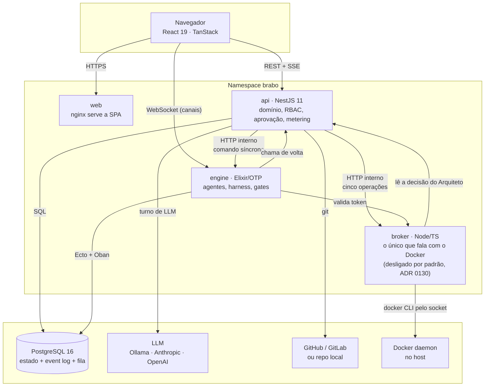
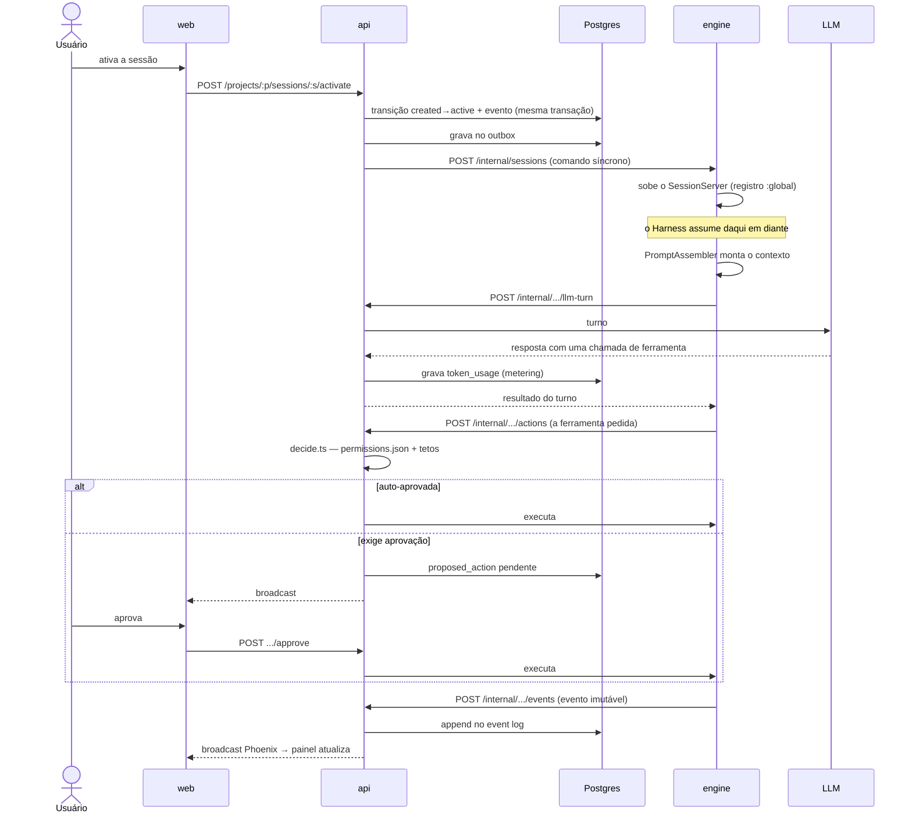
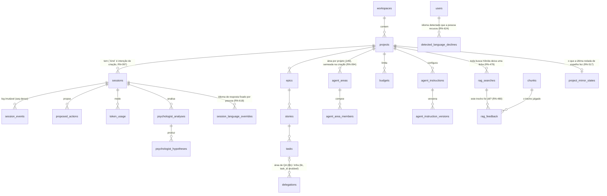

# Архитектура

Этот документ — карта для тех, кто будет **работать** с кодом. Он говорит,
с чего начинать чтение, что обещает каждая граница и что, как уже известно,
кривое.

Решения и их обоснования живут в [ADR](adr/index.md) — их 216, и многие
фиксируют реальный дефект, найденный при исполнении. Здесь мы не
повторяем аргумент: мы указываем на него.

## Взгляд снаружи {#the-outside-view}

Brabo получает **продуктовое намерение** («хочу систему, которая делает X») и
возвращает **git-репозиторий с кодом, тестами и историей решений**,
произведённый командой ИИ-агентов. Между входом и выходом любое действие с
эффектом во внешнем мире — запуск команды, коммит, открытие PR, трата
токенов — проходит через запрос одобрения, который решает человек.

Снаружи это веб-приложение. Отличает его то, что работу выполняют
долгоживущие процессы, общающиеся с языковыми моделями, и что система
построена так, чтобы **ничего не происходило без следа и без разрешения**.

## Контейнеры {#containers}

Две вещи на этой схеме не очевидны и многое объясняют:

**Engine никогда не говорит с LLM или с git напрямую.** Он просит api. Именно
это гарантирует, что у metering, бюджета и конвейера одобрения нет обходов —
нет пути, который бы их миновал.

**Связь api→engine двойная.** Асинхронное событие через *transactional
outbox* в Postgres (потребляемое Oban) и внутренний HTTP для синхронной
команды. Outbox существует, потому что запись состояния и публикация события
должны быть одной транзакцией; HTTP существует, потому что некоторым
операциям нужен немедленный ответ.

Outbox опустошает три `aggregate_type`: `session` (с Фазы 5), `task` (Фаза 12b
— `task.gate_resolved`/`task.became_claimable`, перепланирование dev agent
после того, как gate разрешается или новая задача становится доступной) и
`container` ([ADR 0143](adr/0143-agentes-de-dev-so-depois-do-container.md)
/[RN-502](business-rules.md#rn-502) — `container.running`, присоединяемый в
той же транзакции, что регистрирует достижение контейнером проекта
состояния `running`, чтобы dev agents, которых его отсутствие поставило на
стоянку в `:idle`, проснулись сами; собственный агрегат, а не
позаимствованный `task`, потому что событие не касается никакой задачи).
Причина, по которой это outbox, а не синхронный HTTP-вызов, как остальные:
перезапуск engine между вердиктом gate и реакцией агента не может потерять
сигнал — строка переживает процесс, который её прочитал бы, а HTTP не
пережил бы смерть того, кто ждал ответа.
Dev agent, который ПАДАЕТ (любой выход, кроме `:normal`/`:shutdown`), не
считается завершённым: `Engine.Dev.Monitor` записывает долговременный
`agent.error` (источник `infra`) и перезапускает его из собственной строки в
`dev_agent_states`, до трёх раз; прерванная задача блокируется с диагнозом
уже существовавшим восстановлением после перезапуска
([RN-742](business-rules.md#rn-742)).
`dev_agent_states` получила `consecutive_blocked`/`max_consecutive_blocked`
(предохранитель, [RN-047](business-rules/custo.md#rn-047)); полное решение — в
[ADR 0045](adr/0045-reagendamento-por-evento-do-dev-agent.md).
Задача, заблокированная из-за временного сбоя сети/провайдера (DNS, сброшенное
соединение, 5xx/429), снова разблокируется job Oban через 1, 3 и 10 мин (до
трёх раз, тем же сценарием разблокировки, что и у человека), а dev agent
делает паузу на минуту вместо того, чтобы брать следующую задачу
([RN-864](business-rules.md#rn-864)).

Агенты gate (`QaLeadServer`/`SecOpsAgentServer`) не проходят через outbox на
промежуточных переходах (`correct`/`run_secops` остаются прямым вызовом в
памяти — механическое доказательство в комментарии
`record-gate-verdict.use-case.ts`: только ТЕРМИНАЛЬНЫЕ исходы,
`done`/`blocked`, путешествуют через outbox), поэтому они получили ТУ ЖЕ
страховочную сетку, что уже была у dev agents: `gate_states`, плюс
`GateRescuer`, который обходит застрявшие циклы и возобновляет их сам, — без
новой таблицы для пути outbox, потому что проблема была не в отсутствии
outbox, а в отсутствии долговременного состояния для того, что происходит
МЕЖДУ двумя вызовами в одном процессе. См.
[RN-140](business-rules.md#rn-140), [ADR 0067](adr/0067-o-gate-sobrevive-ao-restart.md).

У gate QA есть ТРЕТИЙ вердикт помимо `approved`/`changes_requested`:
`needs_user_decision` — для требования, которое пользователь никогда не
подтверждал (или которому противоречит действующее решение). Он не
расходует исправление; QA Lead консолидирует его выше `approved`, а цикл
СТАВИТСЯ НА СТОЯНКУ механизмом
[ADR 0207](adr/0207-ciclo-de-gate-velho-estaciona.md), пока пользователь не
ответит на вопрос, что его возобновляет. Разговорная сторона того же правила —
инструмент `declare_open_question` (Criativo, PO, Arquiteto, Dev Lead),
записывающий `artifact.open_question`; ответы пользователя возвращаются к dev и
QA как «решения пользователя» в dev-context ([RN-862](business-rules.md#rn-862),
[ADR 0214](adr/0214-pergunta-em-aberto-vira-pendencia.md)).

Тот, кто ЗАПРАШИВАЕТ gate, никогда не является самим gate:
`Engine.Gates.Dispatcher` — behaviour с пятью callback (QA для PR и SecOps,
два детерминированных gate инфраструктуры и AppSec проектирования — gate
стратегии QA ушёл с
[ADR 0192](adr/0192-plano-de-teste-depois-da-entrega.md), когда план
тестирования стал первым шагом самого QA для PR), чья единственная работа —
поднять GenServer на проект при необходимости и сделать в него cast.
Косвенность существует ради тестов вызывающих: `Engine.Agents.DevLeadTools`
проверяется ЛЁГКИМ тестом без sandbox Ecto, и подъём настоящего GenServer там
лишь для доказательства того, что gate был ЗАПРОШЕН, привязал бы тест Dev
Lead к базе. Самый новый из пяти, `run_appsec_design/2`, закрыл последний
gate, который был вызываемым без вызывающего в production:
`assess_implementability` теперь запрашивает модель угроз проектирования
истории ПАРАЛЛЕЛЬНО — вердикт никогда её не ждёт, а запрос происходит один
раз на историю ([RN-539](business-rules.md#rn-539),
[ADR 0090](adr/0090-qa-estrategia-e-appsec-segundo-momento.md)).

## Карта кода {#code-map}

### `apps/api` — NestJS, 906 файлов в `src/` (измерено 2026-09-25) {#appsapi--nestjs-906-files-in-src-measured-2026-09-25}

Четыре слоя, и порядок важен:

| каталог | что это | начните с | для чего **не** годится |
|---|---|---|---|
| `src/domain/` (72) | чистое бизнес-правило. Без IO, без фреймворка | `actions/decide.ts` — сердце одобрения | не знает, что такое HTTP, база или NestJS |
| `src/application/` (177) | сценарии использования. Оркеструют домен и порты | `use-cases/sessions/` | не хранит правил; если там есть бизнес-`if`, он не на своём месте |
| `src/infrastructure/` (76) | реализации портов: Drizzle, HTTP-клиенты, криптография | `persistence/drizzle/` | ничего не решает |
| `src/interfaces/http/` (105) | контроллеры, guards, DTO | `auth/jwt-auth.guard.ts` | ни правил, ни запросов |

Символы для grep, когда заблудились: `decide(`, `assertTransition`,
`@RequireRole`, `PROTECTED_BRANCHES`, `EncryptionService`.

**Точка входа:** `src/main.ts` — и порядок `imports` в нём значим
(`./tracing-boot` идёт первым намеренно; автоинструментирование
OpenTelemetry не подхватывает уже загруженный модуль, и отдельный модуль —
то, что это гарантирует: TypeScript поднимает все `require` наверх, поэтому
вызов, записанный между импортами, выполнился бы слишком поздно).

### `apps/engine` — Elixir/OTP, 219 файлов в `lib/` (измерено 2026-09-25) {#appsengine--elixirotp-219-files-in-lib-measured-2026-09-25}

| модуль | что это | начните с |
|---|---|---|
| `harness/` (33) | сборка контекста, ToolLoop, сжатие. **Ни один вызов LLM не происходит вне его** | `harness/tool_loop/` |
| `dev/` (15) | dev agents, worktrees, монитор | `dev/dev_agent_server.ex` |
| `gates/` (20) | область QA (Lead + Автоматизация, подспециальности Performance/Безопасность и стратегии QA — второй этап Lead, ADR 0090 — все с LLM) и SecOps (детерминированный) | `gates/qa_lead_server.ex` |
| `infra/` (9) | область Infra (разговорный Lead в рамках сессии — с [RN-617](business-rules.md#rn-617) седьмой разговорный агент, доступный через composer и выполняющий свои ходы в `TurnoAssincrono`, — + подспециальность Workflows через ToolLoop — два архитектурных семейства в одной области, см. RN-037) | `infra/infra_lead_server.ex` |
| `sessions/` (9) | жизненный цикл сессии, реестр `:global` | `sessions/session_server.ex` |
| `actions/` (9) | исполнители терминала и git, детекторы lint/сканеров | `actions/git_executor.ex` |
| `agents/` (16) | Criativo, PO, Arquiteto, Dev Lead, Staff (ADR 0088, спящий для автоматического запуска) — каждый ход выполняется в супервизируемом Task (`TurnoAssincrono`, RN-122), а не внутри `handle_call`, поэтому `:cancel` действительно может его прервать | `agents/turno_assincrono.ex` |
| `psychologist/` (6) · `anamnese/` (6) | анализ и улучшение команды | — |

**Точка входа:** `lib/engine/application.ex` — там всё дерево супервизии, и
это лучший файл, чтобы понять, что работает.

### `apps/broker` — Node/TS, 9 файлов в `src/` (измерено 2026-09-25) {#appsbroker--nodets-9-files-in-src-measured-2026-09-25}

Единственный процесс продукта с доступом к Docker daemon
([ADR 0130](adr/0130-broker-de-container.md)) и самый маленький сервис здесь:
без фреймворка, `node:http`, шесть маршрутов (измерено 2026-09-25 в
`src/servidor.ts`).

| файл | что это |
|---|---|
| `src/operacoes.ts` | ПЯТЬ операций и составление spec. Ничто, что становится `docker run`, не приходит извне |
| `src/servidor.ts` | закрытый список маршрутов, проверка токена и таблица сбоев (статус + `origem`) |
| `src/api-client.ts` | как он ЧИТАЕТ решение Arquiteto в api — вызов, из-за которого он не принимает spec |
| `src/config.ts` | четыре переменные окружения и отказ подниматься в production с публичным токеном репозитория |

**Точка входа:** `src/index.ts`. Самого доступа к Docker здесь нет: он идёт из
`packages/docker-port`, того же файла, что использует runner.

### `apps/web` — React 19, 487 файлов в `src/` (измерено 2026-09-25) {#appsweb--react-19-487-files-in-src-measured-2026-09-25}

`src/lib/api-types.ts` и `src/lib/activity.ts` — два файла, которые стоит
прочитать первыми: первый — контракт с api, второй классифицирует 40 типов
событий лога во что-то отображаемое — это лучший источник истины о том, что
означает каждое событие.

Три вывода из одного event log, отвечающие на разные вопросы:

| файл | отвечает |
|---|---|
| `lib/activity.ts` | «что произошло» — хронологическая лента |
| `lib/agent-status.ts` | «кто существует и в каком состоянии» — карточки команды |
| `lib/timeline-tree.ts` | «что сделал каждый агент и что делает СЕЙЧАС» — дерево |

`lib/aprovacoes.ts` отвечает на четвёртый вопрос, и он идёт не из event log:
«что произойдёт, если я одобрю». Глагол и фраза каждого типа
`proposed_action` живут там, и их потребляют три экрана решений — очередь
Aprovações, карточка внутри чата и вкладка Insights
([RN-096](business-rules.md#rn-096)).

**Объединение `ActionType` БЫЛО копией, и копия устарела — дважды, в
production** (три типа bootstrap Gitflow; затем
`parallelize`/`raise_max_parallel`), оба раза незаметно для компилятора,
потому что `apps/api` не является зависимостью `apps/web`. ADR 0116 закрыл
класс: `ActionType` теперь генерируется `openapi-typescript` из
`docs/reference/openapi.json` (`lib/api-types.generated.ts`, реэкспортируемый
`lib/api-types.ts`), а не набирается вручную, и компилятор теперь требует,
чтобы карты `Record<ActionType, ...>` в `lib/aprovacoes.ts` были исчерпывающими
при каждой правке. Остальной `api-types.ts` — ~1600 строк — по-прежнему
написан вручную; мигрировал только этот тип, с доказанной повторяющейся
стоимостью. `lib/aprovacoes.test.ts` тоже остаётся, но для более узкой
работы: ему больше не нужно ловить ОТСУТСТВУЮЩУЮ запись (это ловит
компилятор), только плохую — слишком короткую фразу, без точки, сырой
`snake_case`, просачивающийся в португальскую прозу. В сомнении UI всё равно
деградирует, а не роняет дерево React.

Дерево инвертирует ось ленты (сначала агент, потом время), потому что в
сессии с Criativo, PO, Arquiteto и N dev хронологическая колонка не могла
ответить, кто что делал. Ни у одного из трёх нет собственного состояния или
маршрута — все выводятся из одних и тех же событий, и событие, которого нет в
логе, не появляется ни в одном из них.

**Область чтения: экран проекта спрашивает по сессии, экран списка — по
workspace.** Внутри проекта запросы идут по сессии и по проекту, что является
естественным срезом открытого. Но дашборд и боковая панель показывают ВСЕ
проекты, и там срез по проекту превращается в N+1 — было семь запросов с
опросом на карточку, 3.824 запр./мин при 23 проектах против лимита 300, и
экран ронял сам себя ответами 429. Оба читают
`GET /workspaces/:id/projects-summary` — read model, пересекающую агрегаты
(git, бюджет, сессия, backlog, архитектура), число обращений к базе в которой
не растёт с количеством проектов ([RN-090](business-rules.md#rn-090)).

Ящик колокольчика следует тому же срезу, с одним отличием, которое стоит
зафиксировать: ему нужна точка отсечки прочитанного для каждого проекта, а
эта точка — `seq`, хранящийся в браузере смотрящего (`lib/read-state.ts`), —
у сервера её нет и не будет «отметить как прочитанное». Поэтому клиент
**отправляет** карту `project → afterSeq` в теле
`POST /workspaces/:id/unread-events`, которое является чтением, несмотря на
глагол, и возвращает `200` ([RN-091](business-rules.md#rn-091)). Глагол
вытекает из тела, а не из мутации: это десятки пар, а строка запроса такого
размера ломается на прокси, не говоря уже о том, что кладёт id проектов в
логи доступа.

Этот endpoint возвращает ФАКТЫ из event log, а не собранные компоненты:
`lib/agents.ts` (кто lead, иконка, цвет) и `rosterFromFacts`
(`lib/agent-status.ts`) остаются работой web, а правило присутствия — то же,
что использует панель команды. Это та же граница, что у трёх выводов выше:
api говорит, что произошло, а web решает, что из этого рисуется.

Две проверки UI автоматические: контраст (`lib/contraste.ts`, тест по
`design/tokens.css`) и раскладка (`scripts/dev/validacao-visual.js`,
запускаемый в браузере). Объяснены в `design/README.md`.

**Установка решает, что предлагает мастер проекта.** `getProjectsBase`
(`lib/api-client.ts`) читает `GET /workspaces/:workspaceId/projects-base` —
единую базу смонтированных проектов этой установки ([ADR
0141](adr/0141-base-unica-dos-projetos-montados.md)), — и мастер Нового
проекта — её единственный вызывающий ([RN-513](business-rules.md#rn-513)).
`projectsBase: null` — нормальное состояние, а не сбой: у установки нет
`BRABO_PROJECTS_BASE`, поэтому карточка смонтированной папки просто не
предлагается, а `container` остаётся по умолчанию. То же верно, пока ответ в
пути и когда запрос ПРОВАЛИВАЕТСЯ — неизвестное никогда не становится
предложением, то же правило, что в
[RN-088](business-rules.md#rn-088)/[RN-468](business-rules.md#rn-468). С базой
карточка приходит ПРЕДВЫБРАННОЙ, а поле пути открывается с `<base>/<slug>`,
составленным `caminhoSugeridoNaBase` (`lib/wizard.ts`) — чистой функцией рядом
с `caminhoDentroDaBase`, которая отвечает «находится ли этот путь под базой?»
по СЕГМЕНТУ и отражает `dentroDoEscopo` из api. Ни предвыбор, ни подсказка не
перезаписывают человеческий выбор.

**Выбор папки — единственное чтение web с ДВУМЯ ТРАНСПОРТАМИ**, а интерфейс,
делающий его одним, живёт в `lib/fs-browser.ts`
([RN-504](business-rules.md#rn-504)). У `FsBrowser` — `listarDiretorio` /
`diretorioInicial` / `fechar` — две реализации, и они говорят не с одной и той
же машиной: `criarFsBrowserViaApi(workspaceId)` вызывает
`GET /workspaces/:workspaceId/project-folders` в api, жёстко ограниченный
`BRABO_PROJECTS_BASE` ([ADR 0141](adr/0141-base-unica-dos-projetos-montados.md)),
тогда как `connectFsBrowserChannel(projectId)` (`lib/fs-browser-channel.ts`)
говорит через Phoenix-канал `terminal:<projectId>` и читает диск ПОЛЬЗОВАТЕЛЯ
через runner.

Интерфейс был извлечён из модуля канала именно потому, что у него перестала
быть единственная реализация. `FolderBrowserModal` выбирает между ними через
размеченное объединение — `origem: { tipo: 'api'; workspaceId } | { tipo:
'runner'; projectId }`, а не два необязательных props, чтобы «ни одного» и
«оба» не были представимыми состояниями, которые компоненту пришлось бы
обрабатывать во время выполнения, — и его тело никогда не узнаёт, что
получило. По `origem` ветвятся только три вещи: какая фабрика работает,
какие ярлыки существуют (`/` не предлагается транспортом api; он вне базы по
построению, и кнопка могла бы закончиться лишь 400) и имеет ли смысл
`RunnerOnboardingPanel`.

`ListagemResultado` получил три НЕОБЯЗАТЕЛЬНЫХ поля — `arquivos`, `simbolicos`,
`truncado`, — и они необязательны, потому что только транспорт api считает то,
что исключил. Протокол runner (`FsEntrada` в `apps/runner/src/channel.ts`)
возвращает папки и файлы вперемешку и ничего не считает; заполнить там нули
означало бы утверждать «ничего не осталось за бортом», а это не то же, что
не знать.

RN-504 направила ОБА режима в api и объявила цену: для `runner` список
перестал быть машиной пользователя и стал базой. Это было принято, потому
что режим `runner` должен был уйти из мастера создания, — он не ушёл, и
[RN-533](business-rules.md#rn-533) ([ADR 0151](adr/0151-base-consentida-no-runner.md)
пункт 7) это отменяет. Теперь транспорт выбирает РЕЖИМ, потому что они
отвечают на разные вопросы: `mounted` спрашивает api (ваша папка живёт под
базой, на СЕРВЕРЕ), `runner` спрашивает локального агента (ваша папка живёт на
машине, которую сервер не видит). Ветвь `runner` опирается на проект, который
мастер уже создал заранее ([RN-437](business-rules.md#rn-437)); когда это
создание проваливается, никакое модальное окно не открывается, потому что
откат на api показал бы базу СЕРВЕРА под подписью «ваша машина».

Сбой несёт РАЗМЕЧЕННУЮ причину (`MotivoDeFalhaDoAgente`): `sem-agente` — это
сервер, УТВЕРЖДАЮЩИЙ, что runner нет, `sem-resposta` — таймаут, упавший socket
или отвергнутый ticket, — незнание, названное незнанием
([RN-088](business-rules.md#rn-088)/[RN-468](business-rules.md#rn-468)).
Компонент решал по `includes('Nenhum runner conectado')`, сопоставляя
фразу на pt-BR, живущую в `.ex` engine; сопоставление подстроки теперь живёт
ровно в одном месте — модуле, владеющем протоколом канала, — и переписанное
сообщение engine деградирует до `sem-resposta`, но никогда до «агент есть».
Обе причины монтируют `EsperaDoRunner` — ожидание RN-474, ПЕРЕИСПОЛЬЗОВАННОЕ:
те же три состояния, тот же потолок, тот же сигнал, — которое само повторяет
упавший листинг, когда меняется штамп. Одно ожидание на экран:
`RunnerOnboardingPanel` получает `mostrarEspera`, ложное лишь там, где его
хозяин уже показывает ожидание. И выбор папки ГОВОРИТ, чей диск он
перечисляет, в обоих источниках, — единственной подсказкой до этого была
подпись ярлыка, которая называет место, а не машину.

**Панель также РАСПОЗНАЁТ уже сопряжённую машину**
([RN-548](business-rules.md#rn-548), [ADR 0154](adr/0154-chave-de-dispositivo-de-maquina.md)).
`listRunnerDeviceKeys` в `lib/api-client.ts` читает
`GET /projects/:projectId/runner-device-keys`, который начиная с
[RN-543](business-rules.md#rn-543) помечает ВИД каждого ключа, — а весь вывод
живёт вне компонента, в `lib/agente-de-maquina.ts`, потому что правило
касается ДАННЫХ, а компонент — отрисовки. Семь состояний, ни одно не
схлопывается в другое, и сбой выводится из `isError`, а не из статуса,
поэтому сетевая ошибка говорит «не знаю», а не крутится в «verificando…»
вечно. Зарегистрированный ключ — НЕ работающий агент — та же дисциплина, что
уже навязывает `workspaceVerifiedAt`, — а список принадлежит УЧЁТНОЙ ЗАПИСИ, а
не этому браузеру, поэтому самая сильная доступная фраза — «у вашей учётной
записи есть сопряжённая машина». Оба ограничения произносятся на экране. Поток
через браузер из
[ADR 0118](adr/0118-configuracao-automatica-do-runner-pelo-navegador.md)
(сгенерировать ключ, скачать бинарник, записать папку) был выведен из
употребления в [ADR 0203](adr/0203-aposenta-o-fluxo-do-runner-pelo-navegador.md)
([RN-687](business-rules.md#rn-687)): панель теперь показывает команду
`install.sh`, которая уходит, когда распознан ключ, обслуживающий проект, а
ручная команда с PAT остаётся в `
`, названном по случаю, на который
она отвечает (другая машина). Минимум для чтения берётся из `roleAtLeast`
против `developer` ENDPOINT, а настоящий 403 попадает в то же состояние — роль
workspace — прокси, авторитет — api.

**Вкладка Код (FASE 26) — тот же шаблон чтения**, применённый к коду, а не к
событиям: `getContainerState`/`getCodeTree`/`getCodeFile`/
`searchCode`/`getCodeDiff` в `lib/api-client.ts` отражают маршруты чтения api
(`container` плюс семь в `code.controller.ts`, FASE 26b), с типами в
`lib/api-types.ts` (`EstadoDoContainer`, `CodeTree`, `CodeFile`,
`CodeSearchResult`, `CodeDiff`), скопированными из DTO, — то же соглашение,
что и в остальном файле, без импорта `apps/api`. `routes/code/
highlight.ts` — СОБСТВЕННЫЙ токенизатор на regex для подсветки синтаксиса,
ноль новых зависимостей. Ворота `ProjectCodeTab.tsx` (RN-107) спрашивают о
состоянии контейнера ДО попытки читать код, чтобы оно появилось как
собственное сообщение, а не как сноска к 409.

**FASE 26b добавила `getCodeBlame`/`getCodePullRequests`/`getCodeBranches` в
тот же шаблон**, с `CodeBlame`/`CodePullRequestList`/
`CodeBranchDetailList` в `lib/api-types.ts` — фундамент для трёх объявленных
незавершённых пунктов вкладки Код (RN-110/111/112). У всех трёх теперь есть
потребитель: `CodeEditor.tsx` (переключатель blame), `code/PrListAndDiff.tsx`
(список PR + diff, потребляемый и `CodeDiffPanel.tsx`, и отдельной вкладкой
`prs`) и `CodeBranchPicker.tsx` (богатый выпадающий список веток).

Ворота образа контейнера (RN-105) — единая воронка
(`ReadProjectCodeUseCase.alvo`), общая для семи маршрутов, поэтому любой из
них может дать 409, пока Arquiteto не решил образ, — а не только дерево.
`ProjectCodeTab.tsx` избегает этого 409 предварительной проверкой (`RN-107`,
выше); у вкладки `prs` нет чтения дерева/файла, против которого
предварительно проверять, поэтому `code/PrListAndDiff.tsx` реагирует на 409
собственных вызовов `getCodePullRequests`/`getCodeDiff`. Оба пути отрисовывают
одно и то же представление, `ContainerImageGateNotice`
(`components/ContainerImageGate.tsx`), обнаруживаемое `isContainerImageGateError`
(`lib/api-client.ts`, сопоставляет `ApiError.status === 409`), — баг, найденный
при использовании: до этого вкладка `prs` показывала этот 409 как обычную
временную ошибку с кнопкой «попробовать снова», а это неправильная
возможность для состояния, которое разрешается только действием Arquiteto.

**Глобальная страница контейнеров (`/containers`, ADR 0136/RN-495) — чтение
WORKSPACE**, а не проекта, — `getContainersOverview` в `lib/api-client.ts`
вызывает `GET workspaces/:workspaceId/containers`, а `ContainerOverviewItem`
в `lib/api-types.ts` отражает `ContainerOverviewItemResponseDto`. Сторона api —
выделенная read model, `ContainersOverviewRepository`/
`DrizzleContainersOverviewRepository`, с той же дисциплиной «без N+1 между
проектами», что у `ProjectsSummaryRepository`, — три постоянных запроса
(`projects` с LEFT JOIN на строки контейнеров, события `artifact.project_image`
пакетом, ожидающие `proposed_actions` контейнеров пакетом), никогда по
одному на проект. То, что нельзя сделать пакетом, — спросить broker о
наблюдаемом состоянии, — получает вместо этого явный бюджет на загрузку
(`ObterVisaoGeralDeContainersUseCase.TETO_DE_VERIFICACOES_POR_CARGA`,
спрашиваются только строки `provisioning`/`running`, с потолком 20): строка
вне бюджета говорит `naoVerificado`, никогда молча не переиспользуя ответ
другой строки и не наследуя зарегистрированное состояние. Действия
(остановить/удалить/поднять) — `proposed_action`, как везде, — страница
никогда не вызывает broker напрямую, — а ожидающее действие каждой строки
(если есть) приходит в том же пакетном чтении и отрисовывается как встроенный
`ApprovalCard`, тот же шаблон, что `ProjectPrsTab.tsx` уже использует для
предложений merge.

Начиная с [RN-521](business-rules.md#rn-521) join — LEFT, и страница
перечисляет ВСЕ проекты workspace, потому что она стала человеческим путём
для подъёма ПЕРВОГО контейнера: подъём, проваливающийся до регистрации, не
оставляет строки, а старый INNER JOIN скрывал ровно тот проект, которому
страница была нужна. Поэтому `ContainerOverviewItem.registrado` допускает null
— третье именованное в типе состояние, отличное от `stopped` и от «не удалось
пронаблюдать», — а строки без контейнера никогда не попадают в бюджет broker,
поэтому не могут вытеснить настоящий контейнер. Ветвление между
`container_start` (broker) и `container_start_via_runner` (локальный агент) —
чистая функция КЛИЕНТА, `routes/containers-subida.ts`: она же решает, когда
НЕ предлагать кнопку (нет решённого образа, `runner`, папку которого ни один
агент никогда не подтверждал, роль ниже `maintainer` по `roleAtLeast`), и у
каждого отказа есть собственный текст — экран никогда не предлагает
действие, о котором уже знает, что оно провалится, и никогда не скрывает
почему.

ДРУГОЙ предлагающий — агент Infra Lead — ветвится так же начиная с
[RN-566](business-rules.md#rn-566). Оба его инструмента проходят через единую
`recusa_local_de_subida/2` в `infra_lead_server.ex`, которая читает проект
ОДИН раз (`Project.get/1`, тот же процесс BEAM, никогда HTTP: сетевой вызов
внутри цикла агента — та цена, которую это исправление не могло платить) и
возвращает `nil` или ИМЕНОВАННУЮ причину, по ветви на инструмент, —
`container`/`mounted` предлагают `container_start`, `runner` отвергается с
указанием на `container_start_via_runner`, а ветвь `container_start` — СПИСОК
РАЗРЕШЁННЫХ, как у broker, поэтому новый режим в enum рождается отвергнутым.
Отказ — текст РЕЗУЛЬТАТА инструмента, который читает модель (вход цикла,
[RN-163](business-rules/autenticacao.md#rn-163)), а не `agent.error`, а
`tool.call` по-прежнему порождается, чтобы локальный отказ никогда не исчезал
из timeline. Чего агент НЕ проверяет, а экран проверяет, — решённый образ и
подтверждённую папку.

### Вне приложений {#outside-the-applications}

| каталог | что это |
|---|---|
| `packages/shared/` | `GitProviderContract` — пятнадцать операций, **типы и ничего больше**: значение, переживающее `tsc`, ломает загрузку api (зафиксировано тестом), поэтому константа живёт у потребителя |
| `packages/docker-port/` | ПОРТ Docker (пять операций) и его CLI-адаптер, общие для `apps/runner` и `apps/broker` — [ADR 0130](adr/0130-broker-de-container.md). Это runtime-код, и именно поэтому он НЕ в `packages/shared`; у него нет шага сборки, и оба потребителя его УПАКОВЫВАЮТ, поэтому ни один образ никогда не разрешает его из `node_modules` |
| `docker/` | образы dev и production; `smoke.sh` |
| `deploy/k8s/` | база Kustomize + overlays (local, staging, prod) |
| `design/` | дизайн-система: токены, типографика, компоненты |

## Поток хода агента {#an-agent-turns-flow}

Горячий путь, от начала до конца. Именно здесь живёт большая часть
сложности.

Цикл `Harness → вызов инструмента → одобрение → событие` повторяется, пока агент
не вызовет инструмент завершения или не упрётся в потолок (итерации, токены,
бюджет).

## Границы и инварианты {#boundaries-and-invariants}

Это самая важная часть. Каждый пункт ниже проверяем, и у многих есть тест,
проваливающийся при нарушении.

**1. Домен чист.** `apps/api/src/domain/` не импортирует
`infrastructure`, `application`, `@nestjs` и никакой драйвер базы —
проверено: **ноль** вхождений всех трёх. Направление всегда
`interfaces → application → domain`, и 89 файлов `application` импортируют
`domain`. Если вам нужен IO внутри `domain/`, схема неверна: создайте порт в
`application/ports/`.

**2. Доменное событие неизменяемо.** В таблице событий никогда не бывает
`UPDATE`. У `session_events` есть `unique(session_id, seq)`, а `seq` плотен по
сессии — тест восстановления проверяет отсутствие дыр. Состояние, которому
нужно меняться (жизненный цикл гипотезы, статус handoff), живёт в собственной
изменяемой таблице рядом с событиями. Предложение handoff, переставшее быть
действующим, становится `superseded` в этой таблице и получает собственное
событие `handoff.superseded` — никогда не правку объявившего его
`handoff.offered` ([ADR
0182](adr/0182-ciclo-de-vida-do-handoff.md)).

**3. Ни одного вызова LLM вне Harness.** Это не соглашение: у engine нет
клиента LLM. Он просит api, которая выполняет metering.

**4. Любое действие с внешним эффектом становится `proposed_action`.**
`deny` всегда побеждает `allow` в `permissions.json`, и два **потолка**
применяются последними, поверх уже вычисленного вердикта: merge в защищённую
ветку и патч инструкции **никогда** не автоодобряются.
См. [RN-006 и RN-007](business-rules.md).

**5. Merge в защищённую ветку — ручной.** Варианта его автоматизировать нет.
Это потолок в домене (`decide.ts`), гарантированный тестом.

**6. Одна сессия — один владелец.** `SessionServer` регистрируется под
`:global`, а не в локальном `Registry` — без этого N реплик держали бы N копий
одной сессии, и копии без heartbeat убили бы живую сессию
([ADR 0026](adr/0026-fase5-observabilidade-e-graceful-shutdown.md)).

**7. Сбой агента записывает ИСТОЧНИК** (`infra | model | code | policy`),
никогда диагноз методом исключения. Дорогой урок
[ADR 0020](adr/0020-destravar-gates-qa-secops.md): падение провайдера было
записано как «модель остановилась, не подав сигнала», и система обвинила
модель в инфраструктурной проблеме.

**8. Контейнер проекта решается, а не подразумевается.** Вкладка Код
разблокируется только после того, как Arquiteto выпустит
`artifact.project_image`, — пока состояние `sem_decisao`, чтение кода
возвращает `409` ([RN-105](business-rules/autenticacao.md#rn-105)). А
`git push`, открытие PR и deploy не проходят через терминал даже в рамках
проекта: `decide()` распознаёт их по префиксу команды и возвращает `deny` ДО
любого разрешающего шага — не `require_approval`, потому что «всегда
разрешать» записало бы шаблон в `allow` и снова открыло бы дверь
([RN-106](business-rules/autenticacao.md#rn-106),
[ADR 0065](adr/0065-container-por-projeto-a-fronteira-deixa-de-ser-politica.md)).
Жизненного цикла контейнера (подготовить, перезапустить, очистить) пока не
существует — объявленный срез FASE 25, записанный в CLAUDE.md, — поэтому
этот инвариант пока сосуществует с политикой области путей
[ADR 0055](adr/0055-escopo-de-caminho-na-politica-de-terminal.md).

А начиная с [ADR 0143](adr/0143-agentes-de-dev-so-depois-do-container.md)
/[RN-502](business-rules.md#rn-502) решённый образ больше не единственное
предусловие: **dev agent не берёт ни одной задачи, пока контейнер проекта не
ЗАРЕГИСТРИРОВАН как `running`**. Страж живёт в
`Engine.Dev.AgentIo.try_claim/2` — единственной точке claim, — а не только в
`activate-execution` api, потому что реидратация доходит до `try_claim/2`, не
проходя ни через какой маршрут (`DevAgentServer.init/1` ->
`finish_restart_recovery/1`). Без контейнера агент переходит в `:idle`
(единственное состояние, которое ещё спасает wake) и говорит об этом через
`dev.blocked_by_container`. Другая половина того же правила в том, что
`Engine.Actions.TerminalExecutor` перестал падать в `System.cmd` внутри
процесса engine, когда контейнера нет: он отказывает, с названием причины,
как уже делал режим `runner`.

**9. Агент, который ПИШЕТ, должен уметь ЧИТАТЬ и должен уметь СПРАШИВАТЬ.**
Обе половины — один и тот же урок, и пришли они от агента, у которого были
только инструменты записи: PO собирал контекст один раз, при kickoff, и с тех
пор действовал по устаревшему снимку — перед пробелом он выбирал между
выдумыванием и остановкой ([RN-164](business-rules/autenticacao.md#rn-164),
[RN-165](business-rules/autenticacao.md#rn-165)). Чтение **не** становится
`proposed_action` (инвариант 4 касается ВНЕШНЕГО эффекта, а чтение им не
является), но оно ограничено в смысле
[ADR 0060](adr/0060-superficie-de-leitura-de-codigo.md): область закрыта путём
маршрута, стоимость постоянна на вызов, и есть потолок строк в тексте,
передаваемом модели. И цикл агента не заканчивается молча — потолок итераций
порождает `toolloop.limit_reached`, невыполненное обязательство порождает
долговременный исход с источником ([RN-166](business-rules/autenticacao.md#rn-166)).

## Сквозные вопросы {#cross-cutting-concerns}

**Кросс-origin.** Web отдаётся с собственного origin и говорит с **двумя**
другими, поэтому CORS — архитектурная граница, а не деталь конфигурации
([ADR 0037](adr/0037-cors-do-engine-e-a-porta-como-contrato.md)).
Четыре пути, и только три проходят через CORS:

| путь | механизм |
|---|---|
| web → api, HTTP | CORS Nest, точный origin из `WEB_ORIGIN` + `credentials` |
| web → engine, HTTP (`/health`) | `EngineWeb.Plugs.Cors`, только маршруты health |
| web → engine, WebSocket | `check_origin` endpoint Phoenix — **WebSocket не проходит через CORS** |
| api ↔ engine, HTTP | **CORS неприменим**: серверный клиент, а не браузер |

Одна переменная — `WEB_ORIGIN` — питает первые три, в обоих сервисах.
Независимое двукратное чтение её — вот как CORS engine остался вообще без
origin, тогда как в `check_origin` уже был правильный список; в engine она
теперь разрешается один раз, в `runtime.exs`.

И **порт — часть origin**: web на `:5174` — другая система в глазах браузера.
Поэтому `vite.config.ts` использует `strictPort`.

**Аутентификация.** First-party, в домене api — внешнего IdP нет. Пароли с
argon2id, access token EdDSA на 15 минут и непрозрачный refresh token с
обязательной ротацией; сессия web живёт в cookie `httpOnly` с CSRF через
double-submit. `JwtAuthGuard` глобален и **читает** пользователя по `sub`
токена (это `users.id`); открытый маршрут требует явного `@Public()`.

Ни одно решение RBAC не читает claim токена: роль берётся из
`request.user.id` и строк в базе. Поэтому матрица прав пережила смену
эмитента без изменений. Решения — в
[ADR 0031](adr/0031-auth-first-party-argon2id-e-rotacao-de-refresh.md) и в
[ADR 0032](adr/0032-corte-do-keycloak-e-sessao-em-cookie.md).

Вызовы engine не проходят через JWT: маршруты `/internal/*` —
`@ServiceRoute()`, а `EngineServiceGuard` сравнивает общий секрет
(`BRABO_SERVICE_TOKEN`) за постоянное время. Вся поверхность
классифицирована в [`security-surface.md`](security-surface.md), и табличный
тест проваливает новый маршрут без классификации.

**Авторизация.** RBAC в домене, с эффективной ролью, разрешаемой от проекта
(с откатом к workspace). `@RequireRole` на маршрутах.

**Ошибка.** Доменные ошибки — типизированные классы
(`InvalidSessionTransitionError`, `StoryNotReadyError`), переводимые в HTTP
глобальными фильтрами в `main.ts`. Ошибки git-провайдера нормализуются единым
контрактом ([ADR 0002](adr/0002-git-error-normalization.md)) — вызывающий
не знает, говорил ли он с GitHub или GitLab.

**Логирование.** **Однострочный** JSON на событие в production во всех трёх
приложениях, с коррелированным `trace_id`; человекочитаемый в разработке. Api
использует pino с обязательным скрытием `apiKey`, `access_token`,
`clientSecret` и service token api↔engine. Каждая строка говорит, из какого
класса и метода она пришла, а строка на запрос показывает **путь по слоям** с
длительностью каждого шага — см.
[наблюдаемость](explanation/observability.md).

**Транзакция.** Шаблон — *unit of work*: записать состояние и опубликовать
событие в **одной** транзакции, через outbox. Публикация вне транзакции
создала бы событие для состояния, которое так и не сохранилось.

**Трассировка.** OpenTelemetry от начала до конца, и `trace_id` рождается в
**web**: браузер генерирует `traceparent`, api принимает его как родителя, а
engine принимает родителя от api. Сессия — **один корневой trace** —
`traceparent` сохраняется в `sessions.trace_parent` и путешествует в конверте
outbox, поэтому асинхронная работа, запущенная событием, остаётся в trace
того, кто его произвёл.

Инструментирование и **экспорт** независимы
([ADR 0035](adr/0035-observabilidade-legivel-e-trace-sem-coletor.md)): span
создаётся всегда, и `trace_id` всегда идёт в лог, даже без коллектора;
`OTEL_EXPORTER_OTLP_ENDPOINT` лишь решает, покидает ли он процесс. Именно это
даёт корреляцию в `pnpm dev`.

**Секреты.** Envelope encryption: случайный DEK на запись, обёрнутый
мастер-ключом. Ротация без простоя через `CREDENTIALS_MASTER_KEY_PREVIOUS` —
см. [runbook](runbook.md).

**Иерархия агентов.** Начиная с Фазы 8b
([ADR 0038](adr/0038-hierarquia-de-agentes.md)) у области могут быть LEAD и
подспециальности — сегодня «qa» (`qa-lead`, `qa-automacao`,
`qa-performance-seguranca`) и «infra» (`infra` как lead, `infra-workflows` как
субагент — Фаза 8c, RN-037). Lead — единственная точка внешнего контакта:
внутреннее делегирование никогда не становится handoff и никогда не видно вне
области. Первый экземпляр доказывает центральную гарантию модели —
`QaLeadServer` консолидирует вердикты двух подспециальностей в единый
`qa_verdict`, а контракт, который уже был у api (`RecordGateVerdictUseCase`,
`nextGateStatus`), не изменился ни на строку. Второй показывает, что модель не
требует одинаковой внутренней реализации: `InfraLeadServer` остаётся
разговорным GenServer в рамках сессии (по образцу `ArquitetoServer`, внешний
контакт неизменен по явной просьбе CLAUDE.md 8c) и делегирует
`WorkflowsAgent` — который, без пользователя на другой стороне, работает как
ограниченный `ToolLoop`, как субагенты QA. Начиная с
[RN-617](business-rules.md#rn-617)
([ADR 0175](adr/0175-infra-lead-conversa-pelo-composer.md)) Infra Lead также
получает сообщения из composer, и три его хода (kickoff, исправление gate,
сообщение) выполняются в том же Task `TurnoAssincrono`, что и у остальных
шести разговорных агентов. Универсальным `delegations` из 8b понадобилась ОДНА
корректировка, чтобы обслуживать вторую область: `task_id` стал nullable,
потому что Infra делегирует по сессии, а не по задаче backlog.

Фаза 8d замыкает цикл со стороны `apps/web`, без нового маршрута — всё идёт
из тех же `session_events`, которые панель уже получает
(`useSessionEvents`). `apps/web/src/lib/agents.ts` получил `AREAS`/`areaFor`:
реестр, связывающий `AgentKey` субагента (`qa-automacao`,
`qa-performance-seguranca`, `infra-workflows`) с областью lead, — именно этот
обратный поиск группирует панель команды (lead с печатью «Lead» +
сворачиваемые подспециальности), группирует Insights по области и
пересказывает `delegation.completed`/`failed`/`dispensed` в ленте
(`activity.ts`). `consolidated_verdict` (решение №4 ADR 0038) так и не стал
настоящим артефактом — QA и Infra переиспользуют `qa_verdict`/`open_infra_pr`,
см. [заключительное примечание ADR](adr/0038-hierarquia-de-agentes.md#fechamento-fase-8d).

## Данные {#data}

Всего 56 таблиц. Самая новая — `detected_language_declines`
([RN-624](business-rules.md#rn-624)): одна строка на человека и язык, от
которого человек ОТКАЗАЛСЯ, когда его спросили «мы заметили, что вы пишете на
X, — использовать X в ответах?», с датой. Её присутствие и не даёт тому же
вопросу вернуться; подтверждение этого языка позже удаляет строку. Само
определение не хранит состояния — выборка читается из `session_events` по
частичному индексу `session_events_evidencia_de_idioma_idx` (актор-пользователь,
два типа доказательств), а гистерезис пересчитывается, — поэтому эта
таблица и подтверждённая пара в `users` — всё, что оно записывает, и только
когда человек отвечает. До неё самой новой была `session_language_overrides`
([RN-618](business-rules.md#rn-618),
[ADR 0177](adr/0177-idioma-das-respostas-por-conta-sessao-e-projeto.md)): язык
ответа, который человек закрепил в сессии, с ключом по ПАРЕ
`{session_id, user_id}`, чтобы два участника никогда не касались друг друга.
Это конфигурация, а не событие — повторное закрепление — upsert,
освобождение — `DELETE`. Тот же ADR добавляет `users.response_language`
(`NULL` — «автоматически») и пару подтверждённого определения
`users.detected_language` / `detected_language_confirmed_at`, связанные CHECK;
`users.locale` остаётся языком интерфейса, закрытым в `pt-BR`/`en`. А
`projects.language` ([RN-619](business-rules.md#rn-619)) — язык того, у чего
нет автора-человека, — общих артефактов и ходов, которые никто не набирал, —
всегда конкретный код BCP-47. До неё самой новой была
`project_mirror_states`
([RN-517](business-rules.md#rn-517),
[ADR 0147](adr/0147-agente-local-com-capacidades.md) пункт 7): одна строка на
проект, `project_id` уникален, хранящая то, что сделал ПОСЛЕДНИЙ прогон
зеркала, — последнюю успешную синхронизацию с её тремя счётчиками и
замороженной целью плюс последнюю ошибку. ТАБЛИЦА, а не событие, по той же
причине, что и `rag_searches` чуть выше: у прогона зеркала нет сессии, а
`session_events.session_id` — `NOT NULL`, поэтому event log молча отбросил бы
всё. Три состояния, которые никогда не схлопываются
([RN-088](business-rules.md#rn-088)): «никогда не синхронизировано» —
ОТСУТСТВУЮЩАЯ строка, «синхронизировано и ничего не скопировано» —
присутствующая строка с `files_copied = 0`, а «упало» — `last_error_at` новее
`last_synced_at`. Колонки успеха и сбоя НЕПЕРЕСЕКАЮЩИЕСЯ, и ни одна запись не
трогает колонки другой, — и именно поэтому экран может сказать «падает с
сегодняшнего дня, последняя хорошая копия была вчера, 412 файлов», а не
потерять самое полезное, что у него есть.

Две до неё — `rag_searches`/`rag_feedback` (RN-479/480): след гибридного
поиска и голос о том, что он вернул, добавленные потому, что
`rag-search-limits.ts` объявляет в собственном комментарии, что ни одно из
четырёх чисел гибридного поиска не получено калибровкой на реальных данных, —
а калибровать было невозможно, пока поиск не оставлял следа. Это ТАБЛИЦЫ, а не
только события сессии, по конкретной причине: `session_events.session_id` —
`NOT NULL`, а поиск из вкладки RAG — поиск *проекта* без сессии, поэтому event
log молча отбросил бы ровно те поиски, которые человек запускал, глядя на
оценки (тот же класс проблемы, что вынудил срез metering embedding в
[ADR 0075](adr/0075-embeddings-no-contrato-de-llm-provider.md)).
`rag_searches.pesos` замораживает веса каждого поиска в самой строке — та же
дисциплина, что у замороженной цены в metering
([ADR 0042](adr/0042-catalogo-vivo-ciclo-de-vida-do-modelo-e-preco-auditavel.md)), —
чтобы последующая калибровка молча не изменила смысл каждого прежнего
измерения. `session_socket_tickets` остаётся вне диаграммы по той же причине,
что и `refresh_tokens`/`account_tokens`: это механизм auth, а не доменное
отношение.

`projects.mirror_path` (FASE 28, [RN-515](business-rules.md#rn-515),
[ADR 0147](adr/0147-agente-local-com-capacidades.md) пункт 4) — колонка, а не
таблица, потому что это ОДНО необязательное значение на проект: абсолютный
путь на машине ПОЛЬЗОВАТЕЛЯ, куда capability `espelho` локального агента
копирует работу. Он допускает null, и `NULL` — НОРМАЛЬНОЕ состояние — проект
без зеркала составляет большинство, и продукт никогда сам не выбирает цель.
Он намеренно **не** несёт CHECK, привязывающего его к `execution_mode`, в
отличие от соседнего `workspace_path`: у `container` не может быть цели (его
источник — управляемый том на СЕРВЕРЕ, а процесс, который копировал бы,
работает на машине пользователя), но `execution_mode` ПРЕОБРАЗУЕМ
([RN-447](business-rules.md#rn-447), [ADR 0111](adr/0111-conversao-de-execution-mode-de-projeto-existente.md)),
поэтому CHECK заставил бы преобразование в `container` взорваться в Postgres,
вместо того чтобы отказать с причиной. Отказ живёт в сценарии использования,
а преобразование обнуляет колонку — та же форма, что у
`workspace_verified_at`, и по дополнительной причине: оба направления цикла
источник↔цель проверялись против СТАРОГО `workspace_path`.
Начиная с [RN-516](business-rules.md#rn-516) engine ЧИТАЕТ эту колонку —
именно она решает, требует ли `join` runner capability `espelho`, и именно
она путешествует обратно в разрешении этого join (`Engine.Runners.Espelho`,
`EngineWeb.TerminalChannel`). Engine никогда её не пишет. Начиная с
[RN-517](business-rules.md#rn-517) ПО СОСЕДСТВУ ЕСТЬ внутренний маршрут —
`POST /internal/projects/:projectId/mirror-sync-result`, — но он пишет
`project_mirror_states`, никогда эту колонку: цель — КОНФИГУРАЦИЯ
(пользователь её объявляет), а исход прогона — ТЕЛЕМЕТРИЯ (локальный агент о
нём сообщает), и их слияние позволило бы отчёту перезаписать выбор.
**Ограничения — это бизнес-правила**: уникальность `(session_id, seq)` event
log, `check`, требующий ровно одной области в `budgets` (проект **или** сессия,
никогда оба), частичные индексы, гарантирующие идемпотентность анализа, — и,
начиная с Фазы 8b, три `check` в `delegations`, фиксирующие, какое поле
обязательно по `status` (`completed` → `parecerArtifactId`, `failed` →
`failureOrigin`, `dispensed` → `justification`; см.
[RN-036](business-rules.md#rn-036)). `delegations.task_id` родился
`NOT NULL` и стал nullable в Фазе 8c — область Infra делегирует по сессии, без
задачи backlog за PR инфраструктуры (см.
[RN-037](business-rules.md#rn-037)).

`agent_areas` (FASE 14d,
[ADR 0053](adr/0053-dev-lead-e-paralelismo-autorizado.md)) — то, что Фаза 8
вырезала. Она вернулась, потому что область **dev** не перечислима в коде:
`qa` и `infra` укладываются в фиксированный список, но члены dev — по одному на
модуль `module_map`, решаемые Arquiteto и разные в каждом проекте.
Уникальность `(project_id, key)` делает засев идемпотентным, а `max_parallel`
(по умолчанию 2) — потолок, который lead использует, не спрашивая, — выше
него — `proposed_action`
(см. [RN-083](business-rules/custo.md#rn-083)). `budget_micros`/`spent_micros`
(ADR 0110) отражают `max_parallel` в той же строке — потолок расходов,
АДДИТИВНЫЙ к `budgets` (проект/сессия), никогда не каскад: он проверяется и
увеличивается независимо, теми же `CheckBudgetGateUseCase`/
`RecordLlmUsageUseCase`, которые уже ведают расходами проекта и сессии (см.
[RN-443](business-rules.md#rn-443)). Не путайте это с каскадом binding
модели из [ADR 0064](adr/0064-escopo-de-area-na-cascata-e-o-binding-de-agente-global.md)
(`session > agent > area > project > workspace`) — тот выбирает единственного
победителя; бюджет области никогда не выбирает.

**Миграции:** Drizzle в api (`src/db/migrations/`, применяемые однократным Job
— реплики **не** мигрируют при загрузке, иначе они оспаривали бы одну и ту же
миграцию) и Ecto в engine, в собственной схеме (`engine`). Перекрёстных
ссылок между двумя схемами нет, поэтому они выполняются параллельно.

## Известный технический долг {#divida-tecnica}

Выведен из горячих точек истории и из ADR, фиксирующих открытое состояние.

| долг | доказательство | влияние |
|---|---|---|
| ~~`schema.ts` — самый изменяемый файл репозитория (23 изменения) и сосредоточивает 51 таблицу в одном файле~~ | история → **закрыто** [ADR 0121](adr/0121-schema-dividido-por-agregado-de-dominio.md) | схема теперь — файл на доменный агрегат в `apps/api/src/db/schema/`, отражающий `src/domain/*`, а старый путь сохранён как barrel `export *`, чтобы ни одному из 144 потребителей ничего не пришлось менять. Два агрегата теперь можно редактировать одновременно без конфликта. Чего это НЕ касается: миграции идентичны байт в байт (критерием приёмки был `drizzle-kit generate` с нулевым diff), а строка контракта api↔engine ниже — другой долг, всё ещё открытый |
| Контракт api↔engine разбросан по 4 горячим файлам (`internal-sessions.controller.ts`, `api-to-engine-client.ts`, `engine_api_client.ex`, `router.ex`) без единого источника | история | изменение требует синхронной правки всех четырёх; ничто не гарантирует их согласия |
| Демонстрация gates **не является регрессионным тестом** — зависит от суждения локальной 7B-модели | [ADR 0020](adr/0020-destravar-gates-qa-secops.md) | у семантического пути gate нет автоматического покрытия |
| Фаза 4a с критерием приёмки, помеченным **НЕ ЗАКРЫТ** | [ADR 0021](adr/0021-fechamento-4a-infra-e-painel.md) | есть заведомо незавершённая работа без issue для отслеживания |
| Очередь Oban накапливает `AnamneseWorker` прошлых исполнений; страж блокирует только **новые** постановки в очередь | [ADR 0020](adr/0020-destravar-gates-qa-secops.md) | выключения стража недостаточно — очередь нужно очистить |
| `TerminalExecutor` запускает набор управляемого проекта **внутри** образа engine | [ADR 0024](adr/0024-fase5-imagens-producao-ci.md) | не масштабируется на произвольные стеки; выход — песочница на проект |
| ~~Образы не публикуются в registry; overlay production указывает на `ghcr.io/OWNER/*`~~ | [ADR 0027](adr/0027-fase5-backup-hardening-release.md) → **закрыто** [ADR 0119](adr/0119-imagens-publicadas-no-ghcr-por-digest.md) | четыре образа публикуются в GHCR на каждом финальном теге, а overlay закрепляет по digest из `.release/images.json`. Остаток — НЕ этот долг: ничто не делает deploy автоматически, а образы не подписаны и не аттестованы |
| ~~`SessionPage.tsx` весил 169 КиБ, и его импортировали 25 тестовых файлов; `ProjectSettingsTab.tsx` весил 90 КиБ~~ | [ADR 0122](adr/0122-sessionpage-dividido-em-cinco-prs.md) + [ADR 0124](adr/0124-hook-do-canal-de-turno-do-sessionpage.md) + [ADR 0125](adr/0125-projectsettingstab-dividido-por-secao.md) — **эта строка ЗАКРЫВАЕТСЯ в обеих половинах** | пять механических PR ADR 0122 были смержены первыми: PR 1 извлёк чистые хелперы timeline/хода в `apps/web/src/lib/session-timeline.ts`, PR 2 извлёк `StorySlide` в `apps/web/src/routes/StorySlide.tsx`, PR 3 извлёк `StructuredQuestionCard` (плюс его приватный хелпер `permiteOutra`) в `apps/web/src/routes/StructuredQuestionCard.tsx`, PR 4 извлёк хелперы дерева backlog (`urlDaPr`, `vinculoDeBacklog`, `montarArvoreDeBacklog`, `totalDeDescendentes`) в `apps/web/src/lib/session-backlog-tree.ts`, а `ItemDeBacklog` + `ContextAside` (всю правую боковую панель) — в `apps/web/src/routes/ContextAside.tsx`, и PR 5 извлёк шесть выводов готовности (`criativoActive`, `arquitetoActive`, `hasBusinessRule`, `hasPromotedStory`, `hasProductBrief`, `activeAgent`) в hook `useSessionReadiness` в `apps/web/src/lib/session-readiness.ts` — `SessionPage.tsx` сократился с 3 807 до 2 661 строки, явно оставив вне рамок скопление состояния канала хода (`turnoViaCanal`/`statusAgent`/`pensandoVisivel`/`atividadeDoTurno`) для будущего собственного ADR. ADR 0124 — это тот ADR: сначала механический PR дедупликации заставил `handleSend`/`handleReadiness`/`handleArchitectureReadiness` вызывать уже существующую пару `iniciarTurnoDoAgente`/`finalizarTurnoDoAgente`, а не дублировать её ветку inline, а затем второй PR извлёк состояние, эффект канала `connectSessionHeartbeat` и три функции жизненного цикла в hook `useTurnoDoAgente` (`apps/web/src/lib/session-turno.ts`). `SessionPage.tsx` теперь 2 479 строк; 25 (24 после миграции PR 1) файлов `SessionPage.*.test.tsx` прошли без правок через семь PR обоих ADR. ADR 0125 закрывает ДРУГУЮ половину, одним PR вместо пяти: `ProjectSettingsTab.tsx` делится на файл на раздел в `apps/web/src/routes/settings/` (17 разделов + `settings/shared.ts` из двух символов, хранящий только `ORIGIN_TONE` и `formatarCustoMicros` — два хелпера с более чем одним вызывающим), сокращаясь с 2 532 до 77 строк и ОСТАВАЯСЬ на своём пути как точка входа и barrel, — что несёт нагрузку, потому что `ProjectSettingsTab.test.tsx` импортирует из него 11 имён, а `ProjectPage.test.tsx`/`project-tabs.test.tsx` делают его `vi.mock` ПО ПУТИ. Один PR, а не пять, потому что этот файл никогда не имел формы `SessionPage.tsx`: родитель не хранил никакого состояния (17 JSX-потомков, ни hook, ни query, ни проверки роли), ни один раздел не получал больше, чем `{projectId}`, и 11 из 17 уже экспортировались. `ProjectSettingsTab.module.css` остаётся общей таблицей стилей с 15 импортёрами (тот же ответ, что ADR 0122 дал для `SessionPage.module.css`). Весь набор web — 142 файла, 1 537 тестов — прошёл с НУЛЁМ изменённых тестовых файлов |
| ~~`SessionPage.tsx` снова вырос после закрытия своей строки: **2 559 строк** (116 КиБ, 26 файлов `SessionPage.*.test.tsx`), измерено в `dev` на `b61bc49cd` **2026-09-13** — строка выше закрыла его на **2 479**~~ | `git show --numstat` по двум коммитам, тронувшим его после [ADR 0124](adr/0124-hook-do-canal-de-turno-do-sessionpage.md): `62eebad55` (+8, селектор модели «aptos para agentes») и `a26ddd84d` (+72, исполнимая карточка handoff Infra, RN-499) | закрытая строка выше верна для `ProjectSettingsTab.tsx` (теперь полоса и barrel в 96 строк) и **больше не верна для `SessionPage.tsx`**. Никто ничего не сделал неправильно — каждое добавление было законной фичей, — и именно поэтому долг, закрытый **числом**, требует повторного измерения числа: без этого регрессия — сумма правильных решений. Эта строка **объявляет**, а не декомпозирует: дальнейшее деление — программа с собственным ADR, по образцу 0122/0125. Ворот размера в CI нет намеренно — храповик на файле, который никто не декомпозирует, лишь производит красные PR. Закрытая строка остаётся как история. **Программа теперь существует:** [ADR 0176](adr/0176-sessionpage-abaixo-de-mil-linhas.md) (AT-138, 2026-09-28) перемерил **2 637 строк** в `dev` на `018b8cd24c` и объявляет десять механических PR, сложенных стопкой до 834, причём ворота размера рождаются только в последнем. **Закрыто** последним PR этой программы: в файле **834 строки**, и `apps/web/src/routes/SessionPage.teto.test.ts` проваливает его при 1 000 и более — ворота размера, от которых эта строка отказалась для файла, который никто не декомпозировал, теперь существуют, поскольку кто-то его декомпозировал |
