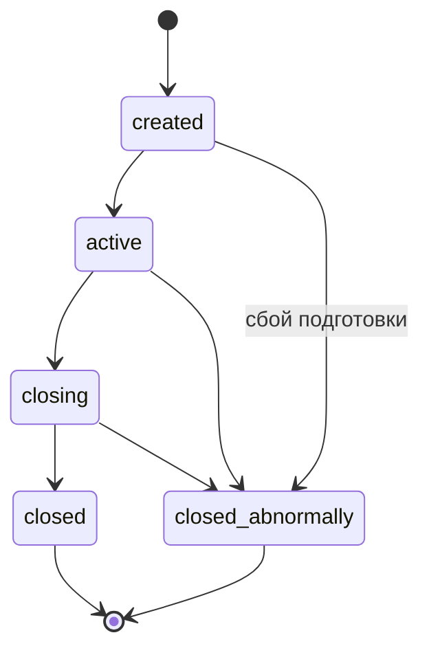
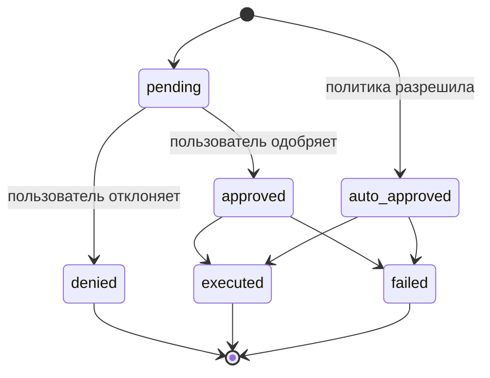
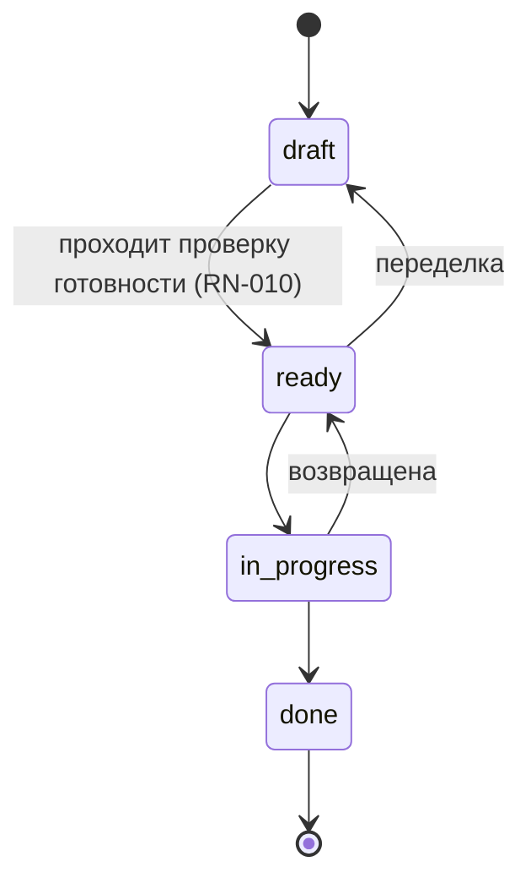
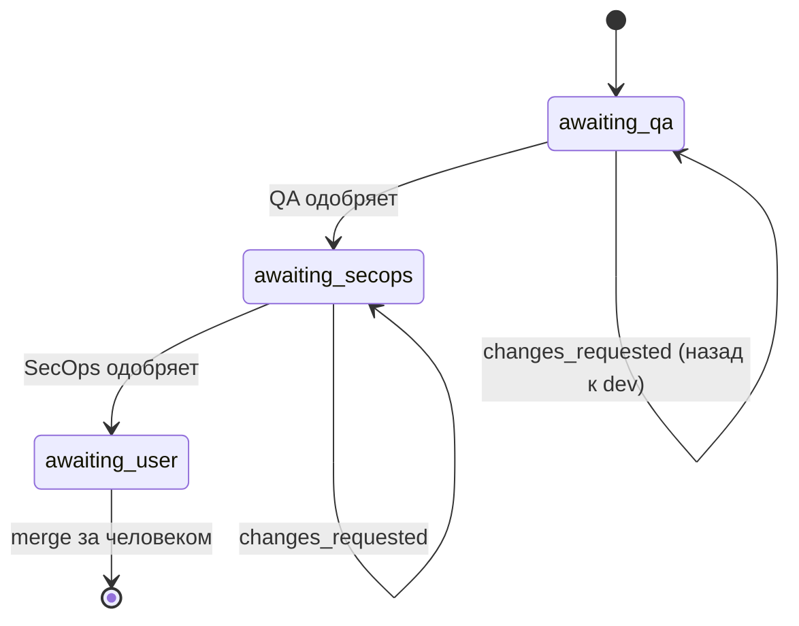

# Бизнес-правила

У каждого правила есть **формулировка**, **место в коде** (`file:line`) и
**тест, который его покрывает**. При изменении правила строка здесь
обновляется в том же изменении — этого требует
[`.docmap.yml`](https://github.com/daneiel/brabo/blob/dev/docs/.docmap.yml)
с уровнем `block`.

Все они находятся в `apps/api/src/domain/`, который **чист**: без IO, без
фреймворка, без базы данных. Поэтому у каждого есть быстрый
детерминированный модульный тест.

## Бизнес-контекст

Brabo выполняет инженерную работу с помощью ИИ-агентов. Две силы формируют
практически каждое правило здесь:

**Агент ненадёжен по своей природе.** Это языковая модель: она может
галлюцинировать, зациклиться или запросить что-то разрушительное. Правила
существуют для того, чтобы возможный ущерб ограничивался структурой, а не
качеством промпта.

**Расходы реальны и непрерывны.** Каждый ход расходует платный токен. Бюджет,
потолок и учёт — не административное удобство, а то, что не даёт циклу
агента превратиться в убыток.

### Участники

| участник | кто это | полномочия |
|---|---|---|
| **Пользователь** | человек. Роли: `viewer`, `developer`, `maintainer`, `owner` | окончательное решение по любому действию с внешним эффектом; merge — исключительно за ним |
| **Агент** | долгоживущий процесс с ролью (Criativo, PO, Arquiteto, Dev, Infra, QA, SecOps, Psicólogo, Anamnese) | предлагает; никогда не решает в одиночку то, что не разрешает политика |
| **Система** | api и engine | применяет политику, записывает событие, измеряет стоимость |

Словарь — в [глоссарии](glossary.md).

---

## Сессия

### RN-001 — У сессии пять состояний и закрытые переходы {#rn-001}

`created → active → closing → closed`, при этом `closed_abnormally`
достижимо из любого нетерминального состояния. **Из `closing` никогда нет
пути назад в `active`**, а у терминальных состояний нет выхода.



- **Где:** `apps/api/src/domain/sessions/session-state-machine.ts:29`
- **Тест:** `test/domain/sessions/session-state-machine.spec.ts`
- **Граничный случай:** `closing` — **транзитное** состояние. Сессия,
  застрявшая в нём, означает, что дренаж начался и не завершился — для этого
  есть алерт, см. [runbook](runbook.md).

### RN-002 — Каждое событие сессии неизменяемо, а `seq` плотный {#rn-002}

`UPDATE` в `session_events` не бывает никогда. `seq` уникален в рамках сессии
(`unique(session_id, seq)`) и не имеет пропусков: начинается с 1 и идёт
подряд.

- **Где:** `apps/api/src/db/schema/sessions.ts` (таблица `session_events`)
- **Тест:** проверяется при восстановлении — `docker/backup/restore.sh`
  падает, если `count(*) ≠ max(seq) − min(seq) + 1` или `min(seq) ≠ 1`
- **Почему:** именно это делает доказательства Psicólogo прослеживаемыми, а
  резервную копию — проверяемой. Состояние, которое должно меняться, живёт в
  собственной таблице рядом.

### RN-097 — Тип сессии — это намерение при создании; выполнение остаётся событием {#rn-097}

Сессия рождается `consultiva` (консультативной) или `criativa` (творческой) —
выбирает **тот, кто её открывает**, и это записывается в `sessions.kind`.
`consultiva` — просто разговор; `criativa` — та, что производит: она
открывает генерацию идей с Criativo и является **единственной**, которая
переходит к выполнению. Тип **никогда не меняется**: маршрута, который бы его
менял, нет.

Риск этого правила не в поле, а во **втором источнике истины**. Продукт уже
умел говорить, выполняется ли сессия, и знал это другим путём:
`findActiveExecutionSession` ищет `active`-сессию, несущую событие
`execution.activated` (именно это заставляет повторную активацию попадать в
сессию, где уже находятся dev agents, — находка №11 первого dogfooding). Оба
сосуществуют по правилу, не дающему им конфликтовать:

- **`kind` классифицирует НАМЕРЕНИЕ при создании.** Сессия `criativa`, которая
  ни разу не активировала выполнение, **не является** текущей сессией
  выполнения, а вывод по событию по-прежнему не смотрит на `kind` — если бы
  смотрел, каждая открытая творческая сессия стала бы кандидатом на получение
  dev agents.
- **Событие классифицирует СОСТОЯНИЕ выполнения**, как всегда.
- **`execution.activated` в сессии `consultiva` — это ОШИБКА** (409), никогда
  не тихое преобразование. Именно этот пункт решает, какой из двух источников
  побеждает: позволить событию повысить тип означало бы как раз то, что они
  перезаписывают друг друга.

Защита живёт в **воронке** — `AppendSessionEventUseCase`, — а не в
`ActivateExecutionUseCase`, потому что оба пути записи события (маршрут
пользователя и `/internal/*` engine) проходят через неё. Дополнительное
чтение сессии оплачивается только тогда, когда событие — это событие
выполнения. Отказ происходит **до** `incrementSeq`: отклонённая попытка не
может расходовать `seq`, иначе [RN-002](#rn-002) нарушилось бы.

DEFAULT колонки — `consultiva`, тип, который может **меньше**: строка,
пришедшая путём в обход маршрута (миграция, сервисный SQL), не получает права
на выполнение. **Backfill** миграции делает обратное, и это намеренно, по
логике 0033: в момент его запуска каждая сессия предшествует различию, а в
некоторых работают dev agents — разбудить их как `consultiva` значило бы
сломать повторную активацию проекта в работе без того, чтобы кто-то что-то
решил.

- **Где:** `apps/api/src/domain/sessions/session-kind.ts:50`
  (`podeAtivarExecucao`), `apps/api/src/db/schema/sessions.ts:68` (колонка),
  `apps/api/src/application/use-cases/sessions/append-session-event.use-case.ts:53`
  (защита)
- **Тест:** `apps/api/test/application/use-cases/sessions/session-kind-e-nome.spec.ts`
- **Источник:** [ADR 0061](adr/0061-tipo-da-sessao-na-criacao.md)

### RN-098 — Имя сессии дополняет хэштег, но никогда его не заменяет {#rn-098}

Сессия может получить понятное имя (`sessions.name`, необязательно) при
создании или позже, через `PATCH /projects/:projectId/sessions/:sessionId`.
Метка на экране **составная**: `<имя> · #<первые 8 символов id>`. Без имени
она деградирует до **одного хэштега**.

Хэштег никогда не исчезает, и причина операционная: именно его вставляют в
URL, команду или разговор, а имя, выбранное человеком, **не уникально** — две
сессии с именем "Checkout" — это нормально. Пустое имя (или только пробелы)
считается **отсутствием** и при создании, и при переименовании: запись `''`
превратила бы метку в `" · #a1b2c3d4"`, что хуже одного хэштега. `null` в
теле `PATCH` — способ **отменить** имя.

Переименование **не** является событием сессии. Журнал событий — это то, что
сессия прожила, а имя — навигационная метка, меняемая сколько угодно раз;
N событий переименования вытеснили бы из хвоста в 200 событий именно то, что
важно.

- **Где:** `apps/web/src/lib/session-label.ts:61` (`rotuloDaSessao`),
  `apps/api/src/application/ports/session-repository.port.ts:52` (`rename`).
  Доступно как изнутри сессии
  (`apps/web/src/routes/SessionPage.tsx:439`, `handleRename`), так и из
  списка проекта, без необходимости сначала открывать сессию
  (`apps/web/src/routes/ProjectSessionsTab.tsx:101`, `handleRenomear`) — оба
  экрана вызывают один и тот же `renameSession` и один и тот же
  `rotuloDaSessao`.
- **Тест:** `apps/web/src/lib/session-label.test.ts`,
  `apps/api/test/application/use-cases/sessions/session-kind-e-nome.spec.ts`,
  `apps/web/src/routes/ProjectSessionsTab.test.tsx`
- **Источник:** [ADR 0061](adr/0061-tipo-da-sessao-na-criacao.md)

### RN-104 — Вкладка выводится из записанного типа и создаёт в этом типе {#rn-104}

У проекта **две** вкладки сессий — **Творческая** и **Чат**, — и каждая из
них — это `kind`: она перечисляет сессии, чей `sessions.kind` совпадает с её
собственным, а её CTA создаёт в этом `kind`, **не спрашивая повторно**.
Третьей вкладки, перечисляющей обе вместе, нет.

Тип уже был неизменяемым ([RN-097](#rn-097)), и именно это делает его
законной навигационной координатой, а не сохранённым фильтром: сессия никогда
не меняет вкладку. Вкладка читает **записанное** поле — она не выводит тип
ни из какого события, по той же причине, что и в RN-097:
`execution.activated` классифицирует СОСТОЯНИЕ выполнения, и вкладка,
смотрящая на него, перемещалась бы сама.

Два следствия, которые фиксирует правило и которые не являются деталью
экрана:

- **Выбор типа уходит из формы.** Раньше он жил в `fieldset` с
  радиокнопками, а теперь происходит в момент, когда человек нажимает на
  вкладку. Сохранение обоих давало бы возможность создать сессию,
  противоречащую месту, где вы находитесь. В форме остаётся **имя**, которое
  по-прежнему необязательно ([RN-098](#rn-098)).
- **Одно действие — одно место за раз.** "Начать генерацию идей" по-прежнему
  существует — это то, что приводит Criativo в сессию, и с этого момента
  начинает расходоваться ключ владельца
  ([RN-058](business-rules/custo.md#rn-058)); никто не вступает сам по себе.
  Изменилось место: **внутри приглашения**, пока приглашение на экране, и в
  верхней панели, когда его нет. Раньше приглашение УКАЗЫВАЛО на верхнюю
  панель ("используйте Начать генерацию идей вверху экрана"), что является
  буквальной версией проблемы, породившей [RN-097](#rn-097), — действие в
  одном месте, а объяснение в другом. Верхняя панель не может просто потерять
  кнопку: в творческую сессию можно писать, ни разу не вызвав Criativo, и
  тогда приглашение уходит со сцены.

Три экрана соблюдают три состояния [RN-088](#rn-088), с **ошибкой раньше
пустоты**: отфильтрованный список пуст в обоих случаях, и сказать "генерации
идей ещё нет" после 429 означало бы солгать о случившемся.

Ключ глубокой ссылки Чата остаётся `sessions`, а не `chat`. Именно это
позволяет старой сохранённой ссылке `?tab=sessions` открыть Чат **с
отмеченной вкладкой в панели вкладок** — разрешение старого ключа как
псевдонима только в панели оставило бы панель вкладок вообще без выбора,
потому что `Tabs` сравнивает `active` с `key`, а тот, кто пишет `active`,
получает сырой ключ от `validateSearch`.

- **Где:** `apps/web/src/routes/project-tabs.ts:95` (обе записи),
  `apps/web/src/routes/ProjectSessionsTab.tsx:114` (фильтр по записанному
  `kind`) и `:98` (CTA, создающий в `kind` вкладки),
  `apps/web/src/routes/SessionPage.tsx:716` (`conviteVisivel`, единственный
  вопрос, общий для верхней панели и приглашения)
- **Тест:** `apps/web/src/routes/ProjectSessionsTab.test.tsx`,
  `apps/web/src/routes/project-tabs.test.tsx`,
  `apps/web/src/routes/SessionPage.sessao.test.tsx`
- **Граничный случай:** проект без сессии этого типа показывает пустое
  состояние ЭТОГО ТИПА, даже если у него есть сессии другого типа — это
  информация, а не ошибка.
- **Источник:** [ADR 0061](adr/0061-tipo-da-sessao-na-criacao.md)

### RN-123 — Творческая сессия без активного Criativo: первое сообщение ТАКЖЕ его активирует {#rn-123}

В сессии `kind: 'criativa'` ([RN-097](#rn-097)) ещё без `agent.activated`
отправка первого сообщения через composer сначала активирует Criativo
(дожидаясь завершения активации) и только затем доставляет ему это сообщение
реальным путём (`sendAgentMessage` — история, системный промпт, инструмент
`emit_artifact`). До этого правила тот, кто печатал, не нажав "Начать
генерацию идей", попадал в общий SSE-чат без истории и без бизнес-правил: это
был НЕ настоящий Criativo, и разговор ничего не записывал в домен.

Нажатие "Начать генерацию идей" по-прежнему существует ([RN-104](#rn-104)) —
оно по-прежнему запускает активацию, когда человек предпочитает явный жест, и
именно с него начинает расходоваться ключ владельца
([RN-058](business-rules/custo.md#rn-058)) на любом из двух путей.
Изменилось то, что ПЕРВОЕ СООБЩЕНИЕ теперь тоже считается таким жестом: никому
не должен понадобиться отдельный клик, прежде чем заговорить с тем, с кем
экран уже пригласил говорить.

- **Где:** `apps/web/src/routes/SessionPage.tsx:678` (`handleSend`)
- **Тест:** `apps/web/src/routes/SessionPage.ideacao-automatica.test.tsx`
- **Граничный случай:** в сессии `consultiva` нет Criativo — правило не
  применяется, и общий SSE-путь остаётся для неё правильным.

### RN-119 — АКТИВНЫЙ агент сессии — тот, у кого самый свежий `agent.activated`, никогда не фиксированная цепочка {#rn-119}

`SessionPage` решает две вещи по ОДНОМУ и тому же агенту: кому уходит
сообщение composer и по какому агенту верхняя панель разрешает отображаемую
модель (полный каскад session→agent→area→project→workspace, тот же, которым
`RunLlmTurnUseCase` реально выполняет ход). До этого правила у двух вопросов
были РАЗНЫЕ ответы: маршрутизация использовала фиксированную цепочку
приоритета (architect > po > creative, на основе исторического СУЩЕСТВОВАНИЯ —
"уже был активирован однажды", что никогда не "выключалось"), а отображаемая
модель даже не знала, кто активен — маршрут model-binding вообще не получал
агента и всегда откатывался к фиксированному запасному варианту Criativo
(`herdarModeloDeStart`), даже после handoff к PO, Arquiteto или Dev Lead.

Единое определение: АКТИВНЫЙ агент — тот, у кого самый СВЕЖИЙ
`agent.activated` (по `seq`) среди разговорных агентов потока чата (Criativo,
PO, Arquiteto, Dev Lead). **Infra Lead исключён**:
`agent_command_controller.ex` (engine) имеет маршрут `message` только для
po/dev-lead/arquiteto (плюс Criativo, как неявный запасной вариант последней
клаузы) — у Infra никогда не было подключённого `message`, только `start`.
Отправка сообщения "infra" сегодня молча провалилась бы к Criativo; считать
его активным агентом composer означало бы заново открыть эту ловушку вместо
того, чтобы закрыть одну.

> **Частично заменено [RN-631](#rn-631) (AT-251):** "побеждает самый свежий
> `agent.activated`" само по себе было неявным получателем по умолчанию, к
> тому же невидимым. Получатель composer теперь ВЫБИРАЕТСЯ человеком
> (селектор "Кому", перечисляющий агентов, уже находящихся в сессии), а модель
> в верхней панели следует за этим получателем. От этого правила сохраняется
> половина про модель: маршрут binding получает агента и никогда не
> откатывается молча.

- **Где:** `apps/web/src/lib/session-destinatario.ts:272`
  (`useDestinatarioDoChat`, начиная с RN-631),
  `apps/web/src/lib/api-client.ts:1124` (`getSessionModelBinding`,
  `agentId`), `apps/api/src/interfaces/http/llm/model-bindings.controller.ts:166`
  (`getSessionBinding`, `@Query('agentId')`)
- **Тест:** `apps/web/src/routes/SessionPage.destinatario-do-chat.test.tsx`
  (ранее `SessionPage.agente-mais-recente.test.tsx`),
  `apps/web/src/routes/SessionPage.modelo-do-agente-ativo.test.tsx`,
  `apps/api/test/application/use-cases/llm/resolve-model-binding.use-case.spec.ts`
- **Граничный случай:** Infra Lead не участвует ни в маршрутизации composer,
  ни в определении "активного агента" — он проактивен (Фаза 4), а не
  разговорный через composer.

### RN-120 — Опрос событий сессии приостанавливается во время хода {#rn-120}

`useSessionEvents` запрашивал события каждые несколько секунд, НИЧЕГО не
зная о ходе в процессе. Если опрос попадал НА ход (обычное дело — ходы обычно
длятся дольше интервала), он приносил уже сохранённые
`chat.message`/`agent.response`, которые отрисовывались ВМЕСТЕ с ещё
находящимся на экране оптимистичным/потоковым состоянием: одно и то же
сообщение дважды.

Исправление приостанавливает только ТАЙМЕР (`refetchInterval`), пока
`streaming` равен `true`, — запрос остаётся `enabled`, поэтому явная
инвалидация, которая уже срабатывает в конце хода
(`finalizarTurnoDoAgente`), продолжает получать свежие данные в нужный
момент. `pausarPoll` — НЕОБЯЗАТЕЛЬНЫЙ параметр, по умолчанию `false`:
у других потребителей хука (Overview, Code, Provisioning, AdoptionPlan) нет
разговорного хода в процессе, и они остаются как были.

- **Где:** `apps/web/src/lib/hooks.ts:221` (`useSessionEvents`),
  `apps/web/src/routes/SessionPage.tsx:277` (`eventsQuery`)
- **Тест:** `apps/web/src/lib/hooks.pausar-poll.test.tsx`
- **Граничный случай:** приостановка таймера — это не отключение запроса:
  явная инвалидация продолжает работать, и исправление зависит от неё, чтобы
  никогда не пропускать данные.

### RN-122 — Кнопка "Стоп" отменяет ход ПО-НАСТОЯЩЕМУ, убивая задачу, держащую вызов LLM {#rn-122}

До сих пор отмены не было нигде. Корень был структурным:
`agent_command_controller.ex` обрабатывал сообщение пользователя через
`GenServer.call(pid, {:user_message, texto}, ...)` — СИНХРОННО, — и весь ход
(цикл инструментов + SSE-вызов LLM) выполнялся ВНУТРИ `handle_call`. Процесс
агента оставался заблокированным до конца хода и тем временем НЕ
обрабатывал никаких других сообщений — даже будущую команду отмены.

Исправление: `handle_call`/`handle_cast` хода четырёх разговорных агентов
(Criativo, PO, Arquiteto, Dev Lead) порождает
`Task.Supervisor.async_nolink/2` (`Engine.Agents.TurnoAssincrono`, новый,
общий для всех четырёх) с тяжёлой работой и возвращает `{:noreply, state}` —
ответ на исходный `GenServer.call` ОТКЛАДЫВАЕТСЯ до завершения задачи
(`GenServer.reply/2`, срабатывающий, когда `{ref, resultado}` приходит в
`handle_info`). Поскольку процесс агента ПЕРЕСТАЁТ быть заблокированным,
новый `handle_cast(:cancel, state)` приходит и обрабатывается, пока идёт ход:
`Task.shutdown/2` в режиме `:brutal_kill` убивает задачу, что обрывает
HTTP (SSE)-соединение, которое она держит с api, — именно это делает отмену
реальной экономией токенов, а не просто прекращением отрисовки на клиенте.
Исходный `from` получает `{:error, :cancelado}`, и записывается ТЕРМИНАЛЬНЫЙ
`agent.error` с источником `"politica"` (политика — тот же источник, что у
бюджета/учётных данных/binding: отмена — это решение пользователя прекратить
тратить токены, а не пятое значение в закрытом словаре ADR 0020) — без него
`GetSessionPendingWorkUseCase` видел бы `agent.activated` без последующего
`agent.response`/`agent.error`, и сессия зависла бы на сигнале незавершённой
работы.

Два конкурирующих сообщения одному агенту (пользователь отправляет снова,
пока ход уже идёт) никогда не порождают вторую задачу:
`TurnoAssincrono.iniciar/3` сразу отвечает `{:error, :turno_em_andamento}`
(ход в процессе).

> **Пересмотрено [RN-578](#rn-578) (ADR 0163):** ответ на исходный
> `GenServer.call` больше не откладывается до завершения задачи — он уходит
> при ПРИНЯТИИ, как только задача запущена, а отмена никому не отвечает
> (вызывающий уже получил `:ok`). `{:error, :turno_em_andamento}` перестал
> отбрасываться контроллером: это именованный 409 и долговечный
> `agent.error`.

- **Где:** `apps/engine/lib/engine/agents/turno_assincrono.ex` (механизм),
  `apps/engine/lib/engine/agents/{criativo,po,arquiteto,dev_lead}_server.ex`
  (четыре `handle_call`/`handle_cast` хода), `apps/engine/lib/engine_web/controllers/agent_command_controller.ex:361`
  (`cancel/2`), `apps/engine/lib/engine_web/router.ex` (`POST
  /internal/sessions/:sessionId/agent/cancel`),
  `apps/api/src/application/use-cases/agents/cancel-agent-turn.use-case.ts`,
  `apps/api/src/interfaces/http/agents/agents.controller.ts` (`POST
  /projects/:projectId/sessions/:sessionId/agents/:agent/cancel`),
  `apps/web/src/routes/SessionPage.tsx` (`handleCancel`, кнопка "Стоп" в
  composer)
- **Тест:** `apps/engine/test/engine/agents/turno_assincrono_test.exs`
  (задача умирает ПО-НАСТОЯЩЕМУ — `Process.alive?/1` до и после, — а не
  просто "перестали учитывать результат"),
  `apps/api/test/application/use-cases/agents/cancel-agent-turn.use-case.spec.ts`
- **Граничный случай:** отмена без хода в процессе — идемпотентный NO-OP:
  нет ни задачи, которую убивать, ни ожидающего `from`, которому отвечать.
  Отмена НЕ откатывает побочный эффект, уже выполненный ДО смерти задачи
  (например, инструмент, который уже был запущен и записал своё событие), —
  она прерывает только то, что ещё не произошло.
- **Источник:** расследование этой сессии; отдельного ADR нет (изменение
  паттерна конкурентности ВНУТРИ harness, а не границы слоя/базы данных).

### RN-142 — Подтверждение готовности ВООБЩЕ без бизнес-правил отклоняется engine, а не просто скрывается в UI {#rn-142}

Раньше нажатие "Я готов производить" — или прямой вызов маршрута — ВСЕГДА
создавало `product_brief` и предлагало handoff к PO, даже в разговоре, где не
было зафиксировано ни одного бизнес-правила. `business_rule_refs(state)` уже
существовал в `criativo_server.ex`, но только чтобы ЗАПОЛНИТЬ поле `"rules"`
брифа — никогда как блокирующее условие. В UI `SessionPage.tsx` отключал
кнопку только во время `streaming`, не проверяя количество правил.

Реальная гарантия должна была жить на сервере, а не на экране: тот, кто
вызывает маршрут напрямую (или будущий клиент, не являющийся этим
фронтендом), не может пробить ограждение только потому, что кнопка нарисована
отключённой. `CriativoServer.handle_call(:confirm_readiness, ...)` теперь
проверяет `business_rule_refs(state)` ДО порождения `Task`
`Engine.Agents.TurnoAssincrono` ([RN-122](#rn-122)) — если пусто, он
отказывает прямо там, без хода консолидации, без `product_brief`, без
handoff.

Отказ не превращается в HTTP 4xx:
`agent_command_controller.ex#readiness/2` ИГНОРИРУЕТ возврат этого
`GenServer.call` и всегда отвечает 202 — тот же паттерн, который `message/2`
использует начиная с RN-122 ("этот ответ — только подтверждение получения",
реальный исход живёт в журнале событий). Поэтому отказ излагается как
ДОЛГОВЕЧНЫЙ `agent.error` (RN-059) с источником `"politica"` (политика — это
продуктовое решение, а не сбой infra/модели/хода) — и сообщением,
объясняющим причину; ветка сессии уже умеет отрисовывать этот тип события
(`lerFalhaDeTurno`, тот же красный пузырь, что и для любого другого сбоя
хода).

Дополняющий UX в `SessionPage.tsx`: кнопка рождается `disabled` (с `title`,
объясняющим причину), пока в `events` нет `artifact.business_rule` — ТОГО ЖЕ
источника, который уже питает панель "Бизнес-правила" (`ContextAside`), без
второго чтения, которое могло бы разойтись с первым.

- **Где:** `apps/engine/lib/engine/agents/criativo_server.ex`
  (`handle_call(:confirm_readiness, ...)`, `emit_falha_sem_regra/1`),
  `apps/web/src/routes/SessionPage.tsx` (`hasBusinessRule`, кнопка "Я готов
  производить")
- **Тест:**
  `apps/engine/test/engine/agents/criativo_server_test.exs` ("readiness:
  refuses when NO business rule was captured" — ни хода, ни брифа, ни
  handoff; отказ изложен с источником `"politica"`),
  `apps/web/src/routes/SessionPage.readiness-exige-regra.test.tsx` (кнопка
  отключена без правила, включена при 1+)
- **Граничный случай:** у сессии уже был `readiness.confirmed`, записанный api
  ДО сигнала engine (`ConfirmReadinessUseCase`), — это не меняется: это
  запись КЛИКА пользователя, факт, произошедший независимо от того, примет
  engine или откажет потом.
- **Источник:** исследование кода, подтверждающее сообщение пользователя —
  без ADR (новое ограждение на уже существующем потоке, без изменения границы
  слоя/базы данных).

---

## Одобрение действий

Сердце системы. Каждое действие с внешним эффектом рождается как
`proposed_action`.

### RN-003 — У действия шесть состояний, и denied терминально {#rn-003}



- **Где:** `apps/api/src/domain/actions/action-state-machine.ts:36`
- **Тест:** `test/domain/actions/action-state-machine.spec.ts`
- **Граничный случай:** одобренное и выполненное действие становится
  `executed`, а **не** остаётся `approved`. Подсчёт одобрений по
  `status = 'approved'` даёт неверное число — правильный критерий
  `decided_by IS NOT NULL`.

### RN-004 — Решение оценивается в три этапа, и `deny` побеждает немедленно {#rn-004}

Порядок: **(a) IAM → (b) `agent_autonomy` → (c) `permissions.json`**. Каждый
этап может только **повысить** разрешительность; молчащий этап никогда не
понижает предыдущий. `deny` на любом этапе возвращается немедленно.

- **Где:** `apps/api/src/domain/actions/decide.ts:118`
- **Тест:** `test/domain/actions/decide.spec.ts` (10 КБ — самый большой в
  домене)

### RN-005 — Минимальная роль на тип действия {#rn-005}

До любой политики — IAM: каждый `ActionType` требует минимальной
эффективной роли. Без неё — `deny` с явной причиной.

- **Где:** `apps/api/src/domain/actions/decide.ts:110` (`MIN_ROLE_FOR_ACTION_TYPE`)
- **Тест:** `test/domain/actions/decide.spec.ts`

### RN-006 — Потолок: merge в защищённую ветку никогда не одобряется автоматически {#rn-006}

`dev`, `qa`, `rc` и `main` защищены. `git_merge`, нацеленный на одну из них,
понижается с `auto_approve` до `require_approval` **после** выполнения всей
политики. Ни `agent_autonomy`, ни `permissions.json` не могут его повысить.

`rc` остаётся в списке даже после того, как этот шаг ушёл из политики
([ADR 0030](adr/0030-politica-de-branches-mecanizada.md)), а bootstrap
перестал её создавать ([RN-029](#rn-029)). Этот список решает, что блокировка
**отклоняет**, а у репозиториев, развёрнутых более ранними версиями, ветка
всё ещё есть: защита несуществующей ничего не стоит; снятие защиты с
существующей обходится дорого.

- **Где:** `apps/api/src/domain/actions/decide.ts:498` (`isProtectedBranch`, o teto da trava de merge) + `protected-branches.ts:4`
- **Тест:** `test/domain/actions/decide.spec.ts`
- **Источник:** [ADR 0011](adr/0011-infra-dev-agents-worktrees-merge-lock.md) §1
- **Примечание:** эквивалентная защита **на платформе** (GitHub/GitLab)
  различается между провайдерами и не является gate — см.
  [ADR 0028](adr/0028-protecao-de-branch-divergencia-entre-providers.md).

### RN-007 — Потолок: патч инструкции никогда не одобряется автоматически {#rn-007}

Изменение инструкции агента всегда требует решения человека. Ценность
функции в том, что человек видит diff; автоматическое одобрение означало бы,
что агент переписывает сам себя.

- **Где:** `apps/api/src/domain/actions/decide.ts:168`
- **Тест:** `test/domain/actions/decide.spec.ts`
- **Источник:** [ADR 0016](adr/0016-anamnese-proficiencia-patches-instrucao.md) §8

### RN-008 — Сопоставление команд — по шаблону, а не по подстроке {#rn-008}

`permissions.json` сопоставляет команду терминала по структурированному
шаблону, с корректно токенизированной командой, — а не через `includes()`.

- **Где:** `apps/api/src/domain/actions/command-matcher.ts`
- **Тест:** `test/domain/actions/command-matcher.spec.ts`

---

## Бэклог

### RN-009 — У истории четыре состояния, и `done` терминально {#rn-009}

`draft → ready → in_progress → done`. Переделка допускается: `ready → draft`
и `in_progress → ready`.



- **Где:** `apps/api/src/domain/backlog/story-state-machine.ts:27`
- **Тест:** `test/domain/backlog/story-state-machine.spec.ts`

### RN-010 — `draft → ready` требует четырёх вещей, проверяемых в домене {#rn-010}

Чтобы история стала `ready`, нужно **всё** из следующего:

1. непустой `dod` — Definition of Done
2. непустой `dor` — Definition of Ready
3. хотя бы 1 функциональное требование (`rf`)
4. хотя бы 1 связанное бизнес-правило (`businessRuleIds`)

Ошибка называет **ровно то, чего не хватает**, а не общее "невалидно".

- **Где:** `apps/api/src/domain/backlog/story-readiness.ts:39`
- **Тест:** `test/domain/backlog/story-readiness.spec.ts`
- **Источник:** [ADR 0009](adr/0009-agente-po-backlog-rastreabilidade.md) §3
- **Почему:** именно это не даёт PO сбросить расплывчатую историю в очередь
  разработки.

### RN-011 — Бизнес-правило без истории — это находка, а не ошибка {#rn-011}

Покрытие правило→история вычисляется, и то, что не имеет истории,
показывается как **ожидающее** — информация, а не сбой.

- **Где:** `apps/api/src/domain/backlog/coverage.ts`
- **Тест:** `test/domain/backlog/coverage.spec.ts`

### RN-012 — Модуль, удалённый из `module_map`, понижает историю {#rn-012}

История, привязанная к переставшему существовать модулю, возвращается в
`draft` с событием `backlog.story_demoted`.

- **Где:** `apps/api/src/domain/architecture/module-resolution.ts`; событие
  испускается в
  `application/use-cases/architecture/create-module-map.use-case.ts:73`
- **Тест:** `test/domain/architecture/module-resolution.spec.ts`

### RN-013 — В графе модулей не может быть цикла {#rn-013}

- **Где:** `apps/api/src/domain/architecture/module-graph.ts`
- **Тест:** `test/domain/architecture/module-graph.spec.ts`

---

## Gates PR

### RN-014 — Порядок gates неизменен, и `awaiting_user` терминально {#rn-014}

`awaiting_qa → awaiting_secops → awaiting_user`. Одобрение QA **никогда** не
перескакивает сразу к пользователю. `changes_requested` возвращает работу
разработчику **в той же ветке**, без нового PR.



- **Где:** `apps/api/src/domain/execution/pr-gate-state-machine.ts:24`
- **Тест:** `test/domain/execution/pr-gate-state-machine.spec.ts`
- **Источник:** [ADR 0013](adr/0013-gates-qa-secops-pr.md) §1
- **Граничный случай:** `awaiting_user` терминально **по замыслу** — система
  никогда не делает merge (RN-006).

### RN-015 — Цикл K: потолок исправлений конечен и наследуется {#rn-015}

Каждый возврат от gate расходует круг. Когда потолок исчерпан, задача
**блокируется** с причиной, вместо того чтобы крутиться вечно. Субагент,
созданный распараллеливанием, **наследует** потолок базового агента.

Начиная с Фазы 8b потолок применяется и к ОБЛАСТИ QA, без изменения кода:
`QaLeadServer` — единственный вызывающий `record_gate_verdict`, поэтому один
раунд gate — сколько бы специализаций он ни опросил внутри — по-прежнему
расходует ровно ОДИН круг. См. [RN-036](#rn-036).

- **Где:** `DEFAULT_MAX_GATE_CORRECTIONS = 3` в
  `apps/api/src/application/use-cases/execution/record-gate-verdict.use-case.ts:21`;
  применяется в `activate-execution.use-case.ts:89` и, в engine, в
  `qa_lead_server.ex:268` и `secops_agent_server.ex:142`
- **Тест:** `apps/engine/test/engine/gates/qa_automacao_agent_test.exs`
  (специализация возвращает `{:blocked, ...}`, не вызывая api) и
  `qa_lead_server_test.exs` (Lead в этом случае НИКОГДА не вызывает
  `record_gate_verdict` — именно это не даёт сжечь исправление)
- **Источник:** [ADR 0017](adr/0017-lock-de-workspace-e-monitor-de-dev-agents.md) §4

### RN-016 — Вердикт gate имеет приоритет над формулировкой задачи {#rn-016}

Если описание задачи говорит одно, а вердикт gate — другое, побеждает
вердикт.

Начиная с Фазы 8b "вердикт" может приходить от двух специализаций — правило
не меняется: каждая имеет приоритет над задачей В ПРЕДЕЛАХ того, что она
оценивает (Automation — над покрытием тестами; Performance/Security — над
NFR производительности и находками в коде). `QaLead.consolidar/1` не
выступает арбитром между ними и задачей: любой `changes_requested` от любой
из них уже проваливает всё целиком (см. [RN-036](#rn-036)).

- **Где:** промпт каждой специализации в
  `apps/engine/lib/engine/gates/qa_automacao_agent.ex` и
  `qa_performance_seguranca_agent.ex`
- **Источник:** [ADR 0020](adr/0020-destravar-gates-qa-secops.md) §9

### RN-036 — QA становится областью: Lead консолидирует, не меняя контракт gate {#rn-036}

Специализация Automation (`QAAgent` Фазы 4a) делегируется всегда;
Performance/Security — только когда у истории есть подходящее NFR
производительности (`Engine.Gates.QaLead.rnf_de_performance?/1` — эвристика
по ключевым словам, а не NLP). Решение НЕ делегировать всегда записывается —
делегирование `dispensed` с обоснованием, никогда не молчание.

Консолидация: `approved` только если ВСЕ выполненные делегирования одобрили;
любой `changes_requested` проваливает всё, с `itens` (пунктами) от
специализации(й), запросивших изменения, причём каждый пункт снабжён
префиксом с меткой того, кто его поднял (`"[QA de Automação] ..."`) — так
прослеживается источник БЕЗ изменения `itens` с `string[]` на другую форму.
Сбой делегирования (любого источника — `infra`, `modelo`, `codigo`,
`politica`) НИКОГДА не становится `changes_requested`: Lead блокирует задачу
с реальным источником (RN-015).

`qa_verdict`, доходящий до api, — ТОТ ЖЕ артефакт и проходит ТЕМ ЖЕ
маршрутом, что и всегда (`RecordGateVerdictUseCase`, `nextGateStatus`), —
ни одно из двух не изменилось. То, что api узнаёт об области, живёт только в
событиях `delegation.completed`/`delegation.failed`/`delegation.dispensed`,
которые специализация и Lead записывают раздельно.

- **Где:** `apps/engine/lib/engine/gates/qa_lead.ex` (`consolidar/1`,
  `rnf_de_performance?/1`), `qa_lead_server.ex` (связка);
  `apps/api/src/application/use-cases/execution/record-delegation.use-case.ts`;
  `apps/api/src/db/schema/agents.ts` (таблица `delegations`, enum `failure_origin`)
- **Тест:** `apps/engine/test/engine/gates/qa_lead_test.exs` (чистое дерево
  решений), `qa_lead_server_test.exs` (связка: решение → делегирование →
  запись → консолидация → ТОТ ЖЕ вызов, что и всегда), и — доказательство
  того, что контракт не изменился, —
  `record-gate-verdict.use-case.spec.ts`, `pr-gate-state-machine.spec.ts` и
  `record-infra-gate-verdict.use-case.spec.ts` проходят **вообще без
  изменений**
- **Источник:** [ADR 0038](adr/0038-hierarquia-de-agentes.md)

Со стороны `apps/web` (Фаза 8d): панель команды группирует `qa`/
`qa-automacao`/`qa-performance-seguranca` как lead + сворачиваемые
специализации, временная шкала PR раскрывает консолидированный вердикт в его
внутренности (`ProjectApprovalsTab.tsx`, `PrGateTimeline.tsx`), а лента
излагает `delegation.*` — см. `apps/web/src/lib/agents.ts`
(`AREAS`/`areaFor`).

---

### RN-054 — Внешний handoff адресуется lead области или агенту без области — никогда субагенту {#rn-054}

Тот, кто обращается к области **извне**, обращается к lead. Handoff,
адресованный субагенту (`qa-automacao`, `qa-performance-seguranca`,
`infra-workflows`), отклоняется типизированной ошибкой, которая **называет
lead**, к которому вызывающий должен был обратиться, — отказ без указания
правильного пути просто заменил бы нарушение иерархии застрявшим агентом.

Отказ происходит **до** INSERT. Отказ после оставил бы в таблице
handoff-призрак и `handoff.offered` — неизменяемое событие, —
утверждающее предложение, которое политика не разрешает.

Внутреннее делегирование (lead → субагент) здесь **не** проходит: оно
приватно для области, имеет собственную таблицу (`delegations`) и
собственный путь (`RecordDelegationUseCase`). Правило — о внешней границе
области, а не о том, что происходит внутри неё.

ADR 0038 требовал этой проверки, называя место — `CreateHandoffUseCase`
единственный в системе пишет `toAgent`, — а она так и не была реализована
(находка №12 первого dogfooding). `offer_handoff` engine передавал
`to_agent` как свободную строку, поэтому до сих пор ничто не мешало агенту
нарушить иерархию.

**У области, lead и участников ОДИН источник** начиная с ФАЗЫ 18:
`apps/api/src/domain/agents/agent-areas.ts`. Раньше список был написан
вручную в трёх местах (api, web, engine), а тест сравнивал только api с
web — engine молча расходился. Теперь
`apps/web/src/lib/agent-areas.generated.ts` и
`apps/engine/lib/engine/agents/areas.ex` производятся
`pnpm --filter api gerar:areas`, и тест проваливает то, что устарело на
диске. Начиная с AT-046 тот же генератор пишет и
`SOLO_CONVERSATIONAL_AGENTS` (RN-440) в файл web — и только туда, поскольку
у engine нет его читателя.
Список по-прежнему является КАТАЛОГОМ; `agent_areas` — это СОСТОЯНИЕ по
проекту (RN-094), и они отвечают на разные вопросы.

- **Где:** `apps/api/src/domain/agents/agent-areas.ts`
  (`assertHandoffTargetAllowed`, `HandoffToSubagentError`),
  `apps/api/src/application/use-cases/agents/create-handoff.use-case.ts`
- **Тест:** `test/domain/agents/agent-areas.spec.ts` (правило + проверка, что
  производные копии не расходятся с источником),
  `test/application/use-cases/agents/create-handoff.use-case.spec.ts`
  (отказ без строки и без события)
- **Источник:** [ADR 0038](adr/0038-hierarquia-de-agentes.md), закрыто по
  находке №12 [первого dogfooding](explanation/primeiro-dogfooding.md)

---

### RN-037 — Infra становится областью: Workflows генерирует CI по провайдеру, Lead консолидирует в единый PR {#rn-037}

Второй экземпляр модели ADR 0038, после области QA (RN-036), — с одним
структурным отличием: два делегирования области Infra выполняются ВСЕГДА
(Dockerfiles/compose — самим Lead, "делегирует самому себе"; CI-конвейер —
субагентом Workflows), ни одно никогда не отменяется. `Workflows` выбирает
формат конвейера по `gitProvider` контекста (`GetInfraContextUseCase`,
читается из `project_repositories.provider` — **не** из `capabilities`
`GitProvider`, которые ОДИНАКОВЫ для GitHub и GitLab): `"gitlab"` генерирует
`.gitlab-ci.yml`; любое другое значение (`"github"`, `"local"` или
неизвестное) генерирует `.github/workflows/ci.yml`. Каждый файл перед
завершением проходит через `validate_infra_file` — hadolint для Dockerfile,
`actionlint` для workflow GitHub Actions
([ADR 0039](adr/0039-actionlint-e-validacao-do-pipeline-de-ci-gerado.md);
у `.gitlab-ci.yml` нет локальной проверки — задокументированный пробел, а не
полурешение).

Консолидация: файлы двух делегатов объединяются по `path` (при коллизии
побеждает Workflows) в ЕДИНЫЙ PR — механизм предложения PR
(`propose_infra_pr`) меняется с "инструмент напрямую вызывает api" на
"инструмент сигнализирует Lead, который консолидирует и вызывает один раз", —
`open_infra_pr`, который получает api, ТОТ ЖЕ, что и всегда, байт в байт
(`ExecuteInfraPrUseCase` не тронут). Сбой любого делегата (источник
`infra`/`modelo`/`codigo`/`politica`) НИКОГДА не открывает частичный PR — то
же правило, что RN-036, снова уровнем выше.

Каждый делегат (даже Lead сам для себя) отслеживается как строка
`delegations` — переиспользуемая ровно так, как её оставила RN-036, с ОДНОЙ
поправкой: колонка `task_id` стала NULLABLE (область Infra делегирует на
СЕССИИ, за PR инфраструктуры нет задачи бэклога), а маршрут
`POST /internal/sessions/:sessionId/delegations` перестал быть вложенным в
`/tasks/:taskId` — `taskId` теперь идёт в теле, необязательно. У цикла K и
бюджета нет отдельной колонки в области Infra (у исходного InfraAgent
никогда не было бюджета на задачу, и эта работа его не ввела).

- **Где:** `apps/engine/lib/engine/infra/infra_lead.ex` (`consolidar/2`),
  `infra_lead_server.ex` (связка), `workflows_agent.ex`,
  `tools/validate_infra_file.ex` (диспетчеризация по расширению),
  `apps/api/src/application/use-cases/execution/get-infra-context.use-case.ts`
  (`gitProvider`), `record-delegation.use-case.ts` (`taskId` необязателен)
- **Тест:** `apps/engine/test/engine/infra/infra_lead_test.exs` (слияние и
  блокировка, чистые), `infra_lead_server_test.exs` (связка: единый PR с
  обоими наборами файлов, два делегирования, `gitProvider: "gitlab"` →
  `.gitlab-ci.yml`, сбой Workflows → без PR), `workflows_agent_test.exs` —
  и доказательство того, что контракт `ExecuteInfraPrUseCase`/`InfraGateRunner`
  не изменился: `execute-infra-pr.use-case.spec.ts` и
  `infra_gate_runner_test.exs` проходят **вообще без изменений**
- **Источник:** [ADR 0038](adr/0038-hierarquia-de-agentes.md), [ADR 0039](adr/0039-actionlint-e-validacao-do-pipeline-de-ci-gerado.md)

Со стороны `apps/web` (Фаза 8d): панель команды группирует `infra`/
`infra-workflows` так же, как QA (RN-036), а лента излагает делегирования
области — тот же реестр `AREAS`/`areaFor` из `apps/web/src/lib/agents.ts`,
без специфичного для Infra кода в UI.

---

### RN-140 — Цикл gate, умерший посередине, возобновляется сам, без ручного вмешательства {#rn-140}

`QaLeadServer`/`SecOpsAgentServer` имеют `restart: :temporary`, а
промежуточные переходы gate (`DevAgentServer.correct/3`,
`Dispatcher.run_secops/2`) — это прямые вызовы в памяти, сделанные ПОСЛЕ
того, как `record_gate_verdict` уже долговечно продвинул `gate_status` в
api. Падение между ними раньше навсегда запирало PR в
`awaiting_qa`/`awaiting_secops`: ничто не знало, что этот шаг остался
незавершённым, и никакой перезапуск engine этого не исправлял — сам
[ADR 0057](adr/0057-o-gate-espera-a-aprovacao.md) уже объявлял приостановку в
`{:awaiting, ...}` известным ограничением, а повторное расследование
показало, что окно между записанным вердиктом и вызовом диспетчеризации на
практике задеть легче.

`gate_states` (схема `engine`, ключ `{project_id, task_id, gate}`) записывает
цикл в полёте в ТЕХ ЖЕ точках, где переходы уже происходили, —
`"in_progress"` до запуска любого субагента/сканера, `"dispatch_pending"`
сразу после того, как `record_gate_verdict` возвращает
`correct`/`run_secops`, и до вызова внутри процесса.
`Engine.Gates.GateRescuer` просматривает строки, застрявшие более чем на
15 минут (настраивается, `GATE_RESCUE_STALE_AFTER_SECONDS`), — с запасом
намеренно, потому что ToolLoop субагента QA законно выполняет до
`TOOL_LOOP_MAX_ITERATIONS_GATE` (60) итераций, и короткий порог спасал бы (и
дублировал) цикл, который просто медленный, — и возобновляет:
`"in_progress"` перезапускает всю область (без хирургического возобновления
`ctx`, который не переживает перезапуск, — тот же выбор, что у dev agent);
`"dispatch_pending"` повторно отправляет ровно потерянный вызов. Вызывается
при загрузке и тиком Oban, самоперепланируемым каждые 5 минут
(`GATE_RESCUE_INTERVAL_SECONDS`),
`Engine.Workers.GateRescueSchedulerWorker` — та же идиома, что
`ModelSyncSchedulerWorker`/`AnamneseSchedulerWorker`.

Две защиты от дублирования работы: процесс, живой НА ТОМ ЖЕ узле
(`Registry.lookup`), никогда не трогается, а порог устаревания покрывает то,
до чего локальная защита не дотягивается (удалённая реплика — `Registry`
локален для узла, та же оговорка, что у `Engine.Dev.Wake` начиная с
[ADR 0045](adr/0045-reagendamento-por-evento-do-dev-agent.md)). Худший исход
остаточной гонки — дублированная дешёвая работа: api отклоняет второй
`record_gate_verdict` для gate, который больше не владеет `gate_status`
(`nextGateStatus`), а `DevAgentServer.correct/3` уже идемпотентен через
защиту по состоянию начиная с ADR 0052, — никогда не несогласованные данные.

- **Где:** `apps/engine/lib/engine/gates/gate_state.ex`,
  `gate_rescuer.ex`, точки записи в `qa_lead_server.ex`
  (`run_area/3`, `apply_gate_result/6`) и `secops_agent_server.ex`
  (`run_secops/3`, `apply_verdict/6`), а также
  `apps/engine/lib/engine/workers/gate_rescue_scheduler_worker.ex`
- **Тест:** `apps/engine/test/engine/gates/gate_rescuer_test.exs` — убивает
  реальный `QaLeadServer` с циклом в полёте
  (`DynamicSupervisor.terminate_child/2`, долговечная строка переживает
  процесс) и доказывает, что `GateRescuer.run/0` сам переподключает область
  вплоть до реального исхода; сценарий из формулировки (потерянный
  `run_secops`) и потерянный возврат `correct`, оба с РЕАЛЬНЫМ процессом и
  диспетчеризацией, без `FakeGateDispatcher`; и две защиты (живой локальный
  процесс не трогается; свежая строка не затрагивается)
- **Источник:** [ADR 0067](adr/0067-o-gate-sobrevive-ao-restart.md),
  расширяющий [ADR 0057](adr/0057-o-gate-espera-a-aprovacao.md)

---

## Стоимость

RN бюджета, учёта и потолка стоимости находятся в
**[Бизнес-правила — Стоимость](business-rules/custo.md)**.

Та же причина, что и у раздела Аутентификации ниже: размер, а не тема.
Якоря `#rn-NNN` не изменились.

## Панель проектов

### RN-039 — Точка статуса проекта: риск всегда побеждает неактивность {#rn-039}

Боковая панель дашборда показывает точку здоровья для каждого проекта,
выводимую из трёх независимых сигналов: бюджет (те же пороги 70%/90%, что в
RN-018), заблокированная задача (`tasks.blocked`) и недавняя активность
(7 дней). Цвета: зелёный — здоров и активен; янтарный — бюджет ≥70%;
красный — бюджет ≥90% **или** заблокированная задача; серый — нет активности
за последние 7 дней. Когда сигнал риска (янтарный/красный) и сигнал
неактивности (серый) применимы одновременно, побеждает риск — проект,
превысивший бюджет и стоящий без дела, — это всё равно то, на что надо
смотреть, а не то, что надо прятать за "нет активности".

- **Где:** `apps/web/src/lib/project-status.ts` (`deriveProjectStatus`)
- **Тест:** `apps/web/src/lib/project-status.test.ts`
- **Источник:** соответствие дашборда проектов утверждённому дизайну

### RN-088 — Сбой загрузки сообщается на экране; 429 не повторяется {#rn-088}

Каждый экран, загружающий данные из api, различает три состояния, и никогда
не два: **загрузка** (скелет), **ошибка** (сообщение, которое прислала api, с
`trace_id` и кнопкой повторить) и **пусто** (текст пустого списка).
`if (!dado) return null` схлопывает все три, и наблюдаемый исход был худшим
из возможных: когда api ограничивала по `429`, основная область
`/projects/:id` становилась **полностью пустой** — без сообщения, без ошибки,
без скелета, — а причина существовала только в консоли. На дашборде было
хуже, чем пусто: `!projects` было истинным и при ошибке, так что экран
приглашал создать **первый** проект в workspace, где их могло быть двадцать.

Это [RN-059](business-rules/custo.md#rn-059) с другой стороны провода: сбой
никогда не становится пустым ответом. Кто сбоит — тот говорит.

Фраза — **от api**, извлекаемая `mensagemDaApi`, той же функцией, которую
путь мутации уже использовал в тостах. Наш общий текст не знает разницы между
"превышен лимит запросов, попробуйте через мгновение" (подождите) и "доступ
запрещён" (ждать бесполезно).

Другая сторона того же правила — не отвечать на лимит ещё большим трафиком.
**4xx не повторяется**: `429` — это буквально сервер, требующий остановиться,
а `401` уже был обновлён один раз внутри `request()`. И **опрос
останавливается, когда запрос ошибается** — возобновляется при фокусе окна,
при повторном монтировании или по кнопке. Раньше было три повтора на сбой
плюс ~25 опросов по 3–5 секунд, которые не умели останавливаться: реальная
сессия накопила **1128 ошибок 429** при лимите в 300 запросов в минуту на
пользователя (`RateLimitGuard`), и цикл не давал скользящему окну
восстановиться. 5xx и сетевой сбой сохраняют три попытки — там повтор и есть
правильная реакция.

- **Где:** `apps/web/src/lib/query-policy.ts` (`deveRetentar`,
  `pollQueParaNoErro`), `apps/web/src/components/ErroDeCarregamento.tsx`,
  `apps/web/src/routes/ProjectPage.tsx`, `apps/web/src/routes/Dashboard.tsx`,
  `apps/web/src/routes/Shell.tsx`, `apps/web/src/main.tsx`
- **Тест:** `apps/web/src/lib/query-policy.test.ts`;
  `apps/web/src/routes/ProjectPage.test.tsx` (429 становится сообщением с
  фразой api; 403 показывает причину 403; загрузка — не ошибка);
  `apps/web/src/routes/Dashboard.test.tsx` (ошибка в списке не становится
  "проектов пока нет"); `apps/web/src/routes/Shell.test.tsx` (боковая панель
  сообщает, а не остаётся пустой)
- **Источник:** реальная навигация по `/projects/:id` с 1128 ошибками 429 в
  консоли

### RN-089 — Проект с повторяющимся именем различается в боковой панели {#rn-089}

Имя проекта **не уникально** — ничто в домене этому не мешает. Когда у двух
или более проектов списка одинаковое имя, каждый из них показывает в боковой
панели сокращённый id и дату создания (`#a1b2c3d4 · 07/08 14:32`), оба уже
присутствующие в полезной нагрузке проекта. У того, чьё имя уникально, ничего
не показывается: подпись в каждой строке была бы шумом в месте с наименьшим
пространством на экране.

Конкретный источник: прогон валидации создал двадцать проектов с именем
`validacao-real`, и двадцать строк боковой панели были визуально идентичны.

- **Где:** `apps/web/src/lib/project-label.ts` (`nomesRepetidos`,
  `desempateDoProjeto`), `apps/web/src/routes/Shell.tsx`
- **Тест:** `apps/web/src/routes/Shell.test.tsx` (повторяющееся имя получает
  различитель, уникальное — нет)
- **Источник:** реальная навигация с боковой панелью, полной проектов
  валидации

### RN-090 — Дашборд читает workspace, а не по одному проекту за раз {#rn-090}

Сетка карточек и точки боковой панели питаются **одним** запросом за цикл —
`GET /workspaces/:workspaceId/projects-summary`, — и число запросов **не
растёт с количеством проектов**.

Карточка показывает git-провайдер, статус подготовки, бюджет, чипы агентов и
последнюю активность; боковая панель — точку статуса и счётчик
непрочитанного. Всё это шло из семи ОПРАШИВАЕМЫХ запросов на проект, из-за
чего 23 проекта обходились в 3 824 запроса в минуту при лимите 300
(`RateLimitGuard`) — экран сам себя ронял в 429, не успев загрузиться.
[RN-088](#rn-088) заставила приложение перестать настаивать, когда это
происходит; эта уменьшает сам запрос.

Две границы, которые фиксирует правило и которые не являются деталью
реализации:

- **api отвечает фактами, а не ростером.** `roster` приносит то, что
  произошло в журнале событий (выполнение активировано, модули, gate уже
  открыт, делегированные субагенты, infra принята). Кто lead области, какой
  значок у каждого агента и как участники становятся чипом — по-прежнему
  дело web, — а правило ПРИСУТСТВИЯ одно (`rosterFromFacts`), общее с панелью
  команды, чтобы новый агент не появлялся в одном месте и не отсутствовал в
  другом.
- **Ящик колокольчика запрашивает только когда открыт.** До
  [RN-091](#rn-091) он был единственным чтением, остававшимся одним запросом
  на проект: отсечка "где я остановился читать" — это `seq`, хранимый в
  браузере (`read-state`), которого сервер не знает. Сегодня браузер
  **отправляет** эту отсечку, и ящик тоже стал одним запросом.

Принятый и желаемый побочный эффект: `gatesEverOpened` и `delegatedSubagents`
начинают покрывать ВСЮ сессию. Клиент выводил их из последних 200 событий и
терял чипы в длинной сессии (см.
[ADR 0021](adr/0021-fechamento-4a-infra-e-painel.md)), — текст
`deriveAgentRoster` всегда говорил "уже открывался хоть раз".

- **Где:**
  `apps/api/src/application/ports/projects-summary-repository.port.ts`,
  `apps/api/src/infrastructure/persistence/drizzle/projects-summary.repository.ts`,
  `apps/api/src/interfaces/http/iam/workspaces.controller.ts`
  (`getProjectsSummary`), `apps/web/src/lib/hooks.ts` (`useProjectsSummary`),
  `apps/web/src/lib/agent-status.ts` (`rosterFromFacts`),
  `apps/web/src/routes/Dashboard.tsx`, `apps/web/src/routes/Shell.tsx`
- **Тест:** `apps/web/src/routes/Dashboard.fanout.test.tsx` (30 проектов
  стоят столько же, сколько 3; ни один эндпоинт на проект не вызывается);
  `apps/api/test/infrastructure/persistence/drizzle/projects-summary.repository.spec.ts`
  (число запросов к базе не растёт с N);
  `apps/web/src/lib/agent-status.test.ts` (факты api дают те же чипы, что и
  журнал событий)
- **Источник:** дашборд из 23 проектов, измеренный в браузере, — 3 824
  запросов/мин до, 12 после

### RN-091 — Браузер сообщает, где остановился читать; колокольчик — один запрос {#rn-091}

При **открытом** ящике уведомлений его содержимое приходит из **одного**
запроса за цикл — `POST /workspaces/:workspaceId/unread-events`, — и число
запросов **не растёт с количеством проектов**.

Это недостающая половина [RN-090](#rn-090). Та уронила дашборд с 3 824 до
12 запросов/мин, но колокольчик продолжал запрашивать по одному проекту:
23 проекта с открытым ящиком давали **286 запросов/мин** при лимите 300
(`RateLimitGuard`). Проходило — и исчезло бы с ещё одним проектом.

**Препятствие и почему выход именно такой.** На сервере намеренно нет
"отметить как прочитанное": отсечка — это `seq` на проект, хранимый в
`localStorage` каждого браузера (`read-state`). Было два выхода, и разница
между ними — ПРОДУКТОВАЯ:

- перестать переопрашивать, пока ящик открыт, меняет актуальность того, что
  видит пользователь, — **отклонено**, никто такого обмена не просил;
- браузер **отправляет** карту `проект → afterSeq` и получает ровно те же
  данные с той же периодичностью. **Это чистое пакетирование: для того, кто
  смотрит на экран, ничего не меняется** — ни свежесть, ни содержимое.

**Это `POST`, ничего не изменяющий**, и api отвечает `200` (никогда `201`),
чтобы сказать об этом. Глагол выбран потому, что он единственный с ТЕЛОМ:
пар десятки, а в строке запроса это превращается в длинный URL — который
прокси обрезает, — и вдобавок помещает id проектов пользователя в журнал
доступа, вопреки правилу не передавать персональные данные через строку
запроса.

Три семантические гарантии, которые фиксирует маршрут, потому что
пакетирование чтений с разными отсечками — то место, где живёт лёгкая
ошибка:

- **пустая карта возвращает пустоту**, не трогая базу. "Я ничего не
  спрашивал" — это не "дай мне всё";
- **каждый проект соблюдает СВОЮ отсечку** — `seq` строго больше его
  собственной;
- **потолок в 50 событий — на проект**, тот же, что `GET .../events`
  применяет без `limit`. Лимит на весь ответ позволил бы шумному проекту
  съесть квоту тихих.

Курсор, указывающий на проект другого workspace, **игнорируется**, а не
отклоняется: он приходит из локального хранилища вызывающего и может быть
остатком старого workspace.

- **Где:**
  `apps/api/src/application/ports/projects-summary-repository.port.ts`
  (`unreadEventsForWorkspace`),
  `apps/api/src/infrastructure/persistence/drizzle/projects-summary.repository.ts`,
  `apps/api/src/interfaces/http/iam/workspaces.controller.ts`
  (`getUnreadEvents`), `apps/api/src/interfaces/http/iam/dto/unread-events.dto.ts`,
  `apps/web/src/lib/notifications.ts` (`useNotificationGroups`),
  `apps/web/src/lib/api-client.ts` (`getUnreadEvents`)
- **Тест:** `apps/web/src/routes/Dashboard.fanout.test.tsx` (с ОТКРЫТЫМ
  ящиком: один запрос, и 30 проектов стоят столько же, сколько 3);
  `apps/api/test/infrastructure/persistence/drizzle/projects-summary.repository.spec.ts`
  (число запросов к базе не растёт с N; пустая карта, отсечка по проекту,
  потолок по проекту и изоляция workspace)
- **Источник:** измеренный остаток [RN-090](#rn-090) — 286 запросов/мин с
  открытым ящиком в workspace из 23 проектов

### RN-099 — Активность листает прошлое, не переопрашивая то, что не меняется {#rn-099}

Колонка **Активность** в Обзоре показывает **окно** из 100 событий,
привязанное к **хвосту** сессии, и спускается в прошлое страница за
страницей. Каждая страница использует `afterSeq`/`nextCursor`, которые
`GET /projects/:p/sessions/:s/events` **уже** возвращает: ни нового
маршрута, ни нового параметра.

**Два вопроса — два запроса.** `useSessionEvents` отвечает "как обстоят дела
сейчас" — последние 200 в опросе — и питает панель команды, древовидную
временную шкалу, раздел выполнения и вкладку Одобрений. Ни одна из них не
листает. Активность отвечает "что произошло", и она была единственной,
задававшей этот вопрос с ответом другого: 200 пунктов разом, без начала и
конца, и всё равно без доступа к началу длинной сессии.

**Якорь — хвост, а не начало сессии.** Эндпоинт листает ВПЕРЁД, а `beforeSeq`
не существует — придумать его означало бы новый контракт. Но открыть ленту
на событии №1 сессии из тысяч — значит выдать не тот экран: тот, кто
открывает Активность, хочет то, что только что произошло. Поэтому первая
страница — то же чтение `latest`, которое экран уже делает, с **тем же
`queryKey`** (React Query обслуживает оба ОДНИМ запросом), а каждый клик
спускается на фиксированное окно с `afterSeq`.

**Чего не должна стоить пагинация.** Один запрос на цикл опроса — тот же,
что и раньше, и экономия [RN-090](#rn-090)/[RN-091](#rn-091) не регрессирует.
Это обеспечивают три детали:

- хвост — это запрос, который у экрана уже был, разделяемый по `queryKey`;
- первый клик **не** становится запросом: чтение `latest` приносит 200, а
  окно показывает 100, так что раскрыть уже оплаченное идёт раньше, чем
  запрашивать снова;
- старая страница — **закрытое** окно `seq` над **неизменяемыми** событиями
  (в таблице событий никогда не бывает UPDATE): `staleTime: Infinity` и
  **никакого** `refetchInterval`. Опрос там означал бы платить N запросов
  за N одинаковых ответов.

**Счётчик честен в том, что он знает.** Фильтры по агенту и по типу
работают над **загруженной страницей**, а не над сессией, — поэтому UI
говорит `N из M загруженных`, а не "N результатов". Перенос фильтра на
сервер дал бы истинный итог и затронул бы репозиторий событий; это не для
этой фазы, а назвать неверный итог было бы хуже, чем сказать меньше.

Три состояния [RN-088](#rn-088) действуют и здесь: **ошибка раньше пустоты** —
колонка говорила "нет активности", когда api отказала.

- **Где:** `apps/web/src/lib/hooks.ts` (`useSessionEventHistory`,
  `EVENTOS_POR_PAGINA`), `apps/web/src/components/ActivityFeed.tsx`,
  `apps/web/src/routes/ProjectOverviewTab.tsx`,
  `apps/api/src/infrastructure/persistence/drizzle/session-event.repository.ts`
  (`listPaginated`, уже существующий)
- **Тест:** `apps/web/src/lib/session-history.test.tsx` (открывается на
  хвосте; первый клик не стоит запроса; следующий листает со смежным
  `afterSeq`; цикл заканчивается в начале сессии; смонтированный вместе с
  текущим состоянием хвост — ОДИН запрос; старая страница не переопрашивается);
  `apps/web/src/components/ActivityFeed.test.tsx` ("N из M загруженных"
  следует за фильтром; без пропсов пагинации ничего не меняется)
- **Источник:** просьба пользователя при первой реальной навигации —
  "Atividades na aba Visão Geral deve ser paginada, para não ficar infinita"

### RN-100 — Порядок колокольчика задаёт SQL, а не фронтенд {#rn-100}

Ящик уведомлений показывает события **от самого нового к самому старому**, а
когда у проекта непрочитанных больше потолка в 50, показываются **самые
НОВЫЕ**.

**Сортировка делается в базе по необходимости, а не по вкусу.** Запрос
обрезает до 50 **на проект** оконной функцией
(`row_number() OVER (PARTITION BY session_id ORDER BY seq DESC)`), и именно
она решает, **какие** 50 событий выживают, — а не только в каком порядке они
выходят. При `ASC` выживали 50 самых **старых**, и `.sort()` на клиенте
упорядочил бы по свежести как раз то окно, которое запрос уже выбрал
неправильно: в проекте с 300 непрочитанными 251-е событие выглядело бы как
"самое свежее". Поэтому на пути фронтенда нет никакой сортировки, и
комментарий в компоненте говорит, что её быть не может.

**Следствие и почему отсечка чтения не изменилась.** Отсечка — это `seq` на
проект в `localStorage`, и **эндпоинта "отметить прочитанным" нет** по
решению, записанному в [RN-091](#rn-091). Отсечка по `seq` отмечает
**префикс**; ящик теперь показывает **суффикс**. Отметить прочитанными
"показанные 50" невыразимо без множества прочитанных **по событию** — новая
таблица, вне рамок. Две единственно выразимые отсечки по-прежнему — "ничего"
и "всё до сих пор".

Выходом было не менять семантику (она по-прежнему продвигается к последнему
`seq`, ровно как раньше), а **перестать скрывать то, что поглощает это
продвижение**:

- каждый проект показывает **итог** непрочитанных, а не размер окна, и
  объявляет, сколько осталось за его пределами (`+ N более старых`);
- кнопка начинает говорить, что она делает, — `отметить N как прочитанные`, —
  когда что-то есть за пределами окна;
- недостающее число получается **вычитанием**, а не запросом: `latestSeq`
  минус отсечка уже приходит в сводке workspace ([RN-090](#rn-090)).

Поскольку семантика отсечки не изменилась, **ADR** у этого правила **нет**:
изменилось то, какое окно выбирает запрос и что ящик о нём объявляет.

- **Где:**
  `apps/api/src/infrastructure/persistence/drizzle/projects-summary.repository.ts`
  (`unreadEventsForWorkspace`),
  `apps/api/src/application/ports/projects-summary-repository.port.ts`,
  `apps/api/src/interfaces/http/iam/dto/iam.response.dto.ts`
  (`ProjectUnreadEventsResponseDto`),
  `apps/web/src/lib/notifications.ts` (`useNotificationGroups`),
  `apps/web/src/components/NotificationBell.tsx`
- **Тест:**
  `apps/api/test/infrastructure/persistence/drizzle/projects-summary.repository.spec.ts`
  ("com mais não lidos que o teto, voltam os MAIS RECENTES, do novo para o
  velho" — утверждает МНОЖЕСТВО до порядка);
  `apps/web/src/components/NotificationBell.test.tsx` (отрисовывает в
  полученном порядке, без пересортировки; счётчик — итог; кнопка говорит,
  сколько отмечает);
  `apps/web/src/lib/notifications.test.tsx` (то, что осталось за окном,
  получается вычитанием, без второго запроса);
  `apps/web/src/routes/Dashboard.fanout.test.tsx` (ящик по-прежнему ОДИН
  запрос)
- **Источник:** просьба пользователя при первой реальной навигации — "Sino e
  notificações devem sempre ordenar para última data modificada em descendente
  para a mais antiga"

---

### RN-118 — Дерево команды раскрывает детали выполнения по вехам и открывает "5 последних" {#rn-118}

`AgentTimelineTree`/`timeline-tree.ts` (ФАЗА 14b) уже группировал журнал
событий по агентам, но с тремя пробелами: критерием открытия ветви было
только активен/остановлен (без связи с тем, сколько агентов существует),
счётчик в заголовке был ИТОГОМ вех (никогда "что нового"), а
`tool.call`/`tool.result`/`agent.response` становились вехой, показывающей
только имя инструмента, — `args`, `result` и `iteration`, которые журнал
событий уже записывает, до экрана не доходили.

**Открытие по умолчанию** теперь — "5 агентов с самой свежей активностью
(наибольший `seq` последней вехи)", причём активный сохраняет приоритет над
свежестью — без сложения: поскольку `montarArvore` уже ставит активных
первыми и внутри каждой группы упорядочивает от новых к старым, оба критерия
схлопываются в один срез (`ramosAbertosPorPadrao`, первые
`max(число активных, 5)` ветвей). Больше 5 активных — открываются все, без
обрезки.

**Счётчик новизны** по агенту использует ТОТ ЖЕ механизм, что и колокольчик
(`read-state.ts`, `localStorage`), с гранулярностью `projectId:agentId`
вместо одного `projectId` — "последнего просмотренного" на такой
гранулярности раньше не было. Свёрнутая ветвь с вехой, чей `seq` больше
последнего просмотренного у этого агента, показывает счётчик НОВИЗНЫ вместо
итога; открытие ветви (автоматическое или ручное) отмечает просмотренным до
самого свежего `seq`.

**Раскрываемая деталь** — по ВЕХЕ, а не по ветви: только `tool.call`,
`tool.result` и `agent.response` (`EVENTOS_EXPANSIVEIS`) становятся
отдельной кнопкой, потому что только они несут полезную нагрузку, которую
стоит раскрывать. Визуальная группировка по ИТЕРАЦИИ использует `iteration`
из полезной нагрузки `agent.response`, когда он есть (ToolLoop —
`tool.call`/`tool.result` наследуют итерацию ответа, который их
диспетчеризовал, потому что в ToolLoop они испускаются ПОСЛЕ него); агенты
вне ToolLoop (PO, Criativo, без `iteration` в полезной нагрузке) получают
СОБСТВЕННЫЙ счётчик на агента, увеличиваемый на каждый ответ, — вывод по
близости `seq`, а не новое поле в журнале событий.

- **Где:** `apps/web/src/lib/timeline-tree.ts` (`Marco.iteracao`,
  `Marco.eventType`, `Marco.payload`, `ramosAbertosPorPadrao`,
  `marcoExpansivel`), `apps/web/src/components/AgentTimelineTree.tsx`,
  `apps/web/src/lib/read-state.ts` (`getAgentLastSeenSeq`/
  `setAgentLastSeenSeq`)
- **Тест:** `apps/web/src/lib/timeline-tree.test.ts` (группировка по
  реальной и выведенной итерации, `ramosAbertosPorPadrao` с
  активным/свежестью/без обрезки), `apps/web/src/components/AgentTimelineTree.test.tsx`
  (открытие по умолчанию, счётчик новизны появляется/исчезает, веха
  раскрывается с args/результатом/итерацией)
- **Источник:** просьба пользователя — пробелы, подтверждённые исследованием
  существующего компонента ФАЗЫ 14b; без ADR, та же семантика "не
  просмотрено", что у колокольчика, только новая гранулярность

---

### RN-096 — Каждое решение говорит по-португальски, что произойдёт; сырая полезная нагрузка рождается свёрнутой {#rn-096}

У каждого типа `proposed_action` есть **фраза на португальском**, описывающая
эффект одобрения, и она — первое, что видно в карточке, до любых деталей, на
трёх экранах, где запрашивается решение (очередь Одобрений, карточка внутри
чата сессии и вкладка Insights). Сырая полезная нагрузка остаётся доступной
**внутри свёртки, которая рождается закрытой**, и никогда не вываливается на
экран.

**Существовал просто вывал.** Каждый тип без собственного визуального тела
попадал в `Object.entries(payload).map(([k, v]) => k + ': ' + JSON.stringify(v))`,
всегда раскрытый. Открывший очередь читал `worktree: /workspaces/dev-api`,
`coAuthor: Brabo User <user@brabo.dev>` и `proposto: 4` — и должен был
догадываться, что произойдёт, если нажать Одобрить. Одобрение, требующее
догадки, — это одобрение на автомате, а весь продукт опирается на то, что
пользователь — окончательная инстанция.

**Фраза деградирует, и именно это делает её надёжной.** Ни одна из них не
предполагает, что ключ полезной нагрузки существует: при пустой полезной
нагрузке фраза остаётся верной фразой, лишь менее конкретной ("Registra um
commit no repositório do projeto."). Полезная нагрузка приходит из engine и
десятка разных сценариев использования, и ни один не обещает формата —
фраза, работающая только с правильной фикстурой, ломается на первом реальном
одобрении.

**Тип, который web ещё не знает, — не теоретический случай.** Объединение
`ActionType` в web уже дважды отставало: сначала с тремя типами bootstrap
Gitflow, и снова с `parallelize`/`raise_max_parallel`, вошедшими в ФАЗЕ 14d.
Компилятор этого не ловит: канонический список находится в `apps/api`,
который web не импортирует. Поэтому две вещи одновременно — карточка
**деградирует** (нейтральный глагол + "посмотреть детали", со свёрнутой
полезной нагрузкой, вместо `undefined` в карте значков, ронявшего всё дерево
React), а **тест читает `decide.ts` бэкенда** и проваливается, когда тип
появляется без фразы.

**Значение по умолчанию открыто/закрыто выводится, а не настраивается.**
Правило одно — открыто то, что ещё ждёт решения смотрящего: в чате — действие
`pending`; в очереди — никогда (там N карточек, и N раскрытых деталей — та же
стена текста); в Insights — гипотеза `proposed`. А СЫРАЯ полезная нагрузка не
открывается ни в одном варианте. Проектное следствие: `ApprovalCard` **не
получил нового обязательного пропа** — значение по умолчанию выводится из
`variant` и `status`, которые уже существовали.

**Глагол и фраза берутся из одного модуля**, потребляемого тремя экранами.
Гипотеза Psicólogo буквально использует глагол `instruction_patch` вместо
параллельного словаря — и её фраза говорит, что accept делает на самом деле
(ставит в очередь для Anamnese, которая **может** предложить корректировку,
которая всё равно придёт на одобрение), а никогда не "инструкция будет
изменена".

**У `write_file` была фраза, но не тело.** Он родился вне
`COM_CORPO_PROPRIO`: фраза показывала только `path`, а деталь попадала в тот
же свёрнутый вывал сырого JSON, которого эта RN существует, чтобы избежать, —
так что запись, действительно требовавшая одобрения (вне префикса `dev-` или
путь вне области агента), требовала лишнего клика, чтобы увидеть `content`.
Он вошёл в `COM_CORPO_PROPRIO` с собственным телом: `path` и превью `content`
(до 25 строк/4 000 символов, с предупреждением об усечении — никогда не весь
файл, то же правило, что для сырой полезной нагрузки), открытое по умолчанию
в чате, пока ожидает, как у `terminal`.

**Пустая полезная нагрузка — не отсутствующая полезная нагрузка.** `command`
(terminal) или `path`/`content` (write_file), приходящие пустой строкой, —
искажённый tool-call модели, а не баг отрисовки, — деградировали до
приглашения `$ ` или пустого превью, которое пользователь читал как дефект
экрана. Оба тела теперь различают два случая и показывают "модель не
произвела корректный X для этого действия" вместо пустоты.

- **Где:** `apps/web/src/lib/aprovacoes.ts` (`VERBO_DA_ACAO`, `fraseDaAcao`,
  `descreverAcao`, `descreverHipotese`), потребляемый
  `apps/web/src/components/ApprovalCard.tsx` (Одобрения + чат сессии,
  `COM_CORPO_PROPRIO`, `previewConteudo` для `content` у `write_file`) и
  `apps/web/src/components/HypothesisCard.tsx` (Insights); свёртка через
  `Disclosure` из `apps/web/src/components/ui/Disclosure.tsx`
- **Тест:** `apps/web/src/lib/aprovacoes.test.ts` (читает `ACTION_TYPES` из
  `apps/api/src/domain/actions/decide.ts` и требует глагол + фразу для
  каждого типа при пустой полезной нагрузке);
  `apps/web/src/components/ApprovalCard.test.tsx`
  (`frase e colapso` — полезная нагрузка свёрнута в обоих вариантах,
  читаемый JSON при раскрытии, неизвестный тип не роняет экран, `write_file`
  с собственным телом, открытым по умолчанию, и усечением превью, пустые
  `command`/`path`/`content` показывают запасное сообщение);
  `apps/web/src/components/HypothesisCard.test.tsx` (`frase e colapso`)
- **Источник:** ФАЗА 19 программы 16–26, из просьбы "hoje está muito difícil
  a leitura" при первой реальной навигации после сброса базы

---

### RN-121 — Dev agent и QA — "исполнители": собственная вкладка, вне "Команды агентов" {#rn-121}

Сетка "Команда агентов" и "Временная шкала команды" в Обзоре смешивали
Criativo/PO/Arquiteto/Infra с dev-`<модуль>` и QA (lead +
`qa-automacao`/`qa-performance-seguranca`) — семь, восемь агентов в одной
сетке, без различия между теми, кто СОЗДАЁТ/РЕШАЕТ, и теми, кто
РЕАЛИЗУЕТ/ПРОВЕРЯЕТ. Вкладка **Исполнители** изолирует последних двоих, с
ТОЙ ЖЕ отрисовкой, что в Обзоре (`AgentCard`, сетка области — вынесенная в
`AgentTeamGrid.tsx` — и `AgentTimelineTree`), никогда не заново
придуманной карточкой.

**Правило разделения — одна функция**, `isExecutorGroup`/
`isExecutorAgentId` (`lib/agent-status.ts`): `dev-lead`/`dev-<любой
модуль>` и вся область `qa` (lead + подспециализации) — исполнители;
остальное — нет. ОБА экрана фильтруют ОДИН И ТОТ ЖЕ `groupRosterByArea` этой
функцией — Обзор с `!isExecutorGroup`, Исполнители с `isExecutorGroup`, —
поэтому агент не может появиться на обоих или пропасть с обоих: он всегда
ровно на одной стороне.

**Дерево не дублируется**: каждая вкладка фильтрует СОБЫТИЯ перед передачей в
`AgentTimelineTree` (по тому, принадлежит ли `actor.id` множеству
исполнителей), поэтому ветвь dev agent появляется только в Исполнителях и
никогда также в Обзоре. Колонка Активности (`ActivityFeed`, RN-099/100) НЕ
фильтруется — она отвечает "что произошло" во всей сессии, включая dev/QA, а
фильтр по агенту самого компонента уже перечисляет всех, кто говорил; место
меняют только сетка и дерево "кто что делает".

- **Где:** `apps/web/src/lib/agent-status.ts` (`isExecutorGroup`,
  `isExecutorAgentId`, `autonomyActionTypeFor` — перенесён из
  `ProjectOverviewTab.tsx`), `apps/web/src/components/AgentTeamGrid.tsx`
  (вынесен из уже существовавшей сетки), `apps/web/src/routes/
  ProjectExecutorsTab.tsx`, `apps/web/src/routes/ProjectOverviewTab.tsx`,
  `apps/web/src/routes/project-tabs.ts` (`key: 'executores'`, `ordem: 12` —
  сразу после Обзора, перед Criativo/Чат/Code)
- **Тест:** `apps/web/src/lib/agent-status.test.ts` (`isExecutorAgentId`/
  `isExecutorGroup` — dev-`<модуль>`, `dev-lead`, вся область `qa` —
  исполнители; criativo/po/arquiteto/infra/secops — нет);
  `apps/web/src/routes/ProjectExecutorsTab.test.tsx` (показывает только
  dev/QA, пустое состояние без них, счётчик в заголовке);
  `apps/web/src/routes/ProjectOverviewTab.test.tsx` (dev-backend/QA исчезают
  из сетки, остальная команда остаётся); `apps/web/src/routes/
  project-tabs.test.tsx` (новая вкладка входит в общий обход реестра —
  линейка, панель, глубокая ссылка, единый порядок)
- **Граничный случай:** SecOps НЕ исполнитель — он попадает в ростер через
  ТОТ ЖЕ `pr.gate_changed`, что приводит QA (Фаза 4a,
  `rosterFactsFromEvents`), но остаётся в Обзоре. `dev-lead` есть в списке
  исполнителей ради полноты (RN-087 описывает его как разговорного), хотя
  сегодня ни один путь не создаёт его в ростере сессии (делегирование Dev
  Lead → `dev-<модуль>` остаётся вне рамок, ADR 0053 пункт 5).
- **Источник:** просьба пользователя — собственная вкладка "Исполнители"
  для dev agent и QA, вне смешанной сетки Обзора.

---

### RN-125 — Принятие handoff — INLINE в ветке, с CTA для Dev Lead, указывающим на Исполнителей {#rn-125}

Разделитель "X передал эстафету Y", который уже был на временной шкале
(`handoff.offered`), становится **кликабельной карточкой** — со встроенной
кнопкой принятия — всякий раз, когда он представляет **текущее** ожидающее
предложение (то же, которое `offeredHandoff` уже разрешал для кнопки в
верхней панели). Кнопка в верхней панели **убрана**: когда принятие живёт
внутри ветки, ровно там, где произошла передача, сохранение обеих дало бы две
кнопки с ИДЕНТИЧНЫМ текстом, видимые одновременно, — та же проблема, которой
`ApprovalCard` уже избегает, никогда не дублируя действие вне ветки (RN-096).

**Какое событие становится карточкой, решается по ПАРЕ, а не по id.**
Полезная нагрузка `handoff.offered` несёт только `toAgent`; `fromAgent` — это
`actor` события (RN-054 уже использовала это чтение для текста разделителя).
Без id handoff в событии ответ на "это текущее предложение" находится через
самый СВЕЖИЙ (наибольший `seq`) `handoff.offered` с ТОЙ ЖЕ парой
`fromAgent`/`toAgent`, что у `offeredHandoff`, — это не даёт заново открыть
приглашение к принятию, которое более старое предложение для той же пары уже
разрешило (принято, отклонено или вытеснено новым предложением).

**Карточка для Dev Lead получает вторую ссылку**, "Следите за выполнением в
Исполнителях", на уже существующую вкладку (RN-121) — это начало
ВЫПОЛНЕНИЯ, и принимающему нужно знать, куда смотреть потом. Другие
предложения (PO, Arquiteto…) ссылки не получают: их сессия остаётся самим
местом наблюдения, "куда ещё смотреть" нет.

- **Где:** `apps/web/src/routes/SessionPage.tsx` (`timeline` — блок
  `handoff.offered`, `offeredHandoffEventSeq`; `isActive` поднят выше
  `useMemo`), `apps/web/src/routes/SessionPage.module.css` (`.handoffCard`,
  `.timelineLink`)
- **Тест:** `apps/web/src/routes/SessionPage.handoff-inline-e-links.test.tsx`
  (кликабельная карточка только у текущего предложения, старое предложение
  той же пары остаётся немым, уже принятый handoff не показывает никакой
  кнопки, ссылка на Исполнителей только у `dev-lead`);
  `apps/web/src/routes/SessionPage.pista-e-status.test.tsx` обновлён под
  встроенную кнопку (больше не в верхней панели)
- **Проверено реальным выполнением:** принятие handoff к PO в творческой
  сессии на изолированной сборке (собственный Docker-стек, реальные
  проект/сессия) — карточка становится немым разделителем, а журнал событий
  продвигается, как только клик возвращается от api; CTA для Dev Lead
  действительно переходит на `?tab=executores`.
- **Источник:** просьба пользователя — принятие handoff также inline в
  ветке, а не только в верхней панели.

### RN-124 — PO излагает созданные эпик/историю в ветке, с прямой ссылкой на Бэклог {#rn-124}

`backlog.epic_created`/`backlog.story_created` — которые PO уже записывал в
журнал событий (`CreateEpicUseCase`/`CreateStoryUseCase`) — никак не
обрабатывались на временной шкале сессии: создание истории не оставляло
НИКАКОГО следа в ветке, только во вкладке Бэклог, для тех, кто уже знал, что
туда надо смотреть. Оба типа получают запись на временной шкале, в ТОМ ЖЕ
визуальном теле, что и другие сообщения агента (`.message`/`.bubble`), —
никакого нового класса для самого чипа, только ссылка.

Ссылка ("Посмотреть в Бэклоге") переиспользует общую глубокую ссылку вкладки
(`?tab=backlog`, тот же механизм, что у CTA "Задать бюджет" на карточке
дашборда) — она не пытается подсветить только что созданную историю внутри
вкладки, это вне рамок.

- **Где:** `apps/web/src/routes/SessionPage.tsx` (`timeline` — блок
  `backlog.epic_created`/`backlog.story_created`)
- **Тест:** `apps/web/src/routes/SessionPage.handoff-inline-e-links.test.tsx`
  (`item 2`)
- **Проверено реальным выполнением:** эпик и история, вставленные в журнал
  событий реальной сессии, появляются как "Эпик создан"/"История создана" с
  заголовком, а ссылка действительно переходит на `?tab=backlog`.
- **Источник:** просьба пользователя — ссылка от PO на созданные истории,
  прямо в Бэклог.

### RN-126 — Продвижение истории решается INLINE в ветке, тем же механизмом, что и во вкладке Бэклог {#rn-126}

`backlog.story_promotion_proposed` (RN-048) получает ту же обработку, что
RN-125 дала handoff: событие становится **кликабельной карточкой** на
временной шкале сессии, с кнопками "Продвинуть" и "Вернуть", вызывающими ТЕ
ЖЕ `promoteStories`/`returnStory`, которые уже использует `PromotionQueue`
(`ProjectBacklogTab.tsx`), — ни нового эндпоинта, ни второго источника
истины. Решение по-прежнему принимается в ОДНОМ месте (бэкенд), лишь у
триггера появился второй путь.

**Разрешение — по последующему событию, а не по отдельно выведенному
статусу.** Карточка сама исчезает (становится немым разделителем, без
кнопок), как только событие с БОЛЬШИМ seq решит судьбу ТОЙ ЖЕ истории —
`backlog.story_transitioned{storyId}` (продвинута, испускается
`PromoteStoriesUseCase` через `TransitionStoryUseCase`) или
`backlog.story_promotion_returned{storyId}` (возвращена). Без этой проверки
продвижение или возврат оставляли бы в ветке те же две кнопки, снова
предлагая уже принятое решение.

`backlog.story_promotion_returned` получает симметричное изложение в ветке
(включая причину), переиспользуя ту же фразу, которую
`apps/web/src/lib/activity.ts` уже использовал только в свёрнутом журнале
боковой панели.

- **Где:** `apps/web/src/routes/SessionPage.tsx` (`timeline` — блоки
  `backlog.story_promotion_proposed`/`backlog.story_promotion_returned`,
  `handlePromoteStory`/`handleReturnStory`, модальное окно причины,
  переиспользующее `Modal`/`Textarea`)
- **Тест:** `apps/web/src/routes/SessionPage.promocao-inline-e-volta.test.tsx`
  (карточка с кнопками, продвижение вызывает `promoteStories` со `storyId`
  из полезной нагрузки, возврат требует причину и вызывает `returnStory`,
  история, разрешённая последующим `story_transitioned`, становится немым
  разделителем, `story_promotion_returned` излагается с причиной)
- **Источник:** просьба пользователя — продвижение истории inline в ветке,
  дешёвый вариант с переиспользованием RN-048 вместо gate на создание
  истории.

### RN-131 — Три гонки, подтверждённые ВЖИВУЮ в ветке сессии: приглашение поверх истории, нетерпеливый индикатор и ход, застрявший в `handleReadiness` {#rn-131}

Три дефекта, найденные при реальной навигации по `SessionPage.tsx` в Chrome,
а не тестом, — и все три были состоянием гонки или неполным критерием,
замаскированным под продуктовое решение.

**1. `conversaComecou` стал "существует ЛЮБОЕ событие", а не "существует
`chat.message`/`agent.response`".** Прежний критерий (находка G) родился,
чтобы не путать карточки git-bootstrap с разговором, но дал обратный
эффект: сессия, созданная `git-bootstrap` (уже одобренные действия
commit/branch, ноль `chat.message`), показывала приглашение поверх них, и то
же самое — гораздо серьёзнее — происходило в сессии, которую использует
активация выполнения, с десятками реальных событий (`tool.call`,
`tool.result`, события задач) и без `chat.message`/`agent.response`:
приглашение закрывало **всю** историю выполнения. Новая сессия — единственная
без единого события; это правильный вопрос.

**2. `conviteVisivel` ждёт, пока `useSessionEvents` закончит загрузку.** При
холодном кэше (перезагрузка страницы) `session` мог прийти, пока `events`
ещё был `[]` — значение по умолчанию `data?.items`, неотличимое от
"действительно пустой сессии" до разрешения первого запроса. Без условия
`!eventsQuery.isPending` приглашение мелькало поверх сессий с большой
историей.

**3. Индикатор "думает" (пузырь с тремя точками) включается только через
5 с без поступления текста.** Раньше он включался в момент, когда
`streaming`/`statusAgent` становились истинными, — визуальный шум в
большинстве ходов, которые отвечают меньше чем за секунду. `useEffect`
взводит `setTimeout(…, 5000)`, когда ход начинается ещё без текста, и
снимает его (через cleanup), как только приходит первая дельта или ход
заканчивается раньше срока. Настоящий текст (`streamingText`) по-прежнему
появляется **сразу**, никогда не ждёт таймера — терпение получил только
пустой индикатор.

**4. `handleReadiness` получил ту же страховочную сетку, что уже была у
`handleSend`.** `confirmReadiness`, как и `sendAgentMessage`, —
синхронный `GenServer.call` в engine (до 120 с), а канал Phoenix мог не
закончить подключение (ticket + join, RN-108), когда ход заканчивается,
навсегда теряя broadcast `agent.done`. `handleSend` уже вызывал
`finalizarTurnoDoAgente()`, как только синхронный вызов разрешался,
независимо от того, доставил ли канал событие; `handleReadiness` остался вне
этого исправления, и без него пузырь агента застревал пустым
(`streaming: true`, без текста) до перезагрузки страницы.

- **Где:** `apps/web/src/routes/SessionPage.tsx` (`conversaComecou`,
  `conviteVisivel`, `useEffect` для `pensandoVisivel` сразу под
  `agenteExibido`, и блок успеха `handleReadiness`)
- **Тест:**
  `apps/web/src/routes/SessionPage.convite-so-em-sessao-vazia.test.tsx`
  (пустая сессия показывает приглашение; сессия с событиями git-bootstrap
  или с десятками `tool.call`/`tool.result` скрывает его;
  `eventsQuery.isPending` удерживает приглашение до разрешения первого
  запроса),
  `apps/web/src/routes/SessionPage.pista-e-status.test.tsx` (находка B —
  индикатор не появляется до 5 с, появляется после, исчезает на первой
  дельте и никогда не появляется, если ход заканчивается раньше срока), и
  `apps/web/src/routes/SessionPage.readiness-turno-preso.test.tsx`
  (`confirmReadiness`, разрешающийся без `onAgentDone`, согласует состояние
  так же, как `SessionPage.turno-preso.test.tsx` уже доказывает для
  `handleSend`)
- **Источник:** расследование продукта ВЖИВУЮ в Chrome — все три
  воспроизведены вручную до исправления.

### RN-136 — Кликабельная карточка handoff в чате учитывает только тех, кто РАЗГОВАРИВАЕТ на этом экране {#rn-136}

> **Начиная с [ADR 0185](adr/0185-estou-pronto-fecha-os-dois-gates.md)
> ([RN-658](#rn-658))** handoff Criativo→PO, запрошенный "Я готов", рождается
> и принимается в одном и том же вызове от имени нажавшего — его карточка
> принятия появляется только тогда, когда такое принятие неуместно (сессия до
> ADR, бриф, пришедший не от клика) или не удалось. Фильтр ниже не меняется.

`OfferInfraHandoffUseCase` предлагает handoff к Infra и в ТОМ ЖЕ
подтверждении сразу после этого предлагает его Dev Lead (ФАЗА 14d) — два
отдельных вызова, сначала Infra. `handoffs` (то, что `SessionPage.tsx` читает
из `useHandoffs`) упорядочен по `createdAt` ASC
(`DrizzleHandoffRepository#findBySession`), а `offeredHandoff`, решающий,
какая карточка становится "кликабельной", разрешался чистым `.find()` —
всегда самым **старым** `offered`. Поскольку Infra Lead не разговорный (его
нет в `AGENTES_DE_CHAT`, и этот экран его никогда не принимает), карточка
Dev Lead стала бы кликабельной только после того, как кто-то примет карточку
Infra в месте, которое этот экран не показывает, — на практике никогда:
пользователь видел только "принять handoff Infra", а приглашение для Dev Lead
оставалось невидимым позади.

Фильтр ограничивает `offeredHandoff` handoff, адресованными агенту из
`AGENTES_DE_CHAT`. Handoff к Infra по-прежнему **излагается** в ветке — его
`handoff.offered` становится немым разделителем, как любое предложение, не
являющееся "текущим", — только карточка с кнопкой начинает его
игнорировать: у Infra никогда не было (и не нужно) способа быть принятым
здесь.

- **Где:** `apps/web/src/routes/SessionPage.tsx` (`offeredHandoff`)
- **Тест:**
  `apps/web/src/routes/SessionPage.handoff-devlead-e-colapso.test.tsx`,
  describe "problema 1" — более старый Infra + более новый Dev Lead
  разрешается в карточку Dev Lead, никогда в карточку Infra; только Infra
  `offered` не показывает никакой карточки
- **Источник:** исследование кода + живой тест в Chrome — handoff к Dev Lead
  никогда не становился кликабельным после ФАЗЫ 14d

### RN-137 — У "Активировать выполнение" есть встроенный ярлык в карточке Dev Lead, без снижения требования к роли {#rn-137}

Карточка принятия handoff к Dev Lead получила кнопку "Активировать
выполнение" рядом со ссылкой "Следите за выполнением в Исполнителях" —
ярлык для того, кто уже знает, чего хочет, без прохождения через разговор.
Она вызывает ТОТ ЖЕ `activateExecution`, что использует Обзор, теперь с
`sessionId` (открытая сессия чата) в качестве `originSessionId` — без этого
сессия, которая привела Dev Lead, оставалась `active` навсегда, даже когда
выполнение (в ОТДЕЛЬНОЙ сессии) уже стартовало через этот ярлык
([RN-135](business-rules/custo.md#rn-135)).

**Маршрут по-прежнему требует `maintainer`** — НАМЕРЕННО не выровненный с
`developer`, которого уже достаточно для принятия handoff в той же карточке.
Тот, кто активирует, становится `session.createdBy` сессии выполнения, и
именно эту роль `ProposeActionUseCase` разрешает
(`ResolveEffectiveRoleUseCase.forProject`) как ЭФФЕКТИВНУЮ для каждого
`git_commit`/`git_push`/`pr_open`, который dev agents предложат с этого
момента, — та же причина, что уже обосновывала `maintainer` у кнопки Обзора
(`ExecutionController#activate`). Снижение требования здесь молча
перевернуло бы это разрешение: каждый PR, открытый выполнением, переходил бы
с `auto_approve` на `require_approval` всякий раз, когда нажавший —
`developer`, без того, чтобы кто-то это решил. Тот, кто не `maintainer`,
получает настоящую фразу api ("Papel insuficiente para esta ação", через
`mensagemDaApi`) вместо общей ошибки.

Без клиентского gate по `module_map`: когда эта карточка существует,
Arquiteto уже его определил — это артефакт, предшествующий предложению
handoff к Dev Lead, — поэтому повторять `disabled={!hasModuleMap}` из Обзора
значило бы блокировать кнопку зря. Редкий случай (несогласованная сессия)
попадает в тот же catch, что обрабатывает 403/другие ошибки.

- **Где:** `apps/web/src/routes/SessionPage.tsx`
  (`handleActivateExecution`), `apps/web/src/lib/api-client.ts`
  (`activateExecution` получил `originSessionId`)
- **Тест:**
  `apps/web/src/routes/SessionPage.handoff-devlead-e-colapso.test.tsx`,
  describe "problema 2" — клик вызывает `activateExecution` с `sessionId`;
  403 показывает настоящую фразу api; кнопка сосуществует с кнопкой принятия
  handoff и со ссылкой на Исполнителей
- **Источник:** исследование кода + живой тест в Chrome — просьба о ярлыке,
  с расхождением ролей, подтверждённым и сохранённым по решению (не
  исправленным автоматическим выравниванием)

### RN-138 — Сообщения агента сворачиваются после того, как он передаёт эстафету {#rn-138}

Временная шкала чата показывала всё всегда развёрнутым, без группировки по
автору — в длинной сессии, где Criativo, PO и Arquiteto сменяют друг друга,
история тех, кто уже ушёл со сцены, конкурировала за место с тем, кто
говорит сейчас. Каждая запись временной шкалы получила `agentId` (`actor.id`
того, кто её породил, когда это агент, — `agent.response`, `agent.error`,
эпик/история, созданные PO, карточка одобрения); записи пользователя и те,
что отмечают ПЕРЕХОД (handoff, продвижение истории), намеренно остаются без
`agentId`, потому что по своей природе являются точками разреза.

ПОСЛЕДОВАТЕЛЬНАЯ серия одного и того же `agentId` становится сворачиваемым
заголовком (`Disclosure` дизайн-системы, закрытый по умолчанию — имя агента
+ количество, открывается одним кликом), когда выполняются оба условия:

1. **агент уже передал эстафету** — существует его handoff (`fromAgent`) со
   `status: 'accepted'` (та же истина, которую записывает `handoff.accepted`
   журнала событий, без необходимости восстанавливать её соединением
   событий); и
2. **ни одно его действие не `pending`** — проверка идёт по `actor.id` во
   ВСЕХ `actions` сессии, а не только в текущей серии: открытая гонка
   одобрения не может прятаться за кликом НИ В ОДНОЙ точке ветки.

Серия из 1 записи никогда не сворачивается — "Такой-то · 1 сообщение" вместо
самого сообщения ничего не даёт. Любая запись без `agentId` или от другого
агента разрывает текущую серию ровно так же, как смена агента, — группируется
только действительно последовательное.

- **Где:** `apps/web/src/routes/SessionPage.tsx` (`TimelineEntry.agentId`,
  `timelineAgrupada`), `apps/web/src/routes/SessionPage.module.css`
  (`.agentGroup*`)
- **Тест:**
  `apps/web/src/routes/SessionPage.handoff-devlead-e-colapso.test.tsx`,
  describe "problema 3" — сворачивается при переданной эстафете и без
  ожидающего действия; не сворачивается без принятого handoff; не
  сворачивается при ожидающем действии того же агента; сообщение другого
  автора посередине разрывает группировку
- **Источник:** исследование кода + живой тест в Chrome — просьба о
  свёртывании, с `AgentTimelineTree`/`timeline-tree.ts` как образцом ФОРМЫ
  (группировка по агенту, имя + количество, открыто/закрыто), адаптированной
  к разнородной перемежающейся временной шкале чата

---

## Psicólogo и Anamnese

### RN-021 — Гипотеза без валидного доказательства не записывается {#rn-021}

`evidenceEventIds` должны указывать на события, **которые существуют и
принадлежат анализируемой сессии**. Проверка атомарна на пакет: один
невалидный id проваливает весь пакет.

- **Где:** `apps/api/src/domain/psychologist/hypothesis-evidence.ts`
- **Тест:** `test/domain/psychologist/hypothesis-evidence.spec.ts`
- **Источник:** [ADR 0015](adr/0015-psicologo-real-toolloop-hipoteses-evidencia.md) §3

### RN-022 — Жизненный цикл гипотезы — compare-and-swap {#rn-022}

`proposed → accepted | dismissed`. Два конкурирующих решения об одной
гипотезе: одно побеждает, другое получает конфликт — не 500 и не молчание.

- **Где:** `apps/api/src/domain/psychologist/hypothesis-lifecycle.ts`
- **Тест:** `test/domain/psychologist/hypothesis-lifecycle.spec.ts`
- **Источник:** [ADR 0022](adr/0022-fechamento-4b-psicologo.md) §7

### RN-023 — Причина завершения — детерминированная классификация {#rn-023}

Она берётся из записанного **мотива**, никогда не из суждения LLM и никогда
методом исключения. Каждый сбой записывает источник: `infra | modelo | código | política`.

- **Где:** `apps/engine/lib/engine/psychologist/termination_classifier.ex`
- **Источник:** [ADR 0022](adr/0022-fechamento-4b-psicologo.md) §5 и
  [ADR 0020](adr/0020-destravar-gates-qa-secops.md) §6

### RN-024 — Anamnese профилирует только компетенции из каталога — структурное ограждение {#rn-024}

Компетенций процесса **шесть**, список закрыт: `git`, `agile`, `arquitetura`,
`testes`, `seguranca`, `infra`. Плюс технические стеки, выводимые из
`module_map`. Всё остальное — "тревожность", "психическое здоровье" — **не
имеет пути записи**: это ошибка в домене, а не инструкция промпта.

- **Где:** `apps/api/src/domain/anamnese/competency-catalog.ts:16`
- **Тест:** `test/domain/anamnese/competency-catalog.spec.ts`
- **Источник:** [ADR 0016](adr/0016-anamnese-proficiencia-patches-instrucao.md) §1
- **Почему:** Anamnese профилирует **техническую компетенцию**, а не
  человека. Ограничение структурное, потому что инструкция промпта — не
  гарантия.

### RN-025 — Удаление профиля удаляет по-настоящему, а opt-out запрещает повторный вывод {#rn-025}

- **Где:** `apps/api/src/domain/anamnese/proficiency-profile.entity.ts` +
  таблица `anamnese_opt_outs`
- **Источник:** [ADR 0016](adr/0016-anamnese-proficiencia-patches-instrucao.md) §2

### RN-026 — Отклонённый патч инструкции не предлагается повторно {#rn-026}

Сравнение идёт по **нормализованному** содержимому, а не по буквальному
тексту: переотступ того же патча не превращает его в новое предложение.
Таблицы дедупликации нет — источником служит сама история `proposed_action` с
`actionType = instruction_patch` и `status = denied`.

- **Где:** `apps/api/src/domain/instructions/patch-dedup.ts:22`
- **Тест:** `test/domain/instructions/patch-dedup.spec.ts`

### RN-027 — Откат инструкции — операция **вперёд** {#rn-027}

Откат создаёт новую версию со старым содержимым; историю он не стирает.
Таблица версий — только для добавления.

- **Где:** `apps/api/src/domain/instructions/`
- **Источник:** [ADR 0016](adr/0016-anamnese-proficiencia-patches-instrucao.md) §4

---

## Git

### RN-028 — Решает capability, а не имя провайдера {#rn-028}

Неподдерживаемая операция (защита ветки в локальном провайдере) объявляется в
`capabilities` и отклоняется с `GitNotSupportedError` — никогда не тихий
сбой.

Capabilities **четыре**: `protectBranch` и `pullRequests` начиная с Фазы 2, и
`listTree` и `pullRequestDiff` начиная с ФАЗЫ 26 (вкладка Code, только
чтение). С ними правило не изменилось — изменился охват. И критерий
объявления по-прежнему — доказательство: capability равна `true` только
тогда, когда набор тестов проверяет её на этом провайдере; без доказательства
объявляется `false` и происходит деградация (тот же критерий, что в ADR
0041/0042).

- **Где:** `packages/shared/src/index.ts` (`GitProviderCapabilities`);
  потолки двух операций чтения в
  `apps/api/src/domain/git/git-read-limits.ts`, вне shared, потому что тот на
  100% состоит из типов
- **Тест:** единый контрактный набор, `test/contract/git-provider.contract.ts`,
  прогоняемый против трёх провайдеров
- **Источник:** [ADR 0001](adr/0001-git-provider-contract-shape.md)

### RN-029 — Bootstrap Gitflow идемпотентен и возобновляем {#rn-029}

Пять шагов; каждый проверяет перед действием и может быть возобновлён с
места сбоя. `skip` — это успех, а не ошибка.

Их было шесть. Шестой создавал ветку `rc` — ступень, которую
[ADR 0030](adr/0030-politica-de-branches-mecanizada.md) убрал из политики, —
bootstrap продолжал создавать, защищать и **документировать в репозитории
пользователя** лестницу, от которой продукт уже отказался (находка №3
первого dogfooding). Значение `create_rc_branch` остаётся в enum
`bootstrap_step`: на него ссылаются старые строки, а шаг, который реально
произошёл, из истории не стирается.

- **Где:** `apps/api/src/application/use-cases/git/bootstrap-steps.ts` +
  `domain/git/repo-bootstrap.entity.ts` (`RETIRED_BOOTSTRAP_STEPS`)
- **Тест:** `test/domain/git/repo-bootstrap-status.spec.ts`
- **Источник:** [ADR 0005](adr/0005-repo-bootstrap-idempotent-steps.md)

---

## Учётные данные

Ключ LLM и git-токен пользователя живут в одной таблице
(`user_credentials`), под одним и тем же envelope encryption. Этот раздел
действует для обоих.

### RN-055 — Учётные данные всегда шифруются и записываются; проверка — отдельное действие с тремя ответами {#rn-055}

Регистрация **не судит учётные данные**: шифрует и записывает, даже если
провайдер их отклонил бы. Проверка — явное действие над **уже записанными**
учётными данными: api расшифровывает, вызывает провайдера и возвращает
только вердикт. Открытый текст никогда не возвращается ни в каком ответе — ни
частично, ни в причине отказа.

Было наоборот: регистрация проверяла до сохранения и отказывала в записи
([ADR 0004](adr/0004-git-credential-registration.md), расширенный на ключи
LLM в Фазе 11a). Реальный режим отказа оказался противоположным
предполагаемому — поскольку поле только для записи, а экран никогда не
показывает введённое повторно, отказ оставлял пользователя **без учётных
данных и без текста, чтобы исправить**.

У вердикта **три** значения, и третье обязательно:

| | когда |
|---|---|
| `ok` | провайдер принял |
| `recusado` | провайдер отклонил — несёт **его** причину |
| `nao_suportado` | нет проверенного тестового эндпоинта (`ollama`, `anthropic`, `openai`) |

Без `nao_suportado` провайдер, чей тестер — NO-OP, возвращал бы `ok`, и экран
утверждал бы проверку, которой никогда не было. Это правило capability из
[ADR 0041](adr/0041-base-openai-compativel-e-contrato-de-llm-providers.md),
применённое здесь: объявляется только доказанное. Поэтому порт объявляет
`supports()` — молчание одного `test()` двусмысленно.

Плохой ключ **не является HTTP-исключением**: сценарий использования
перехватывает
`LLMCredentialConnectionTestFailedError`/`GitCredentialConnectionTestFailedError`
и возвращает результат с 200. Единственное исключение — отсутствие учётных
данных для (пользователь, провайдер): 404, потому что тогда нечего
проверять.

- **Где:**
  `apps/api/src/application/use-cases/credentials/test-stored-credential.use-case.ts`,
  `apps/api/src/application/use-cases/llm/upsert-user-credential.use-case.ts`,
  `apps/api/src/application/use-cases/git/register-git-credential.use-case.ts`,
  `apps/api/src/application/ports/llm-credential-connection-tester.port.ts`
  (`supports`)
- **Тест:**
  `test/application/use-cases/credentials/test-stored-credential.use-case.spec.ts`
  (три результата, диспетчеризация git×LLM, 404 и отсутствие секрета в
  ответе); `test/application/use-cases/llm/upsert-user-credential.use-case.spec.ts`
  и `test/application/use-cases/git/register-git-credential.use-case.spec.ts`
  (безусловная запись, которая и есть инверсия)
- **Источник:** [ADR 0050](adr/0050-credencial-sempre-cifrada-verificacao-explicita.md)

---

## Аутентификация

RN first-party аутентификации находятся в
**[Бизнес-правила — Аутентификация](business-rules/autenticacao.md)**.

Они ушли отсюда по РАЗМЕРУ, а не по теме: вместе со Стоимостью они составляли
половину страницы в 640 КБ. Содержимое не изменилось, и якоря `#rn-NNN` те
же — изменился файл, в котором они размещены.

## ПРОГРАММА 28 — Волна 4, направление G2: конвейер индексации и гибридный поиск Chat RAG (RN-231..238, ADR 0080)

### RN-231 — `ChunkRepository` получает DELETE и обе половины гибридного поиска {#rn-231}

Порт Волны 3 (RN-226) покрывал только базовые запись/чтение. Волна 4
добавила `deleteByScope`/`deleteBySession` (для идемпотентной переиндексации
полной перестройкой — удалить и создать заново, никогда не UPDATE) и
`searchByVector`/`searchByLexicalQuery` (две половины гибридного поиска,
каждая — независимый запрос, использующий созданный для неё индекс, HNSW
или GIN). `deleteByScope` типизирован как `Exclude<ChunkScope, 'session'>`:
удаление `session` по всему проекту удалило бы сессии, которые сейчас не
переиндексируются, поэтому сессия удаляется только через `deleteBySession`.

- **Где:** `apps/api/src/application/ports/chunk-repository.port.ts`
  (строки 105-146), `apps/api/src/infrastructure/persistence/drizzle/chunk.repository.ts`
- **Тест:** `apps/api/test/infrastructure/persistence/chunk.repository.spec.ts`
  — describes "Onda 4 (G2)" (удаление по области/сессии, поиск по
  вектору/лексике, счастливый и пустой случай каждого)
- **ADR:** [0080](adr/0080-busca-hibrida-pesos-limiar-e-citacao.md)

### RN-232 — Источник индексируемого текста: `docs`/`adr` из репозитория САМОГО проекта, `session` только из `chat.message`/`agent.response` {#rn-232}

`docs`/`adr` индексируются через `ReadProjectCodeUseCase` — ту же
поверхность, что у вкладки Code, с теми же учётными данными владельца, тем
же контейнерным gate (RN-105) и той же проверкой пути (RN-095), — никогда не
документация Brabo как продукта. `session` индексирует только два типа
событий (`chat.message`, `agent.response`); остальной журнал событий
(`tool.call`, `agent.status`, `agent.error`...) — это механизм/сбой, а не
цитируемое знание.

- **Где:** `apps/api/src/application/use-cases/rag/index-project-docs.use-case.ts`
  (строки 16-17, 64), `apps/api/src/application/use-cases/rag/index-session.use-case.ts`
  (строка 29, 45)
- **Тест:** `apps/api/test/application/use-cases/rag/index-project-docs.use-case.spec.ts`,
  `apps/api/test/application/use-cases/rag/index-session.use-case.spec.ts`
  (счастливые случаи + "projeto sem docs/" + "evento sem payload.text é
  ignorado")
- **ADR:** [0080](adr/0080-busca-hibrida-pesos-limiar-e-citacao.md)

### RN-233 — Провайдер эмбеддингов недоступен: запись без вектора с объявлением пробела, никогда не изображать полную индексацию {#rn-233}

Когда `ollama`/`nomic-embed-text` не отвечает, `RagEmbeddingService.embedMany`
не выбрасывает исключение — возвращает `available: false` и `null` на каждую
запрошенную запись. Конвейер всё равно записывает чанки (`embedding: null`;
`search_vector` — это `GENERATED ALWAYS AS` и не зависит ни от какого
провайдера), а отчёт об индексации объявляет пробел (`embedding: { available,
embedded, skipped, reason }`). Та же деградация действует и в поиске:
`HybridSearchUseCase` работает только с лексическим сигналом, и
`vectorAvailable: false` предупреждает об этом.

- **Где:** `apps/api/src/application/use-cases/rag/rag-embedding.service.ts`
  (строки 53-58)
- **Тест:** `apps/api/test/application/use-cases/rag/rag-embedding.service.spec.ts`
  — "CASO DE FALHA: provider sem a capability..." и "CASO DE FALHA: provider
  que lança no meio do lote..."; `index-project-docs.use-case.spec.ts`/
  `index-session.use-case.spec.ts` — "CASO DE FALHA: provider de embedding
  indisponível grava os chunks SEM vetor..."; `hybrid-search.use-case.spec.ts`
  — "quando o embedding está indisponível, degrada para busca só léxica"
- **ADR:** [0080](adr/0080-busca-hibrida-pesos-limiar-e-citacao.md)

### RN-234 — Гибридный поиск: два независимых запроса, слияние по весу (0.6/0.4), порог 0.2 и контракт цитирования {#rn-234}

`searchByVector`/`searchByLexicalQuery` — ОТДЕЛЬНЫЕ запросы (никогда не
JOIN), сливаемые в `HybridSearchUseCase` взвешенной суммой
(`RAG_SEARCH_WEIGHT_VECTOR = 0.6`, `RAG_SEARCH_WEIGHT_LEXICAL = 0.4` — шкалы
косинуса и нормализованного `ts_rank` по природе несравнимы) и
обрезаемые по `RAG_SEARCH_SCORE_THRESHOLD = 0.2`. Ни одно из четырёх чисел не
получено калибровкой на реальных данных — это задокументированная отправная
точка. Цитата (`HybridSearchHit`) раскрывает
`chunkId`/`content`/отдельные оценки (`null`, а не ноль, когда сигнал не
нашёл чанк)/`origin` как дискриминируемое по `kind` объединение (`file` с
`sourcePath`/`headingPath`, `session` с `sessionId`/`eventId`).

- **Где:** `apps/api/src/application/use-cases/rag/hybrid-search.use-case.ts`
  (строки 44-113), `apps/api/src/domain/rag/rag-search-limits.ts`
  (строки 60-93), `apps/api/src/domain/rag/rag-citation.ts` (строки 12-71)
- **Тест:** `apps/api/test/application/use-cases/rag/hybrid-search.use-case.spec.ts`
  (слияние/упорядочение/порог, запрос вне диапазона, деградация до
  только-лексики, origin сессии) и `apps/api/test/infrastructure/persistence/chunk.repository.spec.ts`
  (сами SQL-запросы, против реальных pgvector/tsvector)
- **ADR:** [0080](adr/0080-busca-hibrida-pesos-limiar-e-citacao.md)

### RN-235 — Разбиение на чанки: 1200 символов, перекрытие 150, по абзацу/заголовку {#rn-235}

`CHUNK_TARGET_CHARS = 1200` (~300 токенов на португальском),
`CHUNK_OVERLAP_CHARS = 150` (12,5%), с разрезом, предпочитающим разрыв
абзаца, затем слова, в пределах окна в 200 символов. Markdown (`docs`/`adr`)
делится по ЗАГОЛОВКАМ перед нарезкой по размеру, сохраняя `headingPath`.
Числа задокументированы как настраиваемая отправная точка, не
откалиброванная на реальных данных о качестве извлечения (корпуса реальных
вопросов, прогнанного против этого индекса, пока не существует).

- **Где:** `apps/api/src/domain/rag/chunking.ts` (строки 30-31, 53 и
  далее)
- **Тест:** `apps/api/test/domain/rag/chunking.spec.ts` (текст, который
  помещается/не помещается, пустой текст, реальное перекрытие,
  патологический текст без пробелов, вложенные заголовки, markdown без
  заголовка)
- **ADR:** [0080](adr/0080-busca-hibrida-pesos-limiar-e-citacao.md)

### RN-236 — Переиндексация всегда РУЧНАЯ, идемпотентная полная перестройка {#rn-236}

Нет наблюдателя ни на push, ни на закрытие сессии. `ReindexProjectUseCase`
прогоняет `docs`/`adr` один раз и по одному `IndexSessionUseCase` на каждую
сессию проекта, причём каждая индексация удаляет область/сессию перед
созданием заново — двойной запуск подряд не дублирует. Запускается через
`POST /projects/:projectId/rag/reindex`, `role:maintainer`.

- **Где:** `apps/api/src/application/use-cases/rag/reindex-project.use-case.ts`
  (строка 36)
- **Тест:** `apps/api/test/application/use-cases/rag/reindex-project.use-case.spec.ts`
  (агрегирует docs+сессии, embeddingAvailable ложно, когда любой прогон
  сбоит, несуществующий проект)
- **ADR:** [0080](adr/0080-busca-hibrida-pesos-limiar-e-citacao.md)

### RN-237 — Покрытие индекса — РЕАЛЬНЫЙ подсчёт, никогда не выдуманное "N минут назад" {#rn-237}

`GetRagCoverageUseCase` считает реальные файлы `.md` в репозитории проекта
против тех, у которых есть чанк, и сессии проекта против тех, у которых есть
чанк. Колонки с меткой времени индексации по области нет, и ответ не
содержит никакого "переиндексировано X мин назад" — число наугад лгало бы
(та же линейка, что в ADR 0042 для оценки модели).

- **Где:** `apps/api/src/application/use-cases/rag/get-rag-coverage.use-case.ts`
  (строка 47)
- **Тест:** `apps/api/test/application/use-cases/rag/get-rag-coverage.use-case.spec.ts`
- **ADR:** [0080](adr/0080-busca-hibrida-pesos-limiar-e-citacao.md)

### RN-238 — Три HTTP-маршрута RAG делят роли по тому, кто МЕНЯЕТ то, что тратит продукт {#rn-238}

`POST .../rag/search` и `GET .../rag/coverage` — `role:viewer` (чистое
чтение); `POST .../rag/reindex` — `role:maintainer`, потому что запускает N
вызовов к репозиторию проекта и к провайдеру эмбеддингов — та же линейка
"меняет то, что продукт тратит, не спрашивая", что у потолка параллелизма
области (RN-083).

- **Где:** `apps/api/src/interfaces/http/rag/rag.controller.ts` (строки
  50, 57, 81, 98), `docs/security-surface.md`
- **Тест:** `apps/api/test/interfaces/route-surface.spec.ts`
  (классификация ролей, закрытые теги, метаданные OpenAPI трёх маршрутов)
- **ADR:** [0080](adr/0080-busca-hibrida-pesos-limiar-e-citacao.md)

## ПРОГРАММА 28 — Волна 4, направление E2: виртуализация строк и миникарта во вкладке Code (RN-239..242)

### RN-239 — Виртуализация строк: узлом DOM становится только видимое окно {#rn-239}

`CodeEditor.tsx` отрисовывает только строки внутри видимого окна (плюс
`OVERSCAN = 20` запаса) как `[data-line-row]`; остальное становится двумя
распорками, резервирующими высоту без существования в виде узла. Решение НЕ
использовать `react-window`/`react-virtual`: высота строки ФИКСИРОВАНА
(`ALTURA_LINHA = 21`, моноширинный шрифт), что сводит "какая строка видна" к
целочисленному делению `scrollTop` — проблема, которую эти библиотеки
действительно решают, — это ПЕРЕМЕННАЯ высота элемента, что не относится к
вкладке Code.

- **Где:** `apps/web/src/routes/code/CodeEditor.tsx` (строки 38-96, 45,
  48)
- **Тест:** `apps/web/src/routes/code/CodeEditor.test.tsx` — describe
  "CodeEditor — virtualização", "caminho feliz: arquivo de 5.000 linhas
  renderiza uma janela pequena de nós, não o arquivo inteiro" (`< 150` узлов
  `[data-line-row]`) и "rolar para o meio do arquivo troca a janela —
  linha 1 some, linhas do meio aparecem"

### RN-240 — Без измерения высоты деградирует до щедрого окна по умолчанию, никогда не отрисовывает всё {#rn-240}

Когда `containerHeight` ещё не измерен (1-я отрисовка или jsdom без
`ResizeObserver` в тесте), окно падает до `LINHAS_SEM_MEDICAO = 40` —
достаточно щедро, чтобы не обрезать маленькие файлы, используемые тестами, и
достаточно мало, чтобы никогда не превратиться в "отрисовать всё" в
действительно большом файле.

- **Где:** `apps/web/src/routes/code/CodeEditor.tsx` (строка 57)
- **Тест:** `apps/web/src/routes/code/CodeEditor.test.tsx` — "falha/borda:
  sem medição de altura (jsdom sem ResizeObserver, clientHeight 0),
  degrada para uma janela padrão em vez de não renderizar nada"

### RN-241 — Миникарта переиспользует ТУ ЖЕ токенизацию, что и виртуализация, — ноль второго прохода по файлу {#rn-241}

`minimap.ts` ничего не токенизирует: он резюмирует вывод, который
`highlight.ts` уже произвёл (`HighlightToken[][]` из `highlightFile`,
вызываемого один раз), — ТОТ ЖЕ, что использует виртуализация для
раскраски видимых строк. Токенизировать заново только ради миникарты значило
бы заплатить стоимость чтения файла во второй раз, и поэтому миникарта
появляется только после того, как виртуализация уже работает, никогда
раньше.

- **Где:** `apps/web/src/routes/code/minimap.ts` (строки 1-18, 39)
- **Тест:** `apps/web/src/routes/code/minimap.test.ts`

### RN-242 — Миникарта — это CANVAS, один узел DOM, никогда не `<div>` на строку {#rn-242}

Рисование идёт в `<canvas>` (`desenharMinimapa`), а не в элемент на строку:
миникарта с узлом на строку снова удвоила бы число, которое виртуализация
(RN-239) только что сократила. Без доступного 2D-контекста canvas (jsdom без
пакета `canvas`) кликабельный оверлей продолжает работать — пропускается
только рисование, никогда взаимодействие.

- **Где:** `apps/web/src/routes/code/minimap.ts` (строки 14-16, 91)
- **Тест:** `apps/web/src/routes/code/CodeEditor.test.tsx` — describe
  "CodeEditor — minimapa", "caminho feliz: clicar no minimapa rola o
  editor e troca a janela renderizada" и "falha: sem contexto de canvas
  2D (jsdom sem o pacote `canvas`), o overlay continua clicável e nada
  quebra"

### RN-243 — Жизненный цикл контейнера — это ТАБЛИЦА, и ни одна её строка не вызывает Docker {#rn-243}

`project_containers` (миграция `0046`) записывает изменяемое СОСТОЯНИЕ
контейнера проекта — в отличие от `artifact.project_image` в журнале событий
(ADR 0065), который является неизменяемым РЕШЕНИЕМ Arquiteto. Ни
`RegistrarTransicaoDeContainerUseCase`, ни
`ObterCicloDeVidaDoContainerUseCase` не вызывают демон Docker: ни один
сервис продукта сегодня не монтирует `/var/run/docker.sock` и не работает
`privileged`, а предоставление этого — решение безопасности вне рамок этого
правила. Реальный оркестратор, когда он появится, ПОТРЕБЛЯЕТ эту таблицу
после реального действия — никогда наоборот.

- **Где:** `apps/api/src/domain/containers/container-lifecycle.ts`,
  `apps/api/src/application/use-cases/containers/registrar-transicao-de-container.use-case.ts`
- **Тест:** `apps/api/test/application/use-cases/containers/ciclo-de-vida-do-container.use-case.spec.ts`
- **ADR:** [0081](adr/0081-ciclo-de-vida-do-container-tabela-sem-orquestrador.md)

### RN-244 — Машина состояний контейнера: только `removed` выходит повторной подготовкой {#rn-244}

`provisioning → running ⇄ stopped`, с `failed`, достижимым из
`provisioning`/`running`/`stopped`, и `removed → provisioning` как
ЕДИНСТВЕННЫМ выходом из `removed` — ни одно состояние не является
по-настоящему терминальным, потому что проект может заново подготовиться с
образом, пересмотренным Arquiteto. Переход вне таблицы выбрасывает
`InvalidContainerTransitionError`, который сценарий использования переводит в
409 — тот же формат, что у `session-state-machine.ts` и
`pr-gate-state-machine.ts`.

- **Где:** `apps/api/src/domain/containers/container-lifecycle.ts`
  (`ALLOWED_TRANSITIONS`)
- **Тест:** `apps/api/test/domain/containers/container-lifecycle.spec.ts`
- **ADR:** [0081](adr/0081-ciclo-de-vida-do-container-tabela-sem-orquestrador.md)

### RN-245 — Первый переход требует уже решённого образа и ЗАМОРАЖИВАЕТ версию и ресурсы {#rn-245}

Строки нет до первого вызова с `to: 'provisioning'`, и он принимается только
если Arquiteto уже решил образ проекта (RN-105) — тот же gate, что уже
защищает вкладку Code, применённый в источнике, а не продублированный.
Версия `artifact.project_image` и объявленные в тот момент ресурсы
ЗАМОРАЖИВАЮТСЯ в новой строке (`image_version`, `cpus`, `memory_mb`,
`pids_limit`): последующий пересмотр артефакта не меняет задним числом то,
что обещает уже подготовленный экземпляр.

- **Где:** `apps/api/src/application/use-cases/containers/registrar-transicao-de-container.use-case.ts`
- **Тест:** `apps/api/test/application/use-cases/containers/ciclo-de-vida-do-container.use-case.spec.ts`
  — "a primeira transição (provisioning) cria a linha…" и "sem decisão de
  imagem do Arquiteto, não há o que provisionar"
- **ADR:** [0081](adr/0081-ciclo-de-vida-do-container-tabela-sem-orquestrador.md)

### RN-246 — У проекта в режиме `local` нет жизненного цикла контейнера {#rn-246}

Проект с `workspace_mode: 'local'` (ADR 0072, RN-169) работает в обычном
контейнере АГЕНТА — собственного контейнера он не поднимает. Запрос любого
перехода для проекта `local` отклоняется с 400 ДО того, как затронуть
таблицу, в источнике, а не фильтруется потом в UI.

- **Где:** `apps/api/src/application/use-cases/containers/registrar-transicao-de-container.use-case.ts`
- **Тест:** `apps/api/test/application/use-cases/containers/ciclo-de-vida-do-container.use-case.spec.ts`
  — "projeto em modo `local` não tem ciclo de vida de container (ADR 0072)"
- **ADR:** [0081](adr/0081-ciclo-de-vida-do-container-tabela-sem-orquestrador.md)

### RN-247 — Одна строка на проект: `project_id` уникален {#rn-247}

Одновременно существует только ОДИН действующий контейнер на проект — тот же
дизайн, что у `dev_agent_states` в engine (ADR 0045). Ограничение
уникальности живёт в БАЗЕ (`project_containers_project_id_unique`), а не
только в сценарии использования: `create`, вызванный дважды для одного
проекта, падает на записи и никогда не производит молчаливую вторую строку.

- **Где:** `apps/api/src/db/migrations/0046_chilly_forgotten_one.sql`
- **Тест:** `apps/api/test/infrastructure/persistence/drizzle/container.repository.spec.ts`
  — "só uma linha por projeto — create duplicado viola a constraint única"
- **ADR:** [0081](adr/0081-ciclo-de-vida-do-container-tabela-sem-orquestrador.md)

### RN-248 — Потолок ресурсов ОБЪЯВЛЕН, а не применён — поле существует на случай появления оркестратора {#rn-248}

`cpus`/`memory_mb`/`pids_limit` записывают то, что обещал артефакт
Arquiteto в момент подготовки, но сегодня ни один процесс не заставляет ядро
соблюдать этот потолок — нет оркестратора, вызывающего `docker run
--cpus … --memory … --pids-limit …`. Поле всё равно рождается, потому что
откладывание колонки до появления оркестратора потребовало бы миграции-
исправления в день его прихода; объявлять, не применяя, честно, пока таблица
не лжёт о ПРИМЕНЕНИИ (ни один экран или ответ API сегодня не утверждает
"контейнер ограничен X" — только "записанное намерение было X").

- **Где:** `apps/api/src/db/schema/containers.ts` (`projectContainers`)
- **Тест:** `apps/api/test/infrastructure/persistence/drizzle/container.repository.spec.ts`
  — "create nasce em `provisioning`, com a versão e os recursos passados"
- **ADR:** [0081](adr/0081-ciclo-de-vida-do-container-tabela-sem-orquestrador.md)

## ПРОГРАММА 28 — Волна 4, направление H4: оставшиеся самодельные свёртки переходят на `Disclosure` (RN-249..251)

### RN-249 — Область клика вехи с деталью растёт с 20px до минимума `Disclosure` в 24px {#rn-249}

Веха С деталью в `AgentTimelineTree` имела `min-height: 20px` у
кликабельного заголовка — ниже WCAG 2.2 AA 2.5.8 (Target Size, минимум
24px), что предыдущий комментарий уже обещал, не выполняя. Переход на общий
`Disclosure` исправляет это бесплатно: обобщённый компонент уже рождается с
24px, и не нужно помнить о выставлении линейки у каждого нового
потребителя.

- **Где:** `apps/web/src/components/AgentTimelineTree.module.css`
  (строки 135-155, `.marcoLinha`)
- **Тест:** `apps/web/src/components/AgentTimelineTree.test.tsx`
- **ADR:** нет — точечное исправление a11y, тот же паттерн, что в ADR 0036

### RN-250 — Полоса файла diff в `ApprovalCard` НЕ переходит на `Disclosure` — причина в собственной анимации {#rn-250}

Полоса файла diff в `ApprovalCard` поворачивает шеврон через
`transform: rotate(90deg)` с собственным переходом
(`.chevron.open`/`ApprovalCard.module.css`); обобщённый `Disclosure`
МЕНЯЕТ значок (стрелка вправо → стрелка вниз) вообще без анимации.
Принудительный переход стёр бы микровзаимодействие без выигрыша —
эксклюзивность (только один открытый файл за раз) уже приходит извне
(`expandedFile`), то же, что сделал бы управляемый `Disclosure`. Не хватало —
и это была не особенность, а тот же дефект, для закрытия которого
существует `Disclosure`, — `aria-controls`, указывающего на именованную
область: исправлено напрямую, без смены компонента.

- **Где:** `apps/web/src/components/ApprovalCard.tsx` (строки 511-539)
- **Тест:** `apps/web/src/components/ApprovalCard.test.tsx`

### RN-251 — Пять мест вызова переходят на общий `Disclosure`; компонент получает `testId` как единственный новый хук {#rn-251}

`ModelCatalogSection` (исходный образец, породивший компонент в ФАЗЕ 16),
`AgentTimelineTree` (ветвь + веха), `code/CodeExplorer.tsx` (папка дерева) и
`code/CodeShell.tsx` (нижняя панель) начинают использовать общий
`Disclosure` — ни одна из шести самодельных реализаций, переживших ФАЗУ 16,
не остаётся в стороне, кроме объявленного исключения RN-250. `testId` —
единственный новый проп, который понадобился потребителю (`data-
testid` на заголовке, чтобы существующие тесты продолжали выбирать нужную
кнопку без переписывания всего набора). Управляемая область существует в
DOM даже в закрытом виде — только `hidden` и без смонтированных потомков, —
потому что `aria-controls`, указывающий на неразрешимый id, хуже отсутствия
атрибута (экранный диктор объявил бы управление чем-то несуществующим);
именно это свойство позволяет сворачивать дорогие списки (каталог
OpenRouter содержит 338 моделей), не монтируя то, на что никто не смотрит.

- **Где:** `apps/web/src/components/ui/Disclosure.tsx` (строки 33-71),
  `apps/web/src/components/ModelCatalogSection.tsx`,
  `apps/web/src/components/AgentTimelineTree.tsx`,
  `apps/web/src/routes/code/CodeExplorer.tsx`,
  `apps/web/src/routes/code/CodeShell.tsx`
- **Тест:** `apps/web/src/components/ui/Disclosure.test.tsx`,
  `apps/web/src/routes/code/CodeExplorer.test.tsx`,
  `apps/web/src/routes/code/CodeShell.test.tsx`

## ПРОГРАММА 28 — Волна 5, направление G3: экран Chat RAG (RN-252..254, ADR 0082)

### RN-252 — Экран Chat RAG показывает обе честные деградации, которые уже объявляет бэкенд, и никогда их не скрывает {#rn-252}

`HybridSearchUseCase` уже возвращает `vectorAvailable: false`, когда
провайдер эмбеддингов не ответил (RN-233), а `GetRagCoverageUseCase` уже
никогда не включает метку времени индексации (RN-237), — но честный контракт
на бэкенде не гарантирует честного экрана, если тот решит не читать эти два
поля. `ProjectRagTab` показывает предупреждение над результатами, когда
`vectorAvailable` равен `false` (с `vectorUnavailableReason`, если есть), а
`RagCoveragePanel` отрисовывает только РЕАЛЬНЫЙ подсчёт (`filesIndexed`/
`filesInRepo`, `sessionsIndexed`/`sessionsInProject`) — никакого текста вида
"переиндексировано X мин назад" на этом экране не рождается, потому что
ответ таких данных не несёт, а выдумать их значило бы солгать (та же линейка,
что в ADR 0042 для оценки модели).

- **Где:** `apps/web/src/routes/ProjectRagTab.tsx` (строки 27-31, 176-182),
  `apps/web/src/components/rag/RagCoveragePanel.tsx` (строки 27-34)
- **Тест:** `apps/web/src/routes/ProjectRagTab.test.tsx` — "CASO DE FALHA
  (degradação honesta): vectorAvailable false avisa..."; `apps/web/src/components/rag/RagCoveragePanel.test.tsx`
  — "CASO DE FALHA (degradação honesta): nunca escreve..."
- **ADR:** [0082](adr/0082-chat-rag-aba-de-busca-hibrida.md)

### RN-253 — Цитата с источником `session` ведёт к точному СОБЫТИЮ, переиспользуя механизм Psicólogo {#rn-253}

`RagCitationCard` не изобретает второй путь навигации: источник
`{ kind: 'session', sessionId, eventId }` вызывает `useNavigate` для
`/projects/:projectId/sessions/:sessionId` с `search: { highlightEvent:
eventId }` — ТОТ ЖЕ маршрут и ТОТ ЖЕ параметр, которые уже используют чипы
доказательств Psicólogo (`HypothesisCard.tsx`, Фаза 4b), чтобы прокрутить
ветку до события и выделить его. Источник `{ kind: 'file' }` показывает путь
и `headingPath` текстом, без ссылки: у вкладки Код сегодня нет глубокой
ссылки по пути, и построение такой навигации вне рамок этого направления.

- **Где:** `apps/web/src/components/rag/RagCitationCard.tsx` (строки
  32-38, 49-56)
- **Тест:** `apps/web/src/components/rag/RagCitationCard.test.tsx` —
  "caminho feliz: origem de sessão navega até o evento exato ao clicar"
- **ADR:** [0082](adr/0082-chat-rag-aba-de-busca-hibrida.md)

### RN-254 — Кнопка переиндексации доступна maintainer/owner на ЭКРАНЕ, отражая линейку маршрута {#rn-254}

`POST .../rag/reindex` уже требует `role:maintainer` (RN-238) — гарантирует
это api. `ProjectRagTab` отражает линейку на КЛИЕНТЕ тем же паттерном, что
`ProjectSettingsTab`/`ProjectApprovalsTab` уже используют для других gate
`maintainer` (`useCurrentWorkspaceWithRole`, поскольку роли ПРОЕКТА на
клиенте сегодня нет, только роль workspace, которую возвращает листинг):
кнопка "Переиндексировать сейчас" даже не появляется для тех, кто не
`owner`/`maintainer`, вместо того чтобы появиться отключённой, —
переиндексация запускает N вызовов к репозиторию проекта и провайдеру
эмбеддингов (та же линейка "меняет то, что продукт тратит, не спрашивая",
что у потолка параллелизма, RN-083), а видимая, но всегда отклоняемая кнопка
лишь научила бы игнорировать 403.

- **Где:** `apps/web/src/routes/ProjectRagTab.tsx` (строки 43-44, 109)
- **Тест:** `apps/web/src/routes/ProjectRagTab.test.tsx` — "botão de
  reindexar só aparece para maintainer/owner..."; "maintainer vê e pode
  disparar a reindexação"
- **ADR:** [0082](adr/0082-chat-rag-aba-de-busca-hibrida.md)

### RN-267 — `GET /projects/:projectId/container/lifecycle` — первое HTTP-раскрытие жизненного цикла контейнера {#rn-267}

ADR 0081 создал `ObterCicloDeVidaDoContainerUseCase` без маршрута, намеренно
("раскрыть его значило бы угадывать контракт" до появления реального
потребителя). Волна 5/F2 и есть этот потребитель (RN-268), и маршрут
рождается точным отражением сценария использования: `null`, когда проект
никогда не подготавливался, — ожидаемый сегодня результат, потому что ни
один реальный оркестратор не переводит `project_containers` в продакшене
(`RegistrarTransicaoDeContainerUseCase` не имеет вызывающих вне тестов), —
или записанное состояние
(`status`/`imageVersion`/`resources`/`failureReason`/`statusChangedAt`),
НИКОГДА не подтверждённое демоном Docker, потому что в продукте нет клиента
Docker (RN-243). То же разрешение, что у соседнего маршрута (`GET
/projects/:projectId/container`): `viewer`, GET, без `@Post` — тот, кто
переводил бы жизненный цикл, — оркестратор, которого ещё нет.

- **Где:** `apps/api/src/interfaces/http/containers/containers.controller.ts`
  (`cicloDeVida`), `apps/api/src/interfaces/http/containers/dto/containers.response.dto.ts`
  (`CicloDeVidaDoContainerResponseDto`)
- **Тест:** `apps/api/test/interfaces/http/containers/containers.controller.spec.ts`
- **Граничный случай:** `id`/`projectId`/`containerId` внутренней строки НЕ
  утекают в ответ — HTTP-контракт не совпадает по форме со строкой базы.
- **ADR:** [0083](adr/0083-terminal-mostra-estado-real-do-container.md)
  (пересматривает [0081](adr/0081-ciclo-de-vida-do-container-tabela-sem-orquestrador.md))

### RN-268 — Вкладка Терминал показывает РЕАЛЬНОЕ состояние контейнера и никогда не изображает несуществующий терминал {#rn-268}

Исходным планом этого направления был полноценный интерактивный терминал,
но исследование подтвердило, что ФАЗА 25b остаётся урезанной: ни один сервис
не монтирует `/var/run/docker.sock`, и даже после ADR 0081 (Волна 4) ничто не
переводит `project_containers` в продакшене. Реализовать терминал, который
изображает выполнение команд — или работает в том же контейнере, что и
монорепозиторий Brabo, долг, который ADR 0055 уже описывает как политику, а
не изоляцию, — значило бы выдумывать возможность, ту же ошибку, которую ADR
0041/0042 уже отвергают для провайдера LLM и модели каталога.

То, что вкладка ПОЛУЧАЕТ, честно: под уже существовавшим пояснительным
текстом (ФАЗА 26b) `CodeBottomPanel` запрашивает `GET .../container/lifecycle`
(RN-267) только пока открыта вкладка Терминал (`enabled: aba === 'terminal'` —
без фонового опроса, та же дисциплина трафика, что в RN-107) и показывает
статус с `Badge` (`provisioning`/`running`/`stopped`/`failed`/`removed`, на
pt-BR), как давно, и `failureReason`, когда состояние `failed`. Никогда не
подготавливавшийся проект — обычный случай сегодня — показывает фразу "ещё
не подготовлен", никогда выдуманный значок.

- **Где:** `apps/web/src/routes/code/CodeBottomPanel.tsx`,
  `apps/web/src/routes/code/CodeBottomPanel.module.css`,
  `apps/web/src/lib/api-client.ts` (`getContainerLifecycle`),
  `apps/web/src/lib/api-types.ts` (`CicloDeVidaDoContainer`)
- **Тест:** `apps/web/src/routes/code/CodeBottomPanel.test.tsx`
  (describe "Terminal — o estado REAL do ciclo de vida do container")
- **Граничный случай:** сам интерактивный терминал здесь НЕ рождается — это
  ФАЗА 25b, которая остаётся урезанной и зависит от физической стены
  контейнера (worktree агента, живущий внутри), а не от этого маршрута
  чтения.
- **ADR:** [0083](adr/0083-terminal-mostra-estado-real-do-container.md)

### RN-272 — Callback социального входа решает ПО ПОРЯДКУ: известная идентичность, затем привязка по e-mail, затем новая учётная запись {#rn-272}

`SocialLoginCallbackUseCase` разрешает идентичность провайдера в три шага,
в этом порядке и никогда вне его: `(provider, providerUserId)` уже привязан →
прямой вход; привязки нет, но e-mail совпадает с существующей учётной
записью → решается по [RN-274](#rn-274)/[RN-275](#rn-275); ни того, ни другого
→ подготавливается новая учётная запись ([RN-278](#rn-278)). Ключ поиска на
первом шаге — всегда `providerUserId`, никогда e-mail: это не даёт смене
e-mail у провайдера "потерять" привязку.

- **Где:** `apps/api/src/application/use-cases/auth/social-login-callback.use-case.ts`
- **Тест:** `apps/api/test/application/use-cases/auth/social-login-callback.use-case.spec.ts`
  — семь случаев `SocialLoginCallbackUseCase`
- **ADR:** [0084](adr/0084-login-social-github-e-gitlab.md)

### RN-273 — У `state` социального входа СОБСТВЕННОЕ назначение, даже при подписи тем же ключом, что у потока подключения git {#rn-273}

`domain/auth/social-oauth-state.ts` подписывает с `GIT_OAUTH_STATE_SECRET` —
ТЕМ ЖЕ ключом HMAC, что у `state` для "подключить git к проекту X"
(`domain/git/oauth-state.ts`), — но полезная нагрузка несёт
`purpose: 'social_login'`, проверяемый ДО любого другого поля. `state` потока
подключения git, даже с валидной подписью, здесь отклоняется: без
дискриминанта принять его означало бы войти как `userId` того, кто начал то
подключение, — эскалация привилегий.

- **Где:** `apps/api/src/domain/auth/social-oauth-state.ts`
- **Тест:** `apps/api/test/domain/auth/social-oauth-state.spec.ts`
  — "RN-273: rejeita um state do fluxo de CONEXÃO de git, mesma chave"
- **ADR:** [0084](adr/0084-login-social-github-e-gitlab.md)

### RN-274 — Привязка социальной идентичности к существующей учётной записи требует e-mail, ПОДТВЕРЖДЁННОГО провайдером {#rn-274}

Когда e-mail, возвращённый провайдером, совпадает с уже зарегистрированной
учётной записью, привязка происходит только если провайдер отмечает этот
e-mail как подтверждённый (`emailVerified: true`) — GitHub через
`GET /user/emails`, GitLab через `confirmed_at`. Введённый, но не
подтверждённый e-mail — не доказательство идентичности: любой может
зарегистрировать чужой e-mail у OAuth-провайдера. Принятие привязки без
этой проверки открыло бы захват учётной записи — тот, у кого уже есть
`alguem@empresa.com` в Brabo, не просил, чтобы чужой GitHub с этим адресом,
лишь ВВЕДЁННЫМ, унаследовал учётную запись. Отказ — `403`, и никакая
привязка не записывается.

- **Где:** `apps/api/src/application/use-cases/auth/social-login-callback.use-case.ts`
  (`vincularAContaExistente`)
- **Тест:** `apps/api/test/application/use-cases/auth/social-login-callback.use-case.spec.ts`
  — "RECUSA vincular quando o e-mail bate mas NÃO está verificado pelo provider"
- **ADR:** [0084](adr/0084-login-social-github-e-gitlab.md)

### RN-275 — Подготовка НОВОЙ учётной записи не требует подтверждённого e-mail — требует только привязка к существующей {#rn-275}

Проверка e-mail из RN-274 защищает уже существующую учётную запись; когда
соответствующей учётной записи нет, защищать нечего — есть только новая
учётная запись, которая должна родиться. Требование подтверждённого e-mail в
этом случае удорожило бы обычный путь (у большинства пользователей GitHub
e-mail подтверждён, но не у всех, и отказ во входе по этой причине был бы
трением без соответствующего выигрыша в безопасности), не снижая никакого
риска — худший случай — новая учётная запись с неподтверждённым e-mail, тот
же риск, который регистрация по паролю уже неявно принимает до клика по
ссылке подтверждения.

- **Где:** `apps/api/src/application/use-cases/auth/social-login-callback.use-case.ts`
  (`provisionarContaNova`)
- **Тест:** `apps/api/test/application/use-cases/auth/social-login-callback.use-case.spec.ts`
  — "provisiona conta nova mesmo com e-mail NÃO verificado"
- **ADR:** [0084](adr/0084-login-social-github-e-gitlab.md)

### RN-276 — Ключ социальной идентичности — `providerUserId`, никогда e-mail или логин {#rn-276}

У `social_identities` уникальный индекс по `(provider, provider_user_id)` —
ЧИСЛОВОМУ и стабильному id провайдера. E-mail и логин (username) могут
сменить владельца или значение у провайдера без предупреждения;
использование их как ключа заставило бы смену e-mail в GitHub "потерять"
привязку того, у кого уже была учётная запись, или хуже — молча унаследовать
привязку другого человека, переиспользовавшего этот адрес позже.

- **Где:** `apps/api/src/db/migrations/0047_complete_hannibal_king.sql`,
  `apps/api/src/application/ports/social-identity-repository.port.ts`
- **Тест:** `apps/api/test/application/use-cases/auth/social-login-callback.use-case.spec.ts`
  — "identidade já conhecida: login direto, sem criar segunda linha"
- **ADR:** [0084](adr/0084-login-social-github-e-gitlab.md)

### RN-277 — Социальный вход запрашивает МИНИМАЛЬНУЮ область, никогда область подключения репозитория {#rn-277}

`buildLoginAuthorizeUrl` запрашивает `read:user user:email` (GitHub) и
`read_user` (GitLab) — никогда `repo`/`api`, которые запрашивает поток
ПОДКЛЮЧЕНИЯ git. Вход в учётную запись не должен давать доступа ни к какому
репозиторию; оба потока переиспользуют ОДНО И ТО ЖЕ OAuth-приложение
(RN-281), но запрашивают разные авторизации, решаемые в момент авторизации, а
не в конфигурации приложения.

- **Где:** `apps/api/src/infrastructure/git/github-oauth-client.ts`,
  `apps/api/src/infrastructure/git/gitlab-oauth-client.ts`
  (`buildLoginAuthorizeUrl`)
- **Тест:** `apps/api/test/application/use-cases/auth/social-login-callback.use-case.spec.ts`
  — "StartSocialLoginUseCase › caminho feliz"
- **ADR:** [0084](adr/0084-login-social-github-e-gitlab.md)

### RN-278 — Учётная запись, подготовленная социальным входом, рождается БЕЗ пароля — то же "ожидающее" состояние, что при миграции Keycloak {#rn-278}

Подготовка через социальный вход записывает строку в `users` и НИ ОДНОЙ в
`auth_credentials` — та же пара, которую миграция Keycloak уже оставляла для
"учётной записи ещё без пароля" (см. RN-032 и `migracao-keycloak.spec.ts`).
`LoginUseCase` и `ResetPasswordUseCase` уже обрабатывают это состояние;
второго механизма "ожидающего пароля" для социального входа не
понадобилось.

- **Где:** `apps/api/src/application/ports/auth-credential-repository.port.ts`
  (`criarUsuarioSemCredencial`),
  `apps/api/src/infrastructure/persistence/drizzle/auth-credential.repository.ts`
- **Тест:** `apps/api/test/application/use-cases/auth/social-login-callback.use-case.spec.ts`
  — "caminho feliz: provisiona um usuário NOVO, sem senha (RN-278)"
- **ADR:** [0084](adr/0084-login-social-github-e-gitlab.md)

### RN-279 — Привязка по подтверждённому e-mail также подтверждает e-mail существующей учётной записи {#rn-279}

Когда учётная запись, зарегистрированная по паролю (и ни разу не
подтверждённая), привязывается к социальной идентичности, чей e-mail
провайдер отмечает как подтверждённый, учётная запись в качестве побочного
эффекта получает заполненный `emailVerifiedAt`. Провайдер только что доказал
независимым путём ровно то, что доказал бы клик по ссылке подтверждения, —
нет смысла учётной записи оставаться заблокированной для входа по паролю
(RN-032) после того, как владение e-mail доказано другим, столь же сильным
путём.

- **Где:** `apps/api/src/application/use-cases/auth/social-login-callback.use-case.ts`
  (`vincularAContaExistente`)
- **Тест:** `apps/api/test/application/use-cases/auth/social-login-callback.use-case.spec.ts`
  — "vincula a conta existente (…) e marca o e-mail dela como verificado (RN-274/279)"
- **ADR:** [0084](adr/0084-login-social-github-e-gitlab.md)

### RN-280 — Социальный вход отклоняет ОТКЛЮЧЁННУЮ учётную запись, та же линейка, что у входа по паролю {#rn-280}

Социальная идентичность, привязанная к учётной записи с заполненным
`auth_credentials.disabled_at`, отклоняется с `403` — как при прямом входе
(уже известная идентичность), так и при попытке привязки. Отключение
учётной записи нельзя обойти сменой способа входа.

- **Где:** `apps/api/src/application/use-cases/auth/social-login-callback.use-case.ts`
  (`entrarComIdentidadeConhecida`, `vincularAContaExistente`)
- **Тест:** `apps/api/test/application/use-cases/auth/social-login-callback.use-case.spec.ts`
  — "recusa login de identidade vinculada a conta DESABILITADA"
- **ADR:** [0084](adr/0084-login-social-github-e-gitlab.md)

### RN-281 — Социальный вход переиспользует ТО ЖЕ OAuth-приложение, что и подключение git, — без новой переменной окружения {#rn-281}

`GITHUB_OAUTH_CLIENT_ID`/`_SECRET` и `GITLAB_OAUTH_CLIENT_ID`/`_SECRET`
остаются единственными зарегистрированными client id/secret. По потоку
меняются `redirect_uri` (`/auth/oauth/<provider>/callback` против
`/git/oauth/<provider>/callback`) и `scope` (RN-277) — оба решаются во время
запроса. Действие ОПЕРАТОРА по-прежнему необходимо (зарегистрировать второй
callback URL в приложении каждого провайдера), оно задокументировано в
`.env.example` — именно это требование, а не новая переменная окружения,
обосновывает рождение ветки как `breaking/`.

- **Где:** `.env.example`,
  `apps/api/src/application/use-cases/auth/start-social-login.use-case.ts`
- **Тест:** вручную (регистрация в OAuth-приложении) — автоматически
  протестировать внешнюю по отношению к продукту конфигурацию невозможно
- **ADR:** [0084](adr/0084-login-social-github-e-gitlab.md)

### RN-282 — Access token социального входа никогда не передаётся ни в URL, ни в теле callback {#rn-282}

`GET /auth/oauth/:provider/callback` записывает cookies сессии
(`definirCookiesDeSessao`, ТА ЖЕ функция, что у входа по паролю) и
перенаправляет на `WEB_ORIGIN/`. Загрузка web (`restaurarSessao()`,
вызываемая при каждой загрузке страницы) обменивает только что записанный
refresh на access token — никакого нового кода на стороне клиента, кроме
кнопок и псевдонима маршрута ошибки.

- **Где:** `apps/api/src/interfaces/http/auth/auth.controller.ts`
  (`oauthCallback`)
- **Тест:** `apps/api/test/interfaces/route-surface.spec.ts` — покрывает
  публичную классификацию и метаданные OpenAPI маршрута; полный поток
  cookie→загрузка — это E2E, вне рамок модульного теста
- **ADR:** [0084](adr/0084-login-social-github-e-gitlab.md)

### RN-283 — Сбой callback социального входа не раскрывает причину в URL {#rn-283}

Любой сбой (невалидный `state`, code, отклонённый провайдером, отключённая
учётная запись, неподтверждённый e-mail) перенаправляет на
`WEB_ORIGIN/login?oauth_error=1` — единый общий сигнал, никогда не реальную
причину. Тот же паттерн, что у callback подключения git
(`WEB_ORIGIN/git-error`).

- **Где:** `apps/api/src/interfaces/http/auth/auth.controller.ts`
  (`oauthCallback`, блок `catch`)
- **Тест:** `apps/api/test/application/use-cases/auth/social-login-callback.use-case.spec.ts`
  — покрывает исходы сбоя, которые контроллер отображает на тот же общий
  redirect
- **ADR:** [0084](adr/0084-login-social-github-e-gitlab.md)

---

## Аудит fluxo.yml × код — план Dev Lead становится настоящим одобрением (RN-284, ADR 0086)

Это не запланированная фаза: это исправление расхождения, которое нашёл
аудит `docs/fluxo.yml` × код (`docs/explanation/auditoria-fluxo-vs-codigo.md`,
находка A2), — поток уже объявлял выход `plano-de-paralelismo` у `dev-lead`
как `via: proposed_action`, а код так и не был подогнан под это.

### RN-284 — Ход разговорного агента может ПРИОСТАНОВИТЬСЯ в ожидании одобрения человеком {#rn-284}

> **Пересмотрено [RN-677](#rn-677) (ADR 0194):** `propose_execution_plan`
> получил конвейер выполнения — одобрение плана записывает модуль задач
> ([RN-678](#rn-678)) и АКТИВИРУЕТ выполнение; действие завершается
> `executed` или `failed`, и именно этот исход Dev Lead читает при
> возобновлении. Пункт 1 ниже ("не имеет конвейера execute-*") для этого типа
> больше не действует.

> **Пересмотрено [RN-578](#rn-578) (ADR 0163):** ход ЛЮБОГО разговорного
> агента перестал удерживать `GenServer.call` — `from` отвечается при
> принятии, а описанная здесь приостановка изменила только ЗАВЕРШЕНИЕ хода
> (`awaiting_approval` вместо `agent.done`), а не момент ответа. `user_message`,
> отклонённое во время приостановки, становится 409 при клике.

Впервые разговорный агент (Criativo, PO, Arquiteto, Dev Lead — все выполняют
синхронный ход через `GenServer.call` до 180 с, при посредничестве
`Engine.Agents.TurnoAssincrono`) приостанавливается в ожидании решения
человека. Паттерн уже существовал для dev agent
([RN-073](business-rules/custo.md#rn-073), ADR 0052) и gates QA/Infra (ADR
0057), но оба запускаются через `cast` и никогда не ждали синхронного
ответа — именно этот момент решает данный механизм, а потолок параллелизма,
ради которого существует Dev Lead ([RN-083](business-rules/custo.md#rn-083)),
— причина того, что первым приостанавливаемым одобрением стало его.

**Механизм, из четырёх деталей:**

1. `Engine.Agents.DevLeadTools.run/2`
   (`apps/engine/lib/engine/agents/dev_lead_tools.ex:81-107`) вызывает
   `EngineApiClient.propose_action/5` вместо `append_event/3` и возвращает
   `{:ok, texto}` (статус `executed`/`auto_approved`/`approved` — все три
   считаются успехом, потому что у `propose_execution_plan` нет собственного
   конвейера execute-*, и ручное одобрение остаётся в `"approved"` навсегда),
   `{:pending, action_id}` или `{:error, texto}`.
2. `Engine.Agents.DevLeadServer.run_turn/2`
   (`apps/engine/lib/engine/agents/dev_lead_server.ex`, блок диспетчеризации
   `tool_calls`) использует `Enum.reduce_while`, чтобы ОСТАНОВИТЬСЯ на первом
   `:pending`, не обрабатывая последующие вызовы и не рекурсируя, — и
   возвращает `state` с установленным ключом `:aguardando_aprovacao`
   (`%{action_id:, tool_call_id:, tool_name:, remaining:}`, где `remaining`
   уже учитывает приостановленную итерацию против потолка). Сообщение `role:
   "tool"` в этот момент НЕ попадает в `state.messages` — записать туда
   "pending" значило бы солгать модели, что команда уже так ответила (то же
   рассуждение, что у dev agent, `Engine.Harness.Hooks.ActionPipeline`).
3. `Engine.Agents.TurnoAssincrono.tratar_resultado/2`
   (`apps/engine/lib/engine/agents/turno_assincrono.ex`) отвечает `from` так
   же и в тот же момент, что и всегда, — именно это снимает синхронную
   блокировку в нужное время, — но вместо `finalizar/1` (который испускает
   `agent.done` и `agent.status: idle`) вызывает `suspender/1`: только
   `agent.status: awaiting_approval`, без `agent.done`, потому что ход не
   закончен. Проверка идёт по ЗНАЧЕНИЮ ключа (`Map.get/2`, truthy), никогда
   по его наличию — Dev Lead несёт `aguardando_aprovacao: nil` начиная с
   `init/1`, так что сам ключ присутствует всегда.
4. `Engine.Sessions.LiveBroadcast.agent_status/4`
   (`apps/engine/lib/engine/sessions/live_broadcast.ex:38-39`) расширил
   защиту с `["working", "idle"]`, включив `"awaiting_approval"`, — без этого
   `agent.status` из шага 3 даже не сохранялся бы.

**Возобновление.** `Engine.Agents.DevLeadServer` подписывается на
`Engine.Dev.Wake.subscribe(project_id, "dev-lead")` в `init/1` — ТОТ ЖЕ
модуль, который `Engine.Gates.QaLeadServer` уже переиспользует для
субагентов QA, несмотря на имя "dev": доставка `{:action_settled, ...}` идёт
по АГЕНТУ, маршрутизируемая по `agentId` полезной нагрузки
(`apps/engine/lib/engine/workers/dev_agent_wake_worker.ex`), а не по типу
агента. Когда приходит решение, `handle_info` собирает сообщение `role:
"tool"` с РЕАЛЬНЫМ результатом (`texto_do_desfecho/1`, тот же словарь, что у
dev agent и `QaLeadServer`), обнуляет `aguardando_aprovacao` и возобновляет с
`TurnoAssincrono.iniciar(state, nil, fn -> run_turn(state,
pendente.remaining) end)`.

**Пока ход приостановлен, второй `user_message` не начинает новый ход** —
защита в `handle_call({:user_message, _text}, _from, %{aguardando_aprovacao:
%{}})`, проверяемая ДО общей клаузы, испускает `agent.error` (источник
`politica`), объясняющий, что в Одобрениях есть ожидающее решение, не
запуская никакой задачи.

**Принятый, объявленный пробел — перезапуск во время ожидания.** В отличие от
dev agent (который регидратирует `laco_pendente` через `handle_continue` в
`init/1`, ADR 0052), Dev Lead НЕ регидратирует `aguardando_aprovacao` — это
только в памяти. Если engine перезапустится, пока он приостановлен, решение
остаётся записанным и видимым в Одобрениях (в api оно долговечно), но Dev
Lead не излагает исход автоматически: процесс, подписавшийся на `Wake`, умер,
и следующий перезапуск поднимает новый Dev Lead без подписки на это действие.
Закрытие этого потребовало бы того же механизма, что в ADR 0052, — вне рамок
этого изменения, которое лишь приводит поведение в соответствие с тем, что
`docs/fluxo.yml` уже объявлял.

- **Где:** `apps/engine/lib/engine/agents/dev_lead_tools.ex`,
  `dev_lead_server.ex`; `apps/engine/lib/engine/agents/turno_assincrono.ex`
  (общий для четырёх разговорных); `apps/engine/lib/engine/sessions/live_broadcast.ex`;
  `apps/api/src/domain/actions/decide.ts` (`propose_execution_plan`)
- **Тест:** `apps/engine/test/engine/agents/dev_lead_tools_test.exs`,
  `dev_lead_server_test.exs` (describe "suspensão em aprovação"),
  `turno_assincrono_test.exs` (describe "resultado com :aguardando_aprovacao"),
  `live_broadcast_test.exs`, `wake_do_outbox_ao_dev_lead_test.exs` (ВСЯ
  цепочка — outbox → drain → worker → `Engine.Dev.Wake` → процесс Dev Lead,
  тот же паттерн, что у `Engine.Dev.WakeDoOutboxAoAgenteTest`),
  `apps/api/test/domain/actions/decide.spec.ts` (describe "plano de
  execução do Dev Lead")
- **ADR:** [0086](adr/0086-dev-lead-plano-suspende-para-aprovacao.md)
  (пересматривает часть [ADR 0053](adr/0053-dev-lead-e-paralelismo-autorizado.md);
  прямой прецедент: [ADR 0052](adr/0052-dev-agent-espera-aprovacao-no-meio-do-laco.md)
  и [ADR 0057](adr/0057-o-gate-espera-a-aprovacao.md))

---

## UX Designer — пятый разговорный агент (RN-285..287, ADR 0087)

Это не сработавший триггер разделения (`docs/fluxo.yml` всегда объявлял
критерием "когда у УПРАВЛЯЕМОГО проекта появится собственный интерфейс для
проектирования") — это сознательное решение владельца продукта опередить
роль. `teste-de-
usabilidade` (требует реального пользователя-человека) остаётся вне
досягаемости; `metricas-de-
uso` остаётся пробелом, потому что зависит от роли `analytics`, которая
по-прежнему `proposto`.

### RN-285 — UX Designer — СОЛЬНЫЙ разговорный агент, без области {#rn-285}

`Engine.Agents.UxDesignerServer` (`apps/engine/lib/engine/agents/ux_designer_server.ex:40`)
повторяет `Engine.Agents.ArquitetoServer`/`DevLeadServer`: GenServer на
сессию, собственный ограниченный цикл использования инструментов с потолком
14 (тот же калибр, что у Arquiteto/Dev Lead — агент рассуждения, а не лёгкого
разговора, как Criativo/PO). Активируется handoff `accepted`, адресованным
"ux-designer", — уже существующий ОБЩИЙ механизм
(`ActivateAgentUseCase`/`canActivateAgent` в api не получили ни одной строки:
любой агент с принятым handoff уже активируем).

Kickoff (`build_kickoff/1`, `ux_designer_server.ex:222`) читает самый свежий
`artifact.product_brief` сессии — ту же "бизнес-потребность", которую
производит Criativo, без нового артефакта. Дизайн-система
(`design/tokens.css`, `design/COMPONENTS.md`) ОПИСАНА в идентичности
(`Engine.Harness.Agents`, запись `"ux-designer"`), статичным текстом, потому
что у разговорных агентов нет инструмента чтения файлов репозитория, — это
единственный слой промпта, присутствующий в КАЖДОМ ходе, а не только в
kickoff.

Без области, без субагентов: `docs/fluxo.yml` уже классифицировал роль как
`camada_produto`, рядом с Criativo и PO, ни у одного из которых нет области.

### RN-286 — `propose_prototype` записывает артефакт без таблицы и без отдельного сценария использования и предлагает ДВА handoff по ОДНОМУ артефакту {#rn-286}

`artifact.prototipo_navegavel` следует бестабличному дизайну
`artifact.project_image`/`artifact.c4_diagram`
([RN-149](business-rules/autenticacao.md#rn-149)) — журнал событий и есть
запись, — но ДРУГИМ путём, чем те два. `choose_project_image`/`create_c4_diagram`
нуждаются в сценарии использования В API
(`DecidirImagemDoProjetoUseCase`/`CreateC4DiagramUseCase`), потому что у них
есть содержимое, ВЫВОДИМОЕ из другого артефакта (уровень Container берётся из
действующего `module_map`), или доменный отказ, общий для нескольких
потребителей (потолок ресурсов образа). У `propose_prototype`
(`Engine.Agents.UxDesignerTools.run/2`,
`apps/engine/lib/engine/agents/ux_designer_tools.ex:122`) нет ни одной из этих
причин — это САМОДОСТАТОЧНОЕ содержимое, которое пишет только сам UX
Designer и только он читает обратно, — поэтому проверка ФОРМЫ живёт в engine
(`Engine.Harness.ArtifactSchemas`, тип `"prototipo_navegavel"`,
`artifact_schemas.ex:49/135` — непустые персоны и пути, хотя бы один экран), а
запись использует ОБЩИЙ путь, который api уже раскрывает для любого типа
события (`EngineApiClient.append_event_returning/3`), тот же механизм, что у
`artifact.product_brief` Criativo. Никакого нового маршрута в api.

После записи `gravar_e_ofertar_handoffs/2` (`ux_designer_tools.ex:149`)
предлагает ДВА handoff по ОДНОМУ И ТОМУ ЖЕ артефакту — `create_handoff` для
"po" и для "dev-lead", оба с `artifactId` прототипа. Никогда второй артефакт
для "spec-visual" (`docs/fluxo.yml`): PO читает `resumo`/`prototipo`, чтобы
спроектировать бэклог, Dev Lead читает ТЕ ЖЕ `telas`/`anotacoes` как
визуальный образец реализации — дублирование содержимого грозило бы
расхождением двух копий при следующем пересмотре, тот же аргумент, по
которому C4 не перепечатывает `module_map`.

Сбой при предложении ОДНОГО из двух handoff не отменяет уже записанный
артефакт и другой handoff (RN-116) — причина возвращается текстом
tool-result, входом цикла, а не концом линии (RN-163): модель читает её и
может сообщить пользователю в следующем ответе.

УСПЕШНЫЙ `propose_prototype` завершает ход
(`ux_designer_server.ex:120`, та же защита, что у `propose_execution_plan` в
Dev Lead) — без этого цикл вернулся бы к модели, которая могла бы предложить
снова и произвести два прототипа с одним и тем же итогом. Инструмент здесь
только ОДИН (нет второго tool call для сцепления, как у Arquiteto), так что
"остановиться на первом успехе" ничего не теряет.

### RN-287 — `uxDesignerActive` в ростере, в ОБОИХ источниках (RN-090) {#rn-287}

Тот же критерий, что у `infraActive`: handoff `accepted`, адресованный
"ux-designer" в сессии. `apps/web/src/lib/agent-status.ts`
(`rosterFactsFromEvents`/`rosterFromFacts`) получил этот факт и условно
помещает его в ростер как СОЛЬНОГО агента — без соответствующего
`pushAreaMembers`, потому что он не область.

RN-090 требует синхронности ОБОИХ источников (панель команды через журнал
событий; карточка дашборда через `ProjectCardSummary.roster`, вычисляемый в
api), чтобы новый агент не появлялся в одном месте и не отсутствовал в
другом. Факт вошёл в оба: `apps/api/src/infrastructure/persistence/drizzle/projects-summary.repository.ts`
расширяет ТОТ ЖЕ запрос, что у `infraActive` (`inArray(handoffs.toAgent,
['infra', 'ux-designer'])` вместо единственного `eq`, разбитый на два `Set` по
`toAgent`) — никакого нового запроса, число в двенадцать постоянных запросов,
которое доказывает `projects-summary.repository.spec.ts`, не растёт.

- **Где:** `apps/engine/lib/engine/agents/ux_designer_server.ex`,
  `ux_designer_tools.ex`, `ux_designer_supervisor.ex`;
  `apps/engine/lib/engine/harness/agents.ex` (идентичность),
  `artifact_schemas.ex` (тип `prototipo_navegavel`);
  `apps/engine/lib/engine/application.ex`;
  `apps/engine/lib/engine_web/controllers/agent_command_controller.ex`;
  `apps/web/src/lib/agents.ts`, `agent-status.ts`;
  `apps/api/src/application/ports/projects-summary-repository.port.ts`,
  `apps/api/src/infrastructure/persistence/drizzle/projects-summary.repository.ts`
- **Тест:** `apps/engine/test/engine/agents/ux_designer_server_test.exs`,
  `ux_designer_tools_test.exs`; `apps/web/src/lib/agent-status.test.ts`;
  `apps/api/test/infrastructure/persistence/drizzle/projects-summary.repository.spec.ts`
  (describe с обоими `toAgent` в одной сессии)
- **ADR:** [0087](adr/0087-ux-designer-agente.md)

---

## Staff: код готов, спит для автоматического запуска (RN-305/RN-306, ADR 0088)
Это не запланированная фаза: `docs/fluxo.yml` объявляет Staff/Principal
Engineer как `status: planned` начиная с ADR 0085 ("контракт готов, активация
решена, ждёт триггера"). Владелец продукта решил опередить КОД, хотя и знал,
что автоматический триггер (Anamnese, замечающая ПОВТОРЯЮЩУЮСЯ системную
проблему) не сработает — Anamnese приостановлена
(`ANAMNESE_ENABLED=false`, продуктовое решение от 2026-08-10). См. уже
задокументированный пробел в RN-086: тот же сигнал, по которому Anamnese
предложила бы поднять потолок параллелизма, — это то, по которому она
предложила бы handoff к Staff, и ни один из двух не срабатывает, пока она
приостановлена.

### RN-305 — Staff активируется ОБЩИМ путём handoff, без `USER_STARTED_AGENTS` и без `kickoff/1` {#rn-305}

`USER_STARTED_AGENTS` (`apps/api/src/domain/sessions/agent-activation.ts`) —
это исключение Criativo (запускается БЕЗ handoff, по команде пользователя), —
Staff в него НЕ входит. Исследование подтвердило, что `canActivateAgent` уже
активирует любого агента с адресованным ему handoff `accepted`, тот же путь,
что уже действует для `dev-lead`/`arquiteto`/`infra`; а
`assertHandoffTargetAllowed` (`apps/api/src/domain/agents/agent-areas.ts`)
отклоняет только handoff, адресованный СУБАГЕНТУ области, — у Staff нет
области, поэтому никаких изменений домена в api не понадобилось. "Можно
задействовать вручную" означает, что это позволяет доменная МЕХАНИКА (любой
агент может вызвать `EngineApiClient.create_handoff(..., "staff", ...)`, а
человек принимает через уже существующий маршрут), а не что сегодня есть
отдельный экран для выбора "адресовать handoff Staff", — общий UI handoff к
агенту по выбору остаётся в бэклоге (`docs/explanation/backlog.md`), как и
было до этого изменения.

`Engine.Agents.StaffServer` (`apps/engine/lib/engine/agents/staff_server.ex`)
— пятый сольный разговорный агент (вместе с Criativo, PO, Arquiteto, Dev
Lead), повторяющий Arquiteto — `GenServer` на сессию, регидратация журнала
событий, ограниченный цикл использования инструментов с потолком 14
(`staff_server.ex:49`), — но **без `kickoff/1`**: другие лиды синтезируют
вступительную инструкцию из предшествующего артефакта в журнале событий
сессии (product_brief, module_map, backlog); у Staff такого источника нет,
потому что системная проблема рождается вне сессии.
`StaffSupervisor.start_agent/2` поднимает процесс (регидратирует историю), и
он простаивает до первого `user_message` (`staff_server.ex:60`) — так тот,
кто адресовал handoff, объясняет проблему.
`apps/engine/lib/engine_web/controllers/agent_command_controller.ex:60`
(клауза `start/2` для `"staff"`) никогда не вызывает `kickoff` (функции даже
не существует), в отличие от po/arquiteto/dev-lead/infra.

- **Где:** `apps/api/src/domain/sessions/agent-activation.ts`
  (`canActivateAgent`, `USER_STARTED_AGENTS` — не тронут),
  `apps/api/src/domain/agents/agent-areas.ts`
  (`assertHandoffTargetAllowed` — не тронут),
  `apps/engine/lib/engine/agents/staff_server.ex`,
  `staff_supervisor.ex`,
  `apps/engine/lib/engine_web/controllers/agent_command_controller.ex`
  (клаузы `start/2`/`message/2`/`via_for/2` для `"staff"`),
  `apps/engine/lib/engine/application.ex` (`Engine.Agents.StaffSupervisor`
  в дереве супервизии)
- **Тест:** `apps/engine/test/engine/agents/staff_server_test.exs`
  (регидратация, отсутствие автоматического kickoff — ход выполняется только
  по `user_message`)
- **ADR:** [0088](adr/0088-staff-agente-dormente-para-disparo-automatico.md)

### RN-306 — `propose_rfc` записывает артефакт НАПРЯМУЮ и возвращает handoff в ТОМ ЖЕ tool call, без `proposed_action` {#rn-306}

`Engine.Agents.StaffTools.propose_rfc`
(`apps/engine/lib/engine/agents/staff_tools.ex:41`) — единственный
инструмент Staff: проблема, варианты с компромиссами, рекомендация и рамки
ОДНОРАЗОВОГО PoC (`descartavel: true` ФИКСИРОВАН — никогда не пишется
моделью). `run/2` (`staff_tools.ex:89`) записывает `artifact.rfc_staff` через
`EngineApiClient.append_event_returning/3` — тот же паттерн БЕЗ таблицы и БЕЗ
отдельного сценария использования, что у `Engine.Harness.Tools.EmitInsight`
(`emit_insight` Arquiteto), а не у `artifact.c4_diagram` (ADR 0068), у
которого есть собственный сценарий в api, потому что он ВЫВОДИТ уровень
Container из действующего `module_map`, — RFC ничего не выводит с той
стороны, вся полезная нагрузка приходит из tool call.

После записи ТОТ ЖЕ `run/2` вызывает
`EngineApiClient.create_handoff(..., "staff", "arquiteto", artifact_id)` —
без человеческого подтверждения посередине, тот же паттерн, что у
`CriativoServer.executar_confirm_readiness/1`, испускающего product_brief и
предлагающего handoff к PO в том же ответе. `propose_rfc` НЕ является
`proposed_action`: запись архитектурного документа — не внешний эффект (не
git, не терминал и не расход агента), — реальное решение (принять,
адаптировать, отклонить рекомендацию) за Arquiteto, в handoff, который
инструмент уже возвращает. Сбой при создании handoff НЕ роняет процесс и не
теряет уже записанный RFC (RN-116) — причина попадает в tool-result, и модель
знает, что повторить нужно только handoff, не переписывая RFC.

- **Где:** `apps/engine/lib/engine/agents/staff_tools.ex`
- **Тест:** `apps/engine/test/engine/agents/staff_server_test.exs`
  ("propõe o RFC, grava o artefato e devolve o handoff ao arquiteto";
  "propose_rfc com opções vazias vira tool-result de erro"; "falha ao
  devolver o handoff ao arquiteto NÃO derruba o processo")
- **ADR:** [0088](adr/0088-staff-agente-dormente-para-disparo-automatico.md)

**Объявлено, не скрыто**: ростер панели команды
(`apps/web/src/lib/agent-status.ts`, `staffActive`) и карточка дашборда
(`ProjectCardSummary.roster`, `apps/api/.../projects-summary.repository.ts`)
показывают Staff, когда он активен, тот же критерий, что у `infraActive`, —
избегая расхождения, о котором уже предупреждал комментарий `RosterFacts`.
`SessionPage.tsx` НЕ тронут: `staff` остаётся вне `AGENTES_DE_CHAT`, тот же
уже принятый паттерн, что для `infra` (НАСТОЯЩИЙ и АКТИВНЫЙ lead тоже вне
этого списка — handoff к нему "никогда не принимается ЗДЕСЬ", согласно
комментарию самого файла). Сквозной путь использования сегодня — внутренний
маршрут (`POST .../agent/message`, `agent: "staff"`), а не экран Сессии.

---

## Gate `implementavel` активируется — QA-стратегия как второй момент qa-lead (RN-340/341, ADR 0090)

### RN-340 — Gate `implementavel` решает историю ДО того, как dev agent напишет код {#rn-340}

`docs/gates.yml` объявлял gate `implementavel` (владелец `dev-lead`) начиная
с ФАЗЫ 14d со `status: planned` — никогда не активированным.
[ADR 0090](adr/0090-qa-estrategia-e-appsec-segundo-momento.md) активирует его:
инструмент `assess_implementability` у Dev Lead предлагает **заключение о
реализуемости** истории (`implementavel`/`inviavel` + обоснование) как
`proposed_action`, ТОТ ЖЕ паттерн, что у `propose_execution_plan`
([RN-284](#rn-284)), — три исхода
(`{:ok, texto} | {:pending, action_id} | {:error, texto}`), минимальная роль
`maintainer` в `decide.ts` и НАМЕРЕННО вне блока абсолютных потолков (это
первоначальное решение, а не превышение потолка).

**Заключение зависит от плана тестирования, который является ПРЕДПОСЫЛКОЙ, а
не аргументом.** `run_assessment/2` читает самый свежий
`artifact.plano_de_teste` истории в ИСТОРИИ собственной сессии Dev Lead
(испущенный QA-стратегией, [RN-341](#rn-341)):

1. **Плана ещё нет** — запускает `Engine.Gates.Dispatcher.run_qa_estrategia/3`
   (та же заменяемая в тестах косвенность, что уже используют
   `run_qa/2`/`run_secops/2`) и возвращает `{:error, texto}` с просьбой
   повторить через мгновение. Ошибка инструмента — ВХОД цикла, а не конец
   линии ([RN-163](business-rules/autenticacao.md#rn-163)): у Dev Lead
   потолок в 14 итераций для повтора. Окно ожидания принято и объявлено —
   QA-стратегия работает в отдельном процессе (`qa-lead`), и синхронный
   `run/2` не может блокироваться в ожидании результата, не связав оба
   процесса.
2. **План есть** — собирает заключение с ВСТРОЕННЫМ в полезную нагрузку
   планом тестирования (синтез и исполняемые критерии), чтобы пользователь
   решал, не открывая два события, и предлагает действие.

**Начиная с [RN-674](#rn-674) (ADR 0192) два шага выше БОЛЬШЕ НЕ действуют.**
План тестирования рождается ПОСЛЕ сдачи работы dev и питает `qa-verificada`;
`run_assessment/2` не читает и не запускает план, предлагает заключение при
ПЕРВОМ вызове, на основе истории и `module_map`, которые у Dev Lead уже есть в
контексте, а полезная нагрузка потеряла `planoDeTeste`/`criteriosExecutaveis`.
`Dispatcher.run_qa_estrategia/3` удалён. Остальное в этом правиле
(предложение, три исхода, минимальная роль, вне абсолютных потолков) без
изменений.

- **Где:** `apps/engine/lib/engine/agents/dev_lead_tools.ex`
  (`run_assessment/2`, `spec_assess_implementability/0`),
  `dev_lead_server.ex` (`run_tool/3`); `apps/api/src/domain/actions/decide.ts`
  (`assess_implementability`); `docs/gates.yml` (`implementavel`,
  `status: active`)
- **Тест:** `apps/engine/test/engine/agents/dev_lead_tools_test.exs`
  (describe "assess_implementability"), `dev_lead_server_test.exs`
  (describe "suspensão em aprovação" — два новых теста),
  `apps/api/test/domain/actions/decide.spec.ts` (describe "parecer de
  implementabilidade do Dev Lead")
- **Источник:** [ADR 0090](adr/0090-qa-estrategia-e-appsec-segundo-momento.md)

### RN-341 — QA-стратегия — второй МОМЕНТ qa-lead, и она никогда не приостанавливается {#rn-341}

`docs/fluxo.yml` объявлял роль `qa-estrategia` как `proposto`, с критерием
разделения, записанным в самом реестре: "может быть самим qa-lead во втором
МОМЕНТЕ, не обязательно новым агентом — разделение идёт по результату
работы". [ADR 0090](adr/0090-qa-estrategia-e-appsec-segundo-momento.md)
строит ровно это: `Engine.Gates.QaEstrategiaAgent` — модуль БЕЗ СОСТОЯНИЯ (не
`GenServer`), запускаемый `Engine.Gates.QaLeadServer.run_design/3` — НОВОЙ и
ДОБАВОЧНОЙ точкой входа в ТОМ ЖЕ процессе `qa-lead`, без изменения `run/2`
(обычный путь, ревью PR, привязанный к `DevAgentState.find_by_task_id`).

**Контекст ЛЁГКИЙ, и именно здесь проявляется разделение по результату.**
`Engine.Gates.QaEstrategiaContext.fetch/3` получает ТОЛЬКО историю (из
`EngineApiClient.list_backlog/1`, дерева, которое уже читает PO —
[RN-164](business-rules/autenticacao.md#rn-164)) и действующий `module_map`
(из `EngineApiClient.get_infra_context/2`, ТОГО ЖЕ `GetInfraContextUseCase`,
который потребляет Infra Lead, здесь только по полю `moduleMap`) — БЕЗ
`dev_state`, БЕЗ `worktree_path`: gate `implementavel` работает ДО-DEV, до
появления dev agent, worktree или `task_id`. Никакого нового маршрута в api —
обе функции уже существовали.

**Никогда не приостанавливается.** Реестр инструментов (`ReadFile`,
`SearchWorkspace`, `EmitPlanoDeTeste`) не включает ни `terminal`, ни
`write_file` — ДВА единственных инструмента, которые
`Engine.Harness.Hooks.ActionPipeline` перехватывает для создания
`proposed_action`. Поскольку ни один вызов не проходит через конвейер
действий, `ToolLoop` этого агента никогда не производит `:pending`, а
`run_design/3` работает СИНХРОННО внутри собственного `handle_cast` — без
механизма приостановки/возобновления, в отличие от остальной области QA.

**Потолок итераций остаётся 8 (разговорный), а не 60 (gate) — намеренно, не
пробел.** Этот агент работает БЕЗ `token_budget_micros` — ни задачи, ни
бюджета задачи ещё нет. Критерий [RN-085](business-rules/custo.md#rn-085) —
не "кто много работает", а "что удерживает расход сверх потолка итераций".
Без бюджета под ним повышение потолка умножило бы худший случай, ничем его
не сдерживая, — ТА ЖЕ причина, по которой `infra-workflows` остаётся на 8,
хотя и использует инструмент. `"qa-estrategia"` НЕ получил собственной клаузы
в `Engine.Harness.Iteracoes.tipo/1`: попасть в значение по умолчанию —
правильное решение.

Результат — `emit_plano_de_teste` (синтез, проверяемые исполняемые критерии,
ОБЩАЯ стратегия автоматизации без фреймворка — решение о рамках этого
направления, в `spec/0`, которую читает модель, а не проверка в коде) —
становится артефактом `artifact.plano_de_teste` (`ArtifactEmitter.emit/5`,
схема проверена, `criteriosExecutaveis` не может быть пустым), в журнале
событий ТОЙ ЖЕ сессии, которая вызвала `run_design/3`, — именно там его потом
читает `assess_implementability` ([RN-340](#rn-340)). Сбой (лимит итераций,
бюджет, модель, остановившаяся без испускания) НИКОГДА не молчалив:
долговечный `agent.error` с источником, та же линейка, что в
[RN-059](business-rules/custo.md#rn-059).

**Начиная с [RN-674](#rn-674) (ADR 0192) МОМЕНТ изменился.** Второй момент
по-прежнему принадлежит `qa-lead`, без нового агента, и по-прежнему никогда
не приостанавливается; но он выполняется ПОСЛЕ сдачи работы, в начале цикла
`run/2`, с worktree dev и файлами diff — `run_design/3` и
`QaEstrategiaContext` удалены, а артефакт получил `taskId`. Потолок
по-прежнему 8, теперь С бюджетом задачи под ним.

- **Где:** `apps/engine/lib/engine/gates/qa_estrategia_agent.ex`,
  `qa_lead_server.ex` (`run_area/3`, начиная с [RN-674](#rn-674)),
  `tools/emit_plano_de_teste.ex`, `hooks/termination_plano_de_teste.ex`;
  `apps/engine/lib/engine/harness/artifact_schemas.ex` (`plano_de_teste`);
  `apps/engine/lib/engine/harness/iteracoes.ex` (БЕЗ новой клаузы, см.
  выше); `docs/fluxo.yml` (`qa-estrategia`, `status: active`)
- **Тест:** `apps/engine/test/engine/gates/qa_estrategia_agent_test.exs`,
  `qa_lead_server_test.exs` (describe "plano de teste da entrega (ADR 0192)"), `apps/engine/test/engine/harness/artifact_schemas_test.exs`
  (describe "plano_de_teste"), `iteracoes_test.exs` ("qa-estrategia é
  conversacional DE PROPÓSITO")
- **Источник:** [ADR 0090](adr/0090-qa-estrategia-e-appsec-segundo-momento.md)

---

## appsec получает второй момент secops (RN-360/361, ADR 0090)

`docs/fluxo.yml` уже объявлял `id: appsec` как `proposto`, с заранее
записанным критерием разделения: "тот же паттерн, что у QA: два МОМЕНТА, а не
два агента пока". Это изменение строит тот второй момент — модель угроз
ДИЗАЙНА, ДО появления кода/PR, — сознательное решение владельца продукта
опередить активацию, не дожидаясь gate `implementavel`, который сам реестр
называл триггером.

### RN-360 — Модель угроз ДИЗАЙНА работает над историей + module_map, без worktree/task_id, в ТОМ ЖЕ процессе secops {#rn-360}

appsec выполняет ТОТ ЖЕ `Engine.Gates.SecOpsAgentServer`, который уже
существует для детерминированного вердикта PR, — а не новый процесс.
`run_design/2` (`apps/engine/lib/engine/gates/secops_agent_server.ex:76`) —
это `GenServer.cast` к тому же ключу `Registry` (`{project_id, "secops"}`),
который уже использует `run/2`; `handle_cast({:run_design, story_id}, state)`
(`secops_agent_server.ex:93`) получает контекст через
`Engine.Gates.AppSecContextBuilder.fetch/2`
(`apps/engine/lib/engine/gates/appsec_context_builder.ex:31`) — история в
бэклоге проекта (`EngineApiClient.list_backlog/1`, ТО ЖЕ чтение, которое
RN-164 дала PO) и действующий `module_map` сессии, создавшей историю
(`EngineApiClient.get_infra_context/2`, ТО ЖЕ чтение без task/story, которое
уже делает область Infra), — а затем вызывает `Engine.Gates.AppSecAgent.run/3`
(`apps/engine/lib/engine/gates/appsec_agent.ex:47`).

`AppSecAgent` — модуль БЕЗ СОСТОЯНИЯ (не GenServer, та же форма, что у
`QaPerformanceSegurancaAgent`), с реестром инструментов БЕЗ `Terminal` —
`[ReadFile, SearchWorkspace, EmitThreatModel]`, — выполняющий чек-лист
STRIDE-lite (Spoofing/Tampering/Repudiation/Information disclosure/Denial of
service/Elevation of privilege) через `Engine.Harness.ToolLoop.run/1`.
Структурное отличие "второго момента без Terminal, без task_id" от прежнего
паттерна gate: в `ctx` не попадает ни `dev_state`, ни `worktree_path` —
`ReadFile`/`SearchWorkspace` деградируют до запасного варианта
`Engine.Actions.Workspace.workspace_dir/1` (ОБЩИЙ checkout проекта, а не
worktree агента), а `session_id` берётся из `story["sessionId"]`, никогда из
`dev_state`. У `EmitThreatModel`
(`apps/engine/lib/engine/gates/tools/emit_threat_model.ex`) нет вердикта
`approved`/`changes_requested` — appsec всегда ЗАВЕРШАЕТСЯ записью модели
угроз, никогда ничего не одобряя/не отклоняя, — и поэтому он не
переиспользует `Engine.Gates.Hooks.Termination` (извлекаемая форма другая): у
него СОБСТВЕННЫЙ хук, `Engine.Gates.Hooks.AppSecTermination`.

При успешном завершении `run_appsec_design/3`
(`secops_agent_server.ex:234`) испускает `artifact.threat_model`
(`storyId`/`threatModel`/`requisitosDeSeguranca`/`riscos`, схема в
`apps/engine/lib/engine/harness/artifact_schemas.ex:71` — `riscos` не входит
в обязательные ключи, потому что пустой список — валидный ответ). Сбой
(потолок итераций, бюджет или модель, остановившаяся без вызова
`emit_threat_model`) становится долговечным `agent.error` с источником
(`modelo`/`politica`/`infra`), та же линейка, что в RN-059, — никогда не
пустой ответ и не молчание только в broadcast.

**Автоматический триггер существует начиная с [RN-539](#rn-539)**. Эта
поставка намеренно оставалась самодостаточной (ни один файл другого
направления не тронут: `decide.ts`, `docs/gates.yml` и `dev_lead_tools.ex` не
тронуты) и объявляла пробел: `run_design/2` был ЗАДЕЙСТВУЕМЫМ, но ничто не
задействовало его само. Точка запуска, которую она называла, —
`assess_implementability` у Dev Lead, направление `qa-estrategia`, gate
`implementavel`, тот же ADR 0090, — стала реальным вызывающим, параллельно и
только один раз на историю.

- **Где:** `apps/engine/lib/engine/gates/secops_agent_server.ex` (`run_design/2`,
  `handle_cast/2`, `run_appsec_design/3`, `emit_threat_model/3`,
  `emit_bloqueio_appsec/3`); `apps/engine/lib/engine/gates/appsec_agent.ex`;
  `apps/engine/lib/engine/gates/appsec_context_builder.ex`;
  `apps/engine/lib/engine/gates/tools/emit_threat_model.ex`;
  `apps/engine/lib/engine/gates/hooks/appsec_termination.ex`;
  `apps/engine/lib/engine/harness/artifact_schemas.ex` (схема `threat_model`)
- **Тест:** `apps/engine/test/engine/gates/appsec_agent_test.exs`,
  `apps/engine/test/engine/gates/appsec_context_builder_test.exs`,
  `apps/engine/test/engine/gates/secops_agent_server_test.exs` (три теста
  `run_design`)
- **Источник:** [ADR 0090](adr/0090-qa-estrategia-e-appsec-segundo-momento.md)

### RN-361 — Завершённая модель угроз создаёт ТРИ handoff, всегда адресуя LEAD {#rn-361}

`criar_handoffs_appsec/3` (`secops_agent_server.ex:326`) создаёт по handoff на
каждую цель, объявленную в `docs/fluxo.yml` (`saidas` у `appsec`): arquiteto,
dev-lead и infra — тот же паттерн, что у
`OfferInfraHandoffUseCase`/`ArquitetoServer.executar_offer_infra_handoff/1`
(ОТДЕЛЬНЫЕ вызовы, по одному на цель, чтобы сбой одного handoff не отменял
два уже созданных). id потока — `area-infra`, но адресуемый АГЕНТ —
`"infra"` (`apps/api/src/domain/agents/agent-areas.ts` — `lead: 'infra'`),
никогда не `area-infra`: внешний handoff адресуется только LEAD области (ADR
0038), а `CreateHandoffUseCase.assertHandoffTargetAllowed` отклонил бы
`toAgent`, не разрешающийся в lead/агента-без-области. Сбой ОДНОЙ цели
становится излагаемым по цели `agent.error` (RN-116) — два других уже
созданных handoff не отменяются.

**Начиная с [RN-636](#rn-636) три цели СПРАШИВАЮТСЯ, а не создаются
всегда:** адресат, у которого уже есть ожидающее предложение или который уже
активен в проекте, другого не получает, и это не сбой.

- **Где:** `apps/engine/lib/engine/gates/secops_agent_server.ex:55`
  (`@appsec_handoff_targets`), `:362` (`criar_handoffs_appsec/3`)
- **Тест:** `apps/engine/test/engine/gates/secops_agent_server_test.exs`
  ("run_design: threat model concluído emite artifact.threat_model e cria
  os TRÊS handoffs")
- **Источник:** [ADR 0090](adr/0090-qa-estrategia-e-appsec-segundo-momento.md)

---

## Analytics и delivery-metricas: обе роли становятся ОТЧЁТОМ (RN-320..322, ADR 0089)

Сознательное решение владельца продукта ОПЕРЕДИТЬ построение ролей
`analytics` и `delivery-metricas` (`docs/fluxo.yml`, `status: proposto`), не
дожидаясь органического триггера, который каждая уже объявляла. Обе
становятся одним СКРИПТОМ — `apps/api/scripts/analise-funil.ts` — в том же
формате, что `medir-execucao.ts` (Фаза 13b):
`NestFactory.createApplicationContext`, обязательный `--projeto <uuid>`,
чистое чтение через Drizzle, без какой-либо записи. Форма — та, которую уже
предписывал сам поток: `analytics` "поглощён `medicao`", а
`delivery-metricas` "никогда не становится агентом" — ни GenServer, ни
LLM-агента.

### RN-320 — `analise-funil.ts` — скрипт, никогда не агент, — тот же скелет, что у `medir-execucao.ts` {#rn-320}

Команда — `pnpm --filter api analise:funil -- --projeto <uuid> [--json]`.
Только читает `proposed_actions` (отфильтрованные по `actionType IN (git_commit, pr_open,
git_merge)`) и `projects`, никогда не пишет. Защита
`if (process.argv[1]?.endsWith('analise-funil.ts')) void main();` в конце
файла та же, что у `medir-execucao.ts`: без неё импорт модуля в тесте поднял
бы весь Nest и уронил бы процесс на `process.exit` парсера аргументов.

- **Где:** `apps/api/scripts/analise-funil.ts:64-73` (`lerOpcoes`),
  `:256-319` (`main`), `:390` (защита выполнения)
- **Тест:** `apps/api/test/scripts/analise-funil.spec.ts` (только чистые
  функции — часть, говорящая с базой, проверяется реальным выполнением, тот
  же паттерн, что у `medir-execucao.spec.ts`)
- **ADR:** [0089](adr/0089-analytics-e-delivery-metricas-como-relatorio.md)

### RN-321 — Воронка считает СЕССИИ на этап, только действие `executed`, а lead time использует `updated_at` выполнения {#rn-321}

`calcularFunil` считает, сколько сессий произвели хотя бы один `git_commit`,
`pr_open` и `git_merge` со `status: 'executed'` — сессия с тремя коммитами
входит в каждый достигнутый этап только один раз, никогда трижды.
Коэффициент конверсии этапа — `сессии-этапа / сессии-предыдущего-этапа`, и он
равен `null` (не `0`, не `Infinity`), когда знаменатель равен нулю, —
"конверсии из" нечего измерять. `calcularLeadTimes` использует `updated_at`
строки `proposed_actions`, а не `created_at`: это момент, когда
`ExecuteGitActionUseCase#record` реально записал `execution_result`
(`updateExecutionResult` обновляет `updatedAt`), а не когда действие было
ПРЕДЛОЖЕНО, — то же различие, которое `token_usage`/замороженная цена уже
делают в другом контексте (RN-042). Merge, чей `updated_at` предшествует
`updated_at` коммита (две волны в одной сессии или несогласованные данные),
отбрасывается и никогда не становится отрицательным lead time.

- **Где:** `apps/api/scripts/analise-funil.ts:115-160` (`calcularFunil`),
  `:170-193` (`calcularLeadTimes`)
- **Тест:** `apps/api/test/scripts/analise-funil.spec.ts` (describe
  "calcularFunil", "calcularLeadTimes")
- **ADR:** [0089](adr/0089-analytics-e-delivery-metricas-como-relatorio.md)

### RN-322 — Реальная частота деплоя фильтрует merge в ЗАЩИЩЁННУЮ ветку; три метрики остаются ОБЪЯВЛЕННЫМИ отсутствующими, никогда не приблизительными {#rn-322}

`deploymentFrequencyPorDia` считает только `git_merge` `executed`, чей
`executionResult.targetBranch` входит в `PROTECTED_BRANCHES`
(`apps/api/src/domain/actions/protected-branches.ts`) — merge в ветку
функции не является деплоем. Пересекается по ССЫЛКЕ с gate `backmerge`
(`docs/gates.yml`): его доказательство — CI, в `.release/gate.json`, вне
досягаемости скрипта, который только читает базу, поэтому соединения данных
нет, есть лишь тот же срез веток, который наблюдает gate.

Три метрики выходят из отчёта разделом "Не измерено, намеренно" вместо
приблизительного числа:

1. **Полная продуктовая воронка (генерация идей → коммит).** У `sessions` нет
   `storyId` — [RN-230](business-rules/autenticacao.md#rn-230) уже объявляет
   этот пробел во вкладке Criativo. Его закрытие требует новой схемы, вне
   рамок этого направления (никаких миграций).
2. **Доказательство принятия по функциям.** Это не недостающие для сбора
   данные: Brabo не инструментирует проекты, которые он СТРОИТ, и сегодня нет
   никакого пути для существования такой телеметрии.
3. **MTTR и change failure rate.** Требуют сигнала реального ИНЦИДЕНТА в
   продакшене — та же зависимость, которую `docs/fluxo.yml` уже записывает для
   `secops-runtime`/`platform` (`status: proposto`/`planned`, активация
   синхронизирована с `DEPLOY_ENABLED`).

- **Где:** `apps/api/scripts/analise-funil.ts:220-247`
  (`deploymentFrequencyPorDia`), `:372-386` (печатаемый раздел "Не
  измерено")
- **Тест:** `apps/api/test/scripts/analise-funil.spec.ts` (describe
  "deploymentFrequencyPorDia")
- **ADR:** [0089](adr/0089-analytics-e-delivery-metricas-como-relatorio.md)

---

## `secops-runtime` — отчёт о злоупотреблениях по `rate_limit_hits` (RN-375..377, ADR 0091)

Сознательное решение владельца продукта опередить роль `secops-runtime`
(`docs/fluxo.yml`, `camada_seguranca`), которая родилась `proposto` с
критерием разделения "продакшен с реальным трафиком (после `DEPLOY_ENABLED` +
активного `platform`)". Этот триггер не сработал — продакшен-трафика нет.
Сегодня существует `rate_limit_hits` (`RateLimitGuard`, ADR 0027): по строке
на каждый учтённый запрос, записываемой даже при трафике dev/CI.
`secops-runtime` входит как СКРИПТ (`pnpm --filter api relatorio:seguranca-runtime`),
а не LLM-агент и не `GenServer` — решения принимать не нужно, нужно лишь
агрегировать данные.

### RN-375 — Отчёт объявляет окно и никогда не изображает более длинную историю {#rn-375}

`DomainGaugesCollector.pruneRateLimit`
(`apps/api/src/infrastructure/observability/domain-gauges.collector.ts:177-186`)
удаляет хиты старше `2 × RATE_LIMIT_WINDOW_MS` (240 с при значении по
умолчанию 60 с) каждые `METRICS_GAUGE_INTERVAL_MS` (по умолчанию 15 с) —
таблица никогда не хранит больше нескольких минут.
`relatorio-seguranca-runtime.ts` печатает ДВА окна, никогда одно: НАСТРОЕННОЕ
(теоретический потолок очистки) и НАБЛЮДАЕМОЕ (то, что данные фактически
покрывают, от первого до последнего прочитанного `occurred_at`). Когда они
совпадают, отчёт явно говорит, что это признак очистки — более старые хиты
могли существовать и уже удалены, — и никогда не говорит "больше хитов не
было".

### RN-376 — Рейтинг работает только с тем, что хранит `bucket_key`: корзина и когда {#rn-376}

`RateLimitGuard.registrarEContar`
(`apps/api/src/interfaces/http/shared/rate-limit.guard.ts:150-170`) записывает
только `bucket_key` (`user:<uuid>` или `ip:<адрес>`) и `occurred_at` — НЕТ ни
маршрута, ни HTTP-метода, ни причины блокировки. `rankingDeBaldes` и
`interpretarBalde` (`apps/api/scripts/relatorio-seguranca-runtime.ts`)
классифицируют по этим двум полям и только по ним; `bucket_key` вне формата
`user:`/`ip:` попадает в `desconhecido` вместо падения, чтобы скрипт не
ломался, если будущий `RateLimitGuard` начнёт записывать другой формат.
Запросить "рейтинг IP по маршруту" значило бы выдумать измерение, которое
таблица никогда не хранила.

### RN-377 — Раздел "не измерено" постоянен и называет три пробела по имени {#rn-377}

`montarRelatorio` всегда включает `naoMedido`: автоматическое обнаружение
инцидента, реагирование на инцидент и постмортем безопасности. Все три
зависят от того же триггера, который `docs/fluxo.yml` уже объявлял для
`secops-runtime`, — реального продакшен-трафика, — и ни один из них не
имитируется примерным инцидентом или выдуманным числом (тот же принцип, что в
ADR 0041/0042/0077: без реальных данных пробел остаётся видимым, а не
изображённым). Раздел уйдёт из списка только тогда, когда у продукта будет
реальный трафик, против которого его можно измерить, — это не TODO, который
стирают при следующей уборке.

- **Где:** `apps/api/scripts/relatorio-seguranca-runtime.ts`,
  `apps/api/package.json` (`relatorio:seguranca-runtime`)
- **Тест:** `apps/api/test/scripts/relatorio-seguranca-runtime.spec.ts`
- **ADR:** [0091](adr/0091-secops-runtime-relatorio-de-abuso.md)

---

## `platform` получает первую поставку: отчёт о телеметрии по запросу (RN-385/386, ADR 0092)

### RN-385 — Роль `platform` рождается как СКРИПТ разового чтения по тем же источникам, что `DomainGaugesCollector` {#rn-385}

`docs/fluxo.yml` описывает `platform` (`camada_plataforma`) как "SRE / Platform
— владелец петли обратной связи", `status: planned`, с активацией,
синхронизированной с `DEPLOY_ENABLED`, — которого не существует. Владелец
продукта решил опередить ту половину, за которой уже стоят реальные данные:
`pnpm --filter api relatorio:telemetria
[--projeto <uuid>] [--json]` по запросу читает ТЕ ЖЕ вопросы, на которые
`DomainGaugesCollector` уже отвечает каждые `METRICS_GAUGE_INTERVAL_MS` для
scrape Prometheus, — активные/closing сессии по проекту, заблокированные
задачи по проекту, состояние последнего бэкапа (возраст, статус, размер,
всегда ГЛОБАЛЬНО, никогда по проекту, потому что бэкап у продукта один). Это
не LLM-агент и не `GenServer`: это разовое чтение без состояния, которое
завершается после печати.

SQL-запросы ПРОДУБЛИРОВАНЫ, а не импортированы из коллектора — его методы
(`collectSessions`/`collectBlockedTasks`/`collectBackup`) приватны и
заканчиваются записью в gauge Prometheus (`this.metrics.*.set(...)`); нет
чистой половины "только запрос", которую можно переиспользовать, не связав
разовый скрипт с жизненным циклом `@Injectable` NestJS. Скрипт также НЕ
является вторым коллектором: он не регистрирует никакой метрики и не работает
в `setInterval`.

Вывод всегда содержит "где посмотреть больше" (три версионируемых дашборда
в `deploy/k8s/observability/dashboards/*.json`, алерты в
`deploy/k8s/observability/alerts/brabo-alerts.yaml`, `docs/runbook.md
#observabilidade` и `pnpm dev:obs` для локальной наблюдаемости) — скрипт
ССЫЛАЕТСЯ на то, что уже существует, и никогда не дублирует.

- **Где:** `apps/api/scripts/relatorio-telemetria.ts`; отражает
  `apps/api/src/infrastructure/observability/domain-gauges.collector.ts`
- **Тест:** `apps/api/test/scripts/relatorio-telemetria.spec.ts` (чистые
  функции — `parseArgs`, `formatarIdade`, `formatarBytes` — тот же срез, что у
  `medir-execucao.spec.ts`: часть, говорящая с базой, проверяется запуском
  скрипта против реальной базы)
- **ADR:** [0092](adr/0092-platform-relatorio-de-telemetria-sob-demanda.md)

### RN-386 — Отчёт о телеметрии объявляет, ничего не выдумывая, то, что он НЕ измеряет {#rn-386}

Реального триггера роли `platform` (`DEPLOY_ENABLED`) не существует: нет
продакшен-окружения с реальным трафиком, нигде в продукте не определён
числовой SLO, и постмортем невозможен без настоящего инцидента.
`relatorio-telemetria.ts` говорит это в СОБСТВЕННОМ выводе, в разделе "не
измерено", вместо того чтобы изображать покрытие, которого нет, — та же
дисциплина, что в ADR 0042 для оценки модели и в ADR 0077 для качества кода:
без реальных данных продукт ОБЪЯВЛЯЕТ пробел и никогда не выдумывает число.

Три пробела, все явные: **формальный числовой SLO** (ни один не определён);
**постмортем** (зависит от реального инцидента, которого не было); и
**телеметрия обратно в продукт в замкнутой петле** (скрипт — разовое чтение
по запросу; наблюдать, решать и действовать самостоятельно — вот что сделало
бы `platform` `active` в `docs/fluxo.yml`, и поэтому `gate_saida: { id:
operavel, status: planned }` роли остаётся `planned`, не тронутым этим
изменением).

- **Где:** `apps/api/scripts/relatorio-telemetria.ts` (функция `imprimir`,
  раздел "Не измерено"); `docs/fluxo.yml` (`camada_plataforma › platform ›
  saidas_alvo`, артефакт `telemetria-consolidada`, поле `nota`)
- **Тест:** косвенное покрытие — раздел является фиксированным текстом,
  проверяемым чтением файла; здесь нет условной истины для тестирования
  (ошибиться между "измерено" и "не измерено" можно только в самом тексте)
- **ADR:** [0092](adr/0092-platform-relatorio-de-telemetria-sob-demanda.md)

---

## Роль `dbre` становится двумя механическими скриптами (RN-400..403, ADR 0093)

### RN-400 — Заключение о миграции — СТАТИЧЕСКИЙ анализ SQL, и он игнорирует рискованный шаблон, когда тот появляется только в комментарии {#rn-400}

`lintarConteudo` (чистое ядро `lint-migracao.ts`) просматривает каждый `.sql`
в `apps/api/src/db/migrations/` строка за строкой, не завися ни от
`--projeto`, ни от базы, — риск, который он находит, касается СХЕМЫ, а не
нагрузки, и поэтому не зависит ни от какого реального объёма данных (критерий
разделения, который `docs/fluxo.yml` уже объявлял для роли). Пять шаблонов,
каждый с причиной, приложенной к находке: `DROP TABLE`/`TRUNCATE` (полная
потеря, необратимо), `DROP COLUMN` (потеря колонки, необратимо),
`ALTER COLUMN ... TYPE`/`SET DATA TYPE` (может переписать всю таблицу) и
`ADD COLUMN ... NOT NULL` без `DEFAULT` (падает на непустой таблице —
шаблон, которого `0042_tough_captain_midlands.sql` сознательно избежал,
сначала nullable, затем backfill, затем `SET NOT NULL`).

Строка, начинающаяся с `--` (комментарий), игнорируется намеренно: этот
репозиторий прозой, в самом SQL, объясняет, почему шаблона ИЗБЕЖАЛИ, —
анализ текста комментария нашёл бы шаблон ровно во фразе, описывающей, почему
он не был использован.

- **Где:** `apps/api/scripts/lint-migracao.ts` (`REGRAS`, строка 75;
  `lintarConteudo`, строка 126)
- **Тест:** `apps/api/test/scripts/lint-migracao.spec.ts` — каждый шаблон по
  отдельности, сочетание нескольких в одной миграции и "ignora o padrão de
  risco quando ele aparece só em COMENTÁRIO"
- **ADR:** [0093](adr/0093-dbre-linter-de-migracao-e-relatorio-de-backup.md)

### RN-401 — Линтер — не gate CI: он просматривает весь репозиторий, а не diff PR {#rn-401}

Запуск `pnpm --filter api lint:migracao` против реальных миграций
репозитория НАХОДИТ три вхождения в уже смёрженных и принятых миграциях
(`0006_whole_princess_powerful.sql:22` и `0034_quick_saracen.sql:33` —
`DROP COLUMN`; `0007_groovy_bullseye.sql:2` — `ALTER COLUMN ... SET DATA
TYPE`). Это не дефект для исправления мимоходом (то же правило CLAUDE.md,
что защищает находки Z/AD/AE): это уже принятые миграции, и их удаление
стёрло бы доказательство того, почему было принято решение. Поэтому же скрипт
завершается `!= 0`, но **не** подключён к `.github/workflows/ci.yml` — gate,
проваливающий весь репозиторий, проваливал бы каждый PR навсегда из-за
находки, которая ему не принадлежит. Стать настоящим блокирующим gate
требует ограничиться DIFF относительно базы PR (та же техника, что у
`scripts/ci/pr-police.ts`), отложено до того момента, когда `dbre` понадобится
БЛОКИРОВАТЬ merge, — сегодня это ручное заключение, а не автоматический
вердикт.

- **Где:** `apps/api/scripts/lint-migracao.ts` (`principal`, код выхода в
  конце файла); решение задокументировано в заголовке файла и в ADR
- **Тест:** неприменимо к CI (шага нет); ручной прогон против реального
  репозитория записан в ADR 0093, раздел Последствия
- **ADR:** [0093](adr/0093-dbre-linter-de-migracao-e-relatorio-de-backup.md)

### RN-402 — Отчёт о бэкапе перечитывает ровно логику `collectBackup()`, никогда второй способ вычисления {#rn-402}

`relatorio-backup.ts` — не новый gauge Prometheus, а ТО ЖЕ чтение
`backup_runs`, которое уже делает `DomainGaugesCollector.collectBackup()`
(последний УСПЕХ — для возраста и размера; ПОСЛЕДНЕЕ выполнение — чтобы
поймать случай, когда он уже несколько дней сбоит при наличии более старого
хорошего бэкапа), по запросу. `avaliarBackup` чиста — получает две строки и
текущий момент, возвращает `status`
(`ok`|`atrasado`|`nunca_houve`|`falha_recente_com_sucesso_antigo`). Порог
"просрочен" (26 ч = `BACKUP_AGE_ATRASADO_SEGUNDOS`) ТОТ ЖЕ, что у алерта
`brabo-backup-atrasado`
(`deploy/k8s/observability/alerts/brabo-alerts.yaml`), продублирован (не
импортирован — YAML Grafana не читается процессом Node) и может разойтись,
если одна сторона изменится без другой.

- **Где:** `apps/api/scripts/relatorio-backup.ts` (`avaliarBackup`, строка
  82; `BACKUP_AGE_ATRASADO_SEGUNDOS`, строка 54)
- **Тест:** `apps/api/test/scripts/relatorio-backup.spec.ts` — бэкапа не
  было никогда, бэкап в порядке, просрочен, ровно на пороге (не считается
  просроченным), недавний сбой при старом успехе, просрочка имеет приоритет
  над недавним сбоем, возраст никогда не отрицателен
- **ADR:** [0093](adr/0093-dbre-linter-de-migracao-e-relatorio-de-backup.md)

### RN-403 — Отчёт о бэкапе НЕ выполняет восстановление повторно; он указывает на уже проверенную процедуру {#rn-403}

Процедура реального восстановления (`make test-restore` /
`deploy/k8s/test-restore.sh`) уже выполнялась и задокументирована в
`docs/runbook.md#restore`, с реальным RTO (~40 с против базы ~108 КБ),
записанным в разделе "Последнее проверенное выполнение" того документа.
`relatorio-backup.ts` отвечает на более узкий и более частый вопрос — "тот
бэкап, который использовало бы это восстановление, сейчас здоров?" — и
ссылается на runbook для того, кому действительно нужно восстановить,
вместо того чтобы дублировать процедуру или выполнять её повторно.

- **Где:** `apps/api/scripts/relatorio-backup.ts` (итоговое сообщение
  `imprimir`, ссылающееся на `docs/runbook.md#restore`)
- **Тест:** неприменимо (это статический текст, указывающий на runbook, а не
  логика); существование проверенной процедуры — это RN самого
  `docs/runbook.md#restore`
- **ADR:** [0093](adr/0093-dbre-linter-de-migracao-e-relatorio-de-backup.md)

---

## Аудит fluxo.yml × код — Волна 2: RN-160 на бэкенде и делегирование Dev Lead → dev (RN-404/405, ADR 0094)

Закрывает две последние находки аудита (раздел D,
`docs/explanation/auditoria-fluxo-vs-codigo.md`): B6 (RN-160, гарантированная
только на клиенте) и B1 (делегирование Dev Lead → `dev-<modulo>`, объявленное
ADR 0053 пункт 5 и так и не реализованное).

### RN-404 — "Подтвердить готовность архитектуры" (RN-160) повторно проверяется на БЭКЕНДЕ, а не только отключается в UI {#rn-404}

[RN-160](business-rules/autenticacao.md#rn-160) гарантировала правило ("хотя
бы 1 продвинутая история до двойного handoff Arquiteto→Dev Lead/Infra") лишь
отключением кнопки в `SessionPage.tsx` — прямой HTTP-вызов
`POST /agents/arquiteto/handoff-infra` в обход UI полностью игнорировал
правило. `OfferInfraHandoffUseCase.execute` теперь обращается к
`StoryRepository.findByProject(projectId)` и отказывает с
`BadRequestException`, когда НИ ОДНА история проекта не имеет
`status !== 'draft'` — проверка идёт ДО записи
`architecture.readiness_confirmed` и ДО любого вызова engine
(`offerInfraHandoff`; `offerDevHandoff` удалён в [RN-672](#rn-672)): отказ не
может оставить в журнале событий, который неизменяем, след полупредложенного
handoff. Выбран `StoryRepository` (а не `ListBacklogUseCase`), потому что он
легче — не нужно собирать дерево эпик→история→задача, чтобы ответить "есть
ли хоть одна не-draft?".

- **Где:** `apps/api/src/application/use-cases/agents/offer-infra-handoff.use-case.ts`
  (строки 27-34, проверка; внедрение `StoryRepository` в конструктор)
- **Тест:** `apps/api/test/application/use-cases/agents/offer-infra-handoff.use-case.spec.ts`
  — ноль продвинутых историй отклоняется с НУЛЁМ вызовов engine и НУЛЁМ
  записанных событий; хотя бы с одной `ready`/`in_progress`/`done` идёт
  обычный поток
- **ADR:** [0094](adr/0094-delegacao-dev-lead-vira-dado.md)

### RN-405 — Делегирование Dev Lead → dev становится данными в `delegations`, с `parecerArtifactId`, переопределённым как "то, что обосновало решение" {#rn-405}

ADR 0053 (ФАЗА 14d) уже предусматривал делегирование Dev Lead →
`dev-<modulo>` как "тот же путь, что у QA и Infra" (`delegations`,
`area = 'dev'`), но объявил это вне рамок. `dev_lead_server.ex` никогда не
писал в таблицу — писали только QA (`qa_lead_server.ex`) и Infra
(`infra_lead_server.ex`), и оба на стороне ENGINE, потому что именно там
субагент производит ЗАКЛЮЧЕНИЕ (вердикт одного раунда), обосновывающее
`parecerArtifactId`.

У Dev Lead такого паттерна нет: активация `dev-<modulo>` происходит на
стороне API, в `AcceptParallelizationUseCase.execute` — вызываемом как
прямым путём (`RequestParallelizationUseCase`, ниже потолка сессии
[RN-083](business-rules/custo.md#rn-083)), так и одобренным
(`ExecuteParallelizationUseCase`, после того как пользователь одобрит
`proposed_action` типа `parallelize`). Запись вошла ВНУТРЬ этого метода —
она бесплатно покрывает оба пути, потому что оба уже сходятся там, — со
`status: 'completed'`, ПЕРЕОПРЕДЕЛЁННЫМ для этой области: он означает
"делегирование ОСУЩЕСТВЛЕНО" (агент поднялся), а не "субагент закончил и
выдал заключение", как в QA/Infra (решение записано в
[ADR 0094](adr/0094-delegacao-dev-lead-vira-dado.md)).

`parecerArtifactId` указывает на `id` самого свежего действующего события
`artifact.module_map` проекта — полученного из
`SessionEventRepository.listByTypeForProject(projectId, 'artifact.module_map')`
(уже существующий общий метод, используемый `computeCoverage` для
`artifact.business_rule`; новый запрос не писался, лишь ещё один его вызов —
последний элемент списка самый свежий, потому что функция упорядочивает по
`createdAt` ASC), — артефакт, обосновавший решение делегировать.
`area: 'dev'`, `leadAgent: 'dev-lead'`, `subagent` — точный id активированного
агента (`extraDevAgentId(module)`, ТА ЖЕ функция, что строит id во всём
остальном сценарии использования, — никакого нового формата). Без
`artifact.module_map` в проекте (такого быть не должно — это обязательный
вход Dev Lead в `docs/fluxo.yml`) делегирование НЕ записывается с выдуманным
id: лишь логируется неожиданное состояние, по тому же уроку RN-059 (никогда
не тихий сбой, но и никогда не изображение несуществующего обоснования). А
сбой `RecordDelegationUseCase.execute` (например, база недоступна)
перехватывается и логируется, никогда не распространяется — активация dev
agent уже является успехом к моменту попытки записать делегирование и не
может быть обрушена вспомогательной записью.

- **Где:** `apps/api/src/application/use-cases/execution/accept-parallelization.use-case.ts`
  (`recordDevDelegation`, вызывается в конце `execute`)
- **Тест:** `apps/api/test/application/use-cases/execution/accept-parallelization.use-case.spec.ts`,
  describe "delegação Dev Lead → dev (área dev, ADR 0094)" — записывает с
  `area: 'dev'`, указывая на самый свежий module_map; без module_map не
  записывает (и не выбрасывает); сбой `RecordDelegationUseCase` не роняет
  активацию
- **ADR:** [0094](adr/0094-delegacao-dev-lead-vira-dado.md)

---

## Аудит fluxo.yml × код — Волна 6 (последняя): gate `necessidade-validada` (RN-406, ADR 0095)

Закрывает последнюю находку плана аудита (раздел D,
`docs/explanation/auditoria-fluxo-vs-codigo.md`) — B2. Остальные пять волн
уже закрылись (3, 4 и 5 — досрочно, вне порядка, ADR 0089/0090; 1 и 2 — в
предыдущих PR). `docs/fluxo.yml` (роль `criativo`) объявлял `gate_saida: { id: necessidade-validada, status:
proposto }` начиная с ADR 0085 без какого-либо механизма за ним — и
`modelo-de-time.md` уже записывал почему: Criativo (модель), решающий в
одиночку, что потребность, которую он сам произвёл, проверена, — это
самопроверка, а не настоящий gate.

### RN-406 — Gate `necessidade-validada` закрывается ОТДЕЛЬНЫМ кликом пользователя, никогда самопроверкой Criativo {#rn-406}

> **Пересмотрено [ADR 0185](adr/0185-estou-pronto-fecha-os-dois-gates.md)
> ([RN-657](#rn-657)) по решению владельца от 30.09.** Клик перестал быть
> ОТДЕЛЬНЫМ: "Я готов — потребность проверена" записывает
> `readiness.confirmed` и `necessity.validated` в одном POST, с
> `product_brief`, произведённым ПОСЛЕ клика (`productBriefId: null`). Кнопка
> "Подтвердить проверку потребности" убрана с экрана. Что из этого правила
> продолжает действовать: проверяет всегда ЧЕЛОВЕК, никогда Criativo; gate
> остаётся `warn`. `POST .../agents/criativo/validate-necessity` остаётся в
> api без потребителя на экране — это путь для сессии, чьё "Я готов"
> предшествует ADR 0185. Текст ниже — дизайн ADR 0095, сохранённый как
> история.

`SessionPage.tsx` получает третью кнопку подтверждения, в ТОМ ЖЕ
интерактивном паттерне, что "Я готов производить" (RN-142) и "Подтвердить
готовность архитектуры" ([RN-160](business-rules/autenticacao.md#rn-160)):
"Подтвердить проверку потребности" (`handleValidateNecessity`) вызывает `POST
.../agents/criativo/validate-necessity`, который записывает
`necessity.validated` с `payload.productBriefId`, указывающим на самый свежий
`artifact.product_brief` сессии.

Кнопка включается только ПОСЛЕ того, как `confirm_readiness` уже
консолидировал `product_brief` (`hasProductBrief`, `events.some(e => e.type ===
'artifact.product_brief')`) — нет смысла "проверять" исполнительное резюме,
которое ещё не произведено, и это наиболее согласованное прочтение
`docs/fluxo.yml`: `necessidade-validada` — gate ВЫХОДА Criativo, момент, когда
его работа уже сдала конкретный артефакт. `ValidateNecessityUseCase`
повторно проверяет то же предусловие на БЭКЕНДЕ
(`SessionEventRepository.listByTypeInSession(sessionId,
'artifact.product_brief')`, берёт последний по `seq`) — одного отключённого UI
было бы недостаточно, тот же урок, что в [RN-404](#rn-404).

В отличие от `OfferInfraHandoffUseCase` (RN-160), это подтверждение НЕ
сигнализирует engine: handoff Criativo→PO уже произошёл внутри самого
`confirm_readiness`
(`CriativoServer.executar_confirm_readiness/1`), поэтому никакой агент не
ждёт этого события — это лишь запись того, что человек проверил СУТЬ уже
сданного. `ValidateNecessityUseCase` не получает `ApiToEngineClient` в
конструкторе.

`docs/gates.yml` получает gate `necessidade-validada`: `status: active`,
`aprovacao_humana: true` (это буквально клик человека),
`verificacao: script`, но `severidade: warn` — ничто в продукте сегодня не
ПРОВЕРЯЕТ прохождение этого gate, прежде чем позволить PO продолжить (в
отличие от `story-promovida`/`plano-de-adocao`, которые `block`, потому что
реальная блокировка в коде не даёт их пропустить). `docs/fluxo.yml` (роль
`criativo`) переходит со `status: proposto` → `status: ativo`.

- **Где:** `apps/api/src/application/use-cases/agents/validate-necessity.use-case.ts`;
  `apps/api/src/interfaces/http/agents/agents.controller.ts`
  (`validateNecessityHandoff`); `apps/web/src/routes/SessionPage.tsx`
  (`hasProductBrief`, `necessidadeJaValidada`, `handleValidateNecessity`)
- **Тест:** `apps/api/test/application/use-cases/agents/validate-necessity.use-case.spec.ts`
  — без `product_brief` отказывает ДО записи какого-либо события; с одним или
  несколькими записывает, ссылаясь на САМЫЙ СВЕЖИЙ;
  `apps/web/src/routes/SessionPage.validar-necessidade.test.tsx` — кнопка
  отключена без `product_brief`, включена с ним, исчезает после
  `necessity.validated`
- **ADR:** [0095](adr/0095-gate-necessidade-validada.md)

---

### RN-407 — PO читает воронку поставки и частичные DORA, третье чтение в рамках проекта {#rn-407}

PO получил ТРЕТИЙ инструмент чтения — `listar_metricas_de_produto`
(`:direct`, вообще без параметров), — обслуживаемый
`GET /internal/projects/:projectId/product-metrics`, тот же дизайн, что у
двух соседних инструментов [RN-164](business-rules/autenticacao.md#rn-164):
область, замкнутая на проекте, без поискового термина, без пагинации.

`docs/fluxo.yml` (роль `po`, вход `metricas-de-produto`) объявлял
`status: lacuna` начиная с
[ADR 0089](adr/0089-analytics-e-delivery-metricas-como-relatorio.md), который
уже поставил ДАННЫЕ — скрипт `pnpm --filter api analise:funil` измеряет
реальную воронку сессия → коммит → PR → merge, реальный lead time и реальную
частоту деплоя по `proposed_actions`. Не хватало лишь МЕХАНИЗМА: у PO никогда
не было способа перечитать этот отчёт внутри хода. Закрывает пункт B4 аудита
`fluxo.yml` × код
([docs/explanation/auditoria-fluxo-vs-codigo.md](explanation/auditoria-fluxo-vs-codigo.md)) —
ПОСЛЕДНИЙ незакрытый пункт таблицы "Бэклог модели команды"
(docs/explanation/backlog.md), которая после этого становится пустой.

ВЫЧИСЛЕНИЕ — ТО ЖЕ, что у скрипта, никогда не дублированное: чистые функции
(`calcularFunil`/`calcularLeadTimes`/`leadTimeMedioMs`/
`deploymentFrequencyPorDia`) и запрос, собирающий `AcaoGit[]`
(`buscarAcoesGitDoFunil`), извлечены из `apps/api/scripts/analise-funil.ts`
в `apps/api/src/application/services/funil-metrics.ts` — сценарий
использования в `src/` не может импортировать из `scripts/`, и скрипт стал
РЕЭКСПОРТИРОВАТЬ оттуда вместо локального определения, без изменения
сигнатуры и поведения (регрессионный тест скрипта остаётся зелёным, не будучи
тронутым).

JSON-тело, которое возвращает маршрут, **не имеет никакого поля** для трёх
постоянных отсутствий, которые скрипт уже объявлял текстом ("Не измерено,
намеренно": полная продуктовая воронка генерация идей → коммит,
доказательство принятия по функциям, MTTR/change failure rate) — форма
отчёта никогда не резервировала для них места. Инструмент PO называет все три
по ИМЕНИ в ТЕКСТЕ, который возвращает модели, всегда, а не только когда число
равно нулю: без этого раздела PO читал бы только числа воронки и по умолчанию
заключил бы, что никакого пробела нет.

- **Где:** `apps/api/src/application/services/funil-metrics.ts`;
  `apps/api/scripts/analise-funil.ts` (реэкспортирует);
  `apps/api/src/application/use-cases/backlog/list-product-metrics.use-case.ts`;
  `apps/api/src/interfaces/http/internal/internal-projects.controller.ts`;
  `apps/api/src/interfaces/http/internal/dto/product-metrics.response.dto.ts`;
  `apps/engine/lib/engine/harness/tools/listar_metricas_de_produto.ex`;
  `apps/engine/lib/engine/agents/po_server.ex`;
  `apps/engine/lib/engine/sessions/engine_api_client.ex`
- **Тест:** `apps/api/test/application/use-cases/backlog/list-product-metrics.use-case.spec.ts`;
  `apps/api/test/scripts/analise-funil.spec.ts` (регрессия — по-прежнему
  импортирует из `scripts/analise-funil.ts`, без изменений);
  `apps/engine/test/engine/harness/tools/listar_metricas_de_produto_test.exs`;
  `apps/engine/test/engine/agents/po_server_test.exs`
- **Источник:** тот же паттерн, что у
  [RN-164](business-rules/autenticacao.md#rn-164) (чтение агентом в рамках
  проекта, без внешнего эффекта, без `proposed_action`); данные — из
  [ADR 0089](adr/0089-analytics-e-delivery-metricas-como-relatorio.md), эта
  RN лишь закрывает недостающий механизм чтения.

### RN-408 — `MAIL_TRANSPORT=smtp` проверяет загрузку по паттерну RN-114, без публичного значения по умолчанию {#rn-408}

Закрывает пункт бэклога "Настоящий SMTP в MailSender"
([ADR 0096](adr/0096-smtp-real-no-mailsender.md)). `resolverConfigSmtp()`
проверяет `SMTP_HOST`/`SMTP_USER`/`SMTP_PASSWORD`/
`SMTP_FROM` в ТОМ ЖЕ формате, что
[RN-114](business-rules/custo.md#rn-114), — в продакшене
(`NODE_ENV === 'production'`) каждый из них роняет загрузку, если
отсутствует, состоит только из пробелов или (в случае `SMTP_HOST`) равен
литералу-примеру, опубликованному (закомментированным) в `.env.example`. У
`SMTP_FROM` есть ещё одна проверка: он должен соответствовать
`"Имя <email@домен>"` или просто `email@домен`. Невалидный `SMTP_PORT` (не
числовой или вне 1–65535) тоже роняет загрузку в продакшене.

Отличие от исходной RN-114 структурное, а не в строгости: у четырёх секретов
RN-114 (`AUTH_JWT_SECRET` и компания) ЕСТЬ публичное значение по умолчанию
для разработки, и именно существование этого значения делает проверку "не
пусто" недостаточной. Здесь значения по умолчанию нет вовсе — `SMTP_HOST`
остаётся пустым, если его никто не задал, — поэтому вся линейка применяется
только при `NODE_ENV=production` И `MAIL_TRANSPORT=smtp`. Вне продакшена или
с транспортом `log` (значение по умолчанию, в том числе в продакшене) ни одна
из пяти переменных не требуется: отправка настоящих писем — opt-in
оператора, и без этого явного opt-in поведение остаётся прежним log-only — в
том числе в продакшене, чтобы у тех, кто уже запускает продукт сегодня,
ничего не сломалось при обновлении.

Проверка выполняется внутри конструктора `SmtpMailSender`, задействуемого
`useFactory` в `AuthUseCasesModule` при сборке графа провайдеров Nest
(`NestFactory.create()`), — а не жадным вызовом в `main.ts`, как у четырёх
секретов исходной RN-114. Различие намеренное: те четыре защищают путь,
который ЛЮБОЙ запрос может задействовать в любой момент, поэтому важно
упасть до запуска. `SmtpMailSender` создаётся только тогда, когда оператор
выбрал `smtp`, а `AuthUseCasesModule` импортируется безусловно (через
`AuthHttpModule`), поэтому проверка всё равно происходит при загрузке — тот
же дизайн, что уже использует `CREDENTIALS_MASTER_KEY` (проверяется в
конструкторе `EnvelopeEncryptionService`, задействуемом той же сборкой
графа).

- **Где:** `apps/api/src/infrastructure/mail/smtp-config.ts`
  (`resolverConfigSmtp`, `resolverModoDeTransporte`),
  `apps/api/src/infrastructure/mail/smtp-mail-sender.ts` (`SmtpMailSender`,
  вызывает `resolverConfigSmtp()` в конструкторе),
  `apps/api/src/application/use-cases/auth/auth-use-cases.module.ts`
  (`useFactory` для `MailSender`)
- **Тест:** `apps/api/test/infrastructure/mail/smtp-config.spec.ts`
  (тот же паттерн, что у `auth-key-material.spec.ts`/`service-token.spec.ts`),
  `apps/api/test/infrastructure/mail/smtp-mail-sender.spec.ts`
- **Источник:** [ADR 0096](adr/0096-smtp-real-no-mailsender.md), расширяющий
  паттерн [RN-114](business-rules/custo.md#rn-114) (который, в свою очередь,
  расширяет [ADR 0059](adr/0059-segredo-do-state-de-oauth-sem-default.md))

---

## "N агентов онлайн" на дашборде — статус В РЕАЛЬНОМ ВРЕМЕНИ, никогда историческое присутствие (RN-409, ADR 0097)

Пункт прежнего бэклога. Предварительное исследование
(`docs/explanation/backlog.md`) подтвердило, что никакого агрегата живости не
существовало — ни по проекту, ни по workspace: существовало лишь
ИСТОРИЧЕСКОЕ присутствие (`RosterFacts` — "хоть раз появлялся в сессии") и
статус в реальном времени ПО-НАСТОЯЩЕМУ только на клиенте, выводимый из
журнала событий, и только когда проект ОТКРЫТ (`deriveAgentRoster`). Карточка
дашборда сегодня принудительно ставила `() => 'ocioso'`, потому что не
рисовала никакого статуса, — это и есть жёсткое значение, которое заменяет
RN.

### RN-409 — "N онлайн" суммирует два механизма по ОДНОЙ линейке: не простаивает, не заблокирован {#rn-409}

`ProjectCardSummary.onlineAgentCount` (`GET /workspaces/:workspaceId/
projects-summary`) — это количество агентов ОНЛАЙН сейчас — работающих или с
ожидающим решения пунктом, — никогда не размер команды. Назвать "онлайн"
число, которое на самом деле означает "хоть раз появлялся", было бы
обманчиво (тот же принцип, что в [ADR 0041](adr/0041-base-openai-compativel-e-contrato-de-llm-providers.md)/
[0042](adr/0042-catalogo-vivo-ciclo-de-vida-do-modelo-e-preco-auditavel.md)/
[0077](adr/0077-ranking-de-modelos-por-capacidade-sem-nota-inventada.md)
против изображённых данных).

Два ИСТОЧНИКА, одна линейка:

- **Dev agents** — `engine.dev_agent_states.status`, агрегированный пакетно
  по `project_id` (`status NOT IN ('idle', 'idle_tripped')`). `working`,
  `awaiting_gate` и `awaiting_approval` считаются (RN-047/ADR 0052 — пять
  состояний машины dev); `idle`/`idle_tripped` — нет. `dev-<modulo>` и
  `dev-<modulo>-2` — РАЗНЫЕ ключи (`agent_id` в таблице), поэтому считаются
  раздельно без всяких усилий — их уже разделяет сам первичный ключ.
- **Разговорные агенты** (criativo/po/arquiteto/dev-lead/ux-designer/
  staff/infra) — последнее событие `agent.status` каждого `actor_id` в САМОЙ
  СВЕЖЕЙ сессии проекта (та же область сессии, что использует остальная часть
  `RosterFacts`, RN-090). У `agent.status` только три возможных значения
  (`Engine.Sessions.LiveBroadcast.agent_status/4` отклоняет любое другое):
  `working`/`awaiting_approval` считаются, `idle` — нет.

**QA/SecOps НИКОГДА не считаются** — это не фильтр, а ОТСУТСТВИЕ данных: ни
один из них не испускает `agent.status` (они выдают единичный вердикт на
вызов, без понятия "простоя" между вызовами — их статус берётся из
`pr.gate_changed`/
`infra.gate_changed`, отдельного механизма, который `deriveAgentRoster` уже
обрабатывает отдельно). Явного исключения не понадобилось: запрос
суммирует только то, что имеет нужный тип события.

Линейка — ТА ЖЕ, которую `deriveAgentRoster` уже применил бы, если бы проект
был открыт (`'trabalhando'`/`'aguardando'` на клиенте ≅ `working`/
`awaiting_gate`/`awaiting_approval` на бэкенде), — ОБА пути вычисляют
"онлайн" из одного и того же конечного состояния (журнал событий/сохранённая
таблица состояния), лишь разными МЕХАНИЗМАМИ (агрегация SQL на бэкенде,
свёртка по уже полученным событиям на клиенте), в том же духе, что
`infraActive`/`uxDesignerActive`/`staffActive` (RN-090/RN-287: два
источника, одна линейка). Общей функции между `apps/api` и `apps/web` для
этого нет — они и так расходятся по языку/рантайму для остальной части
`RosterFacts`, а вводить общий пакет ради одного подсчёта было бы тяжелее
самой проблемы.

**Новый запрос к схеме, которую api не мигрирует.** `engine.dev_agent_states`
— таблица ENGINE (Ecto, схема Postgres `"engine"`), та же физическая база,
то же соединение — не второй источник данных, а второе ПРОСТРАНСТВО ИМЁН в
том же Postgres. Прецедент уже существовал: `apps/api/scripts/medir-execucao.ts`
уже читает `engine.oban_peers` тем же путём (сырой SQL через Drizzle), но как
ручной СКРИПТ, никогда не тестировавшийся. Эта RN поднимает паттерн до
протестированного ПРОДАКШЕН-кода — см.
[ADR 0097](adr/0097-leitura-direta-do-schema-do-engine-para-online-agent-count.md)
о решении НЕ раскрывать это как внутренний HTTP-маршрут в engine.

**Стоимость измерена, а не изображена бесплатной.** Два новых запроса
доводят итог read model с ДВЕНАДЦАТИ до ЧЕТЫРНАДЦАТИ (RN-090 продолжает
действовать — четырнадцать ПОСТОЯННО, что доказывает
`projects-summary.repository.spec.ts`, считающий обращения к базе при 2 и при
20 проектах). Ни у одного нет `WHERE` по времени — запрос по `agent.status`
сканирует те же `session_events` самых свежих сессий, которые
`lastEvents`/`marcos` уже сканируют рядом с ним, так что предельная стоимость
— ещё один фильтр по `type` в плане запроса, который всё равно выполнялся бы,
а не новая таблица, просматриваемая с нуля. ОБЪЯВЛЕННЫЙ пробел: нет недавнего
реального выполнения (dogfooding) с продакшен-объёмом, чтобы измерить реальные
`ms` против линейки Фазы 22 (525 тысяч строк, `EXPLAIN ANALYZE`), — два новых
запроса остаются без измеренного числа, только со структурным аргументом выше.

- **Где:** `apps/api/src/application/ports/projects-summary-repository.port.ts`,
  `apps/api/src/infrastructure/persistence/drizzle/projects-summary.repository.ts`,
  `apps/api/src/interfaces/http/iam/dto/iam.response.dto.ts`,
  `apps/web/src/lib/api-types.ts`, `apps/web/src/components/ProjectCard.tsx`,
  `apps/web/src/routes/Dashboard.tsx`
- **Тест:** `apps/api/test/infrastructure/persistence/drizzle/projects-summary.repository.spec.ts`
  (`describe('onlineAgentCount (RN-409)')` — dev agent working/idle/
  idle_tripped, awaiting_gate/awaiting_approval, два экземпляра одного
  базового агента, разговорный агент working/idle/awaiting_approval,
  считается только ПОСЛЕДНИЙ `agent.status`, QA/SecOps никогда не
  считаются, сумма по двум источникам, изоляция между проектами);
  `apps/api/test/support/global-setup.ts` (`ensureEngineFixture` — таблица
  engine, созданная как МИНИМАЛЬНАЯ и объявленная фикстура, только чтобы
  тест выше мог существовать);
  `apps/web/src/components/ProjectCard.test.tsx` (значок "N онлайн" исчезает
  при `0`/`undefined`, появляется при `onlineAgentCount > 0`)
- **Источник:** `docs/explanation/backlog.md` (пункт, унаследованный от ФАЗЫ
  13c/урожая dogfooding); продуктовое решение о том, что число должно быть
  настоящей живостью, а не историческим присутствием, записано в промпте,
  заказавшем это исправление

---

### RN-411 — Четвёртый сигнал незавершённой работы: dev agents говорят `dev.*`, а не `agent.status` {#rn-411}

Найдено РЕАЛЬНЫМ использованием, а не тестом: в сессии выполнения поднялись
пять dev agents, перешли в `idle_tripped` (автоматический выключатель
[RN-047](business-rules/custo.md#rn-047), заблокированные в ожидании, пока
пользователь вручную разблокирует задачу), а 30-секундный heartbeat
(`Engine.Sessions.SessionServer.handle_info(:heartbeat_timeout, state)`)
закрыл сессию снизу, пока работа — и ожидание решения человека —
продолжались.

У `GetSessionPendingWorkUseCase` уже был третий сигнал
([RN-064](business-rules/custo.md#rn-064)) для той же проблемы: агент
активирован, без последующего `idle`, удерживает сессию. Но этот сигнал
читает только `agent.status`, словарь РАЗГОВОРНЫХ агентов
(Criativo/PO/Arquiteto/Dev Lead/UX Designer/Staff/Infra).
`Engine.Dev.DevAgentServer` (через `Engine.Dev.AgentIo`) никогда не
испускает `agent.status` — он использует СОБСТВЕННЫЙ словарь в журнале
событий сессии: `dev.started`, `dev.working`, `dev.awaiting_gate`,
`dev.awaiting_approval`, `dev.idle`, `dev.idle_tripped`, `dev.blocked`,
`dev.blocked_by_container`, `dev.error`. Сессия выполнения с dev agent,
работающим ИЛИ заблокированным, всегда возвращала `pending: false` по
третьему сигналу, потому что `agent.status` для него не существует.

ЧЕТВЁРТЫЙ сигнал ищет ПОСЛЕДНЕЕ событие `dev.*` каждого `actor.id`
(`dev-<modulo>`/`dev-<modulo>-2`, тот же ключ, что в
[RN-195](business-rules/autenticacao.md#rn-195)), уже появлявшегося в сессии,
— как третий сигнал, но по нескольким типам событий вместо одного, потому что
состояние dev agent — это не ОДИН тип с переменным `payload.status`, а
отдельные типы событий на каждый переход. Линейка: `pending: true`, когда
последнее — `dev.working`, `dev.blocked` или `dev.idle_tripped`, — все три
означают "идёт работа или человек должен действовать", а заблокированный в
ожидании разблокировки — ЭТО незавершённая работа (буквально то, что
пользователь делал, когда сессия закрылась при реальном выполнении). Не
считается только `dev.idle` (никакой задачи, которую можно взять,
действительно опустошён).

`dev.awaiting_gate` и `dev.awaiting_approval` как последнее событие
изначально НЕ запускали этот сигнал — они остались вне линейки в том виде, в
каком она была решена тогда. `awaiting_gate` был ИЗВЕСТНЫМ остаточным
пробелом; [RN-412](#rn-412) закрыла его вместе с `awaiting_approval` (по
новому аргументу, а не по исходному — см. RN-412).

`dev.blocked_by_container` вошёл ПОЗЖЕ, по тому же аргументу и по столь же
реальной находке. Тип родился с
[RN-502](#rn-502)/[ADR 0143](adr/0143-agentes-de-dev-so-depois-do-container.md)
— dev agent не забирает задачу, пока у проекта нет зарегистрированного
`running`-контейнера, — а список `DEV_EVENT_TYPES` сценария использования за
этим не последовал. Поскольку именно этот список сценарий ЗАПРАШИВАЕТ, событие
стало невидимым: api не видела его даже для того, чтобы проигнорировать. В
реальном выполнении `exp004` (сессия `f782257e`) пять dev agents испустили
`dev.started` и `dev.blocked_by_container` в 22:41:38, engine закрыл сессию
по `heartbeat_timeout` в 22:42:07 — ровно 30 секунд, — а события этой сессии
продолжали приходить через 13 и 32 минуты. Последним ВИДИМЫМ событием по
агенту был `dev.started`, который намеренно вне линейки. Все пятеро ждали,
пока ЧЕЛОВЕК поднимет контейнер, что и есть определение незавершённой работы,
которое уже используют другие сигналы.

Утверждение, что список — "полный словарь, подтверждённый прямым чтением кода
engine", было верным, когда его писали, — и именно оно молча устарело. Верным
его теперь держит МЕХАНИЗМ: `scripts/ci/vocabulario-de-eventos-dev.spec.ts`
извлекает типы `dev.*` из `apps/engine/lib/**/*.ex` и проваливается, когда
они расходятся с двумя списками сценария использования, называя недостающий
тип. Он СРАВНИВАЕТ, а не ГЕНЕРИРУЕТ (прецедент `agent-areas.ts`), потому что
выводима только половина пары: `DEV_EVENT_TYPES` механичен,
`DEV_PENDING_TYPES` — суждение о том, какие состояния означают "человек должен
действовать".

У ТОГО ЖЕ дрейфа был третий экземпляр, в WEB, и механизм стал покрывать и
его. `DEV_STATUS_EVENTS`
(`apps/web/src/lib/agent-status.ts`), к которому обращается панель команды,
чтобы сказать состояние каждого dev agent, тоже не знал ни
`dev.blocked_by_container`, ни `dev.awaiting_approval` — и там следствием была
не невидимость, а ЛОЖЬ: оба попадали в `default: return 'trabalhando'` у
`switch`, поэтому в `exp004` панель говорила, что пять dev agents, стоявших
ЧАСАМИ в ожидании, пока человек поднимет контейнер, работают. Оба
отображаются на `aguardando`, то же состояние, что уже использовал
`dev.awaiting_gate` (агент не продолжает, пока что-то ВНЕ его не произойдёт),
без нового состояния в `AgentStatus`; `dev.error`, которого не было ни в
одном списке и из-за чего панель возвращалась к предыдущему `dev.working`,
отображается на `falhou`. Список перестал быть списком: он стал КАРТОЙ
`тип -> AgentStatus`, что убирает `default` и делает невозможным добавить тип,
не ответив, что он значит. А перекрёстный тест получил пару engine × web с
требованием, которого нет у api, — явное РЕШЕНИЕ по каждому типу,
отображённый ИЛИ объявленный в `DEV_STATUS_EVENTS_FORA` (`тип -> причина`,
сегодня пусто), — потому что в панели тип `dev.*` МОЖЕТ законно не
представлять интереса; нельзя лишь остаться в стороне по забывчивости.

- **Где:** `apps/api/src/application/use-cases/sessions/get-session-pending-work.use-case.ts`
- **Тест:** `apps/api/test/application/use-cases/sessions/get-session-pending-work.use-case.spec.ts`
  (dev agent с `dev.working`/`dev.blocked`/`dev.idle_tripped`/`dev.blocked_by_container`
  в качестве последнего события → `pending: true`, включая пять агентов
  сценария `exp004` и `dev.blocked_by_container`, побеждающий предыдущий
  `dev.idle`; `dev.idle` → `pending: false`; сессия без событий `dev.*`
  сохраняет прежнее поведение; важно только ПОСЛЕДНЕЕ событие каждого
  агента; `dev-<modulo>-2` тоже удерживает; изоляция между сессиями),
  `scripts/ci/vocabulario-de-eventos-dev.spec.ts` (словарь `dev.*` engine ×
  два списка api И × карта панели, плюс три сфабрикованных случая,
  доказывающих клапан `DEV_STATUS_EVENTS_FORA`, который сегодня не
  задействуют никакие реальные данные) и
  `apps/web/src/lib/agent-status.test.ts` (`dev.blocked_by_container` и
  `dev.awaiting_approval` → `aguardando`, `dev.error` → `falhou`, никогда
  `trabalhando`; и самое свежее событие продолжает решать)
- **Источник:** найдено реальным использованием — реальная сессия выполнения
  с пятью dev agents в `idle_tripped`, закрытая heartbeat, пока пользователь
  ещё разблокировал задачи вручную; и позже — пять dev agents в
  `blocked_by_container` в `exp004`, тем же механизмом

---

### RN-412 — `dev.awaiting_gate`/`dev.awaiting_approval` удерживают сессию; эффективное окно сжатия согласовано с транспортом {#rn-412}

Найдено РЕАЛЬНЫМ использованием ("nas PRs sempre está estourando entity too
large"), с двумя дефектами, сцепленными друг с другом. Gate QA/SecOps умирал
с `413 request entity too large` → dev agent, ожидавший вердикта, застревал в
`dev.awaiting_gate` бесконечно → это состояние НЕ было одним из трёх, которые
удерживала [RN-411](#rn-411) → 30-секундный heartbeat закрывал сессию снизу →
вкладка Исполнители требовала активную сессию (`findActiveExecutionSession`) и
стирала весь ростер, даже при реальной висящей работе.

**Причиной 413 была сама api Brabo, никогда не провайдер LLM** — см.
[ADR 0098](adr/0098-limites-de-transporte-e-janela-efetiva-de-compactacao.md).
Два исправления, оба необходимые (одно без другого лишь откладывает
переполнение):

1. `apps/api/src/main.ts` никогда не настраивал лимит тела Express —
   действовало значение по умолчанию 100 КБ, самое узкое горлышко в
   направлении engine→api (Phoenix принимает до 8 МБ). `POST
   /internal/sessions/:sessionId/llm-turn` повторно отправляет ВСЮ историю
   разговора на каждой итерации `ToolLoop`, и 3-4 результата инструментов по
   32 КиБ (индивидуальный потолок RN-150) уже давали больше 100 КБ.
   `API_JSON_BODY_LIMIT` (по умолчанию `10mb`) закрывает этот конец.
2. У `Engine.Harness.ContextManager.Default` было два дефекта, делавших
   сжатие недостижимым до переполнения тела: `estimate/1` считал только
   `content`, поэтому сообщения `assistant` с тяжёлыми `toolCalls` стоили в
   оценке ~ноль токенов; а окно сжатия использовало только `context_window`
   (128 000 токенов у агентов gate — `qa_automacao_agent.ex`,
   `qa_performance_seguranca_agent.ex`,
   `qa_estrategia_agent.ex`, `appsec_agent.ex`, `dev_agent_server.ex`),
   давая ~350 КБ до сжатия (`threshold` 0.7 × окно). ЭФФЕКТИВНОЕ окно теперь
   `min(context_window, teto_de_transporte)` (`transport_max_body_bytes`,
   единая настройка, по умолчанию 8 МиБ), а разрез всегда происходит на
   ГРАНИЦЕ ИТЕРАЦИИ `ToolLoop` (`group_by_iteration/1`) — никогда не отделяя
   сообщение `assistant` с `toolCalls` от отвечающих на него `role: "tool"`,
   что сломало бы протокол tool-use провайдера.

**Линейка незавершённой работы** (`DEV_PENDING_TYPES`,
`get-session-pending-work.use-case.ts`) получила два типа:
`dev.awaiting_gate` (исходный аргумент — gate теперь не должен умирать, но
блокировать сессию из-за него никогда не было правильным, это глубокая
защита) и `dev.awaiting_approval` — по ДРУГОМУ аргументу, чем тот, который
RN-411 отбросила: решение об одобрении/отклонении записывает
`proposed_actions.status` СИНХРОННО в транзакции `ApproveActionUseCase`
(второй сигнал там уже не видит `pending`), но возобновление dev agent
АСИНХРОННО — только после того, как `avisarQuemEsperava()` запишет
`task.action_settled`/`task.pr_settled` в outbox, `Engine.Outbox.Drain`
ставит в очередь задание Oban, будящее `DevAgentServer`. В этом окне сессию
ничто не удерживало: тот же дефект, что в RN-411, уровнем глубже.

**Вкладки Исполнители/Обзор** имели родственный дефект на стороне web:
`executionActivated` выводился из `events.some((e) => e.type ===
'execution.activated')` по окну всего в 200 событий `useSessionEvents`
(`{ limit: 200, latest: true }`) — `execution.activated` — одно из ПЕРВЫХ
событий сессии выполнения и выпадало из окна в любой реальной сессии.
Правильное значение уже существовало, агрегированное по ВСЕМ событиям
(`bool_or(...)`, [RN-090](#rn-090)), в сводке workspace
(`ProjectCardSummary.roster.executionActivated`) — `ProjectExecutorsTab.tsx`
и `ProjectOverviewTab.tsx` начали потреблять его вместо вывода из окна.
`gatesEverOpened` страдает от ТОГО ЖЕ класса дефектов и остался ОБЪЯВЛЕННЫМ
известным ограничением, не исправленным здесь, — его исправление потребовало
бы изменить сигнатуру `deriveAgentRoster`/`rosterFactsFromEvents`, вне рамок
этого исправления.

- **Где:** `apps/api/src/main.ts`, `apps/engine/lib/engine/harness/context_manager.ex`,
  `apps/engine/lib/engine/harness/tokenizer.ex`,
  `apps/api/src/application/use-cases/sessions/get-session-pending-work.use-case.ts`,
  `apps/web/src/routes/ProjectExecutorsTab.tsx`, `apps/web/src/routes/ProjectOverviewTab.tsx`
- **Тест:** `apps/api/test/main.spec.ts` (тело в 1 МБ принимается; выше
  лимита → 413); `apps/engine/test/engine/harness/context_manager_test.exs`
  (тяжёлые toolCalls запускают сжатие; `:pinned` выживает; потолок
  транспорта форсирует сжатие даже при большом окне модели);
  `get-session-pending-work.use-case.spec.ts` (последнее событие
  `dev.awaiting_gate`/`dev.awaiting_approval` → `pending: true`);
  `ProjectExecutorsTab.test.tsx`/`ProjectOverviewTab.test.tsx` (сессия с
  >200 событиями всё равно показывает ростер через агрегированную сводку)
- **Источник:** найдено реальным использованием — "nas PRs sempre está
  estourando entity too large", расследовано совместно с владельцем продукта

---

### RN-413 — Шаблоны промптов живут вне кода, версионируемые в графе {#rn-413}

До этой поставки каждый промпт агента был встроенным heredoc на Elixir —
идентичности (`Engine.Harness.Agents`), kickoff у PO/Arquiteto/Dev
Lead/UX/Infra, промпт суммаризации `ContextManager`. Шаблон промпта теперь
может жить как `(:PromptTemplate {name})-[:HAS_VERSION]->
(:PromptVersion {version, body, hash, active})` в Neo4j, записываемый через
`POST /internal/graph/prompt-templates` и читаемый через `GET
/internal/graph/prompt-templates/:name`. Upsert идемпотентен по хэшу —
двойная запись ОДНОГО И ТОГО ЖЕ содержимого не создаёт новую версию,
возвращается только уже существующая версия с тем же хэшем.

Первая партия извлечена в `prompts/*.md` (front-matter `name`/`version`,
плейсхолдеры задокументированы в разделе "Variáveis" для фрагментов, которые
в исходном `.ex` были интерполяцией): `ux-designer-identity`,
`psychologist-kickoff`, `anamnese-kickoff`, `context-manager-summarize`.
`scripts/dev/seed-prompts.ts` читает `prompts/*.md`, вычисляет sha256-хэш тела
и отправляет его на эндпоинт выше. **Ни один `.ex` в этой поставке не
редактировался** — четыре GenServer по-прежнему содержат встроенный текст;
потребление шаблонов из графа (источник `:graph` у `InstructionFiles`,
приоритет `db > graph > dir > root`) — следующая Волна, объявленная вне
этого.

- **Где:** `apps/api/src/application/use-cases/graph/upsert-prompt-template.use-case.ts`,
  `get-prompt-template.use-case.ts`; `apps/api/src/interfaces/http/internal/internal-graph.controller.ts`;
  `prompts/*.md`, `prompts/README.md`; `scripts/dev/seed-prompts.ts`
  (`SECAO_DE_DOCUMENTACAO`, `corpoSemDocumentacao`, `parseFrontMatter`)
- **Тест:** сценарии использования с замоканным `GraphStore` (upsert с тем
  же хэшем не дублирует) + интеграционный тест против реального Neo4j,
  корректно пропускаемый при недоступности; `scripts/dev/seed-prompts.spec.ts`
  (разбор front-matter, детерминированный хэш, некорректный шаблон
  проваливается с понятным сообщением; и начиная с AT-244 — обход ВСЕХ
  `prompts/*.md`: засеянное тело не содержит раздела документации, каждый
  плейсхолдер встречается в нём ровно один раз, а суммаризатор получает ходы
  ровно один раз тем же render, что у engine)

> **Начиная с AT-244** раздел "## Variáveis" каждого файла НЕ засевается: тело
> шаблона заканчивается на строке `## Variáveis`, и сидер отбрасывает всё с
> неё и далее. Раньше тело несло весь раздел — документацию, цитирующую те же
> `{{placeholders}}`, что и тело, — и поскольку каждый потребитель заменяет
> ВСЕ вхождения (`String.replace/3`), при включённом `graph_templates_enabled?`
> модель получала документацию и данные ДВАЖДЫ: суммаризатор `ContextManager`
> — ходы вдвойне, kickoff Psicólogo и Anamnese — журнал событий вдвойне, а
> идентичность UX (за `graph_instruction_templates_enabled?`) — документацию в
> каждом ходе. Форма была у всех четырёх файлов; разрез живёт в СИДЕРЕ, а не в
> render, потому что render у каждого потребителя свой, а вопрос "что есть
> тело" — о файле, который читает только сидер. Версии повышены
> (`anamnese-kickoff` и `ux-designer-identity` до `"2"`,
> `psychologist-kickoff` и `context-manager-summarize` до `"3"`) с ТЕМ ЖЕ
> текстом промпта. **Само по себе не закрывается в уже засеянной
> установке**: АКТИВНАЯ версия в графе остаётся старой, с документацией, пока
> `scripts/dev/seed-prompts.ts` не будет запущен снова — хэш тела изменился,
> поэтому сидер создаёт новую версию и деактивирует предыдущую. При
> выключенных флагах (по умолчанию) дефекта никогда не было: действует
> встроенный текст, у которого этого раздела никогда не было.
- **Источник:** решение владельца продукта, вдохновлённое репозиторием
  [ErickWendel/neo4j-ai-experiments](https://github.com/ErickWendel/neo4j-ai-experiments)
  (см. [ADR 0099](adr/0099-neo4j-grafo-de-conhecimento-e-templates.md))

---

### RN-414 — `rag_search`: агенты получают инструмент, который продукт никогда не раскрывал {#rn-414}

`grep -rn "rag" apps/engine/lib` до этой поставки давал НОЛЬ вхождений —
полный RAG (pgvector, гибридный поиск) потреблялся только web-вкладкой "Chat
RAG". Новый инструмент `rag_search`
(`apps/engine/lib/engine/harness/tools/rag_search.ex`, категория
`:direct`, чтение — не внешний эффект) вызывает `POST /internal/rag/search` —
новый маршрут, ПЕРЕИСПОЛЬЗУЮЩИЙ `HybridSearchUseCase` без дублирования логики
поиска, — и возвращает отформатированные хиты с цитатой (`path` + фрагмент),
всегда с видимым `degraded: true` в НАЧАЛЕ текста, когда эмбеддинг был
недоступен (никогда не скрытым обрезкой по потолку).

Собственные потолки в духе RN-150: `top_k` ограничен 10 внутри самого
инструмента (не доверяет тому, что приняла бы api), потолок 16 КиБ на
отформатированный текст (меньше 32 КиБ у `search_workspace`/`read_file` —
каждый хит RAG уже содержит целый chunk+excerpt). Сетевой сбой становится
понятной модели ошибкой, никогда не крахом `ToolLoop` (RN-163).

Зарегистрирован в `Engine.Harness.Tools` (PO/Arquiteto/разговорные) и
`Engine.Dev.Tools` (dev agent); распространён также на читающие gates,
которые уже цитируют индексированные ADR/соглашения (QA-автоматизация,
QA-стратегия, AppSec, QA-производительность/безопасность), — но не на
`Infra.WorkflowsAgent` и не на Psicólogo/Anamnese, которые рассуждают о
журнале событий, а не о docs/коде проекта.

- **Где:** `apps/engine/lib/engine/harness/tools/rag_search.ex`;
  `apps/engine/lib/engine/sessions/engine_api_client.ex` (`rag_search/4`);
  `apps/api/src/interfaces/http/internal/internal-rag.controller.ts`
- **Тест:** `rag_search_test.exs` (отформатированные хиты с цитатой; видимая
  деградация; сетевой сбой без краха; потолок байтов, обрезающий с понятной
  отметкой; ограничение `top_k`); `engine_api_client_rag_test.exs`
- **Источник:** см. [ADR 0100](adr/0100-rag-search-e-modelos-garantidos-no-boot.md)

---

### RN-415 — Модели Ollama гарантированы при загрузке, деградация RAG объявлена {#rn-415}

`nomic-embed-text` (`RAG_EMBEDDING_MODEL`) никогда не подтягивался
автоматически — реальный баг, не только этой функции: entrypoint сервиса
`ollama` подтягивал только `llama3.2:1b`, и RAG в любом чистом окружении
МОЛЧА деградировал до только-лексики, без какого-либо признака того, что это
происходит. Новый сервис `ollama-model-loader` (одноразовый,
`docker-compose.yml` dev и prod), читающий `OLLAMA_REQUIRED_MODELS` (по
умолчанию `gemma3:1b,yi-coder:1.5b,nomic-embed-text`), добавочный к
существующему сервису `ollama` — его entrypoint остаётся нетронутым.

Деградация перестала быть молчаливой: `rag_search` (RN-414) и гибридный поиск
api уже возвращали `degraded: true`, когда эмбеддинг сбоил, — не хватало
ПОТРЕБИТЕЛЯ, который сделал бы этот флаг видимым. Теперь, когда инструмент
существует, сама модель видит предупреждение в отформатированном тексте, а
model-loader снижает вероятность деградации изначально.

- **Где:** `docker/docker-compose.yml`, `docker/docker-compose.prod.yml`,
  `docker/ollama/pull-models.sh`; `deploy/k8s/base/neo4j/`,
  `deploy/k8s/base/ollama/job-model-loader.yaml` (шаблон, НЕ подключённый ни
  к одной kustomization — в `deploy/k8s/` ещё нет Service `ollama`, на
  который можно указать, и подключение сегодня вызвало бы CrashLoopBackOff
  при каждом реальном деплое)
- **Тест:** `scripts/dev/verificar-modelos-ollama.sh`, выполненный сквозным
  образом с реальной маленькой моделью (`all-minilm`), чтобы не платить
  стоимость в несколько ГБ из продакшен-списка на общей машине
- **Источник:** находка при закладке графа знаний — см.
  [ADR 0100](adr/0100-rag-search-e-modelos-garantidos-no-boot.md)

---

### RN-416 — Граф — это ПРОИЗВОДНАЯ память, восстанавливаемая проекцией из outbox {#rn-416}

Альтернатива, при которой engine пишет в Neo4j напрямую, была ОТВЕРГНУТА —
она открыла бы второй путь записи помимо журнала событий, нарушив гарантию
единого источника истины. `GraphProjector` (api) дренирует ВТОРУЮ строку
outbox, в той же транзакции, что и всегда, `aggregateType: 'graph_projection'`
— значение, с которым `Engine.Outbox.Drain` на стороне engine никогда не
совпадает (его фильтр — `aggregate_type IN ('session', 'task')`), что
устраняет гонку, которая возникла бы при переиспользовании `'session'`
(engine уже дренирует и отмечает этот тип за ~2 с). Тот же паттерн, что у
`deny-action.use-case.ts`, который уже пишет в два `aggregateType` в одной
транзакции.

Инструментировано в двух точках: `AppendSessionEventUseCase` (для
`handoff.offered`, `psychologist.hypothesis_proposed`,
`anamnese.profile_updated` — полезная нагрузка только `{eventId}`, проектор
ПЕРЕЧИТЫВАЕТ полный конверт из журнала событий в момент проецирования и
никогда не доверяет потенциально устаревшей копии) и
`TransitionSessionUseCase` (для `session.closed`/`session.closed_abnormally`,
которые не проходят через `session_events`). `GraphProjector` — опрашивающий
процесс (~2 с, тот же формат, что у `DomainGaugesCollector`), вызывающий уже
существующие сценарии записи из предыдущей закладки, — идемпотентность живёт В
НИХ (естественный ключ по типу: `Hipotese.id`, `Handoff(sessionId,seq)`,
`PerfilAnamnese(userId,dimensao)`, `Interacao.sessionId` с расширением
диапазона). `GraphUnavailableError` посреди пакета ОСТАНАВЛИВАЕТ весь цикл
(остальное упало бы по той же причине) — строка остаётся необработанной и
сама повторяется в следующем цикле, без вмешательства.

- **Где:** `apps/api/src/application/graph-projection/graph-projector.ts`;
  `apps/api/src/domain/graph/graph-projection-events.ts`;
  `apps/api/src/application/use-cases/sessions/append-session-event.use-case.ts`,
  `transition-session.use-case.ts`
- **Тест:** `graph-projector.spec.ts` (счастливый путь четырёх типов;
  разрешение доказательство→seq у гипотезы; `GraphUnavailableError` оставляет
  строку неотмеченной и останавливает цикл; следующий цикл успешно
  переобрабатывает; двойная переобработка ОДНОЙ И ТОЙ ЖЕ строки не
  дублирует в графе); новые тесты в `append-session-event.use-case.spec.ts`/
  `transition-session.use-case.spec.ts` (проецируемый тип записывает вторую
  строку; непроецируемый ничего лишнего не записывает)
- **Источник:** см. [ADR 0101](adr/0101-memoria-relacional-como-projecao-do-event-log.md)

---

### RN-417 — Psicólogo и Anamnese запрашивают по релевантности, с объявленной деградацией до свежести {#rn-417}

`Psychologist.ContextBuilder`/`Anamnese.ContextBuilder` по-прежнему читают
то, что читали всегда (недавние события / временное окно), и получают ВТОРОЙ
источник, `EngineApiClient.rag_search/4`, с запросом, выведенным из ТРИГГЕРА
анализа, — уже классифицированной причины завершения у Psicólogo;
компетенций каталога ещё без `current_profile` у Anamnese (НИКОГДА не
свободного текста гипотезы/обоснования, по уже установленному запрету для
Anamnese когда-либо выводить здоровье/личность/возраст/пол, — запрос
содержит только имена компетенций/участников/проектов). Хиты входят в
СУЩЕСТВУЮЩИЙ бюджет `Triage` (`max_prompt_events`/`max_payload_chars`) —
они вычитают места из окна недавних, никогда не добавляются сверх него.

Вызов RAG строго ДОБАВОЧНЫЙ: без хита (RAG недоступен, ошибка или просто нет
результата) поведение ИДЕНТИЧНО тому, что было до этой RN, — ни один
существовавший тест не пришлось менять. `degraded: true` (RAG упал до
только-лексики из-за отсутствия эмбеддинга) ЯВНО появляется в итоговом
контексте у обоих агентов — никогда не скрыто обрезкой по потолку.

Kickoff Psicólogo (`psychologist-kickoff`) и Anamnese (`anamnese-kickoff`)
начинают разрешаться как ШАБЛОН графа
(`EngineApiClient.get_prompt_template/2`), когда включён
`graph_templates_enabled?` (`GRAPH_TEMPLATES_ENABLED`, по умолчанию
`false`), — с обязательным откатом к встроенному тексту при любом сбое (api
недоступна, шаблон не засеян, флаг выключен). `:pinned => true` остаётся
одинаковым на обоих путях.

ТРЕТИЙ потребитель того же флага — промпт суммаризации `ContextManager`
(`context-manager-summarize`, четвёртый и последний шаблон партии
[RN-413](#rn-413) — он был единственным ещё без потребителя, пробел, который
[ADR 0101](adr/0101-memoria-relacional-como-projecao-do-event-log.md) объявил
открытым и который закрывается здесь). Та же линейка, байт в байт: при
включённом флаге он пробует шаблон и заменяет `{{turnos}}` ТЕМ ЖЕ телом
`<role>: <content>`, которое уже собирал встроенный путь; любой исход, не
являющийся `{"body" => corpo}` с непустым бинарным телом, падает во встроенный
— БЕЗ ошибки и БЕЗ журнала ошибок, потому что выключенный флаг, ещё не
засеянный шаблон и недоступная api графа — это ОДИН И ТОТ ЖЕ путь деградации.
При выключенном флаге (по умолчанию) api даже не вызывается. Render — это
СОБСТВЕННАЯ приватная функция, а не общий помощник: набор плейсхолдеров
принадлежит шаблону, а не механизму, — у каждого из трёх потребителей свой. А
детерминированный откат на случай сбоя МОДЕЛИ (`"(N turnos anteriores
omitidos)"`) — это другое и НЕ проходит ни через какой шаблон: это поведение
кода, а не текст промпта, и сам `.md` шаблона это объявляет.

> **Начиная с [RN-621](#rn-621)** промпт резюме на обоих путях просит, чтобы
> каждый ход сохранял исходный язык, а цитаты и код не переводились;
> версионируемый шаблон повышен до версии `"2"`.

**Потребление остальной части графа (`query_user_context` — гипотезы с
доказательствами и профили, читаемые НАПРЯМУЮ из Neo4j) ОБЪЯВЛЕНО вне этой
поставки**: HTTP-маршрута на стороне api пока нет; Psicólogo/Anamnese
сегодня запрашивают только RAG (pgvector) через `rag_search`, а не сам граф
отношений.

- **Где:** `apps/engine/lib/engine/psychologist/context_builder.ex`,
  `apps/engine/lib/engine/workers/psychologist_worker.ex`;
  `apps/engine/lib/engine/anamnese/context_builder.ex`,
  `apps/engine/lib/engine/workers/anamnese_worker.ex`;
  `apps/engine/lib/engine/harness/context_manager.ex` (`prompt/1`,
  `render_template/2`, `prompt_inline/1`)
- **Тест:** `context_builder_test.exs` обоих агентов (хиты присутствуют;
  сбой RAG деградирует без ошибки; `degraded: true` виден; ограничение
  `top_k`; запрос выводится из триггера); `psychologist_worker_test.exs`/
  `anamnese_worker_test.exs` (шаблон с успехом и с откатом; `:pinned`
  одинаков на обоих путях; выключенный флаг никогда не вызывает api);
  `context_manager_test.exs` (шаблон с заменённым `{{turnos}}`;
  `{:error, :not_found}` падает во встроенный, и сжатие завершается
  нормально; выключенный флаг никогда не вызывает `get_prompt_template`)
- **Источник:** см. [ADR 0101](adr/0101-memoria-relacional-como-projecao-do-event-log.md)

---

### RN-418 — Внешний git-эффект и привилегированная команда (sudo/doas) становятся абсолютным потолком, никогда не `deny` {#rn-418}

**Пересмотрено [RN-713](#rn-713)** (AT-385, 02.10): в автоматическом режиме
(подстановочный знак в `auto_approve`) push и PR одобряются автоматически.

**Пересмотрено [RN-689](#rn-689)** (AT-347, решение владельца от 01.10):
потолок ниже действует и для ТИПИЗИРОВАННЫХ действий `git_push` и `pr_open`,
у которых до этого была только минимальная роль и которые рождались
`auto_approved` через подстановочный знак, по конкретному правилу или по
`permissions.json`. Остальное в этой записи по-прежнему действует.

Пересматривает [RN-106](business-rules/autenticacao.md#rn-106) по
ГЛОБАЛЬНОМУ и явному решению владельца продукта: `git push`, открытие PR,
деплой (то же обнаружение по префиксу, что уже было в RN-106) и `sudo`/`doas`
(новое — сопоставляются по ГЛАГОЛУ в `comandoPrivilegiadoNoComando`, с
обходом всех сегментов команды) перестают быть безусловным `deny` и
становятся АБСОЛЮТНЫМ ПОТОЛКОМ — безусловным `require_approval`, в ТОМ ЖЕ
финальном блоке и ТОМ ЖЕ кодовом паттерне, что у других потолков (защищённый
merge, `instruction_patch`, `parallelize`/`raise_max_parallel`, область
пути): `current.policy === 'auto_approve'` → перезаписывается. Никогда не
одобряется автоматически ни через `agent_autonomy` (включая подстановочный
знак `"*"` автоматического режима), ни через `permissions.json`.

Условие, делающее это безопасным, — без которого потолок был бы
декоративным, — это половина, закрывающая "всегда разрешать" В ИСТОЧНИКЕ:
`ApproveAlwaysActionUseCase`/`patternsForAction` отказываются записывать
шаблон в `allow` для действия терминала с внешним git-эффектом или
привилегированной командой. Конкретный экземпляр всё ещё может быть одобрен
обычным потоком (`ApproveActionUseCase`); отклоняется только клик, который
записал бы шаблон навсегда, с понятным сообщением. Это тот же аргумент,
которым исходная RN-106 обосновывала `deny`, — решённый в источнике, а не
блокированием симптома.

Автоматическое предупреждение безопасности отметило это изменение во время
реализации (переписывание правила, которое продукт документировал как
абсолютный `deny`, заслуживает пристального внимания) — владелец продукта
явно подтвердил после проверки, что решение именно такое.

- **Где:** `apps/api/src/domain/actions/decide.ts` (блок абсолютных
  потолков), `apps/api/src/domain/actions/external-effect.ts`
  (`comandoPrivilegiadoNoComando`, `mensagemDeComandoPrivilegiado`),
  `apps/api/src/application/use-cases/actions/approve-always-action.use-case.ts`
- **Тест:** `decide.spec.ts` (`git push` с автоматическим режимом `"*"` И с
  совпадающим `allow` в `permissions.json` разрешаются в `require_approval`;
  `sudo` так же; прежние потолки остаются нетронутыми — полная регрессия);
  `approve-always-action.use-case.spec.ts` ("всегда разрешать" для git с
  внешним эффектом/sudo не записывает шаблон; обычная команда продолжает
  записываться нормально — регрессия); `external-effect.spec.ts`
- **Источник:** см. [ADR 0102](adr/0102-revisao-do-adr-0065-teto-absoluto-substitui-deny.md)

---

### RN-419 — Локальный runner аутентифицируется одноразовым ticket, ограниченным проектом и ролью {#rn-419}

**ПЕРЕСМОТРЕНО [RN-421](#rn-421) (ADR 0104)**: упомянутое ниже условие отказа
в ticket (`workspaceMode !== 'local'`) стало `executionMode
!== 'runner'` — та же линейка, новое имя. Остальное в этой записи
по-прежнему действует как есть.

Канал `terminal:<projectId>` (новый сокет Phoenix, `/runner`) принимает две
разные роли — `:runner` (CLI на машине пользователя, не более ОДНОГО на
проект, эксклюзивность гарантирована `:global.register_name/3`) и `:web`
(вкладка Терминал, несколько одновременно), — и обе входят
аутентифицированными ОДНОРАЗОВЫМ TICKET, тот же паттерн безопасности, что в
RN-108 (ticket сокета сессии), с инверсией владения: ticket ВЫДАЁТСЯ ENGINE
(`runner_socket_tickets`, схема `"engine"`, собственная миграция Ecto — не
расширение таблицы ticket сессии, которая принадлежит api), а API
запрашивает его через новый внутренний HTTP-маршрут
(`POST /internal/projects/:projectId/runner-tickets`) — обратно потоку
ticket сессии, где api пишет прямо в собственную таблицу.

`POST /projects/:projectId/runner-ticket` (роль `developer`+, отказ, если
`workspaceMode !== 'local'`) и `POST /projects/:projectId/terminal-ticket`
(роль `viewer`+, любой режим) — два публичных маршрута, выдающих ticket
нужному клиенту: runner запрашивает первый, web — второй. Ticket
потребляется (проверка + условный одноразовый `UPDATE`) при `join` канала;
ticket ДРУГОГО проекта или повторно используемый никогда не открывает топик.

- **Где:** `apps/engine/lib/engine/runners/socket_ticket.ex`,
  `apps/engine/lib/engine/runners/registry.ex`,
  `apps/engine/lib/engine_web/channels/{runner_socket,terminal_channel}.ex`;
  `apps/api/src/interfaces/http/runner/runner-tickets.controller.ts`,
  `apps/api/src/application/use-cases/runner/request-runner-ticket.use-case.ts`
- **Тест:** `runner_socket_test.exs`/`terminal_channel_test.exs` (join с
  валидным ticket успешен; повторно используемый ticket отклоняется; ticket
  другого проекта не открывает чужой топик; второй `:runner` в том же
  проекте отклоняется; второй runner может подключиться после падения
  первого); `request-runner-ticket.use-case.spec.ts`/
  `runner-tickets.controller.spec.ts` (отказ для не-`local` проекта в ticket
  runner; ticket терминала работает для любого режима)
- **Источник:** см. [ADR 0103](adr/0103-runner-local-execucao-na-maquina-do-usuario.md)

---

### RN-420 — Команда агента, направленная в runner, проходит через ТОТ ЖЕ конвейер одобрения; PTY — действие пользователя, с аудитом {#rn-420}

**ПЕРЕСМОТРЕНО [RN-423](#rn-423) (ADR 0104)**: условие маршрутизации
перестало быть бинарным. `workspace_mode == "local"` стало `execution_mode ==
"runner"` **И** ненулевой `workspace_verified_at` **И** подключённый runner —
при отсутствии любого из ТРЁХ команда явно ОТКЛОНЯЕТСЯ и никогда не падает в
`System.cmd`/bind-mount режима `mounted` (которого для проекта `runner`, без
всякого bind-mount, не существует). Остальное в этой записи — обычный
конвейер одобрения, PTY как действие пользователя — по-прежнему действует как
есть.

`Engine.Actions.TerminalExecutor` решает направить команду в runner (вместо
обычного `System.cmd` внутри контейнера) **ПОСЛЕ** того, как обычный конвейер
(`decide()`/`proposed_action`) уже одобрил, — маршрутизация — это лишь выбор
НАЗНАЧЕНИЯ для той же уже авторизованной команды, никогда не второй путь
выполнения, ускользающий от политики (в которой абсолютные потолки RN-418
продолжают действовать так же, включая sudo/git). Условие маршрутизации
(историческое, см. пересмотр выше): `workspace_mode == "local"` И
подключённый runner (`Engine.Runners.Registry.connected?/1`) — без любого из
двух продолжается обычное поведение (`System.cmd` в контейнере через
bind-mount, ADR 0072 становится ЗАПАСНЫМ вариантом, никогда не удаляется).

Интерактивный PTY — ДРУГОЕ: это действие аутентифицированного ПОЛЬЗОВАТЕЛЯ,
печатающего в терминале собственной машины, а не агента, — поэтому он НЕ
проходит через `proposed_action`. Но он должен оставлять след:
`pty_open`/`pty_close`, приходящие от web, испускают
`terminal.session.started`/`terminal.session.ended` в журнал событий
(адресованные самой свежей сессии проекта, `ProjectSession.latest_id/1`, тот
же механизм, который Anamnese уже использует, чтобы излагать что-то в рамках
проекта). Реальная находка при консолидации: без подключённого runner web
нужен ЯВНЫЙ `pty_error` в ответ — отбрасывание запроса лишь с журнальной
записью на сервере оставило бы вкладку навсегда в "загрузке", так и не
достигнув состояния "нет runner", которое экран уже умел показывать.

- **Где:** `apps/engine/lib/engine/actions/terminal_executor.ex`,
  `apps/engine/lib/engine/runners/runner_router.ex`,
  `apps/engine/lib/engine_web/channels/terminal_channel.ex`
- **Тест:** `terminal_executor_test.exs` (направляет в runner при режиме
  `local` + подключённом runner; `cwd` передаётся дальше; падает в текущий
  путь без подключённого runner; никогда не направляет в режиме
  `container`); `terminal_channel_test.exs` (`pty_open` без подключённого
  runner возвращает `pty_error` в web, никогда не остаётся без ответа)
- **Источник:** см. [ADR 0103](adr/0103-runner-local-execucao-na-maquina-do-usuario.md)

## Автоматический личный workspace при регистрации (RN-410)

Найдено при навигации по продукту после сброса базы: кнопка "Новый
проект"/"+" на дашборде НИЧЕГО не делала, без какой-либо ошибки. Корневая
причина была в двух слоях. Видимый: `Dashboard.tsx` открывает
`NewProjectWizard` только когда `useCurrentWorkspace()` находит workspace
(`list[0]?.workspace` из `GET /workspaces`); без него клику некуда идти.
Глубинный: `RegisterUseCase` создавал пользователя и учётные данные, но
НИКОГДА не workspace, и то же самое было у `SocialLoginCallbackUseCase` в
ветке, подготавливающей новую учётную запись, — КАЖДАЯ новая регистрация, по
паролю или через социальный вход, упиралась в эту стену. Раньше это не
проявлялось только потому, что `db/seed.ts` всегда создаёт workspace вместе
с демонстрационными данными, а ни один экран продукта не вызывает
`createWorkspace` (маршрут, сценарий использования и HTTP-клиент существуют —
у них просто нет ни одного вызывающего в UI).

### RN-410 — Каждая НОВАЯ учётная запись рождается с личным workspace в ТОЙ ЖЕ транзакции, что и учётная запись {#rn-410}

`RegisterUseCase` (регистрация по e-mail/паролю) и
`SocialLoginCallbackUseCase` (подготовка новой учётной записи через
социальный вход) создают workspace и добавляют пользователя как `owner` — та
же пара `create`/`addMember`, что уже использует `CreateWorkspaceUseCase`, —
внутри ТОЙ ЖЕ транзакции, которая уже создаёт пользователя и учётные данные.
Это не второй вызов сценария использования: тот открывает СОБСТВЕННУЮ
транзакцию, а смысл в том, чтобы никогда не существовало пользователя без
workspace, если что-то упадёт посередине.

Имя и slug берутся из ОДНОЙ чистой функции,
`nomeESlugDoWorkspacePessoal(nome, email, userId)`
(`apps/api/src/domain/auth/personal-workspace.ts`), переиспользуемой обеими
точками создания, — чтобы правило не разошлось в двух файлах, по той же
причине, по которой `normalizarEmail`/`exigirSenhaValida` живут в домене. Имя
использует указанный `nome` (социальный вход использует логин провайдера), с
локальной частью e-mail в качестве запасного варианта, когда имени нет, —
никогда не выдумывая ни того, ни другого. Slug — kebab-case того же текста,
ВСЕГДА с суффиксом `userId.slice(0, 8)` (тот же паттерн, что у
`extraDevAgentId`/`workspaceDirName`/метки сессии): `workspaces.slug` в базе
`UNIQUE`, и ничто в продукте не делает retry-on-conflict, поэтому две
регистрации с одинаковым именем или локальной частью столкнулись бы без
суффикса. Имя или e-mail БЕЗ единого буквенно-цифрового символа деградируют до
литерала `workspace-<8 символов>`, никогда до пустой строки.

- **Где:** `apps/api/src/domain/auth/personal-workspace.ts`
  (`nomeESlugDoWorkspacePessoal`),
  `apps/api/src/application/use-cases/auth/register.use-case.ts`,
  `apps/api/src/application/use-cases/auth/social-login-callback.use-case.ts`
  (метод `provisionarContaNova`)
- **Тест:** `apps/api/test/domain/auth/personal-workspace.spec.ts` (имя
  с/без `nome`, откат к локальной части e-mail, акцент/заглавные,
  превращающиеся в ASCII kebab-case, откат `workspace-<id>` без единого
  буквенно-цифрового символа, slug всегда уникален благодаря суффиксу);
  `apps/api/test/application/use-cases/auth/register.use-case.spec.ts`
  (новая учётная запись получает workspace с пользователем как `owner`,
  дублирующийся e-mail не создаёт второй); `apps/api/test/application/use-cases/auth/
  social-login-callback.use-case.spec.ts` (то же доказательство в ветке,
  подготавливающей новую учётную запись через социальный вход)
- **ADR:** нет — исправление пути, который должен был делать это с самого
  начала, а не новое структурное решение
- **Источник:** найдено реальным использованием при навигации по продукту —
  не запланированный пункт бэклога

## Волна 1 ADR 0104 — `execution_mode` с тремя значениями, workspace, подтверждаемый runner

ADR 0072 (RN-169/RN-170) и ADR 0103 (RN-419/RN-420) никогда не
согласовывались: runner переиспользовал тот же флаг `workspace_mode ==
'local'` без всякого bind-mount, поэтому настоящее использование runner
по-прежнему требовало прохождения проверки СМОНТИРОВАННОЙ ПАПКИ. ADR 0104
примиряет оба. Миграция `0048` пересоздаёт enum (`project_workspace_mode` →
`project_execution_mode`, `local` → `mounted`) в одной транзакции —
`ALTER TYPE ... ADD VALUE` нельзя использовать в той же транзакции, где он
был добавлен, — и добавляет `workspace_verified_at` (nullable).

### RN-421 — У `execution_mode` ТРИ значения: `container`/`mounted`/`runner` {#rn-421}

`projects.workspace_mode` (два значения) стал `projects.execution_mode`
(три): `container` (ПО УМОЛЧАНИЮ, без изменений), `mounted` (бывший `local`,
ПЕРЕИМЕНОВАННЫЙ — то же поведение, та же дисковая проверка при создании) и
`runner` (НОВЫЙ: папка пользователя без bind-mount, подтверждаемая CLI
`brabo-runner`). CHECK в базе стал `(execution_mode <>
'container') = (workspace_path IS NOT NULL)` — покрывает оба не-
`container` режима ОДНИМ И ТЕМ ЖЕ условием, без явного `OR` по значениям.

`projectScopeRoot`/`Project.workspace_dir_name` (api и engine) выводят корень
по ОДНОМУ И ТОМУ ЖЕ правилу в обоих не-`container` режимах: путь пользователя
и есть корень, отличаемый от имени управляемой папки начальной косой чертой.
Между `mounted` и `runner` меняется не то, ГДЕ находится корень, а то,
КОГДА/КТО подтверждает, что он действительно существует
([RN-422](#rn-422)/[RN-423](#rn-423)).

- **Где:** `apps/api/src/db/migrations/0048_quiet_iron_fist.sql`,
  `apps/api/src/db/schema/iam.ts` (`projectExecutionModeEnum`),
  `apps/api/src/domain/iam/project.entity.ts` (`PROJECT_EXECUTION_MODES`),
  `apps/api/src/infrastructure/filesystem/project-workspaces-root.ts`
  (`projectScopeRoot`), `apps/engine/lib/engine/projects/project.ex`
- **Тест:** `apps/api/test/infrastructure/filesystem/project-workspaces-root.spec.ts`
  (describe "projectScopeRoot nos modos mounted/runner"),
  `apps/engine/test/engine/projects/project_test.exs`
- **Архитектурное решение:**
  [ADR 0104](adr/0104-execution-mode-tres-valores-e-workspace-verificado-pelo-runner.md)
- **Источник:** примирение, запрошенное владельцем продукта, между ADR 0072
  и 0103

### RN-422 — Проверка при создании РАСХОДИТСЯ по режимам: `mounted` трогает диск, `runner` — только лексику {#rn-422}

`CreateProjectUseCase.caminhoValidado` получил третью ветку. `mounted`
остаётся ровно таким, каким был `local` (RN-170, историческая): отклоняет с
`400` путь, который не существует, не является папкой или недоступен для
записи внутри контейнера, с инструкцией по монтированию. `runner` проверяет
только ЛЕКСИКУ — тот же список запретов (абсолютный, без `..`, вне корня/
системной папки, без пересечения с checkout Brabo) — не трогая диск: только
runner, работающий на настоящем ХОСТЕ, вправе подтвердить, что папка
существует. Проект рождается с `workspace_verified_at: null`.

`caminhoDeWorkspaceLocalValido` (лексический предикат) ЭКСПОРТИРОВАН из
`project-workspaces-root.ts`, чтобы переиспользоваться обеими сторонами,
которым он нужен без доступа к диску: созданием проекта `runner` и
подтверждением runner ([RN-423](#rn-423)) — одна и та же функция, никогда не
две копии, которые однажды разойдутся.

- **Где:** `apps/api/src/application/use-cases/iam/create-project.use-case.ts`
  (`caminhoValidado`), `apps/api/src/infrastructure/filesystem/project-workspaces-root.ts`
  (`caminhoDeWorkspaceLocalValido`, экспортированная), `apps/api/src/interfaces/http/iam/dto/create-project.dto.ts`
- **Тест:** `apps/api/test/application/use-cases/iam/create-project-modo-de-workspace.spec.ts`
  (блок `runner`), `apps/api/test/interfaces/http/iam/project-dto-modo-de-workspace.spec.ts`,
  `apps/web/src/lib/wizard.test.ts` (`canAdvanceFromWorkspace` для `runner`)
- **Архитектурное решение:**
  [ADR 0104](adr/0104-execution-mode-tres-valores-e-workspace-verificado-pelo-runner.md)
- **Источник:** примирение ADR 0104

### RN-423 — Runner ПОДТВЕРЖДАЕТ путь; без подтверждения команда отклоняется — никогда не падает в контейнер {#rn-423}

Runner — **источник истины** о пути проекта `runner`, а не то, что было
введено в мастере. Сразу после подключения канала Phoenix
(`terminal:<projectId>`, роль `:runner`) `apps/runner/src/index.ts`
отправляет `workspace_confirm` с `--dir`, полученным в командной строке.
Engine передаёт его (`Engine.Sessions.EngineApiClient.confirm_workspace/4`)
в `POST /internal/projects/:projectId/workspace-verification`
(`ConfirmProjectWorkspaceUseCase`), который:

1. Отказывает с `400`, если проект не в режиме `runner`;
2. Повторно проверяет путь ТЕМ ЖЕ лексическим предикатом, что при создании
   ([RN-422](#rn-422)), — даже пришедший от runner, системный корень и
   пересечение с Brabo по-прежнему запрещены;
3. **ПЕРЕЗАПИСЫВАЕТ** `workspacePath` нормализованным путём и записывает
   `workspaceVerifiedAt = now()` — не требуя совпадения с тем, что было
   введено при создании: решает runner;
4. ИДЕМПОТЕНТЕН — переподключение с тем же путём ничего не перезаписывает
   (`changed: false`); ДРУГОЙ путь перезаписывается, потому что runner
   остаётся источником истины при каждом переподключении;
5. Без сессии в проекте (`ProjectSession.latest_id/1` возвращает `nil`):
   `UPDATE` происходит так же, отсутствует лишь событие
   `project.workspace_verified` (и доказательство gate
   `workspace-verificado`) — ТА ЖЕ деградация, которую уже принимают
   `pty_open`/`pty_close` (RN-108/RN-420). Принятый и объявленный пробел, не
   молчаливый.

`Engine.Actions.TerminalExecutor.decisao_de_execucao/1` получил ЧЕТЫРЕ
исхода, а не два: `runner` с `workspace_verified_at: nil` отказывает
(`:recusar_nao_verificado`); подтверждённый `runner` без подключённого runner
отказывает (`:recusar_runner_desconectado`); подтверждённый и подключённый
`runner` маршрутизирует (`:rotear_runner`); любой другой режим идёт обычным
путём (`:caminho_de_sempre`). Оба отказа НИКОГДА не падают в `System.cmd` — у
проекта `runner` нет bind-mount, а "откатиться к обычному пути" значило бы
выполнять вслепую в папке, которую процесс engine не видит. Тот же отказ
действует при гонке (`Registry` говорил "подключён" в начале `run/3`, но
runner упал до ответа на dispatch).

- **Где:** `apps/api/src/application/use-cases/iam/confirm-project-workspace.use-case.ts`,
  `apps/api/src/interfaces/http/internal/internal-projects.controller.ts`
  (`POST :projectId/workspace-verification`),
  `apps/engine/lib/engine/actions/terminal_executor.ex`
  (`decisao_de_execucao/1`), `apps/engine/lib/engine_web/channels/terminal_channel.ex`
  (`handle_in("workspace_confirm", ...)`), `apps/engine/lib/engine/sessions/engine_api_client.ex`
  (`confirm_workspace/4`), `apps/runner/src/channel.ts`
  (`enviarWorkspaceConfirm`), `apps/runner/src/index.ts`
- **Тест:** `apps/api/test/application/use-cases/iam/confirm-project-workspace.use-case.spec.ts`,
  `apps/engine/test/engine/actions/terminal_executor_test.exs`
  (describe "roteamento pro runner local"),
  `apps/engine/test/engine_web/channels/terminal_channel_test.exs`
  (describe "workspace_confirm"), `apps/runner/src/channel.spec.ts`
  (`enviarWorkspaceConfirm` после join)
- **Граничный случай:** `docs/gates.yml` записывает `workspace-verificado`
  как `severidade: warn` — по-настоящему блокирует явный отказ engine, gate —
  лишь запись/доказательство.
- **Архитектурное решение:**
  [ADR 0104](adr/0104-execution-mode-tres-valores-e-workspace-verificado-pelo-runner.md)
- **Источник:** примирение ADR 0104, решение подтверждено владельцем
  продукта (runner — источник истины; без сессии UPDATE всё равно
  происходит; команда явно отклоняется без подтверждения/подключения)

---

### RN-424 — PAT аутентифицирует ТОЛЬКО `runner-ticket`, по построению — никогда не двойная аутентификация с JWT на этом маршруте {#rn-424}

Personal Access Token (`brb_…`) никогда не авторизует никакой маршрут, кроме
`POST /projects/:projectId/runner-ticket`. Гарантия — не `if`, который новый
маршрут мог бы забыть проверить, а структурная. `@RequirePatAuth()` помечает
обработчик `IS_PAT_ROUTE_KEY`; `JwtAuthGuard` (глобальный `APP_GUARD`)
проверяет эти метаданные ДО попытки `verify()` JWT и возвращает `true`, ничего
не проверяя, — тот же формат обхода, что уже используют `IS_PUBLIC_KEY` и
`IS_SERVICE_ROUTE_KEY`. `PatAuthGuard`, применённый только к этому
обработчику через `@UseGuards()`, — тот, кто реально аутентифицирует:
извлекает bearer, отклоняет (401) любое значение, не начинающееся с `brb_`,
не обращаясь к репозиторию, — никогда не пытается проверить его как JWT на
этом маршруте, и ни один другой маршрут не принимает `brb_…` как bearer.

После того как `PatAuthGuard` заполняет `request.user`, `RolesGuard`/
`ResolveEffectiveRoleUseCase` продолжают работать без изменений — ремень и
подтяжки: если владелец PAT потеряет достаточную роль в проекте обычным путём
(`ProjectMember`/workspace), токен перестаёт авторизовать даже без явного
отзыва.

Рассмотренная и отвергнутая альтернатива: глобальный `JwtAuthGuard`
распознаёт префикс `brb_` и напрямую заполняет `request.user` для ЛЮБОГО
маршрута. Это авторизовало бы PAT на всё, что роль пользователя разрешает в
остальной api, — область "только запрашивает ticket runner" стала бы
декоративной.

- **Где:** `apps/api/src/interfaces/http/auth/pat-route.decorator.ts`
  (`IS_PAT_ROUTE_KEY`/`@RequirePatAuth()`),
  `apps/api/src/interfaces/http/auth/jwt-auth.guard.ts` (третий ранний
  выход), `apps/api/src/interfaces/http/auth/pat-auth.guard.ts`
  (`PatAuthGuard`), `apps/api/src/interfaces/http/runner/runner-tickets.controller.ts`
  (`runnerTicket`, единственный помеченный обработчик)
- **Тест:** `apps/api/test/interfaces/pat-auth.guard.spec.ts`,
  `apps/api/test/interfaces/jwt-auth.guard.spec.ts` (`@RequirePatAuth()`
  проходит без попытки `verify()`), `apps/api/test/interfaces/http/runner/runner-tickets.controller.spec.ts`
  (у `runnerTicket` есть декоратор, у `terminalTicket` — нет)
- **Архитектурное решение:**
  [ADR 0105](adr/0105-personal-access-token-do-runner-escopado-por-construcao.md)

### RN-425 — Проверка PAT сводит несуществующий/отозванный/истёкший к одному ответу; неверная область — 403; `last_used_at` никогда не троттлится {#rn-425}

`PersonalAccessTokenRepository.validarEUsar(hash)` — ОДИН запрос:
`UPDATE personal_access_tokens SET last_used_at = now() WHERE token_hash
= $1 AND revoked_at IS NULL AND (expires_at IS NULL OR expires_at >
now()) RETURNING id, user_id, project_id`. Ноль строк возвращает `null`, и
guard отвечает **401 на "не существует", "отозван" и "истёк" ОДНИМ И ТЕМ ЖЕ
сообщением** — тот, кто предъявляет украденный или истёкший токен, не узнаёт,
какая из трёх причин (тот же паттерн, что у
`AccountTokenRepository.consumir()`).

Неверная область проекта — ДРУГАЯ категория: если `project_id`, возвращённый
запросом, не совпадает с `:projectId` маршрута, это **403**, а не 401 —
токен действительно аутентифицировался, просто не имеет прав на ЭТОТ проект.

`last_used_at` обновляется БЕЗУСЛОВНО, в ТОМ ЖЕ запросе проверки — никогда с
троттлингом (например, "только если `last_used_at` равен `NULL` или старше 5
минут") в том же `WHERE`. Троттлинг там — реальный баг: PAT, предъявленный
дважды менее чем за 5 минут, во второй раз выпал бы из `WHERE` (потому что
`last_used_at` был бы "слишком свежим"), и запрос вернул бы ноль строк для
**валидного** токена — отклоняя с 401 законное переподключение. Цикл повторов
runner переподключается за секунды, а не минуты. Цена отказа от троттлинга —
`UPDATE` одной строки по уникальному индексу на каждый вызов, что
несущественно в худшем реальном случае (до 10 попыток подряд, потолок
runner).

- **Где:** `apps/api/src/infrastructure/persistence/drizzle/personal-access-token.repository.ts`
  (`validarEUsar`), `apps/api/src/interfaces/http/auth/pat-auth.guard.ts`
- **Тест:** `apps/api/test/infrastructure/persistence/personal-access-token.repository.spec.ts`
  (несуществующий/отозванный/истёкший → `null`; "toca `last_used_at` sempre
  que válido, sem throttle" — регрессия бага выше),
  `apps/api/test/interfaces/pat-auth.guard.spec.ts` (неверная область → 403,
  а не 401)
- **Архитектурное решение:**
  [ADR 0105](adr/0105-personal-access-token-do-runner-escopado-por-construcao.md)

### RN-426 — Список/отзыв PAT ограничены САМИМ пользователем, в WHERE запроса — без межпользовательского администрирования в этой волне {#rn-426}

`ListPersonalAccessTokensUseCase`/`RevokePersonalAccessTokenUseCase`
фильтруют по `userId` внутри SQL-запроса (`WHERE user_id = $1 AND ...`),
никогда не выбирая всё с последующей фильтрацией в памяти. Каждый
пользователь видит и отзывает только СОБСТВЕННЫЕ токены — в том числе в
проекте, где он `maintainer`.

`revogar(id, userId, motivo)` ИДЕМПОТЕНТЕН: если `UPDATE` (с тем же
`WHERE user_id = $1`) не находит строку, потому что она уже отозвана, второй
уточняющий запрос возвращает строку (повторный отзыв — не ошибка); если не
находит, потому что токена не существует ИЛИ он не принадлежит вызывающему,
возвращает `null` — ТОТ ЖЕ ответ (404 в контроллере) для обоих случаев, чтобы
не раскрывать существование чужого токена через код статуса.

**Закрыто RN-427**: `maintainer`, отзывающий PAT другого пользователя, —
случай реагирования на инцидент (уволенный разработчик с утекающим
токеном), — который этот раздел объявлял вне рамок, вышел из бэклога и
реализован. Эта линейка (самоотзыв, область по `userId`) ничуть не
изменилась.

- **Где:** `apps/api/src/application/use-cases/auth/list-personal-access-tokens.use-case.ts`
  (`ListPersonalAccessTokensUseCase`), `apps/api/src/application/use-cases/auth/revoke-personal-access-token.use-case.ts`,
  `apps/api/src/infrastructure/persistence/drizzle/personal-access-token.repository.ts`
  (`listarDoUsuarioNoProjeto`, `revogar`)
- **Тест:** `apps/api/test/application/use-cases/auth/list-personal-access-tokens.use-case.spec.ts`,
  `apps/api/test/application/use-cases/auth/revoke-personal-access-token.use-case.spec.ts`,
  `apps/api/test/infrastructure/persistence/personal-access-token.repository.spec.ts`
  (отзыв токена другого пользователя → `null`)
- **Архитектурное решение:**
  [ADR 0105](adr/0105-personal-access-token-do-runner-escopado-por-construcao.md)

---

### RN-427 — `maintainer` отзывает PAT ЛЮБОГО пользователя проекта, в рамках `project_id` — реагирование на инцидент {#rn-427}

Расширение модели RN-426, а не новое архитектурное решение: тот же паттерн,
что уже использовался для закрытия RN-407 (PO читает продуктовые метрики) на
основе уже принятой модели, без собственного ADR. Закрывает разрез, который
ADR 0105 объявлял "вне этой волны", — реальное реагирование на инцидент
(уволенный разработчик с утекающим токеном), где ждать, пока сам пользователь
отзовёт, — не вариант.

`ListPersonalAccessTokensAsMaintainerUseCase`/
`RevokePersonalAccessTokenAsMaintainerUseCase` — НОВЫЕ сценарии
использования, на ОТДЕЛЬНЫХ маршрутах (`GET .../personal-access-tokens/all`,
`DELETE .../personal-access-tokens/:tokenId/admin`, оба
`@RequireRole('maintainer')`) — никогда не `if` внутри обработчиков
самообслуживания, тот же принцип, что уже используется в остальном продукте
для авторизации по уровню (`OfferInfraHandoffUseCase`). Маршрут самоотзыва
(RN-426) ничуть не меняется.

`listarDoProjeto` приносит ВСЕ токены проекта — без фильтра по `userId` — с
`innerJoin` по `users` для e-mail владельца, тот же паттерн, что уже
использует список участников проекта: без e-mail `maintainer`, видящий
"отозвать токен кого?", имел бы лишь сырой UUID, а сама причина пункта
(реагирование на инцидент) требует знать, КТО владелец.

`revogarComoMaintainer(id, projectId, motivo)` — тот же идемпотентный дизайн,
что у `revogar()`, — условный `UPDATE`, за которым следует уточняющий
`SELECT`, когда `UPDATE` не находит строку, — но `WHERE` сравнивает
`project_id`, никогда `user_id`: `maintainer` отзывает токен любого владельца
ВНУТРИ своего проекта, никогда токен другого проекта. Без единой строки
(токена не существует ИЛИ он из другого проекта) возвращает `null` — ТОТ ЖЕ
ответ (404) для обоих случаев, та же дисциплина нераскрытия существования,
которую RN-426 уже применяла.

- **Где:** `apps/api/src/application/use-cases/auth/list-personal-access-tokens-as-maintainer.use-case.ts`,
  `apps/api/src/application/use-cases/auth/revoke-personal-access-token-as-maintainer.use-case.ts`,
  `apps/api/src/infrastructure/persistence/drizzle/personal-access-token.repository.ts`
  (`listarDoProjeto`, `revogarComoMaintainer`),
  `apps/api/src/interfaces/http/runner/personal-access-tokens.controller.ts`
  (`listAllPats`, `revokePatAsMaintainer`),
  `apps/web/src/routes/settings/PersonalAccessTokensSection.tsx`
  (подсписок, видимый только для `owner`/`maintainer`)
- **Тест:** `apps/api/test/application/use-cases/auth/list-personal-access-tokens-as-maintainer.use-case.spec.ts`,
  `apps/api/test/application/use-cases/auth/revoke-personal-access-token-as-maintainer.use-case.spec.ts`,
  `apps/api/test/infrastructure/persistence/personal-access-token.repository.spec.ts`
  (`listarDoProjeto`/`revogarComoMaintainer`),
  `apps/api/test/interfaces/http/runner/personal-access-tokens.controller.spec.ts`,
  `apps/web/src/routes/ProjectSettingsTab.test.tsx`
- **Архитектурное решение:**
  [ADR 0105](adr/0105-personal-access-token-do-runner-escopado-por-construcao.md)
  (расширение существующей модели, без нового ADR)

---

### RN-428 — Карусель продвижения историй переживает окно событий {#rn-428}

`promocoesPendentes`/карусель продвижения PO (RN-148) больше не зависит от
сканирования окна последних 200 событий `useSessionEvents`. Источник
содержимого/количества — `useBacklog` (`Story.proposedReady`, по сессии,
полный и без окна): в длинной сессии `backlog.story_promotion_proposed`
выпадает из окна, пока история по-прежнему действительно ожидает, и до этого
карусель молча сжималась (или исчезала). Тот же класс бага, который RN-180
уже исправила для `ContextAside`.

Когда истории нет в загруженном бэклоге (запрос ещё не ответил), происходит
деградация история за историей до обычного сканирования окна. Привязка к
временной шкале по-прежнему берётся из события внутри окна, когда оно есть;
если событие, открывшее волну, уже вышло из окна, карусель привязывается к
ВЕРХУ видимого участка, вместо того чтобы исчезнуть, — никогда не скрывать
реальное состояние из-за обрезки чтения.

- **Где:** `apps/web/src/routes/SessionPage.tsx` (`useMemo` `timeline`)
- **Тест:** `apps/web/src/routes/SessionPage.carrossel-janela-estourada.test.tsx`
- **ADR:** нет — исправление бага, того же класса, что уже исправила RN-180
- **Источник:** найдено реальным использованием ("o chat falhou em mostrar o
  carrossel do PO")

---

### RN-429 — Навигация по локальной папке — чистая ретрансляция через Runner, никогда не перечисление контейнера силами api {#rn-429}

Канал `terminal:<projectId>` получает два события, в ТОМ ЖЕ дизайне
ретрансляции, что и PTY: `fs_list_dir`/`fs_home_dir` (`:web` запрашивает,
engine ретранслирует НАПРЯМУЮ в pid зарегистрированного runner, немедленная
ошибка, когда runner не подключён, — никогда не ждёт ответа, который не
придёт) и `fs_list_dir_reply`/`fs_home_dir_reply` (`:runner` отвечает,
broadcast, отфильтрованный только для `:web`, коррелируемый по `ref`,
сгенерированному клиентом). api НЕ получает никакого нового маршрута — она
по-прежнему не перечисляет файловую систему, аргумент, который ADR 0072 уже
зафиксировал против выбора папки, остаётся в силе.
`apps/runner/src/guard.ts` (который ограничивает `cwd` уже одобренной команды
корнем проекта) намеренно НЕ применяется к навигации — перечисление каталога
— свободное чтение на машине пользователя с привилегиями, которые у него уже
есть, а запись без разрешения пропускается, а не прерывает весь список.

Объявленный пробел: ticket канала выдаётся ПО уже существующему ПРОЕКТУ — на
экране создания проекта (`NewProjectWizard.tsx`) проект рождается только при
подтверждении, поэтому `FolderBrowserModal` получает там `projectId: null` и
показывает объявленное состояние вместо попытки невозможного подключения;
свободное текстовое поле остаётся ручным путём, как и раньше.

- **Где:** `apps/engine/lib/engine_web/channels/terminal_channel.ex`;
  `apps/runner/src/fs-browser.ts`, `apps/runner/src/channel.ts`,
  `apps/runner/src/index.ts`; `apps/web/src/lib/fs-browser-channel.ts`,
  `apps/web/src/components/FolderBrowserModal.tsx`,
  `apps/web/src/components/RunnerOnboardingPanel.tsx`,
  `apps/web/src/routes/NewProjectWizard.tsx`,
  `apps/web/src/routes/code/TerminalPanel.tsx`
- **Тест:** `terminal_channel_test.exs` (чистая ретрансляция web↔runner,
  немедленная ошибка без runner, неверная роль игнорируется);
  `fs-browser.spec.ts` (упорядочение, пустая/несуществующая папка/файл,
  разрешение по записи); `FolderBrowserModal.test.tsx` (нулевой projectId,
  навигация, выбор, без runner); `NewProjectWizard.test.tsx` (кнопка
  "Procurar pasta...")
- **ADR:** [0107](adr/0107-navegacao-de-pasta-local-via-o-runner.md),
  пересматривает [0072](adr/0072-projeto-local-ou-container.md), не
  редактируя его
- **Источник:** просьба владельца продукта — "não consegui linkar com uma
  pasta do usuário"

---

### RN-430 — PR — общепроектные; решение использует sessionId самого действия, никогда самой свежей сессии {#rn-430}

Вкладка `prs` устраняет дефект `ProjectApprovalsTab.tsx`, который
ограничивал раздел "PR на ревью" через
`usePendingActions(projectId, latestSession?.id)` — ожидающее ревью
предыдущей сессии исчезало, как только рождалась новая сессия. Список идёт
прямо от провайдера (`GET
/projects/:id/code/pull-requests`, общепроектный по замыслу); сопоставление с
соответствующим `proposed_action` (например, `git_merge`) использует
`ProposedActionRepository.findPendingByProject(projectId, actionType?)`,
новый, рядом с уже существующим, ограниченным сессией. Решение
(одобрить/отклонить/всегда разрешать) использует `sessionId`, который несёт
сам `ProposedAction`, никогда `latestSession` — действие могло родиться в
сессии, отличной от текущей.

Вкладка PR — первый реальный производитель `git_merge` через UI
(`actor.kind: 'user'`); блокировка защищённой ветки в `decide.ts` (RN-154)
остаётся абсолютной независимо от того, кто предлагает. `git_merge` получил
собственное тело в карточке одобрения вместо вывала сырого JSON (тот же
дефект, который RN-096 уже исправила для других типов).

- **Где:** `apps/api/src/application/ports/proposed-action-repository.port.ts`,
  `apps/api/src/infrastructure/persistence/drizzle/proposed-action.repository.ts`,
  `apps/api/src/application/use-cases/actions/list-project-pending-actions.use-case.ts`,
  `apps/api/src/interfaces/http/actions/project-actions.controller.ts`
  (`GET /projects/:projectId/actions?status=pending&actionType=`),
  `apps/web/src/routes/ProjectPrsTab.tsx`, `apps/web/src/components/ApprovalCard.tsx`
- **Тест:** `list-project-pending-actions.use-case.spec.ts` (ожидающее
  действие старой сессии находится общепроектно; фильтр по actionType;
  никогда не возвращает решённое действие); `propose-action.use-case.spec.ts`
  (git_merge с реальной полезной нагрузкой вкладки PR остаётся pending даже с
  `GitMerge()` в allow и с включённым подстановочным знаком agent_autonomy);
  `ProjectPrsTab.test.tsx` (PR из нескольких сессий появляются вместе;
  решение использует sessionId действия, а не самой свежей сессии);
  `ApprovalCard.test.tsx` (собственное тело `git_merge`)
- **ADR:** нет — расширение уже существующего пути чтения, без изменения
  конвейера решений
- **Источник:** просьба владельца продукта — "não há maneiras de gerir PRs"

---

### RN-431 — Значок вкладки Архитектура считает ожидающие проверки, никогда "диаграмма не сгенерирована" {#rn-431}

`contagens.arquiteturaPendente` (линейка вкладок) берётся из
`architecture.pendencies.length` (расхождение перекрёстной проверки
история↔модуль), а не из `c4Diagram.status === 'sem_diagrama'`. Остальные три
счётчика линейки (`promocoesPendentes`, `aprovacoesPendentes`,
`hipotesesPendentes`) все означают "что-то ждёт ВАШЕГО решения" — генерация
диаграммы — работа Arquiteto, а не очередь решений пользователя, и ставить из-
за неё значок было бы шумом.

- **Где:** `apps/web/src/routes/ProjectPage.tsx`
- **Тест:** `ProjectPage.test.tsx`
- **ADR:** нет
- **Источник:** дизайнерское решение, принятое при выделении вкладки
  Архитектура из Обзора

---

### RN-432 — Языковое предпочтение приходит в полезной нагрузке login/refresh, никогда отдельным вызовом {#rn-432}

> Пересмотрено [RN-891](#rn-891): колонка принимает также `ru` и `zh-Hans`, а
> значение по умолчанию в web сменилось с `en` на `pt-BR` (ADR 0216).

Основа i18n интерфейса (Волна 6a более крупной программы — массовое
извлечение строк остального приложения — отдельный этап, параллельно).
Колонка `locale` в `users` (`'pt-BR' | 'en'`, по умолчанию `'pt-BR'` — никогда
молча не переключает того, у кого уже есть учётная запись).
`EmitirSessaoUseCase` — ЕДИНСТВЕННАЯ точка, выдающая сессию (login, refresh,
социальный вход), — `locale` встраивается в тело `/auth/login`/`/auth/refresh`
оттуда, без дополнительного обращения. `GET/PATCH /users/me/preferences`
существует как ИЗБЫТОЧНЫЙ путь, чтобы `AccountPage` подтверждала значение, не
дожидаясь следующего refresh.

`en` с этого момента — язык приложения ПО УМОЛЧАНИЮ (`react-i18next`, новая
зависимость — та же линейка "новая зависимость требует обоснования", которой
уже следовали `mermaid`/`@xterm/xterm`); `pt-BR` по-прежнему доступен.
`apps/web/src/lib/idioma.ts` (тот же дизайн, что у `tema.ts`): СЕРВЕР —
источник истины, `localStorage['brabo.locale']` — лишь кэш, чтобы избежать
вспышки неверного языка при первой отрисовке. Пользователь ещё без учётной
записи использует `navigator.language` только как подсказку для ОТОБРАЖЕНИЯ,
никогда ничего не сохраняя до появления учётной записи.

- **Где:** `apps/api/src/application/use-cases/auth/emitir-sessao.use-case.ts`,
  `apps/api/src/interfaces/http/iam/user-preferences.controller.ts`,
  `apps/web/src/lib/idioma.ts`, `apps/web/src/lib/i18n.ts`,
  `apps/web/src/routes/AccountPage.tsx`
- **Тест:** `apps/web/src/lib/idioma.test.ts`,
  `apps/web/src/routes/AccountPage.test.tsx`,
  `apps/api/test/application/use-cases/auth/*.spec.ts`,
  `apps/api/test/interfaces/route-surface.spec.ts`
- **ADR:** нет — добавочное расширение уже существующей узкой точки, без
  изменения формата сессии для тех, кто не использует новое поле
- **Источник:** просьба владельца продукта — интерфейс и документация на
  английском по умолчанию, с сохранением португальского

---

## Терминал локального runner, навсегда застрявший в "Открытие терминала..." (RN-433)

Найдено при тестировании нового проекта в режиме `runner` (ADR 0103/0104) и
открытии Code → Dev → Терминал: экран никогда не выходил из скелета загрузки,
а консоль показывала `socket do terminal com erro`/`socket do terminal
fechado` в цикле, с растущей задержкой до стабилизации на ~5-6 с — паттерн
backoff ПО УМОЛЧАНИЮ у `phoenix.js`.

### RN-433 — Сокет терминала сдаётся после таймаута, значение по умолчанию `ENGINE_PUBLIC_URL` достижимо ИЗ БРАУЗЕРА, а эндпоинт не дублирует путь {#rn-433}

Три наложенных дефекта. Первые два найдены при расследовании симптома;
ТРЕТИЙ проявился только после исправления первых двух — без них браузер
никогда не достигал engine, чтобы обнаружить баг пути под ними. Исправление
лишь одного оставляет остальные в силе:

1. У `ENGINE_PUBLIC_URL` (RN-419) никогда не было никакого значения по
   умолчанию в `docker/docker-compose.yml` — только `ENGINE_URL`
   (`http://engine:4000`, имя хоста, которое разрешается ТОЛЬКО внутри сети
   Compose). Запасной вариант кода (`process.env.ENGINE_PUBLIC_URL ??
   process.env.ENGINE_URL ?? …`, `request-runner-ticket.use-case.ts`) молча
   падал в неверное значение, и браузер пытался открыть WebSocket к имени
   хоста, которое он никогда не разрешит. `docker/docker-compose.yml` получил
   `ENGINE_PUBLIC_URL: ${ENGINE_PUBLIC_URL:-http://localhost:4000}` в
   сервисе `api` — ТО ЖЕ значение по умолчанию, что `VITE_ENGINE_URL` уже
   использует в сервисе `web`, по той же причине.
2. Даже с правильным URL у транспорта, который НИКОГДА не открывается
   (engine не работает, firewall, неверная будущая перенастройка), не было
   никакого потолка: `apps/web/src/lib/terminal-channel.ts` никогда не
   передавал `reconnectAfterMs` в `Socket`, поэтому `phoenix.js` падал в свой
   backoff ПО УМОЛЧАНИЮ и пытался переподключаться сам вечно — сам докблок
   модуля уже объявлял намерение "без автоматического переподключения" (та
   же линейка, что у `session-channel.ts`/RN-108), но на практике оно
   никогда не выполнялось. Без `onError`/`onClose`, вызывающих
   `handlers.onErro`, `TerminalPanel` застревал в `'carregando'` (RN-088 —
   каждый экран различает загрузку/ошибку/пустоту — молча нарушена).
   Исправлено через `reconnectAfterMs`, возвращающий значение, которое
   практически никогда не срабатывает (24 ч, тот же паттерн, что у
   `session-channel.ts`), и СОБСТВЕННЫЙ таймаут 8 с
   (`TIMEOUT_CONEXAO_MS`): если `onOpen` не сработает раньше, модуль
   вызывает `handlers.onErro` с практичным сообщением и отключается.
3. **Дефект, который реально мешал подключению, замаскированный двумя
   вышеописанными**: `terminal-channel.ts` добавлял `'/runner/websocket'` к
   `engineWsUrl`, который api уже возвращает ГОТОВЫМ — `ws://host:порт/runner`
   (`engineWsUrlPublico()`), — а САМ `Socket` у `phoenix.js` ещё и добавляет
   `/websocket` сам в конструкторе
   (`this.endPoint = ${endPoint}/websocket`). Результат приходил в engine
   как `GET /runner/runner/websocket/websocket`, который
   `Phoenix.Router.NoRouteError` отклоняет, — подтверждено в журнале engine
   (`docker logs brabo-engine-1`) при сквозной проверке этого исправления.
   `apps/runner/src/channel.ts` (сторона CLI) уже делал правильно — передаёт
   `engineWsUrl` прямо в `Socket`, не трогая, — а тест `terminal-channel.ts`
   этого не ловил, потому что мок `getTerminalTicket` использовал
   `engineWsUrl` (`http://engine.local`, без `/runner`), не отражающий
   реальный контракт api; исправлено заодно. Исправление:
   `terminal-channel.ts` начинает использовать `engineWsUrl` (только с
   защитным `.replace(/^http/, 'ws')`) напрямую, не добавляя никакого пути.

Проверено СКВОЗНЫМ образом против `exp001` (режим `runner`, без
подключённого реального `brabo-runner`): до исправления вкладка крутилась
вечно; после — журнал engine показывает `CONNECTED TO EngineWeb.RunnerSocket`
→ `JOINED terminal:<projectId>` → `pty_resize descartado — sem runner
conectado`, а экран показывает `RunnerOnboardingPanel` с командой
`brabo-runner` меньше чем за 1 с — никогда не 8-секундный таймаут из пункта
2, который остаётся страховочной сетью на случай, если engine действительно
недоступен.

- **Где:** `docker/docker-compose.yml`, `.env.example`,
  `apps/web/src/lib/terminal-channel.ts`
- **Тест:** `apps/web/src/lib/terminal-channel.test.ts` (сокет, который
  никогда не открывается, вызывает `onErro` в пределах таймаута, без
  автоматического переподключения phoenix; `engineWsUrl` мока исправлен,
  чтобы отражать реальный контракт — уже с `/runner`, без `/websocket`, — а
  утверждение счастливого пути теперь требует, чтобы URL, используемый в
  `Socket`, был РАВЕН `engineWsUrl` ticket, без конкатенации)
- **ADR:** нет — исправление бага, восстанавливающее поведение, которое ADR
  0103/0104 и сам докблок модуля уже объявляли намерением
- **Источник:** найдено при ручном тестировании нового проекта в режиме
  `runner`; пункт 3 проявился только при сквозной проверке исправления
  пунктов 1/2 в браузере против реального engine

---

### RN-434 — В Linux `--dir` локального runner принимается только внутри `$HOME` пользователя {#rn-434}

CLI `brabo-runner` (режим `runner`, ADR 0103/0104) проверял только, что
`--dir` существует и является папкой, — без каких-либо ограничений на то, ГДЕ
в файловой системе эта папка может находиться. `lerArgumentos()`
(`apps/runner/src/index.ts`) стал вызывать
`validarDirDentroDoHomeNoLinux(dir, process.platform, homedir())`
(`apps/runner/src/guard.ts`) сразу после проверки существования: в Linux
(`process.platform === 'linux'`) `--dir` принимается только внутри
`os.homedir()` — сам `$HOME` или любая его подпапка; путь вне этого дерева
(`/etc`, `/root`, `/` или даже другая учётная запись в `/home`) отклоняется с
`process.exit(2)` и сообщением, объясняющим причину и показывающим ожидаемый
домашний каталог. Вне Linux (macOS, Windows) поведение не меняется —
ограничение только для Linux.

Проверка переиспользует `dentroDoEscopo`/`semBarraFinal` — те же примитивы
сравнения путей, что уже использует `validarCwdDentroDaRaiz` в том же
модуле, — но намеренно проще неё: без `realpath` и без защиты от
TOCTOU/symlink, потому что она не защищает от злонамеренного СЕРВЕРА (это
роль `validarCwdDentroDaRaiz`, выполняемая при каждом `exec`), — это проверка
ЗАПУСКА самого локального CLI, направляющая пользователя, который ввёл
неверный путь при запуске runner.

- **Где:** `apps/runner/src/guard.ts`
  (`DirForaDoHomeError`/`validarDirDentroDoHomeNoLinux`),
  `apps/runner/src/index.ts` (`lerArgumentos`)
- **Тест:** `apps/runner/src/guard.spec.ts`
  (`describe('validarDirDentroDoHomeNoLinux', …)` — принимает сам домашний
  каталог и его подпапку в Linux, отклоняет путь вне домашнего каталога и
  другую учётную запись внутри `/home` в Linux и подтверждает, что
  ограничение НЕ применяется вне Linux)
- **ADR:** [0104](adr/0104-execution-mode-tres-valores-e-workspace-verificado-pelo-runner.md)
  (добавочное расширение — runner уже был объявлен "источником истины о
  пути"; это правило лишь сужает то, что он принимает как `--dir` в Linux)
- **Источник:** явная просьба владельца продукта во время реального теста
  создания проекта (попытка направить `--dir` на путь вне домашнего
  каталога, `/home/dev/exp001`, которого на машине не было, — привела к
  решению запретить пути вне `$HOME` в Linux)

---

### RN-435 — Несуществующий `--dir` локального runner создаётся, а не отклоняется {#rn-435}

CLI `brabo-runner` (режим `runner`, ADR 0103/0104) отклонял с
`process.exit(2)` любой `--dir`, которого ещё не было на диске, — папку
проекта приходилось создавать вручную до запуска CLI. `garantirDiretorio()`
(`apps/runner/src/guard.ts`) стал автоматически создавать папку
(`mkdirSync(dir, { recursive: true })`), когда её нет, а `lerArgumentos()`
(`apps/runner/src/index.ts`) вызывает эту функцию СРАЗУ ПОСЛЕ
`validarDirDentroDoHomeNoLinux` (RN-434) — ПОРЯДОК и есть правило: проверка
`$HOME` работает на ещё не существующем пути (только `resolve()`, без
обращения к диску), поэтому она выполняется первой и продолжает отклонять
`--dir` вне домашнего каталога в Linux, даже когда его ещё нет, ДО любой
попытки создания, — создание первым заново открыло бы брешь, которую RN-434
только что закрыла. `--dir`, указывающий на уже существующий ФАЙЛ, остаётся
реальной ошибкой (`DirNaoEUmaPastaError`, `process.exit(2)`, без попытки
что-либо создать) — этот CLI никогда молча не перезаписывает файл. Сбой самого
создания (отказ в доступе, диск заполнен и т. д.) тоже отклоняет
(`NaoConsegiuCriarDiretorioError`), со встроенным сообщением исходной ошибки.

- **Где:** `apps/runner/src/guard.ts`
  (`garantirDiretorio`/`DirNaoEUmaPastaError`/`NaoConsegiuCriarDiretorioError`),
  `apps/runner/src/index.ts` (`lerArgumentos`)
- **Тест:** `apps/runner/src/guard.spec.ts`
  (`describe('garantirDiretorio', …)` — ничего не делает, когда папка уже
  существует, рекурсивно создаёт, когда её нет, отклоняет без создания, когда
  путь уже существует и является файлом, и оборачивает сбой `mkdir` в
  `NaoConsegiuCriarDiretorioError`; и ещё один случай в
  `describe('validarDirDentroDoHomeNoLinux', …)`, доказывающий, что `--dir`
  вне домашнего каталога и ЕЩЁ НЕ СУЩЕСТВУЮЩИЙ по-прежнему отклоняется,
  подтверждая, что порядок двух проверок не открывает бреши)
- **ADR:** [0104](adr/0104-execution-mode-tres-valores-e-workspace-verificado-pelo-runner.md)
  (добавочное расширение — не меняет дизайн runner как источника истины о
  пути, лишь снижает трение при запуске нового проекта)
- **Источник:** просьба владельца продукта, заметившего, что папки нового
  проекта в режиме `runner` на машине не было и её нужно было создавать
  вручную перед запуском CLI, — тот же сценарий, что мотивировал RN-434
  (несуществующий `/home/dev/exp001`), теперь решённый созданием папки, а не
  простым отказом

---

### RN-453 — Относительный `--dir` локального runner разрешается относительно `INIT_CWD`, а не перебазированного pnpm cwd {#rn-453}

`resolve(dirBruto)` в `lerArgumentos()` разрешал относительный `--dir`
относительно `process.cwd()` — правильно, когда CLI запускается напрямую
(автономный бинарник, `npm install -g @brabo/runner`), но НЕВЕРНО на
единственном пути вызова, который существует сегодня без реальной публикации
в npm (реальная находка, ADR 0106/бэклог): `pnpm --filter runner start`
ПЕРЕБАЗИРУЕТ `process.cwd()` на папку ПАКЕТА (`apps/runner`), а не на папку,
откуда пользователь ввёл команду. `pnpm --filter runner start -- --dir
../exp001`, запущенная из `~/dev/brabo`, создавала `~/dev/brabo/apps/exp001`
вместо `~/dev/exp001` — молча, без ошибки, потому что RN-435 уже заставляет
несуществующий `--dir` создаваться, а не отклоняться.

`resolverDir()` (`apps/runner/src/guard.ts`) разрешает относительно
`INIT_CWD`, когда она присутствует, — переменной, которую npm/pnpm ВСЕГДА
задают с исходной папкой вызова, существующей только когда процесс
рождается из скрипта `package.json`, — и откатывается к `process.cwd()`,
когда её нет (прямой бинарник, где это уже нужная папка). `resolve()` в Node
уже игнорирует базу, когда `dirBruto` абсолютен, поэтому абсолютный путь
(случай, задокументированный в README) не меняет поведения.

- **Где:** `apps/runner/src/guard.ts` (`resolverDir`), `apps/runner/src/index.ts` (`lerArgumentos`)
- **Тест:** `apps/runner/src/guard.spec.ts` (`describe('resolverDir', …)`
  — относительный относительно `INIT_CWD`, когда она есть, откат к cwd
  процесса, когда её нет, абсолютный игнорирует обе базы)
- **ADR:** [0104](adr/0104-execution-mode-tres-valores-e-workspace-verificado-pelo-runner.md)
  (добавочное расширение, та же категория, что RN-435, — снижает трение
  вызова, не меняя runner как источник истины о пути)
- **Источник:** найдено при реальном использовании, запуская `pnpm --filter
  runner start -- dir ../exp001` изнутри checkout монорепозитория —
  единственный доступный сегодня путь вызова, потому что `@brabo/runner` ещё
  не опубликован в npm по-настоящему (`NPM_TOKEN` в ожидании, см. бэклог ADR
  0106)

---

## Обозреватель папок Runner становится трёхколоночным, а создание проекта `runner` перестаёт ждать последнего шага (RN-436/436)

Два изменения, запрошенные владельцем продукта после тестирования создания
реального проекта: (1) существующий обозреватель папок
(`FolderBrowserModal`) был простым списком с хлебными крошками, тогда как
присланный им визуальный образец (выбор в стиле GNOME Files/GTK, в три
колонки) уже существовал как готовый к адаптации дизайн-handoff; (2) "Найти
папку..." не работал на ЭКРАНЕ СОЗДАНИЯ проекта — только после создания, —
потому что ticket канала Runner (ADR 0107) привязан к `projectId`, который до
этого исправления рождался только при подтверждении.

### RN-436 — `FolderBrowserModal` становится трёхколоночным обозревателем: ярлыки, список, где один клик выбирает/двойной клик входит, и панель подробностей {#rn-436}

Макет с единым списком стал тремя колонками внутри `Modal size="full"`:
ярлыки (Личная папка, вызывающая `diretorioInicial()`; Корень, `/`),
центральный список с хлебными крошками и панель подробностей справа.
Протокол (`FsEntrada`, в `apps/web/src/lib/fs-browser-channel.ts`) содержит
только `{ nome, isDir }` — без размера и даты изменения — и не был расширен
(это затронуло бы `apps/engine`/`apps/runner`, вне рамок этой поставки);
панель подробностей показывает только то, что можно вывести на клиенте: имя,
тип и количество элементов, когда отображаемый элемент — УЖЕ ОТКРЫТАЯ папка
(никогда для лишь выбранной папки, что потребовало бы дополнительного вызова
runner).

ДВА жеста, которые раньше были слиты в один клик (уже переходивший внутрь
папки), разделены: один клик теперь только ВЫБИРАЕТ (выделяет элемент и
обновляет панель подробностей), а двойной клик ВХОДИТ. Итоговая кнопка
("Использовать эту папку", переименованная из "Выбрать эту папку" — ключ
`folderBrowserModal.select` в `pt-BR`/`en` изменился вместе с ней)
использует выбранный элемент, когда он есть (`selected.kind === 'dir' ? join(path,
selected.name) : path`), или папку, открытую в данный момент, когда его нет.
Список перестал фильтровать файлы — теперь показывается весь листинг, причём
файлы отрисовываются как `<div aria-disabled>` вместо `<button>`: визуально
приглушённые и без каких-либо жестов, потому что навигируемой/выбираемой
остаётся только папка.

- **Где:** `apps/web/src/components/FolderBrowserModal.tsx`,
  `FolderBrowserModal.module.css`,
  `apps/web/src/locales/{pt-BR,en}/terminal.json`
- **Тест:** `apps/web/src/components/FolderBrowserModal.test.tsx` — один клик
  выбирает, не вызывая `listarDiretorio` снова; двойной клик переходит; файл
  появляется в списке, но недостижим через `getByRole('button')`; ярлыки
  "Личная папка"/"Корень"; и "Использовать эту папку" использует выбранное,
  когда оно есть, иначе открытую папку
- **ADR:** нет — редизайн UI уже существовавшего компонента, без изменения
  протокола или границы данных (ADR 0107 по-прежнему описывает механизм за
  ним)
- **Источник:** просьба владельца продукта после тестирования создания
  реального проекта, когда обозреватель папок показался ему мало похожим на
  настоящий файловый менеджер, — визуальный образец прислан им (выбор в три
  колонки, в стиле GNOME Files/GTK)

### RN-437 — В режиме `runner` "Найти папку..." создаёт проект ЗАРАНЕЕ, а итоговое подтверждение переиспользует его по СНИМКУ идентичности {#rn-437}

ADR 0107 уже объявил этот пробел в собственном разделе Последствий: без
проекта ticket канала (RN-429) не к чему привязать, и "Найти папку..." всегда
падало в состояние "доступно после того, как проект будет существовать" —
даже в режиме `runner`, где создание НЕ зависит от проверки диска (ADR 0104,
пункт 2). Закрыто [ADR 0108](adr/0108-projeto-runner-nasce-ao-navegar-pasta-no-wizard.md):
`NewProjectWizard.tsx` (`handleProcurarPasta`) вызывает `createProject` при
нажатии "Найти папку...", когда `modoDeWorkspace === 'runner'`, — используя
уже введённый путь или лексически валидный и явно временный заполнитель
(`/workspace-a-confirmar`), когда поле ещё пусто, никогда не блокируя клик.
Режим `mounted` **не меняется**: он остаётся с `projectId={null}` до
подтверждения, потому что там при создании выполняется проверка диска, и
раннее создание с пустым путём вернуло бы отказ RN-422 в момент, когда
пользователь ещё даже не подумал о пути.

СНИМОК идентичности (`{ name, externalId, adotando }` — никогда
`caminhoLocal`, уточнение которого и есть ЦЕЛЬ навигации) решает, когда
переиспользовать: повторное нажатие "Найти папку..." при нетронутой
идентичности заново открывает модальное окно с ТЕМ ЖЕ проектом, не создавая
другого; изменение имени (или возврат и смена принимаемого репозитория)
делает снимок недействительным, и следующая навигация создаёт новый проект.
`handleConfirm` применяет ту же линейку — переиспользует проект, уже
созданный при навигации, когда снимок ещё совпадает, и вызывает
`createProject` только когда переиспользовать нечего.
`montarPayloadDeCriacao`, чистая функция, извлечённая из того, что раньше
жило только внутри `handleConfirm`, переиспользуется обоими путями.

Предварительное условие кнопки сообщается ДО клика (AT-214): в этом режиме
список приходит от локального агента, поэтому без запущенного и
подключённого к только что созданному проекту `brabo-runner` модальное окно
может показать лишь ожидание и онбординг. Экран стал говорить это ТЕКСТОМ под
полем (`aviso-procurar-runner`, ADR 0064 — никогда tooltip), с командой
`brabo-runner --project <id> --dir <pasta>` и альтернативой, которая ни от
чего не зависит: ввести путь в поле, а runner подтвердит его при
подключении. Механизм (раннее создание, транспорт через локального агента)
не изменился.

- **Где:** `apps/web/src/routes/NewProjectWizard.tsx`
  (`handleProcurarPasta`, `handleConfirm`, `montarPayloadDeCriacao`,
  `snapshotDeIdentidade`/`mesmaIdentidade`)
- **Тест:** `apps/web/src/routes/NewProjectWizard.test.tsx`, describe
  `navegação de pasta antecipada no modo Runner` — создаёт проект и открывает
  модальное окно с реальным id; использует заполнитель, когда поле пусто;
  повторный клик без изменений не создаёт другой; смена имени делает снимок
  недействительным и создаёт другой проект; `handleConfirm` переиспользует
  вместо дублирования. Существовавший тест "'Procurar pasta...' mostra o
  estado declarado" (режим `mounted`) остаётся зелёным, без изменений, —
  доказывает, что рамки не протекли
- **ADR:** [0108](adr/0108-projeto-runner-nasce-ao-navegar-pasta-no-wizard.md)
  — структурное изменение (КОГДА проект начинает существовать в потоке
  создания), с принятым побочным эффектом осиротевшего "неподготовленного"
  проекта, когда мастер закрывают, не закончив (ТО ЖЕ состояние, которое уже
  сегодня производит любое прерванное создание, а не новая регрессия)
- **Источник:** просьба владельца продукта после тестирования создания
  реального проекта в режиме Runner без возможности навигации по папкам до
  подтверждения — пробел, который ADR 0107 уже объявил и отложил

### RN-438 — В `fs-browser-channel.ts` был ТОТ ЖЕ баг дублированного пути, который RN-433 уже исправила в соседнем `terminal-channel.ts` {#rn-438}

Найдено при сквозной проверке RN-437 в Chrome против реального engine:
модальное окно открывалось с правильным `projectId`, но соединение сразу
падало с "A conexão com o runner caiu — feche e reabra para tentar de novo."
вместо показа `RunnerOnboardingPanel`. `apps/web/src/lib/fs-browser-channel.ts`
добавлял `'/runner/websocket'` к `engineWsUrl`, который api уже возвращает
ГОТОВЫМ (`ws://host:порт/runner`, из `engineWsUrlPublico()`), — тот же
`Socket` у `phoenix.js` ещё и сам добавляет `/websocket` в конструкторе, и
результат приходил в engine как `GET
/runner/runner/websocket/websocket`, который `Phoenix.Router.NoRouteError`
отклоняет. Это РОВНО пункт 3 из RN-433, только в СОСЕДНЕМ модуле — то
исправление так и не было перенесено сюда, и ни один набор тестов этого не
ловил, потому что у этого модуля до сих пор вообще не было тестов (сам
докблок неверно утверждал, что `terminal-channel.test.ts` покрывает его
"косвенно"). Исправление: та же строка, что в RN-433, —
`engineWsUrl.replace(/^http/, 'ws')`, без добавления какого-либо пути.

Проверено СКВОЗНЫМ образом против реального проекта `runner` (владелец
вошёл в систему, `teste-navegacao`, созданный по RN-437): до исправления
модальное окно сразу падало в ошибку соединения; после — показывает
`RunnerOnboardingPanel` с командой `brabo-runner --project <реальный-id> --dir
<папка>` менее чем за 2 с — ожидаемый результат без подключённого настоящего
runner.

- **Где:** `apps/web/src/lib/fs-browser-channel.ts`
- **Тест:** `apps/web/src/lib/fs-browser-channel.test.ts` (новый — у модуля
  до этого исправления вообще не было собственного теста). Счастливый путь
  подтверждает `socket.url === engineWsUrl` без конкатенации; плюс
  круговой обмен `diretorioInicial`/`listarDiretorio`, сбой получения ticket и
  идемпотентный `fechar()`
- **ADR:** нет — восстанавливает поведение, которое ADR 0103/0107 и RN-433
  уже объявляли намерением, только в модуле, до которого предыдущее
  исправление не дошло
- **Источник:** найдено при ручном тестировании RN-437 (раннее создание
  проекта `runner`) в Chrome и против реального engine — первый раз, когда
  `FolderBrowserModal` был задействован сквозным образом против настоящего
  соединения, потому что до этой поставки "Найти папку..." никогда не
  достигало реального проекта до подтверждения

### RN-439 — `POST .../runner-ticket` аутентифицирует И авторизует в ОДНОМ guard; `RolesGuard` (глобальный) воздерживается на маршруте `@RequirePatAuth()` {#rn-439}

`POST /projects/:projectId/runner-ticket` отвечал `403 "Não autenticado"` на
КАЖДЫЙ PAT, даже валидный, только что выпущенный и ограниченный нужным
проектом, — найдено при ЖИВОЙ проверке подключения `brabo-runner` к реальному
проекту, никогда автоматическим тестом. Корневая причина: `JwtAuthGuard` и
`RolesGuard` — оба `APP_GUARD`, ГЛОБАЛЬНЫЕ, а глобальный guard ВСЕГДА
выполняется ДО ЛОКАЛЬНОГО guard маршрута (`@UseGuards`), независимо от
порядка декораторов в контроллере. `JwtAuthGuard` уже умел воздерживаться на
этом маршруте (обход по `IS_PAT_ROUTE_KEY` уже существовал, без заполнения
`request.user`, в расчёте на то, что `PatAuthGuard` аутентифицирует позже);
`RolesGuard` не умел и отклонял каждый вызов с ещё пустым `request.user` —
`PatAuthGuard` так и не успевал выполниться. Комментарий контроллера описывал
порядок наоборот ("`RolesGuard` выполняется ПОСЛЕ `PatAuthGuard`"), и так
никогда не было.

Исправление последовало ТОМУ ЖЕ паттерну, который `JwtAuthGuard` уже
использовал для этой проблемы: `RolesGuard` получил парный обход
(`IS_PAT_ROUTE_KEY` → возвращает `true`, не проверяя `request.user`),
делегируя всю авторизацию тому, кто становится ЕДИНСТВЕННЫМ guard,
выполняющимся после заполнения `request.user` на этом маршруте, — самому
`PatAuthGuard`, который теперь тоже читает `@RequireRole` (через `Reflector`)
и разрешает эффективную роль (`ResolveEffectiveRoleUseCase.forProject`),
отказывая ТЕМ ЖЕ сообщением, что использовал бы `RolesGuard` ("Papel
insuficiente para esta ação"). Логика дублируется между двумя guards
НАМЕРЕННО — `RolesGuard` живёт в `iam`, `PatAuthGuard` живёт в `auth`, и
перекрёстная зависимость ради переиспользования ~10 строк того не стоила бы.

ВТОРОЙ дефект прятался за первым и проявился только тогда, когда
интеграционный тест начал задействовать оба guard ВМЕСТЕ: `PatAuthGuard`
сравнивал СЫРОЙ токен напрямую с `personal_access_tokens.token_hash` в
`validarEUsar` — который всегда ожидает ХЭШ (`hashDeToken`, HMAC-SHA256+
pepper, тот же, что `TokenFactory`/`IssuePersonalAccessTokenUseCase`
используют при записи). Исправлено на `this.tokens.validarEUsar(hashDeToken(token))`.
Пока `RolesGuard` отклонял всё раньше, этот второй баг никогда не
проявлялся — исправление лишь первого заменило бы вечный 403 вечным 401, и
runner по-прежнему никогда бы реально не подключался.

- **Где:** `apps/api/src/interfaces/http/iam/roles.guard.ts` (обход
  `IS_PAT_ROUTE_KEY`); `apps/api/src/interfaces/http/auth/pat-auth.guard.ts`
  (авторизация по роли + хэш токена); `apps/api/src/interfaces/http/runner/runner-http.module.ts`
  (импортирован `IamUseCasesModule` ради `ResolveEffectiveRoleUseCase`,
  который стал нужен `PatAuthGuard`); исправленный комментарий в
  `apps/api/src/interfaces/http/runner/runner-tickets.controller.ts`
- **Тест:** `apps/api/test/interfaces/pat-auth.guard.spec.ts` (изолированная
  авторизация по роли + хэш токена); `apps/api/test/interfaces/roles.guard.spec.ts`
  (обход `IS_PAT_ROUTE_KEY`); `apps/api/test/interfaces/http/runner/runner-tickets.guards.integration.spec.ts`
  (НОВЫЙ — поднимает `JwtAuthGuard`+`RolesGuard`+`PatAuthGuard` в реальном
  Nest, с `supertest`, в ТОМ ЖЕ относительном порядке, что `AppModule`: это
  недостающий тест, потому что до этого каждый guard проверялся только
  изолированно). Также проверено ВЖИВУЮ: `brabo-runner` реально подключился к
  настоящему проекту `runner` с PAT, выпущенным после исправления
- **ADR:** [0105](adr/0105-personal-access-token-do-runner-escopado-por-construcao.md)
  — исправление бага в реализации уже принятого там решения (PAT
  аутентифицирует этот маршрут), а не новое решение
- **Источник:** найдено при реальном запуске `brabo-runner` против настоящего
  проекта и изоляции прямым `curl` — никогда автоматическим тестом, потому
  что ни один набор не задействовал `RolesGuard` и `PatAuthGuard` в одном
  запросе

### RN-443 — Бюджет области ДОБАВОЧЕН к бюджету проекта/сессии, никогда не каскад; потолок меняет только `maintainer` {#rn-443}

Закрывает пункт "бюджет по области" из разреза ADR 0038, открытый с ФАЗЫ 8.
`agent_areas` получает `budget_micros` (nullable — `null` означает БЕЗ
ПОТОЛКА, значение по умолчанию) и `spent_micros` (`NOT NULL DEFAULT 0`),
точно повторяя `max_parallel`: та же строка, тот же владелец решения, тот же
`AgentAreaRepository`. Это **не** каскад binding модели из ADR 0064 (`сессия
> агент > область > проект > workspace`, "побеждает самый конкретный") — оба
механизма используют слово "область", и больше у них нет ничего общего.
Бюджет области — ТРЕТИЙ независимый потолок рядом с уже существовавшими
потолками проекта и сессии: `CheckBudgetGateUseCase.execute` теперь
разрешает область `agentId` (через `areaDo`, чистую функцию, не трогающую
базу, если не найдено соответствие) и проверяет все три параллельно — любой
заблокированный уже отклоняет вызов, без иерархии между ними.

`RecordLlmUsageUseCase` увеличивает `spent_micros` области участника ВСЕГДА,
когда он к ней принадлежит (lead или член — `areaDo` возвращает область для
обоих), с настроенным `budget_micros` или без него: реальный расход области
виден ещё до того, как кто-то настроит потолок. Участник без области
(пользователь в чате, агент вне какой-либо области) ничего не записывает —
это не молчаливое упущение, а правильное поведение, когда увеличивать
нечего.

`SetAreaBudgetUseCase` требует `maintainer` (та же линейка, что у
`SetAreaMaxParallelUseCase`, — изменение того, сколько продукт может
тратить, не спрашивая), конвертирует доллары→микро-USD в контроллере (то же
соглашение, что у `BudgetsController`) и не испускает доменного события
(конфигурация проекта, без сессии для записи, — то же рассуждение, уже
записанное в `SetAreaMaxParallelUseCase`). `null` ОЧИЩАЕТ потолок —
обязательное поле, принимающее `null` как валидное значение (`ValidateIf`, а
не `IsOptional`), тот же паттерн, что у `RenameSessionDto`.

- **Где:** `apps/api/src/db/schema/agents.ts` (`agentAreas`, колонки
  `budgetMicros`/`spentMicros` и два CHECK); `apps/api/src/domain/llm/area-budget.ts`
  (`isAreaBudgetExceeded`); `apps/api/src/application/use-cases/llm/check-budget-gate.use-case.ts`;
  `apps/api/src/application/use-cases/llm/record-llm-usage.use-case.ts`;
  `apps/api/src/application/use-cases/execution/set-area-budget.use-case.ts`;
  `apps/api/src/infrastructure/persistence/drizzle/agent-area.repository.ts`
  (`setBudget`/`incrementSpent`); `apps/api/src/interfaces/http/execution/execution.controller.ts`
  (`PUT agent-areas/:key/budget`); `apps/web/src/routes/settings/BudgetSection.tsx`
- **Тест:** `apps/api/test/application/use-cases/llm/check-budget-gate.use-case.spec.ts`
  (describe `budget de área — aditivo, não cascata`: превышенная область
  блокирует при нормальных проекте/сессии и наоборот, без потолка никогда не
  блокирует, агент без области не затрагивается); `apps/api/test/application/use-cases/llm/record-llm-usage.use-case.spec.ts`
  (describe `gasto por área`: увеличивает для члена и для lead, ничего
  вредного без области, суммирует без настроенного потолка);
  `apps/api/test/application/use-cases/execution/set-area-budget.use-case.spec.ts`
  (записывает, очищает с `null`, отклоняет отрицательное/NaN/Infinity, ноль
  валиден);
  `apps/api/test/infrastructure/persistence/drizzle/agent-area.repository.spec.ts`
  (`setBudget`/`incrementSpent`, атомарность при конкуренции)
- **ADR:** [0110](adr/0110-budget-por-area-aditivo-nao-cascata.md)
- **Источник:** пункт бэклога, одобренный владельцем продукта на явной
  сессии планирования — `docs/explanation/backlog.md`, таблица "Older
  backlog"

---

### RN-440 — `addressableAgents()` — ЗАКРЫТЫЙ каталог ручного handoff, более строгий, чем `assertHandoffTargetAllowed` {#rn-440}

Ручной handoff агенту по выбору (бэклог, ADR 0109): `assertHandoffTargetAllowed`
(ADR 0038) отклоняет только СУБАГЕНТА области — агент, назвавший целью "abc",
прошёл бы её без ошибки, потому что агент называет только те цели, которые
уже знает из собственной инструкции. Это перестаёт быть верным, когда
выбирает ЧЕЛОВЕК, в `<select>`, питаемом клиентом, который может расходиться
с бэкендом. `addressableAgents()` (`apps/api/src/domain/agents/agent-areas.ts`)
— ЗАКРЫТЫЙ каталог: лиды областей (`AGENT_AREAS.map(a => a.lead)`) ∪
`SOLO_CONVERSATIONAL_AGENTS` (`criativo`, `po`, `arquiteto`, `ux-designer`,
`staff`), — и `RequestManualHandoffUseCase` отклоняет с 400 любой `toAgent`
вне его, ДО вызова `CreateHandoffUseCase`.

`SOLO_CONVERSATIONAL_AGENTS` — СОБСТВЕННЫЙ список, не выведенный из ростера
`apps/web/src/lib/agents.ts` (который также перечисляет агентов gate и
Psicólogo/Anamnese, ни один из которых не адресуем handoff). Направление
вывода — от api к web: начиная с AT-046 копия в web перестала быть РУЧНЫМ
зеркалом и выходит из ТОГО ЖЕ генератора областей (`pnpm --filter api
gerar:areas`, Фаза 18), в `apps/web/src/lib/agent-areas.generated.ts`,
который `agents.ts` лишь реэкспортирует. `agent-areas.spec.ts` проваливается,
когда диск расходится с тем, что производит генератор, а сгенерированный
список выходит `as const satisfies readonly AgentKey[]` — имя, неизвестное
ростеру web, ломает сборку web. Engine список НЕ получает (потребителя там
нет). Даже при заблокированных двух копиях то, что принимается, по-прежнему
решает `RequestManualHandoffUseCase`.

- **Где:** `apps/api/src/domain/agents/agent-areas.ts` (`addressableAgents`,
  `SOLO_CONVERSATIONAL_AGENTS`); `apps/api/src/application/use-cases/agents/request-manual-handoff.use-case.ts`;
  `apps/api/scripts/gerar-areas.ts` (`renderWeb`, записывающий список в
  web); `apps/web/src/lib/agent-areas.generated.ts` (СГЕНЕРИРОВАННАЯ копия,
  реэкспортируемая `apps/web/src/lib/agents.ts`)
- **Тест:** `apps/api/test/domain/agents/agent-areas.spec.ts`
  (`describe('addressableAgents (ADR 0109)')` и
  `describe('a lista solo sai do gerador para o web (AT-046)')`, плюс
  проверка свежести файла web); `apps/api/test/application/use-cases/agents/request-manual-handoff.use-case.spec.ts`
  (отклоняет субагента И отклоняет неизвестного агента); `apps/web/src/lib/agents.test.ts`
- **ADR:** [0109](adr/0109-handoff-manual-a-agente-a-escolha.md)
- **Источник:** бэклог модели команды — пункт, открытый с ФАЗЫ 13c, закрытый
  реальным случаем Staff (ADR 0088) и UX Designer (ADR 0087), у обоих готова
  обвязка в engine и нет никакого человеческого пути к ним

---

### RN-441 — `POST .../sessions/:sessionId/handoffs` требует `developer`; ручной handoff рождается `offered`, без нового состояния {#rn-441}

Единственный путь записать `toAgent` по-прежнему — `CreateHandoffUseCase`
(ADR 0038), а не второй механизм. `RequestManualHandoffUseCase` сам
разрешает `fromAgent` (самый СВЕЖИЙ `agent.activated` сессии, через
`SessionEventRepository.listByTypeInSession` — тот же критерий, что у
`activeAgent` в `SessionPage.tsx`, находка 9-fix; сессия ещё без
активированного агента попадает в сторожевое значение `"usuario"`, никогда
не угаданное имя) и вызывает `CreateHandoffUseCase.execute`, передавая `actor:
{kind: 'user', id: userId}` — `CreateHandoffInput` получил для этого
необязательное поле `actor?: Actor` со значением по умолчанию
`{kind:'agent', id: fromAgent}`, сохраняя прежнее поведение для внутреннего
вызывающего (engine). Handoff рождается `offered`, ТАК ЖЕ, как
автоматический, и уже существующая карточка принятия
(`offeredHandoff`/`handleAcceptHandoff` в `SessionPage.tsx`) сама
подхватывает его при следующем опросе `useHandoffs` — БЕЗ КАКИХ-ЛИБО
изменений пути принятия. *(Не подхватывала, и никто не замечал до AT-253:
карточка сопоставляла предложение по УЧАСТНИКУ, а участник ручного — человек.
Исправлено в [RN-631](#rn-631), которая сопоставляет по `handoffId`.)*

Маршрут (`POST projects/:projectId/sessions/:sessionId/handoffs`) требует
роли `developer`, той же, что у `handoffs/:handoffId/accept` (RN-136: тот,
кто РАЗГОВАРИВАЕТ на этом экране). `ux-designer` и `staff` вошли в
`AGENTES_DE_CHAT` (`SessionPage.tsx`) в том же изменении — обе клаузы
`message/2` уже существовали в `agent_command_controller.ex` (ADR 0087/0088),
что проверено чтением ДО написания хоть одной строки web, и ни у одной из них
не было человеческого пути к себе.

- **Где:** `apps/api/src/interfaces/http/agents/agents.controller.ts`
  (`requestManual`); `apps/api/src/interfaces/http/agents/dto/request-manual-handoff.dto.ts`;
  `apps/api/src/application/use-cases/agents/create-handoff.use-case.ts`
  (`actor?: Actor`); `apps/web/src/routes/SessionPage.tsx`
  (`AGENTES_DE_CHAT`, `.manualHandoffRow`, `handleRequestManualHandoff`);
  `apps/web/src/lib/api-client.ts` (`requestManualHandoff`)
- **Тест:** `apps/api/test/interfaces/http/agents/agents.controller.spec.ts`
  (требуемая роль); `apps/api/test/application/use-cases/agents/request-manual-handoff.use-case.spec.ts`
  (выведенный `fromAgent`, сторожевое `"usuario"`, `actor: user`);
  `docs/security-surface.md` + `apps/api/test/interfaces/route-surface.spec.ts`
  (классификация `role:developer` во время выполнения)
- **ADR:** [0109](adr/0109-handoff-manual-a-agente-a-escolha.md)
- **Источник:** бэклог модели команды (см. RN-440)

---

### RN-447 — Преобразование `execution_mode` СУЩЕСТВУЮЩЕГО проекта отклоняется (409), пока любой dev agent проекта не `idle` {#rn-447}

`ConvertProjectExecutionModeUseCase` (`PUT .../execution-mode`, роль
`maintainer`) читает `engine.dev_agent_states` НАПРЯМУЮ (между схемами, та же
физическая база — тот же путь, что в RN-409) по `project_id`, во ВСЕХ сессиях
проекта, а не только в самой свежей. Любой статус, отличный от `idle`
(`working`/`blocked`/`idle_tripped`/`awaiting_gate`/
`awaiting_approval`), отклоняет преобразование: `Engine.Dev.DevAgentServer`
НЕ перерешает worktree сам — `workspace_root` захватывается ОДИН раз, при
создании worktree, и замена колонки под ним оставила бы агента писать в
области, которую `permissions.json` и политика терминала (ADR 0055) уже
покинули. Решение — ОТКАЗАТЬ и объяснить (тот же паттерн "отказать и
научить", что в RN-088/RN-422), — никогда не дренировать и не форсировать
миграцию живого агента.

`idle_tripped` считается здесь АКТИВНЫМ, в отличие от RN-409 (которая
исключает его из `onlineAgentCount`): вопросы разные — "смотрит ли кто-то
сейчас, как работает этот агент" (RN-409) против "существует ли указатель
области, который устареет" (здесь). Агент со сработавшим автоматическим
выключателем всё ещё держит захваченный `workspace_root`, ожидая
разблокировки человеком, — он не "простаивает" для целей преобразования,
хотя и не "онлайн" для целей подсчёта.

Тот же (режим, путь), что сегодня, — это NO-OP: проверка dev agent даже не
выполняется — повторная отправка формы без изменений не должна стоить
обхода активных агентов.

- **Где:** `apps/api/src/application/use-cases/iam/convert-project-execution-mode.use-case.ts`;
  `apps/api/src/application/ports/dev-agent-activity.port.ts`;
  `apps/api/src/infrastructure/persistence/drizzle/dev-agent-activity.repository.ts`
- **Тест:** `apps/api/test/application/use-cases/iam/convert-project-execution-mode.use-case.spec.ts`
  (отказ при активном dev agent, без какой-либо записи; no-op не проверяет);
  `apps/api/test/infrastructure/persistence/drizzle/dev-agent-activity.repository.spec.ts`
  (`idle` не считается, всё остальное считается, изоляция между проектами)
- **ADR:** [0111](adr/0111-conversao-de-execution-mode-de-projeto-existente.md)
- **Источник:** исправление, записанное в `docs/explanation/backlog.md` во
  время реализации Волны 1 runner (ADR 0104), закрытое в этой Волне 2

---

### RN-448 — `permissions.json` ПЕРЕМЕЩАЕТСЯ при преобразовании — содержимое никогда не меняется, только путь {#rn-448}

`PermissionsFileStore.move(from, to)` читает файл в СТАРОМ расположении
(`projectScopeRoot(localAntiga)`), записывает ТО ЖЕ содержимое в НОВОЕ
расположение и удаляет старое (по возможности — если его уже нет, удалять
нечего). Содержимое (шаблоны `allow`/`deny`/`ask`) не несёт внутри себя ни
пути, ни режима, поэтому ПЕРЕПИСЫВАТЬ нечего, только перемещать.
`from === to` (ни один эффективный корень не изменился) — no-op.

Подтверждено чтением `projectScopeRoot` (`project-workspaces-root.ts`): для
`mounted`/`runner` корень — ЭТО `workspacePath`, трактуемый как путь ВНУТРИ
КОНТЕЙНЕРА API — в `runner` это было верно ещё ДО этой поставки (без
bind-mount файл живёт в папке, которая лишь совпадает по СТРОКЕ с реальной
папкой пользователя, будучи от неё отсоединённой). Преобразование не меняет
это существующее свойство, лишь согласованно перемещает его — без особого
случая для `runner`, кроме использования `move()`, как для любой другой
пары.

- **Где:** `apps/api/src/application/ports/permissions-file-store.port.ts`
  (`move`); `apps/api/src/infrastructure/filesystem/fs-permissions-file-store.ts`
- **Тест:** `apps/api/test/infrastructure/filesystem/fs-permissions-file-store.spec.ts`
  (содержимое выживает и удаляется из источника; источник без файла
  записывает пустой, не выбрасывая; `from === to` — no-op)
- **ADR:** [0111](adr/0111-conversao-de-execution-mode-de-projeto-existente.md)

---

### RN-449 — При выходе из `container` жизненный цикл контейнера завершается (`removed`) ДО смены колонки {#rn-449}

`ConvertProjectExecutionModeUseCase` вызывает
`RegistrarTransicaoDeContainerUseCase` (ADR 0081), чтобы перевести строку
`project_containers` в `removed` — сначала через `stopped`, когда она
`running` (в `container-lifecycle.ts` нет прямого ребра
`running -> removed`), — ДО записи нового `execution_mode`. Порядок
обязателен: `RegistrarTransicaoDeContainerUseCase` отклоняет (400) любой
переход в проекте, который не находится в `execution_mode = 'container'` В
МОМЕНТ вызова, поэтому вызов после смены колонки всегда падал бы. Без строки
контейнера (проект, который никогда не подготавливался) никакой переход не
запускается.

Вход в `container` из `mounted`/`runner` НИЧЕГО не подготавливает
автоматически — gate образа Arquiteto (RN-105) и обычный жизненный цикл
действуют с этого момента, как для любого проекта `container`, — никогда не
ярлык, пропускающий gate, потому что у проекта "уже где-то был код".

- **Где:** `apps/api/src/application/use-cases/iam/convert-project-execution-mode.use-case.ts`
  (`removerContainerSeExistir`)
- **Тест:** `apps/api/test/application/use-cases/iam/convert-project-execution-mode.use-case.spec.ts`
  (`running` проходит через `stopped`; `provisioning` идёт напрямую; без
  строки — никакого перехода; вход в `container` никогда не запускает
  переход)
- **ADR:** [0111](adr/0111-conversao-de-execution-mode-de-projeto-existente.md)

---

### RN-450 — `workspaceVerifiedAt` обнуляется при КАЖДОМ реальном преобразовании, даже при возврате в `runner` с "тем же" путём {#rn-450}

Имеет смысл только в `execution_mode: 'runner'` (RN-423): метка времени,
доказывающая, что ПОДКЛЮЧЁННЫЙ runner подтвердил путь на реальном хосте.
Любое преобразование, которое действительно меняет пару (режим, путь), —
включая то, что снова приземляется в `runner` с внешне одинаковым путём, —
обнуляет поле, вынуждая НОВОЕ подтверждение: старая метка удостоверяет
проверку, проведённую при ДРУГОЙ паре, и перенос её дальше утверждал бы
подтверждение, которого для нового состояния никогда не было. No-op (RN-447)
— единственное исключение: ничего не меняется, поэтому ничего не
обнуляется.

- **Где:** `apps/api/src/application/use-cases/iam/convert-project-execution-mode.use-case.ts`
- **Тест:** `apps/api/test/application/use-cases/iam/convert-project-execution-mode.use-case.spec.ts`
  (`runner -> container` обнуляет; no-op сохраняет)
- **ADR:** [0111](adr/0111-conversao-de-execution-mode-de-projeto-existente.md)

---

### RN-451 — Smoke автономного бинарника запускает настоящий ПОДПРОЦЕСС, никогда мок {#rn-451}

Тот же паттерн дисциплины, который `smoke-dist.mjs` (ADR 0106) уже
применяет к опубликованному в npm `dist/index.cjs`, начинает действовать и
для `dist-bin/brabo-runner-<platform>-<arch>[.exe]` (ADR 0112): ни один набор
тестов не доказывает, что УПАКОВАННЫЙ артефакт работает, читая его исходный
код, — только реально запуская артефакт как подпроцесс и наблюдая реальный
вывод. `scripts/smoke-bin.mjs` запускает СКОМПИЛИРОВАННЫЙ бинарник (никогда
`node src/index.ts` или любую нескомпилированную форму) с `--self-test-pty` —
внутренним флагом, не задокументированным в `uso()`, — который разрешает
`node-pty` ровно как в продакшене и порождает реальный PTY через
`GerenciadorDePty`, записывая в него и читая из него. Доказательством
считается только строка `node-pty carregado com sucesso` +
`SELF_TEST_PTY_OK:` в stdout реального процесса; никакой мок `node-pty` или
`child_process` для этого конкретного теста неприемлем, потому что он
существует ровно для того, чтобы доказать, что встроенный нативный `.node`
(`with { type: 'file' }`, `native-pty-embed.generated.ts`) загружается и
работает ВНУТРИ бинарника, — мок любой части пути стёр бы единственное, что
тест должен доказать.

- **Где:** `apps/runner/scripts/smoke-bin.mjs`; `apps/runner/src/index.ts`
  (`rodarAutoTestePty`, реализация `--self-test-pty`)
- **Тест:** сам `smoke-bin.mjs` — модульного теста, который его заменяет,
  нет, намеренно (тот же дизайн, что у `smoke-dist.mjs`, у которого тоже нет
  модульной пары)
- **ADR:** [0112](adr/0112-binario-standalone-do-runner-via-bun-build-compile.md)
- **Источник:** явное требование владельца продукта для этого пункта
  бэклога ("no mocking")

---

### RN-452 — `node-pty` разрешается внедрением, а не статическим импортом — и пробел, который это открыло в smoke npm, закрыт в том же коммите {#rn-452}

`pty.ts` перестал делать статический `import * as nodePty from 'node-pty'` в
начале модуля — теперь он получает уже разрешённый модуль внедрением в
конструктор `GerenciadorDePty`, разрешаемый один раз в `main()`
(`src/index.ts`) через `native-pty-loader.ts#carregarNodePty()`. Изменение
существует ради автономного бинарника (ADR 0112): скомпилированному пути
нужно извлечь встроенные файлы в реальный каталог ДО разрешения `node-pty`,
что требует асинхронного вызова — несовместимого с поднимаемым статическим
`import`. Вне скомпилированного бинарника поведение идентично прежнему
(`await import('node-pty')`, разрешаемый из `node_modules` того, кто
установил пакет).

**Пробел, который открыло изменение, закрыт в ТОМ ЖЕ коммите**: ADR 0106 уже
записывал, что статический `import` `node-pty`, будучи поднятым до любого
разбора аргументов, заставлял `smoke-dist.mjs` доказывать, что нативная
привязка загружается, просто ИМПОРТИРУЯ `dist/index.cjs` — даже на пути
`uso()` (ноль аргументов), который никогда не доходит до `main()`. Перенос
разрешения внутрь `main()` молча сломал эту гарантию, потому что
`smoke-dist.mjs` задействовал только путь `uso()`. `smoke-dist.mjs` получил
третью проверку — запускает CLI с валидными аргументами (но без реальных
api/engine на другой стороне) и ожидает строку `node-pty carregado com
sucesso` в stdout перед завершением процесса, — закрывая пробел, который
открыло само изменение, вместо того чтобы оставить его молчаливой потерей
покрытия.

- **Где:** `apps/runner/src/pty.ts` (`GerenciadorDePty`, внедрение
  `NodePtyModule`); `apps/runner/src/native-pty-loader.ts`
  (`carregarNodePty`); `apps/runner/src/index.ts` (`main`, разрешает один
  раз); `apps/runner/scripts/smoke-dist.mjs` (третья проверка,
  `verificarNodePtyCarrega`)
- **Тест:** `apps/runner/scripts/smoke-dist.mjs` (путь npm/tsup) и
  `apps/runner/scripts/smoke-bin.mjs` (путь бинарника, RN-451) — два
  единственных места, которые реально задействуют упакованный артефакт, ни
  один модульный тест их не заменяет
- **ADR:** [0112](adr/0112-binario-standalone-do-runner-via-bun-build-compile.md)
- **Источник:** техническая необходимость автономного бинарника; пробел в
  smoke npm найден собственным аудитом изменения, а не реальным выполнением,
  сообщившим о сбое

### RN-454 — Вкладка Insights знает, что Psicólogo приостановлен, ДО того, как пользователь наткнётся на 503 {#rn-454}

Найдено ИСПОЛЬЗОВАНИЕМ: вкладка Insights с нулём гипотез показывала "Гипотез
пока нет — Psicólogo анализирует каждую закрытую сессию" даже при
`PSYCHOLOGIST_ENABLED=false` — ту же фразу, что появляется, когда Psicólogo
АКТИВЕН и просто ещё не запускался. Две ситуации неразличимы по тексту, что
является тем же классом дефектов, которые RN-088/RN-107 уже закрыли для
других экранов: состояние, которое существует и которое продукт знает, но не
показывает.

[RN-117](business-rules/autenticacao.md#rn-117) уже покрывала обнаружение
паузы, но только по КЛИКУ "Повторный анализ" (503 →
`PsychologistDisabledError`) — а эта кнопка существует только в полосе
анализов, которая появляется лишь при `runs.length > 0`. Сессия вообще без
гипотез никогда к ней не приближается, поэтому пауза была невидима ровно на
пустом экране.

`GET /internal/psychologist/status` (engine,
`PsychologistCommandController.status/2`) — чистое чтение
`PsychologistWorker.enabled?/0` — БЕЗ побочного эффекта, в отличие от
`/reanalyze`, который создаёт задание, когда включён. api раскрывает
`GET /projects/:projectId/psychologist/status` (`GetPsychologistStatusUseCase`,
`role:viewer`) поверх этого — проект в URL только для согласованности с
соседними маршрутами (`hypotheses`, `psychologist/analyses`); сам флаг
ГЛОБАЛЕН, как уже записывает RN-117. `ProjectInsightsTab.tsx` потребляет это
чтение (`usePsychologistStatus`) и выбирает по нему фразу пустого состояния:
приостановленный показывает "Psicólogo приостановлен — ни одна сессия не
анализируется, пока его не включат снова"
(`insights.projectInsightsTab.emptyPaused`); иначе сохраняется исходная фраза,
которая ЧЕСТНА, когда функция действительно активна. Постоянное
предупреждение (`pausedNotice`) и кнопки "Повторный анализ" тоже начали
отражать это проактивное чтение, а не только `useState`, обнаруживаемый по
503, — который продолжает существовать как подкрепление для редкого случая,
когда флаг меняется НА ЛЕТУ между чтением статуса и кликом.

- **Где:** `apps/engine/lib/engine_web/controllers/psychologist_command_controller.ex`
  (`status/2`), `apps/engine/lib/engine_web/router.ex`
  (`GET /internal/psychologist/status`),
  `apps/api/src/application/ports/api-to-engine-client.port.ts`
  (`getPsychologistStatus`),
  `apps/api/src/infrastructure/http-clients/api-to-engine-client.ts`,
  `apps/api/src/application/use-cases/execution/get-psychologist-status.use-case.ts`,
  `apps/api/src/interfaces/http/psychologist/psychologist.controller.ts`
  (`status`), `apps/web/src/lib/api-client.ts` (`getPsychologistStatus`),
  `apps/web/src/lib/hooks.ts` (`usePsychologistStatus`),
  `apps/web/src/routes/ProjectInsightsTab.tsx`
- **Тест:**
  `apps/engine/test/engine_web/controllers/psychologist_command_controller_test.exs`
  (`status/2`, `enabled: true`/`false`),
  `apps/api/test/infrastructure/http-clients/api-to-engine-client.spec.ts`
  (`getPsychologistStatus`),
  `apps/api/test/application/use-cases/execution/get-psychologist-status.use-case.spec.ts`,
  `apps/web/src/routes/ProjectInsightsTab.test.tsx`
- **Граничный случай:** флаг остаётся ГЛОБАЛЬНЫМ (см. RN-117) — маршрут api
  принимает `projectId` в URL только ради соответствия паттерну соседних
  маршрутов контроллера, а не потому, что ответ зависит от проекта.
- **Источник:** найдено РЕАЛЬНЫМ использованием при навигации по вкладке
  Insights с `PSYCHOLOGIST_ENABLED=false`, не по сценарию. Без ADR —
  точечное расширение уже существующего механизма чтения RN-117, тот же
  паттерн, что RN-088/RN-107 для остального продукта.

---

## Прикреплённая локальная папка становится четвёртой областью индекса RAG, читаемой БРАУЗЕРОМ (RN-455..457, ADR 0113)

Просьба владельца продукта: прикрепить к проекту папку с СОБСТВЕННОЙ машины
пользователя как справочный материал для чтения агентами — не требуя CLI
`brabo-runner` (ADR 0103), в отличие от `execution_mode: runner` (ADR 0104),
которому нужен реальный путь на ХОСТЕ, потому что он направляет туда
команды. Браузер читает СОДЕРЖИМОЕ файлов (`File.text()`) и ОТНОСИТЕЛЬНЫЙ
путь внутри выбранной папки (`File.webkitRelativePath`) — никогда не
абсолютный путь машины, потому что API `File` браузера его не раскрывает ни
одному сайту. По сети проходит текст, который браузер и так имел право
читать, — та же модель доверия, что у любой обычной загрузки файла.

### RN-455 — `chunks.scope` получает `'local'`, переиспользуя весь конвейер RAG {#rn-455}

`ChunkScope` переходит от `'docs' | 'adr' | 'session'` к включению `'local'`
(миграция `0052`, `ALTER TYPE ... ADD VALUE`) — добавочно, без миграции
данных, без нового CHECK: оба CHECK у `chunks` (миграция `0045`) уже записаны
как "это `session` или нет", поэтому `local` попадает на ту же сторону, что
`docs`/`adr` (есть `source_path`, нет `session_id`), без каких-либо
изменений, кроме значения enum. `origemDoChunk` (`domain/rag/rag-citation.ts`)
не понадобилась новая ветка: чанк `local` несёт `sourcePath` ровно как
`docs`/`adr`, поэтому попадает в `kind: 'file'`, который цитата уже умела
отрисовывать.

- **Где:** `apps/api/src/db/schema/rag.ts` (`chunkScopeEnum`),
  `apps/api/src/db/migrations/0052_chunks_local_scope.sql`,
  `apps/api/src/application/ports/chunk-repository.port.ts` (`ChunkScope`),
  `apps/api/src/application/use-cases/rag/index-local-folder.use-case.ts`
- **Тест:** `apps/api/test/application/use-cases/rag/index-local-folder.use-case.spec.ts`
  (счастливый путь и полная перестройка), `apps/api/test/interfaces/http/rag/rag.controller.spec.ts`
- **ADR:** [0113](adr/0113-pasta-local-anexada-via-navegador-vira-chunks-scope-local.md)
- **Источник:** просьба владельца продукта

### RN-456 — Агрегированный потолок ОТКЛОНЯЕТ (400) всю загрузку; отдельный большой/бинарный файл лишь ПРОПУСКАЕТСЯ {#rn-456}

В отличие от `docs`/`adr` (фоновый просмотр, на который никто не смотрит),
прикрепление папки — ЕДИНИЧНЫЙ жест с выбором папки на экране.
`IndexLocalFolderUseCase` отклоняет (400) весь пакет, когда количество
файлов (`RAG_LOCAL_FILE_COUNT_LIMIT`, 500) или суммарный объём в байтах
(`RAG_LOCAL_TOTAL_BYTES_LIMIT`, 8 МиБ) превышены, — никогда не обрезает
молча, потому что нажавший "Прикрепить" может выбрать папку поменьше.
Отдельный слишком большой файл (`RAG_LOCAL_FILE_BYTES_LIMIT`, 512 КиБ) или
файл с нераспознанным расширением (`RAG_LOCAL_ALLOWED_EXTENSIONS`, список
разрешённых) лишь ПРОПУСКАЕТСЯ (`filesSkipped`), никогда не роняя пакет, —
то же различие, которое `IndexProjectDocsUseCase` уже неявно делает,
фильтруя только `.md`. Путь с `..` или начальной косой чертой ОТКЛОНЯЕТСЯ
(400), никогда не принимается молча, — та же дисциплина никогда не доверять
пути от клиента (RN-092/095), даже когда он "не должен" этого содержать.
`apps/web/src/lib/rag-local-limits.ts` отражает те же числа на клиенте лишь
как удобство UX (сводка перед отправкой) — по-настоящему гарантирует сервер.

- **Где:** `apps/api/src/domain/rag/rag-search-limits.ts` (`RAG_LOCAL_*`),
  `apps/api/src/application/use-cases/rag/index-local-folder.use-case.ts`
- **Тест:** `apps/api/test/application/use-cases/rag/index-local-folder.use-case.spec.ts`
  (потолки количества и суммарных байтов отклоняют; большой/бинарный файл
  пропускается; путь с `..`/начальной косой чертой отклоняется)
- **ADR:** [0113](adr/0113-pasta-local-anexada-via-navegador-vira-chunks-scope-local.md)
- **Источник:** просьба владельца продукта

### RN-457 — `maintainer`, и повторное прикрепление — это МЕХАНИЗМ ресинхронизации, никогда общее "Переиндексировать сейчас" {#rn-457}

`POST .../rag/local` требует `maintainer`, та же линейка, что у
`POST .../rag/reindex` (RN-238): оба вызывают провайдера эмбеддингов и
заменяют то, что проект уже проиндексировал. `ReindexProjectUseCase` НЕ был
расширен на `local` — он переиндексирует, читая из источника, к которому
СЕРВЕР может вернуться (репозиторий проекта, журнал событий), а у `local` нет
никакого источника для возврата: текст существует только в браузере того,
кто прикрепил, а сервер никогда не хранил никакого пути хоста (его нет).
Вызов `deleteByScope(projectId, 'local')` общей кнопкой стёр бы
прикреплённый справочный материал без возможности его воссоздать —
повторное прикрепление папки (новая загрузка) И ЕСТЬ механизм
ресинхронизации, и это намеренно отдельная кнопка. Оба сценария
использования несут перекрёстный комментарий, объясняющий причину, чтобы
будущее "исправление" не связало их обратно и молча не стёрло материал
пользователя.

- **Где:** `apps/api/src/interfaces/http/rag/rag.controller.ts`
  (`anexarPastaLocal`, `@RequireRole('maintainer')`),
  `apps/api/src/application/use-cases/rag/reindex-project.use-case.ts`
  (комментарий "Por que `local` NÃO entra aqui")
- **Тест:** `apps/api/test/interfaces/http/rag/rag.controller.spec.ts`
- **ADR:** [0113](adr/0113-pasta-local-anexada-via-navegador-vira-chunks-scope-local.md)
- **Источник:** просьба владельца продукта

### RN-458 — Покрытие `local` — СОБСТВЕННОЙ формы, а `lastAttachedAt` — ЕДИНСТВЕННОЕ реальное исключение из "никогда X мин" (RN-237) {#rn-458}

`RagCoverage.local` не переиспользует `RagFileCoverage` (RN-237, ADR 0080):
нет "итога в репозитории" для сравнения — у прикреплённой папки нет итога,
который сервер мог бы пересчитать. `RagLocalCoverage` показывает то, что
проиндексировано СЕЙЧАС (`filesIndexed`, `folderName`), и `lastAttachedAt` —
РЕАЛЬНЫЙ `MAX(chunks.created_at)` по области, единственное объявленное
исключение из правила никогда не показывать выдуманное "переиндексировано X
мин назад", потому что здесь реальное значение СУЩЕСТВУЕТ и дёшево
вычисляется (тот же `todosOsChunks`, который уже получает
`GetRagCoverageUseCase`).

- **Где:** `apps/api/src/application/use-cases/rag/get-rag-coverage.use-case.ts`
  (`RagLocalCoverage`), `apps/web/src/components/rag/RagCoveragePanel.tsx`
- **Тест:** `apps/api/test/application/use-cases/rag/get-rag-coverage.use-case.spec.ts`,
  `apps/web/src/components/rag/RagCoveragePanel.test.tsx`
- **ADR:** [0113](adr/0113-pasta-local-anexada-via-navegador-vira-chunks-scope-local.md)
- **Источник:** просьба владельца продукта

### RN-459 — Потолок итераций больше не заканчивается молча у четырёх из шести разговорных агентов {#rn-459}

Найдено при расследовании полосы активности хода (RN-460):
`arquiteto_server.ex`, `dev_lead_server.ex`, `ux_designer_server.ex` и
`staff_server.ex` заканчивались МОЛЧА, когда потолок итераций исчерпывался
(`defp run_turn(state, remaining) when remaining <= 0, do: state`, без
какого-либо события), — вопреки постоянному правилу, что цикл агента не
заканчивается молча. Только PO уже испускал `toolloop.limit_reached`
(RN-166); Criativo намеренно расходится с `agent.error` (`reason:
"limite_de_iteracoes"`, решение задокументировано в самом коде — повторное
использование имени `ToolLoop` солгало бы о том, кто произвёл событие) и не
был тронут. Четыре исправленных начинают испускать `toolloop.limit_reached`
(то же событие, что у PO, та же полезная нагрузка `iteration`/
`max_iterations`) перед возвратом — без изменения структуры `dispatch_tool`
каждого из них.

- **Где:** `apps/engine/lib/engine/agents/arquiteto_server.ex:195`,
  `dev_lead_server.ex:244`, `ux_designer_server.ex:121`,
  `staff_server.ex:113`
- **Тест:** `apps/engine/test/engine/agents/{arquiteto,dev_lead,
  ux_designer,staff}_server_test.exs` ("teto de iterações emite
  toolloop.limit_reached")
- **Источник:** найдено полным чтением шести серверов при реализации RN-460;
  рамки расширены по решению владельца продукта

### RN-460 — Полоса активности хода излагает в реальном времени, а ветка получает ответ только в конце {#rn-460}

Экран Сессии показывает НАД composer полосу, которая человеческим языком
излагает, что разговорный агент (Criativo, PO, Arquiteto, Dev Lead, UX
Designer, Staff) делает ВО ВРЕМЯ хода, — визуальный образец: строка статуса
Claude Code. Ветка получает пузырь ответа только ПОСЛЕ завершения хода;
правило относится к ЧАТУ (канал Phoenix) и действует только для шести
разговорных агентов — консультативный чат без активного агента (SSE,
`streamChatMessage`) сохраняет прежний потоковый пузырь, нетронутый.
(Начиная с [RN-682](#rn-682) экран больше не вызывает этот SSE:
консультативная сессия без агента просит агента перед отправкой.)

**Механизм (engine)**: шесть серверов уже испускают ДОЛГОВЕЧНЫЙ `tool.call` в
журнал событий; теперь они также делают `broadcast(state, "tool.call", %{tool:
name, agent: @agent})` — ЭФЕМЕРНЫЙ, без `args` (никогда сырая полезная
нагрузка, та же линейка, что RN-096/RN-412), — сразу после, чтобы канал
`session:<id>` доставил его в реальном времени. Общего behaviour/макроса
между шестью `dispatch_tool` нет (четыре различные структурные формы
подтверждены полным чтением): изменение — шесть правок, адаптированных к
локальной форме каждого.

**Механизм (web)**: ЧИСТЫЙ reducer
(`reduzirAtividadeDoTurno`/`lib/atividade-do-turno.ts`) накапливает текст
`agent.delta` как "текущий"; при поступлении `tool.call` из канала он
архивирует непустой текущий как строку ПОВЕСТВОВАНИЯ, обнуляет и ВСЕГДА
добавляет строку ИНСТРУМЕНТА с `fraseDaFerramenta(tool)` (словарь 19
инструментов шести агентов, `lib/narracao-de-ferramentas.ts`, без собственной
RN — существует лишь чтобы обслуживать это правило) — два последовательных
вызова без дельты между ними становятся двумя отдельными строками, никогда
одной. Конец хода сбрасывает (`finalizarTurnoDoAgente`, ЕДИНСТВЕННАЯ точка
сброса). `turnoViaCanal` — СОБСТВЕННЫЙ флаг (никогда не выводимый из
`statusAgent`/`streamingAgent`, которые законно проходят через окна `null`
посреди хода), решающий, показывается полоса ИЛИ старый пузырь, — никогда
оба.

**Правило представления (история)**: `agruparNarracoesDoTurno`, новый чистый
проход, выполняющийся ПОСЛЕ `afundarDesfechos` (RN-172) в том же `useMemo`, —
внутри одного `turno`+`autor` последовательные `agent.response` становятся
компактным `Disclosure` ("Шаги хода · N"), оставляя лишь последний
нетронутым и вне его. `turno === 0` (сторожевой пролог `turnoDoSeq`)
намеренно остаётся ВНЕ группировки — это не настоящий ход, а старые фикстуры
складывают `agent.response` без границы хода, чтобы тестировать другой
механизм (RN-138/RN-177). Функция агностична к агенту (читает только
`turno`/`autor`), сама `afundarDesfechos` не меняется.

- **Где:** `apps/engine/lib/engine/agents/{po,criativo,arquiteto,
  dev_lead,ux_designer,staff}_server.ex` (broadcast `tool.call`);
  `apps/web/src/lib/atividade-do-turno.ts` (reducer);
  `apps/web/src/components/TurnActivityStrip.tsx` (компонент);
  `apps/web/src/lib/session-channel.ts:54` (`onToolCall`);
  `apps/web/src/routes/session-fio.tsx:48` (`agruparNarracoesDoTurno`),
  `apps/web/src/routes/SessionPage.tsx:197` (`turnoViaCanal`)
- **Тест:** `apps/web/src/lib/atividade-do-turno.test.ts`,
  `apps/web/src/components/TurnActivityStrip.test.tsx`,
  `apps/web/src/lib/session-channel.test.ts`,
  `apps/web/src/routes/SessionPage.ordenacao-e-avisos.test.tsx`
  (`agruparNarracoesDoTurno`), набор `apps/engine/test/engine/agents/
  *_server_test.exs` (broadcast `tool.call` без сырых args)
- **Источник:** просьба владельца продукта

## Нативный Ollama в dev-bootstrap и pull модели Hugging Face (RN-461..463, ADR 0114/0115)

### RN-461 — Нативный Ollama: спрашивает один раз, ответ сохраняется в `.env`, никогда не спрашивает снова {#rn-461}

`scripts/dev/preflight.mjs` обнаруживает нативный Ollama, уже слушающий
`OLLAMA_PORT` (то же значение по умолчанию, 11434, что у нативной
установки), подтверждая по HTTP (`GET /api/tags`), что это действительно
Ollama, а не любой процесс на порту. После подтверждения он ОДИН раз
СПРАШИВАЕТ, использовать ли этот экземпляр, — по умолчанию "Да", когда нет
TTY (`bootstrap.sh` намеренно запускает команду со stdin из `/dev/null`,
чтобы не отбирать у пользователя стрелки), — и записывает ответ в `.env`
(`OLLAMA_MODE=host|container`). С этого момента обнаружение даже не
выполняется снова: при уже присутствующем `OLLAMA_MODE` функция возвращается
рано. `ollama`/`ollama-model-loader` входят в `profiles:
["local-llm"]` в compose, чтобы не подниматься, когда режим `host`.
ЕДИНСТВЕННЫЙ способ заново открыть вопрос — отдельный пункт меню "Docker ›
Перенастроить Ollama", который стирает записанные ключи, — никогда не
самопроизвольный вопрос снова, пока они существуют.

- **Где:** `scripts/dev/env-file.mjs:41` (`escreverEnv`),
  `scripts/dev/preflight.mjs:157` (`ehOllama`),
  `scripts/dev/preflight.mjs:202` (`perguntarUsoDoOllama`),
  `scripts/dev/preflight.mjs:238` (`detectarOllamaNativo`),
  `scripts/dev/reconfigurar-ollama.sh`, `scripts/dev/perfil-ollama.sh`,
  `docker/docker-compose.yml:82,119` (`profiles: ["local-llm"]`)
- **Тест:** `scripts/dev/bootstrap.spec.ts` (покрывает связку меню —
  условный профиль в Deploy › All/Create и отдельный пункт "Перенастроить
  Ollama"). Сама логика обнаружения/сохранения
  (`detectarOllamaNativo`/`escreverEnv`) была проверена сквозным образом
  вручную против фиктивного HTTP-сервера и против реального Ollama этой
  машины (см. ADR 0114) — **объявленный пробел**: собственного
  автоматизированного набора для `preflight.mjs` сегодня нет.
- **ADR:** [0114](adr/0114-deteccao-de-ollama-nativo-no-bootstrap-dev.md)
- **Источник:** просьба владельца продукта, реальная находка во время
  выполнения (конфликт порта с нативным Ollama)

### RN-462 — Pull модели Hugging Face требует явного подтверждения в два этапа; никогда не выполняется сам {#rn-462}

`POST .../huggingface/pull-requests` лишь СОЗДАЁТ запрос в
`pending_confirmation` — никакая загрузка не начинается. Только ОТДЕЛЬНЫЙ
вызов `POST .../pull-requests/:id/confirm` переводит запрос в `confirmed` →
`pulling` и реально вызывает `OllamaProvider.pullModel`.
`ConfirmModelPullUseCase` ОТКАЗЫВАЕТ (409) подтверждать запрос, который уже
не находится в `pending_confirmation`, — переход состояния И ЕСТЬ второе
подтверждение, а не отдельный флаг, и поэтому он не выполняется повторно.
Сбой Ollama во время pull помечает запрос `failed` с `failedReason` с
префиксом источника (`infra`/`modelo`/`código`, словарь ADR 0020) — никогда
не тихий сбой, и ничего не активируется в каталоге при сбое.

- **Где:** `apps/api/src/application/use-cases/llm/huggingface/request-model-pull.use-case.ts:23`
  (`RequestModelPullUseCase`),
  `apps/api/src/application/use-cases/llm/huggingface/confirm-model-pull.use-case.ts:45`
  (`ConfirmModelPullUseCase`),
  `apps/api/src/interfaces/http/llm/huggingface-models.controller.ts:109-165`
  (два маршрута, `role:maintainer`)
- **Тест:** `apps/api/test/application/use-cases/llm/huggingface/request-model-pull.use-case.spec.ts`
  (создаёт в `pending_confirmation`, ничего сверх этого),
  `apps/api/test/application/use-cases/llm/huggingface/confirm-model-pull.use-case.spec.ts`
  (счастливый путь активирует в каталоге; сбой Ollama помечает `failed` с
  правильным источником — `modelo`/`infra`; отказ повторно подтверждать
  запрос, уже вышедший из `pending_confirmation`; 404 для несуществующего в
  workspace запроса)
- **ADR:** [0115](adr/0115-pedido-de-pull-de-modelo-huggingface-tabela-propria.md)
- **Источник:** просьба владельца продукта

### RN-463 — Список разрешённых официальных издателей; сообщество требует явного opt-in с предупреждением безопасности {#rn-463}

Поиск в Hugging Face Hub по умолчанию фильтрует ОФИЦИАЛЬНЫХ издателей —
`HUGGINGFACE_OFFICIAL_PUBLISHERS`, ЗАКРЫТЫЙ словарь, курируемый вручную
(`meta-llama`, `google`, `mistralai`, `microsoft`, `Qwen`, `deepseek-ai`,
`openai`, `nvidia`), сравниваемый ТОЧНЫМ равенством регистра — повторная
загрузка в нижнем регистре (`qwen/...`) не наследует знак официальной
организации (`Qwen/...`). `includeCommunity=true` приносит всё остальное,
каждый результат помечен `official: true|false`, никогда не скрывая
различие. На экране переключатель сообщества рождается ВЫКЛЮЧЕННЫМ и, пока
включён, показывает предупреждение безопасности (`Alert tone="danger"`), —
opt-in и предупреждение — один и тот же жест, никогда не предпочтение,
которое пользователь включает однажды и забывает, что оно включено.

- **Где:** `apps/api/src/domain/llm/huggingface-official-publishers.ts:17-41`
  (`HUGGINGFACE_OFFICIAL_PUBLISHERS`/`isOfficialPublisher`),
  `apps/api/src/application/use-cases/llm/huggingface/search-huggingface-models.use-case.ts:28-39`
  (фильтр по умолчанию), `apps/web/src/components/HuggingFaceModelBrowser.tsx:190-203`
  (переключатель + `Alert` предупреждения)
- **Тест:** `apps/api/test/domain/huggingface/huggingface-official-publishers.spec.ts`
  (распознаёт издателя из списка разрешённых; отклоняет повторную загрузку
  третьей стороны; чувствителен к регистру; `repoId` без `/` никогда не
  совпадает),
  `apps/api/test/application/use-cases/llm/huggingface/search-huggingface-models.use-case.spec.ts`
  (по умолчанию только официальные; `includeCommunity` приносит всех,
  помеченных), `apps/web/src/components/HuggingFaceModelBrowser.test.tsx`
  (переключатель рождается выключенным и показывает предупреждение только
  включённым; поиск соблюдает `includeCommunity`)
- **ADR:** [0115](adr/0115-pedido-de-pull-de-modelo-huggingface-tabela-propria.md)
- **Источник:** просьба владельца продукта

## Настройка runner через браузер (RN-464..466, ADR 0118)

### RN-464 — Ключ устройства runner: регистрация/отзыв самообслуживанием; БЕЗ представления maintainer в этом раунде (объявленный разрез) {#rn-464}

> **Пересмотрено [RN-687](#rn-687) ([ADR 0203](adr/0203-aposenta-o-fluxo-do-runner-pelo-navegador.md), 01.10):**
> поток через браузер был ВЫВЕДЕН из эксплуатации, и `POST .../runner-device-keys`
> ушёл вместе с ним — вместе с `RegisterRunnerDeviceKeyUseCase` и его тестом,
> упомянутыми ниже в прежнем виде. Остаются `GET`/`DELETE` и отзыв
> самообслуживанием; новый ключ рождается в терминале (RN-551), а регистрирует
> его установщик (RN-552). Уже зарегистрированные ключи проекта продолжают
> действовать и отзываемы.

`runner_device_keys` хранит только ПУБЛИЧНЫЙ ключ Ed25519 устройства runner —
сгенерированный в браузере, никогда приватный. `POST/DELETE
.../runner-device-keys` требуют минимальной роли `developer` и
аутентифицируются обычным JWT СЕССИИ (в отличие от `runner-ticket`: здесь
вызывает уже вошедший браузер, регистрирующий собственное устройство, а не
runner, работающий без сессии). `RegisterRunnerDeviceKeyUseCase` проверяет
только минимальную ФОРМУ JWK (`kty:"OKP"`, `crv:"Ed25519"`, присутствует
`x`) — глубокая проверка (действительно ли это валидная точка Ed25519)
оставлена `jose.importJWK` в момент использования, в RN-465.
`RevokeRunnerDeviceKeyUseCase` ИДЕМПОТЕНТЕН и ограничен вызывающим `userId` —
тот же дизайн, что у `revogar()` из RN-426, — и возвращает 404 как для
несуществующего ключа, так и для ключа другого пользователя, та же
дисциплина нераскрытия существования.

**Объявленная асимметрия с PAT**: в отличие от RN-427 (`maintainer` отзывает
PAT ЛЮБОГО пользователя проекта, реагирование на инцидент), у ключа
устройства сегодня НЕТ эквивалентного маршрута `maintainer` — только
самоотзыв. Докблок `RunnerDeviceKeysController` явно объявляет это разрезом
этого раунда, а не забывчивостью: распространение того же паттерна RN-427 на
ключи устройств — прямая будущая работа, если её попросят.

- **Где:** `apps/api/src/db/schema/auth.ts:338` (`runnerDeviceKeys`),
  `apps/api/src/application/use-cases/auth/register-runner-device-key.use-case.ts`,
  `apps/api/src/application/use-cases/auth/revoke-runner-device-key.use-case.ts`,
  `apps/api/src/interfaces/http/runner/runner-device-keys.controller.ts`
- **Тест:** `apps/api/test/application/use-cases/auth/register-runner-device-key.use-case.spec.ts`,
  `apps/api/test/application/use-cases/auth/revoke-runner-device-key.use-case.spec.ts`
- **ADR:** [0118](adr/0118-configuracao-automatica-do-runner-pelo-navegador.md)
- **Источник:** просьба владельца продукта

### RN-465 — `POST .../runner-ticket` принимает PAT ИЛИ ключ устройства (Ed25519, TTL ≤60 с) — вторая форма учётных данных УСТРОЙСТВА, никогда двойная аутентификация с JWT сессии (различие RN-439) {#rn-465}

> **Пересмотрено [RN-687](#rn-687) ([ADR 0203](adr/0203-aposenta-o-fluxo-do-runner-pelo-navegador.md), 01.10):**
> в guard ничего из этой RN не изменилось — `PatAuthGuard` по-прежнему
> принимает JWT ключа ПРОЕКТА, и поэтому runner, настроенный через браузер до
> ADR 0203, не ломается. Перестало существовать создание НОВОГО ключа
> проекта: браузер больше не генерирует пару.

`PatAuthGuard` получил второй путь рядом с неизменным PAT (`brb_...`):
bearer в формате компактного JWT (три сегмента) трактуется как ключ
устройства. Guard читает `kid` из заголовка (ещё не проверяя подпись), ищет
соответствующий АКТИВНЫЙ публичный ключ в `runner_device_keys` и только затем
проверяет подпись EdDSA через `jose.importJWK`/`jwtVerify`. Короткий и
ОБЯЗАТЕЛЬНЫЙ TTL: `exp - iat` не может превышать 60 с — проверяется против
ПОДПИСАННОГО срока жизни токена, а не против "сейчас", закрывая окно
повторного воспроизведения утёкшего JWT с момента подписания. `userId`/
`projectId`, используемые для авторизации, всегда берутся из ЗАПИСИ,
сохранённой в базе, никогда из claim JWT — токену достаточно доказать
владение приватным ключом, никогда не утверждать, кто владелец. `projectId`
проверяется ДВАЖДЫ (claim JWT против маршрута и зарегистрированный проект
ключа против маршрута) — та же дисциплина 401 против 403, что уже использует
путь PAT: валидный токен/ключ для НЕВЕРНОГО проекта — другая категория, чем
невалидный токен/ключ. Runner подписывает этот JWT в
`assinarTicketComChaveDeDispositivo` (`apps/runner/src/auth.ts`) уже
ЗАГРУЖЕННОЙ в память приватной JWK — никогда не читая файл там, сохраняя
гарантию "без файлового I/O" у `auth.ts` (файл читает отдельный модуль из
RN-466).

**Это НЕ открывает заново RN-439**: RN-439 закрыла гарантию, что
`runner-ticket` никогда не принимает JWT ВХОДА как учётные данные, — она
остаётся в силе. Ключ устройства — ДРУГОЙ JWT, самоподписанный самим runner
ключом, приватную часть которого api никогда не видела, без какого-либо
`sub` пользователя, — лишь вторая форма доказать "я устройство такого-то
пользователя в этом проекте", столь же ограниченная, как дополняемый ею PAT.
Принятие здесь JWT сессии заставило бы `RolesGuard`/`@RequireRole`
авторизовать этого пользователя на всё, что его роль позволяет в остальной
api, разрушив область `runner:project:<id>`, — ровно то, что предотвратила
RN-439.

- **Где:** `apps/api/src/interfaces/http/auth/pat-auth.guard.ts:104-216`
  (`autenticarChaveDeDispositivo`), `apps/runner/src/auth.ts:143-188`
  (`assinarTicketComChaveDeDispositivo`, `obterTicketDoRunnerComCredencial`)
- **Тест:** `apps/api/test/interfaces/pat-auth.guard.spec.ts` (describe
  "chave de dispositivo (JWT EdDSA autoassinado, ao lado do PAT)" —
  счастливый путь, невалидная подпись, отозванный ключ, `projectId` из claim
  не совпадает с маршрутом, ключ зарегистрирован в другом проекте, слишком
  длинный TTL, `kid` без соответствующего ключа), `apps/runner/src/auth.spec.ts`
  (describe "assinarTicketComChaveDeDispositivo"/"obterTicketDoRunnerComCredencial")
- **ADR:** [0118](adr/0118-configuracao-automatica-do-runner-pelo-navegador.md)
- **Источник:** просьба владельца продукта

### RN-466 — `brabo-runner` работает без `--project`/`--dir`/`--token`, когда в папке есть локальная конфигурация, записанная браузером {#rn-466}

> **Пересмотрено [RN-687](#rn-687) ([ADR 0203](adr/0203-aposenta-o-fluxo-do-runner-pelo-navegador.md), 01.10):**
> браузер больше не записывает эти файлы — поток выведен из эксплуатации.
> ЧТЕНИЕ сохраняется полностью: папка, настроенная до ADR 0203, продолжает
> работать, и именно через `--dir`, указывающий на `$XDG_CONFIG_HOME/brabo/`,
> unit машины находит ключ, созданный в терминале (RN-551).

`apps/runner/src/device-key.ts` (НОВЫЙ модуль, намеренно отделённый от
`auth.ts`) читает — никогда не пишет — `brabo-runner.config.json`
(`{projectId, apiUrl}`) и `brabo-runner-device-key.jwk.json` из текущего
`cwd()`; отсутствие любого из двух возвращает `null`, никогда не выбрасывая,
потому что такое отсутствие — НОРМАЛЬНЫЙ случай для того, кто всё ещё
использует явные флаги. В `lerArgumentos` (`apps/runner/src/index.ts`)
правило ОДНО И ТО ЖЕ трижды — явный флаг всегда побеждает локальный файл:
`--project` побеждает `configLocal.projectId`; отсутствующий `--dir` падает в
`.` (саму папку, где выполняется команда), когда была локальная
конфигурация, вместо прежней ошибки использования;
`--token`/`BRABO_ACCOUNT_TOKEN` побеждает локальный ключ устройства, когда
есть оба. БЕЗ КАКИХ-ЛИБО учётных данных (ни токена, ни локального ключа) CLI
по-прежнему отказывает с сообщением об использовании — ничто здесь не делает
аутентификацию необязательной, лишь определяет, какая из двух форм
используется.

- **Где:** `apps/runner/src/device-key.ts` (`lerConfigLocal`,
  `lerChaveDeDispositivo`), `apps/runner/src/index.ts:95-206`
  (`lerArgumentos`)
- **Тест:** `apps/runner/src/device-key.spec.ts` (счастливый путь каждого
  чтения; `null` без выброса для отсутствующего файла/невалидного JSON/
  отсутствующего поля; соблюдает полученный `cwd`; модуль не импортирует
  `writeFileSync`/`mkdirSync`)
- **ADR:** [0118](adr/0118-configuracao-automatica-do-runner-pelo-navegador.md)
- **Источник:** просьба владельца продукта

## Панель "нужно ваше участие" (RN-467)

### RN-467 — Панель пяти очередей решений НИКОГДА не суммирует и НИКОГДА не выполняет: разделяет по очередям и ведёт к решению {#rn-467}

Чип "Нужно ваше участие" вверху проекта открывает панель с ПЯТЬЮ очередями
решений проекта — одобрения действий, merge PR, продвижения историй,
ожидающие архитектуры и гипотезы Psicólogo. Её определяют две гарантии, и ни
одна из них не эстетическая:

**Никогда не суммирует.** У каждой очереди СОБСТВЕННЫЙ заголовок и счётчик, и
итога проекта нет нигде: ни в панели, ни в открывающем её чипе — чип
объявляет ПРИСУТСТВИЕ (точка, `temAlgoEsperando`, булев по сигнатуре) и
никогда количество. Это то же продуктовое решение, которое уже держит пять
счётчиков рейки раздельными (ADR 0126): суммирование стирает, КАКАЯ очередь
просит внимания, а это и есть вопрос того, кто открывает панель.
`montarFilas` возвращает все пять в объявленном порядке срочности
(`ORDEM_DAS_FILAS`) и не экспортирует функцию итога — отсутствие и есть
механизм, а не забывчивость.

Единственная существующая дедупликация — по ИДЕНТИЧНОСТИ, никогда между
очередями: ОДИН И ТОТ ЖЕ `proposed_action` `git_merge` приходит через оба
хука (`usePendingActions` — сессионный и не фильтрует по типу;
`useProjectPendingActions` — общепроектный) и появился бы в одном списке
дважды, под двумя заголовками. Он остаётся в самой конкретной группе
(`prs`).

**Никогда не выполняет.** Две очереди, по которым можно действовать в панели
(`aprovacoes`, `prs`), отрисовывают ТОТ ЖЕ `ApprovalCard`, что и вкладка
Одобрений (один вариант начиная с AT-322, со свёрнутой деталью), а кнопки
вызывают те же эндпоинты решений — панель — это ЯРЛЫК к решению, никогда не
его замена. Это особенно важно для `git_merge`: merge в защищённую ветку
понижается до `require_approval` БЕЗУСЛОВНО
(`apps/api/src/domain/actions/decide.ts`), потолок, который не поднимают ни
`agent_autonomy`, ни `permissions.json`, и ничто в панели не трогает этот
путь. `onActivateAutoMode` намеренно ОПУЩЕН в обеих карточках: включение
"auto mode" (RN-153) — это изменение ПОЛИТИКИ агента, а не решение по
действию, стоящему впереди, — кто хочет этого, решает во вкладке Одобрений,
где роль workspace уже проверяется. У трёх других очередей нет карточки
решения вне их контекста, и поэтому они ВЕДУТ во вкладку, где живёт решение.

**У ожидающего архитектуры нет собственной даты** — никакой, ни в одном поле
(`ArchitecturePendency`): это ПРОИЗВОДНОЕ представление пересечения истории и
`module_map`, пересчитываемое при каждом чтении и никогда не записываемое.
Панель ЗАИМСТВУЕТ дату связанной истории и ГОВОРИТ, что заимствовала
("история обновлена 18 мин назад", `dataEmprestada`); без истории в
загруженном бэклоге показывает "без даты" и ставит элемент в КОНЕЦ очереди.
Ни в коем случае не выдуманный момент: отрисовка "сейчас" сделала бы самой
срочной строкой экрана ту, о которой известно меньше всего, и ничто не
выдало бы ложь. Добавление колонки и миграции в api решило бы это
по-настоящему и является отдельным решением вне рамок этого.

- **Где:** `apps/web/src/lib/precisa-de-voce.ts:108` (`ORDEM_DAS_FILAS`),
  `:117` (`FILAS_ACIONAVEIS`), `:139` (`montarFilas` — дедупликация по
  идентичности и заимствование даты), `:245` (`temAlgoEsperando`);
  `apps/web/src/components/PainelPrecisaDeVoce.tsx:246-248` (`role="dialog"`,
  `aria-modal`, метка) и `:279-284` (группа по очереди, со своим счётчиком);
  `apps/web/src/routes/ProjectPage.tsx:120` (собирает очереди из пяти хуков,
  которые уже используют счётчики рейки)
- **Тест:** `apps/web/src/lib/precisa-de-voce.test.ts` (пять раздельных
  очередей с элементами каждой; ничего не суммируется и нет функции итога;
  дублированный `git_merge` появляется один раз, в очереди PR; порядок по
  самому долгому ожиданию; заимствованная дата помечена, отсутствующая
  становится `null` и уходит в конец),
  `apps/web/src/components/PainelPrecisaDeVoce.test.tsx` (пять заголовков со
  счётчиком каждой очереди; итог нигде не появляется; собственная фраза
  пустоты; `ApprovalCard` решает по сессии САМОГО действия; "Автоматический
  режим" не предлагается; строка архитектуры без даты отрисовывается без
  поломки; `Esc`, клик снаружи, фокус и `aria-expanded`)
- **Источник:** дизайн-ревью владельца продукта (пункт №3 холста улучшений
  UI)

## Состояние окружения на экране (RN-468)

### RN-468 — Сигнал окружения говорит то, что ЗНАЕТ: `workspaceVerifiedAt` — запись подтверждения, никогда не гарантия, что runner жив {#rn-468}

Продукт показывает состояние окружения в двух местах, и срез каждого из них и
есть правило: экран **входа** показывает только то, что верно БЕЗ
идентичности, а **Обзор проекта** — то, что верно только С ней.

**До входа срез навязан областью данных, а не эстетическим выбором.**
Остаются два `/health` — намеренно публичные в обоих сервисах (`@Public()` в
api; "Sem auth de propósito" в `router.ex`), те же, что `StatusPage` уже
потребляет без сессии. Присутствие runner привязано к `{user_id, project_id}`
(`runner_device_keys`), а список моделей — это `projects/:projectId/models` с
ролью `viewer`: до входа не существует ни одного из этих субъектов, поэтому
экран **объявляет отсутствие** ("Runner и локальные модели зависят от вашей
учётной записи и проекта") вместо того, чтобы его опустить, — опущение
заставило бы платформу выглядеть так, будто у неё нет того, что у неё есть.
Два `/health` сохраняют ТРИ раздельных состояния (RN-088, применённая к
сигналу окружения): `проверяется…` — это не `нет ответа`, и ни одно из них не
`отвечает`. У зонда есть ПОТОЛОК (6 с): api, которая принимает соединение и
никогда не отвечает, оставила бы строку в "проверяется…" навсегда, что честно
полсекунды и ложь умолчанием через десять.

**И форма никогда не ждёт зонда.** Состояние локально для блока, который
является СОСЕДОМ карточки, — недоступная api меняет текст и не задерживает и
не скрывает ни пикселя входа. Это важно ровно в тот момент, когда api падает,
то есть когда кому-то больше всего нужно, чтобы экран хотя бы ОТКРЫЛСЯ.

**После входа правило касается того, чего данные НЕ утверждают.** Сигнал
runner берётся из `projects.workspace_verified_at` — метки, которую
`ConfirmProjectWorkspaceUseCase` записывает, когда runner подключается и
подтверждает папку (RN-423), и ТОГО ЖЕ поля, которое engine использует как
gate (`TerminalExecutor` отклоняет команду в проекте `runner` с пустым полем).
Это **не сердцебиение**, по двум независимым причинам: никакой процесс не
наблюдается, и **переподключение с тем же путём не перезаписывает метку**
(явное решение сценария использования), так что даже дата — не "последний
раз, когда runner появлялся". Экран говорит "папка подтверждена `<дата>`" с
оговоркой о том, чем это не является, и **никогда** "работает", "онлайн" или
зелёная точка — тон `neutro`, а зелёный там читался бы как гарантия живости,
которую данные не подтверждают. О ТЕКУЩЕМ моменте знает сокет терминала во
вкладке Код (`TerminalPanel`/`RunnerOnboardingPanel`), и оговорка указывает
туда. Та же дисциплина, что у RN-467 при заимствовании `updatedAt` истории.

Строка runner существует только в проекте в режиме `runner`: в двух других
поле по определению пусто (преобразование режима его обнуляет, RN-450), и
строка "никогда не подтверждено" там была бы выдуманным отсутствием.

- **Где:** `apps/web/src/components/SinaisDoAmbiente.tsx:72` (`useSaude` —
  зонд с потолком и `.catch` отказа соединения), `:133`
  (`SinaisDoAmbiente`, блок до входа);
  `apps/web/src/components/AmbienteDoProjeto.tsx:92` (`AmbienteDoProjeto`),
  `:102` (строка runner, только в режиме `runner`, с тоном `neutro` и
  оговоркой);
  `apps/web/src/routes/AuthLayout.tsx:46` (`colunaDeIdentidade` — ничего
  фокусируемого там, иначе первая остановка `Tab` перестанет быть полем
  e-mail);
  `apps/api/src/application/use-cases/iam/confirm-project-workspace.use-case.ts:93`
  (метка НЕ перезаписывается, когда путь не меняется, — причина того, что
  дата не является свежестью)
- **Тест:** `apps/web/src/components/SinaisDoAmbiente.test.tsx` (три
  различных состояния; отказ соединения становится "нет ответа", а не
  молчанием; не-OK ответ так же; потолок зависшего зонда; ни одного
  фокусируемого элемента; отсутствие runner/моделей объявлено),
  `apps/web/src/components/AmbienteDoProjeto.test.tsx` (без строки runner вне
  режима `runner`; подтверждённое требует оговорки, и блок не содержит
  `de pé|online|conectado agora`; никогда не подтверждённое учит пути; счёт
  локальных моделей в единственном, множественном числе и нуле;
  переиспользованные ключи запросов), `apps/web/src/routes/LoginPage.ambiente.test.tsx`
  (форма отрисовывается и отправляется при отклоняющем зонде И при зависшем
  зонде; ровно один `<h1>`; у версии по-прежнему один источник)
- **Источник:** дизайн-ревью владельца продукта (пункт №6 холста улучшений
  UI)

### RN-469 — Сохранение раздела — это N вызовов, и экран никогда не утверждает исход, которого не получил {#rn-469}

В разделах Настроек, строки которых — СКАЛЯРНАЯ настройка по ключу
(`Параллелизм по области` и `Потолок расходов по области`, оба по
`agent_areas`), кнопка сохранения ОДНА, у раздела, а не по одной на строку.
Сохранение запускает **по вызову на каждую изменённую строку** —
`PUT .../areas/:key/max-parallel` и `.../budget` — эндпоинты по ОБЛАСТИ,
транзакционного эндпоинта для "запиши эти N потолков" не существует, и этот
продукт **его не придумал**. Следствие — исход одного клика может быть
частичным, и правило касается того, что экран может тогда сказать.

**Вызовы идут ПОСЛЕДОВАТЕЛЬНО, в порядке экрана, и сбой не прерывает
последующие.** Последовательно — потому что отчёт о сбое называет строки и
должен выходить в том порядке, в каком их видит человек. Без прерывания —
потому что нажавший просил все N: прерывание на первом отказе оставило бы
строки вообще без попытки, и экран не смог бы отличить "api отказала" от "даже
не пыталась".

**Исход — по СТРОКЕ, и именно его показывает UI.** Отбрасывается только
черновик, который api ПОДТВЕРДИЛА; сбойный остаётся в поле с тем, что ввёл
человек, и раздел остаётся помеченным несохранённым ровно по этим строкам —
повторное нажатие Сохранить пробует только их. Три исхода различны, и ни один
не маскируется под другой: прошли все → успех; **ни одна** не прошла →
сообщение, которое дала API, никогда не счётчик; **некоторые** прошли →
предупреждение, говорящее, сколько из скольких, и **называющее** оставшиеся.
"Сохранено" и "не сохранено" обе были бы ложью в третьем случае, и именно
его эта RN существует, чтобы защитить.

**Раздел объявляет, СКОЛЬКО строк ожидает, до клика.** Одна кнопка на раздел
говорит "Сохранить" одинаково при одной изменённой строке и при пяти; счётчик
("2 несохранённых изменения в этом разделе") — плата за замену N кнопок одной.
Изменённость — это сравнение по **интерпретированному значению**, а не по
тексту: `20` и `20.0` — один и тот же потолок, а сравнение строк отправило бы
вызов, который api трактует как no-op. Невалидный черновик считается
изменённым и **заменяет** счётчик сообщением, объясняющим блокировку, — два
числа об одном множестве были бы шумом, а тому, у кого невалидное значение,
нужно то, что блокирует кнопку.

**Где правило НЕ действует и почему.** Раздел, чей элемент управления — выбор
ИМЕНОВАННОГО значения (`Продвижение истории`, `Модели по агенту`, `Модель по
области`, роль в `Участники`), сохраняет в `onChange`, без кнопки, и остаётся
таким: подтверждение существует для ВВОДИМОГО поля, где сохранение на каждую
клавишу отправило бы `1` на пути к `12`. Эта фраза измеряет, чьё это
значение: она действует для элемента, записывающего СОБСТВЕННОЕ значение, и
не распространяется на селектор, чьё значение — АРГУМЕНТ действия над другими
строками, — см. [RN-476](#rn-476), которое является исключением и объясняет
почему. А `Учётные данные` сохраняют кнопку на строку, несмотря на то, что
тоже имеют `drafts` по ключу: учётные данные только для записи (ADR 0050) и
никогда не возвращаются с сервера, поэтому нет значения, с которым сравнивать,
чтобы решить "изменено"; кнопка строки переключается между "Сохранить" и
"Заменить" в зависимости от того, есть ли у этого провайдера уже ключ; и она
делит карточку с "Проверить" и "Удалить", которые неустранимо принадлежат
строке.

- **Где:** `apps/web/src/routes/settings/secao-salvavel.tsx:105`
  (`useSecaoSalvavel` — последовательный цикл, исход по строке и три тоста),
  `:130` (изменённость по интерпретированному значению), `:241`
  (`MarcaDeNaoSalvo` — счётчик и заменяющее его невалидное),
  `apps/web/src/routes/settings/ParallelismSection.tsx:31`,
  `apps/web/src/routes/settings/BudgetSection.tsx:37` (два потребителя),
  `apps/web/src/routes/settings/CredentialsSection.tsx:57` (почему этот
  раздел остался в стороне)
- **Тест:** `apps/web/src/routes/settings/secao-salvavel.test.tsx` (счётчик
  изменённых строк; возврат к серверному значению снимает отметку; невалидное
  заменяет счётчик и блокирует кнопку; один клик сохраняет все изменённые
  строки; число и `null` в одной волне; частичный сбой говорит, сколько из
  скольких, и называет оставшуюся; раздел остаётся помеченным по сбойным;
  второй клик пробует только их; сбой не прерывает последующие; ни одна не
  прошла — показывается сообщение API, а не счётчик)
- **Источник:** дизайн-ревью владельца продукта (пункт №7 холста улучшений
  UI — "сохранять по разделу, а не по строке")

### RN-476 — Применить модель ко ВСЕМ агентам: одно значение, N вызовов и кнопка, несмотря на именованное значение {#rn-476}

В таблице `Модели по агенту` по строке на агента и селектор в каждой. Выбор
одной модели для всех 17 означал пройти все 17 строк, и цена этого не во
времени: никто не проверяет 17 выпадающих списков, а экран не может сказать,
не остался ли один позади. Раздел получает полосу НАД таблицей — селектор и
кнопку, — которая применяет ОДНУ модель ко всем агентам разом.

**Действие пишет на уровне АГЕНТА, в 17 строк, — а не в проект.** Существуют
оба прочтения "одна модель для всех", и они производят разные состояния:
запись в проект и удаление binding агентов и областей заставили бы 17
НАСЛЕДОВАТЬ, и это идиома самого каскада. Она не была выбрана по двум
конкретным ценам: `PUT projects/:id/model-binding` и эндпоинты области
требуют `maintainer`, тогда как binding агента требует `developer`, — тот же
человек, который может менять построчно, лишился бы возможности сделать это
разом, — а binding проекта — это ещё и значение по умолчанию СЕССИИ, которое
[RN-040](business-rules/custo.md#rn-040) намеренно оставляет свободным. Выбор
имеет объявленную цену: 17 строк начинают расходиться, с источником `agent` в
колонке Источник, а возврат к наследованию остаётся построчным.

**Кнопка есть, несмотря на то что значение ИМЕНОВАННОЕ.** Линейка
[RN-469](#rn-469) говорит, что выбор именованного значения сохраняется в
`onChange`, и это продолжает действовать для селектора КАЖДОЙ СТРОКИ, который
записывает собственное значение. Селектор полосы ничего не настраивает: он —
аргумент действия рядом. Применение в `onChange` заставило бы
исследовательский клик в выпадающем списке переписать 17 строк, которые
человек не редактировал, а отмена этого — 17 кликов. Кнопка НАЗЫВАЕТ, сколько
строк она затронет, потому что это число и есть последствие.

**Исход полностью следует RN-469, и именно поэтому полоса ничего не
придумывает.** По вызову на агента, ПОСЛЕДОВАТЕЛЬНО, в порядке экрана, без
прерывания на первом отказе — прерывание оставило бы 16 строк без попытки, и
экран не отличил бы "отказала" от "даже не пыталась". Три исхода не
маскируются: прошли все → успех с названием модели; **ни одна** не прошла →
сообщение api, никогда не счётчик; **некоторые** прошли → предупреждение со
сколькими из скольких, называющее оставшиеся по ИМЕНИ агента, которое человек
читает в первой колонке. Перечитываются только строки, которые api
ПОДТВЕРДИЛА: инвалидация всех 17 стёрла бы с экрана разницу, которую только
что сосчитал частичный отчёт.

**Gate — это gate ЭНДПОИНТА, и эндпоинт тот же, что у элементов строк.**
`developer`, через `PUT projects/:projectId/agent-bindings/:agentSlug` — а не
`maintainer` соседнего раздела области
([RN-102](business-rules/custo.md#rn-102)). Кнопка неактивна для того, кто не
дотягивает, и причина сказана ОДИН раз, ТЕКСТОМ, в подписи раздела, вместе с
двумя другими действиями, которые становятся неактивными: `title` на
элементе `disabled` не открывается в Chromium (ADR 0064). Фильтр "пригодные
для агентов" у селектора открывается ОТМЕЧЕННЫМ, как в построчном выборе и по
той же причине ([RN-040](business-rules/custo.md#rn-040)), — здесь ещё
сильнее, потому что chat-only модель, выбранная в полосе, дала бы не один 422,
а 17, и частичный отчёт сосчитал бы один и тот же отказ семнадцать раз.

- **Где:** `apps/web/src/routes/settings/aplicar-a-todos.tsx:66`
  (`useAplicacaoEmLote` — последовательный цикл и три исхода),
  `apps/web/src/routes/settings/ModelsSection.tsx` (полоса, локальное
  состояние выбранной модели и инвалидация только подтверждённых строк)
- **Тест:** `apps/web/src/routes/settings/aplicar-a-todos.test.tsx`
  (записывает одну модель во всех агентов в порядке экрана; ни одна не
  прошла — показывается сообщение api, а НЕ счётчик, и всё равно пробуются
  все; частичный сбой говорит, сколько из скольких, и называет оставшуюся;
  роль ниже `developer` делает кнопку неактивной, а причина остаётся текстом)
- **Источник:** просьба владельца продукта при настройке обнулённого
  окружения с единственным провайдером — всем агентам нужна была одна модель

---

## Раздел Участников соблюдает роль, и эта роль — ЭФФЕКТИВНАЯ роль проекта (RN-471)

### RN-471 — Роль в разделе Участников: `maintainer`, выводимая из строки проекта поверх строки workspace {#rn-471}

`MembersSection` вообще не проверял роль. ВСЕ ТРИ действия раздела —
пригласить, сменить чью-то роль и удалить — выглядели активными для всех,
включая `viewer`, а api отклоняла с 403. Два из них даже не сообщали об этом:
у `handleRoleChange` и `handleRemove` не было `try/catch`, и они вызывались из
`onChange`/`onClick`, поэтому каждый отказ становился `unhandled promise
rejection` — молчанием на экране и шумом в консоли, тот же класс дефектов,
который [RN-102](business-rules/custo.md#rn-102) закрыла в таблице моделей.
Молчаливое удаление участника — худшее из трёх: это последствийное действие
без возврата через экран, потому что восстановление требует UUID, который
удалённая строка унесла с собой.

**Минимум — `maintainer`, и это минимум ЭНДПОИНТА.** Все три пути требуют
одного и того же (`projects.controller.ts`), а `GET` требует `viewer` —
поэтому тот, кто не редактирует, продолжает видеть всю таблицу:

| действие | эндпоинт | роль |
|---|---|---|
| пригласить | `POST :projectId/members` | `maintainer` |
| сменить роль | `POST :projectId/members` (upsert) | `maintainer` |
| удалить | `DELETE :projectId/members/:userId` | `maintainer` |
| видеть таблицу | `GET :projectId/members` | `viewer` |

Копирование gate из раздела моделей (`developer`, правильного там) предложило
бы здесь три элемента управления тому, кому api отказывает. Это ВТОРОЙ подряд
раздел, чей минимум отличается от соседнего: линейка по-прежнему — эндпоинт,
никогда не соседний экран.

**Роль — ЭФФЕКТИВНАЯ роль ПРОЕКТА, и это ЗАКРЫВАЕТ пробел, объявленный
RN-102, а не повторяет его.** Там экран читает роль WORKSPACE, тогда как
авторизует `ResolveEffectiveRoleUseCase.forProject`, а закрытие этого
потребовало бы запроса роли по проекту, которого у web нет. Здесь тот же
пробел, увиденный с другой стороны: этот раздел УЖЕ делает такой запрос.
`listProjectMembers` — это `findMemberRole` сразу для всех, а
`userIdDaSessao()` (`sub` access token) говорит, какая строка принадлежит
смотрящему. Композиция буквально та же, что в сценарии использования, —
`projectRole ?? workspaceRole`, — а не второй источник роли, выдуманный только
для этого экрана. Пока список не пришёл, роль ОТСУТСТВУЕТ, а не равна роли
workspace: без него нельзя знать, есть ли собственная строка, а ошибиться в
сторону отключения исправляется перезагрузкой.

**Наложение действует в ОБОИХ направлениях, и ЧЕТЫРЕ места утверждали
обратное.** `forProject` возвращает строку `project_members`, когда она есть,
не сравнивая с workspace. Поэтому установка здесь `viewer` действительно
понижает — даже `owner` workspace, которого затем может восстановить только
тот, у кого есть `maintainer`. Код никогда не делал обратного, и сам
`resolve-effective-role.use-case.spec.ts` фиксирует это ("papel de projeto
sobrepõe o de workspace"). Где было ложное обещание:

| место | что говорило | ситуация |
|---|---|---|
| описание `POST :projectId/members` | "the EFFECTIVE role is the higher of this one and what the person already has in the workspace"; "associating someone as `viewer` here doesn't downgrade a workspace `owner`" | **не исправлено** — это изменение api |
| описание `AddMemberDto.role` | та же фраза "higher of" | **не исправлено** — это изменение api |
| резюме `GET :projectId/members` | "with their effective role"; "includes whoever inherits access from the workspace" | **не исправлено** — это изменение api |
| `apps/web/src/lib/roles.ts:3` | "Papel efetivo nunca é rebaixado" | **исправлено здесь** |

Три места в api объявлены и не трогаются мимоходом: описания
распространяются в `api-types.generated.ts`. Место в web ХУЖЕ трёх других и
поэтому исправлено вместе — места в api хотя бы живут в описании OpenAPI,
тогда как это было в модуле, который экспортирует `roleAtLeast` и
`ROLE_ORDER`, то есть в коде, который следующий человек из этой серии
исправлений откроет и будет править, прочитав неверное правило раньше всего
остального. Линейная иерархия, объявленная в той же строке, остаётся
валидной — это порядок, который сравнивает `roleAtLeast`, и он не изменился.
Экран, в свою очередь, ГОВОРИТ, что действует, вместо того чтобы позволить
читать `Select` как безобидную подсказку.

**Исчезает ЭЛЕМЕНТ УПРАВЛЕНИЯ, никогда ИНФОРМАЦИЯ** (ADR 0064). Тот, у кого
нет `maintainer`, продолжает читать роль каждого участника в самом
приглушённом `Select` — это центральная информация таблицы, и замена её
текстом скрыла бы состояние вместе с действием. Причина сказана ОДИН раз,
текстом, в подписи: `title` на элементе `disabled` не открывается в Chromium,
а строка на участника повторяла бы факт о ТОМ, КТО СМОТРИТ, поверх каждого
человека в списке.

**Таблица — это СРЕЗ, и она это объявляет
([RN-180](business-rules/autenticacao.md#rn-180)).** `listMembers` — это
`innerJoin` по `project_members`: тот, кто попадает в проект только через
workspace, не появляется ни в одной строке, хотя резюме `GET` обещает
"includes whoever inherits access from the workspace". Эти данные НЕ доступны
клиенту — ни один запрос web не перечисляет участников workspace с ролью, —
поэтому подпись говорит, что список кое-что опускает, вместо того чтобы
позволить читать его как "все, у кого есть доступ". Это оставшийся пробел, и
он объявлен, а не устранён.

**Ничто из этого не является границей безопасности:** отказывает
по-прежнему `RolesGuard`.

**Приглашение сохраняет фиксированную подсказку, и это решение.** Два других
действия используют `mensagemDaApi`, потому что их `userId` пришёл из списка и
существует — остаются 403 и сеть, а фраза api — самая полезная доступная
информация. В приглашении `userId` ВВОДИТСЯ, и достижимая ошибка — указать на
несуществующего пользователя: корректно сформированный UUID проходит
`@IsUUID()`, нарушает FK `project_members.user_id → users.id`, ни один из
глобальных фильтров этого не обрабатывает, и Nest отвечает стандартным 500.
`mensagemDaApi` вернула бы "Internal server error", хуже подсказки — её
`padrao` действует только для ошибки, не являющейся `ApiError`. Унификация
формы ухудшила бы содержание на самом вероятном пути этого поля.

- **Где:** `apps/api/src/interfaces/http/iam/projects.controller.ts:121`,
  `:135`, `:147` (три роли — эти строки НЕ изменились),
  `apps/api/src/application/use-cases/iam/resolve-effective-role.use-case.ts:14`
  (`projectRole ?? workspaceRole`, наложение в обоих направлениях),
  `apps/api/src/infrastructure/persistence/drizzle/project.repository.ts:194`
  (`listMembers` — `innerJoin`, делающий таблицу срезом),
  `apps/web/src/routes/settings/MembersSection.tsx:62` (эффективная роль и
  почему `maintainer`), `:109` (почему приглашение не использует
  `mensagemDaApi`), `:142` и `:162` (два недостававших `try/catch`),
  `apps/web/src/lib/roles.ts:49` (`roleAtLeast`), `:3` (комментарий
  `ROLE_ORDER`, утверждавший "эффективная роль никогда не понижается", —
  четвёртое место в таблице выше и единственное исправленное)
- **Тест:** `apps/web/src/routes/settings/papel-na-secao-de-membros.test.tsx`
  (`viewer` и `developer` не редактируют, и клик не доходит до api;
  `maintainer` и `owner` редактируют, и POST/DELETE доходят; отсутствующая
  роль инертна; роль строки переживает приглушённый элемент; ПАРА,
  доказывающая наложение в обоих направлениях, — `viewer` workspace со строкой
  `maintainer` РЕДАКТИРУЕТ, `owner` workspace со строкой `viewer` НЕ
  редактирует; оба отказа становятся тостом с фразой api; экран не начинает
  показывать роль, которую api отклонила; и приглашение сохраняет
  фиксированную подсказку против 500)
- **Источник:** ревью #443 — объявленный ею пробел, увиденный из раздела, у
  которого есть данные, чтобы его закрыть
- **Дополнение (добавочное, текст выше не изменился):** три описания OpenAPI,
  которые таблица помечает как "не исправлено", БЫЛИ исправлены позже, в
  [RN-472](#rn-472) / [ADR 0127](adr/0127-tetos-de-rebaixamento-em-project-members.md),
  в том же изменении, что ввело в api два потолка понижения. Не открывайте
  заново эту строку таблицы.

---

## Два потолка понижения в `project_members` (RN-472)

### RN-472 — Никто не понижает `owner` workspace, и никто не понижает сам себя {#rn-472}

[RN-471](#rn-471) записала, что `ResolveEffectiveRoleUseCase.forProject` —
это `projectRole ?? workspaceRole`: строка проекта НАКЛАДЫВАЕТСЯ на строку
workspace в обоих направлениях. Чего она не сохранила, так это следствия:
`AddProjectMemberUseCase` был однострочной передачей в upsert, и ни один из
двух путей записи не смотрел на то, КТО цель. Любой `maintainer` мог (a)
понизить **`owner` workspace** до `viewer` в проекте, отняв у владельца
собственный проект, и (b) **понизить себя без возможности отменить**, потому
что отмена — тот же маршрут, требующий `maintainer`.

**Наложение ОСТАЁТСЯ в обоих направлениях.** `forProject` не меняется.
Ограничить кого-то в чувствительном проекте (workspace `developer` →
`viewer` в проекте X) — намеренная возможность, и "большая из двух" её
устранила бы — `resolve-effective-role.use-case.spec.ts` фиксирует половину
повышения начиная с Фазы 1. Входят ДВА потолка, и только они:

| потолок | что отклоняет | статус |
|---|---|---|
| 1 | роль ниже `owner` для того, кто `owner` WORKSPACE | 403 |
| 2 | роль ниже той, что у ВЫЗЫВАЮЩЕГО сейчас, когда цель — он сам | 403 |

**`owner` — это `workspace_members.role`, никогда `workspaces.created_by`.**
Оба существуют в `db/schema/iam.ts` и не являются одним и тем же:
`created_by` — исторический факт, а `role` — то, что авторизация использует во
всей остальной системе (`forWorkspace` — это `workspaces.findMemberRole`;
`created_by` не появляется ни на одном пути авторизации). Чтение
`created_by` защитило бы создателя, уже передавшего владение, и оставило бы
незащищённым текущего `owner`, который ничего не создавал, — ровно ту брешь,
которую потолок существует, чтобы закрыть.

**Потолок 2 — "себя самого", без порога**, а не "ниже `maintainer`". Версия
с порогом скопировала бы число из `@RequireRole` контроллера внутрь домена и
молча устарела бы, если бы маршрут сменил минимум. Объявленная цена:
`owner`, желающий поставить себя `maintainer` в собственном проекте
(обратимое движение), тоже отклоняется и начинает нуждаться в другом
`maintainer`. **Повышение** собственной роли — не понижение и продолжает
проходить.

**Потолки живут в СЦЕНАРИИ ИСПОЛЬЗОВАНИЯ, с правилом в домене, — а не в
`RolesGuard`.** Guard авторизует ВЫЗЫВАЮЩЕГО против `@RequireRole` маршрута и
не видит ни тела (`dto.role`), ни цели (`dto.userId`); оба потолка касаются
ЦЕЛИ и отношения участник↔цель. ФОРМА — та же, что у
`domain/actions/decide.ts` (RN-154/RN-418): чистая функция, сообщение рядом с
условием, без ключа конфигурации. Не переносится исход — там потолок
становится `require_approval` над `proposed_action` агента, здесь вызов уже
человеческий и синхронный, и нет очереди, куда его отправить.

**403, а не 409 и не 400:** это отказ авторизации — у вызывающего есть роль
маршрута, но нет полномочий на это движение. Ожидание ничего не меняет (это не
конфликт состояния), а тело валидно (то же тело с другой целью прошло бы).

**Чего потолки НЕ покрывают, и что остаётся возможным:** понизить другого
`maintainer`, который не `owner` workspace; **самопонижение через УДАЛЕНИЕ** —
`RemoveProjectMemberUseCase` потолка не получил, а удаление собственной
строки сбрасывает эффективную роль до роли workspace, что безвредно, когда
workspace её держит, и необратимо, когда нет (`maintainer` только через
строку проекта, `viewer` в workspace); самоПОВЫШЕНИЕ, которое было возможно и
раньше; и понижение `owner` В WORKSPACE (`POST workspaces/:workspaceId/members`
остаётся без потолка). Оба случая удаления ЗАФИКСИРОВАНЫ в тесте, включая
открытый.

**Экран оставлен на потом, а отказ виден.** `MembersSection` сам вычисляет
потолок 2, но не потолок 1: `listProjectMembers` возвращает роль СТРОКИ
ПРОЕКТА, а роль цели в workspace клиенту недоступна. Половина gate была бы
`Select`, честным насчёт одного отказа и молчащим о другом, — второй источник
роли, против которого пишет RN-471. Тем временем `handleRoleChange` уже
показывает `mensagemDaApi(erro, …)` в тосте (RN-471), и именно фраза api
говорит, какой потолок сработал.

- **Где:** `apps/api/src/domain/iam/tetos-de-rebaixamento.ts`
  (`rebaixaOwnerDoWorkspace`, `ehAutoRebaixamento` и два сообщения),
  `apps/api/src/application/use-cases/iam/add-project-member.use-case.ts`
  (где оба применяются, до upsert),
  `apps/api/src/interfaces/http/iam/projects.controller.ts` (`@CurrentUser()`,
  дающий участника, и два исправленных описания),
  `apps/api/src/interfaces/http/iam/dto/add-member.dto.ts` (третье),
  `apps/api/src/application/use-cases/iam/resolve-effective-role.use-case.ts`
  (НЕ ТРОНУТ — `projectRole ?? workspaceRole` остаётся как есть),
  `apps/api/src/db/schema/iam.ts` (`workspaces.created_by` × `workspace_members.role`)
- **Тест:** `apps/api/test/application/use-cases/iam/tetos-de-rebaixamento.use-case.spec.ts`
  (оба потолка отклоняют; `owner` workspace, получающий `owner` проекта,
  проходит; самопонижение также тогда, когда роль участника берётся из строки
  проекта; самоповышение проходит; ОБЕ законные возможности сохранены —
  понизить другого человека и `viewer` workspace, становящийся `maintainer` в
  проекте; самоудаление разрешено; и удаление, которое всё ещё понижает
  вызвавшего, зафиксировано как объявленный пробел)
- **Источник:** [ADR 0127](adr/0127-tetos-de-rebaixamento-em-project-members.md),
  по находке ревью #444, записанной в RN-471

---

## Сначала папка, а бинарник — не блокировка (RN-473/474)

### RN-473 — Настройка runner через браузер начинается с ПАПКИ, и сбой бинарника никогда не отбрасывает уже настроенное {#rn-473}

> **Пересмотрено [RN-687](#rn-687) ([ADR 0203](adr/0203-aposenta-o-fluxo-do-runner-pelo-navegador.md), 01.10):**
> поток, который упорядочивает эта RN, УДАЛЁН — `runner-bootstrap.ts` и его
> тест убраны вместе с потоком через браузер. От неё сохраняется линейка
> человеческого шага, сообщаемого ЗАРАНЕЕ, которую панель применяет к команде
> установщика.

Поток [RN-464](#rn-464)..[466](#rn-466) шёл в порядке `ключ → регистрация →
бинарник → папка` (`configurarPastaAutomaticamente`,
`apps/web/src/lib/runner-bootstrap.ts`). У четырёх шагов разный риск:
загрузка бинарника — ЕДИНСТВЕННЫЙ, зависящий от опубликованного релиза на
GitHub (`RunnerReleasesController`, прокси `releases/latest`), и при текущем
релизе без ассета для какой-либо платформы он возвращает **502**. Исключение
поднималось до `showDirectoryPicker`, поэтому **выбор папки так и не
открывался** — кнопка казалась неактивной, а папка — недостижимой, и вся
настройка терялась из-за самого хрупкого шага.

Порядок становится `папка → конфигурация → ключ → регистрация → приватный
ключ → бинарник`, а последний шаг — **по возможности**:

| шаг | сбой роняет поток? | почему |
|---|---|---|
| 1. `showDirectoryPicker` | **да** | без папки некуда что-либо записывать. Отмена (`AbortError`/`NotAllowedError`) — НЕ сбой: возврат в исходное состояние, без предупреждения |
| 2. `brabo-runner.config.json` | **да** | это половина пары, которую читает [RN-466](#rn-466) |
| 3. пара Ed25519 + `registerRunnerDeviceKey` + `…device-key.jwk.json` | **да** | приватный ключ на диске без пары на сервере не аутентифицирует; поэтому регистрация идёт ДО записи, и они смежны |
| 4. бинарник | **нет** | возвращает заполненный `falhaDoBinario`; итоговая инструкция становится `npm install -g @brabo/runner && brabo-runner` |

Альтернативный путь работает **вообще без флагов** именно потому, что шаги 2
и 3 уже выполнены: CLI читает оба файла из `cwd` (RN-466). Это один из ТРЁХ
путей распространения, которые объявляет `CLAUDE.md`, и единственный, не
зависящий ни от релиза, ни от checkout монорепозитория. `baixarKitManual`
(вне Chromium) следует той же линейке, меняя порядок двух загрузок:
**комплект** выходит первым, бинарник — последним.

**Шаг в терминале — человеческий, и экран никогда не притворяется
иначе.** Веб-страница не запускает бинарник ни на чьей машине, а File System
Access API не сохраняет бит выполнения — поэтому в команде остаётся
`chmod +x`. Продукт сжимает этот шаг до ОДНОЙ строки, копируемой одним кликом;
ни один текст UI не говорит "автоматическая установка".

**И он объявляется ДО клика, а не только после.** Фраза, объясняющая шаг,
существовала с самого начала, но отрисовывалась только в состоянии УСПЕХА —
после того как человек выбрал папку, дождался регистрации ключа и загрузки
бинарника. Тот, кто нажимает кнопку "Настроить папку автоматически" и только
тогда узнаёт, что ещё нужно открыть терминал, был застигнут врасплох, даже
если ни одна фраза не солгала: объявление в конце — самый поздний момент,
чтобы это ещё не было притворством. Теперь есть предупреждение в исходном
состоянии, рядом с кнопкой, и предупреждение в конце ОСТАЁТСЯ — они говорят
разное (одно предупреждает, что шаг будет, другое объясняет, почему он
существует). Подпись кнопки **не** изменилась: она говорит о ПАПКЕ, которая
действительно настраивается автоматически, и её замена хуже описывала бы то,
что она делает.

**Итоговая команда говорит, в какой папке запускать, когда это можно
утверждать.** Инструкция говорила "внутри выбранной папки выполните: …", так и
не говоря, где эта папка, — File System Access API раскрывает только
basename (`dirHandle.name`), никогда абсолютный путь. Путь существует с другой
стороны: это `projects.workspace_path`, который человек ввёл при создании
проекта. Когда его basename совпадает с выбранной папкой, инструкция получает
префикс `cd <путь> && `; когда НЕ совпадает, выходит без префикса — ничто не
обязывает человека выбрать в селекторе ту же папку, что он ввёл, а `cd` не
туда был бы экраном, утверждающим то, чего он не знает. basename — максимум,
что отсюда можно доказать, а редкий случай, когда он совпадает для разных
папок, проваливается ГРОМКО (`cd` не находит путь или `./brabo-runner` там
нет), никогда молча, — это и есть линейка, решающая, может ли эвристика
войти. Ручной комплект (запасной вариант вне Chromium) **не** получает
префикса, и это не забывчивость: там файлы попадают в папку загрузок, и `cd`
отправил бы туда, где их ещё нет.

**Объявленный пробел:** закрытие вкладки между шагом 3 и концом оставляет
**осиротевший** ключ устройства в проекте. Он инертен — соответствующий
приватный ключ существовал только в памяти той вкладки, и без него ключ
ничего не аутентифицирует, — но сегодня невидим: у
`RunnerDeviceKeysController` есть `POST` и `DELETE` и нет маршрута
ПЕРЕЧИСЛЕНИЯ, поэтому нет экрана, где его отозвать. Повтор потока
регистрирует новый ключ, который работает. Перечисление — прямая работа над
уже существующим `DELETE`, когда её попросят.

- **Где:** `apps/web/src/lib/runner-bootstrap.ts`
  (`configurarPastaAutomaticamente`, `baixarKitManual`, `COMANDO_VIA_NPM`),
  `apps/web/src/components/RunnerOnboardingPanel.tsx`
  (`ehCancelamentoDoSeletor`, блок исхода)
- **Тест:** `apps/web/src/lib/runner-bootstrap.test.ts` (порядок четырёх
  шагов, утверждённый как список; бинарник 502 и сбой ЗАПИСИ бинарника,
  записывающие два других файла и возвращающие альтернативную команду; отмена
  выбора без регистрации ключа и без загрузки; комплект выходит даже при
  бинарнике 502),
  `apps/web/src/components/RunnerOnboardingPanel.test.tsx` (папка объявлена с
  причиной сбоя рядом; отмена не становится предупреждением)
- **ADR:** [0118](adr/0118-configuracao-automatica-do-runner-pelo-navegador.md)
  — эта RN пересматривает ПОРЯДОК установленного им потока, а не механизм
- **Источник:** просьба владельца продукта

### RN-474 — После инструкции экран ЖДЁТ runner: три состояния, потолок, и действует путь, который сообщил runner {#rn-474}

Настройка папки и показ команды оставляли человека в неведении, получилось ли.
Четвёртый шаг — ожидание, которое разрешается само
(`apps/web/src/components/EsperaDoRunner.tsx`), монтируемое
`RunnerOnboardingPanel`, как только настройка завершается, — на обоих путях
(записанная папка и загруженный комплект).

**Механизм — уже существовавший.** Сигнал — `project.workspaceVerifiedAt`,
метка, которую `ConfirmProjectWorkspaceUseCase` записывает, когда runner
подключается ([RN-423](#rn-423)), и которую engine использует как GATE
(`terminal_executor.ex` отказывается выполнять в проекте `runner` с пустым
`workspace_verified_at`), — собственное определение продукта для "у этого
проекта есть runner". Это те же данные, которые уже читает
`AmbienteDoProjeto` ([RN-468](#rn-468)), под тем же ключом кэша
`['project', id]`, который держит вся страница. Рассмотренная альтернатива —
зондировать `connectFsBrowserChannel` (ошибку которого `'Nenhum runner
conectado'` обнаруживает `FolderBrowserModal`): она знает о ТЕКУЩЕМ моменте,
что сильнее, но канал постоянно записывает `erroDeConexao` на экземпляр,
поэтому каждое зондирование стоило бы НОВЫХ ticket + сокета — десятков за
время ожидания, — и всё равно не ответило бы на вторую половину того, что
экран должен сказать: КАКОЙ путь сообщил runner.

**Подтверждение — это ИЗМЕНЕНИЕ метки, никогда её "существование".** Ожидание
берёт базовую линию при первом `GET` и сравнивает с ней. Без этого проект,
подтверждённый ранее, был бы объявлен только что подключённым в момент
открытия экрана.

**Три состояния не схлопываются, и ни одно не вечно** ([RN-088](#rn-088),
[RN-468](#rn-468)):

| состояние | что говорит экран |
|---|---|
| `esperando` | "ищем runner", с ОБЪЯВЛЕННЫМ потолком ("остановимся через 3 минуты") |
| `confirmado` | дату метки И `workspacePath`, который сообщил runner, с пояснением, что он заменяет введённое, — экран не спорит с тем, кто работает на настоящем хосте |
| `semResposta` | потолок исчерпан, и экран объявляет то, чего НЕ знает: переподключение с уже подтверждённой папкой не перезаписывает метку, поэтому отсутствие здесь не доказывает отсутствия, а о текущем моменте знает вкладка Код. Кнопка перезапускает поиск без повторной настройки |

- **Где:** `apps/web/src/components/EsperaDoRunner.tsx` (`INTERVALO_MS`,
  `TETO_MS`, базовая линия в `base`),
  `apps/web/src/components/RunnerOnboardingPanel.tsx` (кто его монтирует)
- **Тест:** `apps/web/src/components/EsperaDoRunner.test.tsx` (три состояния,
  по одному, каждое утверждает, что двух других НЕТ на экране; ранее
  существовавшая метка, не считающаяся новым подключением; исчерпание потолка
  с фиктивным таймером и перезапускающая кнопка)
- **ADR:** [0118](adr/0118-configuracao-automatica-do-runner-pelo-navegador.md)
- **Источник:** просьба владельца продукта

## `kid` — это связь, а у отказа есть имя (RN-475)

### RN-475 — Приватная JWK, записанная браузером, несёт `kid` записи; а CLI различает "ключа нет" и "ключ есть, но не годится" {#rn-475}

> **Пересмотрено [RN-687](#rn-687) ([ADR 0203](adr/0203-aposenta-o-fluxo-do-runner-pelo-navegador.md), 01.10):**
> половина БРАУЗЕРА ушла вместе с потоком (и e2e, доказывавший её в
> Chromium); проставленный `kid` по-прежнему действует для ключа, созданного в
> терминале (`device-key finish --id`, RN-551), а половина CLI — отсутствует ×
> отклонён — сохраняется полностью.

Автоматический режим [ADR 0118](adr/0118-configuracao-automatica-do-runner-pelo-navegador.md)
([RN-464](#rn-464)..[466](#rn-466)) **ни разу не аутентифицировался** с
момента рождения. Две половины этой RN — дефект и то, что его скрывало.

**`kid` — не украшение, а единственная связь между двумя сторонами.** `id`,
который возвращает `POST projects/:projectId/runner-device-keys`,
идентифицирует запись `runner_device_keys`, хранящую ПУБЛИЧНЫЙ ключ. Он
должен попасть на диск ВНУТРИ приватной JWK, в поле `kid` (RFC 7517), потому
что именно так его несёт вся цепочка: `lerChaveDeDispositivo` лишь
ПЕРЕДАЁТ `jwk.kid` (никогда не выдумывает и не выводит id),
`assinarTicketComChaveDeDispositivo` помещает его в защищённый заголовок JWT
ticket, а `PatAuthGuard` использует ровно этот `kid`, чтобы найти публичный
ключ и проверить подпись ([RN-465](#rn-465)).

Браузер **отбрасывал возврат** `registerRunnerDeviceKey` на ОБОИХ путях
(`configurarPastaAutomaticamente` и `baixarKitManual`), а
`crypto.subtle.exportKey` экспортирует СЫРУЮ JWK, без какого-либо `kid`.
Производитель записывал файл, который потребитель отклоняет **всегда**, — и
дефект был невидим с обеих сторон: каждая функция была правильной сама по
себе. Доказательство в базе: у ключей, зарегистрированных потоком, был пустой
`last_used_at`, у всех.

Исправление структурное, а не в одну строку: шаг 3 из [RN-473](#rn-473)
(экспортировать публичный, зарегистрировать, экспортировать приватный)
становится ОДНОЙ функцией (`registrarChaveEExportarPrivada`), с `id`, текущим
внутри неё. Отбросить его снова теперь требует удалить код, а не забыть
присваивание. `kid` идёт только в ПРИВАТНЫЙ: публичный его не несёт, потому
что его производит именно его запись.

**У отказа есть имя.** `lerChaveDeDispositivo` возвращает `null`, не
выбрасывая, — намеренно, и это не меняется: отсутствие файлов — НОРМАЛЬНЫЙ
путь того, кто запускает с `--project`/`--dir`/`--token`. Но `null` отвечал на
два разных вопроса, и CLI печатал ОДИН И ТОТ ЖЕ блок `uso()` — который говорит
о флагах и не упоминает файл — и для "вы ничего не настроили", и для "ваша
папка настроена, а ключ не годится". Человека с идеальным
`brabo-runner.config.json` отправляли расследовать как раз ту сторону, которая
была правильной.

| состояние | кто отвечает | вывод CLI |
|---|---|---|
| `ausente` | нормальный путь | блок `uso()`, без изменений |
| `json-invalido` | отказ | `explicacaoDaChaveRecusada` — называет файл, причину и два выхода (перезаписать папку через браузер или `--token` пока что) |
| `sem-kid` | отказ | так же, называя недостающее поле и для чего оно служит |
| `valida` | поток продолжается | — |

`estadoDaChaveDeDispositivo` и `explicacaoDaChaveRecusada` живут в
`device-key.ts`, потому что говорят о ФАЙЛЕ; что ДЕЛАТЬ с отказом (выйти, с
каким кодом, с блоком использования или без) по-прежнему решает `index.ts`, как
уже говорил докблок модуля. Тип `explicacaoDaChaveRecusada` исключает
`ausente` и `valida`: нет объяснения для нормального случая или для успеха, а
расплывчатый текст, покрывающий все четыре состояния, был бы тем же дефектом
снова.

**Что пропустило:** тест web утверждал, что файл был ОТКРЫТ (`getFileHandle`
вызван с правильным именем), но никогда — что было ВНУТРИ. Тест, доказывающий
создание файла без доказательства его содержимого, позволяет записать что
угодно. Дублёр начал связывать имя → содержимое, а два старых утверждения
получили недостающую половину.

- **Где:** `apps/web/src/lib/runner-bootstrap.ts`
  (`registrarChaveEExportarPrivada`, `exportarJwkPrivada`),
  `apps/runner/src/device-key.ts` (`estadoDaChaveDeDispositivo`,
  `explicacaoDaChaveRecusada`, `EstadoDaChaveLocal`),
  `apps/runner/src/index.ts` (ветка учётных данных в `lerArgumentos`)
- **Тест:** `apps/web/src/lib/runner-bootstrap.test.ts` (записанный `kid` ЕСТЬ
  возвращённый `id`, доказанный с id, отличным от значения по умолчанию; оба
  пути — папка и ручной комплект; публичный БЕЗ `kid`; полезный ключ
  переживает бинарник с 502), `apps/runner/src/device-key.spec.ts` (четыре
  состояния, по одному; ausente ≠ sem-kid, тогда как `lerChaveDeDispositivo`
  схлопывает оба в `null`; две фразы отказа различны между собой),
  `apps/runner/src/index.spec.ts` (НАСТОЯЩИЙ CLI в отдельном процессе: папка
  без ключа падает в блок использования, папка с ключом без `kid` — в
  именованный отказ, и два вывода не одинаковы — дефект был в том, что они
  были одинаковы)
- **ADR:** [0118](adr/0118-configuracao-automatica-do-runner-pelo-navegador.md)
  — эта RN не пересматривает его механизм, а закрывает контракт, который он
  оставил неявным между двумя концами
- **Источник:** реальное использование потока владельцем продукта против
  локального окружения

### RN-477 — Сбойная подготовка СООБЩАЕТ, что сбоила, и ожидание её имеет потолок {#rn-477}

Подготовка репозитория выполняется **целиком внутри POST** — за ней нет ни
worker, ни очереди (описание OpenAPI, обещавшее "continues in the
background", было неверным и исправлено). Следовательно, сбой уже произошёл,
когда приходит ответ. Эта RN — о том, чтобы экран никогда не утверждал
"подготавливается" о работе, которая уже плохо закончилась.

**Каждый сбой становится ДОЛГОВЕЧНЫМ состоянием, и есть два пути, которые не
становились.** Первый — `step.check()`, находившийся вне всякого `try/catch` в
`BootstrapRunner` и выполняющий сетевой IO: 401 от истёкшего токена, 403 или
таймаут поднимались, не трогая строку, которая оставалась `pending` с
`lastError: NULL`. Второй — отказ в `createRepo`, происходящий **до того, как
строка существует**: `repo_bootstraps` рождается только после того, как
провайдер подтвердит репозиторий, поэтому у проекта оставалось НОЛЬ строк.
Теперь первый записывает `status: 'failed'` + `lastError` в одном месте
(`catch` этапа) и испускает `bootstrap.step_failed`; а второй читается
эндпоинтом статуса из `proposed_action` `git_repo_create`, который сбоил.

**Сбой создания НЕ выдумывает шаг.** `failedStep` остаётся `null`: репозиторий
так и не появился, поэтому ни один из шести шагов Gitflow не пробовался, а
назвать один ради заполнения фразы значило бы заменить молчание неверной
информацией. У экрана для этого случая собственный заголовок, без `{{step}}`.

**Экран показывает причину и предлагает выход.** `.catch(() => {})` с пустым
телом в `ProvisioningPage` — чей комментарий утверждал, что "сбой появляется
через bootstrapQuery", что было ложно на обоих путях выше, — теперь сохраняет
сообщение api и показывает его. Кнопка "Повторить" перестаёт зависеть от
`status === 'provision_failed'`: она появляется и тогда, когда POST
отказал, — то есть как раз тогда, когда нет статуса сбоя, от которого можно
зависеть.

**Ожидание имеет ПОТОЛОК и три несхлопывающихся состояния**, ровно как в
[RN-474](#rn-474) и по той же причине: опрос раз в 1 с был бесконечным. Через
3 минуты без сходимости экран говорит, что перестал следить, **объявляет, что
это не доказывает провала** (подготовка выполняется внутри запроса, и
медленный провайдер может ещё работать) и предлагает "искать снова" — что
перезапускает ожидание **без** второго POST, потому что второй POST создал бы
ещё одну сессию bootstrap.

**Карточка дашборда знает.** Read model запрашивает сбойные действия
`git_repo_create` вместе со строками bootstrap, поэтому проект, сбоивший до
появления курсора, перестаёт показываться без какого-либо значка — и клик
снова ведёт на экран подготовки, который отклонялся только при
`provision_failed`.

- **Где:** `apps/api/src/application/use-cases/git/bootstrap-runner.ts:181`
  (`catch` этапа, единственное место, объявляющее провал),
  `apps/api/src/domain/git/repo-bootstrap-status.ts:29` (второй аргумент),
  `apps/api/src/application/use-cases/git/get-repo-bootstrap-status.use-case.ts:59`
  (сбой создания, читаемый из `proposed_action`),
  `apps/api/src/infrastructure/persistence/drizzle/projects-summary.repository.ts`
  (значок карточки), `apps/web/src/routes/ProvisioningPage.tsx` (причина,
  повтор и потолок)
- **Тест:**
  `apps/api/test/application/use-cases/git/provision-repository.use-case.spec.ts`
  (сбой в CHECK становится `failed` с причиной и событием; сбой при СОЗДАНИИ
  не оставляет строки, но статус сообщает, с пустым `failedStep`),
  `apps/api/test/domain/git/repo-bootstrap-status.spec.ts` (без строки со
  сбоем создания; со строкой старый сбой игнорируется; чистый `pending`),
  `apps/web/src/routes/ProvisioningPage.test.tsx` (причина появляется; повтор
  существует без `provision_failed`; ожидание останавливается и говорит, чего
  не знает; заголовок без шага не выдумывает его)
- **Источник:** реальное использование владельцем продукта — подготовка
  оставалась "Ожидает" навсегда, а причина (`permissão negada:
  /data/git-repos/exp001.git`, том Docker для разработки, рождавшийся
  `root`) была записана только в `proposed_actions.execution_result`, который
  ни один экран не читает

## Поиск RAG оставляет след, и след замораживает веса (RN-479..481)

### RN-478 — `permissions.json` живёт там, куда ДОТЯГИВАЕТСЯ api, область терминала указывает на ХОСТ {#rn-478}

У корня проекта было **одно** выведение (`projectScopeRoot`) и **два**
потребителя с противоположными нуждами. Это было правильно, пока оба режима с
папкой пользователя были bind-mount; перестало быть, когда родился режим
`runner` ([RN-423](#rn-423), [ADR 0104](adr/0104-execution-mode-tres-valores-e-workspace-verificado-pelo-runner.md)),
потому что он намеренно **без** bind-mount.

| потребитель | нуждается в | почему |
|---|---|---|
| область терминала ([ADR 0055](adr/0055-escopo-de-caminho-na-politica-de-terminal.md)) | пути **хоста** | там выполняется команда — на машине пользователя, через runner |
| `permissions.json` (api читает **и пишет**) | пути, **до которого дотягивается api** | она пишет его изнутри своего контейнера |

**Это два выведения, и оба живут в одном файле** — источник остаётся единым,
разделился вопрос. `projectScopeRoot` остаётся **без изменений**;
`permissionsFilePath` — новое и расходится с ним в единственной точке: в
режиме `runner` файл уходит в
`<PROJECT_WORKSPACES_ROOT>/<workspace_dir_name>/permissions.json`,
управляемый корень, ключом которого служит имя, замораживаемое
[RN-109](business-rules/autenticacao.md#rn-109) при создании. `container` и
`mounted` не меняются — в `mounted` папка **является** bind-mount, и перенос
файла сломал бы проекты, у которых он уже есть на диске, ничего не выиграв.

**Почему управляемый корень, а не диск пользователя**, раз код там:
`permissions.json` — это **политика**, а не код проекта. Читает его api;
runner никогда его не читает (получает уже одобренную команду), а engine не
трогает его ни в одной точке — все упоминания о нём в `apps/engine/lib` —
комментарии. Хранение на машине пользователя сделало бы его редактируемым
тем, кого он ограничивает, и нечитаемым как раз тогда, когда runner отключён,
— то есть когда решение должно продолжать действовать.

**Что это исправило.** Активация выполнения — первая **запись** файла, и она
делала `mkdir -p` пути хоста внутри контейнера api:
`EACCES: permission denied, mkdir '/home/<usuario>'` → **500**. **Чтение**
молча деградировало (ENOENT → `EMPTY_PERMISSIONS_FILE`), и поэтому больший
эффект прошёл незамеченным: **в проекте `runner` `permissions.json` никогда
не существовал**, и `decide()` всегда падал в `require_approval` из-за файла,
которого не было.

**Объявленная цена:** для проекта `runner` файл политики перестаёт жить рядом
с кодом — тот, кто будет искать его в папке проекта, не найдёт.

**Типизированный отказ и 400 вместо 500.** Два `throw new Error(...)` в
выведении становятся `LocalizacaoDeProjetoInvalidaError`, по образцу
`CaminhoLocalInvalidoError`: читаемый на pt-BR `motivo`, а
`ActivateExecutionUseCase` отображает его в **400**. Несогласованная строка
проекта (пара (режим, путь) становится невалидной только будучи записанной в
обход создания) начинает говорить, что исправить, вместо того чтобы
становиться 500 без тела. Экран Обзора начинает показывать это сообщение — он
печатал константу "Не удалось активировать выполнение", тогда как
кнопка-близнец в чате сессии уже использовала `mensagemDaApi`: одна кнопка,
два диагноза.

**ОСТАЮЩИЙСЯ пробел, объявленный:** у engine **тот же** дефект, и здесь он не
исправлен. `Engine.Actions.Workspace.ensure!/4` делает
`File.mkdir_p!(workspace_dir(project_id))`, что в проекте `runner` — путь
хоста: рабочему дереву dev agent негде родиться. Это не становится 500
(`rescue` в `ensure_remoto/2` возвращает `{:error, …}`), это становится dev
agent, который не работает. Исправить это изолированно значило бы
материализовать worktree на хосте путём, который заменяет выполнение в
контейнере; меняется сейчас только **сообщение**, которое называет причину
вместо пересылки сырого "отказано в доступе".

- **Где:**
  `apps/api/src/infrastructure/filesystem/project-workspaces-root.ts:231`
  (`projectScopeRoot`, без изменений) и `:319` (`permissionsFilePath`, второе
  выведение), с `LocalizacaoDeProjetoInvalidaError` в `:219`,
  `apps/api/src/infrastructure/filesystem/fs-permissions-file-store.ts:77`
  (единственный вызывающий путь файла),
  `apps/api/src/application/use-cases/execution/activate-execution.use-case.ts:176`
  (400), `apps/api/src/interfaces/http/execution/execution.controller.ts:74`
  (аннотация OpenAPI, обещавшая 409 для двух случаев, никогда не бывших
  409), `apps/web/src/routes/ProjectOverviewTab.tsx:473`
  (`mensagemDaApi`), `apps/engine/lib/engine/actions/workspace.ex:61`
  (сообщение остающегося пробела)
- **Тест:**
  `apps/api/test/infrastructure/filesystem/project-workspaces-root.spec.ts`
  (`permissionsFilePath` в трёх режимах; и **отсутствие регрессии**
  `projectScopeRoot`, продолжающего возвращать путь хоста в
  `runner`/`mounted`, — обратное объединение двух сломало бы ADR 0055),
  `apps/api/test/application/use-cases/execution/activate-execution.use-case.spec.ts`
  (с НАСТОЯЩИМ `FsPermissionsFileStore`: файл попадает в управляемый корень, а
  папка хоста остаётся нетронутой; несогласованная строка становится 400,
  который учит),
  `apps/web/src/routes/ProjectOverviewTab.test.tsx` (сообщение api на экране),
  `apps/engine/test/engine/actions/workspace_runner_test.exs` (сбой называет
  причину в проекте `runner` и проходит нетронутым в других режимах)
- **Источник:** реальное использование владельцем продукта — "Активировать
  выполнение", отвечающее 500 в проекте `exp002`

---
### RN-485 — Брокер контейнеров не принимает спецификацию: он получает проект и СОБИРАЕТ {#rn-485}

Брокер (`apps/broker`) — единственный процесс продукта с доступом к демону
Docker на сервере. Правило, делающее его не-произвольным, — не список
разрешённого, а **форма входа**.

**Он получает `projectId` и одну из пяти операций — ничего больше.** Пять —
это операции `DockerPort` из [ADR 0128](adr/0128-porta-de-docker-e-a-prova-de-empacotamento.md)
(`start`, `stop`, `remove`, `inspect`, `exec`), а шестая — продуктовое
решение с ADR, никогда не лишний параметр. У `start`, `stop` и `remove`
ПУСТОЕ тело; `exec` несёт команду и `cwd`, и больше ничего.

**Спецификация читается из api и СОБИРАЕТСЯ здесь.** Брокер вызывает
`GET /internal/projects/:projectId/container-spec`, который возвращает
идентичность проекта, режим выполнения и действующее решение Arquiteto об
образе. Образ, сеть, ресурсы и единственный mount берутся оттуда. Не
существует поля, в которое можно записать `privileged`, `cap_add`,
`network: host` или свободный `-v`, — потому что поля не существует. Если бы
спецификация шла в теле, сдерживание процесса, эквивалентного root на хосте,
зависело бы от корректности ВЫЗЫВАЮЩЕГО, а сдерживание, зависящее от
вызывающего, — не сдерживание.

**Он повторно проверяет то, что вернула api, и эти две проверки — не одно и
то же.** `validarDecisaoDeImagem` (api) спрашивает "пересматриваемо ли это
архитектурное решение?" — требует `rationale`, отклоняет `latest`, применяет
`RECURSOS_MAXIMOS` и возвращает отказ МОДЕЛИ через tool-result (RN-061).
`especificacaoValidada` (брокер) спрашивает "могу ли я передать это демону?" —
это РАЗБОР недоверенного JSON в закрытый тип. Потолки здесь — потолки БРОКЕРА,
последний рубеж, который он никогда не превышает, откуда бы ни пришёл запрос;
сегодня числа намеренно совпадают с числами api, а если однажды разойдутся,
меньшее победит без поломок, потому что ни одно не утверждает, что является
другим. Одна проверка существует только на этой стороне: ссылка на образ,
начинающаяся с `-`, была бы прочитана CLI как ФЛАГ, а `execFile` без оболочки
решает инъекцию КОМАНДЫ, а не АРГУМЕНТА.

**api не присылает никакого ПУТИ.** `-v` у `docker run` разрешается ДЕМОНОМ
относительно файловой системы ХОСТА — путь изнутри контейнера api заставил
бы демон создать и смонтировать ПУСТУЮ папку, а dev agent работал бы в
каталоге без кода, и ничто не указывало бы почему. Брокер собирает путь из
`PROJECT_WORKSPACES_HOST_ROOT`, ЕГО конфигурации, плюс `workspaceDirName`,
замороженного при создании (RN-109). Без этой переменной `start` ОТКАЗЫВАЕТ,
называя её; остальные четыре операции продолжают работать. Отказ — правило:
угадывание молча произвело бы пустой mount.

**Проект `mounted`/`runner` отклоняется с 409**, потому что их папка живёт на
машине пользователя, а хост брокера её не видит — там контейнер поднимает
runner. Это та же политика, которую `RegistrarTransicaoDeContainerUseCase`
уже применяет в api, сказанная там, где брокер может её сказать.

**Ничто не запускает подъём.** Нет цикла, нет очереди, нет `proposed_action`
`container_start`: брокер действует, когда его вызывают, а единственный
существующий сегодня вызывающий делает ЧТЕНИЕ. Внешний эффект по-прежнему
требует одобрения.

- **Где:** `apps/broker/src/operacoes.ts` (пять операций и сборка в
  `especificacaoDoProjeto`), `apps/broker/src/servidor.ts` (закрытый список
  маршрутов и таблица статусов),
  `packages/docker-port/src/spec-de-container.ts` (разбор и потолки),
  `apps/api/src/application/use-cases/containers/obter-spec-de-container.use-case.ts`
  (что возвращает api, и путь, который она не возвращает),
  `apps/api/src/interfaces/http/internal/internal-containers.controller.ts`
- **Тест:** `apps/broker/src/servidor.spec.ts` (образ, сеть, ресурсы и mount,
  присланные в теле, ИГНОРИРУЮТСЯ; артефакт с образом, начинающимся с `-`, —
  422, и ничего не затрагивается; шестая операция — 404; `cwd` вне `/work`
  отклоняется, включая `/workspace`; без `PROJECT_WORKSPACES_HOST_ROOT`
  `start` отказывает, говоря, какой переменной не хватает),
  `packages/docker-port/src/spec-de-container.spec.ts` (разбор поле за
  полем),
  `apps/api/test/application/use-cases/containers/spec-e-observacao-de-container.use-case.spec.ts`
  (api не возвращает ни пути, ни `rationale`),
  `apps/api/test/infrastructure/http-clients/container-broker.client.spec.ts`
  (`start` присылает пустое тело)
- **ADR:** [0130](adr/0130-broker-de-container.md)

### RN-486 — ЗАРЕГИСТРИРОВАННОЕ и НАБЛЮДАЕМОЕ состояния никогда не сливаются, а у "не посмотрел" есть собственная причина {#rn-486}

`project_containers` хранит ЗАРЕГИСТРИРОВАННОЕ. Демон отвечает НАБЛЮДАЕМЫМ. До
брокера у таблицы не было способа солгать (`container_id` всегда был
`NULL`); теперь есть, и чтение говорит об этом, а не скрывает.

**Маршрут жизненного цикла возвращает оба, раздельно.** Контейнер, убитый
извне, выглядит как зарегистрированный `running` и наблюдаемый `exited`, и
именно так он должен выглядеть. Согласование происходит ПРИ ЧТЕНИИ, а не
фоновым демоном.

**Один `observado: null` — не ответ.** Он означает две разные вещи, и
`naoObservado` — то, что их разделяет: `null` там означает, что наблюдение
ПРОИЗОШЛО и вернулось пустым, — положительное утверждение "посмотрел, и
контейнера нет", — тогда как `broker-nao-configurado`, `broker-sem-resposta`
и `broker-recusou` означают, что посмотреть не удалось, каждое со своим
способом исправления. Наследование зарегистрированного состояния в этих трёх
случаях — ровно то, что запрещает [RN-468](#rn-468): сигнал окружения говорит
то, что ЗНАЕТ, а прокси не становится гарантией.

**Ни один отказ брокера не роняет чтение.** Зарегистрированный жизненный
цикл — законная информация сама по себе и существовал до брокера; потерять
его из-за недоступности брокера значило бы обменять имеющиеся данные на
отсутствующие.

**Объявленный пробел:** осиротевший контейнер проекта, у которого никогда не
было строки жизненного цикла, не появляется на этом маршруте — он сначала
читает зарегистрированное. Сирот находит обход по `brabo.managed=true`, а
страница, которая его потребляет, ещё не существует.

- **Где:**
  `apps/api/src/application/use-cases/containers/obter-estado-observado-do-container.use-case.ts`
  (три причины и `null`, который не является причиной),
  `apps/api/src/interfaces/http/containers/containers.controller.ts`
  (маршрут, возвращающий оба),
  `apps/api/src/application/ports/container-broker.port.ts` (`null` у
  `inspect` — отсутствие; сбой ВЫБРАСЫВАЕТСЯ)
- **Тест:**
  `apps/api/test/application/use-cases/containers/spec-e-observacao-de-container.use-case.spec.ts`
  ("посмотрел, и нет" и "не смог посмотреть" не схлопываются; без `BROKER_URL`
  брокер даже не вызывается; отказ становится причиной с деталью, никогда
  исключением)
- **ADR:** [0130](adr/0130-broker-de-container.md)

### RN-479 — Каждый гибридный поиск записывает строку в `rag_searches` с ЗАМОРОЖЕННЫМИ весами; и телеметрия никогда не роняет поиск {#rn-479}

`apps/api/src/domain/rag/rag-search-limits.ts` объявляет в собственном
комментарии, что **ни одно** из четырёх чисел гибридного поиска (два веса,
порог и количество кандидатов) не получено калибровкой на реальных данных. Не
получено, потому что не было как: поиск не оставлял никакого следа — ни строки
таблицы, ни события. Калибровать без измерения значило бы заменить одну
догадку другой.

`HybridSearchUseCase` начинает записывать при каждом поиске, что он вернул
(`hits`, с **рангом** каждого фрагмента, начиная с 1), при каких условиях
(`degraded`/`vector_available`), сколько занял (`latency_ms`), кто искал
(`actor_kind`/`actor_id`) и в какой сессии — или ни в КАКОЙ.

**Почему ТАБЛИЦА, а не только событие сессии.** `session_events.session_id` —
`NOT NULL`, а поиск из вкладки RAG принадлежит ПРОЕКТУ: сессии у него нет.
Запись только как события потеряла бы ровно те поиски, где человек смотрел на
оценки и судил, — а именно они несут настоящий сигнал. Это тот же класс
проблем, что вынудил разрез учёта эмбеддингов
([ADR 0075](adr/0075-embeddings-no-contrato-de-llm-provider.md),
`token_usage.session_id NOT NULL`), и выход тот же: собственная таблица с
NULLABLE `session_id`.

**Замороженные в строке `pesos` — в этом суть.** `pesosVigentes()` копирует
значения момента в запись — та же дисциплина, что у замороженной цены в учёте
([ADR 0042](adr/0042-catalogo-vivo-ciclo-de-vida-do-modelo-e-preco-auditavel.md))
и `image_version` в `project_containers`. Без копии первая калибровка, которая
тронет `RAG_SEARCH_WEIGHT_VECTOR`, заставила бы все предыдущие измерения молча
означать другое — и "стало ли лучше после изменения?", единственный вопрос,
ради ответа на который существует телеметрия, стал бы невозможным.

**Запись телеметрии НИКОГДА не роняет поиск и также не сбоит МОЛЧА.**
Спрашивающий не должен терять ответ из-за падения измерительного инструмента;
а репозиторий явно говорит о сбое, превращающемся в молчание
([RN-059](business-rules/custo.md#rn-059)). Поэтому сбойный INSERT становится
журнальной записью с классифицированным источником (`infra`,
[RN-023](#rn-023)) и `searchId: null` в ответе — что не то же самое, что "не
было результата": это "не к чему приложить голос", и экрану нужны оба
раздельно, чтобы не предлагать элемент управления, который api отклонила бы
([RN-088](#rn-088)).

`degraded` и `vector_available` — намеренно две колонки, и сегодняшняя
избыточность (`degraded = !vector_available`) объявлена в схеме, а не скрыта:
`vector_available` — факт о ПРОВАЙДЕРЕ — именно он заставляет `medir:rag`
проваливаться, — а `degraded` — слово КОНТРАКТА с engine, определение которого
может расти.

- **Где:** `apps/api/src/domain/rag/rag-telemetry.ts` (`pesosVigentes`,
  `RagSearchHitTelemetry`), `apps/api/src/db/schema/rag.ts` (`ragSearches`),
  `apps/api/src/application/use-cases/rag/hybrid-search.use-case.ts`
  (`registrarBusca`),
  `apps/api/src/infrastructure/persistence/drizzle/rag-telemetry.repository.ts`
- **Тест:**
  `apps/api/test/application/use-cases/rag/hybrid-search.use-case.spec.ts`
  (записанная строка с рангом и весами; веса — КОПИЯ, а не тот же объект;
  поиск из вкладки без сессии; и СЛУЧАЙ СБОЯ — сбойный insert не роняет поиск
  и возвращает `searchId: null`)
- **ADR:** [0129](adr/0129-telemetria-de-busca-do-rag-como-tabela.md) — почему
  это ТАБЛИЦА, а не событие, и почему веса заморожены;
  [0080](adr/0080-busca-hibrida-pesos-limiar-e-citacao.md), чьи числа эта RN
  **не** пересматривает: она даёт инструмент, чтобы пересмотреть их позже
- **Источник:** план владельца продукта, Часть 2 / Этап 1

### RN-480 — Голос по фрагменту — единственный сигнал ИСТИНЫ в измерении, и он требует ссылки, которую вернул поиск {#rn-480}

Задержка и доля деградаций говорят, ВЫПОЛНИЛСЯ ли поиск; только голос
говорит, ПОПАЛ ли он. `rag_feedback` хранит этот голос — два значения
(`util`/`irrelevante`), а не шкалу от 1 до 5, потому что тонкая шкала
провоцирует различия в мерке между голосующими, которые никакая агрегация
потом не восстановит.

**Ссылка обязательна, и оба отказа — 400, которые УЧАТ.** `searchId`, не
существующий в этом проекте, и `chunkId`, которого не было среди хитов этого
поиска, отклоняются до любой записи. Это не декоративная строгость: **ранг**
оцениваемого фрагмента — то, что разделяет два диагноза, которые путает
`precision@1`: бедный индекс не возвращает нужный фрагмент ни на какой
позиции, неверный вес возвращает нужный фрагмент на ранге 7. Голос без ранга
даёт бессмысленное число, что хуже, чем никакого числа.

Отказ действует на обоих путях: через вкладку он становится 400 на экране;
через агента — **tool-result ошибки**, который модель может исправить на
следующей итерации
([RN-061](business-rules/custo.md#rn-061)/[RN-163](business-rules/autenticacao.md#rn-163)),
никогда крах.

**Один голос на участника на фрагмент на поиск** (`unique (search_id, chunk_id,
actor_id)`, с `onConflictDoUpdate`): передумать — значит перезаписать
собственный голос. Без блокировки тот, кто нажал бы дважды, весил бы вдвое в
`precision@k`, и метрика начала бы измерять энтузиазм.

Роль — `viewer`, ТА ЖЕ, что у `search`: кто может читать результат, тот может
его оценивать ([RN-102](business-rules/custo.md#rn-102): минимум задаёт
эндпоинт, а голосование ничего не тратит и не настраивает). Инструмент агента
— `:direct`, никогда `proposed_action`: оценка фрагмента — не внешний эффект,
а превращение её в действие на одобрение заполнило бы очередь шумом.

- **Где:** `apps/api/src/db/schema/rag.ts` (`ragFeedback`, `ragVerdictEnum`),
  `apps/api/src/application/use-cases/rag/record-rag-feedback.use-case.ts`,
  `apps/engine/lib/engine/harness/tools/rag_feedback.ex`,
  `apps/web/src/components/rag/RagCitationCard.tsx` (два элемента управления,
  там, где уже стоит оценка)
- **Тест:**
  `apps/api/test/application/use-cases/rag/record-rag-feedback.use-case.spec.ts`
  (возвращённый ранг; и три СЛУЧАЯ СБОЯ — неизвестный `searchId`, `chunkId`
  вне хитов, поиск другого проекта),
  `apps/engine/test/engine/harness/tools/rag_feedback_test.exs` (отказ
  возвращается как tool-result с сообщением api, никогда крах; `:direct`; и
  регистрация у шести агентов, у которых уже был `rag_search`),
  `apps/web/src/components/rag/RagCitationCard.test.tsx` (три состояния
  элемента и его отсутствие без `searchId`),
  `apps/api/test/scripts/medir-rag.spec.ts` (`precision@k` по оценённому)
- **ADR:** [0129](adr/0129-telemetria-de-busca-do-rag-como-tabela.md)
- **Источник:** план владельца продукта, Часть 2 / Этап 1

### RN-481 — `rag.search`/`rag.feedback` — это ПОВЕСТВОВАНИЕ временной шкалы, и они существуют только при наличии сессии {#rn-481}

Оба события попадают в журнал событий **только на пути агента** — поиск из
вкладки принадлежит проекту и не имеет сессии, где его излагать. Это
объявленная асимметрия, а не пробел: **таблица — источник измерения, событие
— повествование**. Измерение по журналу событий потеряло бы половину поисков,
и как раз ту половину, где есть человеческое суждение.

Сбой повествования не роняет ни поиск, ни голос: строка таблицы уже записана,
и измерение читает именно её. Сбой становится журнальной записью с источником
`infra`, никогда молчанием.

`'rag'` входит в `PREFIXOS_DE_EVENTO` (`scripts/docs/generate.mjs`) в том же
коммите — без этого сгенерированный перечень `docs/reference/events.md` не
видит оба типа, и `pnpm docs:check` оставался бы зелёным на неполном списке:
документация, которая проходит, солгав, хуже документации, которая
проваливается.

- **Где:** `apps/api/src/domain/rag/rag-telemetry.ts`
  (`EVENTO_RAG_SEARCH`/`EVENTO_RAG_FEEDBACK`),
  `apps/api/src/application/use-cases/rag/hybrid-search.use-case.ts`,
  `apps/api/src/application/use-cases/rag/record-rag-feedback.use-case.ts`,
  `scripts/docs/generate.mjs` (`PREFIXOS_DE_EVENTO`)
- **Тест:**
  `apps/api/test/application/use-cases/rag/hybrid-search.use-case.spec.ts`
  (излагает с сессией; НЕ излагает без сессии),
  `apps/api/test/application/use-cases/rag/record-rag-feedback.use-case.spec.ts`
  (та же пара для голоса)
- **ADR:** [0129](adr/0129-telemetria-de-busca-do-rag-como-tabela.md)
- **Источник:** план владельца продукта, Часть 2 / Этап 1

### RN-487 — Arquiteto маршрутизирует модуль за модулем, но лишь ВЫДВИГАЕТ кандидатов — выбирает Infra {#rn-487}

`route_modules_to_infra` производит ОДИН список — по пункту `{modulo,
imagemCandidata, porque}` на модуль действующего `module_map`, — и он
становится событием `artifact.module_routing`, без таблицы: тот же дизайн,
что у `artifact.module_map`/`artifact.project_image`/`artifact.c4_diagram`,
событие И ЕСТЬ артефакт.

**Образ-кандидат проходит через ТО ЖЕ правило, что `choose_project_image`,
применяемое к каждому пункту.** `validarDecisaoDeImagem` уже отклоняет образ
без явного тега/дайджеста, `latest` и `rationale` короче 10 символов —
повторная реализация этого правила для каждого модуля создала бы его вторую
версию, которая рано или поздно разошлась бы с первой. `validarRoteamento`
(`domain/architecture/module-routing.ts`) делегирует и добавляет только
СОБСТВЕННОЕ для списка: пустой отклоняется (это не решение), повторённый
модуль тоже (два образа для одного модуля неоднозначны — какой действует?).

**Модуль вне действующего `module_map` отклоняется с перечислением ВАЛИДНЫХ
модулей**, та же линейка, что у `AssignStoryModulesUseCase`
(`missingModules`): перечисление лишь неверного заставило бы модель угадывать
против карты, которую она не может перечитать; перечисление правильных имён
заканчивает поиск на первом отказе.

**Без действующего `module_map` нет модулей — отклоняется с 400, никогда не
выдумывается.** Это тот же отказ, что у `create_c4_diagram` при отсутствии
module_map, и по той же причине: нет модулей — нечего маршрутизировать в
infra. `build_kickoff/1` у `ArquitetoServer` — ЕДИНСТВЕННОЕ место, откуда
модель узнаёт ПОРЯДОК инструментов, — перечисляет `route_modules_to_infra` как
шаг, следующий за `create_module_map`.

**`:direct`, никогда `proposed_action`.** У маршрутизации нет внешнего эффекта
— она не поднимает контейнер, ничего не меняет вне журнала событий — и это
ВНУТРЕННЕЕ архитектурное решение того же калибра, что
`choose_project_image`/`create_c4_diagram`. Помещение этого в очередь
одобрения смешало бы черновик, который Infra ещё будет пересматривать, с
решениями, у которых уже есть реальный эффект.

**Arquiteto выдвигает, Infra выбирает — и эта поставка — лишь половина,
которая выдвигает.** Половина, которая ВЫБИРАЕТ среди кандидатур (или
отклоняет все), принадлежит Infra Lead, с собственным `proposed_action`, в
отдельном PR. Здесь существует проверяемый список в журнале событий до того,
как у Infra появится инструмент, чтобы действовать по нему, — та же
последовательность, что уже действовала, когда `module_map` существовал до
того, как он понадобился `create_c4_diagram`.

- **Где:** `apps/api/src/domain/architecture/module-routing.ts`
  (`validarRoteamento`, `EVENTO_MODULE_ROUTING`),
  `apps/api/src/application/use-cases/architecture/route-modules-to-infra.use-case.ts`,
  `apps/api/src/application/use-cases/architecture/get-module-routing.use-case.ts`,
  `apps/api/src/interfaces/http/internal/internal-sessions.controller.ts`
  (`POST .../module-routing`),
  `apps/engine/lib/engine/harness/tools/route_modules_to_infra.ex`,
  `apps/engine/lib/engine/agents/arquiteto_server.ex` (`build_kickoff/1`, шаг 4)
- **Тест:**
  `apps/api/test/domain/architecture/module-routing.spec.ts` (пустой список,
  повторённый модуль и делегирование `validarDecisaoDeImagem` — `latest` и
  короткий `rationale`),
  `apps/api/test/application/use-cases/architecture/route-modules-to-infra.use-case.spec.ts`
  (счастливый путь с двумя модулями; без действующего module_map; модуль вне
  карты; версионирование при повторной маршрутизации),
  `apps/engine/test/engine/harness/tools/route_modules_to_infra_test.exs`
  (`:direct`; нормализация ключей tool call; отказ api становится
  tool-result ошибки, никогда крах — RN-061)
- **ADR:** [0131](adr/0131-roteamento-de-modulos-para-infra.md)
- **Источник:** план владельца продукта, Часть 1 / PR 1.4

### RN-490 — Золотой набор точности RAG измеряет по ПУТИ ФАЙЛА, в TOP-5, никогда по точному чанку или рангу 1 {#rn-490}

Gate `rag-acertivo` (`docs/gates.yml`) измеряет, возвращает ли гибридный
поиск нужный файл для 17 вопросов, составленных из реальных RN/ADR этого
репозитория (золотой набор, форма ADR 0123, применённая к RAG). У критерия
"попал" два намеренных решения, и оба избегают измерения не того вопроса:

- **Путь файла, никогда точный чанк.** Разбиение на чанки (1200/150) — как раз
  один из параметров, ради возможности пересмотра которых существует эта
  программа (ADR 0080), — привязка золотого набора к чанку заставила бы ЛЮБУЮ
  настройку разбиения ломать 17 случаев, даже когда нужный файл продолжал бы
  извлекаться.
- **TOP-5, никогда только первая позиция.** Так продукт использует результат:
  Chat RAG цитирует НЕСКОЛЬКО фрагментов на ответ (`RagCitationCard`, во
  множественном числе), а не только первый. Измерение против ранга 1 измеряло
  бы вопрос, который UI не задаёт. `5`, а не `RAG_SEARCH_RESULT_LIMIT` (10)
  реального маршрута, чтобы не тестировать k свободнее, чем использует
  большинство реальных поисков.

Критерий — ЧИСТАЯ функция (`acertouCaminhoEsperado`/`rankDoCaminhoEsperado`),
потребляемая сидом (`seed-golden-set-rag.ts`) и тестируемая изолированно, — та
же дисциплина, что у `gate-registry.ts`: решение "это совпало" не зависит от
того, как пришёл результат.

Золотой набор запускается **вручную** (`mix golden_set.rag`), никогда в обычном
`mix test` — то же решение, уже записанное для золотого набора QA (ADR 0123):
без секрета API LLM или новой инфраструктуры не было способа запускать
настоящий Ollama в CI. Исключается ПОСТОЯННЫМ тегом (`:golden_set_rag`) в
`test_helper.exs`, никогда по обнаружению "Ollama достижим" — та же причина,
что на стороне QA: на этой машине Ollama работает постоянно. Минимум —
храповик (`>=`, никогда `>`), счёт, а не процент, привязанный к модели
ЭМБЕДДИНГОВ (`nomic-embed-text`, сегодня единственная поддерживаемая
продуктом) и записываемый только человеком.

**Пересмотрено RN-498:** "нет способа запускать Ollama в CI" было верно на
Этапе 2 и перестало быть верным на Этапе 3 (ADR 0138) — отдельный
запланированный workflow теперь реально запускает `mix golden_set.rag` против
настоящего Ollama в CI. Постоянное исключение в `test_helper.exs` выше
ПРОДОЛЖАЕТ действовать как есть: оно защищает обычный `mix test` (и машину
любого разработчика с работающим Ollama), никогда не новый workflow, который
явно вызывает тег, так же, как это всегда требовалось.

- **Где:** `apps/api/src/domain/rag/golden-set-criterio.ts`,
  `apps/api/scripts/seed-golden-set-rag.ts`,
  `apps/engine/test/engine/rag/rag_golden_test.exs`,
  `apps/engine/test/fixtures/golden_set_rag/floor.json`
- **Тест:** `apps/api/test/domain/rag/golden-set-criterio.spec.ts`
- **ADR:** [0132](adr/0132-golden-set-de-acerto-do-rag.md)
- **Источник:** план владельца продукта, Часть 2 / Этап 2

### RN-491 — Infra выбирает среди кандидатов Arquiteto, и выбор становится НОВОЙ версией `artifact.project_image` {#rn-491}

`propose_container_start` закрывает половину, которую RN-487 оставила
объявленной открытой: Infra выбирает ОДИН из `imagemCandidata` действующей
маршрутизации Arquiteto (`artifact.module_routing`) и предлагает поднять
НАСТОЯЩИЙ контейнер проекта. Выбор имеет эффект лишь потому, что
`ExecuteContainerStartUseCase` ПЕРЕИСПОЛЬЗУЕТ `DecidirImagemDoProjetoUseCase`,
чтобы испустить новую версию `artifact.project_image` с `decidedBy:
'infra-lead'`, — без этого выбор был бы проверяемым и ИНЕРТНЫМ: брокер
собирает контейнер, читая `GET .../container-spec`, который читает
`artifact.project_image` (RN-105), никогда `artifact.module_routing`.

**Выбранный образ всегда должен быть в списке кандидатов — проверяется ДО
того, как тронуть артефакт.** Вне списка действие сбоит, называя отклонённый
образ и перечисляя валидных кандидатов, и ни `DecidirImagemDoProjetoUseCase`,
ни брокер даже не вызываются: Infra выбирает, никогда не выдумывает.

**Новый `container_start` (`maintainer`, тот же калибр, что
`open_infra_pr`/`parallelize`), намеренно ВНЕ блока абсолютных потолков
`decide.ts`** — то же рассуждение, уже записанное там для
`propose_execution_plan`/`assess_implementability`: это ПЕРВЫЙ реальный подъём
этого контейнера для этого выбора, а не превышение уже авторизованного
потолка. В отличие от `open_infra_pr`, это действие НЕ засевается в
`INFRA_AUTONOMY_SEEDS` — Infra Lead никогда ничего не применяет через
`open_infra_pr` (лишь предлагает PR, который человек ещё смёржит), но подъём
контейнера — реальный внешний эффект, поэтому по умолчанию он
`require_approval`, решаемый в каждом случае через `ApprovalCard`.
`maintainer` МОЖЕТ потом настроить автоодобрение, и поэтому
`ProposeActionUseCase` выполняет и на пути `auto_approved` — тот же урок,
что в комментарии о `parallelize` в этом файле ("без этого действие
рождалось, одобрялось — и ничего не поднималось").

**Пересмотрено [RN-671](#rn-671) (ADR 0190, 01.10):** `container_start`
становится ЗАСЕЯННЫМ `auto_approve` при принятии handoff Infra, а сервер
Infra Lead сам предлагает первый подъём, когда есть маршрутизация.
Остальное в этом правиле — список кандидатов, `maintainer`, вне абсолютных
потолков — остаётся.

**После подтверждения брокера переход жизненного цикла следует машине
состояний ADR 0081, никогда не переподготавливает зря.** Строки ещё нет или
строка в `failed`/`removed`: `provisioning` (тот, что читает только что
решённый образ и замораживает `imageVersion`) и только затем `running`.
Строка в `stopped`: прямо в `running` — машина состояний даже не допускает
`stopped -> provisioning`, а переподготовка повторно испустила бы образ, уже
записанный в строке. Строка уже `provisioning`/`running`: завершает
ожидающий переход или ничего не делает, опираясь на идемпотентный `start`
брокера (`jaEstavaDePe`).

**Пересматривает RN-485.** "Ничто не запускает подъём... единственный
существующий сегодня вызывающий делает ЧТЕНИЕ" перестаёт быть верным:
`container_start` — первый реальный вызывающий `ContainerBrokerPort.start` из
пяти операций, объявленных ADR 0128/0130. `RegistrarTransicaoDeContainerUseCase`
тоже получает первого вызывающего вне тестов. По-прежнему действует, что
НИЧТО не запускается само — это всегда `proposed_action`, решаемый человеком
или явной политикой.

**Dev agents НЕ начинают работать внутри контейнера, который поднимается
здесь.** Этот этап — последующий PR, объявленный открытым в CLAUDE.md, —
фраза, которую показывает экран одобрения (`apps/web/src/lib/aprovacoes.ts`),
намеренно останавливается, не обещая этого.

- **Где:** `apps/api/src/application/use-cases/actions/execute-container-start.use-case.ts`,
  `apps/api/src/domain/actions/decide.ts` (`ACTION_TYPES`,
  `MIN_ROLE_FOR_ACTION_TYPE`), `apps/api/src/domain/containers/container-start-execution-result.ts`,
  `apps/api/src/application/use-cases/actions/approve-action.use-case.ts`,
  `apps/api/src/application/use-cases/actions/propose-action.use-case.ts`,
  `apps/api/src/application/use-cases/execution/get-infra-context.use-case.ts`
  (`moduleRouting`, первый HTTP-потребитель `GetModuleRoutingUseCase`),
  `apps/web/src/lib/aprovacoes.ts`,
  `apps/engine/lib/engine/infra/tools/propose_container_start.ex`,
  `apps/engine/lib/engine/infra/infra_lead_server.ex`
- **Тест:**
  `apps/api/test/application/use-cases/actions/execute-container-start.use-case.spec.ts`
  (счастливый путь с выбором кандидата; образ вне кандидатов отклоняется без
  вызова `DecidirImagemDoProjetoUseCase` и брокера; `BrokerRecusouError`/
  `BrokerIndisponivelError` становятся `failed`, никогда не распространяются;
  `stopped` переходит прямо в `running`),
  `apps/api/test/domain/actions/decide.spec.ts` (`container_start` требует
  `maintainer`; МОЖЕТ дойти до `auto_approve`, когда настроено, — в отличие от
  `parallelize`/защищённого merge/`instruction_patch`),
  `apps/api/test/application/use-cases/execution/get-infra-context.use-case.spec.ts`
  (`moduleRouting` присутствует и отсутствует),
  `apps/web/src/lib/aprovacoes.test.ts` (фраза не обещает dev agent внутри
  контейнера),
  `apps/engine/test/engine/infra/infra_lead_server_test.exs`
- **ADR:** [0130](adr/0130-broker-de-container.md), [0133](adr/0133-infra-elege-imagem-do-roteamento.md)
- **Источник:** план владельца продукта, Часть 1 / PR 1.5

### RN-492 — Команда терминала dev agent выполняется ВНУТРИ настоящего контейнера, когда он есть {#rn-492}

`Engine.Actions.TerminalExecutor.decisao_de_execucao/1` получает ПЯТЫЙ исход
(`:executar_no_container`): проект в `execution_mode: container` с
ЗАРЕГИСТРИРОВАННОЙ строкой `running` в `project_containers`
(`Engine.Containers.ProjectContainerLifecycle.running?/1`, прямое чтение
таблицы только на чтение, тот же паттерн, что `Engine.Projects.Project`). До
этого правила, даже с работающим контейнером (RN-491), КАЖДАЯ команда
терминала выполнялась через `System.cmd` в процессе engine, против общей
папки, — контейнер простаивал.

Команда проходит engine → api → брокер
(`POST internal/projects/:projectId/container-exec`,
`ExecutarComandoNoContainerUseCase`, `ContainerBrokerPort.exec`) и
выполняется через `docker exec`. `cwd`, когда присутствует, ПЕРЕВОДИТСЯ из
пути ХОСТА (внутри `PROJECT_WORKSPACES_ROOT`) внутрь `/work` — единственного
каталога, который видит контейнер, — заменой префикса
`<project_workspaces_root>/<workspace_dir_name>` на `/work` с сохранением
суффикса (включая индивидуальный worktree dev agent, `.worktrees/<agent_id>`).
Сам worktree не меняет ни места, ни механизма создания: `Workspace.ensure!/4`
продолжает писать в ТОТ ЖЕ физический каталог, который брокер монтирует в
`/work` (проверено в коде: `raizDoProjeto` брокера и
`PROJECT_WORKSPACES_ROOT` engine разрешаются в одну и ту же папку через
`workspace_dir_name`, RN-109), — контейнер лишь ещё один её наблюдатель.

**ЗАРЕГИСТРИРОВАННЫЙ `running` никогда не подтверждает, что контейнер
ДЕЙСТВИТЕЛЬНО работает сейчас (RN-486).** Если он умер или был удалён извне
между регистрацией и этим вызовом, `broker.exec` сбоит и становится ОБЫЧНЫМ
`failed_result` — exit_code `nil`, сообщение, называющее причину, — никогда
не крах, никогда не молчаливый откат обратно к `System.cmd` вне контейнера
(это заново открыло бы вектор изоляции, который это правило существует, чтобы
закрыть). `mounted` никогда не попадает в этот исход: брокер отказывается
поднимать контейнер для этого режима (`ModoDeExecucaoNaoSuportadoError`).

- **Где:** `apps/engine/lib/engine/actions/terminal_executor.ex`
  (`decisao_de_execucao/1`, `run_no_container/4`, `cwd_para_container/2`),
  `apps/engine/lib/engine/containers/project_container_lifecycle.ex`,
  `apps/engine/lib/engine/sessions/engine_api_client.ex`
  (`executar_comando_no_container/4`),
  `apps/api/src/interfaces/http/internal/internal-projects.controller.ts`
  (`POST :projectId/container-exec`),
  `apps/api/src/application/use-cases/containers/executar-comando-no-container.use-case.ts`,
  `apps/api/src/application/ports/container-broker.port.ts` (`exec`,
  `timeoutMs`)
- **Тест:** `apps/engine/test/engine/actions/terminal_executor_test.exs`
  (пять исходов `decisao_de_execucao/1`; перевод `cwd` в корне и в worktree;
  `sucesso: false` и сбой транспорта становятся `failed_result`; контейнер
  без строки `running`/в `stopped` падает в обычный путь),
  `apps/api/test/application/use-cases/containers/executar-comando-no-container.use-case.spec.ts`
  (`BrokerRecusouError`/`BrokerIndisponivelError` никогда не
  распространяются; другая ошибка распространяется),
  `apps/api/test/infrastructure/http-clients/container-broker.client.spec.ts`
- **ADR:** [0130](adr/0130-broker-de-container.md), [0134](adr/0134-dev-agents-executam-dentro-do-container.md)
- **Источник:** план владельца продукта, Часть 1 / PR 1.6

### RN-493 — Терминал внутри настоящего контейнера получает НИЖНИЙ ПОРОГ автоодобрения, не трогая абсолютные потолки {#rn-493}

Когда `containerExecutionActive` истинно (тот же ЗАРЕГИСТРИРОВАННЫЙ `running`
из RN-492, запрашиваемый `ProposeActionUseCase` только для `actionType ===
'terminal'` в проекте `execution_mode: container`), НАЧАЛЬНОЕ значение
`current` внутри `decide()` перестаёт быть `require_approval` и становится
`auto_approve` — НИЖНИЙ ПОРОГ, а не новый потолок: последующие этапы
(`agent_autonomy`, `permissions.json`) по-прежнему могут ПОНИЗИТЬ этот порог
ровно так же, как понижали `require_approval` по умолчанию (явный `deny` или
совпадающий с командой `ask` побеждают так же), а ПЯТЬ абсолютных потолков
`decide.ts` (область, git push/привилегированная команда, защищённый merge,
`instruction_patch`, параллелизм) продолжают работать ПОВЕРХ, байт в байт как
были, — в том числе когда `auto_approve` пришёл из порога, а не из явного
правила.

**Обоснование — ВТОРАЯ граница, а не отсутствие первой.** Лексическая
область терминала (`terminalNoEscopo`, ADR 0055) продолжает работать на тех
же путях ХОСТА, что и всегда, — `cwd`/`command`, приходящие в `decide()`,
НИКОГДА не переводятся в `/work` (этот перевод происходит только позже, в
engine, — RN-492). Внутри настоящего контейнера поверх лексической
добавляется БОЛЕЕ сильная граница: mount namespace Docker, который процесс
физически не пересекает, плюс проверка `/work`, которую уже делает брокер
(`DiretorioForaDoEscopoError`). Это глубокая защита — лексическая область не
заменяется, она избыточна.

- **Где:** `apps/api/src/domain/actions/decide.ts`
  (`DecideContext.containerExecutionActive`, условный начальный `current`),
  `apps/api/src/application/use-cases/actions/propose-action.use-case.ts`
- **Тест:** `apps/api/test/domain/actions/decide.spec.ts` (describe "decide
  — piso do container ativo do projeto": автоодобряет без каких-либо правил;
  без изменений без `containerExecutionActive`; не влияет на не-терминальное
  действие; явные `agent_autonomy`/`permissions.json` понижают порог;
  недостаточный IAM запрещает до порога; область по-прежнему побеждает
  сверху; git push/sudo остаются `require_approval`),
  `apps/api/test/application/use-cases/actions/propose-action.use-case.spec.ts`
  (describe "piso do container ativo": терминал автоодобряется и ВЫПОЛНЯЕТСЯ
  при running-контейнере; не влияет на `container_start`; без строки
  `running` без изменений; встроенный deny/git push/sudo продолжают
  побеждать)
- **ADR:** [0134](adr/0134-dev-agents-executam-dentro-do-container.md)
- **Источник:** план владельца продукта, Часть 1 / PR 1.6

### RN-494 — Gate образа (RN-105) действует во ВСЕХ ТРЁХ режимах выполнения {#rn-494}

**ПЕРЕСМАТРИВАЕТ [RN-169](business-rules/autenticacao.md#rn-169) (пункт 1)
и [RN-421](#rn-421)**: освобождение от gate RN-105 для проекта `mounted`/
`runner` — "эти режимы не поднимают собственный контейнер, поэтому решение
Arquiteto никогда не произойдёт" — ОТМЕНЕНО. `ReadProjectCodeUseCase
.portaoDoContainer` перестаёт проверять `executionMode`: все ТРИ режима теперь
требуют решённого `artifact.project_image` (Arquiteto, `choose_project_image`,
или Infra, выбирающей кандидата, `container_start` — ADR 0133/RN-491), прежде
чем открыть семь маршрутов чтения вкладки Code.

Исходное освобождение путало два вопроса: "поднимает ли этот проект контейнер
на СЕРВЕРЕ?" (нет, в `mounted`/`runner`, и здесь это не меняется) и "имеет ли
смысл требовать, чтобы КТО-ТО решил образ проекта, прежде чем открывать
чтение кода?" (да, во всех трёх режимах — решение касается того, что проект
ВЫПОЛНЯЕТ, а не того, где поднимается физический контейнер). Сохранение
освобождения позволяло вкладке Code у `mounted`/`runner` открываться без
того, чтобы кто-то подумал об образе проекта; единообразное правило
закрывает этот пробел.

**Принятая цена, всеми буквами**: каждый СУЩЕСТВУЮЩИЙ проект `mounted`/
`runner` без решённого `artifact.project_image` — включая реальные проекты
dogfooding, такие как `exp001`/`exp002`, — ТЕРЯЕТ доступ к вкладке Code в
момент деплоя этого PR, пока Arquiteto (или Infra) не решит для него образ.
Это ДЕЙСТВИЕ ОПЕРАТОРА, требуемое после деплоя, а не прозрачное исправление, —
поэтому ветка рождается `breaking/`, а версия поднимается MAJOR.

**Жизненный цикл (`project_containers`) тоже перестаёт отказывать по
режиму**: `RegistrarTransicaoDeContainerUseCase` больше не отвечает 400 для
`mounted`/`runner` — таблица может регистрировать строку для всех трёх
режимов, через ту же воронку `provisioning` (которая уже читала решение об
образе, теперь требуемое и для них). Для `mounted`/`runner` по-прежнему
НЕВОЗМОЖНО по-настоящему достичь `running`: это применяется в одном месте,
`ContainerBrokerPort.start()`, который отказывает
(`ModoDeExecucaoNaoSuportadoError`, намеренная политика — брокер на сервере
не видит папку пользователя, где живёт код `mounted`/`runner`), — а
`ExecuteContainerStartUseCase` уже обрабатывает этот отказ как обычный сбой
(`container.start_failed`, названная причина), никогда крах, никогда
молчание. На практике обычным путём (одобрение `container_start`) НИ ОДНА
строка не успевает родиться в `project_containers` для этих двух режимов,
потому что брокер отказывает ДО вызова какого-либо перехода. Дублирование
этой проверки режима в `propose-action.use-case.ts` или в
`ExecuteContainerStartUseCase` было рассмотрено и ОТБРОШЕНО: брокер уже
сбоит громко и с именем, а дублированная проверка лишь создала бы второе
место для расхождения с первым — то же рассуждение, что в комментарии
`ModoDeExecucaoNaoSuportadoError` (`apps/broker/src/operacoes.ts`), уже
указывавшем на этот PR.

Сторона web перестаёт обращаться с `mounted`/`runner` как с особым случаем:
`ProjectCodeTab` спрашивал режим проекта и открывал оболочку напрямую, даже
не вызывая `GET /projects/:id/container`, когда режим не был `container`. Это
УПРОСТИЛО компонент — все три режима теперь идут тем же путём
`useQuery`/состояний (загрузка, ошибка, `sem_decisao`, решено), без
`modoLocal` и условного по режиму `enabled`.

- **Где:** `apps/api/src/application/use-cases/git/read-project-code.use-case.ts`
  (`portaoDoContainer`, освобождение удалено),
  `apps/api/src/application/use-cases/containers/registrar-transicao-de-container.use-case.ts`
  (400 по режиму удалён), `apps/api/src/application/use-cases/iam/convert-project-execution-mode.use-case.ts`
  (исправлен комментарий упорядочения), `apps/web/src/routes/ProjectCodeTab.tsx`
  (единообразный gate, `modoLocal` удалён)
- **Тест:**
  `apps/api/test/application/use-cases/git/read-project-code.use-case.spec.ts`
  (блок "o portão do container": `mounted`/`runner` отвечают 409 без решения и
  нормально читают при решённом),
  `apps/api/test/application/use-cases/containers/ciclo-de-vida-do-container.use-case.spec.ts`
  (`mounted`/`runner` регистрируют `provisioning` вместо 400),
  `apps/web/src/routes/ProjectCodeTab.test.tsx` (три режима обрабатываются
  одинаково)
- **Архитектурное решение:** [ADR 0135](adr/0135-portao-de-imagem-nos-tres-modos.md)
- **Источник:** план владельца продукта, Часть 1 / PR 1.7 — решение №5
  исходного плана ("Portão RN-105 passa a valer nos TRÊS modos"), принятое ещё
  до появления этого PR

### RN-495 — `container_stop`/`container_remove` рождаются как `proposed_action`, и только `container_remove` входит в абсолютный потолок {#rn-495}

Закрывает пробел, который комментарий `ContainerBrokerPort` (ADR 0130) и
CLAUDE.md объявляли начиная с PR 1.5: у `stop`/`remove` был готовый
HTTP-КЛИЕНТ (`HttpContainerBrokerClient.stop`/`.remove`) и НОЛЬ вызывающих —
глобальная страница контейнеров (`/containers`, RN-496) — первый. Оба
НИКОГДА не являются действием агента: предлагает только человек, нажимающий
"Остановить"/"Удалить" в строке экрана.

**`container_stop` следует ТОЧНОМУ калибру `container_start`** (RN-491):
`maintainer`, по умолчанию `require_approval`, МОЖЕТ быть настроен
`auto_approve` (никогда не засевается) — `ExecuteContainerStopUseCase` просит
брокер остановить и, только когда зарегистрированное ещё говорило `running`,
записывает переход `running -> stopped` (`container-lifecycle.ts`).
Зарегистрированное уже `stopped`/`provisioning`/`failed`: брокер всё равно
вызывается (он идемпотентен — остановка уже не работающего — no-op на стороне
Docker), но НИКАКОЙ переход не записывается — выдумывать переход, который
машина состояний на самом деле не описала, было бы тем же дефектом, который
RN-486 уже назвала для наблюдаемого.

**`container_remove` — САМЫЙ разрушительный из трёх — выбрасывает контейнер
и требует переподготовки с нуля (`container-lifecycle.ts`: `removed` выходит
только повторной подготовкой, никогда "возвращаясь к жизни"), — и поэтому
входит в ТОТ ЖЕ абсолютный потолок `decide.ts`, что git push/привилегированная
команда (RN-418): никогда не одобряется автоматически, ни через
`agent_autonomy`, ни через `permissions.json`, даже при включённом
"автоматическом режиме".** Лазейка "всегда разрешать" закрыта В ИСТОЧНИКЕ
тем же механизмом, что в RN-418: `ApproveAlwaysActionUseCase` отказывается
(400) записывать шаблон для `container_remove` — отклоняется весь клик, а
тот, кто хочет удалить, одобряет экземпляр обычным потоком
(`POST .../approve`). В web `ApprovalCard.podeSemprePermitir` скрывает
кнопку "всегда разрешать" для `container_remove`, та же линейка, что уже
действует для `instruction_patch`.

**`ContainerBrokerPort.remove` — это `docker rm --force`** — удаляет даже
`running`-контейнер одним вызовом. У машины состояний НЕТ прямого
`running -> removed` (только `running -> stopped/failed`, и лишь ОТТУДА в
`removed`): `ExecuteContainerRemoveUseCase` записывает ОБА шага, когда
зарегистрированное ещё говорило `running` (`stopped`, затем `removed`),
отражая то, что реально произошло на стороне Docker, не расширяя машину
состояний ярлыком, который существовал бы только здесь.

**Ни один из двух не решает образ** — в отличие от `container_start`,
который переиспользует `DecidirImagemDoProjetoUseCase`, чтобы испустить новую
версию `artifact.project_image`. `stop`/`remove` лишь просят брокер
действовать над уже существующим контейнером.

- **Где:** `apps/api/src/domain/actions/decide.ts` (`ACTION_TYPES`,
  `MIN_ROLE_FOR_ACTION_TYPE`, абсолютный потолок `container_remove`),
  `apps/api/src/domain/actions/command-matcher.ts` (`ACTION_TYPE_LABELS`),
  `apps/api/src/domain/containers/container-stop-remove-execution-result.ts`,
  `apps/api/src/application/use-cases/actions/execute-container-stop.use-case.ts`,
  `apps/api/src/application/use-cases/actions/execute-container-remove.use-case.ts`,
  `apps/api/src/application/use-cases/actions/approve-action.use-case.ts`,
  `apps/api/src/application/use-cases/actions/propose-action.use-case.ts`,
  `apps/api/src/application/use-cases/actions/approve-always-action.use-case.ts`,
  `apps/web/src/lib/aprovacoes.ts`, `apps/web/src/components/ApprovalCard.tsx`
  (`podeSemprePermitir`)
- **Тест:**
  `apps/api/test/domain/actions/decide.spec.ts` ("container_stop, a página
  global de containers" — МОЖЕТ auto_approve; "teto de container_remove" —
  НИКОГДА не может),
  `apps/api/test/application/use-cases/actions/execute-container-stop.use-case.spec.ts`,
  `apps/api/test/application/use-cases/actions/execute-container-remove.use-case.spec.ts`
  (два шага из `running`; один шаг из `stopped`/`failed`; идемпотентность;
  `BrokerRecusouError`/`BrokerIndisponivelError` никогда не
  распространяются),
  `apps/api/test/application/use-cases/actions/approve-always-action.use-case.spec.ts`,
  `apps/web/src/lib/aprovacoes.test.ts`,
  `apps/web/src/routes/ContainersPage.test.tsx`
- **Архитектурное решение:** [ADR 0136](adr/0136-pagina-global-de-containers.md)
- **Источник:** план владельца продукта, Часть 1 / PR 1.8

### RN-496 — Глобальная страница контейнеров спрашивает брокер с ПОТОЛКОМ и никогда не сливает зарегистрированное с наблюдаемым {#rn-496}

Того же семейства, что RN-486/RN-468, применённого к НОВОМУ экрану: `GET
workspaces/:workspaceId/containers` (`/containers`, межпроектный) возвращает
по строке на каждый проект workspace, у которого уже есть
`project_containers` (`ContainersOverviewRepository`, ТРИ пакетных запроса,
никогда по одному на проект — в том же духе, что
`ProjectsSummaryRepository`), но вопрос брокеру о НАБЛЮДАЕМОМ состоянии — это
СЕТЕВОЙ вызов на проект, и он не помещается в SQL-запрос.

**Потолок (ADR 0060) задаётся ДВУМЯ линейками, а не одной.** Во-первых,
ПРИГОДНЫ только строки `provisioning`/`running` — контейнер
`stopped`/`failed`/`removed` не нуждается в подтверждении демона, чтобы экран
имел смысл (никто не ожидает, что он работает). Во-вторых, среди пригодных не
более `TETO_DE_VERIFICACOES_POR_CARGA` (20, пересматриваемо) спрашиваются у
брокера ЗА ЗАГРУЗКУ — параллельно, никогда последовательно. То, что осталось
вне любой из двух линеек, несёт `naoVerificado`
(`fora_do_escopo_da_verificacao` | `teto_de_verificacoes_atingido`) —
СОБСТВЕННОЕ поле экрана, никогда не путаемое с `naoObservado`
(`broker-nao-configurado`/`broker-sem-resposta`/`broker-recusou`), которое о
том, что брокер БЫЛ спрошен и не ответил. У строки вне потолка
`observado`/`naoObservado`/`detalheDaObservacao` все `null`: экран никогда не
выдумывает ответ, которого брокер не дал.

**Читается ЗАМОРОЖЕННЫЙ образ, а не действующий.** `imageVersion` в
`project_containers` указывает на версию `artifact.project_image`, которая
действовала, когда родилась строка, — Arquiteto мог пересмотреть решение
ПОЗЖЕ. Экран разрешает текст образа, ища событие `artifact.project_image`,
чья версия совпадает с `imageVersion` (`decisaoNaVersao`,
`domain/containers/project-container.ts`), никогда самое свежее решение —
показ самого свежего солгал бы о том, какой образ использует реально
поднятый контейнер. `null`, когда событие этой версии не найдено (никогда не
выдумывается).

**Ожидающий `proposed_action` контейнера (если есть) идёт в ТОМ ЖЕ пакетном
чтении**, по `projectId IN (...)`, как и два других, — это позволяет экрану
заменить три кнопки действий встроенным `ApprovalCard` без четвёртого запроса
на проект.

- **Где:** `apps/api/src/application/ports/containers-overview-repository.port.ts`,
  `apps/api/src/infrastructure/persistence/drizzle/containers-overview.repository.ts`,
  `apps/api/src/application/use-cases/containers/obter-visao-geral-de-containers.use-case.ts`,
  `apps/api/src/domain/containers/project-container.ts` (`decisaoNaVersao`,
  `versaoDoPayload`), `apps/api/src/interfaces/http/containers/containers-overview.controller.ts`,
  `apps/web/src/routes/ContainersPage.tsx`, `apps/web/src/lib/hooks.ts`
  (`useContainersOverview`)
- **Тест:**
  `apps/api/test/infrastructure/persistence/drizzle/containers-overview.repository.spec.ts`
  (входит только проект с `project_containers`; ЗАМОРОЖЕННЫЙ образ, а не
  действующий; межсессионный `acaoPendente`; число запросов не растёт с
  количеством проектов),
  `apps/api/test/application/use-cases/containers/obter-visao-geral-de-containers.use-case.spec.ts`
  (пригодность по статусу; потолок за загрузку; `naoObservado` никогда не
  путается с `naoVerificado`),
  `apps/api/test/interfaces/http/containers/containers-overview.controller.spec.ts`,
  `apps/web/src/routes/ContainersPage.test.tsx`
- **Архитектурное решение:** [ADR 0136](adr/0136-pagina-global-de-containers.md)
- **Источник:** план владельца продукта, Часть 1 / PR 1.8

### RN-497 — `brabo-runner` поднимает контейнер проекта НА МАШИНЕ ПОЛЬЗОВАТЕЛЯ, с ЕГО Docker {#rn-497}

Закрывает половину, которую RN-494 (ADR 0135) оставила объявленной:
`mounted`/`runner` стали ТРЕБОВАТЬ решённого образа (gate RN-105 действует в
трёх режимах), но по-прежнему не поднимали НИКАКОГО контейнера — только у
`execution_mode: container` был кто-то (брокер, `apps/broker`), способный
реально вызывать Docker. У `container_start`/`container_stop`/`container_remove`
(RN-491/495) теперь есть ВТОРОЙ путь выполнения, разветвлённый по
`executionMode` проекта внутри `ExecuteContainerStartUseCase`/
`ExecuteContainerStopUseCase`/`ExecuteContainerRemoveUseCase`, — никогда не
при ПРЕДЛОЖЕНИИ и не при ОДОБРЕНИИ действия, которые остаются агностичными к
режиму (`decide.ts` не меняется).

**`container` идёт через брокер, без каких-либо изменений.** `mounted`/
`runner` просят ENGINE (`ApiToEngineClient.startContainerViaRunner`/
`stopContainerViaRunner`/`removeContainerViaRunner`, синхронно, как
`executeTerminalAction`) передать подключённому RUNNER — CLI, который уже
держит канал `terminal:<projectId>` (ADR 0103/0104), получает ТРИ новые пары
событий, `container_start`/`_result`, `container_stop`/`_result`,
`container_remove`/`_result` (`apps/runner/src/channel.ts`), в ТОЙ ЖЕ форме,
что `exec`/`exec_result`: `Engine.Runners.RunnerRouter` отправляет в канал,
коррелированный по `ref`, и блокируется в `receive`, runner вызывает
`DockerViaCli.start/stop/remove` (`@brabo/docker-port`, ADR 0128) с DOCKER
ПОЛЬЗОВАТЕЛЯ — а не сервера — и отвечает. `EngineWeb.
ContainerCommandController` (маршруты `POST internal/projects/:projectId/
containers/{start,stop,remove}`) — единственный вызывающий; ни один другой
путь не достигает этих трёх операций на стороне engine.

**Поднимаемый образ не ВЫБИРАЕТСЯ заново** — в отличие от пути `container`,
который переиспользует `DecidirImagemDoProjetoUseCase`, чтобы записать новую
версию `artifact.project_image`. Путь `mounted`/`runner` лишь ЧИТАЕТ
ДЕЙСТВУЮЩЕЕ решение (`ObterSpecDeContainerUseCase`, ТОТ ЖЕ сценарий
использования, который уже собирает `GET .../container-spec` для брокера, —
вызываемый напрямую, без HTTP, потому что оба работают в процессе api) и
отправляет его runner; без решённого образа (RN-105) он сбоит ДО вопроса к
engine.

**"Нет подключённого runner" — ОБЫЧНЫЙ сбой, никогда общее исключение** — та
же дисциплина, что у `BrokerIndisponivelError`/`BrokerRecusouError` на пути
`container`. `RunnerNaoConectadoError` (нет runner или таймаут) и
`RunnerRecusouContainerError` (runner ответил и ОТКАЗАЛ — Docker недоступен
на машине пользователя, невалидная спецификация) — два класса, которые
выбрасывает `HttpApiToEngineClient`; три сценария использования их
перехватывают и записывают `failed` с причиной, никогда не давая
распространиться. На стороне engine ответ ВСЕГДА 200 — `sucesso: false` в
теле, с `motivoCodigo` ("not_connected"/"timeout") только когда engine ДАЖЕ
НЕ УСПЕЛ спросить runner (`RunnerRouter` вернул `{:error, _}`), никогда
HTTP-статус ошибки для того, что является обычным сбоем команды.

**`Engine.Actions.TerminalExecutor` НЕ получил нового исхода.** Решение
"выполнить команду на хосте или внутри контейнера, который поднял этот
runner" ВНУТРЕННЕЕ для runner — `decisao_de_execucao/1` уже БЕЗУСЛОВНО
направляет каждую команду подключённого проекта `runner` в
`RunnerRouter.exec/4` (RN-423). Меняется только `apps/runner/src/index.ts`:
`EstadoDoRunner` получает `containerAtivo` (ИМЯ контейнера, который поднял
ЭТОТ runner, или `null`), а `tratarExec` начинает направлять в
`DockerViaCli.exec` (через `docker exec`), когда есть активный контейнер, или
по обычному пути (`executarComando` прямо на хосте), когда его нет, — `cwd`,
уже проверенный `validarCwdDentroDaRaiz` против корня проекта, переводится
внутрь `/work` заменой ПРЕФИКСА (`cwdParaContainer`, `guard.ts`), то же
рассуждение, что у `cwd_para_container/2` на стороне engine (RN-492).

**`guard.ts` (сдерживание в `$HOME` в Linux, RN-434) начинает покрывать и
смонтированный путь, без КАКОЙ-ЛИБО новой проверки.** bind-mount контейнера —
ЭТО `estado.dir`, тот же корень, который `validarDirDentroDoHomeNoLinux` уже
проверил при запуске CLI, до подъёма какого-либо контейнера. Второй проверки
"валидного пути монтирования" нет, потому что в ней нет нужды: mount — это
подтверждённый корень, точка.

- **Где:** `apps/runner/src/channel.ts`, `apps/runner/src/index.ts`
  (`EstadoDoRunner.containerAtivo`, `tratarContainerStart/Stop/Remove`,
  `tratarExec`), `apps/runner/src/guard.ts` (`cwdParaContainer`),
  `apps/engine/lib/engine/runners/runner_router.ex`
  (`start_container/stop_container/remove_container`),
  `apps/engine/lib/engine_web/channels/terminal_channel.ex`,
  `apps/engine/lib/engine_web/controllers/container_command_controller.ex`,
  `apps/engine/lib/engine_web/router.ex`,
  `apps/api/src/application/ports/api-to-engine-client.port.ts`
  (`RunnerNaoConectadoError`, `RunnerRecusouContainerError`),
  `apps/api/src/infrastructure/http-clients/api-to-engine-client.ts`,
  `apps/api/src/application/use-cases/actions/execute-container-start.use-case.ts`,
  `apps/api/src/application/use-cases/actions/execute-container-stop.use-case.ts`,
  `apps/api/src/application/use-cases/actions/execute-container-remove.use-case.ts`
- **Тест:**
  `apps/runner/src/channel.spec.ts` (круговой обмен трёх новых пар),
  `apps/runner/src/index-handlers.spec.ts` (`tratarExec` направляет на хост
  против контейнера; `tratarContainerStart/Stop/Remove` никогда не
  выбрасывают),
  `apps/runner/src/guard.spec.ts` (`cwdParaContainer`),
  `apps/engine/test/engine/runners/runner_router_test.exs`,
  `apps/engine/test/engine_web/channels/terminal_channel_test.exs`,
  `apps/api/test/infrastructure/http-clients/api-to-engine-client.spec.ts`,
  `apps/api/test/application/use-cases/actions/execute-container-start.use-case.spec.ts`,
  `apps/api/test/application/use-cases/actions/execute-container-stop.use-case.spec.ts`,
  `apps/api/test/application/use-cases/actions/execute-container-remove.use-case.spec.ts`
  (все три с describe "mounted/runner (ADR 0137)")
- **Архитектурное решение:** [ADR 0137](adr/0137-o-runner-sobe-o-container-do-projeto.md)
- **Источник:** план владельца продукта, Часть 1 / PR 1.3

### RN-498 — Золотой набор RAG реально выполняется в CI, ПО РАСПИСАНИЮ — и gate остаётся `warn` {#rn-498}

RN-490 записала, что золотой набор RAG (ADR 0132) рождается как ручной `mix
golden_set.rag`, "никогда в CI", по той же причине, что золотой набор QA (ADR
0123): без секрета API LLM или новой инфраструктуры не было способа
запускать настоящий Ollama на CI-раннере. Эта RN закрывает эту половину —
только для RAG, никогда для QA — отдельным workflow
(`.github/workflows/golden-set-rag.yml`, `schedule` + `workflow_dispatch`),
который подтягивает `nomic-embed-text` в реальный сервис Ollama (та же
закреплённая версия, что в остальном продукте, сегодня `0.34.4`) и реально
запускает `mix golden_set.rag`.

**Различие, делающее это осуществимым для RAG, но не для QA:** золотой набор
RAG вызывает только модель ЭМБЕДДИНГОВ — CPU, детерминированно, без
сэмплирования, — никогда модель ЧАТА, выносящую суждение, чего требует
золотой набор QA (дорого, измеряет нечто по природе недетерминированное, как
записывает сам ADR 0123, с реальными прогонами от 1 до 5 попаданий из 6).
`ubuntu-latest` без всякого GPU здесь достаточно — для QA этого не хватило
бы. Золотой набор QA **ничуть не меняется** этой RN: он остаётся полностью
ручным, `TODO(humano)` в CLAUDE.md.

**`severidade: warn` (`docs/gates.yml`) ОСТАЁТСЯ `warn`, и причина
изменилась.** Это больше не "нет CI с LLM" — это частота: workflow
ЗАПЛАНИРОВАН (ночной + ручной запуск), никогда не выполняется по
`pull_request`. `block` обещал бы блокировку merge, которой нет, — то же
рассуждение, что уже действовало на Этапе 2, применённое теперь к правильной
причине. Регрессия точности поиска становится видимым сигналом тренда в
течение 24 ч (или сразу, через `workflow_dispatch`), никогда gate,
блокирующим PR, — компромисс, явно принятый владельцем продукта с учётом
стоимости подтягивания модели и выполнения 17 поисков (несколько минут) в
каждом окне.

**Никаких секретов генерировать в workflow не нужно.**
`seed-golden-set-rag.ts` никогда не задаёт `NODE_ENV`, а четыре секрета,
которые api отклонила бы с литералом-примером в продакшене (RN-114),
проверяются только при `NODE_ENV === 'production'` — скрипт попадает в ветку
разработки и использует литералы dev без жалоб, в отличие от
`docker/smoke.sh`, который намеренно поднимается с `NODE_ENV=production` и
поэтому генерирует свои через `openssl rand`.

**Постоянное исключение тега `:golden_set_rag` в `test_helper.exs` (RN-490)
не меняется.** Оно защищает обычный `mix test` — в том числе на машине любого
разработчика с работающим Ollama, — никогда не новый workflow, который явно
вызывает `mix golden_set.rag`, так же, как всегда требовалось при ручном
запуске.

**Исправлено после измерения: workflow выше ни разу не прошёл зелёным.** Пять
подряд запланированных выполнений (05–09.09.2026) упали, и было **три**
наложенных дефекта, каждый скрывавший следующий:

1. **`mix golden_set.rag` — псевдоним, вызывающий `test`, и Mix отказывается
   выполнять это вне окружения `:test`** — `** (Mix) "mix test" is running in
   the "dev" environment`, — ещё до того, как что-либо выполнится. `def cli`
   в `apps/engine/mix.exs` начинает объявлять `preferred_envs` для ОБЕИХ задач
   золотого набора: именно это заставляет короткую команду, единственную
   везде задокументированную, работать без префикса окружения. Требовать
   `MIX_ENV=test` от вызывающего значило бы переложить исправление на всю
   прозу, которая учит команде, — и снова на того, кто забудет.
2. **Задание так и не поднимало api**, а тест ПРОПУСКАЕТСЯ, когда `API_URL`
   не отвечает (объявленное предусловие окружения в ADR 0132). С
   исправленным пунктом 1 задание стало бы зелёным, ничего не измерив. Теперь
   оно реально поднимает api (сборка, `node dist/main.js`, ожидание
   `/health`) — удовлетворить предусловие, а никогда не ослаблять тест, что
   означало бы изменить суждение, чтобы влезть в CI. Работу по-прежнему
   выполняет `seed-golden-set-rag.ts`, поднимающий собственный контекст Nest;
   экземпляр существует, чтобы отвечать на `/health`.
3. **Сид умирал на 409 у gate образа.** Он создавал проект как `runner`
   именно чтобы ИЗБЕЖАТЬ gate (RN-105), опираясь на освобождение, которое
   RN-169/RN-421 давали `mounted`/`runner`, — освобождение, **отменённое
   RN-494** (ADR 0135), при том что комментарий скрипта продолжал на него
   ссылаться. Теперь сид ПРОХОДИТ gate реальным путём: решает образ через
   `DecidirImagemDoProjetoUseCase`, тот же сценарий использования, что у
   `choose_project_image` Arquiteto, в открываемой им сессии `consultiva`
   (событие решения требует `session_id`, который `NOT NULL`), — никогда не
   ручной INSERT артефакта, из-за которого золотой набор измерял бы против
   состояния, которое продакшен не умеет производить.

**И задание начинает требовать, чтобы золотой набор ИЗМЕРИЛ.** Защита — строка
результата (`N/N casos acertaram`), которая печатается только после
выполнения 17 случаев; без неё шаг проваливается, называя причину. Она нужна,
потому что `{:skip, motivo}`, который тест возвращает из ТЕЛА, **инертен** — в
ExUnit нет пропуска во время выполнения, и видно `Result: 1 passed`. Именно
это и произошло при измерении: с умирающим на 409 сидом тест прошёл.
`excluded` здесь НЕ годится как сигнал, в отличие от того, что проверяет
соседняя защита в `ci.yml`: законный вывод несёт более тысячи исключённых —
все остальные тесты engine, отсечённые тегом.

Измерено после трёх исправлений, на этой машине, путём, которым теперь идёт
задание: **17/17 в top-5**, как в двух ручных прогонах, записавших минимум.

- **Где:** `.github/workflows/golden-set-rag.yml`, `docs/gates.yml`
  (`rag-acertivo`), `apps/engine/mix.exs`,
  `apps/api/scripts/seed-golden-set-rag.ts`
- **ADR:** [0138](adr/0138-golden-set-do-rag-em-ci-agendado.md)
- **Источник:** план владельца продукта, Часть 2 / Этап 3

### RN-499 — У handoff Infra СОБСТВЕННАЯ кликабельная карточка вне ветки — без расширения `AGENTES_DE_CHAT` {#rn-499}

`OfferInfraHandoffUseCase` предлагает handoff Infra Lead
(`offer-infra-handoff.use-case.ts:43`), и до сих пор **ни один экран не мог
его принять**. `offeredHandoff` (`SessionPage.tsx`) ограничивает карточку
ветки `AGENTES_DE_CHAT` ([RN-136](#rn-136)), куда не входит `infra`, а у
`acceptHandoff` (`api-client.ts`) был **единственный потребитель** — эта
карточка, за этим фильтром. Комментарий самого кода записывал следствие как
принятое: *"поскольку Infra никогда не принимается ЗДЕСЬ … на практике
никогда"*.

Эффект не был косметическим: handoff оставался `offered` навсегда, Infra Lead
никогда не активировался, `propose_container_start` никогда не вызывался
([RN-491](#rn-491)), и **ни один проект ни в каком режиме не доходил до
работающего контейнера**. Цепочка "Infra принимает → предлагает
`container_start` → одобрено → `running`" была недостижима никаким экранным
путём.

**Фильтр НЕ был расширен, и это правило.** `AGENTES_DE_CHAT` прав, исключая
`infra`: у `agent_command_controller.ex` engine нет клаузы `message` для
Infra Lead, а последняя клауза (без защиты) обращалась бы с `"infra"` так,
будто это Criativo, — добавление `infra` в список заставило бы экран
предлагать ветку разговора, которой нет, а composer — отправлять сообщение не
тому агенту. (Начиная с [RN-584](#rn-584) engine отказывает с именем, вместо
того чтобы доставить Criativo; фильтр по-прежнему прав по той же причине.)
Принятие Infra — действие **предлагающее**, а не разговорное.

Поэтому кликабельная карточка живёт **вне ветки**: в фиксированной полосе
между прокручиваемой областью и composer — той же, что вмещает ручной handoff
([RN-440](#rn-440)) и уже объявляет себя местом действий handoff, которые "не
разговор, а перенаправление". Три следствия, которые покупает этот выбор:
`handoff.offered` Infra **продолжает излагаться** в ветке как немой
разделитель (на временной шкале ничего не меняется); ни один разговорный
handoff не меняет формы; и кнопка не исчезает, когда предложение выходит из
окна в 200 событий в длинной сессии, — карточка ветки зависела бы от
видимости события, эта не зависит.

Карточка **говорит о последствии клика**, потому что оно не очевидно:
принятие активирует Infra Lead, который берёт на себя подготовку и будет
**предлагать** подъём контейнера; предложение по-прежнему проходит через
обычный конвейер одобрения (`container_start`, `maintainer`, никогда не
одобряемый автоматически засевом — [RN-491](#rn-491)). Принятие не поднимает
никакого контейнера.

Закрытие: тот же `activeFor(h.toAgent)`, что у карточки ветки, — уже
принятый handoff или Infra, уже активная в этой сессии любым другим путём, не
открывает приглашение заново. А клик вызывает **тот же** `handleAcceptHandoff`,
без второго пути принятия.

- **Где:** `apps/web/src/routes/SessionPage.tsx`
  (`handoffDaInfraOferecido` и блок `styles.infraHandoffRow` над
  `manualHandoffRow`)
- **Тест:** `apps/web/src/routes/SessionPage.handoff-da-infra.test.tsx` —
  карточка появляется и принимает с правильными id; исчезает при уже активной
  Infra; исчезает в неактивной сессии; немой разделитель ветки остаётся без
  кнопки ветки; и **отсутствие регрессии** [RN-136](#rn-136): ожидающие Infra
  (старее) + Dev Lead (новее) показывают ОБЕ карточки, каждая принимает свой
  handoff
- **Источник:** исследование плана "Nome e local na mesma tela, e container
  antes dos dev agents" (D0) — блокер, делавший требование "dev agent только
  после работающего контейнера" равносильным "dev agent никогда не
  начинает"

### RN-502 — Dev agent забирает задачу только при `running`-контейнере, а терминал больше не выпадает за его пределы {#rn-502}

Две половины одного правила: **без среды выполнения dev agent не начинает**, и
**без среды выполнения команда не выполняется нигде**.

**Защита claim.** `Engine.Dev.AgentIo.try_claim/2` — ЕДИНСТВЕННАЯ точка claim —
обращается к `Engine.Containers.ProjectContainerLifecycle.running?/1` ДО
вызова `claim_task/1`. Без ЗАРЕГИСТРИРОВАННОЙ строки `running` в
`project_containers` ([RN-243](#rn-243)/ADR 0081) агент переходит в `:idle`,
сохраняется, испускает `dev.blocked_by_container` и **не вызывает api**.
Защита идёт до claim намеренно: забрать, чтобы тут же вернуть, значило бы
оставить задачу помеченной и без живого владельца, а это состояние, которое
`block_task/4` существует, чтобы никогда не производить.

**`:idle`, а не новый статус.** Это единственное состояние, из которого wake
ещё спасает, — защиты `handle_info/2` все сопоставлены с ним
(`{:wake, :became_claimable}` требует `:idle`, `:rearm` требует
`:idle_tripped`, `gate_resolved` требует совпадения `task_id`,
[RN-047](business-rules/custo.md#rn-047)). Выдуманный `:blocked_by_container`
был бы состоянием, из которого ничто не спасает.

**В ENGINE, а не только в `activate-execution` api**, потому что у claim есть
путь, который не покрывает ни один маршрут: РЕГИДРАТАЦИЯ.
`Engine.Dev.DevRehydrator` не делает cast `:work`; после перезапуска claim
делает `DevAgentServer.init/1` → `finish_restart_recovery/1` → `try_claim/2`.
Gate только на HTTP-границе позволил бы каждому регидратированному агенту
снова работать без контейнера.

**Wake.** Чтение никого не оповещает: уже остановленный агент оставался бы
остановленным, пока рядом не прошло бы несвязанное событие. Поэтому приход в
`running` ПУБЛИКУЕТ — `RegistrarTransicaoDeContainerUseCase` записывает строку
и событие в ТОЙ ЖЕ транзакции, `aggregateType: 'container'` (третий агрегат,
который стал дренировать `Engine.Outbox.Drain`, рядом с `session` и `task`),
`aggregateId` = ПРОЕКТ. `Engine.Workers.DevAgentWakeWorker` доставляет
`{:wake, :became_claimable}` ВСЕМ агентам проекта
(`DevAgentState.list_by_project/1` — контейнер принадлежит проекту, а не
модулю). Это ТО ЖЕ сообщение, что уже существовало, а не новое: его семантика
уже "сейчас может быть работа", а собственное сообщение потребовало бы новой
клаузы `handle_info/2` в обоих серверах с защитой, идентичной уже
существующей. Публикует только `running`;
`provisioning`/`stopped`/`failed`/`removed` никого не освобождают.

**Вторая половина: терминал.** `Engine.Actions.TerminalExecutor` деградировал
молча — `container` без `running`-контейнера попадал в `:caminho_de_sempre`,
то есть `System.cmd` ВНУТРИ процесса engine, того же, что говорит с базой, с
api и со всеми другими проектами. ADR 0134 ([RN-492](#rn-492)) закрыл
изоляцию только на счастливом пути. Теперь отказывает
(`:recusar_container_ausente`), повторяя `:recusar_nao_verificado`/
`:recusar_runner_desconectado`, которые уже были у режима `runner`
([RN-423](#rn-423)), и как обычный `failed_result` — никогда крах. `mounted`
входит в ТУ ЖЕ ветку: с `running`-контейнером проходит к брокеру так же, как
`container`; без него — отказ. Общий `:caminho_de_sempre` сжимается до того,
чем он всегда должен был быть один, — **несуществующий проект или
некорректный `project_id`**. Ни один режим выполнения в него не попадает.

**Объявленное следствие:** проект без работающего контейнера перестаёт
работать и говорит почему. Это намеренно — правило существует именно для
этого, — и поэтому оно может войти только ПОСЛЕ изменений, дающих контейнер
режиму `mounted`.

- **Где:** `apps/engine/lib/engine/dev/agent_io.ex` (`try_claim/2`),
  `apps/engine/lib/engine/actions/terminal_executor.ex`
  (`decisao_de_execucao/1`),
  `apps/engine/lib/engine/outbox/drain.ex`,
  `apps/engine/lib/engine/workers/dev_agent_wake_worker.ex`,
  `apps/api/src/application/use-cases/containers/registrar-transicao-de-container.use-case.ts`
- **Тест:** `apps/engine/test/engine/dev/claim_com_container_test.exs` —
  начальный `:work` без контейнера переходит в `:idle`, сохраняется, испускает
  и **не** вызывает api; Noop проходит ту же защиту; РЕГИДРАТИРОВАННЫЙ агент
  останавливается в `:idle` без claim; `container.running` в outbox проходит
  drain → worker → wake → агент, и он снова забирает задачу; и обычный путь
  остаётся нетронутым при `running`-контейнере.
  `apps/engine/test/engine/actions/terminal_executor_test.exs` — отказ для
  `container` (без строки и со `stopped`) и для `mounted`; `mounted` с
  `running` проходит к брокеру; только несуществующий проект попадает в
  `:caminho_de_sempre`.
  `apps/api/test/application/use-cases/containers/ciclo-de-vida-do-container.use-case.spec.ts`
  — `running` публикует `container.running` в агрегате `container`; другие
  назначения и создание строки ничего не публикуют
- **ADR:** [0143](adr/0143-agentes-de-dev-so-depois-do-container.md)
- **Источник:** план "Nome e local na mesma tela, e container antes dos dev
  agents" (PR 7) — десять задач `exp001` заблокировались разом, потому что
  ничто не ставило контейнер раньше dev agent

---

## Единая база смонтированных проектов (RN-500)

### RN-500 — Существует ОДНА база для смонтированных проектов, она монтируется по идентичности, а её отсутствие означает "не предлагай режим" {#rn-500}

`BRABO_PROJECTS_BASE` — **единственная** папка компьютера оператора, которую
видят контейнеры Brabo. Она монтируется по **идентичности** (`$X:$X`) в
сервисах `api` и `engine`, что означает, что путь ОДИН И ТОТ ЖЕ на хосте и
внутри обоих контейнеров.

Идентичность — не стилистическое предпочтение. Строку
`projects.workspace_path` вводит пользователь и видит её обратно; при хосте ≠
контейнеру продукту пришлось бы выбирать, какую из двух хранить, и любой выбор
заставляет экран кому-то лгать. И именно она позволяет `projectScopeRoot`
(api) и `Engine.Actions.Workspace.workspace_dir/2` (engine) оставаться
правильными **без единой новой строки кода** — различитель по начальной косой
черте продолжает действовать, а область терминала из ADR 0055 продолжает
авторизовать ровно ту папку, которую видит пользователь.

**Отсутствие — НОРМАЛЬНОЕ состояние, а не ошибка.** `baseDeProjetos()`
возвращает `null`, когда переменная не задана или пуста, и НИКОГДА не
выбрасывает. `null` доходит до клиента через
`GET /workspaces/:workspaceId/projects-base` (`maintainer`, тот же минимум,
что у `POST .../projects`, потому что значение существует, чтобы решить, что
предлагает этот маршрут), и так создание проекта узнаёт, что **не следует
предлагать** режим Смонтированная папка. Предложение режима, который
установка не соблюдает, производит проект, который застрянет позже, на первом
инструменте первого агента, далеко от экрана, где было принято решение, — тот
же урок, что в RN-170.

`dentroDaBaseDeProjetos` переиспользует `dentroDoEscopo`, ту же функцию, что у
области терминала, а не заново написанное сравнение префиксов: ловушка ровно
та, которую она уже решает, — `/home/voce/brabo2` **не** находится внутри
`/home/voce/brabo`, хотя строка начинается так же. Сама база считается
внутренней; при базе `null` ничто не находится внутри.

**База — СОБСТВЕННАЯ переменная**, никогда `PROJECT_WORKSPACES_HOST_DIR`. Три
причины изложены в ADR, и у первой есть последствия для данных: управляемый
workspace именуется по `workspace_dir_name` (UNIQUE), а смонтированный проект
именуется пользователем, поэтому `<base>/loja` и проект `container` с
`workspace_dir_name = loja` попали бы в ОДНУ физическую папку, а
`init_from_bare!` сделал бы `git init` внутри чужого проекта.

**Защита checkout живёт в preflight, и это единственное место, где она
возможна.** `pnpm dev` **отказывается запускаться**, когда база пересекается с
checkout Brabo, в обоих направлениях. api не может сделать эту проверку: она
сравнивает с `process.cwd()`, который внутри её контейнера — `/workspace`, и
никогда не видит реальный путь на диске. Без этой защиты тот, кто клонирует
Brabo в `$HOME/brabo` и направляет туда базу, проходит все существующие
проверки и заставляет dev agents выполняться внутри дерева самого продукта —
сбой ADR 0055, входящий через дверь, которую он не сторожит.

**Чего эта RN НЕ делает:** она не требует, чтобы проект `mounted` находился
внутри базы. `caminhoDeWorkspaceLocalValido` и `projectScopeRoot` остаются
нетронутыми — тот предикат выполняется при каждом ЧТЕНИИ, и унаследованный
смонтированный проект вне базы начал бы падать при чтении. База — правило
СОЗДАНИЯ и ПРЕОБРАЗОВАНИЯ, и оно входит в следующую RN.

- **Где:** `apps/api/src/infrastructure/filesystem/project-workspaces-root.ts:67`
  (`baseDeProjetos`) и `:92` (`dentroDaBaseDeProjetos`);
  `apps/api/src/interfaces/http/iam/workspaces.controller.ts:197`
  (`GET :workspaceId/projects-base`); `scripts/dev/base-de-projetos.mjs` и
  вызов в `scripts/dev/preflight.mjs`; `docker/docker-compose.yml` и
  `docker/docker-compose.prod.yml` (сервисы `api`, `engine`, `broker`)
- **Тест:**
  `apps/api/test/infrastructure/filesystem/project-workspaces-root.spec.ts`
  (`describe('baseDeProjetos / dentroDaBaseDeProjetos')`) и
  `scripts/dev/base-de-projetos.spec.ts`
- **ADR:** [0141](adr/0141-base-unica-dos-projetos-montados.md)
- **Источник:** план владельца продукта, PR 1

---

## Согласие на базу, на хосте (RN-511)

### RN-511 — Базу СОГЛАСОВЫВАЮТ один раз на хосте, общий доступ доказывается МОНТИРОВАНИЕМ, а без терминала шаг сообщает, а не соглашается {#rn-511}

[RN-500](#rn-500) построила базу и сказала, что делать, когда её нет, —
`projectsBase: null`, и режим "Смонтированная папка" не предлагается. Не
хватало того, кто **попросил** бы её настроить: в продукте этого не делало
ничто, и в результате готовый режим оказался недостижим для тех, кто
устанавливает.

Шаг согласия живёт в `pnpm bootstrap` (`Docker › Base de
projetos`), предлагает **`$HOME/projetos-brabo`** и принимает другой введённый
путь. Имя — не предпочтение: `.env.example` уже использует `~/brabo-projetos`
как пример `PROJECT_WORKSPACES_HOST_DIR`, корня, которым управляет ПРОДУКТ, и
предложение одного и того же имени для двух переменных было бы шагом внутрь
коллизии, которую отверг ADR 0141, — `<base>/loja` попал бы в ту же физическую
папку, что проект `container`, чей `workspace_dir_name` тоже `loja`, и
bootstrap сделал бы `git init` внутри чужого проекта.

**Имя — лишь уклонение; защита — механизм.** `validarBase` отклоняет любого
кандидата, пересекающегося — в ОБОИХ направлениях — с checkout Brabo (защита,
которая уже была у RN-500) **или** с `PROJECT_WORKSPACES_HOST_DIR` (новое
правило), а также отклоняет `~`, относительный путь и корень. Отказ действует
для ВВЕДЁННОГО пути, а не только для значения по умолчанию; хорошо выбранное
значение по умолчанию лишь избавляет пользователя от того, чтобы отказ был
первым, что он видит.

**Общий доступ Docker Desktop доказывается МОНТИРОВАНИЕМ, никогда не чтением
`settings.json`.** Этот файл не задокументирован, меняется между версиями и
между macOS и Windows и описывает то, что пользователь НАСТРОИЛ, а не то, что
сделает демон. Это та же линейка "capability объявляется только тогда, когда
доказана выполнением" из ADR 0041/0042, применённая к хосту. Доказательство —
**сторожевой файл**, а не сухой `ls`: пустая папка и папка без общего доступа
дают одинаковый пустой листинг, поэтому скрипт пишет файл и спрашивает, видит
ли его контейнер. Только в macOS и Windows (`process.platform`); в Linux нет
списка общего доступа, и проверка — существование и запись. Это ВТОРАЯ
платформенная защита продукта, симметричная первой
(`validarDirDentroDoHomeNoLinux`, в runner): каждая ограничивает лишь там, где
ограничение что-то значит.

У доказательства **три исхода, и они не схлопываются**: доказано; провалено
(переменная **не** записывается, а отказ называет путь и где его добавить); и
*не удалось доказать* — нет локального образа Docker для монтирования, — что
записывает переменную и **громко говорит, что доказательство не
выполнялось**, с командой, чтобы выполнить его позже. "Не смог посмотреть",
ставшее "всё в порядке", — ровно то, как база без общего доступа дошла бы до
пользователя в виде контейнера, поднимающегося с пустой папкой, вдали от
экрана, где был сделан выбор.

**Без TTY шаг СООБЩАЕТ и ничего не делает.** Пункт меню `bootstrap.sh`
выполняется со stdin из `/dev/null` — намеренно, иначе всё, что читает stdin,
отбирает у пользователя стрелки, — поэтому оттуда скрипт может только
сообщить, а вывод называет команду, которая спрашивает. Это тот же дизайн,
что у `perguntarUsoDoOllama`, который без терминала применяет значение по
умолчанию и предупреждает, а не зависает. Скрипт согласия, который
"соглашается" сам в CI-конвейере, — отрицание самого слова. По той же причине
`preflight.mjs` **сообщает** состояние базы и никогда не спрашивает: ответ — это
путь на чьём-то диске, и не существует значения по умолчанию, которое можно
применить молча.

`mkdir -p` происходит только **после** согласия и проверки — создавать папку
по пути, ещё не прошедшему отказы, значит создавать папку где угодно, куда
дотягивается процесс. А уже присутствующее значение никогда не
перезаписывается без подтверждения.

- **Где:** `scripts/dev/consentir-base.mjs` (I/O: спросить, доказать,
  создать, записать); `scripts/dev/base-de-projetos.mjs:143` (`basePadrao`),
  `:177` (`validarBase`) и `:208` (`exigeProvaDeCompartilhamento`) — чистое
  решение; `scripts/dev/env-file.mjs` (`lerEnv`/`escreverEnv`, извлечённые из
  `preflight.mjs`, который выполняет `await main()` на верхнем уровне и
  поэтому не может быть импортирован); `scripts/dev/bootstrap.sh` (пункт
  `1.6`); `scripts/dev/preflight.mjs` (`relatarBaseDeProjetos`)
- **Тест:** `scripts/dev/base-de-projetos.spec.ts` (`describe('basePadrao')`,
  `describe('validarBase')` — счастливый путь и шесть отказов — и
  `describe('exigeProvaDeCompartilhamento')`); `scripts/dev/bootstrap.spec.ts`
  (дерево меню, 25 листьев)
- **ADR:** [0146](adr/0146-base-consentida-no-bootstrap.md)
- **Источник:** ФАЗА 28, сессия 2

---

## Брокер по умолчанию поднимается в локальном compose (RN-512)

### RN-512 — Брокер выходит из `profiles` в ЛОКАЛЬНОМ compose и только в нём, а `DOCKER_GID` начинает сообщаться в preflight {#rn-512}

Брокер родился под `profiles: ["container-broker"]` с обоснованием, которое
написал сам ADR 0130: *"дать доступ к Docker хоста процессу, который ещё
ничто не вызывает, было бы изменением позиции для каждой машины разработки
взамен ни на что"*. Обе половины умерли. **"Ничто его не вызывает" — ложь**
начиная с ADR 0133/0134/0136 — у брокера четыре реальных вызывающих. А
**"взамен ни на что" перестало описывать обмен**, когда ADR 0144 заставил
`mounted` поднимать контейнер ЧЕРЕЗ БРОКЕР, а ADR 0146 сделал `mounted`
локальным значением по умолчанию: с выключенным профилем режим по умолчанию
заканчивается `BrokerIndisponivelError`.

Поэтому он выходит из `profiles` в `docker/docker-compose.yml` — и **только
там**. В `docker/docker-compose.prod.yml` профиль ОСТАЁТСЯ, и два файла
начинают намеренно расходиться.

**Асимметрия — в том, что означает сокет на каждой стороне.** Тот, кто
запускает `pnpm dev`, **уже имеет сокет Docker** — он запускает
`docker compose` против демона собственного хоста, — поэтому получение его
брокером не даёт ничего, чего у оператора уже нет. Предельная поверхность —
HTTP самого брокера, который не публикует порт, живёт в сети `internal: true`,
достижимой только api, и сравнивает `BRABO_SERVICE_TOKEN` за постоянное время.
В продакшене расчёт противоположный: сокет — настоящая граница привилегий,
оператор — не разработчик, и ничто в этой фазе не меняет режим по умолчанию
продакшен-установки.

**Пять слоёв сдерживания не затрагиваются.** Это меняет то, **когда**
работает брокер, никогда то, **что** он принимает: он по-прежнему получает
`projectId` и одну из пяти операций, по-прежнему идёт в api читать решение
Arquiteto и по-прежнему не имеет никакого параметра, куда можно записать
`privileged`, `cap_add`, `network: host` или свободный `-v`. Сдерживанием
никогда не был профиль.

**Следствие для окружения и почему оно получило сообщение.** `DOCKER_GID`
перестаёт иметь значение только для того, кто намеренно включал профиль, —
человека, который по определению обращал на него внимание, — и начинает
действовать для любого, кто запускает `pnpm dev`. Сокет на хосте —
`root:docker`, а процесс брокера работает не от root; `group_add` в compose
даёт ему группу, а значение по умолчанию `999` самое распространённое и
неверно в нескольких дистрибутивах. Ошибка **не ломает загрузку** — брокер
поднимается нормально, — она ломает ИСПОЛЬЗОВАНИЕ: каждая операция умирает с
`permission denied` на сокете, а симптом появляется гораздо позже, когда
кто-то предлагает `container_start`. Поэтому `preflight.mjs` начинает
**сообщать** состояние при каждом `pnpm dev`.

У сообщения **три исхода, и они не схлопываются**: совпадает; расходится (с
источником действующего значения — `configurado` × `default`, — потому что
оба требуют разных инструкций); и **неприменимо**, когда на машине нет группы
`docker`. Третий — не ошибка и не "не смог": в macOS и Windows Docker Desktop
не использует unix-группу, а в rootless Docker сокет принадлежит самому
пользователю. Считать отсутствие расхождением значило бы обвинить половину
машин в дефекте, которого у них нет, — та же осторожность, что у
`baseSobrepoeOCheckout`, возвращающего `false` для неизвестного checkout. И он
**сообщает, никогда не блокирует**: `pnpm dev` поднимается так же.

**Выйти из `profiles` было недостаточно, и дефект проявился лишь при первом
подъёме по умолчанию.** Образ разработки готовил pnpm через `corepack` от
**root** при сборке и работал как uid 1000, который не читает этот кэш; без
кэша corepack пытается **скачать** pnpm при старте, а единственная сеть
брокера — `internal: true`, — попытка умирала с `getaddrinfo EAI_AGAIN
registry.npmjs.org`, и контейнер выходил с 1 через пять секунд после
подъёма. У сервиса также не было healthcheck, поэтому `up --wait` печатал
`Healthy`, а полный сброс объявлял "сброс завершён" с мёртвым процессом. Пока
сервис был под профилем, это не проявлялось: включал его тот, кто уже
смотрел. Исправление **убирает реестр с пути выполнения** — `pnpm install`
переезжает в шаг СБОРКИ, а `COREPACK_HOME` переходит в каталог, принадлежащий
uid выполнения, — и **не открывает сеть**, которая является первым из пяти
слоёв выше. Поскольку три `node_modules` — именованные тома, смонтированные
поверх того, что установил образ, а Docker засевает только **пустой** том,
`docker/broker/entrypoint.sh` согласует все три с копией, хранящейся вне
`/workspace`, помеченной sha256 `pnpm-lock.yaml` сборки, — той же меткой,
которая при сравнении с lockfile дерева предупреждает, что образ устарел, не
отказываясь подниматься. Продакшен-compose от этого не страдал:
`Dockerfile.prod` уже устанавливал на этапе сборки, удалял `corepack` из
итогового образа и уже имел `HEALTHCHECK`. Начиная с AT-360 ни один образ не
использует `corepack` (Node 25+ его не включает): pnpm устанавливается из
tarball реестра, сверенного с sha512, записанным в Dockerfile, в
`/usr/local/bin`, а `COREPACK_HOME` удалён из dev-брокера — при версии, равной
`packageManager`, нет ни кэша для чтения, ни загрузки для попытки при старте
(измерено под `--network none`).

- **Где:** `docker/docker-compose.yml` (сервис `broker`, без `profiles`, с
  `healthcheck`) и `docker/docker-compose.prod.yml` (с `profiles` и примечанием,
  не дающим унифицировать два файла); `docker/broker/Dockerfile` (pnpm,
  закреплённый по sha512, `pnpm install` при сборке и копия в
  `/opt/broker-deps`); `docker/broker/entrypoint.sh` (согласование трёх томов и
  предупреждение о lockfile); `scripts/dev/docker-gid.mjs` (`avaliarDockerGid`,
  `mensagemDoDockerGid`, `GID_PADRAO_DO_COMPOSE` — чистое решение);
  `scripts/dev/preflight.mjs` (`relatarDockerGid`, `gidDoGrupoDocker`)
- **Тест:** `scripts/dev/docker-gid.spec.ts` — счастливый путь, два
  расхождения (отсутствующее значение по умолчанию и неверное значение),
  "неприменимо" без группы docker и значение по умолчанию, которое случайно
  ПОПАДАЕТ
- **ADR:** [0146](adr/0146-base-consentida-no-bootstrap.md), пункт 3
- **Источник:** ФАЗА 28, сессия 4

---

## База решает, что предлагает создание проекта (RN-513)

### RN-513 — При согласованной базе `mounted` предвыбран с предложенным `<base>/<slug>`; без базы или без знания он не предлагается {#rn-513}

> **Пересмотрено [RN-573](#rn-573) (ADR 0161):** предвыбор `mounted` стал
> требовать ТАКЖЕ подтверждённого брокера контейнеров. С базой и без брокера
> (установка из Release) предвыбран `runner`, а `container`/`mounted`
> становятся неактивными с причиной в тексте; при неизвестном брокере
> `container` остаётся выбранным. Остальное в этом правиле действует как
> есть.

Две половины этого правила **уже были правилами** и так и не дошли до
клиента. "Не предлагать режим без базы" — это [RN-500](#rn-500); "предлагать
`<base>/<slug>`" — это [RN-501](#rn-501), и ADR 0142 отложил дисковую проверку
именно для того, чтобы мастер мог предложить папку, которой **ещё нет**. До
сих пор у `GET /workspaces/:workspaceId/projects-base` **не было ни одного
вызывающего** в web, а карточка "Смонтированная папка" предлагалась
безусловно — в установке без `BRABO_PROJECTS_BASE` выбор режима заканчивался
отказом 400 от api после того, как человек выбрал, ввёл путь и дошёл до конца
мастера.

**Новое** — это **предвыбор**: при настроенной базе `mounted` рождается
выбранным. Он пересматривает значение по умолчанию ADR 0072 (где `container` —
"нормальный", а локальный режим — запасной выход) и пересматривает его
**только для локальной установки**, где база была согласована человеком на
хосте ([RN-511](#rn-511)). Enum `project_execution_mode` не меняется, никакой
новый режим не рождается, а преобразование режима (ADR 0111) не
затрагивается.

**Запрос рождается вместе с мастером, а не с шагом.** Шаг "Где будет жить
код" — пятый; `useQuery`, смонтированный только там, заставил бы карточку
появиться с миганием, когда человек уже смотрит на экран.

**Неизвестное не становится предложением.** Пока ответ не пришёл, а также
когда запрос **сбоит** (403, сеть, недоступная api), карточка не появляется, и
`container` остаётся выбранным. Сбой — не разрешение предлагать режим, чьё
предусловие не удалось подтвердить: это та же линейка, что
[RN-088](#rn-088)/[RN-468](#rn-468) — продукт не схлопывает "не знаю" с "нет",
— и как в ADR 0041/0042, где capability объявляется только когда
**доказана**.

**Предвыбор никогда не перезаписывает человеческий выбор.** База приходит по
сети, всегда ПОСЛЕ первой отрисовки. Экран хранит выбор пользователя отдельно
от действующего режима (`modoDeWorkspaceEscolhido` × `modoDeWorkspace`), и
предвыбор действует, лишь пока никто не тронул карточки, — менять режим
из-под руки того, кто уже кликнул, — дефект, а не удобство.

**Предложение никогда не затирает введённое.** `<base>/<slug>` входит в двух
случаях и только в них: пустое поле, когда ещё ничего не предложено, или поле,
содержащее ровно предыдущее предложение этого экрана (имя изменилось на шаге
подробностей, и предложение следует за ним). Всё остальное — включая пустое
поле **после** того, как пользователь стёр предложение, — остаётся как есть.
Пустой slug (принятие, где имя приходит от провайдера) не становится
выдуманным сегментом: поле остаётся пустым, а `canAdvanceFromWorkspace`
удерживает шаг. Поле **редактируемо** всё время; предвыбор не ослабил никакой
линейки продвижения.

**И предупреждение режима перестало лгать.** Прежний текст предшествовал ADR
0141: он говорил, что путь свободен и сработает, только если пользователь его
смонтирует. Сегодня **два состояния, и это те два, что есть у бэкенда**, — под
базой нейтральная заметка (создание проходит, и папке даже не нужно
существовать: Infra создаёт её при подъёме контейнера, [RN-501](#rn-501)); вне
базы предупреждение, говорящее, что api **отклоняет создание** (400, в
`resolverWorkspacePath`), и **называющее** базу, вместо того чтобы отправлять
искать переменную. Пустое поле — не "вне базы": пути, который api могла бы
отклонить, ещё нет, а тревожить до того, как человек ввёл, значило бы экрану
утверждать о том, чего у него нет. Сравнение — по **сегменту**, никогда сырой
`startsWith`, — `/base-outra` не находится внутри `/base`, — повторяя
`dentroDoEscopo` api.

- **Где:** `apps/web/src/routes/NewProjectWizard.tsx:220` (запрос),
  `:238` (`podeOferecerMounted`/`baseDeProjetos`), `:283` (действующий
  режим), `:333` (`caminhoForaDaBase`), `:360` (предложение);
  `apps/web/src/lib/wizard.ts:143` (`caminhoSugeridoNaBase`) и `:171`
  (`caminhoDentroDaBase`) — чистые функции;
  `apps/web/src/lib/api-client.ts:296` (`getProjectsBase`)
- **Тест:** `apps/web/src/routes/NewProjectWizard.test.tsx`
  (`describe('NewProjectWizard — a base de projetos decide o que é
  oferecido')` — база присутствует, база `null`, запрос отклонён с 403,
  человеческий выбор до прихода базы и два состояния предупреждения);
  `apps/web/src/lib/wizard.test.ts` (`describe('caminhoSugeridoNaBase')` и
  `describe('caminhoDentroDaBase')`)
- **ADR:** [0146](adr/0146-base-consentida-no-bootstrap.md), пункт 4
- **Источник:** ФАЗА 28, сессия 3

---

## Смонтированная папка рождается, когда поднимается контейнер (RN-501)

### RN-501 — `mounted` проверяет при создании только ЛЕКСИКУ и базу; папка МАТЕРИАЛИЗУЕТСЯ позже тем, у кого есть полномочия над диском {#rn-501}

Создание проекта `mounted` **перестало трогать диск**. Оно требует двух
вещей, и обе лексические:

1. тот же предикат, что уже использовал `runner` (`caminhoDeWorkspaceLocalValido`),
   — абсолютный, без `..`, вне корня и системных папок, без пересечения с
   checkout Brabo (RN-422/RN-423);
2. нахождение **внутри `BRABO_PROJECTS_BASE`** ([RN-500](#rn-500)) —
   единственной папки компьютера, которую видят контейнеры api и engine.

Проект рождается с `workspaceVerifiedAt: null`, ровно как `runner`.

**Почему отложить.** Требование исходит от владельца продукта и буквально:
*"если это Смонтированная папка, bind-mount должен быть создан ПОСЛЕ решения
архитектора"*. Дисковая проверка выполнялась при СОЗДАНИИ, то есть на первом
экране потока, а решение Arquiteto происходит много сессий спустя, — требовать
готовую папку при создании значит требовать её до того, как появится
какое-либо решение. И именно это мешало `mounted` быть выбором первого
класса: путь, ПРЕДЛОЖЕННЫЙ мастером (`<base>/<slug>`), по построению — путь,
которого ещё нет.

Разница между `mounted` и `runner` никогда не состояла в том, *что считается
валидным путём*, — она в том, **когда и кто** подтверждает диск. В `runner` это
подключающийся CLI; в `mounted` — материализация.

**Без настроенной базы РЕЖИМ недоступен.** Отказ говорит именно это, с
именем переменной и тем, что должен сделать оператор, — никогда не делая вид,
что неверен был путь. Вне базы отказ **называет базу** и **предлагает**
`<base>/<имя, которое запросил человек>`, никогда голую базу, которая учила бы
класть проект в корень всех проектов. Оба сообщения берутся из ОДНОГО
источника (`motivoDeForaDaBaseDeProjetos`), потому что две двери, применяющие
правило, — создание/преобразование и материализация — отказывают по одной
причине.

**Материализация** (`materializarWorkspaceMontado`) — это `mkdir -p` плюс
три обычных дисковых вопроса (существует? папка? можно ли писать?), с отказом
за пределами базы **до** `mkdir` — иначе путь, записанный в обход продукта,
заставил бы api создавать папку где угодно, куда она дотягивается. Два
вызывающих:

- **`ExecuteContainerStartUseCase`** — обычный. Когда Infra поднимает
  контейнер, папка создаётся, доказывается доступной для записи, и
  `workspace_verified_at` проставляется ТЕМ ЖЕ путём, что использует
  `ConfirmProjectWorkspaceUseCase`. Сбой — это ИМЕНОВАННЫЙ `failed`, никогда
  throw и не 500 — та же дисциплина, что у
  `BrokerIndisponivelError`/`RunnerNaoConectadoError`, — и жизненный цикл
  **не** успевает быть помеченным `provisioning`: пометить его и лишь затем
  обнаружить, что писать нельзя, оставило бы `project_containers` утверждающим
  состояние, которого никогда не было. Сообщение называет переменную, путь,
  вероятную причину (владелец папки на хосте; образы работают не от root, ADR
  0024) и следующий шаг ("одобрите `container_start` снова").
- **`ConvertProjectExecutionModeUseCase`** — объявленное исключение. У
  преобразования нет шага контейнера, на который повесить работу, а сразу
  после этого оно ПЕРЕМЕЩАЕТ `permissions.json` в
  `permissionsFilePath(localNova)`, что в `mounted` — папка пользователя.
  Перемещение файла внутрь несуществующей папки сбоит, поэтому здесь
  mkdir-при-решении правилен — до транзакции, чтобы отказ не оставлял открытой
  транзакции, и становясь 400.

**Чего эта RN НЕ делает, и это самая лёгкая для внесения регрессия.** Правило
базы **не** входит в `caminhoDeWorkspaceLocalValido`. Этот предикат выполняется
при КАЖДОМ ЧТЕНИИ через `projectScopeRoot` (область терминала,
`permissions.json`, вкладка Code), и УНАСЛЕДОВАННЫЙ проект `mounted` — созданный,
когда bind-mount был строкой compose на проект, а значит вне базы, — начал бы
падать с `LocalizacaoDeProjetoInvalidaError` при простом чтении. База — правило
**создания и преобразования**; лексика — **навсегда**.

**Без миграции, и CHECK базы данных остаётся нетронутым.** `mounted`
по-прежнему записывает НЕНУЛЕВОЙ `workspace_path`, поэтому
`(execution_mode <> 'container') = (workspace_path IS NOT NULL)` остаётся
выполненным. Откладывание **проверки** никогда не затрагивает инвариант
**сопряжения**.

**Объявленное следствие:** между созданием проекта и подъёмом контейнера
`workspace_path` указывает на папку, которой может не существовать. Ничего не
ломается (`projectScopeRoot` лексический; `permissions.json` деградирует до
`EMPTY_PERMISSIONS_FILE`, то есть `require_approval` во всём), но экран должен
это СКАЗАТЬ — экран, показывающий путь, не говоря, что его ещё нет, — экран,
утверждающий то, чего он не знает.

- **Где:** `apps/api/src/application/services/workspace-location.ts:93`
  (лексика) и `:108` (база);
  `apps/api/src/infrastructure/filesystem/project-workspaces-root.ts:575`
  (`motivoDeForaDaBaseDeProjetos`), `:624`
  (`validarWorkspaceMontadoEmDisco`, бывший `validarCaminhoDeWorkspaceLocal`)
  и `:705` (`materializarWorkspaceMontado`);
  `apps/api/src/application/use-cases/iam/convert-project-execution-mode.use-case.ts:139`;
  `apps/api/src/application/use-cases/actions/execute-container-start.use-case.ts:133`
  и `:334`
- **Тест:**
  `apps/api/test/infrastructure/filesystem/project-workspaces-root.spec.ts`
  (`describe('materializarWorkspaceMontado')` и отсутствие регрессии "projeto
  mounted LEGADO, FORA da base, continua resolvendo sem lançar");
  `apps/api/test/application/use-cases/iam/create-project-modo-de-workspace.spec.ts`
  (`describe('mounted valida só o léxico + a base na criação')`);
  `apps/api/test/application/use-cases/iam/convert-project-execution-mode.use-case.spec.ts`;
  `apps/api/test/application/use-cases/actions/execute-container-start.use-case.spec.ts`
  (`describe` "ExecuteContainerStartUseCase — materialização do mounted")
- **ADR:** [0142](adr/0142-validacao-de-workspace-montado-adiada.md),
  ссылающийся на [0141](adr/0141-base-unica-dos-projetos-montados.md)
- **Источник:** план владельца продукта, PR 2

---

## Смонтированный проект поднимает контейнер через БРОКЕР (RN-503)

### RN-503 — Проект `mounted` поднимает контейнер через БРОКЕР, и по сети проходит дискриминированный локатор — никогда абсолютный путь {#rn-503}

Проект в режиме Смонтированная папка **до сих пор не мог получить никакого
контейнера**, по двум независимым блокировкам: `ExecuteContainerStartUseCase`
отправлял каждый режим, отличный от `container`, в RUNNER (который требует
подключённого `brabo-runner`), а брокер в источнике отклонял любой режим,
кроме `container`, с `ModoDeExecucaoNaoSuportadoError`.

Обе существовали по одной и той же причине ГЕОМЕТРИИ, а не из-за имени режима:
папка смонтированного проекта находилась в произвольном месте диска
оператора, которое демону Docker сервера незачем было видеть. ADR 0141
(RN-500) изменил эту геометрию — каждый смонтированный проект теперь живёт под
**одной** базой, смонтированной по идентичности, — и именно это, и только это,
пожинает данное правило.

**Ветвление идёт по НАЗНАЧЕНИЮ, а не по режиму.** `container` **и** `mounted`
идут в БРОКЕР; только `runner` идёт в runner, потому что его папка
по-прежнему на машине, до которой этот сервер не дотягивается (ADR 0137).
Одинаково для трёх действий жизненного цикла — `container_start`,
`container_stop` и `container_remove`: они ДОЛЖНЫ меняться вместе, иначе
контейнер смонтированного проекта поднимется на сервере, а запрос на
остановку будет искать его на машине пользователя, оставив работающим, без
способа остановить, то, что работает.

**Инвариант ADR 0130 не сдвигается: никакой абсолютный путь не проходит по
сети.** Брокер эквивалентен root на хосте и СОБИРАЕТ `-v` из СВОИХ корней;
если бы api прислала `/home/voce/brabo/loja`, сдерживание bind-mount стало бы
зависеть от корректности api, — ровно та зависимость, отсутствие которой
является смыслом существования брокера. Меняется то, что теперь на той
стороне ДВА корня, поэтому спецификация должна СКАЗАТЬ, против какого из них
действует относительная часть, — и говорит, в дискриминированном локаторе:

| `localizacao.tipo` | сегмент | корень брокера |
|---|---|---|
| `gerenciada` | `workspace_dir_name` (RN-109) | `PROJECT_WORKSPACES_HOST_ROOT` |
| `montada` | ОТНОСИТЕЛЬНЫЙ путь под базой | `BRABO_PROJECTS_HOST_BASE` |
| `indisponivel` | — (есть `motivo`) | никакой |

**Три состояния, а не два**, потому что третье действительно существует и
имеет два разных исправления: проект `runner` (папка на другой машине —
исправление — runner, на той стороне) и УНАСЛЕДОВАННЫЙ проект `mounted`,
созданный вне базы (исправление — переместить папку). Схлопывание их в
`null` заставило бы одно и то же отсутствие отправлять оператора не туда.
Папка, которая ЯВЛЯЕТСЯ самой базой, тоже попадает сюда и не становится
пустым сегментом: `<raiz>/` смонтировала бы всю базу — папку ВСЕХ
смонтированных проектов — внутрь контейнера одного из них.

**Отсутствие одного корня никогда не восполняется другим.** Без
`BRABO_PROJECTS_HOST_BASE` `start` смонтированного проекта отказывает,
**называя переменную** (`BaseDeProjetosNaoConfiguradaError`, источник
`infra`, 503), и не трогает никакого контейнера — та же форма, что у
`RaizDeWorkspacesNaoConfiguradaError`. Падение в другой корень по умолчанию
было бы худшим возможным исходом: управляемый корень именуется по
`workspace_dir_name`, а база — пользователем, поэтому одно и то же имя
указывает на разные папки, и контейнер поднялся бы с папкой ДРУГОГО проекта,
и ничто не указывало бы почему. По той же причине список режимов, которые
обслуживает брокер, — список РАЗРЕШЁННЫХ: новый режим в enum рождается
отклонённым, с сообщением, а не принятым по умолчанию.

**Сборка по-прежнему проходит через три барьера, а не один.** api отклоняет
то, что не под базой (`segmentoSobABaseDeProjetos`); брокер отклоняет сегмент,
который не относительный (`segmentoDeProjetoValidado` — `..`, абсолютный,
пустой, двойная косая черта, NUL); а результат конкатенации ещё проходит
через `raizDeProjetoValidada`, прежде чем стать `-v`. Проверять сегмент и не
проверять конкатенацию значило бы доверять строковой арифметике.

**`mounted` ВЫБИРАЕТ образ, как `container`, — а не читает действующий, как
runner.** Это не эстетическая симметрия: это единственный работающий дизайн.
Брокер собирает из `artifact.project_image`, ЗАПРАШИВАЯ его у api. Выбор Infra,
не записанный в этот артефакт, был бы инертным — контейнер поднялся бы с
образом, который решил Arquiteto, одобренная человеком полезная нагрузка
говорила бы другое, и ничто в записи не выдало бы разницы. Путь runner может
читать действующий как раз потому, что там api ПРИСЫЛАЕТ поля спецификации
через канал; там артефакт — не тот источник, к которому обращается другая
сторона.

**Чего это правило НЕ делает:** не материализует никакой папки — папку
смонтированного проекта создаёт [RN-501](#rn-501), в ТОМ ЖЕ сценарии
использования и **до** этого ветвления, именно потому, что демону сервера
нужно, чтобы папка существовала, чтобы её смонтировать. Также не трогает gate
образа (RN-105 действует для трёх режимов начиная с RN-494) и не меняет того,
кто ПРЕДЛАГАЕТ `container_start`, — Infra Lead по-прежнему может предлагать для
проекта без подключённого runner и без решённого образа, пробел, объявленный
начиная с RN-494.

- **Где:**
  `apps/api/src/application/use-cases/containers/obter-spec-de-container.use-case.ts`
  (`LocalizacaoDoProjeto`, `localizacaoDoProjeto`);
  `apps/api/src/infrastructure/filesystem/project-workspaces-root.ts`
  (`segmentoSobABaseDeProjetos`);
  `apps/api/src/interfaces/http/internal/dto/container-spec-internal.response.dto.ts`;
  `apps/api/src/application/use-cases/actions/execute-container-start.use-case.ts`,
  `…/execute-container-stop.use-case.ts`, `…/execute-container-remove.use-case.ts`
  (ветвление `!== 'runner'`);
  `packages/docker-port/src/docker-port.ts` (`segmentoDeProjetoValidado`);
  `apps/broker/src/config.ts` (`baseDeProjetosNoHost`) и
  `apps/broker/src/operacoes.ts` (`raizDoProjetoNoHost`,
  `garantirModoSuportado`, `BaseDeProjetosNaoConfiguradaError`,
  `LocalizacaoIndisponivelError`)
- **Тест:**
  `apps/api/test/application/use-cases/containers/spec-e-observacao-de-container.use-case.spec.ts`
  (`describe('… o localizador discriminado (RN-503)')`);
  `apps/api/test/application/use-cases/actions/execute-container-{start,stop,remove}.use-case.spec.ts`;
  `packages/docker-port/src/docker-port.spec.ts`
  (`describe('segmentoDeProjetoValidado')`); `apps/broker/src/operacoes.spec.ts`
  и `apps/broker/src/config.spec.ts`
- **ADR:** [0130](adr/0130-broker-de-container.md),
  [0141](adr/0141-base-unica-dos-projetos-montados.md)
- **Источник:** план владельца продукта, PR 3

---

## Обозреватель папок, обслуживаемый api (RN-504)

### RN-504 — Обозреватель папок ограничен базой проектов и НИКОГДА её не покидает {#rn-504}

`GET /workspaces/:workspaceId/project-folders` перечисляет **подпапки** пути и
существует, потому что мастер создания проекта разом теряет ОБА механизма
"найти папку", которые у него были: `FolderBrowserModal` навигировал через
**веб-сокет runner** (`fs_list_dir`/`fs_home_dir`), а `RunnerOnboardingPanel`
использовал `showDirectoryPicker`, который возвращает дескриптор браузера и
никогда не абсолютный путь. Без runner браузеру нечем перечислить никакую
файловую систему — а `projects.workspace_path` хранит именно абсолютный путь.

**Сдерживание ОДНО, и оно жёсткое.** `path` необязателен, и его отсутствие
означает базу (`baseDeProjetos()`); каждый указанный `path` должен
удовлетворять `dentroDaBaseDeProjetos` (RN-500), которая переиспользует
`dentroDoEscopo` — ту же функцию, что у области терминала ADR 0055, — и
поэтому ловит ловушку префикса: `/home/voce/brabo2` **не** находится внутри
`/home/voce/brabo`, хотя строка начинается так же. `..` и `.` **отклоняются**,
а не разрешаются, по той же причине, что в `caminhoDeWorkspaceLocalValido`:
разрешение означало бы принять, что прочитанный путь — не запрошенный.

**Выход из базы — 400, а не 403.** 403 сказал бы "у вас нет прав видеть это" и
намекнул бы, что другая роль увидела бы, — это не так. Не существует роли,
которая навигировала бы за пределами базы, потому что вне базы — не более
привилегированная область, а область, которую этот маршрут просто не
адресует. Запрос СФОРМИРОВАН НЕКОРРЕКТНО.

**Потолки — это контракт, а не деталь реализации:** в `entries` только
каталоги; не более **500**, упорядоченные **до** обрезки (иначе "первые 500"
были бы порядком, который вернула файловая система, а он различается между
машинами); без рекурсии; записи, начинающиеся с `.`, исключены; а symlink
**сообщается, но никогда не обходится** — `readdirSync(withFileTypes)` имеет
семантику `lstat`, так что ссылка, указывающая за пределы базы, — не выход.
**То, что осталось за бортом, ПОДСЧИТЫВАЕТСЯ** (`arquivos`, `simbolicos`,
`truncado`): без этого папка, полная кода, возвращалась бы пустым списком, а
экран говорил бы "папка пуста", утверждая о том, чего не читал (RN-180).

**POST нет.** Создание папки — дело материализации смонтированного
workspace в момент подъёма контейнера, никогда не селектора.

**Минимум — `maintainer`**, тот же, что у `POST .../projects` и
`.../projects-base`, и по тому же рассуждению шагом дальше: `projects-base`
раскрывает ОДИН путь машины оператора, этот маршрут раскрывает ТОПОЛОГИЮ под
ним. Унаследовать `viewer` от соседних маршрутов потому, что они соседние, —
дефект, который называет RN-102: минимум принадлежит ЭНДПОИНТУ, никогда
разделу. `workspaceId` в расчёт не входит: база принадлежит УСТАНОВКЕ, а он в
маршруте потому, что даёт область для `RolesGuard`.

**На клиенте** транспорт становится одной из ДВУХ реализаций интерфейса
`FsBrowser` (`apps/web/src/lib/fs-browser.ts`): `criarFsBrowserViaApi` (новая) и
`connectFsBrowserChannel` (канал runner, перетипизированный).
`FolderBrowserModal` выбирает по `origem: { tipo: 'api'; workspaceId } |
{ tipo: 'runner'; projectId }` — дискриминированное объединение, а не два
необязательных пропа, потому что "ни одного из двух" и "оба" были бы
представимыми состояниями, которые компоненту пришлось бы обрабатывать во
время выполнения. Транспорт через runner с этого момента остаётся **без
вызывающего в web** и остаётся в репозитории по объявленному решению
владельца продукта (runner уходит из интерфейса, бинарник продолжает
дорабатываться); протокол в `apps/runner/src/channel.ts` в любом случае не
затрагивается.

- **Где:** `apps/api/src/infrastructure/filesystem/project-folders-browser.ts`
  (`listarPastasDeProjeto`, `TETO_DE_ENTRADAS`, `PastaForaDaBaseError`,
  `PastaNaoLegivelError`);
  `apps/api/src/interfaces/http/iam/workspaces.controller.ts`
  (`listProjectFolders`); `apps/web/src/lib/fs-browser.ts`;
  `apps/web/src/components/FolderBrowserModal.tsx`
- **Тест:**
  `apps/api/test/infrastructure/filesystem/project-folders-browser.spec.ts`,
  `apps/api/test/interfaces/http/iam/workspaces-project-folders.controller.spec.ts`,
  `apps/web/src/lib/fs-browser.test.ts`,
  `apps/web/src/components/FolderBrowserModal.test.tsx`
- **ADR:** [0141](adr/0141-base-unica-dos-projetos-montados.md) (база,
  которой ограничен этот маршрут)
- **Источник:** план владельца продукта, PR 4

### RN-509 — "Всегда разрешать" для Dev Agent модуля записывается в `agent_autonomy`, ПО АГЕНТУ, — больше не в `permissions.json` всего проекта {#rn-509}

`ApproveAlwaysActionUseCase` всегда писал в `permissions.json/allow` —
область **ВСЕГО ПРОЕКТА**, общая для любого участника. Это значило, что
"всегда разрешать" команду для `dev-checkout` освобождало ТУ ЖЕ команду для
`dev-auth`, для `dev-lead` и для любого будущего агента проекта: намерение
нажавшего ("доверяю ЭТОМУ агенту ЭТО") было невозможно выразить —
существовало лишь "доверяю любому это".

**Запись начинает ветвиться по УЧАСТНИКУ**, внутри ТОГО ЖЕ сценария
использования (не нового — дублировать две защиты абсолютных потолков
(терминал вне области/`git_push`/`sudo` и `container_remove`) в двух местах
было бы тем же дефектом, которого RN-418/RN-495 существуют, чтобы избежать):

- Участник `agent`, чей id — `dev-<modulo>` (ADR 0053/ФАЗА 14d — ДИНАМИЧЕСКАЯ
  область `dev`, по агенту на модуль `module_map`): пишет в
  `agent_autonomy(projectId, agentId, actionType) = auto_approve` через ТОТ
  ЖЕ `AgentAutonomyRepository.upsert`, который `activate-execution.use-case.ts`
  уже вызывает, чтобы засеять три git-действия по модулю. `permissions.json`
  остаётся нетронутым.
- Любой другой участник — `user`, `system`, агент `agent`, который не
  dev-модуля, и `dev-lead` — по-прежнему идёт в обычный
  `permissions.json/allow`, область всего проекта, ровно как раньше.

**`dev-lead` — исключение, которому нужно собственное имя.** `ehDevDeModulo`
(`agent-areas.ts`) — это ЧИСТЫЙ `agentId.startsWith('dev-')`, намеренно, — и
это классифицирует `dev-lead` как `true`. Исключает lead из собственной
области `ehMembroDe`, а не один `ehDevDeModulo` ("lead не является членом
собственной области" действует для любой области — дублирование исключения
внутри предиката делало обе копии недостижимыми для тестов, находка,
записанная в комментарии самого `agent-areas.ts`). Поэтому ветка использует
`ehDevDeModulo(actor.id) && actor.id !== DEV_LEAD`: без второго члена "всегда
разрешать", нажатое на действии `dev-lead`, случайно записало бы автономию
модуля под agentId LEAD — агента, который не является членом `dev`, у
которого нет модуля и на которого область никогда не смотрит через
`agent_area_members`.

**Два абсолютных потолка `decide.ts` по-прежнему выполняются ДО ветки, не
меняя порядка.** Терминал с внешним git-эффектом (`git push`, `gh pr
create`) или привилегированный (`sudo`/`doas`) — RN-106/RN-418 — и
`container_remove` — RN-495 — по-прежнему отклоняют ВЕСЬ клик (400, действие
даже не одобряется) для ЛЮБОГО участника, ещё до поиска проекта. Ограничение
записи по агенту — не вторая дверь к тому же потолку: два `if` отказа
остаются на месте, а новая ветка входит после.

**Событие `permission.granted` несёт одну полезную нагрузку ИЛИ другую,
никогда одну, притворяющуюся другой.** `{ pattern }` остаётся форматом пути
`permissions.json` (текстовый шаблон, записанный в файл); новый путь испускает
`{ agentId, actionType }` — нет никакого "шаблона" для показа, когда запись —
строка таблицы с ключом по агенту.

**Без миграции данных.** Старые записи "всегда разрешать", сделанные для
dev-модуля в `permissions.json` до появления этого правила, остаются там ровно
как были — просто с этого момента они больше НЕ получают записей такого
типа. Сознательное решение владельца продукта, а не забытый пробел.

- **Где:**
  `apps/api/src/application/use-cases/actions/approve-always-action.use-case.ts`
  (ветка `ehAgenteDeModulo`), `apps/api/src/domain/agents/agent-areas.ts`
  (`ehDevDeModulo`, `DEV_LEAD` — потребляются, не изменяются),
  `apps/api/src/application/ports/agent-autonomy-repository.port.ts`
  (`upsert`, уже существующий, без нового метода)
- **Тест:**
  `apps/api/test/application/use-cases/actions/approve-always-action.use-case.spec.ts`
  (описывает `escopo por Dev Agent de módulo (RN-509)`: счастливый путь
  `dev-checkout` записывает `agent_autonomy` и не протекает в `dev-auth`; ОБА
  абсолютных потолка отклоняют весь клик для участника dev-модуля; `dev-lead`
  и участник `user` — включая id, начинающийся с `dev-`, — остаются на старом
  пути)
- **Источник:** план владельца продукта, Направление 2

---

## Артефакт решения разговорных агентов (RN-505)

### RN-505 — `decision_record` переиспользует ОБЩИЙ паттерн `emit_artifact`, а не специализированный {#rn-505}

Разговорный агент, принимающий значимое решение в разговоре (почему выбрал X,
а не Y, что рассмотрел, чем согласился пожертвовать), записывает это через
`emit_artifact` и `type: decision_record` — полезная нагрузка с `context`,
`options` (список), `choice` и `consequences`, четырьмя обязательными ключами в
`Engine.Harness.ArtifactSchemas` (`artifact_schemas.ex:82`), испускаемый
инструментом с тех пор, как вошёл в `@tool_emittable`
(`artifact_schemas.ex:98`). **Без перекрёстной проверки намеренно:** `choice`
не обязан совпадать с пунктом `options` — свободный текст надёжнее, а общая
схема проверяет лишь наличие ключа (та же линейка, что у
`note`/`business_rule`).

**Почему переиспользовать ОБЩИЙ паттерн вместо специализированного.**
`artifact.project_image` и `artifact.c4_diagram` (соседние RN) — ВЕРСИОНИРУЕМЫЕ
артефакты: каждое испускание заменяет предыдущее как "действующее", с
собственным HTTP-маршрутом чтения и специализированной схемой TypeScript в
api. Решение не таково: по природе это запись только для добавления, а не
"действующее", которое заменяется, — то же рассуждение, что уже действует для
`note`/`business_rule`. Платить цену специализированного паттерна (TS-схема,
версионирование, новый маршрут) за журнал, которому нужно лишь существовать и
быть доступным для поиска в журнале событий сессии, значило бы платить
структурой, которой решение не требует.

**Объявленное различие с `open_adr_pr` (он есть только у Arquiteto).** Оба
СОСУЩЕСТВУЮТ с разными целями: `decision_record` — для ЛЮБОГО значимого
решения любого из шести разговорных агентов, без какого-либо трения —
никогда не коммитит файл, никогда не открывает PR, никогда не ждёт одобрения
человека. `open_adr_pr` — для случая, когда решение достаточно велико, чтобы
стать настоящим ДОКУМЕНТОМ в `docs/adr/*.md`, с настоящим PR и обязательным
одобрением человека. В проекте может быть десять `decision_record` и ноль ADR
за сессию — второй не является "серьёзной" версией первого, это другой
инструмент для другого масштаба решений.

**Подключение у пяти разговорных агентов, у которых ещё не было
`emit_artifact`**, — PO (`po_server.ex:115`), Arquiteto
(`arquiteto_server.ex:103`), Dev Lead (`dev_lead_server.ex:153`), UX Designer
(`ux_designer_server.ex:94`) и Staff (`staff_server.ex:94`); у Criativo
инструмент уже был с Фазы 3b, он лишь получил новый тип (решает общий
`known/0`, без изменений в `CriativoServer`). В каждом общий `run_tool/3`
получил клаузу `"emit_artifact" -> EmitArtifact.run/2` (например,
`po_server.ex:279`) — **без особой обработки**: в отличие от
`propose_execution_plan`/`assess_implementability` у Dev Lead (которые
приостанавливают ход в ожидании одобрения, ADR 0086), `emit_artifact`
никогда не возвращает `{:pending, _}`, поэтому входит в общую
диспетчеризацию без `reduce_while`, которого требуют те два инструмента. И все
пять получили ОДНУ И ТУ ЖЕ фразу в `system_prompt/1` (например,
`po_server.ex:463`), объясняющую, когда использовать `type: decision_record`, —
вне текста идентичности (`Engine.Harness.Agents`), потому что это не о том,
КТО агент, а операционная инструкция об инструменте.

**Вне рамок, объявлено.** Агенты выполнения (QA, SecOps, Dev Agent модуля)
работают на `ToolLoop`, без общего с шестью разговорными harness, — они вне
этого среза, собственное исследование по модулю перед расширением. Связка с
Направлением 1 того же плана (диспетчеризация Infra Lead, испускающая
серверный `decision_record`, когда предлагает поднять контейнер через runner)
тоже вне рамок: она зависит от инструмента
(`propose_container_start_via_runner`), который параллельно создаёт другой
PR, — см. TODO в PR этого изменения.

- **Где:** `apps/engine/lib/engine/harness/artifact_schemas.ex` (схема +
  `@tool_emittable`); `apps/engine/lib/engine/agents/po_server.ex`,
  `arquiteto_server.ex`, `dev_lead_server.ex`, `ux_designer_server.ex`,
  `staff_server.ex` (alias + `tool_specs` + `run_tool/3` +
  `system_prompt/1`)
- **Тест:** `apps/engine/test/engine/harness/artifact_schemas_test.exs`
  (`describe("decision_record …")`);
  `apps/engine/test/engine/agents/po_server_test.exs` и
  `arquiteto_server_test.exs`
  (`describe("Frente 3 do plano de decision_record — emit_artifact")`)
- **Источник:** план владельца продукта, Направление 3 ("Артефакт решения")

---

### RN-507 — Docker становится реальным предусловием режима `runner`: все ТРИ режима выполнения требуют ОДНОГО И ТОГО ЖЕ предиката {#rn-507}

До сих пор `Engine.Actions.TerminalExecutor.decisao_de_execucao/1` проверял
лишь ДВА предусловия для маршрутизации терминала к проекту `execution_mode:
runner` — ПОДТВЕРЖДЁННЫЙ workspace и ПОДКЛЮЧЁННЫЙ сейчас runner — и
маршрутизировал безусловно, как только оба совпадали, не проверяя, есть ли
ЗАРЕГИСТРИРОВАННЫЙ `running`-контейнер
(`Engine.Containers.ProjectContainerLifecycle.running?/1`), — тот же предикат,
который `container`/`mounted` уже требовали начиная с RN-502 (ADR 0143).
Runner на той стороне сам решал, выполнять ли команду внутри поднятого им
контейнера (ADR 0137) или падать в чистый ХОСТ, — а без работающего Docker на
машине пользователя всегда падал на хост, молча: изоляция, которую ADR 0134
стремился создать для `container`, никогда не действовала для `runner`.

**Исправление объединяет три режима под ОДНИМ И ТЕМ ЖЕ вопросом.** `runner`
получает ТРЕТЬЕ предусловие, в том же порядке, что и два других:
подтверждён → подключён → `running`-контейнер. Три именованных отказа
(workspace не подтверждён, runner отключён, нет контейнера) живут сегодня в
`Engine.Runners.RunnerReadiness` — выделенном, потому что в том же PR родился
ВТОРОЙ потребитель (`Engine.Actions.Workspace.RunnerGit`, ниже): "это не два
выведения, это одна функция с двумя потребителями", то же рассуждение, что в
moduledoc `ProjectContainerLifecycle`.

**Материализация worktree dev agent меняет механизм, а не результат.**
`Engine.Actions.Workspace.ensure!/4` пытался делать ЛОКАЛЬНЫЕ `File.mkdir_p!`/
`System.cmd("git", ...)` против пути ХОСТА даже в режиме `runner` — пробел,
который RN-478 записала и намеренно оставила ОТКРЫТЫМ ("рабочему дереву dev
agent негде родиться", раз у процесса engine нет никакого bind-mount для
папки, живущей на машине пользователя). Исправление — не "снова улучшить
сообщение об ошибке": `ensure!/4` начинает ветвиться по `execution_mode` —
ЛОКАЛЬНО для `container`/`mounted` (без изменений: `mounted` уже видит свою
папку через `BRABO_PROJECTS_BASE`, bind-mount по идентичности в engine начиная
с ADR 0141), через `Engine.Actions.Workspace.RunnerGit` для `runner`.
`RunnerGit` делает `git init`/`remote add`/`fetch`/`checkout` (и эквиваленты
`File.dir?`/`ls`/`rm_rf`, нужные `Engine.Dev.WorktreeManager`) как ОБЫЧНЫЕ
команды оболочки, доставляемые ТЕМ ЖЕ каналом Phoenix, который уже выполняет
одобренный терминал (`Engine.Runners.RunnerRouter.exec/5`), — никогда не новый
механизм и всегда после того, как `RunnerReadiness.verificar/1` подтвердит три
предусловия (выбрасывает с именованным сообщением до любой попытки I/O,
никогда `exec` вслепую). `Engine.Dev.WorktreeManager` (`create/3`, `remove/2`,
`list/1`, `cleanup_orphans/2`) ветвится по тому же критерию.

**Периодическое задание очистки МОЛЧА ПРОПУСКАЕТ, никогда не сбоит.**
`Engine.Dev.WorktreeCleanup.run/0` проверял `File.dir?(work_dir)`, чтобы
решить, очищать ли, — всегда `false` для `runner` (путь принадлежит ХОСТУ,
engine его не видит), поэтому `runner` никогда реально не очищался и не
тестировался этим путём. Gate становится по РЕЖИМУ: `File.dir?` остаётся для
`container`/`mounted`; для `runner` решает `RunnerReadiness.pronto?/1` — без
подключённого runner или без `running`-контейнера СЕЙЧАС проект пропускается
В ЭТОМ раунде ("сейчас знать невозможно", никогда ошибка, никогда worktree,
по ошибке принятый за сироту), а `Enum.each/2` продолжает со следующими
проектами без пролёта какого-либо исключения.

**Протокол `exec`/`exec_result` получает НОВОЕ поле: `env` (ADR 0056).**
Аутентифицированному `git fetch` в `RunnerGit` нужны учётные данные
провайдера — которые могут путешествовать только в ОКРУЖЕНИИ дочернего
процесса (никогда argv, никогда `.git/config`, та же дисциплина, что у
локального `Engine.Actions.GitAuth`). Поскольку дочерний процесс теперь
рождается на машине пользователя, поле `env` (необязательное,
`Record<string,string>`) входит в полезную нагрузку, которую отправляет
`RunnerRouter.exec/5`, — присутствует только когда есть реальные учётные
данные (провайдер `local` его никогда не несёт). На стороне runner:
`apps/runner/src/exec.ts` СЛИВАЕТ (никогда не заменяет) `opts.env` поверх
`process.env` перед `spawn` — `env`, заданный без слияния, отбросил бы PATH и
сломал бы разрешение самого бинарника `git`/`sh`. `apps/runner/src/index.ts`
передаёт `msg.env` только на путь ХОСТА (`executarComando`) — контейнер
(`docker exec`, через `packages/docker-port`) не получил поддержки `env` (вне
рамок этой поставки: операция `exec` порта по-прежнему без этого поля,
намеренно, ADR 0130). Ни один журнал runner нигде не печатает `env` —
проверено grep, `console.log`/`console.warn`/`console.error` по-прежнему
упоминают только `ref`/`command`/`cwd`/`exitCode`.

- **Где:** `apps/engine/lib/engine/actions/terminal_executor.ex`
  (`decisao_de_execucao/1`); `apps/engine/lib/engine/runners/
  runner_readiness.ex` (новый); `apps/engine/lib/engine/actions/workspace.ex`
  (`ensure!/4`); `apps/engine/lib/engine/actions/workspace/runner_git.ex`
  (новый); `apps/engine/lib/engine/dev/worktree_manager.ex`;
  `apps/engine/lib/engine/dev/worktree_cleanup.ex`;
  `apps/engine/lib/engine/projects/project.ex` (`all_workspace_dirs/0`
  получает `execution_mode`); `apps/engine/lib/engine/runners/runner_router.ex`
  (`exec/5`); `apps/engine/lib/engine_web/channels/terminal_channel.ex`;
  `apps/runner/src/channel.ts` (`ExecMessage.env`); `apps/runner/src/exec.ts`;
  `apps/runner/src/index.ts`
- **Тест:** `apps/engine/test/engine/actions/terminal_executor_test.exs`,
  `apps/engine/test/engine/actions/workspace_runner_test.exs`,
  `apps/engine/test/engine/dev/worktree_manager_test.exs`,
  `apps/engine/test/engine/dev/worktree_cleanup_test.exs`,
  `apps/runner/src/channel.spec.ts`
- **ADR:** [0145](adr/0145-docker-pre-requisito-do-runner.md)
- **Источник:** решение владельца продукта — Docker становится реальным
  предусловием режима `runner`, без отката на хост

### RN-508 — `container_start_via_runner`: второй тип действия для подъёма контейнера, только для `runner`, и Infra Lead отказывает вслепую ДО предложения {#rn-508}

`container_start` (ADR 0130/0133) требует `imagem`/`network`/`resources`/
`rationale` — Infra ВЫБИРАЕТ кандидата из маршрутизации Arquiteto. До этой
поставки тот же тип действия обслуживал и `execution_mode: runner`
(`ExecuteContainerStartUseCase.executeViaRunner`), но путь runner НИКОГДА не
читал ни одно из этих четырёх полей: поднимаемый образ — тот, что уже РЕШЁН
(нет маршрутизации, против которой выбирать, потому что брокер никогда не
дотягивается до папки проекта `runner`). Запрашивать 4 поля, которые
диспетчеризация всегда отбрасывала, — дефект, мотивирующий рождение
отдельного ДЕЙСТВИЯ вместо "умного" `container_start`, ветвящегося по режиму.

**У `container_start_via_runner` есть только `rationale` (необязательный).**
Тот же калибр, что у `container_start` (`maintainer`, по умолчанию
`require_approval`, никогда не засевается в автоодобрение, настраивается в
`permissions.json`, как остальные три действия контейнера, — не входит в
абсолютный потолок `container_remove`). `ExecuteContainerStartUseCase`
теряет всю ветку `runner` (`executeViaRunner`,
`ApiToEngineClient`/`ObterSpecDeContainerUseCase` уходят из конструктора) —
он остаётся только для `container`/`mounted`, обоих через БРОКЕР (RN-503).
Извлечённый код становится `ExecuteContainerStartViaRunnerUseCase`,
соседним файлом. Танец жизненного цикла (`provisioning -> running`), который
оба пути разделяли копированием, становится
`SubirCicloDeVidaDoContainerUseCase` (`apps/api/.../containers/`) — извлечён,
чтобы не дублировать обоснование машины состояний в двух файлах.

**Infra Lead обращается ЛОКАЛЬНО, без HTTP, до предложения.** Новый
инструмент (`Engine.Infra.Tools.ProposeContainerStartViaRunner`)
перехватывается `Engine.Infra.InfraLeadServer.dispatch_calls/2`, который
читает `Project.get/1` (execution_mode) и `Engine.Runners.Registry.connected?/1`
(подключённый runner) — ОБА чтения уже локальны, в том же процессе BEAM, — ДО
вызова `propose_action`. Отказывает с ИМЕНОВАННОЙ причиной (никогда не
предлагает вслепую), когда проект в `container` (используйте
`propose_container_start`), в `mounted` (то же, начиная с RN-503) или в
`runner` без подключённого сейчас runner. Этот пробел — "предлагать, не зная,
сработает ли", — ТОТ ЖЕ, что есть у `propose_container_start` начиная с
RN-494, объявленный и принятый для того инструмента (трогать промпт/
инструкцию Infra Lead было бы вне рамок API/домена); НОВЫЙ инструмент
рождается без него, потому что рождается умеющим отказывать.

**Спецификация, которую собирает api, — та, которую ПРОВЕРЯЕТ runner, и это
стало доказано.** `EspecificacaoDeContainerParaRunner` — это поля
`EntradaDeEspecificacao` (`packages/docker-port`) минус `raizDoProjeto`,
который знает только runner, — ДЕСЯТЬ, а не девять. Она родилась с девятью,
без `projectId`, и следствием было то, что этот путь НИКОГДА не поднимал
никакого контейнера с момента появления: engine непрозрачно передаёт карту,
runner отдаёт её `especificacaoValidada`, который требует `projectId` как
непустой текст, и действие заканчивалось `failed` с *"especificação de
container recusada em `projectId`: esperava texto não vazio, recebi
undefined"* — а дальше ПРАВИЛЬНАЯ блокировка
[RN-507](#rn-507)/[RN-502](#rn-502) делала остальное, без единого dev agent,
забирающего задачу. Данные существовали всегда (`SpecDeContainer.projectId`,
то же, что БРОКЕР получает через `GET .../container-spec`, и поэтому сломался
только режим `runner`); их просто не копировали. Три зелёных набора этого не
поймали, потому что каждый собирал собственную фикстуру: тест сценария
использования утверждал то, чего сам ожидал, тест runner собирал фикстуру С
`projectId`, а engine на карту не смотрит. Теперь гарантирована ЦЕПОЧКА —
полезная нагрузка, которую собирает `ExecuteContainerStartViaRunnerUseCase`,
проходящая через настоящий `especificacaoValidada`, — и тест также фиксирует
набор полей: `raizDoProjeto` — единственное, что api не присылает, поэтому
новое поле на одной стороне без другой проваливается.

- **Где:** `apps/api/src/domain/actions/decide.ts` (`container_start_via_runner`);
  `apps/api/src/application/use-cases/actions/
  execute-container-start-via-runner.use-case.ts` (новый);
  `apps/api/src/application/use-cases/containers/
  subir-ciclo-de-vida-do-container.use-case.ts` (новый);
  `apps/api/src/application/use-cases/actions/propose-action.use-case.ts`;
  `apps/api/src/application/use-cases/actions/approve-action.use-case.ts`;
  `apps/api/src/application/ports/api-to-engine-client.port.ts`
  (`EspecificacaoDeContainerParaRunner`, десять полей);
  `apps/web/src/lib/aprovacoes.ts`;
  `apps/engine/lib/engine/infra/tools/propose_container_start_via_runner.ex`
  (новый); `apps/engine/lib/engine/infra/infra_lead_server.ex`
- **Тест:**
  `apps/api/test/application/use-cases/actions/execute-container-start.use-case.spec.ts`,
  `apps/api/test/application/use-cases/actions/
  execute-container-start-via-runner.use-case.spec.ts` (новый),
  `apps/api/test/contract/
  especificacao-de-container-para-runner.contract.spec.ts` (ЦЕПОЧКА —
  полезная нагрузка, собранная api, против настоящего
  `especificacaoValidada`),
  `apps/web/src/lib/aprovacoes.test.ts`,
  `apps/engine/test/engine/infra/tools/
  propose_container_start_via_runner_test.exs` (новый),
  `apps/engine/test/engine/infra/infra_lead_server_test.exs`
- **ADR:** [0145](adr/0145-docker-pre-requisito-do-runner.md)
- **Источник:** решение владельца продукта — Docker становится реальным
  предусловием режима `runner`, без отката на хост

---

## `join` локального агента перестаёт быть немым (RN-514)
### RN-514 — runner ОБЪЯВЛЯЕТ, что умеет, в `join`, сервер ПРЕДОСТАВЛЯЕТ пересечение в `socket.assigns`, а сообщение без возможности ОТКЛОНЯЕТСЯ, а не пропадает {#rn-514}

До сих пор `join` канала `terminal:<projectId>` был **немым с обеих сторон**:
runner отправлял `socket.channel(\`terminal:${projectId}\`, {})`, а сервер
буквально их игнорировал (`def join("terminal:" <> project_id, _params,
socket)`). Вся идентичность шла из тикета — роль (`:runner`/`:web`) берётся
из `kind`, — и у сервера **не было способа узнать**, относится ли бинарник на
другой стороне к версии, понимающей новое сообщение.

Дефект, который из этого получается, — худший из возможных, и именно его
закрывает это правило: сообщение приходит, обработчика на другой стороне нет,
и **ничего не происходит** — ни ошибки, ни лога, и никто не знает, что функция
так и не выполнилась.

**Три возможности, и объявляется только то, что runner умеет.** Словарь
сервера — `exec` (одобренная команда, ADR 0104), `pty` (интерактивный
терминал, ADR 0103) и `espelho` (копирование работы в папку вне
смонтированной базы). Runner объявляет **`exec` и `pty`**, а `espelho`
остаётся за бортом **намеренно**: объявить нереализованное — ровно тот
дефект, который переговоры призваны предотвратить: сервер предоставил бы
возможность, доставил бы сообщение, и оно пропало бы точно так же. `espelho`
рождается лишь как **имя в словаре**, без всякого поведения; реализует его
сессия 6 ФАЗЫ 28.

**Отсутствие params — это НАСЛЕДИЕ (legado), и это факт, а не
снисходительность.** Каждый бинарник до этого изменения отправляет пустые
params, и каждый бинарник до этого изменения умеет `exec` и `pty`: это две
функции, с которыми runner родился. Предоставить `{exec, pty}` тому, кто
ничего не объявляет, — значит правильно прочитать единственное, что этот
бинарник мог бы сказать. Обратное заставило бы **каждый установленный runner
перестать подключаться**, а это изменение, требующее действия оператора до
деплоя, — `breaking/` и MAJOR по соглашению репозитория, а эта поставка не
такова. Отсутствующие params, отсутствующий `capacidades`, **пустой** список и
значение, не являющееся списком, — всё попадает в наследие: это формы, которые
«этот бинарник не умеет ничего объявлять» принимает на сетевом пути.

**Неизвестное ИГНОРИРУЕТСЯ и никогда не является причиной отказа.**
Предоставляемое множество — пересечение объявленного со словарём, который
знает **этот** сервер: runner НОВЕЕ engine должен суметь подключиться. А вот
объявить **только** неизвестные имена — пустое объявление, не наследие: кто
умеет объявлять, сказал, что умеет делать.

**Что ТРЕБУЕТ каждый режим.** `runner` требует `exec` — это буквально то, что
заставляет режим работать, и без него `TerminalExecutor` направил бы
одобренную команду бинарнику, который её не выполняет, а сбой проявился бы как
*timeout*, а не как отказ. `container` и `mounted` ничего не требуют (runner
даже не является их путём выполнения). **Ничто пока не требует `espelho`** —
механизм отказа рождается реализованным и протестированным и на практике
сегодня не срабатывает. Это замысел, а не недоделка. Режим, который не удалось
прочитать (несуществующий проект, некорректный id, сбойный запрос), требует
**ничего**: отказ по неподтверждённому предусловию смешал бы «не знаю» с «нет»
([RN-088](#rn-088)).

**Предоставленное множество живёт в `socket.assigns`, никогда в таблице.**
Возможность — свойство **этого соединения**: таблица могла бы утверждать, что
runner умеет то, чего подключённый сейчас процесс не умеет. Это то же
рассуждение, по которому запись `:global` в `Engine.Runners.Registry` умирает
вместе с pid. Множество получает только роль `:runner`: сокет `:web` **не
получает `:capacidades`**, и никакая проверка возможностей к нему не
применяется — вкладка ничего не выполняет, она просит.

**Отказ в join называет недостающую возможность.** `{:error, %{reason: ...}}`
говорит, какую возможность требует проект и что бинарник нужно обновить.
Отказ **фатален на стороне runner**, без повторов (`JoinRecusadoError`,
поведение, которое уже существовало и не изменилось), — поэтому это
единственный шанс объяснить, а «отказано» без имени недостающего заставило бы
гадать. Проверка происходит **до** `Registry.register/2`: зарегистрировать и
сразу отказать оставило бы `Registry` утверждающим runner, который не вошёл.

**И половина, которая приносит пользу уже сегодня: сообщение без
предоставленной возможности ОТКЛОНЯЕТСЯ с именованным ответом и никогда не
проглатывается.** `exec` для runner без `exec` отвечает вызывающему **в том же
формате `exec_result`**, который отправил бы runner (`exitCode` 126 — «найдено,
но не исполняемо», — причина в `output`), вместо того чтобы держать
`RunnerRouter` заблокированным до `receive ... after`, а пользователь видел бы
*timeout* вместо причины. `pty_*` для runner без `pty` не ретранслируется, и
исходный `:web` получает именованный `pty_error` через ту же отфильтрованную
рассылку, которой runner сообщал бы об ошибке PTY, — без этого вкладка
навсегда осталась бы в «загрузке», дефект, который `whereis` в
`handle_in("pty_open", ...)` уже закрыл для случая «нет runner». Поскольку у
наследия есть обе возможности, **сегодня ни для кого ничего не меняется**.

**Это не граница безопасности.** Возможность — это согласование
**протокола**; авторизует по-прежнему одноразовый тикет
([RN-108](business-rules/autenticacao.md#rn-108)) и конвейер
`proposed_action`. Объявляя, runner получает лишь то, что сообщения этого типа
ему **доставляются**, и никогда — разрешение на что-либо.

- **Где:** `apps/engine/lib/engine/runners/capacidades.ex` (новый — словарь,
  наследие, требования каждого режима и два сообщения);
  `apps/engine/lib/engine_web/channels/terminal_channel.ex:208`
  (`join/3` начинает получать `params`), `:215` (`autorizar_por_papel/3`),
  `:251` (`entrar_como_runner/3`, предоставление до `Registry`), `:305`
  (`exigencias_do_projeto/1`, который был `modo_de_execucao/1`, пока RN-516 не заставила тот же запрос отвечать и о назначении зеркала), `:595` (gate `exec` в
  `handle_info({:dispatch_exec, ...})`) и `:762` (gate `pty` в
  `handle_info({:relay, "pty_" <> _, ...})`);
  `apps/runner/src/channel.ts` (`CAPACIDADES_DO_RUNNER` и params
  `socket.channel/2`)
- **Тест:** `apps/engine/test/engine/runners/capacidades_test.exs` (новый —
  чистый словарь: наследие, пустой список, игнорируемое неизвестное, что
  требует каждый режим, и что ничто не требует `espelho`);
  `apps/engine/test/engine_web/channels/terminal_channel_test.exs`
  (`describe "capacidades declaradas no join (ADR 0147 ponto 1, RN-514)"` —
  предоставление в `assigns`, join без params, игнорируемое неизвестное, `:web`
  без множества, отказ с именем `exec` в проекте `runner` и два сообщения,
  отклонённых с ответом вместо молчания);
  `apps/runner/src/channel.spec.ts` (СОДЕРЖИМОЕ params join, `espelho`
  вне списка и отказ, превращающийся в `JoinRecusadoError` с читаемым
  сообщением сервера)
- **ADR:** [0147](adr/0147-agente-local-com-capacidades.md), пункт 1
- **Источник:** ФАЗА 28, сессия 5

---

## Назначение зеркала задаётся для каждого проекта (RN-515) {#o-destino-do-espelho-é-por-projeto-rn-515}

### RN-515 — Назначение зеркала объявляется ДЛЯ КАЖДОГО ПРОЕКТА и никогда не бывает глобальным; `null` — нормальное состояние; api проверяет ТОЛЬКО лексику и говорит, что только лексику {#rn-515}

Возможность `espelho` ([RN-514](#rn-514), [ADR 0147](adr/0147-agente-local-com-capacidades.md))
копирует работу агентов в папку пользователя **вне** смонтированной базы —
в этом смысл её существования, потому что bind mount не пересекает сеть и не
достаёт путь вне смонтированного. Это правило решает, **где живёт это
назначение и как пользователь его объявляет**; оно **не** копирует ни одного
файла.

**ДЛЯ ПРОЕКТА, никогда глобально.** Назначение — это колонка
`projects.mirror_path` и поле `mirrorPath` проекта, записываемые через
`PUT /projects/:projectId/mirror-path` (`maintainer`, тот же минимум, что у
`execution-mode` и `projects-base`: маршрут говорит о пути на компьютере
оператора). Никогда глобальная настройка в runner, никогда переменная
окружения: глобальное назначение привело бы к тому, что артефакт проекта B
приземлится в папке проекта A, и пользователь узнал бы об этом **по
содержимому, а не по ошибке** (ADR 0147, пункт 4).

**`null` — НОРМАЛЬНОЕ состояние, а не недоделка.** Колонка допускает NULL и
рождается пустой; проектов без зеркала большинство, и продукт никогда не
выбирает назначение сам. Очистка — `{"mirrorPath": null}`: ключ
**обязателен**, и его отсутствие — **400**: тело без поля было бы
неотличимо от «очисти», а молчаливая очистка — именно дефект. Очистка работает
**всегда**, в том числе в проекте `container`, иначе сконвертированная строка
застряла бы в состоянии, которое правило запрещает.

**Только ЛЕКСИКА, и api ГОВОРИТ, что только лексика.** Api **не видит**
машину, где будет существовать назначение, — это ситуация режима `runner`
([RN-423](#rn-423)), а не `mounted`, где папка оказывается внутри базы,
действительно доступной api. Она переиспользует `caminhoDeWorkspaceLocalValido`,
**тот же** предикат, что при создании и конвертации (абсолютный, без
`..`/`.`, никогда корень или системная папка, никогда не пересекается с
checkout Brabo), вместо четвёртой копии того же правила — и **не** требует
`BRABO_PROJECTS_BASE`, потому что назначение зеркала по определению — папка,
которую база не покрывает. Сообщение об отказе заявляет, что диск не
проверялся, и кто его проверяет.

**Два направления одной петли.** Назначение **внутри** `workspacePath` и
назначение, **содержащее** `workspacePath`, — один и тот же отказ с двух
сторон (ADR 0147, пункт 2): запись зеркала внутрь источника заставляет зеркало
копировать само себя, а источник внутри назначения вкладывает копию на каждом
прогоне. Отклонить одно и разрешить другое — закрыть дверь и оставить окно.
Сравнение идёт по **СЕГМЕНТУ** (`dentroDoEscopo`), никогда сырым
`startsWith`: `/base-outra` **не** находится внутри `/base`, и его отклонение
наказало бы совершенно законную соседнюю папку.

**Это ЛЕКСИЧЕСКАЯ половина защиты, и только она.** Другая — `realpath`, и она
принадлежит RUNNER (`espelho-guard.ts`, ADR 0147 пункт 2), на машине, где оба
пути существуют на самом деле. Symlink в любом сегменте назначения,
указывающий обратно на источник, проходит здесь незамеченным — у api нет
диска, где его разрешить. **Api не гарантировала отсутствие петли**; она
предотвратила НАПИСАННУЮ петлю.

**`container` отклоняется, и отказ ИМЕНОВАН.** Источник проекта `container` —
управляемый том **на сервере**, а копировать стал бы процесс на машине
**пользователя**, который его не видит. Принять и никогда не копировать было
бы хуже отказа, потому что выглядело бы настроенным. `mounted` и `runner`
могут. По той же причине **конвертация режима ОБНУЛЯЕТ назначение**
([RN-447](#rn-447)..450): в `container` оно не могло бы существовать, и даже
между `mounted` и `runner` конвертация ПЕРЕМЕЩАЕТ источник, относительно
которого проверялись оба направления петли.

**Значение возвращается при каждом чтении проекта** (`ProjectResponseDto.mirrorPath`),
чтобы реализации зеркала и экрану состояния не нужен был новый маршрут.
Отдельного эндпоинта чтения нет.

**И это НЕ `proposed_action`.** Запись зеркала — настройка, объявленная
пользователем, а не агент, просящий действовать, — ADR 0147 говорит об этом
явно, а синхронизация через команду терминала попала бы под область
[ADR 0055](adr/0055-escopo-de-caminho-na-politica-de-terminal.md) и
превратилась бы в очередь рутинных одобрений.

- **Где:** `apps/api/src/db/schema/iam.ts` (колонка `mirror_path`, nullable,
  без CHECK — отказ для `container` живёт в сценарии использования, потому что
  режим КОНВЕРТИРУЕМ); `apps/api/src/db/migrations/0056_lovely_firelord.sql`;
  `apps/api/src/domain/iam/project.entity.ts` (`mirrorPath`);
  `apps/api/src/application/services/workspace-location.ts`
  (`validarDestinoDeEspelho` — переиспользованная лексика, отказ для
  `container` и оба направления петли);
  `apps/api/src/application/use-cases/iam/set-project-mirror-path.use-case.ts`;
  `apps/api/src/application/use-cases/iam/convert-project-execution-mode.use-case.ts`
  (конвертация, обнуляющая назначение);
  `apps/api/src/interfaces/http/iam/dto/set-mirror-path.dto.ts` (`@IsDefined`
  + `@ValidateIf`, никогда `@IsOptional`, который смешал бы `null` и `undefined`);
  `apps/api/src/interfaces/http/iam/projects.controller.ts`
  (`PUT :projectId/mirror-path`, `maintainer`);
  `apps/api/src/interfaces/http/iam/dto/iam.response.dto.ts`
- **Тест:**
  `apps/api/test/application/use-cases/iam/set-project-mirror-path.use-case.spec.ts`
  (записывает, нормализует, очищает, очищает даже в `container`, отклоняет
  неабсолютный/`..`/корень/системную папку/checkout Brabo, оба направления
  петли, `/base-outra` против `/base` НЕ внутри, `container` отклонён,
  404); `apps/api/test/interfaces/http/iam/projects-execution-mode.controller.spec.ts`
  (`describe "destino do espelho (RN-515)"` — `maintainer` и передача
  `null`);
  `apps/api/test/application/use-cases/iam/convert-project-execution-mode.use-case.spec.ts`
  (конвертация, обнуляющая назначение);
  `apps/api/test/interfaces/route-surface.spec.ts` (маршрут, классифицированный
  в `docs/security-surface.md`)
- **ADR:** [0147](adr/0147-agente-local-com-capacidades.md), пункт 4
- **Источник:** ФАЗА 28, сессия 6 (половина A — где живёт назначение; копия,
  `mirror_sync` и второй проход `realpath` — половина B, в engine и в runner)

---

## Зеркало копирует работу в папку пользователя (RN-516) {#o-espelho-copia-o-trabalho-para-a-pasta-do-usuário-rn-516}

### RN-516 — Назначение зеркала передаётся в ПРЕДОСТАВЛЕНИИ join, зеркало копирует список git в одну сторону и никогда не удаляет, а триггер — именованный момент, никогда watcher {#rn-516}

Половина B сессии 6 ФАЗЫ 28: возможность `espelho`
([RN-514](#rn-514), [ADR 0147](adr/0147-agente-local-com-capacidades.md))
начинает СУЩЕСТВОВАТЬ. [RN-515](#rn-515) решила, **где живёт назначение**, и
не скопировала ни одного файла; это правило решает, **как оно доходит до
локального агента, что копируется и когда**.

**Назначение передаётся в предоставлении `join`, никогда в настройке runner.**
Ответ на `join` канала `terminal:<projectId>` перестал быть пустым для роли
`:runner`: когда у проекта есть объявленное назначение
(`projects.mirror_path`) **и** возможность `espelho` предоставлена, он несёт
`%{espelho: %{destino: "<caminho>"}}`. Runner хранит это в
`estado.destinoDoEspelho`, которое умирает вместе с соединением, и **отклоняет
`mirror_sync` для назначения, не предоставленного ему в этом соединении** (ADR
0147, пункт 4). Никогда переменная окружения, никогда локальный файл:
глобальное назначение привело бы к тому, что артефакт проекта B приземлится в
папке проекта A, и пользователь узнал бы об этом **по содержимому, а не по
ошибке**.

Заявленное следствие, и это цена: **смена назначения при подключённом runner
требует переподключить его.** Предоставление принадлежит join, а новое
назначение, пришедшее через другую дверь, было бы ровно той глобальной
настройкой, которую правило отвергает.

**Ненулевой `mirror_path` начинает ТРЕБОВАТЬ возможность.** Она не входит в
карту по `execution_mode` — требует её ДАННОЕ проекта, а не режим (и
`mounted`, и `runner` могут иметь назначение, а `container` — нет). Это
**первый РЕАЛЬНЫЙ случай** механизма отказа, который RN-514 оставила
реализованным и ни разу не срабатывавшим: `brabo-runner` версии до этой,
подключённый к проекту с назначением, **перестаёт подключаться** с именованным
отказом (`JoinRecusadoError`, фатальный и без повторов). Это **opt-in** —
происходит только там, где кто-то настроил назначение, — и цена заявлена в
самом ADR 0147.

**ТРИ отказа защиты, и проход `realpath` не избыточен.**
`apps/runner/src/espelho-guard.ts` — **брат `guard.ts`, а не его
расширение**: переиспользует `semBarraFinal`/`dentroDoEscopo`/`realpathMaisProximo`
и двойной проход лексика-затем-`realpath` из `validarCwdDentroDaRaiz` и
письменно наследует ту же оговорку о **TOCTOU** — это best-effort, а не
граница безопасности. Он отклоняет (1) symlink, уходящий из назначения,
(2) назначение, **содержащее** workspace, и (3) назначение **внутри**
workspace; (2) и (3) — одна петля в противоположных направлениях, и при
bind по идентичности из
[ADR 0141](adr/0141-base-unica-dos-projetos-montados.md) запись зеркала внутрь
источника заставляет зеркало копировать само себя. Api уже отклонила
**лексическую** половину ([RN-515](#rn-515)) и говорит в самом коде, что
только лексику — у неё нет диска, где разрешить symlink компьютера
пользователя. `destino/atalho -> /caminho/do/projeto` проходит там
незамеченным, и именно здесь он разрешается.

Одно отличие механизма, найденное при реализации: `realpathMaisProximo`
откатывается к первому существующему предку, а назначение зеркала почти
никогда не существует (его создаёт `mkdir -p` этого прогона). Свести обе
стороны к предку значило бы превратить и `/base-outra`, и `/base` в `/`, и
защита отклоняла бы каждую соседнюю папку. Поэтому второй проход разрешает
предка и **возвращает суффикс** — symlink может жить только в существующем
сегменте, так что остаток никогда не прячет ссылку. У отказа (1) есть и вторая
половина, **пофайловая** (`caminhoNoDestino`): `destino/sub`, являющийся
ссылкой на `/etc`, заставил бы копию `sub/passwd` писать наружу, при том что
само назначение совершенно корректно.

**Одно направление, и НИКОГДА не удаляет.** Workspace → назначение. Никогда
`--delete`, никогда `unlink`, никогда `rm`. **Файл, удалённый в workspace,
остаётся в назначении**, и это решение, а не небрежность: папка пользователя
не реплика, а накопление — агент, удаляющий файл в чьей-то личной папке из-за
`git clean` на другой стороне, — это сюрприз, которого продукт существует,
чтобы не производить. Перезапись изменившегося файла ожидаема; удаление —
никогда. Цена, заявленная в ADR: назначение только растёт, и никакой
автоматический механизм его не чистит.

**Копируется СПИСОК GIT, и ничего больше.** **Отслеживаемые** файлы
(`git ls-files`) плюс **неотслеживаемые, не игнорируемые**
(`git ls-files --others --exclude-standard`), с `-z` (без него git берёт в
кавычки и экранирует путь с пробелом или диакритикой). Это ровно «работа»:
пропускает `node_modules`, `dist`, вывод сборки и сам `.git` **без всякого
списка исключений**, который устаревал бы с каждым новым стеком, — `.gitignore`
проекта уже и есть список, поддерживаемый тем, кто поддерживает проект.
Workspace является git-репозиторием **по построению** (продукт разворачивает в
нём Gitflow и материализует его через `git init`/`fetch`/`checkout`), так что
предусловие принадлежит ПРОДУКТУ, а не является предположением о машине.
Сбойный git или папка, не являющаяся репозиторием, **падают с именованной
причиной** — никогда `cp -r` всего как план Б, которым весь `node_modules`
оказался бы в чьей-то личной папке.

Два проверенных и заявленных, а не скрытых свойства: **вложенный**
git-репозиторий возвращается ОДНОЙ записью каталога и не обходится — worktree
каждого dev agent (`<workspace>/.worktrees/<agent_id>`) именно такой, поэтому
зеркало показывает **основной checkout**, никогда работу, ещё изолированную в
worktree; и **symlink в источнике пропускается**, потому что следование ссылке
принесло бы содержимое извне проекта в личную папку. Оставленное за бортом
ПОДСЧИТЫВАЕТСЯ (`pulados`/`recusados`), никогда не проглатывается. И
эвристики «изменилось?» нет: копировать всегда стоит байтов, уже равных, тогда
как пропуск по размеру+mtime заставил бы зеркало молча не скопировать
изменившийся файл.

**СОБСТВЕННЫЙ предикат, и зеркало не требует Docker.**
`Engine.Runners.RunnerReadiness` остаётся **байт в байт как есть** (ADR 0147,
пункт 3) — `Engine.Runners.Espelho` его не вызывает, не расширяет и ничего от
него не получает. У зеркала ДВА предусловия, подтверждённый workspace и
подключённый runner, и нет третьего, добавленного [RN-507](#rn-507)
(ЗАРЕГИСТРИРОВАННЫЙ контейнер `running`). `RunnerReadiness` с флагом
«пропустить контейнер» — именно тот механизм, через который это третье
случайно отвалится для `exec` при будущем рефакторинге, а
[ADR 0145](adr/0145-docker-pre-requisito-do-runner.md) существует, чтобы оно
не отвалилось. И зеркалу оно законно не нужно: третье существует потому, что
было два возможных выполнения и неправильное было невидимо; у копирования
файла на машине пользователя нет контейнера, из которого выпасть. Оно также не
спрашивает `execution_mode` — это уже решила api при записи назначения
([RN-515](#rn-515) отклоняет `container`), и повторить решение значило бы
завести второй источник того же правила.

**Триггер — ИМЕНОВАННЫЙ МОМЕНТ, никогда watcher.** Engine отправляет
`mirror_sync` из места в коде, у которого есть имя, — сегодня это **успешный
коммит** (`EngineWeb.ActionCommandController`, `git_commit`). Никогда
`fs.watch`: watcher — это неограниченная работа, запускаемая чем угодно —
установкой зависимостей, сборкой и, хуже того, записями самого зеркала, что
есть петля, — и он работал бы непрерывно на машине пользователя без чьей-либо
просьбы, что противоположно тому, что должен означать «локальный агент».
Отправка — **fire-and-forget**: без `from`, без `pending_execs` и без
`mirror_sync_result`, потому что инициатор занят другим, а телеметрия
синхронизации — пункт 7 ADR, из другой сессии. Сбой зеркала становится
локальным логом, никогда исключением, роняющим runner, и никогда молчанием.

**Это НЕ `proposed_action`, и не должно им стать.** Запись зеркала —
настройка, объявленная пользователем, а не агент, просящий действовать, — ADR
0147 говорит об этом явно, а синхронизация через команду терминала попала бы
под область [ADR 0055](adr/0055-escopo-de-caminho-na-politica-de-terminal.md)
и превратилась бы в очередь рутинных одобрений, подтачивая потолок, придающий
смысл клику.

- **Где:** `apps/runner/src/espelho-guard.ts` (три отказа, двойной проход с
  сохранённым суффиксом, унаследованная оговорка о TOCTOU);
  `apps/runner/src/espelho.ts` (список git, копирование в одну сторону,
  `mkdir -p` только ПОСЛЕ защиты); `apps/runner/src/guard.ts` (три
  хелпера становятся экспортируемыми — один источник сравнения путей);
  `apps/runner/src/channel.ts` (`CAPACIDADES_DO_RUNNER` получает `espelho`,
  `MirrorSyncMessage`, `EspelhoConcedido`, `espelhoConcedidoDaResposta`);
  `apps/runner/src/index.ts` (`EstadoDoRunner.destinoDoEspelho`,
  `tratarMirrorSync` — отказ для непредоставленного назначения);
  `apps/engine/lib/engine/runners/capacidades.ex` (`exigidas/2`/`conceder/3`
  и `destino?/1` — требует назначение, а не режим);
  `apps/engine/lib/engine/runners/espelho.ex` (собственный предикат,
  `destino/1` для join и fire-and-forget `sincronizar/2`);
  `apps/engine/lib/engine/projects/project.ex` (`mirror_path` в схеме
  чтения); `apps/engine/lib/engine_web/channels/terminal_channel.ex`
  (предоставление в ответе join и `dispatch_mirror_sync`);
  `apps/engine/lib/engine_web/controllers/action_command_controller.ex`
  (триггер коммита)
- **Тест:** `apps/runner/src/espelho-guard.spec.ts` (назначение внутри,
  назначение, содержащее, настоящий symlink в `tmp`, уходящий через само
  назначение и через средний сегмент, `/base-outra` против `/base`, пофайловая
  цель, `lstat` против `stat`); `apps/runner/src/espelho.spec.ts` (настоящий
  git-репозиторий: отслеживаемый + неотслеживаемый-неигнорируемый,
  игнорируемый снаружи, **файл, удалённый в источнике, остаётся в
  назначении**, вложенный репозиторий пропущен, symlink источника пропущен,
  symlink назначения отклонён, защита до `mkdir`, папка без git падает с
  именем); `apps/runner/src/channel.spec.ts` (назначение, пришедшее в ответе
  join, три объявленные возможности, `mirror_sync`, доходящий до обработчика);
  `apps/runner/src/index-handlers.spec.ts` (`describe "tratarMirrorSync"` —
  отклонённое непредоставленное назначение, соединение без предоставления,
  сбой, который не бросает исключение, и канал без какого-либо обратного push);
  `apps/engine/test/engine/runners/capacidades_test.exs` (назначение,
  требующее возможность, отклонённый унаследованный бинарник, `destino?/1`);
  `apps/engine/test/engine/runners/espelho_test.exs` (ДВА предусловия и
  ОТСУТСТВИЕ третьего — `:pronto` без единого зарегистрированного контейнера);
  `apps/engine/test/engine_web/channels/terminal_channel_test.exs`
  (`describe "o destino do espelho na concessão do join"` — предоставление,
  два отказа и push `mirror_sync`);
  `apps/engine/test/engine_web/controllers/action_command_controller_test.exs`
  (триггер: успешный коммит запускает, неудачный — нет)
- **ADR:** [0147](adr/0147-agente-local-com-capacidades.md), пункты 2, 3, 4 и 8
- **Источник:** ФАЗА 28, сессия 6 (половина B). Заявленным и **не**
  подключённым остался второй именованный момент пункта 8, «конец хода
  агента»: в engine есть две непересекающиеся вещи с этим именем, и ни одна не
  является однозначной точкой зацепления —
  `Engine.Agents.TurnoAssincrono.finalizar/1` закрывает ход шести
  conversacionais, у которых нет инструмента записи в workspace, и срабатывает
  также при падении и отмене; `Engine.Dev.AgentIo.finish_task/3` не является
  границей простоя (забирает следующую task в том же вызове), а то, что пишет
  dev agent, живёт в worktree, в который зеркало намеренно не спускается.
  Выбрать одно значило бы выдумать продукт там, где ADR назвал момент, не
  назвав функцию

---

## Состояние зеркала видимо, и три состояния не сливаются (RN-517) {#o-estado-do-espelho-é-visível-e-os-três-estados-não-colapsam-rn-517}

### RN-517 — Итог каждого прогона зеркала возвращается по каналу и становится ТЕЛЕМЕТРИЕЙ в собственной таблице; «ни разу не синхронизировалось», «синхронизировалось и ничего не скопировало» и «упало» — ТРИ ответа, и успех с ошибкой сосуществуют {#rn-517}

Сессия 8 ФАЗЫ 28 и **пункт 7**
[ADR 0147](adr/0147-agente-local-com-capacidades.md).
[RN-516](#rn-516) заставила зеркало копировать по-настоящему и оставила
`mirror_sync` **fire-and-forget** — без `mirror_sync_result` в протоколе,
намеренно, потому что формат телеметрии был решением этой поставки. Именно
она замыкает петлю.

**Путь — тот же, что у `workspace_confirm`, и никакой другой.** Runner
отправляет `mirror_sync_result` в канал `terminal:<projectId>` **после**
окончания прогона; engine обрабатывает его в `handle_in/3` и ПЕРЕДАЁТ api по
внутреннему HTTP (`POST /internal/projects/:projectId/mirror-sync-result`),
которая записывает через сценарий использования. Engine **не пишет в
таблицу** — второй путь записи был бы вторым источником той же истины и
первым, что разойдётся. Это единственный прецедент того, как runner сообщает
что-то о себе, и поэтому ADR его назвал.

**Никогда оптимистичного «ok».** Сообщаемый итог — РЕАЛЬНЫЙ: три счётчика,
которые вернул `sincronizarEspelho` (скопированные, пропущенные, отклонённые —
никогда не пересчитанные), или именованная ошибка. ВСЕ ТРИ выхода
`tratarMirrorSync` сообщают, и с разными сообщениями: отказ для
непредоставленного назначения, сбой копирования и успех. `ok` НИКОГДА не
выводится из наличия счётчика или сообщения — ни в runner, ни в трансляции
engine, ни в сценарии использования api: вывести
так сделало бы прогон, скопировавший **0** файлов (совершенно нормальный),
неотличимым от прогона, который вообще не запускался.

**ТАБЛИЦА, а не event log.** `project_mirror_states`, одна строка на проект
(уникальный `project_id`, тот же дизайн, что у `project_containers`). Причина
та же, по которой `rag_searches` стала таблицей ([RN-479](#rn-479)):
`session_events.session_id` — `NOT NULL`, а у прогона зеркала **нет сессии** —
event log потерял бы всё целиком, а не часть. И это ни в коем случае не
`proposed_action`: запись зеркала — настройка, объявленная пользователем, а не
агент, просящий действовать.

**ТРИ состояния [RN-088](#rn-088), и они не сливаются.** «Ни разу не
синхронизировалось» — **отсутствующая** строка. «Синхронизировалось и ничего не
скопировало» — существующая строка с `files_copied = 0` — итог, а не пустота.
«Упало» — `last_error_at` новее, чем `last_synced_at`. Это три разных ответа,
человек в каждом действует по-разному, а прочерк, обслуживающий все три, был
бы отказом экрана назвать то, что он знает
([RN-470](business-rules/custo.md#rn-470)).

**Успех и ошибка СОСУЩЕСТВУЮТ в одной строке.** Две записи затрагивают
**непересекающиеся** колонки: запись успеха не трогает
`last_error`/`last_error_at`, запись сбоя не трогает ни одной колонки успеха, и
ни одна не стирает другую. Какая из них ДЕЙСТВУЮЩАЯ, решает сравнение двух
меток времени (`deriveMirrorSyncStatus`, чистая функция домена), и именно это
позволяет экрану сказать *«последний прогон упал — последняя удачная копия
вчера, 412 файлов»*. Разрушающая запись одной стороны поверх другой выбросила
бы как раз самую полезную информацию, которая есть у экрана, пока зеркало
сломано. Два меньших выбора в том же направлении: сбой БЕЗ назначения не
стирает назначение последней сработавшей копии, а точное совпадение меток
разрешается в `failed` — между утверждением, что всё в порядке, и
утверждением, что что-то упало, безопасно то, которое заставляет человека
посмотреть.

**`destination` ЗАМОРОЖЕН**, как `image_version` в `project_containers` и веса
в `rag_searches` ([RN-479](#rn-479)): это РЕАЛЬНОЕ назначение этого прогона,
разрешённое через `realpath` на машине пользователя после `mkdir -p`. Читать
`projects.mirror_path` в момент показа значило бы сказать назначение СЕЙЧАС о
вчерашней копии — а они реально расходятся, потому что предоставление
передаётся в join и меняется только при переподключении runner
([RN-516](#rn-516)). Когда они расходятся, экран ГОВОРИТ об этом.

**Запись телеметрии никогда не роняет то, что она измеряет.** Копирование уже
закончилось, когда уходит отчёт; `handle_in` в engine лишь ЛОГИРУЕТ отказ api и
возвращает `{:noreply, socket}` в обеих ветках, а канал runner остаётся живым.
Без канала (соединение упало между запросом и концом копирования) runner не
отчитывается и не бросает исключение — состоявшийся прогон от этого не
отменяется. И проект, чьё назначение было ОЧИЩЕНО посередине, всё равно
регистрирует: прогон состоялся, и его ошибка обычно объясняет, что произошло.

**На экране** строка попадает в `AmbienteDoProjeto` (боковая колонка Обзора,
рядом со строками режима выполнения и runner) и **существует только в проекте
с `mirrorPath`** — в проекте без зеркала «ни разу не синхронизировалось» было
бы выдуманным отсутствием, тот же аргумент, что уже действовал для строки
runner. АБСОЛЮТНАЯ дата с оговоркой и никогда зелёный кружок «работает», по
тому же прецеденту `workspaceVerifiedAt`: метка говорит, что прогон состоялся,
а не что папка актуальна относительно того, что изменилось после (триггер —
именованный момент, коммит, никогда watcher). `status` приходит из api
РАЗРЕШЁННЫМ: у правила, решающего, какая метка действует, один источник, и
именно оно решает, какую из трёх фраз прочтёт человек.

**Роль `viewer` для ЧТЕНИЯ, `maintainer` для записи назначения** — правило
[RN-102](business-rules/custo.md#rn-102) в действии: минимум задаёт ЭНДПОИНТ, а
этот только читает. Назначение уже передаётся при каждом чтении проекта
(`GET /projects/:projectId`, `viewer`), так что требовать здесь `maintainer`
значило бы закрыть информацию от того, кто уже видит её в том же проекте, — а
это худший из двух дефектов, потому что он невидим для того, кто потерял
возможность.

- **Где:** `apps/api/src/db/schema/iam.ts` (`project_mirror_states`, в
  агрегате `iam`, потому что там живёт назначение — `domain/runners` нет);
  `apps/api/src/db/migrations/0057_brave_silver_centurion.sql`;
  `apps/api/src/domain/iam/mirror-state.ts` (`deriveMirrorSyncStatus`, чистое
  правило трёх состояний); `apps/api/src/application/ports/mirror-state-repository.port.ts`
  (ДВА метода записи, а не один upsert со всем необязательным — это делает
  непересечение инвариантом типа, а не соглашением вызывающего);
  `apps/api/src/infrastructure/persistence/drizzle/mirror-state.repository.ts`;
  `apps/api/src/application/use-cases/iam/record-mirror-sync.use-case.ts` и
  `.../get-project-mirror-state.use-case.ts`;
  `apps/api/src/interfaces/http/internal/internal-projects.controller.ts`
  (`POST .../mirror-sync-result`);
  `apps/api/src/interfaces/http/iam/projects.controller.ts`
  (`GET .../mirror-state`, `viewer`);
  `apps/engine/lib/engine/sessions/engine_api_client.ex`
  (`report_mirror_sync/2`);
  `apps/engine/lib/engine_web/channels/terminal_channel.ex`
  (`handle_in("mirror_sync_result", …)` и перевод словаря);
  `apps/runner/src/channel.ts` (`MirrorSyncResultMessage`,
  `enviarMirrorSyncResult`); `apps/runner/src/index.ts` (`tratarMirrorSync`
  сообщает о трёх выходах); `apps/web/src/components/AmbienteDoProjeto.tsx`
- **Тест:**
  `apps/api/test/application/use-cases/iam/mirror-sync-telemetry.use-case.spec.ts`
  (три состояния в чистой функции и в чтении; ошибка, не стирающая успех;
  сменившееся назначение; счётчик 0; сообщение без текста и длинное сообщение;
  проект без назначения, который всё равно регистрирует);
  `apps/api/test/infrastructure/persistence/drizzle/mirror-state.repository.spec.ts`
  (инвариант непересекающихся колонок против настоящей базы — fake доказал бы
  fake);
  `apps/engine/test/engine_web/channels/terminal_channel_test.exs`
  (`describe "mirror_sync_result"` — передача с переводом, `filesCopied: 0`,
  который не пропадает, отсутствующее поле, которое НЕ становится `nil`,
  отсутствующий `sucesso`, становящийся `ok: false`, игнорируемый `:web` и
  отказ api, не роняющий канал);
  `apps/runner/src/index-handlers.spec.ts`
  (`describe "o desfecho é reportado em mirror_sync_result"` — реальный
  счётчик, пустой репозиторий как успех, именованный сбой, отказ без
  назначения и упавшее соединение, которое не отчитывается и не бросает);
  `apps/web/src/components/AmbienteDoProjeto.test.tsx`
  (`describe "linha do espelho"` — без `mirrorPath` строка исчезает и даже не
  запрашивается; три состояния с тремя фразами; никакой лексики liveness;
  сменившееся назначение названо)
- **ADR:** [0147](adr/0147-agente-local-com-capacidades.md), пункт 7
- **Источник:** ФАЗА 28, сессия 8. Заявлено и НЕ сделано: никакой тревоги,
  никакого уведомления и никакого автоматического повтора упавшего прогона —
  следующий прогон происходит в следующий именованный момент, как всегда, и
  экран сегодня — единственное место, где виден сбой

---

## Локальный агент становится сервисом ПОЛЬЗОВАТЕЛЯ, а `status` не сливает состояния (RN-518) {#o-agente-local-vira-serviço-de-usuário-e-status-não-colapsa-estado-rn-518}

### RN-518 — `brabo-runner service install|uninstall|status` устанавливает на уровне ПОЛЬЗОВАТЕЛЯ и никогда root; `uninstall` чистит папку, которую регистрирует UNIT; `status` отвечает четырьмя состояниями, не сливая ни одного; Windows — именованный отказ {#rn-518}

Сессия 7 ФАЗЫ 28 и **пункт 5**
[ADR 0147](adr/0147-agente-local-com-capacidades.md). До сих пор локальный
агент был **только передним планом**: процесс, завершаемый SIGINT/SIGTERM,
который умирает вместе с терминалом и не возвращается с сессией пользователя.
Никакого прецедента не было — ни одного упоминания `systemd`, `launchd` или
`LaunchAgent` в `apps/runner/`.

**Уровень пользователя, ВСЕГДА — и root это ОТКАЗ, а не предупреждение.**
`systemd --user` в Linux, `LaunchAgent` в macOS. Это не предпочтение упаковки:
docblock в `apps/runner/src/guard.ts:9-31` объявляет *«runner работает НА машине
пользователя, с ЕГО привилегиями»* предпосылкой, на которую опираются три
реальные границы продукта (аутентификация, конвейер одобрения, согласие), — а
защита `cwd` — best-effort **письменно**, именно потому, что ничего не держит
она. Системный сервис, работающий от root, сломал бы инвариант и оставил бы
best-effort защиту единственным, что стоит между одобренной командой и диском
машины. Поэтому `install` с `uid` 0 **отказывает, называя причину**, не
записывая ни одного файла и не запуская ни одной команды: установить-и-
предупредить оставило бы неправильную установку на ногах, а предупреждение
прочитали бы лишь однажды.

**Windows ВНЕ ОБЛАСТИ, и отказ именован.** Матрица сборки уже выпускает
бинарник для Windows ([ADR 0112](adr/0112-binario-standalone-do-runner-via-bun-build-compile.md)),
но сервис пользователя там — **третий механизм** (Службы ОС с учётной записью
пользователя или Планировщик заданий при входе), а не вариация двух. Три
подкоманды отвечают, называя платформу, говоря, что решение заявлено, и
указывая путь, который продолжает работать (запуск на переднем плане). Никогда
немой сбой, никогда «установлено», которое ничего не установило. Любая другая
платформа попадает в тот же отказ.

**Одна unit НА ПРОЕКТ, названная по `projectId`** — `brabo-runner-<id>.service`
/ `dev.brabo.runner.<id>` — потому что сервер **уже навязывает один runner на
проект**: второй `join` в тот же `terminal:<projectId>` отклоняется
`Engine.Runners.Registry`. Именование по ПАПКЕ позволило бы установить две
unit, которые никогда не могут работать одновременно, и вторая проявилась бы
как сбой подключения, а не как ошибка установки. Повторная установка из другой
папки **перезаписывает**. `uninstall` и `status` достают ровно ту же unit,
потому что выводят имя из ТОГО ЖЕ `projectId`, разрешённого ТЕМИ ЖЕ двумя
источниками в том же порядке, что и обычный CLI (`--project`, иначе
`brabo-runner.config.json`), а папка берётся из `resolverDir` в `guard.ts` —
никогда второе правило. В Linux файл кладётся туда, где systemd **ищет**, с его
приоритетом: `$XDG_CONFIG_HOME/systemd/user`, когда переменная задана,
`~/.config/systemd/user`, когда нет, — выбор только второго заставил бы unit
родиться там, куда менеджер никогда не смотрит, и сбой проявился бы как
*"unit file does not exist"* в `enable`, видимый, но по неверной причине.

**`projectId` становится ИМЕНЕМ ФАЙЛА, поэтому проверяется здесь.** Он приходит
из двух источников, не являющихся сервером (набранный флаг и файл папки), и
`--project ../../etc/systemd` записал бы за пределы каталога unit. Только
буквы, цифры, `.`, `-` и `_`, до 64 символов — UUID, реальный формат каждого
проекта продукта, проходит целиком. Путь runner и папка с двойной кавычкой или
переводом строки — тоже именованный отказ: перевод строки в файле unit —
инъекция директивы, а не граничный случай.

**Сервис аутентифицируется КЛЮЧОМ УСТРОЙСТВА, никогда токеном.** `install`
требует корректный `brabo-runner-device-key.jwk.json` в папке и отказывает без
него, намеренно игнорируя `--token`/`BRABO_ACCOUNT_TOKEN`: запись токена
учётной записи в файл unit оставила бы его на диске, читаемым любым процессом
пользователя и переживающим shell, который его экспортировал, — а этот CLI
**никогда не записывал учётные данные на диск** (в docblock `auth.ts` есть
тестовый замок ровно против этого). [RN-434](#rn-434) работает так же, через ТУ
ЖЕ функцию: сервис, указывающий за пределы `$HOME` в Linux, отклоняется, потому
что делать через unit то, что CLI отказывается делать через флаг, значило бы
обойти правило через чёрный ход.

**`Restart=on-abnormal`, и никогда `on-failure`** (в plist — `KeepAlive` с
`Crashed`, и никогда `SuccessfulExit`). Runner выходит с 1, когда join
**ОТКЛОНЁН** — невалидный тикет, другой runner в проекте, недостающая
возможность ([RN-514](#rn-514)) — или когда исчерпал собственный потолок
попыток, и обе вещи означают «остановись и позови человека». `on-failure`
перезапускал бы фатальный отказ в цикле, а именно это CLI отказывается делать
сам. Сигнал, OOM и watchdog — то, что покрывает `on-abnormal`, — единственный
сбой, который перезапуск исправляет. `PATH` записывается **замороженным** в
unit, с ценой, заявленной в самом файле: оба менеджера дают сервису
минимальный PATH, а runner вызывает `git` (зеркало, [RN-516](#rn-516)) и
`docker` ([ADR 0137](adr/0137-o-runner-sobe-o-container-do-projeto.md));
без этого сервис отлично поднялся бы, а обе функции падали бы с «не найдено».
Это снимок, и меняется он только переустановкой.

**ДВЕ половины файла unit НЕ имеют одинакового синтаксиса, и
`WorkingDirectory=` пишется БЕЗ кавычек.** `ExecStart=` разбирается с
*unquoting* и разделением на слова — поэтому каждый аргумент в кавычках, — а
`WorkingDirectory=` **нет**: systemd берёт остаток строки целиком как путь.
Обращение с ними как с одинаковыми стоило целого релиза: с кавычками значение
перестаёт начинаться с `/`, unit отклоняется при загрузке
(`Loaded: bad-setting`, `WorkingDirectory= path is not absolute`) и **никогда
не стартует** — в обоих видах, ни в одной установке. Набор тестов всё время был
зелёным, потому что каждая проверка требовала обратно ровно неправильную
форму: поэтому теперь доказательство делается против
`systemd-analyze --user verify`, настоящего валидатора, а не против текста.
Экранировать ОСТАЁТСЯ **один** символ, и это не пробел (строка идёт целиком,
так что `/home/eu/pasta com espaço` работает буквально): это `%`, потому что
эта директива проходит **раскрытие спецификаторов** — `/home/dan/50%off`
превращается в `/home/dan/50<id-do-os-release>ff` без всякой ошибки, и сервис
стартует не в той папке. `%%` — способ сказать буквальный `%`. Обратное чтение
принимает **обе** формы, и это намеренный долг перед теми, у кого на диске уже
есть сломанная unit: `status` и `uninstall` должны продолжать доставать её
папку. Кто в таком состоянии, чинит **переустановкой** — `install`
перезаписывает весь файл.

**И в том же файле есть ТРЕТИЙ синтаксис: `Environment=` (AT-095).** Это СПИСОК
присваиваний через пробел, с *unquoting* и экранированием в стиле C, и он тоже
раскрывает спецификаторы. Записанный сырым — как выходили `XDG_CONFIG_HOME`
unit МАШИНЫ и `PATH` обоих видов, —
`Environment=XDG_CONFIG_HOME=/home/dan/50%off com espaco` доходил до сервиса
как `/home/dan/50popff`: `%o` раскрыт, а `com`/`espaco` отброшены разделением
на слова. Unit загружается, `verify` одобряет, сервис стартует — и агент молча
ищет базу и ключ в несуществующей папке. Поэтому присваивание ЦЕЛИКОМ берётся
в кавычки (`Environment="VAR=valor"`), с `\` и `"`, экранированными обратной
косой, и `%` как `%%`; `$` там не экранируется (`Environment=` не раскрывает
переменные). `--dir` в `ExecStart=` относился к тому же классу и был исправлен
вместе: каждый аргумент по-прежнему в кавычках, а теперь `\` становится `\\`,
`%` — `%%`, а `$` — `$$` (подстановка переменных `ExecStart=`). Перевод строки
в `PATH`/`XDG_CONFIG_HOME` ОТКЛОНЯЕТСЯ до записи — в файле unit это новая
директива, а не значение. Ничто из этого не меняет обратное ЧТЕНИЕ: оно читает
только `WorkingDirectory=`, и ни одно из двух значений окружения с диска не
читается. Доказательство — ФАКТИЧЕСКОЕ ЗНАЧЕНИЕ, а не `verify` (который
одобряет сломанную форму): сам `systemd --test --user --unit=<u>` над временной
папкой unit выводит разрешённую конфигурацию, и тест сравнивает то, что systemd
ПОНЯЛ, с тем, что было записано.

**Неудачная активация НЕ удаляет файл и не говорит «установлено».** Запись
unit и её активация — два шага, и менеджера может не быть (`systemctl` вне
PATH, `launchd` отказывает). Файл **остаётся** — это то, что нужно человеку,
чтобы закончить вручную, — а ответ — третий итог, называющий ожидающую команду
и причину. Удаление файла превратило бы «не удалось активировать» в «ничего не
произошло», что ложно.

**`uninstall` удаляет ВСЕ ТРИ, а папка берётся из UNIT — никогда из `cwd`.**
ADR явно говорит: файл unit, `brabo-runner.config.json` и
`brabo-runner-device-key.jwk.json`. Последние два живут в папке runner, и
важна папка, которая была **УСТАНОВЛЕНА**, а не та, откуда человек случайно
набрал команду, — поэтому `WorkingDirectory` читается обратно из самого файла
unit, являющегося записью об установленном. **Нет unit — нет записи**: два
файла удаляются только с явным `--dir`, и сообщение говорит почему. Угадывание
по `cwd` удалило бы ключ проекта, который никто не просил удалять. Неудачная
деактивация становится **предупреждением**, и файл всё равно удаляется — unit,
которую менеджер больше не узнаёт, не повод оставлять файл.

**И `uninstall` ГОВОРИТ, чего он не сделал: ключ ушёл с диска, но не с
сервера.** Соответствующий публичный остаётся в `runner_device_keys`, а его
отзыв — другое дело (`DELETE /projects/:projectId/runner-device-keys/:deviceKeyId`,
[ADR 0147](adr/0147-agente-local-com-capacidades.md) пункт 6). «Удалено»,
оставляющее человека в уверенности, что он отозвал, было бы хуже, чем ничего
не удалять. Лог LaunchAgent тоже **не** удаляется: это запись пользователя о
случившемся, и удалять его никто не просил.

**`status` отвечает ЧЕТЫРЬМЯ состояниями, и они не сливаются**
([RN-088](#rn-088)): *не установлено*, *установлено и работает*, *установлено и
остановлено* и *установлено, но спросить не удалось*. Первый ответ берётся с
**ДИСКА** — есть ли файл unit? — и поэтому остаётся верным на машине, где
менеджера нет; только потом спрашивают менеджер. Неудачный `spawn` (бинарника
нет в PATH) **никогда** не становится «менеджер сказал нет»: это разные ответы,
разделённые у источника, и слово, которое этот CLI не умеет интерпретировать,
тоже попадает в «спросить не удалось», а не превращается в «остановлено»
наугад. У каждого состояния **своя фраза** и **свой код выхода** (0 / 3 / 4 / 5,
без 1 и 2, потому что в этом CLI они уже означают общий сбой и ошибку
использования): единый `exit(1)` для трёх «не работает» слил бы кодом ровно
то, что разделяет фраза.

**Ничто здесь не `proposed_action`.** Это пользователь, запускающий команду на
своей машине над своим сервисом, — а не агент, просящий действовать. `service`
диспетчеризуется **до** `lerArgumentos`, потому что ни одна из трёх подкоманд
ни к чему не подключается, а самое важное (`status`) должно работать в папке
со сломанной конфигурацией — именно тогда кто-то и спрашивает.

- **Где:** `apps/runner/src/servico.ts` (новый — словарь, две платформы как
  ответы на ТЕ ЖЕ пять вопросов, отказы, четыре состояния и
  `CODIGO_POR_ESTADO`); `apps/runner/src/servico-sistema.ts` (новый — реальный
  адаптер диска и `systemctl`/`launchctl`, отделённый, чтобы гарантия
  «`servico.ts` не трогает `node:fs`/`node:child_process`» оставалась
  проверяемой); `apps/runner/src/index.ts` (`comandoDoRunnerParaServico`,
  `rodarSubcomandoDeServico`, диспетчеризация `service` в `main()` до
  `lerArgumentos` и новая строка в `uso()`)
- **Тест:** `apps/runner/src/servico.spec.ts` (новый — счастливый путь на обеих
  платформах с реальным содержимым unit/plist; root отклонён без какой-либо
  записи; Windows назван; без ключа устройства; `projectId`, который стал бы
  путём; отсутствующий `systemctl`, оставляющий файл и говорящий, что не
  активировал; переданная RN-434; `uninstall`, читающий папку из unit, а не из
  `cwd`, без unit и без `--dir` не трогающий ни одного файла, и неудачный
  `disable`, становящийся предупреждением; ЧЕТЫРЕ состояния `status` плюс
  неизвестное слово и три итога `launchctl`; и четыре различных кода выхода);
  `apps/runner/src/index.spec.ts`
  (`describe "brabo-runner service é despachado antes de exigir credencial"` —
  НАСТОЯЩИЙ процесс в папке без каких-либо учётных данных: `status` отвечает 4
  вместо блока использования, а неизвестная подкоманда попадает в использование
  `service`);
  `apps/runner/src/servico-systemd.spec.ts` (СГЕНЕРИРОВАННАЯ unit, проверенная
  настоящим `systemd-analyze --user verify`, в обоих видах, с папкой с пробелом
  и папкой с `%` — плюс СТАРАЯ форма в кавычках, ОТКЛОНЯЕМАЯ тем же
  валидатором; без systemd на машине файл ПРОПУСКАЕТСЯ с названной причиной,
  никогда не проходит молча и не падает из-за окружения) — и, начиная с AT-095,
  `describe "o valor EFETIVO de Environment= é o valor
  gravado"` и `describe "o --dir do ExecStart= e o WorkingDirectory= também
  chegam intactos"`, которые спрашивают у вывода `systemd --test --user`
  РАЗРЕШЁННОЕ значение `XDG_CONFIG_HOME`, `PATH`, `WorkingDirectory` и `--dir`
  с `%`, пробелом, кавычками, обратной косой и `$` и фиксируют старую форму
  `Environment=` как доставляющую ДРУГОЕ значение; `servico.spec.ts` получил
  два отказа по переводу строки и unit проекта без `XDG_CONFIG_HOME`
- **ADR:** [0147](adr/0147-agente-local-com-capacidades.md), пункт 5
- **Источник:** ФАЗА 28, сессия 7. Заявлено и НЕ сделано: **BRB-031** (ручной
  `chmod +x` потока [ADR 0118](adr/0118-configuracao-automatica-do-runner-pelo-navegador.md))
  здесь **не** умирает — тот, кто запускает `brabo-runner service install`, уже
  должен был сделать бинарник исполняемым, чтобы дойти до команды, а ADR 0147
  привязывает этот побочный эффект к тому, что установка идёт из
  версионированного bootstrap
  [ADR 0146](adr/0146-base-consentida-no-bootstrap.md), которого эта поставка не
  касается. Также вне: любые подкоманды `start`/`stop`/`restart` (жизненным
  циклом управляет менеджер сервисов ОС, и его дублирование в CLI создало бы
  второй источник истины о состоянии) и Windows, см. выше

---

## Отзыв ключа устройства перестаёт быть слепым и достаёт живое соединение (RN-519..520) {#a-revogação-de-chave-de-dispositivo-deixa-de-ser-cega-e-alcança-a-conexão-viva-rn-519520}

### RN-519 — Никто не отзывает то, чего не видит: ключ устройства получает список СОБСТВЕННОГО владельца, а представление `maintainer` остаётся вне по РЕШЕНИЮ {#rn-519}

Сессия 7 ФАЗЫ 28 и **пункт 6**
[ADR 0147](adr/0147-agente-local-com-capacidades.md). Отзыв существовал с
[ADR 0118](adr/0118-configuracao-automatica-do-runner-pelo-navegador.md)
(`DELETE /projects/:projectId/runner-device-keys/:deviceKeyId`, `developer`,
204, идемпотентный) — **и не было способа увидеть, что отзывается.**

**Реальный пробел был больше, чем говорил docblock.** Он описывал отсутствие
как *«без представления `maintainer` (перечислять/отзывать у любого
пользователя), которое есть у PAT»*. Но у `PersonalAccessTokensController`
**пять** маршрутов — `@Post()`, `@Get()` и `@Delete(':tokenId')` для самого
пользователя, плюс `@Get('all')` и `@Delete(':tokenId/admin')` для
`maintainer` ([RN-427](#rn-427)), — а у ключа устройства было **два**. Не
хватало не только представления `maintainer`: не хватало списка СОБСТВЕННОГО
владельца. Осиротевший ключ (вкладка, закрытая посреди потока
[RN-473](#rn-473)) был инертным, невидимым и вечным, без какого-либо экрана для
его отзыва — пробел, который `CLAUDE.md` уже объявлял.

**Добавляется `@Get()`, `developer`, в том же формате, что уже есть у PAT,** с
областью самого пользователя в WHERE репозитория, никогда в фильтре сценария
использования.

**Отозванный ОСТАЁТСЯ в списке.** Тот же выбор, что у `listarDoUsuarioNoProjeto`
для PAT: отозвавшему нужно видеть, что он отозвал, а исчезновение строки
заставило бы экран утверждать, что ключа никогда не было. `revokedAt`
разделяет эти два случая, а пустой `lastUsedAt` — признак ОСИРОТЕВШЕГО:
зарегистрированного и ни разу не использованного ни одним runner.

**Никогда публичный JWK.** Он не секрет, но здесь ни к чему: список существует
для отзыва, а для этого хватает `id`, имени и трёх дат. Приватную половину api
никогда не видела.

**Представление `maintainer` остаётся ВНЕ — теперь по решению, а не по
упущению.** Два админских маршрута PAT родились как ответ на инцидент
([RN-427](#rn-427)): уволенный разработчик с ОБЩИМ секретом в обращении. Ключ
устройства — не этот зверь: приватный никогда не покидает браузер, который его
сгенерировал, так что сдерживать нечего — секрета в чужих руках нет. Что
получил здешний `DELETE` взамен — это ОХВАТ ([RN-520](#rn-520)), а не
широту.

- **Где:** `apps/api/src/interfaces/http/runner/runner-device-keys.controller.ts:99`
  (`@Get()`, `listDeviceKeys`, `developer`);
  `apps/api/src/application/use-cases/auth/list-runner-device-keys.use-case.ts:24`;
  `apps/api/src/application/ports/runner-device-key-repository.port.ts:90`
  (`listarDoUsuarioNoProjeto`);
  `apps/api/src/infrastructure/persistence/drizzle/runner-device-key.repository.ts:69`;
  `apps/api/src/interfaces/http/runner/dto/runner-device-key-list.response.dto.ts:19`
  (ДВА замка типа, `Wire`/`MesmasChaves`, в отличие от DTO регистрации)
- **Тест:**
  `apps/api/test/application/use-cases/auth/list-runner-device-keys.use-case.spec.ts`
  (делегирование с `userId`/`projectId` в правильном порядке; отозванный,
  остающийся в списке; осиротевший с пустым `lastUsedAt`; репозиторий,
  отклоняющий и пробрасывающий);
  `apps/api/test/interfaces/http/runner/runner-device-keys.controller.spec.ts`
  (ВСЕ ТРИ маршрута в `developer`; делегирование; маршрут, не возвращающий по
  ошибке пустой список)
- **ADR:** [0147](adr/0147-agente-local-com-capacidades.md), пункт 6
- **Источник:** ФАЗА 28, сессия 7. Заявлено и НЕ сделано: **никакого экрана**.
  Эта поставка — серверная половина; пробел `CLAUDE.md` закрывается наполовину —
  api начинает уметь перечислять и отзывать, а в `apps/web` пока негде это
  делать
- **Другая половина ЗАКРЫТА в [RN-561](#rn-561):** вкладка Настройки получила
  раздел, который перечисляет и отзывает, помечая ВИД каждого ключа. Открытым
  отсюда остаётся представление `maintainer` (выше, по решению) и цель
  отключения `{projeto, usuário}` ([RN-520](#rn-520))

---

### RN-520 — Отзыв перестаёт лишь препятствовать НОВОМУ тикету и начинает обрывать ЖИВОЕ соединение; цель — `{projeto, usuário}` и никогда `{chave}`, а обрыв никогда не обрывает отзыв {#rn-520}

> **Пересмотрено [RN-685](#rn-685) ([ADR 0201](adr/0201-revogacao-por-chave.md)):**
> тикет сокета начал хранить, КАКИЕ учётные данные его запросили, и отзыв
> ключа (и PAT) обрывает только соединения, открытые С НИМИ, — другой runner
> того же пользователя, с другим ключом или с PAT, остаётся на ногах.
> «Заявленная цена» ниже перестала действовать. Пара `{projeto, usuário}`
> выживает как цель удаления участника ([RN-615](#rn-615)), как цель
> НАСЛЕДУЕМОГО соединения (тикет без учётных данных) во время rollout и как
> план Б, когда engine не знает маршрута по учётным данным.

Другая половина **пункта 6**
[ADR 0147](adr/0147-agente-local-com-capacidades.md). Отзыв ключа устройства
препятствовал СЛЕДУЮЩЕМУ тикету и ничему больше: уже подключённый
`brabo-runner` держал канал `terminal:<projectId>` на ногах — выполняя
одобренные команды, обслуживая PTY, поднимая контейнер — с отозванным ключом,
пока не падал сам.

**Команду отдаёт api; до pid достаёт engine.** Api вызывает
`POST /internal/projects/:projectId/runner/disconnect` (тот же внутренний HTTP
с service token, что и всегда, никогда второй механизм), а engine находит канал
через `Engine.Runners.Registry.whereis/1` — pid, который он уже выдавал. Engine
**не обращается к таблице ключей**, а api **не говорит с каналом**; ни один не
делает работу другого — то же разделение, что у `EngineWeb.ContainerCommandController`
([RN-497](#rn-497)).

**Существующая точность — `{projeto, usuário}`, а несуществующая — `{chave}`, —
по построению, а не по вкусу.** `Engine.Runners.SocketTicket` хранит
`project_id`, `user_id` и `kind`, и только; api запрашивает тикет с
`{userId, kind}`. Идентичность УЧЁТНЫХ ДАННЫХ, породивших тикет (PAT или `kid`
ключа устройства — [RN-475](#rn-475)), умирает в `PatAuthGuard` и никогда не
доходит до сокета. Довести её туда потребовало бы новой колонки в
`runner_socket_tickets`, нового поля во внутреннем запросе и нового assign в
`connect/3`: изменение контракта auth, вне этой поставки.

**ЗАЯВЛЕННАЯ цена, названная в коде, а не только здесь:** runner ТОГО ЖЕ
пользователя, подключённый с PAT или другим ключом того же проекта, тоже
падает. Он переподключается сам — следующий раунд запрашивает новый тикет, и
ещё действующие учётные данные его получают. Отозванный не получает, и именно
здесь отзыв кусает. Runner ДРУГОГО пользователя в том же проекте **не
падает**: сравнение — `socket.assigns.user_id`, внутри процесса канала,
единственного, кто может его прочитать, — и итог `de_outro_dono` возвращается
запрашивающему вместо `:ok`, не описывающего случившееся.

**Обрывается ТРАНСПОРТ, а не только процесс канала.** Остановка одного канала
оставила бы сокет живым, а клиент Phoenix вечно входящим в топик заново с уже
израсходованным тикетом — тихая деградация, ровно тот дефект, который ADR
0147 существует, чтобы не повторять. `EngineWeb.RunnerSocket.id/1` перестаёт
быть `nil` и начинает именовать соединение
(`runner_socket:<kind>:<projectId>:<userId>`), а канал использует
документированный механизм Phoenix, `Endpoint.broadcast(id,
"disconnect", %{})`. Именно по нему runner ЗАМЕЧАЕТ обрыв: `onDisconnected`
завершает раунд, цикл запрашивает новый тикет, а api отказывает.

**Побочный эффект НИКОГДА не обрывает основной эффект.** `DELETE` остаётся 204
и идемпотентным: недоступный engine, отсутствие подключённых runner или
timeout не могут заставить отзыв упасть или стать 5xx. Вызов engine живёт в
`try/catch`, который только ЛОГИРУЕТ, внутри сценария использования, — ТО ЖЕ
правило, что у `rag_searches` ([RN-479](#rn-479)) и `mirror_sync_result`
([RN-517](#rn-517)). И четыре итога — это информация, а не ошибка: `sem_runner`
— нормальный случай для того, кто отзывает осиротевший ключ
([RN-519](#rn-519)), а НЕИЗВЕСТНЫЙ итог от engine становится `timeout` и
никогда `derrubado` — между утверждением, что соединение упало, и
утверждением, что, возможно, нет, безопасно то, которое не обещает
неизвестного.

**Сначала ОТЗЫВАЕТ, потом обрывает**, а проект берётся из отозванной СТРОКИ,
никогда из URL: `projectId` маршрута уже игнорировался в `DELETE`, и его
чтение здесь заставило бы расходящийся `projectId` оборвать runner проекта,
не имеющего к этому ключу никакого отношения.

- **Где:** `apps/api/src/application/use-cases/auth/revoke-runner-device-key.use-case.ts:63`
  (порядок, проект из строки и `try/catch`, который только логирует);
  `apps/api/src/application/ports/api-to-engine-client.port.ts:411`
  (`disconnectRunnerOfUser`, `DesfechoDeDesconexaoDeRunner`);
  `apps/api/src/infrastructure/http-clients/api-to-engine-client.ts:477`;
  `apps/engine/lib/engine/runners/revogacao.ex:92` (`derrubar/3`);
  `apps/engine/lib/engine_web/channels/terminal_channel.ex:697`
  (`handle_info({:derrubar_por_revogacao, …})`);
  `apps/engine/lib/engine_web/channels/runner_socket.ex:79` (`id/1`, который
  перестал быть `nil`);
  `apps/engine/lib/engine_web/controllers/runner_connection_command_controller.ex:27`;
  `apps/engine/lib/engine_web/router.ex:86`
- **Тест:**
  `apps/api/test/application/use-cases/auth/revoke-runner-device-key.use-case.spec.ts`
  (`describe "a revogação alcança a conexão viva"` — проект из строки; порядок
  отзыв→обрыв; недоступный engine, не обрывающий отзыв; 404, не обрывающий
  никого);
  `apps/api/test/infrastructure/http-clients/api-to-engine-client.spec.ts`
  (маршрут и тело; неизвестный итог, становящийся `timeout`; 500, который
  БРОСАЕТ, чтобы сценарий использования его обработал);
  `apps/engine/test/engine/runners/revogacao_test.exs` (без runner; владелец;
  другой владелец; потолок; аргумент неверной формы, который не поднимает
  исключение);
  `apps/engine/test/engine_web/channels/terminal_channel_test.exs`
  (`describe "revogação alcança a conexão viva"` — НАСТОЯЩИЙ канал, который
  останавливается и освобождает присутствие в `Registry`, канал другого
  владельца, остающийся на ногах, `:web`, который никогда не является целью);
  `apps/engine/test/engine_web/controllers/runner_connection_command_controller_test.exs`
  (200 с итогом и 400 на некорректный запрос)
- **ADR:** [0147](adr/0147-agente-local-com-capacidades.md), пункт 6
- **Источник:** ФАЗА 28, сессия 7. Заявлено и НЕ сделано: отзыв не достаёт
  runner, подключённый к ДРУГОМУ проекту тем же ключом, — такого случая нет,
  потому что `runner_device_keys.project_id` привязывает ключ к одному проекту;
  и никакой экран пока это не запускает (веб-половина [RN-519](#rn-519))

### RN-521 — Страница `/containers` перечисляет КАЖДЫЙ проект workspace и становится ЧЕЛОВЕЧЕСКИМ путём подъёма контейнера с ветвлением по `execution_mode` {#rn-521}

> **Расширено [RN-574](#rn-574) (ADR 0161):** четвёртая причина локального
> отказа, `sem_broker_na_instalacao`, для `container`/`mounted` в установке без
> брокера контейнеров — после «уже работает» и перед «образ не выбран».
>
> **Расширено [RN-590](#rn-590) (AT-105):** то же чтение действует при
> конвертации режима, в остановке/удалении и в предложении Infra Lead (отказ
> 409 от api при предложении).

У подъёма контейнера проекта был **один** путь: Infra Lead внутри сессии,
вызывающий свой инструмент. В реальном прогоне `exp004` (режим `runner`)
`container_start_via_runner` упал из-за дефекта, который закрыла
[RN-508](#rn-508), — и ПОПРОБОВАТЬ СНОВА было нельзя. Пять dev agents часами
выдавали `dev.blocked_by_container` ([RN-502](#rn-502)), и единственным
выходом было открыть новую сессию и поговорить с агентом, чтобы повторить
машинную операцию.

Глобальная страница контейнеров ([ADR 0136](adr/0136-pagina-global-de-containers.md),
[RN-495](#rn-495)) уже была местом, где ЧЕЛОВЕК решает жизненный цикл
контейнера, — но проект она даже не показывала: правило было «одна строка на
проект, у которого уже есть `project_containers`», а подъём, падающий ДО
регистрации, не оставляет ни одной строки. Экран прятал ровно тот проект, ради
которого ему нужно было существовать.

**У ТРЕТЬЕГО состояния собственное имя, и это не `stopped`.** Read model
переходит на LEFT JOIN (был INNER), и `registrado` становится `null` для того,
кто никогда не разворачивался, — это не новое значение
`ContainerLifecycleStatus` (`stopped` — контейнер, который СУЩЕСТВОВАЛ и
остановился) и не «не наблюдалось» (что относится к тому, спрашивали ли
демон). Экран печатает **«никогда не разворачивался»**, а колонка Наблюдаемое
говорит `sem_container_registrado`, третью причину `naoVerificado`, — три не
сливаются ([RN-088](#rn-088)/[RN-486](#rn-486)).

**Список расширился; БЮДЖЕТ — нет.** Спросить наблюдаемое у брокера — сетевой
вызов на проект, с потолком 20 на загрузку
(`TETO_DE_VERIFICACOES_POR_CARGA`). Проекту без `project_containers` нечего
наблюдать, поэтому он никогда не подходит и **никогда не занимает место**: в
workspace с сотнями пустых проектов те, у кого реально есть контейнер,
проверяются ровно как раньше. И это по-прежнему ТРИ пакетных запроса, сколько
бы ни было проектов, — ни одного внутри цикла.

**Действие ветвится по `execution_mode`, тем же правилом, что в бэкенде
([RN-497](#rn-497)/[RN-503](#rn-503)):** `container` и `mounted` предлагают
`container_start` (брокер, на сервере), а `runner` предлагает
`container_start_via_runner` (локальный агент, на машине пользователя). ДВА
payload различаются намеренно и не копируются: `container_start` несёт ВЫБОР
образа (образ, сеть, ресурсы), читаемый из действующего решения проекта в
момент клика; у `container_start_via_runner` схема **только с `rationale`**
([RN-508](#rn-508)), потому что он поднимает УЖЕ выбранный образ и ничего не
выбирает.

**Экран НЕ предлагает то, что заведомо упадёт, — и говорит причину вместо
кнопки.** Три отказа, у каждого свой текст, в порядке «состояние МИРА прежде
возможностей смотрящего» (так `viewer` всё равно прочтёт «нужно выбрать
образ», а не только «вам нельзя»):

1. **образ не выбран** — врата [RN-105](business-rules/autenticacao.md#rn-105), действующие во ВСЕХ ТРЁХ
   режимах с [RN-494](#rn-494); без `artifact.project_image` поднимать нечего;
2. **`runner`, у которого папка ни разу не подтверждалась** (`workspaceVerifiedAt`
   пуст, [RN-423](#rn-423)) — ни один локальный агент никогда не подключался,
   так что действие наверняка упало бы. Та же честность, которую инструмент
   Infra Lead уже практикует, отказывая ЛОКАЛЬНО до предложения
   ([RN-508](#rn-508));
3. **роль ниже `maintainer`** — минимум задаёт ЭНДПОИНТ
   ([RN-102](business-rules/custo.md#rn-102)): оба типа требуют `maintainer` в `decide.ts`, а
   сравнение берётся из `roleAtLeast`, никогда из ручного списка ролей.
   Убирается УПРАВЛЕНИЕ, никогда ИНФОРМАЦИЯ ([ADR 0064](adr/0064-escopo-de-area-na-cascata-e-o-binding-de-agente-global.md)):
   тот, кому нельзя, по-прежнему видит состояние, образ и ресурсы, а причина
   сказана ОДИН раз ТЕКСТОМ — `title` на элементе `disabled` в Chromium не
   открывается.

**А то, чего экран НЕ знает, он объявляет, а не обещает.**
`workspaceVerifiedAt` — запись ОДНОГО подтверждения и никогда не пульс
([RN-468](#rn-468)): непустое значение не доказывает, что локальный агент
подключён СЕЙЧАС, а сигнала присутствия у api нет (о «сейчас» знает канал
Phoenix в engine). Поэтому строка `runner` предлагает кнопку **с письменной
оговоркой** — «если он сейчас не работает, действие упадёт при одобрении», —
вместо зелёного кружка, который бы лгал.

**Ни один потолок не сдвинулся.** Каждое предложение этого экрана —
`proposed_action`, всегда с кликом ЧЕЛОВЕКА, никогда агента;
`container_remove` остаётся в абсолютном потолке ([RN-418](#rn-418)), а
`decide.ts` остаётся байт в байт. Читается роль WORKSPACE, и пробел объявлен:
эффективная — `projectRole ?? workspaceRole` ([RN-471](#rn-471)), а запрос
`project_members` на строку был бы сетевым N+1, платить за который эта
страница существует, чтобы не платить, — тот, кого ПОНИЗИЛИ в проекте, всё
ещё видит кнопку и получает 403, а это исправимый дефект (кончается toast), а
не невидимый.

- **Где:**
  `apps/api/src/infrastructure/persistence/drizzle/containers-overview.repository.ts:96`
  (LEFT JOIN, `ORDER BY` и `temImagemDecidida`);
  `apps/api/src/application/ports/containers-overview-repository.port.ts:20`
  (`executionMode`/пустой `lifecycle`/`temImagemDecidida`/`workspaceVerifiedAt`);
  `apps/api/src/application/use-cases/containers/obter-visao-geral-de-containers.use-case.ts:33`
  (`sem_container_registrado`) и `:101` (`elegivelParaVerificacao`, что и
  сохраняет бюджет нетронутым);
  `apps/api/src/interfaces/http/containers/containers-overview.controller.ts:60`;
  `apps/web/src/routes/containers-subida.ts:114` (`decidirSubida`, всё
  правило, чистое);
  `apps/web/src/routes/ContainersPage.tsx:119` (два payload)
- **Тест:**
  `apps/api/test/application/use-cases/containers/obter-visao-geral-de-containers.use-case.spec.ts`
  (третье состояние с собственной причиной; 25 пустых проектов, которые НЕ
  выталкивают из проверки 20 с реальным контейнером);
  `apps/api/test/infrastructure/persistence/drizzle/containers-overview.repository.spec.ts`
  (проект без `project_containers` в списке; `temImagemDecidida`;
  ожидающий `container_start_via_runner`; ТРИ запроса, которые не растут);
  `apps/api/test/interfaces/http/containers/containers-overview.controller.spec.ts`
  (вложенный `registrado` и `null`, переживающий преобразование);
  `apps/web/src/routes/containers-subida.test.ts` (ветвление по режиму, три
  отказа, оговорка, иерархия ролей);
  `apps/web/src/routes/ContainersPage.test.tsx` (РЕАЛЬНЫЙ сценарий `exp004`:
  проект `runner`, без строки, образ выбран, папка подтверждена → предлагаемое
  действие — `container_start_via_runner` с payload только из `rationale`, а
  `GET .../container` даже не вызывается)
- **ADR:** [0136](adr/0136-pagina-global-de-containers.md) (страница),
  [0145](adr/0145-docker-pre-requisito-do-runner.md) (тип действия),
  [0133](adr/0133-infra-elege-imagem-do-roteamento.md) (другой)
- **Источник:** реальный прогон `exp004`, решение владельца продукта.
  Заявлено и НЕ сделано: экран не знает, подключён ли локальный агент СЕЙЧАС
  (сигнала присутствия в api нет), и читается роль workspace, а не эффективная
  роль проекта

### RN-539 — `assess_implementability` запускает threat model ДИЗАЙНА ПАРАЛЛЕЛЬНО и только один раз на story {#rn-539}

Appsec (`Engine.Gates.SecOpsAgentServer.run_design/2`, [RN-360](#rn-360))
родился реализованным, протестированным и **без единого продакшн-вызывающего**:
единственное упоминание вне тестов было комментарием в `artifact_schemas.ex`.
Сама [RN-360](#rn-360) объявляла пробел, а `docs/fluxo.yml` (роль `appsec`,
поле `acionamento`) уже НАЗЫВАЛ недостающий триггер — `assess_implementability`
Dev Lead, gate `implementavel`, тот же [ADR 0090](adr/0090-qa-estrategia-e-appsec-segundo-momento.md).
Это был он. `run_assessment/2` начинает вызывать его через
`Engine.Gates.Dispatcher.run_appsec_design/2` — шестой callback behaviour,
структурная КОПИЯ `run_qa_estrategia/3`, подменяемая в тесте по той же
причине, что и пять соседей (вызывающий проверяется лёгким тестом, без
sandbox Ecto, и не должен поднимать настоящий GenServer лишь чтобы доказать,
что он ЗАПРОСИЛ).

**Параллельно, и заключение не ждёт.** Запуск происходит на ОБОИХ выходах
`run_assessment/2` — с планом тестирования и без, — а итог каждого остаётся
байт в байт прежним. Если бы заключение зависело от threat model, gate
`implementavel` зависел бы от ДВУХ асинхронных производств вместо одного и
сжигал бы два хода Dev Lead там, где сегодня сжигается один: ветка
`:sem_plano` уже возвращает `{:error, ...}`, прося модель вызвать снова
([RN-163](business-rules/autenticacao.md#rn-163)), и второе ожидание, наложенное
на неё, умножило бы окно. Threat model доходит до тех, кому нужен, путём,
который уже определила [RN-361](#rn-361), — handoff к `arquiteto`, `dev-lead` и
`infra`, — никогда через этот возврат; сообщение `:sem_plano` даже не
упоминает appsec, потому что обещать модели то, чего она там не получит, —
дефект, который закрывает [RN-163](business-rules/autenticacao.md#rn-163).

**С [RN-674](#rn-674) `:sem_plano` больше нет**: заключение выходит при первом
вызове, запуск appsec сопровождает предложение, а чтение истории служит лишь
защите ниже. Appsec остаётся в ДИЗАЙНЕ — решение владельца, убравшее план
тестирования из pre-dev, касалось QA.

**И только один раз на story.** Модели ПРЕДПИСАНО вызывать
`assess_implementability` снова, пока плана тестирования нет: без защиты каждый
повторный вызов стоил бы ещё одного раунда LLM у appsec и ещё трёх handoff по
ТОЙ ЖЕ story. `disparar_appsec_se_preciso/3` запускает только тогда, когда в
истории нет `artifact.threat_model` этой `storyId`. Вопрос здесь — СУЩЕСТВУЕТ
ЛИ, а не КАКОЙ, — противоположность плану тестирования, где побеждает самый
свежий, потому что story может быть переоценена.
Чтение event log — **одно** на вызов: оба вопроса («есть ли уже план
тестирования?», «есть ли уже threat model?») решаются над одним и тем же
списком. Два `list_events/2` в одном вызове были бы усилителем трафика,
который отвергает [ADR 0060](adr/0060-superficie-de-leitura-de-codigo.md), а
этот путь горячий именно из-за повторных попыток. НЕЧИТАЕМАЯ история ничего не
запускает: отсутствие ответа — не доказательство отсутствия артефакта, и
запуск там снова открыл бы повторный вызов через другую дверь. Ветка
невалидных args тоже не запускает — она не знает, какая это story.

- **Где:** `apps/engine/lib/engine/agents/dev_lead_tools.ex:457`
  (`run_assessment/2`, единственное чтение истории) и `:519`
  (`disparar_appsec_se_preciso/3`, защита идемпотентности);
  `apps/engine/lib/engine/gates/dispatcher.ex:29` (callback) и `:86`
  (`Engine.Gates.Dispatcher.Live.run_appsec_design/2`);
  `apps/engine/test/support/fake_gate_dispatcher.ex:23`
- **Тест:** `apps/engine/test/engine/agents/dev_lead_tools_test.exs`,
  describe "assess_implementability dispara o appsec (RN-539)" — story без
  threat model запускает, story с threat model НЕ запускает (идемпотентность),
  threat model другой story не считается, итог `:sem_plano` не меняется,
  заключение предлагается обычным образом рядом с запуском, невалидные args и
  нечитаемая история не запускают
- **ADR:** [0090](adr/0090-qa-estrategia-e-appsec-segundo-momento.md)
  (который объявлял автоматический триггер вне области)
- **Источник:** `docs/fluxo.yml`, роль `appsec`. Заявлено и НЕ сделано:
  `artifact.threat_model` выпускается в сессии STORY
  (`emit_threat_model/3` читает `story["sessionId"]`), тогда как защита читает
  историю сессии DEV LEAD. В обычном пути это одна и та же сессия — Dev Lead
  оценивает stories, созданные самой сессией выполнения. Если нет, защита не
  видит threat model, и appsec запускается снова: цена — повторный раунд LLM,
  никогда не неверные данные (артефакт append-only, а потребляет его handoff).
  Закрытие этого потребовало бы, чтобы api принимала поиск артефакта по story
  ЧЕРЕЗ сессии, чего сегодня нет
## Флаг, включающий агента, должен ДОХОДИТЬ до процесса (RN-540) {#a-flag-que-liga-um-agente-tem-de-chegar-ao-processo-rn-540}

### RN-540 — Булев флаг, читаемый `runtime.exs`, отображается в `environment:` сервиса `engine` обоих compose со значением по умолчанию из кода {#rn-540}

Пауза обратима, только если существует путь включения. Паузы Anamnese и
Psicólogo ([RN-115](business-rules/autenticacao.md#rn-115),
[RN-117](business-rules/autenticacao.md#rn-117)) были объявлены обратимыми в
ТРЁХ местах — docblock `AnamneseSchedulerWorker.enabled?/0` («Включить обратно —
это `ANAMNESE_ENABLED=true` и перезапуск engine»), docblock
`PsychologistWorker.enabled?/0` и таблица
[конфигурации](reference/configuration.md), — а пути **не существовало ни в
одном окружении**.

**Измерено, а не гипотеза.** С поднятым dev compose:

```
$ docker compose … exec -T engine sh -lc \
    'echo "[$START_ANAMNESE] [$ANAMNESE_ENABLED] [$PSYCHOLOGIST_ENABLED]"'
[true] [] []
```

Причина — слой, который есть только у Compose: **он не передаёт окружение
хоста в контейнер**. Переменная доходит до процесса тогда и только тогда,
когда она записана в `environment:` (или в `env_file`) этого сервиса. `engine`
отображал ТРИНАДЦАТЬ переменных Anamnese/Psicólogo — все ПОТОЛКИ стоимости
(`ANAMNESE_INTERVAL_SECONDS`, `ANAMNESE_BUDGET_MICROS`,
`PSYCHOLOGIST_TRIAGE_THRESHOLD`, …) — и ни одной из двух, решающих, работают ли
агенты. `ANAMNESE_ENABLED=true` в `.env` был инертен:
`apps/engine/config/runtime.exs` падал в значение по умолчанию `"false"`, и оба
оставались выключенными **молча, без ошибки**.

Вероятное происхождение дефекта: когда значение по умолчанию в коде стало
`false` (2026-08-10), никому не понадобилась переменная, чтобы ВЫКЛЮЧИТЬ.
Только тот, кто пытается ВКЛЮЧИТЬ, обнаруживает, что провода нет, — а этот
человек по построению появляется месяцы спустя.

**Правило.** Каждый БУЛЕВ флаг, который читает `runtime.exs`, — форма
`System.get_env("X", "true"|"false") == "true"` — должен быть отображён в
`environment:` сервиса `engine` обоих compose. Срез — булевы, а не 58
переменных файла, потому что флаг существует именно для того, чтобы его
переключали, а переключение происходит через окружение: флаг без строки в
compose — выключатель без провода. Числовой потолок с хорошим значением по
умолчанию (`READ_FILE_MAX_BYTES`) и переменные релиза (`SECRET_KEY_BASE`,
`POOL_SIZE`) законно остаются за бортом, и поэтому список ВЫВОДИТСЯ из
`runtime.exs`, а не ведётся вручную.

Значение по умолчанию различается по файлам, и различие — это решение:

- в `docker/docker-compose.yml` (dev) строка повторяет значение по умолчанию
  КОДА. Dev — то место, где исполняется обещание docblock, и расходящееся
  значение там заставило бы compose решать продукт в обход `runtime.exs`.
- в `docker/docker-compose.prod.yml` достаточно отображения. Этот файл
  намеренно выключает фоновых агентов (`START_ANAMNESE:-false` против `true` в
  коде) с причиной, написанной рядом, — требование равенства провалило бы
  осознанное решение.

**Это НЕ меняет ни одного продуктового решения.** Оба флага остаются `false`
по умолчанию в обоих compose: пауза 2026-08-10 продолжает действовать, байт в
байт. Появился выключатель.

**И одного `ANAMNESE_ENABLED=true` недостаточно.** `START_ANAMNESE` (КЛЮЧ
загрузки, `apps/engine/lib/engine/application.ex:82,106-108`) решает, вызывается
ли `kickoff/0`, который ПЛАНИРУЕТ периодический тик; `ANAMNESE_ENABLED` (ФЛАГ
продукта) решает, может ли состояться НОВЫЙ раунд. Это разные вопросы, и
периодическая Anamnese требует оба в `true`. У Psicólogo только второй — его
автоматический триггер — закрытие сессии, а не тик.

**`deploy/k8s/` остаётся за бортом, и по решению.** Там нет ломающегося слоя:
Deployment/ConfigMap ничего не перехватывает, и переменная записывается там,
где записывается любая переменная. В `brabo-config` ЧЕТЫРЕ литерала (адреса
сервисов и уровень лога web), без единого из 13 потолков и без
`START_ANAMNESE` — engine последовательно работает со значениями по умолчанию
кода. Выключателя без провода там чинить не нужно.

- **Где:** `docker/docker-compose.yml:406-425` (четыре ключа загрузки и
  четыре флага продукта, в блоке каждого агента);
  `docker/docker-compose.prod.yml:308-315`;
  `apps/engine/config/runtime.exs:157,158,162,168,185,229,238,264` (восемь
  флагов); `.env.example` (два вопроса, рядом)
- **Тест:** `scripts/ci/flags-do-engine-no-compose.spec.ts` — выводит флаги
  из `runtime.exs` и падает, называя недостающий в любом из двух compose, и
  расходящийся со значением по умолчанию кода в dev. Никакого `warn`: падает
  по-настоящему, в job `test-packages`
- **Источник:** найдено прямым измерением в контейнере engine, 2026-09-08.
  Заявлено: список исключений `FLAGS_FORA_DO_COMPOSE` рождается ПУСТЫМ — он
  существует, чтобы «вне по решению» было где сказать, и не стало
  неотличимым от «вне по забывчивости»

---

### RN-529 — `brabo-runner` рождается с локальной БАЗОЙ, каждый проект — её подпапка, и база НИКОГДА не делает `--dir` недействительным {#rn-529}

У локального агента не было понятия базы. Единственным корнем был `--dir`,
разрешаемый `resolverDir` относительно `INIT_CWD ?? process.cwd()`; без флага
корнем был сам `cwd`. `estado.dir` — **один** путь, в единственном числе, —
путь проекта этого соединения, — и не было ни константы, ни переменной, ни
поля, говорящих, где живут проекты на этой машине. Слово «база» встречалось
только в комментариях.

**База ЛОКАЛЬНА и никогда не приходит по сети.** Это дизайн брокера
([ADR 0144](adr/0144-a-segunda-raiz-do-broker.md)), применённый к локальному
агенту: корень у того, кто выполняет, а по сети идёт **относительный
сегмент**. Поля базы, приходящего с сервера, не существует, и
`resolverPastaDoProjetoNaBase` отклоняет АБСОЛЮТНЫЙ сегмент по лексике —
никогда не «принимает и переинтерпретирует».

**Два источника, и флаг побеждает.** `--base <caminho>` в командной строке и
`$XDG_CONFIG_HOME/brabo/runner.json` (иначе `~/.config/brabo/runner.json`),
куда её записывает установщик ([ADR 0150](adr/0150-instalador-de-uma-linha.md)).
Файл — ПОЛЬЗОВАТЕЛЬСКИЙ, а не проектный, намеренно: база **одна** на N
проектов, а её хранение в `brabo-runner.config.json` — который проектный,
живёт ВНУТРИ папки проекта и пишется БРАУЗЕРОМ, — дало бы N копий одного
значения с N шансами разойтись. Переменная окружения была отвергнута по двум
причинам: `BRABO_PROJECTS_BASE` уже существует и является базой проектов
`mounted` на стороне СЕРВЕРА ([RN-500](#rn-500)) — коллизия пространства имён,
которую [ADR 0141](adr/0141-base-unica-dos-projetos-montados.md) письменно
отверг; а под `systemd --user`/LaunchAgent ([RN-518](#rn-518)) окружение — это
окружение unit, а не shell того, кто устанавливал. Одного флага тоже не
хватило бы: база попала бы в `ExecStart` каждой unit, и её смена потребовала
бы переписать все.

**`--dir` по-прежнему означает ровно то, что всегда, и база НЕ входит в его
проверку.** Это перенесённый запрет api: `project-workspaces-root.ts`
письменно запрещает правилу базы спускаться в `caminhoDeWorkspaceLocalValido`,
потому что этот предикат выполняется при каждом ЧТЕНИИ, и унаследованный
проект вне базы взорвался бы при чтении — *«база — правило СОЗДАНИЯ и
КОНВЕРТАЦИИ; лексика — навсегда»* ([RN-501](#rn-501)). С этой стороны так же:
`--dir` по-прежнему проверяется `validarDirDentroDoHomeNoLinux` +
`garantirDiretorio` ([RN-434](#rn-434)/[RN-435](#rn-435)), и нахождение ВНЕ
базы не делает его недействительным. Без этого база была бы `breaking/` без
выигрыша, против унаследованного бинарника [RN-514](#rn-514). База решает
**только**, где рождается НОВАЯ папка проекта.

**Защита переиспользует правило; четвёртая копия не рождается.**
`base-guard.ts` — ТРЕТИЙ брат `guard.ts`, рядом с `espelho-guard.ts`:
импортирует `semBarraFinal`, `dentroDoEscopo` и `realpathMaisProximo` — три
хелпера, переставшие быть приватными именно для этого ([RN-516](#rn-516)), —
повторяет **двойной проход** лексика-затем-`realpath` из
`validarCwdDentroDaRaiz` и переиспользует `validarDirDentroDoHomeNoLinux`
ЦЕЛИКОМ, чтобы требовать базу внутри `$HOME` в Linux (база внутри `$HOME`
подразумевает каждую подпапку внутри него, так что обе проверки продолжают
соглашаться). Из отказа по петле в `espelho-guard.ts` переиспользуется то, что
является правилом, — `dentroDoEscopo`, сравнение по СЕГМЕНТУ и никогда сырым
`startsWith`, чтобы `/base-outra` не считалась внутри `/base`, — и **не**
функция `recusarLaco`, которая бросает `DestinoDeEspelhoInvalidoError` и
сообщила бы о некорректной базе как о проблеме зеркала. Тот же урок, что в
[RN-515](#rn-515): переиспользуется правило, а не сообщение.

**Петля здесь АСИММЕТРИЧНА, и в этом находка.** В зеркале оба направления —
дефект. Здесь папка проекта ВНУТРИ базы — НОРМАЛЬНОЕ устройство: это буквально
то, что означает «каждый проект — её подпапка». Петлёй является обратное
направление: база внутри корня этого проекта (или равная ему) заставила бы
каждый новый проект рождаться внутри этого, и git и зеркало этого начали бы
обходить другие. Отклоняется только это.

**Отказ по-разному обрабатывается в зависимости от ИСТОЧНИКА, и ни один не
молчалив.** Отсутствие базы — НОРМАЛЬНОЕ состояние (`null`, наследие
нетронуто). База из ФЛАГА, не проходящая защиту, выходит с кодом 2 — это явная
просьба, набранная сейчас и невыполнимая, та же обработка, что у отклонённого
`--dir`. База из ФАЙЛА, не проходящая защиту, сообщается в `stderr`, называет
теряемое («некуда будет создать папку нового проекта»), и runner **продолжает
без базы**: ронять локального агента, обслуживающего проект, из-за настройки,
которую он ещё даже не использует, было бы несоразмерно. Существующий файл, не
объявляющий `base`, — отсутствие, а не отказ: это конфигурация БЕЗ
согласованной базы, а не сломанная конфигурация. А строка запуска называет
базу в ОБОИХ состояниях, потому что умолчание о «никакой» оставило бы
кого-то искать, почему папка не появилась.

**Это BEST-EFFORT, и оговорка о TOCTOU письменно унаследована** от `guard.ts`
и `espelho-guard.ts`: symlink, созданный ПОСЛЕ проверки и ДО `mkdir`, не
покрыт, как и ссылка, чья цель ещё не существует. Границей безопасности
остаются аутентификация + конвейер одобрения + согласие того, кто запустил CLI.

Ничто здесь не СОЗДАЁТ папку: проверка базы не требует её существования
(создаёт её установщик, и это то же рассуждение, что в
[ADR 0142](adr/0142-validacao-de-workspace-montado-adiada.md) — проверять диск
там, где познаваема лишь лексика, помешало бы согласовать базу до её
появления). Единственный дисковый вопрос — тот, что никогда не двусмыслен:
путь, который УЖЕ существует и не является папкой, никогда ею не станет.

- **Где:** `apps/runner/src/base.ts:69` (`caminhoDoArquivoDeBase`, приоритет
  XDG из `servico.ts`), `:106` (`lerBaseConsentida`, четыре итога) и `:181`
  (`resolverBaseConsentida`, порядок источников и происхождение отказа);
  `apps/runner/src/base-guard.ts:128` (`validarBaseDeProjetos`), `:209`
  (`recusarLacoComARaiz`, асимметричная петля) и `:296`
  (`resolverPastaDoProjetoNaBase`, подпапка и двойной проход);
  `apps/runner/src/index.ts:321` (разрешение в `lerArgumentos`, ПОСЛЕ
  `garantirDiretorio` и не трогая проверку `--dir`) и `:452`
  (`EstadoDoRunner.base`)
- **Тест:** `apps/runner/src/base-guard.spec.ts` (счастливый путь с базой, которая
  ещё не существует; соседняя папка с общим префиксом, которую НЕ путают; `..`,
  `/`, файл, `$HOME` в Linux; петля в обоих направлениях, включая построенную
  НАСТОЯЩИМ symlink; абсолютный сегмент, сегмент с `..`, указывающий на саму
  базу и уходящий через ссылку посередине);
  `apps/runner/src/base.spec.ts` (приоритет XDG, четыре итога чтения, флаг,
  побеждающий файл, и отказ, несущий ПРОИСХОЖДЕНИЕ)
- **ADR:** [0151](adr/0151-base-consentida-no-runner.md) пункты 1 и 2
- **Источник:** ФАЗА 29. Пара `workspace_create`/`workspace_create_result` и
  возможность `workspace` (пункты 3–6 ADR), объявленные здесь несделанными,
  ЗАКРЫТЫ в [RN-532](#rn-532) — у базы появился потребитель. По-прежнему
  заявлено и НЕ сделано: `install.sh`, который и будет записывать файл
---

## База локального агента получает потребителя: папка проекта рождается через канал (RN-532) {#a-base-do-agente-local-ganha-um-consumidor-a-pasta-do-projeto-nasce-pelo-canal-rn-532}

### RN-532 — `workspace_create` создаёт папку под ЛОКАЛЬНОЙ базой, а ЗАПИСЫВАЕТ по-прежнему уже существовавший `workspace_confirm` {#rn-532}

[RN-529](#rn-529) дала `brabo-runner` БАЗУ, проверила её и письменно
объявила, что **её ничто не потребляет**. Вот потребитель: пара
`workspace_create`/`workspace_create_result`, возможность `workspace` и
собственный предикат в engine.

**Пара — это ЗАПРОС С ОТВЕТОМ, и смоделировать её на `workspace_confirm` было
нельзя.** Тот ОДНОНАПРАВЛЕН: `handle_in("workspace_confirm", …)` отвечает
`{:noreply, socket}` и ничего не отправляет обратно. Тому, кто просит создать
папку, нужно знать, появилась ли она и с каким путём, — поэтому образец —
`exec`/`exec_result` (`despachar_pedido` + `pending_execs` +
`responder_pedido_pendente/3`), тот же, что у трёх пар контейнера. Уточнение,
потому что имя ходило по рукам: **`workspace.verified` в этом репозитории не
существует** — существует событие `project.workspace_verified` и колонка
`workspace_verified_at`.

**По сети идёт только СЕГМЕНТ.** База локальна и никогда не приходит с сервера
(RN-529); engine отправляет `projectId` и ОТНОСИТЕЛЬНЫЙ сегмент, а соединяет их
`resolverPastaDoProjetoNaBase` — на стороне runner, у которого корень. Это
инвариант [ADR 0130](adr/0130-broker-de-container.md)/
[ADR 0144](adr/0144-a-segunda-raiz-do-broker.md), применённый к локальному
агенту: корень у того, кто выполняет. АБСОЛЮТНЫЙ сегмент отклоняется по
ЛЕКСИКЕ, никогда не принимается и не переинтерпретируется.

**Подтверждение ПЕРЕИСПОЛЬЗУЕТ `workspace_confirm`, и это экономит целый
фронт работ.** Создав папку, runner отправляет `workspace_confirm`,
существующий с [RN-423](#rn-423), — и записывает именно он, по уже
построенному пути: канал → engine → внутренний HTTP →
`ConfirmProjectWorkspaceUseCase`, который перепроверяет лексику, идемпотентен и
ставит метку `workspace_verified_at`. **Ни одного нового маршрута записи не
рождается**, engine по-прежнему не пишет в таблицу, а путь, ставящий метку,
по-прежнему один. ПОРЯДОК — механизм, а не эстетика: оба push приходят в ОДИН
процесс канала по порядку, а обработчик `workspace_confirm` синхронный —
отправка его ДО результата и гарантирует, что метка уже есть, когда
запрашивающий выходит из `receive`.

**Возможность `workspace` входит в словарь в той же сессии, что и код**, с
обеих сторон ([ADR 0151](adr/0151-base-consentida-no-runner.md) пункт 4).
[RN-514](#rn-514) сделала противоположную ставку с `espelho` — имя на сервере
без кода на другой стороне — и она окупилась лишь потому, что кто-то её
потребовал; повторить значило бы повторить тихий дефект, который переговоры
существуют, чтобы предотвращать.

**Это единственная из четырёх, чьё объявление зависит от СОСТОЯНИЯ данного
запуска, а не от версии бинарника.** Runner объявляет её, только когда есть
согласованная база (`capacidadesDoRunner`), и именно по этой строке — и ни по
какой другой — сервер ЗНАЕТ, что база есть: engine не читает диск пользователя
и не имеет таблицы баз. Никто не ТРЕБУЕТ её в join, и это решение: требование
в `runner` заставило бы каждый бинарник без базы перестать подключаться, что
есть `breaking/` и MAJOR, ради функции, которую этот проект, может быть,
никогда не использует. Она opt-in с другого конца — у кого есть база,
объявляет, и только объявивший получает сообщение.

**СОБСТВЕННЫЙ предикат, и `RunnerReadiness` остаётся байт в байт.**
У `Engine.Runners.PastaDoProjeto` ДВА предусловия — подключённый runner,
согласованная база, — и ADR буквально перенимает отказ, который уже записал
`Engine.Runners.Espelho`: общая функция с флагом «пропустить контейнер» — ровно
тот путь, по которому третье предусловие СЛУЧАЙНО отваливается для `exec` при
будущем рефакторинге ([RN-507](#rn-507)/[ADR 0145](adr/0145-docker-pre-requisito-do-runner.md)
существуют, чтобы оно не отвалилось). А здесь третье было бы хуже, чем
ненужным: оно **циклично** — проект `runner` получает ЗАРЕГИСТРИРОВАННЫЙ
контейнер `running` только после того, как его поднимет сам runner, а
контейнер поднимается над папкой, которую это сообщение существует, чтобы
создать.

Он также НЕ спрашивает `workspace_verified_at` (в отличие от зеркала: здесь
это РЕЗУЛЬТАТ, и требование его сделало бы сообщение недостижимым ровно в том
случае, для которого оно создано) и `execution_mode` (второй источник того же
правила — согласованная база есть у локального агента, а локальный агент
существует только там, где существует).

**Где отвечается каждое предусловие и почему не оба в одном месте.**
«Runner подключён» — от `Registry`, и модуль отвечает на него сам.
«Согласованная база» — свойство этого СОЕДИНЕНИЯ: она живёт в `socket.assigns`
и **никогда в таблице** (правило
[ADR 0147](adr/0147-agente-local-com-capacidades.md)), поэтому отвечает
диспетчеризация — канал отказывает ДО push и возвращает `motivo: "sem-base"`
по ТОМУ ЖЕ `ref` в формате, которого модуль уже ждёт, ровно как `dispatch_exec`
делает с 126. Никогда timeout, в виде которого проявился бы тихий дефект. Обе
причины, оба сообщения и порядок их применения живут в модуле и больше нигде.

**ИМЕНОВАННАЯ ошибка и пять причин, которые не сливаются.** `sem-base`,
`segmento`, `nao-e-pasta`, `mkdir` и `git` передаются как `motivo` рядом с
текстом `erro` — раздельно намеренно: текст для чтения человеком, причина —
чтобы другая сторона РЕШИЛА, а их слияние заставило бы engine сопоставлять
подстроки на pt-BR. Собственным атомом в engine становится только `sem-base`
(`:sem_base`), потому что только у него своё исправление; остальные четыре —
`:recusado` с сообщением runner. Неудачный `init`/клон — именованная ошибка и
**никогда план Б**: папка без `.git` сломала бы worktree dev agent, зеркало и
собственное версионирование пользователя в месте, далёком от причины.

**Идемпотентно, и три итога не сливаются.** `mkdir -p` уже идемпотентен;
решение потребовалось для репозитория — папка, которая УЖЕ является
репозиторием, возвращается как УСПЕХ с режимом `ja-era-repositorio`, никогда
`init` поверх (который солгал бы о случившемся) и не клон (который упал бы на
непустой папке и превратил бы «уже было готово» в ошибку). Это то же
поведение, что у `ConfirmProjectWorkspaceUseCase`, и по той же причине:
сообщение может прийти дважды.

**`estado.dir` НЕ меняется.** Созданная папка — папка проекта с точки зрения
СЕРВЕРА, и записывает её там `workspace_confirm`. Корень, которым `guard.ts`
сдерживает одобренную команду, остаётся корнем этого запуска: смена его во
время работы сдвинула бы границу сдерживания из-за сетевого сообщения, а этот
CLI так никогда не делает.

**Это НЕ `proposed_action`, и ни один потолок не получает исключения.**
Создание папки проекта, о которой пользователь только что попросил, —
СОГЛАСОВАННАЯ настройка, а не агент, просящий действовать, — та же линия, что
уже провело зеркало ([RN-516](#rn-516)). Делать это командой терминала значило
бы попасть под область
[ADR 0055](adr/0055-escopo-de-caminho-na-politica-de-terminal.md) и превратиться
в очередь рутинных одобрений, подтачивая потолок, придающий смысл клику.

- **Где:** `apps/runner/src/pasta-do-projeto.ts:132` (`criarPastaDoProjeto` —
  порядок защита→диск→версионирование и пять причин);
  `apps/runner/src/channel.ts:173` (`WorkspaceCreateMessage`), `:194`
  (`WorkspaceCreateResultMessage`), `:476` (`CAPACIDADE_DE_WORKSPACE` и
  `capacidadesDoRunner`); `apps/runner/src/index.ts:1027`
  (`tratarWorkspaceCreate` — порядок `workspace_confirm` до результата);
  `apps/engine/lib/engine/runners/pasta_do_projeto.ex:107` (`verificar/1`) и
  `:134` (`criar/3`); `apps/engine/lib/engine/runners/runner_router.ex:181`
  (`create_workspace/3`); `apps/engine/lib/engine/runners/capacidades.ex:95`
  (`workspace` в словаре и вне наследия);
  `apps/engine/lib/engine_web/channels/terminal_channel.ex:666`
  (`handle_info({:dispatch_workspace_create, …})`, именованный отказ) и `:380`
  (`handle_in("workspace_create_result", …)`)
- **Тест:** `apps/runner/src/pasta-do-projeto.spec.ts` (счастливый путь с
  `init` и с клоном; идемпотентность, доказанная НАСТОЯЩИМ бинарником
  версионирования; пять причин с разными текстами и папка, которая НЕ рождается
  вне базы); `apps/runner/src/index-handlers.spec.ts` (ПОРЯДОК
  `workspace_confirm` → `workspace_create_result`; без базы — ни одного confirm;
  упавшее соединение ничего не отправляет); `apps/runner/src/channel.spec.ts`
  (`workspace` объявляется только с базой; payload без `segmento`/`projectId`
  отбрасывается; некорректный `env` становится `undefined`);
  `apps/engine/test/engine/runners/pasta_do_projeto_test.exs` (два
  предусловия БЕЗ базы данных — утверждение — чистый `ExUnit.Case`, — точный
  payload, четыре причины и успех без пути, который не становится успехом);
  `apps/engine/test/engine/runners/runner_router_test.exs` (roundtrip и
  timeout); `apps/engine/test/engine/runners/capacidades_test.exs`
  (`workspace` объявляема, никогда в наследии, никогда не требуется);
  `apps/engine/test/engine_web/channels/terminal_channel_test.exs`
  (именованный отказ по тому же `ref` и ничего не отправлено runner)
- **ADR:** [0151](adr/0151-base-consentida-no-runner.md) пункты 3–6
- **Источник:** ФАЗА 29, сессия 8. Заявлено и НЕ сделано: кто ВЫЗЫВАЕТ
  `PastaDoProjeto.criar/3` — путь web→api→engine принадлежит сессии 9, — и
  `install.sh`, записывающий файл базы, который относится к другому фронту

---

## Выбор папки в режиме Runner снова читает диск ТОГО, КТО ВЫБИРАЕТ (RN-533) {#o-picker-do-modo-runner-volta-a-ler-o-disco-de-quem-escolhe-rn-533}

### RN-533 — В режиме `runner` навигатор папок спрашивает локального агента, а экран говорит, чей это диск {#rn-533}

У мастера создания был **один** навигатор папок для **двух** режимов, читающих
**разные** диски. [RN-504](#rn-504) направила оба на api — верно для
`mounted`, чья папка живёт под `BRABO_PROJECTS_BASE` на СЕРВЕРЕ, — и письменно
объявила цену: *«для `runner` список перестаёт быть диском машины пользователя
и становится базой»*. Это было принято, потому что *«режим `runner` уходит из
создания проекта в следующем PR»*, чего **не случилось**: режим по-прежнему
предлагается, а направление
[ADR 0151](adr/0151-base-consentida-no-runner.md) (пункт 7) противоположное.
Пока это длилось, выбор `runner` и клик «Procurar pasta…» обходили диск, не
являющийся диском этого проекта, — и **ничто на экране этого не говорило**,
так что ошибка проявилась бы только по СОДЕРЖИМОМУ списка.

**РЕЖИМ решает транспорт, и это два разных вопроса.** `mounted` идёт байт в
байт через api (`GET workspaces/:workspaceId/project-folders`, жёстко
ограниченный базой — RN-504 нетронута); `runner` возвращается к `fs_list_dir`,
который всегда существовал с обеих сторон и чей транспорт в web никогда не
покидал репозиторий. Это не лишний транспорт, нашедший применение: это вопрос
«что есть на ВАШЕЙ машине?», на который api ответить не может, снова задаваемый
тому, кто может.

**Якорь режима `runner` — ДОСРОЧНОЕ создание [RN-437](#rn-437).** Тикет канала
ограничен реальным `projectId`, поэтому клик создаёт проект до открытия
модального окна — исходное назначение того правила, которое RN-504 оставила
без потребителя. А неудача этого создания **не открывает модальное окно ни в
каком транспорте**: откат на api показал бы базу СЕРВЕРА под ярлыком «ваша
машина» — ровно дефект, который закрывает это правило.

**Без подключённого локального агента режим по-прежнему предлагается — и
объявляет это ВЫБОР ПАПКИ, а не шаг режима.** [RN-513](#rn-513) прячет
`mounted`, когда база неизвестна или отсутствует, и права: там у api ЕСТЬ
сигнал (`GET .../projects-base`), а без базы создание кончается 400 в конце
мастера, без исправления на экране. Здесь не действует ни то, ни другое.
Сигнала присутствия runner в api нет — [RN-521](#rn-521) уже письменно это
объявляет, — так что скрыть режим или погасить кнопку значило бы решить «нет»
из «не знаю», слияние, которое запрещают [RN-088](#rn-088)/[RN-468](#rn-468);
а режим **не сломан** без runner, потому что путь подтверждается позже через
CLI ([RN-423](#rn-423)) — не хватает только НАВИГАЦИИ. Поэтому объявление идёт
в единственное место, которое действительно спрашивает: выбор папки, в тот
момент, когда он спрашивает.

**Причина РАЗЛИЧЕНА, и два итога не сливаются.**
`MotivoDeFalhaDoAgente` — это `sem-agente` (engine УТВЕРЖДАЕТ, что
подключённого runner нет, — факт сервера) или `sem-resposta` (потолок запроса,
упавший сокет, отклонённый тикет — незнание, и на экране оно названо
незнанием). До этого правила решал `erro?.includes('Nenhum runner conectado')`
в КОМПОНЕНТЕ — экран, сопоставляющий подстроку фразы на pt-BR, живущей в `.ex`
engine, ровно то, что [RN-532](#rn-532) письменно отвергает с другой стороны
(*«текст для чтения человеком, причина — чтобы другая сторона РЕШИЛА»*).
Сопоставление осталось в **одном** месте, модуле, владеющем протоколом канала,
и деградация названа: фраза, переписанная в engine, попадает в `sem-resposta` —
состояние «не знаю», — никогда в «агент есть». Транспорт api **никогда** не
заполняет `motivo`, и это решение: отказ api — это отказ api, у него своё
сообщение, которое УЧИТ, и нет локального агента, которого нужно установить, чтобы
его исправить.

**Ожидание — то же, что в [RN-474](#rn-474), ПЕРЕИСПОЛЬЗОВАННОЕ, а не
переписанное.** Обе причины ведут к `EsperaDoRunner` — те же три состояния
(`esperando`/`confirmado`/`semResposta`, никогда не сливающиеся), тот же
ПОТОЛОК в 3 минуты, та же формулировка, тот же сигнал (`workspaceVerifiedAt`
ИЗМЕНЯЕТСЯ, никогда «существует»). Оно получило необязательный callback,
потому что здесь у подтверждения есть ПОСЛЕДСТВИЕ: упавший список
перезапрашивается сам, вместо того чтобы человеку пришлось догадаться, что
нужно что-то нажать. Callback срабатывает ОДИН раз на экземпляр — без `ref`
каждый раунд зонда вызывал бы его снова, и вызывающий ушёл бы в цикл, — и он
**не утверждает «работает сейчас»** (`workspaceVerifiedAt` никогда этого не
говорил, RN-468): поэтому получатель ПОВТОРЯЕТ запрос, и если агент уже снова
упал, экран возвращается в то же состояние, честный оба раза. Ожидание ОДНО на
экран: `RunnerOnboardingPanel` получил `mostrarEspera`, `false` только там, где
монтирующий уже показывает своё, — два означали бы два зонда, два потолка и, в
худшем случае, две фразы, расходящиеся об одной метке.

**И выбор папки говорит, ЧЕЙ это диск, в ОБОИХ источниках.** Единственным
сигналом до этого был ярлык ярлыка-ссылки («Base de projetos» × «Pasta
pessoal»), называющий место, а не машину. Фраза api — не украшение ради
симметрии: без неё фраза runner читалась бы как исключительное предупреждение,
тогда как это информация, которую должны давать обе.

- **Где:** `apps/web/src/lib/fs-browser.ts:60`
  (`MotivoDeFalhaDoAgente` и почему его заполняет только транспорт runner);
  `apps/web/src/lib/fs-browser-channel.ts:66`
  (`FRASE_DO_ENGINE_SEM_RUNNER`, единственное оставшееся сопоставление по
  подстроке) и `:68` (`motivoDaMensagem`);
  `apps/web/src/components/FolderBrowserModal.tsx:227`
  (`agenteNaoRespondeu`, решение по причине) и строка происхождения в обоих
  источниках; `apps/web/src/components/EsperaDoRunner.tsx:91` (`onConfirmado`)
  и `:136` (`ref`, запускающий его один раз);
  `apps/web/src/components/RunnerOnboardingPanel.tsx:131` (`mostrarEspera`);
  `apps/web/src/routes/NewProjectWizard.tsx:304` (`origemDoNavegador`,
  транспорт, выбранный режимом, `undefined`, когда нет проекта для якоря)
- **Тест:** `apps/web/src/components/FolderBrowserModal.test.tsx` (список,
  объявляющий диск машины пользователя; `sem-agente`, ведущий в панель
  onboarding; решение по ПРИЧИНЕ, а не по тексту, с формулировкой, которую
  никто не обещал сохранять; `sem-resposta` с оговоркой, что это не доказывает
  отсутствия, ОДНО ожидание и объявленный потолок; список, перезапрашиваемый
  сам при смене метки); `apps/web/src/routes/NewProjectWizard.test.tsx` (режим,
  решающий транспорт в обоих направлениях; досрочное создание, якорящее канал;
  ПАДАЮЩЕЕ создание, не открывающее ни одного навигатора)
- **ADR:** [0151](adr/0151-base-consentida-no-runner.md) пункт 7
- **Источник:** ФАЗА 29, сессия 9. Заявлено и НЕ сделано: выбор папки **не**
  запускает `workspace_create` — выбрать папку значит выбрать, а создать —
  другое. `Engine.Runners.PastaDoProjeto.criar/3` (RN-532) по-прежнему без
  вызывающего, и его подключение потребовало бы нового HTTP-маршрута в api, вне
  области этой сессии. Окончательное исправление сопоставления по подстроке —
  engine, отправляющий код рядом с текстом, как runner уже делает с пятью
  `motivo` RN-532, — тоже на стороне engine и заявлено в коде

---

## Резервная копия покрывает ОБА тома, являющихся источником истины, и работает без кластера (RN-528) {#o-backup-cobre-os-dois-volumes-que-são-fonte-de-verdade-e-roda-sem-cluster-rn-528}

### RN-528 — `git_local_repos` входит в резервную копию, назначением может быть диск, а restore для compose переиспользует ТЕ ЖЕ три проверки {#rn-528}

Резервная копия покрывала **одну** базу и работала в **одном** месте. Три
следствия, и третье стоит кода: `make test-restore` требует `kubectl`, кластер
и CronJob `brabo-backup` в namespace, а в `docker-compose.prod.yml` не было
никакого сервиса `backup` — образ собирался bake и использовался только в k8s.
У миграции установки на compose не было **доказанного** пути.

**Классифицировать до копирования.** Лёгким ходом было бы «сделать резервную
копию всех томов», и он неверен: из семи `neo4j_data` и `project_workspaces` —
ПРОИЗВОДНЫЕ, `ollama_data` можно получить заново, а `brabo_projects_base`
принадлежит пользователю. Их копирование создаёт впечатление покрытия, не
добавляя восстановления. Источников истины ДВА: `pgdata` — который уже
копировался, как логический дамп и никогда как копия каталога данных
работающего Postgres, — и **`git_local_repos`**, который **не покрывала ни одна
резервная копия**. Проект с провайдером `local` хранит там *bare*-репозиторий,
и он НЕ восстанавливается из Postgres: event log хранит повествование, а не
объекты git. Проза runbook утверждала обратное («the real repositories live in
GitHub/GitLab»), и именно эта фраза объясняет, как том годами оставался без
покрытия, — она верна для `github`/`gitlab`, а для `local` никакого upstream
нет.

**Гарантия архива репозиториев заявлена, и она меньше, чем «snapshot».** Ничто
не quiesced. Гарантируется согласованность ПО ССЫЛКЕ — git записывает объекты
до перемещения ref и меняет ref атомарным rename, так что `tar`, пересекающий
`git push`, получает старое или новое значение, никогда половину. НЕ
гарантируются глобальный момент (`tar` обходит дерево в течение периода) и
связность объектов (в образе намеренно нет git). А параллельный `gc`, удаляющий
packfile, становится СБОЕМ, а не частичным архивом: статус `tar` записывается в
файл, потому что в POSIX `sh` статус конвейера — это статус последней команды,
— без этого неполный архив объявлял бы себя хорошим, а лгущая резервная копия
хуже падающей, потому что только вторая становится тревогой. `*.lock`
исключается: восстановление осиротевшего lock даёт репозиторий, в котором
любой `git` отказывается работать.

**Назначение на диске, S3 по желанию.** Пять переменных S3 перестают быть
обязательными и становятся тем, чем уже были на практике, — настройкой ОДНОГО
из назначений. Заданная `BACKUP_DIR` выбирает диск; отсутствующая — S3, и
именно так CronJob в k8s продолжает работать без единой строки изменений.
Вывод (вместо обязательной переменной назначения) и сохраняет тот путь
нетронутым: явное назначение сломало бы CronJob в день деплоя, а не в день
коммита. Четыре префикса, а не два (`daily/`, `weekly/`, `git-daily/`,
`git-weekly/`), потому что хранение — по КОЛИЧЕСТВУ: два типа архивов под одним
префиксом сделали бы «хранить 7» означающим три с половиной резервные копии.

**Restore для compose меняет оболочку, никогда суждение.**
`test-restore-compose.sh` запускает НАСТОЯЩУЮ резервную копию тем же образом и
той же командой, что в продакшене, и вызывает ТОТ ЖЕ `brabo-restore` с ТЕМИ ЖЕ
тремя проверками (список таблиц против источника, количество в критичных в окне
резервной копии, плотная непрерывность `seq` в `session_events`).
`deploy/k8s/test-restore.sh` остаётся **нетронутым** — их объединение заставило
бы путь compose зависеть от `kubectl`, а это зависимость, отсутствие которой —
смысл его существования. И `restore.sh` по-прежнему не трогает ИСХОДНУЮ базу —
свойство, не обсуждаемое ради удобства миграции. Шаг, который может требовать
только compose, — третий: проверить архив репозиториев, потому что в k8s этот
том даже не монтируется в pod (пропуск верен), а под compose монтируется
(пропуск был бы ложно-зелёным).

**Восстановление репозиториев — команда-БРАТ, а не фаза другой** — это два
артефакта с двумя суждениями, и их объединение заставило бы сбой git провалить
проверку event log. По умолчанию она проверяет и пишет только с `--restaurar`;
отказывается распаковывать поверх существующих репозиториев (смесь двух
состояний не поднимает никакой ошибки и проявляется только в `fetch` с
неправильной историей); и — находка реального прогона — отказывает ДО `tar`,
когда том не принимает запись, называя `--user 0:0`. `git_local_repos` делят
три образа с разными uid, и у него владелец того, кто смонтировал его первым
(измерено: `1000:1000`, режим 0755), тогда как этот образ работает как uid 70.
Когда распаковка идёт от root, извлечённое возвращается владельцу КАТАЛОГА и
никогда не остаётся root: иначе том вернулся бы целым и бесполезным, а api и
engine не смогли бы писать в только что восстановленное.

**Neo4j получает перепроекцию, а не резервную копию.** Восстановление,
возможно, устаревшей проекции рядом с Postgres, восстановленным на другой
момент, даёт два производных состояния из разных моментов без ничего, что их
согласует. Перепроекция **здесь не построена** (это BRB-018): пока её нет,
мигрированная установка рождается с ПУСТЫМ графом — известная и названная
деградация, а не потеря данных, потому что RAG живёт в pgvector и приходит в
дампе. С [RN-569](#rn-569) она существует (`grafo:reprojetar`), и пустой граф
длится, пока кто-нибудь её не запустит.

- **Где:** `docker/backup/lib.sh:28` (`destino_tipo`, вывод, сохраняющий
  CronJob нетронутым), `:65` (`destino_esperar`, спрашивающий о ЗАПИСИ, а не о
  существовании), `:105` (`destino_enviar`, запись в `.parcial` и rename),
  `:181` (гарантия bare-репозиториев, записанная рядом с порождающим её кодом),
  `:221` (`git_arquivar`, статус `tar` в файле), `:259`
  (`git_restaurar`, возврат владельца) и `:273` (`git_raiz_gravavel`);
  `docker/backup/backup.sh:31` (`destino_preparar` — пять переменных S3
  перестают быть обязательными), `:149` (три итога тома репозиториев без
  слияния «не смонтирован» с «пуст»), `:170` (проверка статуса `tar`) и `:220`
  (очистка четырёх префиксов);
  `docker/backup/restore.sh:28` (то же назначение, что у резервной копии) и
  `:120`, `:184`, `:215` (три проверки и вердикт, без единой строки изменений);
  `docker/backup/restore-git.sh:43` (проверка по умолчанию), `:109` (отказ
  распаковывать поверх) и `:123` (отказ по записи с названным исправлением);
  `docker/backup/test-restore-compose.sh:60` (`--profile` в `config`, а не в
  `run`);
  `docker/docker-compose.prod.yml:392` (сервис `backup` под `profiles` и
  `restart: "no"`) и `:550` (том, который НЕ входит в классификацию семи);
  `docker/backup/Dockerfile.prod:80` (`/backups`, созданный и `chown`-нутый ДО
  `USER`);
  `Makefile:54` (`test-restore-compose`)
- **Тест:** `scripts/ci/backup-lib.spec.ts` — функции в настоящем `sh` против
  настоящего каталога: пять операций дискового назначения; отсутствующий
  объект размером 0; атомарная запись и `.parcial`, игнорируемый листингом;
  соседние префиксы, не смешивающиеся; существующее назначение, НЕ принимающее
  запись (случай сбоя); «не смонтирован» × «смонтирован и пуст»; архив
  репозиториев со статусом 0 и перечитанным содержимым; `*.lock` и
  `objects/tmp_*` исключены; цикл архивировать→восстановить, возвращающий байт
  в байт; отказ восстанавливать туда, где нельзя писать; и обрезанный tar,
  падающий при ЧТЕНИИ, никогда по размеру
- **ADR:** [0152](adr/0152-backup-de-volumes-contra-compose.md)
- **Источник:** ФАЗА 29, сессия 5. Реально проверено против dev compose с
  реальными данными (55 таблиц, 422 события, bare-репозитории `exp001` и
  `exp004`), включая восстановление в новый том, проверенное `git fsck`, —
  запись в `docs/runbook.md`, раздел «Last verified run — compose, disk
  destination». Заявлено и НЕ сделано: путь **S3** адаптера не имеет
  автоматизированного покрытия (потребовался бы endpoint) и остаётся той же
  командой `aws`, что и раньше; перепроекция Neo4j — это BRB-018; и ничто здесь
  не планирует резервную копию в compose — запускает её человек или установщик
  (сессия 6)

---

## Когда что-то идёт не так {#quando-dá-errado}

| ситуация | что делает система |
|---|---|
| Недопустимый переход состояния | типизированная ошибка (`InvalidSessionTransitionError` и т. п.), переводимая в 4xx — никогда не записывает несогласованное состояние |
| Агент превышает потолок итераций или токенов | завершается и регистрирует артефакт блокировки с источником сбоя |
| Task исчерпывает цикл K | блокируется с причиной, не крутится вечно (RN-015) |
| Провайдер LLM падает посередине | регистрируется как сбой **infra**, никогда «модель остановилась» (RN-023) |
| Два конкурирующих решения по одной гипотезе | явный конфликт (RN-022) |
| Реплика engine падает | сессию усыновляет другая или она закрывается как `closed_abnormally / node_shutdown` — никогда не остаётся сиротой |
| `QaLeadServer`/`SecOpsAgentServer` падает посреди цикла gate | `Engine.Gates.GateRescuer` возобновляет сам — перезапускает область (вердикт не записан) или повторно отправляет потерянный вызов (вердикт уже записан) — без ручного вмешательства (RN-140) |
| Rate limit недоступен | запрос **проходит**: guard защищает от злоупотребления, а не от неправомерного доступа |
| Rate limit **превышен** (429) | экран говорит, что ответила api, и poll останавливается; приложение никогда не отвечает на лимит дополнительным трафиком (RN-088) |
| Неверные учётные данные, несуществующая или заблокированная учётная запись | **один и тот же** ответ 401 с той же стоимостью argon2 (RN-032) |
| Повторно предъявлен уже использованный refresh | семейство отзывается и событие безопасности; легитимный пользователь тоже разлогинивается (RN-030) |
| Внутренний трафик без секрета сервиса | 403 в api, 401 в engine — никогда не доходит до контроллера (RN-035) |
| Провайдер отклоняет ключ во время синхронизации каталога | провайдер **пропускается** с источником сбоя; ни одна модель не помечается пропавшей (RN-041) |
| Модель binding исчезает у провайдера | каскад падает на уровень ниже и ПРЕДУПРЕЖДАЕТ, какую область пропустил — никогда не меняет модель молча (RN-041) |
| Цена модели меняется | действует отныне; записанная стоимость и породившая её цена остаются нетронутыми (RN-042) |
| Создание handoff падает (Criativo→PO, Arquiteto→Infra/Dev Lead) | долговечный `agent.error`, процесс агента ПРОДОЛЖАЕТ жить; записанное ранее (product_brief, правила) не теряется (RN-116) |
| Путь проекта **Смонтированная папка** вне `BRABO_PROJECTS_BASE` | создание **отклоняется** (400) с названием базы и предложением `<base>/<nome>` — проект не рождается, чтобы застрять потом (RN-170/RN-501) |
| Папка проекта **Смонтированная папка** недостижима, когда Infra поднимает контейнер | `container_start` заканчивается ИМЕНОВАННЫМ `failed` (переменная, путь, владелец папки, следующий шаг), и жизненный цикл **не** доходит до `provisioning` (RN-501) |
| `BRABO_PROJECTS_BASE` отсутствует | api отвечает `projectsBase: null`, и создание проекта **не предлагает** режим Смонтированная папка — никогда не предлагать режим, который установка не выполняет (RN-500) |
| Навигатор папок получает `path` вне базы (включая ловушку префикса `<base>2`) | **400** с названием базы — некорректный запрос, а не 403: ни одна роль не навигирует вне её (RN-504) |
| Навигатор папок получает `path` внутри базы, который api не может открыть | **404**, говорящий, КАКОЙ из двух случаев (не существует / существует, но не читается) — никогда 500 с сообщением `fs` (RN-504) |
| В просматриваемой папке только файлы, symlink или более 500 подпапок | список возвращается с `arquivos`/`simbolicos`/`truncado`, и экран ГОВОРИТ, что осталось за бортом — папка, полная кода, никогда не выдаёт себя за пустую (RN-504) |
| `BRABO_PROJECTS_BASE` пересекается с checkout Brabo (в обоих направлениях) | `pnpm dev` **отказывается стартовать**, называя оба пути. Ни одна проверка api это не ловит: она сравнивает с `process.cwd()`, который внутри её контейнера — `/workspace` (RN-500) |
| `BRABO_PROJECTS_HOST_BASE` отсутствует в брокере и `container_start` проекта `mounted` | отказ **с названием переменной** (503, источник `infra`), без касания какого-либо контейнера — никогда не падает в другой корень, который указывал бы на папку другого проекта (RN-503) |
| УНАСЛЕДОВАННЫЙ проект `mounted` с папкой вне базы | spec возвращает `localizacao.tipo: 'indisponivel'` с причиной, называющей базу и путь; брокер отказывает с 409, и исправление — **переместить папку**, а не сменить режим (RN-503) |
| Брокер недоступен (он поднимается под `profiles` и НЕ поднимается по умолчанию) и `container_start` проекта `mounted` | действие заканчивается `failed` с причиной `BrokerIndisponivelError`, никогда исключением — и в жизненном цикле ничего не переходит (RN-503) |
| Несогласованное местоположение проекта в базе (пара режим/путь, записанная в обход создания) | активация выполнения отказывает с **400** и причиной на pt-BR, никогда 500 без тела (RN-478) |
| Социальный вход: e-mail провайдера совпадает с существующей учётной записью, но НЕ подтверждён | отклонено с 403, никакая связь не записана — неподтверждённый e-mail не доказывает личность (RN-274) |
| Социальный вход: `state` недействителен/истёк или другого НАЗНАЧЕНИЯ (поток подключения git) | отклонено, ни одного вызова провайдера и ни одной записи в базу (RN-273) |
| Проверка потребности без единого `product_brief` в сессии | отклонено (400) ДО записи какого-либо события — проверять пока нечего (RN-406) |
| Конвертация `execution_mode` при работающем или застрявшем dev agent | отклонено (409) ДО касания permissions.json или жизненного цикла контейнера — никогда не мигрирует живого агента (RN-447) |
| Прикреплённая локальная папка превышает потолок файлов или суммарных байтов | отклонено (400), весь пакет — никогда не обрезает молча (RN-456) |
| Отдельный файл локальной папки слишком велик или с нераспознанным расширением | только ПРОПУСКАЕТСЯ (`filesSkipped`), никогда не роняет всю загрузку (RN-456) |
| Подтверждение запроса pull модели, который уже не `pending_confirmation` | отклонено (409) — подтверждение не выполняется повторно (RN-462) |
| Pull модели Hugging Face падает в Ollama | запрос заканчивается `failed` с объявленным источником (infra/модель), в каталоге ничего не активируется (RN-462) |
| Бинарник runner недоступен (релиз без asset, GitHub недоступен) во время настройки через браузер | выбранная папка и два файла настройки ОСТАЮТСЯ; экран говорит причину и меняет инструкцию на путь `npm install -g @brabo/runner` (RN-473) |
| Runner не подключается в пределах потолка ожидания | экран говорит, что не увидел, объявляет, что это не доказательство отсутствия, и указывает на вкладку Код — никогда «проверяется» вечно (RN-474) |
| Папка runner с присутствующим и невалидным ключом устройства (сломанный JSON или без `kid`) | CLI отказывает, НАЗЫВАЯ файл и причину, и предлагает два выхода — никогда блок использования, который является ответом тому, кто ничего не настроил (RN-475) |
| Создание репозитория падает до появления строки bootstrap | эндпоинт статуса сообщает `provision_failed` с причиной, прочитанной из `proposed_action`, а `failedStep` остаётся ПУСТЫМ — ни один шаг Gitflow не пробовался, и называть его значило бы выдумывать (RN-477) |
| `step.check` bootstrap падает (истёкший токен, 403, timeout) | становится `status: 'failed'` + `lastError` в строке и `bootstrap.step_failed` в event log — раньше всплывало, ничего не трогая, и экран опрашивал вечно (RN-477) |
| Развёртывание не сходится в пределах потолка экрана | ожидание ОСТАНАВЛИВАЕТСЯ через 3 минуты, объявляет, что это не доказывает провала, и предлагает поискать снова — без отправки второго POST (RN-477) |
| Применить модель ко всем агентам, и api отклоняет ЧАСТЬ из них | прошедшие строки остаются записанными и перечитываются; предупреждение говорит, сколько из скольких, и НАЗЫВАЕТ оставшиеся — никогда «сохранено» или «не сохранено», что было бы ложью в обоих случаях (RN-476) |
| INSERT телеметрии поиска RAG падает | поиск **всё равно отвечает** с `searchId: null`, а сбой становится логом с источником `infra` — инструмент измерения не роняет то, что измеряет, и не исчезает молча (RN-479) |
| Голос за `searchId`/`chunkId`, который этот поиск не возвращал | 400, который учит, ничего не записано — голос без ранга не различает «бедный индекс» и «неверные веса», а число без смысла хуже, чем никакое (RN-480) |
| `medir:rag` в окне, где `vector_available` всё время был `false` | **падает (exit 1)**: измерен не гибридный поиск, а его лексическая половина, и калибровать вес вектора по этому значило бы калибровать по другой системе (RN-479) |
| `route_modules_to_infra` вызван без действующего `module_map`, с пустым списком, повторённым модулем, модулем вне карты или невалидным образом (`latest`/без тега/короткий `rationale`) | 400 с названием недостающего или неверного — для агента это tool-result с ошибкой, которую модель исправляет, никогда crash (RN-487) |
| `container_start` выбирает образ вне кандидатов действующей маршрутизации Arquiteto | действие становится `failed` с названием отклонённого образа и списком допустимых кандидатов — образ не выбирается, и брокер не вызывается (RN-491) |
| Брокер отказывает или недоступен при подъёме контейнера (`BrokerRecusouError`/`BrokerIndisponivelError`) | действие становится `failed` с сообщением брокера — никогда не пробрасывается, никогда не остаётся в ожидании (RN-491) |
| `emit_artifact` с `type: decision_record` без `context`/`options`/`choice`/`consequences` | tool-result с ошибкой, называющей недостающие ключи — модель исправляет на следующем витке цикла, никогда crash (RN-505) |
| Terminal/worktree в проверенном и подключённом проекте `runner`, но БЕЗ контейнера `running` | ИМЕНОВАННЫЙ отказ (`RunnerReadiness`), никогда не падает на голый хост — Docker — реальное предусловие, без отката (RN-507) |
| `RunnerGit` пытается материализовать worktree без трёх предусловий RN-507 | поднимает исключение с именованным сообщением ДО какого-либо `exec` — никогда не пробует вслепую и не оставляет объяснение timeout канала (RN-507) |
| Периодический job очистки worktree находит проект `runner` без подключённого runner или без контейнера `running` | ПРОПУСКАЕТ проект в этом раунде молча — никогда ошибка, никогда не перестаёт подрезать остальные проекты (RN-507) |
| `container_start_via_runner` предложен для проекта `container`/`mounted` или `runner` без подключённого runner | Infra Lead ОТКАЗЫВАЕТ локально, называя причину, ни разу не вызывая `propose_action` (RN-508) |
| `container_start_via_runner` одобрен без выбранного образа (RN-105) | действие становится `failed` с названием отсутствия решения — никогда не вызывает engine (RN-508) |
| Runner, подключённый к проекту, чей `execution_mode` требует возможность, которую он не объявил в `join` | join **отклоняется** с названием возможности и требованием обновить бинарник — фатальный отказ, без повторов, никогда тихая деградация (RN-514) |
| Runner объявляет возможность, которую ЭТОТ сервер не знает | имя **игнорируется**, и join проходит — runner новее engine подключается (RN-514) |
| `exec`, отправленный runner, не объявившему возможность `exec` | отвечает вызывающему в том же формате `exec_result`, с `exitCode` 126 и причиной в `output` — никогда не заставляет `RunnerRouter` ждать до timeout (RN-514) |
| `pty_*`, ретранслируемый runner, не объявившему возможность `pty` | сообщение НЕ доставляется, а `:web` получает именованный `pty_error` — никогда «загрузка» вечно (RN-514) |
| Назначение зеркала внутри `workspacePath` проекта или содержащее его | **400** с названием направления петли — оба — один и тот же отказ, а сравнение по СЕГМЕНТУ, так что `/base-outra` НЕ считается внутри `/base` (RN-515) |
| Назначение зеркала, объявленное в проекте `execution_mode: container` | **400** с ИМЕНОВАННОЙ причиной (источник — том сервера, локальный агент его не видит) — никогда не принимать и никогда не копировать (RN-515) |
| `PUT .../mirror-path` без ключа `mirrorPath` в теле | **400** — пропуск был бы неотличим от просьбы ОЧИСТИТЬ, а молчаливая очистка — дефект; очистка — явный `null` (RN-515) |
| `brabo-runner service install`, запущенный от root | **именованный отказ** без записи файла и запуска команды — сервис пользовательский по замыслу, и root сломал бы предпосылку трёх границ продукта (RN-518) |
| `brabo-runner service <qualquer>` в Windows (или на любой платформе вне Linux/macOS) | **отказ с названием платформы**, говорящий, что решение заявлено, и указывающий на передний план — никогда немой сбой, никогда «установлено», которое не установило (RN-518) |
| `service install` в папке без валидного ключа устройства | **отказ с названием файла** — сервис аутентифицируется ключом, никогда токеном, который остался бы на диске внутри unit (RN-518) |
| `systemctl`/`launchctl` недоступен во время `service install` | файл unit **ОСТАЁТСЯ**, а ответ говорит, что активации не было, называя ожидающую команду — удалить его значило бы «ничего не произошло», что ложно (RN-518) |
| `service uninstall` без установленной unit и без `--dir` | отвечает НЕ УСТАНОВЛЕНО и **не трогает ни одного файла**: без записи unit угадывание по `cwd` удалило бы ключ другого проекта (RN-518) |
| `service status` на машине без менеджера сервисов в PATH | отвечает «установлено, но спросить НЕ удалось» с собственным кодом — «не знаю» никогда не становится «остановлено» (RN-518) |
| Проект workspace, который НИКОГДА не разворачивал контейнер, на странице `/containers` | появляется в списке с `registrado: null` и текстом **«никогда не разворачивался»** — никогда `stopped`, никогда «не наблюдалось» и никогда не тратит одну из 20 проверок брокера (RN-521) |
| «Поднять» нажато в проекте без выбранного `artifact.project_image` | кнопка даже не становится активной: экран ГОВОРИТ текстом, что нужно выбрать образ, вместо предложения действия, которое заведомо кончится сбоем (RN-521/RN-105) |
| «Поднять» в проекте `runner` с пустым `workspaceVerifiedAt` | кнопка инертна с СОБСТВЕННОЙ причиной («ни один локальный агент ни разу не подтверждал папку») — никогда не сливается с «образ не выбран» (RN-521) |
| «Поднять» в проекте `runner` с подтверждённой папкой, но, возможно, выключенным runner | экран ПРЕДЛАГАЕТ и пишет оговорку: подтверждение папки не есть присутствие агента (RN-468), и действие упадёт при одобрении, если он не работает (RN-521) |
| Роль ниже `maintainer` на странице `/containers` | элементы управления инертны, причина сказана ОДИН раз текстом; состояние, образ и ресурсы остаются ВИДИМЫМИ (RN-521/RN-102, ADR 0064) |
| `brabo-runner --base <caminho>` с относительным путём, с `..`, равным `/`, указывающим на файл или (в Linux) вне `$HOME` | **отказ с названием причины** и выход с кодом 2 — явная просьба, набранная сейчас, которую нельзя выполнить, то же поведение, что у отклонённого `--dir` (RN-529) |
| `--base` ВНУТРИ папки этого проекта или равный ей | отказ `base-dentro-da-raiz`: каждый новый проект рождался бы внутри этого. ОБРАТНОЕ направление (папка проекта внутри базы) — нормальное устройство и проходит (RN-529) |
| `$XDG_CONFIG_HOME/brabo/runner.json` повреждён или с базой, которую отклоняет защита | отказ СООБЩАЕТСЯ в `stderr`, называет теряемое, и runner **продолжает без базы** — ронять агента, обслуживающего проект, из-за настройки, которую он ещё не использует, было бы несоразмерно (RN-529) |
| Файл базы существует и не объявляет `base` | это **отсутствие**, а не отказ: конфигурация без согласованной базы, а не сломанная конфигурация — runner работает как всегда (RN-529) |
| Проект, чья папка (`--dir`) ВНЕ настроенной базы | остаётся **валидным**, без предупреждения: база — правило создания, а лексика `--dir` — навсегда; тот же запрет записан в `project-workspaces-root.ts` (RN-529/RN-501) |
| АБСОЛЮТНЫЙ сегмент проекта, с `..`, указывающий на саму базу или уходящий из неё через symlink | именованный отказ с собственной причиной, в двойном проходе (лексическом и через `realpath`) — никогда не принимается и не переинтерпретируется, потому что по сети идёт СЕГМЕНТ (RN-529, ADR 0130) |

## ФАЗА 29 — установка одной строкой: подписывать то, что публикуется {#fase-29--a-instalação-de-uma-linha-assinar-o-que-se-publica}

[ФАЗА 28](explanation/fase-28-pasta-do-usuario.md) письменно отвергла
установщик одной строкой, пока артефакты не подписаны (BRB-005), и поэтому
[ФАЗА 29](explanation/fase-29-instalacao-de-uma-linha.md) подписывает **до**
установки. Сессия 2, [ADR 0149](adr/0149-assinatura-dos-artefatos-publicados.md).

### RN-524 — Опубликованный артефакт подписывается идентичностью workflow, проверяется в том же прогоне, а проверка отказывает, а не предупреждает {#rn-524}

Каждый финальный тег подписывает то, что публикует, и **проверяет подписанное
до публикации Release**:

- **пять образов** подписываются **по DIGEST** (их было четыре, когда это
  правило писалось; пятый, брокер, вошёл с
  [ADR 0162](adr/0162-broker-publicado-e-oferecido-pelo-instalador.md)),
  прочитанному из `.release/images.json`, — никогда по тегу. Тег — подвижный
  указатель: подпись `:5.0.0` удостоверяла бы то, на что тег указывал в момент
  подписи, а не то, на что он указывает, когда кто-то скачивает. Digest — то,
  что манифест уже регистрирует и что продакшн-overlay уже применяет (ADR 0119);
- **бинарники** runner (пять целей, когда родилось это правило, **четыре** с
  [ADR 0174](adr/0174-runner-sem-binario-darwin-x64.md), убравшего
  `darwin-x64`) покрываются **ОДНИМ** подписанным `checksums.txt`, а не
  подписью на бинарник — тот, кто проверит три и забудет четвёртый, не может
  знать, что забыл;
- подпись **keyless** (OIDC GitHub Actions): подписывающая идентичность — сам
  workflow, и приватного ключа на хранении нет. Собственная пара ключей
  означала бы ещё один секрет CI, а этот репозиторий уже видел, как PAT молча
  истёк и провалил два прогона `tag-release`
  ([ADR 0139](adr/0139-o-alarme-de-esteira-ganha-destinatario.md));
- **сбой проверки — именованный отказ, никогда предупреждение.**
  Предупреждение, принимаемое кликом, — проверка, которой не существует.

Манифест **объявляет, что покрывает**. Матрица намеренно `fail-fast: false`,
так что несобравшаяся цель не мешает остальным четырём иметь манифест, — но
job называет в логе оставшиеся за бортом цели, потому что `checksums.txt`,
перечисляющий четыре и молчащий о пятой, хуже никакого: проверивший четыре
решает, что проверил релиз. Эта половина была **написанным намерением и
механизмом, его не выполнявшим**: с `needs: build` несобирающаяся цель не
мешала, она ЗАДЕРЖИВАЛА на день — см. [RN-565](#rn-565), которая делает это
правдой и измеряет число.

**Где:** `.github/workflows/release.yml` (шаги «Instalar o cosign» и «Assinar
as imagens publicadas», с `id-token: write` в блоке `permissions`);
`.github/workflows/build-runner-binaries.yml` (job `checksums`, **без**
`needs:` с [RN-565](#rn-565) — ожидание ассетов, с потолком).

**Тест:** `scripts/ci/actions-pinadas.spec.ts` покрывает пин по SHA для
`sigstore/cosign-installer` (с комментарием версии рядом, который говорит
человеку и Dependabot, какая версия у этого хеша). Сама подпись доказывается
только на реальном теге — заявлено, как и остальной конвейер релиза.

**Источник:** ФАЗА 29, сессия 2. Закрывает **BRB-005** для образов и
бинарников. НЕ покрывает *code-signing* бинарников на уровне ОС (нотаризация
macOS, Authenticode Windows), требующий платной идентичности и остающийся в
backlog.

### RN-526 — Установщик проверяет собственное происхождение, НАЗЫВАЕТ найденное до вопроса и никогда не удаляет папку пользователя {#rn-526}

`install.sh` (корень репозитория, версионируемый и публикуемый как asset
Release) — единственная дверь установки. Четыре гарантии, и каждая существует
против конкретного дефекта:

**Вызов сохраняет stdin и оставляет ФАЙЛ.** Документированная форма —
`curl -fsSLO …/install.sh && bash install.sh` — скачать и запустить файл через
`bash`, — и **никогда** `curl … | sh`: когда скрипт приходит через pipe,
`stdin` процесса И ЕСТЬ загрузка, и любой `read` читает байты самого скрипта
или встречает EOF. Установщик, который не может спросить, сам выбирал бы, где
создавать папки на чужом компьютере, — противоположность правилу, которое
RN-511 уже применяет к согласию на базу. До AT-083 документированной формой
была `sh -c "$(curl -fsSL …)"`, и она **никогда не работала**: проверка
собственного происхождения (следующий абзац) вычисляет хеш `$0`, а в `X -c "…"`
`$0` — имя shell, а не файл; с `dash` в роли `sh` скрипт умирал раньше, на
`set -o pipefail`. Решение мейнтейнера (18.09) — изменить ДОКУМЕНТАЦИЮ и
сохранить проверку по `$0`, **без** двери для пропуска (ADR 0150). Неверные
формы стали **именованными отказами** до первой загрузки, печатающими
правильную форму: запуск под shell, не являющимся bash (POSIX-блок вверху, до
`set -o pipefail`), и запуск без файла (`exigir_o_proprio_arquivo`, который
требует `BASH_SOURCE` верхнего уровня **и** читаемый `$0` — `/bin/bash -c`
оставляет `$0=/bin/bash`, который существует, и без первой половины его хеш
пошёл бы в манифест, а человек прочитал бы фразу о подделке). Форма — ОДНА
константа (`COMO_RODAR`), используемая отказами и отчётом без TTY.

**Он проверяет собственное происхождение до действий**, и у цепочки два звена:
подпись `checksums.txt` из Release (RN-524) и хеш **этого файла** внутри
проверенного манифеста. Выполняющий проверку `cosign` сам закреплён по версии
и сверяется по хешу со значением, записанным в скрипте, — тот, кто доверяет
`install.sh` настолько, чтобы его выполнить, доверяет и хешу, который он несёт,
и цепочка не становится слабее звена, которое её начинает. Сбой в любом звене —
**именованный отказ, никогда предупреждение**.

**У вычисления хеша ОДНА функция и ДВА допустимых инструмента** — `sha256sum`
или `shasum -a 256`, — разрешаемые **до первой загрузки** и никогда посреди
проверки: машина, которой нечем сверять, не должна получить, что сверять.
Отсутствие обоих — **СОБСТВЕННЫЙ отказ**, называющий оба инструмента,
говорящий, где живёт каждый, и утверждающий, что ничего не скачано, — никогда
отказ о расходящемся хеше, который является отказом **инцидента** (*«остановитесь
и расследуйте»*). Различие — не стиль: скрипт вызывал `sha256sum` напрямую в
пяти точках проверки, в macOS его нет, и `command not found` доходил до
устанавливающего как обвинение в подделке — блокируя любую установку на
платформе, которую сам скрипт поддерживает (в нём закреплён `cosign`
`darwin-*`), и приучая игнорировать фразу в тот день, когда она станет правдой.
`--print-plan` работает без обоих и объявляет, какой скрипт принимает
(`conferir-hash`). И с AT-083 есть ТРЕТИЙ отказ: инструмент есть, но **не может
прочитать файл**. Без него `hash_sha256` возвращал пустоту изнутри подстановки
команды (`errexit` не доходит до подоболочки), и следующее сравнение падало с
текстом инцидента вызывающего — обвинение в подделке AT-091 другим путём.
Теперь это `falha_ao_calcular_hash`, называющий файл и говорящий, что
сравнивать было нечего.

**Обнаружение называет найденное.** По маркеру
(`$XDG_STATE_HOME/brabo/install-state.json`), когда он есть; по признакам
(проект compose `brabo*`, unit `brabo-runner-*`, бинарник в PATH), когда нет, —
и список печатается **до** любого вопроса. Пути «что-то нашёл и решаю сам» не
существует. Без TTY скрипт **сообщает и выходит с 0**, как уже делает
`consentir-base.mjs`.

**Он никогда не удаляет папку пользователя.** База проектов и папка зеркала
вне досягаемости любого подтверждения — то же правило, что у зеркала
(RN-516): папка пользователя — накопление, а не состояние продукта. Именованный
том удаляется только с подтверждением и перечисленный поштучно до вопроса.

Маркер живёт в `$XDG_STATE_HOME`, а **не** в `~/.brabo/`, где runner хранит
вещи по ПРОЕКТУ: состояние установки и настройка проекта — разные жизни, и их
объединение заставило бы удаление одного стирать другое.

**Где:** `install.sh` (корень).
**Тест:** `scripts/dev/install.spec.ts` — режимы `--print-state` и
`--print-plan` доказывают РЕШЕНИЕ без TTY, без сети и без эффекта, по образцу
`bootstrap.spec.ts`; а блок *"o hash num PATH sem sha256sum"* запускает функции
хеширования в настоящем shell с `PATH`, собранным инструмент за инструментом,
проверяя ОБА отказа (отсутствующий инструмент × расходящийся хеш) и то, что
первый никогда не использует лексику второго;
`scripts/dev/install-invocacao.spec.ts` запускает скрипт неверными формами
(`bash -c`, `/bin/bash -c`, pipe, `dash -c`, `dash install.sh`) и требует
именованного отказа с правильной формой до любой загрузки, третьего отказа по
хешу и того, чтобы runbook, bootstrap и заголовок учили ОДНОЙ форме.
**Источник:** ФАЗА 29, сессия 3 ([ADR 0150](adr/0150-instalador-de-uma-linha.md)).
В этой сессии скрипт **ничего не устанавливает** — подъём compose, генерация
секретов и установка runner — сессии 4 и 7, и он **говорит об этом** в выводе
вместо молчаливого завершения.

### RN-527 — Установка поднимается из СОБСТВЕННОГО compose, по выбранному образу, и проверяет здоровье, прежде чем сказать, что установила {#rn-527}

> **Пересмотрено [RN-575](#rn-575) (ADR 0162):** сервис `broker` появился в
> этом compose, выключенный под profile `container-broker` и включаемый
> установщиком только с согласием; обязательных образов ПЯТЬ. Остальное в этом
> правиле действует как есть.

`docker/docker-compose.install.yml` — то, что работает на машине того, кто
установил, и это **не** `docker-compose.prod.yml`. Три различия, у каждого своя
причина:

- пять образов берутся из **обязательной переменной** (`${BRABO_API_IMAGE:?…}`),
  без значения по умолчанию. Со значением по умолчанию отсутствующая
  переменная подняла бы половину стека с образом, который никто не выбирал, а
  ошибка проявилась бы как странное поведение, а не как отказ;
- **блока `build:` нет** нигде: этот файл не собирает, и в этом его смысл;
- сервиса **`broker` здесь нет**, потому что его образ не публикуется
  (`docker-bake.hcl` имеет четыре цели). Заявленное следствие: с
  `--source=ghcr` проект `mounted` не поднимает контейнер (ADR 0150, решение 7).

`docker-compose.prod.yml` остаётся **нетронутым** — он объявляет себя compose
**проверки**, его использует `docker/smoke.sh`, намеренно собирая локально, и
его продвижение сломало бы это использование. Цена двух файлов заявлена, а
потолок против расхождения **механический**:
`scripts/dev/composes-em-conformidade.spec.ts` падает, если compose установки
получит сервис, том или порт, которого нет в compose проверки, если уцелеет
какой-либо `build:` или если образ третьей стороны ослабится до другого тега.

**Источник образа — выбор, а «официальный» — результат проверки.**
`--source=ghcr` (по умолчанию) разрешает по **digest** из `images.json`
Release; `--source=local` запускает `docker buildx bake` и **требует чистого
дерева на теге** — образ, собранный из грязного дерева, не является версией,
которой себя называет, и маркер записал бы ложь.

**Секреты рождаются один раз и сохраняются.** Пять из
[RN-114](business-rules/custo.md#rn-114) плюс `NEO4J_PASSWORD`, генерируемые
`openssl rand` по тому же образцу, что `docker/smoke.sh:31-57`, — включая
деталь, что `NEO4J_PASSWORD` — `-hex`, а не `-base64`, потому что `/` ломает
разбор `NEO4J_AUTH`. `.env` создаётся **пустым и с режимом 600 ДО** получения
содержимого: создать с umask пользователя и ужесточить потом значило бы
оставить секреты читаемыми на какое-то окно, а это именно тот файл, у которого
такого окна быть не может.
**А `.env` — файл, который разбирает COMPOSE, и доказывается он против него**
(AT-083). `SECRET_KEY_BASE` выходил из `openssl rand -base64 64`, который
ПЕРЕНОСИТ строку на 64 символах: 88 символов секрета шли в две строки, и вторая
висела в `.env` сама по себе. Измерено на 100 генерациях: Compose отклонил 49
(*"unexpected character in variable name"*) и ПРИНЯЛ 51 — с секретом,
обрезанным до 64 символов, что всё ещё минимум Phoenix, поэтому поднималось без
предупреждения. Весь base64 теперь проходит через `segredo_base64`
(`| tr -d '\n'`), а файл пишется `escrever_env` — функцией, а не телом `main`,
чтобы spec записывал ТОТ ЖЕ файл, что и установка.

**Шага migrate нет, и не должно быть:** compose связывает `api` →
`migrate-api` через `service_completed_successfully`, и `up --wait` ждёт.
Второе место, командующее миграцией, было бы вторым источником той же истины.

**И установщик спрашивает, прежде чем утверждать.** После `up --wait` — который
уже ждёт healthcheck — он стучится в `/health` api и engine и только тогда
говорит, что установил. Это правило, которое `reset-total.sh` выучил дорогой
ценой: он объявлял «reset completo» с api в `Exited (1)`.

**Где:** `install.sh` (корень), `docker/docker-compose.install.yml`.
**Тест:** `scripts/dev/install.spec.ts` (план, без TTY и без эффекта) и
`scripts/dev/composes-em-conformidade.spec.ts` (расхождение между двумя
compose); `scripts/dev/install-env.spec.ts` генерирует секреты и `.env`
настоящими функциями, пропускает файл через `docker compose config` против
compose установки и требует, чтобы КАЖДЫЙ секрет дошёл до сервисов ЦЕЛИКОМ
(пропускается с названной причиной без `docker compose`), со старой генерацией,
зафиксированной как отклонённая.
**Источник:** ФАЗА 29, сессия 4 ([ADR 0150](adr/0150-instalador-de-uma-linha.md)).
Установка runner (сессия 7) и миграция предыдущей установки (сессия 6)
остаются вне, и `--print-plan` объявляет их `nao-nesta-versao`.
### RN-525 — Прокси бинарника сверяет хеш с манифестом того же релиза, отказывает, когда не может сверить, и ГОВОРИТ, что это целостность, а не происхождение {#rn-525}

`GET /runner-releases/binary` — `@Public()`, без аутентификации, и это шаг 4
потока настройки через браузер ([RN-473](#rn-473),
[ADR 0118](adr/0118-configuracao-automatica-do-runner-pelo-navegador.md)). До
сессии 3 ФАЗЫ 29 он проверял ВХОД (`platform` против закрытого allowlist) и
передавал байты GitHub прямо клиенту, **ничего не проверяя**, — это
потребитель, которого называет [ADR 0149](adr/0149-assinatura-dos-artefatos-publicados.md)
и оставила незавершённым [RN-524](#rn-524).

Теперь он **сверяет sha256 байтов с `checksums.txt` ТОГО ЖЕ релиза**, прежде
чем что-либо ответить, а заголовок `Content-Digest` (RFC 9530) повторяет
сверенный хеш, чтобы получатель мог пересчитать.

**Чего эта проверка НЕ делает, и это написано там, где она выполняется.** Она
**не проверяет подпись** манифеста (`checksums.txt.bundle`). Это
**целостность относительно манифеста, а не происхождение**: тот, кто сможет
переписать Release, перепишет оба файла и пройдёт. Оба способа закрыть это
были ИЗМЕРЕНЫ в этой сессии, и оба отвергнуты:

| путь | измерено | почему нет |
|---|---|---|
| `cosign` в образе api | **155 MB** (`cosign-linux-amd64` v2.6.1) | почти удваивает runtime-образ (Alpine + Node), публикуемый по digest в GHCR ([ADR 0119](adr/0119-imagens-publicadas-no-ghcr-por-digest.md)), ради проверки необязательной загрузки |
| `@sigstore/verify` + `@sigstore/tuf` | **2,5 MB, 12 пакетов** | цена не в размере. `getTrustedRoot()` обновляет метаданные TUF с `tuf-repo-cdn.sigstore.dev` (`seeds.json` пакета засевает только `root.json`), так что публичный маршрут, сегодня зависящий от ОДНОГО стороннего хоста, стал бы зависеть от двух. И по правилу ADR [0041](adr/0041-base-openai-compativel-e-contrato-de-llm-providers.md)/[0042](adr/0042-catalogo-vivo-ciclo-de-vida-do-modelo-e-preco-auditavel.md) — capability объявляется только тогда, когда **доказана**, — доказать путь сегодня нельзя: **ни в одном Release нет `checksums.txt.bundle`**, потому что job `checksums` родился в сессии 2 и работает только на финальном теге — пробел, который сама [RN-524](#rn-524) уже объявляет со стороны подписывающего |

ПОДПИСЬ проверяет `install.sh` (сессия 4/7), у которого есть настоящий `cosign`
и который скачивает его закреплённым с `sha256sum -c` (решение 4 ADR 0149).
**BRB-005 остаётся открытым для половины этого маршрута, касающейся
происхождения**, и [реестр](reference/brb.md) говорит об этом — это не сноска,
это предел того, что маршрут доказывает.

**Release без `checksums.txt` — ОТКАЗ, никогда «отдаю с предупреждением».**
Предупреждение, принимаемое кликом, — проверка, которой не существует (ADR 0149,
решение 3), — и это был бы самый дешёвый downgrade: удаление 400 байт из
Release отключило бы сверку для всех. Цена измерена и мала: в v5.0.0 два
бинарника (`linux-x64`, `linux-arm64`) и ни одного манифеста, а шаг бинарника
в потоке браузера — **best-effort** ([RN-473](#rn-473), шаг 4) — он падает на
`npm install -g @brabo/runner`, не зависящий ни от какого релиза. Каждый релиз
до первого тега после ADR 0149 попадает на этот путь по построению.

**Шесть итогов 502 не сливаются.** Один статус их не разделяет, а они требуют
разных действий от вызывающего, поэтому отказ несёт `motivo` в теле —
`plataforma_nao_publicada`, `release_sem_manifesto`,
`manifesto_nao_cobre_a_plataforma`, `manifesto_ilegivel`, `download_falhou`,
`hash_divergente`. Это правило [RN-470](business-rules/custo.md#rn-470) в ответе
api: «эта платформа ещё не вышла» велит ждать следующего релиза, «релиз без
манифеста» — использовать npm, а «расходящийся хеш» — инцидент. В частности,
«манифест не указан в релизе» и «указанный манифест не удалось скачать» —
РАЗНЫЕ итоги: их смешение отправило бы человека ставить через npm из-за
кратковременного сетевого сбоя.

**Сверка хеша требует прочитать все байты, и это идёт через диск.**
Буферизация ~79 MB бинарника в памяти была бы тривиальным исчерпанием на
публичном маршруте (у pod api `limits.memory: 512Mi`), а кеширование байтов
хуже — пять платформ × 79 MB. Байты идут **потоком** во временный файл в `/tmp`
(`emptyDir`, смонтированный именно потому, что rootfs api только для чтения),
с хешем, вычисляемым по пути, а файл перечитывается потоком для клиента
**только после** совпадения хеша: постоянная память, и ни один несверенный байт
не доходит до клиента. Потолок 256 MiB обрывает абсурдный ответ до заполнения
`/tmp`. Существующий кеш (URL, 5 мин) **остаётся** и теперь хранит также уже
разобранный манифест — сотни байт ТЕКСТА, никогда байты бинарника, — в ТОЙ ЖЕ
записи и никогда в собственном кеше: в разных окнах релиз, опубликованный
посередине, заставил бы новый хеш сверяться со старым бинарником, и итогом был
бы `hash_divergente`, похожий на подделку.

- **Где:** `apps/api/src/interfaces/http/runner/runner-releases.controller.ts`
  (проверка, потолок байтов, временный файл и `Content-Digest`),
  `apps/api/src/interfaces/http/runner/checksums.ts` (чистое чтение
  манифеста и объединение `MotivoDaRecusa`),
  `apps/web/src/lib/runner-bootstrap.ts` (`baixarBinario` начинает читать
  `message` и `motivo` из тела, и фраза доходит до `falhaDoBinario`)
- **Тест:** `apps/api/test/interfaces/runner-releases.controller.spec.ts`
  (счастливый путь с `Content-Digest`; расходящийся хеш без ЕДИНОГО байта и
  заголовка в теле; релиз без манифеста, отказывающий до скачивания бинарника;
  манифест, не покрывающий платформу; нечитаемый манифест; неудачная загрузка;
  и кеш, хранящий релиз и манифест вместе) и `describe('parsearChecksums')`
  того же файла; `apps/web/src/lib/runner-bootstrap.test.ts` (фраза api и
  `motivo`, доходящие до вызывающего, и не-JSON тело, не становящееся вторым
  исключением)
- **Источник:** ФАЗА 29, сессия 3. [ADR 0149](adr/0149-assinatura-dos-artefatos-publicados.md),
  третий потребитель таблицы решения 3 — в той ПОЛОВИНЕ, которую api может
  доказать сегодня, с другой половиной, названной, а не изображённой
| `BACKUP_DIR` указывает на существующий каталог, НЕ принимающий запись | резервная копия отказывает ДО `pg_dump`, говоря, что дело в ЗАПИСИ — назначение только для чтения прошло бы проверку существования и упало бы позже, с диагнозом, указывающим не туда (RN-528) |
| Параллельный `git gc` удаляет packfile посреди `tar` bare-репозиториев | прогон становится **`failed`** в `backup_runs` с названным статусом `tar` — никогда частичный архив, объявляющий себя хорошим, потому что только сбой становится тревогой (RN-528) |
| Том `git_local_repos` не смонтирован в контейнере резервной копии (CronJob k8s) | шаг **ПРОПУСКАЕТСЯ и сообщается в логе** — и «не смонтирован» никогда не сливается с «смонтирован и пуст», что является нормальным состоянием установки без проекта `local` (RN-528) |
| В томе есть bare-репозитории и НИ ОДНОГО архива в префиксе `git-daily/` | `brabo-restore-git` **падает**, говоря, что этот том без покрытия — отсутствующий-и-пустой — другой итог и завершается успешно (RN-528) |
| Обрезанный архив bare-репозиториев | падает при **ЧТЕНИИ** (`tar -tzf`), никогда по размеру: у обрезанного tar байтов в избытке. Это `pg_restore --list` со стороны git (RN-528) |
| `brabo-restore-git --restaurar` в томе, где уже есть bare-репозитории | отклонено: наложение двух состояний репозитория не поднимает никакой ошибки и проявляется только в `fetch` с неправильной историей. `RESTORE_GIT_FORCE=1` для тех, кто действительно хочет (RN-528) |
| `brabo-restore-git --restaurar` без права записи в том (uid 70 × владелец api) | отказ **ДО** `tar` с названием `--user 0:0` — обнаружение посреди распаковки оставило бы том наполовину. А извлечённое от root возвращается владельцу КАТАЛОГА (RN-528) |

### RN-530 — Миграция требует ДОКАЗАННОЙ резервной копии: установщик получает право удалять только после восстановления {#rn-530}

Установка поверх существующей установки **не предлагается**: либо миграция,
либо остановка. `up` поверх томов другой версии — тот вид ущерба, который не
предупреждает.

У миграции есть порядок, и смысл ему придаёт средний шаг:
**резервная копия → ДОКАЗАТЬ, что восстанавливается → спросить → удалить →
установить → восстановить.**

Доказательство — не перестраховка. Резервная копия, которую никто не пытался
восстановить, — это просто файл, и узнавать это нужно не после `down -v` —
поэтому установщик запускает `docker/backup/test-restore-compose.sh` (ТЕ ЖЕ три
проверки `restore.sh`, ADR 0152) до любого удаления. Упавшая резервная копия
или упавшее доказательство **прерывают миграцию, ничего не удаляя**, а
сообщение говорит, где осталась резервная копия.

**Назначение резервной копии — папка ХОСТА**, и в этой детали разница между
миграцией и потерей: по умолчанию в compose — именованный том `backup_local`,
который `down -v` удалил бы **вместе** с тем, что нужно сохранить.

**Что миграция удаляет**: именованные тома установки (включая `pgdata`),
контейнеры и сеть. **Что она никогда не удаляет**: базу проектов — когда
`BRABO_PROJECTS_BASE` указывает на папку хоста, строка compose — это
**bind-mount**, а `down -v` bind не трогает, — папку зеркала (RN-516) и только
что доказанную резервную копию.

Дамп Postgres **не** восстанавливается автоматически поверх новой базы:
`brabo-restore` проверяет на тестовой базе и никогда не перезаписывает источник
(ADR 0152), а восстановление поверх уже заполненной базы — разрушительная
операция, которую установщик сам не выполняет. Локальные git-репозитории —
да: они источник истины, который родился бы пустым.

**Где:** `install.sh`, `migrar_instalacao_anterior` и `restaurar_apos_migrar`.
**Тест:** `scripts/dev/install.spec.ts` — план объявляет
`apagar-sem-backup-provado: nunca`, а тест проверяет, что вызов доказательства
идёт в коде **до** вызова удаления.
**Источник:** ФАЗА 29, сессия 6 ([ADR 0150](adr/0150-instalador-de-uma-linha.md),
[ADR 0152](adr/0152-backup-de-volumes-contra-compose.md)).

### RN-531 — Установщик согласует ОДНУ базу для обеих сторон и устанавливает локального агента уже исполняемым {#rn-531}

**Одна база, согласованная один раз.** `install.sh` спрашивает, где будут жить
проекты, и записывает один и тот же путь в ДВА места: `BRABO_PROJECTS_BASE` в
`.env` (сервер, [ADR 0141](adr/0141-base-unica-dos-projetos-montados.md)) и
поле `base` в `runner.json` (локальный агент, [RN-529](#rn-529)). Между
`mounted` и `runner` различается **кто выполняет**, а не где живёт код, — две
разные базы для одной папки были бы коллизией пространства имён, которую
ADR 0141 письменно отверг.

База отклоняется, когда она не абсолютна, когда находится **внутри** checkout
Brabo и когда **содержит** checkout — оба направления, как уже делает
`preflight.mjs` на стороне сервера. `~` намеренно не раскрывается: значение
идёт в файл конфигурации, а записанный туда `~` читается буквально.

**Локальный агент устанавливается уже исполняемым.** Бинарник скачивается,
сверяется с **тем же** подписанным `checksums.txt`, который скрипт уже проверил,
чтобы сверить себя (RN-524), — двойное скачивание дало бы два шанса получить
разные манифесты, и второй не был бы проверен, — и устанавливается через
`install -m 0755`, который ставит бит исполнения тем же действием, что и
копирует.

**Это закрывает BRB-031.** Ручной `chmod +x` пережил ФАЗУ 28, потому что
установка как сервиса шла не из версионированного артефакта: тот, кто доходил до
`brabo-runner service install`, уже должен был сделать бинарник исполняемым,
чтобы дойти до команды. Из установщика шаг исчезает — File System Access API
браузера не сохраняет бит, скрипт сохраняет.

Релиз без бинарника для платформы **не прерывает установку**: остальное уже
работает, и сообщение указывает на `npm install -g @brabo/runner`. Это то же
поведение, что у шага бинарника в настройке через браузер (RN-473), и причина
та же — локальный агент — последний этап, а не предусловие.

**Где:** `install.sh`, `consentir_base` и `instalar_o_runner`.
**Тест:** `scripts/dev/install.spec.ts` — `install -m 0755` присутствует,
инструкция `chmod`, адресованная пользователю, отсутствует, а сверка с
подписанным манифестом названа.
**Источник:** ФАЗА 29, сессия 7 ([ADR 0150](adr/0150-instalador-de-uma-linha.md),
[ADR 0151](adr/0151-base-consentida-no-runner.md)).

### RN-534 — Установщик входит в подписанный манифест и проверяется на чистой машине {#rn-534}

Две половины одной гарантии.

**`install.sh` входит в `checksums.txt` и в Release.** Без этого проверка,
которую он делает над собой (RN-526), была бы мёртвой буквой: он сверяет
собственный хеш с подписанным манифестом, а манифест его не покрывал. Файл
берётся из **checkout тега**, а не из загрузки, — это тот же коммит, что
породил всё остальное, подписываемое в том же job.

**И он проверяется на чистой машине**, какой и является эфемерный runner
Actions: только что созданный хост, без Brabo, без `.env`, без маркера. E2E
доказывает в таком порядке: **план** не перестал обещать то, что никогда не
удаляет; **состояние** на чистой машине не выдумывает маркер или признаки; **без
TTY** установщик сообщает, выходит с 0 и **ничего не записывает**; а с
настоящим TTY (не pipe — pipe как раз убил бы согласие) полная установка
проверяет подпись, сверяет собственный хеш, записывает маркер и оставляет `.env`
в режиме **600**.

**Исправление (AT-083):** «TTY, имитируемый `script -qec`», который утверждал
этот абзац, **никогда не был TTY для установщика**. Шаг выполнял
`script -qec "… ./install.sh … < respostas"` с `<` ВНУТРИ команды `script`:
stdin установщика был файлом, `[ -t 0 ]` всегда был ложным, и интерактивный
поток никогда не проверялся. Сегодня установщик запускает PTY-драйвер на
Python (`python3 -I`, без новой зависимости), который помещает его на ведомую
сторону pty и ЖДЁТ каждого вопроса перед ответом — а для двух вопросов пароля
ждёт ВЫКЛЮЧЕНИЯ эха, что доказывает «без эха» RN-547 и не даёт паролю
появиться в выводе. E2E также скачивает и запускает установщик ТОЙ ЖЕ формой,
которую предписывает runbook (`curl -fsSLO` + `bash install.sh`, RN-526), и
сразу падает, если установщик скажет «Sem terminal interativo». Поскольку
workflow по-прежнему не запускается в PR, драйвер извлечён из него и
проверяется в `scripts/dev/install-e2e.spec.ts` против фиктивного установщика
(терминал увиден, ответы по порядку, пароль вне вывода и две именованные
остановки), со старой формой, зафиксированной как та, что НЕ давала терминала.

**Он не запускается в `pull_request`**, и причина та же, что у подписи:
подписанный манифест существует только после финального тега. Запуск скрипта в
PR потребовал бы дать ему дверь для ПРОПУСКА проверки — дверь, которую
отвергает ADR 0150 и которая, однажды открытая, действовала бы для любого, а не
только для CI. Это решение, которое golden-set RAG уже принял по той же логике
([ADR 0138](adr/0138-golden-set-do-rag-em-ci-agendado.md)): то, что нельзя
проверить в PR, запускается с собственной периодичностью, и workflow **говорит
почему**, а не изображает покрытие.

**Где:** `.github/workflows/install-e2e.yml`;
`.github/workflows/build-runner-binaries.yml`, job `checksums`.
**Тест:** сам workflow — а `scripts/dev/install.spec.ts` по-прежнему покрывает
решение без сети; `scripts/dev/install-e2e.spec.ts` (блок *"o TTY do E2E é um
TTY para o INSTALADOR"*) проверяет PTY-драйвер в PR.
**Источник:** ФАЗА 29, сессия 10 ([ADR 0149](adr/0149-assinatura-dos-artefatos-publicados.md),
[ADR 0150](adr/0150-instalador-de-uma-linha.md)).

> **TODO(humano):** RN выше извлечены из кода и тестов. Нужно подтвердить, нет
> ли **нереализованного** бизнес-правила, которое должно быть здесь, — то, о
> чём договорились, но ещё не закодировали, в этом обзоре не появляется.

---

## Создание проекта не разворачивает репозиторий (RN-541) {#criar-projeto-não-provisiona-repositório-rn-541}

### RN-541 — Создание проекта НЕ создаёт git-репозиторий; bootstrap откладывается до handoff Arquiteto {#rn-541}

Создание проекта и развёртывание git на практике были одним жестом — и
объединял их ЭКРАН. `ProvisioningPage` запускает `provisionRepository` в эффекте
монтирования и является его **единственным** вызывающим в web; мастер
переходил туда при подтверждении, так что каждый проект рождался с полным
репозиторием и Gitflow, хотя никто об этом не просил.

Владелец продукта хочет обратного: то, что генерируется сейчас, остаётся **без
git**, а репозиторий рождается только тогда, когда разработка действительно
начинается, — в момент, когда **Arquiteto передаёт handoff Dev Lead**.

**Механизм откладывания — не переходить на тот экран.** При создании мастер
идёт прямо на страницу ПРОЕКТА. Больше ничего выключать не пришлось: поскольку
запуск живёт в `useEffect` маршрута, который перестали посещать, перестать его
посещать И ЕСТЬ откладывание. Маршрут продолжает существовать и оставаться
достижимым — Dashboard ведёт туда, когда развёртывание **упало** и его нужно
возобновить.

**Провайдер и учётные данные уходят из создания и остаются в усыновлении.**
Без репозитория, который нужно создать сейчас, вопрос «где хостить» собирал бы
решение, которое экран не использует, а шаг учётных данных требовал бы PAT для
репозитория, который никто не будет создавать. Усыновление по построению —
противоположность: оно указывает на уже существующий репозиторий, и без
провайдера указывать не на что. У мастера становится **три** шага при создании
и четыре или пять при усыновлении.

**Экран Подтверждения перестаёт обещать Gitflow.** Он объявлял «N шагов
Gitflow» при создании, считая `BOOTSTRAP_STEPS`; это стало бы ложью в момент,
когда bootstrap перестал там выполняться. Теперь он говорит, КОГДА рождается
репозиторий, а не утверждает, что он уже рождается.

**Заявленное следствие:** между созданием и handoff проект существует без
репозитория. Ничего не ломается — `GET .../repository` отвечает `null`, а не
404, у страницы проекта уже есть состояние «репозиторий не развёрнут», а
раздел Репозиторий в Настройках просто не появляется, — но любой путь, которому
нужно рабочее дерево, падает ИМЕНОВАННО до тех пор (`remoto_de_trabalho`
возвращает `:not_found`, а `open_adr_pr` отказывает с «Projeto sem repositório
provisionado»). Это перестаёт быть граничным случаем и становится нормальным
состоянием начала проекта.

**Триггер — следующая поставка**, и без него проект, созданный сегодня,
остался бы без репозитория навсегда: принятие handoff Arquiteto → Dev Lead
начинает разворачивать `local`, единственный провайдер, не требующий учётных
данных. С [RN-582](#rn-582) этот триггер — принятие handoff **к Arquiteto**
(принятие к Dev Lead осталось второй дверью), а активация выполнения без
репозитория отклоняется.

Предупреждение «на бесплатном плане GitHub приватный репозиторий не принимает
защиту ветки» ушло с экрана вместе — не потому, что перестало быть правдой, а
потому, что стало **недостижимым**: условием было `provider === 'github'`, а при
создании провайдер больше не выбирается.

- **Где:** `apps/web/src/routes/NewProjectWizard.tsx:379` (`stepKeys`, теперь
  зависящий от `adotando`), `:540` (защита `provider`, ограниченная
  усыновлением) и `:590` (переход на `/projects/$projectId`)
- **Тест:** `apps/web/src/routes/NewProjectWizard.test.tsx`, `describe('NewProjectWizard — o git é adiado')`
  — "criar não passa mais pela página de provisionamento — vai direto ao
  projeto", "criar tem TRÊS passos: provider e credencial saíram", "adotar
  mantém provider e credencial" и "a tela de Confirmar não promete mais o
  Gitflow agora"
- **Источник:** просьба владельца продукта — *«то, что генерируется сейчас,
  остаётся без git; git как таковой будет запускаться только после начала
  разработки в новых проектах, и именно в этот момент должен выполняться
  bootstrap»*

---

## Репозиторий рождается в handoff к Dev Lead (RN-522) {#o-repositório-nasce-no-handoff-para-o-dev-lead-rn-522}

### RN-522 — Репозиторий разворачивается при ПРИНЯТИИ handoff Arquiteto → Dev Lead, всегда `local`, а сбой никогда не обрывает принятие {#rn-522}

> **Пересмотрено [RN-582](#rn-582) ([ADR 0165](adr/0165-o-repositorio-nasce-no-handoff-ao-arquiteto.md)):**
> ТРИГГЕРОМ стало принятие handoff к **Arquiteto**. Описанное ниже принятие к
> Dev Lead продолжает разворачивать как вторая идемпотентная дверь, а остальное
> в этом правиле (всегда `local`, сбой как событие, усыновлённый — не сбой)
> продолжает действовать. Текст ниже — текст исходного решения.

[RN-541](#rn-541) убрала развёртывание из создания и объявила, что триггер
последует. Вот триггер — без него созданный проект остался бы без репозитория
**навсегда**, потому что `ProvisioningPage` был единственным вызывающим
`provisionRepository` в web, а создание перестало туда переходить.

Момент — **принятие handoff от Arquiteto к Dev Lead**, а не активация
выполнения. Это РАЗНЫЕ моменты, в таком порядке: принятие handoff активирует
Dev Lead; активация выполнения — когда dev agents начинают забирать task.
Именно в первом «разработка началась» становится правдой, и именно об этом
просил владелец продукта — *«когда архитектор передаст handoff разработчику,
чтобы начать разработку»*.

Ветка живёт в `AcceptHandoffUseCase`, рядом с уже существовавшей веткой
`'infra'` и по той же причине порядка: эффект происходит **до**
`activateAgent`, так что агент просыпается в проекте, где уже есть где работать.

**Всегда `local`.** Это единственный провайдер, не требующий никаких учётных
данных, — `if (providerName !== 'local')` в `ProvisionRepositoryUseCase` никогда
не доходит до разрешения секрета, а `LocalGitProvider.createRepo` даже не читает
`accessToken`, который принимает сигнатура. Это и делает **автоматическое**
развёртывание возможным: никто не выбирал хостинг посреди принятия, так что нет
учётных данных, которые нужно искать, и вопроса, который нужно задавать.
Публикация в удалённый провайдер остаётся отдельным путём (усыновление или
конвертация в Настройках) — заявлено, а не забыто. Принятый побочный эффект:
`protectBranch: false` в локальном провайдере заставляет последний шаг
bootstrap **деградировать** (`step_degraded`), никогда не падать.

**Сбой становится СОБЫТИЕМ, никогда исключением.** У этого сценария
использования нет транзакции: когда развёртывание выполняется,
`updateStatus('accepted')` и событие `handoff.accepted` уже ЗАКОММИЧЕНЫ. Throw
вернул бы пользователю 500 о handoff, который в базе принят, — и ещё помешал бы
`activateAgent` чуть ниже, оставив Dev Lead непроснувшимся из-за сбоя git.
Поэтому итог идёт в event log как `repository.provision_failed` с `origem` и
реальным сообщением, а принятие продолжается. Это обычное правило: сбой
регистрирует источник и никогда не становится пустым ответом.

**Что НЕ является сбоем:** проект, УСЫНОВИВШИЙ репозиторий.
`ProvisionRepository` намеренно отклоняет этот случай с `ConflictException` —
bootstrap стороннего репозитория выполняется только по одобрению плана
(RN-045), — но у проекта ЕСТЬ репозиторий, так что развёртывать нечего, и
регистрация этого как сбоя лгала бы о его состоянии. Ветка обращается к
`findByProjectId` и выходит раньше. Уже существующий `created`-репозиторий
**не** пропускается: он попадает в обычный сценарий использования, идемпотентный
по замыслу («повторный запуск не падает»), и именно так завершается прерванный
bootstrap.

- **Где:**
  `apps/api/src/application/use-cases/agents/accept-handoff.use-case.ts` —
  ветка `dev-lead` в `execute` и приватный метод `provisionarRepositorio` с
  `try/catch` и досрочным выходом для усыновлённого репозитория;
  `apps/api/src/application/use-cases/agents/agents-use-cases.module.ts`
  (импорт `GitUseCasesModule` — стрелка `agents → git`, а `git` не импортирует
  `agents`, так что цикла нет)
- **Тест:**
  `apps/api/test/application/use-cases/agents/accept-handoff.use-case.spec.ts`
  — счастливый путь ("aceitar para o Dev Lead provisiona `local` com o slug do
  projeto"), два случая сбоя ("provisionamento que falha NÃO derruba o aceite
  nem a ativação" и "a falha vira evento nomeado, com origem e a mensagem
  real") и границы ("aceitar para OUTRO agente não provisiona nada",
  "projeto que ADOTOU repositório não provisiona, e isso não é falha",
  "repositório já CRIADO cai no caso de uso, que é idempotente por desenho")
- **Источник:** просьба владельца продукта — *«триггер должен срабатывать,
  когда архитектор передаёт handoff разработчику, чтобы начать разработку»*
## Артефакты агентов становятся файлами в `docs/` (RN-523) {#os-artefatos-dos-agentes-viram-arquivo-em-docs-rn-523}

### RN-523 — Папка `docs/` — ПРОЕКЦИЯ event log: производная, по агентам и никогда не источник истины {#rn-523}

Каждый артефакт, который производят агенты, живёт **исключительно в event
log** — `apps/engine/lib/engine/harness/tools/emit_artifact.ex:3-5` буквально
говорит, что *«таблицы артефактов нет»*. Для ИСТОЧНИКА это по-прежнему верно, и
эта RN этого не трогает. Она закрывает другую дыру: эта память не доходила ни до
какого места, которое человек открыл бы. Тот, кто открывает папку проекта в
редакторе, не находил ничего из рассуждений, породивших код. (**Отложенное
развёртывание** — создание проекта перестаёт создавать репозиторий, а git
рождается при принятии handoff к Dev Lead — открывает целый промежуток, в
котором у проекта нет даже репозитория, и делает эту папку ещё нужнее; оно идёт
отдельным PR, и эта RN от него не зависит.)

Каждое событие `artifact.*` разрешённого типа становится Markdown в
`docs/<agente>/` внутри workspace проекта. Это **производная проекция** в том
же строгом смысле, который ADR 0101 придал графу Neo4j: источник — событие,
папку можно удалить целиком и восстановить — с [RN-590](#rn-590) через
`artefatos:reprojetar`, — и **ничто в продукте не читает из неё**, чтобы что-либо
решать.

**Механизм — от `GraphProjector`, скопированный по частям** — собственный
poller, публичный `drainOnce()`, флаг против перекрывающихся циклов, пакет по 50
и `markProcessed` только после успеха. Строка outbox — ТРЕТЬЯ, записываемая в
той же транзакции, что и событие, под СОБСТВЕННЫМ `aggregate_type`
(`artifact_projection`): `Engine.Outbox.Drain` дренирует только `session`,
`task` и `container`, и борьба за строку `'session'` почти всегда означала бы
проигрыш гонки ему. Одно намеренное отличие от графа: `aggregateId` — это
**проект**, а не сессия, — папка принадлежит проекту, и запись его там избавляет
проектор от запроса на каждый артефакт.

**Список — РАЗРЕШЁННЫХ.** Новый тип артефакта рождается вне проекции и входит,
когда кто-то решит, что он является документом, вместо того чтобы сам
появиться в папке, которую читает пользователь. За бортом остаются
`qa_verdict`, `secops_verdict`, `task_blocked` и `infra_delegation_files`: это
ОПЕРАЦИОННЫЕ итоги, и вердикт gate по каждой task заполнил бы `docs/qa-lead/`
файлами, которые никто не открывает, лишив папку свойства, делающего её
полезной, — помещаться в один взгляд.

**Версионированное перезаписывает; append-only получает `seq`.** Четыре типа,
читаемые сведением к наибольшему `version` (`module_map`, `module_routing`,
`project_image`, `c4_diagram`), всегда пишут один и тот же файл, и папка
показывает действующий — история остаётся целиком в event log. Остальные
становятся отдельным файлом с `seq` события в имени, и **без него** два
артефакта одного типа с одинаковым заголовком породили бы один и тот же файл, и
второй стёр бы первый: единственный способ, которым эта проекция могла бы
потерять информацию, имеющуюся у источника.
**Два барьера против файловой системы, и второй не избыточен.** Имя берётся из
заголовка, написанного МОДЕЛЬЮ. `slugDeArquivo` **выводит** имя из закрытого
алфавита (ни один путь возврата не оставляет в живых разделитель; возвращает
`null`, когда ничего не остаётся), а `FsArtifactFileStore` снова проверяет через
`relative()` перед открытием. Они отвечают на разные вопросы — «какое имя я из
этого вывожу» и «что я на самом деле открою», — и доверие только первому
поставило бы безопасность записи в зависимость от того, что ни одно будущее
изменение slug никогда не пропустит разделитель, а это сдерживание, которое
ADR 0130 отвергает из принципа.

**Проекция никогда не роняет источник.** Ни один throw не выходит из цикла:
каждый элемент падает изолированно, логируется и остаётся
`processed_at IS NULL` для следующего цикла. В отличие от графа, **здесь нет
ошибки, останавливающей весь пакет** — сбой записи обычно относится к ЭЛЕМЕНТУ,
и остановка пакета заблокировала бы всех за ним. Событие, исчезнувшее из event
log, помечается обработанным, а не повторяется вечно.

**В режиме `runner` папка уходит в управляемый корень** по той же физической
причине, что и `permissions.json` ([RN-478](#rn-478)): пишет api изнутри своего
контейнера, а канал runner переносит только команды, без примитива записи
содержимого. Заявленная цена: там `docs/` не лежит рядом с кодом.

**Запись НЕ проходит через `proposed_action`**, и это не упущение: тот конвейер
— источник каждого внешнего эффекта АГЕНТА, ПРОСЯЩЕГО ДЕЙСТВОВАТЬ, а здесь
артефакт уже выпущен и уже в event log. Пропуск проекции через очередь
наполнил бы одобрения рутинными решениями — по одному на артефакт — и подточил
бы потолок, придающий смысл клику в действиях, которые являются настоящим
внешним эффектом.

- **Где:** `apps/api/src/domain/artifacts/artifact-projection-events.ts`
  (словарь и правила имён, чистые);
  `apps/api/src/application/artifact-projection/artifact-projector.ts`
  (poller); `apps/api/src/application/ports/artifact-file-store.port.ts` и
  `apps/api/src/infrastructure/filesystem/fs-artifact-file-store.ts` (запись,
  со вторым барьером);
  `apps/api/src/infrastructure/filesystem/project-workspaces-root.ts`
  (`pastaDeArtefatosDoProjeto`, сестра `permissionsFilePath`);
  `apps/api/src/application/use-cases/sessions/append-session-event.use-case.ts`
  (третья строка outbox)
- **Тест:** `apps/api/test/domain/artifacts/artifact-projection-events.spec.ts`
  (правила имён, traversal и коллизия по `seq`) и
  `apps/api/test/application/artifact-projection/artifact-projector.spec.ts`
  (счастливый путь, перезаписывающее версионированное и деградация: сбой
  оставляет строку необработанной, следующий цикл повторяет, один сбой не
  блокирует пакет, исчезнувшее событие не повторяется вечно, повторная
  обработка идемпотентна)
- **ADR:** [0148](adr/0148-artefatos-projetados-em-arquivo.md)
- **Источник:** просьба владельца продукта — *«пока создать только одну папку
  под названием docs, где будут артефакты каждого из агентов»*

### RN-542 — Установщик сравнивает установленную версию с той, которую собирается установить, и предложение зависит от отношения {#rn-542}

`install.sh` обнаруживал предыдущую установку с [RN-530](#rn-530) и предлагал
мигрировать с доказанной резервной копией. Чего он **не** знал — **какая**
версия там стоит: маркер (`$XDG_STATE_HOME/brabo/install-state.json`) записывал
`schemaVersion`, `instaladoEm`, платформу, источник, digests и пути — и ничего,
что говорило бы 5.0.0. Вопрос *«мигрировать эту установку?»* был слепым с обеих
сторон, и отвечающий не мог знать, повышает это, понижает или повторяет.

Информация всегда была под рукой и игнорировалась: `images.json` из Release
несёт `"versao"` рядом с `commit` и `publicadoEm`, а `resolver_imagens_do_ghcr`
читал только `repositorio` и `digest`. С другого конца `--source=local` уже
требует **чистого дерева на теге** — так что `git describe` там надёжная
версия, благодаря двум отказам, которые уже произошли до этого.

**Порядок — это решение.** Образы теперь разрешаются **до** обнаружения: знать,
что входит, — предусловие вопроса, выходит ли существующее. Маркер повышается
до `schemaVersion: 2` и записывает `versao` и `commit` — оба вместе, потому что
новый маркер без поля сошёл бы за старый.

С обеими версиями на руках предложение перестаёт быть одним вопросом и
становится четырьмя, по одному на отношение:

| отношение | предложение | по умолчанию |
|---|---|---|
| больше | `Atualizar 5.0.0 → 5.1.0?` | **да** — за этим человек и пришёл, а доказанная резервная копия делает это обратимым |
| равно | `Já é a 5.0.0. Reinstalar do zero mesmo assim?` | нет — предложить нечего |
| меньше | называет **понижение**, предупреждая, что миграция базы назад не идёт | нет — может не быть возврата |
| неизвестно | у маркера схемы 1 нет версии: говорит об этом и **не угадывает** | нет |

Ветка `больше` — **единственная** с «да» по умолчанию, и только она может его
иметь: шаг обратим благодаря только что доказанной резервной копии. Остальные
три требуют набранного `s`.

**В любой ветке установка удаляется и пересоздаётся с нуля**, никогда не
поднимается поверх — решение владельца продукта и та же причина, что в RN-530:
`up` поверх томов другой версии — ущерб, который не предупреждает, а половина
миграции хуже никакой. Цепочка резервная копия → **ДОКАЗАТЬ** → спросить →
удалить → установить → восстановить не меняется ни в одной из них.

`comparar_versoes` реализована вручную, а **не** через `sort -V`: BSD `sort` в
macOS получил `-V` поздно, а этот скрипт работает на чужих машинах — та же
дисциплина, что уже заставила `sha_do_cosign` отказаться от ассоциативного
массива из-за bash 3.2. Она печатает вердикт, а не возвращает код выхода,
потому что под `set -e` законный `return 1` убил бы скрипт.

В меню `pnpm bootstrap` пункт *Docker › Instalar (install.sh)* **сообщает**
план и не устанавливает — механика, а не предпочтение: пункт меню выполняется
со stdin в `/dev/null`, чтобы меню продолжало читать клавиши из того же
терминала, а этот установщик существует, чтобы СПРАШИВАТЬ (поэтому
[ADR 0150](adr/0150-instalador-de-uma-linha.md) отвергает `curl | sh`). Это тот
же дизайн, что у пункта *Base de projetos* ([RN-511](#rn-511)), и заметка пункта
несёт команду, которая устанавливает по-настоящему.

- **Код:** `install.sh` (`comparar_versoes`, `campo_do_marcador`,
  `resolver_imagens_do_ghcr`, `resolver_imagens_locais`, `main`);
  `scripts/dev/bootstrap.sh` (пункт `1.7`)
- **Тест:** `scripts/dev/install.spec.ts` — *"a comparação de versões"* и
  *"o marcador registra a versão"*; функция извлекается из скрипта и
  выполняется `bash`, никогда не переписывается на TS (копия продолжает
  проходить после того, как shell сломался)
- **Найдено при запуске, а не при чтении:** `cut -d.` над строкой **без точки**
  возвращает всю строку, а не пустоту — так что `5.0.0` против `5` отвечало
  `menor`. Нормализовано добавлением `.0.0` в конец, с регрессионным тестом.
- **ADR:** [0150](adr/0150-instalador-de-uma-linha.md)
- **Источник:** просьба владельца продукта — *«sh должен быть достаточно умён,
  чтобы понять, что версия уже есть, и проверить, будет ли выполняться новая
  версия или нет... если это новая или так выбрал пользователь, он должен
  удалить предыдущую и установить с нуля, чтобы избежать возможных ошибок»*

## Ключ устройства может принадлежать МАШИНЕ (RN-543, ФАЗА 30) {#a-chave-de-dispositivo-passa-a-poder-ser-da-máquina-rn-543-fase-30}

### RN-543 — Пустой `runner_device_keys.project_id` — ключ МАШИНЫ: действует для проектов ВЛАДЕЛЬЦА, разрешается относительно запрошенного проекта {#rn-543}

Идентичность локального агента была по ПРОЕКТУ. Машина с тремя проектами в
режиме `runner` имела три ключа, три папки с `brabo-runner-device-key.jwk.json`
и три unit сервиса — и человек трижды проходил один и тот же поток браузера
([RN-464](#rn-464)..[466](#rn-466), [RN-475](#rn-475)), чтобы описать **одну**
машину. Это пункт 4 из пяти связностей, которые измерил
[ADR 0154](adr/0154-chave-de-dispositivo-de-maquina.md); пункты 1, 2 и 3
(топик, socket id, тикет) описывают **соединение**, и N соединений
удовлетворяют их байт в байт, так что **в engine здесь ничего не меняется**.

**Одна таблица, два вида.** Заполненный `project_id` — обычный ключ ПРОЕКТА.
`project_id` NULL — ключ МАШИНЫ. Таблица-сестра рассматривалась и была
отвергнута в ADR: `PatAuthGuard` находит публичный ключ по `kid` и не должен
знать вид, а две таблицы дали бы два поиска — второй забыли бы ровно однажды.
NULL, а не sentinel: FK настоящий, а `project_id = '00000000-…'` потребовал бы
фальшивой строки в `projects`. `user_id` остаётся `NOT NULL` — ADR отвергает
ключ, пересекающий пользователей, потому что учётные данные описывают, **кто**
действует.

**Точка, решающая всё, одна.** `PatAuthGuard.autorizarPapel` отказывал, когда
проект учётных данных отличался от проекта маршрута. Это сравнение **не**
удалено: оно не даёт ключу проекта A обслуживать проект B, и оно исчезает
**только** для пустого `project_id`, потому что там сравнивать нечего. Роль
теперь разрешается относительно **ЗАПРОШЕННОГО** проекта — это пункт 2
ADR 0154 буквально: *«авторизация остаётся прежней, разрешаемой относительно
запрошенного проекта»*. **Ни одного нового потолка и ни одного ослабленного**:
ключ машины не даёт runner ничего, чего у его ВЛАДЕЛЬЦА уже не было, а
недостаточная роль в запрошенном проекте по-прежнему 403. Ветка PAT не
меняется — `personal_access_tokens.project_id` остаётся `NOT NULL`.

**Агент СПРАШИВАЕТ, какие проекты обслуживает.** `GET runner/projects`
возвращает проекты в `execution_mode: 'runner'`, в которых владелец учётных
данных достигает хотя бы `developer` — ТОГО ЖЕ минимума, что у `runner-ticket`,
потому что перечислить проект, чей тикет будет отклонён, — значит обещать то,
что следующий маршрут отрицает. Он спрашивает, а не сканирует диск: база
машины принадлежит пользователю и может содержать папку, не являющуюся
проектом, а угадывание по имени папки — класс ошибок, который отверг
[ADR 0141](adr/0141-base-unica-dos-projetos-montados.md). Передаётся СЕГМЕНТ
(`workspaceDirName`, [RN-109](business-rules/autenticacao.md#rn-109)) и никогда
абсолютный путь — тот же инвариант, что у брокера.

Это **первый маршрут `@RequirePatAuth()` без `:projectId` в пути**, и оба
следствия закреплены тестом: входят только учётные данные МАШИНЫ (учётные
данные проекта описывают один проект, и обнаруживать им нечего — 403 с
СОБСТВЕННЫМ сообщением, никогда «не тот проект», которое лгало бы о причине), а
`@RequireRole` нет, потому что нет проекта, относительно которого его
разрешать. Минимум применяется по **СТРОКЕ** ЕДИНСТВЕННЫМ правилом продукта
(`ResolveEffectiveRoleUseCase.forProject`, `projectRole ?? workspaceRole` —
[RN-471](#rn-471)); запрос кандидатов в SQL — `alcança`, никогда `tem papel`, и
переписать там `??` значило бы завести второе правило. Поэтому
`route-surface.spec.ts` классифицирует его как `jwt` — классификатор читает
`@RequireRole` и механизма не видит, — а `docs/security-surface.md` исправляет
это прочтение прозой, ровно как уже делает для `runner-ticket`.

**Список [RN-519](#rn-519) начинает говорить ВИД.** Ключ машины обслуживает
каждый проект владельца, поэтому он входит в список всех — помеченный
(`especie: 'maquina'`, `projectId: null`). Обе половины обязательны: без
попадания в список он был бы невидимым и вечным на каждом экране — дефект,
который закрыла RN-519, возродившийся в новом виде; без пометки та же строка
появлялась бы в N проектах, выглядя как N разных ключей. Вид ВЫВОДИТСЯ из
`project_id` в одном месте — колонки для него нет, и быть не должно.

**И отзыв получает МНОЖЕСТВЕННУЮ цель.** [RN-520](#rn-520) обрывает живое
соединение `{projeto, usuário}`, а ключ машины не называет никакого проекта.
Не обрывать — значило бы снова открыть ровно то, что закрыла RN-520: ключ
умирает для НОВОГО тикета, а живые соединения продолжают выполнять одобренные
команды, — теперь в N соединениях вместо одного. Поэтому отзыв ключа машины
запрашивает один `disconnectRunnerOfUser` **на проект** в режиме `runner`,
достижимый владельцем. Это следствие, которое ADR заявил заранее (*«отзыв
начнёт обрывать все проекты этой машины»*), и оно помещается **без касания
engine**: сигнатура `{projeto, usuário}` остаётся байт в байт, её лишь вызывают
N раз. Список берётся из КАНДИДАТОВ без фильтра роли, и это намеренно —
отключение не является решением авторизации, а пропущенный проект оставил бы
на ногах то, что отзыв существует, чтобы убить.

- **Код:** `apps/api/src/db/schema/auth.ts` (`runnerDeviceKeys.projectId`,
  без `.notNull()`); `apps/api/src/db/migrations/0058_public_war_machine.sql`;
  `apps/api/src/interfaces/http/auth/pat-auth.guard.ts` (`autorizarPapel`);
  `apps/api/src/interfaces/http/runner/runner-projects.controller.ts`;
  `apps/api/src/application/use-cases/runner/list-runner-projects.use-case.ts`;
  `apps/api/src/infrastructure/persistence/drizzle/project.repository.ts`
  (`listRunnerModeReachableBy`);
  `apps/api/src/infrastructure/persistence/drizzle/runner-device-key.repository.ts`;
  `apps/api/src/application/use-cases/auth/revoke-runner-device-key.use-case.ts`
- **Тест:** `apps/api/test/interfaces/pat-auth.guard.spec.ts` — *"chave de
  MÁQUINA"*, с ОБОИМИ закреплёнными направлениями (ключ машины действует в
  любом проекте; ключ ПРОЕКТА по-прежнему отклоняется в другом проекте) и
  маршрутом без `:projectId`; `apps/api/test/application/use-cases/runner/list-runner-projects.use-case.spec.ts`
  (роль ниже `developer` остаётся за бортом);
  `apps/api/test/infrastructure/persistence/drizzle/runner-device-key.repository.spec.ts`
  и `.../project-runner-mode.repository.spec.ts` (против Postgres — изменились
  `NOT NULL` и `WHERE`, и ни один fake не доказывает ни то, ни другое);
  `apps/api/test/application/use-cases/auth/revoke-runner-device-key.use-case.spec.ts`
  (*"o alvo da desconexão vira PLURAL"*);
  `apps/api/test/interfaces/http/runner/runner-projects.controller.spec.ts`
- **ЗАЯВЛЕННЫЙ пробел, ЗАКРЫТЫЙ [RN-552](#rn-552):** когда эта RN закрылась, ни
  один маршрут api не **создавал** ключ машины — маршрут родился бы в PR с
  первым реальным вызывающим, `install.sh`
  ([ADR 0155](adr/0155-a-primeira-conta-nasce-no-terminal.md) пункт 4), никогда
  раньше. Так и произошло: `POST /internal/machine-device-keys`. Тип порта уже
  совпадает с КОЛОНКОЙ (`projectId: string | null`), чтобы будущему потребителю
  там нечего было менять. А в web по-прежнему нет экрана, где перечислить или
  отозвать ключ устройства (открытая половина RN-519): новый вид делает пробел
  больше, и он заявлен, а не закрыт здесь. **ЗАКРЫТ позже [RN-561](#rn-561)**,
  который и есть экран, — а созданная здесь пометка вида — то, что он
  использует, чтобы не лгать об охвате отзыва.
- **ADR:** [0154](adr/0154-chave-de-dispositivo-de-maquina.md)
- **Источник:** ФАЗА 30, сессия 2 —
  [срез фазы](explanation/fase-30-runner-por-maquina.md)

## Локальный агент открывает N соединений, по одному на проект (RN-544, ФАЗА 30) {#o-agente-local-abre-n-conexões-uma-por-projeto-rn-544-fase-30}

### RN-544 — Локальный агент открывает N соединений, по одному на проект, обнаруженный маршрутом, — а потолок попыток и отказ join перестают принадлежать ПРОЦЕССУ {#rn-544}

[RN-543](#rn-543) открыла `GET runner/projects` и осталась без вызывающего.
`brabo-runner` по-прежнему требовал `--project`: в `index.ts` было
`if (!projectId) uso()`, и выполнения без проекта не существовало. Эта RN — её
потребитель, и это половина
[ADR 0154](adr/0154-chave-de-dispositivo-de-maquina.md), доказывающая его
находку: *«один процесс, открывающий N соединений — по одному на обслуживаемый
проект, — удовлетворяет пунктам 1, 2 и 3 байт в байт»*. **В engine ничего не
меняется**: топик `terminal:<projectId>`, socket id и тикет описывают
СОЕДИНЕНИЕ, а N соединений остаются N соединениями. Отказ второму runner в том
же проекте остаётся нетронутым, и это реальная гарантия, а не случайность.

**Два режима, и старый остаётся байт в байт.** `--project`/`--dir` с учётными
данными проекта — включая поток браузера
([ADR 0118](adr/0118-configuracao-automatica-do-runner-pelo-navegador.md),
[RN-464](#rn-464)) — обычный путь: ОДНО соединение, и его итог по-прежнему
итог процесса. Новый режим требует ОБОИХ, и по разным причинам: учётных данных
МАШИНЫ, потому что именно их принимает маршрут; и **согласованной базы**
([RN-529](#rn-529)), потому что без неё не из чего выводить папку каждого
проекта, а выдумать её значило бы записать на диск пользователя путь, на
который он не соглашался. Без базы запуск без `--project` по-прежнему
попадает в `uso()`, говоря, чего из двух не хватило.

**Runner не знает, какого вида его собственный ключ, и это решение.** На диске
ключ машины и ключ проекта — ОДИН и тот же файл: приватный JWK с `kid`
([RN-475](#rn-475)). Знает СЕРВЕР, находящий публичный по этому `kid`. Поэтому
CLI спрашивает, а именованный 403 из `PatAuthGuard` становится
`CredencialNaoEDeMaquinaError` со словами api и исправлением (`--project`) —
никогда общее «сбой подключения». Локальная догадка была бы вторым источником
истины о том же, и локальный был бы неверным. JWT этого вызова идёт **без**
claim `projectId`, потому что guard сравнивает
`payload.projectId !== request.params.projectId`, а на маршруте без проекта оба
должны быть `undefined`.

**N соединений требуют N состояний.** Четыре поля `EstadoDoRunner` — ПО
ПРОЕКТУ: `dir`, `canalAtual`, `containerAtivo`, `destinoDoEspelho`, — плюс
`gerenciadorPty`, рождающийся из `dir`. Общее состояние заставило бы
`docker exec` одного проекта выполняться в контейнере ДРУГОГО, а PTY одного
открываться в папке другого. `docker` и `base` принадлежат МАШИНЕ и входят как
ОДНО и то же значение во все, никогда как копии, способные разойтись. Тип не
изменился, и обработчики (`tratarExec`, `tratarMirrorSync`,
`tratarWorkspaceCreate`…) не изменились ни на строку: зеркало
([RN-516](#rn-516)) и `workspace_create` ([RN-532](#rn-532)) уже были по
проекту и уже передавались в предоставлении `join` этого соединения, что
ровно и делает их корректными при N.

**Потолок и отказ становятся свойством ПРОЕКТА.** Они были свойством процесса:
отказ join давал `process.exit(1)`, и исчерпанный `TETO_DE_TENTATIVAS_SEGUIDAS`
тоже. При N соединениях убить всё из-за одного значило бы уронить агента всех
работающих проектов. Поэтому у каждого проекта свой цикл и свой счётчик; проект,
получивший отказ или исчерпавший попытки, **завершается сам, ИМЕНОВАННО**, а
остальные продолжают — и только когда НЕ остаётся ни одного, процесс выходит с
1, с итоговой сводкой по каждому. Каждый лог цикла предваряется именем проекта:
при N переплетённых циклах «сбой подключения» без владельца — форма, которую
принимает молчание, когда чего-то N. В режиме `projeto` старое поведение
остаётся идентичным, и по той же логике наоборот: при ОДНОМ соединении
обслуживать больше нечего.

**Список запрашивается ОДИН раз, при старте.** Периодический перезапрос был
рассмотрен и отвергнут: он стоит регулярного вызова ради редкого события, а
настоящая цена не трафик — это то, что список, вернувшийся МЕНЬШИМ,
двусмыслен (проект удалён, режим сконвертирован, роль отозвана или
кратковременный 500, маскирующийся под все три), а обрывать ЖИВОЕ соединение
из-за этой двусмысленности значило бы променять верное состояние на догадку.
Процесс **ГОВОРИТ** об этом при подъёме, а жест, чтобы подхватить новый
проект, — переподключить агента, одной командой, с пользовательским сервисом
[RN-518](#rn-518).

**ПУСТОЙ список — НОРМАЛЬНОЕ состояние, и выход 0.** Это состояние каждой
только что установленной машины: установщик поднимает агента до появления
какого-либо проекта ([ADR 0155](adr/0155-a-primeira-conta-nasce-no-terminal.md)).
Это не ошибка, значит, и не код ошибки — а `Restart=on-abnormal`
([RN-518](#rn-518)) его не поднимает, что правильно: поднимать нечего. Стоять
на ногах с нулём соединений означало бы «активный» сервис, ничего не делающий,
и `status` unit начал бы лгать.

**Папка каждого проекта — `<base>/<workspaceDirName>`, через уже существующие
защиты.** `resolverPastaDoProjetoNaBase` (ТА ЖЕ, что использует
`workspace_create`, и по той же причине: имя пришло по сети), плюс
`validarDirDentroDoHomeNoLinux` ([RN-434](#rn-434)) и `garantirDiretorio`
([RN-435](#rn-435)) — четвёртая копия правила не рождается. Создание папки —
это RN-435, применённая к ВЫВЕДЕННОМУ пути вместо набранного; чего здесь НЕ
происходит — это `git init`/клон, который по-прежнему за `workspace_create`
([RN-532](#rn-532)). Проект, чья папка отклонена, выходит из плана с именем и
не роняет остальные. `OpcoesDaBase.raizDoProjeto` принимает `null` в режиме
машины: без `--project` нет `--dir`, отказ по петле остаётся **без субъекта**
(каждый корень выведен из базы, так что «база внутри корня проекта» построить
невозможно), а передача туда самой базы была бы хуже —
`dentroDoEscopo(base, base)` истинно, и каждая база была бы отклонена.

- **Код:** `apps/runner/src/index.ts` (ворота в `lerArgumentos`,
  `lerArgumentosDeMaquina`, `manterConexaoDoProjeto`, `criarEstado`,
  `rodarComoAgenteDeMaquina`); `apps/runner/src/projetos.ts`
  (`listarProjetosDoRunner`, `planejarConexoes`,
  `CredencialNaoEDeMaquinaError`); `apps/runner/src/auth.ts`
  (`assinarDescobertaComChaveDeDispositivo` — JWT без claim `projectId`);
  `apps/runner/src/base-guard.ts` (пустой `OpcoesDaBase.raizDoProjeto`)
- **Тест:** `apps/runner/src/projetos.spec.ts` — счастливый путь маршрута и
  плана, 403, становящийся СОБСТВЕННОЙ ошибкой, ответ вне контракта и
  сегмент, уходящий из базы, отклоняемый БЕЗ падения соседа (в том числе через
  symlink, во втором проходе); `apps/runner/src/index.spec.ts` — ВОРОТА в
  настоящем процессе (без базы `uso()` с причиной; с базой отказ переходит к
  учётным данным); `apps/runner/src/base-guard.spec.ts` — пустой
  `raizDoProjeto` не ослабляет ни одного другого отказа
- **ЗАЯВЛЕННЫЙ пробел, ЗАКРЫТЫЙ позже [RN-552](#rn-552):** когда эта RN
  закрылась, никто не СОЗДАВАЛ ключ машины (это был `install.sh`, ADR 0155
  пункт 4), так что новый режим можно было проверить только с ключом,
  зарегистрированным вручную, — половина, которую уже объявляла RN-543. `apiUrl`
  в режиме машины берётся из `--api-url`/`BRABO_API_URL`/значения по
  умолчанию, а **не** из `brabo-runner.config.json`, который по ПРОЕКТУ:
  установке на другом порту или хосте нужен флаг в `ExecStart`, а пишет его
  unit для машины — это сессия 4 этой фазы. И unit по-прежнему ПО ПРОЕКТУ —
  этот PR меняет ПРОЦЕСС, а не сервис
- **ADR:** [0154](adr/0154-chave-de-dispositivo-de-maquina.md)
- **Источник:** ФАЗА 30, сессия 3 —
  [срез фазы](explanation/fase-30-runner-por-maquina.md)

## Потолок самопонижения также при УДАЛЕНИИ (RN-556) {#o-teto-de-auto-rebaixamento-também-na-remoção-rn-556}

### RN-556 — Удаление собственной строки `project_members` отклоняется с 403, когда чистый эффект — понижение {#rn-556}

> **О номере.** Скачок от [RN-542](#rn-542) к 556 намеренный: диапазон 543–555
> зарезервирован за ФАЗОЙ 30, которая уже распределила его в ветках в работе.
> Распределение здесь дало бы коллизию, которую этот репозиторий уже наблюдал
> трижды в один и тот же момент (ADR 0148 ×2, RN-522 ×2, RN-523 ×2), решённую
> потом по ДАТЕ. Ничего не пропущено по ошибке.

[ADR 0127](adr/0127-tetos-de-rebaixamento-em-project-members.md) поставил два
потолка [RN-472](#rn-472) только на путь ЗАПИСИ и объявил третье движение
открытым, письменно и с оценкой цены: *«`RemoveProjectMemberUseCase` НЕ получил
потолка… Предпосылка, что „удаление всегда безвредно“, ложна, и это записано
здесь, чтобы не открывать заново»*. Эта RN закрывает ту дверь — это `BRB-001`,
P1 безопасности.

**Удаление не стирает роль, оно ЗАМЕНЯЕТ эффективную роль.**
`ResolveEffectiveRoleUseCase.forProject` — это `projectRole ?? workspaceRole`
([RN-471](#rn-471)), и перекрытие действует в ОБОИХ направлениях. Исчезает
строка проекта — эффективная роль разрешается вторым членом, который может быть
МЕНЬШЕ. `maintainer`, чьи полномочия шли из строки проекта, `viewer` в
workspace, удалял собственную строку и падал до `viewer` без возврата через
экран: восстановить — это `POST :projectId/members`, требующий только что
оставленного `maintainer`. Без какой-либо роли workspace падение — до ПОЛНОГО
отсутствия доступа.

**Это потолок 2, а не новый потолок.** `ehAutoRebaixamento` сравнивает
эффективную роль СЕЙЧАС с ролью ПОСЛЕ и никогда не нуждалась в знании, каким
маршрутом пришла вторая: в `add` роль-после берётся из тела, при удалении — из
workspace. `remocaoEhAutoRebaixamento` — это такое применение, и она
ДЕЛЕГИРУЕТ — не переписывает никакого сравнения. Она существует как отдельная
функция ради ОДНОГО случая, который сигнатура другой не умеет выразить: актор
без роли workspace, где роль-после — «никакая», что не является `Role`. Этот
случай — максимальное понижение и отклоняется.

| движение | итог |
|---|---|
| удалить собственную строку, в workspace ТА ЖЕ роль | проходит — так человек выходит из списка |
| удалить собственную строку, в workspace роль МЕНЬШЕ | **403** |
| удалить собственную строку, БЕЗ роли workspace | **403** — падение до отсутствия доступа |
| удалить строку ДРУГОГО человека, даже если он падает | проходит — обычная законная возможность |
| удалить строку, ограничивавшую `owner` WORKSPACE | проходит — может только ПОВЫСИТЬ |

**Потолок 1 не получает пары, и отсутствие — решение.** `owner` — вершина
`ROLE_ORDER`: удаление строки проекта у того, кто `owner` в workspace, может
только повысить его эффективную роль или сохранить её. Больше чем безвредно —
это ЕДИНСТВЕННЫЙ способ отменить ограничение, создание которого запрещает
потолок 1. Потолок там отклонял бы только безвредные движения и сделал бы
постоянным состояние, ради устранения которого родился ADR 0127. Это записано
рядом с функцией и закреплено тестом.

**Без порога, как потолок 2, — и цена прилагается.** Отказ — «самому себе», а
не «ниже `maintainer`», по той же причине, что в RN-472: порог скопировал бы
число из `@RequireRole` контроллера внутрь домена и молча устарел бы, если
маршрут сменит минимум. Заявленная цена — самоудаление того, у кого `owner` в
проекте и `maintainer` в workspace: обратимо, и тоже отклоняется. Это было
единственное безвредное движение, проходившее раньше и теперь отклоняемое;
оно остаётся достижимым для другого `maintainer`.

**Сообщение СОБСТВЕННОЕ.** Нажавший «удалить» не просил менять никакую роль,
поэтому `MENSAGEM_TETO_AUTO_REBAIXAMENTO_POR_REMOCAO` говорит о МЕХАНИЗМЕ — без
строки проекта роль падает до роли workspace, а возврат требует оставленной
роли, — а не переиспользует фразу `add`, которая говорила бы о движении,
которого человек не совершал.

**Экран не меняется, а отказ показывается.** `MembersSection.handleRemove` уже
показывает `mensagemDaApi(erro, …)` в toast ([RN-471](#rn-471)), так что фраза
api доходит без единой строки web. В отличие от потолка 1, этот gate ВЫЧИСЛИМ
на клиенте — но вычисление только его дало бы полу-gate, который отверг
ADR 0127.

- **Код:** `apps/api/src/domain/iam/tetos-de-rebaixamento.ts`
  (`remocaoEhAutoRebaixamento` и `MENSAGEM_TETO_AUTO_REBAIXAMENTO_POR_REMOCAO`,
  плюс комментарий, объясняющий, почему у потолка 1 нет пары),
  `apps/api/src/application/use-cases/iam/remove-project-member.use-case.ts`
  (сигнатура с `atorId` и два чтения роли),
  `apps/api/src/interfaces/http/iam/projects.controller.ts`
  (`@CurrentUser()` в `@Delete(':projectId/members/:userId')`, исправленное
  описание и `@ApiForbiddenResponse`),
  `apps/api/src/application/use-cases/iam/resolve-effective-role.use-case.ts`
  (НЕТРОНУТ — `projectRole ?? workspaceRole` остаётся как есть)
- **Тест:** `apps/api/test/application/use-cases/iam/tetos-de-rebaixamento.use-case.spec.ts`,
  блок *"Teto 2 pela outra porta — a remoção da própria linha"* (три отказа;
  безвредное самоудаление; удаление другого человека; и удаление,
  возвращающее проект `owner` workspace). Первый из них — ПЕРЕВЁРНУТЫЙ тест
  пробела ADR 0127, имя которого сохраняет происхождение
- **ADR:** [0156](adr/0156-teto-de-auto-rebaixamento-na-remocao.md), который
  ссылается на [0127](adr/0127-tetos-de-rebaixamento-em-project-members.md) и
  закрывает объявленный им пробел
- **Источник:** `BRB-001`, P1 Безопасности в реестре мейнтейнера — пробел,
  который ADR 0127 записал фразой *«кто будет его закрывать, увидит, как тест
  падает»*

---

## Потолок самоперемещения в upsert WORKSPACE и закрываемое самоповышение (RN-557) {#o-teto-de-auto-movimento-no-upsert-de-workspace-e-a-auto-promoção-que-fecha-rn-557}

### RN-557 — Изменение СОБСТВЕННОЙ роли отклоняется с 403 в обоих маршрутах ассоциации, в обоих направлениях {#rn-557}
> **Расширено [RN-615](#rn-615) (ADR 0173):** маршрут удаления участника
> workspace, который ниже назван несуществующим, начал существовать с ТЕМ ЖЕ
> потолком (удалить себя — 403), — и именно эта оговорка удерживает последнего
> owner без подсчёта. Рассуждение ниже о потолке 1 продолжает действовать.

Третья и последняя дверь линии, открытой [RN-472](#rn-472) и продолженной
[RN-556](#rn-556). [ADR 0127](adr/0127-tetos-de-rebaixamento-em-project-members.md)
объявил её письменно — *«`POST workspaces/:workspaceId/members` остаётся upsert
без какого-либо потолка — тот же класс дефекта, уровнем выше»*, — а
[ADR 0156](adr/0156-teto-de-auto-rebaixamento-na-remocao.md) подтвердил это как
«другая область, отдельное решение». Это `BRB-002`, P1 безопасности.

**Дефект, измеренный.** `AddWorkspaceMemberUseCase.execute` получал
`(workspaceId, userId, role)` и вызывал `workspaces.addMember` — **не получал
актора**, — а контроллер (`@Post(':workspaceId/members')`,
`@RequireRole('owner')`) вызывал с чистым телом, без `@CurrentUser()`. Не было
чем применять какой-либо потолок.

**Почему уровнем выше это серьёзнее.** Двух вещей, существующих в проекте,
здесь нет: (a) **нет уровня выше, чтобы удержать падение** — в проекте
самопонижение роняет эффективную роль до роли workspace, которая часто её
удерживает; в workspace роль — это роль, и `owner`, записавший себя `viewer`,
теряет весь workspace со всеми проектами и самой возможностью пригласить того,
кто его восстановит; (b) **маршрута удаления участника нет** —
у `WorkspacesController` нет `@Delete` участника (измерено, и ADR 0156 уже
использовал этот факт). Отменить — это этот же маршрут, требующий только что
оставленного `owner`.

**САМОПОВЫШЕНИЕ было брешью, и она закрывается.** ADR 0127 записал в
Consequences, что оно остаётся: *«`maintainer` может записать себя как `owner`
проекта (…) потолки — о спуске»*. Эта RN **пересматривает** ту фразу. Обе
половины — одно движение: человек сам решает, какие у него полномочия, — и
верхняя — единственная, которая **повышает привилегии**: ADR 0127 мог сказать,
что его потолки не об эскалации («никто не получает роль, которой не имел»), но
о повышении это ложно.

| движение | итог |
|---|---|
| изменить собственную роль в ПРОЕКТЕ вниз | **403** — [RN-472](#rn-472), без изменений |
| изменить собственную роль в ПРОЕКТЕ вверх | **403** — было разрешено, это и меняется |
| изменить собственную роль в WORKSPACE в любом направлении | **403** — новая дверь |
| переписать собственную роль ТЕМ ЖЕ значением | проходит — идемпотентный upsert не движение |
| `owner`, понижающий ДРУГОГО `owner` в workspace | проходит — единственный способ отозвать владение |
| ассоциировать/понизить ДРУГОГО человека в любой области | проходит — обычная законная возможность |
| самоповышение через УДАЛЕНИЕ строки проекта | проходит — защищено ADR 0156, пункт 3 |

**Потолок НЕ считает owners.** Отказ только когда вызывающий — последний
владелец был рассмотрен и отвергнут по буквальному критерию ADR 0127: *«выражается
одной оговоркой, у него нет числа, которое устаревает»*. Подсчёт добавляет
чтение, которое может разойтись по фазе с записью, должен судить, считается ли
неактивный второй владелец, и заставляет тот же вызов с тем же телом проходить
сегодня и отклоняться завтра без изменения чего-либо, что контролирует
вызывающий. А оговорка **уже даёт инвариант, ради которого существовал бы
подсчёт**: workspace никогда не остаётся без `owner`, потому что убрать
последнего потребовало бы, чтобы он сделал это сам.

**У потолка 1 нет пары в этой области, и это было рассмотрено, а не
отзеркалено.** В отличие от удаления ([RN-556](#rn-556)), здесь движение
СУЩЕСТВУЕТ — `owner` может понизить другого. Отказ происходит потому, что
потолок 1 — правило об **инверсии иерархии**: в проекте строка перекрывает
строку workspace ([RN-471](#rn-471)), и `maintainer` достаёт того, кто ВЫШЕ
него; в workspace `@RequireRole('owner')` уже гарантирует, что никто не
достаёт того, кто больше его, — предусловие отсутствует. Поставить пару вместе
с отсутствием маршрута удаления сделало бы `owner` **поглощающим состоянием**:
никто не выходил бы из него через HTTP, а offboarding, ротация владения и
исправление ошибочного приглашения требовали бы прямой записи в базу — класс
состояния, ради устранения которого родился ADR 0127, с обратным знаком.

**Правило не копируется: сравнение становится ОДНИМ классификатором.**
`autoMovimentoDoProprioPapel` возвращает НАПРАВЛЕНИЕ
(`'rebaixamento' | 'promocao' | null`) вместо булева, потому что вызывающему
оно нужно для выбора сообщения. `ehAutoRebaixamento` продолжает существовать
как ЧТЕНИЕ классификатора, и по причине поведения, а не совместимости:
`remocaoEhAutoRebaixamento` делегирует ей, и её расширение заставило бы
УДАЛЕНИЕ отклонять и самоповышение — удалить собственную строку,
ограничивавшую кого-то, ровно и есть способ отменить ограничение, которое
потолок 1 запрещает создавать, движение, которое ADR 0156 письменно защитил.

**Четыре сообщения, по одному на НАПРАВЛЕНИЕ и ОБЛАСТЬ.** Пытавшийся повысить
себя не получает фразу о понижении (он не это сделал), а упёршийся в потолок
workspace не отправляется к `maintainer` — там отменяющая роль `owner`. Та же
дисциплина, что в пункте 5 [RN-556](#rn-556) и в
[RN-470](business-rules/custo.md#rn-470).

**Роль актора берётся из репозитория, а не из `ResolveEffectiveRoleUseCase`** —
обратное выбору RN-556, по той же причине, которую она назвала: в сценариях
использования проекта другой привлекается, чтобы роль актора не стала второй
композицией `projectRole ?? workspaceRole`, написанной вручную; в workspace
защищать нечего (`forWorkspace` И ЕСТЬ `workspaces.findMemberRole`), а у этого
сценария использования репозиторий уже под рукой.

**ПОВЫШАЮЩАЯ половина в workspace недостижима через HTTP, и всё равно
применяется.** С `@RequireRole('owner')` актор уже на вершине, и подниматься
некуда. Она входит и тестируется по причине, по которой у потолка 2 всегда не
было порога: сценарий использования не предполагает guard, и именно он остаётся
верным в день, когда маршрут сменит минимум. Тот же дизайн, что у отказа по
возможности [RN-514](#rn-514), реализованного до того, как он сработал.

**Ни одна строка web не меняется, и это не упущение:**
у `POST /workspaces/:workspaceId/members` нет вызывающего в `apps/web` —
измерено; единственное вхождение — сгенерированный тип в
`api-types.generated.ts`. Нет toast для правки и `Select` для закрытия.

- **Код:** `apps/api/src/domain/iam/tetos-de-rebaixamento.ts`
  (`autoMovimentoDoProprioPapel`, тип `SentidoDoAutoMovimento`, три новых
  сообщения и `ehAutoRebaixamento`, ставший чтением классификатора),
  `apps/api/src/application/use-cases/iam/add-workspace-member.use-case.ts`
  (сигнатура с `atorId`, чтение роли актора и два 403),
  `apps/api/src/application/use-cases/iam/add-project-member.use-case.ts`
  (замена `ehAutoRebaixamento` классификатором, которая и закрывает там
  самоповышение),
  `apps/api/src/interfaces/http/iam/workspaces.controller.ts`
  (`@CurrentUser()`, `@ApiForbiddenResponse` и описание),
  `apps/api/src/interfaces/http/iam/dto/add-member.dto.ts` и
  `apps/api/src/interfaces/http/iam/projects.controller.ts` (описания,
  обещавшие «без какого-либо потолка» и «downgrading yourself»),
  `apps/api/src/db/seed.ts` (`owner.id` как актор),
  `apps/api/src/application/use-cases/iam/resolve-effective-role.use-case.ts`
  (НЕТРОНУТ, третий ADR подряд)
- **Тест:** `apps/api/test/application/use-cases/iam/tetos-de-rebaixamento.use-case.spec.ts`,
  блок *"Teto de auto-movimento no WORKSPACE — a quarta porta"* (отказ при
  присутствии другого владельца, отказ единственному владельцу, недостижимое
  повышение, сообщение по области, идемпотентный upsert, `owner`, понижающий
  другого `owner`, и ассоциация третьих лиц), плюс три случая в блоке потолка 2
  — ПЕРЕВЁРНУТЫЙ тест самоповышения, имя которого сохраняет происхождение,
  утверждение, что у каждого направления своя фраза, и идемпотентный upsert в
  проекте
- **ADR:** [0157](adr/0157-teto-de-auto-movimento-no-upsert-de-workspace.md),
  который ссылается на [0127](adr/0127-tetos-de-rebaixamento-em-project-members.md)
  и [0156](adr/0156-teto-de-auto-rebaixamento-na-remocao.md) и пересматривает
  фразу первого о самоповышении
- **Источник:** `BRB-002`, P1 Безопасности в реестре мейнтейнера — последнее
  движение, которое два предыдущих ADR оставили заявленным

---

## Учётные данные, которые не пересекают контейнер локального агента (RN-558) {#a-credencial-que-não-atravessa-o-container-do-agente-local-rn-558}

### RN-558 — Учётные данные в `exec` при активном контейнере ОТКЛОНЯЮТСЯ runner с именованным итогом и источником `politica` {#rn-558}

Пробел, письменно объявленный при закрытии [RN-507](#rn-507)/[RN-508](#rn-508)
([ADR 0145](adr/0145-docker-pre-requisito-do-runner.md)) и заново измеренный
здесь, звено за звеном, до написания хоть одной строки.

**Цепочка, измеренная.** `Engine.Runners.RunnerReadiness.verificar/1`
(`runner_readiness.ex:52`) требует ЗАРЕГИСТРИРОВАННЫЙ контейнер `running` до
ЛЮБОЙ операции `Engine.Actions.Workspace.RunnerGit` — включая начальный
аутентифицированный `git fetch`, исходящий из `fetch!/3`
(`runner_git.ex:226`, через `exec/4` в `:288`). ЕДИНСТВЕННЫЙ способ появления
этой регистрации в проекте `runner` — тот же runner поднял собственный
контейнер ([ADR 0137](adr/0137-o-runner-sobe-o-container-do-projeto.md)), и
именно этот успех помечает в нём `estado.containerAtivo`
(`apps/runner/src/index.ts:822`, в `tratarContainerStart`). С установленным
`containerAtivo` `tratarExec` направляет команду внутрь контейнера
(`index.ts:728`–`730` и новый отказ в `:693`), а операция `exec` в
`packages/docker-port` **не имеет поля `env`** — намеренно
([ADR 0130](adr/0130-broker-de-container.md): никакого свободного `-e`). Поле
`env`, которое RN-507 добавила к паре `exec`/`exec_result`
(`RunnerRouter.exec/5`, `runner_router.ex:50`; `ExecMessage.env`,
`apps/runner/src/channel.ts:62`), применяется только на пути ХОСТА, где
`apps/runner/src/exec.ts:94` СЛИВАЕТ его поверх `process.env`.

Результат: в момент, когда RN-507 позволяет аутентифицированному `fetch`
выполниться, контейнер почти всегда уже работает в ТОМ ЖЕ runner — и именно там
учётные данные ([ADR 0056](adr/0056-o-engine-trabalha-em-repositorio-remoto.md),
`GitAuth.env_de_auth/1`) отбрасывались **молча, без ошибки**. `git` выполнялся с
эфемерным помощником, установленным через `-c`, и двумя ПУСТЫМИ переменными и
выходил с ошибкой аутентификации — неотличимой от невалидного токена, неверных
прав или упавшей сети. Человек гнался не за тем, а продукт ничего не говорил.

**Исправление — ИМЕНОВАННЫЙ итог, а не доставка учётных данных.** `docker
exec` по-прежнему без поля `env` — трогать это значит менять порт сдерживания,
и это решение ADR, а не срез (см. объявленный пробел ниже). Меняется то, что
пара (присутствующий `env`, активный контейнер) перестаёт выполняться и
начинает **отклоняться** с меткой, сообщением и источником.

**Отказывает RUNNER, и только он может.** Это единственный процесс, знающий обе
половины одновременно: что команда несёт учётные данные и что она идёт внутрь
контейнера. Engine не знает второй, и это было ИЗМЕРЕНО:
`estado.containerAtivo` рождается `null` при каждом запуске runner
(`index.ts:1449`) и устанавливается только `tratarContainerStart`, так что
ЗАРЕГИСТРИРОВАННЫЙ в базе контейнер `running` **не означает** активного
контейнера в этом процессе — перезапущенный runner с работающим контейнером
направляет на ХОСТ, и там учётные данные доходят нормально. Подъём проверки в
`RunnerReadiness` или в `RunnerGit` отклонял бы работающий путь. А
`RunnerReadiness` остаётся БАЙТ В БАЙТ как есть: он не получает ни флага, ни
четвёртого предусловия — это то же правило, которое [RN-516](#rn-516) уже
сформулировала о недопустимости вешать на него флаг «пропустить контейнер».

**МЕТКА — константа ПРОТОКОЛА, а не деталь сообщения.**
`MARCA_DE_CREDENCIAL_NAO_ENTREGUE` (`index.ts`) и `@marca`
(`credencial_de_git.ex`) несут ОДИН И ТОТ ЖЕ токен, и именно по нему — а не по
фразе — engine узнаёт отказ после того, как тот прошёл через `rescue` и стал
свободной строкой. Изменение только одной стороны ничего не ломает при
компиляции: отказ по-прежнему происходит, и лишь КЛАССИФИКАЦИЯ снова
ошибается, — ровно форма дефекта, который закрывает эта RN. Ни один из двух
наборов тестов не достаёт другой язык (ExUnit не читает TypeScript, vitest
runner не читает Elixir), поэтому защита живёт в `scripts/ci/`, рядом с другими
тестами, читающими весь репозиторий как текст.

**Источник — `politica`, и выбор указывает на ДЕЙСТВИЕ.** Четыре источника
[ADR 0020](adr/0020-destravar-gates-qa-secops.md) не распределяют вину, а
говорят, что делать. Это не оговорка, которую никто не написал (`codigo`), и не
упавшая сеть (`infra`): это сдерживание ADR 0130, работающее как задумано,
против случая, которого оно не предусмотрело. Читающий `politica` знает, что
искать баг не нужно, — есть ожидающее продуктовое решение.
`Engine.Runners.CredencialDeGit.desfecho/1` добавляет ОДИН случай и не
переклассифицирует ни одного другого: любой другой сбой worktree сохраняет байт
в байт `{"falha ao preparar o worktree", "codigo"}` в ОБОИХ dev agents
(настоящем и Noop, который существует, чтобы проверять ЭТОТ путь, а не его
копию).

**Отказ по СДЕРЖИВАНИЮ побеждает, и порядок — решение.** Он идёт ПОСЛЕ
`validarCwdDentroDaRaiz` (`guard.ts`): команда, направленная за пределы корня,
должна услышать **это**, потому что там отклоняется граница сдерживания, а
здесь не хватает возможности. Слияние двух сделало бы команду вне области
похожей на проблему учётных данных — тот же дефект диагноза, с другим знаком.

**`env` никогда не появляется в отказе — только КОЛИЧЕСТВО.** Инвариант RN-507 —
`msg.env` не идёт ни в какой лог, а этот выход идёт в event log продукта: отказ
говорит «2 variável(is) de ambiente», никогда имя или значение.
Число уже говорит то, что там нужно знать.

**Что НЕ затронуто, подтверждено чтением:** репозиторий `local` (провайдер без
токена) — `GitAuth.env_de_auth/1` возвращает `[]`, `fetch!/3` превращает это в
`nil`, поле даже не входит в payload, и отказ не срабатывает; режимы
`container` и `mounted` — никогда не проходят через `RunnerGit`
(`Workspace.ensure!/4` ветвится по `execution_mode`, и туда идёт только
`runner`), а их контейнер поднимается брокером, по другую сторону сети; и
обычная команда терминала, никогда не нёсшая `env`. `workspace_create` тоже
несёт `env` и тоже не затронут: он выполняется на ХОСТЕ
(`criarPastaDoProjeto`), а не в контейнере.

- **Код:** `apps/runner/src/index.ts` (`MARCA_DE_CREDENCIAL_NAO_ENTREGUE` и
  отказ в `tratarExec` после проверки `cwd`), `apps/runner/src/channel.ts`
  (docblock `ExecMessage.env`, обещавший «выполняется только без учётных
  данных»), `apps/engine/lib/engine/runners/credencial_de_git.ex` (новый —
  метка, `recusada?/1`, `mensagem/2` и `desfecho/1`),
  `apps/engine/lib/engine/actions/workspace/runner_git.ex` (новая ветка в
  `fetch!/3` перед общей и moduledoc),
  `apps/engine/lib/engine/dev/dev_agent_server.ex` и
  `apps/engine/lib/engine/dev/noop_dev_agent_server.ex` (итог
  `{:error, reason}` при создании worktree)
- **Тест:** `apps/runner/src/index-handlers.spec.ts`, блок *"a credencial não
  atravessa o docker exec (RN-558)"* — счастливый путь (без контейнера `env`
  доходит до хоста, и ничего не отклоняется), случай сбоя (с контейнером —
  именованный отказ, и `docker.exec` НЕ вызывается), отрицательное
  доказательство того, что имя и значение переменных не утекают в вывод,
  пустой `env`, не становящийся отказом, и отказ сдерживания `guard.ts`,
  побеждающий этот, когда `cwd` вне корня;
  `apps/engine/test/engine/actions/workspace_runner_test.exs` (два теста
  `RN-558`: отказ, становящийся именованным сообщением с источником `politica`,
  и РЕАЛЬНЫЙ сбой fetch, сохраняющий прежнее сообщение с источником `codigo` —
  отрицательная пара, доказывающая, что новая ветка не захватила старую);
  `apps/engine/test/engine_web/channels/credencial_no_runner_test.exs` (AT-111,
  ВСЯ цепочка через настоящий `TerminalChannel`: `env` доходит до канала только
  в `fetch`, ответ runner — фикстура
  `apps/runner/fixtures/exec-result-recusa-de-credencial.json`, которую spec
  runner сравнивает байт в байт с реальным выводом `tratarExec`, `RunnerGit`
  возвращает именованное сообщение, а `DevAgentServer` записывает `dev.blocked`
  с источником `politica`; плюс ветка без активного контейнера, где `fetch`
  отвечает 0, и реальный сбой, остающийся `codigo`. НЕ доказывает мост между
  языками выполнением: ни один процесс `node` не поднимается в ExUnit, а пару,
  которая его замыкает, составляет общая фикстура. Проверено мутацией: срез
  `env` в канале, в `RunnerGit`, распознавание отказа, `desfecho/1` или его
  использование в dev agent проваливают тест; отключение отказа в `tratarExec`
  проваливает spec runner);
  `scripts/ci/marca-de-credencial-do-runner.spec.ts` (идентичная метка с обеих
  сторон). Проверено мутацией: нейтрализация ветки `fetch!/3` проваливает тест
  engine со старым сообщением на виду
- **ЗАЯВЛЕННЫЙ пробел, представляющий собой ПОЛОВИНУ, которая остаётся
  открытой, — ЗАКРЫТ [RN-676](#rn-676)
  ([ADR 0193](adr/0193-git-credenciado-no-host-do-runner.md), решение владельца
  от 01.10):** fetch с учётными данными идёт ПОМЕЧЕННЫМ engine и выполняется на
  ХОСТЕ runner даже при активном контейнере; этот отказ сузился до `env` БЕЗ
  метки (на практике — runner до ADR 0193). Текст ниже — тот, что был, когда
  она закрыла половину молчания: учётные данные по-прежнему **не пересекают**
  `docker exec`. АУТЕНТИФИЦИРОВАННЫЙ clone/fetch удалённого репозитория в режиме
  `runner` по-прежнему невозможен при работающем контейнере — изменилось то,
  что теперь он падает, ГОВОРЯ об этом, а не выглядит как ошибка токена.
  Закрытие требует решить, КАК операция с учётными данными говорит с `docker
  exec` без поля `env`, и все известные варианты трогают порт сдерживания
  ADR 0130 (дать операции `env`; смонтированный и удаляемый файл учётных
  данных; выполнять `fetch` на хосте даже при активном контейнере, что сломало
  бы инвариант, что работа идёт внутри контейнера). Это ADR, никогда не
  исправление мимоходом. СМЕЖНОСТЬ, которую эта поставка тоже объявила, — отказ
  происходил ПОСЛЕ того, как `init_from_bare!/5` уже сделал `git init`, а
  `git_dir?/2` в `ensure!/5` помечал workspace готовым на следующей попытке,
  найдя `.git`, так что вторая попытка падала дальше, на `worktree add`, а не
  повторяла отказ, — **ЗАКРЫТА в AT-112**: неудачная инициализация (любой шаг,
  не только `fetch` с учётными данными) ОТМЕНЯЕТ `.git`, который сама создала
  (`inicializar_ou_desfazer!` в `Engine.Actions.Workspace` и в `RunnerGit`), и
  повторно бросает исходное исключение, так что следующая попытка повторяет ТУ
  ЖЕ причину. Отмена выполняется только в ветке, где `.git` НЕ было, — ветка
  «workspace до метки» (у которого есть `.git` и который не
  переинициализируется) остаётся нетронутой, так что чужая работа не
  стирается. На стороне `runner` `rm -rf` — best-effort (runner мог упасть,
  одна из причин сбоя). Рассмотренные и отвергнутые сигналы: маркер «в
  процессе» (второй файл для поддержки и сирота, если процесс умрёт между двумя
  шагами) и проверка ожидаемой ref (пустой репозиторий без `origin/<branch>` —
  ЗАКОННОЕ состояние и выглядел бы сбоем)
- **ADR:** нового нет — поставка не сдвигает никакой границы. Она ПОТРЕБЛЯЕТ
  [0130](adr/0130-broker-de-container.md) (порт без `env`),
  [0137](adr/0137-o-runner-sobe-o-container-do-projeto.md) (контейнер на
  машине пользователя), [0145](adr/0145-docker-pre-requisito-do-runner.md)
  (предусловие и поле `env`) и [0020](adr/0020-destravar-gates-qa-secops.md)
  (четыре источника)
- **Источник:** `AT-053` — пробел, который ADR 0145 оставил письменно
  объявленным

---

## Первая учётная запись установки рождается в терминале (RN-546) {#a-primeira-conta-de-uma-instalação-nasce-no-terminal-rn-546}

### RN-546 — Внутренний маршрут создаёт ПЕРВУЮ учётную запись, уже подтверждённую, и отказывает, если существует любой пользователь {#rn-546}

Сессия 5 [ФАЗЫ 30](explanation/fase-30-runner-por-maquina.md), решённая
[ADR 0155](adr/0155-a-primeira-conta-nasce-no-terminal.md). Это api-половина
шага, закрывающего установку одной строкой; `install.sh`, потребляющий этот
маршрут, — сессия 6, и он пришёл в [RN-547](#rn-547).

**Дыра, измеренная.** В новую установку никто не может войти. `.env`, который
генерирует установщик, не имеет **ни одной** почтовой переменной,
`MAIL_TRANSPORT` падает в значение по умолчанию `log`
(`docker/docker-compose.install.yml`), а обычная регистрация требует
подтверждения e-mail — которое по выключенному каналу не замыкается. Установка
заканчивается словом «Pronto», и единственный выход — выуживать ссылку в
`docker compose logs api`.

**Маршрут.** `POST /internal/first-account`, `engine-service` —
аутентифицируется `BRABO_SERVICE_TOKEN`, в том же заголовке и с тем же
сравнением за постоянное время, что и другие внутренние маршруты. Тело
`{ email, senha, nome? }`, ответ `{ userId, email, workspaceId }`, `201`.

**Почему внутренний и никогда публичный.** Публичный маршрут «создать первого
owner» — гонка между тем, кто установил, и тем, кто просканировал порт, и
проигравший гонку теряет установку: `owner` первого workspace — не роль,
которую можно вернуть через HTTP. Service token закрывает гонку в правильном
месте — его генерирует сам `install.sh` и записывает в `.env` с режимом `600`,
так что предъявление его доказывает контроль над **машиной**, а именно эти
учётные данные и нужны этому шагу.

**Учётная запись рождается ПОДТВЕРЖДЁННОЙ, и это единственное, что этот
маршрут ослабляет.** Подтверждение e-mail доказывает *«этот человек
контролирует этот ящик»*; запускающий установщик уже доказал нечто более
сильное — машину, `.env` с пятью секретами и демон Docker. Требовать от него
более слабое доказательство по каналу, который установка заведомо считает
выключенным, — театр. **Обычная регистрация остаётся байт в байт**: ADR
создаёт путь для названного случая и не трогает другой.

**Отказ касается УСТАНОВКИ, а не e-mail.**
`UserRepository.existeAlgumUsuario()` (`SELECT 1 … LIMIT 1`, никогда
`count(*)`) и `409` при наличии любого пользователя. Вопрос — о `users`, а не о
`auth_credentials`, потому что учётная запись, созданная социальным входом
([RN-278](#rn-278)), рождается без учётных данных, и вопрос об учётных данных
сказал бы «никого нет» в населённой установке. Унаследовать идемпотентность по
e-mail от `provisionarUsuario` значило бы превратить маршрут в создатель учётных
записей с вводящим в заблуждение именем — достаточно было бы менять адрес. При
миграции ([RN-530](#rn-530)) пользователи приходят в restore, и шаг молчит по
тому же критерию.

**Личный workspace в ТОЙ ЖЕ транзакции** ([RN-410](#rn-410)). Это ТРЕТЬЯ точка
создания учётной записи, и она не получает собственного правила имени/slug:
вызывает ту же `nomeESlugDoWorkspacePessoal`, что и две другие. Без этого
установка закрылась бы входом, который проходит, и dashboard, где «Novo
projeto» негде создать, — половина дыры, которую эта фаза пришла заделать, а не
другая.

**Извлечение, и почему не `BRABO_FORCE_SEED`.** `provisionarUsuario`
отказывается работать с `NODE_ENV=production`, а установщик работает именно в
продакшене. Что защищает отказ, написано в его docblock: **известный** пароль,
созданный **без участия человека**. Маршрут — другая категория: пароль
выбирается человеком в TTY, читается без эха и подтверждается, за service
token, и только когда пользователей нет совсем. Поэтому ядро (тройка записей,
благодаря которой учётная запись рождается подтверждённой) стало
`ProvisionarUsuarioUseCase`, а **отказ остался в скрипте**, который он и
защищает. Заставить установщик объявить себя «принудительным seed» значило бы
провести его через правило, которое никогда о нём не говорило, и ослабить
отказ ровно там, где он действует.

**Одно правило пароля, а не два.** `exigirSenhaValida` домена, вызываемая ТЕМ
ЖЕ кодом, что вызывает регистрация, — и поэтому DTO этого маршрута **не**
повторяет `@MinLength`: вызов покрывает ВСЕ ПЯТЬ отказов политики, а не только
длину. `@MaxLength` остаётся, потому что это не политика: это защита argon2id,
который копирует вход перед выводом. `PoliticaDeSenhaError` — доменный `Error`
без глобального фильтра, поэтому сценарий использования **переводит** его в
`400` — без этого установщик прочитал бы «ошибка сервера» там, где правильный
ответ — «выберите другой пароль». Перевод там не трогает обычную регистрацию.

**Собственный kind в журнале auth.** `first_account_created`, а не
`register_created`: учётная запись рождается подтверждённой без отправки
какого-либо e-mail, и аудитору потом нужно видеть это написанным, а не выводить
из отсутствия `email_verified` рядом. Закрытое объединение в TypeScript,
колонка `text` в базе — новый kind не стоит миграции.

**Без `GET`.** «Существует ли какой-нибудь пользователь?» — вопрос, который
никому не нужно задавать снаружи: `POST` отвечает `201` или `409`, и `409` уже
есть ответ. Маршрут чтения опубликовал бы тот же факт с лишней поверхностью, и
его ответ был бы ровно тем сигналом, который нужен сканеру.

**Новая поверхность заявлена, а не скрыта.** Появляется второй путь создания
пользователя, работающий в ПРОДАКШЕНЕ. Он узок в трёх независимых измерениях
(первая учётная запись, внутренний маршрут, service token) и исчезает, как
только в установке появляются люди. Это записано в
[`security-surface.md`](security-surface.md), в Consequences ADR и здесь.

**Окно заявлено, а не закрыто.** Проверка «существует ли какой-нибудь
пользователь» выполняется ВНУТРИ транзакции, но `READ COMMITTED` не мешает двум
конкурирующим вызовам с разными e-mail пройти вместе. Закрытие потребовало бы
консультативной блокировки по отсутствию строк, а сдерживание живёт не там: тот,
кто достаёт до маршрута, уже имеет service token, то есть уже контролирует всю
установку. Условие не даёт маршруту СТАТЬ постоянной поверхностью создания
учётных записей, и это оно обеспечивает.

**Что НЕ вошло, по решению ADR:** публичный маршрут первого owner; пароль,
сгенерированный кодом, или пароль по умолчанию (пароль никогда не
записывается — ни в `.env`, ни в маркер, ни в лог); самовключающийся SMTP
(`MAIL_TRANSPORT=log` остаётся объявленным значением по умолчанию); учётные
данные LLM (они принадлежат тому, кто будет тратить,
[RN-058](business-rules/custo.md#rn-058)); и любые изменения обычной
регистрации.

- **Код:** `apps/api/src/application/use-cases/auth/criar-primeira-conta.use-case.ts`
  (отказ для населённой установки, правило пароля, личный workspace и
  событие), `apps/api/src/application/use-cases/auth/provisionar-usuario.use-case.ts`
  (извлечённое ядро без отказа для продакшена),
  `apps/api/src/scripts/provisionar-usuario.ts` (только отказ плюс
  делегирование), `apps/api/src/interfaces/http/internal/internal-first-account.controller.ts`,
  `apps/api/src/interfaces/http/internal/dto/first-account-internal.dto.ts` и
  `…/first-account-internal.response.dto.ts`,
  `apps/api/src/application/ports/user-repository.port.ts` и
  `apps/api/src/infrastructure/persistence/drizzle/user.repository.ts`
  (`existeAlgumUsuario`), `apps/api/src/domain/auth/auth-event.ts`
  (`first_account_created`),
  `apps/api/src/domain/auth/password-policy.ts` (НЕТРОНУТ — это
  переиспользуемое правило)
- **Тест:** `apps/api/test/application/use-cases/auth/criar-primeira-conta.use-case.spec.ts`
  (счастливый путь с подтверждённой учётной записью и личным workspace,
  собственный kind, `409` для населённой установки, `400` по длине и `400` по
  причине, НЕ являющейся длиной, и откат имени);
  `apps/api/test/interfaces/http/internal/internal-first-account.controller.spec.ts`
  (передача сценарию использования, отсутствующий `nome`, становящийся `null`,
  и три отказа guard: отсутствующий заголовок, неверный токен, верный токен);
  `apps/api/test/scripts/provisionar-usuario.spec.ts` (отказ для продакшена
  ОСТАЛСЯ в скрипте, и делегирование);
  `apps/api/test/interfaces/route-surface.spec.ts` (классифицированный маршрут)
- **ADR:** [0155](adr/0155-a-primeira-conta-nasce-no-terminal.md), зависящий
  от [0154](adr/0154-chave-de-dispositivo-de-maquina.md)

## Ключ МАШИНЫ, который регистрирует установщик (RN-552) {#a-chave-de-máquina-que-o-instalador-registra-rn-552}
### RN-552 — Внутренний маршрут регистрирует ключ устройства МАШИНЫ для ЕДИНСТВЕННОГО пользователя установки, и регистрация ЗАМЕНЯЕТ {#rn-552}

Сессия 7 [ФАЗЫ 30](explanation/fase-30-runner-por-maquina.md), закрывающая
пункт 4 [ADR 0155](adr/0155-a-primeira-conta-nasce-no-terminal.md) о виде
ключа, созданном [ADR 0154](adr/0154-chave-de-dispositivo-de-maquina.md). Это
пробел, который [RN-543](#rn-543) письменно объявила и намеренно оставила
открытым по правилу `DEPLOY_ENABLED`: *«ни один маршрут api пока не создаёт ключ
машины; это `install.sh`, и он рождается с первым вызывающим»*. Вызывающий
пришёл — это установщик сессии 6, — так что маршрут рождается.

**Маршрут.** `POST /internal/machine-device-keys`, `engine-service`. Тело
`{ name, publicKeyJwk }`, ответ `201` с
`{ id, userId, name, createdAt, replacedKeyIds }`. Без `GET` и без `DELETE`.

**Учётные данные — SERVICE TOKEN, а альтернатива отвергнута по записанной
причине.** Это тот же установщик, в ту же минуту, на шаге после
[RN-546](#rn-546): `BRABO_SERVICE_TOKEN` сгенерирован самим `install.sh` и
записан в `.env` с режимом `600`, так что его предъявление доказывает контроль
над **машиной** — ровно то, что этот шаг хочет доказать. Реальной кандидатурой
с другой стороны были учётные данные только что созданного пользователя, и
они противоречат самому ADR 0155: пароль читается в TTY, *«используется и
отбрасывается»*, а пункт 5 объявляет, что *«установщик ни за кого не входит в
систему»*, поэтому ответ первой учётной записи не возвращает токен сессии.
Требовать их здесь заставило бы установщик создать на машине живую сессию,
которую тот ADR отказался создавать.

**Чего стоит этот выбор, заявлено и не скрыто.** Утёкший `BRABO_SERVICE_TOKEN`
начинает позволять **изготовить** долговечные учётные данные доступа
пользователя — а не только говорить с внутренними маршрутами. Это сказано здесь,
в [`security-surface.md`](security-surface.md) и в docblock контроллера, рядом с
родственным заявлением о первой учётной записи. То, что даёт ключ, не
увеличилось: он даёт локальному агенту ровно те проекты, которых его владелец
уже достигает в `developer`, разрешённые относительно запрошенного проекта
([RN-543](#rn-543)).

**Маршрут не умеет выбирать, чей ключ.** **`userId` в теле нет.** Владелец —
ЕДИНСТВЕННЫЙ пользователь установки, разрешаемый
`UserRepository.usuarioUnicoDaInstalacao()` (`LIMIT 2`, никогда `LIMIT 1`: с
одной строкой было бы невозможно отличить «ровно один» от «много»); при нуле
или более чем одном — `409`, и **ничего не записывается**. Это точный аналог
условия [RN-546](#rn-546) — об УСТАНОВКЕ, никогда о запрошенном аргументе, — и
именно это не даёт владельцу токена выбрать жертву. Заявленное следствие: в
установке с двумя людьми маршрут больше не работает ни для кого. Он
замолкает, как замолкает маршрут первой учётной записи, и по той же причине —
он принадлежит МОМЕНТУ установки, а не жизни продукта.

**Регистрация ЗАМЕНЯЕТ, никогда не накапливает.** Каждый активный ключ МАШИНЫ
владельца отзывается в ТОЙ ЖЕ транзакции, а id возвращаются в
`replacedKeyIds`. Переустановленная машина — законный случай и продолжает
проходить; тысяча ключей машины становятся невозможными — и не из-за числа,
которое устаревает, а потому что множество живых ключей машины пользователя
никогда не превышает одного. Отзыв идёт ДО регистрации: отзыв после оставил бы
окно с обоими живыми, а сбой посередине оставил бы установку с двумя учётными
данными машины и без способа узнать, какой новый. Падают только ключи МАШИНЫ
(`project_id IS NULL`): ключи ПРОЕКТА пришли из браузера
([ADR 0118](adr/0118-configuracao-automatica-do-runner-pelo-navegador.md)), в
потоке, которого этот маршрут не знает, и их обрыв стёр бы сопряжение тех, кто
уже пользуется продуктом, — ошибка, которую назвала [RN-545](#rn-545),
отказавшись молча конвертировать чужую установку.

**Ответ возвращает `id`, потому что он становится `kid`.** Это урок
[RN-475](#rn-475), самый дорогой в этой области: id записи пишется ВНУТРЬ
приватного JWK, в `kid`, и вся цепочка лишь ПЕРЕДАЁТ его — локальный агент
читает `jwk.kid`, JWT тикета несёт его в заголовке, `PatAuthGuard` находит по
нему публичный. Никто не выводит этот id из чего-то другого, и именно из-за его
отсутствия автоматический режим браузера так и не аутентифицировался. `userId`
тоже возвращается, РАЗРЕШЁННЫЙ api: вызывающий его не отправляет, а возврат
позволяет установщику **сверить** его с только что созданной учётной записью,
а не предполагать.

**Приватный ключ никогда не передаётся, а пришедший — ОТКЛОНЯЕТСЯ.** Пара
генерируется на машине, и вверх идёт только публичная половина — тот же
дизайн, что у браузера, по той же причине, сохраняющий верной фразу, которой
пользуется [RN-519](#rn-519). Проверка формы стала ЕДИНЫМ правилом в домене
(`exigirJwkPublicaEd25519`), вызываемым ОБОИМИ регистраторами: две копии
разошлись бы в первый же день, когда одна изменится, как уже решает политика
пароля [RN-546](#rn-546). И она получила случай, которого не было ни у одной:
JWK с **`d`** отвечает `400`, говоря, что пришло. `d` — приватная половина JWK
OKP (RFC 8037 §2) и приходит только по ошибке того, кто сериализовал пару
целиком, — раньше она проходила проверку (есть `kty`, `crv` и `x`, как у любого
публичного) и **записывалась**. Отказ — это ответ; сообщение называет
пришедшее, потому что общее «невалидный JWK» заставило бы человека повторить
попытку с тем же файлом.

**Собственный kind в журнале auth.** `machine_device_key_registered`: это
единственные долговечные учётные данные пользователя, рождающиеся без того,
чтобы этот пользователь что-либо аутентифицировал, — доказывает контроль над
машиной. При подозрении на утечку service token именно эта строка говорит,
когда и для кого они созданы, а `metadata` несёт id, которые они заменили,
никогда JWK или имя.

**Без `GET` и без `DELETE`, и чего это стоит.** Перечисление здесь
опубликовало бы для того, у кого есть только токен машины, инвентарь учётных
данных человека; отзыв уже существует там, где есть владелец-человек
(`DELETE /projects/:projectId/runner-device-keys/:deviceKeyId`, сопоставляющий
по `{id, usuário}` и никогда по проекту). У асимметрии есть цена, и она
заявлена: в установке, где ещё нет проекта, **ни один экран не достаёт ключ
машины** — и именно поэтому регистрация ЗАМЕНЯЕТ, вместо того чтобы оставлять
сирот, которые были бы живыми и недостижимыми.

**Что НЕ вошло:** публичный маршрут (та же гонка, что в [RN-546](#rn-546));
`userId` в теле; ключ машины для установки с командой (заявлено выше как
пробел, а не как случайность); новая таблица (ключ машины по-прежнему строка
`runner_device_keys` с `project_id NULL`,
[ADR 0154](adr/0154-chave-de-dispositivo-de-maquina.md) пункт 1) — и **ни одной
миграции**, потому что колонка nullable с [RN-543](#rn-543).

- **Код:** `apps/api/src/interfaces/http/internal/internal-machine-device-keys.controller.ts:87`
  (`@Post()` маршрута и docblock с выбором учётных данных),
  `apps/api/src/application/use-cases/auth/registrar-chave-de-maquina.use-case.ts:122`
  (разрешённый владелец), `:124` (`409`), `:136` (замена до регистрации) и
  `:146` (`projectId: null`, делающий его ключом машины),
  `apps/api/src/domain/auth/jwk-de-dispositivo.ts:33` (единое правило) и `:59`
  (отказ приватному),
  `apps/api/src/infrastructure/persistence/drizzle/user.repository.ts:31`
  (`usuarioUnicoDaInstalacao`, `LIMIT 2`),
  `apps/api/src/infrastructure/persistence/drizzle/runner-device-key.repository.ts:148`
  (`revogarChavesDeMaquina`, два `IS NULL`),
  `apps/api/src/domain/auth/auth-event.ts` (`machine_device_key_registered`),
  `apps/api/src/interfaces/http/internal/dto/machine-device-key-internal.dto.ts`
  и `…/machine-device-key-internal.response.dto.ts`
- **Тест:** `apps/api/test/application/use-cases/auth/registrar-chave-de-maquina.use-case.spec.ts`
  (счастливый путь с пустым `projectId` и разрешённым владельцем; `409` без
  единственного пользователя, ничего не записывая; замена ДО регистрации;
  приватный, отклонённый до открытия транзакции; журнал без JWK);
  `apps/api/test/domain/auth/jwk-de-dispositivo.spec.ts` (единое правило, с `d`
  и приоритетом кривой);
  `apps/api/test/interfaces/http/internal/internal-machine-device-keys.controller.spec.ts`
  (контракт ответа, тело БЕЗ владельца и три отказа guard);
  `apps/api/test/infrastructure/persistence/drizzle/user.repository.spec.ts`
  (один пользователь возвращается; два возвращают `null`, никогда «первого»);
  `apps/api/test/infrastructure/persistence/drizzle/runner-device-key.repository.spec.ts`
  (замена против настоящего Postgres и то, чего она НЕ обрывает);
  `apps/api/test/interfaces/route-surface.spec.ts` (классифицированный маршрут)
- **ADR:** [0155](adr/0155-a-primeira-conta-nasce-no-terminal.md) пункт 4, о
  виде, созданном [0154](adr/0154-chave-de-dispositivo-de-maquina.md)

## Unit МАШИНЫ, сосуществующая с unit по проектам (RN-545) {#a-unit-de-máquina-convivendo-com-as-por-projeto-rn-545}

### RN-545 — `service install --machine` устанавливает ОДНУ unit для машины, и два вида не перекрываются {#rn-545}

[RN-544](#rn-544) заставила агента машины существовать как ПРОЦЕСС — N
соединений, по одному на проект, обнаруженный маршрутом, — и письменно
объявила, чего не хватало: *«unit по-прежнему ПО ПРОЕКТУ; этот PR меняет
ПРОЦЕСС, а не сервис»*. Эта RN — другая половина, и это пятая и последняя из
пяти связностей, которые измерил
[ADR 0154](adr/0154-chave-de-dispositivo-de-maquina.md)
(`apps/runner/src/servico.ts:264,391`). Остальные четыре уже закрыты или
объявлены неприкосновенными: пункты 1, 2 и 3 описывают СОЕДИНЕНИЕ, и N
соединений удовлетворяют их байт в байт, а пункт 4 закрылся в [RN-543](#rn-543).

**Имя unit машины не может совпасть ни с каким `projectId`, и не совпадает по
построению.** `brabo-runner.service` / `dev.brabo.runner`, без суффикса, против
`brabo-runner-<projectId>.service` / `dev.brabo.runner.<projectId>`.
`PROJECT_ID_VALIDO` требует **хотя бы один символ**, так что в имени проекта
всегда есть `-` (или разделяющая `.` в launchd) там, где имя машины
заканчивается, — две строки никогда не совпадают. Это закреплено тестом, а не
чтением regex.

**Слой платформы теперь ключуется по ВИДУ, а не по `projectId`.** Шесть из
восьми членов `PlataformaDeServico` получали `projectId: string`; теперь они
получают `AlvoDaUnidade`, размеченный тип
(`{especie:'projeto', projectId}` | `{especie:'maquina'}`), — и никогда
`projectId: string | null`, потому что с null каждый член сам решал бы, что с
ним делать, а компилятор ни от одного бы не потребовал. `PlanoDeInstalacao`
становится объединением по той же причине: три поля плана проекта теряют смысл
на машине, где нет проекта, нет `--dir` (каждый корень берётся из базы), а api
не может прийти из файла, который по проекту. `caminhoDaUnidade` СПУСТИЛСЯ из
члена в функцию, потому что обе платформы отвечали одно и то же — папка плюс
имя, — а поддержка двух идентичных реализаций была шансом, что они разойдутся,
когда придёт второй вид.

**Дискриминатор — флаг `--machine`, и НИКОГДА отсутствие `--project`.** ADR 0154
пункт 5 написал *«`service install` без `--project` устанавливает unit
машины»*, и это было измерено в этой сессии и **не** могло быть реализовано
буквально: у `resolverProjeto` ДВА источника, и обычный сегодняшний путь —
запуск `install` без флагов изнутри папки, которую настроил браузер, — отвечает
`brabo-runner.config.json`. Трактовать «без `--project`» как «машина» молча
сконвертировало бы установку тех, кто уже пользуется продуктом, — ровно то, что
пункт 5 того же ADR обещает не делать. Поэтому новый вид — **явный opt-in**,
оба источника проекта остаются байт в байт, а `--machine` вместе с `--project`
— именованный отказ вместо выдуманного приоритета.

**`install --machine` отказывает больше, чем половина проекта, и два
собственных отказа измерены.** Первый: в папке не может быть
`brabo-runner.config.json`. `lerArgumentos` разрешает `projectId` по этому
файлу, когда `--project` отсутствует, а режим машины — это именно «без
`projectId`», — unit машины, в чьём `WorkingDirectory` есть этот файл, подняла
бы процесс в режиме ПРОЕКТА, молча, обслуживая ОДИН проект и называясь агентом
машины. Второй: без **согласованной базы** ([RN-529](#rn-529)) агент машины
выходит в `uso()` при первой загрузке ([RN-544](#rn-544)), а запись сервиса,
который никогда не поднимется, — это «неправильная установка на ногах», которую
этот модуль отвергает повсюду, — база входит ВНЕДРЁННОЙ
(`DependenciasDeInstalacao.resolverBase`), как четыре другие зависимости, чтобы
`servico.ts` по-прежнему не читал диск или окружение сам.

**Unit замораживает `XDG_CONFIG_HOME` и никогда ЗНАЧЕНИЕ базы.** Это то же
решение, что для `PATH` в [RN-518](#rn-518), с бо́льшим следствием: именно эта
переменная решает, ГДЕ живёт файл базы (`base.ts`), а `systemd --user` не
передаёт окружение shell установившего — без неё пользователь с переменной,
направленной за пределы `~/.config`, получил бы сервис, читающий не ту базу или
никакую. Значение базы остаётся за бортом намеренно: её смена — по-прежнему
правка файла и перезапуск, никогда переустановка, что уже защищал docblock
`base.ts`, отвергая «только флаг `--base`».

**`apiUrl` unit машины читает `BRABO_API_URL`, а unit проекта — нет.**
Приоритет плана ПРОЕКТА остаётся байт в байт (`--api-url` › конфиг этой
папки › значение по умолчанию), потому что там отвечает файл. В плане машины
этот файл проектный и не годится, так что без переменной единственной
альтернативой `--api-url` было бы значение по умолчанию `localhost` — установка
из shell с заданным `BRABO_API_URL` молча сгенерировала бы unit, указывающую не
туда. Она входит в `ContextoDoServico` (`apiUrlDoAmbiente`), никогда не
читается прямо из `process.env`.

**`install` ОТКАЗЫВАЕТ, когда уже установлен другой вид, и ничего не
удаляется.** Агент машины обслуживает КАЖДЫЙ проект владельца ключа в режиме
`runner`; добавление к нему unit по проекту (или наоборот) ставит два процесса,
спорящих за один `terminal:<projectId>`, и сервер отказывает одному из них —
вероятно, только что установленному, а это худший порядок обнаружения
проблемы. Это отказ по ТОМУ ЖЕ критерию, что отказ root, уже живущий в этом
файле: *«установить и предупредить оставило бы неправильную установку на ногах,
а сообщение прочитали бы лишь однажды»*. Существующая unit остаётся нетронутой,
сообщение называет `uninstall` каждой, и **`--force` нет** — флаг, снимающий
защиту с молчаливым симптомом, возвращает молчаливый симптом. Это НЕ
противоречит пункту 5 ADR: он гарантирует, что уже установленная unit по
проекту продолжает работать, и она продолжает, байт в байт; отклоняется
создание перекрытия СЕЙЧАС.
**`status` отвечает о запрошенном виде, и четыре состояния не становятся
восемью.** Код выхода по-прежнему принадлежит ЗАПРОШЕННОЙ unit
([RN-088](#rn-088)) — суммирование двух стёрло бы, какая из них просит
внимания, так же как суммирование пяти очередей решений стёрло бы, какая
очередь какая. Сосуществование показывается ТЕКСТОМ, и это ответ **ДИСКА**:
unit другого вида перечисляются по имени, без запроса состояния каждой у
менеджера, и вывод ГОВОРИТ, что не спрашивал. Это выполненный пункт 5 ADR 0154 —
*«оставить шесть процессов молча спорить за три проекта»* — дефект, ради
предотвращения которого существует этот блок. Без `--machine` и без
разрешимого проекта главная — unit **машины** (единственная, чьё имя не
требует аргумента), а вывод называет `--project` для тех, кому нужна другая;
до этой RN тот же ввод отвечал «нужно знать, КАКОЙ проект», а это вопрос, а не
ответ, для того, у кого ровно та установка, которую создаёт установщик.

**`uninstall` НЕ наследует это значение по умолчанию, и асимметрия
намеренна.** Прочитать не тот вид стоит неверной строки; удалить не тот вид
стоит сервиса и ключа устройства. Без `--machine` и без разрешимого проекта он
ОТКАЗЫВАЕТ, перечисляя существующее на диске с точной командой для каждого, — и
никогда не удаляет оба, что было бы удалением большего, чем просили.

**`Restart=on-abnormal` остаётся байт в байт в обоих видах.** Exit 1 — фатальный
отказ join или исчерпанный потолок попыток, и перезапуск был бы циклом, который
CLI отказывается делать сам ([RN-514](#rn-514)). Более того: RN-544 сделала так,
чтобы **пустой список выходил с 0** именно для того, чтобы `on-abnormal` не
поднимал сервис в новой установке, где обслуживать нечего, — замена на
`on-failure` отменила бы оба решения разом.

- **Код:** `apps/runner/src/servico.ts` (`AlvoDaUnidade`, `ALVO_DE_MAQUINA`,
  `alvoDeProjeto`, `resolverEspecie`, `PlanoDeInstalacao` как объединение,
  `caminhoDaUnidade`/`projetosInstalados`/`maquinaInstalada`,
  `prepararPlanoDeProjeto`/`prepararPlanoDeMaquina`, `recusaDeSobreposicao`,
  `linhasDoQueExiste`/`linhasDeCoexistencia`,
  `ContextoDoServico.apiUrlDoAmbiente`,
  `DependenciasDeInstalacao.resolverBase`, `SistemaDeServico.listarPasta`);
  `apps/runner/src/servico-sistema.ts` (`listarPasta` поверх `readdirSync`);
  `apps/runner/src/index.ts` (адаптер `resolverBase` поверх
  `resolverBaseConsentida`, `apiUrlDoAmbiente`, текст использования)
- **Тест:** `apps/runner/src/servico.spec.ts` — `service install --machine`
  (unit без `--project`/`--dir`, отсутствие коллизии имён, заморозка
  `XDG_CONFIG_HOME` без значения базы, Label и лог launchd, `BRABO_API_URL`) и
  пять собственных отказов (конфиг проекта в папке, нет базы, невалидная база,
  нет ключа, `--machine` с `--project`); и два вида, не перекрывающиеся (отказ
  в ОБОИХ направлениях без удаления чего-либо, `status` каждой стороны,
  говорящий о другой, не суммируя код и не спрашивая менеджер, `status` без
  аргумента, падающий на машину, `uninstall --machine`, оставляющий unit
  проекта нетронутой, и `uninstall` без вида, отказывающий и перечисляющий обе)
- **ЗАЯВЛЕННЫЙ пробел:** `install --machine` **не знает**, действительно ли
  ключ этой папки — ключ машины: на диске оба вида — один и тот же файл, JWK с
  `kid` ([RN-475](#rn-475)), а знает СЕРВЕР ([RN-544](#rn-544)). Папка с ключом
  ПРОЕКТА устанавливает unit без ошибки, а отказ появляется лишь при первой
  загрузке, как `CredencialNaoEDeMaquinaError`. Проверка в `install`
  потребовала бы сетевого вызова в подкоманде, которая сегодня не делает ни
  одного, а выдумывание локальной догадки дало бы второй источник истины,
  который отвергла RN-544. И на момент этой RN никто не СОЗДАВАЛ ключ машины:
  регистрирует `install.sh`
  ([ADR 0155](adr/0155-a-primeira-conta-nasce-no-terminal.md) пункт 4) в сессии
  6 — эта сессия поставляет подкоманду, которую он будет вызывать, а маршрут,
  который он вызывает, пришёл в [RN-552](#rn-552)
- **ADR:** [0154](adr/0154-chave-de-dispositivo-de-maquina.md)
- **Источник:** ФАЗА 30, сессия 4 —

---

## Экран распознаёт уже сопряжённого локального агента МАШИНЫ (RN-548, ФАЗА 30) {#a-tela-reconhece-um-agente-local-de-máquina-já-pareado-rn-548-fase-30}

### RN-548 — При активном ключе МАШИНЫ панель runner перестаёт требовать сопряжения и начинает говорить, чего не хватает, — никогда не утверждая, что агент работает {#rn-548}

Сессия 7 [ФАЗЫ 30](explanation/fase-30-runner-por-maquina.md), решённая
[ADR 0154](adr/0154-chave-de-dispositivo-de-maquina.md). Это WEB-половина
идентичности машины: [RN-543](#rn-543) заставила список ключей помечать ВИД
(`projeto` | `maquina`) *«чтобы ключ машины не оставался невидимым на каждом
экране»*, и осталась без потребителя. Эта RN — потребитель.

**Дефект, измеренный.** `RunnerOnboardingPanel` — панель, которую монтируют ВСЕ
ТРИ точки onboarding (`TerminalPanel`, `FolderBrowserModal` и шаг `workspace` в
`NewProjectWizard`), и у неё был один вопрос: *«настройте папку»*. С ключом
машины ADR 0154 этот вопрос становится неверным в самом частом случае — машина
уже сопряжена, не хватает того, чтобы агент работал. Отправлять человека
повторять сопряжение, которое у машины уже есть, — это панель, отвечающая на
неправильный вопрос потоком, кончающимся в его терминале.

**Семь состояний, и ни одно не становится другим
([RN-088](#rn-088)/[RN-470](business-rules/custo.md#rn-470)).** `semPapel` (мы
не спрашивали), `verificando` (спросили, и не вернулось), `naoSei` (вопрос
упал), `semChaveDeMaquina` (вернулось, и нет), `revogada` (был и отозван),
`pareadaNuncaUsada` (есть активный ключ, которым не пользовался ни один агент, —
ОСИРОТЕВШИЙ из [RN-519](#rn-519), возродившийся в новом виде) и `pareada`.
**«Не знаю» никогда не становится «нет»**, а два пустых состояния имеют разные
тексты, потому что жест разный: одно просит сопряжения, другое объясняет, почему
агент перестал подключаться. Сбой выводится из `isError`, а не из наличия
`status` — у сетевой ошибки нет статуса, и вывод из статуса оставил бы
отклонённый `fetch` вечно крутящимся в «проверяется…», что через десять секунд
— ложь умолчанием. `semChaveDeMaquina` — единственное, что ничего не рисует, и
намеренно: вся панель уже И ЕСТЬ ответ на «ни одна машина не сопряжена».

**Распознать НЕ значит сказать, что агент работает, и правило — обычное.**
`workspaceVerifiedAt` — запись одного подтверждения, а не пульс
([RN-468](#rn-468)); зарегистрированный ключ — то же самое шагом раньше: он
доказывает, что машина однажды была сопряжена, никогда — что сейчас есть живой
процесс. Экран, путающий одно с другим, был бы ХУЖЕ сегодняшнего, потому что
сегодняшний хотя бы не лжёт. Поэтому тон предупреждения — `accent` и никогда
`success` (зелёный читался бы как «работает» — та же арифметика, что
`AmbienteDoProjeto` делает в строке runner), оговорка сказана текстом рядом, а
за СЕЙЧАС по-прежнему отвечает `EsperaDoRunner` ([RN-474](#rn-474)),
ПЕРЕИСПОЛЬЗОВАННЫЙ, а не переписанный: машина распознана, не хватает того,
чтобы агент ПОДКЛЮЧИЛСЯ, — ровно его вопрос.

**И есть второй предел, который навязывают данные и не стирает никакая
формулировка: список принадлежит УЧЁТНОЙ ЗАПИСИ, а не этому браузеру.**
`runner_device_keys` не знает, о какой машине говорит браузер, так что самое
сильное, что может утверждать экран, — *«у вашей учётной записи есть
сопряжённая машина»*, никогда *«эта машина сопряжена»*. Поэтому поток браузера
([ADR 0118](adr/0118-configuracao-automatica-do-runner-pelo-navegador.md)) **не
удаляется**: он меняет МЕСТО, переходя в `<details>`, чей ярлык называет
единственный случай, где он всё ещё ответ («я на другой машине»). Отправить его
на пенсию — это `BRB-031`, решение мейнтейнера, а не следствие этой поставки.

**ВИД показывается, и показывается его ЦЕНА.** Панель не перечисляет ключи и не
предлагает отзыв — это экран, которого web так и не получил, открытая половина
RN-519, и это отдельный фронт. Она говорит, что вид означает для читающего:
ключ машины обслуживает ВСЕ проекты владельца в режиме `runner`, и его отзыв
обрывает локального агента во всех них ([RN-520](#rn-520), чей охват
`{projeto, usuário}` здесь не меняется). Без этой фразы пометка RN-543 была бы
украшением.

**Роль задаёт ЭНДПОИНТ, а авторитет — api.** Минимум берётся из `roleAtLeast`
([RN-102](business-rules/custo.md#rn-102)) против `developer`, чего
`RunnerDeviceKeysController` требует на трёх маршрутах, — экран перестаёт
спрашивать то, что api отклонила бы, и говорит почему ОДИН раз ТЕКСТОМ (`title`
на элементе `disabled` в Chromium не открывается). Это **не граница
безопасности**: отказывает `RolesGuard`. Настоящий 403 попадает в ТО ЖЕ
состояние, и это не избыточность — читается роль WORKSPACE, а авторизует
ЭФФЕКТИВНАЯ роль проекта ([RN-471](#rn-471)), ПЕРЕКРЫТИЕ в обоих направлениях:
прокси избегает заведомо проигранного вопроса, api исправляет прокси.

**Где появляется, и почему не одинаково в трёх монтирующих.** Распознавание —
по ПРОЕКТУ, потому что маршрут — `GET /projects/:projectId/runner-device-keys`,
— оно есть в `TerminalPanel` и `FolderBrowserModal`, у которых всегда есть
проект, и в `NewProjectWizard` только ПОСЛЕ досрочного создания
([RN-437](#rn-437)). Без `projectId` спрашивать некого, и панель остаётся байт в
байт как была. Различие — не выбор дизайна: это форма эндпоинта.

- **Код:** `apps/web/src/lib/agente-de-maquina.ts` (весь вывод —
  `reconhecerAgenteDeMaquina`, `podeLerChavesDeDispositivo`,
  `maquinaJaPareada`), `apps/web/src/components/RunnerOnboardingPanel.tsx:173`
  (два запроса и `ReconhecimentoDeMaquina`),
  `apps/web/src/components/RunnerOnboardingPanel.module.css`
  (`.reconhecimento`, `.gesto`), `apps/web/src/lib/api-client.ts:434`
  (`listRunnerDeviceKeys`), `apps/web/src/lib/api-types.ts:773`
  (`RunnerDeviceKeyListItem`, `RunnerDeviceKeyEspecie`),
  `apps/web/src/locales/{en,pt-BR}/terminal.json` (`agenteDeMaquina.*`)
- **Тест:** `apps/web/src/lib/agente-de-maquina.test.ts` — счастливый путь
  (активный и использованный, с САМЫМ СВЕЖИМ использованием среди N) и семь
  состояний без слияния, включая сбой БЕЗ статуса и ключ ПРОЕКТА, который НЕ
  считается; `apps/web/src/components/RunnerOnboardingPanel.test.tsx` — панель,
  объявляющая сопряжение с жестом сервиса и свёрнутым, но достижимым потоком
  ADR 0118, две оговорки («это не работающий агент», «это вашей УЧЁТНОЙ
  ЗАПИСИ») плюс оговорка об охвате, ОТОЗВАННЫЙ ключ, снова требующий
  сопряжения, упавший запрос, говорящий, что не знает, роль ниже `developer`
  без вызова маршрута и мастер без `projectId`, которому некого спрашивать
- **ЗАЯВЛЕННЫЙ пробел, ЗАКРЫТЫЙ позже [RN-552](#rn-552):** когда эта RN
  закрылась, никто не СОЗДАВАЛ ключ машины (это был `install.sh`, ADR 0155
  пункт 4, сессия 6), так что этот экран можно было проверить только с ключом,
  зарегистрированным вручную, — та же половина, которую уже объявляли RN-543 и
  RN-544. Команда, которую предлагает панель, —
  `brabo-runner service status --project <id>`, форма, существующая СЕГОДНЯ;
  форма для машины приходит с unit сессии 4 — **ЗАКРЫТО позже (AT-106)**:
  распознав ключ МАШИНЫ, панель предлагает
  `brabo-runner service status --machine` (unit машины из [RN-545](#rn-545)), а
  блок ключа ПРОЕКТА продолжает предлагать `--project <id>`; оба активных вида
  показывают каждый своё. Команда по-прежнему для того, чтобы человек
  СПРОСИЛ, — экран не утверждает ответ (ключи
  `agenteDeMaquina.comandoDeServico` и `chaveDeProjeto.comandoDeServico`, тесты
  в `RunnerOnboardingPanel.test.tsx` в обеих ветках и в паре). Активный ключ
  ПРОЕКТА НЕ меняет панель: это родственный дефект, уровнем ниже, и его
  закрытие — отдельное решение — **ЗАКРЫТО позже (AT-107)**: панель распознаёт
  активный ключ ПРОЕКТА ЭТОГО проекта (`reconhecerChaveDeProjeto`,
  `lib/agente-de-maquina.ts`, тот же список и тот же `queryKey`, ни одного
  нового маршрута), с той же лексикой — тон `accent`, зарегистрированный ключ —
  не работающий агент, триггер — проверить сервис, — и названной ценой ВИДА:
  отзыв обрывает агента В ЭТОМ проекте, а не во всех. Ключ другого проекта и
  отозванный не считаются, а `<details>` ADR 0118 остаётся достижимым. А в web
  по-прежнему нет ЭКРАНА, где перечислить или отозвать ключ устройства
  (открытая половина [RN-519](#rn-519)), — эта поставка потребляет список, а не
  строит его. **ЗАКРЫТО позже [RN-561](#rn-561)**, которая его строит: раздел
  Настроек переиспользует отсюда `podeLerChavesDeDispositivo` и ТОТ ЖЕ
  `queryKey`, и поэтому отзыв там инвалидирует распознавание этой панели
- **ADR:** [0154](adr/0154-chave-de-dispositivo-de-maquina.md)
- **Источник:** ФАЗА 30, сессия 7 —
  [срез фазы](explanation/fase-30-runner-por-maquina.md)

---

## Агент машины ждёт первого проекта, а ключ рождается в терминале (RN-550/551, ФАЗА 30) {#o-agente-de-máquina-espera-o-primeiro-projeto-e-a-chave-nasce-no-terminal-rn-550551-fase-30}

### RN-550 — При НУЛЕ соединений локальный агент НЕ выходит: он ждёт и перезапрашивает список; при живом соединении запрос по-прежнему только при старте {#rn-550}

Сессия 8 [ФАЗЫ 30](explanation/fase-30-runner-por-maquina.md).
[RN-544](#rn-544) сделала пустой список НОРМАЛЬНЫМ состоянием, а выход
процесса — **0**, говоря *«создайте проект в режиме Runner и поднимите агента
снова — список запрашивается только при старте»*. Это письменно противоречило
[ADR 0155](adr/0155-a-primeira-conta-nasce-no-terminal.md) пункт 5 — *«он
**ждёт**… когда человек создаст первый проект в web, агент уже там»* — и ломало
ровно тот случай, которого добивается фаза: новую установку, то есть установку
с НУЛЁМ проектов. Установщик поднимал агента, агент обнаруживал, что ничего
нет, и уходил, а человек, создавший первый проект через несколько минут,
вернулся бы в терминал, так и не будучи об этом предупреждён.

**Правило АСИММЕТРИЧНО, и асимметрия — это замысел:**

```
conexões > 0  →  список запрашивается ТОЛЬКО при старте   (RN-544 остаётся байт в байт)
conexões = 0  →  перезапрос с объявленной периодичностью
```

**И оно НЕ отменяет решение RN-544.** Аргумент той сессии продолжает
действовать целиком: список, вернувшийся **МЕНЬШИМ**, двусмыслен — проект
удалён, режим сконвертирован, роль отозвана или кратковременный 500,
маскирующийся под все три, — и обрыв **ЖИВОГО** соединения из-за этой
двусмысленности променял бы верное состояние на догадку. При **нуле**
соединений обрывать нечего и никакой двусмысленности нет: любой появившийся
проект — чистый выигрыш, и никакое решение о пропавшем не принимается.
Перезапрос **ОСТАНАВЛИВАЕТСЯ** в момент, когда приходит первый непустой список,
и дальше поведение байт в байт сегодняшнее — модуль ожидания больше не
вызывается, пока жив процесс.

**Аргумент `exit 0` пал, потому что пала его предпосылка.** RN-544 написала, что
*«стоять на ногах с нулём соединений означало бы „активный“ сервис, ничего не
делающий, и `status` unit начал бы лгать»*, — и это зависело от того, что
процесс ничего не делает. Именно эту предпосылку убирает эта RN: он
перезапрашивает с объявленной периодичностью и ГОВОРИТ, что делает это.
`active (running)` становится правдой, а лгал выход с 0, оставлявший новую
установку без агента как раз в ту минуту, когда человек собирался создать
первый проект.

**Периодичность растёт ступенями и СТАБИЛИЗИРУЕТСЯ: 15 с, 30 с, 60 с, и
последнее повторяется вечно.** Две короткие ступени существуют потому, что
обслуживаемый случай — кто-то создаёт первый проект СЕЙЧАС; потолок в минуты
заставил бы агента появиться после того, как человек перестал смотреть. Плато
в 60 с — цена в установившемся режиме: ОДИН запрос в минуту от одной
установки к маршруту, возвращающему список самого владельца учётных данных.
Рост сверх этого сэкономил бы трафик, за который никто не платит, и ухудшил бы
единственное, что даёт ожидание.

**Потолок есть, и он на СБОИ, никогда на ожидание.** У ожидания нет предела —
ожидание — нормальное состояние новой установки и может длиться днями.
Потолок — на **ПОДРЯД** идущие сбои запроса: десять, и тогда процесс выходит с
1, НАЗЫВАЯ число, как цикл подключения уже делает с
`TETO_DE_TENTATIVAS_SEGUIDAS` и по той же причине (не долбить api вечно, когда
проблема не кратковременна). ОТВЕТИВШИЙ запрос обнуляет счётчик — включая
ответ ПУСТЫМ, что есть успех, потому что пустой список — правильный ответ.
Константа ОТДЕЛЬНАЯ намеренно, с тем же значением: одна считает сбои
ПОДКЛЮЧЕНИЯ, другая — сбои ПЕРЕЧИСЛЕНИЯ, и их связывание заставило бы изменение
периодичности подключения без чьей-либо просьбы менять время, которое новая
установка ждёт перед тем, как сдаться. `CredencialNaoEDeMaquinaError` (403 по
виду ключа, [RN-544](#rn-544)) в потолок **не** входит: она фатальна сразу,
потому что ключ проекта не становится ключом машины от ещё одной минуты
ожидания.

**Стоять на ногах молча было бы хуже, чем выйти.** «Ждёт» и «завис» —
одинаковая картинка для читающего `journalctl`, поэтому процесс говорит
периодичность при входе в ожидание, говорит, когда появляется первый проект, и
бьёт ПУЛЬС каждые 30 запросов (полчаса на плато), сообщая, **сколько** запросов
уже было. Не каждый запрос становится строкой, тоже намеренно: лог раз в
минуту, вечно, — это шум, хоронящий важные строки.

**`Restart=on-abnormal` остаётся байт в байт в ОБОИХ видах unit
([RN-545](#rn-545)), и в них ничего не меняется.** Измерено: `on-abnormal`
поднимает по СИГНАЛУ, watchdog или timeout — никогда по коду выхода, ни 0, ни
1. Выход с 0 никогда не был тем, что мешало сервису подняться; мешало то, что
`on-abnormal` не смотрит ни на какой код. Реальный эффект изменения
противоположен опасаемому: unit МАШИНЫ, которая и выполняет этот режим, теперь
действительно остаётся `active (running)` вместо того, чтобы заканчиваться
`inactive (dead)` через секунды после подъёма, — а
`service status --machine` начинает отвечать `rodando` (0) там, где раньше
отвечал `parado` (3) в новой установке. Unit по ПРОЕКТУ не затронута ни в
одной строке: она выполняет режим `projeto`, который сюда никогда не доходит.

**Одно исключение, заявленное: НЕпустой список, все проекты которого
отклонены, по-прежнему выходит с 1.** Это тоже ноль соединений, и всё же он не
ждёт — потому что там каждый отказ называет конкретный локальный дефект
(сегмент, уходящий из базы, папка, являющаяся файлом) с собственным
исправлением, а перезапрос повторял бы те же отказы бесконечно, хороня в логе
строку, говорящую, что чинить. Ожидание — для *«проекта ещё нет»*, никогда для
*«он есть, а я не могу его обслужить»*.

- **Код:** `apps/runner/src/espera-de-projetos.ts:127`
  (`esperarPrimeiroProjeto`), `:60` (`CADENCIA_DA_ESPERA_MS`), `:75`
  (`TETO_DE_FALHAS_DE_CONSULTA`), `:88` (`CONSULTAS_POR_BATIMENTO`);
  `apps/runner/src/index.ts:1465` (ожидание внутри
  `rodarComoAgenteDeMaquina` и исключение для отклонённых сразу ниже)
- **Тест:** `apps/runner/src/espera-de-projetos.spec.ts` — счастливый путь
  (ждёт, перезапрашивает, возвращает первый непустой список и там
  ОСТАНАВЛИВАЕТСЯ), стабилизирующаяся периодичность, пульс каждые N запросов,
  потолок подряд идущих сбоев с числом в сообщении, ответ посередине,
  ОБНУЛЯЮЩИЙ счётчик, 403 по виду, поднимающийся нетронутым, и SIGTERM,
  возвращающий `parado`; `apps/runner/src/index.spec.ts` — СТЫК в НАСТОЯЩЕМ
  процессе против фиктивной api, возвращающей `[]`: процесс ГОВОРИТ, что
  остаётся на ногах, и **не завершается**, что и было дефектом
- **ADR:** [0155](adr/0155-a-primeira-conta-nasce-no-terminal.md) пункт 5
- **Источник:** ФАЗА 30, сессия 8 —
  [срез фазы](explanation/fase-30-runner-por-maquina.md)

### RN-551 — `brabo-runner device-key create`/`finish`: пара Ed25519 рождается НА МАШИНЕ, приватный ключ никогда не передаётся, а файл, который читает runner, никогда не существует без `kid` {#rn-551}

Сессия 8 [ФАЗЫ 30](explanation/fase-30-runner-por-maquina.md), другая половина.
До сих пор пару ключей устройства генерировал **только браузер**
(`apps/web/src/lib/runner-bootstrap.ts`,
[ADR 0118](adr/0118-configuracao-automatica-do-runner-pelo-navegador.md),
[RN-464](#rn-464)); CLI умел лишь **читать** то, что кто-то положил в папку
(`device-key.ts`). [ADR 0155](adr/0155-a-primeira-conta-nasce-no-terminal.md)
пункт 4 просит другую сторону: *«пара генерируется **на машине**; приватный
ключ никогда не передаётся… сохраняет верной фразу, которой RN-519 отвергает
представление `maintainer`: „приватный ключ устройства никогда не покидает
браузер“ — становится „никогда не покидает машину“»*. Без этого
[RN-543](#rn-543), [RN-544](#rn-544) и [RN-545](#rn-545) все оставались с одним
и тем же заявленным пробелом: **никто не создаёт ключ машины**.

**Это ДВА шага, и причина — `kid`.** `kid`, записанный внутри приватного JWK, И
ЕСТЬ id записи на сервере ([RN-475](#rn-475)) — вся цепочка лишь ПЕРЕДАЁТ его
(runner читает `jwk.kid`, JWT несёт его в заголовке, `PatAuthGuard` находит по
нему публичный), и никто не выводит его из чего-то другого. Он существует
только **после** регистрации публичного, а приватный, записанный до этого,
рождается бесполезным — буквально дефект, на поиск которого RN-475 потратила
целую охоту. Браузер решает это, держа пару в ПАМЯТИ между регистрацией и
записью; CLI решает **ЧАСТИЧНЫМ** файлом:

```sh
PUB=$(brabo-runner device-key create)          # генерирует здесь, печатает ПУБЛИЧНЫЙ
ID=$(… registra PUB na api …  | jq -r .id)     # регистрирует установщик
brabo-runner device-key finish --id "$ID"      # ставит kid и записывает
```

**Ни в какой момент не существует `brabo-runner-device-key.jwk.json` без
`kid`.** `create` пишет в `…jwk.json.parcial`, имя, которое
`lerChaveDeDispositivo` не ищет; `finish` ставит метку и пишет настоящее имя.
Файл, который ЧИТАЕТ runner, либо полон, либо не существует, а прерывание между
двумя шагами оставляет `.parcial`, который runner ИГНОРИРУЕТ, а следующий
`create` НАЗЫВАЕТ, — говоря, что запись той попытки могла остаться ОСИРОТЕВШЕЙ,
что инертно и видно в списке [RN-519](#rn-519).

**CLI НЕ говорит с api, и причина — СЕКРЕТ, а не техника.** Ключ машины
регистрирует установщик, аутентифицированный `BRABO_SERVICE_TOKEN`, который он
только что сгенерировал
([ADR 0155](adr/0155-a-primeira-conta-nasce-no-terminal.md) пункт 1). Заставить
`brabo-runner` вызывать маршрут потребовало бы дать ему этот токен — секрет
УСТАНОВКИ, открывающий внутренние маршруты, переданный процессу, который сегодня
видит только учётные данные устройства и стоит на ногах вечно на машине
пользователя. Разрез противоположный: **каждая сторона хранит ровно один
секрет, и ни одна не видит чужого**. Через границу между ними идут ПУБЛИЧНЫЙ
JWK и id — ничего, что требует защиты.

**Назначение по умолчанию — папка конфигурации машины, и приоритет
ПЕРЕИСПОЛЬЗУЕТСЯ.** `$XDG_CONFIG_HOME/brabo/` (иначе `~/.config/brabo/`), рядом
с `runner.json` из [RN-529](#rn-529) и по той же причине — это конфигурация
МАШИНЫ, и у ключа машины нет папки проекта, где жить.
`pastaDeConfiguracaoDoBrabo` была ИЗВЛЕЧЕНА из `caminhoDoArquivoDeBase`, когда
получила второго потребителя, а не скопирована. Это **не** открывает снова
дверь, которую закрыла Волна 2
[ADR 0104](adr/0104-execution-mode-tres-valores-e-workspace-verificado-pelo-runner.md)
(учётные данные по глобальному и НЕЯВНОМУ пути): `device-key.ts` по-прежнему
читает только из `cwd`, который передаст вызывающий, а на эту папку указывает
`--dir` unit машины ([RN-545](#rn-545)), явно, записанный в сервисе. `--dir`
существует и годится и для папки проекта — на диске оба вида — один и тот же
файл, а разницу знает СЕРВЕР ([RN-544](#rn-544)): эта команда не утверждает
никакого вида.

**Приватный ключ записывается с режимом 600, явно, и никогда не оставляется
`umask`.** Папка рождается 700, когда её создаёт ЭТА команда; уже существовавшая
папка принадлежит пользователю (может быть, ту настроил браузер) и не
ужесточается заново. `--dir` проходит через ТУ ЖЕ
`validarDirDentroDoHomeNoLinux` из [RN-434](#rn-434), переиспользованную
целиком: записывается секрет пользователя, а папка вне его `$HOME` — не то
место, где будет искать его `systemd --user`.

**stdout несёт ОДНО значение в одной строке, а всё остальное — stderr.** Это
контракт, от которого зависит `install.sh` (`PUB=$(…)`): смешение заставило бы
скрипт фильтровать вывод для человека, а именно так контракт ломается без
чьего-либо ведома. В `create` stdout — публичный JWK; в `finish` — ПУТЬ к
файлу, значение, которое нужно следующему шагу (`service install --machine
--dir <pasta>`).

**Перезапись полного ключа ОТКЛОНЯЕТСЯ, и `--force` нет.** Смена ключа уже
сопряжённой машины сменила бы идентичность агента, который может работать
СЕЙЧАС, молча: публичный остался бы зарегистрированным, а процесс начал бы
подписывать ключом, которого никто не знает. Отказ называет жест (отозвать,
удалить, создать заново), а флаг, снимающий защиту с молчаливым симптомом,
вернул бы молчаливый симптом.

- **Код:** `apps/runner/src/criar-chave-de-dispositivo.ts:202`
  (`criarChaveDeDispositivo`), `:275` (`finalizarChaveDeDispositivo`), `:82`
  (`SUFIXO_PARCIAL`), `:177` (`resolverDestino`); `apps/runner/src/base.ts:85`
  (`pastaDeConfiguracaoDoBrabo`, извлечённая);
  `apps/runner/src/index.ts:1280` (диспетчеризация до `lerArgumentos` и
  разделение stdout/stderr)
- **Тест:** `apps/runner/src/criar-chave-de-dispositivo.spec.ts` — счастливый
  путь от начала до конца (публичный в stdout, частичный в 600, `finish`,
  ставящий метку, и итоговый ключ, читаемый `lerChaveDeDispositivo` и
  ПОДПИСЫВАЮЩИЙ настоящий JWT тикета), `--dir` и отказы: `finish` без `create`,
  без `--id`, с `--id`, вставленным из всего JSON, полный ключ уже на месте (в
  обеих командах), частичный, не являющийся JWK, неизвестная подкоманда и
  предупреждение о сироте; `apps/runner/src/index.spec.ts` — СТЫК в настоящем
  процессе: `device-key create` выполняется в папке БЕЗ каких-либо учётных
  данных, и stdout содержит только публичный JWK
- **ЗАЯВЛЕННЫЙ пробел, ЗАКРЫТЫЙ в обеих половинах:** того, кто РЕГИСТРИРУЕТ
  публичный, не существовало в этом репозитории, когда эта RN закрылась, —
  маршрут пришёл в [RN-552](#rn-552), а `install.sh`, связывающий две команды,
  — в [RN-547](#rn-547). Контракт, который предполагает эта команда, — тот, что
  уже есть у маршрута ключа ПРОЕКТА (`{ name, publicKeyJwk }`, где
  `publicKeyJwk` — JSON публичного JWK Ed25519 — `kty` "OKP", `crv` "Ed25519",
  `x` — и ответ с `id`), и именно это производит stdout `create`: одну строку
  в этом формате. Команда также **не** выбирает `name` устройства, намеренно —
  это поле записи, и называет тот, кто регистрирует
- **ADR:** [0155](adr/0155-a-primeira-conta-nasce-no-terminal.md) пункт 4
- **Источник:** ФАЗА 30, сессия 8 —
  [срез фазы](explanation/fase-30-runner-por-maquina.md)

---

## `install.sh` завершает установку (RN-547, ФАЗА 30) {#o-installsh-fecha-a-instalação-rn-547-fase-30}

### RN-547 — Установщик создаёт первую учётную запись, регистрирует ключ этой машины и поднимает агента как сервис — а то, что падает посередине, СООБЩАЕТСЯ, никогда не отменяется и не проглатывается {#rn-547}

Сессия 6 [ФАЗЫ 30](explanation/fase-30-runner-por-maquina.md), решённая
[ADR 0155](adr/0155-a-primeira-conta-nasce-no-terminal.md). Сессия затронула бы
три workspace сразу и была **разделена на три**: две части агента и api уже
закрыты ([RN-546](#rn-546), [RN-551](#rn-551), [RN-552](#rn-552), поверх unit
[RN-545](#rn-545)), а здесь осталось `install.sh` как **оркестратор и ничего
больше** — ни одна строка `apps/` не тронута, и ни один маршрут не родился.

**Закрываемая дыра.** Новая установка заканчивалась словом «Pronto» с входом,
через который НИКТО не проходил: в сгенерированном `.env` нет ни одной почтовой
переменной, `MAIL_TRANSPORT` падает в значение по умолчанию `log`, а обычная
регистрация требует подтверждения e-mail. Единственным выходом было выуживать
ссылку в `docker compose logs api`. А локальный агент оставался установленным
без учётных данных, ожидая, что кто-то вернётся в браузер сопрячь папку.

**Цепочка, и каждое звено уже существовало.** `POST /internal/first-account`
([RN-546](#rn-546)) → `brabo-runner device-key create` ([RN-551](#rn-551)) →
`POST /internal/machine-device-keys` ([RN-552](#rn-552)) → `device-key finish
--id <id>` → `brabo-runner service install --machine` ([RN-545](#rn-545)). `id`,
который api возвращает при регистрации, становится `kid` приватного ключа, и
вся цепочка лишь ПЕРЕДАЁТ его — никто не выводит его из чего-то другого
([RN-475](#rn-475)). `--dir` сервиса берётся из ПУТИ, который напечатал
`finish`, а не из второго расчёта скрипта о том, где находится папка
конфигурации.

**Что происходит, когда падает звено посередине: ничего не отменяется, всё
СООБЩАЕТСЯ, и скрипт всегда выходит с 0.** Это решение этой поставки, и
аргумент в том, что уже выполненные звенья полезны сами по себе — с созданной
учётной записью человек входит, с зарегистрированным ключом машина сопряжена, а
сервис — единственный шаг, который он повторяет вручную командой, которую
печатает скрипт. Отмена потребовала бы удалить учётную запись и отозвать ключ,
а маршрута для этого нет и не должно быть такого, который установщик вызывает
сам. Цена — установка может закончиться наполовину; чего она никогда не
делает — не заканчивается наполовину МОЛЧА: каждый сбой становится именованной
строкой в блоке **«O que ficou pendente»** в конце, куда установивший ещё
смотрит. Обрушить всю установку из-за последнего шага значило бы променять
половину установки на никакую.

**Идемпотентность — это HTTP-код, и `409` — не сбой.** Оба маршрута отвечают
`409`, когда в установке уже есть люди, — второй запуск или миграция
([RN-530](#rn-530)), чей restore принёс пользователей. Это ОЖИДАЕМЫЙ итог: шаг
замолкает, говоря почему, и **не** попадает в ожидающие. Любой другой код —
сбой и появляется с кодом и ответом api рядом. `000` — curl, который так и не
поговорил с api, — имеет собственную обработку по той же причине: его слияние с
кодом ответа заставило бы «api не поднялась» читаться как «api отказала». А шаг
агента выполняется только тогда, когда ЭТОТ запуск создал учётную запись: при
уже существующем пользователе регистрация ключа машины отчеканила бы
долговечные учётные данные для того, кто в этом прогоне ничего не просил.

**Пароль не касается ни диска, ни `argv`.** Читается в TTY без эха
(`stty -echo`, с восстановлением режима терминала в конце), подтверждается и
отправляется api через **STDIN** `curl` — никогда через `--data` в командной
строке, которую `/proc/<pid>/cmdline` публикует для любого пользователя машины,
и никогда через файл. Заголовок с `BRABO_SERVICE_TOKEN` идёт в `--config` с
режимом 600, удаляемом сразу после: это тоже секрет, и этот секрет уже живёт на
диске, в `.env`, с тем же режимом. Без `stty` на машине шаг **отклоняется**,
никогда не деградирует до вопроса с эхом — обещать без эха и выдать с эхом
хуже, чем не спрашивать. Пароль не идёт ни в `.env`, ни в маркер, ни в какой
лог; маркер получает **e-mail**, который идентифицирует и не является секретом,
а `MARCADOR_SCHEMA` поднимается до **3** вместе с полем, по тому же правилу, по
которому поднялся до 2, получив `versao`.

**Отказ по паролю повторяем, и потолок — 3.** Политика — доменная
([RN-546](#rn-546)), та же, что у обычной регистрации, и известна только ПОСЛЕ
POST. Прервать установку там значило бы оставить человека с поднятым compose и
вторым запуском, попадающим на путь миграции, — поэтому цикл охватывает пару
вопрос+ответ, а исчерпание потолка становится именованным ожидающим пунктом,
а не отказом. Набранный пароль, не совпадающий с подтверждением, даже не
покидает машину. Табуляция в набранном **отклоняется** и никогда молча не
удаляется: установщик, переписывающий пароль, создаёт учётную запись, чей
пароль не тот, что набрал человек.

**Отказ `service install --machine` — ОБЫЧНЫЙ случай на машине разработчика,
и он приходит своими словами.** `install --machine` отказывает, когда
установлена unit по ПРОЕКТУ, без `--force` ([RN-545](#rn-545): *«установить и
предупредить оставило бы неправильную установку на ногах»*). Установщик
передаёт вывод CLI ЦЕЛИКОМ, а не пересказывает, — именно он называет
`uninstall` каждой найденной unit, а это и есть жест, — а ожидающий пункт несёт
точную команду для повтора позже.

**`name` ключа — `hostname`, и выбор принадлежит этому скрипту.**
[RN-551](#rn-551) письменно объявляет, что CLI **не** даёт имя: `name` — поле
записи, и называет тот, кто регистрирует. Открывшему список ключей устройств
нужно знать, к КАКОЙ машине идти, а hostname — имя, которым человек уже говорит
о своих машинах, — его показывает приглашение shell. Это не секрет, не
уникально, и api ничего из него не выводит. Кавычки и обратная косая
удаляются (они сдвинулись бы внутри JSON), обрезка — на 80 (`@MaxLength(80)`
DTO, применённый здесь, чтобы отказ не пришёл от api), а полное отсутствие
`hostname` и `uname` возвращает фиксированное имя — пустое стало бы `400` через
`@MinLength(1)` после того, как учётная запись уже существует.

**`.parcial`, остающийся, когда регистрация не замыкается, ОСТАЁТСЯ на месте и
называется.** `create` пишет приватный ключ в файл с суффиксом `.parcial`,
который runner по построению игнорирует ([RN-551](#rn-551)), и если регистрация
упадёт, он остаётся. Удалить его значило бы, что установщик решил, будто знает
то, чего не знает: timeout после записи api неотличим от timeout до неё, а файл
может быть единственной копией приватной половины уже зарегистрированного
ключа. Он инертен, следующий `device-key create` называет и заменяет его, а
сообщение говорит обе вещи.

**Чего этот скрипт НЕ делает, и теперь говорит верно.** Последняя строка
вывода объявляла, через месяцы после появления функций, что он *«не сопрягает
локального агента»* и что ключ *«по-прежнему приходит с экрана проекта»*. Текст
переписан: SMTP по-прежнему выключен по решению (`MAIL_TRANSPORT=log`, здесь
как в продакшене — и созданная учётная запись рождается подтверждённой именно
поэтому), учётные данные LLM по-прежнему принадлежат тому, кто будет тратить
([RN-058](business-rules/custo.md#rn-058)), а сопряжение через экран проекта
([ADR 0118](adr/0118-configuracao-automatica-do-runner-pelo-navegador.md))
по-прежнему существует для желающих — изменилось то, что оно перестало быть
обязательным. `--help` страдал тем же дефектом в месте, которого не достигал ни
один тест (он печатает ЗАГОЛОВОК, являющийся комментарием, а правило,
запрещающее говорить о «сессиях фаз», читало только строки кода): он говорил
*«ESTA VERSÃO NÃO INSTALA NADA»*. Исправлено, а фиксированный диапазон строк,
молча обрезавший его, стал «до первой строки, не являющейся комментарием».

**Что НЕ вошло:** новый маршрут любого рода (сессия — оркестрация: если бы
чего-то не хватало на другой стороне, жестом было бы остановиться и сообщить);
SMTP; учётные данные LLM; пароль, записанный где-либо; и любой путь, создающий
учётную запись без TTY — без интерактивного терминала скрипт сообщает и
**выходит с 0** на уже существовавшем шаге, до какой-либо записи.

- **Код:** `install.sh:1664` (`fechar_a_instalacao`, связывание и «всегда 0»),
  `:1463` (`perguntar_e_criar_a_conta`, согласие, цикл и потолок), `:1563`
  (`parear_esta_maquina`, `id`, становящийся `--id`), `:1640`
  (`subir_o_agente_como_servico`, отказ, передаваемый целиком), `:1366`
  (`post_interno`, тело через stdin и заголовок через `--config` 600),
  `:1385` (`criar_primeira_conta`) и `:1426` (`registrar_chave_de_maquina`) —
  вердикты двух маршрутов, — `:1441` (`ler_sem_eco`), `:1345`
  (`nome_da_maquina`), `:1586` (`avisar_chave_parcial`), `:1208`/`:1215`
  (`escapar_json`/`sem_controle`), `:108` (`MARCADOR_SCHEMA=3`), `:1871`
  (вызов, после runner и перед маркером), `:1882` (`ownerEmail`). Номера
  перечитаны по символу 18.09 (AT-096), 27.09 (AT-065, добавившая ветку Mac
  Intel в `instalar_o_runner`) и 01.10 (AT-122); номера `:966`/`:682` уже не
  совпадали 17.09
- **Тест:** `scripts/dev/install-fechamento.spec.ts` — функции shell,
  выполняемые ПО-НАСТОЯЩЕМУ (весь скрипт загружен через `source`, кроме вызова
  `main`), против настоящего сервера `node:http` и дублёра `brabo-runner`:
  счастливый путь учётной записи (тело, service token и пароль доходят),
  `409`/`400`/`500`/без ответа с РАЗНЫМИ вердиктами, цикл пароля и потолок 3,
  порядок `create → registrar → finish → service install` с `--id`, являющимся
  `id` от api, отказ `service install`, переданный своими словами,
  `.parcial`, остающийся при сбое регистрации, `create`, отказывающий без
  какой-либо регистрации, и завершение без бинарника агента;
  `scripts/dev/install.spec.ts` (печатаемый план и `--help`, переставший лгать)
- **ЗАЯВЛЕННЫЙ пробел:** установка от начала до конца на чистой машине —
  настоящий compose, настоящая api, настоящий бинарник runner, записанная unit
  и агент, ждущий первого проекта, — это **E2E** сессии 8 фазы, и доказать это
  может только он. Здесь `brabo-runner` — дублёр на shell, а api — тестовый
  сервер; доказывается СВЯЗЫВАНИЕ, никогда интеграция. А основной поток
  `install.sh` (проверка собственного происхождения против подписанного
  `checksums.txt`) по-прежнему без покрытия по причине, которую уже записал
  `install.spec.ts`: ни в одном Release нет этого asset до следующего
  финального тега
- **ADR:** [0155](adr/0155-a-primeira-conta-nasce-no-terminal.md)
- **Источник:** ФАЗА 30, сессия 6 —
  [срез фазы](explanation/fase-30-runner-por-maquina.md)

### RN-549 — E2E на чистой машине доказывает ВСЮ установку: пять звеньев, агент на ногах в ожидании и первый проект, подхваченный без возврата в терминал {#rn-549}

Сессия 8 [ФАЗЫ 30](explanation/fase-30-runner-por-maquina.md), последняя — и
единственная, которая могла ответить на вопрос, которого добивается вся фаза:
*на чистой машине `install.sh` заканчивается с локальным агентом на ногах и
сопряжённым, а человек создаёт первый проект в режиме Runner, не возвращаясь в
терминал?* До сих пор ответом было записанное намерение: [RN-547](#rn-547)
связала пять команд и письменно объявила, что в её тестах `brabo-runner` —
дублёр на shell, а api — `node:http`: *«доказывается СВЯЗЫВАНИЕ, никогда
интеграция»*.

**Harness родился не здесь: его РАСШИРИЛИ.** `.github/workflows/install-e2e.yml`
существует с ФАЗЫ 29 ([RN-534](#rn-534)) и уже запускает опубликованный
установщик на эфемерном runner Actions — буквально чистой машине, без Brabo,
без `.env`, без маркера. То, что он доказывал, останавливалось на `.env`: план,
состояние, три обещания никогда не удалять, путь без TTY и подъём с
имитируемым TTY. Второй workflow дублировал бы дорогую сторону (ждать Release,
скачать, проверить подпись), чтобы измерить дешёвую.

**Он НЕ запускается в `pull_request`, и следствие заявлено, а не скрыто.**
Установщик проверяет собственное происхождение против **подписанного**
`checksums.txt` Release ([RN-526](#rn-526)), который существует только после
финального тега; единственный способ запустить его в PR — дать ему дверь для
ПРОПУСКА проверки, дверь, которую отвергает
[ADR 0150](adr/0150-instalador-de-uma-linha.md) и которая, однажды открытая,
действовала бы для любого, а не только для CI. Следовательно: **PR, написавший
этот E2E, его не выполнил**, и его проверки прошли, не проверив ни строки
добавленного. Это то же решение, что у golden-set RAG
([ADR 0138](adr/0138-golden-set-do-rag-em-ci-agendado.md)), по той же причине.

**Отсюда половина, которая ВЫПОЛНЯЕТСЯ в PR, и в этом причина её
существования.** Workflow, запускаемый только на теге, — workflow, чья ошибка
проявляется на теге, когда релиз уже выходит и никто больше не смотрит на
сломавший его PR. `scripts/dev/install-e2e.spec.ts` измеряет два известных
способа, которыми этот E2E молча гниёт: кто-то **ослабит** gate (добавит
`pull_request` в триггер или передаст флаг пропуска проверки), и кто-то
**перепишет фразу** в `install.sh` — тогда каждый `grep` workflow перестаёт
что-либо находить, и утверждения не падают, они ИСЧЕЗАЮТ. Канарейка
приглашений выведена, а не заучена: ответы TTY идут через файл, **по
порядку**, и новый `read -r` в установщике сдвигает все последующие — база стала
бы паролем, — поэтому тест считает приглашения и велит смотреть файл ответов.

**Что E2E начал доказывать, и у каждого утверждения есть владелец.** Пять
звеньев [RN-547](#rn-547), по одному, против НАСТОЯЩИХ api и бинарника, —
учётная запись ([RN-546](#rn-546)), пара, сгенерированная на машине, и
поставленный `kid` ([RN-551](#rn-551)), регистрация публичного
([RN-552](#rn-552)) и unit машины ([RN-545](#rn-545)). Плюс инвариант
[RN-475](#rn-475), измеренный на ДИСКЕ, а не в выводе (файл, который читает
runner, имеет `kid`, имеет `d`, а `.parcial` исчез, когда `finish` закрылся),
пароль, отсутствующий в `.env`, маркере и логе, и `ownerEmail`,
присутствующий в маркере.

**ОТРИЦАТЕЛЬНОЕ доказательство ценнее всего, и это отсутствие блока ожидающих
пунктов.** [RN-547](#rn-547) велит сообщать о каждом падающем звене в
именованном финальном блоке — и выходить с **0** всё равно. E2E, смотрящий на
код выхода, дал бы зелёный с четырьмя из пяти сломанных звеньев. *«Ни одного
ожидающего пункта»* — единственный способ утверждать, что все пять замкнулись,
включая те, которые workflow не умеет называть.

**Сигнал, что агент ЖДЁТ НА НОГАХ, — СТРОКА, никогда состояние менеджера, — и
этот выбор — центральное решение этого E2E.** `perguntarEstado` отображает
`activating` в `rodando` ([RN-088](#rn-088), справедливо: «поднимается» — не
«остановлен»), так что и `systemctl is-active`, и
`brabo-runner service status --machine` отвечают *на ногах* для процесса,
который умрёт через две секунды. Это ровно та гонка, которую прячет
фиксированный `sleep`, а измерение здесь не того артефакта — бинарника на
диске, записанной unit — самый лёгкий способ для E2E дать зелёный, ничего не
доказав. Выбранный сигнал — строка, которую процесс пишет при ВХОДЕ в ожидание
([RN-550](#rn-550)): она существует только после того, как агент прочитал ключ
машины с диска, получил тикет, по-настоящему поговорил с api и получил ПУСТОЙ
список, — доказывает сопряжение и ожидание сразу. И это не выборка состояния:
это факт, уже записанный в journal, который не отменяется. Поэтому ожидание её с
потолком — не гонка: либо она появляется, либо потолок истекает и шаг падает,
показывая весь journal. `service status --machine` идёт **после** неё, как
подтверждение того, что код выхода отвечает то, что увидит оператор, никогда
вместо неё.

**Итог фазы измеряется через API, а не через БРАУЗЕР.** Субъект утверждения —
АГЕНТ, а не страница: он наблюдает `GET /runner/projects` ([RN-543](#rn-543)),
факт api. Браузер создал бы проект через ТОТ ЖЕ маршрут с лишним слоем, падающим
по причинам, не связанным с обещанием, — и не сделал бы утверждение сильнее,
потому что оно по-прежнему строка journal агента. Слой браузера существует
(`e2e/`, [ADR 0120](adr/0120-e2e-de-navegador-contra-o-compose-de-producao.md)),
отвечает на другой вопрос (три origin, cookie `httpOnly`, CSRF), имеет
собственный lockfile и предполагает поднятый продакшн-compose: притащить его
сюда заставило бы E2E установщика зависеть от второго harness, установленного
на машине, которая должна быть чистой. Доказывать мастер — работа набора тестов
web, и там он уже покрыт. Шаг измеряет всю цепочку: учётная запись, рождённая в
терминале, **проходит вход** без какой-либо ссылки подтверждения, личный
workspace [RN-410](#rn-410) существует, проект рождается `runner`, и агент
подхватывает его сам в пределах периодичности
15 с/30 с/60 с из [RN-550](#rn-550).

**Идемпотентность измеряется той половиной, которую E2E достаёт без
переустановки.** Api по-настоящему отвечает `409` на второй `first-account` —
со СГЕНЕРИРОВАННЫМ паролем, никогда константным, потому что
`exigirSenhaValida` выполняется ДО конфликта, и слабый пароль дал бы `400`,
измеряя не то. Что установщик ДЕЛАЕТ с этим `409` (молчит и не превращает в
ожидающий пункт) — классификация HTTP-кода, покрытая в
`install-fechamento.spec.ts` против тестового сервера: повторить её здесь
потребовало бы второй полной установки, которая идёт путём МИГРАЦИИ
([RN-530](#rn-530)) — доказанная резервная копия, удалить, пересоздать, — а это
отдельная поставка.

**Единственное расхождение между этим runner и чистой машиной — в ОКРУЖЕНИИ, и
оно названо.** На настоящей машине устанавливающий имеет сессию входа, и
`systemd --user` уже работает; job Actions выполняется неинтерактивно, без
сессии, а без неё у `systemctl --user` нет шины, с которой говорить, —
`service install --machine` стал бы ожидающим пунктом по причине, не
относящейся к продукту, и E2E «доказал» бы лабораторный сбой.
`loginctl enable-linger` поднимает пользовательский менеджер; это не флаг
установщика, он не пропускает никакой проверки и не меняет того, что делает unit.

**Два дефекта появились при написании этого, и оба были невидимы, потому что
workflow никогда не запускался.** Первый был в самом harness: файл ответов
начинался с `nao-migrar`, что на чистой машине попадает в вопрос МАРКЕРА — он
не совпадает с `s|S|sim|SIM`, скрипт говорил *«Nada foi gravado»* и выходил с
0, и утверждение о маркере чуть ниже провалилось бы. Вопрос миграции находится
под `if [ -n "$marcador" ] || [ -n "$sinais" ]`, а на чистой машине оба пусты:
его не бывает. Исправлено на СЕМЬ реальных ответов.

**Второй — НАХОДКА, и здесь он намеренно не исправлен.** Опубликованный
`install.sh` **не может сам ничего поднять на чистой машине**: он поднимает стек
через `docker compose -f docker/docker-compose.install.yml`, путь ОТНОСИТЕЛЬНО
каталога, откуда он запущен, — а этот файл **не asset Release, не входит в
подписанный `checksums.txt` ([RN-524](#rn-524)), и скрипт нигде его не
скачивает** (его единственные загрузки — `cosign`, манифест, собственный хеш и
бинарник runner). Compose ещё и bind-монтирует `./postgres/init.sql`, так что
файлов ТРИ, а не один. Тот, кто следует `sh -c "$(curl … install.sh)"` из
runbook, умирает на *"no such file or directory"* **после** того, как уже
проверил подпись, выбрал базу и записал `.env`. Исправление — решить, станет ли
compose подписанным asset или установщик начнёт клонировать, — отдельная
поставка, а не то, что делается мимоходом внутри E2E, обнаружившего дыру.
Workflow приносит три файла вручную, по тегу, в шаге, который ГОВОРИТ, что это
находка; тест в PR требует обеих половин (шаг существует, и установщик
по-прежнему использует compose, не скачивая его), и в день, когда установщик
начнёт сам их забирать, тест упадёт — и тогда правильно будет удалить шаг, а не
ослабить тест.

**Что НЕ вошло:** никакой двери для пропуска проверки происхождения; `apps/`
нетронут (находка стала отчётом, а не исправлением мимоходом); никакого второго
workflow E2E установщика; и никакого ослабленного gate — в частности, E2E
остаётся вне `pull_request`.

- **Код:** `.github/workflows/install-e2e.yml:16` (триггер, по-прежнему без
  `pull_request`), `:111` (шаг находки — три файла, которые установщик не
  скачивает), `:172` (пользовательская сессия systemd, заявленное
  расхождение), `:204` (полная установка с СЕМЬЮ ответами), `:241`–`:245`
  (пять звеньев RN-547, по одному на строку), `:253` (отрицательное
  доказательство — никаких ожидающих), `:267`–`:274` (`kid`, `d` и `.parcial`,
  измеренные на ДИСКЕ, а не в выводе), `:278` (непротёкший пароль), `:307`
  (агент на ногах, по строке journal, а не по менеджеру), `:354` (первый проект
  через api, и агент, подхватывающий его), `:415` (`409` второй учётной записи)
- **Тест:** `scripts/dev/install-e2e.spec.ts` — половина, выполняемая в PR:
  триггер, прочитанный из ДОКУМЕНТА (а не из текста, который совпал бы с
  комментарием, объясняющим, почему там нет `pull_request`), отсутствие флага
  пропуска проверки в обоих файлах, контракт фраз между workflow и `install.sh`
  (пять звеньев плюс четыре обычные), две строки `apps/runner`, от которых
  зависят утверждения, канарейка интерактивных приглашений, ПОРЯДОК между
  строкой journal и `service status --machine` и обе половины находки о
  compose. Проверено мутацией: переписывание фразы установщика и добавление
  `pull_request` в триггер проваливают тест
- **ЗАЯВЛЕННЫЙ пробел:** этот E2E **не запускается в PR, который его написал**,
  и ни одна его проверка не доказывает ни строки добавленного — первый
  реальный запуск — следующий финальный тег. Также вне, и не по забывчивости:
  второй запуск установщика путём МИГРАЦИИ ([RN-530](#rn-530)) — резервная
  копия, доказательство восстановления, удаление и пересоздание, — macOS
  (полный шаг — Linux: `launchd` и Docker, которого нет у hosted runner) и
  браузер
- **ADR:** [0155](adr/0155-a-primeira-conta-nasce-no-terminal.md)
- **Источник:** ФАЗА 30, сессия 8 —
  [срез фазы](explanation/fase-30-runner-por-maquina.md)

## Конвертация режима перестаёт быть прыжком в темноту (RN-559, RN-560) {#a-conversão-de-modo-deixa-de-ser-um-salto-no-escuro-rn-559-rn-560}

### RN-559 — Конвертация в `mounted` открывает ТОТ ЖЕ навигатор папок, что и мастер; ветка `runner` остаётся набираемой вручную, и экран говорит почему {#rn-559}

`ExecutionModeSection` был **единственным из пяти мест** продукта, где
выбирается папка и путь набирался **вслепую**, — остальные четыре уже открывали
`FolderBrowserModal` с [RN-473](#rn-473)/[RN-504](#rn-504). Пробел был объявлен
в `CLAUDE.md`, и объявленная причина относилась к **другой ветке**: onboarding
runner ДО сохранения конвертации регистрирует ключ в проекте, который ещё не
`runner`, и `ConfirmProjectWorkspaceUseCase` отказывает с 400. Ничто из этого
не относится к `mounted`, и именно это закрывает это правило.

**Тот же компонент, тот же транспорт, никакого нового правила.** Ветка
`mounted` монтирует `FolderBrowserModal` с `origem: { tipo: 'api', workspaceId }`
— то же размеченное объединение, которое `NewProjectWizard` использует для этого
режима ([RN-533](#rn-533)), потому что папка живёт внутри базы СЕРВЕРА
([ADR 0141](adr/0141-base-unica-dos-projetos-montados.md)), и видит её сервер.
Не рождается ни новый навигатор, ни новый эндпоинт, а навигатор **не
гарантирует** валидный путь: проверяет по-прежнему
`validarExecutionModeEWorkspacePath` и CHECK базы.

**Ветка `runner` НЕ получает навигатора, и это решение, а не забывчивость.**
Её транспорт (`{ tipo: 'runner', projectId }`) требует runner, подключённого к
ЭТОМУ проекту, а у проекта, ещё не являющегося `runner`, его нет — ожидание
закончилось бы ошибкой, похожей на баг. Порядок *«конвертировать, потом
onboarding»* остаётся отдельным продуктовым решением. Меняется то, что экран
начинает **говорить** это текстом, а не просто не предлагать никакой кнопки,
по правилу
[ADR 0064](adr/0064-escopo-de-area-na-cascata-e-o-binding-de-agente-global.md):
убирается управление, никогда информация.

**База — состояние из ЧЕТЫРЁХ значений, и они не сливаются.** Маршрут
`GET workspaces/:workspaceId/projects-base` ([RN-500](#rn-500)) может быть в
полёте, упасть, ответить `null` или ответить путём — и у каждого из них
СОБСТВЕННЫЙ текст по правилу [RN-088](#rn-088)/[RN-468](#rn-468): *«не знаю»*
никогда не становится *«нет»*. Кнопка остаётся на экране погашенной в первых
трёх, с причиной, сказанной ТЕКСТОМ чуть ниже, а не через `title` (который на
элементе `disabled` в Chromium не открывается).

| состояние базы | кнопка | что говорит экран |
|---|---|---|
| в полёте | погашена | «запрашивается база проектов этой установки» |
| запрос упал | погашена | не удалось УЗНАТЬ, существует ли она; перезагрузите |
| ответил `null` | погашена | эта установка не объявила базу |
| ответил путём | активна | база, НАЗВАННАЯ, и то, что навигатор открывается в ней |

Режим `mounted` **не исчезает из селектора**, когда базы нет, и в этом
намеренное отличие от мастера ([RN-513](#rn-513)): проект, УЖЕ являющийся
`mounted`, не может видеть, как его собственный режим исчезает из элемента
управления из-за запроса в полёте. Исчезает НАВИГАТОР, а не конвертация.

**Минимум задаёт ЭНДПОИНТ.** `PUT projects/:projectId/execution-mode` и
`GET workspaces/:workspaceId/projects-base` оба требуют `maintainer`, читаемый
`roleAtLeast` над `ROLE_ORDER` и никогда ручным списком ролей
([RN-102](business-rules/custo.md#rn-102)) — раздел делал
`role === 'owner' || role === 'maintainer'`, что верно случайно, пока минимум
высок. Тот, кто не достигает минимума, не запускает запрос базы: он закончился
бы гарантированным 403, а *«не знаю»*, которое он дал бы, было бы об
авторизации, а не о базе.

Значение, выбранное в навигаторе, трактуется как НАБРАННОЕ значение: оно
заполняет поле и уходит в api только тогда, когда кто-то подтвердит кнопкой
раздела. Этот раздел **не становится autosave** ([RN-469](#rn-469)).

- **Код:** `apps/web/src/routes/settings/ExecutionModeSection.tsx:68` (четыре
  состояния базы как объединение), `:211` (минимум через `roleAtLeast`),
  `:220` (запрос, который не уходит для не достигающих `maintainer`), `:260`
  (вывод четырёх), `:280` (что требуется навигатору для существования), `:414`
  (кнопка, погашенная, а не скрытая), `:423` (текст ветки `runner`), `:475`
  (`FolderBrowserModal` с `origem: { tipo: 'api', workspaceId }`);
  `apps/web/src/locales/pt-BR/settings.json:231` и
  `apps/web/src/locales/en/settings.json:231` (`executionMode.path.*`, пять
  текстов на двух языках)
- **Тест:** `apps/web/src/routes/settings/conversao-de-modo.test.tsx` —
  счастливый путь (открыть навигатор, выбрать `loja`, поле заполняется, и
  конвертация отправляет ВЫБРАННОЕ, только после кнопки), ПАДАЮЩИЙ запрос базы
  (кнопка инертна, собственный текст, модальное окно не монтируется даже
  принудительно, а поле остаётся редактируемым), ОТСУТСТВУЮЩАЯ база с текстом,
  ОТЛИЧНЫМ от текста сбоя и загрузки, ветка `runner` без кнопки и с причиной
  текстом, и роль ниже `maintainer` (элементы управления погашены, действующее
  значение по-прежнему видно, запрос базы не запущен)
- **ЗАЯВЛЕННЫЙ пробел:** ветка `runner` этого раздела **по-прежнему набирается
  вслепую** — пробел `CLAUDE.md` сузился до неё и не закрылся. Его закрытие
  требует решить порядок «конвертировать, потом onboarding», а это отдельное
  продуктовое решение без владельца. *Обновление:* порядок был решён и
  измерен в [RN-612](#rn-612) — ветка `runner` получает onboarding ПОСЛЕ
  сохранения, а навигатор остаётся вне по другой причине, сказанной там
- **ADR:** [0111](adr/0111-conversao-de-execution-mode-de-projeto-existente.md),
  [0141](adr/0141-base-unica-dos-projetos-montados.md)
- **Источник:** AT-049 (EP-021/HS-033)

### RN-560 — Предупреждение о конвертации говорит, что она отклоняет, что она переносит и чего она НЕ переносит, — называя старый путь {#rn-560}

Фиксированное предупреждение раздела утверждало *«это переносит рабочую папку
агента»* на обоих языках. В `ConvertProjectExecutionModeUseCase` **нет ни одной
строки, копирующей или перемещающей содержимое папки**: он перемещает
`permissions.json` (ПОЛИТИКУ, с нетронутыми allow/deny/ask —
[RN-448](#rn-448)), обнуляет `workspaceVerifiedAt` ([RN-450](#rn-450)) и
`mirrorPath` ([RN-515](#rn-515)), снимает контейнер при ВЫХОДЕ из `container`
([RN-449](#rn-449)) и записывает новый `workspacePath`.
`materializarWorkspaceMontado` лишь СОЗДАЁТ новую папку ([RN-501](#rn-501)).
То, что лежит в старой папке, — **включая незакоммиченную работу**, — остаётся
там сиротой.

Сирота уже была объявленным пробелом в `CLAUDE.md` с
[RN-447](#rn-447)..[450](#rn-450). Это правило закрывает не сироту: оно
закрывает экран, утверждающий ПРОТИВОПОЛОЖНОЕ тому, что делает сервер. Это
исправление утверждения, а не функция — перенос содержимого между режимами
остаётся вне, без владельца.

**Три факта, а не абзац**, потому что они отвечают на разные вопросы:

1. **что конвертация ОТКЛОНЯЕТ** — работающий или застрявший сейчас dev agent
   становится 409, и в toast появляется фраза api (уже существовавший текст,
   который продолжает действовать);
2. **что она ПЕРЕНОСИТ** — политика проекта меняет область с нетронутым
   содержимым;
3. **чего она НЕ переносит** — содержимое папки, включая незакоммиченную
   работу, **называя старый путь**.

**Предупреждение НАЗЫВАЕТ путь**, потому что *«остаётся на старом диске»* без
указания КАКОГО диска отправляет человека искать. Значение находится в одной
строке отсюда (`project.workspacePath`) и **исчезает с экрана** в момент
сохранения конвертации. Когда называть нечего — проект `container`, а старая
папка — том СЕРВЕРА, — фраза ДРУГАЯ, указывающая на управляемую папку:
вариант с пустым `{{caminho}}` сказал бы *«то, что лежит в "»*, — экран,
отказывающийся назвать то, что знает. Это случай, где человеку МЕНЬШЕ всего
есть из чего угадывать.

**Оно не обещает обнаружения.** Спросить диск *«есть ли незакоммиченная
работа?»* — это ввод-вывод по режиму, на который для `runner` со стороны api
ответить невозможно: папка живёт на машине, которую сервер не видит. Не
измеряется — не утверждается
(ADR [0041](adr/0041-base-openai-compativel-e-contrato-de-llm-providers.md)/[0042](adr/0042-catalogo-vivo-ciclo-de-vida-do-modelo-e-preco-auditavel.md)).
И оно ничего не блокирует: конвертация остаётся тем же вызовом с теми же
отказами.

Тон `Alert` сменился с `accent` на `warning`, потому что третий факт — ПОТЕРЯ
досягаемости, а не нейтральная информация. Он остаётся без `role="alert"`: это
текст, уже бывший на экране при открытии, и ассертивная live region там стала
бы беспричинным прерыванием.

- **Код:** `apps/web/src/routes/settings/ExecutionModeSection.tsx:333` (три
  факта, по одному на строку), `:337` (вариант, называющий старый путь, ×
  вариант управляемой папки);
  `apps/web/src/locales/pt-BR/settings.json:220` и
  `apps/web/src/locales/en/settings.json:220` (`executionMode.warning.*`,
  четыре текста на двух языках — `en` — язык приложения по умолчанию
  ([RN-425](#rn-425)), а честное предупреждение только на португальском — та
  же ложь с акцентом)
- **Тест:** `apps/web/src/routes/settings/conversao-de-modo.test.tsx` —
  счастливый путь (предупреждение, содержащее старый путь И слова «trabalho
  não commitado»), вариант без старого пути (проект `container`, указывающий на
  управляемую папку, и вариант с путём НЕ отрисован) и отрицательное
  доказательство в ОБОИХ языковых пакетах: обещание миграции не выживает ни в
  одном из них, и четыре ключа существуют в обоих
- **УСЛОВНЫЕ последствия (AT-144).** Вопрос, который это правило оставило
  открытым, — перечислять ВСЕ последствия или только вводившее в заблуждение, —
  был решён мейнтейнером: **только те, что относятся к ЭТОМУ проекту**. После
  трёх фактов предупреждение добавляет по строке на каждое применимое
  последствие и НИ ОДНОЙ для неприменимого:

  | строка | когда появляется | то же условие сценария использования |
  |---|---|---|
  | назначение зеркала обнуляется, НАЗВАННОЕ | `mirrorPath` заполнен | каждая конвертация обнуляет ([RN-515](#rn-515)) |
  | зарегистрированный контейнер останавливается и удаляется | проект — `container` СЕЙЧАС, и жизненный цикл существует вне `removed` | `removerContainerSeExistir` выполняется только при ВЫХОДЕ из `container` ([RN-449](#rn-449)) |
  | «не удалось прочитать, есть ли контейнер» | проект — `container`, и чтение жизненного цикла УПАЛО | — («не знаю» никогда не становится «нет», [RN-468](#rn-468)) |
  | папка, подтверждённая `<data>`, перестаёт действовать | `workspaceVerifiedAt` заполнен | каждая конвертация обнуляет ([RN-450](#rn-450)) |

  Строка контейнера **не** появляется в `mounted`/`runner` даже при
  зарегистрированном контейнере, потому что сценарий использования его там не
  удаляет — предупреждение сказало бы противоположное серверу, а это дефект,
  ради закрытия которого существует это правило. Данные — те, что у раздела
  уже есть (`Project`: `mirrorPath`, `workspaceVerifiedAt`, `executionMode`),
  плюс жизненный цикл контейнера, который раздел НЕ загружал: он берётся из УЖЕ
  существующего маршрута `GET projects/:projectId/container/lifecycle`
  (`viewer`), запрашиваемого только когда проект — `container`, — ни одного
  нового эндпоинта. Пока чтение в полёте, строка просто не появляется.
  - **Код:** `apps/web/src/routes/settings/ExecutionModeSection.tsx:102`
    (`consequenciasCondicionais`), `:118` (`containerParaOAviso`, три
    состояния), `:236` (`cicloQuery`, только в `container`), `:344` (четыре
    строки в `Alert`)
  - **Тест:** describe `AT-144` в
    `apps/web/src/routes/settings/conversao-de-modo.test.tsx` — ни одного
    условия (ни одной лишней строки), зарегистрированный контейнер, строка
    `removed`, которая не считается, ПАДАЮЩЕЕ чтение с собственным текстом,
    `mounted` с зеркалом (строка зеркала да, строка контейнера нет, и запрос
    даже не уходит), `runner` с подтверждённой папкой (с датой) и три условных
    на `en`
- **ADR:** [0111](adr/0111-conversao-de-execution-mode-de-projeto-existente.md)
- **Источник:** AT-050 (EP-021/HS-034); условные — AT-144 (EP-021/HS-034)

### RN-612 — Конвертация в `runner` — это сначала конвертировать, ПОТОМ onboarding: сохранение монтирует панель onboarding теперь уже `runner`-проекта, а навигатор папок остаётся вне по построению {#rn-612}

Ветка `runner` конвертации набиралась вслепую ([RN-559](#rn-559)), потому что
порядок был не решён: onboarding ДО сохранения регистрирует ключ в проекте, ещё
не являющемся `runner`, и `ConfirmProjectWorkspaceUseCase` отклоняет
подтверждение с 400. Решение мейнтейнера — **измерить** другой порядок с ключом
МАШИНЫ ([RN-543](#rn-543)/[RN-548](#rn-548)) и реализовать, если трение
приемлемо. Измерение было сделано по КОДУ (без подъёма окружения) и дало вот
что:

| кто будет обслуживать проект | что происходит после сохранения | жесты |
|---|---|---|
| агент МАШИНЫ в ожидании (ноль проектов `runner`, [RN-550](#rn-550)) | следующий запрос `GET /runner/projects` перечисляет его, и агент подключается сам — периодичность 15/30/60 с из `espera-de-projetos.ts` | **ноль**, до 60 с |
| агент МАШИНЫ, уже обслуживающий ДРУГОЙ проект | список читается ОДИН раз, при старте, с живым соединением (RN-550) — новый проект **не** входит | **один**: перезапустить сервис |
| ключа машины нет | то же сопряжение, что при создании проекта ([RN-473](#rn-473)) | сопрячь + одна команда |

Во всех трёх случаях трение — как при создании проекта или меньше, поэтому
конвертация становится **двумя шагами в одном разделе**: сохранение в `runner`
монтирует чуть ниже ТОТ ЖЕ `RunnerOnboardingPanel` вкладки Код и мастера, с
`projectId` проекта, который теперь ЯВЛЯЕТСЯ `runner`, — распознавание
сопряжённой машины, `EsperaDoRunner` и сопряжение ADR 0118 идут вместе, без
нового правила. Над панелью раздел ГОВОРИТ об асимметрии агента машины (ждёт
сам × перезапуск) с командой перезапуска для обеих платформ
(`systemctl --user restart brabo-runner.service`,
`launchctl kickstart -k gui/$(id -u)/dev.brabo.runner`): экран не знает, есть
ли у агента другое живое соединение, поэтому называет оба случая, а не
утверждает один.

Панель появляется, когда СОХРАНЁННЫЙ проект — `runner`, без ожидающей смены
режима в селекторе и с ещё не подтверждённой папкой — или до конца визита, в
котором конвертация сохранилась, чтобы `EsperaDoRunner` показал подтверждение,
а не исчез в момент его прихода. Уже подтверждённый проект `runner` её не
получает.

**Набранный путь — ВРЕМЕННЫЙ, и экран говорит это.** Папку проекта `runner`
решает runner: подтверждение ПЕРЕЗАПИСЫВАЕТ `workspacePath` ([RN-423](#rn-423)),
а агент машины даже не смотрит на набранное значение — он использует
`<base>/<workspaceDirName>` ([RN-544](#rn-544)). Поле остаётся обязательным,
потому что CHECK базы требует непустой путь вне `container`; раздел не
выдумывает placeholder.

**Навигатор папок остаётся ВНЕ ветки `runner`, и теперь по правильной
причине.** Это больше не порядок: транспорт `{ tipo: 'runner', projectId }`
требует runner, подключённого к ЭТОМУ проекту, а подключённый runner уже
подтвердил СОБСТВЕННУЮ папку (`--dir` или выведенную из базы). Выбор другой там
был бы второй конвертацией `runner → runner`, которую следующее переподключение
отменило бы. Предложить кнопку значило бы дать элемент управления, ничем не
управляющий; раздел говорит это текстом
([ADR 0064](adr/0064-escopo-de-area-na-cascata-e-o-binding-de-agente-global.md)).

- **Код:** `apps/web/src/routes/settings/ExecutionModeSection.tsx:300`
  (`mostrarProximoPasso`), `:313` (`setConvertidoParaRunner`, визит, в котором
  конвертация сохранилась), `:452` (блок следующего шага), `:483`
  (`RunnerOnboardingPanel`, тот же, что на вкладке Код);
  `apps/web/src/locales/pt-BR/settings.json:249` и
  `apps/web/src/locales/en/settings.json:249` (`executionMode.nextStep.*`) и
  `:241` (`executionMode.path.runnerTyped`, переписанный); измеренная
  периодичность в `apps/runner/src/espera-de-projetos.ts:60`
  (`CADENCIA_DA_ESPERA_MS`) и список, читаемый один раз, в
  `apps/runner/src/index.ts` (`rodarComoAgenteDeMaquina`)
- **Тест:** describe `RN-612` в
  `apps/web/src/routes/settings/conversao-de-modo.test.tsx` — счастливый путь
  (до сохранения панели нет; сохранение монтирует следующий шаг с командой
  перезапуска, и панель спрашивает ключи ЭТОГО проекта), распознанный ключ
  машины, случай сбоя (уже подтверждённый проект `runner` не получает шага),
  черновик другого режима, скрывающий шаг, и текст на `en`
- **ЗАЯВЛЕННЫЙ пробел:** перезапуск агента машины, уже обслуживающего другой
  проект, по-прежнему жест в терминале — перезапрос списка при живом
  соединении отвергнут RN-550, и это правило его не открывает заново. А
  измерение — по КОДУ, а не по экрану: окружение не поднималось
- **ADR:** [0111](adr/0111-conversao-de-execution-mode-de-projeto-existente.md),
  [0154](adr/0154-chave-de-dispositivo-de-maquina.md)
- **Источник:** AT-143 (EP-021/HS-033)

---

## Ротация мастер-ключа перестаёт быть методом проб и ошибок (RN-562, RN-563) {#a-rotação-da-chave-mestra-deixa-de-ser-tentativa-e-erro-rn-562-rn-563}

### RN-562 — Ротация мастер-ключа доказана от начала до конца в обеих таблицах {#rn-562}

Процедура с худшим исходом в [Runbook](runbook.md#rotacao-da-chave-mestra)
получает ИМЕНОВАННУЮ проверку: тест проходит всю ротацию — **шифрует K1,
публикует K2, переупаковывает, отбрасывает K1 и всё ещё расшифровывает** —
против `user_credentials` **и** `project_git_connections`, с настоящим Postgres.

**Почему интеграционный, а не ещё один модульный случай.** То, что уже было
(`envelope-encryption.service.spec.ts`, describe `rotação da chave mestra`),
проверяет `encrypt`/`decrypt`/`rewrap` в памяти, и это не доказывает
единственное, от чего зависит шаг 3 runbook: что скрипт обходит **обе**
таблицы. Сконвертировав половину архива и отчитавшись об успехе, отбрасывание
старого ключа сделало бы другую половину навсегда нечитаемой. Доказательство
этого — утверждение о двух строках, и оно падает, когда список таблиц скрипта
сокращается.

**Идемпотентность входит в тот же тест**, потому что это свойство, которое
runbook обещает прервавшему скрипт: второй прогон сообщает
`re-embrulhados=0` и `já na chave atual=1` в обеих таблицах.

**Одна нечитаемая строка не прерывает остальные.** Запись, упакованная
ТРЕТЬИМ ключом, — случай, который runbook называет «пришло из другого
окружения», — подсчитывается, идентифицируется по таблице и id и позволяет
остальным продолжить; её конверт остаётся нетронутым.

**Что тест потребовал от кода:** `rewrap-deks.ts` был `main()`, запускаемым при
ЗАГРУЗКЕ модуля, так что его импорт из spec выполнил бы ротацию. Ядро стало
`reenvelopar(db, cofre, reportarFalha)`, экспортируемым, а `main()` — который
читает окружение, открывает пул, печатает и выбирает код выхода, — стал
выполняться только под `require.main === module`. Имя скрипта и вызов в runbook
(`node scripts/rewrap-deks.js`) НЕ изменились.

**Ни один ключ и ни один секрет не являются литералами в тесте**: оба рождаются
из `randomBytes` на каждом прогоне. Постоянная passphrase в фикстуре — строка,
похожая на секрет, уходящая в историю, а gitleaks сканирует ветки.

- **Код:** `apps/api/src/scripts/rewrap-deks.ts:93` (`reenvelopar`,
  экспортируемая функция), `:100` (список двух таблиц, который и фиксирует
  тест), `:209` (`require.main === module`, не дающий импорту выполнить
  ротацию)
- **Тест:** `apps/api/test/scripts/rewrap-deks.spec.ts` — счастливый путь
  (последовательность K1 → K1+K2 → переупаковка → только K2),
  идемпотентность и случай сбоя строки из другого окружения, который также
  утверждает, что отчёт НЕ несёт никакого секрета
- **Источник:** AT-033 (EP-015/HS-022), finding `BRB-010`

### RN-563 — Конверт говорит, каким ключом он упакован, и эта метка никогда не решает, открывается ли он {#rn-563}

`user_credentials` и `project_git_connections` получают **nullable** `key_id
text` — отпечаток мастер-ключа, упаковавшего этот DEK. С ним вопрос, решающий
шаг 3 ротации (*«остались ли ещё учётные данные на старом ключе?»*), становится
запросом:

```sql
select count(*) from user_credentials      where key_id is distinct from '<atual>'
union all
select count(*) from project_git_connections where key_id is distinct from '<atual>';
```

`IS DISTINCT FROM`, и никогда `<>`: с `<>` строка с пустым `key_id` — архив до
появления этой колонки — исчезла бы из подсчёта, и *«не знаю, какой ключ»*
стало бы *«уже на текущем»*, а это прочтение, заставляющее кого-то отбросить
старый ключ слишком рано.

**Значение — `HMAC-SHA256(chave derivada, 'brabo-master-key-id')`, усечённое до
8 байт**, а не счётчик в `.env` и не хеш passphrase. Нового оракула нет, и это
ИЗМЕРЕНО, а не предположено: у читающего базу уже есть идеальный оракул
проверки — сам конверт — AES-256-GCM, который аутентифицирует, так что проверка
кандидатной passphrase уже стоила `scrypt` и decipher. Проверка против
отпечатка стоит ТОГО ЖЕ `scrypt`. И нет новой переменной, в которой оператор
мог бы ошибиться: значение — чистая функция ключа, который он уже опубликовал.

**Метка — это НАБЛЮДАЕМОСТЬ, никогда АВТОРИТЕТ.** `decrypt` остаётся байт в
байт как был — пробует текущий, падает на предыдущий, решает GCM, — а `rewrap`
по-прежнему решает «уже на текущем ключе» ПОПЫТКОЙ. Доверие метке заставило бы
строку, которая ЛЖЁТ (метка «текущий», конверт на старом ключе), молча
пропускаться, оставаться вне подсчёта переупакованных, а шаг 3 сделал бы её
навсегда нечитаемой. Несогласованные метаданные становятся потерей секрета;
поэтому тест, фиксирующий это правило, — это тест лживой строки, которая всё
равно переупаковывается.

**Что метка покупает при сбое:** когда НИ ОДИН из двух ключей не открывает,
сообщение перестаёт быть общим и называет случай — «пришло из другого
окружения» (неизвестная метка), «несогласованная метка или подделанная запись»
(метка говорит текущий и не открывает) и «нет key_id» (строка до этой колонки)
— разные диагнозы с разными действиями. Ни одно из этих сообщений не несёт
passphrase, выведенного ключа или содержимого секрета — только отпечатки.

**Без миграции архива.** `key_id` рождается при следующей записи (`encrypt` и
`rewrap` его записывают). Сегодняшние строки остаются `NULL`, и в существующей
установке запрос начинает действовать только после первой ротации.
Принудительная переупаковка всего лишь ради заполнения колонки превратила бы
наблюдаемость в рискованную операцию над всеми учётными данными.

**Оператору нужен текущий отпечаток**, иначе колонку не с чем сравнивать: api
регистрирует его при загрузке одной строкой, а уже существовавшее
предупреждение о ротации начинает называть ОБА.

- **Код:** `apps/api/src/infrastructure/security/envelope-encryption.service.ts:130`
  (`impressaoDigital`), `:107` (строка загрузки), `:113` (предупреждение с
  обоими), `:226` (диагноз `rewrap`), `:251` (`diagnosticoDaChave`);
  `apps/api/src/db/schema/llm.ts:259` и `apps/api/src/db/schema/git.ts:76`
  (колонка в обеих таблицах); миграция
  `apps/api/src/db/migrations/0059_key_id_no_envelope.sql`
- **Тест:** describe `key_id da chave mestra` в
  `apps/api/test/infrastructure/security/envelope-encryption.service.spec.ts`
  — счастливый путь (стабильный и детерминированный отпечаток, записываемый
  `encrypt` и `rewrap`), **доказательство того, что метка не решает** (лживая
  строка переупаковывается), унаследованная строка без метки и два случая сбоя
  (сообщение, называющее ключ без утечки секрета; «без метки», сказанное как
  есть). Настоящий SQL-запрос — в `apps/api/test/scripts/rewrap-deks.spec.ts`,
  включая случай строки `NULL`, считающейся ожидающей
- **ADR:** [0158](adr/0158-o-id-da-chave-mestra-gravado-no-envelope.md)
- **Источник:** AT-034 (EP-015/HS-022), finding `BRB-016`

---

## Ключ устройства получает экран, а экран говорит об охвате отзыва (RN-561) {#a-chave-de-dispositivo-ganha-tela-e-a-tela-diz-o-alcance-de-revogar-rn-561}

### RN-561 — Вкладка Настройки перечисляет и отзывает ключи устройств, помечая ВИД, — потому что отзыв ключа МАШИНЫ обрывает локального агента во ВСЕХ проектах владельца {#rn-561}

Недостающая половина [RN-519](#rn-519), письменно объявленная с тех пор в
`CLAUDE.md`: *«открытым остаётся только ЭКРАН: в `apps/web` негде перечислить
или отозвать, так что желающий отозвать вызывает маршрут»*. Оба маршрута
существуют — `DELETE` с
[ADR 0118](adr/0118-configuracao-automatica-do-runner-pelo-navegador.md) и
`GET` с RN-519, — и **ни один экран их не использовал**. Эта RN — экран, и она
**не открывает нового маршрута**: того, что уже возвращает список, хватает,
чтобы нарисовать всё последующее.

**Где он живёт и почему у ПРОЕКТА.** Он доводит вкладку Настройки с 17 до **18**
разделов и является **13-м в порядке отрисовки** (`device-keys`, группа
`pessoas`, сразу после `access-tokens` — соседа, делающего то же с PAT);
порядок реестра ТОТ ЖЕ, что и у barrel, потому что его использует scroll-spy.
У проекта, потому что эндпоинт —
`/projects/:projectId/runner-device-keys`: экран УЧЁТНОЙ ЗАПИСИ потребовал бы
нового маршрута, а срез — о существующем.

**ВИД показывается, и это не украшение — это охват единственного необратимого
действия экрана.** С [RN-543](#rn-543) список помечает `projeto` | `maquina`, а
ключ МАШИНЫ (пустой `project_id`) **обслуживает все проекты владельца** и
поэтому появляется в списке ВСЕХ их. Показ его без пометки заставил бы экран
утверждать, что это «ключ этого проекта», и нажавший отзыв думал бы, что
обрывает локального агента здесь, тогда как обрывает **во всех** — экран лгал бы
ровно о том, в чём меньше всего можно ошибиться. Пометка — `warning` для ключа
машины и `muted` для ключа проекта, и **никогда `success`**: зелёный читался бы
как «работает», а эту арифметику [RN-548](#rn-548) уже отвергла.

**Подтверждение ЗАВИСИТ от вида и говорит также о побочной цене.** Отзыв
открывает диалог с ТРЕМЯ фразами, и меняется средняя: для машины она называет
*все ваши проекты в режиме runner* (цикл `RevokeRunnerDeviceKeyUseCase` по
`listRunnerModeReachableBy`), для проекта — *его проект*. Один текст для обоих
лгал бы в одной из половин. Третья фраза — цена, которую объявила
[RN-520](#rn-520) и которую эта поставка **не меняет**: цель отключения —
`{projeto, usuário}` и никогда `{chave}`, так что другой runner того же
пользователя в том же проекте тоже падает — даже аутентифицированный PAT или
другим ключом — и переподключается сам, если его учётные данные ещё действуют.

**Зарегистрированное использование — НЕ работающий агент, и лексика ТА ЖЕ, что
в RN-548.** `lastUsedAt` — того же класса данных, что `workspaceVerifiedAt`
([RN-468](#rn-468)): запись подтверждения, никогда пульс. Оговорка сказана
ТЕКСТОМ в подписи, а колонка статуса говорит об ОТЗЫВЕ («активен»/«отозван»,
факт о строке), никогда о соединении — о СЕЙЧАС по-прежнему знает канал
терминала. Изобретение второй лексики для того же различия значило бы экран,
говорящий одно двумя способами, и один из них устарел бы.

**Пять состояний, и ни одно не становится другим
([RN-088](#rn-088)/[RN-470](business-rules/custo.md#rn-470)).** Ни одного
ключа («Ни один ваш ключ устройства не обслуживает этот проект»), ОТОЗВАННЫЙ
ключ (который **остаётся в списке** по решению RN-519 — исчезновение строки
заставило бы экран утверждать, что его никогда не было, и он не получает кнопку,
потому что повторный отзыв, хотя и идемпотентный в api, намекал бы на
несуществующий эффект), ПУСТОЙ `lastUsedAt` (ОСИРОТЕВШИЙ ключ из
[RN-473](#rn-473): зарегистрирован вкладкой, закрытой посреди потока, и ни разу
не использован ни одним runner — собственный текст и объяснение под таблицей,
появляющееся только при его наличии, потому что объяснять несуществующее —
шум), «ещё не загружено» и «не удалось прочитать». **«Не знаю» никогда не
становится «нет».**

**Роль задаёт ЭНДПОИНТ, и это ЭФФЕКТИВНАЯ роль проекта.** Минимум —
`developer`, что `RunnerDeviceKeysController` требует на ТРЁХ маршрутах
([RN-102](business-rules/custo.md#rn-102)), — а сравнение идёт из ТОЙ ЖЕ
функции, которую создала RN-548 (`podeLerChavesDeDispositivo`, поверх
`roleAtLeast`), никогда второе правило и никогда ручное
`role === 'x' || role === 'y'`. Отличие от RN-548 — во ВХОДЕ: там панель читала
роль WORKSPACE и **объявляла** пробел, потому что монтируется в местах, не
запрашивающих `project_members`; здесь данные под рукой — раздел живёт на той
же вкладке, что `MembersSection`, с ТЕМ ЖЕ `queryKey`, и react-query
дедуплицирует, — так что роль составляется как в сценарии использования
(`projectRole ?? workspaceRole`, ПЕРЕКРЫТИЕ в обоих направлениях,
[RN-471](#rn-471)), и пробел **закрывается**, а не повторяется. ОТСУТСТВУЮЩАЯ
роль — не НЕДОСТАТОЧНАЯ: пока список участников в полёте, экран говорит, что
проверяет, и не обвиняет читающего в недостижении `developer`. Тот, кто не
достигает, **продолжает видеть** весь раздел, что такое ключ устройства и чего
стоит отзыв ключа машины, — исчезает УПРАВЛЕНИЕ, никогда ИНФОРМАЦИЯ
([ADR 0064](adr/0064-escopo-de-area-na-cascata-e-o-binding-de-agente-global.md)),
— а причина сказана ОДИН раз ТЕКСТОМ (`title` на элементе `disabled` в Chromium
не открывается). Поскольку три маршрута требуют ОДНОЙ роли, не достигающий
также не видит СПИСКА: экран перестаёт спрашивать то, что api отклонила бы,
вместо того чтобы превращать предсказуемый 403 в «не удалось прочитать». Это
**не граница безопасности** — отказывает `RolesGuard`.

**По одному за раз, и поэтому итога пакета нет.** Экран не предлагает «отозвать
все», так что правило [RN-469](#rn-469) — действие UI, становящееся N вызовами,
не транзакция, и экран говорит это, — не применяется: предложение пакета
создало бы частичный итог, который нужно рассказывать, для действия, о котором
никто не просил. Сбой отзыва показывает фразу СОБСТВЕННО api, и строка
**остаётся** в списке.

- **Код:** `apps/web/src/routes/settings/RunnerDeviceKeysSection.tsx:76`
  (весь раздел; эффективная роль в `:107`, запрос в `:130`, подтверждение по
  виду в `:326`);
  `apps/web/src/routes/settings/sumario.ts:62` (новая запись, 13-я в порядке
  отрисовки, из 18);
  `apps/web/src/routes/ProjectSettingsTab.tsx:86` (композиция, в ТОМ ЖЕ
  порядке); `apps/web/src/locales/{en,pt-BR}/settings.json`
  (`runnerDeviceKeys.*`). Потребляет `listRunnerDeviceKeys`/
  `revokeRunnerDeviceKey` (`apps/web/src/lib/api-client.ts:431`) и
  `podeLerChavesDeDispositivo` (`apps/web/src/lib/agente-de-maquina.ts:68`), не
  меняя ни того, ни другого
- **Тест:** `apps/web/src/routes/settings/chaves-de-dispositivo.test.tsx` — оба
  вида, помеченные в одном списке; отозванный, который остаётся, помеченный и
  без кнопки; осиротевший с собственным текстом и объяснение, которое НЕ
  появляется без него; пустое и сбойное состояния с разными текстами; оговорка,
  что зарегистрированное использование — не работающий агент; предупреждение
  об охвате для ОБОИХ видов, с вызовом, уходящим только после подтверждения;
  отмена без отзыва; сбой, приносящий фразу api, с ключом, остающимся в списке;
  `viewer` без вызова маршрута и с причиной текстом; перекрытие роли проекта в
  ОБОИХ направлениях; и отсутствующая роль, говорящая «проверяется», а не
  обвиняющая
- **Заявлено и НЕ закрывается:** (1) **цель отзыва** по-прежнему
  `{projeto, usuário}` и никогда `{chave}` — экран ГОВОРИТ это и не меняет,
  потому что изменение требует новой колонки в `runner_socket_tickets` и нового
  контракта auth (RN-520), отдельный фронт с ADR; (2) в установке **без
  ПРОЕКТА** ключ машины, только что созданный [RN-552](#rn-552), остаётся
  **недостижимым**: оба маршрута проектные, а без проекта спрашивать некого —
  ЗАКРЫТО в [RN-611](#rn-611) маршрутом и разделом по УЧЁТНОЙ ЗАПИСИ;
  (3) представление `maintainer` (перечислять/отзывать у любого пользователя)
  остаётся ВНЕ по решению RN-519, а не по упущению этого экрана; (4) без E2E
  браузера — здесь доказывается то, что экран УТВЕРЖДАЕТ, а это доказывает
  набор тестов компонентов
- **Источник:** AT-012 (EP-003/HS-007)

---

### RN-566 — Infra Lead отклоняет `container_start` по РЕЖИМУ до предложения: пробел RN-494 закрывается в инструменте, который его объявлял {#rn-566}

`propose_container_start` предлагал вслепую. `dispatch_container_start/2`
собирал payload и вызывал `EngineApiClient.propose_action(...)` напрямую — без
чтения проекта между одним и другим и с **нулём** вхождений `execution_mode` во
всём инструменте. В проекте `runner` предложение могло закончиться только
сбоем: с [RN-507](#rn-507)/[ADR 0145](adr/0145-docker-pre-requisito-do-runner.md)
`container_start` **не обслуживает** этот режим, потому что его payload
ВЫБИРАЕТ кандидата из маршрутизации Arquiteto
([ADR 0131](adr/0131-roteamento-de-modulos-para-infra.md)), а в `runner` нет
маршрутизации, из которой выбирать, — тип этого режима —
[`container_start_via_runner`](#rn-508).

**Правило не новое, и второго не родилось.** Инструмент-брат уже отказывал
локально ([RN-508](#rn-508)), а страница `/containers` уже ветвилась по
НАЗНАЧЕНИЮ ([RN-521](#rn-521), `acaoDeSubidaDoModo`): `container` и `mounted`
поднимаются через БРОКЕР, `runner` — через локального агента
([ADR 0144](adr/0144-a-segunda-raiz-do-broker.md)/[RN-503](#rn-503)). Это
правило даёт недостающему инструменту ТО ЖЕ правило — одно чтение проекта
(`recusa_local_de_subida/2`, возвращающее `nil` или причину) и одну ВЕТКУ на
инструмент (`recusa_por_modo/3`). Два параллельных правила разошлись бы на
первом новом режиме enum.

**Отказ `container_start` — список РАЗРЕШЁННЫХ**, как у самого брокера:
`container`/`mounted` проходят, `runner` отклоняется с НАЗВАНИЕМ
инструмента-брата, а новый режим enum рождается отклонённым с сообщением, а не
предлагаемым по умолчанию. Несуществующий проект тоже отклоняется — та же
ветка у обоих инструментов.

**Отказ — ВХОД цикла** ([RN-163](business-rules/autenticacao.md#rn-163)): текст
РЕЗУЛЬТАТА инструмента, который модель читает и использует, чтобы вызвать
правильный инструмент. Никогда `agent.error`, никогда конец хода, никогда
`proposed_action` — api не вызывается. И это **не молчание**: `emit`
`tool.call` теперь происходит ДО отказа в ОБОИХ инструментах (у брата он был
внутри предлагающей ветки), как в общем `dispatch_tool/2` того же модуля, —
отказ без следа в event log — это вызов, пропадающий из хронологии человека.

**Чтения ЛОКАЛЬНЫ, и в этом решение.** `Project.get/1` и
`Engine.Runners.Registry.connected?/1` выполняются в ТОМ ЖЕ процессе BEAM, что
и Infra Lead; HTTP к api здесь поставил бы сетевой вызов внутрь цикла агента.
Цена, объявленная в `CLAUDE.md`, — *«исправление потребовало бы тронуть
prompt/инструкцию Infra Lead»* — **не подтвердилась**: ни одна строка prompt не
изменилась, а текст отказа — то, что модель читает как результат.

**Чего это правило НЕ закрывает, и это половина пробела:** слепое предложение
при ОТСУТСТВИИ ОБРАЗА по-прежнему возможно в `container`/`mounted`. Отказ здесь
— по РЕЖИМУ, а требование выбранного образа перевернуло бы порядок — выбор
образа и есть то, что это предложение ДЕЛАЕТ ([RN-491](#rn-491)). `/containers`
проверяет ВСЕ ТРИ вещи (выбранный образ, режим, подтверждённая папка), потому
что там кликает человек; агент начинает проверять ОДНУ.
`GetInfraContextUseCase` остаётся без `executionMode` — обогащение контекста
Infra Lead — отдельный фронт. `container_stop`/`container_remove` не входят: их
предлагает экран, никогда агент ([RN-495](#rn-495)).

Ни один потолок не меняется: `container_start` остаётся настоящим
`proposed_action`, `maintainer`, никогда не засеиваемым в автоодобрение (до
[RN-671](#rn-671), которая засевает его при принятии handoff Infra), а
`container_remove` остаётся в абсолютном потолке git push/привилегированной
команды ([RN-418](#rn-418)).

- **Код:** `apps/engine/lib/engine/infra/infra_lead_server.ex:599`
  (диспетчеризация `container_start`, сверяющаяся до предложения), `:902`
  (`recusa_local_de_subida/2` — ЕДИНСТВЕННОЕ чтение проекта), `:474` (ветка
  `container_start`: список разрешённых), `:477` (отказ с названием
  `container_start_via_runner`), `:492` (ветка брата, со вторым вопросом —
  подключён ли runner), `:409` (`emit` `tool.call`, перенесённый до отказа);
  `apps/engine/lib/engine/infra/tools/propose_container_start.ex`
  (moduledoc — инструмент перестал предлагать вслепую)
- **Тест:** `apps/engine/test/engine/infra/infra_lead_server_test.exs:422`
  (счастливый путь в `mounted` — брокер обслуживает оба), `:448` (случай
  сбоя: `runner` отклоняется ИМЕНОВАННО, `propose_action` ни разу не
  вызывается, `tool.call` всё равно рассказан), `:538` (несуществующий
  проект), `:380` (счастливый путь `container`, который стал требовать строку
  в базе)
- **ADR:** [0144](adr/0144-a-segunda-raiz-do-broker.md),
  [0145](adr/0145-docker-pre-requisito-do-runner.md)
- **Источник:** AT-048 (EP-020/HS-032) — пробел, объявленный в `CLAUDE.md` с
  [RN-494](#rn-494)

### RN-565 — Подписанный манифест выходит с тем, что ЕСТЬ в Release, и не ждёт платформу, которая никогда не собирается {#rn-565}

Подписанный `checksums.txt` ([RN-524](#rn-524)) — предусловие двух других
правил: без него `GET /runner-releases/binary` отказывает с
`release_sem_manifesto` ([RN-525](#rn-525)), а `install.sh` отказывает сам себе
([RN-526](#rn-526)) — **на всех платформах, включая те, что приложили бинарник
как надо**. Задерживающийся манифест — не задержавшийся манифест: для
того, кто устанавливает в этот промежуток, это отсутствующий манифест.

**Измерение против трёх существующих тегов.** В `v4.0.0`, `v4.0.1` и `v5.0.0`
цель `darwin-x64` (`macos-13`) провела **24h00m01s** в очереди и была отменена
потолком Actions — ТО ЖЕ число во всех трёх, что говорит о том, что её никогда
не планируют. Остальные четыре job заканчиваются максимум за **4m18s**
(`linux-x64` в `v4.0.1`, 17:38:28Z → 17:42:44Z). У job `checksums` было
`needs: build`: `always()` гарантировал, что он ЗАПУСТИТСЯ (отменённая
зависимость покрыта), но никогда — КОГДА.

**Правило:** job манифеста **не зависит от матрицы**. Он ждёт **ASSETS**
Release, а не **JOBS**, — с потолком, — и публикует то, что существует, называя
в логе непокрытое. Отсутствие цели — предусмотренный итог (`::notice::`),
никогда ошибка; отсутствие **Release** остаётся именованной ошибкой, потому что
этот workflow только ПРИКЛАДЫВАЕТ и никогда не создаёт; а **ни одного**
приложенного бинарника — по-прежнему ошибка, потому что пустой `checksums.txt`
утверждал бы, что у релиза нет бинарников, тогда как на деле упала вся
матрица.

**Потолок бинарников — 1200 с, и число не произвольно:** это
`timeout-minutes: 20` самого job `build` — максимум, который цель **с runner**
может занять после начала. Чего он намеренно не покрывает — время **очереди**,
и непокрытие времени очереди и есть весь смысл. Цикл выходит рано, когда все
цели пришли, — это счастливый путь.

**Ничто из того, что job ДЕЛАЕТ, не меняется.** Он по-прежнему собирает
манифест из assets (а не из `dist-bin/`, там пустого), подписывает keyless
`cosign` и проверяет перед приложением — [RN-524](#rn-524) нетронута, один
манифест, а не пять подписей. А цель, приложившая ПОСЛЕ потолка, не остаётся
сиротой: `--clobber` уже существовал для этого, а пересборка манифеста — это
`workflow_dispatch` с тем же тегом.

**Чего это правило НЕ делает:** `darwin-x64` по-прежнему не собирается. Смена
label, удаление платформы или оплата runner — решение владельца, и манифест не
может от него зависеть — именно из-за зависимости от него он и не выходил.

> Измерено позже, в AT-065 (2026-09-13, через `workflow_dispatch` в пробном
> прогоне): `macos-13` — label без runner (образ, выведенный GitHub в
> декабре 2025; 30 мин в очереди, отменён, run `34769280227`). `macos-15-intel`
> планируется за 3–22 с и собирается, но падает на `--self-test-pty`, потому
> что под Bun `onData` из `node-pty` не доставляет вывод дочернего процесса
> (oven-sh/bun#25822, открыт); то же доказательство проходит под Node на том же
> runner (run `34770476634`). Ожидающее решение перестало касаться runner и
> стало выбором: ждать Bun или убрать платформу. Правило выше от этого не
> меняется.

> **Решено 2026-09-27 ([ADR 0174](adr/0174-runner-sem-binario-darwin-x64.md), AT-065):
> платформа убрана.** Матрица стала из ЧЕТЫРЁХ целей, и `ALVOS_ESPERADOS`
> последовал — именно против него объявляется отсутствие, и оставить там
> `darwin-x64` заставило бы каждый манифест вечно объявлять нехватку, которая
> является решением. Mac Intel остаётся с `npm install -g @brabo/runner` (под
> Node, где то же доказательство проходит): `install.sh` говорит это, не
> пытаясь скачать, прокси `GET /runner-releases/binary` отклоняет `darwin-x64`
> собственным 400, указывающим на npm, а панель браузера даже не запрашивает
> загрузку. Правило этой RN не меняется: оно продолжает действовать для любой
> цели, оставшейся без runner, а `scripts/ci/alvos-do-runner.spec.ts` падает,
> когда матрица, список api, `case` установщика и список браузера расходятся.

- **Код:** `.github/workflows/build-runner-binaries.yml:283` (job, теперь
  без `needs:`), `:318` (`timeout-minutes: 40`, вмещающий оба ожидания),
  `:335` (`ALVOS_ESPERADOS` в JOB, чтобы оба шага читали один список), `:397`
  (ожидающий шаг), `:401`/`:402` (два потолка), `:410` (отсутствующий
  Release, являющийся ошибкой), `:433` (потолок бинарников, являющийся
  `notice`), `:499` (манифест, называющий непокрытое)
- **Тест:** `scripts/ci/checksums-nao-espera-a-matriz.spec.ts` — что у job нет
  `needs:`, что оба потолка существуют, что потолок бинарников выведен из
  `timeout-minutes` `build` (а не скопирован), что он помещается в
  `timeout-minutes` самого job, что отсутствие цели — `notice`, а отсутствие
  Release — `error`, что `ALVOS_ESPERADOS` совпадает с матрицей, и четыре
  гарантии ADR 0149, которых это изменение не касается (одна подпись, проверка
  до приложения, `id-token: write`, `install.sh` в манифесте). Это СТАТИЧЕСКИЙ
  тест, и предел объявлен в начале файла: job доказывается только на финальном
  теге и ни на одном ещё не запускался
- **ЗАЯВЛЕННЫЙ пробел:** матрица из ТРЁХ целей с
  [ADR 0187](adr/0187-runner-sem-binario-win32-x64.md) (`win32-x64` убран по
  тому же образцу ADR 0174, и `ALVOS_ESPERADOS` последовал), а Release
  по-прежнему получает **два** — `darwin-arm64` доказан в пробном прогоне
  ([RN-688](#rn-688)), и не хватает лишь финального тега, чтобы его
  проверить. Манифест родится, покрывая два, и **скажет** об этом, а в этом
  разница между частичным и молчаливым. А при полностью падающей матрице job
  тратит оба ожидания, прежде чем отказать
- **ADR:** [0149](adr/0149-assinatura-dos-artefatos-publicados.md)
- **Источник:** AT-051 (EP-009/HS-035)

### RN-567 — `proposed_action.created` говорит, КАКОЕ правило решило: `reason` из `decide()` начинает выживать, когда действие проходит {#rn-567}

`decide()` всегда возвращал пару — `policy` и `reason`, — и причина пишется во
всех точках возврата: недостаточный IAM, пол контейнера ([RN-492](#rn-492)),
`agent_autonomy`, строки `permissions.json`, составная команда и каждый
абсолютный потолок. Но `ProposeActionUseCase` сохранял её только в одном месте:
`rejectionReason`, который `initialStatusFor` заполняет **только** когда
политика отказывает. При автоодобрении — итоге, больше всего нуждающемся в
аудите, — event log говорил *«решила политика»*
([RN-049](business-rules/custo.md#rn-049)) и никогда *какое* правило. `status`
сделал автоодобрение отличимым от клика; причина — следующая ступень.

**Правило:** payload события СЕССИИ `proposed_action.created` получает
`reason` со строкой `decide()` **как есть** во ВСЕХ ТРЁХ итогах —
`auto_approved`, `pending` и `denied`. Второе «структурированное» правило не
рождается: строка уже является источником, а параллельный enum разошёлся бы с
ней на первом новом потолке. В `denied` значение ТО ЖЕ, что становится
`rejectionReason`.

**Outbox НЕ получает поля, и это решение.** Строка outbox
`proposed_action.created` — контракт api↔engine, и ни один потребитель engine
не читает причину; расширение контракта без потребителя — срез, который
называет [ADR 0153](adr/0153-deploy-enabled-o-gatilho-que-ninguem-cria.md).
Строка `session_event.appended`, которую `AppendSessionEventUseCase` пишет для
того же события, несёт только `eventId`/`seq`/`type`, так что причина не
утекает и через неё.

**Отсутствие — не «без причины».** У события, записанного до этого правила,
поля нет, а переобработки и новой колонки нет: читающий трактует отсутствующий
`reason` как «не зарегистрировано». У каждого нового события поле есть, потому
что `Decision.reason` — обязательная `string` в типе.

В `decide()` ничего не меняется — ни потолок, ни вердикт, ни строка. Экран в
этом правиле тоже не меняется: причина начинает СУЩЕСТВОВАТЬ в логе, а её показ
— другая поставка. (С [RN-614](#rn-614) экран показывает её в строке события в
панели лога и в `ApprovalCard` той же фразой.)

**Чего причина НЕ говорит, заявлено:** она называет правило, а не КОРЕНЬ
области — пункт 7 [ADR 0055](adr/0055-escopo-de-caminho-na-politica-de-terminal.md)
просил, *какой корень* авторизовал, а `escopo: cd dentro da pasta do projeto`
не несёт пути. (Корень стал передаваться в событии СОБСТВЕННЫМ полем с
[RN-609](#rn-609), относительным и никогда абсолютным.) В составной команде
причина говорит, что все сегменты совпали с `allow`, не говоря, какой шаблон
совпал с каким сегментом. А строки `permissions.json` повторяют ТОКЕНЫ команды
в тексте (`label` из `matchAgainstFile`) — ту же команду, что уже живёт в
`proposed_actions.payload` и в карточке одобрения.

- **Код:** `apps/api/src/application/use-cases/actions/propose-action.use-case.ts:259`
  (`reason` в payload события сессии), `:223` (комментарий outbox без поля),
  `:227` (payload outbox, нетронутый), `:356` (`rejectionReason`, остающийся
  только в `deny`);
  `apps/api/src/domain/actions/decide.ts:278` (`Decision`, источник строки)
- **Тест:** `apps/api/test/application/use-cases/actions/propose-action.use-case.spec.ts:902`
  (счастливый путь: автоодобрение записывает `agent_autonomy: auto_approve`),
  `:948` (`require_approval` по умолчанию и по потолку замка merge),
  `:1047` (`deny` с тем же текстом, что `rejectionReason`), `:999` (outbox без
  `reason`)
- **ADR:** [0048](adr/0048-decisao-no-log-e-a-ordem-do-gate.md),
  [0055](adr/0055-escopo-de-caminho-na-politica-de-terminal.md) (пункт 7,
  частично)
- **Источник:** AT-066

### RN-568 — Присутствие QA, SecOps и участников области в панели команды решается по ВСЕЙ сессии, а не по окну из 200 событий {#rn-568}

Обзор и вкладка Исполнители собирают roster через `deriveAgentRoster` над
ПОСЛЕДНИМИ 200 событиями сессии (`useSessionEvents`, `latest: true`). Два факта
присутствия брались из этого окна: `gatesEverOpened` (qa и secops входят, когда
какой-то `pr.gate_changed`/`infra.gate_changed` уже произошёл) и
`delegatedSubagents` (участник области входит при зарегистрированном
делегировании). Оба события — из первых в выполнении: в длинной сессии они
выпадают из окна, и QA, SecOps и `qa-automacao` **исчезали из панели**
продолжающегося выполнения. Это тот же класс дефекта, что уже был закрыт для
`executionActivated`, а сводка workspace ([RN-090](#rn-090)) уже агрегировала
оба факта по всей сессии (`bool_or` и `selectDistinct` в
`projects-summary.repository.ts`) — оба экрана её загружали и игнорировали эти
два поля.

**Правило:** `deriveAgentRoster`/`rosterFactsFromEvents` принимают
НЕОБЯЗАТЕЛЬНЫЙ `agregado` (`AgregadoDaSessao`), и оба экрана заполняют его
сводкой. Четыре решения, у каждого своя причина:

1. **Отсутствие — это «не прочитал», никогда «не было».** Без загруженной
   сводки (первая отрисовка, ошибка) факт берётся только из окна, ровно как
   раньше. Отсутствующее чтение никогда не становится «QA здесь нет».
2. **Агрегат ДОБАВЛЯЕТСЯ к окну, а не заменяет его** (логическое ИЛИ в gate,
   объединение в делегированиях). Оба факта МОНОТОННЫ внутри сессии —
   открывшийся gate не закрывается, зарегистрированное делегирование не
   исчезает, — так что окно даёт только ложноОТРИЦАТЕЛЬНЫЕ, никогда
   ложноположительные. Агрегированный `false`, расходящийся с gate, ВИДИМЫМ в
   окне, — запоздавшая сводка (у двух чтений свои периодичности poll), и он не
   может спрятать QA.
3. **Действует только когда сводка — той ЖЕ сессии, что читает экран**
   (`latestSessionId === sessionId`). Сводка агрегирует САМУЮ СВЕЖУЮ сессию
   проекта; Обзор читает ту же сессию, а вкладка Исполнители читает
   действующую сессию ВЫПОЛНЕНИЯ ([RN-139](business-rules/autenticacao.md#rn-139)).
   Открытая позже сессия идеи заставляет их разойтись, и тогда агрегат был бы
   ДРУГОЙ сессии — экран возвращается к решению только по окну.
4. **Меняется только ПРИСУТСТВИЕ.** `rosterFromFacts` (единственное правило,
   общее с карточкой dashboard) остаётся нетронутым, а СТАТУС каждого агента
   (`gateStatus`, `subagentStatus`) по-прежнему читается из окна. Ни одного
   нового запроса, и потолок 200 не меняется.

`delegatedSubagents` вошёл по ТОМУ ЖЕ образцу, потому что помещается, не меняя
правила: таблица `delegations`, которую читает сводка, и события
`delegation.*`, которые читает окно, рождаются вместе в
`RecordDelegationUseCase` (одна строка, одно событие, три итога), так что оба
множества описывают одно и то же.

**`executionActivated` (AT-130).** Это третий факт того же образца: вкладка
Исполнители читала его из сводки БЕЗ защиты пункта 3, так что при сессии новее
сессии выполнения сводка (её) говорила `false`, и dev agents исчезали — или
`true`, и появлялись без доказательства. Теперь он идёт в
`agregado.executionActivated` только когда `latestSessionId === sessionId`, а
`deriveAgentRoster` ДОБАВЛЯЕТ его (логическое ИЛИ, монотонное) к окну и
параметру, который тоже начинает смотреть `execution.activated` в событиях.
Без нового поля в API. Тесты: `ProjectExecutorsTab.test.tsx` (сводка ДРУГОЙ
сессии, в обоих направлениях). **Остаётся открытым:** при длинной сессии
выполнения И сводке другой сессии событие могло выпасть из окна, и вкладка
снова решает только по нему — это цена защиты, та же, что у двух других
фактов.

- **Код:** `apps/web/src/lib/agent-status.ts:324` (`AgregadoDaSessao`),

- **Код:** `apps/web/src/lib/agent-status.ts:324` (`AgregadoDaSessao`),
  `:296` (необязательный параметр `rosterFactsFromEvents`), `:304` (объединение
  делегирований), `:312` (ИЛИ gate), `:410` (параметр, передаваемый
  `deriveAgentRoster`); `apps/web/src/routes/ProjectOverviewTab.tsx:97` и
  `apps/web/src/routes/ProjectExecutorsTab.tsx:111` (агрегат с защитой
  сессии)
- **Тест:** `apps/web/src/lib/agent-status.test.ts:628` (весь блок: `:633`
  gate вне окна приносит QA/SecOps со статусом из окна, `:658` без агрегата
  окно решает само, `:676` агрегированный `false` не прячет gate, видимый в
  окне); `apps/web/src/routes/ProjectExecutorsTab.test.tsx:385` (QA и участник
  области возвращаются через сводку), `:397` (сводка другой сессии не решает);
  `apps/web/src/routes/ProjectOverviewTab.test.tsx:301` (SecOps возвращается
  через сводку)
- **Источник:** AT-047 — пробел, объявленный в `CLAUDE.md` и в комментариях
  обоих экранов

### RN-569 — Граф перестраивается из event log ТЕМ ЖЕ транслятором, что и живой проектор, не трогая outbox, и никогда не выходит молчаливым успехом {#rn-569}
[ADR 0152](adr/0152-backup-de-volumes-contra-compose.md) (решение 4) отверг
резервную копию `neo4j_data`, опираясь на предпосылку — *граф можно
отбросить, потому что его можно перестроить*, — механизма которой не
существовало: `grep` по `reprojet`/`reproject` в `apps/` и `scripts/`
возвращал пустоту, а в `application/graph-projection/` был только проектор
ВПЕРЁД. Пока его не было, граф был не отбрасываемым, а теряемым.

**Правило:** `apps/api/src/scripts/reprojetar-grafo.ts`
(`pnpm --filter api grafo:reprojetar`; `node scripts/reprojetar-grafo.js` в
образе) перестраивает граф, обходя источник. Пять решений, у каждого своя
причина:

1. **Один транслятор.** Перевод событие → узел/ребро УШЁЛ из `GraphProjector` в
   `GraphEventTranslator`, и оба пути его вызывают — проектор доходит до
   источника через строку outbox, перепроекция — через курсор. Два
   транслятора разошлись бы, и разошедшимся оказался бы тот, что запускается
   раз в год. Поверхность внедрения проектора НЕ изменилась (он собирает
   транслятор из зависимостей, которые уже получал). Тест падает на новом
   типе в `GRAPH_PROJECTABLE_EVENT_TYPES` без перевода.
2. **Источников два, и они настоящие.** `handoff.offered`,
   `psychologist.hypothesis_proposed` и `anamnese.profile_updated` берутся из
   `session_events`; `Interacao` — из `sessions` в
   `closed`/`closed_abnormally`, потому что закрытие сессии — чистый переход и
   не оставляет события в логе. `PromptTemplate`/`PromptVersion` НЕ берутся из
   event log и НЕ перепроецируются — они возвращаются через
   `scripts/dev/seed-prompts.ts`.
3. **Идемпотентно, пакетами и никогда не удаляет.** Каждая запись — `MERGE` по
   естественному ключу; повторный запуск — способ возобновить.
   `session_events` обходится в порядке `id` (ULID, первичный ключ), по 200 в
   пакете, а `--after-event` возобновляет после напечатанного курсора. С
   `--project` — только сессии этого проекта.
4. **Не трогает outbox.** Живой проектор хранит прогресс в
   `outbox_events.processed_at`; перепроекция эту таблицу не читает и не
   пишет и поэтому работает при поднятой api, не крадя, не открывая заново и
   не помечая строки.
5. **Никогда молчаливый успех.** Выключенный граф отклоняется ДО чтения лога
   (пустая область «прошла» бы с нулём спроецированных); Neo4j, упавший
   посередине, останавливается на последнем завершённом событии;
   несуществующий проект отклоняется без записи; а элемент с несогласованным
   payload подсчитывается, называется, и процесс выходит с 1.

**Чего это правило НЕ закрывает:** `PerfilAnamnese` — снимок по пользователю +
измерению, БЕЗ проекта — побеждает последний записавший, — так что прогон с
`--project` может оставить его со значением этого проекта, когда после писал
другой; полный прогон восстанавливает последнее глобальное. Нет измерения
времени на большом event log (единственный реальный прогон — dev compose, 98
событий, 2,5 с), а доказательство в локальном кластере, которого требует
BRB-018, не сделано — он остаётся открытым.

- **Код:** `apps/api/src/application/graph-projection/graph-event-translator.ts:15`
  (`EVENTOS_DO_LOG_PROJETAVEIS`), `:31` (`FECHAMENTOS_DE_SESSAO`), `:56`
  (транслятор), `:75` (`projetarEvento`), `:99` (`projetarFechamentoDeSessao`);
  `apps/api/src/application/graph-projection/graph-projector.ts:77` (проектор
  собирает ТОТ ЖЕ транслятор), `:141` (доходит до источника через outbox и
  делегирует);
  `apps/api/src/scripts/reprojetar-grafo.ts:124` (`montarTradutor`), `:145`
  (`reprojetarGrafo`), `:154` (отказ до чтения), `:163` и `:169`
  (несуществующий проект), `:187` (фаза событий, по курсору), `:213`
  (именованное прерывание), `:218` (сбой, подсчитанный без прерывания
  остального), `:230` (фаза закрытых сессий), `:301` (`lerArgumentos`), `:370`
  (перепроецирует только прямой вызов); `apps/api/package.json:44`
  (`grafo:reprojetar`); `Makefile:61` (`test-reprojecao`)
- **Тест:** `apps/api/test/scripts/reprojetar-grafo.spec.ts:349` (проектор
  вперёд → удаляет подграф → перепроецирует весь лог → то же количество узлов
  и рёбер и тот же список ключей; второй прогон идентичен; outbox нетронут),
  `:394` (по проекту), `:417` (несуществующий проект, ничего не записано —
  случай сбоя), `:432` (недоступный граф — именованная ошибка — случай сбоя),
  `:441` (неизвестный аргумент отклонён), `:452` (транслятор покрывает ровно
  проецируемые типы);
  `apps/api/test/application/graph-projection/graph-projector.spec.ts`
  (проектор вперёд, без изменений, поверх извлечённого транслятора). Первые
  четыре требуют поднятого Neo4j и ПРОПУСКАЮТСЯ без него — CI api не поднимает
  Neo4j.
- **Источник:** AT-032 (BRB-018) — предпосылка ADR 0152 без механизма

### RN-570 — Установщик поднимает установку только из файлов, подписанных Release, сверенных до того, как что-либо спросить или записать {#rn-570}

[RN-549](#rn-549) измерила при первом запуске установщика на чистой машине, что
опубликованный `install.sh` **сам ничего не поднимал**: он вызывал
`docker compose -f docker/docker-compose.install.yml`, путь ОТНОСИТЕЛЬНО
каталога, откуда выполнялся, а этот файл не был asset Release, не входил в
подписанный `checksums.txt` и нигде не скачивался. Тот, кто следовал
однострочнику из runbook, умирал на *"no such file or directory"* ПОСЛЕ того,
как скрипт записал `.env` с секретами. Мейнтейнер решил выход 2026-09-13 —
подписанный asset, а не клон
([ADR 0160](adr/0160-o-compose-do-instalador-viaja-assinado.md)).

**Правило:**

1. **Четыре файла путешествуют с установщиком в ТОМ ЖЕ манифесте.** Compose
   установки и три, которые установка использует по относительному пути, —
   `postgres/init.sql` и `ollama/pull-models.sh`, которые compose
   bind-монтирует, и `backup/test-restore-compose.sh`, который выполняет
   миграция ([RN-530](#rn-530)), — публикуются как assets `brabo-install-*`
   job `checksums` и входят в `sha256sum`, генерирующий подписанный
   `checksums.txt`. Четвёртого не было в обходном пути E2E, и он найден при
   реализации: в папке без checkout миграция умерла бы там. Job сверяет каждую
   строку манифеста с файлом (`sha256sum -c --strict`) перед приложением.
2. **У таблицы две стороны и один страж.** Публикующий читает
   `scripts/ci/assets-do-instalador.ts`; скачивающий читает `case`
   `destino_do_asset_do_instalador` в `install.sh` (bash 3.2, без Node). Spec
   падает на расхождении между ними И выводит из compose каждый bind-mount
   `./…`, отсутствующий в таблице, — ровно так дефект и родился.
3. **Проверка идёт сразу после собственного происхождения и раньше всего.**
   Установщик скачивает четыре файла и сравнивает каждый sha256 с
   `checksums.txt`, который уже проверил `verificar_a_si_mesmo` (никогда вторая
   загрузка), по ТОЧНОМУ равенству имени. Три отказа различны — asset не
   опубликован, манифест его не покрывает, хеш не совпадает — и все
   происходят с нетронутой машиной.
4. **Никогда не падает в относительный путь.** `COMPOSE_DE_INSTALACAO`
   рождается ПУСТЫМ и получает абсолютный путь только когда проверенные копии
   кладутся в папку установки, в первый момент, когда они нужны (миграция или
   подъём). Уже лежащее там ЗАМЕНЯЕТСЯ, никогда не читается — с `rm` перед
   `cp`, чтобы symlink не увёл запись наружу.

**Чего это правило НЕ закрывает:** доказательство от начала до конца
происходит только на первом финальном теге после merge — `install-e2e.yml` не
запускается в PR (ADR 0150), — и ни один уже опубликованный Release не
получает assets: они остаются со старым установщиком и обходным путём запуска
изнутри checkout на теге. Смежность, объявленная ADR 0160, —
`test-restore-compose.sh` вызывал Compose без `--env-file`, а Compose ищет
`.env` в папке compose, — закрылась в AT-102: установщик передаёт
`BRABO_ENV_FILE` (`--env-file`, а не `--project-directory`, который также
сменил бы имя проекта и базу относительных путей), а compose установки
объявляет том `backup_local`, на который ссылается сервис `backup` и
отсутствие которого отклоняло весь файл при включённом profile. Покрыто
`scripts/dev/prova-de-restauracao-env.spec.ts`.

- **Код:** `install.sh:128` (`COMPOSE_DE_INSTALACAO` пуст до материализации),
  `:587` (`ASSETS_DO_INSTALADOR`), `:589` (`destino_do_asset_do_instalador`,
  таблица скачивающей стороны), `:614`
  (`baixar_e_verificar_os_arquivos_da_instalacao`),
  `:607`/`:615`/`:617` (три отказа), `:648`
  (`materializar_os_arquivos_da_instalacao`), `:1573` (миграция
  материализует до резервной копии), `:1677` (проверка сразу после
  собственного происхождения), `:1831` (подъём материализует до `up`);
  `scripts/ci/assets-do-instalador.ts:55` (таблица публикующей стороны), `:93`
  (`problemasDoMapeamento`), `:135` (`prepararAssets`);
  `.github/workflows/build-runner-binaries.yml:468` (assets, подготовленные из
  checkout тега), `:494` (в том же `sha256sum`), `:520` (сверка `--strict`),
  `:527` (приложены вместе с манифестом)
- **Тест:** `scripts/dev/install-arquivos-da-instalacao.spec.ts:144`
  (счастливый путь против фиктивного Release), `:162` (отсутствующий asset,
  `.env` никогда не записан — случай сбоя), `:179` (несовпадающий хеш — случай
  сбоя), `:191` (непокрывающий манифест), `:202` (похожее имя не покрывает),
  `:217` (материализация без проверки — отказ), `:225` (уже лежавшее
  заменяется, и symlink не уводит запись наружу), `:258`/`:273`/`:280` (порядок
  в `main` и в миграции); `scripts/ci/assets-do-instalador.spec.ts:89` (каждый
  относительный bind-mount — asset), `:114` (`case` shell — это таблица
  TypeScript), `:148`/`:152`/`:161` (конвейер подписывает, сверяет и
  прикладывает); `scripts/dev/install-e2e.spec.ts:247` (ручной обходной путь не
  возвращается, а E2E утверждает, что установщик их скачал), `:295` (токен,
  скачивающий манифест, отсутствует в окружении установщика)
- **Источник:** AT-026 — находка AT-008 (RN-549), решённая мейнтейнером
  2026-09-13

### RN-572 — Дерево команды переводит каждый тип `dev.*`, который выпускает engine, и говорит о текущей работе только там, где панель говорит `trabalhando` {#rn-572}

В реальной установке (14.09) dev agents «не вышли из *начал task*». В event log
был `dev.started`, за которым шёл `dev.blocked_by_container` с развёрнутым
`reason` ([RN-502](#rn-502)). У дерева команды (`timeline-tree.ts`) не было
перевода для блокировки — то, чего нет в `TRADUCAO`, отбрасывается, — так что
ветвь останавливалась на предыдущей вехе, а фраза настоящего утверждала работу
об остановленном агенте. Панель команды на том же экране выполнения уже
говорила `aguardando` для того же события (`DEV_STATUS_EVENTS`,
[RN-411](#rn-411)): два экрана, две таблицы, и только одна из них была покрыта
сравнением со словарём engine.

**Правило** в трёх частях:

1. **У каждого типа `dev.*`, который выпускает engine, есть решение в
   дереве** — переведён в `TRADUCAO` или объявлен в `TRADUCAO_FORA` с причиной
   (сегодня пуст). Пропуск стал невозможен:
   `scripts/ci/vocabulario-de-eventos-dev.spec.ts` выводит словарь engine тем
   же экстрактором, что и инвентарь событий, и падает, называя недостающий
   тип; и падает также на переведённом типе `dev.*`, который engine не
   выпускает. В первом прогоне он нашёл ДВА недостающих
   (`dev.blocked_by_container` и `dev.error`) и ОДИН лишний (`dev.rearmed`,
   который api пишет с актором `user` и который поэтому так и не дошёл ни до
   одной ветви — дерево вешает только вехи актора `agent`).
2. **Является ли последняя веха dev agent текущей работой, в дереве не
   решается.** Для вехи `dev.*` ветвь становится АКТИВНОЙ только когда панель
   даёт тому же событию `trabalhando` (`statusDoEventoDev`, читаемый из
   `DEV_STATUS_EVENTS`). `aguardando`, `ocioso`, `falhou` и `travado`
   оставляют ветвь остановленной — а с ними `dev.idle`, `dev.blocked`,
   `dev.awaiting_gate`, `dev.awaiting_approval` и `dev.idle_tripped`, которые
   раньше тоже считались активными. Тип `dev.*`, о котором панель не решила,
   НЕ становится активным: в сомнении экран не утверждает работу.
3. **Блокировка по контейнеру — собственная веха** (`espera`, цвет `warning`,
   тот же, что у gate), с `reason` engine как деталью — именно он говорит, что
   делать. А `dev.started` перестаёт говорить «начал task»: измерено в engine,
   он выходит при ПОЛУЧЕНИИ приказа работать, до `try_claim`
   (`DevAgentServer.handle_cast(:work)`); теперь он говорит «ищет task», а task
   утверждает `dev.working`, который теперь показывает её заголовок.

**Чего это правило НЕ делает, и почему:**

- **`container.start_failed` не входит в дерево.** Это причина блокировки, но
  актор — `system` (`action-executor`): повесить его на ветвь dev agent значило
  бы выдумать авторство, а единственное другое место структуры, `tronco`, НЕ
  ОТРИСОВЫВАЕТСЯ ни одним потребителем (измерено: `AgentTimelineTree` и раздел
  Активности в `Shell` читают только `ramos`). Событие остаётся в
  хронологическом логе, в одном клике, а заблокированная ветвь уже говорит
  через `reason`, что не хватает поднятого контейнера.
- **Ярлыки дерева в этом исправлении остались на фиксированном pt-BR** — их
  перенос был изменением всего экрана. AT-134 сделала этот перенос позже, и
  она НЕ тронула правило выше: РЕШЕНИЕ по типу (становится ли узлом, какой
  `MarcoTipo`, какая деталь) по-прежнему в `TRADUCAO`, в коде, и именно его
  spec сравнивает с engine; ушёл только ТЕКСТ, как КЛЮЧ (`ChaveDeRotulo`),
  разрешаемый в `executors:timelineTree.label.*`, с фразой настоящего в
  `timelineTree.now.*` и деталью происхождения в
  `timelineTree.detail.origin`, на обоих языках (`en` — по умолчанию,
  [RN-425](#rn-425)). `montarArvore` получает язык как аргумент
  (`getFixedT`), а оба потребителя (`AgentTimelineTree` и раздел Активности
  `Shell`) передают его из `useTranslation` — смена языка перестраивает
  дерево. Ключ, используемый таблицей без текста в одной из двух локалей,
  падает в `timeline-tree.test.ts`.

- **Код:** `apps/web/src/lib/timeline-tree.ts:161` (`TRADUCAO`), `:205`
  (`dev.started`), `:206` (`dev.working` с заголовком), `:222`
  (`dev.blocked_by_container`), `:227` (`dev.error`), `:246`
  (`TRADUCAO_FORA`), `:307` (`ativo`, читаемый из панели), `:96`
  (`ChaveDeRotulo`, AT-134), `:135` (`tradutorDaArvore`);
  `apps/web/src/locales/{en,pt-BR}/executors.json` (`timelineTree.label`,
  `timelineTree.now`, `timelineTree.detail`);
  `apps/web/src/lib/agent-status.ts:134` (`statusDoEventoDev`);
  `apps/web/src/components/AgentTimelineTree.module.css` (`.espera`)
- **Тест:** `scripts/ci/vocabulario-de-eventos-dev.spec.ts:300` (блок дерева:
  `:308` каждый тип engine решён, `:324` ничего переведённого, чего engine не
  выпускает, `:342` ничего с обеих сторон);
  `apps/web/src/lib/timeline-tree.test.ts:130` (измеренная последовательность:
  `dev.started` + `dev.blocked_by_container` оставляет ветвь остановленной с
  причиной — случай сбоя), `:149` (`dev.started` не утверждает task), `:156`
  (состояния, которые панель не называет работой, оставляют ветвь
  остановленной; `dev.working` остаётся активным с заголовком), `:168`
  (`dev.error` завершает с причиной), `:367` (AT-134: каждый используемый ключ
  имеет текст в обеих локалях, поддеревья имеют одинаковые ключи, а переданный
  язык побеждает активный)
- **Источник:** AT-087 — реальная установка 14.09; i18n ярлыков — AT-134

### RN-573 — Мастер создания предвыбирает только режим, который выполняет установка: без брокера предлагается `runner`, а `container`/`mounted` инертны с причиной текстом {#rn-573}

В реальной установке v6.1.0 (AT-085) мастер предвыбрал `mounted` — `install.sh`
всегда записывает `BRABO_PROJECTS_BASE`, а при известной базе
[RN-513](#rn-513) предвыбирала режим. Но у установки из Release нет брокера
контейнеров (образ не публикуется, решение 7
[ADR 0150](adr/0150-instalador-de-uma-linha.md)), а `container`/`mounted`
поднимают контейнер только через брокер ([RN-503](#rn-503)). Результат: шесть
`dev.blocked_by_container` и два `container.start_failed` — в проекте никто не
работает, навсегда ([RN-502](#rn-502)).

**Правило ([ADR 0161](adr/0161-a-tela-so-oferece-o-modo-que-a-instalacao-executa.md)):**

1. **Api говорит, есть ли брокер, на маршруте, который мастер уже читает.**
   `GET workspaces/:workspaceId/projects-base` начинает возвращать
   `brokerConfigurado` рядом с `projectsBase` — тот же вопрос («какой режим
   выполняет эта УСТАНОВКА?»), тот же минимум (`maintainer`), ни одного нового
   маршрута. Источник — `ContainerBrokerPort.configurado()`, тот же, что у
   чтения наблюдаемого состояния. Говорит, что `BROKER_URL` существует, никогда
   — что брокер отвечает.
2. **Три состояния, которые не сливаются.** Брокер **подтверждён**: RN-513
   нетронута. Отсутствие **подтверждено**: `container` и `mounted` остаются на
   экране, **инертными** (управление уходит, информация остаётся —
   [RN-102](business-rules/custo.md#rn-102)), причина сказана ОДИН раз текстом
   под карточками, а `runner` предвыбран. **Не знаю** (загрузка, падающий
   запрос, отсутствующее поле): не становится «есть» — `mounted` НЕ
   предвыбирается, пересмотр RN-513, — и не становится «нет»: ни одна карточка
   не блокируется, и ничего не утверждается текстом; `container` остаётся
   выбранным, как раньше.
3. **Человеческий выбор не указывает на то, что не работает.** Кликнувший режим
   до прихода ответа, когда ответ подтверждает, что он здесь не выполняется,
   падает на `runner` — то же правило, что уже роняло `mounted`, когда база
   исчезает.

**Чего это правило НЕ закрывает:** конвертация режима ([RN-559](#rn-559))
по-прежнему предлагает `container`/`mounted` в установке без брокера; установщик
не спрашивает, включить ли брокер, потому что его образ недоступен установке из
Release (измерено — см. ADR 0161); а в dev compose, который поднимает брокер по
умолчанию ([RN-512](#rn-512)), но оставляет `BROKER_URL` пустой, пока кто-нибудь
не впишет её в `.env`, предупреждение появляется — и это верно, потому что без
переменной api никогда не вызывает брокер.

- **Код:** `apps/api/src/interfaces/http/iam/workspaces.controller.ts:404`
  (`getProjectsBase`, `:256` новое поле),
  `apps/api/src/interfaces/http/iam/dto/iam.response.dto.ts:554`,
  `apps/api/src/interfaces/http/iam/iam-http.module.ts` (модуль брокера,
  импортированный только ради вопроса `configurado()`);
  `apps/web/src/routes/NewProjectWizard.tsx:257` (`brokerConfirmado`), `:260`
  (`semBrokerConfirmado`), `:270` (`modoExecutavel`), `:283` (действующий
  режим), `:716` (инертная карточка), `:728` (причина текстом);
  `apps/web/src/locales/{pt-BR,en}/newProject.json` (`workspace.noBroker`)
- **Тест:** `apps/api/test/interfaces/http/iam/workspaces-projects-base.controller.spec.ts:59`
  (с `BROKER_URL` — `true`), `:69` (без — `false` даже при базе — случай
  сбоя), `:79` (одни пробелы считаются отсутствием), `:52` (минимум
  по-прежнему `maintainer`); `apps/web/src/routes/NewProjectWizard.test.tsx:504`
  (без брокера: `runner` предвыбран, две карточки инертны, причина текстом),
  `:523` (брокер неизвестен: не предвыбирает `mounted` и ничего не блокирует),
  `:534` (клик на `container` до ответа падает на `runner`), `:479` (падающий
  запрос не утверждает отсутствие)
- **Источник:** AT-085 — реальная установка v6.1.0 2026-09-14, решено
  мейнтейнером 2026-09-18

### RN-574 — `/containers` до клика отклоняет подъём `container`/`mounted` в установке без брокера, с собственной причиной текстом {#rn-574}

Та же установка AT-085 позволила одобрить через страницу контейнеров
([RN-521](#rn-521)) два `container_start`, которые могли закончиться только
`failed` с `BrokerIndisponivelError`. Страница уже локально отклоняла то, что
заведомо упадёт, — без образа, `runner` без подтверждённой папки, роль ниже
`maintainer`, — а об этом не знала.

**Правило ([ADR 0161](adr/0161-a-tela-so-oferece-o-modo-que-a-instalacao-executa.md)):**

1. **Список говорит, есть ли брокер, в каждой строке.**
   `GET workspaces/:workspaceId/containers` получает `brokerConfigurado` в
   каждой строке, с ОДНИМ значением во всех, читаемым ОДИН раз за загрузку, —
   это конфигурация установки, а замена списка на обёртку сломала бы контракт.
2. **Четвёртая причина отказа, `sem_broker_na_instalacao`,** для `container`
   и `mounted`, когда `brokerConfigurado !== true` («не знаю» не становится
   «есть»). Идёт сразу после «уже работает» и ДО «образ не выбран»: в
   установке, где некому поднять контейнер, отправить выбирать образ значило
   бы указать не на ту дверь. Текст говорит что (эта установка не поднимает
   контейнер для этих двух режимов), почему (без брокера, `BROKER_URL` пуста) и
   что не затронуто (`runner`).
3. **`runner` никогда в неё не попадает.** Кто зависит от брокера, решает ТО
   ЖЕ ветвление по назначению `acaoDeSubidaDoModo` (`usaBroker`), а не второе
   правило.

**Чего это правило НЕ закрывает:** остановка и удаление не получили отказа
(без брокера нет поднятого зарегистрированного контейнера
`container`/`mounted`, который можно остановить, и случай не измерялся), а
Infra Lead по-прежнему не знает об отсутствии брокера — он отказывает по
РЕЖИМУ ([RN-566](#rn-566)), и предложить `container_start` в установке без
брокера агенту по-прежнему возможно.

- **Код:** `apps/api/src/application/use-cases/containers/obter-visao-geral-de-containers.use-case.ts:71`
  (поле), `:150` (читается раз за загрузку);
  `apps/api/src/interfaces/http/containers/dto/containers.response.dto.ts:408`;
  `apps/web/src/routes/containers-subida.ts:33` (причина), `:94`
  (`usaBroker`), `:122` (отказ);
  `apps/web/src/locales/{pt-BR,en}/containers.json`
  (`actions.bloqueio.sem_broker_na_instalacao`)
- **Тест:** `apps/api/test/application/use-cases/containers/obter-visao-geral-de-containers.use-case.spec.ts:252`
  (без брокера `false` в каждой строке — случай сбоя), `:264` (с брокером
  `true`); `apps/web/src/routes/containers-subida.test.ts:54` (`container` и
  `mounted` отказывают до образа), `:70` (`runner` не затронут), `:84`
  (отсутствующее поле отказывает), `:93` (уже работающий по-прежнему говорит
  об этом); `apps/web/src/routes/ContainersPage.test.tsx:562` (кнопка инертна и
  причина текстом, никогда не предлагает), `:636` (`runner` продолжает
  подниматься)
- **Источник:** AT-085 — реальная установка v6.1.0 2026-09-14, решено
  мейнтейнером 2026-09-18

---

## Брокер контейнеров в установке, с согласия (RN-575) {#o-broker-de-container-na-instalação-com-consentimento-rn-575}

### RN-575 — Установщик включает брокер контейнеров только при набранном «s», измеряет группу сокета изнутри контейнера и записывает четыре строки вместе или ни одной {#rn-575}

В установке из Release проект `container` или `mounted` никогда не выполнялся:
контейнер этих двух режимов поднимает брокер
([ADR 0144](adr/0144-a-segunda-raiz-do-broker.md)), а в установке не было
сервиса, потому что образ не публиковался (ADR 0150, решение 7).
[ADR 0162](adr/0162-broker-publicado-e-oferecido-pelo-instalador.md) публикует
образ как пятый и ставит сервис в compose установки ВЫКЛЮЧЕННЫМ; это правило
решает, когда он включается, потому что включение передаёт сокет Docker машины
сервису установки.

**Правило:**

1. **Включает только набранное «s»/«sim».** Вопрос идёт после базы (второй
   корень брокера выводится из неё) и до `.env`, и ГОВОРИТ текстом, что он
   предоставляет — сокет Docker этой машины, и что командующий брокером
   командует Docker, — и что его сдерживает. Enter, любой другой ответ и
   отсутствие терминала оставляют выключенным, а отсутствие терминала
   ГОВОРИТСЯ, никогда не решается молча. Пока ответ не «да», Docker не
   трогается.
2. **Группа сокета ИЗМЕРЯЕТСЯ изнутри контейнера** собственным образом брокера,
   без сети, с rootfs только для чтения и сокетом, смонтированным через
   `--mount type=bind`, — который отклоняет несуществующий источник, а не
   создаёт папку на хосте, как сделал бы `-v`. Изнутри видимый gid — то, что
   нужно `group_add` (в Docker Desktop gid хоста ничего не говорит). Упавшее
   измерение, путь, не являющийся сокетом, или gid, не являющийся числом, — это
   именованный ОТКАЗ, который учит запустить снова, ответив «нет», — никогда
   `999` по умолчанию из compose.
3. **Четыре строки идут вместе или ни одна:** `COMPOSE_PROFILES=container-broker`,
   `BROKER_URL=http://broker:8090`, `DOCKER_GID` и
   `PROJECT_WORKSPACES_HOST_ROOT`. Profile без URL поднимает брокер, который
   никто не вызывает; URL без profile направляет api к сервису, который не
   поднимается. `escrever_env` отказывается записать блок без измеренного gid
   — дефект скрипта, а не машины. `BRABO_BROKER_IMAGE` записывается ВСЕГДА,
   включён или нет: Compose интерполирует весь файл до фильтрации по profile.
4. **Корень управляемой папки ВЫЧИСЛЯЕТСЯ, а затем СВЕРЯЕТСЯ.** До подъёма —
   `<DockerRootDir>/volumes/brabo_project_workspaces/_data`; после —
   сравнивается с `Mountpoint` тома. Расхождение или недоступность брокера для
   api по внутренней сети становится именованным ОЖИДАЮЩИМ пунктом в конце —
   никогда отказом, который обрушил бы работающую установку из-за шага,
   исправляемого правкой `.env`.
5. **Решение появляется в итоговой сводке** в обоих направлениях, и фраза о
   том, чего установщик НЕ делает, перестаёт говорить, что без контейнера
   остаётся только Смонтированная папка: `container` тоже.

**Чего это правило НЕ закрывает:** `DOCKER_GID` и вычисленный корень не
измерялись в Docker Desktop на macOS, а E2E тега выполняет интерактивную
половину только в Linux. У rootless или удалённого Docker сокет не в
`/var/run/docker.sock`, который монтирует compose, и он попадает в отказ пункта
2 — включение брокера там другим путём не предлагается.

- **Код:** `install.sh:1050` (`consentir_broker`), `:1002`
  (`medir_gid_do_socket`), `:1037` (`calcular_raiz_gerenciada`), `:1034`
  (`conferir_o_broker`), `:792` (`escrever_env_do_broker`), `:855` (брокер в
  манифесте), `:1812` (порядок: после базы, до `.env`);
  `docker/docker-compose.install.yml` (сервис `broker` и сеть `broker`)
- **Тест:** `scripts/dev/install-broker.spec.ts:158` (без терминала: выключен,
  сказано, Docker не тронут — случай сбоя), `:169` (Enter), `:179` (`n`),
  `:187` (`s` включает, с `--mount` и без сети), `:208`/`:221`/`:229` (три
  отказа), `:237` (корень как ожидающий пункт), `:248` (итоговая фраза);
  `scripts/dev/install-env.spec.ts:250`/`:259` (четыре строки вместе или ни
  одной), `:270` (защита gid), `:291`/`:307` (`.env` против парсера Compose:
  брокер поднимается без флага, с токеном, двумя корнями и gid, а api
  указывает на него — или ничего из этого);
  `scripts/dev/composes-em-conformidade.spec.ts:114` (слои ADR 0130 в
  путешествующем файле)
- **ADR:** [0162](adr/0162-broker-publicado-e-oferecido-pelo-instalador.md)
- **Источник:** AT-097 — решено мейнтейнером 2026-09-18

---

### RN-577 — `open_adr_pr` и `open_infra_pr` отклоняются агентом до предложения, когда у проекта нет репозитория {#rn-577}

В реальной установке (AT-088, 2026-09-14) проект без репозитория —
`project_repositories`, `project_git_connections` и `repo_bootstraps` пусты —
получил три `open_adr_pr` от Arquiteto и один `open_infra_pr` от Infra Lead.
Человек одобрил все четыре, и все четыре закончились `failed` с *«Projeto sem
repositório provisionado»* (`ExecuteAdrPrUseCase`, `ExecuteInfraPrUseCase`).
Человек одобрил четыре действия, которые могли только упасть.

**Это не граничный случай, а обычный.** С [RN-541](#rn-541) создание проекта
не создаёт репозиторий, а триггер репозитория — принятие handoff от Arquiteto
к Dev Lead ([RN-522](#rn-522)). Arquiteto работает ДО этого handoff — так что в
новом проекте **каждый** `open_adr_pr` падал по построению.

**Правило:** оба инструмента ДО предложения спрашивают, есть ли у проекта
репозиторий, и без него ОТКАЗЫВАЮТ с ИМЕНОВАННОЙ причиной — чего не хватает и
когда оно появится. `proposed_action` не рождается, и очередь одобрения не
получает того, что не может удаться.

**Образец — [RN-566](#rn-566), без нового правила и без касания prompt.** Отказ
— результат инструмента ([RN-163](business-rules/autenticacao.md#rn-163)), вход
цикла — никогда `agent.error`, никогда конец хода, — и модель продолжает ход,
читая причину.

**Чтение ЛОКАЛЬНО, а предикат ТОТ ЖЕ, что при выполнении.** Engine уже читал
`project_repositories` прямо из Postgres (`Engine.Projects.ProjectRepository`,
потребители `default_branch/1` и `remoto_de_trabalho/1`), так что HTTP в цикле
агента измерять и оправдывать не пришлось: новый вопрос,
`recusa_de_pr_sem_repositorio/2`, — ТОТ ЖЕ, что задаёт
`ProvisionedRepositoryRepository.findByProjectId` в обоих сценариях
использования, — существует ли строка для проекта. Если бы они разошлись,
инструмент пропускал бы то, что отклоняет выполнение, или отклонял бы то, что
оно приняло бы. Оба инструмента используют
ОДНУ функцию с одним текстом.

**У Infra Lead вопрос идёт до HALT.** `propose_infra_pr` не предлагает сразу:
он прерывает ход, чтобы `finalize/3` запустил `WorkflowsAgent` и
консолидировал в один PR. Отказ после этого (в `abrir_pr/3`) потратил бы целый
цикл LLM и зарегистрировал бы два делегирования `completed` для PR, который не
может существовать. Отказ происходит при перехвате, и ход ПРОДОЛЖАЕТСЯ.

**Долговечный след в обоих.** AT-048 обнаружила, что локальный отказ не
оставлял следа в event log; RN-566 решила это, выпуская `tool.call` до отказа,
и здесь то же — у Arquiteto `dispatch_tool/2` уже его выпускал; у Infra Lead
перехват `propose_infra_pr` ничего не выпускал и теперь выпускает, в ветке
отказа, с заголовком и ПУТЯМИ (никогда содержимым файлов). И ПОЧЕМУ идёт
вместе: `tool.result` с `ok: false` и `erro` с причиной — форма, которую уже
использует Criativo, — потому что один `tool.call` сказал бы, что вызов
существовал, но не почему он не стал предложением. В предлагающем пути ничего
не меняется: его след по-прежнему — сам `proposed_action`.

**Сценарии использования выполнения по-прежнему отказывают как раньше** —
эшелонированная защита: отказ агента — слой ДО, никогда вместо.

**Чего это правило НЕ решает:** ГДЕ должен рождаться репозиторий. Текст отказа
описывает действующий триггер, и он ИЗМЕНИЛСЯ: AT-092 решена в
[RN-582](#rn-582) (ADR 0165) — репозиторий рождается при принятии handoff К
Arquiteto, до его первого хода, а принятие к Dev Lead — вторая дверь. Текст
изменился вместе, как обещало это правило: он называет новый триггер и,
поскольку Arquiteto работает только после этого принятия, говорит, что отказ
означает ПРОВАЛИВШЕЕСЯ развёртывание (`repository.provision_failed`) или
проект старше правила, с двумя выходами. Это перестало быть обычным случаем;
отказ остаётся, потому что эти две ситуации существуют. `open_infra_pr` тоже
затронут в новом проекте другим путём (Infra Lead запускается handoff от
Arquiteto, который может произойти до handoff к Dev Lead); это правило лишь не
даёт предложению родиться и не переупорядочивает handoff.

- **Код:** `apps/engine/lib/engine/projects/project_repository.ex:74`
  (`recusa_de_pr_sem_repositorio/2` — предикат и текст, единые для двух
  инструментов); `apps/engine/lib/engine/harness/tools/propose_adr.ex:54`
  (отказ до предложения), `:61` (`tool.result` с причиной);
  `apps/engine/lib/engine/infra/infra_lead_server.ex:251` (перехват
  `propose_infra_pr`, спрашивающий до HALT), `:594` (`recusa_de_infra_pr/4`),
  `:309` (`tool.call` с путями), `:314` (`tool.result`)
- **Тест:** `apps/engine/test/engine/agents/arquiteto_server_test.exs:107`
  (случай сбоя: без репозитория `open_adr_pr` никогда не предлагается,
  причина как результат инструмента, `tool.call` и `tool.result` в event log),
  `:80` (счастливый путь: с репозиторием предлагает);
  `apps/engine/test/engine/infra/infra_lead_server_test.exs:491` (случай
  сбоя: без репозитория ни `propose_action`, ни делегирования Workflows, ход
  продолжается, долговечный след), `:89` (счастливый путь: с репозиторием
  консолидированный PR предлагается)
- **Источник:** AT-088 — реальная установка 2026-09-14

### RN-580 — Conversational-агент, поднимающийся поверх беседы, получает её КОНЕЦ с вопросами и инструментами, а не поместившееся начало резюмируется с написанным числом {#rn-580}

Шесть conversational-агентов (Criativo, PO, Arquiteto, Dev Lead, UX Designer и
Staff) восстанавливают историю из event log в `init/1` — при перезапуске и
также при подъёме в сессии, где беседа уже есть (PO при handoff от Criativo).
Измерено 13.09 (AT-073, против `b61bc49cd`): у всех шести была ОДНА И ТА ЖЕ
копия `rehydrate/2` с тремя дефектами:

1. **Читали начало.** `EngineApiClient.list_events/2` запрашивает `limit=200`
   без `latest`, а внутренний маршрут — который даже не принимал `latest` —
   возвращает ПЕРВЫЕ 200. В беседе из 201 события агент просыпался без
   сообщения, на которое отвечал. Экран уже решил это через `latest: true` и
   предупреждение об обрезке ([RN-180](business-rules/autenticacao.md#rn-180));
   engine этого не унаследовал.
2. **Восстанавливали только `chat.message` и `agent.response`.** Вопрос,
   заданный формой (`chat.structured_question`), и вызванные инструменты
   (`tool.call`/`tool.result`) пропадали.
3. **Обрезали молча.** А чтения kickoff (PO, Arquiteto, Dev Lead, UX Designer)
   и правил product_brief (Criativo) фильтровали в памяти те же ПЕРВЫЕ 200
   событий всех типов: в длинной беседе с Criativo brief рождался после события
   200, и PO получал «(sem product brief disponível)».

**Правило:**

1. **Один путь.** `Engine.Agents.Reidratacao` заменяет шесть копий; шесть
   серверов вызывают `historico/3` в `init/1`.
2. **Хвост, с потолком ADR 0060.** Чтение — `latest=true&limit=200` —
   `MAX_LIMIT` маршрута, ни больше (api обрезала бы), ни меньше (оставило бы за
   бортом то, что она отдаёт бесплатно). Потолок НЕ стал безграничным.
3. **Что входит.** `chat.message` и `agent.response` как всегда (от любого
   агента сессии — это то, что PO наследует от Criativo);
   `chat.structured_question` как реплика агента, с ярлыками и вариантами;
   `tool.call`/`tool.result` СОБСТВЕННО агента как текстовая заметка с
   инструментом, аргументами (обрезанными до 1 500 символов) и итогом — никогда
   как сообщение `role: "tool"`, потому что событие не хранит id вызова, а
   `tool_result` без соответствующего `tool_use` провайдер отклоняет.
   `chat.structured_question_answered` остаётся ЗА БОРТОМ намеренно: api пишет
   те же ответы в `chat.message` сразу после (`AnswerStructuredQuestionUseCase`
   переиспользует `SendAgentMessageUseCase`), и регидратация обоих
   продублировала бы ответ.
4. **Не поместившееся начало называется, с числом.** `seq` без пропусков и
   начинается с 1, так что число опущенных событий — `seq` первого из хвоста
   минус один — ВЫЧИТАНИЕ, без лишнего запроса. Когда оно больше нуля, история
   открывается ОДНИМ системным сообщением, которое пишет это число и приносит
   резюме самой свежей компактации контекста агента (когда оно было записано)
   и начало беседы (шесть первых сообщений из первых 40 событий, обрезанных до
   500 символов). Это ещё два чтения с потолком — три всего, и одно, когда
   беседа помещается.
5. **`context.compacted` записывает резюме отныне** — `summary`, `agent` и
   `messagesSummarized`, рядом с обычными счётчиками. Беседа, сжатая до этого,
   остаётся ОБЪЯВЛЕННОЙ («сжата N раз до того, как резюме начало
   записываться; то резюме утрачено»), никогда не восстановленной; старые
   события не меняются.
6. **Нечитаемая история не становится пустой беседой.** Если чтение падает,
   агент получает системное сообщение о том, что не смог прочитать историю.
7. **Kickoff и ссылки brief читают ПО ТИПУ, через хвост.** Внутренний маршрут
   получил `types` (до 20, проверяемых; некорректный — 400) — изменение
   КОНТРАКТА, аддитивное: без `latest`/`types` ответ прежний. Когда чтение по
   типу упирается в потолок, kickoff говорит, что могут быть более старые
   элементы.

**Измерено по агентам:** все шесть изменились в регидратации (`init/1`). В
kickoff изменились PO, Arquiteto, Dev Lead и UX Designer; Criativo изменился в
ссылках product_brief и в guardrail нуля правил; у Staff нет kickoff
(ADR 0088).

**Чего это правило НЕ закрывает:** текста, который вернул инструмент, не было в
логе — закрыто [RN-589](#rn-589), отныне (старые сессии остаются без него).
`InfraLeadServer` (регидратирующий через `Reidratacao.historico/3` с AT-150,
без собственной копии) и `DevLeadTools.run_assessment/2` (читающий ХВОСТ,
`latest` с тем же потолком 200) тоже идут общим путём; ни одного читателя
`list_events/2` без `latest` в `apps/engine/lib` не остаётся. Регидратация может
принести БОЛЬШЕ, чем было в живом контексте (весь хвост, даже уже сжатое);
`ContextManager` снова сжимает на следующем ходу.

- **Код:** `apps/engine/lib/engine/agents/reidratacao.ex:71` (`historico/3`),
  `:46` (потолок), `:104` (`eventos_do_tipo/3`), `:152` (`mensagens/2`), `:167`
  (структурированный вопрос), `:170` (инструмент), `:271` (опущенные
  вычитанием), `:274` (резюме начала), `:294` (компактация), `:328` (начало);
  `apps/engine/lib/engine/harness/context_manager.ex:138` (записанное
  резюме); `apps/engine/lib/engine/sessions/engine_api_client.ex:1066`

  резюме); `apps/engine/lib/engine/sessions/engine_api_client.ex:1146`
  (`list_events/3`); шесть `init/1` —
  `apps/engine/lib/engine/agents/criativo_server.ex:89`, `po_server.ex:93`,
  `arquiteto_server.ex:87`, `dev_lead_server.ex:132`, `ux_designer_server.ex:85`,
  `staff_server.ex:86`; чтения по типу — `criativo_server.ex:435`,
  `po_server.ex:352`, `arquiteto_server.ex:313`, `dev_lead_server.ex:431`,
  `ux_designer_server.ex:246`;
  `apps/api/src/interfaces/http/internal/leitura-interna-de-eventos.ts:24`,
  `apps/api/src/interfaces/http/internal/internal-sessions.controller.ts:306`,
  `apps/api/src/infrastructure/persistence/drizzle/session-event.repository.ts:56`
- **Тест:** `apps/engine/test/engine/agents/reidratacao_test.exs:57`
  (структурированный вопрос), `:92` (ответ входит ОДИН раз), `:108`
  (инструмент с итогом), `:128` (без `tool.result`), `:136` (инструмент
  другого агента остаётся за бортом), `:157` (запрашивает хвост с потолком
  200), `:176` (конец входит, начало становится резюме с числом), `:194`
  (резюме компактации), `:233` (объявленная старая компактация), `:248`
  (нечитаемая история — случай сбоя), `:255` (падающее начало не стирает
  число), `:270` (чтение по типу и предупреждение о потолке);
  `apps/engine/test/engine/agents/reidratacao_dos_seis_test.exs:59` (шесть
  `init/1`), `:84` (brief после события 200 доходит до PO), `:118` (правило
  после события 200 входит в brief Criativo), `:135` (Arquiteto, Dev Lead и UX
  читают по типу); `apps/engine/test/engine/harness/context_manager_test.exs:74`
  (записанное резюме), `:101` (запасной вариант суммаризатора);
  `apps/api/test/interfaces/http/internal/leitura-interna-de-eventos.spec.ts:13`
  (без параметров — прежние опции), `:40` (некорректный тип — 400);
  `apps/api/test/infrastructure/persistence/session-event-latest.repository.spec.ts:129`
  (`types` фильтрует, и `limit` считает только их), `:143` (`types` с `latest`)
- **Источник:** AT-073, поднята 2026-09-13

### RN-578 — Клик, запускающий ход агента, отвечает при ПРИНЯТИИ, а отказ перестаёт быть молчаливым {#rn-578}

В реальной установке v6.1.0 (2026-09-14) ответ на форму вопросов Criativo занял
**97,3 с**, подтверждение готовности — **97,3 с**, а подтверждение готовой
архитектуры — **51,8 с** — каждый клик удерживался ВСЕМ ходом агента, потому что
`handle_call` conversational-агента отвечал на `GenServer.call` контроллера
engine только когда Task хода заканчивалась. Ход выше потолка (120 с у
Criativo, 180 с у остальных) становился 500 в команде, которая сработала. А
отказ второму сообщению при идущем ходе (`{:error, :turno_em_andamento}`)
отбрасывался контроллером, который отвечал 202: *«Continue»*, набранное во
время kickoff Arquiteto, было принято и так и не прочитано, без всякого следа.

**Правило ([ADR 0163](adr/0163-o-clique-responde-ao-aceitar.md), обобщающий
[ADR 0086](adr/0086-dev-lead-plano-suspende-para-aprovacao.md)):**

1. **Принятие выходит сразу.** `TurnoAssincrono.iniciar/3` отвечает `:ok` на
   `from`, как только поднимается Task, — после сохранения
   `agent.status: working`, никогда до. Действует для шести conversational и
   для четырёх пользовательских маршрутов, запускающих ход
   (`…/agents/:agent/message` и через него
   `…/structured-question/:id/answer`; `…/readiness`;
   `…/agents/arquiteto/handoff-infra`), и для возврата истории
   (`ReturnStoryUseCase`). Статус и тело api НЕ меняются (`201 { ok: true }`):
   они всегда означали «принято»; изменилось то, когда они приходят.
2. **Отказ ДО подъёма хода синхронен и именован.** Engine отвечает 409
   (`turno_em_andamento`, `aguardando_aprovacao`) или 422
   (`sem_regra_de_negocio`) с `{error, motivo}`, а api передаёт ТОТ ЖЕ статус с
   ТОЙ ЖЕ фразой. `turno_em_andamento` получает долговечный `agent.error`
   (источник `politica`); у двух других он уже был.
3. **Итог хода по-прежнему идёт через канал и лог, никогда через HTTP.** Сбой
   остаётся долговечным `agent.error` с тем же источником, что раньше.
4. **Экран перестаёт трактовать «вызов разрешился» как конец хода.** После
   принятия он следит за концом через канал (`agent.done`) и, как страховочная
   сеть, через хвост лога каждые 4 с: закрывает, когда самый свежий
   сохранённый `agent.status` этого агента не `working`. Без единого
   `agent.status` агента в окне — не закрывает: незнание — не «закончилось».
5. **Handoff к Dev Lead по-прежнему рождается ПОСЛЕ handoff к Infra.**
   `:offer_dev_handoff`, пришедший при идущем закрывающем ходе Arquiteto,
   остаётся ожидающим и выполняется, когда ход закрывается, — успех, сбой,
   падение или отмена. *(Заменено [RN-672](#rn-672): Arquiteto больше не
   предлагает Dev Lead, и ожидание перестало существовать.)*

**Чего это правило НЕ закрывает:** `chat.message`, который api пишет до
вопроса к engine, остаётся в логе, когда engine отказывает (теперь объяснённый
`agent.error`, раньше осиротевший и немой); engine, перезапущенный посреди
хода, не пишет `idle`, и полоса остаётся до «Parar» или перезагрузки; а
сообщение к `infra` через composer попадало к Criativo через последнюю ветку
`AgentCommandController.message/2` — существовавшее раньше, измеренное здесь и
закрытое позже [RN-584](#rn-584), которая убрала получателя по умолчанию.

**Пересмотрено для СООБЩЕНИЯ [RN-673](#rn-673)** (ADR 0191): сообщение
пользователя, пришедшее при идущем ходе, больше не получает
`turno_em_andamento` — оно входит в очередь агента и читается в конце хода.
Отказ пункта 2 продолжает действовать для команд, которые не являются речью
(ревью, готовность, предложение handoff).

- **Код:** `apps/engine/lib/engine/agents/turno_assincrono.ex:120`
  (принятие), `:130` и `:314` (долговечный отказ);
  `apps/engine/lib/engine_web/controllers/agent_command_controller.ex:241`
  (202), `:243`/`:253`/`:263` (409/409/422);
  `apps/engine/lib/engine/agents/dev_lead_server.ex:211`;
  `apps/engine/lib/engine/agents/arquiteto_server.ex:160` (отложить), `:202`
  (дренировать); `apps/api/src/infrastructure/http-clients/api-to-engine-client.ts:591`,
  `:612`; `apps/web/src/lib/session-turno.ts:33` (`turnoTerminouNoLog`),
  `:349` (`acompanharTurnoPeloLog`), `:316`;
  `apps/web/src/routes/SessionPage.tsx:491`, `:517`, `:578`;
  `apps/web/src/lib/session-promocao.ts:141`;
  `apps/web/src/lib/recusa-do-agente.ts:17`
- **Тест:** `apps/engine/test/engine/agents/turno_assincrono_test.exs:66`
  (принятие с живой task), `:84` (`working` записан до принятия), `:178`
  (долговечный отказ — случай сбоя);
  `apps/engine/test/engine_web/controllers/agent_command_controller_test.exs:35`,
  `:66` (409), `:107` (422);
  `apps/engine/test/engine/agents/arquiteto_server_test.exs:209` (порядок
  handoff), `:237` (отмена);
  `apps/api/test/infrastructure/http-clients/api-to-engine-client.spec.ts:520`,
  `:538`, `:580` (500 остаётся общим);
  `apps/web/src/routes/SessionPage.turno-preso.test.tsx:181`, `:252` (409);
  `apps/web/src/routes/SessionPage.readiness-turno-preso.test.tsx:172`, `:210`
  (422); `apps/web/src/lib/fim-do-turno-pelo-log.test.ts:29`, `:76`
- **Источник:** AT-089 — реальная установка v6.1.0 2026-09-14

### RN-579 — При живом канале сессии экран Сессии меняет короткий poll на инвалидацию и длинный fallback; ответ с пустым телом имеет `ETag` {#rn-579}

Установка, измеренная в AT-093 (v6.1.0, 14.09), показала, что ОДИН браузер
сделал 7 088 запросов за 56 минут — медиана 118/мин, пик 263/мин — против
300/мин `RATE_LIMIT_USER`. Две видимые вкладки на пике превышают потолок, и 429
падает в браузере владельца учётной записи. Почти всё было poll каждые 3–5 с
экрана Сессии по данным, которые меняются редко (действия, handoff и backlog
возвращали 304 в 99% случаев), тогда как экран уже держал открытым канал
`session:<id>` с engine. Потолок НЕ меняется: падает запрос.

**Правило:**

1. **Engine сообщает о каждой подтверждённой записи.** Фасад
   `Engine.Sessions.EngineApiClient` выпускает `event.appended` (только `type`
   и `actorId`, никогда `payload`) после того, как api ПОДТВЕРЖДАЕТ
   `append_event`, `append_event_returning`, `propose_action`
   (`proposed_action.created`), `create_handoff` (`handoff.offered`) и
   `create_epic/story/task` (`backlog.*_created`). Отклонённая запись не
   сообщается. Раньше сообщали только `ArtifactEmitter` и Infra Lead, вручную,
   — и сообщали, даже когда api отклоняла append. **С AT-157 запись, которую
   API делает сама, тоже сообщается** — решение человека в другой вкладке,
   переход сессии, чат, на который ответила модель самой api.
   `AppendSessionEventUseCase` и `SendChatMessageUseCase` (две единственные
   точки, пишущие в `session_events` в обход engine) вызывают
   `SessionChannelNotifier.eventAppended`, который запрашивает у engine
   `POST /internal/sessions/:id/event-appended`; engine делает ТОТ ЖЕ
   `event.appended` (только `type` и `actorId`). Сообщение уходит ПОСЛЕ коммита
   самой внешней транзакции (`aposCommit` в `DrizzleUnitOfWork`): отменённая
   транзакция не сообщает, а сообщение изнутри неё заставило бы web искать до
   появления события. Запись, пришедшая от engine (маршрут `/internal/*`,
   помеченный `OrigemEngineMiddleware`), повторно api НЕ сообщается — фасад
   уже сообщил. Это best-effort и не ожидается: потерянное сообщение никогда
   не роняет запись, а fallback 15 с его покрывает. Точек только две: другой
   сценарий использования, начавший писать в `session_events` без
   `AppendSessionEventUseCase`, тоже должен вызывать notifier.
2. **«Живой канал» — это ПОДТВЕРЖДЁННЫЙ join.** `connectSessionHeartbeat`
   помечает сессию живой при `ok` join и снимает пометку при ошибке/закрытии
   канала или сокета и при cleanup. Состояние — по сессии и по вкладке, вне
   React, потому что интервал принадлежит каждому НАБЛЮДАТЕЛЮ, а три
   наблюдателя (Shell, `SessionPage`, `ContextAside`) читают один ключ
   событий.
3. **При живом канале poll становится fallback.** События, действия, handoff,
   backlog и сама сессия переходят с 3–5 с на 15 с; бюджет — с 5 с на 30 с.
   `intervaloDaSessao` — это `Math.max`: кто уже опрашивал медленнее, не
   ускоряется. Упавший канал возвращает короткий интервал СРАЗУ — экран
   никогда не становится хуже, чем был.
4. **ТИП сообщения решает, что инвалидировать, с окном.** Каждое сообщение
   инвалидирует события и бюджет; `proposed_action.*`/`action.*` — ещё и
   действия, `handoff.*` — handoff, `backlog.*` — backlog. У каждой цели
   минимальное окно между двумя поисками (события 3 с, действия/handoff/backlog
   2 с, бюджет 10 с): первый уходит сразу, последующие в пределах окна
   становятся ОДНИМ в его конце. Без этого всплеск `tool.result` стал бы
   поиском на каждое событие. Правило находки C остаётся, и только для
   СОБЫТИЙ: во время хода в streaming они не опережаются; действия —
   опережаются.
5. **Скрытая вкладка не опрашивает.** `refetchIntervalInBackground: false`
   (значение по умолчанию TanStack v5, теперь записанное в
   `OPCOES_PADRAO_DAS_QUERIES`) — измерено тестом, а не предположено.
6. **У пустого тела есть валидатор.** Обработчик, возвращающий `null`, выходил
   с пустым телом и БЕЗ `ETag` (`res.send` Express генерирует `ETag` только с
   телом), так что 304 был невозможен: `sessions/:id/budget` возвращал 304 в 0%
   из 483 измеренных вызовов, а `execution/session` — в 22% (время с активным
   выполнением). Api записывает `ETag` пустого тела, когда `send` уходит без
   тела, — решая по тому, что идёт в провод, а не по значению обработчика,
   чтобы обработчик с `@Res()`, пишущий позже, никогда не унаследовал
   валидатор пустого. 304 НЕ уменьшает счёт rate limit (guard считает до
   обработчика); уменьшает полосу.
7. **Сочетается с отслеживанием хода через хвост лога ([RN-578](#rn-578)).**
   ПРИНЯТЫЙ ход по-прежнему отслеживается чтением хвоста каждые 4 с
   (`acompanharTurnoPeloLog`) — это сеть против потерянного `agent.done`, а
   сообщение канала может потеряться вместе с ним, так что тик НЕ становится
   fallback 15 с. Что меняется: `event.appended` от `agent.status`
   ОТСЛЕЖИВАЕМОГО агента запускает чтение СРАЗУ
   (`avisoPedeVerificacaoDoTurno`), и ход закрывается, как только лог говорит,
   что он закрыт, не дожидаясь тика. Сообщение другого агента, другого типа
   или без отслеживаемого хода ничего лишнего не читает. А poll событий каждые
   3 с остаётся ПРИОСТАНОВЛЕННЫМ во время streaming (находки 2/7):
   `intervaloDaSessao` действует, только когда пауза не действует, а
   инвалидация через канал соблюдает то же правило находки C.

**Числа** (тест бюджета, одна вкладка на экране Сессии, в минуту): **123** при
упавшем канале (прежнее поведение, нетронутое как fallback) и **46** при живом —
из них 24 — от Shell (сводка проектов и сессия выполнения, которые не относятся
к сессии и остаются на 5 с). Две вкладки: 246 → 92. С [RN-632](#rn-632)
(AT-278) чтения ПРОЕКТА опрашиваются в ритме проекта (15 с), а вкладки
Исполнители и Обзор проходят через ТОТ ЖЕ `criarInvalidadorDoCanal` —
измерение с настоящими экранами и двумя вкладками живёт там.

**Чего это правило НЕ закрывает:** сообщение о записи, которую api делает сама
(пункт 1, AT-157), — best-effort: если engine недоступен или сообщение
потерялось, экран приходит через fallback, до 15 с (было 3 с); сообщение идёт
на узел engine, получивший вызов, а broadcast Phoenix PubSub доставляет его
подписчикам любого узла кластера (в кластере не измерено). Статус `working` в
roster по-прежнему зависит от `event.appended` от `agent.status`, который уходит
после того, как api его записала. `projects-summary` и `execution/session`
(Shell) остаются на 5 с. Во время принятого хода чтение хвоста каждые 4 с из
RN-578 добавляет до 15 req/мин, только пока длится ход. Это не изменение
модели согласованности (без ADR): источником остаётся GET, канал остаётся лишь
триггером — как было с Фазы 4a, — а меняется максимальная задержка записей без
сообщения.

- **Код:** `apps/engine/lib/engine/sessions/engine_api_client.ex:581`,
  `:607`, `:630`, `:1034` (`avisar_canal`);

  `:607`, `:630`, `:953` (`avisar_canal`);
  `apps/engine/lib/engine/sessions/live_broadcast.ex` (`event_appended/3`);
  `apps/engine/lib/engine_web/controllers/session_command_controller.ex:46`
  (`event_appended`, маршрут сообщения api);
  `apps/api/src/application/use-cases/sessions/append-session-event.use-case.ts:225`
  (`eventAppended`);
  `apps/api/src/infrastructure/persistence/drizzle/drizzle-context.ts:39`
  (`aposCommit`), `:53` (`veioDoEngine`);
  `apps/web/src/lib/canal-vivo.ts:35` (fallback), `:66` (состояние), `:108`
  (`intervaloDaSessao`), `:134` (`alvosDoEvento`), `:150` (окна), `:207`
  (`criarInvalidadorDoCanal`); `apps/web/src/lib/session-channel.ts:161`,
  `:165`, `:131`, `:229`; `apps/web/src/lib/session-turno.ts:414`
  (сообщение: инвалидирует и, для отслеживаемого, опережает чтение), `:86`
  (`avisoPedeVerificacaoDoTurno`), `:344` (немедленное чтение);
  `apps/web/src/lib/hooks.ts` (`useSessionEvents`, `usePendingActions`,
  `useHandoffs`, `useBacklog`); `apps/web/src/lib/query-policy.ts:86`;
  `apps/api/src/interfaces/http/shared/etag-do-corpo-vazio.ts:40`;
  `apps/api/src/main.ts:80`
- **Тест:** `apps/web/src/lib/canal-vivo.orcamento.test.tsx:138` (до, 123),
  `:155` (после, 46), `:176` (канал падает — случай сбоя), `:186` (всплеск),
  `:214` (скрытая вкладка); `apps/web/src/lib/session-channel.test.ts:237`,
  `:253` (падение — случай сбоя), `:267`;
  `apps/engine/test/engine/sessions/engine_api_client_aviso_no_canal_test.exs:29`,
  `:57` (отклонённый append не сообщается — случай сбоя), `:71`;
  `apps/api/test/application/use-cases/sessions/aviso-ao-canal-da-sessao.spec.ts`
  (AT-157: сообщает с типом и актором; отклонённая не сообщается и
  отменённая транзакция не сообщается — случаи сбоя; недоступный engine не
  роняет запись; запись от engine не сообщается дважды),
  `apps/api/test/infrastructure/http-clients/origem-engine.middleware.spec.ts`,
  `apps/engine/test/engine_web/controllers/session_command_controller_event_appended_test.exs`;
  `apps/api/test/interfaces/http/shared/etag-do-corpo-vazio.spec.ts:56`
  (причина), `:69`, `:98` (поздний `@Res()` — случай сбоя);
  `apps/api/test/interfaces/rate-limit.guard.spec.ts:183` (2 × 263 превышает,
  2 × 118 нет); `apps/web/src/routes/SessionPage.canal-e-acompanhamento.test.tsx:166`
  (предикат), `:203` (сообщение отслеживаемого закрывает ход, не дожидаясь
  тика), `:221` (сообщение другого агента не читает, а тик 4 с остаётся сетью
  — случай сбоя), `:244` (закрытый ход: ни сообщение, ни тик не читают)
- **Источник:** AT-093 — логи установленной api (v6.1.0), 2026-09-14; AT-157 —
  сообщение о записи самой api

### RN-581 — Идущая беседа удерживает сессию до 8 ч, а закрытая сессия отклоняет беседу {#rn-581}

В `exp001` heartbeat закрыл сессию через 30 секунд после того, как вкладка
остановилась, когда Criativo только что задал вопрос, — а event log продолжал
получать события ещё четыре минуты после `closed_at`. Два дефекта, по одному с
каждой стороны закрытия: ни один из сигналов ожидающей работы
[RN-064](business-rules/custo.md#rn-064) не видел беседу, ждущую пользователя
(Criativo, закончивший ход, — `idle`, без handoff, без действия, без `dev.*`), и
ничто — ни воронка событий, ни сценарии использования беседы, ни engine — не
смотрело на состояние сессии перед записью.

**Правило со стороны heartbeat:**

1. **Беседа, ждущая пользователя, — ожидающая работа.** Это ПЯТЫЙ сигнал
   `pending-work`: самое свежее событие конца хода в сессии (`agent.response`,
   `chat.structured_question` или `agent.error` со стороны агента;
   `chat.message` или `chat.structured_question_answered` со стороны
   пользователя) принадлежит АГЕНТУ, и актор — conversational. `agent.error`
   считается концом хода намеренно: по [RN-059](business-rules/custo.md#rn-059)
   агент говорит в нити, что случилось, и следующий ход — за пользователем.
   Речь тех, кто не ведёт беседу (Psicólogo, dev agent), не удерживает.
2. **Это единственный сигнал с ПОТОЛКОМ: 8 часов**, отсчитываемых от КОНЦА хода
   агента (`created_at` того события), а не от последнего heartbeat. Api
   возвращает момент (`aguardandoUsuarioDesde`), а engine применяет потолок
   (`SESSION_CONVERSATION_IDLE_TIMEOUT_MS`, по умолчанию `28800000`). После
   него сессия закрывается `closed` с СОБСТВЕННОЙ причиной,
   `conversation_idle_timeout`, — не `heartbeat_timeout`, потому что
   читающему `termination_reason` (Psicólogo, метрика по сессии) нужно
   отличать исчезнувшую вкладку от беседы, которую никто не возобновил.
   `TerminationClassifier` читает её как `:timeout`: api знает шесть причин в
   гипотезах, и открытие седьмой изменило бы тот контракт.
   **Потолок действует и при ОТКРЫТОЙ вкладке** (AT-152): у `SessionServer`
   свои часы (`:conversation_idle_check`, каждые 5 мин — без переменной
   окружения, только тестовый hook `:session_conversation_idle_check_ms`),
   независимые от heartbeat — ping вкладки их не сбрасывает и не откладывает.
   На каждом круге он читает ожидание и ЗАКРЫВАЕТ только по потолку (та же
   причина, `conversation_idle_timeout`); недоступная api, отсутствие ожидания
   или ожидание без момента лишь перепланируют, потому что закрывает по
   недоступной api по-прежнему heartbeat. Раньше потолок проверялся только при
   истечении heartbeat, а открытая вкладка (ping каждые ~10 с) делала его
   недостижимым: бессмертная сессия.
3. **Сигнал без потолка побеждает.** При handoff `offered`, действии
   `pending`, агенте в ходе или работающем dev agent момент возвращается
   `null`, и сессия остаётся без потолка, как всегда. Поэтому сигнал —
   ПОСЛЕДНИЙ в списке.
4. **Присутствующий и нечитаемый момент — ОШИБКА, никогда `nil`.** `nil` с
   `pending: true` — ожидание без потолка; сломанный формат стал бы бессмертной
   сессией. Как ошибка он попадает на путь недоступной api — закрывается по
   heartbeat, говоря почему.

**Правило со стороны закрытой сессии:**

5. **Сессия `closed`/`closed_abnormally` отклоняет событие БЕСЕДЫ** с
   ИМЕНОВАННЫМ 409: `{ message, reason: "sessao_encerrada", status, type }`.
   `closing` ещё принимает — замок касается ТЕРМИНАЛЬНОГО состояния.
6. **У «беседы» две ветки, и обе нужны.** ТИП существует только как беседа
   (`chat.message`, `chat.structured_question[_answered]`, `agent.status`,
   `agent.activated`, `handoff.offered`/`accepted`, `readiness.confirmed`,
   `necessity.validated`, `architecture.readiness_confirmed`), ИЛИ АКТОР —
   conversational-агент (шесть плюс `dev-lead` и `infra`). Список РАЗРЕШЁННЫХ
   по типу был измерен и отвергнут: законно пишут в закрытую сессию
   ПОТРЕБИТЕЛИ закрытия — Psicólogo запускает против неё `ToolLoop` и пишет
   `tool.call`, `agent.response`, `agent.error`; Anamnese пишет собственные
   итоги, — и они говорят ТЕМ ЖЕ общим словарём, что Criativo. Тип одинаков;
   отличается актор.
7. **Решение человека о действии по-прежнему входит.** `action.approved`/
   `action.denied` и итоги выполнения — не беседа: действие — элемент
   ДОЛГОВЕЧНОЙ очереди, переживающей сессию, и отказ в решении оставил бы
   ожидание, которое невозможно разрешить. Обычный случай даже не доходит сюда
   (действие `pending` удерживает сессию, сигнал 2 RN-064); он существует
   только когда сессия умерла через другую дверь.
8. **Отказ не оставляет следа.** Состояние берётся из ТОГО ЖЕ `UPDATE`, что
   резервирует `seq` (без лишнего запроса на самом горячем пути, под той же
   блокировкой строки, что и переход), а отказ бросается внутри транзакции:
   инкремент откатывается, `seq` остаётся без пропуска. Человеческий чат,
   пишущий `chat.message` в обход воронки, имеет тот же замок. Сценарии
   использования с эффектом ДО события отказывают до эффекта: `CreateHandoff`
   до создания строки, `AcceptHandoff` до пометки `accepted` (которая
   активировала бы следующего агента), `ActivateAgent` до вызова engine.
9. **Закрытие ОСТАНАВЛИВАЕТ conversational-агентов.**
   `SessionLifecycleWorker`, через который проходит каждое закрытие (heartbeat,
   простаивающая беседа, человек, падение), останавливает conversational-агентов
   сессии на ВСЕХ узлах (`Engine.Agents.Conversacionais`, через `:erpc` —
   реестр локален, а job попадает на любую реплику). Идущий ход ОТБРАСЫВАЕТСЯ
   в `terminate/2` шести серверов (`TurnoAssincrono.abandonar/1`): task
   умирает, ничего не записав и не передав, потому что запись была бы просьбой
   к api о том, что она отклоняет. Отвечать некому: с [RN-578](#rn-578)
   (ADR 0163) запустивший ход уже получил `:ok` при принятии. По той же
   причине `offer_dev_handoff`, который Arquiteto сохранил для конца хода, НЕ
   выполняется, когда конец — это конец сессии, — handoff был бы отклонён (с
   [RN-672](#rn-672) сохранять больше нечего: handoff к Dev Lead выходит от
   Infra). Infra Lead, выполняющий ход внутри `handle_call`, убивается, если не
   выйдет за 5 с.
10. **Отказ никогда не молчит в engine.** Почти каждый вызывающий
    `append_event/3` отбрасывает возврат; клиент регистрирует 409
    `sessao_encerrada` как предупреждение в логе, а возврат остаётся прежним.
11. **Экран распознаёт 409 по КОДУ и говорит, что сессия закрыта** (AT-154).
    `ehRecusaDeSessaoEncerrada` проверяет `status === 409` И
    `body.reason === "sessao_encerrada"` — никогда текст и никогда только 409,
    который означает также «ход идёт». В четырёх действиях беседы (отправить
    сообщение, ответить на структурированный вопрос, подтвердить готовность
    Criativo и Arquiteto) экран показывает собственную фразу вместо общей
    ошибки, перечитывает сессию (именно новый `status` заставляет composer
    исчезнуть) и НЕ теряет набранное: сообщение возвращается в черновик и
    появляется только для чтения на месте composer, а ответы формы остаются в
    полях. Фраза не обещает «Reabrir» — такого действия нет. А кнопка
    «Encerrar» инертна в ОБОИХ терминальных состояниях (`sessaoEhTerminal`,
    зеркало `isTerminal`), а не только в `closed` (AT-155).

**Чего это правило НЕ закрывает:** потолок проверяется только при истечении
HEARTBEAT — с открытой вкладкой, шлющей heartbeat, сессия остаётся живой без
потолка, как всегда (тот, кто смотрит, — не простаивающая беседа). Ответ
stateless человеческого чата на ход, НАЧАВШИЙСЯ при открытой сессии, входит,
даже если она закроется посередине (актор — модель, и расход уже измерен).
`deploy/k8s/` не несёт `SESSION_CONVERSATION_IDLE_TIMEOUT_MS`, и с AT-153 это
РЕШЕНИЕ, записанное в Deployment engine, а не недоделка: там ничто не
перехватывает окружение, отсутствие — значение по умолчанию `runtime.exs`, а
запись числа создала бы вторую копию без защиты от расхождения — смена потолка
там — это пункт `env:` в патче engine оверлея. Все ТРИ compose отображают его
со значением по умолчанию из кода (compose установки только с AT-153, а до
того строка в `.env` установки была инертной), под защитой
`scripts/ci/teto-ocioso-nos-composes.spec.ts`. С AT-154 экран обрабатывает 409
собственной фразой (пункт 11); остальные действия экрана, пишущие в закрытую
сессию, по-прежнему показывают сообщение api.

- **Код:** `apps/web/src/lib/sessao-encerrada.ts`
  (`ehRecusaDeSessaoEncerrada`, `sessaoEhTerminal`);
  `apps/api/src/domain/sessions/conversa-em-sessao-encerrada.ts:56`
  (`AGENTES_CONVERSACIONAIS`), `:67` (`TIPOS_DA_CONVERSA`), `:95`
  (`ehEventoDeConversa`), `:117` (`garantirQueSessaoAceitaEvento`);
  `apps/api/src/application/use-cases/sessions/append-session-event.use-case.ts:44`
  (`conflitoDeSessaoEncerrada`), `:114` (состояние в том же `UPDATE`, что и
  `seq`), `:241` (`garantirQueAceita`);
  `apps/api/src/infrastructure/persistence/drizzle/session.repository.ts:117`
  (`incrementSeq`);
  `apps/api/src/application/use-cases/llm/send-chat-message.use-case.ts:78`
  (человеческий чат); `apps/api/src/application/use-cases/agents/create-handoff.use-case.ts:67`,
  `accept-handoff.use-case.ts:90`, `activate-agent.use-case.ts:52`;
  `apps/api/src/application/use-cases/sessions/get-session-pending-work.use-case.ts:30`
  (`FALA_DO_AGENTE`), `:238` (пятый сигнал);
  `apps/api/src/infrastructure/persistence/drizzle/session-event.repository.ts:124`
  (`findLatestOfTypesInSession`);
  `apps/engine/lib/engine/sessions/session_server.ex:115` (ожидание с
  моментом), `:141` (`handle_info` собственных часов, AT-152), `:168`
  (`conversa_ociosa`), `:193` (`encerrar`), `:222`
  (`conversation_idle_timeout_ms`); `apps/engine/lib/engine/sessions/monitor.ex:185`
  (`classify`); `apps/engine/lib/engine/psychologist/termination_classifier.ex:46`;
  `apps/engine/lib/engine/sessions/engine_api_client.ex:1112`
  (`narrar_recusa_de_sessao_encerrada`), `:1464` (`pendencia_da_resposta`);

  `apps/engine/lib/engine/sessions/engine_api_client.ex:1112`
  (`narrar_recusa_de_sessao_encerrada`), `:1464` (`pendencia_da_resposta`);
  `apps/engine/lib/engine/agents/conversacionais.ex:49` (`parar_da_sessao`),
  `:69` (`parar_da_sessao_no_cluster`);
  `apps/engine/lib/engine/agents/turno_assincrono.ex:411` (`abandonar`);
  `apps/engine/lib/engine/workers/session_lifecycle_worker.ex:88`
  (`parar_conversacionais`); `apps/engine/config/runtime.exs:79`
- **Тест:** `apps/api/test/application/use-cases/sessions/conversa-em-sessao-encerrada.spec.ts:144`
  (закрытая сессия отклоняет `chat.message` с именованным 409 — случай сбоя),
  `:167` (без события и без израсходованного `seq`), `:183` (Psicólogo и
  Anamnese продолжают входить), `:211` (решение о действии продолжает
  входить), `:223` (активная сессия принимает — счастливый путь), `:244`
  (`closing` принимает), `:258` (`SendAgentMessage` не вызывает engine), `:263`
  (ни одного осиротевшего handoff), `:276` (принятие никого не активирует),
  `:309` (активация не поднимает агента);
  `apps/api/test/application/use-cases/sessions/get-session-pending-work.use-case.spec.ts:478`
  (Criativo ответил: ожидание с моментом), `:519` (пользователь говорил
  последним), `:546` (кто не ведёт беседу, не удерживает), `:563` (сигнал без
  потолка побеждает);
  `apps/engine/test/engine/sessions/session_lifecycle_test.exs:87` (в пределах
  потолка перепланирует), `:106` (выше потолка `conversation_idle_timeout`,
  `closed`), `:124` (по умолчанию 8 ч), `:151` (ожидание без момента остаётся
  без потолка), `:152` и `:194` (AT-152: при открытой вкладке — ping —
  простаивающая беседа сверх потолка закрывается, а в пределах — нет);
  `apps/engine/test/engine/sessions/pendencia_de_conversa_test.exs:28`
  (невалидный момент становится ошибкой);
  `apps/engine/test/engine/agents/conversacionais_test.exs:60` (останавливает
  только агентов сессии), `:85` (AT-204: уже мёртвый pid в Registry не входит в
  список остановленных), `:126` (`session.closed` останавливает живого
  Criativo); `apps/engine/test/engine/agents/turno_assincrono_test.exs:161`
  (отбрасывание не записывает и не передаёт и не отвечает снова), `:194`
  (`terminate/2` отбрасывает);
  `apps/engine/test/engine/psychologist/termination_classifier_test.exs:20`
- **Источник:** AT-072 — `exp001`; решения мейнтейнера 2026-09-18 (потолок
  8 ч и собственная причина; закрытая сессия отклоняет беседу, именованно)

## Закрытую сессию можно открыть заново (RN-649/RN-650) {#a-sessão-encerrada-pode-ser-reaberta-rn-649rn-650}

### RN-649 — Сессия `closed`/`closed_abnormally` открывается заново в `active` с нетронутым логом, а предыдущее закрытие становится новым событием {#rn-649}

[RN-001](#rn-001) говорила, что у терминальных состояний нет выхода. С
[ADR 0183](adr/0183-reabrir-sessao-encerrada.md) он есть, ОДИН и только один:
повторное открытие из `closed` или `closed_abnormally` в `active` собственным
путём. ОБЩИЙ переход по-прежнему отклоняет `closed → active` с 409, а
`closing → active` запрещён любым путём.

1. **Возвращается вся сессия.** Event log не трогается — беседа, бизнес-правила,
   отвеченные вопросы, предложения и принятия handoff. Conversational-агент,
   остановленный при закрытии, возвращается через идемпотентный `start_agent`
   при первом сообщении и восстанавливает историю ([RN-580](#rn-580)). Беседа
   снова входит, потому что отказ [RN-581](#rn-581) читает состояние сессии, а
   оно теперь `active`.
2. **Предыдущее закрытие не стирается.** Строка `sessions` теряет `closed_at` и
   `termination_reason`; НОВОЕ событие `session.reopened`, в том же `seq`
   ([RN-002](#rn-002)) и с человеком-актором, открывшим заново, несёт
   `{from, to, closedAt, terminationReason}`. Ни одно событие не правится и не
   перенумеровывается, а `kind` не меняется ([RN-097](#rn-097)).
3. **Сессия с выполнением не открывается заново** — 409
   `sessao_com_execucao`. Повторное открытие сессии с `execution.activated`
   вернуло бы её в `findActiveExecutionSession`
   ([RN-139](business-rules/autenticacao.md#rn-139)). Решение владельца,
   подтверждённое в [ADR 0184](adr/0184-reabrir-sessao-decisoes-do-dono.md).
4. **Без срока.** Каждую закрытую сессию можно открыть заново (решение
   владельца, ADR 0184).
5. **Engine вызывается до транзакции**, как при активации: его сбой оставляет
   сессию закрытой, без события. Другое, нетерминальное, состояние — 409
   `sessao_nao_encerrada`.
6. **Закрытие, отменённое повторным открытием, не останавливает живую
   сессию.** `SessionLifecycleWorker` читает `status` сессии и игнорирует, с
   логом, job `session.closed`/`session.closed_abnormally` для сессии, которую
   api уже называет нетерминальной.
7. **Второй автоматический анализ Psicólogo блокируется** уже существовавшим
   `alreadyAnalyzed`; ручная переобработка остаётся. Вторая консолидация графа
   расширяет окно той же `Interacao`.

- **Где:** `apps/api/src/domain/sessions/session-state-machine.ts:66`
  (`canReopen`), `:70` (`assertReopen`);
  `apps/api/src/domain/sessions/reabertura-de-sessao.ts:24`
  (`SessaoComExecucaoNaoReabreError`), `:44`
  (`garantirQueSessaoSemExecucaoReabre`), `:58` (`payloadDaReabertura`);
  `apps/api/src/application/use-cases/sessions/reopen-session.use-case.ts:53`
  (`execute`), `:96` (`garantirQuePodeReabrir`);
  `apps/engine/lib/engine/workers/session_lifecycle_worker.ex:59`
  (`encerrar_se_ainda_encerrada`);
  `apps/engine/lib/engine/sessions/project_session.ex:48` (`status`)
- **Тест:** `apps/api/test/domain/sessions/session-state-machine.spec.ts:56`
  (открываются заново только терминальные; `closing` никогда не возвращается);
  `apps/api/test/application/use-cases/sessions/reopen-session.use-case.spec.ts:121`
  (`closed` открывается заново, лог сохранён, `session.reopened` с предыдущим
  закрытием — счастливый путь), `:151` (`closed_abnormally`), `:163` (беседа
  снова входит), `:186` (`closing` — 409 без engine и события — случай сбоя),
  `:208` (сессия с выполнением — 409 `sessao_com_execucao`), `:239` (engine
  недоступен: ничего не меняется);
  `apps/engine/test/engine/workers/session_lifecycle_worker_test.exs:66`
  (закрытие уже `active` сессии не останавливает процесс), `:82` (закрытие
  сессии `closed` останавливает, как всегда)
- **Источник:** AT-071 (HS-048), на основе `exp001`

### RN-650 — Повторное открытие — это `developer`, собственным маршрутом, и экран предлагает кнопку только достигающему роли {#rn-650}

`POST projects/:projectId/sessions/:sessionId/reopen` требует `developer` — ТУ
ЖЕ роль, что и общий переход, закрывающий сессию: кто может объявить её
законченной, может и вернуть. Отвечает 200 с сессией. `viewer` — 403.
[ADR 0183](adr/0183-reabrir-sessao-encerrada.md) зафиксировал `maintainer` как
временный стандарт; владелец решил `developer` 2026-09-30
([ADR 0184](adr/0184-reabrir-sessao-decisoes-do-dono.md)), подтвердив вместе
два других решения — без срока, и сессия с `execution.activated` отклоняется.

На экране Сессии полоса закрытой сессии показывает «Reabrir sessão» с фразой о
том, что возвращается. Ниже `developer` (`roleAtLeast`, роль WORKSPACE — пробел
[RN-471](#rn-471), уже объявленный на экране) кнопка инертна, а причина
сказана ТЕКСТОМ. Отказ api (409 сессии с выполнением, 403) становится toast с
её фразой. Нить рассказывает `session.reopened` как «сессия открыта заново», с
причиной предыдущего закрытия, когда она была записана.

- **Где:** `apps/api/src/interfaces/http/sessions/sessions.controller.ts:210`
  (`reopen`); `apps/web/src/lib/api-client.ts:623` (`reopenSession`);
  `apps/web/src/routes/SessionPage.tsx:153` (`podeReabrir`);
  `apps/web/src/lib/session-acoes-da-sessao.ts:77` (`handleReopen`);
  `apps/web/src/routes/SessionComposer.tsx:383` (кнопка);
  `apps/web/src/lib/activity.ts:633` (фраза нити)
- **Тест:** `apps/api/test/interfaces/http/sessions/sessions-reopen.controller.spec.ts:22`
  (`developer`, та же, что у общего перехода), `:36` (viewer не достигает
  роли маршрута; developer, maintainer и owner достигают), `:49` (200);
  `apps/web/src/routes/SessionPage.reabrir-sessao.test.tsx:143` (developer
  открывает заново собственным маршрутом — счастливый путь), `:167`
  (maintainer и owner тоже), `:178` (viewer/без роли: инертно с причиной
  текстом — случай сбоя), `:191` (отказ api становится toast), `:213`
  (активная сессия не предлагает);
  `apps/web/src/lib/activity.test.ts` ("reabertura de sessão")
- **Источник:** AT-071; роль решена в AT-337

## Репозиторий рождается при принятии handoff к Arquiteto, а выполнение без него не начинается (RN-582) {#o-repositório-nasce-no-aceite-do-handoff-ao-arquiteto-e-a-execução-não-começa-sem-ele-rn-582}

### RN-582 — Принятие handoff к Arquiteto разворачивает репозиторий; принятие к Dev Lead — вторая, идемпотентная дверь; а `execution/activate` без репозитория — именованный 409 {#rn-582}

Пересматривает ТРИГГЕР [RN-522](#rn-522), выполнявшей обещание
[RN-541](#rn-541). Механизм не меняется — тот же `ProvisionRepositoryUseCase`,
вызываемый тем же `AcceptHandoffUseCase`, всегда `local`, со сбоем,
становящимся `repository.provision_failed` и никогда не обрывающим принятие.
Структурное решение — в
[ADR 0165](adr/0165-o-repositorio-nasce-no-handoff-ao-arquiteto.md).
**Что показала реальная установка (AT-092, v6.1.0, 2026-09-14).** Arquiteto
трижды предложил `open_adr_pr` до появления репозитория; handoff к `infra` и
`dev-lead` были предложены вместе, принят был только `infra`, а
`POST /projects/:id/execution/activate` ответил **201**. Таблицы
`project_repositories`, `project_git_connections` и `repo_bootstraps` остались
пустыми — проект без репозитория навсегда. Два дефекта: триггер шёл ПОСЛЕ тех,
кому нужен репозиторий (Arquiteto и Infra Lead пишут в него раньше Dev Lead), а
единственный триггер можно было ПРОПУСТИТЬ (активация выполнения не требует
принятия к Dev Lead).

**1. Триггер — принятие handoff к `arquiteto`.** Arquiteto активируется только
`accepted` handoff, адресованным ему (`canActivateAgent`), а этот handoff
рождается от PO (`offer_handoff(to_agent: "arquiteto")`) или от пользователя
(ручной handoff) — обе двери проходят через одно принятие. Развёртывание
выполняется ДО `activateAgent`: Arquiteto просыпается в проекте, где уже есть
куда писать. Следствие: Infra Lead, активируемый handoff ОТ Arquiteto, больше
никогда не просыпается без репозитория.

**2. Принятие к `dev-lead` продолжает разворачивать как ВТОРАЯ ДВЕРЬ.** Это
выход для проекта, прошедшего через Arquiteto до этого правила (`exp001` из
AT-092: Arquiteto принят, Dev Lead `offered`), и естественное возобновление
развёртывания, упавшего при принятии к Arquiteto. При уже поднятом
`created`-репозитории второй вызов ничего не создаёт — ни репозитория, ни
сессии, ни строки bootstrap, ни ветки, ни коммита, — и это доказано ОБЕИМИ
дверьми подряд против настоящих Postgres и `LocalGitProvider`.

**3. `execution/activate` без репозитория ОТКЛОНЯЕТСЯ с 409** сразу после
проверки `module_map` и ДО любого эффекта (сохранённый бюджет,
`permissions.json`, сессия, engine, событие). Фраза выбирается по состоянию
handoff проекта, читаемых `HandoffRepository.findByProject` (из всех сессий —
handoff к Arquiteto живёт в сессии PO): handoff к Arquiteto `offered` → примите
его; иначе к Dev Lead `offered` → примите его; иначе один из двух уже
`accepted` → развёртывание не оставило репозитория, смотрите
`repository.provision_failed` и используйте страницу развёртывания
(`/projects/:id/provisioning?provider=local`); иначе → ни один handoff к
Arquiteto не принят. Handoff, предложенный ДРУГОМУ агенту, никогда не
становится инструкцией принять (принятие Infra ничего не разворачивает).
УСЫНОВЛЁННЫЙ репозиторий считается репозиторием. Отказывать и не
разворачивать здесь — решение: развёртывание внутри активации спрятало бы
эффект git, а предшествующие ей агенты остались бы без репозитория.

**4. Экран убирает управление и говорит причину один раз, текстом** (правило
[RN-102](business-rules/custo.md#rn-102) и
[ADR 0064](adr/0064-escopo-de-area-na-cascata-e-o-binding-de-agente-global.md)).
В разделе Выполнение Обзора, когда `GET .../git/repository` отвечает
ПОДТВЕРЖДЁННЫМ `null`, «Ativar execução» инертна на месте, текст говорит, где
рождается репозиторий, и есть ссылка на развёртывание. В карточке handoff к
Dev Lead, внутри сессии, ярлык «Ativar execução» уходит, а карточка говорит,
что принятие этого handoff разворачивает репозиторий. При загрузке или ошибке
ничего не блокируется — «не знаю» не становится «нет», а бэкенд всё равно
отказывает. Принятие handoff инвалидирует запрос репозитория, потому что
принятие могло его создать.

**Техническая сессия не вытесняет рабочую (AT-131).** Сессия, которую открывает
развёртывание (`repo_bootstraps.session_id`, имя `git-bootstrap`), рождается
ПОСРЕДИ фазы Arquiteto, и выбор «самой свежей» только по `createdAt` ставил её
на место рабочей сессии до рождения следующей (ADR 0165 оставил это
объявленным). Теперь оба чтения по `createdAt` в сводке workspace
(`latestSessionId` и срез непрочитанных) сортируют по признаку «это сессия
bootstrap» ДО `createdAt`, и Обзор (`useLatestSession`) делает то же.
Техническая — самая свежая, только когда она ЕДИНСТВЕННАЯ, — в ручном потоке
развёртывания именно в ней начинается проект. Api читает маркер через
`repo_bootstraps`; у web есть только ИМЯ сессии, и её переименование заставляет
их разойтись (тогда Обзор считает сводку принадлежащей другой сессии и не
использует её). Критерий не меняет того, что решил ADR 0165 (где рождается
репозиторий), поэтому нового ADR нет.

> **Пересмотрено [RN-592](#rn-592) (AT-183):** web перестала читать ИМЯ —
> список сессий возвращает маркер `technical` через ту же связь в
> `repo_bootstraps`, и переименование сессии больше не заставляет их
> расходиться.

**Отказ активации не велит принимать handoff закрытой сессии
([RN-581](#rn-581), AT-131).** Принятие handoff в терминальной сессии — 409
`sessao_encerrada`, проверяемый ДО того, как handoff становится `accepted`, —
так что ничего не разворачивается наполовину. Фраза отказа теперь сверяется с
состоянием сессии каждого `offered` handoff: «примите его» становится только
тот, что живёт в ОТКРЫТОЙ сессии; если единственный `offered` — в закрытой
сессии, фраза говорит это и указывает на страницу развёртывания. Ненайденная
сессия считается открытой («не знаю» не становится «закрыта»). События,
которые записывает развёртывание, не попадают под RN-581: актор — `system`, а
назначение — только что созданная сессия `git-bootstrap`. Что по-прежнему НЕ
покрыто: Обзор и карточка handoff в сессии читают состояние репозитория, а не
каждой сессии, и не изменились.

- **Где:**
  `apps/api/src/application/use-cases/agents/accept-handoff.use-case.ts:66`
  (`AGENTES_QUE_PROVISIONAM_O_REPOSITORIO`, триггер и вторая дверь) и `:141`
  (ветка, до `activateAgent`);
  `apps/api/src/application/use-cases/execution/activate-execution.use-case.ts:143`
  (отказ, до любого эффекта);
  `apps/api/src/domain/execution/repositorio-para-executar.ts:50`
  (`motivoDeExecucaoSemRepositorio` и два имени агентов, которые использует и
  принятие); `apps/api/src/infrastructure/persistence/drizzle/handoff.repository.ts:55`
  (`findByProject`); `apps/web/src/routes/ProjectOverviewTab.tsx:369` и `:511`;
  `apps/web/src/routes/SessionPage.tsx:147`; `apps/web/src/routes/session-timeline-montagem.tsx:495`;
  `apps/web/src/lib/session-acoes-de-handoff.ts:122`;
  `apps/engine/lib/engine/projects/project_repository.ex:74` (текст отказа
  [RN-577](#rn-577), называвший старый триггер и меняющийся вместе)
- **Тест:**
  `apps/api/test/application/use-cases/agents/accept-handoff.use-case.spec.ts`
  ("aceitar para o Arquiteto provisiona `local` com o slug do projeto", "o
  repositório nasce ANTES de o Arquiteto acordar", "aceitar para o Dev Lead
  continua provisionando `local` (segunda porta)");
  `apps/api/test/application/use-cases/agents/accept-handoff-provisiona-uma-vez.spec.ts`
  (обе двери против базы: "UM createRepo, UMA linha, nenhuma falha" и
  "o exp001: Arquiteto aceito SEM repositório, e a segunda porta provisiona");
  `apps/api/test/application/use-cases/execution/activate-execution.use-case.spec.ts:725`
  ("sem repositório: 409, e NENHUM efeito antes da recusa", "a frase nomeia o
  handoff ao Dev Lead pendente — a saída do exp001", "repositório ADOTADO conta
  como repositório"); `apps/api/test/domain/execution/repositorio-para-executar.spec.ts`;
  `apps/api/test/infrastructure/persistence/handoff-por-projeto.repository.spec.ts`;
  `apps/web/src/routes/ProjectOverviewTab.test.tsx:409`, `:427` и `:440`;
  `apps/web/src/routes/SessionPage.handoff-devlead-e-colapso.test.tsx:575`;
  `apps/engine/test/engine/agents/arquiteto_server_test.exs:134` и
  `apps/engine/test/engine/infra/infra_lead_server_test.exs:520` (отказ
  называет новый триггер)
- **Источник:** AT-092 — реальная установка v6.1.0 2026-09-14, решено
  мейнтейнером 2026-09-18

### RN-584 — У сообщения чата нет получателя по умолчанию: у каждого беседующего агента своя ветка, а остальное — именованный отказ {#rn-584}

Последняя ветка `EngineWeb.AgentCommandController.message/2` не смотрела на
агента: она совпадала с ЛЮБЫМ именем, которое не поймали ветки выше, и
доставляла сообщение **Criativo**. Сообщение, написанное для `infra`, читал
другой агент, клик отвечал 202, а Criativo отвечал в нити — ничего не ломалось,
и никто не видел. Найдено как смежность [RN-578](#rn-578) (AT-089) и исправлено
здесь (AT-098).

**Измерение до исправления** (три стороны, на `dev` при `72ee8cdcf`):

| Назначение | Экран предлагает? | Api принимает? | У engine была ветка? |
|---|---|---|---|
| `criativo` | да (composer: запасной вариант творческой сессии и `AGENTES_DE_CHAT`) | да | НЕТ — это была последняя ветка без защиты |
| `po`, `arquiteto`, `dev-lead`, `ux-designer`, `staff` | да (`AGENTES_DE_CHAT`, самый свежий `agent.activated`) | да | да, по одной |
| `infra` | нет в composer (вне `AGENTES_DE_CHAT` с находки 9-fix и [RN-499](#rn-499)) | да | нет — попадал к Criativo |
| любое другое имя roster (`qa`, субагенты, `secops`, `psicologo`…) | только через форму структурированных вопросов, отвечающую СПРОСИВШЕМУ актору (`agent={event.actor.id}`); сегодня спрашивают только Criativo и PO | да | нет — попадал к Criativo |
| неизвестное имя или никакого | нет | да (api не проверяет `agent`; только `sessionId` становится проверяемым сегментом URL, RN-128) | нет — попадал к Criativo |

**Правило:**

1. **У каждого беседующего агента СОБСТВЕННАЯ ветка**, включая Criativo
   (`"agent" => "criativo"`). Последняя ветка перестала существовать как
   доставка: она — ОТКАЗ.
2. **Имя без ветки — ИМЕНОВАННЫЙ 422**, `{error, motivo}` по образцу
   [RN-578](#rn-578): `agente_sem_conversa`, с фразой, называющей агента и
   говорящей, что сообщение зарегистрировано и ни один агент его не прочитал.
   Api передаёт 422 как `UnprocessableEntityException` с ТОЙ ЖЕ фразой
   (`postComandoDeTurno` из RN-578, без нового кода), а экран показывает её
   через уже существовавший `mensagemDaRecusaDoAgente`. Без `"agent"` в теле —
   `agente_ausente`, а беседующий агент без текста — `mensagem_sem_texto`, —
   три причины, потому что «не ведёт беседу», сказанное тому, кто ведёт, было
   бы ложью.
3. **У `infra` СОБСТВЕННЫЙ отказ** с фразой, говорящей, что он делает:
   работает через предложения (PR инфраструктуры, подъём контейнера), а то,
   что требует решения, появляется в Одобрениях. Это не отсутствие кода, а то
   же прочтение [RN-499](#rn-499) — Infra Lead предлагающий. А `user_message/2`,
   который `InfraLeadServer` ещё экспортирует, для ветки **не годится**: он
   выполняет ВЕСЬ ход внутри `handle_call` (до 180 с), без принятия ADR 0163 и
   без «Parar» (`via_for/2` его не знает). Подключение его вернуло бы клику
   ожидание, которое убрала [RN-578](#rn-578).
4. **«Parar» тоже не угадывает.** `cancel/2` без `"agent"` останавливал ход
   Criativo; теперь это 422 `agente_ausente`. Api всегда отправляет агента на
   обоих маршрутах, так что эти два отказа достают только сломанного
   вызывающего.
5. **Экран по-прежнему не предлагает `infra` в composer** — никаких изменений
   UI: `AGENTES_DE_CHAT` уже его исключал, а изменилось то, что если однажды
   кто-то его туда поставит, engine откажет с именем, а не доставит другому, и
   защита CI провалит раньше.

> **С [RN-617](#rn-617) (ADR 0175) пункты 3 и 5 больше не действуют:** ход
> Infra Lead перешёл на `TurnoAssincrono`, и только тогда он получил
> собственную ветку `message/2`, `via_for/2` для «Parar» и место в
> `AGENTES_DE_CHAT`. Его отказ `agente_sem_conversa` ушёл; основное правило
> этой RN — никакого получателя по умолчанию, каждое имя без ветки
> отклоняется с именем — прежнее.

**Защита, закрывающая класс,** живёт в
`scripts/ci/destinos-do-composer.spec.ts`, потому что назначение рождается в
TypeScript, а ветка живёт в Elixir — ни один из двух наборов тестов не читает
другой язык. Она ВЫВОДИТ назначения из источника (`AGENTES_DE_CHAT`, литералы
`agentParaEnviar = '…'` в `SessionPage.tsx` и `AgentKey` roster) и требует:
собственной беседующей ветки и `via_for/2` для «Parar» для каждого назначения
composer; ни одной ветки без фиксированного агента в заголовке, доставляющей
агенту; последней ветки `message/2`, являющейся отказом; `infra` вне composer и
с собственным отказом; и `@agentes_de_conversa`, равного множеству беседующих
веток. Пять измеренных мутаций, все убиты (старый catch-all обратно, `infra` в
`AGENTES_DE_CHAT`, переименованная ветка Criativo, удалённый `via_for` Staff,
переименованная ветка `infra`).

**Чего это правило НЕ закрывает, заявлено:**

- **Начинает ли Infra Lead беседовать через composer — было продуктовым
  решением без владельца** — принято в [RN-617](#rn-617) (AT-141): да. Дать ему
  ветку требует сначала перевести его ход на `TurnoAssincrono` (принятие и
  отказ `turno_em_andamento` из [RN-578](#rn-578)) и зарегистрировать его в
  «Parar»; и требует решить, что делает беседа с агентом, чей контракт —
  предлагать. Его `user_message/2` остаётся экспортированным и без
  вызывающего.
- **`chat.message`, записанный api до отказа, остаётся в логе** — а с
  [RN-587](#rn-587) engine записывает рядом `agent.error` отказа, так что нить
  объясняет сама себя.
- **Api не проверяет `agent`.** Отказ там, до записи, потребовал бы второго
  списка беседующих на стороне TypeScript — а его расхождение с ветками и есть
  дефект, который закрывает это правило. Решает тот, у кого ветки (решение
  сохранено в [RN-587](#rn-587)).

- **Код:**
  `apps/engine/lib/engine_web/controllers/agent_command_controller.ex:42`
  (`@agentes_de_conversa`), `:177` (ветка Criativo), `:192` (отказ `infra`),
  `:283` (`mensagem_sem_texto`), `:249` (`agente_sem_conversa`),
  `:312` (`agente_ausente`), `:310` («Parar» без агента);
  `apps/api/src/interfaces/http/agents/agents.controller.ts:115` и `:174`
  (документированный ответ 422); `apps/web/src/lib/session-readiness.ts:37`
  (`AGENTES_DE_CHAT`, источник, который читает защита)
- **Тест:** `scripts/ci/destinos-do-composer.spec.ts` (защита класса);
  `apps/engine/test/engine_web/controllers/agent_command_controller_test.exs:124`
  (счастливый путь: Criativo через собственную ветку), `:231` (`infra`: 422, и
  ни один из двух не поднимается — случай сбоя), `:258` (каждое имя каталога
  областей и roster вне беседы), `:286`, `:302`, `:317`;
  `apps/api/test/infrastructure/http-clients/api-to-engine-client.spec.ts:575`
  (назначение идёт как выбрано, и 422 приходит с фразой)
- **Источник:** AT-098 — смежность, измеренная в PR #594 (AT-089)

### RN-585 — Конец хода становится видимым только после того, как ход закрылся в агенте {#rn-585}

С [ADR 0163](adr/0163-o-clique-responde-ao-aceitar.md) ([RN-578](#rn-578)) ход
шести conversational выполняется в Task, и
итог, который записывает Task, — `agent.response` или `agent.error`, когда api
рассказывает о бюджете, учётных данных или binding в финальном фрейме, —
выходит ДО того, как результат дойдёт до GenServer агента и обнулит
`turno_assincrono`. Тест, читавший state сразу после `agent.error`, падал
примерно в 1 из 4 прогонов (AT-099: 8 из 30 измерений). Вопрос был в том,
существует ли ТО ЖЕ окно для пользователя: видел ли экран конец хода, а
следующее сообщение слышало 409 `turno_em_andamento`?

Не существует, и правило — то, что делает его несуществующим:

1. **Оба сигнала конца хода выходят только из `finalizar/1`**, который
   выполняется в процессе GenServer внутри `handle_info`, УЖЕ обнулившего
   `turno_assincrono`: `agent.done` в канале и сохранённый
   `agent.status: idle`. Именно эти два, и только они, служат экрану для
   закрытия хода (`onAgentDone` и `turnoTerminouNoLog`, [RN-578](#rn-578)
   пункт 4).
2. **Сообщение того, кто увидел один из этих сигналов, обслуживается после
   этого `handle_info`** — GenServer обслуживает одно сообщение за раз, — так
   что оно застаёт агента свободным и принимается.
3. **То, что записывает Task, — не сигнал конца.** `agent.response` и
   `agent.error` появляются в нити при ещё открытом в агенте ходе. Экран или
   клиент, начавший закрывать ход по ним, снова открыл бы окно; выпуск
   `agent.done` или `idle` изнутри Task — тоже.

Изменения поведения не было: порядок уже был таким с RN-578. Эта RN добавляет
ЗАПИСАННЫЙ и закреплённый тестом порядок в шести conversational — тест
останавливает GenServer при законченной Task и доказывает, что ни один из двух
сигналов не вышел, без timeout, — и исправление теста PO, который теперь ждёт
сохранённого `idle` вместо `agent.error`.

- **Код:** `apps/engine/lib/engine/agents/turno_assincrono.ex:158` (обнуляет
  ход в `handle_info`), `:442` (`finalizar/1`, единственный источник двух
  сигналов); `apps/web/src/lib/session-turno.ts:30` (`turnoTerminouNoLog`)
- **Тест:** `apps/engine/test/engine/agents/turno_assincrono_test.exs:434`
  (шесть conversational: при приостановленном GenServer и законченной Task
  `agent.response` уже в логе, а ни `agent.done`, ни `idle` не вышли; после
  `idle` следующее сообщение принимается — случай сбоя — отказ
  `turno_em_andamento`, который тест отрицает);
  `apps/engine/test/engine/agents/po_server_test.exs:478` (ждёт `idle` перед
  чтением state)
- **Источник:** AT-099 — нестабильный тест `PoServerTest`, измерен 2026-09-19

### RN-586 — Ход, прерванный перезапуском engine, закрывается долговечным итогом и никогда не переделывается {#rn-586}

С [RN-578](#rn-578) `agent.status: working` записывается ДО принятия, а конец
хода (`agent.status: idle` и `agent.done`) выходит только из `finalizar/1`
внутри процесса агента ([RN-585](#rn-585)). Если engine падает посреди хода,
процесс и Task умирают вместе, и никто не записывает конец: последний
`agent.status` агента остаётся `working` **навсегда** (AT-156, воспроизведено —
повторный подъём сервера над этим логом ничего не записывал, во всех шести).
Два читателя этого сигнала принимают его за идущий ход: экран
(`turnoTerminouNoLog`, [RN-578](#rn-578) пункт 4) держит полосу активности, а
`GetSessionPendingWorkUseCase` считает ожидающую работу БЕЗ потолка (третий
сигнал [RN-064](business-rules/custo.md#rn-064)), так что сессия не
закрывается по heartbeat. Разблокировало только следующее сообщение
пользователя, и только потому, что оно поднимает агента.

1. **`working`, оставшийся без живого хода, закрывается НОВЫМ событием**,
   никогда не переписывается (событие неизменяемо): `agent.error` с источником
   `infra` и `reason: turno_interrompido_por_reinicio` — фраза говорит, что
   engine перезапущен, что ход не завершён и что решать, пробовать ли снова,
   пользователю ([RN-059](business-rules/custo.md#rn-059): сбой никогда не
   становится пустым ответом), — за которым следует сохранённый
   `agent.status: idle`. Канал получает `agent.error` и `agent.done`, чтобы
   полоса у того, у кого экран открыт, ушла без перезагрузки. Действует для
   тех, кто разделяет `TurnoAssincrono`, — шести изначально, семи с
   [RN-617](#rn-617).
2. **Ход НИКОГДА не выполняется заново.** Повтор потратил бы токены от имени
   сообщения, о котором пользователь, может быть, уже забыл, над
   восстановленной историей; при закрытии ни одного вызова модели не
   происходит.
3. **Считается только ПОСЛЕДНИЙ `agent.status` каждого агента**, и только
   `working`: `idle` уже закрыт, а `awaiting_approval` (приостановленный Dev
   Lead, [RN-284](#rn-284)) — ожидающее решение, а не мёртвый ход.
4. **«Без живого хода» смотрит на кластер, и в сомнении не закрывает.** Реестр
   агентов локален; при rollout старый pod может выполнять ход, и закрытие
   его оттуда убило бы здоровый ход. Неотвечающий узел считается живым.
   Передача сессии при drain ([RN-588](#rn-588), `Monitor.expect_handoff/1`)
   принадлежит `SessionServer`, а не conversational: пока старый pod на ногах,
   его агент остаётся зарегистрированным там, и обход нового pod его видит;
   `Adopter` не обходит — до осиротевшего `working` после смерти старого pod
   доходит `init/1` агента.
5. **Две точки входа, одна функция** (`Engine.Agents.TurnoOrfao`): обход при
   загрузке в каждой регидратированной сессии (`Rehydrator`, вне пути
   readiness — загрузка не ждёт api), который закрывает ход, даже если никто не
   пришлёт сообщение, и `init/1` каждого сервера — страховочная сеть на случай,
   когда загрузка не смогла записать (api ещё недоступна). Сбой чтения или
   записи логируется, и агент поднимается.

Заявлено и не закрыто: ~~Infra Lead (`infra`) выполняет ход внутри
`handle_call`, без `TurnoAssincrono`, и остаётся за бортом~~ — закрыто в
[RN-617](#rn-617), которая поставила его в `TurnoAssincrono` и в `TurnoOrfao`;
окно чтения — 200 самых свежих `agent.status` сессии; если api недоступна при
загрузке И никто не разбудит агента, `working` остаётся до его следующего
подъёма; и закрытие не восстанавливает то, что ход уже записал до падения.

- **Код:** `apps/engine/lib/engine/agents/turno_orfao.ex:71` (`varrer/2`),
  `:81` (`fechar_ao_subir/3`), `:134` (`encerrar/3`);
  `apps/engine/lib/engine/sessions/rehydrator.ex:75` (обход при загрузке);
  `init/1` шести `*_server.ex` вызывает `TurnoOrfao.fechar_ao_subir/3`
- **Тест:** `apps/engine/test/engine/agents/turno_orfao_test.exs:72` (во всех
  шести: `working` без живого хода становится `agent.error` `infra` + `idle`, а
  LLM не вызывается), `:108` (`awaiting_approval` не сирота; `idle` и
  `working` другого агента не закрываются), `:124` (`varrer/2` пропускает
  агента с живым процессом на ЭТОМ узле или на настоящем узле `:peer`
  кластера; падающие чтение и запись не роняют подъём);
  `apps/engine/test/engine/sessions/rehydration_test.exs:46` (загрузка
  запускает обход)
- **Источник:** AT-156, унаследовано от AT-089 (RN-578) — воспроизведено
  2026-09-19

### RN-587 — Сообщение, которое не прочитал ни один агент, остаётся в нити и говорит об этом: engine записывает `agent.error` отказа {#rn-587}

Api записывает `chat.message` ДО вопроса к engine (engine восстанавливает
беседу, читая лог, и сообщение должно быть долговечным даже при недоступном
engine). Когда engine отказывал, сообщение оставалось в нити пользователя
выглядящим доставленным, а причина жила только в toast — экран, утверждающий
то, что источник отрицал. Обе исходные RN оставили это заявленным
([RN-578](#rn-578), [RN-584](#rn-584)); эта его закрывает (AT-132).

**Измерение до исправления**, по отказам:

| Отказ | Кто его производит | Долговечный `agent.error` рядом с `chat.message`? |
|---|---|---|
| 409 `turno_em_andamento` | `TurnoAssincrono` (RN-578) | УЖЕ ДА — `emitir_recusa_por_turno_em_andamento/1`, с тестом |
| 409 `aguardando_aprovacao` | `DevLeadServer.handle_call` (RN-578) | УЖЕ ДА — `reason: "aguardando_aprovacao_de_plano"` |
| 422 `agente_sem_conversa`, `mensagem_sem_texto`, `agente_ausente` | контроллер (RN-584), без `*Server` | НЕТ — объяснение жило только в toast |

**Правило:**

1. **Engine — источник отказа И записи.** Три отказа 422 записывают
   `agent.error` (источник `politica`, `mensagem`, равное фразе 422, `reason`,
   равный `motivo`) и передают его в канал сессии — та же пара
   долговечное/эфемерное, что у двух 409. Нить уже рисует `agent.error`
   (`SessionPage.tsx`, `lerFalhaDeTurno`), так что ни один экран не изменился.
2. **Записывать есть что только при названной сессии.** Без
   `projectId`/`sessionId` в теле (сломанный вызывающий) отказ остаётся лишь
   ответом.
3. **Актор не берётся из маршрута.** `infra` и шесть беседующих входят как
   `agent`; любое другое имя (которое публичный маршрут пропускает) — это
   `system` `engine` — набранное имя никогда не становится актором в логе.
4. **`chat.message` не удаляется и не откладывается.** Событие неизменяемо, а
   его запись только после принятия переупорядочила бы лог: ход выполняется в
   Task, и `agent.response` мог бы предшествовать сообщению, на которое
   отвечает (а сбой между принятием и append выполнил бы ход над незаписанным
   сообщением).

**Api по-прежнему не проверяет `agent`, и теперь это решение, а не пробел.**
Проверка, которую просила AT-098, — это отказ 422 engine, и он ЕДИНСТВЕННЫЙ
механизм: api его передаёт (`postComandoDeTurno`), а engine регистрирует.
Список на стороне TypeScript был бы второй копией, расходящейся на первом же
новом агенте, а СГЕНЕРИРОВАННЫЙ из веток список потребовал бы разбора Elixir —
без выигрыша для пользователя, который уже видит сообщение и объяснение в нити.

- **Код:** `apps/engine/lib/engine_web/controllers/agent_command_controller.ex:547`
  (`recusar_mensagem/5`) и `:552` (`registrar_recusa_de_mensagem/3`)
- **Тест:** `apps/engine/test/engine_web/controllers/agent_command_controller_test.exs:164`
  (`qa`, агент roster, по-прежнему без беседы — до RN-617 случаем был `infra`,
  который начал беседовать: `agent.error` с фразой и причиной), `:178`
  (неизвестное имя не становится актором), `:194`, `:209`, `:224` (без сессии:
  ничего не записано — случай сбоя); измеренная мутация: при удалённой записи
  4 из 5 падают; `scripts/ci/destinos-do-composer.spec.ts` (отказ `message/2` —
  это `recusar_mensagem/5`, и он записывает `agent.error`; шесть мутаций
  убиты)
- **Источник:** AT-132 — объявлено открытым в RN-578 (AT-089) и RN-584
  (AT-098)

### RN-588 — Передача сессии не позволяет старому pod удалить строку пары {#rn-588}

При rollout drain старого pod останавливает `SessionServer` и просит пару
взять сессию (`Engine.Shutdown`); `init` пары перезаписывает строку
`engine.session_states`. Однако `:DOWN` остановленного процесса доходит до
`Engine.Sessions.Monitor` старого pod сообщением — а Monitor — единственный
GenServer, сериализующий `:DOWN` каждой сессии с DELETE за один поход в базу,
не дожидаясь следующей передачи. Когда `:DOWN` обрабатывался ПОСЛЕ upsert
пары, `DELETE ... WHERE session_id` — который не смотрит ни на владельца, ни на
поколение — уносил строку ПАРЫ: у сессии оставался владелец без строки,
невидимый для `Adopter`, `Rehydrator` и `local_sessions/0` drain пары. Если
парой был ДРУГОЙ старый pod (`.33 → .28 → novo`), он не видел её при drain, и
его SIGTERM её убивал: `active` в api и без владельца (AT-078, `rollout-test`
в `propriedades.yml`, ~3 сироты на 13 прогонов).

Правило: drain помечает остановку через `Monitor.expect_handoff/1` (обычный
`expect_stop/1` ПЛЮС «строка не моя»), и Monitor НЕ удаляет строку переданной
сессии — регистрирует в `Logger.info`, что её сохранил. Без усыновления удаляет
сам drain (`terminate_unadopted`), как и было; Monitor по-прежнему удаляет
строку каждой сессии, умирающей по другой причине, и строку `expect_stop/1` из
`SessionLifecycleWorker` (api уже закрыла сессию). Без миграции: строка не
получила колонки владельца, а пометка живёт в состоянии Monitor, по сессии.
Каждое удаление Monitor теперь оставляет ОДНУ строку лога с сессией, узлом и
удалёнными строками — лог drain никогда не доходит до лога pod (`preStop` его
отбрасывает), лог Monitor доходит.

**Остающийся вывод:** момент исчезновения строки никогда не измерялся в k3d;
прочтение взято из артефакта прогона `35452845830` (без строки + второй старый
pod) и из кода, а гонка доказана в ExUnit, а не наблюдалась. Следующий сбой
k3d, если будет, принесёт строку Monitor.

- **Код:** `apps/engine/lib/engine/sessions/monitor.ex:45`
  (`expect_handoff/1`), `:119` (`apagar_linha/1`);
  `apps/engine/lib/engine/shutdown.ex:130` (`release/1`, drain помечает
  передачу)
- **Тест:** `apps/engine/test/engine/sessions/monitor_repasse_test.exs:52`
  (приостановленный Monitor: поздний `:DOWN` не удаляет строку, перезаписанную
  парой), `:67` (цепочка старый → старый → новый: второй drain ещё видит
  сессию), `:87` (без усыновления строка по-прежнему уходит через drain),
  `:100` (`Shutdown.release/1` помечает передачу — возврат вызова на
  `expect_stop/1` проваливает ТОЛЬКО этот тест)
- **Источник:** AT-078 — нестабильная осиротевшая сессия при rollout engine

### RN-589 — Текст, возвращённый инструментом, входит в `tool.result`, обрезанный с названной полной длиной {#rn-589}

RN-580 объявила открытым: только Criativo записывал `tool.result`, и без текста
— у остальных пяти заметка регидратации говорила, что лог не регистрирует
итог, и регидратированный агент знал, ЧТО вызвал `create_epic`, но не id эпика,
которым тот ответил.

**Правило:**

1. **Все шесть записывают.** Criativo, PO, Arquiteto, Dev Lead, UX Designer и
   Staff выпускают `tool.result` после КАЖДОГО вызова, возвращающего текст.
   Payload берётся из ОДНОГО места,
   `Engine.Agents.ResultadoDeFerramenta.payload/2`: `tool`, `ok` и — при
   успехе — `resultado`; при сбое — `erro` (как уже делал Criativo).
2. **С потолком, и потолок называет полную длину.** Текст обрезается до 2 000
   символов; при обрезке `resultadoTotal` несёт РЕАЛЬНЫЙ размер (ADR 0060).
   Причина потолка: лог читает каждый участник проекта, и он входит в
   резервную копию, а листинг (`listar_backlog`) может быть большим.
3. **Аддитивно.** Новое поле в существующем типе, без миграции;
   `tool`/`ok`/`erro` остаются как были. Событие неизменяемо: старые сессии
   по-прежнему без текста, и
   заметка регидратации по-прежнему говорит это для вызова без `tool.result`.
4. **Регидратация использует текст.** `desfecho: ok, devolveu: <texto>` (с
   предупреждением `[cortado; o total real tinha N caracteres]`, когда есть
   `resultadoTotal`). Остаётся текстовой заметкой, никогда `role: tool` —
   событие не хранит id вызова.
5. `propose_adr` перестал записывать собственный `tool.result` отказа: сервер
   Arquiteto записывает его для каждого инструмента, и два продублировали бы
   событие.

**Что остаётся открытым:** (a) и (b) закрылись в [RN-593](#rn-593) — (a)
ПРИОСТАНАВЛИВАЮЩИЙСЯ Dev Lead (`{:pending, _}`,
`propose_execution_plan`/`assess_implementability`) не записывал `tool.result`
ни при приостановке, ни при `action_settled`; (b) у `InfraLeadServer` был
собственный `tool.result`, и он не проходил через этот модуль; (c) потолок 2 000
— ВЫБОР, а не измерение по архиву — ни одного реального результата не
выбиралось; (d) **ожидающее продуктовое решение (TODO humano из AT-151):**
инструменты шести возвращают id, списки правил/backlog/метрик и сообщения об
ошибках — ни один не читает файл репозитория или вывод команды, — но если такой
инструмент родится, он записал бы его содержимое в лог; обрезка —
единственное сдерживание.

- **Код:** `apps/engine/lib/engine/agents/resultado_de_ferramenta.ex:24`
  (`payload/2`), `criativo_server.ex:382`, `po_server.ex:259`,
  `arquiteto_server.ex:336`, `dev_lead_server.ex:407`,
  `ux_designer_server.ex:232`, `staff_server.ex:198`;
  `apps/engine/lib/engine/agents/reidratacao.ex:224` (`desfecho/1`)
- **Тест:** `apps/engine/test/engine/agents/reidratacao_test.exs:128` (текст и
  предупреждение об обрезке в заметке; `:145` старая сессия без `tool.result`),
  `apps/engine/test/engine/agents/po_server_test.exs:252` (записанное событие,
  обрезанное, с `resultadoTotal`)
- **Источник:** AT-151 — объявлено открытым в RN-580 (AT-073)
### RN-590 — Папка артефактов `docs/` восстанавливается из event log ТЕМ ЖЕ транслятором, что и живой проектор, не трогая outbox, и никогда не выходит молчаливым успехом {#rn-590}

[ADR 0148](adr/0148-artefatos-projetados-em-arquivo.md) назвал папку `docs/`
восстанавливаемой и объявил в цене 3, что **команды перепроекции не
существовало**: удаление папки её не восстанавливало, потому что строки outbox
уже были помечены. Это тот же пробел, что [RN-569](#rn-569) закрыла для графа,
во втором потребителе. Измерено чтением кода: restore Postgres, потеря тома
`project_workspaces` и конвертация `execution_mode` (которая не трогает
`docs/`) оставляют папку отсутствующей или на старом месте, и ничто её не
переписывает.

**Правило:** `apps/api/src/scripts/reprojetar-artefatos.ts`
(`pnpm --filter api artefatos:reprojetar`;
`node scripts/reprojetar-artefatos.js` в образе) обходит `session_events` и
переписывает папку. Как в RN-569:

1. **Один транслятор.** Перевод событие → папка агента, имя файла и Markdown
   УШЁЛ из `ArtifactProjector` в `ArtifactEventTranslator`; проектор доходит до
   события через строку outbox, перепроекция — через курсор, и оба его вызывают.
   Поверхность проектора (конструктор, `drainOnce`) не изменилась. Список того,
   что проецируется, по-прежнему `ARTIFACT_PROJECTABLE_EVENT_TYPES` — новый тип
   входит туда и переводится в том же месте, никогда во втором трансляторе.
2. **Идемпотентно и никогда не удаляет.** Имя — функция события
   (версионированное: `<tipo>.md`; append-only: с `seq`), так что повторный
   запуск перезаписывает те же файлы; возобновление — повторный запуск или
   `--after-event` от напечатанного курсора. Файл, положенный пользователем в
   `docs/`, остаётся.
3. **Не трогает outbox** (`aggregate_type = 'artifact_projection'`): работает
   при поднятой api, не крадя, не открывая заново и не помечая строки.
4. **Никогда молчаливый успех.** В отличие от графа, нет назначения,
   останавливающего всё (сбой записи — свойство ЭЛЕМЕНТА, ADR 0148): каждый
   сбой подсчитывается и называется с id события, остальное записывается, и
   процесс выходит с 1. Несуществующий `--project` отклоняется без записи.

**Чего это правило НЕ закрывает:** (a) версионированные (`module_map`,
`module_routing`, `project_image`, `c4_diagram`) показывают ПОСЛЕДНЕЕ событие в
порядке `id`; `--after-event`, начинающийся между двумя версиями, может
оставить более старую — действующее гарантирует только полный прогон; (b) пишет
в ТЕКУЩЕЕ местоположение проекта и должен видеть тот же диск, что api; (c) не
воссоздаёт `qa_verdict`/`secops_verdict`/`task_blocked`/`infra_delegation_files`,
которые никогда не были файлами; (d) без измерения времени на большом event
log; (e) НЕ входит в резервную копию — она производная, аргумент
[ADR 0152](adr/0152-backup-de-volumes-contra-compose.md).

- **Код:** `apps/api/src/application/artifact-projection/artifact-event-translator.ts:21`
  (`ArtifactEventTranslator`), `:24` (`projetarEvento`);
  `apps/api/src/application/artifact-projection/artifact-projector.ts:64`
  (проектор собирает ТОТ ЖЕ транслятор), `:131` (делегирует);
  `apps/api/src/scripts/reprojetar-artefatos.ts:96` (`reprojetarArtefatos`),
  `:115` (транслятор), `:137` (обход по курсору над `session_events`), `:163`
  (сбой, подсчитанный без прерывания), `:185` (`lerArgumentos`), `:241`
  (перепроецирует только прямой вызов); `apps/api/package.json:45`
  (`artefatos:reprojetar`)
- **Тест:** `apps/api/test/scripts/reprojetar-artefatos.spec.ts:215` (проектор
  вперёд → удаляет папку → перепроецирует → те же пути и содержимое; второй
  прогон идентичен; outbox нетронут), `:254` (никогда не удаляет), `:265` (по
  проекту), `:275` (несуществующий проект — случай сбоя), `:289` (сбой записи,
  подсчитанный без прерывания остального — случай сбоя), `:314` (неизвестный
  аргумент); `apps/api/test/application/artifact-projection/artifact-projector.spec.ts`
  (проектор вперёд, без изменений, поверх извлечённого транслятора)
- **Источник:** AT-128 — пробел, объявленный ADR 0148 (цена 3)
### RN-591 — Установка без брокера называется при конвертации режима, в остановке/удалении и в предложении Infra Lead, тем же источником, что RN-574 {#rn-591}

[RN-573](#rn-573)/[RN-574](#rn-574) (ADR 0161) научили **создание** проекта и
**подъём** на `/containers` знать, что у установки нет брокера (`BROKER_URL`
пуста). Закрытие объявило остальное вне: конвертацию режима, остановку/удаление
и Infra Lead. Это правило доводит три двери, с ТЕМ ЖЕ источником —
`ContainerBrokerPort.configurado()` — и без нового маршрута. Оно говорит, что
переменная СУЩЕСТВУЕТ, никогда — что брокер отвечает (это по-прежнему
`naoObservado`, [RN-486](#rn-486)).

1. **Конвертация режима (`ExecutionModeSection`).** Поле `brokerConfigurado`
   уже приходило в `GET .../projects-base`, которое раздел уже читает.
   Конвертация в `container`/`mounted` при **ПОДТВЕРЖДЁННОМ** отсутствии
   (`false`) делает кнопку инертной и говорит причину текстом;
   «запрашивается», упавший запрос и отсутствующее поле НИЧЕГО не утверждают —
   «не знаю» не становится ни «есть», ни «нет» — и не блокируют. Конвертация в
   `runner` или в режим, который у проекта уже есть, никогда не блокируется.
   Это правило ЭКРАНА, как при создании: `PUT projects/:projectId/execution-mode`
   его не применяет.
2. **Остановка/удаление на `/containers`.** `container_stop`/`container_remove`
   в `container`/`mounted` тоже идут через брокер ([RN-495](#rn-495)), так что
   без него могут кончиться только сбоем: экран делает «Parar»/«Remover»
   инертными с собственным текстом (`sem_broker_para_parar`), `!== true`, как
   при подъёме. `runner` сюда никогда не попадает.
3. **Api отказывает при предложении.** `ProposeActionUseCase` отвечает 409
   `sem_broker_na_instalacao` ДО создания предложения для
   `container_start`/`container_stop`/`container_remove` в проекте, не
   являющемся `runner`, когда `configurado()` — `false`. Это решение о том, КАК
   Infra Lead узнаёт без HTTP в цикле: engine не читает `BROKER_URL` (второй
   источник разошёлся бы с `configurado()`), а вызов, который инструмент УЖЕ
   делал, возвращает отказ. `dispatch_container_start/2` начал передавать
   модели ТЕКСТ сообщения api (`container_start recusado: …`) как результат
   инструмента ([RN-163](business-rules/autenticacao.md#rn-163)), а не сырой
   кортеж. [RN-566](#rn-566) остаётся как была: отказ по РЕЖИМУ, локальный.

**Что НЕ закрывает:** слепое предложение при отсутствии ОБРАЗА по-прежнему
возможно ([RN-566](#rn-566) уже это объявляла); отказ api действует и для
вызывающих не от агента, что и желательно — одобрение лишь закончилось бы
`failed`; а `PUT execution-mode` по-прежнему принимает конвертацию прямым
вызовом.

- **Код:** `apps/api/src/application/use-cases/actions/propose-action.use-case.ts:90`
  (отказ 409), `apps/web/src/routes/containers-subida.ts:181`
  (`semBrokerParaCicloDeVida`) и `:192` (`conversaoSemBroker`),
  `apps/web/src/routes/settings/ExecutionModeSection.tsx` (инертная кнопка),
  `apps/engine/lib/engine/infra/infra_lead_server.ex:817`
  (`motivo_da_recusa_da_api`)
- **Тест:** `apps/api/test/application/use-cases/actions/propose-action.use-case.spec.ts:207`
  (409 в трёх действиях, а `container_stop` остаётся `pending` с брокером),
  `apps/web/src/routes/containers-subida.test.ts` (две функции, три
  состояния), `apps/web/src/routes/settings/conversao-de-modo.test.tsx`,
  `apps/web/src/routes/ContainersPage.test.tsx`,
  `apps/engine/test/engine/infra/infra_lead_server_test.exs` (текст 409 доходит
  до модели)
- **Источник:** AT-105 — объявлено вне среза ADR 0161

### RN-592 — Список сессий говорит, какая из них техническая, через связь в `repo_bootstraps`, а экран читает маркер, а не имя {#rn-592}

[RN-582](#rn-582) (AT-131) заставила техническую сессию развёртывания — сессию
`repo_bootstraps.session_id` — перестать вытеснять рабочую как «самая свежая»,
но с ДВУМЯ критериями: api распознавала её по связи в `repo_bootstraps`, а web —
по ИМЕНИ (`git-bootstrap`). Имя — ярлык, который пользователь переименовывает
([RN-098](#rn-098)), так что переименование сессии заставляло Обзор и сводку
workspace расходиться в том, какая сессия рабочая.

1. **Api возвращает маркер.** Каждый элемент
   `GET /projects/:projectId/sessions` несёт `technical: boolean`
   (`SessionListItemResponseDto`), `true` только для сессии
   `repo_bootstraps.session_id` ЭТОГО проекта (одна на проект,
   `unique(project_id)`). Это ТОТ ЖЕ критерий, что у сводки workspace
   (`sessaoTecnicaDeBootstrap`), никогда не имя: переименование не меняет
   маркер, а рабочая сессия по имени `git-bootstrap` не становится технической.
2. **Его несёт только список.** Маркер — не колонка `sessions` и не поле
   сущности `Session`: GET одной сессии и ответы создания/переименования/
   перехода остаются с `SessionResponseDto`, без него. Именно список экран
   сортирует, чтобы найти «самую свежую».
3. **Экран читает маркер.** `sessaoMaisRecente` (`useLatestSession`)
   пропускает сессию с `technical: true` и возвращает её только когда она
   ЕДИНСТВЕННАЯ — правило RN-582 без изменений, со сменённым источником. Тип
   `SessaoListada` в web берёт поле из СГЕНЕРИРОВАННОГО типа OpenAPI.

**Что НЕ закрывает:** Обзор и карточка handoff в сессии по-прежнему не
сверяются с состоянием сессии каждого handoff (пробел, объявленный RN-582);
начнут ли они сверяться — отдельное решение вне этого правила.

- **Код:** `apps/api/src/application/use-cases/sessions/list-sessions-for-project.use-case.ts:30`
  (`execute`), `apps/api/src/interfaces/http/sessions/dto/sessions.response.dto.ts:110`
  (`SessionListItemResponseDto`), `apps/web/src/lib/hooks.ts:147`
  (`sessaoMaisRecente`)
- **Тест:** `apps/api/test/application/use-cases/sessions/list-sessions-for-project.use-case.spec.ts:81`
  (связь, а не имя; техническая другого проекта не помечает),
  `apps/web/src/lib/sessao-mais-recente.test.ts:28` (переименованная остаётся
  вне) и `:36` (рабочая по имени `git-bootstrap` не техническая)
- **Источник:** AT-183 — находка AT-131

### RN-593 — Приостановленный Dev Lead и Infra Lead записывают `tool.result` через общий модуль {#rn-593}

[RN-589](#rn-589) объявила две открытые вещи: Dev Lead, приостанавливающийся на
одобрении, ни в какой момент не записывал `tool.result`, а `InfraLeadServer`
записывал только отказ `propose_infra_pr`, с payload, собранным вручную. В обоих
случаях регидратированный агент ([RN-580](#rn-580)) читал «лог не регистрирует
итог этого вызова» о плане, который пользователь уже решил, или о каждом вызове
`validate_infra_file` и подъёма контейнера.

**Правило:**

1. **Dev Lead: `tool.result` рождается при ВОЗОБНОВЛЕНИИ, никогда при
   приостановке.** Когда `propose_execution_plan`/`assess_implementability`
   приостанавливается (`{:pending, _}`), в логе остаётся только `tool.call`:
   итога нет, и запись «pending» там была бы той же ложью, что и для модели.
   Когда приходит `{:action_settled, …}` ТОГО ЖЕ действия, сервер записывает
   `tool.result` с ТЕМ ЖЕ текстом, что входит в сообщение `role: "tool"`. `ok`
   следует разбиению `texto_do_desfecho/1`:
   `executed`/`auto_approved`/`approved` — `true`; отказ, сбой и статус,
   которого модуль не знает, — `false`: `ok: true` над итогом, который никто не
   классифицировал, означало бы утверждать успех, не зная. Итог ДРУГОГО
   действия по-прежнему игнорируется и ничего не записывает.
2. **Infra Lead: каждый инструмент, диспетчеризованный inline, записывает.**
   `validate_infra_file`, `propose_container_start` и
   `container_start_via_runner` записывают `tool.result` через
   `Engine.Agents.ResultadoDeFerramenta.payload/2` — предложение, принятое api,
   — `ok: true`; локальный отказ по режиму ([RN-566](#rn-566)), отказ api
   ([RN-591](#rn-591)) и отсутствующий runner — `ok: false` с причиной. Отказ
   `propose_infra_pr` без репозитория ([RN-577](#rn-577)) идёт через тот же
   модуль, с прежним payload (`tool`, `ok: false`, `erro`) и обрезкой.
3. **Принятый `propose_infra_pr` остаётся БЕЗ `tool.result`**, намеренно: он не
   выпускает `tool.call` (его след — `proposed_action`), а результат без
   вызова стал бы осиротевшей заметкой при регидратации.

**Что остаётся открытым:** приостановка, пересечённая перезапуском engine,
по-прежнему теряет подписку в `Wake` (ADR 0086) — там `tool.result` никогда не
рождается, а регидратация говорит, что в логе нет итога, что правда; потолок
2 000 символов по-прежнему ВЫБОР, а не измерение: в этом изменении не
выбирался ни один реальный архив (пункт (c) [RN-589](#rn-589)); вывод
`validate_infra_file` (hadolint/actionlint) может цитировать фрагменты файла,
написанного САМИМ агентом, а обрезка — единственное сдерживание — это пункт (d)
[RN-589](#rn-589) с первым конкретным случаем.
- **Код:** `apps/engine/lib/engine/agents/dev_lead_server.ex:313`
  (`handle_info/2` для `action_settled`, `tool.result` в `:271`), `:719`
  (`sentido_do_desfecho/1`);
  `apps/engine/lib/engine/infra/infra_lead_server.ex:1042`
  (`registrar_resultado/4`), `:317` (отказ `propose_infra_pr`)
- **Тест:** `apps/engine/test/engine/agents/dev_lead_server_test.exs:292`
  (приостановка не записывает), `:364` (возобновление записывает текст,
  который прочитала модель), `:488` (отклонённое — `ok: false` с причиной);
  `apps/engine/test/engine/infra/infra_lead_server_test.exs:253` (итог
  `validate_infra_file`), `:409` (принятое предложение), `:485` (отказ по
  режиму), `:863` и `:910` (`container_start_via_runner` с runner и без)
- **Источник:** AT-190 — объявлено открытым в [RN-589](#rn-589) (AT-151)

### RN-599 — В dev compose api находит брокер сама, а отсутствие управляемой папки называется при каждом подъёме {#rn-599}

Брокер поднимается по умолчанию в dev compose с [RN-512](#rn-512), но api
получала пустой `BROKER_URL` (`${BROKER_URL:-}`, а строка в `.env.example` была
закомментирована). Результат, измеренный в тесте владельца 26.09: при брокере,
работающем рядом, `brokerConfigurado` приходил `false`, и создание проекта
разрешало только `runner` ([RN-573](#rn-573)). Два правила закрывают это:

1. **У `BROKER_URL` есть значение по умолчанию в dev compose, и только в нём.**
   Значение по умолчанию — `http://broker:8090` — сервис и порт (`BROKER_PORT`),
   которые объявляет ТОТ ЖЕ файл, и тест закрепляет их вместе: значение,
   указывающее в другое место, сменило бы «нет брокера» на «брокер
   недостижим». Значение из `.env` по-прежнему побеждает. Compose ПРОДАКШЕНА и
   УСТАНОВКИ остаются с `${BROKER_URL:-}` намеренно: там брокер под
   `profiles: ["container-broker"]`, и URL записывает тот, кто его включает
   (`install.sh`, спрашивая, — [RN-575](#rn-575)). Значение по умолчанию там
   заставило бы api установки без брокера утверждать, что он есть.
2. **`preflight.mjs` СООБЩАЕТ об управляемой папке, по образцу `DOCKER_GID`.**
   Без `PROJECT_WORKSPACES_HOST_DIR` api и engine используют управляемый том
   `project_workspaces` (без пути хоста), брокер остаётся без
   `PROJECT_WORKSPACES_HOST_ROOT` — dev compose ВЫВОДИТ её из той, — стек
   поднимается здоровым, а `container_start` режима `container`, режима по
   умолчанию, заканчивается отказом. У отчёта четыре итога, которые не
   сливаются: `ausente`, `ok`, `nao-absoluta` (`~`: Compose раскрывает его в
   источнике bind-mount api/engine, но НЕ в переменной, которую получает
   брокер, — измерено через `docker compose config`) и `divergente` (явная
   `PROJECT_WORKSPACES_HOST_ROOT`, отличная от папки, которую монтируют api и
   engine, включая случай, когда они монтируют том). Каждое сообщение говорит
   симптом и исправление. Он НИКОГДА не отклоняет подъём и НИКОГДА не пишет
   `.env`: ответ — путь на чьём-то диске, а замена тома папкой прячет то, что
   уже в томе (данные остаются там, лишь перестают быть видны), — сообщение
   говорит и это.

**Что остаётся открытым:** `pnpm bootstrap` НЕ предлагает папку. Это было бы
вторым `consentir-base.mjs` (спросить в TTY, создать папку с нужным владельцем,
записать ОБЕ переменные вместе, решить, что делать с томом
`project_workspaces`, в котором уже есть данные), а это отдельный фронт.

- **Код:** `docker/docker-compose.yml:266` (значение по умолчанию
  `BROKER_URL`), `:571` (вывод `PROJECT_WORKSPACES_HOST_ROOT`);
  `scripts/dev/pasta-gerenciada.mjs:63` (`avaliarPastaGerenciada`), `:89`
  (`mensagemDaPastaGerenciada`); `scripts/dev/preflight.mjs:424`
  (`relatarPastaGerenciada`)
- **Тест:** `scripts/dev/broker-url-no-dev.spec.ts:42` (значение по умолчанию
  существует), `:47` (указывает на сервис и порт файла), `:64` (продакшн и
  установка без значения по умолчанию); `scripts/dev/pasta-gerenciada.spec.ts:31`
  (отсутствует), `:51` (`~`), `:67` (расходится с томом), `:75` (сообщение
  говорит симптом, исправление и то, что не мигрирует), `:113` (preflight
  вызывает отчёт, не выходя из-за него)
- **Источник:** AT-213 — тест владельца 2026-09-26

### RN-600 — Создание проекта через экран не отправляет тело, которое api заведомо отклонит, по одному созданию за раз, а отказ появляется на экране {#rn-600}

В тесте владельца 26.09 api зарегистрировала 11 `POST /workspaces/:id/projects →
400` примерно за 4 с, а тот же проект `runner`, созданный через api с путём,
вышел 201. Измерено чтением и воспроизведено в vitest мастера: автоматического
повтора нет (`createProject` вызывается напрямую, без `useMutation`), так что
каждый POST был КЛИКОМ. Вероятная причина — «Procurar pasta...» режима
`runner`, который СОЗДАЁТ проект досрочно ([RN-437](#rn-437)): на шаге
деталей поле пути стоит ВЫШЕ имени, и клик до ввода имени отправлял
`{ name: '', slug: '', executionMode: 'runner', workspacePath:
'/workspace-a-confirmar' }` — `CreateProjectDto` отклоняет `name` короче 2
символов и `slug` вне kebab-case, — а сбой становился лишь toast «Não deu para
preparar a navegação de pasta agora», без причины; повторный клик был
единственным ответом, который подсказывал экран. Имя из ОДНОЙ буквы проходило
`Continuar` и возвращалось 400 на «Provisionar» по тому же `MinLength(2)`.

Три половины, все на экране (api права, отклоняя):

1. **Не отправлять заведомо отклоняемое.** `nomeAceitoPelaApi` зеркалит DTO
   (2+ символа, обрезанное, и непустой slug) и становится gate имени на шаге
   деталей. В режиме `runner` «Procurar pasta...» становится ИНЕРТНОЙ, пока имя
   не проходит или пока НАБРАННЫЙ путь неправдоподобен
   (`caminhoLocalParecePlausivel`), а причина говорится текстом под полем
   (`procurar-bloqueado`, ADR 0064). ПУСТОЙ путь по-прежнему не блокирует —
   временный placeholder [RN-437](#rn-437) покрывает. Это пересмотр фразы
   «никогда не блокируя клик» из RN-437, которая говорила о ПУТИ и не
   предусмотрела пустое имя. Имя уходит в теле обрезанным.
2. **Одно создание за раз.** `criacaoEmVoo` (`useRef`) блокирует ОБА
   создающих пути — «Procurar pasta...» и «Provisionar», — потому что
   `disabled` доходит до кнопки только при следующей отрисовке. В jsdom
   `disabled` уже удерживает второй клик; ref удерживает два события в одном
   кадре браузера.
3. **Отказ на экране.** Сбой 400 досрочного создания теперь ставит фразу api
   (`mensagemDaApi`, объединённый список `class-validator`) в ТОТ ЖЕ `Alert`
   шага, который уже использовал «Provisionar»
   ([RN-170](business-rules/autenticacao.md#rn-170)); прочие ошибки остаются
   только toast.

**Что не измерено:** лог api из теста владельца не пережил перезапуск
контейнера, так что ТЕЛО каждого из 11 POST не было видно — причина выше —
единственная, которую воспроизводят чтение кода и vitest, и это не доказывает,
что была она. Смежность ([RN-437](#rn-437)) остаётся прежней: проект, созданный
досрочно с временным путём, не получает уточнённый путь позже при
«Provisionar» (он ПЕРЕИСПОЛЬЗУЕТСЯ, а не обновляется) — его исправляет runner
при подключении (RN-423).

- **Код:** `apps/web/src/lib/wizard.ts:108` (`nomeAceitoPelaApi`);
  `apps/web/src/routes/NewProjectWizard.tsx:112` (`montarPayloadDeCriacao`),
  `:202` (`criacaoEmVoo`), `:321` (`bloqueioDoProcurarNoRunner`), `:486`
  (`handleProcurarPasta`), `:536` (`handleConfirm`)
- **Тест:** `apps/web/src/routes/NewProjectWizard.test.tsx:850` (describe
  `criar projeto sem rajada de 400` — без имени, 11 кликов и ни одного POST;
  относительный путь; имя из одной буквы; обрезанное имя; три клика в одном
  кадре создают один; отказ api на экране); `apps/web/src/lib/wizard.test.ts:210`
  (`nomeAceitoPelaApi`)
- **Источник:** AT-215 (тест владельца, 26.09), сестра AT-214

### RN-604 — У вызова брокера есть потолок ДЛЯ КАЖДОЙ ОПЕРАЦИИ, а превышенный потолок говорит, что это был потолок {#rn-604}

HTTP-клиент брокера применял ОДИН потолок, 5 с, ко всем пяти операциям.
Docblock обосновывал его путём ЧТЕНИЯ экрана ([RN-486](#rn-486)), а он
действовал и для `exec` — чей запрос НЕСЁТ собственный `timeoutMs`, — и для
`start`, который ждёт `docker run` и pull образа, который тот делает.
Воспроизведено в AT-233: фиктивный брокер, отвечающий на `exec` через 6 с при
`timeoutMs` 8 с, возвращал `BrokerIndisponivelError('sem-resposta')` — «o
broker de container não respondeu … The operation was aborted due to timeout».
То есть каждая команда терминала дольше 5 с в проекте `container`/`mounted` с
контейнером `running` ([RN-492](#rn-492)) падала со словами, что брокер
недоступен, пока команда продолжала выполняться.

И engine тоже обрезал: вызов `container-exec` не передавал `receive_timeout` и
падал в значение по умолчанию Req, 15 с, — ТО ЖЕ значение по умолчанию, что у
`TERMINAL_ACTION_TIMEOUT_MS`. Воспроизведено фиктивной api (Bandit),
отвечающей через 16 с: `{:error, %Req.TransportError{reason: :timeout}}`.
Поднять потолок только в api ничего бы не исправило.

Правило:

1. **`inspect` остаётся коротким (5 с)** — это чтение `/containers` и маршрута
   жизненного цикла, а экран, ждущий худшего случая брокера, хуже, чем
   объявляющий «не наблюдалось».
2. **`exec` ВЫВОДИТ из `timeoutMs`** (или из значения брокера по умолчанию,
   15 с, когда его нет): контекст брокера (10 с) + `ps` (30 с) + большее из
   команды и диагностического `docker version` (30 с) + 5 с запаса. Брокер
   обрезает команду на `timeoutMs` и ОТВЕЧАЕТ `timedOut: true`; api должна
   ждать, когда приходит ответ.
3. **`start`/`stop`/`remove` ждут худшего случая САМОГО брокера**: контекст
   \+ `ps` + операция (`run` с pull; `stop` с 10 с отсрочки; `rm --force`) +
   `docker version`, который он выполняет при её сбое, плюс запас. Ждать этого —
   ждать ОТВЕТА брокера, включая его именованный отказ. Расчёт родился со
   105 с и забывал ВТОРОЙ `ps` в `resolver` (управляемый и одноимённый):
   реальный худший случай был 130 с. С [RN-605](#rn-605) он считает шесть
   управляющих вызовов `start` и даёт 195 с.
4. **Engine ждёт дольше, чем api**: `timeoutMs` + 90 с. Цепочка — брокер <
   api < engine, и тесты обеих сторон её проверяют (api зеркалит запас engine
   как `FOLGA_DO_EXEC_NO_ENGINE_MS`, а тест engine читает это число из
   исходника api).
5. **У превышенного потолка своя причина**: `BrokerIndisponivelError` получает
   `teto-excedido`, отличный от `sem-resposta` (отклонённое соединение, DNS), а
   сообщение называет операцию и число — и, в длинных, последствие: команда
   может продолжать выполняться в контейнере; `run`/pull мог произойти, так что
   проверьте `/containers` перед повтором. При чтении экрана `teto-excedido`
   попадает в ТОТ ЖЕ обычный `naoObservado: 'broker-sem-resposta'` с текстом в
   `detalhe` — ни одного нового значения в DTO.

Числа другой стороны (`TIMEOUT_DE_CONTROLE_MS`, `TIMEOUT_DE_EXEC_PADRAO_MS`,
`TIMEOUT_MS` клиента контекста брокера) ЗЕРКАЛИРУЮТСЯ именованными
константами, а не импортируются: api не потребляет пакет порта Docker. Ничто не
меняется в сдерживании брокера ([ADR 0130](adr/0130-broker-de-container.md)),
в `DockerPort` и в [RN-502](#rn-502).

**Заявлено, не закрыто:**

- **Pull дольше 30 с по-прежнему падает — в брокере.** Pull выполняется под
  `TIMEOUT_DE_CONTROLE_MS` (30 с) порта Docker, и большой образ не поднимается
  с первой попытки. С [RN-605](#rn-605) превышение имеет ИМЯ
  (`PullExcedeuTetoError`, источник `infra`) вместо «código -1» с
  `origem: null`; сам потолок не поднят, по решению мейнтейнера.
- **`fetch` Node ждёт заголовков максимум 300 с.** `exec` с `timeoutMs` выше
  ~255 с обрезается undici раньше потолка этого правила; ошибка выходит
  `teto-excedido` с названием 300 с. Внешний прыжок
  (`/internal/actions/execute`, api → engine) тоже не имеет явного потолка и
  попадает в те же 300 с, так что `TERMINAL_ACTION_TIMEOUT_MS` выше ~210 с не
  доходит целиком.
- **Больной брокер на `ps`** (`docker ps`, занимающий все 30 с, и
  диагностика ещё 30) может превысить потолок `exec` при короткой команде;
  выходит `teto-excedido`, с правильным именем.

- **Код:**
  `apps/api/src/infrastructure/http-clients/container-broker.client.ts:240` (`tetoDaOperacao`),
  `:205` (`TETO_DE_MUTACAO_MS`), `:217` (`FOLGA_DO_EXEC_NO_ENGINE_MS`),
  `:270` (`erroDeTransporte`);
  `apps/api/src/application/ports/container-broker.port.ts:89` (`MotivoDeBrokerIndisponivel`);
  `apps/engine/lib/engine/sessions/engine_api_client.ex:1950` (`teto_do_container_exec_ms`)

  `apps/engine/lib/engine/sessions/engine_api_client.ex:1950` (`teto_do_container_exec_ms`)
- **Тест:** `apps/api/test/infrastructure/http-clients/container-broker.client.spec.ts:286`
  (воспроизведение против брокера `node:http`, задерживающегося на 6 с),
  `:182` (потолок каждой операции в `AbortSignal`), `:204` и `:229`
  (`teto-excedido` с названием операции и числа), `:245` (потолок undici),
  `:330` (describe `tetoDaOperacao`, включая порядок брокер < api < engine);
  `apps/api/test/application/use-cases/containers/spec-e-observacao-de-container.use-case.spec.ts:298`
  (экран по-прежнему говорит `broker-sem-resposta`);
  `apps/api/test/application/use-cases/containers/executar-comando-no-container.use-case.spec.ts:98`;
  `apps/engine/test/engine/sessions/engine_api_client_container_exec_test.exs:72`
  (воспроизведение со стороны engine, настоящий HTTP с Bandit), `:91` (запас,
  зеркалированный в api)
- **Источник:** AT-233

### RN-605 — Pull образа — ИМЕНОВАННЫЙ шаг `start` под управляющим потолком, а превышение говорит, что большой образ не поднимается {#rn-605}

`start` порта Docker не делал pull: его делал `docker run` внутри, под
`TIMEOUT_DE_CONTROLE_MS` (30 с). Воспроизведено в AT-234 дублёром демона
(образа нет, pull 45 с, без сна и без сети): превышение выходило как
`ComandoDeDockerFalhouError` — «`docker run …` terminou com código -1: (sem
saída de erro)», — становилось 502 с `origem: null` в брокере и доходило до api
без имени. А убийство CLI ОТМЕНЯЕТ pull (измерено в Docker 29.8.0, containerd):
образ оставался отсутствующим следующие 60 с, так что фраза «pull может
продолжаться в демоне» была неверна.

Из четырёх измеренных выходов (собственный потолок ~300 с, асинхронный
`start`, досрочный pull при решении об образе, только дать имя) мейнтейнер решил
**D — только дать имя** (2026-09-27). Правило:

1. **Pull явный.** Перед `run` — `image inspect`; присутствующий образ не
   скачивается снова (тот же `--pull missing`, что у `run`). Отсутствующий —
   `docker pull` под ТЕМ ЖЕ управляющим потолком 30 с — никакого большего
   потолка.
2. **У превышения есть имя.** `PullExcedeuTetoError`, источник `infra`, с
   образом, потолком и полным последствием: pull отменён, образ по-прежнему
   отсутствует, большой образ этим путём не поднимается, а исправление —
   скачать его заранее на хосте. Прежде чем это утверждать, адаптер
   проверяет демон (`docker version`): недоступный демон остаётся
   `DockerIndisponivelError`. Pull, упавший по другой причине, идёт обычным
   путём (`ComandoDeDockerFalhouError`, без источника, ADR 0128).
3. **Имя проходит насквозь.** Брокер отвечает 504 с `origem: 'infra'`, а api
   передаёт его в `BrokerRecusouError` — `origem` заполнен, никогда `null`. В
   режиме `runner` тот же адаптер работает на машине пользователя, и сообщение
   приходит в `container_start_result`.
4. **Потолки ждущих `start` считают весь худший случай**: два `ps` в
   `resolver`, `image inspect`, `pull`, `run` и диагностический
   `docker version` — шесть управляющих вызовов
   (`CHAMADAS_DE_CONTROLE_NO_START`). Api ждёт 10 + 6 × 30 + 5 = **195 с**
   (`TETO_DE_MUTACAO_MS`); engine в `RunnerRouter` — 6 × 30 + 5 = **185 с**
   для `start` и 4 × 30 + 5 = **125 с** для `stop`/`remove` (было 60 с, меньше,
   чем `resolver` плюс операция).
5. **`propose_action` engine ждёт выполнения, которое api делает внутри
   него.** Автоодобренные `container_start`, `container_start_via_runner` и
   `container_stop` ВЫПОЛНЯЮТСЯ в том же запросе (`ProposeActionUseCase`), а
   вызов падал в значение по умолчанию Req, 15 с, — длинный `start`
   возвращался как timeout транспорта даже без pull. Теперь он несёт
   `receive_timeout` **225 с** (потолок api + 30 с), зеркалированный в api как
   `TETO_DO_PROPOSE_ACTION_DE_CONTAINER_NO_ENGINE_MS`; тесты обеих сторон
   проверяют брокер < api < engine и runner < engine. `container_remove` вне:
   он никогда не рождается автоодобренным.

Ни одной новой зависимости
([ADR 0128](adr/0128-porta-de-docker-e-a-prova-de-empacotamento.md)), ни одного
поля, которое пишет вызывающий ([ADR 0130](adr/0130-broker-de-container.md)):
образ по-прежнему берётся из решения Arquiteto, а `pull` — не новая операция
брокера, а шаг `start`.

**Заявлено, не закрыто:**

- **Большой образ не поднимается с первой попытки** ни через брокер, ни через
  runner — решение D мейнтейнера. Итог теперь именован; исправление —
  скачать образ заранее на хосте.
- **В худшем случае сбоя одобрение зависает до ~195 с**:
  `ExecuteContainerStartUseCase` выполняется внутри `POST` одобрения, и ни
  web, ни HTTP-сервер не имеют собственного потолка.
- Не измерено, переиспользуются ли слои, скачанные до отмены, при следующей
  попытке.

- **Код:**
  `packages/docker-port/src/docker-cli.ts:192` (`PullExcedeuTetoError`),
  `:553` (`garantirImagem`), `:115` (`CHAMADAS_DE_CONTROLE_NO_START`),
  `:106` (`TIMEOUT_DE_CONTROLE_MS`);
  `apps/broker/src/servidor.ts:199` (`PullExcedeuTetoError`);
  `apps/api/src/infrastructure/http-clients/container-broker.client.ts:205` (`TETO_DE_MUTACAO_MS`),
  `:175` (`CHAMADAS_DE_CONTROLE_NO_START`),
  `:228` (`TETO_DO_PROPOSE_ACTION_DE_CONTAINER_NO_ENGINE_MS`);
  `apps/engine/lib/engine/sessions/engine_api_client.ex:1872` (`opcoes_do_propose_action`),

  `apps/engine/lib/engine/sessions/engine_api_client.ex:1872` (`opcoes_do_propose_action`),
  `:1649` (`@teto_do_propose_action_de_container_ms`);
  `apps/engine/lib/engine/runners/runner_router.ex:52` (`@timeout_do_start_ms`)
- **Тест:** `packages/docker-port/src/docker-cli.spec.ts:425` (describe
  воспроизведения, "(AT-234)": pull 45 с заканчивается ИМЕНОВАННО, `:457`;
  недоступный демон остаётся недоступным демоном, `:481`; помещающийся pull
  поднимается, `:493`; присутствующий образ не скачивается, `:508`; шесть
  вызовов, `:520`);
  `apps/broker/src/servidor.spec.ts:317` (504 с источником `infra`);
  `apps/api/test/infrastructure/http-clients/container-broker.client.spec.ts:144`
  (приходит с `origem`), `:362` и `:377` (расчёт и порядок);
  `apps/runner/src/index-handlers.spec.ts:420` (имя в
  `container_start_result`);
  `apps/engine/test/engine/sessions/engine_api_client_propose_action_test.exs:67`
  (настоящий HTTP: api, задерживающаяся на 16 с, дожидается), `:82` и `:95`
  (действия и порядок, читая зеркало api);
  `apps/engine/test/engine/runners/runner_router_test.exs:183`
- **Источник:** AT-234

### RN-609 — `proposed_action.created` говорит, КАКОЙ корень сравнивала область, относительный и никогда абсолютный {#rn-609}

[RN-567](#rn-567) поставила в событие РЕШИВШЕЕ ПРАВИЛО (`reason`) и объявила,
что осталось за бортом: пункт 7
[ADR 0055](adr/0055-escopo-de-caminho-na-politica-de-terminal.md) просит, *какая
область* авторизовала, а `escopo: cd dentro da pasta do projeto` не говорит,
какая папка была областью в тот день. Корень меняется — конвертация режима,
новая база, — а событие — единственное место, хранящее то, что действовало в
момент решения.

**Правило:** payload события СЕССИИ `proposed_action.created` для действия
`terminal` получает `scopeRoot` с тремя полями — `executionMode`, `ancora` и
`segmento`:

| режим | `ancora` | `segmento` |
|---|---|---|
| `container` | `raiz_gerenciada` | `workspace_dir_name` — корень И ЕСТЬ `<PROJECT_WORKSPACES_ROOT>/<segmento>` |
| `mounted` | `base_de_projetos` | часть под `BRABO_PROJECTS_BASE`, через ТУ ЖЕ `segmentoSobABaseDeProjetos`, что использует брокер |
| `mounted` (без базы, вне её или сама база) | `indisponivel` | `null` |
| `runner` | `nome_da_pasta` | `workspace_dir_name` — идентифицирует папку, не будучи относительным к чему-либо, известному серверу |

**Никогда абсолютный путь, и это решение (AT-147, мейнтейнера).** Event log
читает каждый участник проекта, а событие не переписывается; в
`mounted`/`runner` корень — папка на машине пользователя с его `$HOME` в пути.
Поэтому существует `indisponivel`: откат на абсолютный путь «чтобы не терять
информацию» был бы ровно утечкой. В `runner` локальная база агента никогда не
пересекает сеть, так что нет относительного сегмента, который сервер мог бы
вычислить, — `ancora` говорит, что значение — ИМЯ, а не путь.

**Только в `terminal`.** Это единственный тип, в котором `decide()` смотрит
область (`terminalNoEscopo`); в остальных поля нет, вместо того чтобы оно
существовало, говоря то, чего решение не использовало. Вывод — тот же, что у
`projectScopeRoot`, — `raizDoEscopoNoEvento` живёт рядом с ней, в том же файле,
и это не второе правило: она ВЫРАЖАЕТ тот же корень без абсолютной части.

**Аддитивно, и отсутствие — не «без корня».** У события, записанного до этого
правила или другого типа, поля нет; ни переобработки, ни новой колонки. Outbox
его не несёт, по той же причине, что в [RN-567](#rn-567) (нет потребителя в
engine). В `decide()` ничего не меняется, ни один потолок, и экран не
меняется — где он появляется, — другая поставка (AT-148). (С [RN-614](#rn-614)
корень появляется вместе с причиной, в строке события в панели лога и в
`ApprovalCard`, всегда относительный и с собственным текстом для
`indisponivel`.) Web читает payload как общую запись, так что старое и новое
событие проходят одно чтение.

**Заявлено:** в `mounted` сегмент относителен к базе, настроенной В МОМЕНТ
решения, — если база потом изменится, старый сегмент по-прежнему говорит то,
что тогда было правдой, а в этом и смысл. А разделение области и
`permissions.json` ([RN-478](#rn-478)) в поле не входит: оно описывает корень
ОБЛАСТИ, никогда то, где живёт файл политики.

- **Код:** `apps/api/src/infrastructure/filesystem/project-workspaces-root.ts:907`
  (`raizDoEscopoNoEvento`), `:901` (`RaizDoEscopoNoEvento`), `:117`
  (`segmentoSobABaseDeProjetos`, переиспользованная);
  `apps/api/src/application/use-cases/actions/propose-action.use-case.ts:297`
  (`scopeRoot` только в `terminal`);
  `apps/api/src/domain/actions/decide.ts:604` (`terminalNoEscopo`,
  единственный потребитель области)
- **Тест:** `apps/api/test/application/use-cases/actions/propose-action.use-case.spec.ts:1143`
  (`container`), `:1123` (`mounted`), `:1123` (`runner`), `:1123` (абсолютный
  путь под `/home/usuario/…` НИКОГДА не утекает, во всех трёх случаях, включая
  вне базы), `:1213` (`indisponivel`), `:1163` (другой тип и outbox без поля),
  `:1183` (предыдущее событие, без поля, тем же чтением);
  `apps/api/test/infrastructure/filesystem/project-workspaces-root.spec.ts:772`
  (чистая функция, в трёх режимах и трёх случаях `indisponivel`)
- **ADR:** [0055](adr/0055-escopo-de-caminho-na-politica-de-terminal.md) (пункт 7)
- **Источник:** AT-147 (EP-025/HS-043)

### RN-610 — Infra Lead отклоняет подъём по СОСТОЯНИЮ, в порядке `/containers`: уже работает, нет образа, папка ни разу не подтверждалась {#rn-610}

[RN-566](#rn-566) дала двум инструментам подъёма Infra Lead отказ по РЕЖИМУ и
объявила остальное: `/containers` проверяет три вещи перед тем, как предложить
кнопку (выбранный образ, режим, подтверждённая папка), а агент проверял одну.
Решение мейнтейнера (AT-142, 2026-09-27) — закрыть этот разрыв **локальными
отказами при диспетчеризации** по образцу RN-566/[RN-577](#rn-577), а НЕ
обогащённым контекстом — `GetInfraContextUseCase` не меняется.

`recusa_local_de_subida/2` по-прежнему читает проект ОДИН раз. Сначала РЕЖИМ
(`recusa_por_modo/2`, правило RN-566 без изменения текста) — именно он говорит,
какой инструмент использовать, а ответ «нет образа» тому, кто вызвал не тот
инструмент, указал бы не на ту дверь. Затем СОСТОЯНИЕ (`recusa_por_estado/3`),
по ветке на причину, в ТОМ ЖЕ порядке, что у `decidirSubida`
(`apps/web/src/routes/containers-subida.ts`), оцениваемые лишь до первого
отказа:

| Ветка | `propose_container_start` | `container_start_via_runner` | Локальное чтение |
|---|---|---|---|
| контейнер уже ЗАРЕГИСТРИРОВАН `running`/`provisioning` (`ja_esta_de_pe`) | отказывает | отказывает | `project_containers.status` |
| ни один образ не выбран (`sem_imagem_decidida`) | **не** отказывает | отказывает | существует `artifact.project_image` в какой-либо сессии проекта |
| папка ни разу не подтверждалась (`runner_nunca_confirmou`) | — | отказывает | `projects.workspace_verified_at` пуст |
| сейчас ни один runner не подключён | — | отказывает (уже было, RN-508) | `Engine.Runners.Registry` |

**Почему `propose_container_start` не отказывает по образу.** Выбор образа —
то, что это предложение ДЕЛАЕТ ([RN-491](#rn-491)): требование решения заранее
перевернуло бы порядок. Экран проверяет образ в обоих режимах, потому что его
кнопка ничего не выбирает. `container_start_via_runner` не выбирает — он
поднимает УЖЕ выбранный образ, и `ExecuteContainerStartViaRunnerUseCase` без
него падает, — так что там ветка действует. Предикат — ТОТ ЖЕ, что у api
(`ObterContainerDoProjetoUseCase`): СУЩЕСТВОВАНИЕ события, никогда
корректность payload, потому что api деградирует нечитаемый payload до
значения по умолчанию, а не трактует его как отсутствие.

**Почему «уже работает» отказывает, если выполнение не упало бы.**
`SubirCicloDeVidaDoContainerUseCase` идемпотентен над `provisioning`/
`running`, так что одобренное предложение было бы пустышкой, потратившей
решение человека, — а в `container`/`mounted` хуже пустышки: оно выбрало бы
новую версию `artifact.project_image`, которую работающий контейнер, с версией,
замороженной в строке ([RN-245](#rn-245)), не использовал бы.
Зарегистрированное — не наблюдаемое ([RN-486](#rn-486)): текст не утверждает,
что контейнер жив, он говорит, что делать, когда тот умер извне. `stopped`,
`failed` и `removed` не отказывают. Ошибка запроса возвращает `nil` и идёт
обычным путём — «не удалось посмотреть» никогда не становится отказом.

**Тексты, являющиеся результатом инструмента, который читает модель**
([RN-163](business-rules/autenticacao.md#rn-163)), — никогда `agent.error`,
никогда конец хода, с `tool.call`/`tool.result` (`ok: false`) в event log
через тот же `registrar_resultado/4` из [RN-593](#rn-593):

- уже работает: *"o container deste projeto já está REGISTRADO como `<status>` —
  subir não é a próxima ação, e `<tool>` não foi proposta. O registro não é
  observação (RN-486): se o container morreu por fora, ou se a imagem precisa
  mudar, diga ao usuário que parar ou remover é pela página `/containers`; só
  depois disso uma nova subida faz sentido. Não repita a chamada agora."*
- нет образа: *"nenhuma imagem de container foi decidida para este projeto
  (`artifact.project_image`, RN-105) — `container_start_via_runner` sobe a
  imagem JÁ decidida e não elege nenhuma, então aprovada ela só poderia falhar,
  e não foi proposta. Quem decide a imagem é o Arquiteto
  (`choose_project_image`): diga isso ao usuário e não repita a chamada até
  haver decisão."*
- папка ни разу не подтверждалась: *"a pasta deste projeto nunca foi confirmada por um
  agente local (`workspace_verified_at` vazio, RN-423) — nenhum `brabo-runner`
  jamais conectou a ele, e `container_start_via_runner` não foi proposta. Peça
  ao usuário para rodar `brabo-runner --project <id> --dir <pasta>` na máquina
  dele: a confirmação acontece quando o runner conecta."*

Ни одна строка prompt не изменилась, и ни одного измерения с реальной моделью
в этом правиле не сделано: предпосылка, что модель понимает отказ, — та же, что
в RN-566.
**Чего НЕ проверяет НИ ОДНА ветка, заявлено:** установку без брокера (engine не
читает `BROKER_URL`; отказывает api при предложении, с 409
`sem_broker_na_instalacao`, [RN-591](#rn-591)) и роль/сессию (агент — не тот,
кто кликает). Ветка папки использует метку, которая не пульс
([RN-468](#rn-468)), — поэтому ветка подключённого runner остаётся после неё.

- **Код:** `apps/engine/lib/engine/infra/infra_lead_server.ex:902`
  (`recusa_local_de_subida`), `:955` (`recusa_por_estado`), `:956`
  (`recusa_ja_de_pe`), `:964` (`recusa_sem_imagem_decidida`), `:1014`
  (`recusa_pasta_nunca_confirmada`), `:1025` (`recusa_runner_desconectado`);
  `apps/engine/lib/engine/containers/project_container_lifecycle.ex:83`
  (`status_registrado`);
  `apps/engine/lib/engine/session_events/event.ex:120` (`imagem_decidida?`)
- **Тест:** `apps/engine/test/engine/infra/infra_lead_server_test.exs:742`
  (через runner `running` отказывает), `:804` (`provisioning` отказывает),
  `:814` (`stopped` не отказывает), `:779` (нет образа), `:790` (папка ни разу
  не подтверждалась), `:850` (`propose_container_start` с контейнером
  `running`), `:850` (`propose_container_start` без образа ПРЕДЛАГАЕТ), `:863`
  (счастливый путь через runner), `:901` (нет подключённого runner)
- **Источник:** AT-142

---

### RN-611 — Ключ МАШИНЫ получает список и отзыв по УЧЁТНОЙ ЗАПИСИ, без `:projectId`: только ключи машины, только самого пользователя, а отзыв ТОТ ЖЕ, что всегда {#rn-611}

Пробел, письменно объявленный [RN-552](#rn-552) и [RN-561](#rn-561): *«в
установке, где ещё нет ПРОЕКТА, списку и отзыву — оба через
`/projects/:projectId/runner-device-keys` — не о каком проекте отвечать»*.
Установка одной строкой ([RN-547](#rn-547)) создаёт РОВНО эту ситуацию:
учётная запись и ключ машины рождаются **до** любого проекта, и ключ оставался
живым и недостижимым. Решение мейнтейнера (AT-118): **да, в Учётной записи**.

**Два новых маршрута, и только два.** `GET /users/me/machine-device-keys`
перечисляет, а `DELETE /users/me/machine-device-keys/:deviceKeyId` отзывает
(204, идемпотентно). Без `@RequireRole`, как `users/me/credentials` и
`users/me/preferences`: область — САМ человек, и нет проекта или workspace,
относительно которого разрешать роль. `userId` берётся из JWT сессии и идёт в
`WHERE`; ни один параметр не называет другого человека, а представление
`maintainer` о чужом ключе по-прежнему **вне** по решению [RN-519](#rn-519) —
этот маршрут не открывает его через другую дверь.

**Только вид МАШИНЫ.** Список возвращает ТОЛЬКО `project_id IS NULL`
(`especie: "maquina"`), ВКЛЮЧАЯ отозванные (правило RN-519: исчезновение строки
заставило бы экран утверждать, что ключа никогда не было). У ключей ПРОЕКТА
есть дом — раздел `device-keys` их проекта, где говорится охват их отзыва, — а
перенос их в Учётную запись заставил бы Учётную запись обрывать сопряжение
проекта, не называя проект. По той же причине отзыв по учётной записи
отклоняет ключ ПРОЕКТА с **404**, ТЕМ ЖЕ ответом, что для несуществующего или
чужого ключа: вопрос идёт к ТОМУ ЖЕ списку экрана, отфильтрованному по
`userId`, так что спросить о чужом ключе и узнать, что он существует,
невозможно.

**Что отзыв обрывает на деле, и цель НЕ меняется.** Отзыв по учётной записи —
не новый отзыв: `RevokeMachineDeviceKeyUseCase` проверяет, что ключ среди
ключей машины вызывающего, и ДЕЛЕГИРУЕТ `RevokeRunnerDeviceKeyUseCase` байт в
байт. Тот записывает строку и, для ключа машины, просит engine о
`disconnectRunnerOfUser` на каждый проект в режиме `runner`, достижимый
владельцем ([RN-520](#rn-520)/[RN-543](#rn-543)). Цель по-прежнему
`{projeto, usuário}` и **никогда** `{chave}`: другой runner того же
пользователя в этих проектах падает вместе, даже с PAT или другим ключом, и
переподключается, если его учётные данные ещё действуют. В установке **без
проекта** список проектов пуст, и отзыв лишь записывает строку — и этого
достаточно: у агента машины, ждущего первого проекта ([RN-550](#rn-550)), нет
соединения, которое нужно обрывать, а следующий тикет, который он запросит,
будет отклонён. Смена цели по-прежнему отдельный фронт, с ADR (AT-013).

**«Регистрация заменяет предыдущий» ОСТАЁТСЯ.** У [RN-552](#rn-552) было две
причины отзывать предыдущий ключ машины при каждой регистрации: (a) service
token не может серийно фабриковать долговечные учётные данные, а
переустановленная машина не может оставлять позади живой ключ, который никто
не вспомнит отозвать; (b) сирота была бы НЕДОСТИЖИМА. Эта RN снимает (b) и
оставляет (a) нетронутой — она от экрана не зависит. Меняется то, что
заменённый начинает ПОЯВЛЯТЬСЯ, отозванным, в Учётной записи; а поскольку
никто не отзывал его через экран, раздел говорит ТЕКСТОМ, что переустановка
отзывает предыдущий, чтобы строку не читали как инцидент.

**Экран живёт в Учётной записи** (`/account`), странице, которая уже
существовала для того, что следует за человеком между проектами. Он
перечисляет имя, дату создания, последнее использование и статус и наследует
ВСЮ лексику [RN-561](#rn-561)/[RN-548](#rn-548): `lastUsedAt` — ЗАРЕГИСТРИРОВАННОЕ
использование, никогда соединение, а пустое значение имеет собственный текст
("nunca usada"); «активен»/«отозван» говорит о СТРОКЕ и никогда о работающем
агенте — а «активен» **не** зелёный, потому что вид машины никогда не получает
зелёного, а там только он. Колонки вида нет: при одном виде она повторяла бы
одно слово в каждой строке, а то, что она несла в разделе проекта, — ОХВАТ, —
говорится в подписи и в подтверждении («derruba o agente local em TODOS os seus
projetos em modo runner; sem projeto nenhum, só impede a chave de ser usada de
novo»), вместе с побочной ценой RN-520. Загрузка, сбой, пусто, отозван и ни
разу не использован — пять состояний с пятью текстами
([RN-088](#rn-088)/[RN-470](business-rules/custo.md#rn-470)). Без минимальной
роли в эндпоинте экран её не выдумывает: `roleAtLeast` здесь заблокировал бы
того, кто может, — худший из двух дефектов.

**Отзыв через один список инвалидирует ВСЕ.** Ключ машины появляется в списке
Учётной записи (`['machine-device-keys']`) и в списке КАЖДОГО проекта владельца
(`['runner-device-keys', projectId]`, читаемом `RunnerOnboardingPanel` и
разделом `device-keys`). `invalidarChavesDeDispositivo` инвалидирует проектный
по ПРЕФИКСУ (каждый проект в кеше) и список Учётной записи всегда, и ОБА экрана
отзыва его вызывают — раньше отзыв через раздел проекта инвалидировал только
открытый проект, и остальные списки продолжали объявлять отозванный.

- **Код:** `apps/api/src/interfaces/http/runner/machine-device-keys.controller.ts:48`
  (`MachineDeviceKeysController`), `:69` (`listMachineDeviceKeys`), `:93`
  (`revokeMachineDeviceKey`);
  `apps/api/src/application/use-cases/auth/list-machine-device-keys.use-case.ts:33`
  (`ListMachineDeviceKeysUseCase`);
  `apps/api/src/application/use-cases/auth/revoke-machine-device-key.use-case.ts:33`
  (`RevokeMachineDeviceKeyUseCase`);
  `apps/api/src/infrastructure/persistence/drizzle/runner-device-key.repository.ts:97`
  (`listarDeMaquinaDoUsuario`);
  `apps/web/src/routes/MachineDeviceKeysSection.tsx:69`
  (`MachineDeviceKeysSection`);
  `apps/web/src/lib/chaves-de-dispositivo-queries.ts:31`
  (`invalidarChavesDeDispositivo`);
  `apps/web/src/lib/api-client.ts:447` (`listMachineDeviceKeys`);
  `apps/web/src/locales/{en,pt-BR}/machineKeys.json`
- **Тест:** `apps/api/test/application/use-cases/auth/machine-device-keys.use-case.spec.ts`
  (список только по пользователю, включая отозванный; НАСТОЯЩИЙ отзыв,
  обрывающий `{projeto, usuário}` в каждом проекте; без проекта — только
  запись; ключ не из ключей вызывающего — 404 без какого-либо отзыва);
  `apps/api/test/interfaces/http/runner/machine-device-keys.controller.spec.ts`
  (без `@RequireRole`, 204, `userId` из JWT, проброшенный 404);
  `apps/api/test/infrastructure/persistence/drizzle/runner-device-key.repository.spec.ts`
  (против Postgres: только ключи машины пользователя, заменённый отозванный в
  списке, ключ другого пользователя вне, установка без проекта);
  `apps/web/src/routes/MachineDeviceKeysSection.test.tsx` (список, пять
  состояний, подтверждение с охватом, инвалидация Учётной записи И каждого
  проекта — доказанная и на проектной записи в кеше, — сбой с фразой api и оба
  языка);
  `apps/api/test/interfaces/route-surface.spec.ts` (оба маршрута,
  классифицированные `jwt` в `docs/security-surface.md`)
- **Заявлено и НЕ закрывается:** (1) цель отзыва по-прежнему
  `{projeto, usuário}` (RN-520, AT-013); (2) представление `maintainer`
  по-прежнему вне (RN-519); (3) маршрут, СОЗДАЮЩИЙ ключ машины, по-прежнему
  обслуживает только установку ОДНОГО человека (RN-552) — Учётная запись
  перечисляет и отзывает, а не создаёт.
- **Источник:** AT-118 (EP-003/HS-007)

### RN-614 — Экран показывает причину политики и корень области одной фразой, в двух местах {#rn-614}

[RN-567](#rn-567) поставила в `proposed_action.created` решившее правило
(`reason`), а [RN-609](#rn-609) — корень области (`scopeRoot`, только в
`terminal`), — и обе объявили, что экран не меняется. Тот, кто через экран
проверял ПРОШЕДШЕЕ действие, по-прежнему не знал, какое правило его пропустило.

**Правило:** данные появляются в ДВУХ местах (решение мейнтейнера), и оба
говорят ТУ ЖЕ фразу, собираемую ОДНОЙ функцией, `fraseDaDecisaoDaPolitica`:

- **строка события в панели лога** — `classifyEvent` получает ветку
  `proposed_action.created` (тип `permission`, `bad` при отказе) с итогом
  политики и, после тире, фразой;
- **`ApprovalCard`** — в собственной строке сразу под фразой о том, что
  происходит ([RN-096](#rn-096)), — никогда внутри свёрнутого payload.

Действие (`proposed_actions`) не хранит ни одного из двух полей: экран читает
их из СОБЫТИЯ, которое уже загружает (`decisaoDaPoliticaDaAcao`, по
`actionId`). Поэтому у карточки ТРИ состояния, которые не сливаются: экран, не
читающий event log (панель «precisa de você», PR, контейнеры), не передаёт
данные, и карточка МОЛЧИТ; экран, который читает (чат сессии и очередь вкладки
Одобрения, оба по самой свежей сессии) и не нашёл событие в загруженном окне,
говорит *"fora dos eventos carregados nesta tela"*; а найденное событие даёт
фразу. Во вкладке Insights нет `ApprovalCard` — гипотеза Psicólogo не
`proposed_action`.

**С AT-336 ([RN-656](#rn-656)) у каждой карточки вкладки Одобрения
СОБСТВЕННАЯ причина**, читаемая по действию, когда загруженный лог её не
покрывает; следующий абзац — состояние AT-333, которое она заменила, — единая
заметка остаётся только для ПАДАЮЩЕГО чтения. С AT-340 то же действует для
карточек ожиданий ДРУГИХ сессий в чате ([RN-626](#rn-626)), которые раньше
молчали: лог нити никогда не покрывает действие другой сессии.

**В AT-333 очередь вкладки Одобрения стала говорить о пробеле ОДИН раз.**
Очередь — ПРОЕКТА ([RN-638](#rn-638)), а события — ОДНОЙ сессии, так что там
*"fora dos eventos carregados"* выходило почти на каждой карточке — правда,
повторённая на каждой карточке, инструмент, объясняющий себя. Api не
предоставляет причину по действию (действие её не хранит, а чтение событий не
фильтрует по `actionId`: измерено), а поиск без окна потребовал бы нового
эндпоинта. Поэтому вкладка начинает СЧИТАТЬ ожидающие без события и говорить в
заметке над очередью, сколько их и почему (*"destas N ações"* или *"de N das M
ações abaixo"*), по образцу [RN-180](business-rules/autenticacao.md#rn-180);
карточка таких молчит (состояние «экран, который не читает»), а карточка с
загруженным событием по-прежнему показывает фразу. Заметка считает только с
логом на руках: до прихода событий она ничего не утверждает. Чат сессии
остаётся с тремя состояниями на карточку — там срез — сама нить.

**Отсутствие — не «без причины», и абсолютное никогда не появляется.** Событие
до RN-567 говорит *"motivo da política não registrado"*; `terminal` до RN-609
говорит *"raiz do escopo não registrada"*; другой тип, без `scopeRoot`, не
говорит о корне (область смотрится только в `terminal`). У четырёх якорей
собственный текст — управляемая папка, сегмент внутри базы проектов, имя папки
на машине runner и `indisponivel` (*"sem forma relativa"*, без сегмента). Якорь,
которого экран не знает, говорит, что не знает, и не печатает сегмент: экран
не восстанавливает никакой путь. Фразы есть на `en` и `pt-BR`
(`approvals.json`, ключ `politica`).

- **Код:** `apps/web/src/lib/decisao-da-politica.ts:111`
  (`fraseDaDecisaoDaPolitica`), `:65` (`lerDecisaoDaPolitica`), `:124`
  (`decisaoDaPoliticaDaAcao`), `:145` (`linhaDoEventoDePolitica`);
  `apps/web/src/lib/activity.ts:721` (ветка `proposed_action.created`);
  `apps/web/src/components/ApprovalCard.tsx:272` (строка карточки);
  `apps/web/src/routes/session-timeline-montagem.tsx:825` и
  `apps/web/src/routes/ProjectApprovalsTab.tsx:307` (`decisoesDaPolitica`, с
  AT-336 через `useDecisoesDaPolitica`) и `:499` (кто передаёт данные)
- **Тест:** `apps/web/src/lib/decisao-da-politica.test.ts:43` (якоря,
  `:43`/`:54`/`:65`/`:76`), `:87` (старое событие), `:102` (неизвестный якорь
  без утечки пути), `:114` (оба языка), `:144` (строка лога И ЕСТЬ фраза
  карточки); `apps/web/src/components/ApprovalCard.test.tsx:733` (карточка
  использует ту же функцию, и три состояния);
  `apps/web/src/routes/ProjectApprovalsTab.test.tsx:304` (с AT-336 заметка
  считает только падающее чтение)
- **Источник:** AT-148 (EP-025/HS-043); заметка очереди — AT-333; причина по
  карточке — AT-336

---

### RN-615 — Удаление участника WORKSPACE рождается с унаследованным потолком 2: удалить себя — 403, и именно эта оговорка удерживает последнего owner без подсчёта {#rn-615}

Пятая дверь линии потолков ([RN-472](#rn-472), [RN-556](#rn-556),
[RN-557](#rn-557)), и маршрут, который
[ADR 0157](adr/0157-teto-de-auto-movimento-no-upsert-de-workspace.md) отказался
открывать мимоходом. До сих пор у `WorkspacesController` не было `@Delete`
участника, а offboarding был записью в базу. Решение мейнтейнера
(AT-115/HS-006): **маршрут рождается, защищённый ОГОВОРКОЙ.**

**Маршрут.** `DELETE /workspaces/:workspaceId/members/:userId`, `owner` (ТОТ ЖЕ
минимум, что у upsert), 204, идемпотентный.

**Потолок унаследован, без нового правила.** `remocaoEhAutoRebaixamento`
получает роль актора в WORKSPACE как сегодняшнюю эффективную и `null` как роль
ПОСЛЕ — в workspace нет уровня выше, чтобы удержать падение, так что удаление
собственной строки — всегда падение до «никакого доступа», ветка, которую
функция уже формулировала для проекта без строки workspace. Удалить САМОГО
СЕБЯ — **всегда 403**, с собственной фразой: *"Você não pode remover a si mesmo
deste workspace: aqui não há papel acima para segurar a queda, e sem a linha
você perde o workspace e todos os projetos dele. Voltar exige o owner que você
estaria abandonando. Peça a outro owner."*

**Последний owner — ТОЙ ЖЕ оговоркой.** Маршрут вызывает только `owner`; никто
не удаляет себя; значит, каждое успешное удаление оставляет хотя бы
ВЫЗЫВАЮЩЕГО как `owner`. Убрать последнего потребовало бы, чтобы он удалил
себя, — отклоняемое движение. Подсчёт по-прежнему отвергнут (ADR 0157, пункт
2). Минимум `owner` маршрута — ПОЛОВИНА доказательства, и поэтому он
утверждается в тесте.

| движение | итог |
|---|---|
| удалить СЕБЯ из workspace, есть ли другой owner или нет | **403** |
| удалить ДРУГОГО `owner` | проходит — так отзывается владение целиком |
| удалить ТИТУЛЯРА (`created_by`) другим owner | **409** `criador_do_workspace` — [RN-616](#rn-616) |
| удалить любого другого человека | проходит |
| удалить того, у кого нет строки workspace | 204 — его строки проектов в workspace уходят так же |

**Каскад в одной транзакции.** Строка `workspace_members`; строки
`project_members` удаляемого в проектах ЭТОГО workspace (без них перекрытие
`projectRole ?? workspaceRole` из [RN-471](#rn-471) оставило бы его внутри
каждого проекта, где у него своя строка); и его учётные данные, привязанные к
этим проектам, — ключи устройств ПРОЕКТА и PAT, — отзываемые с причиной
`workspace_member_removed`. После коммита живое соединение его runner падает в
КАЖДОМ проекте workspace путём [RN-520](#rn-520), в `try/catch`, который только
логирует: недоступный engine не обрывает удаление.

**Заявлено и НЕ сделано:** ключ МАШИНЫ (он принадлежит учётной записи и
обслуживает другие workspace; здесь он перестаёт доставать, потому что роль
разрешается в никакую); уже подключённый сокет СЕССИИ и терминал `:web`
удаляемого (продолжают, пока не упадут; новый тикет отклоняется); экран (в
`apps/web` нет раздела участников workspace). ТИТУЛЯР
(`workspaces.created_by`) не уходит этим маршрутом — это [RN-616](#rn-616).

- **Код:** `apps/api/src/interfaces/http/iam/workspaces.controller.ts:262`
  (`removeMember`);
  `apps/api/src/application/use-cases/iam/remove-workspace-member.use-case.ts:79`
  (`RemoveWorkspaceMemberUseCase`);
  `apps/api/src/domain/iam/tetos-de-rebaixamento.ts:88`
  (`MENSAGEM_TETO_AUTO_REMOCAO_DO_WORKSPACE`), `:248`
  (`remocaoEhAutoRebaixamento`);
  `apps/api/src/infrastructure/persistence/drizzle/workspace.repository.ts:84`
  (`removeMember`);
  `apps/api/src/infrastructure/persistence/drizzle/project.repository.ts:167`
  (`removeMemberFromWorkspaceProjects`);
  `apps/api/src/infrastructure/persistence/drizzle/runner-device-key.repository.ts:169`
  (`revogarChavesDeProjetoNoWorkspace`);
  `apps/api/src/infrastructure/persistence/drizzle/personal-access-token.repository.ts:187`
  (`revogarDoUsuarioNoWorkspace`)
- **Тест:**
  `apps/api/test/application/use-cases/iam/remove-workspace-member.use-case.spec.ts`
  (против Postgres: удаляет другого участника со всем каскадом и ничего вне
  workspace; удаляет другого owner; недоступный engine не обрывает;
  идемпотентно; отказывает себе, ничего не записывая; собственная фраза;
  единственный owner не уходит; при двух owners удаляющий остаётся);
  `apps/api/test/interfaces/http/iam/workspaces-members.controller.spec.ts`
  (`owner` на обоих маршрутах участника, 204, порядок актор/цель, проброшенный
  403);
  `apps/api/test/interfaces/route-surface.spec.ts` (маршрут, классифицированный
  в `docs/security-surface.md`)
- **ADR:** [0173](adr/0173-remocao-de-membro-de-workspace.md)
- **Источник:** AT-115 (EP-002/HS-006)

---

### RN-616 — ТИТУЛЯР workspace не уходит через удаление участника: 409 `criador_do_workspace` до передачи, а титульность идёт только к другому `owner` {#rn-616}

Решение мейнтейнера по вопросу, который [RN-615](#rn-615) оставила открытым
(AT-115, [ADR 0173](adr/0173-remocao-de-membro-de-workspace.md), пункт 7).
`workspaces.created_by` ничего не авторизует — авторизует роль
([RN-472](#rn-472)), — но через него разрешаются учётные данные LLM, которые
тратят агенты, и учётные данные git для действий агентов
([RN-058](business-rules/custo.md#rn-058)), а также владелец отчёта о расходах
([RN-060](business-rules/custo.md#rn-060)). Удаление создателя оставило бы
агентов тратить учётные данные того, кого уже нет в workspace. Колонка в
правиле теперь называется **титуляром**.

**Отказ.** `DELETE /workspaces/:workspaceId/members/:userId` с целью = титуляр —
**409** с `code: "criador_do_workspace"`: *"Não é possível remover o titular
do workspace: a credencial de LLM que os agentes gastam, a de git das ações de
agente e o relatório de gasto são dele (RN-058/RN-060). Transfira antes a
titularidade para outro owner (PUT /workspaces/:workspaceId/owner-of-record) e
remova depois."* Потолок RN-615 идёт раньше: титуляр, пытающийся удалить себя,
получает 403 самоудаления.

**Передача.** `PUT /workspaces/:workspaceId/owner-of-record`, `owner`, тело
`{ userId }`, отвечает workspace (200). Назначение должно УЖЕ быть `owner`
workspace, иначе **409** `titular_precisa_ser_owner` (*"A titularidade só vai
para quem já é owner deste workspace: o titular paga o que os agentes gastam
(RN-058). Promova a pessoa a owner antes, ou escolha outro owner."*). Записывает
`created_by` в одной транзакции с чтением роли; передача текущему титуляру
идемпотентна. Передавать может любой `owner`, в том числе ДРУГОМУ owner,
который не просил, — заявлено, это та же власть, что удаляет владельцев.

**Расход, начиная с коммита.** `ResolveCredentialOwnerUseCase` возвращает
нового титуляра: ход агента ищет ЕГО учётные данные для провайдера модели, а
действия git — его учётные данные git. Без учётных данных итог — уже
существовавший: ход заканчивается *"Nenhuma credencial cadastrada para
<provider>"*, а чтение удалённого git падает, называя, чьих учётных данных не
хватает. Передача этого заранее НЕ проверяет (заявлено в ADR). Записанный
расход не переносится: `token_usage` не хранит титуляра, и весь отчёт, включая
историю, становится отчётом нового титуляра. Без доменного события: остаётся
строка лога с от/кому/кто.

- **Код:** `apps/api/src/domain/iam/titularidade-do-workspace.ts:22`
  (`CODIGO_CRIADOR_DO_WORKSPACE`), `:38` (`removeOTitular`);
  `apps/api/src/application/use-cases/iam/remove-workspace-member.use-case.ts:120`
  (`removeOTitular`);
  `apps/api/src/application/use-cases/iam/transfer-workspace-ownership.use-case.ts:39`
  (`TransferWorkspaceOwnershipUseCase`);
  `apps/api/src/infrastructure/persistence/drizzle/workspace.repository.ts:98`
  (`transferirTitularidade`);
  `apps/api/src/interfaces/http/iam/workspaces.controller.ts:324`
  (`transferOwnership`)
- **Тест:**
  `apps/api/test/application/use-cases/iam/remove-workspace-member.use-case.spec.ts`
  (`describe` "o TITULAR não sai": 409 с кодом и ничего не записано; титуляр,
  удаляющий себя, получает 403; после передачи удаление бывшего создателя
  проходит, и защищённым становится новый титуляр — и `describe`
  "TransferWorkspaceOwnershipUseCase": для owner записывает `created_by`; для
  `maintainer` и не-участника — 409 `titular_precisa_ser_owner`; для текущего
  титуляра идемпотентно);
  `apps/api/test/interfaces/http/iam/workspaces-members.controller.spec.ts`
  (`owner` и делегирование передачи)
- **ADR:** [0173](adr/0173-remocao-de-membro-de-workspace.md), пункт 7
- **Источник:** AT-115 (EP-002/HS-006)

---

### RN-617 — Infra Lead беседует через composer, а его ход идёт через `TurnoAssincrono`: немедленное принятие, «Parar», закрытый осиротевший ход {#rn-617}

Решение, которое [RN-584](#rn-584) оставила открытым, — *«начинает ли Infra
Lead беседовать через composer»*, — принято мейнтейнером (AT-141,
2026-09-27): **да**, и он становится СЕДЬМЫМ conversational
([ADR 0175](adr/0175-infra-lead-conversa-pelo-composer.md)). Условие, которое
записала RN-584, выполнено первым: его ход перестал выполняться ВНУТРИ
`handle_call`/`handle_cast` и пошёл через ТОТ ЖЕ
`Engine.Agents.TurnoAssincrono`, что у остальных шести; только после этого
родилась ветка `message/2`.

**Этап 1 — ход.**

1. **Три хода Infra Lead поднимаются в Task** — kickoff (по-прежнему `cast`,
   только при СВЕЖЕМ старте принятого handoff), исправление gate
   (`{:correct, _}`) и сообщение composer. Сообщение отвечает при ПРИНЯТИИ, с
   `agent.status: working`, записанным ДО ([RN-578](#rn-578)); итог идёт через
   канал и, при сбое, через долговечный `agent.error`. `user_message/2`,
   выполнявший ход inline, УШЁЛ: имя осталось и означает принятие.
2. **Второе сообщение при идущем ходе — `409 turno_em_andamento`**, с
   `agent.error` источника `politica` в нити — в том числе во время kickoff,
   который раньше держал сообщение в очереди процесса весь ход.
3. **«Parar» достаёт Infra Lead** (`via_for("infra")` в `cancel/2`): убивает
   Task — а с ней `WorkflowsAgent`, выполняющийся внутри консолидации, —
   записывает `agent.error` `cancelado_pelo_usuario` и возвращает `idle`.
4. **Консолидация с Workflows — часть функции хода** и возвращает `state`;
   сигналы конца (`agent.done`, `agent.status: idle`) выходят только из
   `TurnoAssincrono`, в процессе сервера ([RN-585](#rn-585)).
5. **Исправление gate, пришедшее при идущем ходе, входит в ОЧЕРЕДЬ**
   (`correcoes_pendentes`) и поднимается в конце хода, в порядке прихода, —
   `TurnoAssincrono` без `from` ОТБРАСЫВАЕТ запрос, застающий ход, и gate
   просил бы изменения ни у кого.
6. **Осиротевший ход перезапуска закрывается** по [RN-586](#rn-586): `infra`
   вошёл в `TurnoOrfao` (`@agentes`), при загрузке и в `init/1`.
7. **История берётся из `Engine.Agents.Reidratacao`** ([RN-580](#rn-580)), как
   уже было, а `tool.result` — из `ResultadoDeFerramenta` ([RN-593](#rn-593)).
8. **Потолок итераций — его собственный, 14** (тот же, что у Arquiteto, Dev
   Lead, UX Designer и Staff), и его исчерпание теперь выпускает
   `toolloop.limit_reached` ([RN-166](business-rules/autenticacao.md#rn-166)) —
   раньше 14-й шаг заканчивался молча.

**Этап 2 — composer.**

9. **У `message/2` СОБСТВЕННАЯ ветка для `infra`**, и его отказ
   `agente_sem_conversa` ушёл — одно имя, один путь. `@agentes_de_conversa`
   его включает; сообщение Infra Lead, который не на ногах (engine
   перезапущен), поднимает его БЕЗ kickoff, и он регидратирует в `init/1`.
10. **Экран предлагает его по обычному правилу**: `infra` вошёл в
    `AGENTES_DE_CHAT`, так что он — получатель, когда он самый свежий
    `agent.activated`, — без получателя по умолчанию (RN-584). Принятие ЕГО
    handoff остаётся в собственной карточке [RN-499](#rn-499); карточка нити
    исключает его по ИМЕНИ (`offeredHandoff`), иначе приглашение появлялось бы
    дважды и, будучи более старым, снова прятало бы приглашение Dev Lead
    ([RN-136](#rn-136)). Полоса активности получила фразу для его четырёх
    инструментов.
11. **Беседа не открывает внешний эффект.** Инструменты — те же четыре; PR
    инфраструктуры и два подъёма контейнера по-прежнему рождаются
    `proposed_action`, с нетронутыми локальными отказами
    [RN-566](#rn-566), [RN-577](#rn-577) и [RN-610](#rn-610).

**Потолок 180 с перестал иметь значение для хода.** Он был меньше 225 с
`propose_action` контейнера ([RN-605](#rn-605)), и сообщение, побудившее модель
предложить `container_start`, могло превысить `GenServer.call` при
существующем предложении. С немедленным принятием `GenServer.call` ждёт только
принятия; `propose_action` идёт внутри Task, без синхронного ожидающего.
180 000 осталось, как у остальных шести, потолком ПРИНЯТИЯ.

**Не меняется, заявлено:** `SOLO_CONVERSATIONAL_AGENTS` (генерируемый
`pnpm --filter api gerar:areas`) — список агентов БЕЗ области, к которым
обращается ручной handoff; Infra Lead — lead области и остаётся вне его, а
`AGENTES_DE_CHAT` не генерируется. Infra Lead не получил ни структурированных
вопросов, ни чтения backlog — беседовать с ним значит беседовать с тем, что
дал ему kickoff, и с четырьмя инструментами.

- **Код:** `apps/engine/lib/engine/infra/infra_lead_server.ex:187`
  (`user_message`), `:211` (`TurnoOrfao.fechar_ao_subir`), `:248`
  (`handle_cast(:kickoff`), `:270` (`handle_cast({:correct`, очередь), `:280`
  (`handle_cast(:cancel`), `:296` (`handle_call({:user_message`), `:355`
  (`handle_info`), `:373` (`drenar_correcao_pendente`), `:420`
  (`toolloop.limit_reached`), `:1085` (`concluir`);

  (`toolloop.limit_reached`), `:1057` (`concluir`);
  `apps/engine/lib/engine_web/controllers/agent_command_controller.ex:44`
  (`@agentes_de_conversa`), `:192` (ветка `infra`), `:592`
  (`via_for`); `apps/engine/lib/engine/agents/turno_orfao.ex:57` (`@agentes`);
  `apps/web/src/lib/session-readiness.ts:37` (`AGENTES_DE_CHAT`);
  `apps/web/src/lib/session-handoffs.ts:120` (`ofertasAcionaveis`)
- **Тест:** `apps/engine/test/engine/infra/infra_lead_server_test.exs:1033`
  (немедленное принятие, `working` до), `:1048` (409 при идущем ходе — случай
  сбоя), `:1077` («Parar»), `:1103` («Parar» без хода), `:1107` (исправление
  gate в очереди), `:1788` (`toolloop.limit_reached`);
  `apps/engine/test/engine/agents/turno_orfao_test.exs:76` (сирота, теперь во
  всех семи); `apps/engine/test/engine/agents/reidratacao_dos_seis_test.exs:62`
  (регидратация во всех семи);
  `apps/engine/test/engine_web/controllers/agent_command_controller_test.exs:236`
  (202, 409 и «Parar» через маршрут), `:283` (поднимает без kickoff);
  `apps/web/src/routes/SessionPage.cancelar-turno.test.tsx:256` (composer
  отправляет Infra Lead, и «Parar» — его);
  `apps/web/src/lib/session-readiness.test.ts:123`;
  `scripts/ci/destinos-do-composer.spec.ts:174` (защита: `infra` — назначение,
  с ОДНОЙ беседующей веткой)
- **Источник:** AT-141 (решение мейнтейнера), открытая AT-098

### RN-621 — Резюме компактации сохраняет исходный язык каждого хода и не переводит цитаты и код {#rn-621}

Когда контекст агента превышает порог, `ContextManager` заменяет старые ходы
ОДНИМ резюме, написанным другим вызовом LLM (актор `context-manager`) и
вставленным обратно как сообщение `system`. Prompt этого вызова на pt-BR и
ничего не говорил о языке: в беседе на английском или на двух языках резюме
выходило переведённым, и следующая модель читала собственную память на языке
prompt резюме — языковой дрейф, за которым охотится эпик о языке, родившийся
вне хода пользователя. Языковое указание хода от этого не защищает: его
никогда нет в `messages`, поэтому оно никогда не резюмируется, но и
суммаризатор его никогда не видит.

Правило — одна фраза в prompt резюме, в ОБЕИХ дорожках (inline-текст и
версионированный шаблон `prompts/context-manager-summarize.md`, который
поднимается до версии `"2"`):

> Mantenha cada turno no idioma original; não traduza citações nem código.

1. **Язык — ПО ХОДУ**, никогда язык сессии: в сессии с двумя авторами разных
   языков оба переживают резюме.
2. **Цитата и код — буквальный текст** и не переводятся — идентификатор или
   сообщение об ошибке, переведённое в резюме, перестаёт находиться.
3. **Фраза идёт ДО ходов**, чтобы текст хода в конце prompt не читался как её
   продолжение.
4. **Цена:** добавка — 76 байт — 19 токенов по эвристике engine (байты/4),
   максимум 38 по пессимистичной мерке 1 токен на 2 байта, — в пределах потолка
   50 входных токенов на вызов, решённого мейнтейнером для языкового указания
   (AT-169, ответ 8). Тест падает на фразе, превышающей его по обеим меркам.
5. **Это не `agent_instructions`:** это текст кода и версионированного
   шаблона, вне потолка `instruction_patch` ([RN-007](#rn-007)), потому что
   суммаризатор — не агент проекта и не имеет инструкции по проекту.

**Решено без базовой линии, заявлено:** мейнтейнер решил изменить prompt
сразу, не дожидаясь, пока платная проверка покажет, что резюме на pt-BR
дрейфует (AT-169, ответ 4). Следствие — проверка AT-167 измеряет СОВОКУПНОСТЬ
(указание + новое резюме), не измеряя старое резюме отдельно.

**Чего это правило НЕ закрывает, заявлено:**

- **При включённом `graph_templates_enabled?` действует АКТИВНАЯ версия в
  графе.** Установка, засеявшая версию `"1"`, продолжает отправлять старый
  prompt, пока снова не запустит `scripts/dev/seed-prompts.ts` — хеш тела
  изменился, так что seeder создаёт новую версию. При выключенном флаге (по
  умолчанию) действует inline, где фраза уже есть. Повторный засев также
  убирает из тела раздел документации, из-за которого суммаризатор получал
  ходы дважды (AT-244, см. [RN-413](#rn-413)); шаблон — на версии `"3"`.
- **Запасной вариант при сбое суммаризатора** (`"(N turnos anteriores
  omitidos)"`) — не резюме и фразы не получает: в нём нет текста хода.
- **Фраза на pt-BR.** Она просит язык каждого хода, а не язык prompt;
  подчиняется ли ей модель в беседе на другом языке — то, что измеряет
  проверка AT-167.

- **Код:** `apps/engine/lib/engine/harness/context_manager.ex:214`
  (`@instrucao_de_idioma`), `:276` (`prompt_inline`), `:233` (`prompt`, выбор
  между шаблоном и inline); `prompts/context-manager-summarize.md`
- **Тест:** `apps/engine/test/engine/harness/context_manager_test.exs:417`
  (счастливый путь: prompt, отправленный суммаризатору, содержит фразу до
  ходов), `:433` (потолок 50 токенов по обеим меркам), `:443`
  (версионированный шаблон несёт ТУ ЖЕ фразу), `:453` (сбой суммаризатора:
  запасной вариант не изображает резюме и не получает фразу)
- **Источник:** AT-166, специфицирована в AT-081 и разблокирована AT-169
  (решения мейнтейнера 2026-09-28)

## Язык ответов агентов (RN-618..620, RN-622..624, ADR 0177) {#o-idioma-das-respostas-dos-agentes-rn-618620-rn-622624-adr-0177}

Эпик EP-028 родился из беседы на португальском, на которую ответили
по-испански. Решения мейнтейнера 2026-09-28 (AT-168, AT-169) зафиксировали, где
живёт язык ОТВЕТОВ — учётная запись, сессия и проект, — и приоритет между
источниками. Ни одно из этих правил не касается языка ИНТЕРФЕЙСА
([RN-432](#rn-432)).

### RN-618 — Язык ответов принадлежит ЧЕЛОВЕКУ: выбор в учётной записи, override на сессию и приоритет, который всегда заканчивается языком {#rn-618}

1. **Открытый список, каноническая форма.** Язык ответов — любой код BCP-47,
   чей языковой subtag распознаёт ICU api, записанный канонически (`pt-br`
   становится `pt-BR`), — никогда enum `pt-BR`/`en` интерфейса, который
   остаётся закрытым. `und`, частное использование и свободный текст
   отклоняются с 400, называющим правило.
2. **Новая учётная запись рождается в АВТОМАТИЧЕСКОМ.**
   `users.response_language` — `NULL` («автоматический»), пока человек не
   выберет; api показывает и принимает `automatico` как имя этого состояния.
3. **Интерфейс и ответы независимы.** `PATCH /users/me/preferences` принимает
   `locale` и `responseLanguage` как НЕОБЯЗАТЕЛЬНЫЕ; отправка одного не трогает
   другого, тело без обоих — 400, а невалидный `responseLanguage` отклоняет
   ВСЁ тело до записи любого поля.
4. **Обнаруженный действует только подтверждённым.** Язык, обнаруженный по
   сообщениям человека (обнаружение — [RN-624](#rn-624)), входит в
   `users.detected_language` только вместе с `detected_language_confirmed_at` —
   CHECK отклоняет одно без другого. Само обнаружение ничего не меняет.
5. **Override на сессию — только того, кто его зафиксировал.**
   `PUT projects/:projectId/sessions/:sessionId/response-language`
   (`developer`, роль отправки сообщения агенту — override меняет лишь ответы
   на сообщения самого человека) фиксирует язык в этой сессии для
   ВЫЗЫВАЮЩЕГО; `language: null` (обязательный ключ) отпускает и возвращает к
   наследованию от учётной записи. `GET` (`viewer`) возвращает действующий для
   вызывающего. Ключ — пара сессия×пользователь: другой участник той же сессии
   никогда не затрагивается, и нет маршрута, чтобы читать или менять чужой.
6. **Приоритет**, разрешаемый по человеку и никогда по сессии: override сессии
   > выбор учётной записи > подтверждённый обнаруженный > `users.locale`.
   Поскольку `users.locale` — `NOT NULL`, цепочка всегда заканчивается языком,
   и источник (`sessao`/`conta`/`detectado`/`interface`) идёт вместе с ним.
   Разовая просьба внутри сообщения («переведи на английский») — не ступень:
   её выполняет модель.

**Кто потребляет:** с [RN-622](#rn-622) действующий язык доходит до модели —
api вызывает `ResolverIdiomaDaRespostaUseCase` с АВТОРОМ каждого сообщения
агенту и сессией, а engine ставит указание в конец каждого вызова LLM этого
хода. Учётная запись перестала говорить, что значение «ещё не доходит».

- **Код:** `apps/api/src/domain/iam/idioma-de-resposta.ts:56`
  (`normalizarIdiomaBcp47`), `:118` (`resolverIdiomaDaResposta`);
  `apps/api/src/db/schema/iam.ts:104` (`responseLanguage`), `:111`
  (`detectedLanguage`), `:128` (`users_idioma_detectado_so_confirmado`);
  `apps/api/src/db/schema/sessions.ts:120` (`sessionLanguageOverrides`);
  `apps/api/src/application/use-cases/iam/resolver-idioma-da-resposta.use-case.ts:44`
  (`ResolverIdiomaDaRespostaUseCase`);
  `apps/api/src/application/use-cases/iam/update-user-preferences.use-case.ts:25`
  (`idiomaDaRespostaOuRecusa`), `:47` (`UpdateUserPreferencesUseCase`);
  `apps/api/src/application/use-cases/iam/idioma-da-resposta-na-sessao.use-case.ts:19`
  (`IdiomaDaRespostaNaSessaoUseCase`);
  `apps/web/src/routes/ResponseLanguageSection.tsx`
- **Тест:** `apps/api/test/domain/iam/idioma-de-resposta.spec.ts:12` (мерка и
  то, что она отклоняет — случай сбоя), `:40` (приоритет);
  `apps/api/test/application/use-cases/iam/idioma-da-resposta.use-case.spec.ts:96`
  (новая учётная запись в автоматическом), `:124` (записывает канонически, не
  трогает интерфейс), `:158` (невалидный ничего не записывает — случай сбоя),
  `:188` (override не достаёт другого участника), `:209` (404 для сессии
  другого проекта);
  `apps/api/test/infrastructure/persistence/session-language-override.repository.spec.ts:73`
  (CHECK в базе), `:93` (upsert по паре);
  `apps/web/src/routes/ResponseLanguageSection.test.tsx:76` (действующий с
  источником, без старого предупреждения «ещё не доходит»), `:115`
  (набранный код сохраняется только кнопкой)
- **Источник:** AT-162, на основе решений AT-168 (ответы 1, 2, 3, 4 и 6) и
  AT-169 (ответ 2); спецификация AT-079

### RN-619 — У проекта есть язык — язык всего, у чего нет автора-человека, — и он рождается из языка создателя {#rn-619}

1. **Чем он управляет** (решения мейнтейнера: AT-168 ответ 8, AT-169 ответ 1):
   языком ОБЩИХ артефактов (product brief, бизнес-правила, ADR) и ходов БЕЗ
   автора-человека (открытие через `kickoff`, dev agents, gates, сообщение
   коммита, тело PR). То, что агент отвечает ЧЕЛОВЕКУ, по-прежнему на языке
   его ответов ([RN-618](#rn-618)).
2. **Всегда конкретный язык.** `projects.language` — `NOT NULL`, канонический
   код BCP-47 по ТОЙ ЖЕ мерке, что в RN-618, — но без «автоматического»,
   который означает разрешение по сообщениям человека и не подходит тому, у
   чего нет человека. `automatico` и нераспознанный код — 400, и проект не
   рождается (или не меняется).
3. **Новый проект**: запрошенный при создании `language`, канонизированный;
   без запроса — ДЕЙСТВУЮЩИЙ язык ответов СОЗДАТЕЛЯ
   (`ResolverIdiomaDaRespostaUseCase`, без сессии: выбор учётной записи >
   подтверждённый обнаруженный > язык интерфейса). Предложением заметки был
   `users.locale` создателя; выбрана вся цепочка, потому что тот, кто уже
   сказал, на каком языке хочет работать, не должен видеть, как проект
   рождается на другом, — а без выбора и обнаружения она И ЕСТЬ
   `users.locale`.
4. **Уже существовавшие проекты**: миграция `0062_idioma_do_projeto` записывает
   язык ТИТУЛЯРА workspace (`workspaces.created_by`, чьи учётные данные тратят
   агенты, — RN-058/RN-616) по той же цепочке. На момент миграции ни у кого
   ещё не было ни выбора, ни обнаружения, так что значение — его
   `users.locale`. Титуляр, а не «какой-то owner» из `workspace_members`,
   потому что он ОДИН, а миграция не может выбирать между двумя.
5. **Кто меняет**: `PATCH /projects/:projectId` с `language` (`maintainer`,
   минимум маршрута) и раздел «Idioma do projeto» в Настройках, с инертным
   элементом управления и причиной текстом для недостигающего (RN-102).
   Значение колонки по умолчанию `pt-BR` — лишь страховка для тех, кто
   вставляет в обход сценария использования (seed, скрипт, фикстура).

**Кто потребляет и что остаётся:** с [RN-622](#rn-622) engine читает колонку
(`Engine.Projects.Project`, прямо из Postgres) и передаёт её модели в каждом
вызове LLM хода БЕЗ автора-человека, а с [RN-623](#rn-623) — ещё и как язык
общего артефакта, который агент записывает ВО ВРЕМЯ хода с автором-человеком,
— расхождение, которое объявляло это правило, закрылось.

- **Код:** `apps/api/src/db/schema/iam.ts:262` (`language`);
  `apps/api/src/db/migrations/0062_idioma_do_projeto.sql` (backfill);
  `apps/api/src/application/use-cases/iam/idioma-do-projeto.ts:13`
  (`idiomaDoProjetoOuRecusa`);
  `apps/api/src/application/use-cases/iam/create-project.use-case.ts:72`
  (`language`); `apps/api/src/application/use-cases/iam/update-project.use-case.ts:18`
  (`idiomaDoProjetoOuRecusa`);
  `apps/api/src/interfaces/http/iam/dto/iam.response.dto.ts:233`
  (`language`); `apps/web/src/routes/settings/ProjectLanguageSection.tsx`
- **Тест:** `apps/api/test/application/use-cases/iam/idioma-do-projeto.use-case.spec.ts:63`
  (рождается с языком создателя), `:74` (выбор учётной записи побеждает
  интерфейс), `:100` (невалидный и `automatico` — случай сбоя, проект не
  рождается), `:132` (невалидный PATCH ничего не меняет), `:152` (миграция
  записывает язык титуляра);
  `apps/web/src/routes/settings/idioma-do-projeto.test.tsx:84` (действующий и
  заявление о том, что ещё за ним не следует), `:125` (ниже `maintainer`:
  значение остаётся, элемент управления инертен)
- **Источник:** AT-243, на основе решений AT-168 (ответ 8) и AT-169 (ответ 1)

### RN-620 — Полоса сессии показывает язык ответов ТОГО, КТО СМОТРИТ, с источником, а смена там — override только этого человека в этой сессии {#rn-620}

1. **Рядом с селектором модели, в другой области.** Модель полосы
   принадлежит СЕССИИ и действует для всех; язык принадлежит ЧЕЛОВЕКУ
   (`GET .../sessions/:sessionId/response-language`, разрешённый для
   вызывающего, [RN-618](#rn-618)). Смена там — override на сессию — решение
   мейнтейнера, AT-169 ответ 2, — и никогда не трогает override другого
   участника или Учётную запись.
2. **Никогда значение без источника** (мерка
   [RN-470](business-rules/custo.md#rn-470)): «fixado por você nesta sessão»,
   «escolhido por você na Conta», «detectado pelas suas mensagens e confirmado
   por você» и «o idioma da interface» — четыре текста, и ни один не
   сливается с другим. Загрузка и сбой тоже имеют собственный текст — сбой не
   изображает язык. Обнаруженный никогда не становится утверждением о
   человеке («вы бразилец»), только о сообщениях (AT-080).
3. **«Seguir a Conta» отпускает override** (`language: null`) и говорит, В
   КАКОМ языке это получится, — та же цепочка без ступени сессии, выведенная
   на клиенте из цепочки, которую маршрут уже возвращает, без нового
   эндпоинта. «Outro código…» открывает поле, которое фиксирует только кнопкой
   (RN-469), а отказ api приходит в toast с её фразой. Ссылка ведёт в Учётную
   запись, где живёт выбор, действующий во всех сессиях.
4. **Кто меняет**: минимум `PUT` (`developer`), через `roleAtLeast` над ролью
   WORKSPACE (заявленный пробел экранов, не запрашивающих `project_members`).
   Ниже него значение и источник остаются на полосе, селектор инертен, а
   причина идёт текстом.
5. **Чего полоса НЕ утверждает**: никогда «агенты отвечают на X» как факт о
   человеке — только действующий язык и источник. С [RN-622](#rn-622) этот
   действующий язык доходит до модели в сообщениях смотрящего, и
   предупреждение «ещё не доходит до агентов» ушло из строки источника. Строка
   обрезается на 60px полосы и несёт весь текст в `title` — текст на экране,
   `title` лишь возвращает то, что обрезали многоточия.
6. **На узкой полосе язык МЕНЯЕТ место и не исчезает** (AT-317). Полоса
   выстраивается по СОБСТВЕННОЙ ширине (`modoDaBarra`, измеряемой
   `ResizeObserver`; неизвестная ширина — полная полоса): от 1720px всё в
   строку; ниже модель, язык и бюджет становятся ОДНИМ элементом управления,
   чей триггер резюмирует модель и код языка (ниже 920px — только значок с
   доступным именем), а его панель несёт весь индикатор с ПЕРЕНОСЯЩИМСЯ, а не
   обрезаемым источником. Вопрос обнаружения ([RN-624](#rn-624)) живёт в
   панели, и пока он существует, триггер получает метку, а доступное имя её
   объявляет. Заголовок сессии — единственный сжимающийся элемент (с
   минимумом и полным именем в `title`), а кнопки не переносятся —
   «Encerrar» становится значком с доступным именем только на минимальной
   полосе.

- **Код:** `apps/web/src/routes/SessionLanguageIndicator.tsx:79`
  (`SessionLanguageIndicator`), `:35` (`idiomaSemOverride`), `:170`
  (`origemPorExtenso`), `:219` (`podeTrocar`);
  `apps/web/src/routes/SessionTopbar.tsx:247` (`SessionLanguageIndicator`),
  `:120` (`modoDaBarra`), `:364` (`AjustesAgrupados`);
  `apps/web/src/lib/modo-da-barra-da-sessao.ts:35` (`modoDaBarra`)
- **Тест:** `apps/web/src/routes/SessionTopbar.test.tsx:174` (полоса 1440px
  не полная), `:191` (группирует, и панель несёт язык с источником), `:236`
  (минимальная полоса с доступным именем), `:256` (ожидающий вопрос помечает
  элемент управления), `:273` (упавшее чтение языка — случай сбоя);
  `apps/web/src/routes/SessionLanguageIndicator.test.tsx:99` (действующий с
  источником и ссылкой, без старого предупреждения), `:112` (обнаруженный не
  становится «выбранным»), `:126` (смена фиксирует только в этой сессии),
  `:151` («Seguir a Conta» отправляет `null`), `:180` (отказ api — случай
  сбоя), `:202` (ниже `developer`), `:213` (упавшее чтение), `:225` (цепочка
  без сессии)
- **Источник:** AT-165, на основе решений AT-169 (ответ 2) и AT-168 (ответ 7)
### RN-622 — Язык доходит до модели как ПОСЛЕДНЕЕ сообщение каждого вызова хода, эфемерное: язык АВТОРА, если он есть, и язык ПРОЕКТА, если его нет {#rn-622}

RN-618..620 решили, НА КАКОМ языке отвечает агент, и показали это на экране;
ничто из этого не доходило до модели. Это правило — транспорт (AT-164, по
спецификации AT-081 и механизму, проверенному по каждому provider в AT-161).

1. **Одно сообщение `role: "system"` в КОНЦЕ списка, при каждом вызове LLM в
   ходе** — включая итерации инструментов —, и НИКОГДА в истории: оно не
   попадает в `state.messages`, поэтому не накапливается от хода к ходу, не
   сжимается при компактировании ([RN-621](#rn-621)) и исчезает вместе с ходом.
   В OpenAI-совместимом оно идёт в конец разговора; в Anthropic оно
   поднимается в конец верхнего `system` (AT-161). Это не
   `agent_instructions`: это текст кода, вне потолка `instruction_patch`
   ([RN-007](#rn-007)).
2. **Только одно место.** Добавляет его фасад `EngineApiClient`
   (`llm_turn/5` и `llm_turn_stream/6`), через который проходит ЛЮБОЙ вызов
   LLM в engine — семь разговорных агентов, `ToolLoop` (dev agents и gates) и
   Infra Lead. Ни один сервер не собирает указание сам.
3. **Ход С автором-человеком** (сообщение, которое кто-то набрал агенту): api
   определяет язык ЭТОГО человека в этой сессии
   (`ResolverIdiomaDaRespostaUseCase`, [RN-618](#rn-618) — override сессии
   > учётная запись > подтверждённый обнаруженный > интерфейс) и передаёт его
   в команде `agent/message` как `idiomaDaResposta`, НЕОБЯЗАТЕЛЬНОЕ поле.
   Сервер агента кладёт его в состояние ХОДА во время `handle_call`, а Task
   хода наследует его из словаря процесса (`TurnoAssincrono`); GenServer не
   хранит его для следующего хода. Два автора в одной сессии получают каждый
   свой.
4. **Ход БЕЗ автора-человека** (kickoff, dev agents, gates, commit, тело PR,
   возобновление Dev Lead после одобрения): язык ПРОЕКТА
   ([RN-619](#rn-619)), читаемый из `projects.language` при каждом вызове
   (решение мейнтейнера, AT-169, ответ 1).
5. **Суммаризатор компактирования (`context-manager`) остаётся вне**:
   «отвечай на X» перевёл бы резюме, а сохранение языка каждого хода в нём —
   это [RN-621](#rn-621).
6. **Сбой никогда не роняет ход.** Определение, которое падает в api,
   становится логом, и сообщение идёт БЕЗ `idiomaDaResposta`; ход с автором
   без языка идёт БЕЗ указания — никогда язык проекта вместо языка человека.
   Чтение языка проекта, которое падает в engine, становится `warning`, и
   вызов идёт без указания. Значение, не имеющее формы кода BCP-47, тоже не
   становится указанием: в промпт не интерполируется ничего, что не является
   кодом.
7. **Тексты** — константы кода, по одной на язык: `pt-BR` ("Responda
   em português brasileiro (pt-BR), salvo pedido explícito do usuário por
   outro idioma nesta mensagem."), `en` и общий текст на английском,
   называющий код BCP-47 для любого другого языка открытого списка (AT-168,
   ответ 2). Текст не зависит от модели: смена модели посреди сессии ничего не
   меняет, и нет ни каскада по модели, ни особого случая DeepSeek.
8. **Стоимость** — принятый потолок 50 ВХОДНЫХ токенов на вызов (AT-169,
   ответ 8). Измерено с `gpt-tokenizer`, только содержимое, cl100k / o200k:
   `pt-BR` 29 / 23, `en` 18 / 18, общий `es-MX` 26 / 26 и ХУДШИЙ случай (общий
   текст с самым длинным кодом, допускаемым формой) 42 / 42; обрамление
   сообщения добавляет ~4, так что худший случай около ~46. Тест фиксирует
   текст на 160 символах как страж потолка.
9. **Измерение:** `chat.message`, записанный api, несёт `idiomaAlvo` и
   `origem`, когда определение удалось — событие неизменяемо и навсегда
   говорит, что было запрошено у модели в этом ходе (AT-082).

**Что это правило НЕ закрывает, заявлено:**

- **Человеческий чат без агента** (`SendChatMessageUseCase`) остаётся вне, по
  решению мейнтейнера (AT-169, ответ 3).
- **Автора несёт только СООБЩЕНИЕ агенту** (и ответ на форму структурированного
  вопроса, который его переиспользует). Остальные команды, запускаемые
  человеком, — подтвердить готовность Criativo, принять handoff — поднимают
  ход без автора и попадают на язык ПРОЕКТА: product brief из
  `confirmReadiness` выходит на языке проекта.
- **Артефакт хода с автором**: это правило объявляло, что он следует языку
  написавшего; начиная с [RN-623](#rn-623) то же сообщение получает оговорку
  об артефакте, на языке проекта.
- **Не измерено:** токенизатор DeepSeek и токенизатор Anthropic; достаточно ли
  указания против системного промпта на pt-BR — это измеряет платная
  валидация AT-167. В Anthropic указание, поднятое наверх, меняет префикс кэша
  при каждой смене автора или языка — кэш сегодня не наблюдаем.

- **Код:** `apps/engine/lib/engine/harness/idioma_da_resposta.ex:294`
  (`anexar`), `:253` (`com_idioma_do_autor`), `:161` (`orientacao`), `:94`
  (`@sem_orientacao`), `:301` (`texto_do_turno`), `:326`
  (`idioma_do_projeto`);
  `apps/engine/lib/engine/sessions/engine_api_client.ex:685`
  (`IdiomaDaResposta`), `:783` (`IdiomaDaResposta`);

  `apps/engine/lib/engine/sessions/engine_api_client.ex:685`
  (`IdiomaDaResposta`), `:783` (`IdiomaDaResposta`);
  `apps/engine/lib/engine/projects/project.ex:64` (`idioma`);
  `apps/engine/lib/engine_web/controllers/agent_command_controller.ex:515`
  (`idioma_da_resposta`);
  `apps/engine/lib/engine/agents/criativo_server.ex:136` (`handle_call`, и
  ТА ЖЕ клауза в остальных шести);
  `apps/engine/lib/engine/agents/turno_assincrono.ex:134`
  (`copiar_dicionario`);
  `apps/api/src/application/use-cases/agents/send-agent-message.use-case.ts:168`
  (`resolverIdioma`), `:74` (`idiomaAlvo`);
  `apps/api/src/infrastructure/http-clients/api-to-engine-client.ts:203`
  (`idiomaDaResposta`)
- **Тест:** `apps/engine/test/engine/harness/idioma_da_resposta_test.exs:78`
  (без автора: язык проекта, в конце), `:123` (с автором: язык автора
  побеждает язык проекта), `:134` (автор без определённого языка: без
  указания), `:98` (запрос, который падает, — случай сбоя: список нетронут и
  лог), `:93` (суммаризатор остаётся вне), `:67` (страж потолка в 50 токенов),
  `:340` (сквозной: язык автора в конце каждого вызова и вне истории),
  `:370` (фасад добавляет и в `llm_turn/5`);
  `apps/engine/test/engine_web/controllers/agent_command_controller_test.exs:402`
  (команда доносит язык до модели), `:414` (недопустимое поле: принято, без
  указания);
  `apps/api/test/application/use-cases/agents/send-agent-message.use-case.spec.ts:109`
  (определяет по автору и по сессии — override сессии побеждает), `:125`
  (определение, которое падает, не роняет сообщение — случай сбоя);
  `apps/api/test/infrastructure/http-clients/api-to-engine-client.spec.ts:528`
  (поле передаётся, только когда определено)
- **Источник:** AT-164, специфицирована в AT-081 и разблокирована решениями
  AT-168 и AT-169 (мейнтейнер, 2026-09-28); механизм проверен в AT-161

### RN-623 — В ходе С автором ответ — на языке человека, а общий АРТЕФАКТ — на языке ПРОЕКТА {#rn-623}

[RN-619](#rn-619) обещала язык проекта для общего артефакта, а
[RN-622](#rn-622) поставила язык АВТОРА в каждый ход с автором — поэтому то,
что агент записывал ВО ВРЕМЯ разговора с человеком, выходило на его языке.
Решение мейнтейнера (AT-168, ответ 8, AT-245): **артефакт следует ПРОЕКТУ**;
ответ в чате остаётся на языке автора.

1. **Механизм — то же сообщение RN-622, со второй оговоркой.** В ходе с
   автором, когда вызов несёт хотя бы один инструмент, записывающий общий
   артефакт, и язык проекта (`projects.language`) ОТЛИЧАЕТСЯ от языка автора,
   указание становится "Responda em português brasileiro
   (pt-BR), salvo pedido… **Artefatos do projeto: em en.**" — на языке
   базового текста: оговорка для `pt-BR` на португальском, для остальных — на
   английском ("Write project artifacts in X."). Это по-прежнему ОДНО
   эфемерное сообщение `system` в конце, собранное фасадом; решает набор
   инструментов, который ТОТ ЖЕ вызов несёт модели и который у фасада уже
   есть.
2. **Почему указание, а не описание инструмента.** Описание идёт в КАЖДОМ
   вызове, в каждом инструменте, совпадают языки или нет; оговорка существует
   только когда они различаются, и живёт в единственном месте, которое уже
   решает язык. Никакого добавления, когда языки совпадают, когда в вызове нет
   инструмента артефакта, и в ходе БЕЗ автора (который уже получает язык
   проекта).
3. **Что такое общий артефакт** — то, что инструмент СОХРАНЯЕТ, читают другие
   люди и следующие агенты:
   - `emit_artifact` (`business_rule`, `note`, `decision_record`) — Criativo,
     PO, Arquiteto, Dev Lead, UX Designer, Staff;
   - `create_epic`, `create_story`, `create_task` — PO;
   - `create_module_map`, `assign_story_modules`, `choose_project_image`,
     `create_c4_diagram`, `route_modules_to_infra`, `propose_adr` (ADR из
     `open_adr_pr`), `emit_insight` — Arquiteto;
   - `propose_execution_plan`, `assess_implementability` — Dev Lead;
   - `propose_prototype` — UX Designer; `propose_rfc` — Staff;
   - `propose_infra_pr` — Infra Lead.
   Product brief здесь НЕ проходит: его выпускает СЕРВЕР в
   `confirmReadiness`, это ход без автора, и он уже выходит на языке проекта
   (как handoff и revise, которые это правило не меняет).
4. **Что НЕ является:** `ask_structured_questions` (это вопрос ЧЕЛОВЕКУ
   хода), `offer_handoff` (не несёт текста), инструменты чтения (`listar_*`,
   `rag_*`, `read_file`, `search_workspace`), `validate_infra_file` (только
   проверяет) и предложения поднять контейнер (просят решения, не записывают
   артефакт). У dev agents и gates нет хода с автором.
5. **Сбой никогда не роняет ход.** Чтение языка проекта, которое падает,
   становится `warning`, и идёт ТОЛЬКО указание автора — никогда без указания,
   никогда язык проекта вместо языка человека. Автор без определённого языка
   идёт без указания, как в RN-622.
6. **Стоимость** — потолок 50 входных токенов из AT-169 действует для всего
   сообщения. Измерено с `gpt-tokenizer`, только содержимое, cl100k / o200k,
   на всех парах из `pt-BR`, `en`, `es`, `es-MX` и `zh-Hant-TW`: худший случай
   `pt-BR` → `zh-Hant-TW` 42 / 36; `en` → `pt-BR` 26 / 26; общий `es-MX` →
   `zh-Hant-TW` 36 / 36. Оговорка входит только когда ОБА кода в короткой
   канонической форме (`idioma[-Escrita][-Região]`, напр.: `pt-BR`,
   `zh-Hant-TW`, `es-419`), потому что именно ФОРМА удерживает потолок: худший
   её случай (`pt-BR` → код из 12 символов) — 44 / 37, ~48 с обрамлением
   сообщения. Код вне этой формы остаётся только с указанием автора, и лог об
   этом говорит. Тест фиксирует каждую пару на 165 символах как страж.

**Что это правило НЕ закрывает, заявлено:** список ведётся по ИМЕНИ
инструмента — новый инструмент, записывающий артефакт, входит в него в том же
PR (тест привязывает каждое имя к существующей spec, но не обнаруживает новый
инструмент). СЛЕДУЕТ ли модель обеим оговоркам в одном сообщении — это
измеряет платная валидация AT-167; токенизаторы DeepSeek и Anthropic
по-прежнему не измерены.

- **Код:** `apps/engine/lib/engine/harness/idioma_da_resposta.ex:174`
  (`orientacao`), `:127` (`@ferramentas_de_artefato`), `:118`
  (`@forma_curta`), `:301` (`texto_do_turno`), `:319` (`grava_artefato?`),
  `:320` (`idioma_do_projeto_para_o_artefato`);
  `apps/engine/lib/engine/sessions/engine_api_client.ex:685`
  (`IdiomaDaResposta`), `:783` (`IdiomaDaResposta`);

  `apps/engine/lib/engine/sessions/engine_api_client.ex:685`
  (`IdiomaDaResposta`), `:783` (`IdiomaDaResposta`);
  `apps/web/src/routes/settings/ProjectLanguageSection.tsx`
- **Тест:** `apps/engine/test/engine/harness/idioma_da_resposta_test.exs:157`
  (разные языки: указание называет оба), `:168` (одинаковые: только один),
  `:175` (код вне короткой формы: только язык автора, с логом), `:190` (страж
  потолка), `:204` (каждое имя списка — существующая spec), `:235` (автор
  pt-BR, проект en, в одном сообщении), `:259` (без инструмента артефакта:
  только автор), `:290` (нечитаемый язык проекта — случай сбоя: только язык
  автора, с логом), `:316` (без автора: ничего не меняется), `:340` (сквозной
  через Criativo); `apps/web/src/routes/settings/idioma-do-projeto.test.tsx:84`
- **Источник:** AT-245, на основе решения AT-168 (ответ 8) и решений
  мейнтейнера от 2026-09-29

### RN-667 — Структурированная форма следует языку ответа: описание инструмента не фиксирует никакой язык {#rn-667}

Платная валидация AT-167 обнаружила для автора с предпочтением `en` (C06/C12)
вызов `ask_structured_questions` с **прозой на английском и вопросами формы на
португальском** — в обработанном DeepSeek 8 из 15 ответов C06+C12. Причина в
продукте и живёт в одном месте: описание инструмента говорило, что `label` —
это «текст вопроса, **на pt-BR**». Это было ВТОРОЕ указание языка,
фиксированное, вне фасада [RN-622](#rn-622), конкурирующее с ним в каждом
вызове Criativo и PO (оба используют ТУ ЖЕ spec).

1. **Механизм — убрать конкурирующее указание, а не добавить ещё одно.**
   Описание теперь говорит «текст вопроса, **на языке вашего ответа** (это
   относится и к `options`)», а пример, который остаётся на португальском,
   помечен «тексты следуют языку вашего ответа». Оно не называет НИКАКОГО
   языка: КАКОЙ это язык, по-прежнему решает только эфемерное сообщение
   `Engine.Harness.IdiomaDaResposta`, и фасад `EngineApiClient` не меняется.
2. **Указание RN-622/623 остаётся байт в байт.** Ноль токенов сверх 50 по
   потолку. `ask_structured_questions` остаётся ВНЕ
   `@ferramentas_de_artefato` (это вопрос человеку хода, [RN-623](#rn-623)
   пункт 4), поэтому автор `en` в проекте `pt-BR` получает вопросы на
   английском — и это то, что нужно.
3. **Стоимость, и где она ложится.** Описание идёт в каждом вызове, несущем
   инструмент, с любым автором: измерено с `gpt-tokenizer`, только
   изменившийся текст, +23 токена в cl100k и +19 в o200k (строка `label`
   18/17 → 29/27; строка примера 8/6 → 20/15). Это не указание, переехавшее в
   описание — фраза отсылает к нему, не называя языка, а ушла как раз фраза,
   которая его называла.
4. **Страж.** Ни одно описание инструмента harness (22 из
   `Engine.Harness.Tools.*`) не может упоминать `pt-BR`, `(en)`, "in
   English", "em português" или "em inglês" — описание `emit_artifact`,
   требующее КЛЮЧИ payload "em INGLÊS", исключено, потому что говорит о
   контракте, а не о тексте для человека.

**Что это правило НЕ закрывает, заявлено:** платное измерение до/после
**не запускалось** (нет ключа OpenRouter на машине изменения) — «до» взято из
AT-167 (обработанный DeepSeek: 8 из 15 ответов C06+C12 с формой на
португальском), а «после» — **задача владельца**:
`pnpm --filter @brabo/scripts idioma:validar --arquivo-de-chave ~/.config/brabo/openrouter-test.env --bracos tratamento --casos C06,C12 --rodadas 5 --teto-usd 0.5 --saida ~/.cache/brabo/validacao-idioma/at-282`,
затем `idioma:validar --relatorio --saida` в той же папке и ревизия формы
(метка `formulario` из `idioma:revisar`). Предлагаемый потолок US$ 0,50:
вся обработанная ветвь стоила US$ 0,21 (DeepSeek) и US$ 0,94 (Haiku) на
17 случаях, а здесь их 2. Скрипт читает описание из файла продукта, поэтому
измеряет новый текст без копии. Если форма останется на португальском при
нейтральном описании, следующий шаг — условная оговорка в указании (только
когда вызов несёт `ask_structured_questions`), и она должна уложиться в
худший случай RN-623 (44 / 37), который уже около ~48 с обрамлением.

- **Код:** `apps/engine/lib/engine/harness/tools/ask_structured_questions.ex:193`
  (`descricao`), `:44` (`spec`)
- **Тест:** `apps/engine/test/engine/harness/tools/ask_structured_questions_test.exs:199`
  (описание велит следовать языку ответа), `:207` (не называет язык
  — случай сбоя: старая форма "em pt-BR" отвергается тем же правилом),
  `:214` (ни один из инструментов harness не фиксирует язык);
  `scripts/idioma/validacao.spec.ts:60` (измерение читает новое описание)
- **Источник:** AT-282, из человеческой ревизии AT-167 (PR #750, 29.09);
  включено в раунд, одобренный мейнтейнером 2026-09-30

### RN-624 — api определяет язык автора по его собственным сообщениям и СПРАШИВАЕТ; предпочтением становится только подтверждённое {#rn-624}

[RN-618](#rn-618) оставила ступень «подтверждённый обнаруженный» готовой и
пустой. Решение мейнтейнера (AT-168, ответы 4, 6 и 7): **обнаружить, СПРОСИТЬ,
верен ли язык, и подтверждённое становится значением по умолчанию** — для
каждого человека, глобально, с вопросом на том экране, где язык уже показывается
и исправляется.

1. **Правило ОДНО, и живёт в api.** Эвристика AT-080, измеренная AT-160
   (контрастные маркеры `pt`/`es`/`en`, очистка кода, логов, цитат, URL и
   идентификаторов), переехала из `scripts/idioma/` в
   `apps/api/src/domain/iam/heuristica-de-idioma.ts`, а инструмент
   РЕЭКСПОРТИРУЕТ её оттуда — то, что запускает продукт, и есть то, что
   измеряет инструмент. Правило того, ЧТО является свидетельством (только актор
   `user`; в форме — только ответы, а эхо с метками агента пропускается), тоже
   одно, `evidenciasDoAutor`, используемое извлечением реального корпуса и
   определением. Локально, без LLM, без новой зависимости.
2. **Выборка берётся из event log, гистерезис пересчитывается.** Определение
   читает 11 самых свежих свидетельств человека во ВСЕХ сессиях (окно из 10
   плюс то, которое пересчитывает гистерезис) и решает, когда ДВЕ последние
   оценки выборки указывают на один и тот же язык (`idiomaConcordante`).
   Сохранённого состояния определения нет: оценка предыдущего сообщения
   пересчитывается с окном, которое на нём заканчивалось. Чтение обслуживается
   ЧАСТИЧНЫМ индексом (`session_events_evidencia_de_idioma_idx`, актор `user`
   и два типа свидетельств): измерено на 200 тыс. событий, 0,056 мс по индексу
   против 13,5 мс сканирования без него.
3. **Пороги ВРЕМЕННЫЕ.** `PARAMETROS_PROVISORIOS` — кандидаты AT-080 с ОДНИМ
   отличием: минимальное свидетельство 10 слов, а не 20 — в СИНТЕТИЧЕСКОМ
   корпусе при 10 покрытие разрешимых растёт с 42,2% до 58,9% с теми же тремя
   ошибками (все на языке вне трёх). Список `at080`; порог 0,8, запас 0,3,
   выборка 10 сообщений / 2.000 символов, гистерезис 2. Синтетический корпус
   написан той же рукой, что и эвристика: ни одно из этих чисел не
   откалибровано, и владелец перекалибрует их на реальном корпусе
   (`pnpm --filter @brabo/scripts idioma:medir --real`), меняя объект —
   единственное место, откуда api их читает.
4. **Когда спрашивает.** `GET .../sessions/:sessionId/response-language`
   возвращает `detectionQuestion` с языком, о котором спросить, или `null`.
   Не спрашивает, когда: определение не согласуется (короткий текст, "ok",
   код, лог, смесь); действующий язык идёт из ЯВНОГО выбора — override сессии
   или Учётная запись —, потому что подтверждение записало бы ступень НИЖЕ них
   и ответ бы не изменился; обнаруженный уже является действующим, сравнение
   по SUBTAG (`pt` не расходится с `pt-BR` — эвристика знает только язык);
   или человек уже отклонил этот язык.
5. **Определение никогда ничего не меняет само.** Записывает только
   `POST /users/me/preferences/detected-language`: `confirm` пишет пару
   `detected_language` + `detected_language_confirmed_at` (CHECK из RN-618) и
   стирает старый отказ для того же языка — и даёт 409 `deteccao_mudou`, без
   записи, когда сообщения уже не указывают на этот язык (колонка говорит
   «обнаруженный» и не может хранить то, чего эвристика не обнаружила);
   `decline` записывает отказ в `detected_language_declines` (одна строка на
   человека и язык, с датой), и ЭТОТ язык больше не спрашивается. Хранится
   язык и решение человека — никогда страна, гражданство или уровень владения.
6. **Где появляется вопрос.** В небольшой карточке, прикреплённой прямо под
   индикатором языка панели сессии ([RN-620](#rn-620)): "Detectamos que
   você escreve em espanhol (es) — usar espanhol (es) nas respostas?", с
   "Usar", "Não" и "Agora não". Без модального окна, не закрывая composer;
   "Agora não" только скрывает на этом экране, без записи, и вопрос
   возвращается при следующем чтении. Отправка сообщения (или ответ на форму)
   перечитывает индикатор, потому что новое сообщение — свидетельство, которое
   может вызвать вопрос.
7. **Сбой никогда ничего не блокирует.** Определение выполняется при ЧТЕНИИ
   языка, а не внутри `SendAgentMessageUseCase`: свидетельство уже в event
   log, вопрос переживает перезагрузку страницы и появляется в любой сессии, а
   отправка сообщения через него не проходит — не получает задержки и не может
   из-за него упасть. При чтении любой сбой (база, эвристика) становится
   `warning` и `detectionQuestion: null`; язык продолжает показываться.
8. **Стоимость:** CPU, измеренный на синтетическом корпусе, на этой машине —
   11,6 мкс на очистку и классификацию одного сообщения, 110 мкс на одно
   определение (11 сообщений, две оценки), плюс индексированное чтение из
   пункта 2. Ноль токенов.

**Что это правило НЕ закрывает, заявлено:** эвристика знает три языка, а
список языков открыт — галисийский и французский могут стать `es`/`pt`
(ошибки синтетики), и по этому правилу цена — неверный вопрос, который
человек отклоняет. Сообщение на испанском в португальском окне делает выборку
неопределённой, пока оно в ней (без вопроса, без смены). И файл эвристики не
может иметь `import`: инструмент выполняет его через type stripping, а у
`scripts/idioma/` собственный tsconfig без `verbatimModuleSyntax`, чтобы
принимать `export` модуля CommonJS.

- **Код:** `apps/api/src/domain/iam/heuristica-de-idioma.ts:175`
  (`PARAMETROS_PROVISORIOS`), `:457` (`evidenciasDoAutor`), `:500`
  (`mensagensNecessarias`), `:520` (`idiomaConcordante`);
  `apps/api/src/domain/iam/deteccao-de-idioma.ts:43` (`idiomaAPerguntar`);
  `apps/api/src/application/use-cases/iam/detectar-idioma-do-autor.use-case.ts:57`
  (`DetectarIdiomaDoAutorUseCase`), `:66` (`detectar`), `:88` (`pergunta`),
  `:123` (`responder`);
  `apps/api/src/infrastructure/persistence/drizzle/deteccao-de-idioma.repository.ts:27`
  (`ultimasEvidencias`), `:75` (`confirmar`);
  `apps/api/src/db/schema/iam.ts:144` (`detectedLanguageDeclines`);
  `apps/api/src/db/schema/sessions.ts:164`
  (`session_events_evidencia_de_idioma_idx`);
  `apps/api/src/interfaces/http/iam/session-response-language.controller.ts:66`
  (`comPergunta`); `apps/api/src/interfaces/http/iam/user-preferences.controller.ts:94`
  (`answerDetected`); `apps/web/src/routes/SessionLanguageIndicator.tsx`;
  `scripts/idioma/heuristica.ts` (реэкспорт)
- **Тест:** `apps/api/test/domain/iam/deteccao-de-idioma.spec.ts:29`
  (временные), `:42` (две оценки согласуются), `:48` (одной недостаточно),
  `:52` (неопределённое не указывает — случай сбоя), `:77` (эхо формы
  пропускается), `:105`..`:158` (когда спрашивает);
  `apps/api/test/application/use-cases/iam/detectar-idioma-do-autor.use-case.spec.ts:109`
  (спрашивает без записи), `:116` (подтвердить), `:131` (отказ — больше не
  спрашивает), `:142` (неопределённое не спрашивает — случай сбоя), `:148`
  (явная Учётная запись), `:159` (ошибка определения становится «без
  вопроса» — случай сбоя), `:169` (409 `deteccao_mudou`);
  `apps/api/test/infrastructure/persistence/deteccao-de-idioma.repository.spec.ts:87`
  (только автор, все сессии), `:166` (частичный индекс), `:200` (пара и
  стёртый отказ); `apps/web/src/routes/SessionLanguageIndicator.test.tsx:117`
  ("Usar"), `:148` ("Não"), `:162` ("Agora não" не записывает), `:172` (409
  становится toast)
- **Источник:** AT-163, на основе решений AT-168 (ответы 4, 6 и 7),
  спецификации AT-080 и измерения AT-160

### RN-625 — Цикл спрашивает Jev, какой инструмент, а модель пользователя видит только оставшееся меню; Jev ограничивает и никогда не решает {#rn-625}

Решение мейнтейнера (AT-236, 2026-09-28) и, по критерию, от 2026-09-29:
перед каждым chat-вызовом агента api спрашивает Jev
(`typesafe/jev-1.13`, Decisions API от OpenRouter), какой инструмент подходит
для шага, и chat-provider получает только **меню**, которое политика P3
выводит из этого ответа. Механизм описан в [ADR 0179](adr/0179-o-laco-pergunta-ao-jev-qual-ferramenta.md);
решение о внедрении, с цифрами, — тоже.

1. **Когда.** Только если provider модели хода равен `openrouter`, в запросе
   два или более инструмента, в ходе есть агент (кроме Anamnese и
   суммаризатора компактирования), engine не запросил `catalogoCompleto` и
   workspace включён (`workspaces.tool_router_enabled`, по умолчанию включено,
   `PUT workspaces/:workspaceId/tool-router`, `owner`). Любое условие не
   выполнено: ни вызова, ни события. При provider ≠ `openrouter` даже
   workspace не читается. Ключ — ключ владельца workspace, тот же, что у чата
   (RN-058).
2. **Политика — P3, и она только ограничивает.** Меню = {выбор Jev,
   предыдущий инструмент ТОГО ЖЕ выполнения}. `responder_sem_ferramenta` от
   Jev или отсутствие предыдущего инструмента в каталоге шага оставляет каталог
   ЦЕЛИКОМ. Нет `tool_choice` (модель ещё может ответить текстом) и нет порога
   уверенности в v1: уверенность записывается, и предложить порог — задача
   AT-239. Критерий внедрения: **80%**, решение владельца от 2026-09-29 —
   top-1 Jev 73% (66–79), покрытие меню P3 91% (85,1–94), top-2 90%; покрытие
   — это ПОТОЛОК сквозной точности (62%–91% в replay), а реальная валидация —
   AT-239.
3. **`state`** — то, что у продукта есть до шага, вырезанное из `messages`,
   которые engine уже отправляет, без чтения базы: `agente` = `agentId`;
   `contexto` = начало (1.500 символов) сообщения `system`, которое
   `ToolLoop` ставит впереди (`apps/engine/lib/engine/harness/tool_loop.ex:98`,
   `system_msg`, собираемое `system_prompt/1` в `:316`); `pedido` = последнее
   сообщение `user` — у агентов выполнения начальное сообщение цикла
   (`apps/engine/lib/engine/dev/dev_agent_server.ex:484`, `initial_message/2`,
   или сообщение исправления в `:523`), у разговорных — реплика человека; и
   `passos_recentes` = 6 последних вызовов инструментов после этого
   сообщения, одна запись на вызов, аргумент и результат обрезаны до 500
   символов — результат берётся из сообщения `tool`, которое добавляет цикл
   (`tool_loop.ex:293`, `concluir_despacho/5`, с `toolCallId`). Текущее
   выполнение — «после последнего `user`», потому что `ctx.messages`
   начинается заново при каждом `ToolLoop.run`. Потолок 8 тыс. токенов;
   превышен — откат `estado_grande`.
4. **Ход никогда не падает из-за Jev.** Ошибка HTTP, timeout (2.000 мс,
   `TOOL_ROUTER_TIMEOUT_MS`), сетевая ошибка, неожиданный JSON, выбор вне
   вариантов, большое состояние и коллизия с зарезервированным именем:
   provider получает весь каталог, а событие несёт `motivoDaQueda` и
   `origemDaQueda` (`infra`, `modelo` или `codigo` — RN-059), никогда молча.
5. **Политика не меняется.** Jev не одобряет, не отклоняет и не выбирает
   модель. Выбранный инструмент, требующий одобрения, по-прежнему его требует;
   вызов инструмента вне меню диспетчеризуется как всегда, а событие лишь
   фиксирует `foraDoCardapio`. Потолок итераций прежний (вызов Jev — не
   итерация).
6. **Запись на каждый шаг.** engine записывает `tool_router.decided` в фасаде
   `EngineApiClient` для всех агентов, с меню до и после, выбором,
   уверенностью, вторым вариантом, `aplicado`, откатом, задержкой, реальной
   стоимостью и `foraDoCardapio`. api записывает ОДНУ строку `token_usage` для
   Jev: актор = сам агент (расход идёт в бюджет области, ADR 0110),
   `modelName = typesafe/jev-1.13`, `modelId` пуст, `estimated = false`,
   `costMicros` = `usage.cost` ответа, цена за миллион НЕЯВНАЯ
   (`custo ÷ tokens`) с `price_implicit = true` — сохраняет
   `tokens × preço = custo` из RN-044, не выдумывая цену каталога. Без
   `usage.cost` в ответе строки нет. Gate бюджета не перепроверяется между Jev
   и чатом.
7. **Выход из тупика.** Меню ограничено, и модель отвечает, не вызывая
   инструмент (даже в восстановимом тексте), без ошибки provider: фасад
   повторяет шаг ОДИН раз с `catalogoCompleto: true`, что пропускает Jev. В
   stream — только если человеку ничего не было написано. Просит больше
   инструментов, никогда не тот, которого у агента не было.

**Что это правило НЕ закрывает, заявлено:** экран (показать, что шаг был
маршрутизирован, с уверенностью, и полосу «выбор инструмента» по кадру
`tool_routing_started`) — это `apps/web`; выигрыш — дело AT-239; timeout, за
который OpenRouter взял плату, не вернув `usage.cost`, не попадает в
`token_usage`; endpoint в статусе ALPHA, и изменение обнаруживает ручной smoke
(`jev-tool-router.smoke.spec.ts`, потолок US$ 0,05).

- **Код:** `apps/api/src/domain/llm/tool-router.ts:27` (`MODELO_DO_JEV`),
  `:109` (`montarPedidoAoJev`), `:166` (`lerRespostaDoJev`), `:216`
  (`recortarEstado`), `:268` (`menuP3`);
  `apps/api/src/application/use-cases/llm/decidir-ferramenta-do-passo.use-case.ts:118`
  (`preparar`), `:143` (`executar`), `:305` (`registrarGasto`);
  `apps/api/src/application/use-cases/llm/run-llm-turn.use-case.ts:152`
  (`decisaoDoJev`); `apps/api/src/application/use-cases/llm/stream-llm-turn.use-case.ts:167`
  (`preparar`); `apps/api/src/infrastructure/llm/jev-tool-router.ts:32`
  (`decidir`); `apps/api/src/db/schema/iam.ts:169` (`toolRouterEnabled`);
  `apps/api/src/db/schema/llm.ts:356` (`priceImplicit`);
  `apps/engine/lib/engine/harness/roteamento_de_ferramenta.ex:60` (`registrar`),
  `:112` (`custo_micros`), `:123` (`repetir_com_catalogo_inteiro?`), `:146`
  (`mesclar_repeticao`); `apps/engine/lib/engine/sessions/engine_api_client.ex:700`
  (`llm_turn`), `:773` (`llm_turn_stream`);

  (`mesclar_repeticao`); `apps/engine/lib/engine/sessions/engine_api_client.ex:700`
  (`llm_turn`), `:773` (`llm_turn_stream`);
  `apps/engine/lib/engine/harness/tool_loop.ex:132` (стоимость Jev в локальном
  бюджете)
- **Тест:** `apps/api/test/domain/llm/tool-router.spec.ts:25` (`questions` —
  объект), `:86` (неожиданная форма становится откатом — случай сбоя), `:138`
  (`state`), `:210` (P3);
  `apps/api/test/infrastructure/llm/jev-tool-router.contract.spec.ts:60`
  (записанный ответ), `:121` (ошибка HTTP), `:130` (timeout), `:142` (сеть),
  `:149` и `:154` (неожиданный JSON), `:163` (выбор вне вариантов);
  `apps/api/test/application/use-cases/llm/decidir-ferramenta-do-passo.use-case.spec.ts:186`
  (provider ≠ openrouter не вызывает), `:222` (workspace выключен), `:255`
  (большое состояние), `:277` (P3), `:318` (без инструмента = весь каталог),
  `:331` (без предыдущего = весь), `:352` (политика не меняется), `:369`
  (откаты), `:456` (metering, в бюджете области);
  `apps/engine/test/engine/harness/roteamento_de_ferramenta_test.exs:67`
  (событие), `:103` (откат в событии), `:180` (выход из тупика), `:288`
  (стоимость в цикле), `:299` (одобрение по-прежнему требуется), `:325`
  (маршрутизация не знает политики)
- **Источник:** AT-238, на основе спецификации AT-235, шестнадцати решений
  AT-236, измерения AT-237/AT-280 и решения владельца от 2026-09-29 (критерий
  80%)
## Решать в чате, там, где находится владелец (RN-626) {#decidir-no-chat-onde-o-dono-está-rn-626}

### RN-626 — Чат сессии решает то, что агенты предложили в другой сессии, показывает ход, который шёл, и предлагает merge — не меняя ни одного потолка {#rn-626}

Реальное использование 2026-09-29 измерило цену того, что владелец
разговаривает в одной сессии, а dev agents предлагают в другой: их одобрения
никогда не появлялись там, где он был, 45 из 173 кликов «Sempre permitir»
вернули 409 (карточка оставалась кликабельной после того, как действие уже
вышло из `pending`), а повторное открытие сессии с идущим ходом возвращало
свободный composer и 409. Четыре исправления — ЭКРАННЫЕ: api, engine и любой
потолок остаются как есть.

1. **Карточка становится инертной и говорит фразу api (AT-256).**
   `ApprovalCard` удерживает кнопки, пока решение в полёте (двойной клик давал
   гарантированный 409), и, когда вызов возвращает отклоняемый promise,
   показывает фразу, которую прислала api, НА карточке — никогда общий toast.
   409 (действие уже не `pending`) оставляет кнопки инертными с причиной
   текстом, пока список не заменит карточку строкой исхода. Вызывающий
   возвращает promise и перезапрашивает список ДАЖЕ при отказе (`finally`):
   это ОДНА инвалидация на клик, без нового poll, и инвалидация использует
   канал и бюджет из [RN-579](#rn-579).
2. **Повторное открытие сессии возобновляет ход из лога (AT-268).** Состояние
   хода на экране — локальный `useState` и терялось при уходе. При первом
   чтении событий сессии `active` `turnoEmCursoNoLog` смотрит самый свежий
   сохранённый `agent.status` каждого агента (то же чтение, что у
   `turnoTerminouNoLog`, из [RN-578](#rn-578)); тот, что `working`, заново
   открывает полосу и блокирует composer через те же входы, что и принятый ход
   (`iniciarTurnoDoAgente` + `acompanharTurnoPeloLog`), а чтение хвоста лога
   его закрывает. Выполняется ОДИН раз на смонтированную сессию (повторяющийся
   эффект снова взвёл бы полосу со старым `working`, ещё лежащим в кэше).
   `working`, оставленный перезапуском engine, закрывается новым событием при
   загрузке ([RN-586](#rn-586)), так что остаётся живой ход.
   **Сообщение не ставится в очередь:** сообщение при идущем ходе
   по-прежнему отклоняется с именованным 409 — очередь — это ожидающее решение
   владельца (AT-267).
3. **Ожидающие действия ДРУГИХ сессий проекта появляются в чате (AT-265).**
   `PendenciasDeOutrasSessoes` читает `GET /projects/:id/actions?status=pending`
   (тот же endpoint, что у вкладки PRs и панели «нужно ваше решение») и рисует
   те, что НЕ родились в этой сессии — свои уже решает лента. Это ЯРЛЫК и
   никогда не замена ([RN-467](#rn-467)): ТА ЖЕ `ApprovalCard`, те же
   endpoints, с `sessionId`, который несёт само действие; `onActivateAutoMode`
   исключён (это политика, а не решение). Две очереди — одобрения и merges PR —
   имеют СОБСТВЕННЫЙ заголовок и счётчик и никогда не суммируются, и каждая
   строка называет сессию-источник. Отрисовка ограничена 20 карточками, и
   избыток называется ("Mostrando N de M"): заявленный срез, как в
   [RN-180](business-rules/autenticacao.md#rn-180). Poll — сессионный
   (5 с при упавшем канале, fallback 15 с при живом — `intervaloDaSessao`),
   потому что канал сессии не сообщает о записи в другой.
4. **«Mergear» на карточке открытого PR (AT-266).** Под карточкой выполненного
   `pr_open`, и только когда событие `action.pr_open` несёт id PR и для него
   нет живого `git_merge` (ожидающего, одобренного или автоодобренного), кнопка
   ПРЕДЛАГАЕТ `git_merge` через тот же endpoint, что и вкладка PRs (актор
   `user`, в этой сессии). Предложение появляется в ленте как обычная
   карточка, с Aprovar/Negar: **подтверждение то же и принадлежит человеку** —
   merge в защищённую ветку остаётся безусловным `require_approval`
   ([RN-418](#rn-418)), без автоодобрения, без «всегда разрешать», без
   автоматического режима. Дедупликация и отказы api (PR уже смержен, merge
   уже предложен — [RN-663](#rn-663)) доходят до владельца как фраза api;
   ожидающий gate — не отказ, а предупреждение текстом рядом с кнопкой.
5. **Роль — роль ENDPOINT, и пробел заявлен.** Решить действие и предложить
   действие требуют `developer` (`actions.controller.ts`); экран использует
   `roleAtLeast` над ролью WORKSPACE, потому что Сессия не запрашивает
   `project_members` — тот же единственный пробел из [RN-471](#rn-471), здесь
   заявленный и не закрытый. Кто не дотягивает, ВИДИТ ожидающее действие и
   кнопку, с инертными элементами управления и причиной текстом (`bloqueio` у
   `ApprovalCard`): убирается управление, никогда не информация.

**Что это правило НЕ закрывает, заявлено:** (a) «Mergear» не предлагает И не
одобряет одним кликом — это два клика, предложение и подтверждение, и это
намеренно; (b) возобновление хода читает уже загруженное окно событий, и
`agent.status` вне его не виден (незнание — не «работает»); (c) список
ожидающих действий других сессий ограничен 20 карточками, а остальное
по-прежнему во вкладке Одобрения; (d) ожидающие вопросы архитектуры и гипотезы
Psicólogo по-прежнему БЕЗ встроенного решения (для них нет `ApprovalCard`).

- **Код:** `apps/web/src/components/ApprovalCard.tsx:228` (`decidir`, решение
  в полёте и отказ на карточке); `apps/web/src/lib/session-turno.ts:59`
  (`turnoEmCursoNoLog`), `:532` (`useRetomarTurnoDoLog`);
  `apps/web/src/lib/pendencias-do-projeto.ts:24` (`usePendenciasDoProjeto`),
  `:56` (`separarPendenciasDeOutrasSessoes`);
  `apps/web/src/components/PendenciasDeOutrasSessoes.tsx:65`
  (`PendenciasDeOutrasSessoes`); `apps/web/src/routes/MergearNoChat.tsx:28`
  (`prAbertaDaAcao`), `:56` (`jaHaMergeDaPr`), `:89` (`MergearNoChat`);
  `apps/web/src/routes/SessionPage.tsx:150` (`podeDecidir`), `:272`
  (`useRetomarTurnoDoLog`), `:767` (`PendenciasDeOutrasSessoes`)
- **Тест:** `apps/web/src/components/ApprovalCard.decisao-em-voo.test.tsx:37`
  (двойной клик), `:52` (409 на карточке и инертные кнопки — случай сбоя),
  `:67` (ошибка, не являющаяся 409, возвращает кнопки);
  `apps/web/src/lib/turno-em-curso-no-log.test.ts:18`
  (working), `:22` (idle и awaiting_approval закрывают), `:38` (нет статуса в
  окне — случай сбоя); `apps/web/src/routes/SessionPage.retomar-turno.test.tsx:159`
  (экран возобновляет, и лог разблокирует), `:182` (idle не выдумывает ход —
  случай сбоя); `apps/web/src/components/PendenciasDeOutrasSessoes.test.tsx:71`
  (раздельные очереди, sessionId действия), `:99` (роль ниже developer —
  случай сбоя), `:109` (409 на карточке), `:126` (срез);
  `apps/web/src/routes/MergearNoChat.test.tsx:62` (PR из события), `:75`
  (дедупликация), `:100` (предлагает как пользователь, без одобрения), `:121`
  (отказ api — случай сбоя), `:134` (роль — случай сбоя)
- **Источник:** AT-256, AT-268, AT-265 и AT-266, из анализа реального
  использования 2026-09-29 (пункты 4, 5 и 10a), раунд 27, lane web-sessao

### RN-629 — QA Lead обращается с субагентом, который СНОВА приостанавливается при возобновлении, так же, как в первый раз, а незнакомый результат становится именованной блокировкой {#rn-629}

`qa-automacao` выполняет несколько команд, и каждая может запросить
человеческое одобрение. `QaLeadServer` уже останавливал область, когда `run/5`
возвращал `{:awaiting, _}` (находка AB, ADR 0052), но ВОЗОБНОВЛЕНИЕ
(`retomar/3`, когда приходит решение) возвращало результат цикла, который мог
приостановиться ЕЩЁ раз, — и этот второй `{:awaiting, _}` попадал в список
собранных результатов, как будто это заключение. При консолидации у
`registrar_resultado/5` не было для него клаузы, и GenServer падал
(`FunctionClauseError`, измерено 29.09.2026: 06:55:01 и 07:00:10), оставляя
три сданные tasks в `awaiting_qa` навсегда, без вердикта и без именованного
исхода.

1. **Одно место решает, что делать с результатом субагента**
   (`tratar_resultado/6`), откуда бы он ни пришёл — из `run/5` или из
   `retomar/3`. `{:awaiting, _}` сохраняет состояние в полёте (с ключом по
   новому действию), держит строку `gate_states` в `in_progress` с субагентом
   и ОСТАНАВЛИВАЕТ область: без вердикта, без блокировки task, без записи
   делегирования. Возобновляет тот же `{:action_settled, _}` из
   `Engine.Dev.Wake` (ADR 0086), столько раз, сколько нужно.
2. **Результат, которого lead не знает, никогда не роняет и не исчезает**
   (RN-059): он становится `{:blocked, …}` с источником `codigo` (здесь не
   хватает клаузы, это не infra, не модель и не политика), который
   `registrar_resultado/5` записывает как делегирование `failed`, а
   `QaLead.consolidar/1` превращает в блокировку task с источником.

**Заявлено, не решено:** перезапуск engine с приостановленным lead теряет
подписку в Wake (принятый пробел ADR 0086); `GateRescuer` перезапускает всю
область (ADR 0067), не возобновляет `ctx`. Это правило не меняет ADR 0090
(момент QA-стратегии) и потолок итераций субагента.

- **Код:** `apps/engine/lib/engine/gates/qa_lead_server.ex:127`
  (`handle_info`), `:233` (`tratar_resultado`), `:230` (неизвестный результат)
- **Тесты:** `apps/engine/test/engine/gates/qa_lead_server_test.exs:325`
  (вторая приостановка при возобновлении: остаётся приостановленным, ничего не
  решает, а второе решение завершает область); `:278` (одна приостановка,
  счастливый путь)
- **Источник:** AT-248, по находке E2 анализа реального использования
  2026-09-29

### RN-630 — Кто активен в сессии, читается по ВСЕЙ сессии, а не по последним 200 событиям {#rn-630}

«Кто активен» и «кто получает composer» выводились из `agent.activated`,
видимого в окне из 200 событий (`latest: true`). В длинной сессии активации
Arquiteto и Infra выпадали из окна; предложения handoff, адресованные им,
снова казались принимаемыми, а «привет» уходил последнему агенту, который ещё
был виден. Это класс дефекта RN-180 (молчаливый потолок заставляет экран
утверждать о том, чего он не прочитал), уже закрытый для присутствия QA/SecOps
в [RN-568](#rn-568).

**Правило:** сводка проекта ([RN-090](#rn-090)) возвращает
`roster.activatedAgents` — агентов, у которых есть хотя бы один
`agent.activated` в самой свежей сессии, по одному на агента, с самой свежей
активацией (по `seq`) первым. Четыре решения:

1. **Источником остаётся event log.** Никакой производной колонки, никакого
   индекса и никакой migration: поле входит в ТО ЖЕ сканирование по сессии,
   которое уже вычисляет `executionActivated`/`gatesEverOpened`
   (`array_agg ... filter`), так что число обращений сводки к базе не меняется
   (spec постоянного количества продолжает действовать). Зарезервированная
   migration 0066 не использовалась.
2. **Без нового HTTP на poll.** Поле едет в сводке, которую экраны уже читают
   ([RN-579](#rn-579)).
3. **Клиент ПРИБАВЛЯЕТ к окну и доверяет только сводке ТОЙ ЖЕ сессии**
   (`latestSessionId === sessionId`), как в RN-568: активация монотонна
   (активированный агент не деактивируется), поэтому окно даёт только ложный
   отрицательный результат. Сводка другой сессии не считается; без сводки окно
   решает само.
4. **api говорит, что произошло, а не кто получает.** Явный и видимый в чате
   получатель (AT-251) и принятие по `handoffId` (AT-253) потребляют это поле
   в web и НЕ входят в это правило.

**Заявленный пробел:** этот раунд поставляет только КОНТРАКТ api. `apps/web`
(`session-readiness.ts`, `session-handoffs.ts`) продолжает читать окно, пока
AT-251/AT-253 не начнут потреблять `roster.activatedAgents`.

> **Закрыт в [RN-631](#rn-631) (AT-251):** получатель composer и
> предложения handoff на экране Сессии ПРИБАВЛЯЮТ `roster.activatedAgents` к
> окну, с проверкой той же сессии. `criativoActive`/`arquitetoActive`
> (`session-readiness.ts`) продолжают читать только окно.

- **Где живёт:** `apps/api/src/infrastructure/persistence/drizzle/projects-summary.repository.ts:212`
  (`activatedAgents`); `apps/api/src/application/ports/projects-summary-repository.port.ts:32`
  (`activatedAgents`)
- **Тесты:** `apps/api/test/infrastructure/persistence/drizzle/projects-summary.repository.spec.ts`
  ("activatedAgents cobre ativações anteriores à janela de 200 eventos" и
  "activatedAgents é da sessão MAIS RECENTE: ativação de sessão antiga não vale")
- **Источник:** AT-252

### RN-627 — Контейнер проекта работает от владельца папки, измеренного api {#rn-627}

При `--cap-drop ALL` root контейнера не имеет `CAP_DAC_OVERRIDE` и не пишет в
папку проекта, принадлежащую uid оператора: `npm install` давал `EACCES` для
каждого dev agent (AT-247, [ADR 0180](adr/0180-container-com-o-dono-da-pasta.md)).

1. **api измеряет, broker составляет.** `container-spec` возвращает
   `usuarioDaPasta` (`stat` папки режимов `container`/`mounted`; `null`, если
   папка недостижима, если владелец root или если проект `runner`). Broker
   копирует его в `spec.usuario`, а адаптер выдаёт `--user uid:gid` и
   `--env HOME=/tmp`.
2. **Никогда не приходит от того, кто просит.** У `start` нет тела, а тело
   `exec` игнорирует лишнее поле; `exec` наследует пользователя контейнера.
3. **Broker перепроверяет.** Целые в 1..2^31-1; `0` отклоняется с указанием
   `usuario.uid`/`usuario.gid` (root — это отсутствующий, «как всегда»).
4. **Не ослабляет изоляцию**: `--cap-drop ALL`, один bind, сеть из двух
   значений и пять операций остаются. Уже созданный контейнер меняется только
   при пересоздании.

- **Где:** `packages/docker-port/src/docker-cli.ts:637` (`argsDeCriacao`),
  `packages/docker-port/src/spec-de-container.ts:141` (`usuarioValidado`),
  `apps/broker/src/operacoes.ts:385` (`especificacaoDoProjeto`),
  `apps/api/src/application/use-cases/containers/obter-spec-de-container.use-case.ts:110`
  (`ObterSpecDeContainerUseCase`)
- **Тест:** `packages/docker-port/src/docker-cli.spec.ts` (`run` несёт
  `--user` и по-прежнему без свободного поля), `packages/docker-port/src/spec-de-container.spec.ts`
  (`usuario`), `apps/broker/src/operacoes.spec.ts` ("o usuário do container"),
  `apps/api/test/application/use-cases/containers/spec-e-observacao-de-container.use-case.spec.ts`
- **Источник:** AT-247

### RN-628 — Выполненный merge закрывает задачу PR: `done`, только один раз {#rn-628}

Gate QA/SecOps заканчивается в `awaiting_user`, и больше ничто не трогало
`status` задачи: при реальном использовании 29.09 `pr-6` был смержен трижды, а
задачи остались в `in_review` (AT-275).

1. **После merge, никогда вместо него.** `git_merge` остаётся безусловным
   `require_approval` ([RN-418](#rn-418)); правило выполняется ВНУТРИ
   `ExecuteGitActionUseCase`, в транзакции, записывающей результат merge, и
   только когда provider вернул `state: 'merged'` (открытый PR или неудачный
   merge задачу не трогают).
2. **Задача находится по PR, который её открыл.** Любой `pr_open` проекта,
   чей `pullRequestId` совпадает со смерженным PR и который несёт
   `storyTaskId` в payload. PR без задачи (infra, ADR) ничего не меняет.
3. **Идемпотентно.** `TaskRepository.markDoneIfNotDone` — это `UPDATE … WHERE
   status <> 'done'`: повторный merge того же PR возвращает `null`, не двигает
   снова и НЕ записывает событие. Когда двигает, записывает ОДНО неизменяемое
   событие `backlog.task_status_changed` (`cause: 'pr_merged'`,
   `pullRequestId`, `actionId`), append-only, без UPDATE в таблице событий.
   Без migration.
4. **Заявленная граница (AT-249).** Это правило НЕ отклоняет merge уже
   смерженного PR и не запрашивает `gate_status`. Отказ для уже смерженного PR
   (и повторного предложения) появился позже, в [RN-663](#rn-663), до того как
   merge дойдёт сюда; ожидающий gate, по решению владельца, — лишь
   предупреждение на экране.

- **Где:** `apps/api/src/application/use-cases/actions/execute-git-action.use-case.ts:295`
  (`settleMerge`), `apps/api/src/infrastructure/persistence/drizzle/backlog.repository.ts:480`
  (`markDoneIfNotDone`)
- **Тест:** `apps/api/test/application/use-cases/actions/execute-git-action.use-case.spec.ts`
  ("git_merge marca a tarefa como done": счастливый, повторный, открытый
  PR/неудачный merge, PR без задачи)
- **Источник:** AT-275

### RN-640 — Нейтральная палитра закрывает долг по контрасту, а цвет UI берётся только из token {#rn-640}

Тёмная тема перестаёт быть сине-бирюзовой и становится нейтральной чёрной с
мягким терракотовым акцентом; светлая становится нейтральной той же семьи (ADR
0181). Механизм [RN-184](business-rules/autenticacao.md#rn-184) не меняется —
пары измеряются в обеих темах, с тем же минимумом —; меняется то, что
требуется:

1. **Долг тёмной темы стал минимумом.** Пять пар, которые RN-184 оставляла
   зафиксированными по числу (3,89 / 3,10 / 3,88 / 3,88 / 4,41), проходят
   4,5:1 в обеих темах, и тест отвергает того, кто вернёт их ниже — больше не
   «регистрирует». Итоговое значение вышло из ИЗМЕРЕНИЯ: `--text-muted`
   черновика (`#71717a`) повторял долг и был отвергнут (`#86868f` в тёмной,
   `#696972` в светлой), а muted остаётся НИЖЕ `--text-secondary` на трёх
   поверхностях, что тест тоже проверяет.
2. **Текст на сплошном фоне бренда/состояния проходит AA.** `--on-accent`
   тёмной темы — нейтральный чёрный (5,61:1 на акценте, 7,25:1 при hover,
   7,65:1 на `--success`, 5,24:1 на `--danger`); «известное исключение»
   основной кнопки перестаёт существовать, а оттенок акцента остаётся
   терракотовым (10°–30°) в обеих темах.
3. **Цвет UI берётся только из token.** Тот, кто рисует через runtime-
   библиотеку (Mermaid, xterm, миникарта), читает token активной темы и, без
   него, падает на значение по умолчанию из `TOKENS_PADRAO` — копию `:root`,
   которую тест сверяет с `design/tokens.css`. Цвет агента всегда
   `var(--token)`; у трёх агентов без семантического есть `--agent-*` по теме,
   измеренные на 3:1. И ни один CSS-модуль не использует `var(--x)`, который
   никто не объявляет.

- **Где:** `design/tokens.css:118`, `design/tokens.css:126`,
  `apps/web/src/lib/tokens-padrao.ts:50` (`lerTokenDoTema`),
  `apps/web/src/lib/agents.ts:90`
- **Тест:** `apps/web/src/lib/contraste.test.ts` ("a antiga dívida de
  contraste agora é piso"), `apps/web/src/design-contraste.test.ts`,
  `apps/web/test/design-contraste.test.ts` ("o botão primário — a exceção que
  deixou de existir"), `apps/web/src/lib/tokens-padrao.test.ts`,
  `apps/web/src/lib/agents.test.ts` ("cor de agente vem do design system"),
  `apps/web/src/design-tokens-existentes.test.ts`
- **ADR:** [0181](adr/0181-tema-preto-neutro.md)
- **Источник:** AT-283, AT-284

### RN-642 — «Sempre permitir» одобряет и записывает шаблон в ОДНОЙ транзакции; клик по уже одобренному действию — именованный успех {#rn-642}

При реальном использовании 29.09 45 из 173 кликов «Sempre permitir» вернули
409 (AT-310): шаблон записывался ДО одобрения, и действие, которое уже вышло из
`pending` (двойной клик, одно и то же ожидающее действие в двух панелях,
другая вкладка), выбрасывало 409 с УЖЕ записанным шаблоном и БЕЗ события
`permission.granted`.

1. **Одна транзакция, после перехода.** `ApproveActionUseCase` принимает
   `aoAprovar`, который выполняется ВНУТРИ транзакции решения, после того как
   `assertTransition` прошёл, и до выполнения; через него записываются шаблон
   (`permissions.json/allow` или `agent_autonomy`, [RN-509](#rn-509)) и
   `permission.granted`. «Сначала одобрить, потом записать» в отдельных
   транзакциях было отвергнуто: это заменило бы дефект одобренным (и даже
   выполненным) действием с шаблоном, падающим потом. `agent_autonomy` и
   событие атомарны с решением; `permissions.json` — файл и в транзакцию не
   входит — он пишется только после того, как переход валиден, и сбой при его
   записи отменяет одобрение. Остаётся, заявленное, окно, когда COMMIT падает
   после записи файла.
2. **Событие сопровождает запись, и только её.** Уже существующий шаблон не
   перезаписывается и не описывается заново (`padraoGravado: false`).
3. **Уже одобренное действие — именованный успех.** Если переход отклонён,
   потому что действие уже `approved`/`auto_approved`/`executed`/`failed`,
   ответ — 201 с `desfecho: 'ja_aprovada'` (обычный путь возвращает
   `'aprovada'`), без повторного выполнения, с записью шаблона, только если
   его нет, — с событием. Недопустимый переход, пришедший из ВЫПОЛНЕНИЯ, после
   того как решение было подтверждено, НЕ становится `ja_aprovada`:
   распространяется как всегда.
4. **ОТКЛОНЁННОЕ действие остаётся 409, именованным**
   (`reason: 'acao_ja_recusada'`), без записи шаблона и события: навсегда
   разрешить то, что кто-то только что отклонил, — не идемпотентность.
5. **Потолки нетронуты.** `git push`/PR/deploy, `sudo`/`doas`
   (`motivoDeRecusaSempreAprovar`, [RN-418](#rn-418)) и `container_remove`
   по-прежнему отклоняются с 400 ДО любого чтения состояния — даже при уже
   одобренном действии. Шаблон остаётся ТОЧНЫМ шаблоном действия (обобщение по
   глаголу — AT-257, вне этого).
6. **ТИПЫ потолка тоже (AT-320).** Измерено при аудите 30.09: api отклоняла
   только `git push`, НАБРАННЫЙ в терминале; ТИПИЗИРОВАННЫЙ `git_push` проходил
   и записывал `GitPush()` в `allow` (или автономию модуля), а `ApprovalCard`
   предлагала кнопку. `TIPOS_SEM_SEMPRE_PERMITIR` — ЕДИНСТВЕННЫЙ список —
   `git_push`, `pr_open`, `git_merge` (целиком: шаблон `GitMerge()` действовал
   бы для любого назначения), `container_remove`, `instruction_patch`,
   `parallelize`, `raise_max_parallel` — и `motivoDeRecusaDoSempreAprovar`
   судит терминал по команде, а остальное по типу. Отказ — 400 с `reason:
   'teto_do_sempre_permitir'` и `actionType`. web скрывает кнопку по копии в
   `apps/web/src/lib/sempre-permitir.ts`, сверяемой с копией api тестом;
   команда терминала сохраняет кнопку (повторять парсер на экране было бы
   вторым правилом) и получает отказ api. Когда появилось, НЕ меняло
   `decide()` и посев; начиная с [RN-689](#rn-689) меняются оба —
   `git_push`/`pr_open` в потолке `decide()`, а активация сеет только
   `git_commit` —, и шаблон, который записал бы клик для них, был бы инертным.

- **Где:** `apps/api/src/application/use-cases/actions/approve-always-action.use-case.ts:109`
  (`execute`), `:190` (`cliqueSobreAcaoJaDecidida`), `:240`
  (`gravarPadraoSeFaltar`), `apps/api/src/application/use-cases/actions/approve-action.use-case.ts:255`
  (`approve`), `apps/api/src/domain/actions/sempre-permitir.ts:30`
  (`TIPOS_SEM_SEMPRE_PERMITIR`), `:65` (`motivoDeRecusaDoSempreAprovar`),
  `apps/web/src/lib/sempre-permitir.ts:15` (`TIPOS_SEM_SEMPRE_PERMITIR`)
- **Тест:** `apps/api/test/application/use-cases/actions/approve-always-action.use-case.spec.ts`
  ("ordem e idempotência (RN-642)": двойной клик, конкурентные клики,
  действие, одобренное другим путём, отклонённое → именованный 409 без
  шаблона, шаблон, который падает, отменяет одобрение, потолки при уже
  одобренном действии; "tipos do teto (AT-320)"),
  `apps/api/test/domain/actions/sempre-permitir.spec.ts`,
  `apps/web/src/lib/sempre-permitir.test.ts` (копия web совпадает с копией
  api), `apps/web/src/components/ApprovalCard.test.tsx` (типизированный git без
  кнопки)
- **Источник:** AT-310, AT-320

### RN-631 — Получатель чата выбирается и виден, а предложение handoff сопоставляется по `handoffId` {#rn-631}

Получатель сообщения composer был ВЫВОДИМЫМ: «самый свежий `agent.activated`
в окне из 200 событий» (находка 9-fix). Это был получатель по умолчанию на
стороне ЭКРАНА — класс дефекта, который [RN-584](#rn-584) закрыла в engine, —
и он был НЕВИДИМ: composer не говорил, кому идёт сообщение, а принятие handoff
на этом экране ничего не меняло, кроме лога. При реальном использовании 29.09 в
сессии были `handoff.accepted` для Infra, а затем для Arquiteto, и на «привет»
пользователя ответил Arquiteto без предупреждения экрана. А карточка принятия
сопоставляла предложение с событием по паре АКТОР/`toAgent` (`e.actor.id ===
offeredHandoff.fromAgent`), хотя `handoff.offered` всегда нёс `handoffId`
(AT-251).

**Правило:**

1. **ВАРИАНТЫ** — агенты, которые разговаривают (`AGENTES_DE_CHAT`) и уже
   находятся в сессии: `agent.activated` в окне, `roster.activatedAgents` из
   сводки проекта ([RN-630](#rn-630), ВСЯ сессия, только со сводкой ТОЙ ЖЕ
   сессии, по образцу [RN-568](#rn-568)) или ПРИНЯТЫЙ handoff (у списка
   handoffs нет окна). Два последних члена — это
   [RN-180](business-rules/autenticacao.md#rn-180): агент не исчезает из
   селектора, потому что активация вышла за 200 событий. В творческой сессии
   Criativo — вариант ещё до активации, потому что первое сообщение его
   активирует (находка 3).
2. **Получатель — тот, кого ВЫБРАЛ человек** — в селекторе "Para" composer или
   приняв handoff НА ЭТОМ экране (жест вызова этого агента; неудачное принятие
   ничего не меняет). Ничто из лога не выбирает за него: принятие, сделанное в
   другой вкладке или другим путём, только добавляет вариант.
3. **ЕДИНСТВЕННЫЙ вариант — это получатель, и composer называет его до
   отправки.** Это не значение по умолчанию в смысле [RN-584](#rn-584) — нет
   другого агента, к которому могло бы уйти сообщение.
4. **Два и более вариантов и нет допустимого выбора: получателя нет.**
   "Enviar" (и Enter) заблокированы, и экран ТЕКСТОМ говорит, что нужно
   выбрать — никогда «самый свежий». Ноль вариантов — это чат сессии без
   агента (SSE), и экран тоже это говорит. **Пересмотрено
   [RN-682](#rn-682):** ноль вариантов тоже блокирует отправку —
   консультативная без агента просит агента, а SSE к «сырой» модели экран
   больше не вызывает.
5. **Выбор запоминается по сессии в `localStorage`** — удобство смотрящего
   (без хранилища экран просто снова просит выбрать), никогда не состояние
   продукта.
6. **«Parar» останавливает агента ХОДА** (`turnoAgentRef`, `streamingAgent`,
   `statusAgent`), и только при его отсутствии — получателя: смена селектора
   посреди хода другого агента не может остановить не того. Модель, показанная
   в topbar, следует получателю.
7. **Предложение сопоставляется по `handoffId` из payload**, никогда по
   актору: каждый `handoff.offered` — это карточка его предложения, без пары,
   которую можно спутать, и без «самого свежего», который нужно выбрать.
   Предложения уже активированному агенту (окно ИЛИ `roster.activatedAgents`)
   снова принимаемыми не становятся.

8. **Каждое ожидающее предложение действенно, и ни одно не скрывает другое**
   (AT-253). Карточка выбирала ОДНО предложение (`handoffs.find`, самое старое
   ожидающее), а РУЧНОЙ handoff
   ([ADR 0109](adr/0109-handoff-manual-a-agente-a-escolha.md),
   [RN-441](#rn-441)) — записанный с ЧЕЛОВЕКОМ в качестве актора и поэтому
   никогда не сопоставляемый по актору — оставался без «Aceitar» и скрывал
   следующие предложения. Теперь у каждого ожидающего предложения агенту,
   который разговаривает (кроме Infra, у которой своя карточка,
   [RN-499](#rn-499)), есть кнопка в его событии; два ожидающих ТОМУ ЖЕ агенту
   дают одну кнопку, самого свежего, и её принятие убирает другое через
   `activeFor`. Пилюля ручного handoff говорит "Handoff manual" вместо id
   человека.
9. **«Уже в сессии» читается из источников БЕЗ окна, ограниченных ЗАПРОШЕННОЙ
   сессией** (ревизия PR #759). `roster.activatedAgents` сводки относится к
   САМОЙ СВЕЖЕЙ сессии проекта, а активация выполнения СОЗДАЁТ новую сессию,
   которая становится ею: сессия чата теряла весь источник и снова зависела от
   окна из 200. Теперь у суммы ТРИ источника — сводка, только когда она этой
   сессии; handoffs ЭТОЙ сессии (кто получил принятый и кто ПРЕДЛОЖИЛ, кто был
   в ней); и расход по агенту ЭТОЙ сессии (`GET .../token-usage`, агрегат без
   окна: агент со строкой там выполнял ход, а ход выполняет только
   активированный). Каждый источник исправляет только ложный отрицательный, а
   расход — доказательство ПРИСУТСТВИЯ, никогда отсутствия. **Заявленный
   пробел:** агент, активированный прямым `start`, без handoff, никогда не
   выполнявший ход, в сессии, которая уже не самая свежая, по-прежнему зависит
   от окна — а кто имеет роль ниже `developer` (минимум маршрута расхода),
   остаётся без третьего источника. Закрытие требует агрегата активации ПО
   СЕССИИ в api; здесь не сделано.
10. **Ожидающее предложение, чьё событие вышло из окна, получает кнопку в
    фиксированной полосе над composer** (ревизия PR #759). Действенная карточка
    принадлежит `handoff.offered`, а у списка handoffs нет окна: в длинной
    сессии предложение оставалось `offered` и без кнопки где бы то ни было.
    Критерий — СРЕЗ, а не отсутствие — предложение старше самого старого
    события окна (только что созданное предложение, чьё событие ещё не пришло,
    не мелькает в полосе), а пустое окно срез не утверждает. В полосе только
    принятие; ярлык "Ativar execução" карточки Dev Lead остаётся в ленте.

Страж [RN-584](#rn-584) (`scripts/ci/destinos-do-composer.spec.ts`) теперь
читает `DESTINATARIO_DA_SESSAO_CRIATIVA` вместо литерала из
`SessionPage.tsx`: у каждого назначения, которое может дать composer,
по-прежнему есть собственная клауза в engine. Никаких изменений в api и engine.

- **Где:** `apps/web/src/lib/session-destinatario.ts:210` (`agentesEmConversa`),
  `:237` (`resolverDestinatario`), `:272` (`useDestinatarioDoChat`), `:116`
  (`useAtivadosNaSessaoInteira`), `:141` (`ativadosSemJanela`);
  `apps/web/src/routes/SessionComposer.tsx:287` (`destinatarioRow`), `:193`
  (`ofertasForaDaJanela`); `apps/web/src/routes/SessionPage.tsx:350`
  (`aceitarHandoff`); `apps/web/src/routes/session-timeline-montagem.tsx:547`
  (`handoffIdDoEvento`), `:555` (`origem`); `apps/web/src/lib/session-handoffs.ts:68`
  (`activeFor`), `:120` (`ofertasAcionaveis`), `:142` (`ofertasForaDaJanela`)
- **Тест:** `apps/web/src/routes/SessionPage.destinatario-do-chat.test.tsx`
  (выбор → отправка выбранному; два агента без выбора не отправляют и говорят
  почему; единственный вариант; принятый handoff вне окна; сводка той же
  сессии и другой; принятие, которое меняет, и принятие, которое падает;
  запомненный выбор; сессия без агента; самая свежая сессия выполнения с
  активацией, прочитанной из handoffs и расхода этой сессии, и отклонённый
  расход; предложение вне окна в полосе, и предложение в окне или новее него
  вне её),
  `apps/web/src/lib/session-destinatario.test.ts` (`ativadosSemJanela`),
  `apps/web/src/routes/SessionPage.handoff-inline-e-links.test.tsx` (старое
  предложение ДРУГОГО `handoffId` остаётся немым),
  `apps/web/src/routes/SessionPage.handoff-manual.test.tsx` (ручной получает
  "Aceitar"; ожидающий ручной не скрывает следующее предложение; два одному
  агенту становятся одной кнопкой)
- **Источник:** AT-251, AT-253

### RN-633 — Ручной handoff не объявляет готовность, а «уже активен» для предложения определяется по проекту {#rn-633}

Два чтения экрана Сессии делали handoff устаревшим (AT-293, AT-294):

1. **РУЧНОЙ handoff не скрывает «Estou pronto para produzir» и «Confirmar
   arquitetura pronta»** (AT-293). `prontidaoJaDeclarada` и
   `arquiteturaJaDeclarada` спрашивали только «есть ли handoff, исходящий от
   Criativo/Arquiteto?», а ручной handoff
   ([ADR 0109](adr/0109-handoff-manual-a-agente-a-escolha.md),
   [RN-441](#rn-441)) записывает как `fromAgent` ПОСЛЕДНЕГО активированного
   агента (`request-manual-handoff.use-case.ts`): запрос ручного handoff к
   Staff при активном Criativo скрывал кнопку готовности без всякой
   объявленной готовности. Ручной распознаётся по человеческому АКТОРУ
   `handoff.offered` (сопоставленному по `handoffId`, [RN-631](#rn-631)) —
   `Handoff` api не несёт актора. Вне окна из 200 актор неизвестен, и тогда:
   для Criativo действует `artifactId` (handoff готовности несёт
   `product_brief`, `criativo_server.ex`; ручной никогда не несёт артефакт);
   для Arquiteto два автоматических не несут артефакт, поэтому handoff
   неизвестного происхождения продолжает учитываться, как раньше.
   **Заявленный пробел:** долговечной меткой был бы актор (или метка ручного)
   в самом `Handoff` api; здесь не сделано (api — lane жизненного цикла, ADR
   0182).
2. **Предложение агенту, уже АКТИВНОМУ в другой сессии проекта, не
   действенно** (AT-294). «Активен» относилось к СЕССИИ: после "Ativar
   execução" Dev Lead работает в сессии выполнения, а предложение ему в сессии
   чата оставалось с «Aceitar». Теперь предложение (карточка ленты, полоса вне
   окна и карточка Infra) прибавляет к «уже вошёл в эту сессию»
   `roster.activatedAgents` сводки, которая является САМОЙ СВЕЖЕЙ сессией
   проекта — сессией выполнения, после активации. `activeFor` остаётся
   относящимся к ЭТОЙ сессии, потому что его использует селектор ручного
   handoff. **Заявленный пробел:** сессии, которые не являются ни этой, ни
   самой свежей, не видны; закрытие требует агрегата активации ПО ПРОЕКТУ в
   api, которого нет.

Никаких изменений в api и engine.

- **Где:** `apps/web/src/lib/session-handoffs.ts:41` (`origemDoHandoff`),
  `:108` (`jaAtivo`), `:180` (`prontidaoJaDeclarada`), `:192`
  (`arquiteturaJaDeclarada`); `apps/web/src/lib/session-destinatario.ts:156`
  (`useAtivosNoProjeto`)
- **Тест:** `apps/web/src/routes/SessionPage.handoff-obsoleto.test.tsx`
  (ручной при активном Criativo не скрывает «Estou pronto»; ручной при
  активном Arquiteto не скрывает «Confirmar arquitetura pronta»; handoff
  агента по-прежнему скрывает — случай сбоя; вне окна handoff Criativo с brief
  учитывается; Dev Lead, активный в сессии выполнения, делает предложение
  немым; без него предложение остаётся действенным — случай сбоя)
- **Источник:** AT-293, AT-294

### RN-634 — После "Ativar execução" экран переходит в сессию выполнения {#rn-634}

Выполнение идёт в НОВОЙ сессии (RN-135, RN-139), а сессия чата, откуда был
клик, может даже закрыться. Ярлык "Ativar execução" карточки handoff к Dev
Lead (RN-137) — и слияние с принятием (RN-161) — оставлял человека в сессии
чата, смотрящим на место, откуда работа ушла (AT-295). Теперь
`handleActivateExecution` читает `sessionId`, который возвращает
`POST .../execution/activate`, и ведёт экран к нему, с уведомлением "Levando
você à sessão de execução.". Без `sessionId` в ответе, с тем же id, что у
текущей сессии, или без того, кто навигирует (экран смонтирован вне
маршрута), — только обычное уведомление, и экран остаётся. Отклонённая
активация не навигирует и показывает фразу api. Навигирует МАРШРУТ
(`irParaSessao`, `navigate` из router): экран не зависит от router.

- **Где:** `apps/web/src/lib/session-acoes-de-handoff.ts:147`
  (`handleActivateExecution`); `apps/web/src/router.tsx:339` (`irParaSessao`)
- **Тест:** `apps/web/src/routes/SessionPage.handoff-obsoleto.test.tsx`
  (навигирует к возвращённому `sessionId`, с уведомлением; отказ не навигирует
  — случай сбоя; без того, кто навигирует, только уведомляет)
- **Источник:** AT-295
### RN-632 — Чтение ПРОЕКТА опрашивается в ритме проекта, и каждый экран, слушающий канал сессии, инвалидирует через ТО ЖЕ окно {#rn-632}

Реальное использование 29.09 упёрлось в потолок 300 req/min пользователя
([RN-579](#rn-579)) с двумя открытыми вкладками: 192 × 429 в 07:14, 106 из них
на `GET /projects/:id/sessions` и 20 на `GET /projects/:id`, и три клика
`approve_always`, отклонённые посередине (AT-278). RN-579 поставила под канал
чтения экрана СЕССИИ; чтения ПРОЕКТА и другие экраны, слушающие канал,
остались за бортом. Потолок НЕ меняется: падает число запросов.

**Правило:**

1. **Чтение проекта, о котором не сообщает ни один канал, опрашивается раз в
   15 с** (`INTERVALO_DO_PROJETO_MS`), БЕЗУСЛОВНО. Канал `session:<id>`
   сообщает только о записях самой сессии; список сессий проекта и счётчики
   рейки (одобрения самой свежей сессии, ожидающие merges проекта, истории к
   продвижению, ожидающие вопросы архитектуры, гипотезы) меняются при записи
   ЛЮБОЙ сессии — уведомления ждать неоткуда, поэтому механизм — длинный poll,
   в том же fallback, который RN-579 уже принимает для сессии. Действует для
   `useProjectSessions`/`useLatestSession` (было 5 с), для пяти счётчиков
   рамки `ProjectPage` и для архитектуры вкладки Исполнители. Вкладка,
   показывающая данные как ПРЕДМЕТ (Backlog, Архитектура, PRs), сохраняет свой
   poll, и самый быстрый наблюдатель задаёт ритм ключа. Кто пишет в этой
   вкладке, по-прежнему инвалидирует ключ сразу.
2. **Кому данные нужны только при клике, тот не опрашивает.** Каждая строка
   `/containers` читает самую свежую сессию своего проекта, чтобы ПРЕДЛОЖИТЬ
   остановить/удалить/поднять; при poll в 5 с это было 12 req/min НА ПРОЕКТ —
   девять проектов, 108/min только с этой страницы, число, совпадающее со 106
   из лога. `useLatestSession(projectId, false)`: монтирования и фокуса окна
   достаточно.
3. **Каждый экран, слушающий канал, проходит через
   `criarInvalidadorDoCanal`.** Вкладки Исполнители и Обзор инвалидировали
   события при КАЖДОМ `event.appended`, без окна: dev agent в очереди всплесков
   (10 уведомлений/с) давал 630 GET событий в минуту только во вкладке
   Исполнители. Теперь обе используют ТОТ ЖЕ инвалидатор, что и экран Сессии
   (окно по цели, ТИП решает цель), и бесплатно получают то, чего не хватало:
   предложение действия dev agent сразу инвалидирует действия, вместо ожидания
   fallback в 15 с. Обзор запрашивает backlog при каждом уведомлении
   (заблокированные tasks приходят из него) через параметр `extras`, с тем же
   окном.
4. **Ожидание runner останавливается, когда оно заканчивается.**
   `EsperaDoRunner` останавливал зонд `GET /projects/:id` (3 с) только по
   ПОТОЛКУ; после подтверждения соединения эффект потолка выходил рано, а зонд
   продолжал работать вечно — 20 req/min, пока панель была на экране, и, будучи
   самым быстрым наблюдателем `['project', id]`, утягивал весь ключ страницы.
   Теперь останавливается по потолку ИЛИ по подтверждению.

**Цифры** (`duas-abas.orcamento.test.tsx`, настоящие экраны — `Shell`,
`SessionPage`, `ProjectPage` во вкладке Исполнители, `ContainersPage` — поверх
`fetch`, считающего по маршруту; каждая вкладка измерена отдельно, потому что
две вкладки — это два JS-контекста, и в сумме; req/min, `dev` → это правило):

| Сценарий | До | После |
|---|---|---|
| чат сессии + Исполнители, живой канал | 70 + 138 = 208 | 70 + 72 = 142 |
| то же, dev agent всплесками (10 уведомлений/с) | 70 + 764 = 834 | 70 + 97 = 167 |
| то же, канал, который никогда не подключается | 155 + 186 = 341 | 155 + 120 = 275 |
| `/containers` с 9 проектами | 132 (108 из `/sessions`) | 24 |

**Что это правило НЕ закрывает:** при УПАВШЕМ канале в обеих вкладках 275/min
всё ещё близко к потолку — экран Сессии возвращается к обычным 3 с (RN-579:
никогда не хуже, чем было), и 25 req/min запаса исчезают при всплеске кликов.
`Shell` продолжает опрашивать `projects-summary` и `execution/session` раз в
5 с и, во вкладке чата, события сессии ВЫПОЛНЕНИЯ раз в 3 с (у вкладки нет её
канала) — 44 из 70 req/min вкладки чата. Список сессий, созданный в другой
вкладке, появляется здесь в течение 15 с (было 5 с). Число инцидента было
СОПОСТАВЛЕНО, не воспроизведено: лог не говорил, какие вкладки были открыты, и
вывод, что `/containers` был в одной из них, — умозаключение по 106 ≈ 9 × 12.

- **Код:** `apps/web/src/lib/canal-vivo.ts:54` (`INTERVALO_DO_PROJETO_MS`),
  `:255` (`aoEvento`, `extras`); `apps/web/src/lib/hooks.ts:127`
  (`useProjectSessions`), `:158` (`useLatestSession`);
  `apps/web/src/routes/ProjectPage.tsx:77` (счётчики рейки);
  `apps/web/src/routes/ContainersPage.tsx:62` (`useLatestSession`, без poll);
  `apps/web/src/routes/ProjectExecutorsTab.tsx:203` (`invalidador`),
  `apps/web/src/routes/ProjectOverviewTab.tsx:191` (`invalidador`);
  `apps/web/src/components/EsperaDoRunner.tsx:73` (`confirmadoPor`)
- **Тест:** `apps/web/src/routes/duas-abas.orcamento.test.tsx` (две вкладки с
  живым каналом, со всплеском, с каналом, который никогда не подключается, и
  `/containers`; все четыре проваливаются на `dev`);
  `apps/web/src/components/EsperaDoRunner.test.tsx`
  ("confirmada a espera, a sonda PARA" и случай сбоя: без подтверждения он
  продолжается); `apps/web/src/routes/ContainersPage.test.tsx` ("a linha lê a sessão
  mais recente SEM poll")
- **Источник:** AT-278 (расширение [RN-579](#rn-579); не меняет RN-108 —
  одноразовый ticket и ручное переподключение остаются как есть)

### RN-635 — Одно ожидающее предложение handoff на назначение в проекте; утратившее силу становится `superseded` {#rn-635}

`handoffs` записывал только `offered`/`accepted`, без истечения, замещения и
дедупликации: двойной клик по «arquitetura pronta» давал 2× Infra и 2× Dev
Lead, а предложение уже активному агенту оставалось действенным навсегда
(AT-291, [ADR 0182](adr/0182-ciclo-de-vida-do-handoff.md)).

1. **Не более ОДНОГО `offered` на (проект, назначение).** `decidirOferta`
   решает: нет ожидающего — создаёт; ожидающее в ТОЙ ЖЕ сессии и без нового
   артефакта (новый `null` или такой же) — возвращает существующее
   (`desfecho: ja_oferecido`, без строки и события); любой другой случай —
   создаёт новое и замещает ожидающее (`substituiu_oferta`) — вернуть старое
   значило бы потерять новый артефакт или оставить запросившего без того, что
   можно принять в сессии, где он находится.
2. **Замещающий записывает.** Строка становится `superseded`, и рождается
   событие `handoff.superseded` (`handoffId`, `toAgent`, `motivo`,
   `substitutaId`) в сессии СТАРОГО предложения, актор `system`, даже при
   закрытой сессии. Исходный `handoff.offered` не трогается.
3. **Сериализовано по назначению.** `CreateHandoffUseCase` выполняется в
   транзакции с `pg_advisory_xact_lock` пары (проект, назначение): две
   вкладки, пришедшие одновременно, дают ОДНУ строку. Прежние дубликаты
   сходятся при следующем предложении или активации, с событием; migration не
   переписывает ни одной строки.
4. **Уже активный агент предложения не получает:** 409
   `reason: agente_ja_ativo`, без строки и события. Активен = `agent.activated`
   в НЕ терминальной сессии проекта. `message` — текст, который читает модель:
   `offer_handoff` передаёт его дословно, а `FalhaDeTurno.origem/1`
   классифицирует его как `politica`.
5. **Активация замещает.** `ActivateAgentUseCase` (принятие и прямая
   активация) и `ActivateExecutionUseCase` (по `dev-<modulo>`) после активации
   замещают любое ожидающее предложение агенту в любой сессии проекта;
   принятое не трогается, а отклонённая активация ничего не замещает.
6. **«Arquitetura pronta» идемпотентна.** `OfferInfraHandoffUseCase` не
   задействует назначение (`infra`, `dev-lead`), у которого уже есть ожидающее
   предложение или которое активно; когда оба таковы, не записывает и не
   вызывает engine (`desfecho: ja_oferecido`, `jaAtendidos` с причиной для
   каждого).

- **Где:** `apps/api/src/domain/sessions/ciclo-de-vida-do-handoff.ts:71`
  (`decidirOferta`), `:104` (`mensagemDeAgenteJaAtivo`);
  `apps/api/src/application/use-cases/agents/ciclo-de-vida-do-handoff.service.ts:43`
  (`sessaoOndeEstaAtivo`), `:71` (`substituir`), `:97`
  (`substituirOfertasAoAtivar`);
  `apps/api/src/application/use-cases/agents/create-handoff.use-case.ts:109`
  (`travarOfertasDoDestino`);
  `apps/api/src/infrastructure/persistence/drizzle/handoff.repository.ts:94`
  (`travarOfertasDoDestino`);
  `apps/api/src/application/use-cases/agents/activate-agent.use-case.ts:88`
  (`substituirOfertasAoAtivar`);
  `apps/api/src/application/use-cases/execution/activate-execution.use-case.ts:319`
  (`substituirOfertasAoAtivar`);
  `apps/api/src/application/use-cases/agents/offer-infra-handoff.use-case.ts:96`
  (`jaAtendido`);
  `apps/engine/lib/engine/harness/tools/offer_handoff.ex:132`
  (`agente_ja_ativo`); `apps/engine/lib/engine/agents/falha_de_turno.ex:63`
  (`agente_ja_ativo`); `apps/api/src/db/migrations/0064_ciclo_de_vida_do_handoff.sql`
- **Тест:** `apps/api/test/application/use-cases/agents/ciclo-de-vida-do-handoff.spec.ts`
  (против Postgres: повтор в той же сессии, конкурентный двойной клик, новый
  артефакт, другая закрытая сессия, данные до ADR, активный агент и активный
  в закрытой сессии, активация, которая замещает, и отклонённая активация);
  `apps/api/test/application/use-cases/agents/offer-infra-handoff.use-case.spec.ts`
  ("ADR 0182: segundo clique…", "ADR 0182: só aciona o destino que falta…");
  `apps/api/test/application/use-cases/agents/activate-agent.use-case.spec.ts`;
  `apps/api/test/application/use-cases/execution/activate-execution.use-case.spec.ts`
  ("ciclo de vida do handoff");
  `apps/engine/test/engine/harness/tools/offer_handoff_test.exs`;
  `apps/engine/test/engine/agents/falha_de_turno_test.exs`;
  `apps/web/src/lib/session-handoffs.test.ts` (экран: `superseded` не
  становится действенной карточкой ни в ленте, ни в полосе вне окна, ни в
  карточке Infra)
- **Источник:** AT-291

### RN-636 — AppSec предлагает threat model только тем, кто ещё не получил предложения и не активен {#rn-636}

AppSec создавал три предложения на историю с `run_design`, тем же трём
назначениям — N историй, 3N ожидающих предложений (AT-292, которая объединяет
AT-273 из vault по решению владельца;
[ADR 0182](adr/0182-ciclo-de-vida-do-handoff.md)).

1. **Вопрос в режиме `seAusente`.** `criar_handoffs_appsec/3` вызывает
   `EngineApiClient.create_handoff_if_absent/5`, который отправляет
   `seAusente: true` на ТОТ ЖЕ внутренний маршрут. api решает под lock
   назначения ([RN-635](#rn-635)): при ожидающем предложении в ЛЮБОЙ сессии
   проекта возвращает существующее (`desfecho: ja_oferecido`) и не замещает
   его; при активном назначении — 409 `agente_ja_ativo`. Спрашивать заранее,
   через engine, было бы гонкой с другим предложением.
2. **«Уже обслужено» — не сбой.** Оба ответа выше идут без `agent.error`.
   Настоящий сбой (5xx, сеть) по-прежнему описывается по цели, с источником
   ([RN-116](business-rules/custo.md#rn-116), [RN-361](#rn-361)).
3. **Артефакт остаётся.** `artifact.threat_model` записывается ДО и в любом
   случае; перестаёт рождаться повторное предложение.

- **Где:** `apps/engine/lib/engine/gates/secops_agent_server.ex:362`
  (`criar_handoffs_appsec/3`);
  `apps/engine/lib/engine/sessions/engine_api_client.ex:1131`

  `apps/engine/lib/engine/sessions/engine_api_client.ex:1211`
  (`create_handoff_if_absent`);
  `apps/api/src/domain/sessions/ciclo-de-vida-do-handoff.ts:71`
  (`decidirOferta`)
- **Тест:** `apps/engine/test/engine/gates/secops_agent_server_test.exs`
  ("run_design (RN-636): destino com oferta pendente ou já ativo não recebe
  outra, e isso não é erro", "run_design (RN-636): falha de verdade ao
  oferecer segue narrada, só para aquele destino");
  `apps/api/test/application/use-cases/agents/ciclo-de-vida-do-handoff.spec.ts`
  ("`seAusente` (AppSec, RN-636)…")
- **Источник:** AT-292, AT-273

### RN-644 — Лента обрезается по СООБЩЕНИЮ, никогда не разрывает обмен и сворачивает историю в порядке, в котором она происходила {#rn-644}

Визуальное обследование Раунда 29 (находка X3, AT-319) измерило три дефекта в
обрезке ленты из [RN-177](business-rules/autenticacao.md#rn-177), все в одной
функции: (1) «последние 5» считали **записи**, а карточки handoff, одобрения и
истории считались каждая как сообщение — в коротком разговоре первый вопрос и
первый ответ уходили в свёрнутую историю; (2) обрезка падала туда, куда
указывал счёт, и могла оставить вопрос свёрнутым, а ответ открытым; (3) история
группировалась **по источнику**, в порядке источников, и группа "LLM" шла до
"Usuário" — в развёрнутом виде ответ Criativo появлялся ВЫШЕ вопроса, который
его породил.

**Правило, в ленте (панель лога НЕ меняется — там ось — слой):**

1. **Обрезка считает СООБЩЕНИЯ**: `chat.message`, `agent.response` и
   `chat.structured_question` (`TimelineEntry.mensagem`). Карточка и
   разделитель не считаются; те, что идут после обрезки, остаются открытыми
   вместе с окружающими сообщениями. Сворачивание по агенту
   ([RN-138](#rn-138)) и «Passos do turno» по-прежнему ОДНА запись и
   считаются как одно сообщение.
2. **Обрезка никогда не разрывает ход**
   ([RN-172](business-rules/autenticacao.md#rn-172)): она отступает до
   открытия хода сообщения, которое её отметило, поэтому вопрос всегда рядом с
   ответом. Поэтому открытых может быть больше пяти — но никогда не половина
   обмена. У пролога (ход `0`) нет открытия, и он не отступает; если отступ
   доходит до начала, истории нет.
3. **История — ОДИН блок, в хронологическом порядке**, и она ЗАЯВЛЯЕТ срез
   ([RN-180](business-rules/autenticacao.md#rn-180)): заголовок говорит, что
   считает обрезка ("Antes das últimas 5 mensagens"), а `trailing` разделяет
   то, что осталось внутри ("2 mensagens · 2 outras entradas"). Метка "LLM"
   уходит из ленты вместе с группами по источнику.

**Что потеряно, заявлено:** повторно открыть только то, что сказал
пользователь, не открывая остальное, — это была причина групп по источнику в
ленте. Она не переживает хронологический порядок — панель лога продолжает
предлагать этот срез.

- **Код:** `apps/web/src/routes/session-fio.tsx:119` (`FIO_RECENTES_ABERTAS`),
  `:291` (`dividirFio`), `:141` (`entradaSimples`);
  `apps/web/src/lib/session-timeline.ts:67` (`mensagem`);
  `apps/web/src/routes/session-timeline-montagem.tsx:389`, `:426`, `:673` (три
  сообщения); `apps/web/src/routes/SessionFio.tsx:139` (единый блок)
- **Тест:** `apps/web/src/routes/session-fio.test.ts` (карточки не считаются,
  обрезка отступает до открытия, порядок ленты и случай сбоя с ходом больше
  обрезки); `apps/web/src/routes/SessionPage.painel-e-agrupamento.test.tsx`
  (describe "RN-177/RN-644": измеренный случай с перемежающимися карточками и
  развёрнутая история по порядку)
- **Источник:** AT-319, находка X3 визуального обследования «до» Раунда 29
### RN-637 — Экран читает ХВОСТ действий сессии, и старое ожидающее возвращается вместе с ним {#rn-637}

`GET /projects/:projectId/sessions/:sessionId/actions` сортировал по
возрастанию `seq` с потолком 200, а `usePendingActions` никогда не
пагинировал: начиная с 201-го действия сессии — чего реальное выполнение легко
достигает, dev agent предлагает десятки команд на задачу — НОВОЕ ожидающее
оказывалось вне единственной прочитанной страницы и исчезало из ленты, из
Исполнителей и из Одобрений (AT-296), именно когда кто-то его ждал.

**Правило:**

1. **Маршрут принимает `latest=true` и `status=pending`.** `latest` приносит
   `limit` действий с наибольшим `seq`, возвращённых в ВОЗРАСТАЮЩЕМ порядке и
   без `nextCursor`, игнорируя `afterSeq` — тот же контракт, что у `latest`
   событий (ADR 0021). `status` принимает только `pending` (другое значение —
   400, без запроса); в сочетании с `latest` приносит самые новые ожидающие,
   не давая решённым занимать окно. Без обоих параметров контракт прежний.
2. **Экран задаёт два вопроса, и второй — только когда нужно.**
   `buscarAcoesDaSessao` читает хвост (200); только если он ПОЛНЫЙ, запрашивает
   также ожидающие и объединяет по `id`, по возрастанию `seq`. Старое
   ожидающее, которое хвост вытолкнул, по-прежнему остаётся решением, которое
   нужно принять, и не исчезает из-за того, что ждало слишком долго. Короткая
   сессия — обычный случай — по-прежнему стоит ОДИН запрос, а чтение ожидающих,
   которое падает, роняет query (экран говорит, что упал, никогда не изображает
   пустую очередь — RN-088).

**Что это правило НЕ закрывает:** при более чем 200 ОЖИДАЮЩИХ в сессии самые
старые сверх них остаются вне (потолок — тот же `limit`); а то, что лента
показывает из РЕШЁННОГО, по-прежнему хвост — старое решённое действие вне 200
самых новых в ленте не появляется. Ожидающие ВСЕГО проекта — другое чтение
([RN-638](#rn-638)).

- **Код:** `apps/api/src/infrastructure/persistence/drizzle/proposed-action.repository.ts:96`
  (`listPaginated`), `:113` (ветка `latest`);
  `apps/api/src/interfaces/http/actions/actions.controller.ts:105` (`list`),
  `:114` (отказ `status`);
  `apps/api/src/application/ports/proposed-action-repository.port.ts`
  (`ListProposedActionsOptions`);
  `apps/web/src/lib/acoes-da-sessao.ts:48` (`buscarAcoesDaSessao`), `:30`
  (`juntarCaudaEPendentes`); `apps/web/src/lib/hooks.ts:432`
  (`usePendingActions`)
- **Тест:** `apps/api/test/infrastructure/persistence/proposed-action-latest.repository.spec.ts`
  (без `latest` новое ожидающее остаётся вне — дефект; с `latest` оно в
  хвосте; `status=pending` возвращает старое; и не приносит другую сессию);
  `apps/api/test/interfaces/http/actions/actions-list.controller.spec.ts`
  (передача параметров и 400 — случай сбоя);
  `apps/web/src/lib/acoes-da-sessao.test.ts` (короткая сессия одним запросом;
  полный хвост с 250 действиями возвращает ожидающее 3 и 250; чтение
  ожидающих, которое падает, роняет query)
- **Источник:** AT-296 (HS-076)

### RN-638 — Кто спрашивает «что ждёт решения», читает очередь ПРОЕКТА, никогда не самую свежую сессию {#rn-638}

Счётчик Одобрений на рейке, панель «нужно ваше решение» ([RN-467](#rn-467)),
вкладка Одобрения, roster Обзора и вкладка Код читали ожидающие из
`useLatestSession` — сессии, СОЗДАННОЙ последней, — которая является сессией
выполнения лишь по совпадению. Идеация или чат, открытый после выполнения,
обнуляли счётчик и скрывали из roster dev agents, ждущих решения (AT-297). А
блок ожидающих действий других сессий в чате ([RN-626](#rn-626)) существовал
только в активной сессии, тогда как `container_start`, который Infra Lead
предлагает в ЧАТЕ, разблокирует `dev.blocked_by_container`, появляющийся в
ВЫПОЛНЕНИИ (AT-298).

**Правило:**

1. **Очередь — очередь проекта.** Эти экраны читают `useProjectPendingActions`
   (`GET /projects/:projectId/actions?status=pending`, в любой сессии), все по
   ТОМУ ЖЕ ключу `['project-pending-actions', projectId, undefined]` — в ритме
   проекта из [RN-632](#rn-632), и раз в 3 с только во вкладке Одобрения, для
   которой это предмет. Рамка `ProjectPage` берёт счётчик PR (`git_merge`) из
   ТОГО ЖЕ чтения, вместо второго запроса. Очереди остаются раздельными, с
   собственной меткой — ничего не суммируется (RN-467).
2. **Каждая карточка решает по сессии, которую несёт САМО действие.** Во
   вкладке Одобрения одобрить, отклонить, «всегда разрешать» и пакет вызывают
   endpoint с `action.sessionId` и инвалидируют очередь проекта по префиксу и
   действия сессии действия. Блоки PR и gate вкладки читают события и действия
   действующей сессии ВЫПОЛНЕНИЯ (RN-139), и только без неё — самой свежей.
3. **Ожидающие действия других сессий появляются в любом состоянии.** Блок
   чата выходит также в закрытой и технической сессии — решение касается
   действия ДРУГОЙ сессии, а не разговора в этой (RN-581 по-прежнему отклоняет
   разговор) —, а вкладка Исполнители получает ТОТ ЖЕ блок для сессии
   выполнения: `container_start` из чата виден там, где появляется блокировка.
4. **Предложение приходит по каналу, не дожидаясь poll.** Каждое уведомление
   `proposed_action.*`/`action.*` из любого канала сессии, который слушает
   экран, инвалидирует также очередь проекта (`pendenciasDoProjeto` в
   `criarInvalidadorDoCanal`, окно 2 с), и `dev.blocked_by_container` тоже —
   предложение, которое его разблокирует, рождается в другой сессии, чей канал
   там никто не слушает (AT-299). Ни один poll не вырос.
5. **Блок помещается в колонку и показывает все (AT-318).** По ширине ленты и
   composer (780px), сворачиваемый, с ПРИСУТСТВИЕМ каждой очереди в заголовке —
   "Aprovações 3 · Merges de PR 1", у каждой своё число, никогда сумма
   (RN-467) — видимым даже в свёрнутом виде. Карточки рождаются с ЗАКРЫТЫМ
   detalhe (`detalheRecolhido` в `ApprovalCard`): открытые, они занимали ~60%
   ленты и оставляли на виду одну карточку из трёх. Метка источника выходит ОДИН
   раз на сессию, со временем самой старой — на каждой карточке она
   повторялась от одной к следующей. Потолок в 20 карточек и заявленный срез
   (RN-180) остаются.

**Что это правило НЕ закрывает:** уведомление приходит только туда, где есть
экран, слушающий канал сессии (Сессия; Обзор, самая свежая сессия;
Исполнители, сессия выполнения). Во вкладке без канала (Одобрения, PRs,
Backlog…) или для предложения, сделанного в сессии, чей канал не слушает ни
один открытый экран, счётчик приходит через poll проекта, в течение 15 с;
открытие канала сессии в рамке изменило бы жизненный цикл сессии (канал —
heartbeat из RN-064) и осталось за бортом. Счётчик Одобрений по-прежнему
считает ожидающий `git_merge`, как раньше — панель дедуплицирует его в очередь
PR. Пробел роли WORKSPACE вместо действующей (RN-471) действует для нового
блока Исполнителей так же, как для блока чата.

- **Код:** `apps/web/src/routes/ProjectPage.tsx:82` (счётчик),
  `:121` (merges из того же чтения);
  `apps/web/src/routes/ProjectApprovalsTab.tsx:111` (`pendentesQuery`), `:115`
  (`sessaoDeTrabalho`), `:322` (`handleApprove`);
  `apps/web/src/routes/ProjectOverviewTab.tsx:114` (`pendentesDoProjeto`);
  `apps/web/src/routes/ProjectExecutorsTab.tsx:107` (`pendentesQuery`), `:290`
  (блок); `apps/web/src/routes/code/CodeShell.tsx:101` (`pendentesQuery`);
  `apps/web/src/routes/SessionPage.tsx:782` (блок без `isActive`);
  `apps/web/src/lib/canal-vivo.ts:134` (`alvosDoEvento`), `:180`
  (ключ по префиксу); `apps/web/src/components/PendenciasDeOutrasSessoes.tsx`
  (`porSessao`, `presenca`); `apps/web/src/components/ApprovalCard.tsx`
  (`detalheRecolhido`); `apps/web/src/lib/hooks.ts:455`
  (`useProjectPendingActions`); `apps/web/src/lib/precisa-de-voce.ts`
  (`acoesPendentes`)
- **Тест:** `apps/web/src/routes/ProjectApprovalsTab.test.tsx` (ожидающее
  выполнения при более новой идеации, решённое по своей сессии; решённое не
  входит — контраст); `apps/web/src/routes/project-tabs.test.tsx` (метки по
  очереди проекта); `apps/web/src/routes/ProjectExecutorsTab.test.tsx`
  (`container_start` из чата во вкладке выполнения; ожидающее самого
  выполнения не становится блоком — контраст);
  `apps/web/src/routes/SessionPage.sessao-encerrada.test.tsx` (блок в
  `closed` и `closed_abnormally`; ожидающее самой сессии не входит);
  `apps/web/src/lib/acoes-da-sessao.test.ts` (канал инвалидирует очередь
  проекта по префиксу и с окном; `tool.call` — нет);
  `apps/web/src/components/PendenciasDeOutrasSessoes.test.tsx` (три карточки
  на виду с закрытым detalhe и присутствие по очереди без суммы; в свёрнутом
  виде присутствие остаётся в заголовке; одна метка источника на сессию);
  `apps/web/src/routes/duas-abas.orcamento.test.tsx` (всплеск инвалидирует
  очередь проекта во вкладке Исполнители, в пределах бюджета RN-632)
- **Источник:** AT-297, AT-298, AT-299 (HS-076), AT-318 (визуальный аудит
  30.09)

### RN-646 — Блокировка и инертное управление называют причину ТОГО, кто на экране: вкладка PRs говорит о списке PR, а Parar/Remover без контейнера говорят, что контейнера нет {#rn-646}

Два экрана показывали верное состояние с текстом из другого места (AT-323,
AT-324 — находки P1 и K1/K2 визуального обследования Раунда 29).

**Вкладка PRs и барьер образа.** Блокировка НАСТОЯЩАЯ и остаётся: список PR и
diff проходят через ТУ ЖЕ воронку, что и вкладка Код
(`ReadProjectCodeUseCase.alvo` → `portaoDoContainer`), поэтому без принятого
образа (RN-105, во всех трёх режимах по [RN-494](#rn-494)) api отвечает 409 и
там — измерено, а не предположено. Неверным был текст: вкладка PRs показывала
"A aba Code ainda não está liberada", говоря о ДРУГОЙ вкладке и с именем
("Code"), которое не совпадает с именем на рейке ("Código"). Теперь
`ContainerImageGateNotice` получает заблокированную ПОВЕРХНОСТЬ
(`'code' | 'prs'`), вкладка PRs говорит "A lista de PRs ainda não está
liberada" и объясняет, что читает репозиторий тем же путём, что и вкладка Код;
а имя вкладок в тексте берётся из `nav:tabs.*.label`, ТОГО ЖЕ источника, что и
рейка, — никогда литерал, именно так разошлись "Code" и "Código". Примечание
вкладки PRs НЕ обещает разблокироваться само: вкладка Код спрашивает состояние
и перепроверяет, список PR узнаёт о 409, только когда query падает.

**`/containers` без контейнера.** Parar и Remover уже были `disabled` при
`registrado: null` ([RN-521](#rn-521), «никогда не подготовлен») и при
`removed`, но ничто не говорило почему, а у варианта `danger` компонента
`Button` не было отключённого состояния — "Remover" выходил сплошным красным,
как активный. Теперь строка говорит причину ОДИН раз текстом (`Nunca
provisionado: não há container para parar nem remover.` / `Container removido:
…`), а `.danger:disabled` получает ту же непрозрачность, что и другие
варианты. Строка с поднятым контейнером никакого текста не получает.

**Длинная причина отсутствия broker.** Текст, называющий `BROKER_URL`, занимал
девять строк и утраивал высоту строки таблицы. Ячейка теперь показывает ОДНУ
короткую фразу в `<summary>`, а длинный текст (который по-прежнему называет
переменную, для оператора) открывается по запросу в `<details>` — нативно и
доступно с клавиатуры, никогда `title` на отключённой кнопке (ADR 0064). Когда
ТО ЖЕ отсутствие broker блокирует подъём И остановку/удаление, это ОДНА строка
("subir, parar e remover só terminariam em falha"), с обоими деталями за тем же
`<details>`.

- **Код:** `apps/web/src/components/ContainerImageGate.tsx:33`
  (`ContainerImageGateNotice`), `:42` (`bloco`);
  `apps/web/src/routes/ProjectPrsTab.tsx:157` (`superficie="prs"`);
  `apps/web/src/routes/ContainersPage.tsx:261` (`semContainer`), `:276`
  (`chaveCurtaDoBroker`); `apps/web/src/components/ui/Button.module.css:101`
  (`.danger:disabled`)
- **Тест:** `apps/web/src/routes/ProjectPrsTab.test.tsx` ("409 do portão vira
  o estado dedicado, com o texto da aba PRs e não o da aba Código", "409 no
  diff aberto por id também usa o texto da aba PRs", и случай сбоя: 500
  остаётся баннером с "Tentar de novo"); `apps/web/src/routes/ProjectCodeTab.test.tsx`
  и `apps/web/src/routes/code/CodeDiffPanel.test.tsx` (вкладка Код говорит
  "Código"); `apps/web/src/routes/ContainersPage.test.tsx`, блок "Parar/Remover
  sem container e o motivo curto (AT-324)" (никогда не подготовлен, удалён,
  случай сбоя «поднятый контейнер: никакой причины», закрытый `<details>` с
  `BROKER_URL` только внутри и единая строка, когда broker блокирует все три)
- **Источник:** AT-323, AT-324. Не меняет барьер RN-105/RN-494 (список PR
  остаётся заблокированным без принятого образа — ДОЛЖЕН ли он обходить барьер,
  решает владелец) и правило подъёма RN-521/RN-574.

### RN-648 — Sidebar, карточка Dashboard и панель артефактов не противоречат друг другу: каждое пустое состояние говорит, КАКУЮ сессию прочитало, а счётчик и список считают в одной единице {#rn-648}

Три экрана утверждали «ничего» рядом с экраном, который что-то показывал
(AT-325 — находки S2/D2/X6 визуального обследования AT-290). Воспроизведение с
реальным engine в этой среде было невозможно (egress блокирует `repo.hex.pm` и
Alpine, и ни один образ не компилируется); три противоречия были ИЗМЕРЕНЫ в
коде и доказаны тестами, которые падают до исправления. Противоречие Dashboard
родилось при обследовании из 500 заглушки engine в сводке workspace — но текст,
превративший его в «нет активности», принадлежит web, и с реальным engine любой
сбой сводки дал бы то же самое.

**Sidebar читала сессию ВЫПОЛНЕНИЯ, и только её.** Блок Активность (RN-198)
запрашивал события действующей сессии выполнения
(`useActiveExecutionSession`). В проекте только с сессиями разговора она
`null`, список приходил пустым, и sidebar говорила "Nenhum agente entrou em
ação ainda" рядом с Обзором, где Criativo ожидал. Теперь: при действующем
выполнении sidebar по-прежнему читает ЕГО (dev agents и экземпляры `-2` — то,
для показа чего существует группировка RN-198, а `queryKey` — как у вкладки
Исполнители); БЕЗ выполнения читает ТУ ЖЕ сессию, что Обзор и карточка
Dashboard, — самую свежую рабочую (`useLatestSession`, правило
`sessaoMaisRecente`). Состояния, которые сливались в один текст, разделяются
([RN-470](business-rules/custo.md#rn-470)): загрузка (ничего не
утверждается), ошибка (собственный текст), проект без сессии ("Este projeto
ainda não tem sessão.") и прочитанная сессия без агента, с текстом, НАЗЫВАЮЩИМ
какая ("…na sessão de execução…" / "…na sessão mais recente…"). Список сессий
запрашивается только без выполнения и со свежестью одного цикла проекта
(`frescorMs` в `useProjectSessions`): когда sidebar его включает, рамка проекта
уже его принесла, и бюджет запросов из [RN-632](#rn-632)/[RN-645](#rn-645) не
растёт.

**У карточки Dashboard был один текст на четыре состояния.** "Sem atividade
ainda" выходил при ЗАГРУЖАЮЩЕЙСЯ сводке workspace, при УПАВШЕЙ (случай
обследования: сводка отвечала 500, а карточка проекта с шестнадцатью событиями
говорила, что их нет ни одного), при проекте БЕЗ сессии и при пустой самой
свежей сессии. Теперь это четыре текста: "carregando atividade…", "atividade
indisponível", "Nenhuma sessão ainda" и "Sem atividade na sessão mais recente
ainda". Строка по-прежнему читает самую свежую рабочую сессию
(`latestSessionId`), ту же, что Обзор и sidebar без выполнения, — api не
изменилась.

**"Artefatos gerados 3" над единственной группой "PO 1".** Заголовок раздела
считал ДЕРЕВО backlog (эпик, история и задача: 3), а группа по агенту считала
только КОРНИ (1). Теперь оба считают в одной единице — каждый элемент несёт
`quantos` (1, плюс потомки, когда это корень backlog), заголовок — сумма
элементов, а каждая группа — сумма своих, так что сумма групп ЕСТЬ заголовок,
по построению. А пустой раздел говорит, что он считает ("Nenhuma PR nem item
de backlog nesta sessão ainda.") вместо общего "Nada ainda.", который рядом с
brief или правилом той же сессии, казалось, отрицал их существование —
охват раздела (PR и backlog, [RN-159](business-rules/autenticacao.md#rn-159))
не меняется.

- **Код:** `apps/web/src/routes/Shell.tsx:579` (`execucao`), `:587`
  (`origemDaAtividade`), `:594` (`estadoDaAtividade`);
  `apps/web/src/lib/hooks.ts:127` (`useProjectSessions`, `frescorMs`);
  `apps/web/src/routes/Dashboard.tsx:75` (`lastActivityText`);
  `apps/web/src/routes/ContextAside.tsx:46` (`quantos`), `:340`
  (`totalDeArtefatos`)
- **Тест:** `apps/web/src/routes/Shell.test.tsx` ("Shell — Atividades": без
  выполнения читает сессию Обзора, и Criativo появляется; с выполнением читает
  сессию выполнения, и пустое состояние говорит какую; проект без сессии; и
  случай сбоя: список сессий, который падает, становится именованной ошибкой и
  никогда «ни одного агента»);
  `apps/web/src/routes/Dashboard.test.tsx` ("Dashboard — linha de atividade do
  card (RN-648)": упавшая сводка говорит «недоступно», загрузка не утверждает,
  без сессии × пустая сессия имеют разные тексты, и при наличии события никакое
  пустое состояние не появляется); `apps/web/src/routes/SessionPage.artefatos-gerados.test.tsx`
  (сумма групп — это заголовок; пустое состояние говорит, что считает);
  `apps/web/src/routes/configuracoes.orcamento.test.tsx` и
  `apps/web/src/routes/duas-abas.orcamento.test.tsx` остаются в пределах
  потолков
- **Источник:** AT-325 (находки S2/D2/X6 из AT-290). Не меняет охват
  [RN-159](business-rules/autenticacao.md#rn-159) и сводку workspace
  ([RN-090](#rn-090)); расширяет
  [RN-198](business-rules/autenticacao.md#rn-198) (какую сессию читает
  sidebar) и применяет [RN-470](business-rules/custo.md#rn-470)

## Следить вживую, не долбя запросами (RN-639) {#acompanhar-ao-vivo-sem-martelar-rn-639}

### RN-639 — То, что меняется по токену, не перерисовывает экран, а то, что следит за bootstrap, опрашивает раз в 3 с и останавливается в конце {#rn-639}

Три экрана делали работу, которую никто не видел (AT-301/AT-302). Экран Сессии
перерисовывался ЦЕЛИКОМ на каждый токен хода — текущий текст жил в состоянии
hook, вызываемого им. Экраны подготовки и усыновления опрашивали статус
bootstrap и события технической сессии раз в 1 с, и события никогда не
останавливались, даже при готовом репозитории. А `/status` бесконечно стучался
в сервис, который не отвечал.

1. **Текущий текст живёт во внешнем store.** Текст консультативного чата и
   полоса активности хода находятся в store по сессии
   (`criarStoreDoStreaming`), на который через `useSyncExternalStore`
   подписаны только два компонента, их рисующие, — пузырь ленты и полоса.
   Страница подписана на ОДИН булев вопрос (ход уже показал содержимое?),
   который нужен таймеру «думает» ([RN-131](#rn-131)) и меняется раз за ход.
   Reducer полосы тот же; изменилось то, кто хранит состояние.
2. **За bootstrap следят раз в 3 с.** Статус и события, на обоих экранах.
3. **И останавливаются в конце.** Статус и события останавливаются, когда
   bootstrap сходится (`provisioned`) и когда query ошибается
   (`pollQueParaNoErro`). СБОЙ (`provision_failed`) терминален при
   усыновлении и НЕ терминален при подготовке: там "Tentar novamente"
   запускает новый bootstrap, и экрану нужно видеть его прогресс
   ([RN-477](#rn-477)).
4. **`/status` останавливается на ошибке.** Сервис, который отвечает, — в том
   числе с 5xx, что становится `status: 'error'` в разрешённом теле, —
   продолжает опрашиваться каждые 5 с. Сервис, который не отвечает, перестаёт
   опрашиваться по таймеру; фокус окна и повторное монтирование спрашивают
   снова, и первый успех возобновляет ритм.

- **Где:** `apps/web/src/lib/streaming-do-turno.ts:48` (`criarStoreDoStreaming`),
  `apps/web/src/lib/streaming-do-turno.ts:98` (`useSemConteudoNoTurno`),
  `apps/web/src/lib/poll-do-bootstrap.ts:33` (`pollDoBootstrap`),
  `apps/web/src/lib/poll-do-bootstrap.ts:47` (`bootstrapTerminou`),
  `apps/web/src/routes/ProvisioningPage.tsx:41` (`acompanharBootstrap`),
  `apps/web/src/routes/StatusPage.tsx:78` (`pollQueParaNoErro`)
- **Тест:** `apps/web/src/routes/SessionPage.streaming-isolado.test.tsx`
  (двадцать токенов после первого не перерисовывают страницу; конец хода
  перерисовывает), `apps/web/src/lib/streaming-do-turno.test.ts`,
  `apps/web/src/lib/poll-do-bootstrap.test.ts`,
  `apps/web/src/routes/StatusPage.test.tsx`
- **Источник:** AT-301, AT-302

### RN-643 — Ниже 768px sidebar становится выдвижной панелью, а рейка проекта — горизонтальной полосой; страница никогда не прокручивается вбок {#rn-643}

Визуальный аудит Раунда 29 (AT-290, находка S1) измерил, что у продукта не
было мобильной раскладки после входа: на 390px sidebar (264px) и рейка проекта
(180px) оставались ФИКСИРОВАННЫМИ, давая в сумме 444px рамки, а содержимому
оставалось от 0 до 126px, или оно вылезало вправо. Настройки дошли до 114
обрезанных текстов (`validacao-visual.js`).

**Правило:**

1. **Один срез, один источник.** Breakpoint — `CONSULTA_MOVEL`
   (`(max-width: 767px)`), читаемый `useLayoutMovel`. Кто меняет раскладку,
   читает этот hook и применяет мобильный вид через КЛАСС; у CSS-модулей нет
   собственного `@media` для этого. Так то, что решает JS, и то, что рисует
   CSS, не расходятся на пограничном пикселе, а компонентный тест (jsdom, без
   CSS) доказывает тот же срез, что применяет браузер. Без `matchMedia`
   раскладка — DESKTOP: мобильная действует, только когда запрос её
   утверждает.
2. **Sidebar становится выдвижной панелью.** Полоса сверху несёт кнопку меню
   (`aria-expanded`, `aria-controls`) и марку. Панель — модальный диалог
   (`role="dialog"`, `aria-modal`): при открытии фокус входит в неё; Tab не
   выходит; Esc, X и фон её закрывают и возвращают фокус кнопке меню. Она
   также закрывается при переходе по любой ссылке внутри неё (вкладки проекта
   меняют только `?tab=`) и когда маршрут меняется извне. В панели sidebar
   всегда РАЗВЁРНУТА, а кнопка "Recolher menu" исчезает: ручное сворачивание
   ([RN-195](business-rules/autenticacao.md#rn-195)) — предпочтение desktop,
   оно сохраняется и снова действует, когда окно снова пересекает срез.
3. **Рейка проекта становится горизонтальной полосой.** Это те же 12 листьев,
   в том же порядке, с заголовками групп inline и
   `aria-orientation="horizontal"`. Перемещают стрелки влево и вправо, а
   активная вкладка прокручивается в видимую область. Полоса прокручивается
   ВНУТРИ; страница вбок не прокручивается. Тело проекта становится колонкой
   (полоса над панелью), а Обзор складывает команду и активность в стопку
   вместо того, чтобы держать рейку в 360px сбоку.

**Измерено** (390×844, тёмная тема, seed api, внедрённый `validacao-visual.js`):
`scrollWidth` документа = 390 на всех аутентифицированных экранах (dashboard,
12 вкладок, `/containers`, `/account`), а `<main>` занимает все 390px. В
Настройках `texto-cortado` упал со 114 до 33. Остальное — текст компонентов
(таблицы и метки разделов), вопрос типографики и пространства, а не рамки.
`fora-da-viewport`, остающийся в Обзоре и Одобрениях, — вкладки горизонтальной
полосы за краем, куда их достаёт внутренняя прокрутка.

**Пересмотрено [ADR 0211](adr/0211-uma-navegacao-so-a-sidebar-absorve-o-trilho.md)
(AT-404):** пункт 3 утратил силу — рейка проекта ушла, а вместе с ней и
горизонтальная полоса. На телефоне вкладки проекта живут в ВЫДВИЖНОЙ ПАНЕЛИ
(пункт 2), с группами, активной вкладкой и счётчиками; выбор вкладки закрывает
панель. Тело проекта больше не становится колонкой: сжимаются только отступы.

**Что это правило НЕ закрывает:** вкладка Код сохраняет рейку в 48px
`CodeShell` и редактор в колонках; она не проектировалась для телефона. Экран
Сессии наследует новую рамку, но верхняя полоса и лента остаются с находками
X1–X3 аудита. Дублирование навигации по вкладкам (панель и полоса) закрылось в
ADR 0211.

- **Код:** `apps/web/src/lib/layout-movel.ts:18` (`CONSULTA_MOVEL`),
  `:39` (`useLayoutMovel`); `apps/web/src/routes/Shell.tsx:422`
  (`movel`), `:443` (`prenderFoco`), `:462` (`fecharAoSeguirLink`);
  `apps/web/src/routes/ProjectPage.tsx:49` (`movel`);
  `apps/web/src/routes/ProjectOverviewTab.tsx:68` (`movel`)
- **Тест:** `apps/web/src/routes/Shell.test.tsx` ("Shell — layout móvel
  (RN-643)": панель открывается с фокусом внутри, и Esc закрывает её,
  возвращая фокус; закрывается по ссылке, по X, по фону и при смене маршрута;
  игнорирует сохранённое сворачивание; пересечение среза возвращает к
  фиксированной sidebar; и случай сбоя: без `matchMedia` нет ни меню, ни
  диалога);
  `apps/web/src/routes/Shell.test.tsx` ("no telefone as abas estão na gaveta,
  e escolher uma fecha a gaveta (RN-643)") и
  `apps/web/src/routes/AbasDoProjeto.test.tsx` ("no telefone continua
  VERTICAL"), начиная с ADR 0211, поверх mock
  `apps/web/src/test/match-media.ts`
- **Источник:** AT-316 (находка S1 из AT-290); не меняет ADR 0126, лишь даёт
  рейке форму для узких экранов

### RN-645 — Конфигурация не запрашивается заново при каждом монтировании, не опрашивается, а у вкладки Настройки три полосы рамки, а не четыре {#rn-645}

Визуальное обследование Раунда 29 (находка G1, AT-321) прошло разделы
Настроек за ~40 с, и вся страница проекта превратилась в "Limite de
requisições excedido" — потолок 300 req/min принадлежит ПОЛЬЗОВАТЕЛЮ
([RN-579](#rn-579)). Сценарий ПЕРЕЗАГРУЖАЛ страницу на каждый раздел, а одна
загрузка вкладки стоила 55 запросов. Измеренный на настоящих экранах, дефект
состоял из трёх частей, и ни одна из них не требует поднимать потолок:

**Правило:**

1. **Данные КОНФИГУРАЦИИ действительны одну минуту**
   (`FRESCOR_DA_CONFIGURACAO_MS`). При `staleTime: 0` в TanStack каждый
   наблюдатель, который МОНТИРУЕТСЯ после первого, повторяет запрос. Разделы
   монтируются только после того, как приходит проект, поэтому
   `GET /projects/:id`, `GET /projects/:id/git/repository` и `GET /workspaces`
   уходили ДВАЖДЫ при каждой загрузке; а переключение вкладки и возврат заново
   монтировали 19 разделов и повторяли 31 запрос. Конфигурация меняется только
   МУТАЦИЕЙ, и каждая мутация вкладки инвалидирует свой ключ — инвалидация
   игнорирует `staleTime`, так что сохранивший сразу видит новое значение. То,
   что задерживает минута, — изменение, сделанное ДРУГИМ человеком, которое
   по-прежнему приходит при фокусе окна и при следующем монтировании после
   минуты. **Операционное состояние остаётся вне** (жизненный цикл контейнера,
   расход по агенту и по ключу, ключи устройств с `lastUsedAt`, план
   bootstrap): там вопрос — «что работает сейчас».
2. **Конфигурация не опрашивается.** Профиль владения и история версий
   инструкций опрашивались раз в 15 с — 8 req/min против потолка для двух
   списков, которые меняются только через сам раздел (который инвалидирует)
   или через одобренный patch.
3. **Оглавление ЛОЖИТСЯ над разделами, при любой ширине.** Как `sticky`-
   колонка рядом с ними оно было четвёртой вертикальной полосой (sidebar 264 +
   рейка 180 + оглавление 208): на 1440px оставалось ~740px содержимого, а
   таблица моделей обрезала имя агента до 79px и имя модели до 91px (находка
   G2). Колонка не могла окупить свою цену даже на широком мониторе, потому что
   у `.body` потолок 1040px (ADR 0078). Положенное горизонтально, оно
   возвращает 208px разделам; цена — то, что узкое окно уже платило: теряется
   ПРИКЛЕЕННОЕ к экрану «где я», а не навигация. Ни один token не изменился.

**Цифры** (`configuracoes.orcamento.test.tsx`, `Shell` + `ProjectPage` во
вкладке Настройки поверх `fetch`, считающего по маршруту; `dev` → это
правило):

| Сценарий | До | После |
|---|---|---|
| загрузка вкладки (2,5 с) | 53 | 50 |
| одна минута простоя на вкладке | 76 | 68 |
| Настройки → Обзор → назад (запросы конфигурации) | 31 | 0 |
| загрузка вкладки, с разрешёнными bindings ПАКЕТОМ ([RN-654](#rn-654), AT-334) | 49 | 30 |

«После» первых трёх строк измерены на той же базе, что и «До»; после
интеграции с `dev` вместе с [RN-638](#rn-638) (рамка читает очередь проекта
только один раз) загрузка составила 49, а минута — 64. Четвёртая строка — это
[RN-654](#rn-654), измеренная на `dev` в 94e5dc721d: 20 bindings, разрешаемых
по ключу, стали ОДНИМ чтением, и тест держит загрузку на 30, а минуту на 64.

**Что это правило НЕ закрывает:** до [RN-654](#rn-654) 20 запросов загрузки
были РАЗРЕШЁННЫМ binding каждого агента (17) и каждой области (3), один
маршрут на ключ (`GET projects/:projectId/agent-bindings/:agentSlug`) — эта
часть закрылась маршрутом ПАКЕТА. ПЕРЕЗАГРУЗКА страницы на каждый раздел, как
делал сценарий обследования, по-прежнему стоит 30 на загрузку (~10 загрузок в
минуту до потолка); навигация по оглавлению ВНУТРИ вкладки ничего не
перемонтирует и стоит ноль. 68 за минуту — все от РАМКИ (`Shell` опрашивает
`projects-summary` и `execution/session` раз в 5 с и события сессии выполнения
раз в 3 с), общие для каждой вкладки — тот же пробел, который заявляет
[RN-632](#rn-632).

- **Код:** `apps/web/src/lib/query-policy.ts:111`
  (`FRESCOR_DA_CONFIGURACAO_MS`); `apps/web/src/lib/hooks.ts:29`
  (`useCurrentWorkspaceWithRole`), `:535` (`useProficiency`);
  `apps/web/src/routes/settings/InstructionVersionsSection.tsx:31`
  (`instruction-versions`, без poll); разделы `apps/web/src/routes/settings/`
  и `apps/web/src/components/ModelCatalogSection.tsx`;
  `apps/web/src/routes/settings/sumario.module.css:36` (`.layout`, полоса)
- **Тест:** `apps/web/src/routes/configuracoes.orcamento.test.tsx` (загрузка
  запрашивает каждый ресурс один раз; одна минута без poll конфигурации;
  переключение вкладки и возврат без запросов конфигурации — все три
  проваливаются на `dev` — и случай сбоя: инвалидация запрашивает сразу, а
  после минуты возврат запрашивает снова)
- **Источник:** AT-321 (находки G1 и G2 визуального обследования Раунда 29;
  расширение [RN-579](#rn-579) и [RN-632](#rn-632))

### RN-654 — Разрешённые bindings всех агентов и областей приходят одним чтением {#rn-654}

[RN-645](#rn-645) измерила 49 запросов при загрузке вкладки Настройки, и 20 из
них были РАЗРЕШЁННЫМ binding каждого агента (17) и каждой области (3), один
маршрут на ключ. Три раздела читали эти ключи — модели по агенту, модели по
области и лучшие модели по возможности, — а потолок 300 req/min принадлежит
ПОЛЬЗОВАТЕЛЮ ([RN-579](#rn-579)).

**Правило:**

1. **`GET projects/:projectId/model-bindings/resolved?agents=…&areas=…`**
   возвращает `{ agents: [{ key, binding }], areas: [{ key, binding }] }`, в
   запрошенном порядке и без повторов. Каждый `binding` — РОВНО то, что
   ответил бы индивидуальный маршрут для этого ключа
   (`GET .../agent-bindings/:slug`, `GET .../area-bindings/:key`): тот же
   каскад `workspace › projeto › área › agente` без сессии, те же источники,
   которые экран превращает в цепочку
   ([RN-470](business-rules/custo.md#rn-470)), наследование от Criativo и
   `null`, когда ни на одном уровне нет модели. Нового каскада нет: use case
   вызывает `ResolveModelBindingUseCase` ключ за ключом, с тем входом, который
   передал бы индивидуальный маршрут.
2. **Минимальная роль — роль индивидуальных маршрутов чтения, `viewer`.** Кто
   не дотягивается до проекта, получает ТОТ ЖЕ 403.
3. **Чтение ограничено**
   ([ADR 0060](adr/0060-superficie-de-leitura-de-codigo.md)): ключи приходят
   списком через запятую, с алфавитом slug (строчные, цифры, `-`, `_`), и их не
   более 64 в сумме (`TETO_DE_CHAVES_NO_LOTE`). Некорректный ключ или пакет
   сверх потолка — 400 с указанием причины, никогда молча отброшенный ключ —
   ответ утверждал бы о меньшем числе ключей, чем просил экран.
4. **web читает пакет по ОДНОМУ `queryKey`** (`['model-bindings-resolved',
   projectId]`), обслуживаемому одним запросом для трёх разделов Настроек и,
   начиная с AT-339, также для Обзора и вкладки Исполнители
   (`useBindingsDosAgentes`): агенты roster, которых знает каталог, берутся из
   ТОГО ЖЕ ключа — кэш, прогретый одной вкладкой, служит другой без запроса, —
   а те, кого каталог не знает (`dev-<modulo>`), берутся из ОДНОГО
   дополнительного пакетного чтения, под тем же префиксом и порциями того же
   потолка. Любая запись binding агента или области перечитывает весь пакет по
   этому ПРЕФИКСУ, который достаёт оба чтения; ключа на агента для
   инвалидации не остаётся. Сбой этих чтений оставляет карточку агента без
   модели — «не знаю», никогда утверждённая модель — и не откатывается к
   маршруту по агенту.
5. **Сбой пакета не становится «без модели».** При одном чтении сбой касается
   всех ключей сразу: раздел называет причину ОДИН раз, фразой api и
   действием перечитать, а каждая строка говорит «не прочитано» вместо
   цепочки. Пока пакет не ответил, строка говорит «читается…». «Без модели ни
   на одном уровне» зарезервировано для `null`, который утвердила api.

**Цифры:** загрузка вкладки упала с 49 до 30 запросов
(`configuracoes.orcamento.test.tsx`, на `dev` в 94e5dc721d); минута простоя
остаётся 64, вся от рамки. В AT-339 загрузка вкладки Исполнители упала с 29 до
27, а Обзора — с 33 до 31 (`duas-abas.orcamento.test.tsx`, с базовым roster из
трёх агентов — с командой и модулями падение на одну за карточку), а переход из
Настроек в Обзор перестал запрашивать какой-либо binding (раньше 3).

**Что это правило НЕ закрывает:** маршруты по ключу продолжают существовать в
api (ни один экран их больше не читает). `dev-<modulo>`, чей ключ длиннее 64
символов, был бы отклонён форматом пакета, и чтение дополнительных упало бы
целиком — не измерено в реальном проекте, и заявлено.

- **Код:** `apps/api/src/application/use-cases/llm/resolve-model-bindings-em-lote.use-case.ts:12`
  (`TETO_DE_CHAVES_NO_LOTE`), `:37` (`lerListaDeChaves`), `:77`
  (`ResolveModelBindingsEmLoteUseCase`);
  `apps/api/src/interfaces/http/llm/model-bindings.controller.ts:233`
  (`getResolvedBindings`); `apps/web/src/lib/api-client.ts:1149`
  (`getResolvedModelBindings`); `apps/web/src/lib/bindings-resolvidos.ts:43`
  (`invalidarBindingsResolvidos`), `:69` (`useBindingsResolvidos`), `:111`
  (`useBindingsDosAgentes`); `apps/web/src/routes/ProjectOverviewTab.tsx:144`
  и `apps/web/src/routes/ProjectExecutorsTab.tsx:155` (кто его вызывает);
  `apps/web/src/components/AgentTeamGrid.tsx:46` (`bindingDoAgente`);
  `apps/web/src/routes/settings/LeituraDosBindings.tsx:19`
  (`AvisoDeBindingsNaoLidos`), `:40` (`MarcaDeBindingNaoLido`)
- **Тест:** `apps/api/test/interfaces/http/llm/model-bindings-em-lote.integration.spec.ts:182`
  (счастливый путь против Postgres: viewer читает пакет, и каждый ключ равен
  индивидуальному маршруту), `:256` (отказ по роли, тот же 403, что у
  индивидуального маршрута), `:275` (некорректный ключ), `:287` (пакет сверх
  потолка);
  `apps/web/src/routes/settings/bindings-em-lote.test.tsx:150` (оба раздела
  отрисовываются из ОДНОГО вызова, без маршрута по ключу), `:182` (сбой пакета
  назван, и ни одна строка не становится «без модели»), `:217` (читается, а
  не «без модели»);
  `apps/web/src/routes/configuracoes.orcamento.test.tsx:233` (загрузка читает
  пакет один раз и укладывается в 30), `:279` (переход в Обзор не запрашивает
  binding); `apps/web/src/routes/ProjectOverviewTab.test.tsx:472` (модель
  карточки берётся из ОДНОГО пакетного чтения, без маршрута по агенту), `:493`
  (отклонённый пакет не выдумывает модель и не откатывается к маршруту по
  агенту);
  `apps/web/src/routes/ProjectExecutorsTab.test.tsx:524` (`dev-<modulo>` вне
  каталога приходит из чтения дополнительных), `:547` (отклонённые
  дополнительные оставляют карточку без модели); `apps/web/src/routes/duas-abas.orcamento.test.tsx:334`
  (загрузка двух вкладок читает пакет один раз и укладывается в 27 и 31)
- **Источник:** AT-334 (решение владельца по пробелу, заявленному в
  [RN-645](#rn-645)); AT-339 (Обзор и вкладка Исполнители в пакете)

### RN-651 — На телефоне панель Сессии — выдвижная, полоса переносит строку, а таблица становится карточками {#rn-651}

Визуальный аудит «после» Раунда 29
(`docs/explanation/auditoria-visual-rodada-29.md`, находки N1 и N3–N8) измерил
на 390px то, до чего не дотянулась [RN-643](#rn-643): в Сессии панель
"Contexto da sessão" сохраняла ~320px и оставляла ~70px ленте (одно слово в
строке), а полоса выталкивала "Iniciar ideação" и "Encerrar" за край; в
`/containers` семь колонок в долях перекрывали заголовки и обрезали действия;
в "Modelos por agente" имя агента имело 6px, а селектор — 0px; `/status`
прокручивался вбок (413px); поиск Dashboard превращался в "Bus"; имя сессии в
списке Criativo имело 0px; а мобильная рейка оставляла активную вкладку
обрезанной, без признака прокрутки.

**Правило** (срез — тот же `useLayoutMovel` из [RN-643](#rn-643), а вид
задаётся КЛАССОМ или атрибутом, который ставит компонент, никогда `@media`):

1. **Панель контекста Сессии рождается ЗАКРЫТОЙ на телефоне** и открывается
   как ВЫДВИЖНАЯ ПАНЕЛЬ поверх ленты, справа: модальный диалог с именем
   панели, фокус на X при открытии, Esc, X и фон закрывают и возвращают фокус
   тому, кто открыл. На desktop она рождается открытой рядом с лентой, как
   всегда. Пересечение среза возвращает к значению по умолчанию новой стороны
   — панель, открытая на desktop, не появляется снова, сжимая ленту на
   телефоне. Исключение — навигация, которая ПРИХОДИТ к панели
   (`highlightEvent`, чип доказательства Psicólogo): тогда она рождается
   открытой и на телефоне.
2. **Полоса Сессии переносит строку, никогда не обрезает.** Выход, состояние,
   заголовок и переключатель панели остаются в первой строке; тип, настройки,
   "Iniciar ideação" и "Encerrar" спускаются, и спускаются снова, если нужно.
   То, что показывает полоса, по-прежнему решается её шириной
   ([RN-620](#rn-620) пункт 6).
3. **Любая `Table` становится стопкой карточек на телефоне.** Каждая строка —
   карточка, и каждая ячейка несёт метку колонки рядом со значением; заголовок
   исчезает. Колонка без метки или помеченная `largaNoMovel` (селектор, блок
   действий) занимает ширину карточки с меткой сверху.
4. **Страница не прокручивается вбок, и то, что идентифицирует строку, не
   исчезает.** `/status` прокручивает таблицу внутри собственной обёртки;
   поиск Dashboard получает целую строку; строка списка сессий переносится с
   именем сверху, целиком.
5. **Мобильная рейка следует за активной вкладкой и говорит, что
   прокручивается.** Активная вкладка подтягивается в полосу при монтировании,
   при смене, когда меняется СОДЕРЖИМОЕ рейки (счётчики приходят позже и
   расширяют предыдущие вкладки) и когда шрифты заканчивают загружаться —
   никогда при каждом render, иначе того, кто прокрутил полосу вручную,
   затягивало бы обратно. Край, скрывающий вкладки, затухает
   (`data-rola-inicio`/`data-rola-fim`).

**Измерено** (390×844, обе темы, нативная api с seed, внедрённый
`validacao-visual.js`): `scrollWidth` 390 на всех семи экранах; ноль
`texto-cortado` в Dashboard, в списке Criativo, в Сессии (с панелью и без), в
`/containers` и в `/status`; в Настройках 33 упали до нуля, а активная вкладка
рейки оказалась целиком внутри полосы на трёх измеренных вкладках.

**Что это правило НЕ закрывает:** в минимальной полосе "Encerrar" остаётся
только с иконкой и доступным именем ([RN-620](#rn-620) решает это по ширине
полосы). Переключатель панели поднимается в строку заголовка только при
ОТРИСОВКЕ (`order`): порядок Tab следует DOM. `fora-da-viewport`, о котором
проверяющий ещё сообщает в Настройках и Одобрениях, — декоративные иконки с
`position: absolute` внутри элементов управления ниже сгиба, а не что-то
обрезанное.

- **Код:** `apps/web/src/lib/painel-de-contexto.ts:16`
  (`usePainelDeContexto`); `apps/web/src/routes/GavetaDoContexto.tsx:14`
  (`GavetaDoContexto`); `apps/web/src/routes/SessionTopbar.tsx:126`
  (`movel`); `apps/web/src/components/ui/Table.tsx:13` (`largaNoMovel`),
  `:28` (`movel`); `apps/web/src/routes/Dashboard.tsx:165` (`movel`);
  `apps/web/src/routes/ProjectSessionsTab.tsx:149` (`movel`)
- **Тест:** `apps/web/src/routes/SessionPage.layout-movel.test.tsx` (панель
  рождается закрытой, открывается с фокусом на X, и Esc закрывает, возвращая
  фокус; X и фон закрывают; полоса переносится до действий; и случай сбоя: на
  desktop панель остаётся рядом с лентой без выдвижения и переноса;
  пересечение среза закрывает панель); `apps/web/src/components/ui/Table.test.tsx`
  ("layout estreito");
  `apps/web/src/routes/ContainersPage.test.tsx`,
  `apps/web/src/routes/settings/modelos-por-agente-no-movel.test.tsx`,
  `apps/web/src/routes/StatusPage.test.tsx`,
  `apps/web/src/routes/Dashboard.test.tsx`,
  `apps/web/src/routes/ProjectSessionsTab.test.tsx` (каждый с мобильным видом и
  случаем сбоя desktop или полосы, которая помещается). Полоса вкладок проекта
  (`ProjectRail`, находка N8) ушла в
  [ADR 0211](adr/0211-uma-navegacao-so-a-sidebar-absorve-o-trilho.md): вкладки
  живут в выдвижной панели
- **Источник:** AT-328 (находка N1) и AT-330 (находки N3–N8) визуального
  аудита Раунда 29; дополняет [RN-643](#rn-643)

## Автор каждой реплики ленты — актор события (RN-652) {#o-autor-de-cada-fala-do-fio-é-o-ator-do-evento-rn-652}

### RN-652 — `chat.message` рисуется под АКТОРОМ события — человек, агент или неизвестный, — никогда под тем, кто смотрит на экран {#rn-652}

До сих пор каждый `chat.message` выходил с именем и аватаром вошедшего: в
общей сессии реплика другого человека появлялась с ВАШИМ именем, а реплика
агента — с вашим e-mail (находка N2 визуального аудита Раунда 29, скрытая, пока
лента группировала историю по источнику). Автор теперь берётся из `actor`
события, который api записывает с id отправителя (`SendAgentMessageUseCase`,
`SendChatMessageUseCase`) и который общий маршрут добавления события принимает
любого вида. Исходы не сливаются:

1. **Тот, кто смотрит** (`actor.id` равен `sub` токена; без него — по e-mail
   строки участника) — имя или e-mail строки участника, иначе e-mail сессии, и
   только при отсутствии обоих "Você".
2. **Другой человек, которого экран умеет назвать** — его имя, иначе e-mail,
   из ДВУХ чтений, составленных в один список (`comporMembros`), ПРОЕКТ
   впереди WORKSPACE: `GET projects/:id/members` (минимум `viewer`), под ТЕМ
   ЖЕ `queryKey`, что у вкладки Настройки, и начиная с AT-335
   `GET workspaces/:id/members` ([RN-655](#rn-655)), workspace ПРОЕКТА. У кого
   есть обе строки, появляется один раз, по строке проекта — тот же порядок,
   что у перекрытия ролей ([RN-471](#rn-471)).
3. **Другой человек, которого экран НЕ умеет назвать** — "Outro membro": нет
   строки ни проекта, ни workspace (кто ушёл из workspace и ещё имеет реплики в
   логе), или оба чтения упали или ещё не пришли. Упавшее чтение не стирает
   другое, и ни одно из них не ломает ленту. До AT-335 это был заявленный
   ПРОБЕЛ для тех, кто входит только по роли workspace, у которого не было
   маршрута чтения; маршрут родился по решению владельца.
4. **Агент** — `nomeDoAgente` и аватар/цвет агента, как `agent.response`.
5. **Неизвестный актор** (отсутствует, без id, `system` или вид вне
   человек/агент) — "Autor desconhecido", никогда "Você".

Описание `backlog.story_promotion_returned`, у которого был тот же дефект (имя
смотрящего над тем, кто вернул историю), проходит через ту же функцию.
ОПТИМИСТИЧНОЕ сообщение composer остаётся с e-mail смотрящего — оно всегда
его.

- **Код:** `apps/web/src/lib/autor-da-mensagem.ts:52` (`autorDaMensagem`);
  `apps/web/src/lib/autoria-da-sessao.ts:45` (`useAutoriaDaSessao`), `:18`
  (`comporMembros`);
  `apps/web/src/routes/session-timeline-montagem.tsx:154` (`rotuloDoAutor`),
  `:405` (`chat.message`), `:687` (возврат истории);
  `apps/web/src/routes/SessionPage.tsx:133` (`autoria`)
- **Тест:** `apps/web/src/routes/SessionPage.autor-da-mensagem.test.tsx:147`
  (два человека и агент, каждое сообщение под своим автором — счастливый
  путь), `:168` (неизвестный актор и человек вне участников с собственным
  текстом — случай сбоя), `:186` (входящий только по роли workspace назван —
  AT-335), `:205` (отклонённое чтение workspace не стирает чтение проекта),
  `:219` (отклонённое чтение участников);
  `apps/web/src/lib/autoria-da-sessao.test.ts:15` (строка проекта перед
  строкой workspace), `:22` (сбой одного чтения не стирает другое);
  `apps/web/src/lib/autor-da-mensagem.test.ts:58` (актор отсутствует, без id
  или неизвестного вида никогда не становится «вы»)
- **Источник:** AT-329 (находка N2 из `docs/explanation/auditoria-visual-rodada-29.md`);
  список workspace, AT-335

## Чтение участников workspace (RN-655) {#a-leitura-dos-membros-do-workspace-rn-655}

### RN-655 — `GET workspaces/:id/members` — `viewer`, и возвращает только id, имя, e-mail и роль {#rn-655}

Лента сессии ([RN-652](#rn-652)) называла только тех, у кого была строка в
`project_members`; кто входит в проект только по роли WORKSPACE, становился
"Outro membro", потому что не было маршрута, читающего участников workspace
(решение владельца, AT-335). Маршрут рождается рядом с тремя маршрутами ЗАПИСИ
участника (`POST`/`DELETE` участника и `PUT owner-of-record`, все `owner`), и
его минимум НЕ их минимум: минимум принадлежит ENDPOINT
([RN-102](business-rules/custo.md#rn-102)), а читать список — не значит его
поддерживать. Это `viewer`, как у соседних чтений (`GET workspaces/:id`,
`.../projects`) и у `GET projects/:id/members`, который он дополняет — тот, кто
открывает сессию, должен знать, кто в ней говорил, а `viewer` workspace уже
видит любой проект workspace.

Ответ имеет ТУ ЖЕ форму, что чтение проекта, — `userId`, `name`, `email`,
`role` (роль WORKSPACE) — и ничего сверх: без `createdAt`, без состояния
учётной записи. Несуществующий workspace — 404, а не-участник отклоняется
`RolesGuard` (403). По-прежнему нет ЭКРАНА участников workspace: чтение
существует, чтобы называть, а маршруты записи остаются маршрутами API.

- **Код:** `apps/api/src/interfaces/http/iam/workspaces.controller.ts:216`
  (`listMembers`);
  `apps/api/src/application/use-cases/iam/list-workspace-members.use-case.ts:16`
  (`execute`);
  `apps/api/src/infrastructure/persistence/drizzle/workspace.repository.ts:127`
  (`listMembers`)
- **Тест:**
  `apps/api/test/application/use-cases/iam/list-workspace-members.use-case.spec.ts:75`
  (форма ответа, против Postgres — счастливый путь), `:96` (несуществующий
  workspace — 404), `:104` (минимум — `viewer`), `:112` (`viewer` проходит
  guard), `:125` (не-участник получает 403)
- **Источник:** AT-335

## Причина политики на каждой карточке Одобрений (RN-656) {#o-motivo-da-política-em-cada-cartão-de-aprovações-rn-656}

### RN-656 — Чтение событий сессии фильтрует по `actionId`, и каждая карточка вкладки Одобрения читает через него собственную причину {#rn-656}

Действие не хранит причину политики: она живёт в `proposed_action.created`
([RN-567](#rn-567), [RN-609](#rn-609)). Вкладка Одобрения читает очередь
ПРОЕКТА ([RN-638](#rn-638)) и лог ОДНОЙ сессии, поэтому начиная с AT-333 она
сообщала в одном примечании, сколько действий оставались без причины
([RN-614](#rn-614)). Решение владельца (AT-336): каждая карточка показывает
СВОЮ.

**Что измерено.** Два выхода карточки — фильтр `actionId` в чтении событий
или маршрут, читающий событие по действию. Фильтр меньше: он переиспользует
маршрут (`GET .../sessions/:sessionId/events`, `viewer`), DTO и use case, а
действие уже несёт `sessionId` сессии, которая его предложила. Не рождается ни
индекс, ни migration: предикат по `payload->>'actionId'` выполняется ВНУТРИ
сессии, которую уже вырезает уникальный индекс `(session_id, seq)`. Чтение
ПРОЕКТА по `actionId` потребовало бы нового маршрута, чтобы найти сессию,
которую карточка уже знает.

**Правило в api.** `actionId` возвращает только события, чей `payload.actionId`
— это действие, в запрошенной сессии — никогда не пересекает сессии.
Сочетается с другими параметрами, и `limit` считает только совпадающие; `seq`
перестаёт быть непрерывным на странице, поэтому фильтрующий НЕ выводит
пропущенные вычитанием ([RN-180](business-rules/autenticacao.md#rn-180)).
Пустое значение — 400: фильтр, исчезающий из-за неверной строки, вернул бы
весь лог тому, кто просил причину одного действия.

**Правило на экране.** `useDecisoesDaPolitica`: действие, чьё событие есть в
логе, который вкладка УЖЕ загрузила, использует его, без запроса; остальные
читают по действию, в его сессии, с `staleTime: Infinity` — событие
неизменяемо, поэтому каждое действие стоит ОДНО чтение, пока жив кэш, и
очередь опрашивается, не повторяя ни одного. Ничего не запрашивается, пока
вкладка ещё загружает собственный лог. Чтение, которое отвечает БЕЗ события,
даёт фразу «причина не записана» (никогда не молчит); только чтение, которое
ПАДАЕТ, оставляет карточку молчаливой, и именно его, и только его, считает
примечание сверху (*"de N das M ações abaixo"*). Начиная с AT-340 карточки
ожидающих действий ДРУГИХ сессий в чате ([RN-626](#rn-626),
`PendenciasDeOutrasSessoes`, также во вкладке Исполнители) проходят через ТОТ
ЖЕ hook и ТОТ ЖЕ кэш: каждое действие там — из другой сессии, поэтому ни одно
не покрывается логом экрана, и каждое читается по действию — только
ОТРИСОВАННЫЕ, в пределах потолка карточек блока, а то, что уже прочитала
вкладка Одобрения, там ничего не стоит (и наоборот). Упавшее чтение тоже
заставляет карточку молчать и называется один раз, вверху блока. Панель
«нужно ваше решение» НЕ использует этот путь: она не читает никакой лог, и
открытие не запускает запрос, поэтому карточка там остаётся молчаливой, как
уже говорила [RN-614](#rn-614), — решение, а не пробел. Ни один потолок не
меняется.

- **Код:** `apps/api/src/interfaces/http/sessions/sessions.controller.ts:256`
  (`listEvents`);
  `apps/api/src/infrastructure/persistence/drizzle/session-event.repository.ts:61`
  (фильтр);
  `apps/web/src/lib/decisao-da-politica-queries.ts:35` (`useDecisoesDaPolitica`);
  `apps/web/src/routes/ProjectApprovalsTab.tsx:307` (кто его вызывает), `:481`
  (примечание о сбое), `:499` (причина на каждой карточке);
  `apps/web/src/components/PendenciasDeOutrasSessoes.tsx:74` (чат вызывает тот
  же hook), `:145` (причина на каждой карточке), `:181` (примечание о сбое)
- **Тест:**
  `apps/api/test/application/use-cases/sessions/list-session-events-por-acao.use-case.spec.ts:80`
  (только события действия, с причиной — счастливый путь, против Postgres),
  `:109` (не пересекает сессии), `:123` (сессия другого проекта — 404),
  `:134` (пустой `actionId` — 400);
  `apps/web/src/routes/ProjectApprovalsTab.test.tsx:267` (действие другой
  сессии читает причину по действию, а действие из загруженного лога не
  становится запросом), `:294` (отсутствующее событие говорит «не
  записано»), `:304` (упавшее чтение называется один раз, считая только его);
  `apps/web/src/components/PendenciasDeOutrasSessoes.test.tsx:204` (карточка
  чата читает причину по действию, в его сессии, и повторное монтирование не
  перечитывает), `:228` (упавшее чтение заставляет карточку молчать и
  называется один раз)
- **Источник:** AT-336; AT-340 (ожидающие действия других сессий в чате)

- **Источник:** AT-329 (находка N2 из `docs/explanation/auditoria-visual-rodada-29.md`)

### RN-659 — Новый проект рождается с автоматическим продвижением историй; существующий проект остаётся в прежнем режиме {#rn-659}

Значение по умолчанию `projects.story_promotion` меняется с `manual` на `auto`
(решение владельца 30.09, AT-313): каждая полная история PO рождается
`ready`, без клика продвижения на каждую историю, который обследование AT-309
насчитало как +N шагов. Проверка ОДИНАКОВА в обоих режимах (RN-048); меняется
только то, кто запускает.

Изменение касается DEFAULT колонки, через migration `0065`
(`ALTER COLUMN … SET DEFAULT 'auto'`), и ничего более: ни одна строка не
переписывается, так что проект, родившийся `manual`, остаётся `manual`, пока
кто-нибудь не сменит его в Настройках. Создание НЕ отправляет поле — значение
берётся из default колонки, один источник, — а оба экрана ГОВОРЯТ значение:
шаг Confirmar при создании показывает "Promoção de histórias: automática — o
PO promove", с указанием, где изменить, а раздел Настроек говорит, что новый
проект рождается в Automática и что изменение там действует только для этого
проекта. Два проверочных скрипта, которые прогоняют ручной поток
(`validacao-fase-12.ts`, `validacao-real.ts`), теперь явно запрашивают
`manual`.

- **Код:** `apps/api/src/db/schema/iam.ts:287` (`storyPromotion`);
  `apps/api/src/db/migrations/0065_default_de_promocao_auto.sql`;
  `apps/web/src/routes/NewProjectWizard.tsx:978` (строка Confirmar);
  `apps/web/src/routes/settings/PromotionSection.tsx:75` (примечание о default)
- **Тест:** `apps/api/test/db/story-promotion-migration.spec.ts:29` (новый
  проект рождается `auto` — счастливый путь), `:40` (существующий проект в
  `manual` не меняется — случай сбоя); `apps/web/src/routes/NewProjectWizard.test.tsx:254`
  (Confirmar говорит значение); `apps/web/src/routes/ProjectSettingsTab.test.tsx:625`
  (старый проект остаётся `manual`, и экран говорит default), `:646` (api
  отклоняет смену, и экран говорит, что не сохранено)
- **Источник:** AT-313 (обследование AT-309, шаг 5); пересматривает default
  [RN-048](business-rules/custo.md#rn-048)

### RN-660 — Handoff от PO к Arquiteto принимается СИСТЕМОЙ, когда backlog покрыт, а репозиторий локальный и без учётных данных {#rn-660}

Предложение `po → arquiteto`, которое создаёт engine (`POST
/internal/sessions/:id/handoffs`), принимается без клика, в том же запросе и
ПОСЛЕ транзакции предложения, когда выполняются четыре условия
(`decidirAceiteAutomatico`, чистая функция):

1. предложение в состоянии `offered`;
2. **backlog покрыт**: у проекта есть хотя бы ОДНО бизнес-правило
   (`artifact.business_rule`) и НИ ОДНОГО без истории, которая ссылается на
   него в `businessRuleIds`, — ТА ЖЕ `computeCoverage`, что у вкладки Backlog
   и у чтения PO (RN-164). Ноль правил — не покрыт;
3. репозиторий **локальный и без учётных данных**: у проекта нет репозитория
   (принятие подготавливает `local`) или есть `local`, и нет git-подключения
   (OAuth) в `project_git_connections`;
4. открывший сессию по-прежнему имеет `developer` в проекте (действующая роль,
   RN-471) — минимум человеческого маршрута принятия.

Принимает по-прежнему `AcceptHandoffUseCase`: репозиторий рождается там, до
`activateAgent` (RN-582, ADR 0165), от имени открывшего сессию. Принятие
проверяемо: `handoff.accepted` и `agent.activated` выходят с СИСТЕМНЫМ
актором `handoff-auto-accept`, а `handoff.accepted` несёт `automatico: true`,
`emNomeDe` и `criterio` (`regras`, `cobertas`, `repositorio`). Невыполненное
условие ничего не записывает — предложение остаётся с обычной кнопкой, а ответ
engine называет причину (`regras_sem_historia`, `repositorio_nao_local`,
`credencial_de_git_no_projeto`…). Сбой ПОСЛЕ решения «да» не поднимается
наверх: он становится событием `handoff.auto_accept_failed` (источник
`infra`), и лента его показывает. После принятия инструмент `offer_handoff`
говорит PO, что Arquiteto уже активирован. Удалённый репозиторий или
репозиторий с учётными данными по-прежнему требует клика, как и ручной handoff
(ADR 0109).

- **Код:** `apps/api/src/domain/sessions/aceite-automatico-do-handoff.ts:81`
  (`decidirAceiteAutomatico`), `:74` (`backlogCoberto`);
  `apps/api/src/application/use-cases/agents/aceitar-handoff-automaticamente.use-case.ts:44`
  (`AceitarHandoffAutomaticamenteUseCase`);
  `apps/api/src/application/use-cases/agents/accept-handoff.use-case.ts:91`
  (`AceitePeloSistema`);
  `apps/api/src/interfaces/http/internal/internal-sessions.controller.ts:414`
  (`handoff`); `apps/engine/lib/engine/harness/tools/offer_handoff.ex:59`;
  `apps/web/src/routes/session-timeline-montagem.tsx:604` (уведомление в ленте)
- **Тест:** `apps/api/test/application/use-cases/agents/aceitar-handoff-automaticamente.use-case.spec.ts:73`
  (backlog покрыт и без репозитория: принимается системой — счастливый путь),
  `:89` (правило без истории: не принимает и ничего не записывает — случай
  сбоя), `:99` (удалённый репозиторий), `:109` (git-подключение), `:128` (сбой
  становится `handoff.auto_accept_failed`);
  `apps/api/test/domain/sessions/aceite-automatico-do-handoff.spec.ts:37`,
  `:49` (каждая причина отказа);
  `apps/api/test/application/use-cases/agents/accept-handoff.use-case.spec.ts:323`
  (системный актор, критерий и подготовка до активации);
  `apps/web/src/routes/SessionPage.handoff-aceite-automatico.test.tsx:174`,
  `:196`; `apps/engine/test/engine/harness/tools/offer_handoff_test.exs:38`
  (не запускался в этой сессии: нет Elixir в среде)
- **Источник:** AT-314, [ADR 0186](adr/0186-aceite-automatico-do-handoff-ao-arquiteto.md)

### RN-661 — Автоматический режим ПРЕДЛАГАЕТСЯ пакетом для команды в начале выполнения, и предложение говорит, что он не разрешает {#rn-661}

Во вкладке Исполнители, при активном выполнении и команде выполнения на экране,
карточка предлагает включить автоматический режим (RN-153) для агентов команды
сразу (AT-315). Это ОДИН элемент управления, и это предложение: агенты, ещё не
находящиеся в автоматическом режиме, приходят отмеченными, человек снимает
отметку с тех, кого не хочет, и ничего не записывается без клика «Ligar». Клик
записывает ТУ ЖЕ подстановку (`agent_autonomy`, `actionType: "*"`,
`auto_approve`) через ТОТ ЖЕ endpoint, что и переключатель по агенту
(`PUT .../agent-autonomy`, `maintainer`) — один PUT на агента, последовательно,
без прерывания на первом отказе, с исходом ПО агенту в трёх случаях RN-469
(все, ни одного — с фразой api, некоторые — с теми, кто остался вручную).
Выключение остаётся в переключателе manual/auto карточки каждого агента;
«выключить пакетом» нет. Когда все уже в автоматическом режиме, карточка
исчезает.

Карточка ГОВОРИТ, до клика, что автоматический режим НЕ разрешает —
абсолютные потолки по-прежнему требуют одобрения (RN-154, RN-418): merge в
защищённую ветку; `git push`, открытие PR и deploy; `sudo`/`doas`;
`container_remove`; `instruction_patch`; распараллеливание или повышение
потолка параллелизма. Без `maintainer` элемент управления инертен, а причина
названа текстом; читаемая роль — роль WORKSPACE, с тем же заявленным пробелом,
что у других экранов автоматического режима (RN-471).

- **Код:** `apps/web/src/components/ModoAutomaticoDoTime.tsx:73`
  (`ModoAutomaticoDoTime`), `:109` (`ligar`), `:44`
  (`agentesEmModoAutomatico`); `apps/web/src/routes/ProjectExecutorsTab.tsx:89`
  (`podeLigarModoAutomatico`), `:308` (где монтируется предложение)
- **Тест:** `apps/web/src/components/ModoAutomaticoDoTime.test.tsx:54` (ничего
  не записано при монтировании; клик записывает подстановку для каждого
  выбранного — счастливый путь), `:85` (api отклоняет агента, и исход называет,
  кто остался вручную — случай сбоя), `:74` (что не разрешает), `:102` (без
  `maintainer`), `:108` (все в автоматическом режиме, нечего предлагать)
- **Источник:** AT-315 (обследование AT-309, строка "Modo automático")

## Один клик закрывает готовность, потребность и принятие PO (RN-657/RN-658) {#um-clique-fecha-a-prontidão-a-necessidade-e-o-aceite-do-po-rn-657rn-658}

### RN-657 — «Estou pronto — a necessidade está validada» закрывает ОБА gate одним POST, а `product_brief` производится после клика {#rn-657}

Пересматривает [RN-406](#rn-406) по решению владельца (30.09, AT-311): кнопка
Criativo теперь называется **«Estou pronto — a necessidade está validada»**
(en: "I'm ready — the need is validated"), и именно эта метка делает клик
суждением по СУЩЕСТВУ, которое [ADR 0095](adr/0095-gate-necessidade-validada.md)
требовал отдельно, — человек заявляет обе вещи словами обеих.
`POST .../sessions/:id/readiness` записывает, в таком порядке:

1. `readiness.confirmed`, актор — человек, с меткой
   `{ necessidadeValidada: true, aceiteImplicitoDoPo: true }` (метку читает
   [RN-658](#rn-658); старое событие с payload `{}` ничего не принимает);
2. команду в engine (ход, консолидирующий `product_brief`, [RN-142](#rn-142));
3. только если engine ПРИНЯЛ ход, `necessity.validated`, актор — тот же
   человек, с `productBriefId: null` (brief ещё не существует — он рождается
   из хода, запущенного кликом), `via: 'readiness.confirmed'` и
   `readinessEventId` из шага 1.

Отказ engine (409 ход идёт, 422 нет бизнес-правила) поднимается ДО шага 3:
без принятого хода brief не в пути, и потребность НЕ становится
подтверждённой. Gate остаётся `warn` (`docs/gates.yml`) — ничто ниже по потоку
его не опрашивает. На экране больше нет кнопки "Confirmar necessidade
validada"; заголовок включённой кнопки говорит, что закрывает клик, а
уведомление об успехе говорит, что PO войдёт, когда резюме будет готово.

- **Код:** `apps/api/src/application/use-cases/agents/confirm-readiness.use-case.ts:26` (`ConfirmReadinessUseCase`),
  `:42` (`necessity.validated`);
  `apps/api/src/domain/sessions/estou-pronto.ts:27` (`MARCA_DO_ESTOU_PRONTO`);
  `apps/web/src/routes/SessionComposer.tsx:315` (заголовок кнопки);
  `apps/web/src/lib/session-acoes-da-sessao.ts:143` (`handleReadiness`)
- **Тест:** `apps/api/test/application/use-cases/agents/confirm-readiness.use-case.spec.ts:49`
  (оба события, с меткой и brief в пути — счастливый путь), `:72`
  (422 от engine: записана только готовность — случай сбоя);
  `apps/web/src/routes/SessionPage.estou-pronto.test.tsx:150` (один клик,
  уведомление о подтверждённой потребности, без отдельной кнопки), `:169`
  (отказ: ничего не названо подтверждённым)
- **ADR:** [0185](adr/0185-estou-pronto-fecha-os-dois-gates.md), который
  пересматривает [0095](adr/0095-gate-necessidade-validada.md)
- **Источник:** AT-311 (обследование AT-309, находка 1)

### RN-658 — Принятие handoff Criativo→PO неявно в «Estou pronto»: ТЕ ЖЕ события, с человеком как актором и меткой `implicito` {#rn-658}

Решение владельца (30.09, AT-312): отдельный клик принятия PO исчезает.
Handoff Criativo→PO рождается ПОСЛЕ клика (его предлагает ход, который клик
запускает, `CriativoServer.executar_confirm_readiness/1`), поэтому принятие не
помещается в POST клика: оно происходит во внутреннем маршруте, который
СОЗДАЁТ предложение (`POST /internal/sessions/:id/handoffs`), сразу после
`CreateHandoffUseCase`, и проходит через ТОТ ЖЕ `AcceptHandoffUseCase`, что и
карточка.

Измерено до изменения: принятие через карточку записывает переход строки в
`accepted`, `handoff.accepted` (актор — человек, `{handoffId, toAgent}`),
`agent.activated` (актор — человек, `{agent}`) и, по [RN-635](#rn-635),
`handoff.superseded` других предложений PO в проекте. Неявное принятие
записывает ровно их, с ТЕМ ЖЕ человеческим актором — тем, кто кликнул,
прочитанным из помеченного `readiness.confirmed`, — и добавляет метку
`implicito: { via: 'readiness.confirmed', readinessEventId }` в payload
`handoff.accepted` и `agent.activated`. Ни одно событие не редактируется, ни
один системный актор не встаёт на место человека, а принятие через карточку
остаётся без метки.

Принимается, только когда выполняются ВСЕ (`decidirAceiteImplicitoDoPo`):
предложение `criativo` → `po`, `offered`, ЭТОЙ сессии, и несёт как артефакт
`product_brief`, родившийся ПОСЛЕ самого свежего помеченного
`readiness.confirmed`. Иначе предложение остаётся `offered`, и карточка
появляется как всегда: сессия до ADR 0185 (без метки), brief до клика и
РУЧНОЙ handoff, который никогда не несёт артефакт ([RN-633](#rn-633) —
«Estou pronto» остаётся на экране после него). Сбой принятия НЕ поднимается в
engine (предложение создано, и Criativo сказал бы «не удалось предложить» —
ложь): он становится долговечным `agent.error`, актор
`system`/`aceite-implicito`, с источником (`infra` или `politica`) и
`reason: aceite_implicito_falhou`. 400 «не `offered`» — не сбой: кто-то решил
предложение другим путём в промежутке, и это уже в логе. Экран передаёт
получателя composer PO при клике (жест его вызова, [RN-631](#rn-631)); пока он
не вошёл, выбор не действует, и Criativo продолжает получать. Ни один потолок
не сдвигается: принятие PO не подготавливает репозиторий (только Arquiteto и
Dev Lead, [RN-582](#rn-582)), не делает ни merge, ни push.

- **Код:** `apps/api/src/domain/sessions/estou-pronto.ts:62` (`decidirAceiteImplicitoDoPo`);
  `apps/api/src/application/use-cases/agents/aceite-implicito-do-po.use-case.ts:37` (`AceiteImplicitoDoPoUseCase`),
  `:45` (`seCouber`);
  `apps/api/src/interfaces/http/internal/internal-sessions.controller.ts:414` (`handoff`);
  `apps/api/src/application/use-cases/agents/accept-handoff.use-case.ts:135` (`implicito` в `handoff.accepted`);
  `apps/api/src/application/use-cases/agents/activate-agent.use-case.ts:80` (`implicito` в `agent.activated`)
- **Тест:** `apps/api/test/application/use-cases/agents/aceite-implicito-do-po.use-case.spec.ts:105`
  (принимает от имени кликнувшего — счастливый путь), `:129` (сбой принятия
  становится `agent.error` и не поднимается — случай сбоя), `:120`, `:146`;
  `apps/api/test/domain/sessions/estou-pronto.spec.ts:58`, `:72`, `:83`, `:94`;
  `apps/api/test/application/use-cases/agents/accept-handoff.use-case.spec.ts:318`
  (те же события, человеческий актор и метка), `:338` (без метки через
  карточку)
- **ADR:** [0185](adr/0185-estou-pronto-fecha-os-dois-gates.md)
- **Источник:** AT-312 (обследование AT-309, шаг 4)

## PR dev agent нацелен на `dev`, и gate судит diff этого PR (RN-664) {#a-pr-do-dev-agent-mira-dev-e-o-gate-julga-o-diff-dessa-pr-rn-664}

### RN-664 — Работа агентов рождается из `dev`, их PR нацелен на `dev`, а gate судит diff относительно `dev` — все три вместе {#rn-664}

Политика веток продукта велит работе рождаться из `dev` (bootstrap создаёт
`dev` и `qa` из `main`, [RN-582](#rn-582)), но до сих пор никто не направлял на
неё агентов: `pr_open` dev agent не нёс `targetBranch`, и api дополняла его
`repo.defaultBranch` (`main`); PR ADR от Arquiteto рождался из `main` и
нацеливался на `main`; рабочее дерево проекта открывало `default_branch`; gate
вычислял diff относительно неё; а контекст QA говорил "Repositório · branch
main" (AT-250, пункт A4 реального использования 29.09). Каждый PR агента
перепрыгивал конвейер `dev → qa → main`.

Решение владельца (30.09): ВСЕ ТРИ переходят на `dev`, вместе — изменение
только одного оставило бы gate судить diff, не являющийся diff PR. Рабочая
ветка — `dev`, и это НЕ `default_branch` provider (которая остаётся той, до
которой продвижение доходит последней, и по-прежнему читается там, где вопрос
именно о ней):

- рабочее дерево проекта открывает `dev` (`ensure_remoto/2` игнорирует
  `default_branch` удалённого для выбора базы), а worktree каждого dev agent
  рождается из `dev` ЯВНО, не из HEAD — рабочая область, инициализированная до
  этого правила, стоит на `default_branch` (метка готовности не даёт
  переинициализировать) и получает локальную `dev` из `origin/dev`, без нового
  `fetch`;
- `pr_open` dev agent несёт `targetBranch: "dev"` в payload, а api без этого
  поля (действие, предложенное раньше) дополняет `dev`, а не `defaultBranch`;
  PR ADR рождается из `dev` и нацелен на `dev`;
- diff gate — `dev...HEAD`, а строка контекста проекта говорит "Repositório ·
  branch de trabalho dev".

**Репозиторий БЕЗ `dev`** (усыновлённый без bootstrap, или bootstrap, не
дошедший до `create_dev_branch`): отката к `default_branch` НЕТ — это был бы
агент, работающий, и gate, судящий, на базе, которая не является базой PR.
Каждая точка падает ИМЕНОВАННО, с поведением, которое у неё уже было для
отсутствующей ветки, с одним новым исключением: рабочее дерево ничего не
отклоняло и создавало ПУСТУЮ ЛОКАЛЬНУЮ `dev` (путь bare, который никогда не
получал push), помечало готовым и больше никогда не переинициализировало.
Теперь этот путь действует только для удалённого БЕЗ каких-либо веток; при
наличии веток и без `origin/dev` инициализация поднимает ошибку с именованным
сообщением (`mensagem_sem_branch_de_trabalho/1`, "o repositório do projeto não
tem a branch `dev`… crie a branch… e tente de novo"), и `.git` откатывается
(AT-112), так что следующая попытка, с созданной `dev`, инициализирует
нормально. Worktree отклоняет с тем же сообщением, когда нет ни `dev`, ни
`origin/dev`; diff падает с ошибкой git, называющей ревизию; provider
отклоняет PR (и создание ветки ADR), называя ref. `infra` (`open_infra_pr`)
НЕ изменился: по-прежнему рождается из `defaultBranch` и нацелен на неё.

Значение живёт в ДВУХ местах, намеренно, по одному на язык, и меняется вместе:
`BRANCH_DE_TRABALHO` в api и `branch_de_trabalho/0` в engine.

- **Код:** `apps/engine/lib/engine/projects/project_repository.ex:165`
  (`branch_de_trabalho`), `:176` (`branch_de_trabalho`), `:190`
  (`mensagem_sem_branch_de_trabalho`);
  `apps/engine/lib/engine/actions/workspace.ex:70` (`ensure_remoto`), `:224`
  (`init_from_bare!`), `:272` (`remoto_vazio?`);
  `apps/engine/lib/engine/actions/workspace/runner_git.ex:158` (`add_worktree`),
  `:183` (`garantir_base`), `:308` (`remoto_vazio?`);
  `apps/engine/lib/engine/dev/worktree_manager.ex:36` (`create`), `:138`
  (`add_worktree`), `:201` (`garantir_base`);
  `apps/engine/lib/engine/dev/agent_io.ex:427` (`propose_pr`);
  `apps/engine/lib/engine/gates/diff.ex:29` (`compute`);
  `apps/engine/lib/engine/harness/project_context.ex:29` (`repo_line`);
  `apps/api/src/domain/actions/protected-branches.ts:26` (`BRANCH_DE_TRABALHO`);
  `apps/api/src/application/use-cases/actions/execute-git-action.use-case.ts:208`
  (`targetBranch`); `apps/api/src/application/use-cases/actions/execute-adr-pr.use-case.ts:86`
  (`fromRef`), `:99` (`targetBranch`)
- **Тест:** `apps/engine/test/engine/gates/diff_test.exs:64` (diff — только
  изменение агента, ничего из `main` — счастливый путь), `:73` (без `dev` diff
  падает, называя ревизию — случай сбоя), `:91` (контекст называет рабочую
  ветку); `apps/engine/test/engine/actions/workspace_test.exs:87`, `:98`,
  `:110` (усыновлённый репозиторий без `dev`: именованный отказ, `.git`
  откачен, и проходит после создания ветки — случай сбоя), `:130`;
  `apps/engine/test/engine/dev/worktree_manager_test.exs:119`, `:127`
  (рабочая область до правила), `:147` (ни `dev`, ни `origin/dev`);
  `apps/engine/test/engine/dev/dev_agent_server_test.exs:114`;
  `apps/api/test/application/use-cases/actions/execute-git-action.use-case.spec.ts:184`,
  `:213`; `apps/api/test/application/use-cases/actions/execute-adr-pr.use-case.spec.ts:143`,
  `:151` (без `dev`, `failed` с причиной от provider)
- **Источник:** AT-250 (пункт A4 анализа реального использования 29.09),
  решение владельца от 30.09

## Infra Lead не объявляет подъём, которого не сделал (RN-668) {#o-infra-lead-não-anuncia-subida-que-não-fez-rn-668}

### RN-668 — То, что ход Infra Lead объявляет о подъёме контейнера, решает код, а не текст модели {#rn-668}

Это [RN-163](business-rules/autenticacao.md#rn-163) («не объявляется ничего,
чего код не выполнит»), применённая к Infra Lead. При реальном использовании
29.09 (сессия `be70`, seq 282) он написал, что поднимет контейнер
«параллельно» с PR infra, и после этого не пришло ни одного `tool.call`
подъёма (AT-264). В коде было две причины, и обе закрываются здесь:

1. **Весь пакет ответа диспетчеризуется до завершения.** Принятый
   `propose_infra_pr` завершает ход без нового обращения к модели — это
   единственная точка, где КОД обрывает цикл, хотя модель хочет продолжать, —
   но он останавливал диспетчеризацию ПОСРЕДИ пакета: `propose_container_start`
   (или `container_start_via_runner`), запрошенный в ТОМ ЖЕ ответе после PR,
   исчезал без `tool.call`, без `tool.result` и без уведомления. Теперь это
   форма Dev Lead (`propose_execution_plan`): все вызовы ответа выполняются, и
   только потом принятый PR завершает ход. Второй `propose_infra_pr` в том же
   ответе отклоняется с причиной (`tool.call` + `tool.result` с `ok: false`) —
   консолидируется с Workflows только первый.
2. **Завершение хода говорит, фразой СЕРВЕРА, когда подъём НЕ был
   предложен** — форма консолидированного исхода Criativo (`encerrar/2`).
   Решение принимается по тому, что выполнил цикл (было ли в этом ходе
   предложение подъёма, ПРИНЯТОЕ api?), никогда по тому, что написала модель;
   её текст не читается. Говорится в двух случаях: ход завершился PR, и ни
   один подъём не был предложен; или подъём был попытан, отклонён, и после него
   не пришло ни одного принятого предложения. Ход, который вообще не касался
   подъёма (вопрос, исправление gate), никакой фразы не получает, как и уже
   ЗАРЕГИСТРИРОВАННЫЙ `running`/`provisioning` контейнер (то же локальное
   чтение `recusa_ja_de_pe/2`, без HTTP).

Kickoff и описание `propose_infra_pr` теперь говорят, что делает код: подъём
идёт ДО PR или в ТОМ ЖЕ ответе, потому что PR завершает ход. Это помощь
модели, а не гарантия — гарантия — это завершение из пункта 2.

Ничто здесь не поднимает контейнер и не предлагает подъём, отказы по режиму и
состоянию нетронуты (RN-566/RN-610). Начиная с [RN-671](#rn-671) (AT-260)
первый подъём — шаг СЕРВЕРА в kickoff, помеченный ТЕМ ЖЕ `registrar_subida`: в
обычном случае он предложен, и завершению из пункта 2 сказать нечего; оно
продолжает говорить, когда подъём сервера был отклонён (или ОТКЛОНЁН
политикой, что с тех пор считается отказом) и когда он не относился к серверу
(без маршрутизации, `runner`), а модель его не предложила.

- **Код:** `apps/engine/lib/engine/infra/infra_lead_server.ex:464`
  (`dispatch_calls`), `:560` (`recusa_pr_repetida_no_lote`), `:1173`
  (`registrar_subida`), `:1183` (`fechar_subida`), `:1155`

  (`dispatch_calls`), `:539` (`recusa_pr_repetida_no_lote`), `:1140`
  (`registrar_subida`), `:1150` (`fechar_subida`), `:1154`
  (`desfecho_da_subida`); `apps/engine/lib/engine/infra/tools/propose_infra_pr.ex`
  (описание tool)
- **Тест:** `apps/engine/test/engine/infra/infra_lead_server_test.exs:1075`
  (подъём, запрошенный после PR в том же ответе, диспетчеризуется —
  счастливый путь), `:1107` (PR завершает ход без подъёма, и лента это
  говорит — случай сбоя), `:1147` (подъём отклонён и обещан, без
  предложения: завершение говорит), `:1132` (контейнер уже поднят: сказать
  нечего), `:1169` (отказ исправлен в ходе: без фразы), `:1190` (ход без
  подъёма: без фразы), `:1199` (второй `propose_infra_pr` в пакете
  отклоняется)
- **Источник:** AT-264 (реальное использование 2026-09-29, пункт A18 анализа)

### RN-669 — Область путей сравнивается с РЕАЛЬНОЙ папкой выполнения: `/work` и `/tmp` контейнера, когда он поднят {#rn-669}

Потолок области из ADR 0055 сравнивал каждую команду с папкой проекта на
ХОСТЕ, даже когда команда выполняется ВНУТРИ контейнера (RN-492/RN-502). При
реальном использовании 29.09 все 37 запросов «область» были `/work/...` и
`/tmp`, сравниваемыми с `/home/<usuario>/projetos-brabo/<projeto>` (AT-258).

При ЗАРЕГИСТРИРОВАННОМ контейнере `running` в проекте `container` или
`mounted` корень области — `/work` — точка монтирования, где живут папка и
`.worktrees` проекта, — плюс `/tmp` САМОГО контейнера. `cwd` приходит как путь
хоста и переводится в `/work` тем же правилом, что в engine
(`cwd_para_container/2`): корень становится `/work`, то, что под ним, —
`/work/...`, то, что вне, остаётся как пришло и остаётся вне. В `mounted`
перевод биективен. Без контейнера корень остаётся папкой проекта на хосте, а
`/tmp` хоста — ВНЕ.

Действует для тех, кто не на автопилоте (конкретное правило `terminal`):
автопилот не проходит через область
([RN-603](business-rules/autenticacao.md#rn-603), сохранённая
[RN-670](#rn-670)). `projectScopeRoot` не меняется и не объединяется с
`permissionsFilePath` ([RN-478](#rn-478)); ПОЛ автоодобрения остаётся только
для режима `container` ([RN-493](#rn-493)). `runner` остаётся вне, намеренно:
api не знает, направит ли runner в контейнер или на хост (RN-558). Аргумент
команды с путём ХОСТА теперь считается вне, когда есть контейнер — engine
переводит только `cwd`, а внутри контейнера такого пути нет.

- **Код:** `apps/api/src/domain/actions/path-scope.ts:153` (`cwdNoContainer`),
  `:174` (`comandoNoEscopoDoContainer`), `:112` (`comandoNoEscopo`, теперь с
  несколькими корнями), `:137` (`PONTO_DE_MONTAGEM_DO_CONTAINER`);
  `apps/api/src/domain/actions/decide.ts:275` (`execucaoNoContainer`), `:616`
  (`execucaoNoContainer`, в `terminalNoEscopo`);
  `apps/api/src/application/use-cases/actions/propose-action.use-case.ts:174`
  (`containerExecutionActive`, отдельно от `execucaoNoContainer`)
- **Тест:** `apps/api/test/domain/actions/decide.spec.ts:1274` (с контейнером
  `/work`, `.worktrees`, `/tmp` и `..` внутри — счастливый путь; `/etc`, другой
  проект, `/workspace`, `/tmp/../etc` вне; без контейнера `/tmp` и `/work` вне
  — случаи сбоя); `apps/api/test/domain/actions/path-scope.spec.ts:216`
  (и копия `/work`, зафиксированная против `packages/docker-port`);
  `apps/api/test/application/use-cases/actions/propose-action.use-case.spec.ts:1141`
  (режим `mounted` с контейнером и без, и без пола)
- **Источник:** AT-258 (пункт A12 анализа реального использования 29.09),
  решение владельца от 01.10, [ADR 0189](adr/0189-o-piloto-automatico.md)

### RN-670 — Автоматический режим — это АВТОПИЛОТ, и «Sempre permitir» его не выключает {#rn-670}

Решение владельца от 01.10 ([ADR 0189](adr/0189-o-piloto-automatico.md)):
[RN-603](business-rules/autenticacao.md#rn-603) НЕ отменяется. Подстановка
`*: auto_approve` одобряет ВСЁ, включая синтезированный составной из
`permissions.json`, путь вне папки, `git commit` и создание ЛОКАЛЬНОЙ ветки.
Остаются вне, никогда не автоодобряемые: push/PR/merge/deploy через терминал и
`sudo`/`doas` ([RN-418](#rn-418)), merge в защищённую ветку,
`container_remove`, `instruction_patch` и параллелизм. Явный `deny` побеждает,
а `ask`, записанный в файле, спрашивает. Гарантия того, что это не достигает
кода Brabo, — изоляция контейнера — одна папка, в `/work`, строго ниже корня
broker, без сокета Docker и без привилегий, — доказанная в
`apps/broker/src/contencao-do-brabo.spec.ts`; то, что доказательство НЕ
покрывает, заявлено в ADR 0189.

**«Sempre permitir» не выключает автопилот (AT-255).** Клик dev agent
записывает `terminal: auto_approve` ([RN-509](#rn-509)), и репозиторий
возвращал это конкретное правило ДО подстановки, с источником `especifica` —
`decide()` переставал распознавать автоматический режим (97 + 37 запросов при
реальном использовании 29.09, при режиме, горящем на экране). Теперь
конкретное `auto_approve` под подстановкой `auto_approve` разрешается как
ПОДСТАНОВКА. Конкретное правило, говорящее другое (`require_approval`,
`deny`), по-прежнему побеждает, а при переключателе, возвращённом в manual,
конкретное правило, записанное кликом, снова действует само, с областью. Клик
по-прежнему записывает конкретное правило; существует ли оно уже, решает поле
`especifica` разрешения, никогда не разрешённый режим.

**Экран говорит, что автопилот разрешает и чего не разрешает**, с ОДНИМ
списком в трёх местах, где включается режим: пакетная карточка Исполнителей
([RN-661](#rn-661), открытый), `ApprovalCard` и переключатель карточки агента
(свёрнутый). «Не разрешает» — текст, который уже был у RN-661,
переиспользованный.

- **Код:** `apps/api/src/infrastructure/persistence/drizzle/agent-autonomy.repository.ts:25`
  (`resolve`), `:67` (`modoEspecifico`, исключение автопилота);
  `apps/api/src/application/ports/agent-autonomy-repository.port.ts:5`
  (`AutonomiaResolvida`, с `especifica`);
  `apps/api/src/application/use-cases/actions/approve-always-action.use-case.ts:263`
  (`especifica`); `apps/api/src/domain/actions/decide.ts:295`
  (`modoAutomaticoDoAgente`); `apps/web/src/components/OQueOPilotoLibera.tsx:16`
  (`OQueOPilotoLibera`); `apps/web/src/components/ApprovalCard.tsx:434`,
  `apps/web/src/components/AgentCard.tsx:164`,
  `apps/web/src/components/ModoAutomaticoDoTime.tsx:134`
- **Тест:** `apps/api/test/application/use-cases/actions/approve-always-action.use-case.spec.ts:850`
  (измеренный сценарий: подстановка + «Sempre permitir» продолжает без
  запроса — счастливый путь; переключатель в manual возвращает к области —
  случай сбоя);
  `apps/api/test/infrastructure/persistence/drizzle/agent-autonomy.repository.spec.ts:115`;
  `apps/api/test/domain/actions/decide.spec.ts:1210` (commit и локальная ветка
  свободны; push, merge, PR, deploy и `doas` по-прежнему спрашивают);
  `apps/broker/src/contencao-do-brabo.spec.ts:105` (изоляция);
  `apps/web/src/components/ModoAutomaticoDoTime.test.tsx:86`,
  `apps/web/src/components/ApprovalCard.test.tsx:145`,
  `apps/web/src/components/AgentCard.test.tsx:81`
- **Источник:** AT-259 и AT-255 (пункты A9 и A13 анализа реального
  использования 29.09), решение владельца от 01.10

### RN-675 — «Sempre permitir» записывает ГЛАГОЛ + ПОДКОМАНДУ, один шаблон на сегмент команды {#rn-675}

Решение владельца от 01.10 (AT-257, которая закрывает AT-170 — пункт 6 ADR
0055, единица обобщения; [ADR 0189](adr/0189-o-piloto-automatico.md)). До сих
пор клик записывал команду ЦЕЛИКОМ, байт в байт (`Terminal(<comando>)`):
следующая команда почти никогда не совпадала — 173 клика при реальном
использовании 29.09, — а составная команда становилась ОДНИМ шаблоном, чьё
содержимое совпадало только с ПЕРВЫМ сегментом, так что `cd src && npm test`
разрешал только `cd src`.

Теперь каждый СЕГМЕНТ команды (то же разбиение, что у `decide()`: `&&`, `||`,
`;`, `|`, `&`) становится шаблоном, а единица такова:

- один глагол (`ls`) → глагол;
- глагол + слово (`npm test`, `git status`, `mix test`, `npx vitest`) → оба.
  «Слово» — буква в начале, без `/`, `.`, `=`, glob и флага; аргумент, похожий
  на слово (`cd src`), остаётся подкомандой — УЗКАЯ сторона сомнения, потому
  что различение двух потребовало бы списка глаголов, а это пространство,
  которое, по находкам Z/AD, не сходится;
- глагол + аргумент, не являющийся словом (`cat src/x.ts`, `cd ../lib`) →
  глагол;
- глагол + ФЛАГ (`ls -la src`, `git -C /x status`) → ТОЧНЫЙ сегмент: форма с
  флагом — это место, где глагол и вызов расходятся, и обобщение там было бы
  выбором формы изнутри кода;
- единица, являющаяся ПРЕФИКСОМ потолка [RN-418](#rn-418) (`git remote`,
  `gh pr`) → ТОЧНЫЙ сегмент; а если даже точный является префиксом (один
  `git`), для этого сегмента нет шаблона.

Сопоставление прежнее (префикс токенов), клик по команде с внешним эффектом
или привилегированной по-прежнему отклоняется целиком заранее
(`motivoDeRecusaDoSempreAprovar`, 400 `teto_do_sempre_permitir`), потолок
`decide()` выполняется после файла, а область путей продолжает ограничивать
ГДЕ вне автопилота ([RN-669](#rn-669)). Записывать может тот, кто уже мог
(роль endpoint, без изменений); приоритет с автоматическим режимом — как в
[RN-670](#rn-670). «Sempre permitir» dev agent модуля по-прежнему идёт в
`agent_autonomy` ([RN-509](#rn-509)), без шаблона. Записываются и
описываются только НЕДОСТАЮЩИЕ шаблоны; `permission.granted` несёт
`patterns` (записанный список) и `pattern` (тот же список, объединённый
запятой, для timeline).

- **Код:** `apps/api/src/domain/actions/pattern-for-action.ts:22`
  (`patternsForAction`), `:62` (`unidadeDoSegmento`), `:43` (`SUBCOMANDO`);
  `apps/api/src/domain/actions/external-effect.ts:237` (`padraoAlcancaTeto`);
  `apps/api/src/application/use-cases/actions/approve-always-action.use-case.ts:277`
  (`faltam`), `:315` (`patternsForAction`)
- **Тест:** `apps/api/test/domain/actions/pattern-for-action.spec.ts:18`
  (единица, счастливый путь), `:103` (сегмент, являющийся префиксом потолка,
  ничего не записывает — случай сбоя); `apps/api/test/domain/actions/external-effect.spec.ts:11`
  (`padraoAlcancaTeto`);
  `apps/api/test/application/use-cases/actions/approve-always-action.use-case.spec.ts:936`
  (клик по составной разрешает следующую с теми же глаголами; другая
  подкоманда по-прежнему спрашивает; составная, которая пушит, по-прежнему
  отклоняется);
  `apps/web/src/components/ApprovalCard.test.tsx:253` (примечание называет
  единицу)
- **Источник:** AT-257 (пункт A11 анализа реального использования 29.09) и
  AT-170 (EP-025), решение владельца от 01.10

### RN-663 — Merge PR отклоняет уже смерженный PR и повторное предложение; ожидающий gate — только предупреждение {#rn-663}

Реальное использование 29.09 измерило обе дыры: у `pr-6` было ТРИ `git_merge`
`executed`, а `pr-4` был смержен с задачей в `awaiting_qa`. api не
дедуплицировала `git_merge` по PR (только экран, и только в том же списке), а
`LocalGitProvider` возвращал уже смерженный PR без ошибки — исполнитель
записывал второй `executed` для того же merge.

1. **Предложение.** `git_merge` PR, который предыдущее выполнение уже смержило
   (`executed` с `state: 'merged'`), — 409 `pr_ja_mergeado`; при ЖИВОМ
   предложении того же PR (`pending`, `approved` или `auto_approved`) — 409
   `merge_ja_proposto`. В обоих случаях ничего не создаётся. Отклонённое или
   упавшее не считаются: тот, кто отклонил или видел сбой, может попробовать
   снова. Сравнение — по `pullRequestId` из payload, во всём проекте (любая
   сессия).
2. **Одобрение.** Одобрение ожидающего `git_merge`, чей PR уже смержило ДРУГОЕ
   предложение, — 409 `pr_ja_mergeado`, до любого эффекта, и действие остаётся
   `pending`, чтобы видящий мог его отклонить. Лишь ЖИВОЕ родственное
   предложение не мешает решить это.
3. **Provider.** `LocalGitProvider` отказывается мержить уже смерженный PR с
   `GitPullRequestAlreadyMergedError`, и target не двигается — в соответствии
   с GitHub, который отклоняет повторный merge.
4. **Ожидающий gate — ПРЕДУПРЕЖДЕНИЕ, никогда не отказ** (решение владельца,
   30.09). Вкладка PRs и «Mergear» в чате ТЕКСТОМ говорят, какого gate не
   хватает (`qa-verificada` с `awaiting_qa` или ещё не открытый gate,
   `secops-segura` с `awaiting_secops`), а кнопка и карточка остаются
   активными. `awaiting_user`, задача `done` и PR без задачи не
   предупреждают. «Заблокированный gate» (задача `blocked`) остаётся как был.
5. **Ни один потолок не сдвигается.** Merge в защищённую ветку остаётся
   безусловным и человеческим `require_approval` ([RN-418](#rn-418),
   `decide.ts`): это правило лишь не даёт предложить или одобрить то, что
   нечего мержить. Заявлено: два одновременных предложения одного PR не
   сериализуются (нет блокировки по PR), и второе удерживает правило 2.

- **Код:** `apps/api/src/domain/actions/merge-de-pr.ts:56` (`recusaDeMerge`),
  `:40` (`mergeouAPr`);
  `apps/api/src/application/use-cases/actions/propose-action.use-case.ts:120` (`recusaDeMerge`);
  `apps/api/src/application/use-cases/actions/approve-action.use-case.ts:282` (`recusaDeMerge`);
  `apps/api/src/infrastructure/git/local-git-provider.ts:339` (`GitPullRequestAlreadyMergedError`);
  `apps/web/src/lib/gate-do-merge.ts:19` (`gatePendenteNoMerge`);
  `apps/web/src/routes/ProjectPrsTab.tsx:232` (`gatePendenteNoMerge`);
  `apps/web/src/routes/session-timeline-montagem.tsx:1100` (`gatePendenteNoMerge`)
  `apps/web/src/routes/ProjectPrsTab.tsx:232` (`gatePendenteNoMerge`);
  `apps/web/src/routes/session-timeline-montagem.tsx:1100` (`gatePendenteNoMerge`)
- **Тест:** `apps/api/test/application/use-cases/actions/propose-action.use-case.spec.ts:664`
  (`merge_ja_proposto`), `:687` (`pr_ja_mergeado` — случай сбоя), `:696`

  `apps/web/src/routes/session-timeline-montagem.tsx:1100` (`gatePendenteNoMerge`)
- **Тест:** `apps/api/test/application/use-cases/actions/propose-action.use-case.spec.ts:664`
  (`merge_ja_proposto`), `:687` (`pr_ja_mergeado` — случай сбоя), `:696`
  (отклонённое не блокирует, другой PR не конфликтует — счастливый путь);
  `apps/api/test/application/use-cases/actions/approve-deny-action.use-case.spec.ts:473`;
  `apps/api/test/infrastructure/git/local-git-provider.contract.spec.ts:150`;
  `apps/web/src/routes/ProjectPrsTab.test.tsx:266`, `:300`, `:315`;
  `apps/web/src/routes/MergearNoChat.test.tsx:135`, `:148`;
  `apps/web/src/lib/gate-do-merge.test.ts:5`, `:18`
- **Источник:** AT-249 (пункт A3/дополнительный E3 анализа реального
  использования 29.09)

### RN-671 — Infra поднимает контейнер при принятии handoff: сервер предлагает, а засеянная автономия одобряет {#rn-671}

Решение владельца 01.10 ([ADR 0190](adr/0190-a-infra-sobe-o-container-no-aceite.md)),
пересматривающее «никогда не засеиваемый» из [RN-491](#rn-491). При реальном
использовании 29.09 Infra объявила подъём «параллельно» и не предложила его;
контейнер поднялся только через `/containers` (AT-260).

1. **Посев.** Принятие handoff, адресованного `infra`, записывает, помимо
   `open_infra_pr: auto_approve` и `terminal: deny`, автономию
   `container_start: auto_approve`. Только её среди контейнерных:
   `container_start_via_runner` и `container_stop` по-прежнему никогда не
   засеиваются, а `container_remove` остаётся в абсолютном потолке
   ([RN-495](#rn-495)).
2. **Запуск — дело СЕРВЕРА.** В kickoff Infra Lead, ДО первого обращения к
   модели, при действующей маршрутизации (`artifact.module_routing`
   `roteado`, с кандидатом) и проекте `container`/`mounted` сервер предлагает
   `container_start` ТЕМ ЖЕ путём, что и tool `propose_container_start`:
   локальные отказы по режиму и состоянию ([RN-566](#rn-566),
   [RN-610](#rn-610)), затем `propose_action`, где api отклоняет без broker
   ([RN-591](#rn-591)), разрешает автономию и, при автоодобрении, выполняет
   подъём, выбирая образ через `DecidirImagemDoProjetoUseCase` с
   `decidedBy: 'infra-lead'` ([RN-491](#rn-491)). У `runner` нет шага сервера:
   он идёт через `container_start_via_runner`, предлагаемый моделью и решаемый
   человеком.
3. **Выбор детерминирован.** Кандидат с наибольшим числом модулей; при
   равенстве — первый в маршрутизации. Сеть `none`, ресурсы по умолчанию и
   `rationale`, говорящий, что это был сервер. *(Пересмотрено
   [RN-683](#rn-683): ресурсы опускаются, и api поднимает с минимумом,
   выведенным из `module_map`, а не со значением по умолчанию.)*
4. **След говорит, кто вызвал.** Долговечные `tool.call` (с
   `origem: "servidor"`) и `tool.result`, и ни одного сообщения инструмента в
   истории модели; kickoff текстом говорит, что УЖЕ произошло (возвращённый
   статус или причина отказа).
5. **Завершение из [RN-668](#rn-668) остаётся верным.** Подъём сервера
   помечает ход так же, как tool: предложен — завершение молчит; отклонён —
   оно говорит, что отклонён. Предложение, ОТКЛОНЁННОЕ политикой (статус
   `denied`, как сессия, открытая не-`maintainer`), считается отказом, в обоих
   источниках.

Ни один потолок не сдвигается: минимальная роль остаётся `maintainer`
(действующая роль открывшего сессию), `deny` из `permissions.json` по-прежнему
побеждает, а `/containers` не меняется (он предлагает как человек, и
автономия агента к нему не относится). Заявлено: переключатель manual/auto
карточки пишет подстановку, а конкретное правило побеждает — перевод Infra в
"manual" не выключает этот посев.

- **Код:** `apps/api/src/application/use-cases/agents/accept-handoff.use-case.ts:38`
  (`INFRA_AUTONOMY_SEEDS`);
  `apps/engine/lib/engine/infra/infra_lead_server.ex:256` (`handle_cast`),
  `:647` (`propor_container_start`), `:728` (`subir_no_aceite`), `:780`
  (`eleger_candidata`), `:1356` (`passo_da_subida`)

  `:626` (`propor_container_start`), `:707` (`subir_no_aceite`), `:759`
  (`eleger_candidata`), `:1319` (`passo_da_subida`)
- **Тест:** `apps/api/test/application/use-cases/agents/accept-handoff.use-case.spec.ts:250`
  (посев, и только он — счастливый путь), `:267` (другой агент не засеивает —
  случай сбоя);
  `apps/engine/test/engine/infra/infra_lead_server_test.exs:1263` (сервер
  выбирает и предлагает до модели — счастливый путь), `:1454` (`mounted`),
  `:1464` (`runner` не поднимается сервером), `:1377` (без маршрутизации),
  `:1387` (api отклоняет без broker — случай сбоя), `:1427` (контейнер уже
  `running`), `:1439` (отклонено политикой), `:1576` (`eleger_candidata/1`)
- **Источник:** AT-260 (пункт A14 анализа реального использования 29.09)

### RN-672 — Handoff к Dev Lead исходит от Infra, и только при `running` контейнере проекта {#rn-672}

Решение владельца 01.10 ([ADR 0190](adr/0190-a-infra-sobe-o-container-no-aceite.md),
AT-262). До сих пор «Confirmar arquitetura pronta» предлагала ДВА handoff — к
Infra и к Dev Lead (FASE 14d, `handoff-duplo` в `docs/fluxo.yml`), — и Dev Lead
мог быть принят до того, как появится контейнер, в котором работают dev agents
([RN-502](#rn-502)). При реальном использовании 29.09 оба родились из одного
подтверждения (сессия `be70`, seq 252/254).

1. **Подтверждение архитектуры предлагает только Infra.**
   `OfferInfraHandoffUseCase` имеет одно назначение (`infra`);
   `offerDevHandoff` порта engine, маршрут
   `POST /internal/sessions/:id/agent/offer-dev-handoff` и
   `:offer_dev_handoff`/`handoff_dev_pendente` Arquiteto перестали
   существовать. `ja_oferecido` теперь означает «у Infra уже было предложение
   или она была активна».
2. **Предлагает Dev Lead сервер Infra Lead** через
   `create_handoff_if_absent/5` (`infra → dev-lead`, ADR 0182): ожидающее
   предложение в любой сессии проекта возвращается как есть, а уже активный Dev
   Lead (409 `agente_ja_ativo`) — не сбой. Это не инструмент: модель не
   решает, когда входит Dev Lead.
3. **Только при ЗАРЕГИСТРИРОВАННОМ `running` контейнере** (локальное чтение
   `ProjectContainerLifecycle`). Вопрос задаётся в два момента: в конце
   каждого хода Infra (`concluir`) — обычный случай, потому что подъём сервера
   при принятии ([RN-671](#rn-671)) выполняется внутри kickoff — и когда
   `container.running` из outbox приходит вне хода (последующее одобрение,
   `/containers`, `container_start_via_runner`): `Engine.Outbox.Drain` теперь
   ставит в очередь также `Engine.Workers.InfraOfereceDevLeadWorker`, который
   через PubSub уведомляет Infra Lead проекта.
4. **Сбой, не являющийся «уже обслужено», — долговечный `agent.error`** с
   источником ([RN-116](business-rules/custo.md#rn-116)), не роняющий ход;
   конец следующего хода Infra пробует снова.

Остаётся как было: вторая дверь репозитория при принятии Dev Lead
([RN-582](#rn-582)) — принятие то же, изменилось только то, кто предлагает, —
и активация выполнения, сцепленная с принятием (RN-161). Заявлено: уведомление
outbox — at-most-once, как `Engine.Dev.Wake`; без работающего Infra Lead в
этот момент предложение ждёт конца его следующего хода.

- **Код:** `apps/api/src/application/use-cases/agents/offer-infra-handoff.use-case.ts:15`
  (`ALVOS_DA_CONFIRMACAO`);
  `apps/engine/lib/engine/infra/infra_lead_server.ex:1090` (`oferecer_ao_dev_lead`),
  `:1085` (`concluir`), `:345` (`handle_info`), `:1075`

  `:1057` (`concluir`), `:345` (`handle_info`), `:1074`
  (`topico_do_container`);
  `apps/engine/lib/engine/workers/infra_oferece_dev_lead_worker.ex:29` (`perform`);
  `apps/engine/lib/engine/outbox/drain.ex:107` (`handlers_for`)
- **Тест:** `apps/engine/test/engine/infra/infra_lead_server_test.exs:1490`
  (контейнер `running` в конце хода: предлагает — счастливый путь), `:1504`
  (без `running`: не предлагает — случай сбоя), `:1515` (уведомление вне
  хода), `:1532` (уведомление при идущем ходе), `:1544` (409 — не сбой; 500
  становится `agent.error`);
  `apps/engine/test/engine/agents/arquiteto_server_test.exs:256` (Arquiteto
  больше не предлагает Dev Lead);
  `apps/engine/test/engine/workers/infra_oferece_dev_lead_worker_test.exs:9`;
  `apps/engine/test/engine/outbox/drain_test.exs:266`;
  `apps/api/test/application/use-cases/agents/offer-infra-handoff.use-case.spec.ts:104`,
  `:147`
- **Источник:** AT-262 (пункт A16 анализа реального использования 29.09)

---

## План тестирования рождается после сдачи dev (RN-674, ADR 0192) {#o-plano-de-teste-nasce-depois-da-entrega-do-dev-rn-674-adr-0192}

### RN-683 — Infra поднимает контейнер с НАИМЕНЬШИМ допустимым ресурсом, выведенным из того, что Arquiteto объявляет по модулю в `module_map` {#rn-683}

Решение владельца 01.10 ([ADR 0199](adr/0199-recurso-minimo-derivado-do-module-map.md),
AT-261). До сих пор опущенный `resources` становился `RECURSOS_PADRAO` (2 cpu,
4096 MiB, 512 pids), а подъём сервера при принятии ([RN-671](#rn-671)) всегда
его опускал: каждый контейнер рождался со значением по умолчанию, без понятия
минимума.

1. **Каждый модуль объявляет своё.** `module_map` получает `resources`
   (`cpus`, `memoryMb`, `pidsLimit`) по модулю — то, что нужно ЭТОМУ модулю
   одному в контейнере. Инструмент `create_module_map` его запрашивает; api
   принимает его отсутствие и отклоняет с 400 при создании карты: объявление
   НАПОЛОВИНУ (все три или ни одного), неположительное значение или выше
   потолка, и СУММА по модулям выше потолка. Поле живёт в JSON артефакта, без
   migration.
2. **Минимум — СУММА, поле за полем.** У проекта ОДИН контейнер
   (`project_id UNIQUE` в `project_containers`), и модули работают в нём
   одновременно; максимум по модулям занижал бы размер контейнера всякий раз,
   когда два из них подняты.
3. **Модуль без объявления: пол на сегодняшнем значении по умолчанию.** Число
   не выдумывается. При наличии модуля без объявления минимум — наибольшее из
   суммы объявленных и `RECURSOS_PADRAO`, поле за полем, и `rationale` НАЗЫВАЕТ
   тех, кто не объявил. Без каких-либо объявлений (любая карта до этого
   правила) и без действующего `module_map` минимум — ровно сегодняшнее
   значение по умолчанию.
4. **Выполнение `container_start` разрешает поле за полем.** Опущенное
   становится минимумом (подъём сервера отправляет всё опущенным); ниже
   минимума — именованный `failed`, без записи решения об образе и без
   подъёма; выше — действует до потолка, который не меняется. `rationale`
   записанного `artifact.project_image` получает "Recursos mínimos (RN-683):
   …" со сложенными модулями и версией карты.
5. **Одно правило.** Выводит api; engine ничего не суммирует, а подъём сервера
   говорит в rationale, что ресурсы — выведенный минимум.

Вне, заявлено: `choose_project_image` (Arquiteto решает образ и свои ресурсы)
и `container_start_via_runner` (поднимает уже решённый образ) не меняются;
отказ ниже минимума происходит при выполнении, а не при предложении.

- **Код:** `apps/api/src/domain/containers/recursos-minimos.ts:70`
  (`validarRecursosDoModulo`), `:108` (`derivarRecursosMinimos`), `:150`
  (`validarSomaNoTeto`), `:171` (`resolverRecursosDaSubida`), `:206`
  (`explicarRecursosMinimos`);
  `apps/api/src/application/use-cases/architecture/create-module-map.use-case.ts:134`
  (`normalizarModulo`);
  `apps/api/src/application/use-cases/actions/execute-container-start.use-case.ts:175`
  (`resolverRecursosDaSubida`);
  `apps/engine/lib/engine/harness/tools/create_module_map.ex:103` (`normalize`);
  `apps/engine/lib/engine/infra/infra_lead_server.ex:803`
  (`rationale_do_servidor`)
- **Тест:** `apps/api/test/domain/containers/recursos-minimos.spec.ts:18`
  (сумма — счастливый путь), `:35` (старая карта = по умолчанию), `:41` (пол и
  названо), `:54` (сумма выше потолка — случай сбоя), `:94` (ниже минимума);
  `apps/api/test/application/use-cases/architecture/create-module-map.use-case.spec.ts:190`
  (записывает), `:208` (наполовину — случай сбоя), `:217` (сумма у потолка);
  `apps/api/test/application/use-cases/actions/execute-container-start.use-case.spec.ts:530`
  (подъём сервера с суммой), `:556` (без объявления), `:575` (выше),
  `:588` (ниже — случай сбоя), `:608` (без карты);
  `apps/engine/test/engine/harness/tools/create_module_map_test.exs:94`, `:109`;
  `apps/engine/test/engine/infra/infra_lead_server_test.exs:1307`
- **Источник:** AT-261 (пункт A15 анализа реального использования 29.09)

### RN-674 — QA-стратегия пишет план по СДАННОМУ коду, в начале цикла `qa-verificada`, а `implementavel` судится без него {#rn-674}

При реальном использовании 29.09 план тестирования PRE-DEV ([RN-341](#rn-341))
дважды закончился `toolloop.limit_reached` 8/8 без `emit_plano_de_teste`: цикл
читал документы, пустой RAG и папки, пока не заключил, что «кода ещё не
существует». Владелец решил (01.10) в пользу выхода (b): план рождается ПОСЛЕ
сдачи. [ADR 0192](adr/0192-plano-de-teste-depois-da-entrega.md) пересматривает
0090 в этом пункте, и правило состоит из четырёх частей:

1. **План — первый шаг цикла ревизии.** `run_area/3` в `QaLeadServer` получает
   план сдачи ДО субспециальностей (`plano_de_teste_da_entrega/5`): находит в
   хвосте сессии (потолок регидратации, [RN-580](#rn-580))
   `artifact.plano_de_teste` ТОЙ ЖЕ `taskId` — раунд исправления не платит за
   ещё один цикл, — а иначе запускает `QaEstrategiaAgent.run/6` с worktree dev
   как `workspace_root`, бизнес-правилами task и списком файлов, которые
   затронула сдача (`git diff dev...HEAD`, до 40 имён). Diff, который падает,
   становится текстом («не удалось перечислить: причина»), никогда пустым
   списком.
2. **План — ВХОДНЫЕ ДАННЫЕ, никогда не вердикт.** Он приходит к Автоматизации
   в КОНЦЕ её сообщения, для шага поиска, какой тест покрывает каждое правило;
   правило вердикта не меняется (одна строка `coverageMatrix` на правило story,
   `approved` только при зелёной suite и покрытом каждом правиле), а внешний
   контракт по-прежнему ОДИН `qa_verdict` на цикл. План, который ПАДАЕТ, не
   задерживает ревизию: QA-стратегия записывает `agent.error` с источником
   ([RN-059](business-rules/custo.md#rn-059)), а Автоматизация получает
   обычное сообщение, байт в байт.
3. **`implementavel` судится по истории и `module_map`.** `run_assessment/2`
   не читает и не запускает план: предлагает заключение при ПЕРВОМ вызове, по
   тому, что ему уже даёт kickoff Dev Lead, с payload
   `storyId`/`parecer`/`justificativa`. Gate, владелец, серьёзность `warn` и
   человеческое одобрение не меняются; только `entrada`
   (`[story-ready, module_map]`). appsec ([RN-539](#rn-539)) по-прежнему
   запускается там, в design.
4. **Потолок остаётся 8.** `"qa-estrategia"` не получает клаузы в
   `Iteracoes.tipo/1`; изменились входные данные. Агент теперь работает под
   `task_budget_micros`, который делят субспециальности ([RN-036](#rn-036)).

`run_design/3`, `Dispatcher.run_qa_estrategia/3` и `QaEstrategiaContext`
ушли, а `artifact.plano_de_teste` теперь требует `taskId`. Заявлено и здесь не
решено: должны ли исполняемые критерии плана становиться ОБЯЗАТЕЛЬНЫМИ строками
`coverageMatrix` (и, следовательно, проваливать сдачу).

- **Где:** `apps/engine/lib/engine/gates/qa_lead_server.ex:190` (`plano_de_teste_da_entrega`),
  `:715` (`plano_de_teste_da_entrega`), `:716` (`plano_ja_emitido`),
  `:721` (`arquivos_alterados`);
  `apps/engine/lib/engine/gates/qa_estrategia_agent.ex:86` (`run`),
  `:104` (`token_budget_micros`), `:188` (`descrever_arquivos`);
  `apps/engine/lib/engine/gates/qa_automacao_agent.ex:207` (`com_o_plano`);
  `apps/engine/lib/engine/agents/dev_lead_tools.ex:457` (`run_assessment`),
  `:538` (`propor_parecer`);
  `apps/engine/lib/engine/harness/artifact_schemas.ex:59` (`taskId`);
  `docs/gates.yml` (`qa-verificada`, `implementavel`); `docs/fluxo.yml`
  (`qa-estrategia`, `area-qa`, `dev-lead`)
- **Тест:** `apps/engine/test/engine/gates/qa_lead_server_test.exs`, describe
  "plano de teste da entrega (ADR 0192)" — план до Автоматизации и внутри её
  сообщения (счастливый путь), переиспользование по `taskId`, план другой task,
  который не считается, и план, который падает, не задерживая ревизию (случай
  сбоя); `apps/engine/test/engine/gates/qa_estrategia_agent_test.exs` (файлы
  сдачи в сообщении, упавший diff, `taskId` в артефакте);
  `apps/engine/test/engine/agents/dev_lead_tools_test.exs`, describe
  "assess_implementability (ADR 0090, insumo do ADR 0192)" (заключение при
  первом вызове, payload без плана); `dev_lead_server_test.exs`
  ("assess_implementability pending TAMBÉM suspende"); `apps/engine/test/engine/harness/artifact_schemas_test.exs`
  ("sem taskId é rejeitado"). ExUnit: доказано только в CI (`repo.hex.pm` дал
  403 в среде раунда).
- **Источник:** AT-269 (пункт A23 анализа реального использования 29.09);
  решение владельца 01.10

## Git с учётными данными выполняется на хосте runner (RN-676) {#o-git-credenciado-roda-no-host-do-runner-rn-676}

### RN-676 — При активном контейнере `git fetch` с учётными данными из `RunnerGit` выполняется на ХОСТЕ runner, помеченный engine; код остаётся в контейнере {#rn-676}

Решение владельца (01.10), зафиксированное в
[ADR 0193](adr/0193-git-credenciado-no-host-do-runner.md): git-операция С
УЧЁТНЫМИ ДАННЫМИ выполняется на ХОСТЕ runner, а код выполняется в контейнере.
Закрывает половину, которую [RN-558](#rn-558) оставила открытой, —
аутентифицированный fetch в режиме `runner` при поднятом контейнере, что
является обычным путём, всегда заканчивался именованным отказом.

1. **Помечает engine, и только в одной точке.** `RunnerGit.fetch!/3`
   отправляет fetch с учётными данными через
   `RunnerRouter.exec_git_credenciado/5`, который ставит
   `gitCredenciado: true` в payload `exec` и требует непустой `env` через
   guard. Команда терминала dev agent проходит через `RunnerRouter.exec/4` и
   никогда не несёт метку. Без учётных данных (provider `local`) fetch идёт без
   метки.
2. **runner выполняет на хосте только при СОВОКУПНОСТИ**: метка — литерал
   `true` **и** непустой `env`. Тогда команда идёт в `executarComando` (`env`,
   слитый поверх `process.env`), даже при активном контейнере. Папка та же:
   `estado.dir` — это bind-mount `/work`.
3. **`env` без метки хоста не получает.** При активном контейнере эта пара
   по-прежнему ОТКЛОНЯЕТСЯ с меткой RN-558 и источником `politica`. Сегодня ни
   один вызывающий engine её не производит; на практике она приходит от
   `brabo-runner` до ADR 0193, который не читает метку, — и сообщение engine
   говорит обновить его. Метка без `env` тоже ничего не меняет: команда идёт в
   контейнер.
4. **Никакая изоляция не меняется**: `DockerPort.exec` по-прежнему без `env`
   (ADR 0130), а `RunnerReadiness` (RN-507) остаётся байт в байт — метка
   решает, ГДЕ выполняет runner, никогда ЛИ engine диспетчеризует.
5. **Лог никогда не несёт ни имени, ни значения переменной `env`**: отказ даёт
   количество, а лог пути хоста добавляет только `[git credenciado, no host]`.

- **Код:** `apps/runner/src/index.ts:694` (`gitCredenciadoNoHost`), `:659`
  (`tratarExec`); `apps/runner/src/channel.ts:71` (`gitCredenciado`), `:627`
  (`gitCredenciado`); `apps/engine/lib/engine/runners/runner_router.ex:93`
  (`exec_git_credenciado`), `:98` (`despachar_exec`);
  `apps/engine/lib/engine/actions/workspace/runner_git.ex:338` (`exec`), `:426`
  (`despachar`); `apps/engine/lib/engine_web/channels/terminal_channel.ex:609`
  (`git_credenciado`); `apps/engine/lib/engine/runners/credencial_de_git.ex:93`
  (`mensagem`)
- **Тест:** `apps/runner/src/index-handlers.spec.ts:366` (настоящий helper
  `git` получает учётные данные на хосте при активном контейнере — счастливый
  путь), `:391` (настоящий `git fetch origin` успешен на хосте), `:430` (`env`
  без метки по-прежнему отклоняется — случай сбоя); `apps/runner/src/channel.spec.ts:208`;
  `apps/engine/test/engine/actions/workspace_runner_test.exs:451`, `:466`,
  `:476`; `apps/engine/test/engine_web/channels/credencial_no_runner_test.exs:149`
  (AT-111: цепочка через настоящий `TerminalChannel` заканчивается
  `{:ok, _}`), `:177`. Тесты ExUnit не запускались в среде этой сдачи
  (`repo.hex.pm` 403); CI их доказывает.
- **Источник:** AT-116 (доказательство: AT-111), решение владельца от 01.10

### RN-673 — Сообщение, пришедшее при идущем ходе, попадает в очередь, сохранённую в логе, и читается в конце хода, N сообщений одним ходом {#rn-673}

До сих пор сообщение, приходившее разговорному агенту посреди хода, было 409
`turno_em_andamento` ([RN-578](#rn-578)): записанное как `chat.message` (api
записывает до обращения к engine) и никогда не прочитанное. Реальное
использование 29.09 измерило три в одной сессии — PO, Infra Lead и Dev Lead.
Решение владельца (01.10), для СЕМИ разговорных агентов одним путём:

1. **Очередь, а не отказ.** При идущем ходе сообщение попадает в очередь
   агента (`TurnoAssincrono.receber_mensagem/4`), агент записывает
   `chat.message_queued` (`mensagemId`, `texto`, `idioma`, `posicao`), а клик
   получает 202 с `{entrega: "enfileirada", posicao}`. Без хода ход
   поднимается сразу, как всегда (`entrega: "lida"`). Маршрут api возвращает
   также `mensagemId` — id `chat.message`.
2. **N сообщений = 1 ход.** В КОНЦЕ хода (`finalizar/1`, никогда
   `suspender/1`) ожидающие становятся ОДНИМ ходом, в порядке прихода, одним
   текстом (`FilaDeMensagens.texto_do_turno/1`: одно — оно само; несколько —
   пронумерованные), и агент записывает `chat.message_delivered` с id.
   Доставка — сообщение самому себе, после завершения сервера (исправление gate
   Infra Lead и handoff Arquiteto идут первыми). Сообщение, пришедшее между
   концом хода и доставкой, попадает в КОНЕЦ очереди, и очередь доставляется
   сразу.
3. **Потолок 10** ожидающих на агента и сессию. 11-е — 409
   `fila_de_mensagens_cheia`, с долговечным `agent.error` источника
   `politica` — оно записано и прочитано не будет.
4. **Отмена.** `POST …/agents/:agent/messages/:messageId/cancel`
   (`developer`, минимум маршрута сообщения): только ОТПРАВИВШИЙ (403
   `mensagem_de_outra_pessoa`), только в сессии, принимающей разговор
   ([RN-581](#rn-581)). Решает, в очереди ли оно ещё, процесс агента, который
   сериализует гонку с доставкой: 409 `mensagem_fora_da_fila`, когда оно уже
   прочитано или отменено. engine записывает `chat.message_cancelled` от имени
   отменившего; при недоступном агенте записывает напрямую (очередь — это
   лог).
5. **Сохраняется в логе, никогда в таблице.** Ожидающее = поставлено в очередь
   и ни доставлено, ни отменено — одно и то же выведение в engine и на экране.
   `init/1` семи агентов восстанавливает очередь и планирует доставку;
   [RN-580](#rn-580) убирает из истории отменённое и ожидающее самого агента;
   при загрузке, после закрытия осиротевшего хода ([RN-586](#rn-586)), агент с
   ожидающей очередью пробуждается. Прерванный ход по-прежнему никогда не
   переделывается.
6. **Ход, приостановленный на одобрении** (Dev Lead, RN-284), по-прежнему
   отклоняет с `aguardando_aprovacao` — без предсказуемого конца постановка в
   очередь обещала бы чтение без даты. Уже существовавшая очередь ждёт, пока
   закончится возобновление.
7. **Экран.** При идущем ходе composer больше не блокируется для сообщения
   агенту: кнопка становится "Pôr na fila", и сообщение не взводит новый ход.
   В ленте — "na fila de <agente>" с Cancelar для автора и зачёркнутое
   "cancelada". Чат без агента по-прежнему блокируется.

Отказ `turno_em_andamento` остаётся для того, что не является репликой:
ревизия истории PO, готовность Criativo, предложение handoff Arquiteto.

- **Код:** `apps/engine/lib/engine/agents/turno_assincrono.ex:301`
  (`receber_mensagem`), `:245` (`tratar_resultado`), `:461` (`entregar_fila`),
  `:346` (`cancelar_mensagem`), `:392` (`fila_ao_subir`), `:497`
  (`emitir_recusa_por_fila_cheia`);
  `apps/engine/lib/engine/agents/fila_de_mensagens.ex:71` (`pendentes`), `:97`
  (`fora_do_historico`), `:143` (`texto_do_turno`), `:164`
  (`acordar_pendentes`);
  `apps/engine/lib/engine/agents/reidratacao.ex:160` (`fora_do_historico`);
  `apps/engine/lib/engine/agents/dev_lead_server.ex:245` (`_mensagem_id`);
  `apps/engine/lib/engine_web/controllers/agent_command_controller.ex:393`
  (`cancel_queued_message`), `:461` (`responder_ao_aceite`);
  `apps/api/src/application/use-cases/agents/cancel-queued-agent-message.use-case.ts:35`
  (`CancelQueuedAgentMessageUseCase`);
  `apps/api/src/infrastructure/http-clients/api-to-engine-client.ts:65`
  (`entregaDaResposta`);
  `apps/api/src/domain/sessions/conversa-em-sessao-encerrada.ts:72`;
  `apps/web/src/lib/fila-de-mensagens.ts:27` (`estadosNaFila`);
  `apps/web/src/lib/enfileirar-mensagem.ts:25` (`useEnfileirarMensagem`);
  `apps/web/src/routes/SeloDaFila.tsx:22` (`SeloDaFila`)
- **Тест:** `apps/engine/test/engine/agents/fila_de_mensagens_test.exs:156`
  (попадает в очередь — счастливый путь), `:181` (N сообщений = 1 ход), `:223`
  (пришедшее в окне идёт в конец), `:246` (потолок 10 — случай сбоя), `:276`
  и `:306` (отмена и отмена вне очереди), `:322` (перезапуск), `:349`
  (приостановленный Dev Lead), `:78`/`:120` (выведение и регидратация);
  `apps/engine/test/engine_web/controllers/agent_command_controller_test.exs:70`;
  `apps/api/test/application/use-cases/agents/cancel-queued-agent-message.use-case.spec.ts:40`,
  `:61` (другой человек — случай сбоя), `:95`, `:106`;
  `apps/api/test/application/use-cases/agents/send-agent-message.use-case.spec.ts:74`;
  `apps/api/test/infrastructure/http-clients/api-to-engine-client.spec.ts:531`;
  `apps/web/src/routes/SessionPage.fila-de-mensagens.test.tsx:163`, `:189`
  (полная очередь), `:207`, `:233`; `apps/web/src/lib/fila-de-mensagens.test.ts:17`
- **Источник:** AT-267 (пункт A21 анализа реального использования
  2026-09-29), решение владельца от 01.10;
  [ADR 0191](adr/0191-a-mensagem-com-turno-em-curso-entra-numa-fila.md)

### RN-677 — Принятие Dev Lead лишь приводит его планировать; выполнение активирует ОДОБРЕНИЕ его плана {#rn-677}

> **Пересматривает [RN-161](business-rules/autenticacao.md#rn-161)** (решение
> владельца, 01.10): принятие handoff к Dev Lead перестало сцеплять
> `POST .../execution/activate`, для ЛЮБОЙ роли. Явный ярлык "Ativar
> execução" карточки ([RN-137](#rn-137)) и ярлык Обзора остаются — это
> собственный клик, а не принятие.

Реальное использование 29.09 измерило инверсию: выполнение было активировано
при принятии handoff в 06:45:01 — web сцеплял активацию для
`maintainer`/`owner` (`session-acoes-de-handoff.ts`, RN-161), — а план Dev
Lead, предложенный в 06:47:47, остался `pending` и так и не был использован. У
плана не было потребителя: у `propose_execution_plan` не было конвейера
выполнения, и, одобренный, он навсегда оставался `approved`. Измерено на `dev`
до изменения: backend принятия (`AcceptHandoffUseCase`) НИКОГДА не выпускал
`execution.activated`; его выпускает только `ActivateExecutionUseCase`,
вызываемый только маршрутом `execution/activate`.

**Правило:**

1. **Принятие Dev Lead лишь активирует его для планирования.**
   `handleAcceptHandoff` принимает и больше ничего; `AcceptHandoffUseCase` не
   меняется — по-прежнему подготавливает репозиторий как вторая идемпотентная
   дверь ([RN-582](#rn-582)).
2. **Одобрение `propose_execution_plan` АКТИВИРУЕТ выполнение.** Действие
   получило исполнителя в api, `ExecuteExecutionPlanUseCase`, вызываемого
   ручным одобрением (`ApproveActionUseCase`) и автоодобрением
   (`ProposeActionUseCase` — тип не входит в абсолютные потолки `decide.ts`,
   поэтому МОЖЕТ быть настроен как автоодобряемый). Он записывает модуль задач
   ([RN-678](#rn-678)) и вызывает ТОТ ЖЕ `ActivateExecutionUseCase`, что и
   кнопка, — никакого второго правила: 409 без репозитория (RN-582), 409
   `execution.activated` в консультативной сессии ([RN-097](#rn-097)) и
   идемпотентная реактивация через `findActiveExecutionSession` остаются там,
   нетронутыми.
3. **Активирует тот, кто ОДОБРИЛ** (`decidedBy`); при автоодобрении — тот, кто
   открыл сессию, — против кого `decide()` разрешил роль. Оба требуют
   `maintainer`, того же минимума, что `execution/activate`, поэтому
   разрешение действующей роли для `git_*` dev agents (`createdBy` сессии
   выполнения) не меняет владельца.
4. **Сессия Dev Lead НЕ закрывается** (не передаётся как `originSessionId`,
   [RN-135](business-rules/custo.md#rn-135)): именно в ней он возобновляет
   приостановленный ход и описывает исход.
5. **Исход именован и долговечен.** Действие заканчивается `executed` с
   `{ sessaoDeExecucao, modulos, tarefasAtribuidas }` или `failed` с `motivo`
   (фраза api, напр.: 409 без репозитория), плюс событие
   `execution.plan_applied`/`execution.plan_failed` в timeline. Dev Lead
   читает реальный исход при возобновлении («выполнение АКТИВИРОВАНО в сессии
   …» или «активация не удалась: …»), никогда «план записан». Сбой не отменяет
   одобрение: решение человека уже записано.

- **Где:** `apps/api/src/application/use-cases/execution/execute-execution-plan.use-case.ts:89`
  (`execute`); `apps/api/src/application/use-cases/actions/approve-action.use-case.ts:192`
  (`executeExecutionPlan`); `apps/api/src/application/use-cases/actions/propose-action.use-case.ts:390`
  (`executeExecutionPlan`); `apps/web/src/lib/session-acoes-de-handoff.ts:91`
  (`handleAcceptHandoff`); `apps/engine/lib/engine/agents/dev_lead_tools.ex:220`
  (`classificar`); `apps/engine/lib/engine/agents/dev_lead_server.ex:699`
  (`texto_do_desfecho`); `apps/web/src/lib/aprovacoes.ts:317`
  (`propose_execution_plan`)
- **Тест:** `apps/api/test/application/use-cases/execution/execute-execution-plan.use-case.spec.ts:106`
  (одобренный активирует от имени одобрившего — счастливый путь), `:129`
  (автоодобренный: открывший сессию), `:151` (активация, отклонённая из-за
  отсутствия репозитория, становится `failed` с фразой — случай сбоя);
  `apps/api/test/application/use-cases/actions/approve-deny-action.use-case.spec.ts:399`
  (одобрение вызывает исполнителя и уведомляет Dev Lead);
  `apps/web/src/routes/SessionPage.handoff-devlead-e-colapso.test.tsx:396`
  (принятие не активирует, при всех трёх ролях), `:416` (явный ярлык
  остаётся);
  `apps/web/src/lib/aprovacoes.test.ts:118` (фраза говорит, что одобрение
  активирует);
  `apps/engine/test/engine/agents/dev_lead_tools_test.exs:134`, `:141`;
  `apps/engine/test/engine/agents/dev_lead_server_test.exs:426`, `:457`
- **Архитектурное решение:** [ADR 0194](adr/0194-aprovar-o-plano-ativa-a-execucao.md)
- **Источник:** AT-263 (пункт A17 анализа реального использования 29.09)

### RN-678 — Задача принадлежит модулю, назначенному Dev Lead в плане, и берёт её только dev этого модуля {#rn-678}

При реальном использовании 29.09 `dev-input-keyboard` взял «Implementar loop
de queda automática da peça», а `dev-board-engine` взял «Mapear teclas…»: у
задачи не было модуля, у истории их было несколько, и `claimNext` позволял
любому dev любого модуля истории брать любую её задачу (`s.module_ids ? $1`).

**Правило:**

1. **У задачи есть модуль** — `tasks.module`, `text`, допускающий null
   (миграция `0068_modulo_da_tarefa`). Назначает его **Dev Lead** в плане
   выполнения: `propose_execution_plan` получил `tarefas: [{ taskId, modulo }]`,
   а его kickoff перечисляет ожидающие задачи backlog ПРОЕКТА с `task_id` и
   модулями истории.
2. **Допустимое множество — действующий `module_map`.** api читает план
   (`lerPlanoDeExecucao`, чистая функция) при ПРЕДЛОЖЕНИИ и отклоняет с 400
   `plano_de_execucao_invalido`, не создавая действия, когда: у плана нет
   `tarefas`; у задачи нет `taskId` или она **без модуля**; модуль (задачи или
   плана) **вне `module_map`**; задача появляется дважды; или её нет в этом
   проекте. Фраза называет задачу, модуль и допустимые модули и возвращается
   Dev Lead как ошибка инструмента (вход цикла,
   [RN-163](business-rules/autenticacao.md#rn-163)), чтобы он исправил.
3. **Одобрение перечитывает** план против `module_map` на тот момент (он мог
   измениться): отказ становится `failed` без записи и без активации. При
   успехе модули записываются ДО активации, чтобы ни один только что
   поднятый dev agent не искал задачу без владельца.
4. **Берёт только dev этого модуля.** `claimNext` и `countClaimableByModule`
   используют ТОТ ЖЕ предикат (`daTarefaDoModulo`): задача с модулем
   принадлежит тому, у кого этот модуль, и больше никому — `module_ids`
   истории перестают решать. Задача **без** модуля может быть взята, только
   когда у истории ОДИН модуль и он — модуль dev: это единственный случай, где
   «dev этого модуля» не двусмыслен, и это путь того, кто активировал через
   Обзор без плана. Задача без модуля истории с несколькими модулями ждёт
   следующего плана.

Вне, заявлено: задача, созданная ПОСЛЕ плана, рождается без модуля (PO не
назначает); уведомление `task.became_claimable` по-прежнему маршрутизируется
по модулям ИСТОРИИ (разбудить лишнего dev ничего не берёт, лишь тратит один
запрос); а `agentes` по модулю плана остаётся информативным — активация
поднимает по одному dev на модуль `module_map`, как раньше, а дополнительный
параллелизм по-прежнему через `parallelize`
([RN-083](business-rules/custo.md#rn-083)).

- **Где:** `apps/api/src/domain/execution/plano-de-execucao.ts:33`
  (`lerPlanoDeExecucao`); `apps/api/src/infrastructure/persistence/drizzle/backlog.repository.ts:680`
  (`daTarefaDoModulo`), `:403` (`claimNext`), `:391` (`assignModules`);
  `apps/api/src/application/use-cases/actions/propose-action.use-case.ts:137`
  (`recusaNaProposta`); `apps/api/src/application/use-cases/execution/execute-execution-plan.use-case.ts:67`
  (`recusaNaProposta`); `apps/api/src/db/schema/backlog.ts:187` (`module`);
  `apps/engine/lib/engine/agents/dev_lead_tools.ex:372`
  (`tarefas_do_backlog`); `apps/engine/lib/engine/agents/dev_lead_tools.ex:204`
  (`erro_da_proposta`)
- **Тест:** `apps/api/test/domain/execution/plano-de-execucao.spec.ts:22`
  (счастливый путь), `:41` (задача без модуля — случай сбоя), `:49` (модуль
  вне `module_map`), `:80` (повторная и из другого проекта);
  `apps/api/test/application/use-cases/execution/claim-next-task.use-case.spec.ts:127`
  (история с двумя модулями: только dev модуля задачи), `:152` (без модуля и
  несколько модулей: никто), `:169` (модуль задачи побеждает);
  `apps/api/test/application/use-cases/actions/propose-action.use-case.spec.ts:289`
  (именованный 400, без предложения);
  `apps/api/test/application/use-cases/execution/execute-execution-plan.use-case.spec.ts:135`
  (модуль вне карты при одобрении: ничего не записано, ничего не
  активировано);
  `apps/engine/test/engine/agents/dev_lead_tools_test.exs:110`, `:118`;
  `apps/engine/test/engine/agents/dev_lead_server_test.exs:131`
- **Архитектурное решение:** [ADR 0194](adr/0194-aprovar-o-plano-ativa-a-execucao.md)
- **Источник:** AT-274 (пункт A28 / дополнительный E5 анализа реального
  использования 29.09)

## Anamnese снова включена: допустимый субъект и факт профиля (RN-680) {#a-anamnese-religada-sujeito-elegível-e-fato-do-perfil-rn-680}

### RN-680 — Anamnese не работает без допустимого субъекта, а гипотеза, которую принял сам человек, становится фактом его профиля в графе и входит в контекст агентов, которые с ним разговаривают {#rn-680}

Решение владельца 01.10 (AT-277): **снова включить Anamnese с исправлениями**.
При реальном использовании 29.09 она запускалась шесть раз, и все шесть
закончились `anamnese.run_skipped` ("nenhum membro elegível"), записанными
МОДЕЛЬЮ после платного вызова (8 933 micros), а три принятые гипотезы остались
в очереди без назначения. См. [ADR 0196](adr/0196-anamnese-religada-com-sujeito-e-fato-do-perfil.md).

1. **Без допустимого субъекта раунд не выполняется.** Субъект — ДЕЙСТВУЮЩИЙ
   участник проекта (`projectRole ?? workspaceRole`, правило
   [RN-471](#rn-471)), вне opt-out, с СОБСТВЕННЫМ взаимодействием в том, что
   раунд показывает модели, — его событие с `actor_kind: "user"` в окне или
   его решение. Проверка идёт ДО сортировки, и даже гипотеза в очереди её не
   обходит. Без субъекта: ни одного вызова LLM и ни одного поиска в RAG;
   причина ИМЕНОВАННО идёт в лог engine (`sem_sujeito_elegivel`, с
   `nenhum_membro` или `nenhuma_interacao_propria` и числами) и, в раунде,
   запрошенном вручную, также в event log (`anamnese.run_skipped` с
   `causa: "sem_sujeito_elegivel"`). По tick — только лог: это было бы
   уведомление каждые 15 минут на проект. Промпт теперь перечисляет только
   субъектов.
2. **Участник проекта — ДЕЙСТВУЮЩИЙ.** Создание проекта не записывает
   `project_members`, а Anamnese читала только эту таблицу — владелец
   workspace никогда не был участником. Три use case Anamnese теперь читают
   `listEffectiveMembers`; `listMembers` по-прежнему только `project_members`.
3. **Гипотеза, ПРИНЯТАЯ САМИМ человеком, становится фактом профиля.**
   `psychologist.hypothesis_accepted` несёт `projectId`, `sujeito` (автор
   анализируемой сессии), `hipotese`, `sugestao` и `fatoDoPerfil`, а
   `GraphEventTranslator` — тот же, что у проектора и у `grafo:reprojetar`, —
   переводит его в `(:FatoDoPerfil {hypothesisId})`, связанный с человеком
   (`SOBRE`) и с проектом (`NO_PROJETO`). `fatoDoPerfil` равен `true`, только
   когда принявший — сам субъект: факт о человеке никогда не рождается из
   клика другого, и payload говорит почему (`motivoSemFato`). Отклонённая
   только регистрируется, как раньше. Принятия, записанные до этой RN, не
   имеют полей и фактом не становятся.
4. **Факт входит в контекст агентов, которые разговаривают с человеком.**
   Сообщение автора разговорному агенту несёт ЕГО факты в этом проекте —
   прочитанные `QueryUserContextUseCase`, ограниченные проектом, 5 самых
   свежих, с общим числом рядом и названным срезом, — а engine кладёт их в ход
   как ЭФЕМЕРНОЕ сообщение `system`, тем же путём, что и язык
   ([RN-622](#rn-622)): никогда в историю, перед указанием языка, с потолком
   2 000 символов. Недоступный граф становится логом, и ход идёт без фактов.
   Ход без автора фактов не получает.
5. **Снова включена.** `ANAMNESE_ENABLED` возвращается к значению по умолчанию
   `true` в `runtime.exs` и в трёх compose; `START_ANAMNESE` не меняется
   (production остаётся `false`, расхождение уже заявлено). Psicólogo остаётся
   на паузе.

- **Код:** `apps/engine/lib/engine/anamnese/elegibilidade.ex:59` (`avaliar`);
  `apps/engine/lib/engine/workers/anamnese_worker.ex:63` (`maybe_analyze`),
  `:97` (`narrar_sem_sujeito`);
  `apps/api/src/domain/iam/membros-efetivos.ts:16` (`membrosEfetivos`);
  `apps/api/src/infrastructure/persistence/drizzle/project.repository.ts:209` (`listEffectiveMembers`);
  `apps/api/src/application/use-cases/execution/accept-hypothesis.use-case.ts:75` (`fatoDoPerfil`);
  `apps/api/src/application/graph-projection/graph-event-translator.ts:171` (`projectProfileFact`);
  `apps/api/src/application/use-cases/graph/query-user-context.use-case.ts:68` (`fatos`);
  `apps/api/src/domain/graph/perfil-do-autor.ts:30` (`textoDoPerfilDoAutor`);
  `apps/api/src/application/use-cases/agents/send-agent-message.use-case.ts:111` (`resolverPerfil`);
  `apps/engine/lib/engine/harness/perfil_do_autor.ex:68` (`anexar`);
  `apps/engine/lib/engine/harness/idioma_da_resposta.ex:253` (`com_idioma_do_autor`);
  `apps/engine/config/runtime.exs:315` (`anamnese_enabled?`)
- **Тест:** `apps/engine/test/engine/anamnese/elegibilidade_test.exs:17`
  (счастливый путь), `:35` и `:46` (без субъекта — случаи сбоя);
  `apps/engine/test/engine/workers/anamnese_worker_test.exs:305` (без
  участника, даже с очередью, не вызывает LLM), `:324`, `:343` (ручной раунд
  описывает), `:360`;
  `apps/engine/test/engine/anamnese/context_builder_test.exs:82`;
  `apps/api/test/infrastructure/persistence/drizzle/project-effective-members.repository.spec.ts:69`;
  `apps/api/test/application/use-cases/execution/accept-dismiss-hypothesis.use-case.spec.ts:136`,
  `:156` (принятие третьим лицом не становится фактом);
  `apps/api/test/application/graph-projection/graph-projector.spec.ts:361`, `:386`;
  `apps/api/test/application/use-cases/agents/send-agent-message.use-case.spec.ts:181`,
  `:207` (граф недоступен);
  `apps/engine/test/engine/harness/perfil_do_autor_test.exs:14`;
  `apps/engine/test/engine_web/controllers/agent_command_controller_test.exs:428`
- **Источник:** AT-277 (пункт A31 анализа реального использования 29.09;
  решение владельца 01.10)

### RN-682 — Консультативная без агента просит агента: composer не отправляет без получателя, а маршрут чата отклоняет с именем {#rn-682}

До сих пор сообщение **консультативной** сессии без агента шло в SSE
`POST .../chat` (`SendChatMessageUseCase`), который отправляет привязанной
модели только текущий текст — без истории, без системного промпта, без
инструмента — и записывает ответ с ИМЕНЕМ МОДЕЛИ как актором. Измерено при
реальном использовании 29.09: сессия 5d66 ответила «у меня нет доступа к
предыдущим разговорам». Решение владельца (01.10): без активного агента
консультативная **просит выбрать агента** — то же правило [RN-584](#rn-584)
(никакого получателя по умолчанию), доходящее до последнего случая, у которого
он ещё был: «сырой» модели.

**Измерение, до исправления:** у маршрута чата был ОДИН клиент, экран
(`handleSend`, только когда не было получателя — что, начиная с
[RN-631](#rn-631), случалось только в консультативной без агента: у
творческой всегда есть Criativo как вариант). `curl`, который печатает seed, —
подсказка для разработки, в творческой сессии. У use case есть ВТОРОЙ
легитимный потребитель: smoke-тесты provider (`*-provider.smoke.spec.ts`)
используют его напрямую как сквозной инструмент (учётные данные → вызов →
metering) в сессии без агента. Поэтому отказ api живёт в МАРШРУТЕ, а use case
не меняется.

**Правило:**

1. **Экран не отправляет без получателя.** "Enviar" и Enter блокируются при
   нуле вариантов, как уже блокировались при двух без выбора; ветка SSE ушла из
   `handleSend`.
2. **Строка получателя ПОКАЗЫВАЕТ, кого можно вызвать.** Без варианта селектор
   ручного handoff ([RN-440](#rn-440)) перемещается внутрь неё — "Para",
   список и "Chamar", — а верхний селектор исчезает, чтобы не было одного
   выбора в двух местах. Список — агенты, которые разговаривают
   (`AGENTES_DE_CHAT`, которых engine сопоставляет собственной клаузой) и до
   которых дотягивается ручной handoff, кроме тех, кто уже вошёл, и **кроме
   Criativo**: консультативная обещает в приглашении, что он не входит,
   потому что открывать идеацию — дело творческой ([RN-097](#rn-097)).
   Вызов предлагает handoff; его принятие в ленте делает агента получателем
   (RN-631).
3. **api отклоняет тот же случай для любого клиента.** `POST .../chat` в
   консультативной сессии, где не записан ни один `agent.activated`, — **422**
   `{reason: "destinatario_ausente"}`, с фразой, указывающей на
   `.../agents/:agent/message`, ДО любого эффекта: ничего не записывается и
   никакая модель не вызывается. Отказ выходит как HTTP-ответ, а не как кадр
   `error` внутри потока 200 — handler возвращает `Promise<Observable>`, и
   отклонение до заголовка SSE становится обычным ответом.

**Что это правило НЕ закрывает, заявлено:**

- **Маршрут продолжает отвечать «сырой» моделью вне этого случая**: в
  творческой без агента (`curl` из seed) и в консультативной С агентом, для
  того, кто вызовет его вручную. Экран не вызывает его ни в одном из двух;
  решение владельца касалось консультативной без агента, а закрытие всего
  маршрута — отдельное решение.
- Свободный чат с историей, другой вариант AT-254, сделан не был.

- **Код:** `apps/api/src/domain/sessions/chat-sem-destinatario.ts:24`
  (`chatSemDestinatarioRecusado`), `:17` (`MOTIVO_CHAT_SEM_DESTINATARIO`);
  `apps/api/src/application/use-cases/llm/garantir-destinatario-do-chat.use-case.ts:27`
  (`GarantirDestinatarioDoChatUseCase`);
  `apps/api/src/interfaces/http/llm/chat.controller.ts:82` (`chat`);
  `apps/web/src/lib/session-destinatario.ts:329` (`agentesParaChamar`);
  `apps/web/src/routes/SessionPage.tsx:678` (`handleSend`);
  `apps/web/src/routes/SessionComposer.tsx:276`
- **Тест:** `apps/api/test/application/use-cases/llm/garantir-destinatario-do-chat.use-case.spec.ts:82`
  (консультативная без агента — случай сбоя), `:96`, `:113`, `:120`;
  `apps/api/test/interfaces/http/llm/chat.controller.spec.ts:56` (422 как
  HTTP-ответ), `:79` (счастливый путь);
  `apps/web/src/routes/SessionPage.destinatario-do-chat.test.tsx:458` (не
  отправляет — случай сбоя), `:471` (список и Chamar — счастливый путь);
  `apps/web/src/lib/session-destinatario.test.ts:93`;
  `apps/web/src/routes/SessionPage.ideacao-automatica.test.tsx:177`
- **Источник:** AT-254 (пункт A8 анализа реального использования 2026-09-29),
  решение владельца от 01.10

### RN-684 — Контракт между модулями — версионируемый артефакт Arquiteto, и dev agent читает его через инструмент, никогда в worktree другого dev {#rn-684}

Решение владельца (01.10), зафиксированное в
[ADR 0200](adr/0200-contrato-entre-modulos-artefato-do-arquiteto.md). При
реальном использовании 29.09 `dev-board-engine` потратил 5 из своих 24 шагов с
инструментами на чтение worktree других модулей, чтобы узнать их интерфейс:
`module_map` говорит, кто от кого зависит, но никогда — что модуль
предоставляет. Применяет [RN-164](business-rules/autenticacao.md#rn-164) к dev
agents.

1. **Артефакт — `artifact.module_contracts`**, без таблицы, как
   `module_routing` и `c4_diagram`: действующий — с наибольшей `version`, с
   разрешением ничьей по `seq`. Каждое объявление несёт ВЕСЬ список и ЗАМЕНЯЕТ
   предыдущее; изменение контракта — новая версия от Arquiteto.
2. **По модулю — только то, что он ПРЕДОСТАВЛЯЕТ**: `{modulo, expoe: [{tipo,
   assinatura, descricao}]}`, `tipo` из `funcao | rota | evento | dado`,
   `assinatura` обязательна (до 300 символов), от 1 до 40 элементов. То, что
   он ПОТРЕБЛЯЕТ, — `dependsOn` действующего `module_map`, выводимый при
   чтении, — никогда не перенабирается.
3. **api отклоняет с 400 и полной причиной** (которая возвращается модели,
   RN-061): пустой список, повторяющийся модуль, модуль вне действующего
   `module_map` (с перечислением допустимых) или без `module_map`, пустой
   `expoe` или больше 40, неизвестный `tipo`, пустая `assinatura` или больше
   300. Ничего не записывается.
4. **Артефакт ОТДЕЛЁН от `module_map`**, никогда не его поле: ревизия одного
   не перевыпускает другой.
5. **dev читает через `listar_contratos_de_modulos`**, `:direct`, в реестре
   `Engine.Dev.Tools`: охват проекта по маршруту, НИ ОДНОГО параметра, модуль
   dev берётся из `ctx.module`. Показывает целиком свой и те, что он
   потребляет; тех, кто потребляет его, и остальные — только по имени; потолок
   120 элементов с названным срезом. Контракт модуля, вышедшего из карты,
   НАЗЫВАЕТСЯ, никогда не приписывается.
6. **Kickoff dev говорит, где читать интерфейс другого модуля**, и что не в
   worktree другого dev agent. Без контракта для показанного модуля
   инструмент велит реализовывать по тому, что говорят story и task, а если не
   хватает интерфейса — `report_blocked` с названием модуля, никогда не
   перечитывать worktree.

- **Код:** `apps/api/src/domain/architecture/module-contracts.ts:110`
  (`validarContratos`);
  `apps/api/src/application/use-cases/architecture/declare-module-contracts.use-case.ts:55`
  (`execute`), `:80` (`missingModules`);
  `apps/api/src/application/use-cases/architecture/get-module-contracts.use-case.ts:23`
  (`execute`);
  `apps/api/src/application/use-cases/architecture/list-module-contracts.use-case.ts:42`
  (`execute`);
  `apps/api/src/interfaces/http/internal/internal-sessions.controller.ts:779`
  (`moduleContracts`);
  `apps/api/src/interfaces/http/internal/internal-projects.controller.ts:178`
  (`moduleContracts`);
  `apps/engine/lib/engine/harness/tools/declare_module_contracts.ex:91` (`run`);
  `apps/engine/lib/engine/harness/tools/listar_contratos_de_modulos.ex:43`
  (`run`), `:66` (`renderizar`);
  `apps/engine/lib/engine/dev/tools.ex:36` (`ListarContratosDeModulos`);
  `apps/engine/lib/engine/dev/dev_agent_server.ex:497` (`module`), `:501`;
  `apps/engine/lib/engine/agents/arquiteto_server.ex:112`, `:335`, `:399`
- **Тест:** `apps/api/test/application/use-cases/architecture/module-contracts.use-case.spec.ts:173`
  (записывает версию 1 — счастливый путь), `:185` (действующая заменяет),
  `:210` (модуль вне карты — случай сбоя), `:222` (без `module_map`), `:123`
  (доменные отказы), `:239` и `:257` (чтение dev);
  `apps/engine/test/engine/harness/tools/declare_module_contracts_test.exs:26`,
  `:65` (отказ api); `apps/engine/test/engine/harness/tools/listar_contratos_de_modulos_test.exs:71`,
  `:76`, `:97`, `:109`, `:128`; `scripts/jev/kickoff.spec.ts:19`. Тесты ExUnit
  не запускались через `mix` в этой среде (`repo.hex.pm` 403; они запускались
  в отдельном harness с вручную скомпилированными модулями); CI их доказывает.
- **Источник:** AT-276 (пункт A30 анализа реального использования
  2026-09-29), решение владельца от 01.10

### RN-685 — Отзыв учётных данных роняет только соединения, открытые С НИМИ: ticket сокета хранит учётные данные, а целью перестаёт быть `{projeto, usuário}` {#rn-685}

Пересматривает [RN-520](#rn-520). До сих пор отзыв ключа устройства ронял живое
соединение runner по паре `{projeto, usuário}`, потому что идентичность
учётных данных умирала в `PatAuthGuard`: runner ТОГО ЖЕ пользователя,
подключённый с PAT или другим ключом, падал вместе с ним, а ключ МАШИНЫ
([RN-543](#rn-543)) умножал это на число проектов. Отзыв PAT ничего не ронял.

**Ticket хранит, КАКИЕ учётные данные его запросили.** `runner_socket_tickets`
(таблица engine) получает `credential_kind` (`device_key` | `pat`) и
`credential_id` (`kid`, который является id записи — [RN-475](#rn-475), — или
id PAT), обе ДОПУСКАЮТ NULL: ticket `terminal` принадлежит вкладке web и не
имеет учётных данных устройства, а ticket `runner`, выданный предыдущей api,
приходит без них. `PatAuthGuard` помечает учётные данные ПОСЛЕ авторизации
(`request.credencialDeDispositivo`), ticket `runner` несёт их в engine, а
ticket `terminal` — никогда; неполная пара или неизвестный вид становятся
ОТСУТСТВУЮЩИМИ, никогда выдуманными учётными данными.

**Сокет хранит учётные данные, и его id тоже.** `connect/3` кладёт
`assigns.credencial`, а id становится
`runner_socket:<kind>:<projectId>:<userId>:<espécie>:<id>`, когда они есть, —
`disconnect`, который канал рассылает на собственный id, достигает только этих
учётных данных.

**Отзыв ОДНИХ учётных данных:**

1. **аннулирует их ОЖИДАЮЩИЕ tickets** — запрос, сделанный за секунды до
   отзыва, не входит после него (`consumed_at`, то же состояние «уже
   использован», никакого нового состояния);
2. **спрашивает КАЖДЫЙ runner кластера**, родился ли он от этих учётных данных
   — это знает только канал, — и падает только родившийся от них. Ключ машины
   — ОДИН запрос, и он падает в каждом проекте, где открыл соединение, включая
   тот, который api не перечислила бы;
3. отвечает БАЛАНСОМ (`derrubados`, `legados`, `intocados`, `semResposta`,
   `ticketsAnulados`) — ноль сброшенных — нормальный случай осиротевшего ключа
   ([RN-519](#rn-519)).

Действует для трёх отзывов: ключа (по проекту и через Учётную запись,
[RN-611](#rn-611)) и двух отзывов PAT (владельцем, [RN-426](#rn-426), и
`maintainer`, [RN-427](#rn-427)).
Сначала отзывает, потом роняет, и сброс по-прежнему побочный эффект, который
только ЛОГИРУЕТ — `DELETE` остаётся 204 и идемпотентным.

**То, что уже падало, продолжает падать** (запрет AT-013). УСТАРЕВШЕЕ
соединение — ticket без учётных данных — того же владельца, в одном из
проектов, которые отзыв КЛЮЧА передаёт как охват (проект строки или
кандидаты машины), падает по паре, как раньше; PAT не получает устаревшего
охвата, потому что ничего не ронял. А если engine не знает маршрута по учётным
данным (404 от предыдущего engine), отзыв ключа возвращается к паре,
`disconnectRunnerOfUser`, проект за проектом.

**Пара `{projeto, usuário}` остаётся, с другим владельцем:** это цель удаления
участника ([RN-615](#rn-615)), которое убирает ЧЕЛОВЕКА, с любыми учётными
данными.

**Экран говорит о точности** ([RN-561](#rn-561)): подтверждение отзыва —
ключи устройств в Настройках и ключи машин в Учётной записи — меняет *"outro
runner seu também cai"* на *"só cai o que se conectou com ESTA chave"*.
Меняется метка, не поведение.

- **Где:** `apps/api/src/interfaces/http/auth/pat-auth.guard.ts:151`
  (`credencialDeDispositivo`, PAT), `:236` (`credencialDeDispositivo`, ключ);
  `apps/api/src/interfaces/http/runner/runner-tickets.controller.ts:67`
  (`runnerTicket`);
  `apps/api/src/application/use-cases/runner/request-runner-ticket.use-case.ts:55`
  (`execute`);
  `apps/api/src/application/use-cases/auth/revoke-runner-device-key.use-case.ts:71`
  (`execute`), `:109` (`derrubarConexoesDaChave`);
  `apps/api/src/application/use-cases/auth/derrubar-conexoes-do-pat.ts:21`
  (`derrubarConexoesDoPat`);
  `apps/api/src/infrastructure/http-clients/api-to-engine-client.ts:633`
  (`disconnectRunnerCredential`);
  `apps/engine/lib/engine/runners/socket_ticket.ex:107` (`emitir`), `:207`
  (`anular_pendentes_da_credencial`);
  `apps/engine/lib/engine/runners/revogacao.ex:131` (`derrubar_credencial`);
  `apps/engine/lib/engine/runners/registry.ex:64` (`todos`);
  `apps/engine/lib/engine_web/channels/runner_socket.ex:81` (`socket_id`);
  `apps/engine/lib/engine_web/channels/terminal_channel.ex:772`
  (`handle_info`), `:879` (`desfecho_da_revogacao_por_credencial`);
  `apps/engine/lib/engine_web/controllers/runner_connection_command_controller.ex:58`
  (`disconnect_credential`);
  `apps/engine/priv/repo/migrations/20261001120000_add_credential_to_runner_socket_tickets.exs`;
  `apps/web/src/routes/settings/RunnerDeviceKeysSection.tsx:346`,
  `apps/web/src/routes/MachineDeviceKeysSection.tsx:202`
- **Тест:**
  `apps/api/test/application/use-cases/auth/revoke-runner-device-key.use-case.spec.ts`
  (`describe "o alvo da queda é a CHAVE"` — счастливый путь; `describe "CASO DE
  FALHA: o engine não atende o pedido por chave"` — план B по паре; машина
  одним запросом);
  `apps/api/test/application/use-cases/auth/machine-device-keys.use-case.spec.ts`;
  `apps/api/test/application/use-cases/auth/revoke-personal-access-token.use-case.spec.ts`
  и `revoke-personal-access-token-as-maintainer.use-case.spec.ts`;
  `apps/api/test/interfaces/pat-auth.guard.spec.ts` (учётные данные помечены
  на обоих путях и не помечены при отказе);
  `apps/api/test/interfaces/http/runner/runner-tickets.guards.integration.spec.ts`
  (настоящий PAT до запроса к engine);
  `apps/api/test/application/use-cases/runner/request-runner-ticket.use-case.spec.ts`
  (`terminal` никогда не несёт учётных данных);
  `apps/api/test/infrastructure/http-clients/api-to-engine-client.spec.ts`
  (`describe "o alvo é a CREDENCIAL"`, включая 404, который ВЫБРАСЫВАЕТ);
  `apps/engine/test/engine_web/channels/terminal_channel_test.exs`
  (`describe "revogação por CREDENCIAL"` — настоящий канал, который падает, PAT
  того же пользователя, остающийся на ногах, машина в двух проектах без
  списка, устаревшее по паре, аннулированный ожидающий ticket);
  `apps/engine/test/engine/runners/socket_ticket_test.exs`,
  `apps/engine/test/engine_web/channels/runner_socket_test.exs`,
  `apps/engine/test/engine_web/controllers/runner_connection_command_controller_test.exs`
  (200 с балансом, 400 для учётных данных неверной формы);
  `apps/web/src/routes/settings/chaves-de-dispositivo.test.tsx`,
  `apps/web/src/routes/MachineDeviceKeysSection.test.tsx` (фраза точности и
  фраза старой цели, которая не возвращается)
- **ADR:** [0201](adr/0201-revogacao-por-chave.md)
- **Источник:** AT-013 (HS-008, EP-003), решение владельца 01.10. Заявлено и
  НЕ сделано: ticket БЕЗ учётных данных (от предыдущей api) не аннулируется
  при отзыве — сравнивать не с чем, а окно — 30 с, только при rollout; и тесты
  ExUnit запускаются только в CI (`repo.hex.pm` даёт 403 в среде, где они
  написаны)

### RN-688 — Бинарник runner читает PTY собственным читателем под Bun, а самотест доказывает ВТОРОЕ чтение {#rn-688}

Под Bun (бинарник из `bun build --compile`, [ADR 0112](adr/0112-binario-standalone-do-runner-via-bun-build-compile.md))
`tty.ReadStream`, которым `node-pty` читает ведущую сторону PTY, — это
`fs.ReadStream`, и первое чтение без данных из неблокирующего fd ПОДНИМАЕТСЯ
как `EAGAIN`: поток уничтожается, закрывает fd, и после этого ни один
`onData` не приходит (oven-sh/bun#25822). Интерактивный терминал бинарника
останавливался после первого куска вывода на ТРЁХ Unix-платформах; Linux
проходил проверку только потому, что первое чтение уже приносило эхо и ответ
вместе.

**Правило:** под Bun и вне Windows `spawn` у `node-pty` выполняется с
`tty.ReadStream`, заменённым собственным читателем, который читает ТОТ ЖЕ fd
через `fs.read` и при `EAGAIN` ЖДЁТ и пробует снова (от 4 мс, удваивая до
32 мс, возвращаясь к минимуму при каждых данных); `EIO` или ноль байт — конец.
Замена действует только ВО ВРЕМЯ `spawn` и восстанавливается, даже когда он
выбрасывает; под Node модуль возвращается НЕТРОНУТЫМ. fd и дочерний процесс
остаются настоящими — ничто не имитирует вывод. А `--self-test-pty` делает
ДВА прохода, второй после паузы, когда читать нечего: именно пауза заставляет
чтение пройти через `EAGAIN`, и именно из-за неё старый читатель проваливается
и на Linux. Когда проваливается, самотест говорит почему (куски, вывод
дочернего процесса, зонд во втором PTY и события потока) — вердикт не
меняется.

Именно зонд измерил Windows: там сторона чтения — именованный pipe ConPTY,
открытый `node-pty` как `net.Socket`, без fd, который мог бы взять читатель, и
pipe заканчивается после первого куска — поэтому `win32-x64` ушёл из матрицы
([ADR 0187](adr/0187-runner-sem-binario-win32-x64.md)) вместо того, чтобы
получить обходной путь.

- **Где:** `apps/runner/src/leitor-de-pty.ts:60` (`precisaDoLeitorProprio`),
  `:70` (`LeitorDeFdNaoBloqueante`), `:115` (`agendar`), `:152`
  (`comLeitorDePtyProprio`); `apps/runner/src/native-pty-loader.ts:114`
  (`comLeitorDePtyProprio`); `apps/runner/src/index.ts:1268`
  (`PAUSA_ENTRE_VOLTAS_MS`), `:1291` (`sondarPty`), `:1346`
  (`rodarAutoTestePty`)
- **Тест:** `apps/runner/src/leitor-de-pty.spec.ts:14` (только под Bun и вне
  Windows), `:23` (вне этого — ТОТ ЖЕ модуль), `:28` (замена только во время
  `spawn`, восстанавливается, когда он выбрасывает, — случай сбоя), `:48` (два
  прохода настоящего `cat`, с `EAGAIN` между ними); сквозное доказательство —
  `smoke:bin` матрицы, зелёный на `darwin-arm64`, `linux-x64` и `linux-arm64`
  в прогоне `36779817686`
- **ADR:** [0112](adr/0112-binario-standalone-do-runner-via-bun-build-compile.md),
  [0187](adr/0187-runner-sem-binario-win32-x64.md)
- **Источник:** AT-342, AT-343

## Поток runner через браузер выведен из эксплуатации (RN-687, ADR 0203) {#o-fluxo-do-runner-pelo-navegador-é-aposentado-rn-687-adr-0203}

### RN-687 — Панель runner направляет к установщику; браузер не генерирует ключ, не скачивает бинарник и не записывает папку {#rn-687}

Поток [ADR 0118](adr/0118-configuracao-automatica-do-runner-pelo-navegador.md)
([RN-464](#rn-464)..[466](#rn-466)) был ВЫВЕДЕН ИЗ ЭКСПЛУАТАЦИИ решением
владельца (01.10, `BRB-031`): это был единственный путь установки, который
заканчивался ручным `chmod +x`, а `install.sh` уже делает три его действия с
правильной стороны — скачивает бинарник, сверенный с подписанным
`checksums.txt`, и устанавливает его через `install -m 0755`
([RN-531](#rn-531)), а также создаёт ключ НА МАШИНЕ и регистрирует его
([RN-547](#rn-547), [RN-551](#rn-551), [RN-552](#rn-552)).

**Правило:**

1. **`RunnerOnboardingPanel` показывает команду установщика**
   (`curl -fsSLO …/install.sh && bash install.sh`, ТА ЖЕ фраза, что в runbook
   и в `install.sh`, [RN-526](#rn-526)), копируемую, с тем, что она делает,
   сказанным текстом, оговоркой, что она обслуживает машину установки, и
   `EsperaDoRunner` ([RN-474](#rn-474)) ниже. Команда в web — КОПИЯ, и копия
   сверяется с константой установщика.
2. **Когда распознан активный ключ, обслуживающий проект** — машины
   ([RN-548](#rn-548)) или проекта (AT-107), — блок установщика УХОДИТ, и жест
   — проверить сервис. Ручная команда с PAT (`--token`) всегда остаётся в
   `<details>`, названная путём ДРУГОЙ машины.
3. **Нет кнопки настройки папки, скачивания файлов и селектора
   платформы**, и web больше не вызывает ни Web Crypto, ни File System Access,
   ни прокси бинарника. `runner-bootstrap.ts` ушёл целиком.
4. **У api больше нет `POST /projects/:projectId/runner-device-keys`.** Он
   остался без вызывающего. `GET` и `DELETE` остаются (перечислить и
   отозвать); внутренний маршрут машины (`POST /internal/machine-device-keys`)
   остаётся.
5. **УЖЕ зарегистрированный ключ проекта по-прежнему действует и
   отзываем**: в базе ничего не меняется, `PatAuthGuard` продолжает его
   принимать ([RN-465](#rn-465)), а CLI продолжает читать настроенную папку
   ([RN-466](#rn-466)). Runner, настроенный через браузер до ADR 0203, не
   ломается.

Вне, заявлено: установка с КОМАНДОЙ теряет путь без PAT для сопряжения второй
машины (маршрут ключа машины — 409 при двух и более людях) и переходит на
ручную команду; `GET /runner-releases/binary` остаётся без production-
потребителя и НЕ удалён — это отдельное решение.

- **Где:** `apps/web/src/components/RunnerOnboardingPanel.tsx:68`
  (`COMANDO_DO_INSTALADOR`), `:124` (`RunnerOnboardingPanel`);
  `apps/api/src/interfaces/http/runner/runner-device-keys.controller.ts:75`
  (`RunnerDeviceKeysController`), `:96` (`listDeviceKeys`), `:119`
  (`revokeDeviceKey`); `apps/api/src/interfaces/http/auth/pat-auth.guard.ts:152`
  (`autenticarChaveDeDispositivo`)
- **Тест:** `apps/web/src/components/RunnerOnboardingPanel.test.tsx:91`
  (счастливый путь: команда установщика, скопированная, и ожидание), `:119`
  (поток браузера ушёл: ни одной его кнопки, ни одного `chmod`), `:134`
  (случай сбоя: отклонённый clipboard не ломает экран), `:211` (активный ключ
  машины: установщик уходит); `apps/api/test/interfaces/http/runner/runner-device-keys.controller.spec.ts:43`
  (нет handler `POST`); `apps/api/test/interfaces/pat-auth.guard.spec.ts:345`
  (ключ проекта по-прежнему принимается); `scripts/dev/install-invocacao.spec.ts:162`
  (команда панели — фраза установщика);
  `scripts/ci/alvos-do-runner.spec.ts:70` (список целей браузера не
  возвращается)
- **Архитектурное решение:** [ADR 0203](adr/0203-aposenta-o-fluxo-do-runner-pelo-navegador.md)
- **Источник:** AT-014 (`BRB-031`), решение владельца 01.10

## Потолок RN-418 действует и через типизированную дверь (RN-689) {#o-teto-da-rn-418-vale-também-pela-porta-tipada-rn-689}

### RN-689 — Типизированные `git_push` и `pr_open` никогда не автоодобряемы: потолок RN-418 действует для команды И для действия {#rn-689}

**Пересмотрено [RN-713](#rn-713)** (AT-385, 02.10): автоматический режим
(подстановка в `auto_approve`) теперь разрешает `git_push` и `pr_open`.

Пересматривает [RN-418](#rn-418), по решению владельца (01.10). До сих пор
потолок внешнего эффекта в `decide()` смотрел только на
`actionType === 'terminal'`: НАБРАННЫЙ `git push` становился
`require_approval`, а сообщение велело использовать типизированное действие
`git_push` — которое, при выполненной минимальной роли (`maintainer`),
рождалось `auto_approved` через ЛЮБОЙ из трёх этапов: подстановку `"*"`
автоматического режима ([RN-153](business-rules/autenticacao.md#rn-153),
автопилот [RN-670](#rn-670)), конкретное правило `agent_autonomy` (активация
выполнения засевала `git_push`/`pr_open` в `auto_approve` для каждого
`dev-<modulo>`) или `allow` в `permissions.json`. Измерено в `decide.spec.ts`
до исправления: все шесть случаев (два типа × три этапа) выходили
`auto_approve`.

**Правило:** `git_push` и `pr_open` входят в блок абсолютных потолков — если
вердикт до этого момента `auto_approve`, он становится безусловным
`require_approval`, с названной причиной ("teto de efeito externo (RN-418): …
nunca é auto-aprovável"), которая идёт в `proposed_action.created`. `deny` уже
вернулся раньше и по-прежнему побеждает; ИСТОЧНИК автономии значения не имеет.
«Всегда разрешать» для обоих уже отклонялось у источника ([RN-642](#rn-642),
`TIPOS_SEM_SEMPRE_PERMITIR`), и именно эта половина не даёт потолку быть
декоративным.

**Посев следует за этим:** `DEV_AUTO_GIT_ACTIONS` теперь только `git_commit`
— при активации и при принятии распараллеливания. Засевать push и PR значило
бы записывать автономию, которую `decide()` никогда не соблюдает, — экран
обещал бы то, чего не происходит (аргумент RN-642). Уже записанные строки
остаются в базе, инертными. dev agent следует путём
[RN-050](business-rules/custo.md#rn-050): commit выполнен, push и PR
`pending`, агент в `awaiting_approval`, удерживающий worktree до
`task.pr_settled`; только тогда открывается gate.

Остаются ВНЕ, намеренно: `git_merge` (собственный потолок защищённой ветки);
`git_commit` (остаётся на машине, RN-670); `open_adr_pr` и `open_infra_pr`
(открывают настоящий PR в provider, но решение владельца их не покрывает —
`open_infra_pr` засевается `auto_approve` при принятии Infra,
[RN-671](#rn-671)); действия bootstrap
(`git_repo_create`/`git_branch_create`/`git_branch_protect`, которые не
проходят через `decide()`); и `deploy`, который не является типом
`proposed_action` — он существует только как назначение сообщения команды
терминала.

- **Где:** `apps/api/src/domain/actions/decide.ts:414` (`ehAcaoTipadaComEfeitoExterno`);
  `apps/api/src/domain/actions/external-effect.ts:258`
  (`ACOES_TIPADAS_COM_EFEITO_EXTERNO`), `:266` (`ehAcaoTipadaComEfeitoExterno`),
  `:280` (`mensagemDoTetoDaAcaoTipada`);
  `apps/api/src/application/use-cases/execution/activate-execution.use-case.ts:71`
  (`DEV_AUTO_GIT_ACTIONS`)
- **Тест:** `apps/api/test/domain/actions/decide.spec.ts:1375` (оба типа с
  подстановкой, конкретным правилом и `allow` выходят `require_approval`;
  `deny` по-прежнему побеждает — случай сбоя; `git_commit` и `git_merge` в
  незащищённую ветку остаются вне); `apps/api/test/application/use-cases/actions/propose-action.use-case.spec.ts:953`
  (с Postgres: рождаются `pending` с причиной в событии);
  `apps/api/test/application/use-cases/execution/activate-execution.use-case.spec.ts:473`
  и `accept-parallelization.use-case.spec.ts:141` (засевают только
  `git_commit`);
  `apps/api/test/application/use-cases/actions/approve-always-action.use-case.spec.ts:795`
  («всегда разрешать» отклонено, 400 `teto_do_sempre_permitir`)
- **Источник:** AT-347, решение владельца 01.10

### RN-695 — Анализ Anamnese не попадает в ленту сессии {#rn-695}

Измерено при реальном использовании v7.0.0: текст, который модель Anamnese
пишет во время раунда ("Analisando a janela do log… usuário (09824667-…)…
Decisão de proficiência"), появлялся ПУЗЫРЁМ в ленте сессии идеации, между
Criativo и PO, с сырым UUID пользователя. Anamnese ни с кем не разговаривает:
она анализирует ЧЕЛОВЕКА, а то, что она производит, — профиль
([RN-680](#rn-680)).

**Правило:** текст раунда записывается как `anamnese.analysis`, никогда как
`agent.response`. `ToolLoop` принимает `response_event` в контексте (по
умолчанию `agent.response`, без изменений для любого другого потребителя), и
Anamnese его ставит. Лента сессии не рисует НИ ОДНОГО события, чей актор —
агент `anamnese`, — включая `agent.response`, записанный до исправления.
Панель лога сессии по-прежнему показывает её события; результат живёт в
Настройки › Профиль владения, без сырого id. Никакой маркер «профиль обновлён»
в ленту не попадает: остаётся за бортом, пока кто-нибудь не попросит.

- **Где:** `apps/engine/lib/engine/harness/tool_loop.ex:124` (`loop`);
  `apps/engine/lib/engine/workers/anamnese_worker.ex:157` (`build_ctx`);
  `apps/web/src/routes/session-timeline-montagem.tsx:115` (`ehDaAnamnese`)
- **Тест:** `apps/engine/test/engine/workers/anamnese_worker_test.exs:253`
  (текст выходит `anamnese.analysis`; `agent.response` никогда не
  записывается — случай сбоя); `apps/web/src/routes/session-timeline-montagem.falha-de-turno.test.tsx:86`
  (ответ Anamnese исчезает из ленты, ответ Criativo остаётся)
- **Источник:** AT-355

### RN-696 — Уровень владения по компетенции доходит до агентов, которые разговаривают с человеком {#rn-696}

Измерено в коде: до сих пор `proficiency_profiles`, который записывает
Anamnese, не доходил ни до одного агента — в ход шли только ФАКТЫ Psicólogo,
принятые человеком ([RN-680](#rn-680)). Профиль был только экраном.

**Правило:** api читает уровень по компетенции АВТОРА сообщения в этом проекте
(`listByUser`) и добавляет его к ТОМУ ЖЕ тексту `perfilDoAutor`, который engine
кладёт как эфемерное сообщение `system` в ход (`Engine.Harness.PerfilDoAutor`)
— ни один сервер агента не меняется. Идёт только `competência: nível`, с
указанием калибровать, сколько вопросов задавать; `rationale` и
доказательства НЕ идут, а уровень вне шкалы отбрасывается. Потолок 12
компетенций, и весь текст остаётся под `TETO_DO_TEXTO` в 2 000 символов. Сбой
чтения — лог, и ход идёт без него, независимо от чтения графа.
`fatosDoPerfil` в `chat.message` по-прежнему считает только факты Psicólogo.

Остаётся ВНЕ, и это ожидающее продуктовое решение: то, что Anamnese
наблюдает о поведении АГЕНТА (цикл, пользователь, отменяющий ход), может стать
сигналом улучшения продукта, отдельным от профиля человека.

> **TODO(humano):** сигнал улучшения продукта от Anamnese — это событие
> (`anamnese.agent_signal`, без субъекта-человека) или собственная таблица, кто
> его читает (Staff? экран улучшений?) и сколько он живёт? Это новая граница
> данных, и она требует ADR (зарезервирован 0205).

- **Где:** `apps/api/src/domain/anamnese/proficiencia-do-autor.ts:22`
  (`textoDaProficienciaDoAutor`);
  `apps/api/src/application/use-cases/agents/send-agent-message.use-case.ts:111`
  (`resolverPerfil`), `:134` (`resolverProficiencia`)
- **Тест:** `apps/api/test/application/use-cases/agents/send-agent-message.use-case.spec.ts:254`
  (уровень идёт, rationale — нет), `:274` (чтение падает, сообщение идёт —
  случай сбоя); `apps/api/test/domain/anamnese/proficiencia-do-autor.spec.ts`
- **Источник:** AT-356 (половина 1)
### RN-693 — Активация агента — не разговор: подсказка открытия остаётся в ленте до первого сообщения, а текстовые поля сессии не приглашают автозаполнение {#rn-693}

Измерено при реальном использовании v7.0.0: "Iniciar ideação" записывает
`agent.activated` (и `agent.status`), Criativo говорит только после первого
сообщения, а приглашение — с подсказкой "Comece contando o que você quer
construir…" — исчезало при клике, потому что вопрос «разговор начался?» был
`events.length > 0`. Лента оставалась пустой ~25 с.

**Правило:** события ЖИЗНЕННОГО ЦИКЛА агента (`agent.activated`,
`agent.status`) не считаются разговором. Любое другое событие по-прежнему
считается, чтобы приглашение не закрывало сессию git-bootstrap и сессию
выполнения ([RN-131](#rn-131)). При активном Criativo и без сообщения
приглашение остаётся без кнопки "Iniciar ideação" и с подсказкой; первое
сообщение его убирает.

А composer и текстовые поля структурированных вопросов несут
`autocomplete="off"` и атрибуты, которые уважают менеджеры паролей
(`data-1p-ignore`, `data-lpignore="true"`, `data-bwignore`,
`data-form-type="other"`): каждый фокус открывал всплывающее окно автозаполнения
браузера.

- **Где:** `apps/web/src/lib/conversa-comecou.ts:15` (`conversaComecou`),
  `:29` (`SEM_AUTOFILL`); `apps/web/src/routes/SessionPage.tsx:436`
  (`conversaComecou`); `apps/web/src/routes/SessionComposer.tsx:389`
  (`SEM_AUTOFILL`); `apps/web/src/routes/StructuredQuestionCard.tsx:206`
  (`SEM_AUTOFILL`)
- **Тест:** `apps/web/src/routes/SessionPage.sessao.test.tsx:316` (Criativo
  активирован без сообщения — подсказка сохраняется; с сообщением она исчезает
  — случай сбоя; атрибуты composer); `apps/web/src/routes/SessionPage.perguntas-estruturadas.test.tsx:201`
  (атрибуты полей вопросов)
- **Источник:** AT-353
### RN-690 — Ассистент сохраняет `toolCalls` ответа: результат инструмента не приходит к provider сиротой {#rn-690}

Разговорные агенты с собственным циклом (Criativo, PO, Arquiteto, Dev Lead, UX
Designer, Staff и Infra Lead) сохраняли в истории сообщение ассистента БЕЗ
`toolCalls` ответа, а затем сообщение `role: "tool"` с `toolCallId`. В итоге
provider получал результат, отвечавший ни на какой вызов, и отбрасывал его:
модель никогда не видела, что вернул инструмент, и повторяла тот же вызов до
потолка цикла (измерено в v7.0.0: PO вызвал `listar_regras_de_negocio` 12 из
12 раз за два хода).

Сообщение ассистента теперь несёт НАТИВНЫЕ `toolCalls` ответа, когда они есть
— тот же формат, который `ToolLoop` уже сохранял и который `ContextManager`
группирует при компактировании, — собираемое в одном месте. Ответ без
`toolCalls` ключа не получает. Вызов, восстановленный из текста
(`ToolCallRecovery`, id null), остаётся вне: нет id для сопоставления. api уже
передавала поле provider (`toWireMessage` в OpenAI-совместимом, `tool_use` в
Anthropic); регидратация по-прежнему приносит инструменты как текст.

- **Где:** `apps/engine/lib/engine/agents/mensagem_do_assistente.ex:17` (`de`);
  `apps/engine/lib/engine/agents/po_server.ex:280`, и та же точка в остальных шести серверах
- **Тест:** `apps/engine/test/engine/agents/po_server_test.exs:93` (второй
  вызов несёт `assistant` с `toolCalls` непосредственно перед `tool`, который
  на него отвечает; финальный ответ, без инструмента, ключа не получает —
  случай сбоя)
- **Источник:** AT-350

### RN-694 — В каталоге моделей есть поиск, учётные данные предлагают синхронизацию, а первая модель идёт команде в один клик {#rn-694}

Три ярлыка над уже существовавшими действиями, ни одного нового endpoint
(AT-357):

1. **Поиск.** В каталоге есть поле поиска, совпадающее с отображаемым именем,
   `name` или `id` модели, без различия регистра. С термином каждая группа и
   подгруппа hub с результатом открывается сама; поиск без результата ГОВОРИТ,
   что ничего не совпало, с термином — никогда немой пустой список.
2. **Синхронизация рядом с учётными данными.** Карточка учётных данных, чей
   provider имеет ключ и НИ ОДНОЙ модели в каталоге, говорит это и предлагает
   "Atualizar catálogo" — ТО ЖЕ действие каталога (`POST .../models/sync`).
   Кнопка появляется только для `owner` (минимум endpoint, RN-102); чтение
   каталога требует `maintainer`. Предикат ОДИН, `providersSemCatalogo`,
   используемый также предупреждением каталога.
3. **Активировать и применить к команде.** Когда НИ ОДНА модель не активна и
   ОДНА отмечена, панель пакета предлагает "Ativar e aplicar aos N agentes":
   активирует (`POST .../models/activate`) и, если активация прошла, применяет
   к каждому агенту тем же путём, что RN-476, с её предупреждением о
   перезаписи и частичным отчётом RN-469. Отклонённая активация ничего не
   применяет. Только по клику, никогда сама, и только для `owner` (больший из
   двух минимумов); ниже этого элемент управления инертен, а причина названа
   текстом. Курирование остаётся ручным (ADR 0042).

- **Где:** `apps/web/src/lib/models.ts:244` (`casaComBusca`),
  `apps/web/src/lib/models.ts:425` (`providersSemCatalogo`),
  `apps/web/src/lib/models.ts:441` (`algumModeloAtivo`),
  `apps/web/src/components/ModelCatalogSection.tsx:333` (`ativarEAplicarAoTime`),
  `apps/web/src/routes/settings/CredentialsSection.tsx:128` (`handleSync`)
- **Тест:** `apps/web/src/components/catalogo-com-busca.test.tsx`
  (поиск по id и без результата; активировать и применить, частично,
  отклонённая активация, ниже owner, с уже активной моделью; синхронизация в
  карточке, с каталогом и без, и сбой)
- **Источник:** AT-357
### RN-697 — Ход готовности Criativo только синтезирует: без инструментов {#rn-697}

Ход, который запускает `confirm_readiness`, сводит правила в резюме и
записывает `product_brief`. При реальном использовании (v7.0.0, Haiku 4.5) он
занял 25 с и записал ещё четыре `artifact.business_rule` и один
`chat.structured_question`, на который никто бы не ответил: PO уже вошёл через
неявное принятие (RN-658). Ход теперь идёт к модели БЕЗ каталога
инструментов, и ни один вызов в нём не обслуживается — даже тот, который
модель скопирует из истории. Каталог возвращается нетронутым в следующем ходе;
обычный ход по-прежнему с `emit_artifact` и `ask_structured_questions`.

- **Где:** `apps/engine/lib/engine/agents/criativo_server.ex:218` (`executar_confirm_readiness`);
  `:263` (`ferramentas_da_prontidao`)
- **Тест:** `apps/engine/test/engine/agents/criativo_server_test.exs:172` (ход
  идёт с `tools: []` и не записывает ни правила, ни вопроса) и `:192`
  (регрессия: обычный ход сохраняет оба инструмента)
- **Источник:** AT-352

### RN-698 — Текст хода становится ОДНИМ ответом, а потолок итераций появляется в ленте {#rn-698}

С инструментами модель пишет кусками — фрагмент до вызова, другой на следующем
проходе, часто продолжая ту же фразу. Каждый проход становился своим
`agent.response`, а лента сворачивает предыдущие в «Passos do turno»: на виду
оставался только последний кусок (" histórias e tarefas que cubram tudo.",
начинающийся с пробела). Транспорт ничего не терял — кадр `final` api несёт
весь текст ПРОХОДА, — разрывался ХОД. У семи разговорных агентов текст прохода
с инструментом накапливается в процессе хода и записывается одним
`agent.response`, только когда ход закрывается (без инструмента, потолок,
сбой, приостановка Dev Lead, PR Infra). Кусок, начинающийся или
заканчивающийся пробелом, входит как пришёл; два слитых куска становятся
абзацами.

`toolloop.limit_reached` разговорных агентов (RN-166) теперь — строка в ленте,
в пузыре сбоя, источник `modelo`, называющая потолок ("parou no teto de N
passos sem terminar o turno"); без числа в payload строка говорит `?`.

`agent.response` хода несёт `modelName` (RN-146) при ЛЮБОМ исходе, а не только
при закрытии без инструмента: когда ход закрывается без финального вызова,
который бы его принёс (выдал форму `ask_structured_questions`, исчерпал
потолок, упал), действует модель последнего накопленного прохода. Без вызова
LLM, вернувшего модель, поле остаётся `nil` — никогда выдуманная модель
(AT-384; Infra Lead не записывает `modelName` ни при каком исходе и остаётся
вне).

**Пересмотр (решение владельца, 03.10, AT-395): в пузыре только завершение
хода.** При реальном использовании (loja-teste-2, 02.10) единый ответ
объединял текст ВСЕХ проходов ("Vou registrar… Excelente! Registrei…", два
резюме подряд у PO). `agent.response` хода остаётся ОДНИМ, но `content`
теперь — только ЗАВЕРШЕНИЕ — текст последнего прохода, который что-то написал
(ход, заканчивающийся формой, без текста в последнем проходе, остаётся с
предыдущим), — а текст предыдущих проходов идёт, по порядку, в поле `passos`,
отсутствующее, когда их нет. Ничего не исчезает: лента рисует каждый шаг как
повествование того же хода+автора перед завершением, а уже существовавшее
сворачивание «Passos do turno» их собирает, закрытое по умолчанию; шаги не
считаются в обрезке сообщений ленты (RN-644). Регидратация (RN-580) возвращает
`passos` ДО `content`, в том же `assistant`, чтобы модель не теряла то, что
сказала посреди хода. Действует у семи разговорных (у Infra Lead тоже, без
`modelName`). Без собственного потолка для `passos`: накопленное и до пересмотра
записывалось целиком.

- **Где:** `apps/engine/lib/engine/agents/texto_do_turno.ex:83` (`descarregar`);
  `:111` (`juntar`); `:51` (`descarregar_com_modelo`); `:65` (`payload_do_turno`);
  `apps/engine/lib/engine/agents/reidratacao.ex:177` (`acumular`);
  `apps/web/src/routes/session-timeline-montagem.tsx:809` (`passos`)
- **Тест:** `apps/engine/test/engine/agents/texto_do_turno_test.exs:43` (три
  прохода: завершение и два шага), `:56` (один проход, без `passos`), `:60`
  (заканчивается формой); `apps/engine/test/engine/agents/reidratacao_test.exs`
  (шаги перед завершением); `apps/web/src/routes/SessionPage.ordenacao-e-avisos.test.tsx:502`
  (на виду только завершение, шаги при раскрытии) и `:524` (без шагов, ничего
  лишнего);
  `apps/engine/test/engine/agents/criativo_server_test.exs:209` (два прохода,
  один целый ответ; второго нет), `apps/engine/test/engine/agents/texto_do_turno_test.exs`
  и `apps/web/src/routes/session-timeline-montagem.falha-de-turno.test.tsx:85`
  (строка потолка; без числа не выдумывает его); модель в форме в
  `apps/engine/test/engine/agents/criativo_server_test.exs:703` (с моделью) и
  `:724` (без модели, `nil`)
- **Источник:** AT-354, AT-384, AT-395

### RN-700 — PO не объявляет handoff к Arquiteto, не сделав его, а история без задачи не сдаётся {#rn-700}

При реальном использовании PO написал "Handoff ao Arquiteto" и завершил ход,
не вызвав `offer_handoff` (нарушает RN-163), и сдал пять историй `ready` с
нулём задач — Dev Lead было нечего распределять. В конце каждого хода PO, если
сервер ещё не зарегистрировал предложение Arquiteto в этом процессе, он читает
правила проекта (`uncoveredCount`, то же покрытие, что у автоматического
принятия RN-660) и backlog: при покрытии каждого правила и каждой истории с
≥ 1 задачей СЕРВЕР предлагает handoff (образец Infra, которая предлагает сама,
ADR 0190, RN-671/672), а RN-660 по-прежнему решает принятие. При покрытом
правиле и истории без задачи не предлагает и записывает
`backlog.handoff_not_offered` (источник `modelo`), называя истории; чтение или
предложение, которое падает, записывает то же событие с источником `infra`.
Непокрытое правило или backlog без правила/истории не оценивается. Инструкция
PO теперь требует задачу для каждой истории. Задачи создаёт PO (решение
главного агента в AT-364: у него уже есть `create_task`).

- **Где:** `apps/engine/lib/engine/agents/po_server.ex:475` (`fechar_handoff`);
  `:502` (`oferecer_handoff`)
- **Тест:** `apps/engine/test/engine/agents/po_server_test.exs:592` (предлагает
  и не повторяет), `:610` (история без задачи: не предлагает, называет)
- **Источник:** AT-364

### RN-699 — Dev Lead читает действующий module_map и backlog ПРОЕКТА и перечитывает оба, когда план отклонён {#rn-699}

Измерено при реальном использовании (02.10): после принятия Dev Lead ответил,
что не хватает module_map — а карта существовала. Kickoff искал событие
`architecture.module_map_created`, которое НИ ОДИН код не выпускает (Arquiteto
записывает карту через api), и всегда падал в "(sem module_map)". Карта
теперь приходит из ТОГО ЖЕ чтения проекта, что использует AppSec
(`get_infra_context`, действующая карта api), никогда из события сессии; без
карты kickoff говорит, что её нет.

В том же использовании задачи родились ПОСЛЕ kickoff, Dev Lead выдумал
`task_id`, api отклонила план, и ход закончился без новой попытки. Он получает
`read_backlog`: ОГРАНИЧЕННОЕ чтение, без параметра, в пределах проекта
(ожидающие задачи тем же маршрутом, что `listar_backlog` у PO, потолок 200
строк с указанием реального итога, и действующий module_map). Отказ api
возвращается в цикл, веля вызвать `read_backlog` и исправить; и только
успешный `propose_execution_plan` завершает ход — раньше любой успешный
инструмент в последнем вызове (чтение, `emit_artifact`) завершал его.
Инструкция kickoff запрещает выдумывать `task_id` и просит говорить, что он
оценил только те истории, для которых вызвал `assess_implementability`.

- **Где:** `apps/engine/lib/engine/agents/dev_lead_tools.ex:339` (`module_map_vigente`);
  `:324` (`spec_read_backlog`); `:340` (`tarefas_do_backlog`);
  `apps/engine/lib/engine/agents/dev_lead_server.ex:557` (`kickoff_instruction`);

- **Где:** `apps/engine/lib/engine/agents/dev_lead_tools.ex:339` (`module_map_vigente`);
  `:324` (`spec_read_backlog`); `:372` (`tarefas_do_backlog`);
  `apps/engine/lib/engine/agents/dev_lead_server.ex:557` (`kickoff_instruction`);
  `:393` (`run_turn`)
- **Тест:** `apps/engine/test/engine/agents/dev_lead_server_test.exs:164`
  (действующая карта доходит до kickoff, а старый тип не читается), следующий
  тест (без карты говорит, что её нет, — случай сбоя) и `:202` (план отклонён
  api → `read_backlog` в том же ходе, с настоящими задачами)
- **Источник:** AT-362, AT-363
## Установщик предлагает локальные модели и не путает dev с установкой (RN-691, RN-692) {#o-instalador-oferece-os-modelos-locais-e-não-confunde-o-dev-com-uma-instalação-rn-691-rn-692}

### RN-691 — `install.sh` СПРАШИВАЕТ, включать ли локальные модели (profile `llm`), измеряет порт Ollama до записи и составляет ОДНУ строку `COMPOSE_PROFILES` {#rn-691}

Измерено на реальной установке v7.0.0 (AT-351): каждое бизнес-правило
записывало `backlog.semantic_duplicate_check_skipped` с
`getaddrinfo EAI_AGAIN ollama`, потому что установка из Release поднимается без
profile `llm`, а установщик никогда не спрашивал; включение вручную упиралось в
`address already in use` на 11434, порту НАТИВНОГО Ollama на хосте.

**Правило:** после вопроса о broker ([RN-575](#rn-575)) установщик называет
ЦЕНУ (диск образа и моделей, которые скачивает `ollama-model-loader`, RAM с
загруженной моделью) и то, что ТЕРЯЕТСЯ без него (семантическая проверка
дубликатов из [RN-681](business-rules/custo.md#rn-681) и локальная модель для
агентов), и включает только набранное «s»; без терминала остаётся выключенным,
ГОВОРЯ это. Включение ИЗМЕРЯЕТ порт хоста до записи чего-либо — 11434 или
первый свободный до 11443, через `/dev/tcp` самого bash (включая 3.2), — а
полностью занятый диапазон — ИМЕНОВАННЫЙ отказ, без записи, никогда
`address already in use` при подъёме. `.env` получает `OLLAMA_PORT` и profile
`llm`; согласованные profiles выходят ЕДИНОЙ строкой `COMPOSE_PROFILES`
(`container-broker,llm`), потому что две строки не складываются — победила бы
последняя, и broker молча исчез бы.

Остаётся ВНЕ, заявлено: чтобы сессия ОДИН раз сказала, что семантическая
проверка была пропущена (сторона api, другой фронт); и E2E тега отвечает НЕТ
(включение скачало бы ГБ моделей), поэтому подъём с profile `llm` сквозным
образом не доказан.

- **Где:** `install.sh:1128` (`consentir_llm`), `:1113`
  (`escolher_porta_do_ollama`), `:1103` (`porta_em_uso`), `:800`
  (`escrever_env_do_llm`), `:821` (`escrever_env_dos_profiles`)
- **Тест:** `scripts/dev/install-llm.spec.ts` (без терминала остаётся
  выключенным, называя цену; занятый 11434 выбирает следующий; весь диапазон
  занят — падает, — случай сбоя; слушающий сервер измеряется как занятый;
  broker и модели одной строкой); `scripts/dev/install-e2e.spec.ts` (ответ на
  новый вопрос есть в списке драйвера TTY, по порядку)
- **Источник:** AT-351

### RN-692 — Предыдущей установкой является только проект compose `brabo`, а миграция предлагает переустановить С НУЛЯ после доказанного backup {#rn-692}

`detectar_por_sinais` сопоставлял `"Name":"brabo[^"]*"`, и compose
РАЗРАБОТКИ (`brabo-dev`, ADR 0170) считался предыдущей установкой — установщик
предлагал мигрировать среду разработки. Теперь сопоставляется только ТОЧНОЕ
имя `brabo`.

А подтверждение миграции получает третий ответ: `z` переустанавливает С НУЛЯ.
Порядок ADR 0150 не меняется — backup, ДОКАЗАТЕЛЬСТВО, вопрос, удаление,
установка, — но старые данные НЕ восстанавливаются: доказанный backup остаётся
в папке, а его восстановление потом — `#restore` из runbook. `s` по-прежнему
восстанавливает, а Enter по-прежнему ничего не удаляет.

Вместе с этим завершение перестаёт говорить, что сопряжение папки через экран
проекта «continua existindo (ADR 0118)»: этот поток ушёл в ADR 0203
([RN-687](#rn-687)).

- **Где:** `install.sh:370` (`detectar_por_sinais`), `:1694`
  (`migrar_instalacao_anterior`)
- **Тест:** `scripts/dev/install-llm.spec.ts` (`brabo-dev` не считается, а
  `brabo` считается; `z` удаляет после доказательства и оставляет `MIGRAR_DE`
  пустым; Enter не удаляет — случай сбоя; фраза ADR 0118 не возвращается)
- **Источник:** AT-358

### RN-711 — Разговорный агент знает, где он в потоке, а техническое ограничение пользователя становится decision_record {#rn-711}

- **Правило:** семь разговорных агентов (Criativo, PO, Arquiteto, Infra, Dev
  Lead, UX Designer, Staff) получают при каждом вызове LLM ЭФЕМЕРНОЕ сообщение
  `system` с потоком поставки — семь этапов по порядку (Criativo → PO →
  Arquiteto → Infra → Dev Lead → dev agents → QA/SecOps → ручной merge), ГДЕ
  находится агент, реальный СЛЕДУЮЩИЙ шаг и КТО его запускает (человек ×
  система), — через фасад `EngineApiClient`, после окружения (RN-706) и до
  профиля (RN-680) и языка (RN-622, всегда последний). Источник ОДИН,
  `Engine.Harness.FluxoDoTime`, сверяемый тестом с `docs/fluxo.yml`: каждая
  упомянутая роль существует там как `active`, а текст не упоминает этап вне
  него (deploy, pipeline, Dockerfile, InfraAgent). Criativo записывает ЯВНОЕ
  техническое ограничение пользователя (язык, «никаких зависимостей», «без
  сети», «один модуль») как `decision_record` (`emit_artifact`, RN-505), без
  нравоучений; kickoff Arquiteto читает `artifact.decision_record` сессии (то
  же чтение по типу, RN-580) и велит их соблюдать, говоря КАКОЕ и ПОЧЕМУ, если
  противоречит. Завершение Arquiteto не просит заново уже данное
  подтверждение, а Infra не вставляет файлы в чат и не обещает deploy.
- **Измерение (AT-369/AT-370, 02.10, loja-teste):** Criativo объявил
  следующим Arquiteto (это PO); PO сказал, что Arquiteto будет «реализовывать»;
  Arquiteto — что «dev agents начинают» после ADR, и попросил «Confirme:
  Arquitetura pronta» после подтверждения; Infra вывалила ~80 строк compose в
  ленту. Запрос «Node puro, nenhuma dependência, sem rede, um módulo só» не
  стал артефактом, и Arquiteto создал три модуля.
- **Где:** `apps/engine/lib/engine/harness/fluxo_do_time.ex:107` (`texto`),
  `:97` (`anexar`), `apps/engine/lib/engine/sessions/engine_api_client.ex:647`

  `:97` (`anexar`), `apps/engine/lib/engine/sessions/engine_api_client.ex:700`
  (`llm_turn`), `apps/engine/lib/engine/harness/agents.ex:23` (`identity`),
  `apps/engine/lib/engine/agents/arquiteto_server.ex:388` (`build_kickoff`)
- **Тест:** `apps/engine/test/engine/harness/fluxo_do_time_test.exs`
  ("todo papel citado existe no fluxo.yml como ativo"; случай сбоя: "nenhum
  texto cita etapa/agente fora do fluxo"),
  `apps/engine/test/engine/agents/arquiteto_server_test.exs` ("kickoff lê os
  decision_record e manda respeitar \"um módulo só\""),
  `apps/engine/test/engine/harness/agents_test.exs`
- **Заявленный пробел:** чтение `decision_record` Arquiteto относится к
  СЕССИИ (как правила и истории kickoff), а не ко всему проекту; и ничто не
  ОТКЛОНЯЕТ `create_module_map`, противоречащий ограничению, — инструкция
  просит обоснование, а не навязывает его.
- **Источник:** AT-369, AT-370

### RN-706 — Агент выполнения знает, где он: папка, образ, сеть, типизированный git и собственный модуль {#rn-706}

- **Правило:** dev agents (`dev-*`) и субагенты QA (`qa-*`) получают при
  каждом вызове LLM ЭФЕМЕРНОЕ сообщение `system` об окружении, тем же путём,
  что язык (RN-622) и профиль автора (RN-680), — никогда в `state.messages`,
  никогда по серверу. Оно говорит реальную папку, в которой выполняется
  `terminal` (`workspace_root` цикла, переведённый в `/work` тем же правилом,
  что `TerminalExecutor`, когда есть ЗАРЕГИСТРИРОВАННЫЙ контейнер `running`),
  образ и сеть последнего `artifact.project_image`, что `git` не выполняется в
  терминале (используйте `git_commit`/`git_push`/`pr_open`) и, для dev agent,
  его МОДУЛЬ: то, что он потребляет из другого модуля, берётся из контракта
  (`listar_contratos_de_modulos`) и используется через stub/mock, никогда не
  переделывается, а корневые файлы, которые уже есть в `dev` (`package.json`,
  lockfile), не создаются заново. Без контейнера `running` сообщение ГОВОРИТ
  это и не утверждает `/work`. Потолок 1 200 символов; сбой чтения становится
  отсутствующим сообщением, никогда упавшим ходом.
- **Измерение (AT-379/AT-378, 02.10, loja-teste):** `dev-api` и
  `qa-automacao` выполнили `cd /workspace` (ни один промпт не упоминает эту
  папку); `git status` дал exit 127 в образе без git; `dev-api` (модуль `api`)
  создал `src/catalog.js` и `package.json`, те же, что у `dev-catalog`, и merge
  дал конфликт.
- **Где:** `apps/engine/lib/engine/harness/ambiente_do_agente.ex:102` (`montar`),
  `:48` (`com_ambiente`), `:65` (`anexar`),
  `apps/engine/lib/engine/harness/tool_loop.ex:87` (`com_ambiente`)
- **Тест:** `apps/engine/test/engine/harness/ambiente_do_agente_test.exs`
  ("caminho feliz: com container running, a pasta é /work/.worktrees/<agente>";
  случай сбоя: "sem container running, não afirma /work")
- **Заявленный пробел:** никакого предупреждения в результате `git_commit` для
  файла другого модуля (`module_map` не говорит, какие пути принадлежат
  какому модулю, поэтому предупреждение не было бы детерминированным) и
  никакой блокировки commit, по решению владельца.
- **Источник:** AT-379, AT-378


### RN-715 — Конфликт merge возвращает задачу dev agent-владельцу, и gates судят заново {#rn-715}

- **Правило:** когда одобренный merge PR отклонён из-за конфликта с `dev`
  (`GitMergeConflictError`, [RN-704](#rn-704)), каждая задача PR в состоянии
  `in_review` возвращается в `in_progress` с обнулённым `gate_status` (старые
  вердикты QA/SecOps не действуют для ветки, которая изменится), записывает
  `backlog.task_status_changed` с `cause: merge_conflict` и кладёт
  `task.merge_conflict` в outbox, с агентом, предложившим `pr_open`
  (ВЛАДЕЛЬЦЕМ), PR и конфликтующими файлами. engine доставляет владельцу через
  `Engine.Dev.Wake`; свободный, он ЗАНОВО УСЫНОВЛЯЕТ ветку PR
  (`WorktreeManager.adopt/3`, тот же `garantir_base`, не теряя commits) и
  запускает цикл ИСПРАВЛЕНИЯ с причиной в тексте: подтянуть `origin/dev` через
  `git fetch`/`git merge`, разрешить файлы, прогнать suite. В `report_done` он
  предлагает commit и push обычным путём (решает действующая политика
  одобрения), и gate НАЧИНАЕТСЯ ЗАНОВО с QA (`open_gate` + QA), без нового
  `pr_open` — PR — та же ветка. Никакого нового состояния задачи:
  `in_progress` с причиной в событии.
- **Именованные исходы:** у владельца нет строки в `dev_agent_states` —
  задача БЛОКИРУЕТСЯ (`conflito de merge sem dev agent para resolvê-lo`,
  источник `infra`); у владельца открыт предохранитель (`idle_tripped`) —
  блокируется, источник `politica`; ветка не возвращается (`adopt` падает) —
  блокируется, источник `infra`. Занятый владелец
  (`working`/`awaiting_gate`/`awaiting_approval`) получает конфликт снова через
  30 с. Отказ merge ([RN-705](#rn-705)) ни от чего из этого не зависит:
  действие уже `failed`, с причиной, до того как engine начнёт действовать.
  Задача, которая уже не `in_review` (повторный merge), не открывается заново
  и никого не будит, а у PR, открытого человеком, нет владельца, которого
  можно разбудить.
- **Измерение (AT-383, 02.10, loja-teste):** #6 закончился `failed` из-за
  конфликта в `package.json`, и задача осталась `in_review` без того, кто бы
  его разрешил.
- **Где:** `apps/api/src/application/use-cases/actions/execute-git-action.use-case.ts:392` (`devolverAoDono`),
  `apps/api/src/infrastructure/persistence/drizzle/backlog.repository.ts:490` (`reabrirPorConflitoDeMerge`),
  `apps/engine/lib/engine/workers/dev_agent_wake_worker.ex:151` (`task.merge_conflict`),
  `apps/engine/lib/engine/dev/dev_agent_server.ex:350` (`handle_info`),
  `apps/engine/lib/engine/dev/dev_agent_server.ex:831` (`trigger_gate_recheck`),
  `apps/engine/lib/engine/dev/worktree_manager.ex:47` (`adopt`)
- **Тест:** `apps/api/test/application/use-cases/actions/execute-git-action.use-case.spec.ts` ("conflito de merge → kind git_merge, arquivos no
  resultado e evento na tarefa"; сбой: "RN-715: tarefa que já não está em
  revisão não é reaberta nem acorda ninguém"),
  `apps/engine/test/engine/dev/dev_agent_server_test.exs` (describe "conflito
  de merge (RN-715)": заново усыновляет, причина в ходе, commit+push без
  нового PR, gate снова открывается с QA; сбои: ветка, которая не
  возвращается, и открытый предохранитель),
  `apps/engine/test/engine/workers/dev_agent_wake_worker_test.exs` ("dono que
  não existe: bloqueia a task com motivo nomeado, nada calado"),
  `apps/engine/test/engine/dev/worktree_manager_test.exs` ("readotar a branch
  da PR preserva os commits dela")
- **Заявленный пробел:** повторная доставка занятому владельцу живёт в памяти
  — перезапуск engine в этом окне её теряет, и задача остаётся `in_progress`
  до вмешательства (то же семейство, что пробел `Engine.Dev.Wake`, ADR 0045).
  Агент интегрирует `dev` через MERGE, не rebase: принудительного push,
  которого потребовал бы rebase, в исполнителе git нет. `NoopDevAgentServer`
  конфликт не обрабатывает.
- **Источник:** AT-383

### RN-705 — Отказ merge появляется во вкладке PRs, а сбой записывает тип действия {#rn-705}

- **Правило:** git-действие, которое падает, записывает `execution_result` с
  `kind` САМОГО действия (`git_merge`, `pr_open`, `git_commit`, `git_push`),
  `failed: true`, `error` и, для `git_merge`, `pullRequestId`; раньше любой
  сбой записывал `{kind: 'git_push', branch: ''}`. Конфликт merge
  (`GitMergeConflictError`, RN-704) записывает также `conflictingFiles` и
  событие `backlog.task_merge_conflict` в каждой задаче PR. `GET
  projects/:projectId/actions` принимает `status=failed` (только с
  `actionType`), и вкладка PRs читает оттуда последний отказ merge каждого
  открытого PR: причину, файлы и фразу о том, что сначала нужно разрешить
  конфликт. Это ПРЕДУПРЕЖДЕНИЕ текстом, как предупреждение об ожидающем gate
  (RN-663): кнопка "Merge" остаётся активной, а решение — человеческим.
  Одобрение merge инвалидирует список PR, как и уведомление канала
  `action.git_merge`/`action.failed`; список «PR на ревью» в Одобрениях
  перестаёт показывать задачу `done`. Карточка merge называет человеческого
  актора через чтение участников (RN-655) и показывает НОМЕР PR (`#3`, а не
  `#pr-3`), а локальный provider записывает автора PR (`<agente>[bot]`).
- **Измерение (AT-383/AT-382, 02.10, loja-teste):** #6 закончился `failed` с
  конфликтом в `package.json`, а вкладка PRs продолжала показывать "ABERTA" с
  кнопкой "Merge", без какого-либо текста; действие записало `kind: git_push`.
  После выполненного merge PR оставался в "Abertas" до перезагрузки, карточка
  показывала UUID пользователя и `#pr-3`, а каждый локальный PR был «автор
  неизвестен».
- **Где:** `apps/api/src/application/use-cases/actions/execute-git-action.use-case.ts:72` (`resultadoDaFalha`),
  `apps/api/src/application/use-cases/actions/list-project-pending-actions.use-case.ts:22` (`execute`),
  `apps/web/src/routes/ProjectPrsTab.tsx:65` (`ultimaRecusaDeMerge`),
  `apps/web/src/lib/canal-vivo.ts:134` (`alvosDoEvento`)
- **Тест:** `apps/api/test/application/use-cases/actions/execute-git-action.use-case.spec.ts`
  ("conflito de merge → kind git_merge, arquivos no resultado e evento na
  tarefa"; случай сбоя: "falha que não é conflito não grava arquivos nem
  evento de conflito"), `apps/web/src/routes/ProjectPrsTab.test.tsx` ("conflito
  de merge: mostra motivo e arquivos..."; "recusa de OUTRA PR não aparece
  nesta"), `apps/api/test/infrastructure/git/local-git-provider.contract.spec.ts`
  ("grava o autor ao abrir...")
- **Заявленный пробел (закрыт в [RN-715](#rn-715)):** конфликт НЕ будит dev
  agent задачи, чтобы сделать rebase и отправить заново. Путь, который
  использует QA (`DevAgentServer.correct/3`), действует только при агенте в
  `:awaiting_gate` НА ТОЙ ЖЕ задаче, а при merge gate уже закончился
  (`task.gate_resolved` с `done` ведёт агента к `finish_task`, который
  обнуляет задачу, worktree и ветку и берёт другую). Его переиспользование
  требует решить, как агент заново усыновляет задачу `in_review` на
  существующей ветке и запускается ли gate снова после rebase, — решение
  дизайна, здесь не принятое. Задача остаётся `in_review`, с долговечным
  `backlog.task_merge_conflict`.
- **Источник:** AT-383, AT-382

### RN-704 — Merge локального репозитория — настоящий merge, а конфликт — именованный отказ {#rn-704}

- **Правило:** `mergePullRequest` provider `local` делает fast-forward, только
  когда цель — предок источника; при расхождении обоих собирает merge-commit с
  двумя родителями (`git merge-tree --write-tree` + `commit-tree`, без
  worktree, сообщение `Merge pull request #N from <branch>`, идентичность
  `Brabo Bot`). Ref цели перемещается через `update-ref` с ожидаемым старым
  значением, так что конкурентный merge падает, а не перезаписывает. Конфликт
  выбрасывает `GitMergeConflictError` с конфликтующими файлами: ref остаётся
  нетронутым, PR остаётся `open`, действие `git_merge` заканчивается `failed` с
  причиной в `action.failed`, а через HTTP ошибка — 409 `merge_conflict`.
- **Измерение (AT-377):** два PR от одного базового commit (#3 и #4),
  смерженные последовательно: в `dev` остался только #4, а commits #3
  перестали быть его предками. Старый `update-ref` был принудительным reset.
- **Где:** `apps/api/src/infrastructure/git/local-git-provider.ts:783` (`mergeShas`),
  `apps/api/src/domain/git/git-errors.ts:89` (`GitMergeConflictError`),
  `apps/api/src/interfaces/http/shared/git-provider-error.filter.ts`
- **Тест:** `apps/api/test/infrastructure/git/local-git-provider.contract.spec.ts`
  ("duas PRs divergentes sem conflito: os dois commits ficam no alvo, por
  commit de merge"; случай сбоя: "conflito: recusa nomeada com os arquivos,
  alvo intacto e PR aberta")
- **Заявленный пробел:** GitHub и GitLab отклоняют merge с конфликтом через
  собственный API (405/406), без перевода в `GitMergeConflictError`.
- **Источник:** AT-377

### RN-707 — У semgrep в gate SecOps есть записываемый `$HOME`, а сбой без вывода именован {#rn-707}

- **Правило:** в production и установочном compose tmpfs `/home/engine`
  engine рождается с владельцем — пользователем образа
  (`/home/engine:uid=1000,gid=1000,mode=0700`). `SemgrepDetector.Live`
  различает exit `1` с JSON (находки) и exit `0`/`1` с пустым stdout, который
  становится `{:error, {:sem_saida, exit_code}}` вместо `:invalid_output`.
  Вердикт gate НЕ меняется: сканер, который не запустился, по-прежнему
  «пропущен» в резюме заключения.
- **Измерение (AT-380):** внутри `brabo-engine-1` (production-образ,
  `read_only: true`) tmpfs `/home/engine` рождался `root` `2755`;
  `semgrep scan` gate выходил с `1` с пустым stdout и
  `PermissionError: '/home/engine/.semgrep'` в stderr, а парсер называл это
  `:invalid_output`. С tmpfs `uid=1000` та же команда возвращает JSON (exit 0).
  У Kubernetes этого дефекта не было (`fsGroup: 1000` в `emptyDir`).
- **Где:** `apps/engine/lib/engine/actions/semgrep_detector.ex:73`
  (`interpretar`), `docker/docker-compose.prod.yml`,
  `docker/docker-compose.install.yml`
- **Тест:** `apps/engine/test/engine/actions/semgrep_detector_test.exs`
  ("JSON com results vira findings, inclusive com exit 1 (achou algo)"; случай
  сбоя: "exit 1 com stdout vazio é falha de execução nomeada, não
  :invalid_output")
- **Решение (пересмотрено [RN-714](#rn-714)):** фраза «вердикт gate НЕ
  меняется» утратила силу: владелец решил (02.10), что SAST, который не
  запустился, оставляет gate ОЖИДАЮЩИМ и блокирующим.
- **Источник:** AT-380


### RN-714 — SAST, который не запустился, оставляет gate SecOps ожидающим, никогда не одобренным {#rn-714}

- **Правило:** когда semgrep gate SecOps не запускается — бинарник
  отсутствует, недопустимый вывод (`:invalid_output`), `:sem_saida`, исключение
  или потолок времени, — никакой вердикт не записывается: PR остаётся в
  `awaiting_secops`, gate остаётся ОЖИДАЮЩИМ и блокирует, и PR не доходит до
  пользователя как одобренный SecOps. Причина идёт в ленту как `agent.error`
  источника `infra` ("SAST não rodou: <motivo> — … reexecute o gate depois de
  corrigir"). Внешний контракт не меняется: остаются два обычных вердикта
  (`approved`/`changes_requested`), по одному на gate. Отсутствующий gitleaks
  по-прежнему лишь «пропущен» в резюме.
- **Повторное выполнение:** цикл остаётся `in_progress` в `gate_states`, и
  `GateRescuer` выполняет его заново при загрузке engine и после порога
  устаревания (`gate_rescue_stale_after_seconds`, 15 мин). На экране нет
  кнопки повторного выполнения gate.
- **Без повторения (AT-386):** спасение, которое снова находит ТУ ЖЕ причину,
  не записывает ещё один `agent.error`: если последнее событие SecOps этой task
  (`agent.error` или `artifact.secops_verdict`, прочитанные по типу, хвост с
  потолком) уже эта ошибка с тем же `reason`, остаётся только строка Logger
  сервера. Другая причина, вердикт посередине или чтение, которое падает,
  записывают снова; `agent.error` теперь несёт `taskId`.
- **Где:** `apps/engine/lib/engine/gates/secops_agent_server.ex:116`
  (`run_secops`), `apps/engine/lib/engine/gates/secops_agent_server.ex:144`
  (`sast_nao_rodou`), `apps/engine/lib/engine/gates/secops_agent_server.ex:194`
  (`erro_ja_registrado?`)
- **Тест:** `apps/engine/test/engine/gates/secops_agent_server_test.exs`
  ("sem achados (gitleaks e semgrep limpos): approved"; случаи сбоя:
  "semgrep com saída inválida: gate pendente, sem veredito, motivo nomeado" и
  "semgrep com binário ausente: gate pendente, sem veredito, motivo nomeado";
  AT-386: "primeiro resgate grava; o segundo, com o mesmo motivo, não",
  "motivo diferente, ou veredito depois do erro, grava de novo", "o SAST que
  volta a rodar aprova como sempre")
- **Пересматривает:** [RN-707](#rn-707) («вердикт gate НЕ меняется»)
- **Источник:** AT-380

### RN-702 — Компактирование контекста соблюдает окно по умолчанию в 128k и никогда не заменяет ходы пустым маркером {#rn-702}

- **Правило:** без `context_window` в контексте (разговорные агенты его не
  объявляют) окно компактирования — `DEFAULT_CONTEXT_WINDOW`, чьё значение по
  умолчанию изменилось с 8 192 на 128 000, то же значение, которое объявляют
  агенты gate и dev. Когда суммаризатор (`context-manager`) падает или
  возвращает пустой текст, резюме ДЕТЕРМИНИРОВАННОЕ (фрагмент до 300 символов
  каждого заменённого хода), а `context.compacted` записывает
  `summaryOrigin: "deterministico"` и `falha` с `origem` и `motivo` (RN-059).
  При отвечающем суммаризаторе — `summaryOrigin: "modelo"` и `falha: null`.
- **Измерение (AT-366):** сессия 17d41c20, Arquiteto на
  `anthropic/claude-haiku-4.5` (окно 200k): 6 799 токенов превышали
  `0,7 × 8 192 = 5 734` и компактировали 35 ходов; суммаризатор упал, и
  записанным резюме стал маркер `"(35 turnos anteriores omitidos)"`. В
  следующем ходе Arquiteto снова попросил подтверждение, которое уже получил.
- **Где:** `apps/engine/lib/engine/harness/context_manager.ex:157` (`summarize`),
  `apps/engine/lib/engine/harness/context_manager.ex:188` (`resumo_deterministico`),
  `apps/engine/config/runtime.exs` (`default_context_window`)
- **Тест:** `apps/engine/test/engine/harness/context_manager_test.exs`
  ("sem context_window declarado: 6,8k tokens NÃO compactam"; "sumarizador
  respondendo: summaryOrigin modelo, sem falha"; случай сбоя: "sumarizador
  falhando: falha NOMEADA com origem e resumo determinístico com o conteúdo")
- **Заявленный пробел:** окно по-прежнему не читается из каталога по модели
  (engine не получает `context_window` binding); 128k — значение по умолчанию
  установки, настраиваемое через `DEFAULT_CONTEXT_WINDOW`.
- **Источник:** AT-366


### RN-701 — Панель контекста не утверждает «0» о правилах, вышедших из окна {#rn-701}

Панель "Contexto da sessão" читает уже скачанные события (RN-180). В сессии с
бо́льшим числом событий, чем окно, бизнес-правила, выпущенные в начале,
оказываются ДО него, а счётчик говорил **0** с "Nada ainda." — утверждая о
том, чего не прочитал (измерено в сессии из 268 событий от 02.10: 5 правил
стали 0). При событиях до окна счётчик теперь говорит "N na janela · há mais
antes", а пустой раздел говорит, что их нет В ЗАГРУЖЕННЫХ СОБЫТИЯХ. Без нового
чтения: число предшествующих по-прежнему выводится вычитанием по `seq`.

Другая половина AT-365 — карточка одобрения, уже выполненного, снова
просящая решения, — здесь НЕ исправлена: карточка ленты уже решает по
`status` ДЕЙСТВИЯ (`ApprovalCard`, `isPending`), а чтение действий — хвост
плюс ожидающие (RN-637); дефект не воспроизводится по коду web.

Измерение (02.10, в среде AT-015): `GET .../actions?latest=true` сессии
17d41c20 возвращает оба `open_adr_pr` как `executed`, а перезагрузка сессии
(с открытыми свёрнутыми блоками) не показывает ни одного "Aprovar". Ожидающая
карточка появилась только ВО ВРЕМЯ живой сессии — переходное состояние
экрана, а не api и не окна. Следующий раунд AT-015 захватит сеть в момент её
появления, до любого исправления.

- **Где:** `apps/web/src/routes/ContextAside.tsx:393` (`trailing`), `:415`
  (`nadaNaJanela`)
- **Тест:** `apps/web/src/routes/SessionPage.painel-e-agrupamento.test.tsx`
  ("RN-701 (AT-365): com as regras fora da janela, o contador não afirma 0";
  предотвращённый случай сбоя — соседний "alcançando o começo da sessão")
- **Источник:** AT-365

### RN-708 — Новый проект говорит следующий шаг, выведенный из того, что уже читается {#rn-708}

Обзор только что созданного проекта не говорил, что делать: без ключа
провайдера, без модели и без сессии ничто на экране не указывало путь, а
учётные данные и каталог жили в конце Настроек (измерено в реальном тесте
02.10, новая установка). Начиная с AT-372 Обзор открывается карточкой
"Primeiros passos" с ТРЕМЯ шагами, у каждого — ссылка на точное место:

- **учётные данные** — у учётной записи есть хотя бы одни учётные данные LLM
  (то же чтение `['credentials']`, что у раздела Учётных данных, со свежестью
  конфигурации и без poll, RN-645). Обзор этого чтения не делал, а у его
  загрузки есть бюджет: оно выполняется, только когда у команды ещё нет
  модели; при разрешённой модели шаг считается выполненным;
- **модель** — разрешённый binding Criativo не пуст (пакет RN-654, тот же
  `queryKey`, что в Настройках);
- **идеация** — у проекта есть хотя бы одна сессия (список, который страница
  уже опрашивает).

Ни одного нового маршрута. Ещё не прочитанные (или ошибочные) входные данные —
«не знаю» (RN-470), и карточка НЕ появляется, пока такие есть — утверждать
«нет учётных данных», не прочитав, значило бы экрану лгать. Когда все три
выполнены, она исчезает. Вместе с этим вкладка Настройки теперь открывается
группой моделей, с учётными данными впереди, и оглавление следует этому
порядку.

- **Где:** `apps/web/src/lib/primeiros-passos.ts:37` (`derivarPrimeirosPassos`),
  `apps/web/src/components/PrimeirosPassos.tsx:22` (`PrimeirosPassos`)
- **Тест:** `apps/web/src/lib/primeiros-passos.test.ts` (счастливый путь и
  «непрочитанные входные данные не становятся ожидающими») и
  `apps/web/src/routes/ProjectOverviewTab.test.tsx`
  ("primeiros passos (RN-708, AT-372)")
- **Источник:** AT-372

### RN-710 — Workflows не делегируется без CI, который работает, и никого не спрашивает {#rn-710}

При принятии Infra `infra-workflows` отвечал вопросом («какой provider у
репозитория проекта?»), который не получает ни один человек — субагент не
разговаривает, — и делегирование заканчивалось `failed` с источником `modelo`
и общим `dev.error` в ленте (измерено в loja-teste, 02.10). Проект был
`local`: bare-репозиторий на сервере, без CI runner.

- Provider `local` или отсутствует: делегирование Workflows **отменяется**
  (`delegation` `dispensed`, с названным обоснованием — "repositório local …
  não tem CI que rode"), а PR infra выходит только с тем, что произвёл Lead.
  Делегируют только `github` и `gitlab`.
- Когда делегирует, промпт говорит, что полученный provider УЖЕ является
  provider проекта, и запрещает спрашивать.
- Субагент, который останавливается ТЕКСТОМ вместо вызова инструмента,
  по-прежнему — именованный сбой, сообщаемый lead, но диагноз говорит, что он
  просил: "pediu informação que não recebeu, em vez de chamar
  emit_infra_delegation_result: <texto>" (до 300 символов).
- Заголовок PR infra несёт префикс `infra: ` только когда резюме модели ещё не
  начинается с него (без учёта регистра) — раньше выходило
  "infra: infra: Dockerfile…" (AT-396).

- **Где:** `apps/engine/lib/engine/infra/workflows_agent.ex:61` (`dispensa`),
  `apps/engine/lib/engine/infra/infra_lead.ex:69` (`com_prefixo`),
  `apps/engine/lib/engine/infra/workflows_agent.ex:184` (`parada_sem_ferramenta`),
  `apps/engine/lib/engine/infra/infra_lead_server.ex:1217` (`finalize`)

  `apps/engine/lib/engine/infra/infra_lead_server.ex:1217` (`finalize`)
- **Тест:** `apps/engine/test/engine/infra/workflows_agent_test.exs` ("RN-710: …")
  и `apps/engine/test/engine/infra/infra_lead_server_test.exs` ("RN-710:
  repositório local dispensa o Workflows …") и
  `apps/engine/test/engine/infra/infra_lead_test.exs` ("com_prefixo/1 (AT-396)")
- **Источник:** AT-368, AT-396

### RN-712 — Лента сессии показывает то, что только что произошло, один раз и читаемо {#rn-712}

Измерено в реальном тесте 02.10 (`loja-teste`): полоса хода показывала сырой
Markdown, ответ структурированной формы появлялся дважды, селектор ручного
handoff предлагал Dev Lead, QA и Infra с первой минуты идеации, "Para"
оставался на PO, когда Arquiteto уже работал, кнопка "Iniciar ideação"
появлялась снова посреди сессии, а docker-compose из 80 строк выталкивал
разговор за пределы экрана. Начиная с AT-375:

- **полоса хода** — превью и развёрнутые строки проходят через
  `textoPlanoDoMarkdown`: `**`, `##`, линейки, таблицы и обратные кавычки
  становятся сплошным текстом. Полоса — превью; отрисованным ответом
  по-прежнему остаётся пузырь конца хода (RN-460), а store streaming не
  меняется (RN-639);
- **отвеченная форма** — api переотправляет ответы агенту как `chat.message`
  пользователя; пузырь, чей текст — РОВНО то, что собирает api
  (`"<n>. <rótulo>: <resposta>"`), первое сообщение пользователя после ответа,
  уходит из ленты, потому что отвеченная карточка уже их показывает. Набранное
  сообщение, которое лишь похоже на список, остаётся;
- **получатель** — выбор, сделанный в СЕЛЕКТОРЕ composer, ручной и никогда не
  перезаписывается. Выбор, пришедший из жеста (принятие handoff на этом
  экране, «Estou pronto»), следует назначению последнего ПРИНЯТОГО handoff,
  включая принятый системой (RN-660). Пересматривает оговорку RN-631 о том,
  что принятие другим путём «лишь добавляет вариант», — только для выбора,
  который не был ручным. Без какого-либо выбора и с двумя вариантами отправка
  остаётся заблокированной;
- **ручной handoff** — селектор рождается свёрнутым за кнопкой; список агентов
  не изменился;
- **«Iniciar ideação»** — исчезает из заголовка, как только какой-либо агент
  вошёл в сессию (событие агента или handoff);
- **заголовок** — время становится "iniciada às HH:MM:SS", а источник языка
  переносится максимум на две строки перед многоточием, с полным текстом в
  `title`;
- **блок кода** — свыше 20 строк рождается свёрнутым до первых 8, с "Mostrar
  as N linhas".

Остаётся вне, измерено: первый пузырь Criativo «модель не записана» идёт из
ENGINE — `criativo_server.ex` записывает накопленный текст с пустым
`modelName`, когда ход заканчивается выдачей формы
(`gravar_texto_do_turno(state, "", nil)`), а не из экрана.

- **Где:** `apps/web/src/lib/texto-plano.ts:7` (`textoPlanoDoMarkdown`),
  `apps/web/src/lib/eco-de-formulario.ts:17` (`ecosDeRespostaEstruturada`),
  `apps/web/src/lib/session-destinatario.ts:237` (`resolverDestinatario`),
  `apps/web/src/components/ui/MarkdownMessage.tsx:74` (`CodeFence`)
- **Тест:** `apps/web/src/lib/texto-plano.test.ts`,
  `apps/web/src/lib/eco-de-formulario.test.ts`,
  `apps/web/src/lib/session-destinatario.test.ts` ("RN-712"),
  `apps/web/src/components/ui/MarkdownMessage.test.tsx` ("RN-712")
- **Источник:** AT-375

### RN-709 — Карточка говорит верное время глагола, потолок не предлагает «всегда разрешать», а план говорит, сколько стоит, и поднимает только агента с задачей {#rn-709}

Измерено в тестовом проекте 02.10. Четыре дефекта одной карточки решения,
закрытые вместе:

- **Глагол следует состоянию действия (AT-371).** Ожидающая карточка PR
  говорила "abriu pull request (de ADR)" до открытия. `VERBO_DA_ACAO` говорит о
  ПРЕДЛОЖЕНИИ ("quer abrir pull request…"), а `VERBO_DA_ACAO_EXECUTADA` даёт
  глагол уже произошедшего, только для типов, у которых меняется время;
  `verboDaAcao` получает `status` и является единственным источником.
- **PR ADR и PR infra — потолок RN-418 (AT-371).** `open_adr_pr` и
  `open_infra_pr` входят в `TIPOS_SEM_SEMPRE_PERMITIR` (api и копия web,
  сверяемая тестом), как `pr_open` — «всегда разрешать» отказывается
  записывать шаблон, а карточка не предлагает ни кнопку, ни «Modo
  automático». Вне терминала примечания больше не говорят о команде ("npm
  test", "roda qualquer comando"): у типизированного типа своё примечание.
- **План показывает оценку (AT-381).** При предложении
  `propose_execution_plan` api добавляет в payload `orcamentoPorTarefaMicros` —
  ДЕЙСТВУЮЩИЙ бюджет на задачу, тот же, что использует активация (setting
  проекта или default US$ 0,50), — а фраза карточки говорит "até US$ X (N
  tarefas × US$ Y) — é o teto por tarefa, não o preço". Без нового маршрута.
- **Модуль без задачи не получает агента (AT-381).** Применение плана передаёт
  активации модули с ≥ 1 задачей (`modulosDoPlano`); модули `module_map` без
  задачи остаются вне и называются в результате (`modulosSemTarefa`), рядом с
  `tarefasPorModulo`. Кнопка "Ativar execução" (без плана) и план без `tarefas`
  по-прежнему поднимают всю карту. Вычисленное резюме доходит до Dev Lead в
  тексте результата инструмента (`resumo_do_plano/1`), чтобы он цитировал
  числа, а не пересчитывал.

- **Где:** `apps/web/src/lib/aprovacoes.ts:428` (`verboDaAcao`),
  `apps/api/src/domain/actions/sempre-permitir.ts:33` (`TIPOS_SEM_SEMPRE_PERMITIR`),
  `apps/api/src/application/use-cases/actions/propose-action.use-case.ts:84` (`execute`),
  `apps/api/src/application/use-cases/execution/execute-execution-plan.use-case.ts:89` (`execute`),
  `apps/api/src/application/use-cases/execution/activate-execution.use-case.ts:123` (`execute`),
  `apps/engine/lib/engine/agents/dev_lead_tools.ex:587` (`resumo_do_plano`)
- **Тест:** `apps/web/src/lib/aprovacoes.test.ts` ("AT-371 — o verbo segue o
  estado da ação", "AT-381 — o plano mostra a estimativa de gasto"),
  `apps/web/src/components/ApprovalCard.test.tsx` ("open_adr_pr pendente"),
  `apps/api/test/domain/actions/sempre-permitir.spec.ts`,
  `apps/api/test/application/use-cases/execution/activate-execution.use-case.spec.ts`
  ("módulos do plano"), `apps/api/test/application/use-cases/execution/execute-execution-plan.use-case.spec.ts`,
  `apps/engine/test/engine/agents/dev_lead_tools_test.exs` (`resumo_do_plano/1`)
- **Источник:** AT-371, AT-381

### RN-716 — Anamnese не записывает уровень о том, чего не наблюдала, а одобрять — не значит владеть {#rn-716}

- **Правило:** профиль владения записывается, только когда доказательства
  включают хотя бы одно событие, написанное САМИМ профилируемым человеком и не
  являющееся кликом одобрения (`proposed_action.approved`,
  `handoff.accepted`, `readiness.confirmed`). Доказательства только от других
  акторов — «не наблюдено» — отсутствие возможности, никогда не малое знание,
  — а «не наблюдено» — собственное состояние: пакет отклоняется с названной
  причиной, ничего не записывается и не рождается ни одного
  `anamnese.profile_updated`. Одобрение рядом с взаимодействием человека
  по-прежнему принимается. Сообщение человека, исправляющее сбой агента, —
  отклонение АГЕНТА, а не его черта: промпт это говорит, а запись живёт в
  [RN-717](#rn-717).
- **Измерение (AT-376):** в loja-teste 02.10 «Git → начинающий» и «Infra →
  начинающий» без какого-либо взаимодействия человека с ними, и «одобряет 2
  ADR без колебаний» как продвинутая архитектура.
- **Где:** `apps/api/src/domain/anamnese/proficiency-validation.ts:53`
  (`ehEvidenciaObservadaDaPessoa`), `apps/api/src/domain/anamnese/proficiency-validation.ts:74`
  (`validateProficiencyBatch`), `apps/api/src/application/use-cases/anamnese/record-proficiency.use-case.ts:189`
  (`resolveKnownEventIds`), правила в kickoff (`prompts/anamnese-kickoff.md`
  v3 и встроенный fallback в `anamnese_worker.ex`)
- **Тест:** `apps/api/test/domain/anamnese/proficiency-validation.spec.ts`
  ("RN-716: aprovação ao lado de interação da pessoa passa"; сбои: "só
  evidência de outro ator é \"não observado\"", "aprovação sem leitura não é
  evidência"), `apps/api/test/application/use-cases/anamnese/record-proficiency.use-case.spec.ts`
  ("evidência só de aprovação não grava perfil nem profile_updated")
- **Заявленный пробел:** распознавание сообщения ИСПРАВЛЕНИЯ в пакете профиля
  — дело модели (промпт); код не классифицирует текст сообщения.
- **Источник:** AT-376

### RN-717 — Отклонение агента, которое наблюдает Anamnese, становится сигналом продукта, без персональных данных {#rn-717}

- **Правило:** цикл агента, ход, отменённый пользователем, и сообщение
  пользователя, исправляющее сбой агента, регистрируются Anamnese как
  `anamnese.agent_deviation` (инструмент `report_agent_deviation`), никогда как
  профиль человека. Payload собирается в engine по списку разрешённых —
  `agente`, `tipo` (`laco` | `cancelamento_pelo_usuario` |
  `reparo_pelo_usuario`) и `evidenceEventIds` (без дубликатов, потолок 20), —
  без свободного текста и без id, имени, e-mail или черты пользователя;
  лишнее поле отбрасывается. Тип не проецируется в граф пользователя. Тип вне
  словаря или без доказательства отклоняется, без записи.
- **Где:** `apps/engine/lib/engine/anamnese/tools/report_agent_deviation.ex:73`
  (`payload`), `apps/engine/lib/engine/anamnese/tools/report_agent_deviation.ex:52`
  (`run`), `apps/engine/lib/engine/anamnese/tools.ex`, правило в kickoff
  (`prompts/anamnese-kickoff.md` v4)
- **Тест:** `apps/engine/test/engine/anamnese/report_agent_deviation_test.exs`
  ("reparo do usuário vira anamnese.agent_deviation do AGENTE, só com agente,
  tipo e evidência"; сбои: "tipo fora do vocabulário é recusado e nada é
  gravado", "sem evidência é recusado"),
  `apps/api/test/application/graph-projection/desvio-do-agente-fora-do-grafo.spec.ts`
- **Заявленный пробел:** api не проверяет, что доказательство существует;
  чтение — запросом к event log, без экрана
  ([ADR 0205](adr/0205-desvio-do-agente-como-sinal-do-produto.md)).
- **Источник:** AT-356 (часть 2), решение владельца от 02.10

## Автоматический режим разрешает push и PR (RN-713) {#o-modo-automático-libera-push-e-pr-rn-713}

### RN-713 — В автоматическом режиме агента `git_push` и `pr_open` автоодобряются; разрешает только подстановка {#rn-713}

Пересматривает [RN-418](#rn-418) и [RN-689](#rn-689), только в половине push и
PR, по решению владельца (02.10, AT-385). С подстановкой `agent_autonomy`
`actionType: "*"` в `auto_approve` (автоматический режим,
[RN-153](business-rules/autenticacao.md#rn-153), автопилот
[RN-670](#rn-670)) типизированные `git_push` и `pr_open` и тот же эффект через
команду терминала (`git push`, `git remote add/set-url`, `gh pr create`,
`glab mr create`) выходят `auto_approve`, с причиной "modo automático
(RN-713)" в `proposed_action.created` ([RN-567](#rn-567)).

Разрешает только подстановка: конкретное правило `auto_approve` без неё,
«Sempre permitir» (отклонено у источника, [RN-642](#rn-642)) и `allow` в
`permissions.json` остаются в потолке RN-418, а активация по-прежнему засевает
только `git_commit`. Абсолютным потолком даже в автоматическом режиме остаются:
merge (типизированный в защищённую ветку, и `git merge`/`gh pr merge` через
терминал), deploy, `sudo`/`doas`, `container_remove`, `instruction_patch` и
параллелизм. Переключатель в manual восстанавливает одобрение.

- **Где:** `apps/api/src/domain/actions/decide.ts:296` (`modoAutomaticoDoAgente`),
  `:311` (`decide`); `apps/api/src/domain/actions/external-effect.ts:294`
  (`mensagemDoModoAutomaticoNoEfeitoExterno`);
  `apps/web/src/components/OQueOPilotoLibera.tsx`
- **Тест:** `apps/api/test/domain/actions/decide.spec.ts` (автопилот
  разрешает `git push`/`gh pr create` и типизированные; `git merge`,
  `gh pr merge` и `sudo` остаются `require_approval`; конкретное и `allow` без
  подстановки остаются в потолке; подстановка в `require_approval` требует
  одобрения — случаи сбоя);
  `apps/api/test/application/use-cases/actions/propose-action.use-case.spec.ts`
  (с Postgres: автоодобрены и выполнены, причина в событии; одно конкретное
  рождается `pending`); `apps/web/src/components/ModoAutomaticoDoTime.test.tsx`,
  `AgentCard.test.tsx`, `ApprovalCard.test.tsx` (экран говорит, что push и PR
  разрешены)
- **Архитектурное решение:** [ADR 0204](adr/0204-modo-automatico-libera-push-e-pr.md)
- **Источник:** AT-385, решение владельца 02.10

## Один ключ кэша — один вопрос (RN-718) {#uma-chave-de-cache-uma-pergunta-rn-718}

### RN-718 — Кто записывает действия сессии в кэш, делает ТО ЖЕ чтение, что лента {#rn-718}

`['session-actions', projectId, sessionId]` — ОДНА запись кэша TanStack Query,
а вкладка Сессии записывала в неё результат другого вопроса: ПЕРВУЮ
возрастающую страницу (`listActions({ limit: 200 })`, без `latest`), тогда как
лента Сессии читает хвост из 200 самых новых плюс ожидающие, которые он
вытолкнул ([RN-637](#rn-637)). Два экрана меняли друг другу срез — после
открытия вкладки лента могла нарисовать 200 самых СТАРЫХ действий сессии,
дефект, закрытый RN-637, снова открытый через дверь кэша (AT-365).

**Правило:** ключ и функция идут вместе, в `consultaDasAcoesDaSessao`
(`apps/web/src/lib/acoes-da-sessao.ts`). Кто ЧИТАЕТ действия сессии, чтобы
положить в кэш, использует эту пару — `usePendingActions` и сводка по сессии
вкладки Сессии. Собственный ключ для вкладки был рассмотрен и отброшен: он
остановил бы обмен кэшем, но оставил бы вкладку сводящей неверный срез. С тем
же чтением сводка выигрывает — новое ожидающее длинной сессии начинает
учитываться в «ожидает». Кто лишь ИНВАЛИДИРУЕТ ключ (решение на экранах
одобрения, живой канал), по-прежнему пишет список вручную: инвалидация не
записывает данных.

- **Где:** `apps/web/src/lib/acoes-da-sessao.ts:76` (`chaveDasAcoesDaSessao`),
  `:80` (`consultaDasAcoesDaSessao`); `apps/web/src/lib/hooks.ts:432`
  (`usePendingActions`); `apps/web/src/routes/ProjectSessionsTab.tsx:270`
  (`acoesPorSessao`)
- **Тест:** `apps/web/src/routes/ProjectSessionsTab.test.tsx` (describe "a
  leitura de ações é a mesma do fio": когда лента уже записала хвост,
  монтирование вкладки оставляет в кэше хвост + ожидающее и ни одного вызова
  без `latest` — падает на старом коде, который записывал 200 самых старых; а
  ожидающее, вытолкнутое из хвоста, учитывается в «ожидает»)
- **Заявленный пробел:** карточка действия, чей `proposed_action.created`
  вышел из окна в 200 событий, по-прежнему ПРЫГАЕТ в начало ленты
  (`ordemDaAcaoNaTimeline` деградирует до `createdAt` и якорится на 0.5) —
  зафиксировано как текущее поведение в
  `apps/web/src/routes/SessionPage.acao-fora-da-janela.test.tsx`, исправление
  которого — отдельное решение. Тот же тест доказывает, что решённая карточка
  не просит решения снова: то, что казалось «возвратом» в AT-365, было ДРУГИМ
  действием.
- **Источник:** AT-365

### RN-719 — Инструмент агента принимает список, отправленный как JSON-текст, а исключение внутри него возвращается в цикл {#rn-719}

**Контекст:** измерено вживую (02.10, Haiku 4.5 через OpenRouter), модель
отправляет список и объект как JSON-СТРОКУ (`"business_rule_ids": "[\"01M…\"]"`).
Три исхода: `create_story` молча отбрасывал id (история оставалась `draft`),
другие инструменты отклоняли и стоили проходов, а `create_c4_diagram` делал
`Enum.map` по строке и ронял ход Arquiteto с `agent.error`.

**Правило:** каждый инструмент семи разговорных агентов и `ToolLoop`
выполняется через ОДНУ точку, `Engine.Harness.ArgumentosDeFerramenta.executar/4`.
Аргумент, чья схема объявляет `array`/`object` и который приходит как валидная
JSON-строка этого типа, становится значением; строка, не являющаяся таковой, —
ИМЕНОВАННЫЙ отказ («поле X должно быть списком»), до выполнения инструмента.
Поле, объявленное `string`, никогда не трогается. Исключение, поднятое внутри
инструмента, становится `tool.result` `ok: false` с `origem: "codigo"`, и
ошибка входит в цикл как любая другая (RN-163): ход продолжается.

- **Где:** `apps/engine/lib/engine/harness/argumentos_de_ferramenta.ex:26`
  (`executar`), `:73` (`coagir`), `:52` (`falha_interna?`);
  `apps/engine/lib/engine/agents/resultado_de_ferramenta.ex:29` (`payload`);
  `apps/engine/lib/engine/harness/tool_loop.ex:348` (`run_direct`);
  `apps/engine/lib/engine/agents/arquiteto_server.ex:331`
  (`executar_ferramenta`, тот же helper в остальных шести серверах)
- **Тест:** `apps/engine/test/engine/harness/argumentos_de_ferramenta_test.exs`
  (`create_story` с id в JSON-строке записывает id; `create_c4_diagram` с
  `actors` в JSON-строке работает; не-JSON-строка в поле array — именованный
  отказ; инструмент, который выбрасывает, не завершает ход `ToolLoop` и
  записывает `tool.result` `ok: false`)
- **Источник:** AT-387

### RN-721 — Сокращённый id истории или задачи разрешается внутри проекта {#rn-721}

Arquiteto передавал в `assign_story_modules` первые 8 символов id истории, api
отвечала 400 "storyId must be a UUID", и после восьми попыток ни одна история
не получила модуль (loja-teste-2, 02.10). Каждый инструмент агента, получающий
id истории или задачи, — `assign_story_modules` и `create_task` (`story_id`),
`assess_implementability` (`storyId`) и `propose_execution_plan`
(`tarefas[].taskId`) — пропускает id через `Engine.Harness.IdDoBacklog` перед
вызовом api:

- Полный UUID идёт без запроса.
- Префикс минимум из 8 шестнадцатеричных символов разрешается по backlog
  ПРОЕКТА (`list_backlog`): единственный id, начинающийся с него, становится
  UUID; ни одного — именованный отказ («ни у одной истории проекта id не
  начинается с …»); больше одного — именованный отказ («префикс …
  неоднозначен»). Отказ возвращается модели как результат инструмента
  (RN-163).
- То, что не является ни UUID, ни префиксом, идёт как пришло, и отклоняет api.

- **Где:** `apps/engine/lib/engine/harness/id_do_backlog.ex:21` (`resolver`),
  `:43` (`resolver_em`); `apps/engine/lib/engine/agents/dev_lead_tools.ex:176`
  (`resolver_tarefas`)
- **Тест:** `apps/engine/test/engine/harness/id_do_backlog_test.exs`
  (единственный префикс разрешается; неоднозначный и несуществующий
  отклоняются с именем)
- **Источник:** AT-390

### RN-723 — Infra наследует сеть, которую Arquiteto объявил для проекта {#rn-723}

Решение владельца 02.10 ([ADR 0208](adr/0208-a-infra-herda-a-rede-do-arquiteto.md)),
пересматривающее литеральную сеть `none` подъёма при принятии из
[RN-671](#rn-671). Выбор Infra использует `network` самого свежего
`artifact.project_image`, выпущенного Arquiteto (`actor_id: "arquiteto"`, любая
сессия проекта), прочитанный engine локально; без его решения или со
значением вне `none`/`egress` остаётся `none`. Действует для подъёма сервера
при принятии и для tool `propose_container_start` без `network`. Засеянная
автономия не меняется: `egress` поднимается без клика, а цена (сеть `egress`
достаёт опубликованные порты машины, ADR 0189) заявлена в ADR.

- **Код:** `apps/engine/lib/engine/session_events/event.ex:139` (`rede_do_arquiteto`),
  `apps/engine/lib/engine/infra/infra_lead_server.ex:740` (`rede_herdada`)
- **Тесты:** `apps/engine/test/engine/infra/infra_lead_server_test.exs` —
  "RN-723: a subida herda a rede `egress` que o Arquiteto declarou" и
  "RN-723: rede do Arquiteto fora do vocabulário — a subida segue `none`"
- **Источник:** AT-392

### RN-720 — PO дополняет уже существующую историю и не предлагает handoff к Arquiteto при непокрытом правиле {#rn-720}

**Контекст:** при реальном использовании loja-teste-2 (02.10) PO создал
двенадцать историй без привязанного правила, прочитал в
`listar_regras_de_negocio`, что семь из восьми правил БЕЗ покрытия, написал,
что у него нет инструмента редактирования истории, и всё равно вызвал
`offer_handoff` к Arquiteto — утверждая в ленте, что покрытие полное и что
система примет сама. Автоматическое принятие из [RN-660](#rn-660) не
произошло (критерий не сходился), а история, которую он пересоздал, вызвала
предупреждение о семантическом дубликате
([RN-681](business-rules/custo.md#rn-681)).

**Правило:**

1. У PO есть `complete_story`: дополняет СУЩЕСТВУЮЩУЮ историю `draft` проекта
   — переданные `business_rule_ids` ПРИБАВЛЯЮТСЯ к уже привязанным
   (дополнение никогда не отвязывает правило; id, не являющийся
   `artifact.business_rule`, — 400), переданные непустые списки заменяют
   текущие, а опущенные остаются. История не в `draft` — 409; из другого
   проекта — 404. После записи продвижение следует ТОМУ ЖЕ критерию, что
   `create_story` (`isPromotable`; `auto` идёт в `ready`, `manual` включает
   `proposedReady`), а запись фиксирует `backlog.story_completed`.
2. `offer_handoff` от PO к Arquiteto ОТКЛОНЯЕТСЯ, без создания предложения,
   пока есть правило без истории или неполная история `draft` (без
   `proposedReady`), — а результат перечисляет обе, с id и заголовком, и
   велит дополнить через `complete_story`. Покрытие — то, что у api
   (`computeCoverage`, то же, что у автоматического принятия), никогда второй
   подсчёт в engine; сбой чтения не становится отказом. Другие агенты и
   назначения через проверку не проходят.
3. Когда `emit_artifact` для `business_rule` от PO возвращается с
   предупреждением о сходстве (`status: warned`), результат добавляет, что
   правило, похоже, ИЗМЕНЯЕТ существующее и что ему следует спросить
   пользователя (`ask_structured_questions`), какое действует, прежде чем
   продолжать (AT-389: пользователь сказал «фиксированная ставка R$ 10»,
   Criativo записал «R$ 10 за заказ», а PO выпустил «R$ 10 за обжарщика»).
   Уже записанное правило не отменяется; предупреждение остаётся
   предупреждением.

Kickoff PO говорит все три вещи.

- **Где:** `apps/api/src/application/use-cases/backlog/complete-story.use-case.ts:52`
  (`CompleteStoryUseCase`);
  `apps/api/src/interfaces/http/internal/internal-sessions.controller.ts:541`
  (`completeStoryRoute`); `apps/engine/lib/engine/harness/tools/complete_story.ex:47`
  (`run`); `apps/engine/lib/engine/harness/tools/offer_handoff.ex:52`
  (`recusa_por_cobertura`); `apps/engine/lib/engine/harness/tools/emit_artifact.ex:188`
  (`pergunte_antes`)
- **Тест:** `apps/api/test/application/use-cases/backlog/complete-story.use-case.spec.ts`
  (привязывает правило и предлагает продвижение; `auto` идёт в `ready`;
  несуществующее правило, другой проект и история `ready` отклоняются);
  `apps/engine/test/engine/harness/tools/offer_handoff_test.exs` (describe
  "cobertura (RN-720)": отказ со списком, полное покрытие предлагает, и
  автоматическое принятие следует); `apps/engine/test/engine/harness/tools/complete_story_test.exs`;
  `apps/engine/test/engine/harness/duplicata_semantica_test.exs`
  (предупреждение у PO велит спросить; вне PO или без предупреждения — нет)
- **Заявленный пробел:** сервер PO по-прежнему предлагает сам в конце хода по
  RN-700, которая уже требовала покрытия; отказ здесь — отказ ИНСТРУМЕНТА.
  Сработало ли предупреждение о семантическом дубликате в реальном случае
  loja-teste-2, в этом изменении не измерено (база того выполнения не
  читалась).
- **Источник:** AT-388, AT-389

## Anamnese не платит дважды за одно окно, а спасение gate не перезапускает цикл, который кого-то ждёт (RN-722) {#a-anamnese-não-paga-duas-vezes-pela-mesma-janela-e-o-resgate-de-gate-não-reinicia-ciclo-que-espera-alguém-rn-722}

### RN-722 — Anamnese закрывает оценённое окно и работает только при новом взаимодействии; спасение gate спрашивает по task, уважает ожидающее человеческое решение и паркует старый цикл {#rn-722}

- **Правило (Anamnese):** (1) раунд, который ОЦЕНИЛ окно и завершился без
  профиля (`skip_proficiency`), записывает `anamnese_runs` с нулём профилей, а
  следующий начинается с `window_to` — пересматривает оговорку RN-680/moduledoc
  «раунд, который не завершается, не записывает»: раунд, который ПАДАЕТ
  (потолок, бюджет, provider), по-прежнему не записывает, а тот, что даже не
  доходит до LLM (без субъекта, сортировка, дневной потолок), ничего не
  закрывает; (2) события, которые пишет сама Anamnese (`anamnese.*` и любое
  событие актора `agent`/`anamnese`), и события актора `system` остаются вне
  окна и подсчёта сортировки; (3) решение владельца 02.10: субъект — тот, у
  кого есть хотя бы **5** НОВЫХ собственных взаимодействий (события
  `actor_kind: "user"` плюс решения, в окне, которое уже начинается с конца
  последней попытки), — пересматривает «хотя бы ОДНО» из RN-680, — а у проекта
  не более **4** платных раундов в сутки UTC (завершённый, сбой или
  `run_skipped`, записанный моделью; пропуск без субъекта не считается). Ниже
  любого из двух — ни одного вызова LLM и RAG; причина идёт в лог и, только в
  раунде, запрошенном вручную, в `anamnese.run_skipped` (`causa:
  "teto_diario"` или `"sem_sujeito_elegivel"`).
- **Правило (спасение gate, пересматривает RN-140):** `GateRescuer` (a)
  считает живым цикл, чья TASK в полёте у lead, спрашивая его
  (`{:em_voo?, task_id}`), а не процесс проекта — простаивающий lead не
  удерживает спасение; lead, слишком занятый, чтобы ответить, считается
  живым; (b) не перезапускает цикл, у сессии которого есть ОЖИДАЮЩЕЕ
  `proposed_action` актора gate (`qa*`, `secops*`, `appsec`) — только
  регистрирует в логе; (c) решение владельца 02.10: цикл, стоящий более 2 ч с
  ПОСЛЕДНЕЙ АКТИВНОСТИ (`updated_at`), ПАРКУЕТСЯ (`parked_at`) с
  `gate.rescue_parked` в логе сессии (task, gate, возраст, причина), не
  возобновляется ни при загрузке, ни по tick, а возобновление требует
  человеческого жеста (`GateRescuer.retomar_estacionado/3`).
- **Где:** `apps/engine/lib/engine/workers/anamnese_worker.ex:189`
  (`fechar_janela`), `apps/engine/lib/engine/workers/anamnese_worker.ex:104`
  (`dentro_do_teto_diario?`),
  `apps/engine/lib/engine/session_events/event.ex:194`
  (`project_window_query`), `apps/engine/lib/engine/session_events/event.ex:202`
  (`count_anamnese_rounds_since`),
  `apps/engine/lib/engine/anamnese/elegibilidade.ex:67`
  (`min_interacoes_proprias`),
  `apps/api/src/application/use-cases/anamnese/record-proficiency.use-case.ts:160`
  (`fecharJanelaSemPerfil`), `apps/engine/lib/engine/gates/gate_rescuer.ex:336`
  (`task_em_voo?`), `apps/engine/lib/engine/gates/gate_rescuer.ex:360`
  (`aguardando_humano?`), `apps/engine/lib/engine/gates/gate_rescuer.ex:283`
  (`estacionar`), `apps/engine/lib/engine/gates/gate_rescuer.ex:320`
  (`retomar_estacionado`), `apps/engine/lib/engine/gates/qa_lead_server.ex:95`
  (`handle_call`)
- **Тест:** `apps/engine/test/engine/workers/anamnese_worker_test.exs`
  (describe "a janela avaliada fecha (RN-722)": "skip_proficiency grava a
  rodada vazia; a segunda começa em window_to e, sem interação nova, não chama
  o LLM"; сбои: "falha ao fechar a janela não vira falha da rodada", "rodada
  que FALHA não fecha a janela"; describe "piso de interações e teto diário
  (RN-722)"), `apps/engine/test/engine/anamnese/elegibilidade_test.exs`,
  `apps/engine/test/engine/session_events/event_window_test.exs` ("dez
  eventos da Anamnese sozinhos não passam a triagem"),
  `apps/engine/test/engine/gates/gate_rescuer_test.exs` ("lead do projeto vivo
  e OCIOSO não segura o resgate de uma task perdida", "ciclo com ação PENDENTE
  de ator do gate espera o humano", "ação pendente de OUTRO ator não segura o
  resgate", "ciclo parado há mais de 2 h é ESTACIONADO", "ciclo parado há
  MENOS de 2 h segue sendo resgatado"),
  `apps/api/test/application/use-cases/anamnese/record-proficiency.use-case.spec.ts`
  (describe "fecharJanelaSemPerfil (RN-722)")
- **Заявленный пробел:** у возобновления припаркованного цикла не было ни
  экрана, ни маршрута — это был вызов оператора (`bin/engine rpc`); закрылся в
  [RN-724](#rn-724) (маршрут и кнопка в событии `gate.rescue_parked`).
  Ожидающее человеческое решение читается по СЕССИИ цикла (у
  `proposed_action` нет `task_id`)
  ([ADR 0207](adr/0207-ciclo-de-gate-velho-estaciona.md)).
- **Источник:** AT-391 (реальное использование 02.10: ~US$ 8,90 на Anamnese
  за день, когда никто не просил; цикл gate, перезапущенный при ожидающем
  действии, и другой — 8 ч без спасения), решения владельца 02.10

### RN-724 — Припаркованный цикл gate возвращается кнопкой в ленте, а не только через терминал оператора {#rn-724}

- **Правило:** цикл gate, ПРИПАРКОВАННЫЙ спасением
  ([RN-722](#rn-722), [ADR 0207](adr/0207-ciclo-de-gate-velho-estaciona.md)),
  возобновляется через `POST /projects/:projectId/tasks/:taskId/gates/:gate/resume`,
  с ТОЙ ЖЕ минимальной ролью, что у решающего PR (`developer`). api только
  авторизует и просит engine
  (`POST /internal/projects/:id/tasks/:taskId/gates/:gate/resume`), который
  делегирует `GateRescuer.retomar_estacionado/3`: несуществующий цикл, не
  припаркованный или gate вне `qa`/`secops` — 409 `gate_nao_estacionado`, и
  ничего не диспетчеризуется. В ленте сессии событие `gate.rescue_parked`
  становится предупреждением с кнопкой "Retomar gate", инертной с причиной
  текстом, когда роль не дотягивает до `developer`; отказ показывает фразу
  api. Никакого нового poll: ход возобновлённого gate приходит через лог
  сессии.
- **Где:** `apps/engine/lib/engine_web/controllers/gate_command_controller.ex:15`
  (`resume`),
  `apps/api/src/application/use-cases/gates/resume-parked-gate.use-case.ts:18`
  (`execute`),
  `apps/api/src/infrastructure/http-clients/api-to-engine-client.ts:351`
  (`resumeParkedGate`),
  `apps/api/src/interfaces/http/gates/gate-resume.controller.ts:40`
  (`resume`), `apps/web/src/routes/RetomarGateEstacionado.tsx:59`
  (`RetomarGateEstacionado`)
- **Тест:** `apps/engine/test/engine_web/controllers/gate_command_controller_test.exs`
  ("ciclo estacionado: 202 e despacha o gate de novo"; сбой: "ciclo NÃO
  estacionado: 409 nomeado e nada despachado"),
  `apps/api/test/interfaces/http/gates/gate-resume.controller.spec.ts`
  (счастливый, 409 `gate_nao_estacionado`, роль ниже `developer`),
  `apps/web/src/routes/RetomarGateEstacionado.test.tsx` (клик вызывает
  маршрут; отказ становится toast с фразой api; недостаточная роль оставляет
  кнопку инертной)
- **Источник:** AT-397, закрывающая пробел, заявленный в RN-722

### RN-728 — У сообщения пользователя один пузырь, а у карточки Dev Lead одно основное действие {#rn-728}

- **Правило:** (1) ОПТИМИСТИЧНЫЙ пузырь сообщения, отправленного агенту,
  уходит из ленты, как только в логе появляется `chat.message` с
  `mensagemId`, который api вернула при принятии, — сопоставление по id,
  никогда по тексту, и без ожидания конца хода; его имя берётся из ТОГО ЖЕ
  `autorDaMensagem`, что у пузыря лога ([RN-652](#rn-652)), с e-mail токена
  только как fallback. Раньше оба сосуществовали во время хода, один с именем,
  другой с e-mail. (2) В карточке «передал эстафету Dev Lead» принятие handoff
  — основной жест, а "Ativar execução" — ВТОРОСТЕПЕННЫЙ, с предупреждением о
  том, что он пропускает: без плана dev берут задачи как есть
  ([RN-677](#rn-677)).
- **Где:** `apps/web/src/lib/mensagem-otimista.ts:14` (`otimistaJaNoLog`),
  `apps/web/src/lib/mensagem-otimista.ts:22` (`nomeDaMensagemOtimista`),
  `apps/web/src/routes/SessionPage.tsx:790` (`otimistaJaNoLog`),
  `apps/web/src/routes/session-timeline-montagem.tsx:609`
  (`handleActivateExecution`)
- **Тест:** `apps/web/src/lib/mensagem-otimista.test.ts` (счастливый: id в
  логе убирает оптимистичный; сбой: отсутствующий id или другого типа его
  оставляет; имя — из строки участника), `apps/web/src/routes/SessionPage.cancelar-turno.test.tsx`
  ("com o turno em curso, a otimista sai quando o chat.message do aceite chega
  ao log"),
  `apps/web/src/routes/SessionPage.handoff-devlead-e-colapso.test.tsx`
  ("o aceite é o primário; "Ativar execução" é secundário e diz o que pula")
- **Источник:** AT-409 и AT-410 (TP-01 от 03.10); форма карточки — решение
  владельца («Второстепенная с предупреждением»)

### RN-725 — Текст с литеральным escape декодируется, а отказ аргумента говорит, что пришло {#rn-725}

**Контекст:** в TP-01 (03.10, Claude Haiku 4.5) PO записал заголовки истории с
ЛИТЕРАЛЬНЫМ unicode-escape (`código`): нормализация RN-719 декодировала
только поле `array`/`object`. Пересозданные с правильным заголовком, истории
прошли через отказ по дубликату (RN-720/RN-081), который не сопоставил
экранированный с обычным. А отказы «требует X» не говорили, что пришло: PO
потратил 28+ шагов (48% стоимости теста) до потолка, а `complete_story`
отвечал «ещё не хватает RF, DoD, DoR или business_rule_ids», не говоря, чего
именно.

**Правило:**

1. В той же точке, что RN-719, строка с ЛИТЕРАЛЬНЫМ `\uXXXX` (включая
   суррогатную пару) декодируется, а вместе с ней `\n`, `\t`, `\"` и `\\` ТОЙ
   ЖЕ строки. Строка без `\uXXXX` возвращается байт в байт — код в `content` с
   литеральным `"\n"` не меняется. Это пересматривает «поле `string` никогда
   не трогается» из RN-719 только в этом случае.
2. ТОЧНЫЙ дубликат истории (api) и правила (engine) сравнивает заголовок с
   декодированным escape, до обычных регистра и NFD.
3. Отказ инструмента, говорящий «требует `X`», получает, в той же точке,
   пришедшие КЛЮЧИ (имена, никогда значения), или что пришла строка/список
   вместо объекта. `emit_artifact` с недостающим ключом в `payload` называет
   недостающие и полученные ключи, вместо `{:missing_keys, …}`.
4. `complete_story` называет точно, чего не хватает
   (`falta: business_rule_ids`), по тому же правилу `missingForReady` api,
   прочитанному из возвращённой истории.

- **Где:** `apps/engine/lib/engine/harness/argumentos_de_ferramenta.ex:88`
  (`decodificar_escapes`), `:135` (`chaves_recebidas`), `:152`
  (`com_chaves_recebidas`); `apps/engine/lib/engine/harness/tools/complete_story.ex:80`
  (`faltam`); `apps/api/src/domain/backlog/story-overlap.ts:39`
  (`decodificarEscapesLiterais`), `:25` (`normalizarTitulo`);
  `apps/engine/lib/engine/harness/artifact_dedupe.ex` (`normalizar`)
- **Тест:** `apps/engine/test/engine/harness/argumentos_de_ferramenta_test.exs`
  (describe "RN-725": escape декодирован, текст без `\u` и список нетронуты;
  отказ с ключами и без значений; `complete_story` называет поле);
  `apps/api/test/domain/backlog/story-overlap.spec.ts` (экранированный
  заголовок совпадает с обычным; другой заголовок остаётся другим)
- **Источник:** AT-405, AT-408

### RN-726 — Исчерпанный кредит provider приостанавливает dev agent, с источником `infra`, не сжигая следующие задачи {#rn-726}

- **Правило:** когда provider модели отказывает из-за отсутствия КРЕДИТА (HTTP
  402 или текст "available credits"/"add credits" от OpenRouter), ход dev
  agent — это не «остановился, не завершив»: задача блокируется с причиной
  «кредит provider исчерпан» и источником `infra` (никогда `codigo`), счётчик
  автоматической остановки (RN-047) НЕ растёт, и агент НЕ берёт следующую
  задачу — остаётся в `idle_tripped` и выпускает `dev.credit_exhausted`
  (`motivo: credito_esgotado`), никогда `dev.idle_tripped`. Возобновление —
  уже существовавшее Rearmar в панели команды, после пополнения кредита;
  заблокированная задача возвращается обычной разблокировкой. Экран
  Исполнителей показывает агента `travado` с "crédito do provedor do modelo
  esgotado — recarregue e rearme para retomar", и колокольчик говорит то же.
  То же распознавание заставляет `FalhaDeTurno.origem/1` возвращать `infra`
  для финального кадра кредита (действует и для агентов gate, как QA). Сессия
  считает `dev.credit_exhausted` ожидающей работой, как `dev.idle_tripped`.
  Начиная с RN-730 402 приходит с собственным `code` (`insufficient_credit`),
  и решает именно он; распознавание по тексту осталось лишь страховкой.
- **Где:** `apps/engine/lib/engine/agents/falha_de_turno.ex:134`
  (`credito_esgotado?`),
  `apps/engine/lib/engine/dev/dev_agent_server.ex:906` (`handle_outcome`),
  `apps/engine/lib/engine/dev/agent_io.ex:271` (`pausar_por_credito`),
  `apps/web/src/lib/agent-status.ts:198` (`breakerReasonFor`),
  `apps/api/src/application/use-cases/sessions/get-session-pending-work.use-case.ts`
- **Тест:** `apps/engine/test/engine/dev/dev_agent_server_test.exs`
  ("402 do provider: origem infra, pausa sem idle_tripped e sem queimar a
  próxima task"; сбой: "erro que não é de crédito segue como antes: parou sem
  concluir, conta no disjuntor"),
  `apps/engine/test/engine/agents/falha_de_turno_test.exs` ("402 do provider
  é infra e é reconhecido"), `apps/web/src/lib/agent-status.test.ts`
  ("RN-726: dev.credit_exhausted é travado com motivo de crédito…")
- **Источник:** AT-407 (TP-01 от 03.10: 402 от OpenRouter превратился в три
  заблокированные задачи с источником `codigo` и автоматическую остановку)

### RN-730 — У 402 provider собственный `code`, и именно он решает, исчерпан ли кредит {#rn-730}

- **Правило:** HTTP 402 provider LLM нормализуется как `insufficient_credit`
  (раньше падал в `upstream`), в той же таблице статусов ADR 0041 — остальные
  статусы остаются как были. `code` едет в engine как `errorCode` рядом с
  `error`, в теле `llm-turn` и в кадре `final` `llm-turn/stream` (`null` без
  ошибки или с ошибкой, не принадлежащей provider, как бюджет и отсутствующий
  binding). В engine `FalhaDeTurno.credito_esgotado?/1` решает сначала по
  `code` (`insufficient_credit` — кредит; другой `code` — нет, даже с фразой),
  а кадр `{:final, texto, code}` разговорных даёт источник `infra` по коду.
  Распознавание по тексту из RN-726 остаётся лишь СТРАХОВКОЙ: api до появления
  поля и путь, несущий только сообщение.
- **Где:** `apps/api/src/domain/llm/llm-provider-errors.ts:38`
  (`LLMInsufficientCreditError`), `:81` (`normalizeHttpStatus`),
  `apps/api/src/application/use-cases/llm/run-llm-turn.use-case.ts:207`
  (`streamErrorCode`),
  `apps/api/src/application/use-cases/llm/stream-llm-turn.use-case.ts:219`
  (`streamErrorCode`),
  `apps/engine/lib/engine/agents/falha_de_turno.ex:83` (`credito_esgotado?`),
  `:71` (`origem`), `apps/engine/lib/engine/harness/tool_loop.ex:148`
  (`last_error_code`), `apps/engine/lib/engine/dev/dev_agent_server.ex:906`
  (`handle_outcome`)
- **Тест:** `apps/api/test/contract/llm-provider.contract.ts` (`erro_402 vira
  chunk de erro com code "insufficient_credit"`; сбой: `erro_500` остаётся
  `upstream`), выполняемый всеми контрактными suite provider;
  `apps/engine/test/engine/agents/falha_de_turno_test.exs` ("insufficient_credit
  é crédito esgotado e origem infra, sem frase nenhuma"; сбой: "outro code não
  é crédito, mesmo com a frase; sem code, o texto é a rede")
- **Источник:** AT-416 (заявленный пробел RN-726)

### RN-729 — PR infra нацелен на `dev` и говорит, где мержить; sidebar раскрывает только открытый проект {#rn-729}

- **Правило:** четыре оговорки, измеренные в TP-01 (03.10).
  (1) PR infra (`open_infra_pr`) следует [RN-664](#rn-664): ветка
  `feature/infra-setup` рождается из `dev`, а PR нацелен на `dev` — worktree
  dev agent рождается из `dev`, поэтому Dockerfile, смерженный в `main`, до
  него никогда не доходил. Репозиторий без `dev` падает именованно через
  provider, без отката к default. PR несёт автора `<agente>[bot]`
  (`infra[bot]`, когда актор — не агент), ту же идентичность, что в
  [RN-705](#rn-705). В Одобрениях каждый PR infra на ревью получает "Mergear
  na aba PRs", что переключает рамку на вкладку PRs (где живёт merge). (2)
  Открытие проекта СВОРАЧИВАЕТ остальные в sidebar и прокручивает список до
  него; в Dashboard ни один не остаётся принудительно развёрнутым; шеврон
  по-прежнему переключается вручную. (3) Текстовые поля мастера "Novo projeto"
  (имя, путь, усыновлённый репозиторий) несут `SEM_AUTOFILL`, тот же набор,
  что в [RN-693](#rn-693). (4) Решение merge во вкладке PRs инвалидирует всю
  очередь ожидающих проекта, так что счётчик "PRs" в sidebar не продолжает
  показывать уже выполненный merge до следующего poll; а lead QA (или SecOps)
  перестаёт говорить «работает», когда после последнего заключения субагент
  области регистрирует `delegation.failed`, — переходит в `falhou`. Никаких
  новых query или poll.
- **Где:** `apps/api/src/application/use-cases/actions/execute-infra-pr.use-case.ts:71`
  (`ExecuteInfraPrUseCase`),
  `apps/web/src/routes/ProjectApprovalsTab.tsx:106` (`ProjectApprovalsTab`),
  `apps/web/src/routes/Shell.tsx:545` (`idDoProjetoAtual`),
  `apps/web/src/routes/NewProjectWizard.tsx:155` (`NewProjectWizard`),
  `apps/web/src/routes/ProjectPrsTab.tsx:141` (`invalidateMergeActions`),
  `apps/web/src/lib/agent-status.ts:222` (`gateStatus`)
- **Тест:** `apps/api/test/application/use-cases/actions/execute-infra-pr.use-case.spec.ts`
  ("a branch nasce de dev, a PR mira dev e leva infra[bot]"; сбой:
  "repositório sem dev falha nomeado, sem cair na default"),
  `apps/web/src/routes/Shell.test.tsx` ("abrir um projeto recolhe o visitado
  antes e rola até o aberto", "no Dashboard nenhum projeto fica forçado
  expandido"), `apps/web/src/routes/NewProjectWizard.test.tsx` ("o campo de
  nome não convida o autofill"), `apps/web/src/lib/agent-status.test.ts`
  ("delegação falhada depois do parecer encerra o trabalhando")
- **Источник:** AT-411, AT-412, AT-413, AT-415

### RN-727 — Черновую историю исправляют и архивируют PO и пользователь, ничего не удаляя {#rn-727}

- **Правило:** у истории `draft` БЕЗ задачи в работе (`in_progress` или
  `in_review`) можно исправить заголовок и её можно АРХИВИРОВАТЬ — PO
  (инструменты `update_story`, который исправляет и описание, и
  `archive_story`) и пользователь во вкладке Backlog ("Editar título" и
  "Arquivar", с подтверждением). Обе двери проходят через ТО ЖЕ правило
  (`recusaDeCorrecaoDeHistoria`), а отказ — ИМЕНОВАННЫЙ 409:
  `historia_arquivada`, `historia_nao_draft` или
  `historia_com_tarefa_em_execucao`, с фразой, которую показывают модель и
  toast. Архивирование НЕ удаляет: строка `stories` получает
  `archived_at`/`archived_reason` (migration `0069`,
  [ADR 0212](adr/0212-historia-arquivada.md)), задачи остаются, а НОВОЕ
  событие `backlog.story_archived` хранит кто, почему и какие задачи;
  редактирование записывает `backlog.story_updated` с прежним заголовком.
  Архивированная история уходит из backlog (включая `listar_backlog` — PO её
  не видит, чтобы снова не дополнять), из покрытия (`computeCoverage` читает
  только неархивированные), из очереди продвижения, из плана Dev Lead и из
  claim, а её задачи уходят вместе с ней, через историю; переход,
  `complete_story` и `create_task` отклоняют архивированную историю.
  Минимальная роль пользователя — как у других записей backlog
  (продвинуть/вернуть, RN-048): `developer`; ниже неё кнопки инертны с
  причиной текстом, и то же для истории вне `draft` или с задачей в работе.
  Каждая история показывает, сколько у неё задач.
- **Где:** `apps/api/src/domain/backlog/correcao-de-historia.ts:33`
  (`recusaDeCorrecaoDeHistoria`),
  `apps/api/src/application/use-cases/backlog/corrigir-historia.use-case.ts:47`
  (`editar`), `:95` (`arquivar`),
  `apps/api/src/infrastructure/persistence/drizzle/backlog.repository.ts:97`
  (`findByProject`), `:403` (`claimNext`),
  `apps/api/src/interfaces/http/backlog/backlog.controller.ts:205`
  (`updateTitle`), `:219` (`archive`),
  `apps/api/src/interfaces/http/internal/internal-sessions.controller.ts:576`
  (`updateStoryRoute`), `:609` (`archiveStoryRoute`),
  `apps/engine/lib/engine/harness/tools/update_story.ex:45` (`run`),
  `apps/engine/lib/engine/harness/tools/archive_story.ex:38` (`run`),
  `apps/web/src/routes/ProjectBacklogTab.tsx:76` (`motivoDeCorrecaoInerte`)
- **Тест:** `apps/api/test/application/use-cases/backlog/corrigir-historia.use-case.spec.ts`
  (счастливый: заголовок и архив с событием; сбой: задача
  `in_progress`/`in_review` — 409 `historia_com_tarefa_em_execucao` без
  записи),
  `apps/api/test/application/use-cases/execution/claim-next-task.use-case.spec.ts`
  ("não pega task de story ARQUIVADA, nem a conta, nem a lista", против
  Postgres), `apps/api/test/interfaces/http/backlog/backlog-corrigir-historia.controller.spec.ts`
  (роль обоих маршрутов — как у продвижения; `viewer` не дотягивает),
  `apps/engine/test/engine/harness/tools/corrigir_historia_test.exs`
  (именованный отказ доходит до модели), `apps/web/src/routes/ProjectBacklogTab.test.tsx`
  ("corrigir história (RN-727)": счастливый; задача в работе и роль ниже
  `developer` делают инертным с причиной)
- **Источник:** AT-406 (TP-01 от 03.10: PO создал две дублирующие истории,
  вызвал `delete_story` и получил «неизвестный инструмент»; дубликаты получили
  задачи и вошли в план), решение владельца от 03.10 («PO и пользователь»)

### RN-731 — Завершение хода говорит, что было записано, числом сервера {#rn-731}

- **Правило:** число того, что разговорный агент записал за ход, — ФАКТ
  сервера, никогда текст модели (RN-163). Criativo, PO и Arquiteto считают, в
  процессе хода, каждый инструмент записи, вернувшийся `ok` (`emit_artifact`
  по типу — бизнес-правило, решение, заметка, другое, — `create_epic`,
  `create_story`, `update_story`, `archive_story`, `create_task`), и
  завершение `agent.response` получает, ПОСЛЕ текста модели и не переписывая
  его, строку "Gravado neste turno: N …". Отклонённый инструмент и чтение не
  считаются; ход без записи строки не получает; подсчёт умирает вместе с
  ходом. Строка выходит на языке хода (RN-622): языке автора, иначе проекта;
  `pt*` на португальском ("Gravado neste turno: 1 regra de negócio"), любой
  другой язык — или никакой определённый — на английском ("Recorded this
  turn: 2 business rules"), с единственным и множественным числом в обоих.
- **Где:** `apps/engine/lib/engine/agents/gravado_no_turno.ex:62` (`anotar`),
  `:95` (`descarregar`),
  `apps/engine/lib/engine/harness/idioma_da_resposta.ex:272` (`idioma_do_turno`),
  `apps/engine/lib/engine/agents/texto_do_turno.ex:65` (`payload_do_turno`)
- **Тест:** `apps/engine/test/engine/agents/gravado_no_turno_test.exs`
  (счастливый: шесть правил и одно решение записаны, одно отклонено —
  завершение модели «8 правил» остаётся и получает рядом «6 regras de negócio,
  1 decisão»; без записи: ничего не добавлено; pt-BR и en, единственное и
  множественное; язык вне этих двух падает в en),
  `apps/engine/test/engine/agents/criativo_server_test.exs`
- **Источник:** AT-414 (TP-01 от 03.10: Criativo завершил «Registrei as 8
  regras de negócio», а на панели было 6)

### RN-732 — Текст хода проходит через то же правило escape, что и аргументы {#rn-732}

- **Правило:** текст, который модель пишет в ходе разговорного агента, —
  `content` (завершение) и каждый `passos` в `agent.response` — проходит через
  ТУ ЖЕ `decodificar_escapes/1` из RN-725 перед записью: литеральный `ã`
  становится `ã`. Одно правило, без копии, и с тем же пределом: действует
  только когда есть литеральный `\uXXXX`, поэтому текст без escape — включая
  код с литеральным `"\n"` в огороженном блоке — возвращается байт в байт.
  `agent.delta` streaming НЕ декодируется: escape может прийти разорванным
  между двумя дельтами, а записанный пузырь заменяет текущий текст в конце
  хода. Собственное правило, а не оговорка RN-725, потому что поверхность
  другая (ответ модели, а не аргумент инструмента), а решение о дельте —
  принадлежит ему.
- **Где:** `apps/engine/lib/engine/agents/texto_do_turno.ex:65` (`payload_do_turno`),
  `apps/engine/lib/engine/harness/argumentos_de_ferramenta.ex:88` (`decodificar_escapes`)
- **Тест:** `apps/engine/test/engine/agents/texto_do_turno_test.exs`
  (счастливый: пять измеренных escape, в завершении и в шаге; нетронутые:
  текст без escape и блок кода с литеральным `\n`)
- **Источник:** AT-417 (TP-01 от 03.10, 2-й раунд: финальный ответ Criativo
  записан с "colisão", "usuário" и ещё тремя escape в пузыре)

### RN-735 — Сеть `none` образа Arquiteto говорит, что зависимости не устанавливаются {#rn-735}

- **Правило:** описание `choose_project_image` и его РЕЗУЛЬТАТ говорят, что
  при сети `none` никакой менеджер пакетов (npm, pnpm, pip, mix, cargo, go
  mod...) не устанавливает зависимости в контейнере, и что Infra наследует эту
  сеть (RN-723). При `none` результат просит модель вызвать инструмент снова с
  `egress`, если стек устанавливает зависимости. Это ПРЕДУПРЕЖДЕНИЕ, никогда не
  отказ: api не угадывает стек, а изоляция broker (ADR 0130) не меняется.
- **Код:** `apps/engine/lib/engine/harness/tools/choose_project_image.ex:96`
  (`mensagem_de_fixada`), `apps/engine/lib/engine/harness/tools/choose_project_image.ex:23`
  (`spec`)
- **Тест:** `apps/engine/test/engine/harness/tools/choose_project_image_test.exs`
- **Источник:** AT-420 (TP-01 от 03.10: `node:22-bookworm-slim` с сетью
  `none`, и dev agent не смог выполнить `npm install`)

### RN-736 — Поле "Nome do projeto" не получает фокус само и не называется "name" {#rn-736}

- **Правило:** на шаге деталей мастера проекта поле "Nome do projeto" НЕ
  получает `autoFocus` и использует `id`/`name` `project-title` (начиная с
  RN-834, `projeto-slug`), никогда просто "name"; атрибуты, отключающие
  менеджеры паролей (`data-1p-ignore`, `data-lpignore`, `data-bwignore`,
  `data-form-type="other"`), по-прежнему приходят из единого источника
  `SEM_AUTOFILL` (RN-729). Решение: никакого автофокуса ни в каком случае (даже
  с клавиатуры) — меню "Contact Info" этих расширений открывается при ФОКУСЕ,
  игнорирует `autocomplete="off"` и закрывало страницу; лишний клик или Tab —
  цена. Имена атрибутов — публично документированные 1Password, LastPass,
  Bitwarden и Dashlane, не измеренные здесь против каждого расширения.
- **Где:** `apps/web/src/routes/NewProjectWizard.tsx:746` (`projeto-slug`),
  `apps/web/src/lib/conversa-comecou.ts:29` (`SEM_AUTOFILL`)
- **Тест:** `apps/web/src/routes/NewProjectWizard.test.tsx` ("RN-736: o campo
  de nome não ganha foco sozinho nem se chama \"name\"" и тест RN-729,
  проверяющий четыре атрибута)
- **Источник:** AT-418 (TP-01, 2-й раунд 03.10)

### RN-740 — Поле "Nome do projeto" объявляет, что ничего не предлагает, а остаток пробела — на стороне расширения {#rn-740}

- **Правило:** `SEM_AUTOFILL` добавляет `aria-autocomplete="none"` (дерево
  доступности говорит, что поле не предлагает подсказок) и
  `data-protonpass-ignore` (атрибут, документированный Proton Pass). Видимая
  метка и доступное имя остаются "Nome do projeto": замена только
  `aria-label` нарушила бы «метку в имени» (WCAG 2.5.3), а замена видимой
  метки — продуктовое решение, не принятое. Измерено в TP-01 от 03.10: меню
  "Contact Info" открывается при фокусе/наборе даже с атрибутами RN-736 —
  расширение, вероятно, классифицирует по ТЕКСТУ метки. Если следующий TP-01
  воспроизведёт это с этими атрибутами, пробел принадлежит РАСШИРЕНИЮ и
  остаётся заявленным здесь.
- **Где:** `apps/web/src/lib/conversa-comecou.ts:29` (`SEM_AUTOFILL`)
- **Тест:** `apps/web/src/routes/NewProjectWizard.test.tsx` ("RN-740: …")
- **Источник:** AT-425 (TP-01, 3-й раунд 03.10)

### RN-737 — Ответ, обрезанный потолком вывода, помечается, не выполняется и называется {#rn-737}

- **Правило:** api читает причину остановки в обоих диалектах —
  `finish_reason: "length"` в OpenAI-совместимом (включая OpenRouter) и
  `stop_reason: "max_tokens"` в Anthropic — и, только когда ответ обрезан
  потолком вывода (RN-734), возвращает `truncated: true` в ответе `llm-turn` и
  в кадре `final` `llm-turn-stream` (аддитивное поле; отсутствует в обычном
  случае). engine отмечает сигнал в процессе хода, при каждом вызове LLM: (a)
  вызов инструмента обрезанного ответа НЕ выполняется — возвращается в цикл
  как именованная ошибка ("a resposta foi cortada pelo limite de tokens…
  Reenvie o argumento em partes menores"), которую модель читает и
  исправляет (RN-163); (b) обрезанное текстовое завершение получает, ПОСЛЕ
  текста модели и не переписывая его, строку на языке хода (RN-622, образец
  RN-731): `pt*` "Resposta cortada pelo limite de tamanho.", любой другой —
  или никакой — "Response cut off by the length limit.". Ollama не читает
  причину остановки (вне охвата, заявлено).
- **Где:** `apps/api/src/infrastructure/llm/openai-compatible-provider.ts:257`
  (`cortadaPeloTeto`),
  `apps/api/src/infrastructure/llm/anthropic-provider.ts:198` (`finalMessage`),
  `apps/api/src/application/use-cases/llm/run-llm-turn.use-case.ts:204`
  (`truncated`),
  `apps/api/src/application/use-cases/llm/stream-llm-turn.use-case.ts:217`
  (`truncated`),
  `apps/engine/lib/engine/harness/resposta_cortada.ex:43` (`registrar`),
  `:89` (`descarregar`),
  `apps/engine/lib/engine/harness/argumentos_de_ferramenta.ex:26` (`executar`),
  `apps/engine/lib/engine/agents/texto_do_turno.ex:65` (`payload_do_turno`)
- **Тест:** `apps/api/test/contract/llm-provider.contract.ts` ("resposta
  cortada pelo teto de saída emite o sinal truncated" и "resposta normal não
  traz o sinal de corte", запускаемые с фальшивым сервером в harness
  OpenAI-совместимого и Anthropic),
  `apps/engine/test/engine/harness/resposta_cortada_test.exs` (инструмент
  обрезанного ответа не выполняется и возвращает именованную ошибку; обычный
  ответ выполняется; обрезанное завершение получает строку на pt-BR без
  переписывания; обычное завершение нетронуто; pt/en)
- **Источник:** AT-423 (пробел, заявленный в RN-734)

### RN-733 — Сбой кредита говорит, что делать, а `reason` никогда не является кортежем {#rn-733}

- **Правило:** `reason`, записываемый в `agent.error` разговорных агентов,
  Infra Lead и `ToolLoop` (dev agent), — это ТЕКСТ финального кадра, когда он
  есть, — никогда не проинспектированный кортеж `{:final, …}`; другие формы
  остаются с `inspect/1`. При исчерпанном кредите provider (`errorCode:
  insufficient_credit`, RN-730, или распознавание по тексту из RN-726)
  `mensagem` пузыря короткая и действенная на языке хода (RN-622): pt
  "Crédito do provedor do modelo esgotado — recarregue a chave e tente de
  novo.", любой другой язык "The model provider's credit is exhausted — top
  up the key and try again."; без определённого языка — pt-BR. JSON provider
  остаётся только в `reason` (диагностика). Остальные ошибки сохраняют
  обычную фразу.
- **Где:** `apps/engine/lib/engine/agents/falha_de_turno.ex:158` (`mensagem`),
  `:181` (`diagnostico`)
- **Тест:** `apps/engine/test/engine/agents/dev_lead_server_test.exs` (402 на
  pt-BR и en: короткая фраза, `reason` без `{:final`; ошибка `upstream`:
  обычная фраза), `apps/engine/test/engine/agents/falha_de_turno_test.exs`
- **Источник:** AT-421 (TP-01 от 03.10, 2-й раунд: Dev Lead записал
  `reason: "{:final, …"`, а пузырь вывалил JSON 402)

### RN-734 — OpenAI-совместимый путь ВСЕГДА отправляет потолок вывода {#rn-734}

- **Правило:** каждый chat-вызов через диалект `/chat/completions` (providers,
  рождающиеся из `OpenAICompatibleProvider`, включая OpenRouter) несёт поле
  потолка вывода — `max_tokens` или `max_completion_tokens`, согласно
  `maxTokensField`, — даже когда вызывающий не задаёт `maxTokens`. Без
  определения значение — `MAX_TOKENS_PADRAO` (4096), ТОТ ЖЕ
  `DEFAULT_MAX_TOKENS`, что в `anthropic-provider.ts`, чтобы у агента был один
  потолок в обоих диалектах. Причина — РЕЗЕРВ кредита: без поля OpenRouter
  резервирует на вызов МАКСИМАЛЬНЫЙ вывод модели и отказывает с 402 ("would
  exceed your available credits given your current in-flight requests") при
  балансе, который покрыл бы реальный вызов. Сегодня ни один вызывающий
  (engine → `llm-turn`) не задаёт `maxTokens`, так что значение по умолчанию
  действует для всех агентов. Ответ, обрезанный потолком
  (`finish_reason: "length"`), читается и описывается начиная с
  [RN-737](#rn-737) (RN-698 описывает потолок ИТЕРАЦИЙ, а не токенов).
  Гипотеза НЕ измерена с реальным ключом: что резерв объясняет 402 в TP-01.
- **Где:** `apps/api/src/infrastructure/llm/openai-compatible-provider.ts:38`
  (`MAX_TOKENS_PADRAO`), `:484` (`flags`)
- **Тест:** `apps/api/test/infrastructure/llm/openai-compatible-provider.contract.spec.ts`
  (без `maxTokens` тело несёт `max_tokens: 4096`; с `maxTokens: 123` несёт
  123; с `maxTokensField: 'max_completion_tokens'` поле меняется, и
  `max_tokens` не идёт)
- **Источник:** AT-419 (TP-01 от 03.10: US$ 1,79 свободно и 402 при вызове Dev
  Lead и dev agent)

### RN-738 — Остановка контейнера проекта мгновенна, а строка `/containers` перечитывается при решении {#rn-738}

- **Правило:** каждый контейнер проекта поднимается с `--init` — КОНСТАНТОЙ
  композиции `docker run` в `DockerViaCli`, никогда не полем spec (изоляция —
  это тип, ADR 0130); действует для broker и runner, которые используют тот
  же порт. Команда ожидания (`sleep infinity`) была PID 1 без обработчика
  SIGTERM, а ядро не доставляет PID 1 сигнал с действием по умолчанию:
  `docker stop` ждал 10 с и убивал (`Exited (137)`). Измерено в одноразовом
  контейнере: 10,25 с без `--init`, 0,20 с с ним. На странице `/containers`
  решение ожидающего действия (одобрить, отклонить, всегда разрешать)
  инвалидирует `['containers-overview']` и
  `['container-lifecycle', projectId]` в `finally` — также когда вызов падает
  или обрывается, — и возвращает promise карточке. Никакого нового poll
  (RN-579/632).
- **Где:** `packages/docker-port/src/docker-cli.ts:637` (`argsDeCriacao`),
  `apps/web/src/routes/ContainersPage.tsx:72` (`invalidateContainers`), `:183`
  (`aprovar`)
- **Тест:** `packages/docker-port/src/docker-cli.spec.ts` (`run` несёт
  `--init` перед командой), `apps/broker/src/contencao-do-brabo.spec.ts`
  (оба режима поднимаются с `--init`), `apps/web/src/routes/ContainersPage.test.tsx`
  (одобрение перечитывает обзор и жизненный цикл; отклонённое одобрение тоже
  перечитывает)
- **Источник:** AT-422 (локальная установка, 03.10: три остановки `executed`
  со строкой в "rodando" и `Exited (137)`)

### RN-739 — Диагностика несёт тело ошибки provider целиком, а пузырь остаётся коротким {#rn-739}

- **Правило:** сообщение нормализованной ошибки provider (ADR 0041) несёт
  тело ошибки до `LIMITE_DO_DETALHE` = 4 000 символов (было 200, и обрезало
  JSON OpenRouter до `metadata.reason`, который говорит о природе ошибки). Это
  сообщение — текст финального кадра и дословно становится `reason` в
  `agent.error` (`FalhaDeTurno.diagnostico/1`, RN-733). Фраза пузыря НЕ растёт
  вместе с ним: вне случая кредита (у которого уже короткая фраза)
  описываемый текст входит в пузырь обрезанным до 300 символов с «…».
- **Где:** `apps/api/src/domain/llm/llm-provider-errors.ts:159`
  (`LIMITE_DO_DETALHE`), `apps/engine/lib/engine/agents/falha_de_turno.ex:284`
  (`@teto_da_bolha`), `:286` (`curto`)
- **Тест:** `apps/api/test/domain/llm/llm-provider-errors.spec.ts` (402 несёт
  `"metadata":{"reason":"insufficient_credits"` целиком; тело выше потолка
  обрезается), `apps/engine/test/engine/agents/falha_de_turno_test.exs`
  (RN-739: `reason` содержит `metadata`; длинная ошибка обрезается в пузыре и
  не в диагностике)
- **Источник:** AT-424 (TP-01, 3-й раунд, 03.10: `reason`, обрезанный на
  `…"code":402,"metadata":{"reason":"in…`)

### RN-741 — У рассуждения собственный бюджет, и оно не съедает видимый вывод {#rn-741}

- **Правило:** когда модель binding рассуждает
  (`models.supports_reasoning`, из каталога), use case LLM отправляют
  `reasoning: true` provider. Provider с настроенным `campoDeRaciocinio`
  (сегодня только OpenRouter) отправляет ЯВНЫЙ бюджет рассуждения —
  `reasoning: { max_tokens: ORCAMENTO_DE_RACIOCINIO }`, 4096, — а `max_tokens`
  вызова становится видимым выводом (потолок RN-734) ПЛЮС этот бюджет, чтобы
  текст и вызов инструмента сохранили свой потолок. Рассуждение никогда не
  отключается (`exclude`/`enabled: false` не отправляются). Модель без
  рассуждения и provider без настройки отправляют прежнее тело, байт в байт.
  Прямой `anthropic-provider` не отправляет `thinking`, поэтому модель там не
  рассуждает, и дыры нет — заявлено, без изменений. Форма поля прочитана в
  документации OpenRouter (Reasoning Tokens: `reasoning.max_tokens`;
  `max_tokens` вызова должен быть больше него).
  **Пересмотрено [RN-782](#rn-782)/[RN-783](#rn-783) (AT-467):** измерение с
  учётными данными 10.10 показало, что Haiku 5.5 ИГНОРИРУЕТ
  `reasoning.max_tokens`; поле перестало отправляться, а запас в
  `max_tokens` остался.
- **Где:** `apps/api/src/infrastructure/llm/openai-compatible-provider.ts:48`
  (`ORCAMENTO_DE_RACIOCINIO`), `:490` (`controla`)
- **Тест:** `apps/api/test/infrastructure/llm/openai-compatible-provider.contract.spec.ts`
  (`raciocínio com orçamento próprio (RN-741)`: бюджет и суммированный
  потолок; без рассуждения тело не меняется; provider без поля не выдумывает
  бюджет)
- **Источник:** AT-427 (TP-01, 08.10: `anthropic/claude-haiku-5.5` с
  `output_tokens = reasoning_tokens = 4096` в двух подряд вызовах PO)

### RN-756 — Anamnese работает только при взаимодействии субъекта с техническим содержанием; одобрение не считается {#rn-756}

- **Правило:** пересматривает подсчёт «собственного взаимодействия» из
  RN-680/RN-722. Сделать кого-то субъектом раунда могут только (a) событие
  `actor_kind: "user"` самого участника, чей тип есть в
  `tipos_de_evento_com_conteudo/0` — `chat.message` (написанное им сообщение)
  и `chat.structured_question_answered`, — и (b) решение по действию с
  написанной причиной отказа (непустой `rejectionReason`, исправление).
  Одобрение, принятие handoff, клик и любое другое событие пользователя НЕ
  считаются: это не доказательство компетенции. Пол в 5 (RN-722), дневной
  потолок и исход без субъекта (причина в логе; `anamnese.run_skipped` только
  в раунде, запрошенном вручную) не меняются, а сортировка остаётся ЛОКАЛЬНОЙ,
  до LLM и RAG.
- **Код:** `apps/engine/lib/engine/anamnese/elegibilidade.ex:61`
  (`avaliar`), `:102` (`recusa_com_motivo?`), `:108`
  (`tipos_de_evento_com_conteudo`)
- **Тест:** `apps/engine/test/engine/anamnese/elegibilidade_test.exs`
  (`só interação com conteúdo técnico conta (RN-756, AT-439)`: сообщение и
  структурированный ответ делают субъектом; только одобрения, handoff и отказ
  без причины — нет)
- **Источник:** AT-439 (TP-01, 08.10, проект `c1dc053d`: два раунда во время
  выполнения, US$ 0,20, оба `skip_proficiency` с «пользователь лишь одобрял
  предложения»)
### RN-742 — dev agent не умирает молча, а запоздалый HTTP-ответ не остаётся в его почтовом ящике {#rn-742}

- **Правило:** каждый не-стримовый HTTP-вызов engine к api
  (`post_returning/3` и GET в `EngineApiClient.Live`) выполняется в
  одноразовой `Task`; ответ, пришедший после `receive_timeout`, попадает в уже
  завершившийся процесс, никогда в почтовый ящик вызывающего, а исключение
  внутри запроса возвращается как `{:error, _}`. А dev agent, который ПАДАЕТ
  (выход, не являющийся `:normal` или `:shutdown`), не считается
  завершившимся: `Engine.Dev.Monitor` записывает ДОЛГОВЕЧНЫЙ `agent.error` с
  источником `infra` (`reason: processo_do_dev_caiu`, `religado`, `taskId`) и
  ПЕРЕЗАПУСКАЕТ его из его же строки `dev_agent_states`, до 3 раз на агента;
  `resume` проходит через уже существовавший
  `handle_continue({:restart_recovery, _})`, который блокирует прерванную task
  с диагностикой (источник `infra`) и пробует следующий claim. Без строки или
  на потолке строка уходит, а ошибка говорит, что перезапуска не было.
  `llm_turn_stream/6` остаётся вне изоляции (`into:` пишет в словарь
  вызывающего); разговорные агенты уже вызывают его изнутри Task хода
  (`TurnoAssincrono`), так что шаблон «HTTP внутри GenServer» их не
  затрагивает — заявлено. web не изменилась: вкладка Исполнители начинает
  видеть `agent.error` и `dev.blocked` восстановления.
- **Где:** `apps/engine/lib/engine/sessions/engine_api_client.ex:2073`
  (`isolado`), `apps/engine/lib/engine/dev/monitor.ex:69` (`ao_terminar`),
  `:107` (`registrar_e_religar`)
- **Тест:** `apps/engine/test/engine/sessions/engine_api_client_isolado_test.exs`
  (запоздалое сообщение не доходит до вызывающего; исключение становится
  `{:error, _}`),
  `apps/engine/test/engine/dev/monitor_test.exs` (падение записывает
  `agent.error` infra и перезапускает; `:normal` стирает строку; без строки не
  перезапускает)
- **Источник:** AT-428 (08.10: `CaseClauseError` в
  `Finch.HTTP1.Conn.receive_response/8` после timeout `npm install`)

### RN-743 — Блокировка task сохраняет работу worktree, и следующая часть его подхватывает {#rn-743}

- **Правило:** перед блокировкой task (любого источника, включая потолок
  бюджета `taskBudgetMicros`, чьё ЗНАЧЕНИЕ здесь не меняется) то, что dev
  agent оставил в worktree, становится commit в ветке самой task, с
  идентичностью `<agente>[bot]` (`git add -A` + `commit --no-verify`).
  `dev.blocked` несёт `trabalhoPreservado` (`{branch, commit}` или `null`), а
  диагностика ГОВОРИТ, где осталась работа, — или что сохранить её не удалось,
  с причиной; сбой сохранения никогда не мешает блокировке. Следующая task
  ТОГО ЖЕ агента (следовательно, того же модуля) рождается из этой ветки
  (`create_from/4`) вместо `dev`, один раз. Чистый worktree commit не
  порождает. Заявлено: указатель живёт только в памяти (перезапуск engine
  теряет указатель, но не commit), а в режиме `runner` worktree находится на
  машине пользователя, и engine ничего не сохраняет.
- **Где:** `apps/engine/lib/engine/dev/worktree_manager.ex:72`
  (`preservar_em`), `:55` (`create_from`),
  `apps/engine/lib/engine/dev/agent_io.ex:491` (`preservar_trabalho`),
  `apps/engine/lib/engine/dev/agent_io.ex:321` (`base_preservada`)
- **Тест:** `apps/engine/test/engine/dev/worktree_manager_test.exs`
  (`preservar_em/3 e create_from/4`: commit с `dev-api[bot]`, и следующая task
  видит файл; чистый — `:nada`; папка без репозитория — ошибка),
  `apps/engine/test/engine/dev/bloqueio_preserva_trabalho_test.exs`
  (`dev.blocked` называет ветку; сбой сохранения не мешает блокировке)
- **Источник:** AT-429 (08.10: `feature/task-86dade03` без commit,
  `package.json` и `src` потеряны после блокировки по бюджету)

### RN-744 — dev знает, что shell — `sh`, и начинает, видя свой worktree {#rn-744}

- **Правило:** описание инструмента `terminal` говорит, что shell контейнера —
  `sh` (dash), не bash — без brace expansion, без `[[ ]]`, без массивов, без
  `source`, — и даёт работающую форму. Kickoff каждой task dev agent получает
  второе закреплённое сообщение с ПОРТРЕТОМ worktree: ветка и уже
  существующие файлы (отслеживаемые + неотслеживаемые не игнорируемые), с
  потолком 80 строк и реальным итогом при обрезке (ADR 0060); собирает
  сервер, без параметра модели. Папка, до которой engine не дотягивается
  (режим `runner`), говорит, что портрет недоступен, и велит перечислить
  через `terminal`. Заявлено и НЕ исправлено: worktree dev может родиться до
  merge PR infra, так что то, что Infra сдала через PR, может отсутствовать в
  `dev`, откуда он стартует.
- **Где:** `apps/engine/lib/engine/harness/tools/terminal.ex:12` (`spec`),
  `apps/engine/lib/engine/dev/worktree_manager.ex:108` (`retrato`),
  `apps/engine/lib/engine/dev/dev_agent_server.ex:595` (`retrato_do_worktree`)
- **Тест:** `apps/engine/test/engine/dev/worktree_manager_test.exs`
  (`retrato/2`: ветка и файлы; недостижимая папка говорит «недоступно»;
  описание терминала говорит `sh`)
- **Источник:** AT-444 (TP-01 от 08.10: `mkdir -p src/{a,b}` в dash и dev,
  пересоздающий то, что уже существовало)
### RN-745 — В обрезанном ответе отклоняется только неполный вызов {#rn-745}

- **Правило:** когда ответ модели приходит обрезанным потолком вывода
  (`truncated: true`, [RN-737](#rn-737)), только ПОСЛЕДНИЙ вызов инструмента
  ответа считается неполным и отклоняется с именованной ошибкой (которая
  теперь говорит «последний в ответе», что предыдущие были выполнены, и
  просит «по одному на вызов»). Предыдущие вызовы того же ответа выполняются
  нормально — измерено в коде: OpenAI-совместимый stream собирает вызовы по
  порядку, обрезка падает на последний, а `parseArgumentos` api возвращает
  `{}` для разорванного JSON. Вызов идентифицируется по имени и аргументам.
  Обрезанный ответ без известного вызова по-прежнему отклоняет любой
  инструмент (правило RN-737). Описание `propose_adr` предписывает один ADR на
  ответ.
- **Где:** `apps/engine/lib/engine/harness/resposta_cortada.ex:44`
  (`registrar`), `:64` (`incompleta?`),
  `apps/engine/lib/engine/harness/argumentos_de_ferramenta.ex:26` (`executar`),
  `apps/engine/lib/engine/harness/tools/propose_adr.ex:27` (`spec`)
- **Тест:** `apps/engine/test/engine/harness/resposta_cortada_test.exs` ("só
  a última chamada da resposta cortada é recusada; as completas executam";
  "ferramenta de resposta cortada NÃO executa", без известного вызова)
- **Источник:** AT-430 (08.10: Arquiteto отправил 5 `propose_adr` в
  обрезанном ответе, и все пять были отклонены; 0 ADR)
### RN-746 — Завершение Arquiteto говорит, что он записал, а отклонённые записи считаются {#rn-746}

- **Правило:** фактическая строка "Gravado neste turno: …" из
  [RN-731](#rn-731) теперь считает записи Arquiteto (предложенный ADR, карта
  модулей, назначение модулей, решённый образ, диаграмма C4, маршрутизация в
  infra, контракт модулей, insight), RFC Staff и прототип UX Designer, и
  отдельно считает отклонённые (`{:error, _}`) вызовы ЗАПИСИ хода: "…; N
  chamadas de escrita recusadas". Ход, который пытался писать и ничего не
  записал, завершается "Gravado neste turno: nada; N chamadas de escrita
  recusadas." (en: "Recorded this turn: nothing; N write calls refused.").
  Criativo теперь тоже отмечает отказ; Staff и UX Designer начинают отмечать.
  Чтение никогда не считается. Текст модели не переписывается (RN-163: агент
  не объявляет выполненным то, что сервер отклонил, — читающий видит факт
  рядом). Вне, заявлено: Dev Lead (план приостанавливает ход, RN-284) и Infra
  Lead.
- **Где:** `apps/engine/lib/engine/agents/gravado_no_turno.ex:77` (`anotar`),
  `:96` (`descarregar`), `:141` (`classe`),
  `apps/engine/lib/engine/agents/arquiteto_server.ex:323` (`dispatch_tool`)
- **Тест:** `apps/engine/test/engine/agents/gravado_no_turno_test.exs`
  ("Arquiteto com as cinco propose_adr recusadas fecha com nada gravado";
  "escritas do Arquiteto contadas, leitura e ferramenta desconhecida não")
- **Источник:** AT-431 (08.10: при 5 `propose_adr` `ok: false` Arquiteto
  завершил «✅ ADRs Propostas (5 decisões críticas)» без фактической строки)
### RN-747 — План Dev Lead говорит, сколько dev agents поднимается, а не сколько он просит {#rn-747}

- **Правило:** одобрение `propose_execution_plan` активирует выполнение
  (RN-677), а активация поднимает ОДНОГО dev agent на модуль; `agentes` по
  модулю в плане — рекомендация. Карточка одобрения говорит «поднимается N dev
  agent(s), по одному на модуль» и, когда план просит больше, — что лишние
  агенты поднимутся, только если пользователь потом примет распараллеливание,
  — распараллеливание является потолком RN-154 и никогда не автоодобряется и
  не встраивается в одобрение плана. Результат инструмента, возвращаемый Dev
  Lead, говорит то же, а описание `agentes` просит не обещать выигрыша от
  параллелизма. Кавычки модели по краям резюме удаляются до того, как фраза
  его цитирует, чтобы не оставалось `coberto."`.
- **Где:** `apps/web/src/lib/aprovacoes.ts:317` (`propose_execution_plan`),
  `apps/engine/lib/engine/agents/dev_lead_tools.ex:254` (`sobem`), `:245`
  (`classificar`), `:97` (`spec`)
- **Тест:** `apps/web/src/lib/aprovacoes.test.ts` ("plano com 2 agentes num
  módulo único diz que sobe 1…"; "plano sem agente a mais não fala de
  paralelizar"), `apps/engine/test/engine/agents/dev_lead_tools_test.exs`
  ("agente a mais no plano é dito como NÃO subindo")
- **Источник:** AT-437 (08.10: одобренный план обещал «2 agentes no módulo
  único… ~40% de ganho», а выполнение подняло 1 dev)
### RN-748 — Ожидание одобрения закрывает полосу хода и выводит карточку на вид {#rn-748}

- **Правило:** когда агент приостанавливает ход в ожидании человеческого
  одобрения (`agent.status: awaiting_approval`, сегодня Dev Lead в
  `propose_execution_plan`, RN-284), экран Сессии трактует это как КОНЕЦ хода
  также через КАНАЛ — а не только через чтение лога (`turnoTerminouNoLog`,
  который это уже делал): полоса активности уходит, а вместе с ней "Pôr na
  fila" и "Parar". И когда в логе появляется НОВОЕ ожидание (`seq` самого
  свежего ожидания меняется после открытия), лента прокручивается до конца
  БЕЗ защиты в 120px из RN-173, потому что карточка одобрения — то, что
  человеку нужно увидеть. Повторное открытие сессии со старым ожиданием ничего
  не прокручивает сверх обычного открытия.
- **Где:** `apps/web/src/lib/session-channel.ts:232` (`awaiting_approval`),
  `apps/web/src/lib/session-turno.ts:418` (`awaiting_approval`),
  `apps/web/src/lib/session-rolagem.ts:30` (`seqDaEsperaPorAprovacao`),
  `:141` (`esperaPorAprovacao`)
- **Тест:** `apps/web/src/lib/session-channel.test.ts` (`onAgentStatus repassa
  awaiting_approval (RN-748)`), `apps/web/src/lib/session-rolagem.test.ts`
  (`seqDaEsperaPorAprovacao (RN-748)`: самое свежее ожидание; без ожидания —
  `null`)
- **Источник:** AT-432 (TP-01: Dev Lead в `awaiting_approval` с активной
  полосой «Montando o plano de execução» и карточкой вне поля зрения)
### RN-749 — Ответ, обрезанный потолком, предлагает продолжение одним кликом {#rn-749}

- **Правило:** пузырь агента, чьё завершение заканчивается строкой, которую
  engine добавляет к ответу, обрезанному потолком вывода (RN-737, на обоих
  языках), показывает при активной сессии кнопку «Continuar de onde parou».
  Клик отправляет ТОМУ ЖЕ агенту текст «Continue de onde parou.» (на языке
  интерфейса) той же отправкой, что и composer, — при идущем ходе он попадает
  в его очередь (RN-673), — а черновик, который человек пишет, не трогается.
  Кнопка есть только у завершения; у шагов хода — нет. Экран распознаёт строку
  по тексту, и две фразы — контракт с `Engine.Harness.RespostaCortada`.
- **Где:** `apps/web/src/lib/resposta-cortada.ts:14` (`respostaCortada`),
  `apps/web/src/routes/session-timeline-montagem.tsx:889` (`respostaCortada`),
  `apps/web/src/routes/SessionPage.tsx:447` (`continuarRespostaCortada`),
  `:686` (`enviarMensagem`)
- **Тест:** `apps/web/src/lib/resposta-cortada.test.ts` (`respostaCortada
  (RN-749)`: обе строки распознаны; целый ответ и фраза посреди текста — нет)
- **Источник:** AT-434 (TP-01: обрезанный ответ не предлагал действия, и
  пользователю пришлось угадывать «continue»)
### RN-750 — Сворачивание по агенту оставляет завершение каждого агента открытым {#rn-750}

- **Правило:** сворачивание сообщений по агенту после передачи им эстафеты
  (RN-138) никогда не сворачивает ПОСЛЕДНЕЕ сообщение этого агента в ленте —
  завершение, которое при handoff является резюме, только что прочитанным
  человеком. Сворачивается то, что было до него в той же последовательности,
  и только при двух и более записях (одна не становится заголовком, обычное
  правило RN-138). Предыдущие последовательности того же агента, разделённые
  другой репликой, сворачиваются как раньше. Обрезка ленты (RN-644) не
  меняется: она работает над уже сгруппированным списком.
- **Где:** `apps/web/src/routes/session-fio.tsx:155` (`fechoDeCadaAgente`),
  `:181` (`fechoPorAgente`), `:190` (`indiceDoFecho`)
- **Тест:** `apps/web/src/routes/SessionPage.handoff-devlead-e-colapso.test.tsx`
  (`duas mensagens consecutivas do PO colapsam...`: два свёрнуты, а завершение
  открыто; `RN-750: com duas mensagens, o fecho fica aberto e a outra, sozinha,
  não vira grupo`)
- **Источник:** AT-435 (TP-01: при handoff лента сворачивала весь ответ
  Criativo, «Criativo · 2 mensagens», скрывая резюме)
### RN-751 — Сессия и каталог не прыгают: composer, активная вкладка, панель пакета и прокрутка {#rn-751}

- **Правило:** четыре исправления раскладки, каждое — правило экрана.
  (1) Composer не сжимает поле во время хода: кнопки не сжимаются и не
  переносят текст, а переходят на новую строку, когда не помещаются. (2) Без
  смонтированной рамки проекта вкладка, которую отмечает sidebar, — та, что
  подразумевает МАРШРУТ, — на экране Сессии это Chat, — и только вне этого —
  вкладка по умолчанию. (3) Панель пакетного действия каталога моделей
  ПЕРЕКРЫВАЕТ список, прикреплённая к низу окна, а раздел получает отступ в
  конце, пока она открыта; встроенная в поток, она сдвигала список, и чекбокс
  убегал из-под курсора. (4) Лента «следует за концом» (RN-173) также когда
  человек БЫЛ в конце до изменения высоты — намерение измеряется в жесте
  прокрутки, а прокрутка, прижатая содержимым меньше окна, его не меняет.
  Защита в 120px остаётся: того, кто прокрутил вверх, не утаскивает. Причина
  верха при принятии handoff Infra в браузере не воспроизведена; исправление
  покрывает класс (содержимое, которое сжимается и возвращается).
- **Где:** `apps/web/src/routes/project-tabs.ts:383` (`abaDaRota`),
  `apps/web/src/routes/Shell.tsx:510` (`abaDaRota`),
  `apps/web/src/lib/session-rolagem.ts:16` (`estaPertoDoFim`), `:82`
  (`estavaNoFimRef`), `:120` (`aoRolarOFio`),
  `apps/web/src/components/ModelCatalogSection.module.css` (`.barraDeLote`),
  `apps/web/src/routes/SessionPage.module.css` (`.composer`)
- **Тест:** `apps/web/src/lib/session-rolagem-fim.test.ts` (`estaPertoDoFim`
  и `abaDaRota`: счастливый путь и сбой), `apps/web/src/routes/Shell.test.tsx`
  (`sem a moldura montada (ex.: tela de Sessão)`: отмечен Chat),
  `apps/web/src/routes/SessionPage.ordenacao-e-avisos.test.tsx` (`não arrasta
  quem rolou pra cima`)
- **Источник:** AT-442 (TP-01, визуальное обследование)
### RN-752 — Смерженный PR infra уходит из «PR infra на ревью» {#rn-752}

- **Правило:** чтение `GET .../infra-artifacts` (раздел «PRs de infra em
  revisão» вкладки Одобрения) не возвращает артефакт infra, чей PR уже
  смержен. Gate артефакта заканчивается в `awaiting_user`, и ничто не двигает
  его после merge; вместо новой колонки правило ВЫВОДИТСЯ: PR артефакта — это
  `pullRequestId` результата `open_infra_pr`, который его открыл
  (`prActionId`), и он смержен, когда `git_merge` проекта со статусом
  `executed` вернул `state: 'merged'` для этого id, — то же сопоставление по
  `pullRequestId`, которое закрывает задачи (RN-628). Упавший или ещё
  ожидающий merge ничего из списка не убирает. Уведомление «PR infra готов к
  merge» в ленте или в панели «нужно ваше решение» здесь НЕ сделано.
- **Где:** `apps/api/src/application/use-cases/execution/list-infra-artifacts.use-case.ts:26`
  (`execute`)
- **Тест:** `apps/api/test/application/use-cases/execution/list-infra-artifacts.use-case.spec.ts`
  (выполненный merge убирает PR; упавший или ожидающий merge оставляет)
- **Источник:** AT-436 (TP-01: после "Merge" → "Aprovar" во вкладке PRs PR
  оставался с Dev ✓ QA ✓ SecOps ✓ и ожидающим «Você»)
### RN-755 — Включение автоматического режима не одобряет карточку, на которой он включён {#rn-755}

- **Правило:** в `ApprovalCard` (одной и той же на четырёх поверхностях)
  кнопка "Modo automático" записывает подстановку агента (RN-153) и НЕ решает
  действие самой карточки: оно остаётся ожидающим, с "Aprovar" как основным
  действием. Где выводится кнопка, вместе с ней выводится примечание,
  говорящее это до клика ("Ligar o modo automático não aprova esta ação: ela
  continua esperando o seu Aprovar."). Одобрение карточки вместе с включением
  режима было бы решением владельца и НЕ сделано.
- **Где:** `apps/web/src/components/ApprovalCard.tsx:203` (`ApprovalCard`)
- **Тест:** `apps/web/src/components/ApprovalCard.test.tsx` (`ligar o
  "Modo automático" não aprova o card, e o card diz isso`; без кнопки
  примечание не выводится)
- **Источник:** AT-443 (TP-01: режим, включённый на ожидающей карточке, её не
  одобрял, и ничто на экране не говорило почему)
### RN-757 — Автоодобренный `terminal` ждёт команду, а потолок команды — 2 мин {#rn-757}

- **Правило:** действие `terminal`, которое api автоодобряет, ВЫПОЛНЯЕТСЯ
  внутри того же запроса `propose_action` (api → engine
  `/internal/actions/execute` → api `container-exec` → broker), и engine ждёт
  этот запрос `TERMINAL_ACTION_TIMEOUT_MS` + 120 с — а не 15 с по умолчанию у
  `Req`. Потолок команды (`TERMINAL_ACTION_TIMEOUT_MS`) меняется с 15 с на
  120 с в трёх compose и в `runtime.exs`. Цепочка: broker (T) < api → broker
  (T + до 45 с, [RN-604](#rn-604)) < engine → `container-exec` (T + 90 с) <
  engine → `propose_action` (T + 120 с), и при T = 120 с внешний прыжок (240 с)
  остаётся ниже 300 с заголовков `fetch` Node. Если ожидание всё же
  превышено, модель получает ИМЕНОВАННЫЙ текст — потолок в секундах, что
  процесс может продолжать выполняться, и предложение `nohup … &` с логом, —
  никогда сырой `%Req.TransportError{reason: :timeout}`. Асинхронный/
  стримовый exec рассмотрен и не сделан: наименьшее изменение, при котором
  обычный `npm install` укладывается, — потолок.
- **Где:** `apps/engine/lib/engine/sessions/engine_api_client.ex:1919`
  (`opcoes_do_propose_action`) и
  `apps/engine/lib/engine/harness/hooks/action_pipeline.ex:80`
  (`resultado_de_teto_do_terminal`)
- **Тест:** `apps/engine/test/engine/sessions/engine_api_client_propose_terminal_test.exs`
  (фальшивая api, задерживающаяся на 16 с, всё ещё ожидается; порядок
  потолков ниже 300 с; текст превышения называет потолок)
- **Источник:** AT-440 (TP-01 от 08.10: `npm install 2>&1 | tail -50` в
  контейнере `node:22-bookworm-slim` вернул "falha no pipeline:
  %Req.TransportError{reason: :timeout}"; измерено на этой машине, тот же
  `npm install` `bcrypt`+`sqlite3`+`express` занял 5,3 с с образом в кэше и
  доступными prebuilds — обрезала на 15 с цепочка, а не команда)

### RN-758 — Срез Jev никогда не убирает обязательный инструмент агента {#rn-758}

- **Правило:** когда Jev обрезает меню шага ([RN-625](#rn-625), P3), меню
  получает обратно ПОЛ агента: для PO — `create_story` и `create_task`; для
  Arquiteto — `create_module_map`, `route_modules_to_infra`,
  `declare_module_contracts`, `propose_adr` и `create_c4_diagram`. Входит
  только то, что есть в каталоге этого шага, — пол никогда не добавляет
  инструмент, которого у агента не было, и при любом откате весь каталог
  остаётся как раньше. Пол СТАТИЧЕН по агенту, и это заявлено: у api нет
  дешёвого сигнала, какое обязательство ожидает на этом шаге, поэтому он
  действует всегда, когда есть срез. Dev agents остаются без пола, намеренно
  (их обязательство меняется на каждом шаге; для них действует только
  [RN-759](#rn-759)) — кроме `report_done`/`report_blocked`, которые входят в
  их пол начиная с [RN-839](#rn-839).
- **Где:** `apps/api/src/domain/llm/tool-router.ts:392` (`menuComPiso`) и
  `apps/api/src/application/use-cases/llm/decidir-ferramenta-do-passo.use-case.ts:248`
  (`menuComPiso`)
- **Тест:** `apps/api/test/application/use-cases/llm/decidir-ferramenta-do-passo.use-case.spec.ts`
  (PO с меню `["listar_backlog","create_story"]` сохраняет `create_task`;
  Arquiteto с 2 из 9 сохраняет пять артефактных)
- **Источник:** AT-445 (TP-01 от 09.10: PO без `create_task` ответил «Não
  tenho uma ferramenta para criar tarefas» и завершил с 8 историями без задач;
  Arquiteto с 2 из 9 завершил без маршрутизации, контрактов, ADR и C4)

### RN-759 — Обрезанный шаг предупреждает модель, что меню — срез {#rn-759}

- **Правило:** когда срез Jev применён (`aplicado: true`), вызов provider
  ЭТОГО шага несёт в конце ЭФЕМЕРНОЕ сообщение `system`, говорящее, сколько и
  какие инструменты получил шаг, что остальные остаются доступными в следующих
  проходах и что агенту не следует заключать, что у него нет инструмента, и
  завершать ход в ожидании его. Оно никогда не попадает ни в историю агента,
  ни в event log и не существует без среза или при откате. Собирается в api, а
  не в фасаде engine, как [RN-622](#rn-622), потому что только api знает меню
  после Jev. Неприменение среза в проходе, закрывающем ход, оценено и не
  сделано: api до ответа не знает, что проход будет последним.
- **Где:** `apps/api/src/domain/llm/tool-router.ts:411` (`avisoDeRecorte`) и
  `apps/api/src/application/use-cases/llm/decidir-ferramenta-do-passo.use-case.ts:263`
  (`avisoDeRecorte`)
- **Тест:** `apps/api/test/application/use-cases/llm/decidir-ferramenta-do-passo.use-case.spec.ts`
  (предупреждение приходит последним сообщением при срезе; без среза и при
  откате сообщения — как в запросе)
- **Источник:** AT-445 (dev agent заблокировал задачу «sem ferramenta para
  editar arquivos», имея `write_file`)
### RN-766 — Gate, остановленный в ожидании клика, называется, а пакетное предложение охватывает субагентов QA {#rn-766}

- **Правило:** в панели «нужно ваше решение» ([RN-467](#rn-467)) ожидающее
  действие, предложенное агентом GATE (область QA — `qa`, `qa-*` — или
  SecOps), получает над ТОЙ ЖЕ `ApprovalCard` фразу о том, что этот gate
  ОСТАНОВЛЕН до решения; это фраза на карточку, никогда сумма очередей. А
  пакетное предложение автоматического режима во вкладке Исполнители
  ([RN-661](#rn-661)) перечисляет агентов области QA (`AREAS.qa`) с момента
  активации, не дожидаясь их появления в roster, — раньше `qa-automacao`
  входил в предложение только после своего первого события, когда первое
  действие уже ждало клика. `allow` по умолчанию в `permissions.json` НЕ
  меняется (решение владельца).
- **Где:** `apps/web/src/lib/precisa-de-voce.ts:256` (`gateEsperandoClique`)
  и `apps/web/src/components/ModoAutomaticoDoTime.tsx:63`
  (`agentesDaOfertaEmLote`)
- **Тест:** `apps/web/src/lib/precisa-de-voce.test.ts` (gate QA и SecOps
  названы; dev agent и человек — нет) и
  `apps/web/src/components/ModoAutomaticoDoTime.test.tsx` (предложение
  охватывает субагентов QA до roster, без повторов)
- **Источник:** AT-449 (TP-01 от 09.10: `qa-automacao` предложил
  `ls; cat; for f in test/*.js…`, сегмент вне `allow`, без автоматического
  режима, и 25 мин оставался ожидающим, с единственным сигналом — счётчиком
  Одобрений)
### RN-765 — Gate QA судит ЗАДАЧУ, а RF родственной задачи — наблюдение {#rn-765}

- **Правило:** QA-стратегия (план тестирования, [RN-674](#rn-674)) и
  QA-автоматизация получают, помимо истории, СРЕЗ задачи: заголовок и
  описание, бизнес-правила истории и ДРУГИЕ задачи той же истории со статусом
  (`siblingTasks` в `GET .../dev-context`). Вердикт касается того, что
  относится к ЭТОЙ задаче: требование, принадлежащее родственной задаче
  (выполненной или ожидающей), не проваливает — оно идёт в `resumo` как
  наблюдение, вне `itens`, и не мешает `approved`. Правило — в ПРОМПТЕ, не в
  коде: `emit_qa_verdict` по-прежнему требует для одобрения только зелёную
  suite. Начиная с AT-479, когда описание задачи или правило количественно
  определяет ПО элементу («por X», «cada», «de todos os» — «por exemplo»/«por
  padrão» не считаются), срез получает раздел «Forma da resposta»: проверить,
  что ответ несёт значение КАЖДОГО элемента, а не только итог (панель,
  одобренная лишь с `{totalCliques}` над «a contagem… de todos os links»), и
  что отказ на ввод называет поле — последнее — НАБЛЮДЕНИЕ в `resumo`, вне
  `itens`, если только правило этого не требует. По-прежнему правило промпта:
  никакого нового провала в коде.
- **Где:** `apps/engine/lib/engine/gates/recorte_da_tarefa.ex:18` (`texto`),
  `apps/engine/lib/engine/gates/recorte_da_tarefa.ex:82` (`secao_da_forma`),
  `apps/api/src/application/use-cases/execution/get-dev-task-context.use-case.ts:195`
  (`tarefasIrmas`) и `apps/engine/lib/engine/gates/qa_automacao_agent.ex:170`

  `apps/engine/lib/engine/gates/recorte_da_tarefa.ex:82` (`secao_da_forma`),
  `apps/api/src/application/use-cases/execution/get-dev-task-context.use-case.ts:195`
  (`tarefasIrmas`) и `apps/engine/lib/engine/gates/qa_automacao_agent.ex:204`
  (`com_o_recorte`)
- **Тест:** `apps/engine/test/engine/gates/recorte_da_tarefa_test.exs`
  (начиная с AT-479 также «правило, количественно определяющее по элементу,
  просит проверки формы ответа» и случай без квантификатора) и
  `apps/api/test/application/use-cases/execution/get-dev-task-context.use-case.spec.ts`
  (родственные без самой задачи). Golden-set QA (ADR 0168) НЕ получил случая:
  он запускает настоящую модель, а доказать вердикт без платного вызова
  невозможно — заявлено.
- **Источник:** AT-448 (TP-01 от 09.10: gate QA задачи «Modelar tabela de
  usuários e hash bcrypt» трижды провалил из-за «RF01: login HTTP com JWT não
  existe nesta entrega», что относится к другой задаче, и задача
  заблокировалась; `artifact.qa_verdict` задач `42bea901` и `762833bd`)
### RN-768 — Во вкладке PRs текст рядом с Merge говорит правду о кнопке {#rn-768}

- **Правило:** ожидающий gate остаётся ПРЕДУПРЕЖДЕНИЕМ и не блокирует merge
  ([RN-663](#rn-663)). ЗАБЛОКИРОВАННАЯ задача (`task.blocked`) — другое дело и
  отключает кнопку; в этом случае строка PR НЕ показывает «o merge segue
  disponível»: говорит текстом, что merge недоступен, потому что задача
  заблокирована (называя ожидающий gate, если есть, или причину блокировки).
  Без сессии в проекте — то же: причина идёт текстом, никогда только в
  `title` кнопки `disabled`, который не открывается в Chromium. Должна ли
  заблокированная задача блокировать merge — вопрос владельца, здесь не
  решённый.
- **Где:** `apps/web/src/routes/ProjectPrsTab.tsx:276` (`avisoDaLinha`)
- **Тест:** `apps/web/src/routes/ProjectPrsTab.test.tsx` ("AT-451: tarefa
  bloqueada com gate pendente NÃO diz que o merge segue disponível")
- **Источник:** AT-451 (TP-01 от 09.10: «O merge segue disponível — a decisão
  é sua» рядом с отключённым «Merge»)
### RN-769 — Завершение сессии с активным выполнением сначала спрашивает, а состояние показывается переведённым {#rn-769}

- **Правило:** "Encerrar" в сессии с активным выполнением (событие
  `execution.activated` в окне или `dev-<modulo>` среди активированных во всей
  сессии — Dev Lead не считается, он планирует до выполнения) открывает
  подтверждение, говорящее, что останавливается: агенты сессии
  останавливаются сразу, идущая команда обрывается, идущий ход не
  записывается, а сессия с выполнением не открывается заново
  ([RN-650](#rn-650)). Без выполнения клик закрывает сразу, как раньше. Фраза
  о закрытой сессии в composer интерполирует ПЕРЕВЕДЁННОЕ состояние
  (`pontoDaSessao(...).rotuloKey`), никогда сырой enum (`closed`). И это
  охраняется в КОДЕ, а не только в locale: правило словаря читает JSON, а enum
  входил через интерполяцию в runtime; `i18n-enum-cru.test.ts` отвергает
  `t(…, { status: x.status })`.
- **Где:** `apps/web/src/routes/ConfirmarEncerramento.tsx:13`
  (`useEncerrarComConfirmacao`) и `apps/web/src/routes/SessionComposer.tsx:473`
  (`statusGenerico`)
- **Тест:** `apps/web/src/routes/ConfirmarEncerramento.test.tsx` (без
  выполнения закрывает сразу; с выполнением закрывает только по
  подтверждению; отмена не закрывает) и `apps/web/src/lib/i18n-enum-cru.test.ts`
  (отвергал `SessionComposer.tsx` до исправления)
- **Источник:** AT-452 (TP-01 от 09.10: "Encerrar" закрыл сессию выполнения
  за 3 с при dev agent посреди `npm install`, а полоса сказала "Sessão
  closed")

### RN-770 — Мелочи экрана проекта: автор PR ADR, модель Infra, заголовок PR dev, метка выполнения, путь и таблица {#rn-770}

- **Правило:** (1) PR ADR несёт идентичность агента (`<agente>[bot]`, иначе
  `arquiteto[bot]`), как PR infra ([RN-729](#rn-729)) — вкладка PRs перестаёт
  говорить «автор неизвестен»; (2) `agent.response` Infra Lead несёт
  `modelName` из финального кадра, как остальные разговорные — пузырь
  перестаёт говорить «модель не записана»; (3) заголовок PR dev agent
  открывается ЗАДАЧЕЙ, а затем историей (`<tarefa> — <história>`), чтобы три
  PR одной истории не казались одним с обрезанным концом; (4) при активном
  выполнении (тот же предикат, что в [RN-769](#rn-769)) полоса сессии говорит
  «Execução» вместо записанного `kind` (`criativa`, который не меняется —
  [RN-097](#rn-097)), а composer не предлагает Criativo до активации; (5) в
  подтверждении создания каждый сегмент пути — `nowrap`: перенос происходит
  только после косой черты, никогда на дефисе; (6) у Markdown-таблицы в
  пузыре пол `12rem` НА КОЛОНКУ, и она растёт по долям, с контейнером в
  `min-content` — с `max-content` она была шириной текста без переноса
  (измерено в Chromium: 2 236px в пузыре 708px), и последняя колонка исчезала.
- **Где:** `apps/api/src/application/use-cases/actions/execute-adr-pr.use-case.ts:96`
  (`openPullRequest`); `apps/engine/lib/engine/infra/infra_lead_server.ex:1521`
  (`gravar_texto_do_turno`); `apps/engine/lib/engine/dev/dev_agent_server.ex:1164`
  (`propose_pr`); `apps/web/src/lib/session-destinatario.ts:210`
  (`agentesEmConversa`) и `apps/web/src/lib/session-kind.ts:69`
  (`tipoDaSessao`); `apps/web/src/routes/NewProjectWizard.tsx:1122`
  (`quebraPorSegmento`); `apps/web/src/components/ui/MarkdownMessage.tsx:139`
  (`TabelaMarkdown`)
- **Тест:** `apps/api/test/application/use-cases/actions/execute-adr-pr.use-case.spec.ts`,
  `apps/engine/test/engine/infra/infra_lead_server_test.exs` ("agent.response
  carrega o nome do modelo"), `apps/engine/test/engine/dev/dev_agent_server_test.exs`
  (счастливый поток), `apps/web/src/lib/session-destinatario.test.ts`,
  `apps/web/src/lib/session-kind.test.ts`, `apps/web/src/routes/NewProjectWizard.test.tsx`,
  `apps/web/src/components/ui/MarkdownMessage.test.tsx`
- **Источник:** AT-455 (TP-01 от 09.10, находки 2, 3, 8, 9, 16 и 18)
### RN-760 — Следующая task dev agent стартует от его последней ещё не смерженной ветки {#rn-760}

- **Правило:** обобщает [RN-743](#rn-743). По завершении task — одобренной в
  gates (`nextAction: "done"`) или заблокированной по ЛЮБОЙ причине, включая
  «ciclo de correção esgotado (gate)», который решает api и который приходит
  в engine только как `gate_resolved`, — dev agent запоминает её ветку, и
  следующая task ТОГО ЖЕ агента (следовательно, того же модуля) рождается из
  этой ветки, а не из `dev`. То, что осталось без commit в worktree,
  сохраняется перед этим, как в RN-743; указатель, записанный `block_task/4`,
  не перезаписывается. Когда предыдущая ветка уже является предком локальной
  `dev` (смержена), следующая стартует от `dev`, которая её уже содержит.
  КОГДА движется очередь, не меняется: следующая task по-прежнему берётся в
  конце gates, до merge пользователя (решение владельца). Заявлено: merge
  через squash в удалённом не делает ветку предком `dev`, так что следующая
  продолжает стартовать от неё; указатель по-прежнему только в памяти, а в
  режиме `runner` проверка merge не выполняется.
- **Где:** `apps/engine/lib/engine/dev/agent_io.ex:296`
  (`levar_branch_para_a_proxima`), `:324` (`criar_worktree`),
  `apps/engine/lib/engine/dev/worktree_manager.ex:199`
  (`ja_mergeada_volta_ao_trabalho`)
- **Тест:** `apps/engine/test/engine/dev/bloqueio_preserva_trabalho_test.exs`
  (`levar_branch_para_a_proxima/1 e criar_worktree/2`: одобренная передаёт
  ветку следующей; указатель блокировки не перезаписывается),
  `apps/engine/test/engine/dev/worktree_manager_test.exs` (`add_worktree/4
  com a branch da task anterior`: несмерженная стартует от неё, смерженная —
  от `dev`)
- **Источник:** AT-447 (TP-01 от 09.10: tasks `762833bd` и `5ebad64b` —
  вторая родилась из `dev` без маршрута логина первой, и QA провалил)

### RN-761 — Установленная зависимость не попадает в репозиторий: базовый `.gitignore`, commit, который её исключает, и gate, который её обличает {#rn-761}

- **Правило:** три слоя, с ОДНИМ И ТЕМ ЖЕ списком каталогов (`node_modules`,
  `deps`, `_build`, `.venv`, `venv`, `__pycache__`, `vendor`, `target`):
  1. bootstrap репозитория (три provider и усыновление) получает шаг
     `commit_gitignore`, который коммитит базовый `.gitignore` в `main` ДО
     рождения `dev`, так что каждая рабочая ветка его наследует. Это
     единственная точка, потому что через неё проходит ЛЮБОЙ созданный или
     усыновлённый репозиторий, до того как какой-либо агент напишет; Infra
     через `module_map` пришла бы после первого commit dev и только в
     проектах, которые через неё проходят. Шаг только СОЗДАЁТ файл: уже
     существующий `.gitignore`, даже отличающийся, принадлежит пользователю и
     в план не входит;
  2. commit dev agent (`git_commit`) и commit, сохраняющий worktree при
     блокировке ([RN-743](#rn-743)), индексируют всё, КРОМЕ этих каталогов, на
     любой глубине (pathspec `:(exclude,glob)`), даже без `.gitignore`;
  3. gate SecOps обличает, как находку (`changes_requested`), каталог из
     списка, появившийся в diff PR, с числом файлов.
  Обе копии списка (api и engine) сверяются тестом. Заявлено: файл
  зависимости, УЖЕ отслеживаемый до этого правила, commit не удаляет
  (исключение не индексирует удаление); уже прошедший bootstrap проект
  получает `.gitignore`, только если bootstrap выполнится снова; в режиме
  `runner` commit выполняется тем же `GitExecutor`, и то же исключение
  действует там, где engine выполняет git.
- **Где:** `apps/api/src/application/use-cases/git/bootstrap-templates.ts:28`
  (`gitignoreContent`), `apps/api/src/application/use-cases/git/bootstrap-steps.ts:164`
  (`soSeAusente`), `apps/engine/lib/engine/actions/diretorios_de_dependencia.ex:20`
  (`argumentos_do_add`), `:28` (`commitados`),
  `apps/engine/lib/engine/gates/secops_agent_server.ex:162`
  (`dependencias_commitadas`)
- **Тест:** `apps/api/test/application/use-cases/git/bootstrap-plan.spec.ts`
  (пустой репозиторий планирует 3 файла; `.gitignore` пользователя в план не
  входит), `apps/api/test/application/use-cases/git/provision-repository.use-case.spec.ts`
  (локальный сходится за 6 шагов),
  `apps/engine/test/engine/actions/git_executor_test.exs` (`commit exclui
  diretórios de dependência mesmo sem .gitignore`),
  `apps/engine/test/engine/actions/diretorios_de_dependencia_test.exs`
  (список совпадает со списком api; SecOps обличает `node_modules`)
- **Источник:** AT-446 (TP-01 от 09.10: PR с 1.453 файлами, 1.437 в
  `node_modules/`, одобренный QA и SecOps)
### RN-762 — Блокировка из-за исчерпанного цикла исправлений записывает источник `politica` {#rn-762}

- **Правило:** когда gate исчерпывает потолок исправлений
  (`maxGateCorrections`) и task блокируется с «ciclo de correção esgotado
  (gate)», `backlog.task_blocked` и строка task несут `origin: "politica"` —
  потолок является решением конфигурации, а не реальным сбоем (словарь ADR
  0020, правило RN-059). Раньше выходило `origin: null`. Блокировка артефакта
  infra по той же причине (`infra.artifact_blocked`) не имеет поля источника
  и остаётся как есть, заявлено.
- **Где:** `apps/api/src/application/use-cases/execution/record-gate-verdict.use-case.ts:215`
  (`politica`)
- **Тест:** `apps/api/test/application/use-cases/execution/record-gate-verdict.use-case.spec.ts`
  (исчерпанный цикл вызывает `MarkTaskBlockedUseCase` с `'politica'`;
  одобренный вердикт не блокирует)
- **Источник:** AT-450 (TP-01 от 09.10: `backlog.task_blocked` с
  `origin: null`)
### RN-763 — Закрытие сессии выполнения останавливает dev agents и gates, и «Parar execução» во вкладке Исполнители {#rn-763}

- **Правило:** закрытие сессии (`session.closed`/`closed_abnormally`, через
  `SessionLifecycleWorker`, точку, через которую проходит любое закрытие)
  ОСТАНАВЛИВАЕТ её dev agents на всех узлах и gates (QA lead и SecOps) проекта
  — правило, которое уже действовало для разговорных ([RN-581](#rn-581)).
  Процесс роняется сразу, без записи идущего хода, а `Engine.Dev.Monitor`
  уведомляется заранее (`esquecer/1`): долговечная строка уходит, и агент НЕ
  перезапускается ([RN-742](#rn-742)). Для каждого dev с идущей task
  (`working`, `awaiting_approval` или `awaiting_gate`) работа worktree
  становится commit в ветке task ([RN-743](#rn-743)), а task БЛОКИРУЕТСЯ с
  причиной «sessão de execução encerrada», источником `politica` и
  диагностикой, говорящей, где осталась работа, — она возвращается в очередь,
  когда человек её освобождает, никогда не теряется. Строки `gate_states`
  сессии уходят, чтобы `GateRescuer` не открыл заново цикл закрытой сессии.
  Вкладка Исполнители получает "Parar execução" (роль `developer`, как у
  закрытия сессии), чей механизм — ТО ЖЕ закрытие (`closing` → `closed`), без
  нового состояния; подтверждение до клика говорит, что остаётся: идущие
  задачи (с количеством), открытые PR, ожидающие одобрения и то, что сессия
  не открывается заново. Заявлено: ожидающее действие dev agent остаётся
  ожидающим; открытый PR остаётся открытым; сессия с `execution.activated` не
  открывается заново ([RN-650](#rn-650)), так что возобновить — значит
  активировать выполнение в новой сессии; количество задач в подтверждении
  берётся из окна событий вкладки. Подтверждение в "Encerrar" полосы сессии —
  другая активность (AT-452).
- **Где:** `apps/engine/lib/engine/dev/encerramento_da_sessao.ex:40`
  (`parar_da_sessao`), `:74` (`parar_processos`), `:104` (`devolver_task`),
  `apps/engine/lib/engine/dev/monitor.ex:34` (`esquecer`),
  `apps/engine/lib/engine/workers/session_lifecycle_worker.ex:94`
  (`parar_execucao`), `apps/web/src/components/PararExecucao.tsx`
- **Тест:** `apps/engine/test/engine/dev/encerramento_da_sessao_test.exs`
  (dev умирает без перезапуска, строка уходит, task блокируется с источником
  `politica`; сессия без dev — no-op, а dev другой сессии остаётся на ногах),
  `apps/web/src/components/PararExecucao.test.tsx` (подтверждение говорит, что
  остаётся, и закрывает `closing` → `closed`; отказ api остаётся в
  подтверждении; без роли кнопка инертна с причиной)
- **Источник:** AT-456 (TP-01 от 09.10: при закрытой сессии выполнения
  `dev-encurtador-api` заблокировал задачу 3, взял 4-ю и открыл PR;
  единственным тормозом была остановка контейнера)

### RN-772 — Arquiteto читает ТЕКУЩИЙ статус предложенных им ADR {#rn-772}

- **Правило:** у Arquiteto есть чтение `listar_adrs_propostas`: действия
  `open_adr_pr` ПРОЕКТА, прочитанные сейчас из `proposed_actions` (тот же
  Postgres, без HTTP в цикле), со статусом каждого — ожидающее, одобренное,
  автоматически одобренное, выполненное (с URL PR), отклонённое (с причиной)
  или упавшее. Ограниченное (ADR 0060,
  [RN-164](business-rules/autenticacao.md#rn-164)): без параметра, охват
  закрыт проектом контекста, один подсчёт и один запрос на вызов, 20 самых
  свежих, и реальный итог называется при обрезке. Сбой чтения — `tool.result`
  `ok: false` с причиной, никогда пустой текст. Начиная с
  [RN-784](#rn-784) оно ЕСТЬ в полу Jev.
- **Где:** `apps/engine/lib/engine/harness/tools/listar_adrs_propostas.ex:37`
  (`run`), `:40` (`ler`), `apps/engine/lib/engine/agents/arquiteto_server.ex:124`
  (`ListarAdrsPropostas`)
- **Тест:** `apps/engine/test/engine/harness/tools/listar_adrs_propostas_test.exs`
  (одобренное показывается одобренным, выполненное с PR, отклонённое с
  причиной, только проекта; потолок с реальным итогом; без предложения;
  чтение, которое падает, становится именованной ошибкой)
- **Источник:** AT-454 (TP-01 от 09.10, сессия `771131f4`: при 3 одобренных
  ADR следующее завершение сказало «As 3 ADRs seguem pendentes de aprovação»)

### RN-773 — Arquiteto читает backlog и сверяется, прежде чем утверждать состояние {#rn-773}

- **Правило:** Arquiteto получает тот же `listar_backlog`, что у PO
  ([RN-164](business-rules/autenticacao.md#rn-164)), с количеством задач на
  историю. Его kickoff и результат `propose_adr` говорят, что статус ADR и
  задачи меняются вне разговора, и велят свериться с обоими чтениями, прежде
  чем их утверждать, вместо снимка предыдущего результата. Здесь не
  описывается никакой поток команды ([RN-711](#rn-711)).
- **Где:** `apps/engine/lib/engine/agents/arquiteto_server.ex:125`
  (`ListarBacklog`), `apps/engine/lib/engine/harness/tools/propose_adr.ex:94`
  (`propor`)
- **Тест:** `apps/engine/test/engine/harness/tools/listar_backlog_test.exs`
  (количество задач на историю), `apps/engine/test/engine/agents/arquiteto_server_test.exs`
  (оба чтения в каталоге Arquiteto)
- **Источник:** AT-454 (TP-01 от 09.10: при 17 задачах в backlog Arquiteto
  сказал «faltam as tarefas» и «não consigo verificá-las daqui»)

### RN-788 — Решения и временная шкала команды не утверждают о том, чего не прочитали {#rn-788}

- **Правило:** в панели "Contexto da sessão" «Decisões registradas» следует
  тому же заявленному срезу, что и правила ([RN-701](#rn-701)): при событиях
  до окна счётчик говорит "N na janela · há mais antes", а пустое состояние
  говорит, что решения могут быть среди предыдущих, никогда «Nenhuma decisão
  registrada nesta sessão». В Обзоре «Linha do tempo do time» читает сессию
  ВЫПОЛНЕНИЯ, когда она есть (ту же, что sidebar), и говорит это в
  подзаголовке, когда она не самая свежая. Ни одного лишнего запроса: ключи —
  те, на которые уже подписана sidebar, а `useActiveExecutionSession`
  получает `staleTime`, равный интервалу, чтобы второй подписчик не повторял
  запрос ([RN-632](#rn-632)).
- **Где:** `apps/web/src/routes/ContextAside.tsx:393` (`trailing`),
  `apps/web/src/routes/ProjectOverviewTab.tsx:86` (`linhaDoTempoNaExecucao`)
- **Тест:** `apps/web/src/routes/SessionPage.painel-e-agrupamento.test.tsx`
  (решение вне окна не становится 0; вся сессия в окне говорит «пусто»),
  `apps/web/src/routes/ProjectOverviewTab.test.tsx` (читает сессию выполнения
  и говорит это; без выполнения читает самую свежую), `apps/web/src/routes/duas-abas.orcamento.test.tsx`
  (загрузка Обзора остаётся в потолке)
- **Источник:** AT-463 (TP-01 от 09.10)

### RN-789 — На экране Сессии sidebar отмечает вкладку, где сессия перечислена {#rn-789}

- **Правило:** экран Сессии публикует вкладку, которую подразумевает ТИП
  сессии, — творческая в «Criativo» (список идеаций), консультативная в
  «Chat», — и sidebar отмечает её вместо постоянного «Chat»
  ([RN-751](#rn-751)); клик ведёт к списку, где сессия появляется, что и
  является путём обратно к ней. Сессия, ещё загружающаяся, или вкладка,
  опубликованная из другого проекта, падает в «Chat». Без нового чтения: тип
  уже пришёл вместе с сессией.
- **Где:** `apps/web/src/routes/project-tabs.ts:383` (`abaDaRota`),
  `apps/web/src/lib/session-kind.ts:94` (`usePublicarAbaDaSessao`)
- **Тест:** `apps/web/src/lib/session-rolagem-fim.test.ts` (творческая
  отмечает «Criativo»; вкладка другого проекта или недопустимая не действует)
- **Источник:** AT-463 (TP-01 от 09.10)
### RN-782 — Принимать параметр рассуждения не значит просить рассуждения {#rn-782}

- **Правило:** пересматривает [RN-741](#rn-741). Модель с
  `supportsReasoning` (в OpenRouter — `reasoning` в `supported_parameters`, 341
  из 478 моделей, то есть «принимает параметр», а не «рассуждает») сохраняет
  ЗАПАС в потолке: `max_tokens` = видимый вывод (RN-734) +
  `ORCAMENTO_DE_RACIOCINIO` (4096). Уходит поле `reasoning: { max_tokens }`:
  оно больше НЕ отправляется ни одной модели. Платное измерение 10.10
  (AT-467): у `anthropic/claude-haiku-4.5`, который без поля не рассуждает,
  оно ВКЛЮЧАЛО рассуждение в 74% вызовов при 2,8× стоимости; у
  `anthropic/claude-haiku-5.5` оно ИГНОРИРОВАЛОСЬ (запрошено 1024, потрачено
  8192 только на рассуждение). Решение о том, что просить, живёт в одной
  точке, `opcoesDeRaciocinio`, вызываемой тремя use case хода. TODO(humano)
  RN-741 закрывается этим измерением.
- **Где:** `apps/api/src/domain/llm/raciocinio-do-agente.ts:18`
  (`opcoesDeRaciocinio`), `apps/api/src/infrastructure/llm/openai-compatible-provider.ts:490`
  (`controla`), `apps/api/src/application/use-cases/llm/run-llm-turn.use-case.ts:189`
  (`opcoesDeRaciocinio`)
- **Тест:** `apps/api/test/infrastructure/llm/openai-compatible-provider.contract.spec.ts`
  (`modelo que raciocina: folga no teto e NENHUM campo de raciocínio (RN-782)`,
  тело байт в байт), `apps/api/test/domain/llm/raciocinio-do-agente.spec.ts`
- **Источник:** AT-467 (платное измерение 10.10)

### RN-783 — Dev agents выполнения работают с выключенным рассуждением {#rn-783}

- **Правило:** решение владельца от 10.10. Для агента `dev-<modulo>` (Dev
  Lead, `dev-lead`, разговорный и остаётся вне) с моделью с
  `supportsReasoning` provider, умеющий сказать «выключено» (сегодня только
  OpenRouter, `campoDeRaciocinioDesligado`), отправляет
  `reasoning: { enabled: false }`, сохраняя запас из [RN-782](#rn-782).
  Измерено на Haiku 5.5: 0 из 8 обрезанных ответов и −42% стоимости.
  Разговорные и gates не меняются (без поля), а модель без
  `supportsReasoning` ничего не отправляет. Это не молча: справка фасета
  "thinking" каталога моделей говорит, что у dev agents выполнения и, начиная
  с RN-838, у QA Автоматизации рассуждение идёт выключенным (выбранный
  минимум; селектор и пузырь не меняются).
- **Где:** `apps/api/src/domain/llm/raciocinio-do-agente.ts:23`
  (`raciocinioDesligadoParaOAgente`), `apps/api/src/infrastructure/llm/openrouter-provider.ts:224`
  (`campoDeRaciocinioDesligadoOpenRouter`)
- **Тест:** `apps/api/test/infrastructure/llm/openai-compatible-provider.contract.spec.ts`
  (`dev agent: raciocínio desligado explícito, com a folga (RN-783)`),
  `apps/api/test/domain/llm/raciocinio-do-agente.spec.ts` (dev-* выключает;
  criativo и dev-lead — только запас; без `supportsReasoning` — ничего)
- **Источник:** AT-467 (решение владельца от 10.10)
### RN-784 — Чтения состояния Arquiteto входят в пол Jev {#rn-784}

- **Правило:** пересматривает [RN-758](#rn-758) и [RN-772](#rn-772) (решение
  владельца). Пол Arquiteto получает `listar_adrs_propostas` и
  `listar_backlog`: срез Jev их никогда не убирает, чтобы Arquiteto не
  утверждал статус ADR и задачи backlog, не имея возможности их проверить
  ([RN-773](#rn-773)). По-прежнему действует то, что пол возвращает только то,
  что есть в каталоге шага.
- **Где:** `apps/api/src/domain/llm/tool-router.ts:311` (`PISO_DO_MENU`)
- **Тест:** `apps/api/test/application/use-cases/llm/decidir-ferramenta-do-passo.use-case.spec.ts`
  (`Arquiteto recortado pelo Jev: as leituras de estado (ADRs propostas,
  backlog) continuam no menu (RN-784)`)
- **Источник:** AT-460 (TP-01 от 09.10: Jev убрал из меню Arquiteto чтения из
  AT-454)
### RN-779 — Worktree (повторно) взятой task стартует от ТЕКУЩЕЙ `dev` и интегрирует её {#rn-779}

- **Правило:** перед созданием worktree task (впервые или при возобновлении)
  engine делает `git fetch origin` в рабочем дереве проекта (сериализовано по
  проекту) — PR мержатся в удалённом, а локальная `dev` двигалась только при
  checkout инициализации. Вершина `dev` — `origin/dev`, когда локальная
  отстала. Task рождается: (1) из ветки предыдущей несмерженной task
  (RN-760), (2) из СОБСТВЕННОЙ ветки, когда в ней есть работа, которой `dev`
  не содержит, — task, возобновлённая в новом процессе, потерявшем указатель в
  памяти (RN-743), — или (3) из текущей вершины `dev`. В случаях (1) и (2)
  worktree ИНТЕГРИРУЕТ вершину `dev` (`merge --no-ff`, идентичность
  `<agente>[bot]`) до первого шага. Конфликт при этой интеграции —
  ИМЕНОВАННЫЙ отказ («conflito ao integrar a `dev` atual», с файлами), merge
  прерывается, исходная ветка остаётся нетронутой, а task блокируется с
  собственной причиной и источником `codigo`. Упавший `fetch` блокирует task с
  причиной git, никогда не падает в старую `dev`. Повторное усыновление после
  конфликта merge (RN-715) само не интегрирует. Измерено в TP-01: AT-447
  СРАБОТАЛА при 1-м claim (reflog: `Created from feature/task-b3cc92b8`); базу
  потерял reclaim, который переопределил ветку на ЛОКАЛЬНУЮ `dev`,
  остановившуюся на merge infra (`Reset to dev`). Заявлено: в режиме `runner`
  ничего из этого не выполняется (git принадлежит машине пользователя).
- **Где:** `apps/engine/lib/engine/dev/worktree_manager.ex:151`
  (`atualizar_remoto`), `:195` (`add_worktree`), `:227`
  (`ponta_do_trabalho`), `:225` (`retomada`), `:300` (`integrar_trabalho`)
- **Тест:** `apps/engine/test/engine/dev/worktree_manager_test.exs`
  (`integração da dev atual (RN-779)`: возобновление со старой веткой
  стартует от новой dev удалённого; сохранённая работа интегрирует новую dev;
  предыдущая в `awaiting_user` — база с интегрированной dev; конфликт —
  именованный отказ)
- **Источник:** AT-458 (TP-01 от 09.10: `feature/task-c80daf6c` родилась из
  `1fa2241` без 12 задач, смерженных позже, и merge дал конфликт)
### RN-780 — Ответ только из рассуждения, обрезанный потолком, — обрезка, а не отказ {#rn-780}

- **Правило:** в `ToolLoop` (путь каждого агента выполнения и gate) ответ без
  текста и без вызова инструмента, который api помечает `truncated: true`
  (`finish_reason: length` из RN-737), — это рассуждение, съевшее потолок
  вывода. Проход повторяется ОДИН раз, без пустого ответа в истории и со
  счётом итерации — потолок итераций и бюджет задачи продолжают действовать.
  Если повторяется, цикл останавливается с меткой `corte_pelo_teto`, а dev
  agent блокирует task с причиной «resposta só de raciocínio, cortada pelo
  teto» и источником `modelo`, вместо «parou sem concluir nem reportar
  bloqueio». Вызов инструмента посередине обнуляет повтор. Заявлено: engine
  получает от api `truncated` и `usage.outputTokens`, но НЕ
  `reasoningTokens` (они остаются только в `token_usage`), так что пустой
  ответ, упирающийся в потолок без `finish_reason: length`, не распознаётся.
- **Где:** `apps/engine/lib/engine/harness/tool_loop.ex:219`
  (`parada_sem_chamada`), `apps/engine/lib/engine/dev/dev_agent_server.ex:1116`
  (`motivo_da_parada`), `:1119` (`stop_diagnosis`)
- **Тест:** `apps/engine/test/engine/harness/tool_loop_test.exs` (`corte só
  de raciocínio`: повторён один раз и продолжается; повторный останавливается
  с `corte_pelo_teto`), `apps/engine/test/engine/dev/dev_agent_server_test.exs`
  (`resposta só de raciocínio cortada pelo teto bloqueia com motivo nomeado`)
- **Источник:** AT-459 (TP-01 от 09.10: задача `c80daf6c` заблокировалась за
  40 с с 8.192 токенами вывода, все — рассуждение)
### RN-781 — Сообщение commit dev не записывает ожидание, которое принадлежит системе {#rn-781}

- **Правило:** резюме `report_done` — это сообщение commit dev agent, а
  commit, push и PR делает система после него. Перед предложением
  `git_commit` engine обрезает от маркера ожидания ("Pendente", "Pendência",
  "Pending") до конца, когда остаток говорит о commit, push или PR, и убирает
  скобку "(ainda sem commit…)"; ожидание, не говорящее об этом, остаётся.
  Описание поля `summary` говорит, что оно становится сообщением commit и что
  commit, push и PR не описываются. Резюме, ставшее пустым, падает в
  сообщение по умолчанию `<agente>: <task>`.
- **Где:** `apps/engine/lib/engine/dev/agent_io.ex:374`
  (`mensagem_de_commit`), `:373` (`propose_commit`),
  `apps/engine/lib/engine/dev/tools/report_done.ex:27` (`summary`)
- **Тест:** `apps/engine/test/engine/dev/mensagem_de_commit_test.exs`
  (обрезает описание; убирает скобку; ожидание, не относящееся к системе,
  остаётся)
- **Источник:** AT-464, пункт 2 (TP-01 от 09.10: `git log
  feature/task-9d6dcd53` с «Pendente: commit… as ações git_commit, git_push e
  pr_open não estavam disponíveis neste passo»)
### RN-785 — Требование, зависящее от другой ещё не сделанной истории, — наблюдение в gate QA {#rn-785}

- **Правило:** помимо родственных задач ([RN-765](#rn-765)), срез, который
  получают QA-стратегия и QA-автоматизация, несёт НЕзавершённые задачи ДРУГИХ
  историй того же модуля, с заголовком истории (`moduleOpenTasks` в
  `GET .../dev-context`). Модуль — модуль задачи, иначе запрошенный, иначе
  модули истории; архивированная история остаётся вне. Ограниченное чтение
  (ADR 0060): не более 20, с реальным итогом в `moduleOpenTasksTotal` и
  названной обрезкой в срезе. Требование сдачи, которое зависит от того, что
  ещё сдаст другая история (маршрут, экран), идёт в `resumo` как наблюдение и
  не проваливает. Правило — в ПРОМПТЕ, как в RN-765.
- **Где:** `apps/api/src/application/use-cases/execution/get-dev-task-context.use-case.ts:210`
  (`tarefasAbertasDoModulo`), `apps/engine/lib/engine/gates/recorte_da_tarefa.ex:20`
  (`texto`)
- **Тест:** `apps/api/test/application/use-cases/execution/get-dev-task-context.use-case.spec.ts`
  (только открытая задача другой истории того же модуля; архивированная вне;
  потолок с реальным итогом) и `apps/engine/test/engine/gates/recorte_da_tarefa_test.exs`
  (открытые задачи и обрезка в тексте). Golden-set QA не получил случая
  (вердикт требует платного вызова) — заявлено.
- **Источник:** AT-461 (TP-01 от 09.10, сессия `80e3ce09`: задача
  «middleware JWT» провалена, потому что «não há rotas de criar, listar,
  apagar links nem de painel no diff», маршрутов других ещё не сделанных
  историй)

### RN-786 — Gate QA читает контракт модуля, а расхождение с историей — наблюдение {#rn-786}

- **Правило:** срез, который получают QA-стратегия и QA-автоматизация, несёт
  ДЕЙСТВУЮЩИЙ контракт модуля задачи (`artifact.module_contracts`,
  [RN-684](#rn-684)) в `moduleContract` из `GET .../dev-context` как источник
  ИНТЕРФЕЙСА. Модуль — модуль задачи, иначе запрошенный, иначе единственный
  модуль истории; история с более чем одним модулем и задача без модуля
  неоднозначны и идут без контракта. Когда история и контракт расходятся в
  имени интерфейса (маршрут, функция, событие), сдача, следующая контракту, за
  это не проваливается: заключение называет РАСХОЖДЕНИЕ в `resumo` (история
  говорит X, контракт говорит Y) для пользователя и Arquiteto. Правило ПРОМПТА,
  как [RN-765](#rn-765). Начиная с [RN-792](#rn-792) Arquiteto сверяет
  контракт с маршрутами, упомянутыми в историях, при его объявлении.
- **Где:** `apps/api/src/application/use-cases/execution/get-dev-task-context.use-case.ts:255`
  (`moduloDoContrato`), `apps/engine/lib/engine/gates/recorte_da_tarefa.ex:66`

- **Где:** `apps/api/src/application/use-cases/execution/get-dev-task-context.use-case.ts:255`
  (`moduloDoContrato`), `apps/engine/lib/engine/gates/recorte_da_tarefa.ex:70`
  (`secao_do_contrato`)
- **Тест:** `apps/api/test/application/use-cases/execution/get-dev-task-context.use-case.spec.ts`
  (контракт модуля истории; без контракта или при неоднозначном модуле —
  `null`) и `apps/engine/test/engine/gates/recorte_da_tarefa_test.exs` (раздел
  контракта с правилом расхождения; без контракта — без раздела)
- **Источник:** AT-462 (TP-01 от 09.10, сессия `80e3ce09`: история просила
  `GET /painel`, контракт объявил `GET /panel`, dev следовал контракту, а QA
  провалил по истории)

### RN-787 — Gate считает diff PR относительно `dev` источника, а заключение QA записывает список {#rn-787}

- **Правило:** (1) diff, который судят QA и SecOps (`dev...HEAD`,
  [RN-664](#rn-664)), использует САМУЮ НОВУЮ `dev`, которую видит рабочее
  дерево: при локальном источнике (путь на диске) gate сначала делает
  `git fetch origin dev`, по мере возможности, а между `origin/dev` и
  локальной `dev` действует та, что содержит другую. Локальная `dev` клона не
  движется, когда PR мержится в источнике, и заключение SecOps считало
  накопленное уже смерженных задач. При удалённом источнике fetch в gate нет
  (учётные данные принадлежат `Workspace`) — заявлено. semgrep и gitleaks
  по-прежнему сканируют весь worktree, а не только diff: сужение того, что
  видит сканер, меняет то, что gate проваливает, и это остаётся за
  владельцем. (2) `itens` и `coverageMatrix` заключения QA доходят до
  `artifact.qa_verdict` всегда как СПИСОК: JSON-строка списка декодируется
  (образец [RN-719](#rn-719)), а строка, не являющаяся списком, становится
  `[]`.
- **Где:** `apps/engine/lib/engine/gates/diff.ex:44` (`base_mais_nova`),
  `apps/engine/lib/engine/gates/hooks/termination.ex:46` (`lista`)
- **Тест:** `apps/engine/test/engine/gates/diff_test.exs` (задача B,
  рождённая из A, при A, смерженной в источнике: diff — только B) и
  `apps/engine/test/engine/gates/hooks/termination_test.exs` (JSON-строка
  становится списком; список нетронут; недопустимая строка становится `[]`)
- **Источник:** AT-464, пункты 1 и 3 (TP-01 от 09.10, сессия `80e3ce09`:
  «17 arquivo(s) alterado(s) nesta PR» в PR из 3 файлов относительно `dev`, и
  `coverageMatrix`/`itens`, записанные как `"[]"` в последних заключениях)
### RN-776 — Задача выполнения, ждущая кого-то, удерживает сессию выполнения {#rn-776}

- **Правило:** heartbeat не закрывает ДЕЙСТВУЮЩУЮ сессию выполнения проекта
  (самую свежую `active` с `execution.activated`), пока есть ЗАБЛОКИРОВАННАЯ
  задача неархивированной истории, с PR в `awaiting_user` или возвращённая из-за
  конфликта merge ([RN-715](#rn-715), `backlog.task_merge_conflict` в этой
  сессии) и всё ещё `in_progress`. Это шестой сигнал
  [RN-064](business-rules/custo.md#rn-064), без потолка, как другие сигналы,
  ждущие человека; он идёт до сигнала простаивающего разговора
  ([RN-581](#rn-581)), который остаётся единственным с потолком. СТАРАЯ
  сессия выполнения того же проекта задачей не удерживается: задача
  принадлежит проекту, и без этого среза она стала бы бессмертной.
- **Где:** `apps/api/src/application/use-cases/sessions/get-session-pending-work.use-case.ts:242`
  (`findPendenteDaExecucao`), `apps/api/src/infrastructure/persistence/drizzle/backlog.repository.ts:252`
  (`findPendenteDaExecucao`)
- **Тест:** `apps/api/test/application/use-cases/sessions/get-session-pending-work.use-case.spec.ts`
  (заблокированная, PR в ожидании merge и конфликт удерживают; без ничего
  закрывает; старая сессия выполнения не удерживается)
- **Источник:** AT-457 (TP-01 от 09.10: обе сессии выполнения закрылись через
  2–8 с после `dev.idle`, с заблокированной задачей и PR в ожидании merge)

### RN-777 — Разблокировка задачи будит dev ЕЁ модуля {#rn-777}

- **Правило:** `task.became_claimable` с причиной `task_unblocked` несёт как
  `modules` модуль ЗАДАЧИ (`tasks.module`, [RN-678](#rn-678)), когда он есть, и
  модули истории только когда у задачи нет модуля — claim идёт по модулю
  задачи, поэтому будить нужно его dev. Конфликт merge уже будит владельца
  ([RN-715](#rn-715)); при поднятой сессии выполнения ([RN-776](#rn-776))
  владелец сохраняет строку в `dev_agent_states`, чтобы его можно было
  разбудить.
- **Где:** `apps/api/src/application/use-cases/execution/unblock-task.use-case.ts:68`
  (`modules`)
- **Тест:** `apps/api/test/application/use-cases/execution/unblock-task.use-case.spec.ts`
  (задача с модулем будит dev этого модуля)
- **Источник:** AT-457

### RN-778 — Осиротевший dev agent закрывается новым событием при загрузке {#rn-778}

- **Правило:** при загрузке для каждой не терминальной сессии dev agent, чей
  последний `dev.*` в сессии — ожидание (`dev.working`, `dev.blocked`,
  `dev.idle_tripped` и остальные, которые считает
  `GetSessionPendingWorkUseCase`), и у которого НЕТ строки в
  `dev_agent_states` В ЭТОЙ сессии, получает `dev.error` с источником `infra`
  (`reason: dev_agent_sem_processo`), за которым следует `dev.idle`, выводящий
  его из правила ожидающей работы ([RN-064](business-rules/custo.md#rn-064)).
  Это образец [RN-586](#rn-586) для словаря `dev.*`: никогда не перевыполняет,
  никогда не переписывает событие, а долговечная строка — доказательство
  владельца: с ней `DevRehydrator` перезапускает агента, и его закрытие
  означало бы убить здорового агента. Задачу не трогает: заблокированная
  задача или задача с PR, ждущим merge, по-прежнему удерживает действующую
  сессию выполнения по RN-776 (AT-457), у которой есть человек-владелец.
- **Где:** `apps/engine/lib/engine/dev/dev_orfao.ex:49` (`varrer`),
  `apps/engine/lib/engine/sessions/rehydrator.ex:81` (`varrer`)
- **Тест:** `apps/engine/test/engine/dev/dev_orfao_test.exs` (сирота
  закрывается с `dev.error` infra + `dev.idle`; агент с долговечной строкой и
  уже `idle` — нет; чтение, которое падает, ничего не закрывает)
- **Источник:** AT-465 (TP-01 от 09.10: сессия `63a4e1aa`, которую heartbeat
  перепланировал каждые 30 с из-за `dev.working` без процесса)
### RN-790 — README о том, как поднять результат, — критерий DoD, который пишет PO {#rn-790}

- **Правило:** инструкция kickoff PO велит включать в DoD истории, создающей
  точку входа приложения (сервер, CLI, конфигурация или хранение), — или в
  отдельную историю, — критерий «README говорит, как установить, настроить
  (обязательные и необязательные переменные окружения, со значением по
  умолчанию) и поднять приложение, и как создать первый доступ, когда он
  есть». dev agent выполняет DoD истории, а gate судит по нему. Правило
  ПРОМПТА, как [RN-765](#rn-765): ни один инструмент не отклоняет историю без
  этого критерия. Другой вариант — dev agent обновляет README в каждой задаче,
  касающейся конфигурации/входа, — НЕ сделан: он потребовал бы
  классифицировать задачу в `AmbienteDoAgente` или в `report_done`, новое
  правило кода — заявлено.
- **Где:** `apps/engine/lib/engine/agents/po_server.ex:560` (`kickoff_instruction`)
- **Тест:** `apps/engine/test/engine/agents/po_server_test.exs:438`
  (инструкция kickoff несёт критерий README)
- **Источник:** AT-466 (TP-01 от 09.10: `encurtador-api` вышел с README лишь
  с `npm test`, без обязательного `JWT_SECRET`, `DB_PATH`/`PORT`, `npm start`
  и без того, как создать первого участника)
### RN-792 — При объявлении контракта Arquiteto получает маршруты историй, которые контракт не объявляет {#rn-792}

- **Правило:** после того как `declare_module_contracts` записал версию
  ([RN-684](#rn-684)), инструмент читает backlog проекта и извлекает,
  детерминированно и без LLM, каждый `MÉTODO /caminho` (GET, POST, PUT, PATCH,
  DELETE) из заголовка, описания, RF и DoD неархивированных историй, и тот же
  шаблон из `assinatura` контракта. Маршрут, упомянутый историей и
  отсутствующий в ОБЪЕДИНЕНИИ маршрутов контракта (история фронта упоминает
  маршрут бэка), возвращается в результате как РАСХОЖДЕНИЕ, с тем, что
  контракт объявляет для того же метода, — вход цикла
  ([RN-163](business-rules/autenticacao.md#rn-163)), чтобы Arquiteto исправил
  контракт или зафиксировал решение. Параметр (`:id`, `{id}`), конечная косая
  черта и query string нормализуются; потолок 10 строк, с итогом. Сбой чтения
  backlog НЕ отклоняет объявление (уже записанное): результат говорит, что
  проверки не было. Остаётся вне, заявлено: маршрут, который объявляет только
  контракт (не расхождение), история, отредактированная ПОСЛЕ объявления
  (проверяется лишь при следующем), и следование контракта за маршрутом,
  который переименовал DEV (QA называет расхождение в заключении,
  [RN-786](#rn-786), но ничто не возвращает его Arquiteto).
- **Где:** `apps/engine/lib/engine/harness/rotas_do_contrato.ex:37`
  (`divergencias`), `apps/engine/lib/engine/harness/tools/declare_module_contracts.ex:119`
  (`conferencia_com_historias`)
- **Тест:** `apps/engine/test/engine/harness/tools/declare_module_contracts_test.exs`
  (`GET /painel` в истории × `GET /panel` в контракте — обличает; тот же
  маршрут с нормализованными параметром и косой чертой — не обличает;
  нечитаемый backlog говорит, что проверки не было)
- **Источник:** AT-468 (TP-01 от 09.10: история просила `GET /painel`,
  контракт объявил `GET /panel`, и никто не обличил это в архитектуре)
### RN-794 — Без действующего выполнения экран говорит, что осталось ожидающим, и перезапускает тем же путём {#rn-794}

- **Правило:** когда чтение действующей сессии выполнения
  ([RN-139](business-rules/autenticacao.md#rn-139)) ПОДТВЕРЖДАЕТ, что её нет,
  а в backlog есть задача не в `done` (`todo` — включая возвращённую gate, —
  `in_progress`, `in_review`, заблокированная), вкладка Исполнители и раздел
  Выполнение Обзора говорят, сколько их, и предлагают "Religar execução",
  которая вызывает ТОТ ЖЕ `POST .../execution/activate`
  (`ActivateExecutionUseCase`), что и кнопка "Ativar execução", без
  `originSessionId` (как Обзор вызывал всегда: нет сессии чата, которую api
  закрыла бы, [RN-135](business-rules/custo.md#rn-135)). Отказ (409 без
  репозитория, консультативная сессия, роль) появляется с фразой api.
  "Desbloquear" без действующего выполнения предупреждает, что задача
  выполнится только когда выполнение будет перезапущено, — кнопка в том же
  разделе. Во вкладке Исполнители backlog читается только при подтверждённом
  отсутствии (query выключен при поднятом выполнении, ритм проекта при
  включении, [RN-632](#rn-632)).
- **Где:** `apps/web/src/components/ReligarExecucao.tsx:23` (`ReligarExecucao`),
  `apps/web/src/lib/execution.ts:21` (`contarTarefasPendentes`),
  `apps/web/src/routes/ProjectExecutorsTab.tsx:99` (`semExecucaoVigente`),
  `apps/web/src/routes/ProjectOverviewTab.tsx:506` (`semExecucaoVigente`)
- **Тест:** `apps/web/src/routes/ProjectExecutorsTab.test.tsx` (перезапуск
  выполнения), `apps/web/src/routes/ProjectOverviewTab.test.tsx` (перезапуск
  закрытого выполнения)
- **Источник:** AT-469
### RN-800 — Временная шкала команды фильтрует по семейству, а не по roster самой свежей сессии {#rn-800}

- **Правило:** дерево «Linha do tempo do time» Обзора читает сессию
  ВЫПОЛНЕНИЯ, когда есть действующая (AT-463), и убирает из неё события dev
  agent и QA по СЕМЕЙСТВУ актора (`isExecutorAgentId`, то же правило, что у
  вкладки Исполнители, RN-121), — никогда по roster, который выводится из
  самой свежей сессии. Фильтрация по roster стирала каждого агента,
  действовавшего только в выполнении (Infra Lead, чей handoff был принят там),
  и при идеации, открытой позже, дерево говорило «Nenhum agente entrou em ação
  nesta sessão ainda» о работающей команде. Без нового чтения.
- **Где:** `apps/web/src/routes/ProjectOverviewTab.tsx:267` (`overviewEvents`)
- **Тест:** `apps/web/src/routes/ProjectOverviewTab.test.tsx` ("AT-471: agente
  que só agiu na execução aparece na árvore…"; случай без выполнения
  по-прежнему читает самую свежую)
- **Источник:** AT-471 (TP-01 от 10.10)
### RN-801 — Имя новой сессии не приглашает менеджер паролей {#rn-801}

- **Правило:** поле "Nome (opcional)" формы новой сессии (вкладка Criativo и
  вкладка Chat) получает ТОТ ЖЕ `SEM_AUTOFILL`, что composer и мастер
  ([RN-736](#rn-736)/[RN-740](#rn-740)): `autocomplete="off"`,
  `aria-autocomplete="none"` и ignore-атрибуты 1Password, LastPass, Bitwarden и
  Proton Pass. У composer Сессии он уже был. У константы НЕТ ignore-атрибута
  NordPass, и ни один не был выдуман: если NordPass продолжает прицепляться,
  остаток пробела — на стороне расширения, как в RN-740.
- **Где:** `apps/web/src/routes/ProjectSessionsTab.tsx:319` (`SEM_AUTOFILL`),
  `apps/web/src/lib/conversa-comecou.ts:29` (`SEM_AUTOFILL`)
- **Тест:** `apps/web/src/routes/ProjectSessionsTab.test.tsx` ("AT-472: o nome
  da nova ideação não convida o gerenciador de senhas")
- **Источник:** AT-472 (TP-01 от 10.10)

### RN-796 — Пункт gitleaks называет правило и фрагмент с замаскированным секретом {#rn-796}

- **Правило:** пункт, который `gitleaks` кладёт в заключение SecOps, несёт,
  помимо пути и строки, сработавшее правило (`RuleID`) и обличённый фрагмент
  (`Match`) с секретом (`Secret`), заменённым на `***`, — никогда секрет в
  открытом виде. Без `Secret` для маскировки фрагмент не входит. А окружение
  агента выполнения ([RN-706](#rn-706)) одной строкой говорит, что тестовые
  пароль, токен или ключ генерируются во время выполнения, никогда не
  литералами. Без нового allowlist.
- **Где:** `apps/engine/lib/engine/actions/gitleaks_detector.ex:121`
  (`mensagem`), `apps/engine/lib/engine/harness/ambiente_do_agente.ex:102`
  (`montar`)
- **Тест:** `apps/engine/test/engine/actions/gitleaks_relatorio_test.exs`,
  `apps/engine/test/engine/harness/ambiente_do_agente_test.exs`
- **Источник:** AT-470

### RN-797 — Task, чья ветка не имеет diff относительно `dev`, закрывается как «уже в dev» {#rn-797}

- **Правило:** в `report_done`, перед предложением commit, push и PR, dev
  agent спрашивает, приносит ли ветка worktree что-то, чего нет в `dev`:
  чистое дерево и `git diff --quiet <ponta da dev>...HEAD` без различий. Это
  случай повторно интегрированной task ([RN-779](#rn-779)), чей код уже вошёл
  через другой PR. Без diff task закрывается как `done` с событием
  `dev.task_already_in_dev` (агент, task, ветка, причина) — без commit, без PR,
  без gates и без клика. Любое сомнение (папка, недоступная engine, как в
  режиме `runner`; git, который падает; отсутствующий ref `dev`) — «есть
  diff»: task идёт в gates, никогда не закрывается сама. Измеряет DIFF, а не
  родство, поэтому покрывает и merge через squash, который
  [RN-760](#rn-760) заявляет как невидимый. Заявлено: старый PR ветки, если
  есть, не закрывается в provider.
- **Где:** `apps/engine/lib/engine/dev/worktree_manager.ex:246`
  (`sem_diff_contra_a_dev?`), `apps/engine/lib/engine/dev/dev_agent_server.ex:1048`
  (`ja_na_dev`)
- **Тест:** `apps/engine/test/engine/dev/tarefa_ja_na_dev_test.exs`
- **Источник:** AT-474
### RN-798 — QA сверяет команды README, затронутого сдачей, со scripts {#rn-798}

- **Правило:** когда diff сдачи относительно `dev` затрагивает README, QA
  сверяет, без LLM, что каждый `npm run <s>`, `npm test`, `npm start`,
  `pnpm [run] <s>` и `yarn [run] <s>`, упомянутый в нём, существует в
  `scripts` `package.json` той же папки (иначе — в корне worktree). Сверка
  входит в консолидацию как ещё одно заключение ("Conferência do README"):
  расхождение — `changes_requested` с пунктом на команду, называющим
  отсутствующий script; без расхождения одобряет. Без README в diff, при
  упавшем diff или недоступном `package.json` ничего не утверждается. ВНЕ,
  заявлено: встроенная подкоманда менеджера (`pnpm install`, `pnpm dlx`…),
  команда с флагом перед script (`pnpm --filter x test`), CLI-флаги самого
  проекта и команда не из Node.
- **Где:** `apps/engine/lib/engine/gates/conferencia_do_readme.ex:28`
  (`conferir`), `apps/engine/lib/engine/gates/qa_lead_server.ex:776`
  (`conferencia_do_readme`)
- **Тест:** `apps/engine/test/engine/gates/conferencia_do_readme_test.exs`
- **Источник:** AT-475

### RN-803 — Пакетное предложение автоматического режима остаётся инертным, пока не известно, кто уже включён {#rn-803}

- **Правило:** пока чтение `agent_autonomy` проекта не пришло, «Ligar para N
  agentes» вкладки Исполнители ([RN-661](#rn-661)) и чекбоксы агентов остаются
  `disabled`, с причиной текстом ("Lendo quais agentes já estão em modo
  automático…"); клик в этом промежутке ничего не записывает. Раньше список
  рождался со ВСЕМИ агентами как догадкой и сжимался, когда приходило чтение,
  а первый клик после навигации попадал в другой элемент, ничего не записывая
  и ничего не говоря. Исход пакета (все, ни одного с фразой api, некоторые)
  называется, даже если повторное чтение после записей падает. Заявлено: тот
  же симптом в «Merge» вкладки PRs, в «Nova ideação» и в «Aplicar a todos os
  agentes» здесь НЕ воспроизведён и не исправлен.
- **Где:** `apps/web/src/components/ModoAutomaticoDoTime.tsx:98` (`carregando`)
- **Тест:** `apps/web/src/components/ModoAutomaticoDoTime.test.tsx` ("AT-477
  (RN-803): antes de a leitura de agent_autonomy chegar, o botão fica inerte e
  diz por quê")
- **Источник:** AT-477 (TP-01 от 10.10)
### RN-804 — Карточка плана Dev Lead предлагает пакетный автоматический режим до одобрения {#rn-804}

- **Правило:** `ApprovalCard` ожидающего `propose_execution_plan` показывает
  над «Aprovar» ТОТ ЖЕ элемент пакетного предложения, что во вкладке
  Исполнители ([RN-661](#rn-661)): `dev-<modulo>`, которых поднимает план (то
  же выведение `devAgentId`, что в api), плюс субагенты gate, все отмеченные,
  и ничего не записывается без клика «Ligar». Тот же endpoint
  (`PUT .../agent-autonomy`, подстановка `*`), один PUT на агента, исход по
  агенту и тот же список того, что автоматический режим не разрешает.
  Одобрение активирует выполнение ([RN-677](#rn-677)), и dev просит первую
  команду сразу после; включение потом не одобряет ожидающее
  ([RN-755](#rn-755)). Появляется только там, где вызывающий передал callback
  автоматического режима (роль `maintainer`) и есть `QueryClient`. Карточка
  остаётся единой (AT-322): это ещё один блок типа, а не вариант внешнего
  вида.
- **Где:** `apps/web/src/components/ApprovalCard.tsx:386`
  (`ModoAutomaticoDoPlano`), `apps/web/src/components/ModoAutomaticoDoPlano.tsx:17`
  (`agentesDoPlano`)
- **Тест:** `apps/web/src/components/ApprovalCard.modo-automatico-do-plano.test.tsx`
- **Источник:** AT-476 (TP-01 от 10.10)
### RN-805 — Записанный план тестирования — тот, который принял инструмент {#rn-805}

- **Правило:** `emit_plano_de_teste` проверяет УЖЕ нормализованные аргументы
  ([RN-719](#rn-719): `criteriosExecutaveis` в JSON-строке становится
  списком), а hook, завершающий цикл QA-стратегии, читает
  `criteriosExecutaveis` через ТУ ЖЕ нормализацию (`Termination.lista/1`, ту
  же, что в [RN-787](#rn-787)). Раньше tool говорил «plano registrado: 9
  critérios», hook брал сырую строку, артефакт отклонялся
  (`:criterios_vazios`), агент всё равно возвращал `{:ok, plano}`, а
  Автоматизация падала в `Enum` строки — QA Lead умирал, и gate стоял до
  спасения (18 мин при реальном использовании). Отклонённый артефакт теперь —
  ИМЕНОВАННЫЙ сбой QA-стратегии (`agent.error`, источник `codigo`), и ревизия
  идёт без плана, как уже шла, когда план падает; Автоматизация тоже
  нормализует получаемые критерии.
- **Где:** `apps/engine/lib/engine/gates/hooks/termination_plano_de_teste.ex:23`
  (`criterios_executaveis`), `apps/engine/lib/engine/gates/qa_estrategia_agent.ex:231`
  (`emit_returning`)
- **Тест:** `apps/engine/test/engine/gates/qa_estrategia_agent_test.exs`
  ("critérios em string JSON viram lista: o plano é gravado e devolvido como lista")
- **Источник:** AT-478 (TP-01 от 10.10)

### RN-807 — `exec`, превысивший потолок, возвращается как превышение, а команда умирает внутри контейнера {#rn-807}

- **Правило:** превышение потолка `exec` в `DockerPort` решается по ЧАСАМ
  (прошло ≥ потолка) помимо `killed`, потому что клиент `docker exec`
  перехватывает SIGTERM от `timeout` `execFile` и выходит с кодом 0 —
  измерено: `sleep 30; echo FIM` под потолком 3 с возвращал `erro: null`,
  `stdout: ""`, а адаптер возвращал `exitCode: 0`. Команда агента,
  превышавшая 120 с, возвращала «exit 0», и QA одобрил зависающую suite.
  Превышение теперь возвращает `exitCode: -1`, `timedOut: true` и метку
  timeout. А убийство клиента не убивает команду: `exec` оборачивает команду
  (которая остаётся ОДНИМ аргументом, нетронутым) в `sh`, записывающий свой
  PID — лидер группы и сессии, потому что runtime делает `setsid` в каждом
  `docker exec`, — в `/tmp` контейнера; при превышении адаптер убивает ГРУППУ
  по этому PID (SIGKILL) во внутреннем вызове, без новой операции в порте (ADR
  0130). Измерено и отвергнуто: `timeout` busybox внутри `sh -c` — сторож
  умирает вместе с клиентом, а `sleep` выживает. Если убийство падает (`/tmp`
  без записи, например), метка говорит, что процесс мог выжить.
- **Где:** `packages/docker-port/src/docker-cli.ts:269` (`estourouOTeto`),
  `packages/docker-port/src/docker-cli.ts:455` (`matarExecEstourado`)
- **Тест:** `packages/docker-port/src/docker-cli.spec.ts` ("erro nulo depois do
  teto É estouro"; "no estouro mata o grupo do comando DENTRO do container";
  "o comando que estoura volta timedOut e MORRE dentro do container", против
  настоящего Docker, пропускается без демона)
- **Источник:** AT-482

### RN-806 — Один цикл QA на задачу: запрос до вердикта отбрасывается {#rn-806}

- **Правило:** QA Lead выполняет ОДИН цикл на task. Запрос `{:run, task}` для
  task, чей цикл приостановлен в ожидании решения, игнорируется, а в конце
  цикла (вердикт или блокировка) каждый `{:run, task}`, ждавший в почтовом
  ящике процесса, отбрасывается — он был запрошен до появления вердикта, а
  легитимное исправление dev рождается только после него. При реальном
  использовании спасение ([RN-722](#rn-722)) запустило цикл дважды в один
  момент, и второй, выполнившись после одобрения, записал противоположное
  заключение по уже смерженной задаче. ВНЕ, заявлено: две реплики engine
  (почтовый ящик — на процесс, та же оговорка, что у `GateRescuer`) и причина
  двойного сканирования спасения, которая здесь не исправлена.
- **Где:** `apps/engine/lib/engine/gates/qa_lead_server.ex:106` (`handle_cast`),
  `apps/engine/lib/engine/gates/qa_lead_server.ex:157` (`descartar_pedidos_obsoletos`)
- **Тест:** `apps/engine/test/engine/gates/qa_lead_server_test.exs` ("pedido
  repetido que esperava na caixa é descartado ao fim do ciclo"; "pedido para a
  task com ciclo suspenso não abre um segundo")
- **Источник:** AT-478 (TP-01 от 10.10)

### RN-809 — Обязательства Arquiteto по модулям и образу входят в пол Jev {#rn-809}

- **Правило:** расширяет [RN-758](#rn-758) и [RN-784](#rn-784). Пол Arquiteto
  получает `assign_story_modules` и `choose_project_image`, шаги 2 и 3 его
  kickoff (`arquiteto_server.ex`): срез Jev их никогда не убирает, и Arquiteto
  не завершает, говоря, что инструмент «не доступен на этом этапе», с
  историями без модуля и нерешённым образом. `emit_insight` (шаг 8, запись
  напряжения) и `emit_artifact` остаются вне пола: они не являются
  обязательством этапа. По-прежнему действует то, что пол возвращает только
  то, что есть в каталоге шага.
- **Где:** `apps/api/src/domain/llm/tool-router.ts:311` (`PISO_DO_MENU`)
- **Тест:** `apps/api/test/application/use-cases/llm/decidir-ferramenta-do-passo.use-case.spec.ts`
  (`Arquiteto recortado pelo Jev sem assign_story_modules/choose_project_image:
  as duas continuam no menu (RN-809)`)
- **Источник:** AT-481 (TP-01: срез оставил 7 из 11 инструментов, и Arquiteto
  не распределил истории по модулям)
### RN-810 — Кратковременный сетевой сбой provider повторяется, а блокировка из-за него — `infra` без счёта в предохранителе {#rn-810}

- **Правило:** когда вызов модели возвращается с СЕТЕВОЙ ошибкой provider —
  `code` `connection`/`timeout`, который нормализует api (ADR 0041), или, без
  кода, текст транспорта (`EAI_AGAIN`, `ECONNRESET`, `ETIMEDOUT`,
  `ECONNREFUSED`, `ENOTFOUND`), — `ToolLoop` повторяет его до двух раз, с
  ожиданием 1 с и 3 с, записывая `toolloop.network_retry` при каждом.
  Действует для каждого потребителя `ToolLoop` (dev agents и субагенты gate).
  При исчерпании потолка источник исхода — `infra`, никогда `codigo`, а
  блокировка task dev agent по этой причине НЕ увеличивает счётчик
  последовательных блокировок ([RN-047](business-rules/custo.md#rn-047)):
  агент продолжает брать задачи. При реальном использовании
  `getaddrinfo EAI_AGAIN openrouter.ai` на 17 с заблокировал две задачи как
  `codigo` и разрядил dev.
- **Где:** `apps/engine/lib/engine/harness/tool_loop.ex:246`
  (`llm_turn_com_retentativa`), `apps/engine/lib/engine/agents/falha_de_turno.ex:112`
  (`falha_de_rede?`), `apps/engine/lib/engine/dev/dev_agent_server.ex:952`
  (`bloquear_parada`), `apps/engine/lib/engine/dev/agent_io.ex:228`
  (`finish_task`)
- **Тест:** `apps/engine/test/engine/harness/tool_loop_test.exs` ("falha de
  rede do provider: retenta e segue quando a rede volta"; "falha de rede que
  persiste esgota o teto"), `apps/engine/test/engine/dev/dev_agent_server_test.exs`
  ("erro de rede do provider: origem infra e o disjuntor não conta"),
  `apps/engine/test/engine/agents/falha_de_turno_test.exs`
- **Источник:** AT-484 (TP-01 от 10.10)

### RN-811 — «Уже в dev» сравнивает с обновлённой `dev` удалённого {#rn-811}

- **Правило:** перед проверкой «уже в dev» ([RN-797](#rn-797)) в
  `report_done` dev agent обновляет `dev` удалённого ТЕМ ЖЕ `fetch`, что
  делает [RN-779](#rn-779) при claim, сериализованным по проекту. Без него
  сравнение использовало `dev` дня, когда родился worktree: ветка task, чьи
  commits уже вошли в удалённую `dev` через PR другой task, прошла QA и
  SecOps с 0 файлами. Упавший `fetch` ничего не решает — сравнивает с тем, что
  есть, и в сомнении task идёт в gates.
- **Где:** `apps/engine/lib/engine/dev/worktree_manager.ex:267`
  (`sem_diff_contra_a_dev?`), `apps/engine/lib/engine/dev/worktree_manager.ex:277`
  (`sem_diff_atualizado?`), `apps/engine/lib/engine/dev/dev_agent_server.ex:892`
  (`handle_outcome`)
- **Тест:** `apps/engine/test/engine/dev/tarefa_ja_na_dev_test.exs` ("caminho
  feliz: com a dev atualizada, a branch não tem diff"; "falha: remoto
  inalcançável não fecha a task sozinha")
- **Источник:** AT-486 (TP-01 от 10.10)

### RN-812 — Открытый PR той же ветки переиспользуется, никогда не дублируется {#rn-812}

- **Правило:** перед открытием PR для `pr_open` исполнитель спрашивает
  provider (`listPullRequests`, только открытые), есть ли уже ОТКРЫТЫЙ PR с тем
  же источником и тем же назначением. Если есть, он переиспользуется: действие
  закрывается `executed` с его URL и id и `reaproveitada: true`, без открытия
  другого — push task его уже обновил. При реальном использовании task,
  открытая заново после блокировки, открыла pr-9 той же ветки при открытом
  pr-8, и вкладка PRs показала оба. Provider без листинга или листинг, который
  падает, не мешает открытию: обычный путь продолжается. Остаётся как было PR
  ветки, которую [RN-797](#rn-797) закрывает как «уже в dev»: он в provider не
  закрывается.
- **Где:** `apps/api/src/application/use-cases/actions/execute-git-action.use-case.ts:32`
  (`prAbertaDaBranch`), `apps/api/src/application/use-cases/actions/execute-git-action.use-case.ts:204`
  (`prAbertaDaBranch`)
- **Тест:** `apps/api/test/application/use-cases/actions/execute-git-action.use-case.spec.ts`
  ("pr_open com PR aberta da mesma branch → reaproveita, sem abrir outra";
  "pr_open: listar PRs falha → abre a PR como sempre")
- **Источник:** AT-485 (TP-01 от 10.10)
### RN-815 — «Parar execução» считает задачи в работе И на ревью, прочитанные из backlog {#rn-815}

- **Правило:** подтверждение «Parar execução» ([RN-763](#rn-763)) считает
  задачи по BACKLOG, читаемому только при открытом подтверждении, а не по окну
  событий: `in_progress` и `in_review` (идёт gate QA) отдельными фразами,
  каждая говорит, что с ней происходит при остановке, — задача в работе
  блокируется с сохранённой работой; у задачи на ревью останавливается gate, и
  она блокируется с открытым PR; обе возвращаются в очередь, когда их
  освобождают. Раньше подсчёт брался из dev agents с task в окне, и задача на
  ревью (без dev, работающего над ней) заставляла экран утверждать «Nenhuma
  tarefa está em curso». Загружающийся или ошибочный backlog называется
  собственным текстом, никогда как «ни одной». Вместе с этим карточка плана Dev
  Lead ([RN-804](#rn-804)) открывает пакетное предложение собственным текстом
  («Ao aprovar o plano, a execução começa»), потому что там выполнение ещё не
  началось ([RN-677](#rn-677)).
- **Где:** `apps/web/src/lib/execution.ts:37` (`contarTarefasAfetadasAoParar`),
  `apps/web/src/components/PararExecucao.tsx:26` (`PararExecucao`),
  `apps/web/src/components/ModoAutomaticoDoTime.tsx:73` (`ModoAutomaticoDoTime`)
- **Тест:** `apps/web/src/components/PararExecucao.test.tsx` ("RN-815 (AT-488):
  a tarefa em revisão de QA conta…"; "RN-815: sem backlog lido não afirma…"),
  `apps/web/src/components/ModoAutomaticoDoTime.test.tsx` ("RN-816 (AT-488): no
  cartão do plano não afirma que a execução começou")
- **Источник:** AT-488 (TP-01 от 10.10)

### RN-822 — Первый клик по Merge открывает карточку, не дожидаясь очереди {#rn-822}

- **Правило:** расширение [RN-816](#rn-816). Во вкладке PRs клик по «Merge»,
  создающий `proposed_action` `git_merge`, сразу показывает карточку решения с
  действием, которое ВЕРНУЛА api, вместо ожидания возврата очереди проекта
  (`useProjectPendingActions`). Раньше между ответом на предложение и refetch
  очереди кнопка возвращалась без какой-либо карточки, и человек читал «клик
  не сработал». Локальное действие действует по id PR, только пока у очереди
  нет чтения НОВЕЕ предложения (`dataUpdatedAt`); при более новом чтении,
  остаётся ли оно ожидающим, говорит очередь. Решение (одобрить, отклонить,
  всегда разрешать) его забывает. Заявлено: причина измерена в КОДЕ
  (карточка зависела от refetch), а не в браузере; то, что refetch длится
  достаточно, чтобы клик казался потерянным, — вывод из TP-01.
- **Где:** `apps/web/src/routes/ProjectPrsTab.tsx:125` (`acaoDaPr`)
- **Тест:** `apps/web/src/routes/ProjectPrsTab.test.tsx` ("RN-822 (AT-493):
  o 1º clique em Merge abre o cartão sem esperar a fila do projeto voltar" и
  "RN-822: a fila lida DEPOIS da proposta, sem ela, vence o cartão local")
- **Источник:** AT-493 (TP-01 от 10.10)

### RN-816 — Кнопка не меняет место, когда приходит запоздалый блок {#rn-816}

- **Правило:** блок, приходящий ПОСЛЕ первой отрисовки, не оказывается над
  кнопкой, по которой человек собирается кликнуть, а то, что должно быть
  сверху, получает зарезервированное место, пока загружается. В Сессии
  ожидающие действия других сессий ([RN-626](#rn-626)) живут НАД лентой —
  между лентой и composer они сжимали её снизу, и при «следовании за концом»
  ([RN-751](#rn-751)) финальная карточка («Aceitar handoff e iniciar…»)
  поднималась под курсором. Во вкладке Исполнители они идут ПОСЛЕ «Parar
  execução» и пакетного предложения. Во вкладке PRs Merge идёт первым в
  колонке строки, а конвейер gate, зависящий от backlog, имеет
  зарезервированную высоту (скелет), пока тот загружается. Заявлено: резерв
  конвейера — высота конвейера из одной строки этапов, не измеренная в
  браузере, а jsdom не делает раскладку — тест доказывает ПОРЯДОК и резерв, а
  не смещение в пикселях.
- **Где:** `apps/web/src/routes/SessionPage.tsx` (`PendenciasDeOutrasSessoes`
  перед `styles.messages`), `apps/web/src/routes/ProjectExecutorsTab.tsx`,
  `apps/web/src/routes/ProjectPrsTab.tsx:103` (`ProjectPrsTab`),
  `apps/web/src/routes/ProjectPrsTab.module.css` (`.reservaDaEsteira`)
- **Тест:** `apps/web/src/routes/salto-de-layout.test.ts`,
  `apps/web/src/routes/ProjectPrsTab.test.tsx` ("RN-816 (AT-480): o Merge não
  muda de lugar quando o backlog chega")
- **Источник:** AT-480 (TP-01 от 10.10)
### RN-813 — Задача, затрагивающая точку входа, требует доказательства, что она поднимается {#rn-813}

- **Правило:** расширение среза [RN-765](#rn-765). Когда заголовок или
  описание задачи затрагивает точку входа, проводку (маршруты, миграцию,
  регистрацию) или README выполнения, срез gate QA получает раздел «Ponto de
  entrada»: требовать доказательства, что НАСТОЯЩИЙ entrypoint поднимается
  (запущенный `start`/`main` проекта или тест, импортирующий настоящий
  entrypoint, а не app, собранный в самом тесте) и отвечает на маршрут или
  команду. Без этого доказательства пробел идёт в `itens`. Это правило
  ПРОМПТА: внешний контракт gates (`docs/gates.yml`) и код `emit_qa_verdict`
  не меняются, и никакой новый gate не рождается. Задача, не затрагивающая
  ничего из этого, раздела не получает.
- **Где:** `apps/engine/lib/engine/gates/recorte_da_tarefa.ex:121`
  (`secao_do_ponto_de_entrada`)
- **Тест:** `apps/engine/test/engine/gates/recorte_da_tarefa_test.exs`
  ("tarefa que toca a fiação exige evidência do ponto de entrada real" и "tarefa
  que não toca entrypoint nem fiação não ganha a seção")
- **Источник:** AT-483 (TP-01 от 10.10: `server.ts` никогда не вызывал
  миграцию таблицы `links`, а `/:code` затенял `GET /links`; 53 теста
  проходили, потому что каждый собирал собственную базу и app)

### RN-814 — Заключение QA перечисляет все пробелы за один проход {#rn-814}

- **Правило:** расширение среза [RN-765](#rn-765): gate QA перечисляет в
  `itens` ВСЕ пробелы задачи, найденные в проходе, сразу, никогда по одному за
  проход — каждый проход — это платное исправление и шаг потолка цикла.
  Прежний промпт велел перечислять только «какие правила отсутствуют», и
  пробел, не являвшийся непокрытым правилом, оставался на следующий проход.
  Правило промпта.
- **Где:** `apps/engine/lib/engine/gates/recorte_da_tarefa.ex:20` (`texto`)
- **Тест:** `apps/engine/test/engine/gates/recorte_da_tarefa_test.exs` ("o
  recorte pede todas as lacunas numa volta só")
- **Источник:** AT-487 (TP-01 от 10.10, задача `c7ced5a2`: два провала из-за
  двух пробелов, которые уже были в исходной сдаче)

### RN-817 — QA запускает suite в чистом состоянии, а пропущенный тест — не зелёный {#rn-817}

- **Правило:** расширение среза [RN-765](#rn-765), для каждой задачи. Перед
  запуском suite gate QA завершает то, что САМ проект оставил на ногах (сервер
  `start`, слушающий порт проекта), только процессы этой папки, никогда
  внешние. Тест, поднимающий процесс, должен завершать ГРУППУ (или поднимать
  `node` напрямую, а не через `npm`); тот, что не завершает, вешает suite в
  чистом клоне и является пробелом в `itens`. Тест, который ПРОПУСТИЛСЯ из-за
  окружения (занятый порт, отсутствующий инструмент), не считается зелёным:
  идёт в `resumo` как наблюдение. Это инструкция среза, а не шаг harness:
  suite запускает сам QA через `terminal`, который уже проходит через политику
  и маршрутизацию контейнера трёх режимов, — `pkill` в harness потребовал бы
  второго пути выполнения на режим. Правило промпта; контракт gates не
  меняется.
- **Где:** `apps/engine/lib/engine/gates/recorte_da_tarefa.ex:178`
  (`secao_do_ambiente_limpo`)
- **Тест:** `apps/engine/test/engine/gates/recorte_da_tarefa_test.exs`
  ("RN-817: pede ambiente limpo, encerrar o grupo e pulado como observação")
- **Источник:** AT-496 (TP-01 от 10.10: `npm test` зависал в чистом клоне —
  тест убивал `npm`, а внук `node` оставался на 3000, — а в контейнере QA
  видел exit 0, потому что тест пропускался при порте, занятом осиротевшим
  сервером)

### RN-818 — Доказательство точки входа — то, которое производит окружение dev {#rn-818}

- **Правило:** расширение [RN-813](#rn-813). Раздел «Ponto de entrada»
  говорит, что СЧИТАЕТСЯ доказательством в окружении dev, — поднять процесс
  entrypoint в папке проекта, запустить script в контейнере проекта,
  обратиться к маршруту поднятого процесса, — и что туда НЕ помещается:
  сборка Docker-образа, `docker compose`, внешняя сеть. Требование второго
  типа никогда не идёт в `itens`; оно идёт в `resumo` как наблюдение.
  Правило промпта.
- **Где:** `apps/engine/lib/engine/gates/recorte_da_tarefa.ex:121`
  (`secao_do_ponto_de_entrada`)
- **Тест:** `apps/engine/test/engine/gates/recorte_da_tarefa_test.exs`
  ("RN-818: com ponto de entrada diz o que conta e o que não cabe" и "RN-818:
  sem ponto de entrada não traz a régua de evidência")
- **Источник:** AT-492 (TP-01 от 10.10, task `c708f8b2`: 4-й проход потребовал
  собрать образ из Dockerfile, в контейнере проекта нет Docker, и цикл
  исчерпался блокировкой `politica`)

### RN-819 — QA проходит правило за правилом перед выпуском {#rn-819}

- **Правило:** расширение [RN-814](#rn-814). Помимо перечисления всех
  пробелов, срез просит ОБХОД ПО ПРАВИЛАМ перед выпуском: пройти каждое
  бизнес-правило и каждый критерий задачи, один за другим, указывая, где
  доказательство или что его нет, и выпускать только после прохода по всем.
  Одно «перечислите все» не удержало появление уже существовавшего пробела в
  следующем проходе. Правило промпта.
- **Где:** `apps/engine/lib/engine/gates/recorte_da_tarefa.ex:20` (`texto`)
- **Тест:** `apps/engine/test/engine/gates/recorte_da_tarefa_test.exs`
  ("RN-819: pede varredura por regra antes de emitir")
- **Источник:** AT-490 (TP-01 от 10.10: задачи 2 и 11 принесли во 2-м проходе
  пробел, который уже был в сдаче)
### RN-846 — HTTP-маршрут идёт в README, а ошибка ввода принадлежит проекту {#rn-846}

- **Правило:** расширение [RN-819](#rn-819). Kickoff dev agent выполнения
  просит, чтобы созданный или изменённый HTTP-маршрут попадал в README (метод,
  путь, тело, ответы и коды) и чтобы ошибка ввода (некорректный JSON,
  недопустимое поле) отвечала собственным сообщением в формате проекта,
  никогда сырым сообщением библиотеки. Срез QA проверяет обе вещи при обходе
  по правилам, и недостающее идёт в `itens`. Правило промпта.
- **Где:** `apps/engine/lib/engine/dev/dev_agent_server.ex:604`
  (`initial_message`) и `apps/engine/lib/engine/gates/recorte_da_tarefa.ex:20`
  (`texto`)
- **Тест:** `apps/engine/test/engine/dev/report_done_instrucao_test.exs`
  ("RN-846: kickoff pede a rota no README e erro de entrada próprio") и
  `apps/engine/test/engine/gates/recorte_da_tarefa_test.exs` ("RN-846: confere
  rota no README e erro de entrada próprio")
- **Источник:** AT-515 (TP-01, 12-й: README не документировал API, а
  некорректный JSON отвечал 400 с «Expected property name…» от парсера)

### RN-850 — Маршрут входит в раздел «Rotas HTTP», а README не несёт заметок о процессе {#rn-850}

- **Правило:** расширение [RN-846](#rn-846). Kickoff dev agent просит, чтобы
  маршрут входил ВНУТРЬ раздела «Rotas HTTP» README (созданного перед «Testes»,
  если его нет), никогда в конец файла, и чтобы README, принадлежащий
  пользователю, не получал заметок о процессе и инструкций для агентов. Срез
  QA проверяет обе вещи. Правило промпта.
- **Где:** `apps/engine/lib/engine/dev/dev_agent_server.ex:604`
  (`initial_message`) и `apps/engine/lib/engine/gates/recorte_da_tarefa.ex:20`
  (`texto`)
- **Тест:** `apps/engine/test/engine/dev/report_done_instrucao_test.exs`
  ("RN-850: a rota vai dentro de Rotas HTTP e o README não leva nota de
  processo") и `apps/engine/test/engine/gates/recorte_da_tarefa_test.exs`
  ("RN-850: confere a seção Rotas HTTP e a ausência de nota de processo")
- **Источник:** AT-520 (TP-01: каждая задача добавляла маршруты в конец
  README, после «Testes», и остался абзац о процессе для агентов)

### RN-851 — Compose Infra поднимает APP на машине пользователя, а PR объявляет, как его запустить {#rn-851}

- **Правило:** kickoff Infra Lead просит compose, который ПОДНИМАЕТ APP (а не
  только окружение dev): `build` Dockerfile каждого модуля с `FROM` =
  решённый образ (`projectImage` из контекста Infra; без него — кандидат
  маршрутизации, сказанный в README), порт `${APP_PORT:-8080}:<porta
  interna>`, том для постоянных данных, закоммиченный `.env.example` (никогда
  `.env`) и раздел «Rodar na sua máquina» в README. Рабочий контейнер агентов
  по-прежнему поднимается через broker, и deploy нет. `propose_infra_pr`
  получает ОБЯЗАТЕЛЬНОЕ поле `run` (`command` до 300 символов; `urls` от 1 до
  5, `label` до 60, `kind` из `api_docs | web`, `url`, начинающийся с
  `http://localhost:` или `http://127.0.0.1:`; булево `envExample`),
  проверяемое в engine ДО HALT с именованным отказом, который входит в цикл
  (RN-163), и передаваемое в payload `open_infra_pr`. Решение в
  [ADR 0213](adr/0213-o-entregavel-roda-na-maquina-pelo-compose-da-infra.md).
- **Где:** `apps/engine/lib/engine/infra/instrucoes_de_execucao.ex:20`
  (`validar`), `apps/engine/lib/engine/infra/infra_lead_server.ex:1398`
  (`build_kickoff`) и `:1256` (`abrir_pr`), и
  `apps/engine/lib/engine/infra/tools/propose_infra_pr.ex:24` (`spec`)
- **Тест:** `apps/engine/test/engine/infra/infra_lead_server_test.exs`
  (describe "o compose sobe o app e a PR leva `run` (RN-851)")
- **Источник:** AT-517 (у результата не было способа быть запущенным
  пользователем)

### RN-823 — Цикл gate, убитый перезапуском engine, возобновляется при загрузке, и лента это говорит {#rn-823}

- **Правило:** при ЗАГРУЗКЕ engine НЕДАВНЯЯ строка `in_progress` в
  `gate_states` (ниже `gate_rescue_stale_after_seconds`, 15 мин, и поэтому
  невидимая для tick) без живого процесса НА ЭТОМ узле и на ДРУГИХ узлах
  кластера — сирота перезапуска, а не медленный цикл: загрузка возобновляет её
  сразу (`Dispatcher.run_qa`/`run_secops`), не дожидаясь порога. «Живой» —
  правило [RN-722](#rn-722) (task в полёте у lead), спрашиваемое также у
  других узлов через `:erpc.multicall` — узел, который не отвечает, считается
  ЖИВЫМ, правило `TurnoOrfao` ([RN-586](#rn-586)). Действуют обычные проверки:
  ожидающее действие актора gate не перезапускает, а отсутствующий dev-владелец
  только стирает строку. Перед повторной диспетчеризацией загрузка записывает
  `gate.interrupted` в лог сессии (`taskId`, `gate`, `ultimaAtividadeEm`,
  `retomadoEm`), а лента показывает его как предупреждение, на обоих языках.
  Периодический tick НЕ меняется: вне загрузки недавняя строка — цикл в
  полёте. Заявленный остаток: узел, ещё не вошедший в кластер в момент
  загрузки, не опрашивается, а худший исход — обычный (дублированная и дешёвая
  работа; второй вердикт api отклоняет).
- **Где:** `apps/engine/lib/engine/gates/gate_rescuer.ex:191` (`run_boot`),
  `:209` (`interrompido_no_boot`),
  `apps/web/src/routes/RetomarGateEstacionado.tsx:33` (`cicloInterrompido`)
- **Тест:** `apps/engine/test/engine/gates/gate_rescuer_test.exs` ("boot com
  ciclo RECENTE órfão do reinício: grava gate.interrupted e retoma já
  (RN-823)"; сбои: "boot com ciclo recente esperando ação PENDENTE do gate:
  não reinicia nem grava (RN-823)" и живой локальный процесс нетронут),
  `apps/web/src/routes/RetomarGateEstacionado.test.tsx` ("cicloInterrompido
  (RN-823)")
- **Источник:** AT-495 (TP-01 от 10.10: перезапуск в 18:51 убил цикл QA
  задачи 10, и dev оставался `awaiting_gate` 15 мин, без единого экрана,
  который бы это сказал)
### RN-820 — Контейнер проекта возвращается сам, когда демон перезапускается {#rn-820}

- **Правило:** `docker run`, составленный `DockerViaCli`, несёт
  `--restart unless-stopped` как КОНСТАНТУ, рядом с `--init` из
  [RN-738](#rn-738) — spec не получает поля, а изоляция ADR 0130 не меняется.
  Перезапущенный демон (обновление системы) снова поднимает контейнер
  проекта; явный `docker stop` (`container_stop` жизненного цикла) НЕ
  отменяется, потому что `unless-stopped` не поднимает то, что остановлено
  вручную, — никогда `always`. Измерено: контейнер `unless-stopped`,
  остановленный `docker stop`, остаётся `exited` с `RestartCount=0`.
- **Где:** `packages/docker-port/src/docker-cli.ts:637` (`argsDeCriacao`)
- **Тест:** `packages/docker-port/src/docker-cli.spec.ts` ("cria o container
  com rótulo gerenciado, UM bind e as capabilities derrubadas")
- **Источник:** AT-494 (перезапущенный демон оставил каждый контейнер проекта
  `Exited (143)` при записи `running`)

### RN-821 — Зарегистрирован работающим и наблюдается остановленным — предлагается «Subir de novo» {#rn-821}

- **Правило:** в `/containers` строка с записью `running` и НАБЛЮДАЕМЫМ
  состоянием `exited` перестаёт быть «уже поднят» и предлагает действие
  подъёма режима (`acaoDeSubidaDoModo`), не требуя сначала Parar, с оговоркой
  `registrado_rodando_observado_parado` текстом. Разблокирует только
  наблюдаемое: без наблюдения или при наблюдаемом `running` запись
  по-прежнему действует. api уже принимала это: `ExecuteContainerStartUseCase`
  со строкой `running` ничего не переводит (машина состояний ADR 0081 не
  меняется), а broker делает `docker start` в остановленном контейнере.
- **Где:** `apps/web/src/routes/containers-subida.ts:125` (`caiuPorFora`)
- **Тест:** `apps/web/src/routes/containers-subida.test.ts` ("AT-494:
  registrado running e observado exited oferece subir de novo, com a ressalva"
  и "AT-494: registrado running e observado running (ou não observado) continua
  já de pé")
- **Источник:** AT-494

### RN-824 — После карты модулей composer говорит, что следующий шаг — подтвердить архитектуру {#rn-824}

- **Правило:** предложение Infra остаётся ЧЕЛОВЕЧЕСКИМ кликом («Confirmar
  arquitetura pronta»); меняется то, что экран ПРЕДУПРЕЖДАЕТ. При активном
  Arquiteto, без идущего хода, без уже предложенного им handoff и с
  записанным в сессии `artifact.module_map` composer показывает видимым
  текстом, что архитектуру можно подтвердить, чтобы система предложила Infra.
  Без продвинутой истории в том же месте один раз текстом говорится причина
  инертности кнопки (`title` отключённой кнопки в Chromium не открывается,
  [RN-102](business-rules/custo.md#rn-102)); включённая кнопка получает
  объяснение в `title`. Выведение читает `events`, которые уже есть у экрана, —
  ни одного нового query ([RN-579](#rn-579)).
- **Где:** `apps/web/src/lib/session-readiness.ts:149` (`temMapaDeModulos`),
  `apps/web/src/routes/SessionComposer.tsx:365` (`hasModuleMap`)
- **Тест:** `apps/web/src/routes/SessionPage.proximo-passo-arquitetura.test.tsx`
  ("mapa gravado + história promovida + Arquiteto parado: o texto aparece";
  сбои: "com o handoff do Arquiteto já oferecido, o texto some", "com turno
  em curso (streaming), o texto não aparece", "sem história promovida, o
  motivo vem em texto visível")
- **Источник:** AT-491 (вариант a: человеческий жест — замысел, дефект был в
  том, что экран не предупреждал)

### RN-832 — dev agent знает, что `report_done` делает commit, push и PR, и что новый тест входит в script `test` {#rn-832}

- **Правило:** у dev agent нет и не должно быть `git_commit`, `git_push` или
  `pr_open`: commit, push и PR происходят, когда он вызывает `report_done`.
  Описание `report_done`, описание `report_blocked` («не хватает git-
  инструмента» — не причина блокировки), kickoff dev agent и сообщение
  окружения ([RN-706](#rn-706)) говорят это — сообщение окружения до сих пор
  велело использовать типизированные git-действия, которых у dev нет. Kickoff
  и окружение также говорят, что если script `test` в `package.json`
  перечисляет файлы по одному, каждый новый тестовый файл входит в него.
  Только текст: никакого нового правила кода, и Jev остаётся без пола для dev
  agents ([RN-758](#rn-758)) — до [RN-839](#rn-839), которая поместила
  `report_done`/`report_blocked` в их пол.
- **Где:** `apps/engine/lib/engine/dev/tools/report_done.ex:16` (`spec`),
  `apps/engine/lib/engine/dev/tools/report_blocked.ex:12` (`spec`),
  `apps/engine/lib/engine/dev/dev_agent_server.ex:604` (`initial_message`),
  `apps/engine/lib/engine/harness/ambiente_do_agente.ex:102` (`montar`)
- **Тест:** `apps/engine/test/engine/dev/report_done_instrucao_test.exs`
  ("caminho feliz: report_done, kickoff e ambiente carregam as duas
  instruções"; сбой: "o ambiente não manda mais usar as ações tipadas de git")
- **Источник:** AT-499 (TP-01, 11-й: задача заблокирована при зелёной suite из-за
  «git_commit não existe»; четыре прохода QA из-за теста вне script `test`)
### RN-825 — Чат показывает PR, готовые к merge, и предлагает merge прямо там {#rn-825}

- **Правило:** над лентой сессии, рядом с ожидающими действиями других сессий
  ([RN-626](#rn-626)), очередь «PRs prontas para merge» перечисляет ОТКРЫТЫЕ PR
  проекта, у задачи которых gates одобрены (`gateStatus: awaiting_user`) или у
  которых нет задачи (ADR, infra), и у которых нет `git_merge`, ожидающего в
  ДРУГОЙ сессии (такой уже в «Merges de PR»). «Mergear» ПРЕДЛАГАЕТ merge в этой
  сессии, через тот же endpoint, что вкладка PRs, а карточка одобрения
  появляется в строке PR с действием, возвращённым api ([RN-822](#rn-822));
  merge остаётся ручным ([RN-418](#rn-418)). У каждой очереди собственные
  заголовок и счётчик, никогда не суммируемые ([RN-467](#rn-467)), а чтения —
  те, что уже делают вкладка PRs и backlog (те же `queryKey`, backlog раз в
  15 с), без нового частого poll ([RN-579](#rn-579)).
- **Где:** `apps/web/src/lib/prontas-e-bloqueadas.ts:30` (`prsProntasParaMerge`),
  `apps/web/src/components/PendenciasDeOutrasSessoes.tsx:112` (`prontas`)
- **Тест:** `apps/web/src/components/PendenciasDeOutrasSessoes.test.tsx`
  ("a PR com os gates aprovados aparece, a com gate pendente não, e Mergear
  mostra o cartão ali")
- **Источник:** AT-497 (TP-01, проведённый через чат Criativo)

### RN-826 — Чат перечисляет заблокированные задачи и разблокирует прямо там {#rn-826}

- **Правило:** в той же области очередь «Tarefas bloqueadas» перечисляет
  задачи `blocked` backlog с заголовком и причиной (`blockedReason` или «sem
  motivo registrado»), а «Desbloquear» вызывает тот же `unblock`, что Обзор
  ([RN-794](#rn-794)), с открытой сессией. Результат говорится в строке
  задачи: успех текстом, отказ — фразой api. Роль ниже `developer` видит
  очередь с инертной кнопкой и причиной текстом.
- **Где:** `apps/web/src/lib/prontas-e-bloqueadas.ts:53` (`tarefasBloqueadas`),
  `apps/web/src/components/PendenciasDeOutrasSessoes.tsx:180` (`desbloquear`)
- **Тест:** `apps/web/src/components/PendenciasDeOutrasSessoes.test.tsx`
  ("CASO DE FALHA: desbloquear com erro diz o erro da api na linha da tarefa")
- **Источник:** AT-497

### RN-829 — Аватар говорящего в ленте — аватар агента, во время streaming и после него {#rn-829}

- **Правило:** пузырь агента в streaming и сохранённый пузырь ответа
  (`agent.response`) рисуют ОДИН И ТОТ ЖЕ аватар, `AvatarDoAgente`, по id
  агента. Раньше текущий пузырь показывал иконку агента, а сохранённый — иконку
  модели, и аватар менялся на глазах у человека при закрытии хода. Модель,
  сгенерировавшая ответ, остаётся только в чипе рядом с именем. Агент вне
  roster (или без id) деградирует до общей иконки, никогда до пустого блока.
- **Где:** `apps/web/src/components/ui/AvatarDoAgente.tsx:22` (`AvatarDoAgente`),
  `apps/web/src/routes/SessionFio.tsx:284` (`BolhaDoStreaming`),
  `apps/web/src/routes/session-timeline-montagem.tsx:120` (`montarTimeline`)
- **Тест:** `apps/web/src/routes/SessionFio.at503.test.tsx` ("a bolha
  persistida usa o avatar do agente, não o do modelo; o modelo segue no chip",
  "a bolha em streaming usa o MESMO avatar"; деградация: "sem agente
  identificado, degrada para o avatar genérico")
- **Источник:** AT-503 (TP-01 11-й, заметка UX чата §2.1)

### RN-830 — Composer уважает композицию акцента, а лента говорит с экранным диктором {#rn-830}

- **Правило:** Enter отправляет, только когда нет идущей композиции
  (`nativeEvent.isComposing`) — посреди акцента через IME или мёртвую клавишу
  он подтверждает символ. Контейнер ленты — `role="log"` (с именем), а полоса
  активности хода ([RN-460](#rn-460)) — `role="status"` с
  `aria-live="polite"`: экранный диктор объявляет новый ответ и то, что делает
  агент, не прерывая читающего. Проверка живёт в composer, а не на странице,
  которая на потолке строк ([ADR 0176](adr/0176-sessionpage-abaixo-de-mil-linhas.md)).
- **Где:** `apps/web/src/routes/SessionComposer.tsx:81` (`ignorarComposicaoIme`),
  `apps/web/src/components/TurnActivityStrip.tsx:41` (`TurnActivityStrip`)
- **Тест:** `apps/web/src/routes/SessionFio.at503.test.tsx` ("Enter sem
  composição chega ao handler de envio", "a faixa do turno é uma região de
  status educada"; сбой: "Enter no meio da composição de acento NÃO envia")
- **Источник:** AT-503 (заметка UX чата §3)

### RN-831 — Неотправленное сообщение остаётся в ленте, с «tentar de novo» {#rn-831}

- **Правило:** когда отправка сообщения агенту падает (кроме отказа из-за
  закрытой сессии, который возвращает текст в поле, — AT-154), оптимистичный
  пузырь не исчезает: текст остаётся в ленте с меткой «não enviada» и кнопкой
  «Tentar de novo», которая повторно отправляет ТОТ ЖЕ текст ТОМУ ЖЕ
  получателю обычным путём. Такое сообщение одно за раз; новая отправка (или
  сама повторная) его заменяет. Toast с причиной остаётся.
- **Где:** `apps/web/src/lib/mensagem-nao-enviada.ts:29`
  (`marcarMensagemNaoEnviada`), `apps/web/src/routes/SessionFio.tsx:52`
  (`SessionFio`)
- **Тест:** `apps/web/src/routes/SessionFio.at503.test.tsx` ("mostra o texto
  com \"não enviada\" e reenvia ao clicar em tentar de novo", "um envio novo
  (otimista acesa) substitui a não enviada");
  `apps/web/src/routes/SessionPage.turno-preso.test.tsx` (сбой: "CASO DE
  FALHA: erro no envio desarma o turno e a mensagem fica \"não enviada\"
  (RN-831)")
- **Источник:** AT-503 (заметка UX чата §3)
### RN-833 — Каждый Phoenix-сокет web утилизируется, а заменённый не действует {#rn-833}

- **Правило:** каждый Phoenix-сокет web рождается через `criarSocket` и
  умирает через `descartar()`, который делает `disconnect()` и снимает три
  слушателя, которые конструктор `phoenix@1.8.9` регистрирует в `window`
  (`pagehide`, `pageshow`, `visibilitychange`) — один `disconnect()` их
  оставлял, и `visibilitychange` снова открывал старый сокет. В канале сессии
  каждый `conectar()` — это ПОКОЛЕНИЕ: предыдущее утилизируется (leave,
  `descartar()` и ЕГО ping) до рождения нового, а любой callback старого
  поколения — no-op: `onClose` заменённого сокета не планирует
  переподключение, не очищает ping текущего и не помечает мёртвым живой канал.
  Живой канал ([RN-579](#rn-579)) — это СЧЁТЧИК соединений на сессию, а не
  булево значение. Нейтрализация автопереподключения
  ([RN-108](business-rules/autenticacao.md#rn-108)) остаётся обязательной в
  типе `criarSocket`.
- **Где:** `apps/web/src/lib/socket-phoenix.ts:31` (`criarSocket`),
  `apps/web/src/lib/session-channel.ts:92` (`descartarGeracao`),
  `apps/web/src/lib/session-channel.ts:136` (`ehAtual`),
  `apps/web/src/lib/canal-vivo.ts:70` (`marcarCanalDaSessao`)
- **Тест:** `apps/web/src/lib/socket-phoenix.test.ts` (настоящий Phoenix: "50×
  criar + descartar deixa saldo líquido 0 nos três ouvintes de window";
  сбой: "socket só desconectado (sem descartar) deixa os três ouvintes"),
  `apps/web/src/lib/session-channel.test.ts` ("gerações (AT-500, RN-833)"),
  `apps/web/src/lib/canal-vivo.test.ts`
- **Источник:** AT-500

### RN-834 — Имя проекта в мастере не называется "title" {#rn-834}

- **Правило:** поле "Nome do projeto" мастера создания использует `id`/`name`
  `projeto-slug`, которые не совпадают ни с одним токеном контактных данных
  (`name`, `nome`, `title`, `first`, `last`, `company`, `contact`).
  `project-title` из [RN-736](#rn-736) убрал "name", но "title" — это форма
  обращения (Sr./Sra.) при заполнении контактов, и NordPass продолжал
  открывать список контактов над полем. Видимая метка "Nome do projeto"
  (связанная через `htmlFor`) и `SEM_AUTOFILL` из [RN-740](#rn-740)
  остаются. Это ЭВРИСТИКА, не измерение: NordPass не документирует
  ignore-атрибут, и ни один не был добавлен в `SEM_AUTOFILL`; доказательство —
  TP-01.
- **Где:** `apps/web/src/routes/NewProjectWizard.tsx:746` (`projeto-slug`)
- **Тест:** `apps/web/src/routes/NewProjectWizard.test.tsx` ("RN-834: id e
  name do nome do projeto não parecem dado de contato…")
- **Источник:** AT-501 (TP-01 от 10.10)
### RN-827 — Панель контекста считает всю сессию, а окно даёт лишь детали {#rn-827}

- **Правило:** ЧИСЛА панели "Contexto da sessão" — бизнес-правила,
  записанные решения и артефакты по агенту — берутся из агрегата ВСЕЙ сессии,
  подсчитанного на сервере (`GET .../sessions/:sessionId/context-summary`,
  `viewer`, чтение без новой таблицы), СЛОЖЕННОГО с окном событий, которое
  экран уже загрузил, по образцу [RN-568](#rn-568): счётчики монотонны,
  поэтому действует большее из двух. ДЕТАЛИ (карточка правила, решение, дерево
  backlog) по-прежнему из окна, а предупреждение о срезе ("Mostrando N de M")
  появляется только в разделе, чьи детали частичны; агент, все артефакты
  которого остались до окна, получает группу с итогом. ОТСУТСТВУЮЩИЙ агрегат
  (загружается или упал) — «не прочитал»: панель падает в заявленный срез
  [RN-180](business-rules/autenticacao.md#rn-180)/[RN-701](#rn-701), а пустые
  «Arquivos tocados» говорят, что не прочитано, никогда «Nada ainda». Агрегат
  НЕ опрашивается ([RN-579](#rn-579), [RN-632](#rn-632)): он перечитывается,
  когда окно видит новый артефакт или новое действие commit/PR (ключ query),
  при фокусе и при повторном монтировании.
- **Где:** `apps/api/src/infrastructure/persistence/drizzle/session-context-summary.repository.ts:22`
  (`resumir`), `apps/web/src/lib/contexto-da-sessao.ts:15`
  (`useContextoDaSessaoInteira`), `apps/web/src/lib/contexto-da-sessao.ts:34`
  (`totalDaSessao`), `apps/web/src/routes/ContextAside.tsx:174` (`resumo`)
- **Тест:** `apps/api/test/infrastructure/persistence/drizzle/session-context-summary.repository.spec.ts`
  ("conta a sessão INTEIRA, além de qualquer cauda de 200…"),
  `apps/api/test/application/use-cases/sessions/get-session-context-summary.use-case.spec.ts`
  (сбой: "sessão de outro projeto é 404 e não lê nada"),
  `apps/web/src/routes/ContextAside.sessao-inteira.test.tsx` ("com o agregado
  maior que a janela, mostra o total da sessão…"; сбой: "sem o agregado, os
  arquivos dizem \"não li\"…")
- **Источник:** AT-498 (TP-01 от 10.10: сессия из 301 события показала 0
  правил из 11 и 2 решения из 6)

### RN-828 — «Arquivos tocados» включает связанную сессию выполнения, с потолком и реальным итогом {#rn-828}

- **Правило:** список затронутых файлов агрегата ([RN-827](#rn-827))
  объединяет `git_commit`/`git_push` запрошенной сессии и связанной с ней
  сессии ВЫПОЛНЕНИЯ — той, которую активировал план Dev Lead, одобренный В
  ЭТОЙ сессии (`executionResult.sessaoDeExecucao` выполненного
  `propose_execution_plan`), того же проекта. Сессия без этой связи не входит.
  Список идёт от самого свежего к самому старому, обрезанный до 100
  (`TETO_DE_ARQUIVOS_TOCADOS`), а `total` говорит реальное число; экран
  объявляет срез, когда он обрезает.
- **Где:** `apps/api/src/infrastructure/persistence/drizzle/session-context-summary.repository.ts:31`
  (`ligadas`), `apps/web/src/routes/ContextAside.tsx:366` (`filesTouched`)
- **Тест:** `apps/api/test/infrastructure/persistence/drizzle/session-context-summary.repository.spec.ts`
  ("…e soma os arquivos da execução ligada"; сбой: "corta a lista de arquivos
  no teto e devolve o total real; não lê sessão sem ligação")
- **Источник:** AT-498

### RN-842 — Метка имени проекта не говорит «Nome» {#rn-842}

- **Правило:** видимая метка поля имени мастера создания — «Projeto» (en:
  «Project»), а не «Nome do projeto»/«Project name»: с `id`/`name`
  `projeto-slug` из [RN-834](#rn-834) NordPass продолжал открывать «Contact
  info» над полем (TP-01, 12-й), а текст `<label>` был оставшимся сигналом.
  Метка остаётся видимой и связанной через `htmlFor`, поле остаётся вне
  `<form>` и с `SEM_AUTOFILL` из [RN-740](#rn-740). Это ЭВРИСТИКА: поиск
  (справочный центр NordPass, магазин расширения, форумы) не нашёл
  документированного NordPass ignore-атрибута (ничего вроде
  `data-np-ignore`), поэтому ни один не был добавлен в `SEM_AUTOFILL`. Уже
  пробовали раньше: убрать `autoFocus` (RN-736),
  `aria-autocomplete`/`data-protonpass-ignore` (RN-740), `id`/`name` без
  контактного токена (RN-834). Доказательство — TP-01.
- **Где:** `apps/web/src/routes/NewProjectWizard.tsx:749` (`projeto-slug`),
  `apps/web/src/locales/pt-BR/newProject.json` (`nameLabel`)
- **Тест:** `apps/web/src/routes/NewProjectWizard.test.tsx` ("RN-842: o
  rótulo visível do campo não traz \"nome\"…")
- **Источник:** AT-511 (TP-01 от 11.10)
### RN-835 — «Desbloquear» в Обзоре не сдвигается и говорит, что произошло {#rn-835}

- **Правило:** расширение [RN-816](#rn-816) и [RN-794](#rn-794). В разделе
  выполнения Обзора список заблокированных задач идёт ПЕРВЫМ, до «Religar
  execução» (зависящей от чтения действующего выполнения) и сетки dev agents
  (зависящей от событий) — блоков, которые приходили после первой отрисовки и
  сдвигали кнопку под курсор. Разблокировка имеет обратную связь ПО ЗАДАЧЕ: в
  полёте кнопка инертна и говорит «Desbloqueando…» (один клик — один вызов),
  успех говорит «Tarefa desbloqueada», пока перечитанный backlog не уберёт
  строку, а отказ показывает фразу api в самой строке. Без прочитанной сессии
  кнопка инертна с причиной текстом — раньше клик возвращался молча. Заявлено:
  то, что НАД разделом (команда и дерево активности), не имеет
  зарезервированной высоты, а jsdom не делает раскладку — тест доказывает
  ПОРЯДОК, а не смещение в пикселях; какая из двух причин (прыжок или
  непрочитанная сессия) заставила потеряться 1-й клик в TP-01, в браузере не
  измерено.
- **Где:** `apps/web/src/routes/ProjectOverviewTab.tsx:485` (`desbloqueio`),
  `apps/web/src/routes/ProjectOverviewTab.tsx:611` (`blockedTasks`)
- **Тест:** `apps/web/src/routes/ProjectOverviewTab.test.tsx` ("RN-835
  (AT-502): o desbloqueio chama uma vez, fica em voo e diz quando terminou";
  сбой: "RN-835: a recusa do desbloqueio mostra a frase da api na linha"),
  `apps/web/src/routes/salto-de-layout.test.ts` ("RN-835 (AT-502): Visão
  geral — as tarefas bloqueadas vêm antes…")
- **Источник:** AT-502 (TP-01 от 10.10)
### RN-836 — Лента предлагает «перейти в конец», когда для поднявшегося приходит содержимое {#rn-836}

- **Правило:** когда человек далеко от конца ленты (защита 120px из
  [RN-173](business-rules/autenticacao.md#rn-173)), а лента получила сообщение
  или карточку одобрения с тех пор, как он ушёл с конца, плавающая кнопка
  внизу прокручиваемой области предлагает прыжок в конец, считая новые
  сообщения («3 mensagens novas», множественное число i18next с
  `_zero`/`_one`/`_other`). Новая карточка одобрения к числу не прибавляется:
  она ПОДСВЕЧИВАЕТ кнопку и меняет метку на «Há uma aprovação esperando». У
  кнопки собственная доступная метка, она исчезает при достижении конца и
  никогда не появляется у того, кто в конце, — там по-прежнему командует
  автопрокрутка RN-173, а кнопка лишь наблюдает.
- **Где:** `apps/web/src/lib/session-rolagem.ts:206` (`estadoDoIrAoFim`),
  `apps/web/src/lib/session-rolagem.ts:227` (`useIrAoFimDoFio`),
  `apps/web/src/routes/IrAoFimDoFio.tsx:10` (`IrAoFimDoFio`)
- **Тест:** `apps/web/src/routes/IrAoFimDoFio.test.tsx` ("caminho feliz: fora
  do fim e com mensagens novas, mostra o contador…", "aprovação nova realça o
  botão"; сбой: "no fim, conteúdo novo não mostra botão")
- **Источник:** AT-506 (Melhorias de UX do Chat, пункт 1.3)
### RN-837 — Markdown ленты: новые блоки и префикс потока без сырого маркера {#rn-837}

- **Правило:** лёгкий Markdown чата (собственный парсер, без зависимости)
  также распознаёт линейку (`---`, `***`, `___`; сразу после текста абзаца
  остаётся текстом), цитату (подряд идущие строки `>`, содержимое
  перерабатывается тем же парсером), заголовок `####`, вложенный список ОДНОГО
  уровня (элемент с отступом в 2+ пробела идёт к предыдущему элементу; глубже
  — сплющивается) и чек-лист (`- [ ]`/`- [x]`, флажок только визуальный,
  отключённый). В режиме stream (`MarkdownMessage` с `emCurso`) текст сначала
  проходит через `fecharMarcadoresAbertos`, который закрывает незакрытые
  fence, обратную кавычку и `**` и убирает одиночный маркер на конце — ни один
  префикс не выбрасывает исключение и не показывает сырой маркер. Финальный
  текст через него никогда не проходит. По-прежнему без
  `dangerouslySetInnerHTML`.
- **Где:** `apps/web/src/lib/markdown.ts:122` (`HR_RE`),
  `apps/web/src/lib/markdown.ts:123` (`CITACAO_RE`),
  `apps/web/src/lib/markdown.ts:124` (`TAREFA_RE`),
  `apps/web/src/lib/markdown.ts:374` (`fecharMarcadoresAbertos`),
  `apps/web/src/components/ui/MarkdownMessage.tsx:298` (`MarkdownMessage`)
- **Тест:** `apps/web/src/lib/markdown.blocos-e-stream.test.ts` ("checklist
  marca cada item…"; сбой: "`---` logo depois de texto continua texto"),
  `apps/web/src/components/ui/MarkdownMessage.stream.test.tsx` ("nenhum
  prefixo lança nem mostra marcador cru"; сбой: "o texto final (sem
  emCurso) não é alterado")
- **Источник:** AT-507 (Melhorias de UX do Chat, 10.10, пункт 1.2-a)
### RN-838 — QA Автоматизации работает с выключенным рассуждением {#rn-838}

- **Правило:** расширяет [RN-783](#rn-783) (решение владельца от 10.10). Gate
  `qa-automacao` получает то же обращение, что и dev agents выполнения: при
  модели с `supportsReasoning` provider, умеющий сказать «выключено»,
  отправляет `reasoning: { enabled: false }`, сохраняя запас из
  [RN-782](#rn-782). QA-стратегия (`qa-estrategia`) и остальные gates не
  меняются. Измерение, ставшее мотивом: рассуждение gates выросло с 44 тыс. до
  211 тыс. токенов за раунд, а их стоимость — с US$ 0,15 до US$ 0,55.
- **Где:** `apps/api/src/domain/llm/raciocinio-do-agente.ts:34`
  (`raciocinioDesligadoParaOAgente`)
- **Тест:** `apps/api/test/domain/llm/raciocinio-do-agente.spec.ts`
  (`QA de Automação desliga; QA-estratégia e outros gates não (RN-838)`;
  `falha: QA de Automação com modelo sem supportsReasoning não manda nada`)
- **Источник:** AT-504 (решение владельца от 10.10)

### RN-839 — `report_done` и `report_blocked` входят в пол Jev для dev agents {#rn-839}

- **Правило:** пересматривает [RN-758](#rn-758)/[RN-759](#rn-759) (решение
  владельца от 10.10). Dev agents выполнения (`dev-<modulo>`, никогда
  `dev-lead`) перестают быть без пола ТОЛЬКО для двух инструментов исхода task:
  срез Jev никогда не убирает `report_done` и `report_blocked`. Остальная часть
  их шага остаётся обрезаемой, с предупреждением о срезе из RN-759. Как и
  любой пол, он возвращает только то, что есть в каталоге шага.
- **Где:** `apps/api/src/domain/llm/tool-router.ts:351` (`pisoDoMenu`)
- **Тест:** `apps/api/test/domain/llm/piso-dos-dev-agents.spec.ts`
  (`recorte que deixa só \`terminal\` para dev-api: report_done e
  report_blocked continuam`; `falha: dev-lead e outro agente não ganham as
  ferramentas de desfecho`)
- **Источник:** AT-499 (продолжение, решение владельца от 10.10)

### RN-840 — инструмент заключения каждого агента gate входит в пол Jev {#rn-840}

- **Правило:** расширяет [RN-758](#rn-758) и [RN-839](#rn-839) на агентов
  GATE. Срез Jev никогда не убирает у каждого из них его инструмент
  ЗАКЛЮЧЕНИЯ, и только его: `qa-automacao` → `emit_qa_verdict`,
  `qa-performance-seguranca` → `emit_perf_seguranca_verdict`,
  `qa-estrategia` → `emit_plano_de_teste`, `appsec` → `emit_threat_model`. Без
  него gate прогонял suite и останавливался без вердикта, делегирование падало
  с источником `modelo`, а готовая задача блокировалась. Агент вне gates
  инструмента заключения не получает, а пол возвращает только то, что есть в
  каталоге шага.
- **Где:** `apps/api/src/domain/llm/tool-router.ts:311` (`PISO_DO_MENU`)
- **Тест:** `apps/api/test/domain/llm/tool-router-piso-dos-gates.spec.ts`
  (id и инструменты сверены с `.ex` engine; срез, оставляющий только
  `terminal`/`read_file`, заканчивается заключением; сбой: `criativo`,
  `dev-api` и `dev-lead` не получают инструмента заключения; пол не добавляет
  инструмент вне каталога)
- **Источник:** AT-509 (TP-01, 12-е выполнение)
### RN-841 — Очередь «PRs prontas» перечитывается без перезагрузки страницы {#rn-841}

- **Правило:** расширение [RN-825](#rn-825). Список открытых PR по-прежнему
  без собственного poll и перечитывается в два момента: (1) когда чтение
  backlog, которое чат уже делает раз в 15 с, приносит задачу с `status` или
  `gateStatus`, отличающимся от предыдущего чтения (PR dev рождается в сессии
  ВЫПОЛНЕНИЯ, чей канал чат не слушает, и одобряющие gates появляются там); и
  (2) когда канал этой сессии сообщает `adr.pr_opened`, `infra.pr_opened`,
  `action.pr_open`, `action.git_merge` или `action.failed`, через инвалидатор с
  окном 2 с ([RN-579](#rn-579), [RN-632](#rn-632)). Первое чтение и
  одинаковое чтение ничего не перечитывают: цена — ноль нового poll.
  Остаётся вне, заявлено: PR infra, открытый в другой сессии без изменения
  задачи и без прохода через этот канал, появляется только при следующем
  чтении, вызванном другой причиной.
- **Где:** `apps/web/src/lib/prontas-e-bloqueadas.ts:66` (`assinaturaDoBacklog`),
  `apps/web/src/components/PendenciasDeOutrasSessoes.tsx:91` (`assinaturaAnterior`),
  `apps/web/src/lib/canal-vivo.ts:134` (`alvosDoEvento`)
- **Тест:** `apps/web/src/components/PendenciasDeOutrasSessoes.test.tsx`
  ("RN-841: a tarefa que entra em awaiting_user relê as PRs…" и "CASO DE FALHA
  RN-841…"), `apps/web/src/lib/acoes-da-sessao.test.ts`
- **Источник:** AT-510

### RN-845 — Чтение предложенных ADR говорит, смержен ли уже PR {#rn-845}

- **Правило:** в строке ADR `executed` `listar_adrs_propostas`
  ([RN-772](#rn-772)) больше не утверждает «PR открыт» по статусу ДЕЙСТВИЯ:
  сопоставляет `pullRequestId` результата с ВЫПОЛНЕННЫМ `git_merge` того же
  проекта (действие, через которое проходит любой merge,
  [RN-418](#rn-418)) и говорит «PR MERGEADA em <data da decisão>» или «PR
  aberta (nenhum merge dela registrado no Brabo)». Результат без id PR или
  запрос merge, который падает, становится «estado da PR: NÃO CONSEGUI LER» —
  никогда «открыт». Ограниченное (ADR 0060): один запрос больше, только по
  перечисленным id, в том же Postgres. Заявленный предел: PR, закрытый без
  merge ВНЕ Brabo (в удалённом provider), не виден и по-прежнему читается как
  открытый — спрашивать provider означало бы HTTP в цикле агента.
- **Где:** `apps/engine/lib/engine/harness/tools/listar_adrs_propostas.ex:88`
  (`cruzar_com_merges`), `:102` (`merges_por_pr`), `:155` (`estado_da_pr`).
- **Тест:** `apps/engine/test/engine/harness/tools/listar_adrs_propostas_test.exs`
  ("PR mergeada aparece como mergeada…", "estado da PR ilegível diz que não
  leu, nunca aberta").
- **Источник:** AT-514 (TP-01, 11.10: Arquiteto сказал «aberta como PR» через
  30 с после merge).
### RN-849 — Ход готовности архитектуры открывается текущим состоянием ADR {#rn-849}

- **Правило:** расширение [RN-845](#rn-845). Когда пользователь подтверждает,
  что архитектура готова, сервер Arquiteto ЧИТАЕТ состояние ADR тем же кодом,
  что `listar_adrs_propostas` (локальный Postgres, без HTTP, тот же потолок в
  20 строк), и кладёт его в открывающее сообщение этого хода с инструкцией не
  утверждать другое состояние ADR. Чтение, которое падает, говорит «NÃO
  CONSEGUI LER» и велит сказать, что не знает, — никогда «ожидает».
- **Где:** `apps/engine/lib/engine/harness/tools/listar_adrs_propostas.ex:50`
  (`contexto_de_prontidao`), `apps/engine/lib/engine/agents/arquiteto_server.ex:225`
  (`contexto_de_prontidao`).
- **Тест:** `apps/engine/test/engine/harness/tools/listar_adrs_propostas_test.exs`
  ("contexto_de_prontidao/2 (RN-849)").
- **Источник:** AT-519 (TP-01: в ходе готовности Arquiteto сказал «pendente
  de aprovação» об уже смерженном ADR, повторяя чтение предыдущего хода).
### RN-843 — Одна карточка решения на действие в чате {#rn-843}

- **Правило:** расширение [RN-822](#rn-822). ОЖИДАЮЩИЙ `git_merge`, который
  блок ожидающих рисует в строке PR («PRs prontas para merge»), — ЕДИНСТВЕННАЯ
  его `ApprovalCard` на экране: блок регистрирует рисуемые id в лёгком реестре
  клиента, а лента сессии, пока действие ожидающее и зарегистрированное,
  показывает лишь строку, указывающую на очередь. Решённое — лента
  возвращается к карточке (история); без смонтированного блока (другой экран,
  PR вне очереди) лента показывает полную карточку. Реестр действует, только
  пока карточка СМОНТИРОВАНА: при свёрнутом блоке (`Disclosure` размонтирует
  содержимое) лента показывает карточку. Ни один endpoint и ни один потолок не
  меняется.
- **Где:** `apps/web/src/lib/acoes-no-bloco.ts:48` (`useAcaoEstaNoBloco`),
  `apps/web/src/components/PendenciasDeOutrasSessoes.tsx:460` (`useRegistrarAcoesNoBloco`),
  `apps/web/src/components/CartaoOuReferenciaNoFio.tsx:11` (`CartaoOuReferenciaNoFio`),
  `apps/web/src/routes/session-timeline-montagem.tsx:1137` (`CartaoOuReferenciaNoFio`)
- **Тест:** `apps/web/src/components/CartaoOuReferenciaNoFio.test.tsx`,
  `apps/web/src/components/PendenciasDeOutrasSessoes.test.tsx` ("a PR com os
  gates aprovados aparece…")
- **Источник:** AT-512
### RN-844 — Панель контекста перечисляет правила, решения и файлы PR всей сессии {#rn-844}

- **Правило:** расширение [RN-827](#rn-827) и [RN-828](#rn-828). Агрегат
  `GET .../sessions/:sessionId/context-summary` возвращает, помимо чисел,
  ЭЛЕМЕНТЫ: бизнес-правила (`itensDeRegras`: заголовок, описание и сколько
  источников цитирует) и записанные решения (`itensDeDecisoes`: выбор и
  контекст) сессии, самые свежие первыми, до 50 каждого
  (`TETO_DE_ITENS_DO_CONTEXTO`); итог остаётся в `regras`/`decisoes`. С
  агрегатом панель перечисляет эти элементы вместо окна в 200 событий —
  правило, оставшееся до окна, продолжает появляться, — а срез говорит
  «Mostrando as N mais recentes de M». «Arquivos tocados» теперь включает
  файлы PR (`pr_open`/`open_adr_pr`/`open_infra_pr` выполненные, с
  `pullRequestId`) сессии и связанной сессии выполнения, прочитанные из ТОГО
  ЖЕ diff, что во вкладке PRs (`ReadProjectCodeUseCase.pullRequestDiff`), до
  файлов из payload commit, в потолке 100 с реальным итогом. Ограниченное
  чтение ([ADR 0060](adr/0060-superficie-de-leitura-de-codigo.md)): без
  свободного параметра, не более 20 diff на вызов (`TETO_DE_PRS_LIDAS`); PR
  сверх потолка или чей diff упал, входит в `prsNaoLidas`, и экран говорит,
  сколько осталось вне. С агрегатом и ничем для перечисления пустое состояние
  говорит, чего не было (ни одного файла в PR и commit этой сессии или
  связанного выполнения), никогда «Nada ainda». Use case живёт в модуле git,
  потому что именно он читает репозиторий; сессия другого проекта
  по-прежнему 404 без чтения какого-либо PR.
- **Где:** `apps/api/src/infrastructure/persistence/drizzle/session-context-summary.repository.ts:140`
  (`itensDeRegras`), `apps/api/src/infrastructure/persistence/drizzle/session-context-summary.repository.ts:184`
  (`prsDasSessoes`), `apps/api/src/application/use-cases/git/resumir-contexto-da-sessao.use-case.ts:37`
  (`prs`), `apps/web/src/routes/ContextAside.tsx:197` (`businessRules`),
  `apps/web/src/routes/ContextAside.tsx:222` (`decisoes`)
- **Тест:** `apps/api/test/infrastructure/persistence/drizzle/session-context-summary.repository.spec.ts`
  ("RN-844: devolve os ITENS de regra e decisão fora de qualquer cauda, com
  teto de 50"; "RN-844: lista as PRs executadas da sessão e da execução
  ligada…"), `apps/api/test/application/use-cases/git/resumir-contexto-da-sessao.use-case.spec.ts`
  ("lê os arquivos das PRs das sessões lidas…"; сбои: "corta no teto de
  arquivos, conta PR fora do teto e diff que falhou em prsNaoLidas" и "sessão
  de outro projeto é 404 e não lê PR nenhuma"),
  `apps/web/src/routes/ContextAside.sessao-inteira.test.tsx` ("…lista os itens
  do servidor (RN-844)"; "agregado sem arquivo diz O QUE não houve…")
- **Источник:** AT-513 (TP-01 от 11.10: 9 правил без списка, «mostrando 1 de
  4» решения и «Arquivos tocados: Nada ainda» при 12 смерженных PR)

### RN-847 — Смерженный PR продолжает называть изменённые им файлы {#rn-847}

- **Правило:** расширение [RN-844](#rn-844). В ЛОКАЛЬНОМ git provider diff PR
  был `target...source` и после merge — а тогда merge base — это сама вершина
  источника, так что смерженный PR возвращал НОЛЬ файлов (измерено в тесте:
  `[]` для fast-forward и для merge-commit), а панель "Contexto da sessão"
  говорила «Nenhum arquivo nas PRs» при 14 смерженных PR, без чего-либо в
  `prsNaoLidas` (diff не падал, он приходил пустым). Теперь merge записывает в
  store PR merge base и вершину источника на момент merge
  (`mergedBaseSha`/`mergedHeadSha`), а diff смерженного PR —
  `mergedBaseSha...mergedHeadSha`. PR, смерженный до появления этих полей,
  падает в merge-commit цели (первый родитель), чей второй родитель — вершина
  источника; смерженный через fast-forward без полей восстановить нельзя, и он
  остаётся пустым (заявленный пробел). GitHub и GitLab уже возвращают diff
  смерженного PR через собственную платформу. На экране резюме контекста
  перечитывается по ТЕМ ЖЕ триггерам, что перечитывают список PR
  ([RN-841](#rn-841)): цель `prs` канала (с его окном 2 с, без лишнего
  запроса) и изменение подписи backlog, по префиксу
  `['session-context-summary', projectId]`.
- **Где:** `apps/api/src/infrastructure/git/local-git-provider.ts:374`
  (`mergedBaseSha`), `apps/api/src/infrastructure/git/local-git-provider.ts:862`
  (`rangeDoDiff`), `apps/web/src/lib/canal-vivo.ts:221` (`prs`),
  `apps/web/src/components/PendenciasDeOutrasSessoes.tsx:101` (`invalidateQueries`)
- **Тест:** `apps/api/test/infrastructure/git/local-git-provider.contract.spec.ts`
  ("PR mergeada por fast-forward devolve os arquivos que mudou"; "PR mergeada
  por commit de merge devolve só os arquivos dela"; "PR mergeada antes de os
  SHAs serem gravados acha o commit de merge"),
  `apps/web/src/lib/contexto-da-sessao.test.tsx` ("o merge que chega pelo canal
  relê o resumo"; "CASO DE FALHA: evento que não mexe em PR não relê o
  resumo"), `apps/web/src/components/PendenciasDeOutrasSessoes.test.tsx`
  ("RN-841: a tarefa que entra em awaiting_user relê as PRs…"). Сбой чтения,
  прибавляющийся к `prsNaoLidas`, по-прежнему покрыт
  `apps/api/test/application/use-cases/git/resumir-contexto-da-sessao.use-case.spec.ts`
  ("corta no teto de arquivos, conta PR fora do teto e diff que falhou em
  prsNaoLidas").
- **Источник:** AT-518 (TP-01, 13-й: «Nenhum arquivo nas PRs nem nos commits»
  при 14 смерженных PR и вкладка, не перечитывающая резюме)
### RN-848 — Эффект действия, выполненного внутри внутреннего запроса, уведомляет канал сессии {#rn-848}

- **Правило:** расширение [RN-579](#rn-579) (AT-157). api не уведомляет канал о
  записи, пришедшей из engine (`/internal/*`), потому что его фасад уведомляет
  о событии, которое ОН попросил записать. То, что api записывает сама как
  ЭФФЕКТ автоодобренного действия, выполненного внутри этого запроса
  (`infra.pr_opened`, `adr.pr_opened`, `action.*`), ни один фасад не
  уведомляет, и теперь оно уведомляется: `ProposeActionUseCase` выполняет
  действие под меткой `runComoEfeitoDeAcao`, а notifier молчит только при
  источнике engine БЕЗ этой метки. Событие, которое запросил engine (включая
  `proposed_action.created`), по-прежнему без уведомления от api, чтобы не
  выходить дважды.
- **Где:** `apps/api/src/application/efeito-de-acao.ts:18` (`ehEfeitoDeAcao`),
  `apps/api/src/application/use-cases/actions/propose-action.use-case.ts:314`
  (`runComoEfeitoDeAcao`),
  `apps/api/src/infrastructure/http-clients/session-channel-notifier.ts:73`
  (`ehEfeitoDeAcao`)
- **Тест:** `apps/api/test/application/use-cases/sessions/aviso-ao-canal-da-sessao.spec.ts`
  ("AT-516: efeito de ação executada dentro de /internal avisa o canal, uma
  vez"; сбой/регрессия: "escrita vinda do engine (/internal) não é avisada de
  novo pela api")
- **Источник:** AT-516 (автоодобренный PR infra попал в «PRs prontas» чата
  только ~5 мин спустя, через fallback poll)

### RN-853 — dev выставляет OpenAPI и Swagger, когда задача затрагивает маршруты {#rn-853}

- **Правило:** часть ADR 0213. Когда задача затрагивает точку входа или
  маршруты (ТО ЖЕ правило, что в срезе QA, `toca_ponto_de_entrada?`, никогда
  копия), kickoff dev получает оговорку: модуль, выставляющий HTTP, отдаёт
  `/openapi.json` (OpenAPI 3) и `/docs` (UI Swagger); без сети или без пакета
  `/docs` — HTML-страница, загружающая swagger-ui с CDN; веб-модуль отдаёт
  начальную страницу; URL входит в раздел «Rodar na sua máquina» README.
  Задача, не затрагивающая маршруты, оговорку не оплачивает (сообщение
  закреплено и возвращается на каждой итерации).
- **Где:** `apps/engine/lib/engine/dev/dev_agent_server.ex:636`
  (`clausula_de_openapi`),
  `apps/engine/lib/engine/gates/recorte_da_tarefa.ex:113`
  (`toca_ponto_de_entrada?`)
- **Тест:** `apps/engine/test/engine/dev/report_done_instrucao_test.exs`
  ("RN-853: tarefa que toca rotas pede /openapi.json e /docs"; сбой: "RN-853
  falha: tarefa sem rota nem entrypoint não paga a cláusula")
- **Источник:** AT-517

### RN-854 — QA доказывает `/openapi.json` и `/docs` внутри контейнера {#rn-854}

- **Правило:** часть ADR 0213. В разделе точки входа среза
  ([RN-813](#rn-813)) QA поднимает app командой из README в фоне ВНУТРИ
  контейнера, обращается к `localhost:<porta interna>/openapi.json` и `/docs`
  (`curl`, `wget` или `node -e fetch`) и завершает группу процессов
  ([RN-817](#rn-817)). Сбой идёт в `itens`; настоящий `docker compose up`
  остаётся в `resumo` как «доказано только на машине пользователя».
- **Где:** `apps/engine/lib/engine/gates/recorte_da_tarefa.ex:121`
  (`secao_do_ponto_de_entrada`)
- **Тест:** `apps/engine/test/engine/gates/recorte_da_tarefa_test.exs`
  ("tarefa que toca rotas pede /openapi.json e /docs, compose em resumo";
  сбой: "falha: tarefa sem rota não recebe a seção")
- **Источник:** AT-517
### RN-852 — PR infra объявляет, как запустить результат, и это становится артефактом {#rn-852}

- **Правило:** `open_infra_pr` ТРЕБУЕТ `run` = `{command, urls, envExample}`
  (ADR 0213): `command` — непустой текст до 300 символов; `urls` — от 1 до 5
  элементов `{label (до 60), url, kind}`, с `url`, начинающимся с
  `http://localhost:` или `http://127.0.0.1:`, и `kind` ∈ `api_docs` | `web`;
  `envExample` — булево. api отклоняет при ПРЕДЛОЖЕНИИ с 400 `run_invalido`
  (текст, возвращающийся Infra Lead) и перепроверяет при ВЫПОЛНЕНИИ, которое
  падает именованно без commit. При открытом (или исправленном) PR api
  выпускает `artifact.run_instructions`
  `{command, urls, envExample, prUrl, version}` — версионируемый, без таблицы,
  действующий — с наибольшей `version` (схема `artifact.project_image`), и
  проецируемый в `docs/`, как остальные версионируемые.
  `GET /projects/:projectId/run-instructions` (`viewer`) возвращает
  действующий (`+ version, eventId, declaredAt`) или `null`. Он ОБЪЯВЛЕН
  Infra, никогда не проверен на машине читающего (RN-468). А контекст Infra
  (`/internal/.../infra-context`) теперь несёт `projectImage`, действующее
  решение об образе, сети и ресурсах, `null` без решения.
- **Где:** `apps/api/src/domain/infra/run-instructions.ts:44` (`recusaDoRun`),
  `apps/api/src/application/use-cases/actions/propose-action.use-case.ts:155`
  (`recusaDoRun`),
  `apps/api/src/application/use-cases/actions/execute-infra-pr.use-case.ts:111`
  (`recusaDoRun`), `:328` (`EVENTO_INSTRUCOES_DE_EXECUCAO`),
  `apps/api/src/application/use-cases/execution/get-run-instructions.use-case.ts:26`
  (`execute`),
  `apps/api/src/application/use-cases/execution/get-infra-context.use-case.ts:89`
  (`projectImage`)
- **Тест:** `apps/api/test/application/use-cases/actions/propose-action.use-case.spec.ts`
  ("sem `run`: 400 `run_invalido`, sem proposta"; "URL fora de localhost: 400
  nomeando o campo"; "`run` válido: a proposta nasce"),
  `apps/api/test/application/use-cases/actions/execute-infra-pr.use-case.spec.ts`
  ("PR aberta emite artifact.run_instructions com prUrl e versão seguinte";
  сбой: "`run` inválido na execução falha sem commitar nem emitir"),
  `apps/api/test/application/use-cases/execution/get-run-instructions.use-case.spec.ts`
  ("devolve o vigente — o de maior version"; "null sem artefato, e o de outro
  projeto não vaza"),
  `apps/api/test/application/use-cases/execution/get-infra-context.use-case.spec.ts`
  ("RN-852: projectImage é a decisão vigente…"; "…null sem decisão de imagem")
- **Источник:** AT-517 (результат TP-01 не говорил, как запустить его на
  машине пользователя)

### RN-855 — Обзор показывает, как запустить результат, — объявлено и не проверено {#rn-855}

- **Правило:** Обзор получает карточку «Rodar na sua máquina», сразу под
  карточкой первых шагов, с тем, что Infra объявила в своём PR
  (`artifact.run_instructions`, RN-852): команда в блоке кода с кнопкой
  «Copiar», URL как ссылки, открывающиеся в новой вкладке
  (`target="_blank"`, `rel="noopener noreferrer"`) — только
  `http://localhost:<porta>` и `http://127.0.0.1:<porta>`; другой URL ссылкой
  не становится, даже если api его уже отклоняет, — напоминание о
  `cp .env.example .env`, когда `envExample`, и примечание «Declarado pela
  Infra na PR, não verificado na sua máquina» (RN-468: никогда зелёный,
  никогда «работает»). Без объявления (`null`) карточка не появляется, как
  карточка первых шагов исчезает, когда сказать нечего. Чтение —
  конфигурационное (`FRESCOR_DA_CONFIGURACAO_MS`, без poll), а уведомление
  `infra.pr_opened` канала сессии его перечитывает.
- **Где:** `apps/web/src/components/RodarNaSuaMaquina.tsx:32` (`RodarNaSuaMaquina`), `:20` (`urlLocalSegura`),
  `:13` (`releSeInfraAbriuPr`),
  `apps/web/src/routes/ProjectOverviewTab.tsx:202` (`releSeInfraAbriuPr`),
  `apps/web/src/lib/api-client.ts:832` (`getRunInstructions`)
- **Тест:** `apps/web/src/components/RodarNaSuaMaquina.test.tsx` ("mostra
  comando, copiar, link local e a nota de não verificado"; "sem declaração
  (null) o cartão não aparece"; "só localhost/127.0.0.1 com porta vira link";
  "infra.pr_opened relê o cartão; outro evento não")
- **Источник:** AT-517 (ADR 0213)

### RN-856 — Разблокировка не закрывает выполнение, а осиротевшая задача в работе имеет путь обратно {#rn-856}

- **Правило:** три половины одного дефекта (TP-01 измерил 1 с между
  «Desbloquear» и claim dev, и heartbeat закрыл в нём сессию). (1) Шестой
  сигнал [RN-064](business-rules/custo.md#rn-064) ([RN-776](#rn-776)) считает
  также, в действующей сессии выполнения, задачу `todo` истории `ready`, чей
  модуль принадлежит dev agent ЭТОГО выполнения (актор события `dev.*` в
  сессии), и задачу `in_progress`, назначенную одному из них, — без потолка,
  как остальные. (2) Claim возобновляет, ДО очереди `todo`, задачу
  `in_progress`, которая уже принадлежит агенту (тот же `assigned_to`, вне
  gate, не заблокирована); её ветка, если существует и не смержена, — точка
  старта worktree (возобновление `WorktreeManager`). (3) Закрытие сессии
  выполнения ([RN-763](#rn-763)) блокирует также задачу `in_progress` с
  владельцем `dev-*`, которую не удерживает ни одна строка
  `dev_agent_states`, с той же причиной и источником `politica`; список
  приходит только для сессии ВЫПОЛНЕНИЯ, так что закрытие консультативной
  того же проекта ничего не блокирует.
- **Где:** `apps/api/src/infrastructure/persistence/drizzle/backlog.repository.ts:252`
  (`findPendenteDaExecucao`), `:403` (`claimNext`), `:221` (`listEmCursoDeDev`),
  `apps/api/src/application/use-cases/sessions/get-session-pending-work.use-case.ts:49`
  (`em_curso_de_dev`),
  `apps/engine/lib/engine/dev/encerramento_da_sessao.ex:133` (`bloquear_orfas`)
- **Тест:** `apps/api/test/application/use-cases/sessions/get-session-pending-work.use-case.spec.ts`
  ("tarefa recém-desbloqueada (todo) do módulo de um dev da execução segura a
  sessão"; "tarefa todo de módulo SEM dev na execução não segura"; "tarefa
  in_progress atribuída a dev da execução segura a sessão"; "listEmCursoDeDev
  lista a in_progress de dev só para sessão de EXECUÇÃO"),
  `apps/api/test/application/use-cases/execution/claim-next-task.use-case.spec.ts`
  ("retoma a in_progress que já é DELE antes da fila todo"; "não retoma a
  in_progress dele que está em gate"),
  `apps/engine/test/engine/dev/encerramento_da_sessao_test.exs` ("bloqueia a
  task em curso ÓRFÃ…"; "sem nenhuma linha, a órfã também é bloqueada…")
- **Источник:** AT-522 (TP-01, 14-й: сессия `538a0ba5` закрыта через 1 с
  после разблокировки, задача `in_progress` застряла у `dev-api` без процесса)

### RN-857 — Шаг исправления dev agent имеет запись и терминал в срезе Jev {#rn-857}

- **Правило:** когда срез Jev (RN-625) решает меню dev agent выполнения
  (`dev-<modulo>`, никогда `dev-lead`), а ПОСЛЕДНЕЕ сообщение `user` шага —
  заключение об исправлении, которое собирает engine, — gate, просящий
  исправления («pediu correção nesta PR»), или merge, отклонённый из-за
  конфликта (RN-715), — меню получает `write_file` и `terminal` помимо пола
  исхода (RN-839). Критерий — текст, который api уже получает, без нового
  поля; фиксированный пол каждого шага не расширяется (RN-759), другой агент
  не получает, а пол добавляет только то, что есть в каталоге шага (P3).
- **Где:** `apps/api/src/domain/llm/tool-router.ts:368` (`PISO_DA_CORRECAO_DO_DEV`),
  `:379` (`ehPassoDeCorrecao`), `:392` (`menuComPiso`),
  `apps/api/src/application/use-cases/llm/decidir-ferramenta-do-passo.use-case.ts:248` (`menuComPiso`)
- **Тест:** `apps/api/test/domain/llm/tool-router-correcao-do-dev.spec.ts`
  ("dev agent em correção recebe write_file e terminal"; "passo comum de
  leitura do dev não alarga"; "outro agente com a mesma mensagem não ganha";
  "as marcas existem no texto que o engine monta")
- **Источник:** AT-523
### RN-858 — Открытый вопрос агента — долговечная запись, и отвечает на него только автор сессии {#rn-858}

- **Правило:** сомнение, которое агент оставляет пользователю, становится
  событием `artifact.open_question` (append-only, в логе сессии, где оно
  рождается) с `{questionId (uuid), pergunta (до 500), sugestao (до 300,
  необязательно), afeta: {regras, historias, tarefas}, autor, sessionId}` —
  воронка событий отклоняет с 400 payload вне этого формата, приходит ли он из
  engine или из api. Он закрывается `open_question.answered` `{questionId,
  resposta, aceitouSugestao, decisionEventId, respondidaPor}`; СТАТУС берётся
  из лога (открыт = без `answered`), никогда из таблицы. `GET
  /projects/:projectId/open-questions?status=open|answered|all` (`viewer`, по
  умолчанию `open`) перечисляет самые свежие первыми, с потолком 50 и `total`
  (RN-180), и говорит в `autorDaSessao`, кто может ответить. `POST
  .../open-questions/:questionId/answer` с `{resposta}` или
  `{aceitarSugestao: true}` принимается только от АВТОРА исходной сессии (403
  `so_o_autor_da_sessao`); уже отвеченный — 409 `pergunta_ja_respondida`,
  вопрос другого проекта — 404, а пустой ответ (или несуществующая подсказка)
  — 400. Ответ записывает, в одной транзакции, `artifact.decision_record` с
  пользователем как актором (`context` = вопрос, `choice` = ответ,
  `consequences` = то, на что влияет, плюс `questionId` и `afeta`) и
  `open_question.answered`, уведомляет канал сессии (через воронку, RN-579) и
  просит engine возобновить ПРИПАРКОВАННЫЙ gate QA каждой затронутой задачи
  (путь RN-724) — по мере возможности: gate, который не был припаркован, или
  недоступный engine не отменяют ответ. ADR 0214.
- **Где:** `apps/api/src/domain/open-questions/pergunta-em-aberto.ts:44`
  (`validarPerguntaEmAberto`), `:112` (`respostaEscolhida`),
  `apps/api/src/application/use-cases/sessions/append-session-event.use-case.ts:101`
  (`EVENTO_PERGUNTA_EM_ABERTO`),
  `apps/api/src/application/use-cases/backlog/perguntas-em-aberto.use-case.ts:72`
  (`listar`), `:106` (`responder`), `:189` (`resumeParkedGate`),
  `apps/api/src/interfaces/http/backlog/open-questions.controller.ts:51`
  (`list`), `:81` (`answer`)
- **Тест:** `apps/api/test/application/use-cases/backlog/perguntas-em-aberto.use-case.spec.ts`
  ("o autor responde: decision_record (ator usuário, com questionId) e
  answered, e o gate é religado"; "aceitar a sugestão grava a sugestão como
  escolha"; сбои: "quem não é o autor da sessão recebe 403
  so_o_autor_da_sessao, sem escrever"; "já respondida é 409
  pergunta_ja_respondida"; "pergunta de outro projeto é 404"; "o funil de
  eventos recusa com 400 antes de qualquer escrita")
- **Источник:** AT-521 (TP-01: четыре вопроса Criativo исчезли из поля зрения,
  и поток пошёл дальше без ответов)

### RN-859 — Решение пользователя доходит до работающих и разблокирует исправление истории `ready` {#rn-859}

- **Правило:** `GET /internal/sessions/:sessionId/dev-context` возвращает
  `decisoes`: `artifact.decision_record` проекта, чей `afeta` касается задачи,
  её истории или правила, которое история цитирует, — самые свежие первыми,
  не более 10, с вопросом и решением, обрезанными до 1 500 символов каждое
  (`{id, questionId, pergunta, decisao, decididaEm}`). Решение без `afeta` не
  входит. Они побеждают RF/DoR при конфликте (kickoff dev и срез QA их
  показывают — engine). А правило исправления истории (RN-727,
  `recusaDeCorrecaoDeHistoria`) пересмотрено (ADR 0214, поверх ADR 0212):
  история `ready` тоже исправима, когда запрос цитирует `questionId`, на
  который пользователь УЖЕ ответил, — открытый или несуществующий вопрос
  ничего не разблокирует, а блокировка задачи `in_progress`/`in_review`
  по-прежнему действует. Обе двери PO принимают `questionId`: `update_story`
  (заголовок/описание, событие его несёт) и `complete_story` (RF/DoD/DoR;
  история остаётся `ready`, без нового продвижения, а
  `backlog.story_completed` несёт `questionId`).
- **Где:** `apps/api/src/application/use-cases/execution/get-dev-task-context.use-case.ts:122`
  (`decisoesDaTarefa`), `:374` (`decisoesDoContexto`),
  `apps/api/src/domain/backlog/correcao-de-historia.ts:33`
  (`recusaDeCorrecaoDeHistoria`),
  `apps/api/src/application/use-cases/backlog/corrigir-historia.use-case.ts:126`
  (`respostaDoUsuario`),
  `apps/api/src/application/use-cases/backlog/complete-story.use-case.ts:82`
  (`corrigindoReady`)
- **Тест:** `apps/api/test/application/use-cases/execution/get-dev-task-context.use-case.spec.ts`
  ("devolve só as que afetam a tarefa, a história ou uma regra dela, mais
  recentes primeiro"; "decisão sem afeta não entra; teto de 10 e texto cortado
  em 1 500"),
  `apps/api/test/application/use-cases/backlog/corrigir-historia.use-case.spec.ts`
  ("história ready citando pergunta RESPONDIDA é corrigida, e o evento a
  cita"; сбои: "história ready citando pergunta AINDA ABERTA segue
  recusada"; "história ready com tarefa em revisão segue recusada mesmo com a
  resposta"),
  `apps/api/test/application/use-cases/backlog/complete-story.use-case.spec.ts`
  ("história ready com pergunta respondida tem RF/DoR corrigidos e segue
  ready"; "história ready com pergunta ainda aberta é recusada")
- **Источник:** AT-521 (QA трижды провалил, читая DoR истории `ready`,
  которую никто не мог исправить, после того как пользователь уже решил)

### RN-860 — Gate QA ждёт пользователя, не тратя цикл исправлений {#rn-860}

- **Правило:** заключение gate (`POST /internal/sessions/:sessionId/gates/verdict`)
  принимает вердикт `needs_user_decision`, только от gate `qa`, с `pergunta`
  (до 500) и `sugestao` (до 300) или уже существующим `openQuestionId` — без
  того и другого — 400. Машина состояний сохраняет ТОТ ЖЕ gate и НЕ
  увеличивает счётчик исправлений, даже на потолке, так что цикл не доходит до
  блокировки `politica` из RN-762. Без `openQuestionId` api записывает
  `artifact.open_question` (актор и автор `qa-agent`, в сессии выполнения,
  затрагивающий задачу и её историю), `pr.gate_changed` выходит с
  `esperandoUsuario: true` и `openQuestionId` (по нему экран показывает
  задачу как «ждёт вас»), а ответ возвращает `nextAction: "await_user"` с
  `openQuestionId` — engine паркует цикл (ADR 0207), а ответ на вопрос его
  снова включает (RN-858). При этом исходе не рождается ни одной строки
  outbox. ADR 0214.
- **Где:** `apps/api/src/domain/execution/pr-gate-state-machine.ts:63`
  (`nextGateStatus`),
  `apps/api/src/application/use-cases/execution/record-gate-verdict.use-case.ts:135`
  (`esperaUsuario`), `:171` (`nextAction`)
- **Тест:** `apps/api/test/domain/execution/pr-gate-state-machine.spec.ts`
  ("needs_user_decision mantém o gate e NÃO incrementa o contador, nem no
  teto"),
  `apps/api/test/application/use-cases/execution/record-gate-verdict.use-case.spec.ts`
  ("needs_user_decision no teto: grava a pergunta, não conta correção, não
  bloqueia"; сбой: "needs_user_decision sem pergunta nem openQuestionId é
  recusado")
- **Источник:** AT-521 (QA Автоматизации четыре раза провалил «não
  confirmado pelo usuário», пока цикл не исчерпался)

### RN-862 — Открытый вопрос на стороне engine: инструмент, вердикт и решение в контексте {#rn-862}

- **Правило:** Criativo, PO, Arquiteto и Dev Lead объявляют каждое сомнение,
  оставленное пользователю, через `declare_open_question` (`pergunta` до 500,
  `sugestao` до 300 необязательно, `afeta: {regras, historias, tarefas}`),
  который записывает `artifact.open_question` с `questionId` (uuid), `autor` и
  `sessionId`; недопустимый payload — именованный отказ и ничего не
  записывает. Инструкция — ОДНА центральная фраза, в тексте потока четырёх
  (RN-711), никогда по серверу. В gate QA требование «не подтверждено
  пользователем» (или противоречащее действующему решению) —
  `needs_user_decision`, никогда `changes_requested`: `emit_qa_verdict`
  принимает его только с `pergunta` или `openQuestionId`, QA Lead
  консолидирует его выше `approved`, вердикт идёт в api с вопросом, а цикл
  остаётся ПРИПАРКОВАННЫМ (ADR 0207, `gate.rescue_parked`, без
  автоматического спасения), пока api не попросит возобновления маршрутом
  RN-724. `decisoes` из dev-context входят в kickoff dev и в срез QA как
  «Decisões do usuário — vencem RF/DoR quando conflitam»
  (`pergunta → decisao`); пустое ничего не пишет. Записанный вопрос
  учитывается в завершении хода (RN-731), а PO передаёт `question_id` в
  `update_story`/`complete_story`, когда исправляет историю по ответу
  ([ADR 0214](adr/0214-pergunta-em-aberto-vira-pendencia.md)).
- **Где:** `apps/engine/lib/engine/harness/tools/declare_open_question.ex:54` (`run`),
  `apps/engine/lib/engine/harness/fluxo_do_time.ex:113` (`frase_da_pergunta`),
  `apps/engine/lib/engine/gates/tools/emit_qa_verdict.ex:77` (`run`),
  `apps/engine/lib/engine/gates/qa_lead.ex:89` (`consolidar_decisao`),
  `apps/engine/lib/engine/gates/qa_lead_server.ex:569` (`estacionar_por_decisao`),
  `apps/engine/lib/engine/dev/context_builder.ex:121` (`secao_de_decisoes`)
- **Тест:** `apps/engine/test/engine/harness/perguntas_em_aberto_test.exs`
  ("válida grava artifact.open_question…"; "inválida é recusa nomeada…";
  "consolidação: needs_user_decision vence approved"; "o recorte diz a régua…";
  "ContextBuilder: a história leva as decisões…"),
  `apps/engine/test/engine/gates/qa_lead_server_test.exs` ("grava a pergunta
  na api, estaciona o ciclo e só o gesto humano o retoma")
- **Источник:** AT-521, [ADR 0214](adr/0214-pergunta-em-aberto-vira-pendencia.md)
### RN-863 — `api_docs` — всегда `/docs`, каждый маршрут входит в OpenAPI, а QA проваливает недостающий {#rn-863}

- **Правило:** HTTP-модуль объявляет в `run.urls` ВСЕГДА `/docs` (UI Swagger,
  `kind: "api_docs"`), даже до его появления, а веб-модуль — начальную
  страницу, — никогда бизнес-маршрут; kickoff Infra говорит это на шаге README
  (расширяет RN-851). Проверка `run` отклоняет, именованно и ТЕМ ЖЕ правилом с
  обеих сторон, `api_docs`, чей URL не заканчивается на `/docs` (расширяет
  RN-852). Оговорка dev говорит, что КАЖДЫЙ HTTP-маршрут, созданный или
  изменённый в задаче, входит в `/openapi.json` — path с методом, телом и
  ответами (расширяет RN-853). В срезе QA каждый маршрут раздела «Rotas HTTP»
  README должен быть в `paths` отдаваемого `/openapi.json`; недостающий
  маршрут — пункт, который проваливает, никогда наблюдение (расширяет RN-854).
- **Где:** `apps/engine/lib/engine/infra/instrucoes_de_execucao.ex:52` (`url`),
  `apps/api/src/domain/infra/run-instructions.ts:44` (`recusaDoRun`),
  `apps/engine/lib/engine/infra/infra_lead_server.ex:1398` (`build_kickoff`),
  `apps/engine/lib/engine/dev/dev_agent_server.ex:636` (`clausula_de_openapi`),
  `apps/engine/lib/engine/gates/recorte_da_tarefa.ex:20` (`texto`)
- **Тест:** `apps/engine/test/engine/infra/infra_lead_server_test.exs`
  ("run api_docs em rota de negócio é recusado com motivo, sem propor"),
  `apps/api/test/application/use-cases/execution/get-run-instructions.use-case.spec.ts`
  ("recusaDoRun (RN-852)"),
  `apps/engine/test/engine/dev/report_done_instrucao_test.exs` ("RN-853: …"),
  `apps/engine/test/engine/gates/recorte_da_tarefa_test.exs` ("RN-854: …")
- **Источник:** AT-524, [ADR 0213](adr/0213-o-entregavel-roda-na-maquina-pelo-compose-da-infra.md)
### RN-861 — Открытые вопросы — собственная очередь в чате, а предупреждение о готовности не блокирует {#rn-861}

- **Правило:** блок ожидающих в чате получает очередь «Perguntas em aberto» с
  СОБСТВЕННЫМИ заголовком и счётчиком (`total` api, никогда не суммируемый с
  другими очередями — RN-467) и заявленным срезом, когда список приходит с
  потолком (RN-180). Каждая карточка говорит вопрос, агента, который спросил,
  на что он влияет, подсказку с «Aceitar sugestão» и короткое поле с
  «Responder»; задача, которую gate QA припарковал из-за вопроса (RN-860),
  появляется в самой карточке как «esperando sua resposta». Элементы
  управления есть только у автора исходной сессии (`autorDaSessao`);
  остальные видят карточку с инертным управлением и причиной текстом (ADR
  0064). Отказ показывает фразу api; успех перечитывает очередь, и вопрос
  уходит. Чтение НЕ опрашивается: канал перечитывает очередь при
  `artifact.open_question`, `open_question.answered` и `pr.gate_changed` (цель
  `perguntas`, окно 2 с). Рядом с «Estou pronto» и «Confirmar arquitetura
  pronta» composer предупреждает «N perguntas em aberto» с переходом к
  очереди, читая ТОТ ЖЕ query, — только предупреждает, кнопки остаются
  включёнными (ADR 0214).
- **Где:** `apps/web/src/components/PerguntasEmAberto.tsx:47`
  (`PerguntasEmAberto`), `:117` (`eAutor`), `:282`
  (`AvisoDePerguntasEmAberto`), `apps/web/src/lib/canal-vivo.ts:135`
  (`alvosDoEvento`)
- **Тест:** `apps/web/src/components/PerguntasEmAberto.test.tsx` ("fila
  própria com contagem própria; o autor responde e aceita a sugestão", "o
  aviso do composer diz N e não bloqueia nada; some sem perguntas"; сбой: "a
  recusa 409 mostra a frase da api", "quem não é o autor da sessão vê o
  cartão com o controle inerte e o motivo em texto")
- **Источник:** AT-521

### RN-864 — Кратковременный сетевой сбой возвращается сам за до 3 попыток, а dev делает паузу {#rn-864}

- **Правило:** task, заблокированная dev agent с источником `infra` из-за
  КРАТКОВРЕМЕННОГО сбоя сети/провайдера, — явный список разрешённых: DNS
  (`EAI_AGAIN`, `ENOTFOUND`, `getaddrinfo`), `ECONNRESET`, `ETIMEDOUT`,
  `aborted`, HTTP 5xx/429 провайдера (коды `rate_limit`/`upstream`,
  `connection`/`timeout`), — ВОЗОБНОВЛЯЕТСЯ сама до 3 раз, через 1, 3 и 10 мин
  (решение владельца), job Oban, который вызывает ТУ ЖЕ разблокировку, что и
  человек (`UnblockTaskUseCase`, по внутреннему маршруту
  `.../tasks/:taskId/unblock`, актор `system`, no-op, если task уже не
  заблокирована). Причина блокировки говорит, какое возобновление
  запланировано; после 3-го возобновления следующий сбой остаётся
  заблокированным, как раньше, а причина говорит, что все 3 уже испробованы. И
  агент ДЕЛАЕТ ПАУЗУ на 1 мин вместо того, чтобы брать следующую task (wake
  во время паузы игнорируется). Исчерпанный кредит (402, RN-726/730) и ошибка
  кода НЕ входят: блокируют сразу. Счётчик возобновлений — только в памяти:
  перезапуск engine его обнуляет.
- **Где:** `apps/engine/lib/engine/agents/falha_de_turno.ex:133`
  (`passageira?`), `apps/engine/lib/engine/dev/dev_agent_server.ex:982`
  (`bloquear_passageira`), `apps/engine/lib/engine/dev/agent_io.ex:293`
  (`pausar_por_rede`), `apps/engine/lib/engine/workers/retomada_de_tarefa_worker.ex:33`
  (`agendar`), `apps/api/src/application/use-cases/execution/unblock-task.use-case.ts:33`
  (`ator`)
- **Тест:** `apps/engine/test/engine/dev/dev_agent_server_test.exs` ("falha
  passageira: agenda a retomada, pausa e não queima a fila", "fim da pausa
  volta a reivindicar"; сбой: "falha passageira depois de 3 retomadas fica
  bloqueada pedindo o clique", "402 não agenda retomada"),
  `apps/engine/test/engine/workers/retomada_de_tarefa_worker_test.exs`
- **Источник:** AT-525

### RN-870 — Вердикт ждёт только вопрос, который существует и открыт {#rn-870}

- **Правило:** `POST /internal/sessions/:sessionId/gates/verdict` с
  `needs_user_decision` и `openQuestionId` проверяет, ДО любой записи
  (комментарий в PR, состояние gate, событие), что вопрос существует в проекте
  и открыт. Несуществующий или из другого проекта: 404
  `reason: "pergunta_nao_encontrada"`. Уже отвеченный: 409
  `reason: "pergunta_ja_respondida"` с решением пользователя в `decisao` — без
  записи и без `pr.gate_changed`. Состояние берётся из лога (RN-858).
- **Где:** `apps/api/src/application/use-cases/execution/record-gate-verdict.use-case.ts:85`
  (`exigirPerguntaAberta`), `apps/api/src/domain/open-questions/pergunta-em-aberto.ts:154`
  (`estadoDaPergunta`)
- **Тест:** `apps/api/test/application/use-cases/execution/record-gate-verdict.use-case.spec.ts`
  ("pergunta aberta: estaciona sem gravar outra"; сбой: "inexistente ou de
  outro projeto: 404 nomeado, sem escrita", "já respondida: 409 com a decisão,
  sem escrita nem pr.gate_changed")
- **Источник:** AT-526, ADR 0215

### RN-871 — `afeta.regras` принимает точный заголовок правила и хранит id {#rn-871}

- **Правило:** в воронке событий `artifact.open_question`, чей `afeta.regras`
  несёт ТОЧНЫЙ заголовок `artifact.business_rule` проекта, записывается с id
  правила (самого свежего, если заголовок повторяется); то, что не является ни
  id, ни точным заголовком, отклоняется с 400 с указанием значений. В
  контексте dev `decisoes` сопоставляются также по заголовку правил истории —
  для решений, записанных до этого правила.
- **Где:** `apps/api/src/domain/open-questions/pergunta-em-aberto.ts:179`
  (`resolverRegrasDoAfeta`), `apps/api/src/application/use-cases/sessions/append-session-event.use-case.ts:117`
  (`resolverRegrasDoAfeta`), `apps/api/src/application/use-cases/execution/get-dev-task-context.use-case.ts:134`
  (`decisoesDoContexto`)
- **Тест:** `apps/api/test/application/use-cases/backlog/perguntas-em-aberto.use-case.spec.ts`
  ("título exato é convertido para o id da regra"; сбой: "texto que não é id
  nem título de regra: 400 sem escrita"),
  `apps/api/test/application/use-cases/execution/get-dev-task-context.use-case.spec.ts`
  ("decisão legada com TÍTULO de regra em afeta.regras casa pelo título")
- **Источник:** AT-526, ADR 0215

### RN-872 — Остальные решения проекта доходят до dev и QA, в собственном разделе {#rn-872}

- **Правило:** `GET /internal/sessions/:sessionId/dev-context` возвращает,
  помимо `decisoes` (касающихся задачи, RN-859), `decisoesDoProjeto`:
  остальные `artifact.decision_record` проекта, самые свежие первыми, в том же
  формате. Потолок в 10 — ОБЩИЙ: решения задачи идут первыми и расходуют
  потолок раньше. Пересматривает фразу «решение без `afeta` не входит» из ADR
  0214 для этого списка. Поле аддитивное (engine, который его не знает, его
  игнорирует).
- **Где:** `apps/api/src/application/use-cases/execution/get-dev-task-context.use-case.ts:134`
  (`decisoesDoContexto`), `apps/api/src/interfaces/http/internal/dto/internal.response.dto.ts:237`
  (`decisoesDoProjeto`)
- **Тест:** `apps/api/test/application/use-cases/execution/get-dev-task-context.use-case.spec.ts`
  ("as que não tocam a tarefa vêm em decisoesDoProjeto; teto de 10 somado, as
  da tarefa primeiro")
- **Источник:** AT-526, ADR 0215

### RN-865 — Endpoint и HTTP-глагол с путём тоже включают проверку OpenAPI, и она покрывает маршруты кода {#rn-865}

- **Правило:** единое правило «задача затрагивает точку входа/маршруты»
  (`toca_ponto_de_entrada?`, используемое срезом QA и оговоркой dev из
  RN-853) сопоставляет также «endpoint» и HTTP-глагол, за которым следует
  путь (`POST /links`). Без этого задача, описанная как «Endpoint
  protegido…», не получала ни оговорки OpenAPI (dev), ни проверки
  `/openapi.json` (QA) — именно так `POST /links` и `GET /panel` остались вне
  OpenAPI при двух одобренных задачах в TP-01. Проверка QA теперь требует в
  `paths` отдаваемого `/openapi.json`, помимо маршрутов раздела «Rotas HTTP»
  README, каждый маршрут, который регистрирует КОД; недостающий — пункт,
  который проваливает (расширяет RN-863).
- **Где:** `apps/engine/lib/engine/gates/recorte_da_tarefa.ex:103`
  (`@ponto_de_entrada`), `apps/engine/lib/engine/gates/recorte_da_tarefa.ex:114`
  (`toca_ponto_de_entrada?`)
- **Тест:** `apps/engine/test/engine/gates/recorte_da_tarefa_test.exs`
  ("RN-865: tarefa que diz só endpoint ou verbo com caminho recebe a seção";
  сбой: "falha: tarefa sem rota não recebe a seção")
- **Источник:** AT-527


### RN-867 — Предупреждение о припаркованном gate говорит записанную причину, а открытый вопрос указывает на свою карточку {#rn-867}

- **Правило:** у `gate.rescue_parked` два источника: спасение по времени
  (`GateRescuer`, RN-722), которое записывает `idadeSegundos`, и QA,
  припаркованный в ожидании ответа на открытый вопрос, который его не
  записывает. Лента различает их по НАЛИЧИЮ `idadeSegundos` (`motivo` —
  фиксированный текст pt-BR и не читается как ключ): «стоит более 2 ч» —
  только при спасении по времени; в другом случае предупреждение говорит, что
  gate ждёт ответа, и указывает на карточку «Perguntas em aberto» (RN-861).
  Кнопка «Retomar gate» (RN-724) остаётся в обоих.
- **Где:** `apps/web/src/routes/RetomarGateEstacionado.tsx:18`
  (`cicloEstacionado`), `apps/web/src/routes/session-timeline-montagem.tsx`
  (`gateEstacionado.avisoPergunta`)
- **Тест:** `apps/web/src/routes/RetomarGateEstacionado.test.tsx` ("o
  resgate por tempo grava idadeSegundos e lê como tempo"; сбой: "a pergunta
  em aberto não tem idadeSegundos e não fala em 2 h")
- **Источник:** AT-528

### RN-868 — Tick спасения gates — одна цепочка {#rn-868}

- **Правило:** `GateRescueSchedulerWorker` перепланирует собственного
  преемника с ТОЙ ЖЕ уникальностью, что `kickoff/0` (состояния
  `available`/`scheduled`/`retryable`, без `executing`, окно в два
  интервала). Раньше уникальным был только `kickoff/0`: выполняющийся job не
  учитывается, так что kickoff при загрузке с предыдущим tick в полёте или
  retry, перезапускающий `perform/1`, открывал ВТОРУЮ цепочку, и они никогда
  не сливались. Измерено при реальном использовании (14.10): 11 jobs,
  запланированных одновременно, и строка «ждёт человеческого решения» из
  RN-722 11 раз за tick для ОДНОЙ строки `gate_states`. Это не был дефект
  данных. С уникальностью при перепланировании дублирующиеся цепочки
  схлопываются в одну на следующем tick.
- **Где:** `apps/engine/lib/engine/workers/gate_rescue_scheduler_worker.ex:42`
  (`unicidade`)
- **Тест:** `apps/engine/test/engine/workers/gate_rescue_scheduler_worker_test.exs`
  ("o tick se reagenda e mantém a corrente viva"; сбой: "com um sucessor já
  agendado, o tick não abre uma segunda corrente")
- **Источник:** AT-529


### RN-874 — PO получает в ходе решения пользователя и открытые вопросы проекта {#rn-874}

- **Правило:** каждый ход PO несёт, как ЭФЕМЕРНОЕ сообщение `system`,
  добавляемое фасадом `EngineApiClient` сразу после потока команды (RN-711), —
  никогда в `state.messages` и не в промпте сервера, — решения пользователя
  (`artifact.decision_record`, `choice` и `context`) и ЕЩЁ открытые вопросы
  проекта (`artifact.open_question` без `open_question.answered` с тем же
  `questionId`) из ВСЕХ сессий. Текст велит записывать в историю, правило,
  DoR, DoD и задачу принятый ОТВЕТ, никогда «открытый вопрос N»; ещё открытый
  вопрос цитируется по `questionId`, без выдумывания ответа. Чтение ЛОКАЛЬНОЕ
  (напрямую Postgres, без HTTP в цикле), из 200 самых свежих событий этих
  типов, с потолком 10 решений, 10 вопросов, 240 символов на элемент и 3 000 в
  тексте. Без решения и открытого вопроса или при падающем чтении ход идёт без
  сообщения, никогда не падает. Получает только `po`.
- **Где:** `apps/engine/lib/engine/harness/decisoes_do_projeto.ex:34`
  (`anexar`), `:49` (`texto`),
  `apps/engine/lib/engine/session_events/event.ex:224`
  (`list_types_for_project`),
  `apps/engine/lib/engine/sessions/engine_api_client.ex:707`
  (`DecisoesDoProjeto`)
- **Тест:** `apps/engine/test/engine/harness/decisoes_do_projeto_test.exs`
  ("o turno do PO leva a decisão e só a pergunta AINDA aberta", "custo de
  entrada tem teto"; сбой: "sem decisões nem perguntas não acrescenta nada",
  "leitura que falha deixa o turno sem a mensagem, sem queda")

### RN-876 — `needs_user_decision`, отклонённый api, возвращается к QA, и только принятие паркует gate {#rn-876}

- **Правило:** gate QA ПАРКУЕТСЯ (`gate.rescue_parked`), только когда api
  принимает вердикт `needs_user_decision` с `nextAction: "await_user"`. Если
  api ОТКЛОНЯЕТ (400, 404 или 409 `pergunta_ja_respondida`), отказ
  возвращается в цикл QA Автоматизации как новое сообщение (RN-163: ошибка —
  вход цикла), возобновляя ТОТ ЖЕ контекст, в котором она выпустила вердикт, —
  при 409 с уже принятым решением, чтобы QA применил его, а не спрашивал
  снова. Остальные делегирования заново не выполняются. Возврат считается в
  потолке итераций самого цикла; при исчерпании задача блокируется с причиной и
  источником `modelo` (RN-059), никогда не паркуется молча. Раньше возврат api
  отбрасывался, и gate парковался без вопроса в ленте (измерено:
  `openQuestionId: "1"`, 400 от `@IsUUID`). Инструмент `emit_qa_verdict`
  отклоняет, ВНУТРИ цикла и до api, `openQuestionId`, не являющийся uuid.
- **Где:** `apps/engine/lib/engine/gates/qa_lead_server.ex:575`
  (`devolver_ao_qa`), `apps/engine/lib/engine/gates/qa_lead_server.ex:308`
  (`devolver_ao_qa`), `apps/engine/lib/engine/gates/qa_lead_server.ex:671`
  (`texto_da_recusa`), `apps/engine/lib/engine/gates/qa_automacao_agent.ex:77`
  (`devolver`), `apps/engine/lib/engine/gates/tools/emit_qa_verdict.ex:75`
  (`uuid`)
- **Тест:** `apps/engine/test/engine/gates/qa_lead_server_test.exs` ("400:
  nada estaciona, o QA recebe o motivo e uma nova volta acontece"; "409 no
  laço: a volta seguinte do QA lê a decisão"; сбой: "teto esgotado depois da
  recusa: bloqueio narrado, nunca estacionamento"),
  `apps/engine/test/engine/harness/perguntas_em_aberto_test.exs` ("AT-526
  (RN-876): openQuestionId que não é uuid é recusa nomeada; uuid passa")
- **Источник:** AT-526

### RN-877 — Срез QA велит сверить решения, прежде чем просить решения {#rn-877}

- **Правило:** инструкция среза QA говорит, что перед `needs_user_decision` он
  сверяет перечисленные решения; требование, на которое одно из них уже
  отвечает, не является вопросом, и решение применяется. `openQuestionId` —
  только с uuid ОТКРЫТОГО вопроса; без него новый вопрос идёт в
  `pergunta`/`sugestao`. Это напоминание о чтении: правило вердикта не
  меняется.
- **Где:** `apps/engine/lib/engine/gates/recorte_da_tarefa.ex:20` (`texto`)
- **Тест:** `apps/engine/test/engine/gates/recorte_da_tarefa_test.exs`
  ("AT-526 (RN-877): manda conferir as decisões antes de needs_user_decision";
  сбой инструкции покрыт тестом RN-876 для инструмента)
- **Источник:** AT-526

### RN-879 — Абсолютный URL результата с портом и один `code` для одной ошибки {#rn-879}

- **Правило:** когда задача затрагивает точку входа или маршруты, оговорка dev
  велит, чтобы абсолютный URL, возвращаемый API результата (напр.: короткая
  ссылка), брался из `PUBLIC_BASE_URL` или `Host` запроса С портом — никогда
  фиксированный `http://localhost` и не имя хоста без порта, — и чтобы один и
  тот же случай ошибки отвечал одним `code` во всех маршрутах. Срез QA
  проверяет обе вещи и трактует расхождение (напр.: `not_found` ×
  `link_not_found`) как ПУНКТ. Решение владельца 14.10: общее правило.
- **Где:** `apps/engine/lib/engine/dev/dev_agent_server.ex:644` (`clausula_de_openapi`);
  `apps/engine/lib/engine/gates/recorte_da_tarefa.ex:122` (`secao_do_ponto_de_entrada`)
- **Тест:** `apps/engine/test/engine/dev/report_done_instrucao_test.exs`
  ("RN-879/880: tarefa que toca rotas leva URL com porta, code único e CORS" и
  сбой "RN-879/880 falha: tarefa sem rota não recebe CORS nem PUBLIC_BASE_URL");
  `apps/engine/test/engine/gates/recorte_da_tarefa_test.exs` ("RN-879/880: URL,
  code de erro e CORS")
- **Источник:** AT-531

### RN-880 — Результат отвечает настраиваемым CORS, с относительным `servers` и закреплённым swagger-ui {#rn-880}

- **Правило:** в той же оговорке API результата отвечает CORS с источниками из
  `CORS_ORIGINS` (по умолчанию `http://localhost:<porta>` и
  `http://127.0.0.1:<porta>`), `OPTIONS` 204 и `Access-Control-Allow-*` с
  `Authorization` и `Content-Type`; `/openapi.json` объявляет `servers` только
  относительным (`/`) — абсолютный URL создал бы ошибку CORS при открытии
  страницы с другого хоста, — а swagger-ui с CDN идёт с точной версией,
  никогда `@5`. QA доказывает preflight с другого источника
  (`curl -X OPTIONS`) и проваливает без заголовков, с абсолютным `servers` или
  с плавающим CDN.
- **Где:** `apps/engine/lib/engine/dev/dev_agent_server.ex:644` (`clausula_de_openapi`);
  `apps/engine/lib/engine/gates/recorte_da_tarefa.ex:122` (`secao_do_ponto_de_entrada`)
- **Тест:** те же, что у RN-879 (счастливый путь и сбой в обоих файлах)
- **Источник:** AT-532

### RN-881 — engine печатает остальные решения проекта для dev и QA {#rn-881}

- **Правило:** `decisoesDoProjeto`, которые api возвращает в `dev-context`
  (RN-872, ADR 0215, уже с потолком), становятся разделом «Outras decisões do
  projeto», отдельным и ПОСЛЕ решений задачи, в единице story dev и в срезе
  QA. Пустое или отсутствующее ничего не пишет; engine собственного потолка не
  применяет.
- **Где:** `apps/engine/lib/engine/dev/context_builder.ex:133` (`secao_de_decisoes_do_projeto`);
  `apps/engine/lib/engine/gates/recorte_da_tarefa.ex:20` (`texto`)
- **Тест:** `apps/engine/test/engine/dev/context_builder_test.exs` ("RN-881:
  decisoesDoProjeto vira a seção..." и "RN-881 falha: sem decisoesDoProjeto a
  seção some"); `apps/engine/test/engine/gates/recorte_da_tarefa_test.exs`
  ("RN-881: outras decisões do projeto")
- **Источник:** AT-526 (срез F4, сторона engine)

### RN-885 — CORS результата использует ОПУБЛИКОВАННЫЙ порт, а QA проверяет заголовок с двух источников {#rn-885}

- **Правило:** пересматривает RN-880 (которая в остальном остаётся в силе).
  Значение по умолчанию `CORS_ORIGINS` результата использует ОПУБЛИКОВАННЫЙ
  порт — `APP_PORT`, который compose передаёт app, — никогда внутренний
  `PORT`: в TP-01 (16-й) значение по умолчанию вышло с `PORT=3000`, и при
  compose, публикующем 8080, ни один реальный источник не получал
  `Access-Control-Allow-Origin` (измерено curl: `:3000` получает, `:8080` нет;
  в Chrome — `Failed to fetch`). QA делает preflight к ОПУБЛИКОВАННОМУ порту,
  один раз для `http://localhost:<APP_PORT>` и ещё раз для
  `http://127.0.0.1:<APP_PORT>`, и проваливает без заголовка
  `Access-Control-Allow-Origin` — одного 204 недостаточно, а CORS только на
  внутреннем порту — ПУНКТ.
- **Где:** `apps/engine/lib/engine/dev/dev_agent_server.ex:644` (`clausula_de_openapi`);
  `apps/engine/lib/engine/gates/recorte_da_tarefa.ex:122` (`secao_do_ponto_de_entrada`)
- **Тест:** `apps/engine/test/engine/dev/report_done_instrucao_test.exs`
  ("RN-885: o padrão do CORS usa a porta PUBLICADA, nunca a interna"; сбой:
  "RN-879/880 falha: tarefa sem rota não recebe CORS nem PUBLIC_BASE_URL");
  `apps/engine/test/engine/gates/recorte_da_tarefa_test.exs` ("RN-885: o
  preflight é na porta PUBLICADA, nas duas origens, e confere o header")
- **Источник:** AT-535

### RN-886 — 403 бюджета OpenRouter — исчерпанный кредит, с лимитом, расходом и сбросом {#rn-886}

- **Правило:** 403 OpenRouter с `Budget limit exceeded` /
  `limit_source: openrouter_guardrail_budget` (месячный guardrail ключа) — НЕ
  отклонённые учётные данные: api нормализует его в ТОТ ЖЕ
  `insufficient_credit`, что 402 (RN-730), — без нового кода в контракте, — и
  остальной путь кредита действует так же: источник `infra` (RN-726), пауза
  без автоматического возобновления (никогда не кратковременный, RN-864).
  Короткая фраза на языке хода (RN-733) называет лимит, расход и сброс,
  прочитанные из тела (`limit_usd`, `spend_usd`, `resets_at`, что придёт), и
  просит администратора OpenRouter поднять бюджет; dev блокирует задачу с этой
  фразой в причине, вместо «parou sem concluir nem reportar bloqueio» с
  источником `codigo`. 403 без маркера остаётся `auth`.
- **Где:** `apps/api/src/domain/llm/llm-provider-errors.ts:81` (`normalizeHttpStatus`),
  `:135` (`pareceOrcamento`); `apps/engine/lib/engine/agents/falha_de_turno.ex:205`
  (`orcamento_esgotado`), `:219` (`frase_de_orcamento`), `:163`
  (`credito_esgotado?`); `apps/engine/lib/engine/dev/dev_agent_server.ex:961`
  (`motivo_de_credito`)
- **Тест:** `apps/api/test/domain/llm/llm-provider-errors.spec.ts` ("o 403 de
  orçamento vira insufficient_credit com o corpo inteiro"; сбой: "403 sem
  marcador de orçamento continua credencial rejeitada");
  `apps/engine/test/engine/agents/falha_de_turno_test.exs` ("RN-886: o 403 de
  orçamento do OpenRouter")
- **Источник:** AT-534

### RN-878 — Язык агента выполнения действует с первой фразы {#rn-878}

- **Правило:** в ходах БЕЗ автора-человека агентов выполнения (`dev-*`,
  `qa-*`) указание языка из RN-622 говорит, что оно действует с ПЕРВОЙ фразы,
  включая описание перед каждым инструментом, и теряет оговорку «salvo pedido
  do usuário» (в ходе нет пользователя). Измерено в сессии `6c68fbc0` (проект
  pt-BR, `anthropic/claude-haiku-5.5`): указание доходило, и всё равно
  итерация 0 `qa-automacao` и `dev-encurtador-api` начиналась на английском
  («I'll start by running…»). Путь остаётся ОДНИМ (фасад, RN-622): ничего в
  промпте сервера, `agent_instructions` или описании инструмента (RN-667).
  Потолок 50 токенов (AT-169) остаётся: измерено с `gpt-tokenizer`, `pt-BR`
  32/26, `en` 19/19, а общий с кодом в короткой форме в худшем случае 30/30
  (cl100k/o200k); код вне короткой формы падает в обычное указание, которое уже
  помещалось. Ход с автором и разговорные не меняются. Без определённого языка
  ничего не добавляется. Эффективность измеряется в следующем TP-01.
- **Где:** `apps/engine/lib/engine/harness/idioma_da_resposta.ex:164`
  (`orientacao_de_execucao`), `:154` (`agente_de_execucao?`)
- **Тест:** `apps/engine/test/engine/harness/idioma_da_resposta_test.exs`
  ("agente de execução: vale desde a primeira frase, dentro do teto"; сбой:
  "agente de execução sem idioma resolvido: nada é acrescentado")
- **Источник:** AT-530

### RN-882 — Composer Сессии не теряет нажатий при быстром наборе {#rn-882}

- **Правило:** поле composer владеет СОБСТВЕННЫМ значением во время набора:
  отображаемое значение — локальное состояние, обновляемое в `onChange`, а
  `draft` страницы получает каждое значение (отправка, очередь и кнопки
  по-прежнему читают из него). Запоздалый `draft`, возвращающийся как prop,
  НИКОГДА не перезаписывает поле — принимается только значение, которое поле
  не выдавало (очистка после отправки, текст, возвращённый при сбое, пример из
  приглашения). Раньше `<textarea>` управлялся напрямую `draft` из
  `SessionPage`, и запоздалая перерисовка страницы перезаписывала поле более
  старым значением: 991 из 1 010 символов в TP-01, при том что обычный
  textarea на той же странице получал 249/249. Enter, Shift+Enter и
  композиция акцента (RN-830) не меняются.
- **Где:** `apps/web/src/components/CampoDoComposer.tsx:21` (`CampoDoComposer`);
  `apps/web/src/routes/SessionComposer.tsx`
- **Тест:** `apps/web/src/components/CampoDoComposer.test.tsx` ("digitação
  rápida com a página atrasada não perde tecla nenhuma"; сбой/граница: "a
  escrita de fora (esvaziar depois do envio) é adotada pelo campo")
- **Источник:** AT-533

### RN-883 — Пакетное предложение автоматического режима также в чате Сессии {#rn-883}

- **Правило:** при активной сессии с выполнением (`sessaoTemExecucao`) чат
  показывает ТО ЖЕ пакетное предложение, что вкладка Исполнители (RN-661), —
  тот же компонент, тот же endpoint (один PUT на агента), тот же текст о том,
  что автоматический режим не разрешает, и ничего не записывается без клика.
  Агенты — `dev-<modulo>`, вошедшие во всю сессию, плюс субагенты gate
  (`agentesDaOfertaEmLote`); роль `maintainer` (роль endpoint). Без
  выполнения ничего не появляется, и `agent_autonomy` даже не читается.
  Исчезает, когда все уже в автоматическом режиме.
- **Где:** `apps/web/src/components/ModoAutomaticoNoChat.tsx:41`
  (`ModoAutomaticoNoChat`), `:18` (`agentesDoChat`)
- **Тест:** `apps/web/src/components/ModoAutomaticoNoChat.test.tsx` ("caminho
  feliz: com execução, a oferta aparece e só o clique grava"; сбой: "sem
  execução, nada aparece e nem a leitura acontece")
- **Источник:** AT-537

### RN-884 — Отвеченный вопрос предлагает «Corrigir a história» {#rn-884}

- **Правило:** вопрос, отвеченный через панель «Perguntas em aberto» чата
  (RN-861), остаётся отвеченной карточкой, пока его не уберут, а каждая
  история из `afeta.historias`, которую приносит backlog, получает «Corrigir a
  história», когда она ещё исправима по правилу RN-727 (`draft`, без задачи
  `in_progress`/`in_review`, роль `developer`) — ссылка ведёт во вкладку
  Истории с ней открытой (`?historia=`). PO не задействуется (решение
  владельца, 14.10). Неисправимая: ссылки нет, а причина названа текстом
  (RN-102). Правило — ТА ЖЕ функция, что во вкладке Истории, перенесённая в
  `lib/`.
- **Где:** `apps/web/src/components/PerguntasEmAberto.tsx:222`
  (`CartaoRespondido`); `apps/web/src/lib/correcao-de-historia.ts`
  (`motivoDeCorrecaoInerte`); `apps/web/src/routes/ProjectBacklogTab.tsx:398`
  (`useHistoriaInicial`)
- **Тест:** `apps/web/src/components/PerguntasRespondidas.test.tsx` ("caminho
  feliz: história draft sem tarefa em execução ganha o link para a aba
  Histórias"; сбой: "com tarefa em execução o botão não existe e o motivo é
  dito em texto")
- **Источник:** AT-538

### RN-887 — Блокировка задачи ортогональна статусу, а тот, кто показывает, читает оба {#rn-887}

- **Правило:** заблокированная задача остаётся `todo`/`in_progress` с
  `tasks.blocked = true` (и `blocked_reason`/`blocked_origin`) — статуса
  `blocked` в enum нет, по решению владельца (14.10). Кто СЧИТАЕТ или
  ПОКАЗЫВАЕТ задачу, читает оба поля, и `blocked` побеждает `status`: вкладка
  Истории показывает метку «Bloqueada» (тон опасности) с причиной текстом, а
  остальные — по статусу (к выполнению, в работе, на ревью, завершена); список
  задач backlog, который читает Dev Lead, помечает строку
  `| BLOQUEADA: <motivo, até 120 caracteres>`, и задача остаётся в списке.
  Claim, разблокировка и возобновление не меняются.
- **Где:** `apps/web/src/lib/execution.ts:10` (`estadoDaTarefa`);
  `apps/web/src/routes/ProjectBacklogTab.tsx` (метка списка задач);
  `apps/engine/lib/engine/agents/dev_lead_tools.ex:410` (`bloqueio`)
- **Тест:** `apps/web/src/lib/execution.test.ts` ("blocked vence o status";
  сбой: "sem bloqueio, o status"); `apps/web/src/routes/ProjectBacklogTab.test.tsx`
  ("a bloqueada mostra \"Bloqueada\" e o motivo, sem o selo \"a fazer\"");
  `apps/engine/test/engine/agents/dev_lead_tools_test.exs` ("a tarefa
  bloqueada diz BLOQUEADA e o motivo; a todo normal não")
- **Источник:** AT-536

### RN-889 — Пакетное предложение автоматического режима появляется в чате любой активной сессии проекта в выполнении {#rn-889}

- **Правило:** расширяет RN-883. Одобрение плана Dev Lead создаёт сессию
  ВЫПОЛНЕНИЯ, отдельную от сессии Criativo, а пользователь ведёт работу именно
  в чате Criativo. Пакетное предложение (RN-661) появляется в чате каждой
  АКТИВНОЙ сессии, когда у ПРОЕКТА есть выполнение, — `roster.executionActivated`
  из сводки проектов (самая свежая сессия, сессия выполнения), то же чтение и
  `queryKey`, что чат уже делал (`useAtivosNoProjeto`, RN-633), без нового
  query и нового poll. Dev agents оттуда (`roster.activatedAgents`)
  прибавляются к dev agents этой сессии. Тот же компонент, тот же endpoint,
  тот же текст, ничего не записывается без клика, ждёт знания, кто уже включён
  (RN-803), и исчезает, когда вся команда в автоматическом режиме. Без
  выполнения в проекте ничего не появляется, и `agent_autonomy` даже не
  читается. Заявленный пробел: сигнал — `roster.executionActivated` самой
  свежей сессии, который говорит, что в ней БЫЛ `execution.activated`, а не
  что она остаётся открытой; при уже закрытой сессии выполнения предложение
  всё ещё появляется в чате Criativo — заявлено, не исправлено, потому что
  различение потребовало бы нового чтения (бюджет запросов).
- **Где:** `apps/web/src/components/ModoAutomaticoNoChat.tsx:29`
  (`ofertaDoChat`); `apps/web/src/lib/session-destinatario.ts:174`
  (`useExecucaoNoProjeto`)
- **Тест:** `apps/web/src/components/ModoAutomaticoNoChat.test.tsx` ("caminho
  feliz: execução ativa noutra sessão do projeto, time em manual — a oferta
  aparece no chat do Criativo"; сбои: "time todo já em automático: nada
  aparece", "sem execução no projeto: nada aparece e nem a leitura acontece")
- **Источник:** AT-540

### RN-890 — QA требует код выхода команды командной строки, в том числе при отказе {#rn-890}

- **Правило:** инструкция QA Автоматизации велит проверять в тесте, который
  доказывает команду командной строки сдачи (CLI, script из `package.json`),
  код выхода 0 на счастливом пути и отличный от 0, когда команда отклоняет
  ввод; тест без этой проверки при отказе — правило без покрытия и идёт в
  `itens`. Инструкция QA-стратегии просит в `criteriosExecutaveis` эти два
  критерия для каждой команды, отклоняющей ввод. Это инструкция агента:
  никакого нового gate, никаких изменений вердикта или структуры.
- **Где:** `apps/engine/lib/engine/gates/qa_automacao_agent.ex:142`
  (`instrucao_de_codigo_de_saida`),
  `apps/engine/lib/engine/gates/qa_estrategia_agent.ex:129`
  (`instrucao_de_codigo_de_saida`)
- **Тест:** `apps/engine/test/engine/gates/qa_automacao_agent_test.exs` ("a
  instrução cobra código de saída 0 no feliz e diferente de 0 na recusa");
  `apps/engine/test/engine/gates/qa_estrategia_agent_test.exs` ("os arquivos
  da entrega entram na mensagem")
- **Источник:** AT-542 (TP-01, 17-й: `npm run user:create` отклонял пароль и
  выходил с 0)

### RN-891 — У интерфейса четыре языка, с pt-BR по умолчанию и как fallback {#rn-891}

- **Правило:** язык интерфейса (`users.locale`) принимает `pt-BR`, `en`, `ru`
  и `zh-Hans` и отклоняет любой другой; значение по умолчанию для учётной
  записи остаётся `pt-BR`. В web `pt-BR` — значение по умолчанию и
  `fallbackLng` (пересматривает RN-432, которая делала `en` значением по
  умолчанию web). Выбор, записанный в учётной записи, побеждает всегда; без
  него браузер подсказывает: `pt*` → `pt-BR`; `zh`, `zh-CN`, `zh-SG`,
  `zh-Hans*` → `zh-Hans`; `ru*` → `ru`; `en*` → `en`; остальное (немецкий,
  традиционный китайский…) → `pt-BR`. Locale без каталога в `locales/` не
  ломает загрузку: экран падает в pt-BR, а селектор Учётной записи, с
  нативными метками, говорит «перевод в процессе». `<html lang>` следует
  активному языку. Паритет ключей сравнивает каждый существующий locale с
  исходным pt-BR.
- **Где:** `apps/api/src/domain/iam/user.entity.ts:8` (`USER_LOCALES`),
  `apps/web/src/lib/idioma.ts:65` (`resolverIdiomaDoNavegador`),
  `apps/web/src/lib/i18n.ts:72` (`fallbackLng`)
- **Тест:** `apps/api/test/interfaces/http/iam/user-preferences-locale.dto.spec.ts`
  ("aceita pt-BR, en, ru e zh-Hans"; "recusa idioma fora da lista");
  `apps/web/src/lib/idioma.test.ts` ("idioma sem catálogo cai no pt-BR, nunca
  no inglês"); `apps/web/src/lib/i18n-paridade.test.ts`
- **Источник:** AT-548, ADR 0216 (пункты 1–4)

### RN-893 — PO объявляет границу переданного значения в RF и в DoD {#rn-893}

- **Правило:** инструкция kickoff у PO (с журналом событий или без него) несёт
  третью обязанность: каждый RF, получающий значение от пользователя (дата,
  число, текст, список, лимит), объявляет в RF и в DoD, ПРИНИМАЕТСЯ ли граница —
  прошлое/будущее, ноль, пусто, отрицательное, сам лимит — или ОТКЛОНЯЕТСЯ (с
  HTTP-статусом/ошибкой); пример — срок действия в прошлом. Если не знает, PO
  вызывает `declare_open_question` с `afeta.historias` и предложением, никогда
  не выдумывая и не опуская. Правило ПРОМПТА, по образцу
  [RN-790](#rn-790): ни один инструмент не отклоняет историю без границы. PO НЕ
  начинает переписывать `business_rule`; Креатив, QA, схема и гейт не меняются.
- **Где:** `apps/engine/lib/engine/agents/po_server.ex:649` (`obrigacoes`)
- **Тест:** `apps/engine/test/engine/agents/po_server_test.exs:438` (инструкция
  kickoff несёт обязанность границы) и `:460` (без журнала событий kickoff всё
  равно её несёт)
- **Источник:** AT-541 (TP-01 от 14.10: результат принял `expiresAt` в прошлом,
  и ссылка родилась просроченной, 410; RF истории говорил только, что срок
  действия необязателен), решение владельца от 15.10

### RN-894 — Эпик с тем же заголовком, что и другой в проекте, отклоняется {#rn-894}

- **Правило:** `create_epic` отклоняет (400) эпик, нормализованный заголовок
  которого совпадает с заголовком другого эпика ТОГО ЖЕ проекта, и отказ
  возвращает модели id существующего: "Já existe o épico «título» (id …) neste
  projeto — use este id em epic_id". Правило то же, что и для истории (находка
  R, `tituloDuplicado`), без второй копии. СЕМАНТИЧЕСКИЙ дубликат (RN-681) к
  эпику не применяется: только одинаковый заголовок. При отказе ничего не
  создаётся и не пишется в журнал событий.
- **Где:** `apps/api/src/application/use-cases/backlog/create-epic.use-case.ts:25` (`tituloDuplicado`)
- **Тест:** `apps/api/test/application/use-cases/backlog/create-epic.use-case.spec.ts:41`
  (создаёт без совпадения) и `:49` (отклоняет совпадение с id существующего)
- **Происхождение:** AT-581

### RN-895 — Отказ по аргументу говорит, что пришло и какой формат ожидается {#rn-895}

- **Правило:** пересматривает [RN-719](#rn-719) и [RN-725](#rn-725). Поле `array`/`object`, пришедшее как текст не в JSON либо как число/булево/другой тип, отклоняется до инструмента фразой «поле X пришло как <тип>; отправьте <формат>» с примером (`["item 1","item 2"]`, `{"chave":"valor"}`), но никогда не со значением. Фраза `emit_plano_de_teste` теперь берёт ключи в обратные кавычки, поэтому отказ несёт полученные ключи.
- **Где:** `apps/engine/lib/engine/harness/argumentos_de_ferramenta.ex:80` (`coagir`); `apps/engine/lib/engine/gates/tools/emit_plano_de_teste.ex:73` (`run`)
- **Тест:** `apps/engine/test/engine/harness/argumentos_de_ferramenta_test.exs:193` и `:201` (формат и полученный тип) и `:210` (полученные ключи)
- **Происхождение:** AT-583 (TP-01 18-й и 19-й: `dod` пришёл как markdown-чеклист, и план тестов отклонили 4 раза без объяснения)

### RN-896 — `epic_id` проверяется до api {#rn-896}

- **Правило:** `create_story` отклоняет `epic_id`, не являющийся UUID («epic_id inválido; …»). Когда PO уже создал эпики в этом процессе (`epicos_conhecidos`), а id среди них нет, бэклог перечитывается ОДИН раз (`list_backlog`): если id там есть — принимается; иначе отказ с перечислением `id=название` из бэклога (не более 20 строк, с указанием общего числа при усечении, ADR 0060). Пустая карта или сбой чтения бэклога означает «не знаю» и не отклоняет — решает api.
- **Где:** `apps/engine/lib/engine/harness/tools/create_story.ex:57` (`epico_valido`)
- **Тест:** `apps/engine/test/engine/harness/argumentos_de_ferramenta_test.exs:224` и `:233`
- **Происхождение:** AT-584 (qwen отправил `EPIC_ID_PLACEHOLDER_NAO_USAR_AQUI`, а api ответила именем DTO)

### RN-897 — Обрыв провайдера по `max_tokens` в гейте имеет источник `modelo` {#rn-897}

- **Правило:** `agent.error` гейтов `qa-estrategia`, `qa-automacao`, `qa-performance-seguranca` и `appsec` классифицирует «Tool calls cutoff by max_tokens» как `modelo` (рассуждение съело лимит, RN-059); любая другая ошибка LLM остаётся `infra`.
- **Где:** `apps/engine/lib/engine/gates/origem_do_erro.ex:10` (`de_llm`)
- **Тест:** `apps/engine/test/engine/gates/origem_do_erro_test.exs:7`
- **Происхождение:** AT-586 (BaseTen 502 записан как `infra`)

### RN-898 — A response cut by the cap with no text closes the turn, stated {#rn-898}

- **Rule:** a conversational agent turn whose last LLM response was cut by the output cap ([RN-737](#rn-737)) and wrote no text in any round does NOT close silently: the line "Response cut off by the length limit." becomes the closing `agent.response` with `modelName`, and the bubble shows "Continue where it left off" ([RN-749](#rn-749)). It covers the seven conversational agents.
- **Where:** `apps/engine/lib/engine/agents/texto_do_turno.ex:65` (`payload_do_turno`)
- **Test:** `apps/engine/test/engine/harness/resposta_cortada_test.exs:104`
- **Origin:** AT-570 (TP-01 18th)

### RN-899 — An empty response without a cut becomes an agent.error of origin model {#rn-899}

- **Rule:** a conversational loop closing with no text, no tool and no cut records `agent.error` with origin `modelo` and "the model returned no response" (`FalhaDeTurno`), in the seven servers. It is an agent utterance for the heartbeat ([RN-581](#rn-581)); per-tab project presence does NOT enter ([RN-064](business-rules/custo.md#rn-064)).
- **Where:** `apps/engine/lib/engine/agents/falha_de_turno.ex:63` (`origem`), `apps/engine/lib/engine/agents/po_server.ex:303` (`gravar_texto_do_turno`)
- **Test:** `apps/engine/test/engine/agents/po_server_test.exs:194` and `apps/engine/test/engine/agents/texto_do_turno_test.exs:96`
- **Origin:** AT-572 (TP-01 18th, finding 4)

### RN-900 — `write_file` не перезаписывает README с потерей секции использования Infra {#rn-900}

- **Правило:** `write_file` заменяет файл целиком. Если `path` — README
  (`README*`), в текущем файле есть секция `## Rodar na sua máquina`, а в новом
  содержимом её нет, инструмент отказывает с именованной ошибкой и ничего не
  пишет. Чтобы изменить фрагмент, нужно переписать README целиком, сохранив
  секцию. Заголовок — одна константа (`titulo_secao_de_uso/0`), которую также
  используют промпты Infra и dev, чтобы отказ и инструкция не расходились. Это не
  gate: отказ принадлежит самому инструменту и не покрывает запись через
  `terminal` (`cat >`, `sed -i`).
- **Где:** `apps/engine/lib/engine/harness/tools/write_file.ex:62`
  (`recusa_de_secao_perdida`)
- **Тест:** `apps/engine/test/engine/harness/tools/write_file_test.exs:41`
  (перезапись без секции отклоняется, файл остаётся неизменным); счастливый путь
  покрыт первыми двумя тестами того же файла
- **Источник:** AT-571 (TP-01 от 19.10, 18-й прогон: dev-агент переписал README,
  исправляя замечание QA, и секция использования, которую написала Infra, пропала;
  ни один gate этого не заметил)

### RN-901 — Пакетное предложение автоматического режима в чате включает dev-агентов утверждённого плана {#rn-901}

- **Правило:** дополняет RN-889. `roster.activatedAgents` сводки проектов
  НИКОГДА не содержит dev-агента: dev не записывает `agent.activated`, только
  `dev.started`. Пакетное предложение в чате (RN-883/889) читало только этот
  список и не показывало `dev-<модуль>` активного выполнения, который
  пользователь должен был включить на вкладке Исполнители. Выполнение проекта
  (`execucaoDoRoster`) теперь добавляет, только при `roster.executionActivated`,
  `dev-<модуль>` из `roster.moduleNames` (текущий `module_map`), тем же
  `devAgentId`, что и вкладка Исполнители (RN-661, `rosterFromFacts`), без новой
  выборки. Без активного выполнения dev-агенты не добавляются. Объявленный
  пробел: список берётся из ТЕКУЩЕГО `module_map`; если в утверждённом плане
  использовано подмножество модулей, предложение наследует это расхождение.
  Ни один лимит не меняется, и ничего не записывается без клика.
- **Где:** `apps/web/src/lib/session-destinatario.ts:194` (`execucaoDoRoster`),
  вызывается из `useExecucaoNoProjeto` (`apps/web/src/lib/session-destinatario.ts:175`)
- **Тест:** `apps/web/src/lib/session-destinatario.test.ts` («CAMINHO FELIZ:
  execução ativa soma o dev-<modulo> do module_map aos ativados»; отказ: «sem
  execução ativa, o módulo do plano NÃO vira dev agent»), и
  `apps/web/src/components/ModoAutomaticoNoChat.test.tsx` (фикстура из реальной
  сводки, «caminho feliz»)
- **Происхождение:** AT-573 (TP-01 18-й, 19/10: первая задача остановилась в
  `dev.awaiting_approval`, потому что dev не был в автоматическом режиме)

### RN-902 — Пересоздание контейнера замораживает текущее решение об образе, а устаревший образ помечается {#rn-902}

- **Правило:** переходы `removed → provisioning` и `failed → provisioning`
  ЗАНОВО читают текущее решение об образе и перезаписывают `imageVersion` и
  `resources` строки `project_containers`. Без текущего решения — 409
  ([RN-105](business-rules/autenticacao.md#rn-105)). `stopped → running` версию НЕ меняет. Страница
  `/containers` получает `decisaoVigente` и `imagemDesatualizada`; расхождение
  сравнивает СОДЕРЖИМОЕ (образ, сеть, ресурсы), а не номер версии, и строка
  текстом говорит «Остановить → Удалить → Запустить снова». Результат
  `choose_project_image` содержит `containerDePe` и предупреждает, что решение
  действует только после пересоздания контейнера. Пересоздания одним действием
  нет; потолки одобрения не меняются ([RN-495](#rn-495)).
- **Где:** `apps/api/src/application/use-cases/containers/registrar-transicao-de-container.use-case.ts:131`
  (`recongelar`), `apps/api/src/domain/containers/project-container.ts:342`
  (`containerDivergeDaDecisao`),
  `apps/engine/lib/engine/harness/tools/choose_project_image.ex:99`
  (`mensagem_de_fixada`)
- **Тест:** `apps/api/test/application/use-cases/containers/ciclo-de-vida-do-container.use-case.spec.ts`;
  `apps/api/test/domain/containers/project-container.spec.ts`;
  `apps/web/src/routes/ContainersPage.test.tsx`
- **Источник:** AT-595

### RN-903 — 429 провайдера — это лимит использования модели, а не сбой сети {#rn-903}

- **Правило:** задача, которую dev-агент блокирует из-за ответа модели 429
  (код `rate_limit` или текст с `(429)` / «limite de uso»), в причине пишет
  «limite de uso do modelo atingido (429)», а автоматический повтор сообщает,
  что при повторе нужно сменить модель dev-агента. Никогда не пишет «falha
  passageira de rede». Origem остаётся `infra`, повтор RN-864 не меняется (до
  3, через 1, 3 и 10 мин; пауза 60 с, которую `dev.idle` называет «depois de
  limite de uso do modelo»). Сетевой сбой сохраняет свой обычный текст.
- **Где:** `apps/engine/lib/engine/dev/dev_agent_server.ex:1136`
  (`limite_de_uso?`), `apps/engine/lib/engine/dev/dev_agent_server.ex:1127`
  (`motivo_da_parada`), `apps/engine/lib/engine/dev/dev_agent_server.ex:997`
  (`bloquear_passageira`), `apps/engine/lib/engine/dev/agent_io.ex:293`
  (`pausar_por_rede`)
- **Тест:** `apps/engine/test/engine/dev/dev_agent_server_test.exs` («429 do
  provider: o motivo diz limite de uso do modelo, não rede»; отказ: «falha de
  rede continua com o texto de rede, não de limite»)
- **Источник:** AT-594 (TP-01 20-й, 19.10: 429 у `laguna-s-2.1:free` блокировал
  задачи как «falha passageira de rede», а диагноз говорил о лимите использования)

### RN-904 — Ответ, обрезанный лимитом вывода, не повторяется с полным каталогом {#rn-904}

- **Правило:** если Jev ограничивает меню и модель отвечает БЕЗ инструмента, шаг повторяется ОДИН раз с полным каталогом (RN-625), кроме случая, когда ответ обрезан лимитом вывода (`truncated`). Обрезка не является ошибкой меню: повтор с полным каталогом лишь увеличит промпт и потратит ещё один лимит вывода. Действует в обоих входах (`llm_turn` и `llm_turn_stream`, последний — только без уже доставленного текста). Обрезку обрабатывает повтор RN-780 в `ToolLoop`, он не меняется.
- **Где:** `apps/engine/lib/engine/harness/roteamento_de_ferramenta.ex:126` (`repetir_com_catalogo_inteiro?`)
- **Тест:** `apps/engine/test/engine/harness/roteamento_de_ferramenta_test.exs:274` (обрезанный пустой ответ не повторяется на обоих путях; без обрезки повторяется)
- **Происхождение:** AT-578 (EP-026, обследование 21.10): первый ход PO в 18-м раунде потратил два вывода по 8192 токена.
### RN-905 — Предел шагов говорит, что записано и чего не хватает, и предлагает продолжить {#rn-905}

- **Правило:** когда разговорный агент останавливается на пределе шагов, событие
  предела (`toolloop.limit_reached`; у Креатива — `agent.error` с
  `reason: "limite_de_iteracoes"`) несёт `gravado` — строку RN-731, прочитанную ДО
  записи текста хода (она выводится здесь, а не в `agent.response`, никогда в
  обоих). PO несёт также `regrasSemHistoria` — `uncoveredCount`, который уже читает
  `fechar_handoff`; неудачное чтение оставляет ключ отсутствующим, не ошибкой.
  Лента показывает причину без жаргона, записанную строку, правила без истории и
  кнопку «Продолжить с того места» (RN-749, сообщение пользователя, которое очередь
  RN-673 принимает при идущем ходе) только для семи разговорных агентов при
  активной сессии; `dev-*`/`qa-*` получают текст без кнопки. Кнопка никогда не
  продолжает сама.
- **Где:** `apps/engine/lib/engine/agents/po_server.ex:257` (`run_turn`);
  `apps/web/src/routes/session-timeline-montagem.tsx:976` (`conversacional`)
- **Тест:** `apps/engine/test/engine/agents/po_server_test.exs:548`;
  `apps/web/src/routes/session-timeline-montagem.falha-de-turno.test.tsx:108`
- **Источник:** AT-590 (EP-031).

### RN-906 — API отклоняет сеть `none`, когда стек модуля скачивает зависимости {#rn-906}

- **Правило:** при выборе образа проекта, если сеть `none`, а `stack` какого-либо
  модуля текущего `module_map` совпадает как целое слово с закрытым списком
  экосистем, скачивающих зависимости (node, npm, pnpm, yarn, python, pip, elixir,
  mix, go, rust, cargo, ruby, java, maven, gradle, php, dotnet...), API отвечает
  400 с именем модуля, стека и термина и просит `egress`. Ничего не записывается,
  сеть никогда не меняется сама: `egress` — разрешение пользователя. Относится к
  Архитектору (`choose_project_image`) и к выбору Infra, проходящим через один и
  тот же сценарий (у Infra `container_start` завершается `failed` с причиной, без
  вызова брокера). Без `module_map` или при несовпадении остаётся только
  предупреждение RN-735. Без настраиваемых исключений. Пересматривает RN-735
  (предупреждение → отказ в этом случае).
- **Где:** `apps/api/src/application/use-cases/containers/decidir-imagem-do-projeto.use-case.ts:80`
  (`stackQueBaixaDependencias`)
- **Тест:** `apps/api/test/application/use-cases/containers/container-do-projeto.use-case.spec.ts`;
  `apps/api/test/domain/containers/project-container.spec.ts`;
  `apps/api/test/application/use-cases/actions/execute-container-start.use-case.spec.ts`
- **Источник:** AT-593 (EP-031).

### RN-908 — Кикофф PO запрашивает бэклог пакетами, после чтения, по слоям {#rn-908}

- **Правило:** кикофф PO велит модели в таком порядке: прочитать `listar_regras_de_negocio` и `listar_backlog` в одном ответе, без записи вместе с ними; затем все эпики одним ответом; затем все истории с полученным `epic_id`; затем все задачи с полученным `story_id`. Существующий эпик никогда не пересоздаётся, а на один ответ — не более примерно 10 вызовов инструментов. Измеренная причина: без просьбы о пакете nemotron делает 1 инструмент за ответ, qwen — 3; с ней — по 9 у каждого (`parallel_tool_calls` ничего не изменил). Чтение первым не даёт qwen создавать эпики без чтения бэклога. Потолок `@max_iterations` не меняется (RN-166).
- **Где:** `apps/engine/lib/engine/agents/po_server.ex:614` (`build_kickoff`)
- **Тест:** `apps/engine/test/engine/agents/po_server_test.exs:518` (чтение до записи; пакет по слоям: эпики → истории → задачи)
- **Источник:** проба AT-591 (21/10), реализовано в AT-596 (EP-026).
