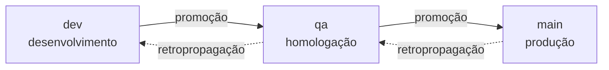

# Политика веток и версионирования {#branch-and-versioning-policy}

Эта страница — **источник** политики. Применяющие её workflow выводятся
отсюда — если механизм расходится с написанным, неправ механизм.

## Зачем механизировать {#why-mechanize-it}

Политика веток, согласованная на встрече, живёт до первого вечера пятницы.
Спешка — не злой умысел: просто правило живёт в головах людей, а голова под
давлением оптимизирует краткосрочное.

Поэтому политика здесь **не просит сотрудничества** — её навязывает CI. Не
из недоверия, а потому, что правило, зависящее от индивидуальной
дисциплины, не переживает инцидент, а именно во время инцидента оно важнее
всего.

Два последствия, которые мы принимаем намеренно:

- **PR становится бюрократичнее.** Неверное имя ветки проваливает проверку.
  Это цена.
- **Сообщение об ошибке должно учить.** Проверка, говорящая лишь
  «недопустимо», приучает людей её обходить. Каждая ошибка цитирует
  правило, то, что пришло, и правильный пример.

## Лестница {#the-ladder}

Три постоянные ветки, **по одной на окружение**. Код поднимается на одну
ступень за раз.



| ветка | окружение | что значит быть здесь |
|---|---|---|
| `dev` | разработка | интегрировано, протестировано CI |
| `qa` | приёмка | на функциональной проверке |
| `main` | production | то, что в эфире |

Была четвёртая ступень, `rc` (предпродакшн), между `qa` и `main`. Она
удалена: при единственном сопровождающем и коротком цикле лишняя ступень
стоила целого продвижения и окружения ради различия «проверено» и «почти
готово» — различия, которое себя не окупало. `qa` становится единственными
воротами перед production.

Удаление не сразу улеглось полностью. `pr-police` сразу стал работать с
тремя ступенями, но **bootstrap Gitflow** продолжал создавать `rc`, защищать
`rc` и коммитить в репозиторий пользователя `branching-policy.md`, учивший
лестнице из четырёх ступеней, — продукт документировал для своих
пользователей политику, от которой сам уже отказался. Это была находка №3
[первого раунда dogfooding](./primeiro-dogfooding.md), закрытая позже
([RN-029](../business-rules.md#rn-029)).

Два свободных конца оставлены намеренно и по разным причинам: значение
`create_rc_branch` остаётся в enum `bootstrap_step` базы (у уже выполненных
bootstrap есть строки с ним), а `rc` остаётся в списке **защищённого
merge** — см. примечание в [permissions.md](../reference/permissions.md).

**Ни одну ступень нельзя перескочить.** `dev → main` не существует, даже в
экстренной ситуации — у экстренной ситуации свой путь (`hotfix`, ниже), и он
тоже уважает лестницу, только начиная сверху.

## Таксономия {#taxonomy}

Каждая ветка — `funcao/descritivo`, проверяемая `^.{0,30}/\S{0,32}$` — до 30
символов на функцию, до 32 на описание, без пробелов.

```
✅ feature/pr-police          ✅ bugfix/rate-limit-off-by-one
✅ hotfix/vaza-token          ✅ docs/politica-de-branches

❌ minha-branch               (sem função)
❌ ci/build-paralelo          (`ci` não está na lista; use `chore`)
❌ fix/algo                   (`fix` não está na lista; use `bugfix`)
```

Одной regex недостаточно: функция должна быть в **закрытом списке**.

### Кто от чего рождается {#whos-born-where}

| функция | рождается от | PR направлен в | для |
|---|---|---|---|
| `breaking` | `dev` | `dev` | несовместимое изменение |
| `feature` | `dev` | `dev` | новая функциональность |
| `bugfix` | `dev` | `dev` | обычное исправление |
| `perf` | `dev` | `dev` | производительность |
| `refactor` | `dev` | `dev` | реструктуризация без изменения поведения |
| `chore` | `dev` | `dev` | сопровождение, инструменты, CI |
| `docs` | `dev` | `dev` | документация |
| `test` | `dev` | `dev` | покрытие |
| `hotfix` | `main` | `main` | инцидент в production |

У исправления, найденного на **приёмке**, нет своего префикса: оно
становится `bugfix/` от `dev` и поднимается по лестнице. Был `rcfix/` для
предпродакшна, и он ушёл вместе со ступенью `rc` — префикс без исходной
ветки — это ловушка.

Происхождение — не рекомендация: оно **проверяется по merge-base**.
`hotfix`, рождённый от `dev`, несёт с собой всё, что есть в `dev` и ещё не
проверено; торопливо выталкивать это в production во время инцидента — так
и случается катастрофа.

### Исправление, рождённое наверху, спускается вниз {#a-fix-born-high-goes-back-down}

`hotfix` входит прямо на ту ступень, где появилась проблема. Это делает
нижние ступени **устаревшими** — исправление есть в `main`, но не в `dev`.

Поэтому каждое исправление, рождённое наверху, порождает **обратное
распространение**: `main → qa → dev`, цепочкой, по порядку. Пока оно не
завершено, затронутые ступени заблокированы — см.
[Ворота обратного распространения](#the-back-merge-gate).

Полная цепочка hotfix — это **три PR**: сам hotfix плюс два обратных
распространения.

## Семейства PR {#pr-families}

Каждый PR получает метку семейства, применяемую автоматически:

| семейство | когда | пример |
|---|---|---|
| `trabalho` | рабочая функция → `dev` | `feature/pr-police` → `dev` |
| `correcao-alta` | `hotfix` → `main` | `hotfix/vaza-token` → `main` |
| `promocao` | соседняя ступень, вверх | `dev` → `qa` |
| `retropropagacao` | соседняя ступень, вниз | `main` → `qa` |

Метка — не украшение: именно она позволяет ответить «сколько hotfix было у
нас в этом квартале?» без археологии в git.

<a id="push-direto-é-bloqueado"></a>

## Прямой push заблокирован {#direct-push-is-blocked}

Ни одна из трёх постоянных веток не принимает прямой push. Каждое
изменение входит через PR. Это **единственная дверь** — и у неё ровно три
исключения, все для ботов, все записаны здесь, потому что
незадокументированное исключение становится прецедентом:

| исключение | кто | почему |
|---|---|---|
| теги `v*` | `brabo-release[bot]` | версия рождается из workflow, никогда вручную |
| `.release/gate.json` в `main` | `brabo-release[bot]` | воротам нужно записывать себя при блокировке и разблокировке |
| ветка `gh-pages` | `github-actions[bot]` | публикация документации по ступеням требует изменяемого дерева ([ADR 0034](../adr/0034-documentacao-publicada-por-degrau.md)) |

**Третье исключение принять легче всего, и стоит сказать почему, чтобы оно
не открыло прецедент для трудных.** `gh-pages` **— не ветка кода**: ничто в
ней не является источником, всё генерируется из `docs/` и `website/`, и её
полное удаление ничего не теряет — следующий push её восстанавливает. Для
сгенерированного сайта невозможен ревьюер, а PR на каждую публикацию был бы
церемонией без читателя. Её `git log` — запись каждой публикации, с датой и
sha источника.

Она также **не постоянная**, поэтому не входит в rulesets — поэтому
достаточно `GITHUB_TOKEN`, без bypass и без `BRABO_BOT_TOKEN`.

Второе — самое неудобное из трёх, поэтому стоит сказать, почему ворота
существуют, а не проходят через PR: ворота блокируют ветки, и PR для снятия
блокировки был бы заблокирован самими воротами. Альтернатива — хранить
состояние вне репозитория — обменяла бы видимое в истории исключение на
невидимое состояние на какой-то панели. Коммит бота остаётся в `git log`, с
датой и содержимым.

`tag-release` узнаёт этот коммит **по содержимому** (он касается только
`.release/`), никогда по автору или сообщению: кто его написал — проверяемо,
кто *утверждает*, что написал, — нет.

Точная конфигурация — в [Rulesets](../reference/rulesets.md), и её
применение — ручной шаг: репозиторий версионирует источник, GitHub получает
применение.

## Смерженные ветки архивируются {#merged-branches-get-archived}

Каждая ветка, PR которой смержен, уходит из списка веток **через 7 дней
после merge** — механически, через `archive-merged-branch.yml`, который
запускается раз в день (`schedule:`, плюс `workflow_dispatch`) и обходит все
ветки репозитория (AT-557, решение владельца от 2026-10-15). До тех пор ветка
остаётся на месте, чтобы последующее исправление ещё могло лечь поверх неё.
Ветка архивируется, только когда верно всё это:

- она не входит в исключённые ниже имена и не из fork;
- ни один PR с этой head не **открыт**;
- PR с этой head был **смержен** в этом репозитории, и самый недавний смержен
  7 или более дней назад (`DIAS_ATE_ARQUIVAR`);
- вершина ветки всё ещё равна `head.sha` этого PR — ветка, получившая коммит
  после merge, **остаётся**.

Ветка, у которой никогда не было смерженного PR, не имеет даты merge и
**никогда** не архивируется этим job; её удаление остаётся ручным решением.
Сводка job перечисляет, что заархивировано, что оставлено (с причиной) и что
упало; сбой на одной ветке не останавливает остальные и делает job красным.

«Архивирована» — буквально, а не эвфемизм для «удалена»: ветка переходит из
`refs/heads/<имя>` в `refs/archive/<имя>`, пространство имён, которое
интерфейс GitHub не показывает как ветку. Объект коммита и его история
остаются в репозитории точно как были — восстановимые тем, кто знает ref,
одним
`git push origin refs/archive/<name>:refs/heads/<name>`, чтобы вернуть её.

Четыре имени никогда не архивируются, и причина для всех четырёх одна: ни
одно из них не является одноразовой работой над фичей.

| имя | почему исключено |
|---|---|
| `dev`, `qa`, `main` | три постоянные — они появляются как `head` каждого смерженного PR продвижения (`dev`→`qa`, `qa`→`main`), а это ровно тот случай, ради которого существует это исключение |
| `gh-pages` | ветка deploy сайта документации (см. «Прямой push заблокирован» выше) — не ветка фичи, и удаление `refs/heads/gh-pages` уронило бы работающий сайт |

Пятое условие — не имя, а граница: PR, чья head-ветка живёт в **fork**
(`head.repo.full_name != base.repo.full_name`), никогда не затрагивается.
`GITHUB_TOKEN` workflow ограничен этим репозиторием — ему нечего
переписывать в чужих refs.

Само решение — какие четыре имени исключены, и проверка fork — это
протестированная чистая функция
([`scripts/ci/archive-branch.ts`](https://github.com/daneiel/brabo/blob/dev/scripts/ci/archive-branch.ts)),
а не встроенный shell: это та часть механизма, где ошибка действительно
оправдывает тесты, — как и 7-дневная пригодность (`aptaParaArquivar`, тот же
файл). Затем тот же скрипт вызывает API GitHub: создаёт ref
`refs/archive/` (или принудительно перезаписывает, когда имя уже
архивировалось), читает её обратно и проверяет, что она указывает на SHA
ветки, и только затем удаляет `refs/heads/` — так сбой никогда не уронит
ветку, не оставив заархивированной копии.

## Боты пропускают лестницу {#bots-skip-the-ladder}

PR, открытые `dependabot[bot]` и `github-actions[bot]`, **освобождены** от
проверки имени, происхождения и цели.

Причина практическая: Dependabot называет ветки как
`dependabot/npm_and_yarn/brace-expansion-5.0.8`, и научить его таксономии
невозможно. Отказывать ему значило бы переименовывать ветки вручную при
каждом alert безопасности — трение именно в том потоке, который должен быть
быстрым.

Педагогическое сообщение бота не учит. Освобождение — по **автору**, а не
по префиксу, чтобы никто не использовал его как лазейку, назвав ветку
`dependabot/`.

### Ветки Dependabot разрешены без ограничения символов {#dependabot-branches-are-allowed-with-no-character-limit}

Помимо общего освобождения ботов, политика явно называет ветки Dependabot:
**`dependabot/…` — разрешённое имя ветки, без критерия символов** — без
ограничения 30/32, с любым числом слешей. Реальные имена этого
репозитория:
`dependabot/npm_and_yarn/npm_and_yarn-582a9020a7`,
`dependabot/github_actions/dev/anthropics/claude-code-action-1.0.221` —
второе провалилось бы в формате `funcao/descritivo` как рабочая ветка.

Это именованное правило (`PREFIXO_DO_DEPENDABOT` и `ehBranchDoDependabot` в
`scripts/ci/pr-police.ts`), и оно действует, только когда верны **обе**
вещи: head начинается с `dependabot/` **и** автор — сам Dependabot
(`dependabot[bot]`, `app/dependabot` или `dependabot` с `type: Bot` в API).
Человек, назвавший ветку `dependabot/…`, по-прежнему проходит всё правило и
проваливается на `FUNCAO-DESCONHECIDA`, с сообщением, что префикс
зарезервирован, а ручное обновление зависимости — это `chore/`. Правило не
проверяет цель: перенос PR безопасности из `main` в `dev` — работа
`dependabot-para-dev.yml` (следующий раздел).

## Dependabot входит через dev {#dependabot-enters-through-dev}

Освобождение выше касается **имени** ветки. **Цель** не освобождена:
обновление зависимости входит через `dev`, как и всё остальное, и доходит до
`main` через продвижение `dev → qa → main`. Зависимость, смерженная прямо в
`main`, перескакивает лестницу и заставляет `main` разойтись с веткой, где
идёт работа.

Два механизма, потому что GitHub обращается с двумя видами обновлений
по-разному:

- **Обновления версий** подчиняются `target-branch: dev` в
  `.github/dependabot.yml`.
- **Обновления безопасности** включаются в интерфейсе репозитория, и GitHub
  всегда открывает их против ветки **по умолчанию** (`main`), игнорируя
  `target-branch`. `.github/workflows/dependabot-para-dev.yml` берёт каждый
  открытый PR Dependabot против `main` и делает одно из двух, по решению
  протестированной чистой функции
  ([`scripts/ci/dependabot-para-dev.ts`](https://github.com/daneiel/brabo/blob/dev/scripts/ci/dependabot-para-dev.ts)):
  - **закрывает** PR с обоснованием, когда lockfile `dev` уже разрешает
    каждую зависимость PR только в версии `>=` порога;
  - **перенаправляет** PR в `dev` во всех остальных случаях — версия ниже
    порога, пакет, отсутствующий в lockfile, несравнимая версия, тело,
    которое он не может прочитать.

**Порог** — первая *исправленная* версия открытых alert'ов для этого пакета
в этом lockfile, и только при отсутствии alert'а он равен целевой версии
PR. Разница измерена на PR #553: он поднимал `@vitest/mocker` до `5.0.0`,
тогда как `dev` разрешала `4.1.11`, а это ровно первая исправленная версия
alert'а — Dependabot предлагает **самую новую** версию, а не наименьшую
исправляющую. Если alert'ы прочитать нельзя, сравнение откатывается к
целевой версии, которая строже: она может только чаще перенаправлять, но
никогда чаще закрывать. **В сомнении PR перенаправляется, а не
закрывается.**

Workflow запускается на **push в `dev`**, и именно этот триггер важен.
`pull_request_target` и `schedule` видят только workflow ветки по
умолчанию, а `pull_request` запускает workflow из merge head, созданной
Dependabot от `main`, с `main` — ни один из них не видит файл, существующий
только в `dev`, а `main` продвигается только по лестнице (та же ловушка,
измеренная в `pr-police.yml`). Push в `dev` запускает копию из `dev`, поэтому
каждый merge туда обходит открытые PR Dependabot против `main`.
`workflow_dispatch` избавляет от ожидания следующего merge;
`pull_request_target` начнёт действовать, и сразу, когда файл дойдёт до
`main`.

**Измерено при первом запуске (2026-09-13):** чтение alert'ов **не удалось**
с `GITHUB_TOKEN` workflow, поэтому сегодня каждое решение откатывается к
целевой версии PR. Последствие безопасное — PR безопасности, который `dev`
уже исправляет, как #553, **перенаправляется**, а не закрывается, и его
закрытие остаётся ручным шагом. Предупреждение в логе запуска теперь несёт
сообщение API; чтение alert'ов с другими учётными данными — отдельное
решение.

**Заявлено:** после перенаправления обязательные проверки `dev` **не**
запускаются сами — события, созданные `GITHUB_TOKEN`, не запускают workflow,
а Dependabot не принимает команд от этого бота. Кто-то с правом записи
комментирует `@dependabot rebase`; комментарий workflow говорит об этом в
PR.

### Обновление закрепления оправдывает себя само {#a-pin-bump-justifies-itself}

PR Dependabot, обновляющий action, трогает файлы workflow, а проверка
дрейфа документации срабатывает по **файлу**: `release.yml` охраняется
правилом `politica-de-branches` в `block`. Когда весь diff — SHA `uses:` и
комментарий с версией рядом, этому правилу не о чем спрашивать — PR #578 и
#580 были разблокированы вручную, человеком, написавшим `docs-not-needed:` в
теле.

Начиная с AT-094 **эту строку пишет бот**, и только в этом классе PR. Шаг
job `Drift, gerados e build` (`.github/workflows/docs-check.yml`) сразу
перед дрейфом вызывает
[`scripts/ci/dependabot-justifica-pin.ts`](https://github.com/daneiel/brabo/blob/dev/scripts/ci/dependabot-justifica-pin.ts)
на том же интервале, который оценивает дрейф. Он пишет строку, когда верны
**обе** вещи:

- **автор** — Dependabot (`ehBranchDoDependabot`: префикс `dependabot/` **и**
  login приложения — один префикс был бы дверью для человека);
- **diff** — только замена закрепления: каждый файл — YAML в
  `.github/workflows/` или `.github/actions/`, изменённый на месте (никогда
  не созданный, удалённый, переименованный или со сменой режима), и каждая
  изменённая строка — `uses: <action>@<sha>  # <version>` в паре с другой
  строкой **того же** action, с **тем же** отступом, меняющей только SHA
  и/или токен версии.

Что угодно другое — job, триггер, `with:`, `package.json`, lockfile, новый
workflow, автор-человек — и ничего не пишется: docmap судит, как всегда. Правило
никогда не превращается в «PR бота пропускает docmap». Строка несёт
HTML-маркер (`<!-- dependabot-justifica-pin -->`), и именно маркер делает её
**обратимой**: если последующий push добавит что-то, что не является
закреплением, строка бота **удаляется**. `docs-not-needed:`, написанный
человеком, никогда не трогается — ни для дублирования, ни для удаления, — а на
`edited` шаг оценивает, только когда редактировал сам бот, поэтому человек,
удаливший строку бота, побеждает.

Начиная с AT-100 этот случай `edited` явный: `@dependabot rebase` порождает
`synchronize` **и** `edited` разом, `concurrency` отменяет один из них, и
когда выжившим был `edited`, шаг пропускался, а дрейф читал тело без строки
(#578, запуски `35412983999`/`35412984299`). `edited` самого бота теперь
оценивается; человеческий — нет.

**Почему шаг в job дрейфа, а не родственный workflow** — три измерения:

- правка тела с `GITHUB_TOKEN` не порождает `edited`, поэтому отдельный
  workflow записал бы строку и оставил обязательную проверку красной;
- повторный запуск job дрейфа не помогает: повторный запуск переиспользует
  **payload** исходного события, со старым телом (запуск 34898913072,
  попытка 2, 2026-09-17: в теле строка уже была, в `PR_BODY` — нет, и дрейф
  провалился);
- `pull_request_target`, где токен пишет без вопросов, запускает только
  workflow ветки **по умолчанию** — ловушка, измеренная в `pr-police.yml`.

В том же job дрейф читает новое тело из `PR_BODY_FILE`, по порядку, без
гонки и без повторного запуска. Если правка не удалась, ни один файл не
пишется, и дрейф читает тело события: закрыто при сбое, PR остаётся
заблокированным, как раньше. Измерено против каждого PR Dependabot за всю
историю репозитория: десять `github_actions` (#561–#565, #577–#581) — чистая
замена закрепления; один `npm_and_yarn` (#553) — нет.

## Кто одобряет {#who-approves}

Требование одобрения имеет **два режима**, выбираемые переменной
репозитория `APPROVAL_MODE`. Оба реализованы и протестированы; переключение
— **только смена переменных**, без изменения кода.

### Режим `solo` — то, что действует сегодня {#solo-mode--what-applies-today}

У проекта **один сопровождающий**. Полная лестница одобряющих предполагает
команды, которых ещё нет, а правило, которое невозможно выполнить, — это
правило, учащее жульничать.

| ситуация | требование |
|---|---|
| PR третьего лица | **1 одобрение owner** |
| PR авторства owner | проходит проверку **без ревью** |

Вторая строка — не привилегия, а то, как работает GitHub: **никто не может
одобрить собственный PR через интерфейс**. В проекте BDFL **ручной merge
owner и есть одобрение** — это его осознанное действие в момент, когда он
решает нажать кнопку. Требование ревью, которое платформа не позволяет,
дало бы лишь постоянно красную проверку.

Требование **разных людей приостановлено** в этом режиме, и приостановлено
намеренно: при единственном сопровождающем оно арифметически невыполнимо.

### Режим `community` — для времени, когда появятся люди {#community-mode--for-when-there-are-people}

| цель | требование |
|---|---|
| `dev` | 1 × devs |
| `qa` | 2 × devs |
| `main` | 1 × PO **+** 1 × руководство |

Для `main` — **разные люди**: требование снова действует. Для `dev` и `qa`
различие автоматическое: места принадлежат одной роли, и каждый человек
засчитывает только одно ревью.

Роли — это **списки handle** в переменных репозитория, а не команды GitHub:

```
APROVADORES_DEVS    = ana,bruno,carla
APROVADORES_PO      = paula
APROVADORES_GESTAO  = gustavo
```

Команды были бы очевидным путём и **здесь не работают**: они существуют
только внутри организации, этот репозиторий принадлежит пользователю, а
`GITHUB_TOKEN` не может читать членство в командах даже внутри org — для
этого понадобился бы PAT с `read:org`. Со списками режим `community` можно
включить уже сегодня, и переключение действительно сводится к одной
переменной.

Честная цена: поддержание списков в актуальном состоянии — ручная работа,
и человек, покинувший проект, продолжает одобрять, пока кто-нибудь не
отредактирует переменную. Если проект станет org с настоящими командами,
смена источника — изменение одной функции; лестница и правило разных людей
не меняются.

#### Почему «разным людям» нужно больше, чем подсчёт {#why-distinct-people-needs-more-than-counting}

Для `main` тот, кто есть в **обоих списках** (`po` и `gestao`), мог бы
заполнить оба места сам, если бы проверка просто считала одобрения по
ролям. Проверка рассматривает это как задачу **назначения**: существует ли
распределение разных одобряющих, заполняющее все места?

Это также предотвращает обратную ошибку. Если `paula` единственная в `po`,
но также есть в `gestao`, отдав ей место `gestao`, мы оставили бы `po`
непокрытым — даже если кто-то другой мог бы его заполнить. Правильное
назначение существует, и проверка его находит.

### Правила, общие для обоих режимов {#rules-common-to-both-modes}

- Засчитываются только ревью **`APPROVED` на последнем коммите**. Одобрение
  на старом коммите не засчитывается: одобрено не то, что собирается
  смержиться.
- Сводка проверки показывает **активный режим, кто одобрил и чего не
  хватает**. Проверка, говорящая лишь «не хватает одобрений», заставляет
  гадать.

### Переход на режим `community` {#migrating-to-community-mode}

Предусловия, до переключения любой переменной:

1. **В каждой роли настоящие люди.** `main` требует PO **и** руководство;
   если оба списка указывают на одного человека, ни один PR в `main` никогда
   не пройдёт — правило разных людей невыполнимо. `qa` требует **двух**
   разных devs: список с одним именем блокирует продвижение.
2. **Критерий, кто входит в каждый список**, определённый и записанный — кто
   входит, кто выходит и на каком основании.

Пошаговое переключение:

```bash
gh variable set APROVADORES_DEVS   --body "ana,bruno,carla"
gh variable set APROVADORES_PO     --body "paula"
gh variable set APROVADORES_GESTAO --body "gustavo"

# last: with empty lists, community rejects everything
gh variable set APPROVAL_MODE --body community
```

Порядок важен. С `APPROVAL_MODE=community` и ещё пустыми списками каждый PR
остаётся красным, говоря, какой переменной не хватает, — правильно, но
излишне шумно. Заполните их заранее.

Чтобы вернуться: `gh variable set APPROVAL_MODE --body solo`.

**Без deploy, без merge, без изменения кода** — переключение — только
конфигурация, и есть тест, который прогоняет один и тот же вход через оба
режима, утверждая разные вердикты.

Критерий, кто входит в каждый список, — кто входит, кто выходит и на каком
основании, — живёт в `GOVERNANCE.md`, в корне репозитория. Этот раздел
остаётся источником МЕХАНИЗМА (лестница, требование разных людей, пошаговое
переключение); `GOVERNANCE.md` — источник КРИТЕРИЯ того, кто заполняет
каждую роль.

## Продвижение {#promotion}

Код поднимается на ступень через **PR продвижения**, открываемый workflow
`promote` (`workflow_dispatch`, вход: пара конвейера).

Workflow **ничего не мержит** — он вычисляет и открывает PR. Merge
по-прежнему ручное действие, как любое вхождение в постоянную ветку.

| шаг | что |
|---|---|
| 1 | **кто запускает** — при `APPROVAL_MODE=solo` только
`OWNER_HANDLE`. Любой другой актор проваливается, с указанием того, кто может |
| 2 | **соседняя пара** — `dev→qa` и `qa→main`. `dev→main` отвергается,
с указанием на путь по ступеням |
| 3 | **версия цикла** — вычисляется по PR, смерженным с
последнего финального тега |
| 4 | **PR открыт** — тело перечисляет каждый PR, его функцию, влияние и
предлагаемую версию |

Тело шага 4 — **markdown-таблица**, а заголовок PR — текст, который никто не
контролирует, поэтому он экранируется, прежде чем стать ячейкой таблицы
(`celulaDeTabela`, в `scripts/ci/promote.ts`). Экранировать `|` недостаточно
— обратный слеш нужно экранировать **первым**, иначе заголовок,
оканчивающийся на `\` прямо перед `|`, даёт `\\|`, что GFM читает как
экранированный обратный слеш, за которым следует РАЗДЕЛИТЕЛЬ колонок, —
строка получает лишнюю ячейку, и таблица ломается. Поэтому порядок двух
замен структурен, а тест в `promote.spec.ts` считает НАСТОЯЩИЕ разделители
строки, а не сравнивает строку целиком.

### Автоматическое продвижение в qa (тестовая фаза) {#automatic-promotion-to-qa}

Пока QA находится в **тестовой фазе**, `dev` → `qa` продвигается сам
(ADR 0217, решение владельца от 15.10). Переключатель — переменная
репозитория **`QA_FASE_DE_TESTE`** (Settings → Variables): `true` включает;
удаление или любое другое значение выключает, и продвижение возвращается к
ручному workflow `promote` выше.

Когда она включена, каждый push в `dev` запускает `promote-auto-qa.yml`: то же
вычисление версии (`promote.ts`) и тот же шаг открытия
(`scripts/ci/abrir-pr-de-promocao.sh`) открывают или обновляют PR `dev` → `qa`
через `BRABO_BOT_TOKEN`. Затем `scripts/ci/promocao-automatica.ts` ждёт, пока
**каждый** check run на head PR не завершится, — в репозитории нет
обязательных проверок, поэтому `--auto` не ждал бы, — и мержит с merge commit,
только если ни один не завершился с `failure`, `cancelled` или `timed_out`
(среди прочих). Любой сбой останавливает продвижение, а сводка job называет
проверку и её ссылку. Без `BRABO_BOT_TOKEN` job падает видимым образом. Push
без ничего нового в цикле (merge продвижения, обратное распространение, `dev`
уже равна `qa`) — нормальный исход, а не сбой: `::notice::` и «nada a
promover: o ciclo está vazio» в сводке, выход 0, без PR. В ручном `promote`
пустой цикл по-прежнему проваливается.

Лестница одобрения освобождает от одобрения owner **только** этот PR: пара
`dev` → `qa`, включённая переменная и автор, равный пользователю
`BRABO_BOT_TOKEN` (разрешённому через `gh api user`). `qa` → `main` и любая
другая пара по-прежнему требуют одобрения.

> **Тестовая фаза: QA автоматически продвигается при каждом merge в dev и
> пока не считается проверенным окружением.** Сайт `/brabo/qa/` показывает
> это в полосе объявлений, а тело автоматического PR открывается этой
> фразой. Каждое автоматическое продвижение также создаёт тег `-qa.N` и
> переопубликовывает `/brabo/qa/`.

### Проверка продвижения {#the-promotion-check}

PR продвижения проходит собственную проверку, отдельную от `pr-police`. Та
проверяет **форму** (имя, происхождение, цель); эта — **состояние**:

| проверка | почему |
|---|---|
| **чистый интервал** | head PR — вершина исходной ветки. Если
кто-то запушил что-то после открытия PR, то, что было бы продвинуто,
— не то, что там есть |
| **предыдущая ступень проштампована** | у коммита есть тег нижнего этапа.
Продвигать без него — продвигать то, что никогда там не
проходило |
| **возможен merge commit** | продвижение — `--no-ff`. Squash
сплющил бы коммиты нижней ступени, и тег этапа стал бы
указывать на коммит, которого больше нет |

Проверка, которую **не удалось выполнить**, считается проваленной, а не
пройденной, — неразрешаемая ref — это незнание, а не разрешение.

Первые две проверки проверяются `scripts/ci/promotion-check.spec.ts`, в том
же духе, что spec для `pr-police` и `approval-ladder`. Он фиксирует не
реализацию, а правило: какой штамп требует каждая цель и что штамп должен
быть **на этом коммите** — тег на другом коммите, на другом этапе или тег,
не сумевший разрешить sha, не засчитываются. Принятие любого из них
позволило бы `qa` получить код, никогда не проходивший через `dev`.

Исключение — чтение **конфигурации merge**: у токена workflow законно нет
права её читать, и блокировка каждого продвижения из-за этого была бы хуже
сбоя, которого хотят избежать. Там невозможность становится
**предупреждением**, а настоящая гарантия живёт в `tag-release`: после
merge он подтверждает, что у коммита **два родителя**. Это не зависит ни от
каких прав и смотрит на свершившийся факт, а не на заявленное намерение.

## Версионирование {#versioning}

Каждый тег рождается из workflow, в формате `vX.Y.Z-dev.N` / `-qa.N` /
финальный.

**Версия живёт в ТЕГЕ, а не в файлах.** Никто не может закоммитить прямо в
постоянную ветку, чтобы поднять `package.json`, поэтому требование, чтобы
четыре файла версии следовали за ним, вынуждало бы PR поднятия версии в
каждом цикле — церемонию, которую автоматическое вычисление существует
устранить. `release.yml` сверяет файлы как **предупреждение** и
срабатывает только на финальном теге.

### Что производит финальный тег {#what-the-final-tag-produces}

`release.yml` — конец конвейера, и то, что он поставляет, намеренно
скромно:

| результат | что |
|---|---|
| GitHub Release | с примечаниями, сгенерированными из CHANGELOG
`scripts/changelog.mjs` |
| проверка версии | четыре версионируемых файла, как **предупреждение** |
| пять образов production | собираются, чтобы доказать, что тег **собираем**, — пятый, broker контейнеров, начиная с [ADR 0162](../adr/0162-broker-publicado-e-oferecido-pelo-instalador.md) |
| версия, записанная в три из них | записана как `ARG` в api,
web и broker — см. ниже |
| **Trivy на пяти опубликованных образах** | **по digest**, из registry, **до** подписи — HIGH/CRITICAL с исправлением проваливает релиз; то, у чего исправления нет, сообщается в сводке job и как ассет Release `trivy-sem-correcao.md` ([ADR 0172](../adr/0172-trivy-no-release-antes-de-assinar.md)) |
| **подписи пяти образов** | keyless `cosign`, **по digest**,
подписанные и затем проверенные в том же запуске
([ADR 0149](../adr/0149-assinatura-dos-artefatos-publicados.md)) |

Последняя строка — то, что финальный тег получил в FASE 29, и стоит точно
сказать, **почему по digest**: подпись `:5.0.0` удостоверяла бы то, на что
указывал тег в момент подписи, а тег — подвижный указатель. Digest — то,
что уже записывает `.release/images.json` и что уже применяет overlay
production.

Сканирование идёт **до** подписи, и порядок — это правило: образ, не
прошедший Trivy, никогда не подписывается, поэтому установщик его никогда не
возьмёт. Оно использует ровно те же флаги и `.trivyignore.yaml`, что и
сканирование в `ci.yml`, потому что образ, публикуемый тегом, — холодная
сборка другого запуска, а не тот, что сканировал PR. Push уже произошёл,
когда идёт сканирование (именно он создаёт digest), поэтому проваленный тег
оставляет в GHCR неподписанные образы и никакого Release;
`scripts/ci/trivy-do-release.spec.ts` стережёт порядок и флаги, поскольку ни
один PR никогда не запускает этот workflow.

Подпись **проверяется в том же запуске, до появления Release**. Подпись,
которую никто не пытается проверить, — ещё один файл в registry, а сбой
иначе проявился бы на машине устанавливающего — худшем из возможных мест
для его обнаружения.

Бинарники runner идут следом в `build-runner-binaries.yml`, с **одним**
подписанным `checksums.txt`, покрывающим четыре цели, вместо подписи на
каждый бинарник: проверить три и забыть четвёртый — режим сбоя, которого
никто не замечает, а единый манифест его устраняет.

#### Версия живёт в теге, а релиз доносит её до артефакта {#the-version-lives-in-the-tag-and-the-release-is-what-carries-it-to-the-artifact}

Тег — источник версии, но образ не может прочитать собственный тег:
контейнер не знает, под каким именем опубликован, а тег можно переместить.
Поэтому `release.yml` **передаёт версию в сборку** — и это единственное
место в репозитории, которое это делает.

`VERSION` — переменная `docker-bake.hcl`, отдельная от `TAG`, со значением по
умолчанию `dev`. Цели `api` и `broker` превращают её в `BRABO_VERSION`, а цель
`web` — в `VITE_BRABO_VERSION`; каждый `Dockerfile.prod` объявляет её как
`ARG` с тем же значением по умолчанию. Оттуда она доходит до
`service.version` в span'ах api и до подвала экранов auth в web
([ADR 0036](../adr/0036-telas-de-auth-fieis-ao-design-e-fontes-auto-hospedadas.md)).

Два последствия, и оба намеренные:

- **Версию штампует только релиз.** `ci.yml` использует тот же bakefile с
  `TAG=prod` и не задаёт `VERSION`, поэтому его образы сообщают `dev`. Если
  бы версия бралась из `TAG`, каждый span CI выходил бы с
  `service.version=prod`, что не является версией чего-либо.
- **Версия — не конфигурация.** Это `ARG` сборки, а не ключ ConfigMap, потому
  что это свойство артефакта: `brabo-web:1.1.2` не должен быть способен
  сообщать что-то другое. URL по-прежнему настраиваются во время выполнения,
  через `/config.js`, потому что они — свойство окружения (ADR 0024).

Трогать эту цепочку — значит трогать политику: тот, кто меняет `VERSION` в
bakefile или в `ARG`, должен менять обе стороны вместе, иначе версия молча
вернётся к `dev` — без ошибки где-либо, потому что `dev` — допустимое
значение.

**Образы не публикуются** — `push: false`. Публикация в registry ещё не
решена (overlay production указывает на `ghcr.io/OWNER/*`, маркер), и
решение записано в
[ADR 0027](../adr/0027-fase5-backup-hardening-release.md). Собирать без
публикации — не полумера: именно это не даёт тегу существовать для коммита,
который не компилируется.

Они собираются из того же `docker-bake.hcl`, что использует `ci.yml`,
параллельно. Раньше это были четыре последовательных `docker build` — тот же
вердикт, на ~160 с дольше на релиз.

**Шага deploy нет ни здесь, ни где-либо ещё.** Тег — запись того, что
**было бы** в каждом окружении, и это верно даже без окружения. Шаг, который
никогда не запускается, загнивает: никто его не тестирует, никто не замечает,
когда он ломается, и в день включения он окажется неверным. Когда появится
окружение, deploy будет **собственным** workflow, запускаемым тегом.

#### Release зависит от PAT, и его отсутствие уже стоило шести {#the-release-depends-on-the-pat-and-its-absence-has-already-cost-six}

`release.yml` срабатывает на `push` финального тега. Но **тег, запушенный с
`GITHUB_TOKEN`, не запускает workflow** — это правило GitHub против
рекурсии. `tag-release` использует `secrets.BRABO_BOT_TOKEN || github.token`:
без PAT тег рождается, а Release не выходит.

Деградация видима намеренно (в каждом запуске есть предупреждение), но
видимо — не то же, что предотвращено: **`v0.2.0`, `v0.3.0`, `v0.3.1`,
`v1.0.0`, `v1.0.1` и `v1.1.0` существуют без Release** — шесть целых
циклов, в которых предупреждение появлялось, и никто не действовал.

С настроенным PAT `v1.1.1` замкнула конвейер сама: тег запушен токеном,
`release.yml` запущен им, Release опубликован. До неё Release был только у
`v0.1.0`, и то из-за ручного push. **PAT не восстанавливает шесть
предыдущих** — он действует только для новых тегов.

Это разделяет две легко путаемые проблемы:

| проблема | исправление |
|---|---|
| Release не выходит **сам** | настроить
`BRABO_BOT_TOKEN` |
| Release, который не вышел, **не может выйти потом** |
`workflow_dispatch` в `release.yml` |

Вторая оставалась бы открытой даже с PAT на месте: любой сбой workflow
оставил бы тег сиротой навсегда, потому что переопубликация требовала бы
удалить и пересоздать тег — переписать запись, чтобы исправить её эффект.
Переопубликовывает владелец релиза, то же ограничение, что и у `promote`.
Процедура — в
[Rulesets](../reference/rulesets.md#republishing-a-tag-that-was-orphaned).

### CHANGELOG возвращается через PR, и почему не через push {#the-changelog-comes-back-via-pr-and-why-not-by-push}

С опубликованным Release `release.yml` открывает PR `chore/changelog-<tag>`
в **`dev`** с отсечкой версии в `CHANGELOG.md` — и в том же коммите с
версией, объявленной в прозе, в **двух** файлах, которые её пишут:
`README.md` и `docs/intro.md`, первая страница опубликованного сайта. Оба
переписывает `scripts/ci/readme-version.ts`, и он читает и заменяет всё,
прежде чем писать какой-либо: отсутствующая фраза в любом проваливает весь
релиз, а не оставляет его записанным наполовину.

**Отсечка ПОГЛОЩАЕТ раздел `## Unreleased`**, а не добавляет поверх него.
Это различие не косметическое: проза, написанная в блоке `Unreleased`
каждого PR, — *объяснение* того, что изменилось, и пять релизов подряд она
не доходила до опубликованной версии — `changelog.mjs` добавлял
сгенерированный раздел сверху и оставлял написанное вручную похороненным
ниже, навсегда. Слияние идёт по заголовку подраздела: сначала **написанные**
записи (они объясняют), затем инвентарь коммитов (он доказывает, что вошло).

Три вещи движутся вместе намеренно. Версия **генерируема** (релиз знает,
какая), и `docs:check` проверяет, что она совпадает с самой свежей
отсечкой CHANGELOG в каждом из файлов; разделение концов заставляло бы каждый
PR changelog рождаться красным, открытым ботом и ждущим человеческой руки,
которой политика не предусматривает. Ненайденная фраза ПРОВАЛИВАЕТ шаг, а не
проскакивает — regex этого скрипта и regex `scripts/docs/generate.mjs` — две
стороны одного контракта, и тест стережёт их согласие.

Через PR, а не через push, потому что ни один из прямых путей не существует:
`main` принимает только тег (бот релиза) и `.release/gate.json` (бот ворот), а
коммит в `qa` или `dev` до продвижения сломал бы **чистый интервал** проверки
продвижения — head PR перестала бы быть вершиной источника.

**Принятое последствие:** `CHANGELOG.md` в `main` отстаёт на цикл. Это не
потеря информации: авторитетный источник примечаний — **GitHub Release**,
опубликованный в тот же момент, что и тег, а отсечка приходит в следующем
цикле, как любое другое изменение.

### `.release/images.json` едет в том же PR — и не добавляет исключения {#releaseimagesjson-rides-the-same-pr--and-adds-no-exception}

Начиная с [ADR 0119](../adr/0119-imagens-publicadas-no-ghcr-por-digest.md)
`release.yml` публикует образы production в GHCR — пять начиная с
[ADR 0162](../adr/0162-broker-publicado-e-oferecido-pelo-instalador.md) — и
записывает то, что опубликовал этот тег, **по digest**, в
`.release/images.json`. Установщик читает оттуда все пять; overlay
Kubernetes применяет четыре, которые объявляет его база (Deployment для
broker нет, по решению).

Очевидная реализация — бот, пишущий digest в
`deploy/k8s/overlays/prod/kustomization.yaml` и пушащий, — была отвергнута
**здесь**, в этой политике, ещё до отказа в ADR: у единственной двери ровно
три исключения, а механизм, которому нужно четвёртое при каждом росте,
перестаёт быть политикой и становится привычкой. Это также позволило бы
тегу самому решать, что работает в production, а это решение не тега.

Поэтому файл идёт двумя уже существующими путями. Это **ассет GitHub
Release**, публикуемый на том же шаге, что и примечания, — авторитетная
копия, доступная в момент появления тега, — и входит через `git add` в
**тот же PR `chore/changelog-<tag>`**, описанный выше, что и есть то, как копия
в репозитории доходит до `dev` и поднимается по лестнице, как любое другое
изменение. То же принятое последствие, что и с CHANGELOG, по той же причине:
копия в `main` отстаёт на цикл, а ассет Release — надёжный в промежутке.

> До этого **в файл никто никогда не писал**. Генератор вызывался только с
> `--stdout`, чтобы собрать тело Release, а `CHANGELOG.md` накопил двенадцать
> версий внутри одного «Unreleased» — тогда как шесть Release вышли с пустым
> телом, потому что «предыдущий тег» включал пре-релизы той же версии.

### Версия цикла {#the-cycles-version}

Берётся из **наибольшего влияния** среди PR, смерженных с последнего
финального тега:

| функция ветки | влияние |
|---|---|
| `breaking/` | MAJOR |
| `feature/` | MINOR |
| всё остальное | PATCH |

Один `breaking` среди десяти `docs` делает весь цикл MAJOR. И решает
**функция ветки**, а не метка семейства: `breaking/x` и `docs/y` оба в
семействе `trabalho`.

#### `breaking/` требует маркер в коммите {#breaking-requires-the-marker-on-the-commit}

`pr-police` отвергает PR `breaking/`, коммиты которого не отмечают слом —
`!` в теме (`feat(api)!: …`) или `BREAKING CHANGE:` в теле, — и отвергает
также обратное: отмеченный коммит в ветке, которая не `breaking/`.

Правило существует, потому что это **два механизма для одного факта**, и
они жили раздельно: версия берётся из ФУНКЦИИ ветки (таблица выше), а
CHANGELOG определяет слом по МАРКЕРУ коммита. Ничто их не связывало.

Цена была измерена. `breaking/fase-7-auth-e-openapi` удалил Keycloak,
разлогинил всех и правильно поднял MAJOR — а CHANGELOG не фиксирует
никакого слома ни в **одной** из двенадцати версий, потому что ни один
коммит истории никогда не использовал маркеры. Обе половины работали;
информация просто никогда не переходила из одной в другую.

Важны оба направления, и второе хуже:

| ситуация | что происходило |
|---|---|
| `breaking/` без маркера | версия прыгает на MAJOR, а
changelog не говорит, что сломалось |
| маркер вне `breaking/` | changelog объявляет слом, а
версия выходит PATCH — тот, кто доверяет номеру, ломается без
предупреждения |

Проверка, которую не удалось выполнить (поверхностный checkout,
незагруженная ref), **не проваливает**: правило работает, только когда
интервал `base..head` читаем, — та же доктрина, что у проверки загрязнения.

**Пустой** цикл — ни одного PR с последнего финального — проваливается с
сообщением, а не порождает тег. Новый тег, указывающий на тот же коммит,
что и предыдущий, заставил бы историю версий лгать.

#### Откуда берутся PR цикла {#where-the-cycles-prs-come-from}

Из `git log` между последним финальным тегом и `dev`, с чтением номера PR в
теме коммита. Нужно понимать **два стиля merge**, потому что номер
оказывается в разных местах:

| стиль | тема |
|---|---|
| squash | `feat(ci): faz coisa (#53)` |
| merge commit | `Merge pull request #56 from daneiel/feature/x` |

Чтение только первого было реальным багом: `--no-merges` интервала скрывал
именно строку, цитирующую номер в merge commit, и весь цикл казался пустым
— merge #56 в `dev` не породил никакого тега.

**Продвижение и обратное распространение не считаются.** Они рождаются из
постоянной ветки, и то, что они несут, уже посчитано или уже выпущено. Без
этого исключения одно обратное распространение hotfix породило бы целый
новый цикл: тег `-dev.N` на версии, которая ничего не изменила.

Это обнаружение делают две части, и они **обязаны соглашаться**:
`tag-release`, штампующий в момент merge, и `promote`, вычисляющий версию PR
продвижения. Если они разойдутся, PR продвижения объявит одну версию, а тег
выйдет с другой. Обе используют одну функцию — дублирование логики уже
стоило одного продвижения, отвергнутого как «пустой цикл» сразу после того,
как `tag-release` проштамповал `-dev.2`.

> **`promote` работает с кодом ветки ПО УМОЛЧАНИЮ.** Это
> `workflow_dispatch` (см. таблицу триггеров в
> [Rulesets](../reference/rulesets.md)), поэтому исправление вычисления в
> `dev` **не** исправляет запуск, пока исправление не дойдёт до `main`. До
> тех пор обход — уже задокументированный: запустить
> `node scripts/ci/promote.ts` вручную, тем же скриптом.

### `N` {#the-n}

`N` — сколько тегов этой версии уже существует на этом этапе, плюс один.

Нигде не хранится состояние: **сами теги и есть счётчик**. Именно это
превращает «продвинуто, отвергнуто, исправлено, продвинуто снова» в
`-qa.2` без того, чтобы кто-то регистрировал отказ, — и число в итоге
говорит, сколько кругов сделал цикл, прежде чем пройти.

### Якорь финального тега {#the-final-tags-anchor}

Финальный тег рождается, только если то, что в `main`, — **ровно** то, что
прошло через `qa`. Если нет, workflow громко падает, а не публикует.

Поскольку продвижение — `--no-ff`, merge **создаёт новый коммит** — sha в
`main` никогда не будет sha в `qa`. Сравнение sha было бы проверкой,
которую невозможно пройти. Сравниваются две вещи, и вместе они сильнее:

| проверка | что гарантирует |
|---|---|
| `-qa.N` — **родитель** коммита в `main` | вошёл именно
он, а не какой-то предок |
| **дерево** идентично | содержимое байт в байт то, что было
проверено |

Важна именно вторая. Если бы другая сторона merge принесла файл, дерево
изменилось бы, и проверка провалилась бы — ровно тот случай, ради которого
существует якорь. Равенство деревьев сильнее равенства коммитов: оно смотрит
на содержимое, а не на идентичность.

### Два пути `main` {#mains-two-paths}

`main` получает merge двумя способами, и они требуют разных версий.
Различие берётся из **второго родителя** merge commit — вошедшей стороны:

| второй родитель | путь | версия |
|---|---|---|
| коммит `-qa.N` | продвижение | версия цикла, **с якорем** |
| что угодно другое | hotfix | последний финальный **+ PATCH**, без якоря |

Hotfix рождается от `main` и никогда не проходит через `qa`. Требовать от
него якорь значило бы требовать невозможного — а тег PATCH должен родиться,
потому что именно его цитируют PR обратного распространения.

`-dev.N` в качестве второго родителя **не** считается продвижением: прямой
merge `dev` в `main` перескакивает `qa`, и финальный тег проштамповал бы код,
который никто не проверял.

Случаи, которые громко падают, а не гадают:

| ситуация | почему |
|---|---|
| merge в `main` с единственным родителем | squash стирает вошедшую
сторону; без неё путь определить нельзя |
| hotfix без уже опубликованного финального тега | PATCH — приращение к
уже выпущенному |

И два случая, которые **не порождают тега**, намеренно: коммит ворот
(касается только `.release/`) и обратное распространение `main → qa`/`dev`,
несущее содержимое, которое уже есть в `main`. Без этого второго выхода
обратное распространение проштамповало бы `-qa.N` на коммите, который
никогда не продвигался из `dev`, — тег, говорящий «это прошло через qa», на
том, что не прошло.

### Deploy нет {#theres-no-deploy}

Workflow **заканчиваются на теге**. Нет окружения, нет GitHub Environments,
нет шага deploy — даже выключенного. Тег — запись того, что *было бы* на
каждом этапе, и он самодостаточен.

Шаг deploy, который никогда не запускается, — шаг, который загнивает: никто
его не тестирует, никто не замечает, когда он ломается, и в день включения
он окажется неверным. Когда появится окружение, deploy будет собственным
workflow, запускаемым **тегом**.

Чтобы своими глазами увидеть, что проштамповал тег:

```bash
make deploy-local TAG=v0.2.0-qa.1
```

### Squash при merge конвейера и тревога, у которой есть адресат {#squash-on-a-conveyor-merge-and-the-alarm-that-has-an-addressee}

Продвижение — `--no-ff`, и это самое нарушаемое правило: **трижды** (#367,
#394, #464). Оно заслуживает отдельного раздела, потому что ущерб невидим в
момент, когда происходит, и проявляется лишь циклом позже.

Squash даёт коммит с **одним родителем**. При продвижении второй родитель
был единственным, что связывало две ступени: без него история `qa` больше
не содержит коммитов `dev`, тег этапа указывает на коммит, которого больше
нет в этой истории, и — симптом, с которым люди действительно
сталкиваются, — **следующий PR продвижения открывается с файлами в
«конфликте», которые вовсе не конфликт**, а лишь потерянное родство. Merge
такого «конфликта» с выбором любой стороны — так содержимое молча
расходится между ступенями.

**Где это навязывается и почему не раньше.** Метод merge выбирается при
клике, после того как все проверки PR уже отработали. Ни одна проверка до
merge не может его наблюдать: `promotion-check` читает максимум
*конфигурацию* репозитория, а часто у него нет права даже на это.
Значимая проверка смотрит на свершившийся факт, в `tag-release`
(`conferirMergeDeEsteira`, `scripts/ci/version.ts`), и правило различается
по ветке, потому что различается базовая частота:

| ветка | что входит | правило |
|---|---|---|
| `qa`, `main` | только трафик конвейера | один родитель — всегда дефект |
| `dev` | работа, весь день, через squash **намеренно** | дефект, только когда PR приносил **новое ребро** — его head был merge, второй родитель которого ещё не был в базе |

Это различие для `dev` намеренно узкое. Рабочий PR, который подтянул `dev` к
себе перед merge, тоже имеет merge в качестве head — но его второй родитель
уже в базе, поэтому squash ничего не теряет. PR, который нельзя
squash'ить, — тот, чья *вся поставка и есть ребро*, как #464: он существовал
лишь для восстановления родства, был squash'ен и ничего не поставил, выглядя
смерженным. Тревога, срабатывающая на каждый рабочий PR, была бы тревогой,
которую никто не читает, — режим отказа, ради избежания которого
существует этот раздел.

**Обнаружение никогда не было пробелом — им был адресат.** Проверка `qa`
существует с 2026-07-27 и правильно сработала и на #367, и на #394. Ничего из
этого не вышло: workflow, запускаемый `push` и падающий на постоянной ветке,
не имеет PR, который можно сделать красным, — merge уже произошёл, — поэтому
он оставляет красный запуск во вкладке Actions и ничего больше. У
репозитория за всю историю было ноль issues; канала не было. Поэтому у
`tag-release` теперь есть job `avisar`, который **открывает issue**, называя
ветку, коммит, запуск и исправление, и комментирует существующий вместо
открытия второго для той же ветки. Он аутентифицируется через `github.token`,
никогда через PAT — недействительный `BRABO_BOT_TOKEN` сам является одним из
сбоев, о которых он должен сообщать, а тревога, зависящая от того, что может
быть сломано, — тревога, которая молчит ровно тогда, когда она нужна.

**Исправление постфактум.** Содержимое уже правильное с обеих сторон; не
хватает ребра в графе. Merge со стратегией `ours` восстанавливает его, не
меняя ни строки:

```bash
git checkout -b chore/reconciliar-<algo> origin/dev
git merge -s ours origin/qa -m "chore: reconcilia ancestralidade"
```

И этот PR **тоже** должен войти как merge commit. Его squash математически
гарантированно не сработает: исправление *и есть* второй родитель. Именно
так провалился #464.

## Ворота обратного распространения {#the-back-merge-gate}

`hotfix` решает инцидент и создаёт новую проблему: исправление есть в
`main`, но нет ни в `qa`, ни в `dev`. Если кто-то продвинет `dev → qa → main`
до того, как исправление спустится, релиз **отменит hotfix** — без
конфликта, без предупреждения, месяцы спустя, и никто не свяжет баг с тем
merge.

Ворота закрывают эту дыру, блокируя нижние ступени, пока исправление не
спустится.

### Состояние {#the-state}

Ворота живут в `.release/gate.json`, в `main`:

```json
{
  "versao": 1,
  "locked": ["qa", "dev"],
  "awaiting": "v0.2.1",
  "order": ["qa", "dev"],
  "historico": [
    { "tag": "v0.2.1", "sha": "…", "em": "…", "prs": { "qa": 60, "dev": 61 } }
  ]
}
```

| поле | что |
|---|---|
| `locked` | ветки, не принимающие никакого merge |
| `awaiting` | тег самого недавнего hotfix — `null`, когда чисто |
| `order` | порядок снятия блокировок: всегда сверху вниз |
| `historico` | каждый hotfix этого раунда; обнуляется, когда цепочка замыкается |

Он читается **всегда из `main`**, никогда из ветки PR: PR обратного
распространения несут с собой копию файла, и чтение этой копии дало бы
старое состояние именно во время цепочки, которую он меняет при каждом
merge.

### Что происходит при merge hotfix {#what-happens-when-a-hotfix-merges}

Всё в одном workflow (`tag-release`), в таком порядке — и порядок важен,
потому что PR должны цитировать тег:

1. тег **PATCH** рождается как обычно (`v0.2.0` + hotfix → `v0.2.1`);
2. открываются **два PR обратного распространения**: `main → qa` и
   `main → dev`;
3. `.release/gate.json` записывается в `main`, блокируя `qa` и `dev`.

### Накопление даётся бесплатно {#accumulation-comes-free}

Второй hotfix во время активных ворот **не открывает новый PR и не создаёт
параллельной очереди**. PR `main → qa` и `main → dev` уже открыты и несут то,
что есть в `main`, — включая новый hotfix. Ворота лишь добавляют запись в
`historico` и подтверждают блокировку. Уже разблокированная ветка
**блокируется снова**, потому что теперь есть новое содержимое, которое
должно спуститься.

### Проверка, в каждом PR {#the-check-on-every-pr}

| ситуация | вердикт |
|---|---|
| `locked` пуст | ✓ проходит |
| `main` → первая ещё заблокированная ступень | ✓ это обратное распространение этой ступени |
| `main` → ступень не по порядку | ✗ «destrave `qa` antes de `dev`» |
| любой PR в заблокированную ветку | ✗ со ссылкой на PR, который её
разрешает |
| `hotfix/` → `main` | ✓ `main` никогда не блокируется |

`bugfix/` в `dev` во время активных ворот **блокируется**. Соблазн думать
«это исправление, значит, должно пройти»: нельзя. Он рождается от `dev`, не
несёт hotfix, не снимает блокировку и лишь громоздит больше работы поверх
дыры.

### Порядок — не бюрократия {#the-order-isnt-bureaucracy}

Разблокировка `dev` раньше `qa` оставила бы среднюю ступень без исправления
— ровно ту дыру, которую ворота существуют закрыть. Последняя разблокировка
очищает `awaiting` и обнуляет историю.

### Блокировка проверяется, а не только объявляется {#the-lock-is-checked-not-just-declared}

`locked` — **запись намерения**; истина — включение. Перед оценкой проверка
спрашивает git, есть ли коммит hotfix **уже** в каждой заблокированной
ветке, и сбрасывает блокировки, которые реальность уже удовлетворила.

Это не педантизм, а исправление реальной ловушки. PR обратного
распространения несут `gate.json` в `qa` и `dev`; месяцы спустя продвижение
`qa → main` могло бы принести эту старую копию обратно наверх. Без проверки
фантомная блокировка снова появилась бы в `main` без всякого hotfix за ней —
и ничто бы её не сняло, потому что нет ожидающего обратного
распространения. Репозиторий застрял бы навсегда.

**Неудачная проверка сохраняет блокировку.** Неизвестное — не разрешение.

## Чего политика не решает {#what-the-policy-doesnt-solve}

**Она не предотвращает плохой код.** Она гарантирует, что код прошёл по
ступеням, а не что он хорош. Это работа ревью, тестов и gates QA/SecOps.

**Она не заменяет суждение во время инцидента.** Она даёт быстрый и
безопасный путь (`hotfix`), чтобы никому не пришлось выбирать между
«следовать правилу» и «исправить сейчас». Если политика мешает во время
инцидента, проблема в политике — откройте issue потом, не жульничайте во
время.

## Роли {#roles}

Пока `APPROVAL_MODE=solo`, обе роли ниже остаются за **owner**. Это не
концентрация по небрежности — это признание, записанное, а не оставленное
неявным, что у проекта с единственным сопровождающим некому делегировать.

| роль | кто | что делает |
|---|---|---|
| **владелец релиза** | owner | единственный, кто вправе запускать
`promote` |
| **дежурный по hotfix** | owner | одобряет merge в `main` во время
инцидента |

Оба назначения **открываются заново при переходе на `community`**. Там
дежурство снова становится настоящим вопросом: лестница потребует PO +
руководителя для `main`, и кто-то должен иметь возможность действовать в 3
часа ночи, когда оба спят. Этот план Б должен будет стать **задокументированным
исключением в карте требований** — с тем, кто может им воспользоваться, и с
тем, что после этого записывается, — но никогда неформальным обходом.

---

> **TODO(humano):** эта страница восстановлена по `CLAUDE.md`, а не по
> исходной презентации политики. Если презентация говорит что-то, чего здесь
> нет, — SLA обратного распространения, названные роли, устаревшая политика
> веток, — проверьте и дополните.

---

<sub>Конвейер пройден от начала до конца 2026-07-27: `v0.2.0-dev.1` → `-dev.2`
→ `-qa.1` → `-qa.2` → финальный, с инсценированным отказом между двумя
штампами `qa`, чтобы доказать, что `N` считает сам.</sub>
