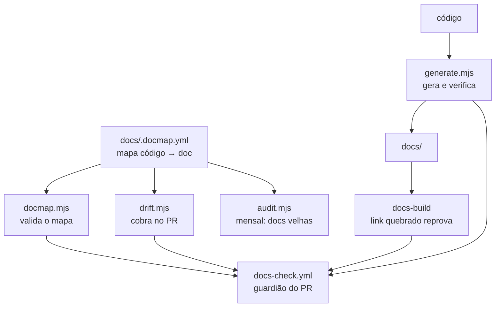

# Как документация остаётся живой {#how-documentation-stays-alive}

Документация умирает не от нехватки первоначального написания. Она умирает
от **дрейфа**: код меняется, документ остаётся, и однажды кто-то замечает,
что он описывает систему, которой больше нет. С этого момента никто не
доверяет ни одной странице, включая правильные.

Эта страница объясняет механизм, существующий, чтобы этого избежать.
Прочитайте её, если CI пожаловался на вас, — и прочитайте, прежде чем
отключать любую его часть.

## Принцип: генерировать > проверять > напоминать {#the-principle-generate--verify--remember}

Три уровня, в порядке убывания надёжности:

| уровень | как работает | когда использовать |
|---|---|---|
| **Генерировать** | документ выходит из кода; дрейф невозможен | список И ЕСТЬ содержимое |
| **Проверять** | документ пишется вручную, CI проверяет, что он полон | проза важнее списка |
| **Напоминать** | CI предупреждает того, кто открыл PR | когда нужно человеческое суждение |

Последний уровень самый слабый, поэтому он — последнее средство.
Предупреждение, которое никто не читает, ничего не защищает.

### Число в прозе — случай *проверки* {#a-number-in-prose-is-a-verify-case}

Число посреди фразы — «30 ADR», «следующий — `0031`» — не генерируется: оно
живёт внутри текста, и замена его маркером сделала бы прозу источника
нечитаемой. Но оно **проверяемо**, и именно там ему место.

Без этого оно молча стареет. Так и случилось: опубликованный сайт говорил
«28 из них» и «29 решений», когда их было уже 30, и «следующий — 0030», когда
0030 уже был сделан. Ничего не сломалось, ни одна проверка не пожаловалась —
просто стало неверно.

**Список проверяемых чисел вырос после того, как третий случай доказал то же
самое.** Внешнее ревью обнаружило, что README объявляет «158 RN», когда их
было написано 331, — ошибка более чем вдвое, в таблице, представляющей
репозиторий. Это было исправлено вручную (PR #412), что лишь обнуляет часы:
следующая RN снова сделала бы его устаревшим. Поэтому проверка перестала
покрывать только подсчёты ADR и стала покрывать **три** семейства, каждое из
которых читается из АРТЕФАКТА и никогда из другой прозы:

| число в прозе | источник истины |
|---|---|
| число ADR, номер следующего ADR | файлы в `docs/adr/` |
| число RN | заголовки `### RN-NNN` в `business-rules.md` |
| число LLM-провайдеров | литералы `capabilities`, которые находит `descobrirProviders()`, — тот же источник, что у генерируемой таблицы в `llm-providers.md` |

Число провайдеров пишется **словами** («nove providers»), и проверка
сравнивает со словом, а не заставляет прозу превращаться в цифры: проверка
существует, чтобы защищать текст, а не переделывать его.

**Начиная с AT-399 (2026-10-03) эти числа также переписываются.**
Параллельные PR, каждый из которых добавлял RN или ADR, писали общие числа
вручную, и каждый merge делал остальные устаревшими: страж документации
провалил 8 из 30 запусков за три часа только из-за этого. Поэтому
`pnpm docs:generate` (режим записи) теперь исправляет на месте то, что
определяет источник, — подсчёты ADR и RN выше, номер следующего ADR
(отбрасывая дублирующуюся строку «следующий —», оставленную merge), отступ
записей `docs/adr/temas.yml`, написанных в колонке 0, и строку ссылки с
символом (ниже). Чистые функции живут в `scripts/docs/reescrita.mjs`,
`refs-com-simbolo.mjs` (`novaLinha`, `reancorar`) и `temas-de-adr.mjs`
(`corrigirRecuo`). `--check` сохраняет ту же строгость: закоммиченный
устаревший файл по-прежнему проваливает CI, а исправление — это
`pnpm docs:generate` плюс коммит, как и у генерируемых файлов. Что всё ещё
требует человека: фраза, шаблон которой перестал совпадать (`CEGO`), ADR без
темы, переменная без описания и ссылка, символ которой ушёл из файла,
сдвинулся более чем на 40 строк или делит ничью между двумя ближайшими
вхождениями.

Самым дорогим случаем была **версия, объявленная в прозе**: README объявлял
`v0.1.0` от Фазы 5 вплоть до v2.1.0 — на семь релизов позади реальности, в
первом, что читает новичок. Проверка сравнивает прозу с первым
`## vX.Y.Z` в CHANGELOG, который пишет workflow релиза и который
возвращается через PR; тег, прочитанный из git, не сработал бы, потому что в
поверхностном checkout CI может не оказаться ни одного тега. **Значок**, с
другой стороны, вышел из проверки и стал генерацией: он читает релиз GitHub
напрямую (`shields.io/github/v/release`) и обновляется сам — проверяется
только то, что нельзя сгенерировать.

И это случилось **по разу на каждую входную дверь**. `docs/intro.md` — первая
страница опубликованного сайта, до которой не все доходят через README, —
продолжала говорить «Fases 1 a 5 concluídas, v0.1.0», пока продукт был на
Фазе 26. Проверка только README никогда не защищала вторую дверь, поэтому
`verificarVersaoAnunciada` стала получать оба файла списком, а
`scripts/ci/readme-version.ts` стал писать в оба в том же коммите, что и
CHANGELOG. Обе половины идут вместе намеренно: проверка, требующая того,
чего не пишет генератор, заставляла бы каждый релиз рождаться красным в PR,
который открывает бот и который никто не может исправить.

Шаблон `intro.md` требует **целую** фразу — «Phases 1 through NN complete,
version vX.Y.Z», — а не только версию: обе половины стареют вместе, и
совпадение лишь половины оставило бы число фаз лгать рядом с правильной
версией. Число фаз отсюда не генерируется: релиз знает версию, но не фазу.

`generate.mjs` теперь сверяет эти утверждения с реальностью каталога. И
**шаблон, переставший совпадать, тоже проваливает**: проверка, чья regex
перестала находить фразу, хуже отсутствия проверки, потому что она навсегда
остаётся зелёной, утверждая, что проверила то, на что никогда не смотрела.
Когда фраза меняется, CI говорит `CEGO` и просит поправить шаблон.

Добавление нового утверждения в проверку — это запись в одном из списков
`afericoes` — `verificarContagensDeAdr` (файл, шаблон, ожидаемое значение),
когда источник истины — каталог ADR, `verificarVersaoAnunciada`, когда это
последний релиз в CHANGELOG, — или собственная функция рядом с ними, когда
это ни то, ни другое.

**Подсчёты, выводимые из кода (AT-123).** Проход 2026-09-25 по `docs/`,
`README.md`, `CONTRIBUTING.md`, `THIRD_PARTY_NOTICES.md` и `CLAUDE.md` нашёл
пять уже неверных чисел — «nove schemas» (одиннадцать), «doze operações»
контракта git (пятнадцать), «dez abas» (двенадцать), «três imagens»,
собираемых CI (пять), «Thirteen types» у `proposed_action` (двадцать один), —
ни одного с проверкой за ним. Подсчёты, источник которых — место в коде,
теперь живут в `scripts/docs/contagens-do-codigo.mjs`, вызываемом
`verificarContagensDerivadasDoCodigo`: одна строка таблицы на ФРАЗУ (один и
тот же подсчёт, произнесённый в двух файлах, — это две фразы, стареющие
по отдельности), каждая указывает на экстрактор, считающий артефакт, —
блоки `overrides` двух `pnpm-workspace.yaml`, `CASOS` и `ARQUIVOS_CURADOS`
golden-set и его `floor.json`, итог, который печатает
`scripts/ci/imagens-pinadas.ts`, `ALVOS`, цикл non-root в smoke, методы
`GitProviderContract` и `DockerPort`, `REGISTRO` вкладок, сервисы compose dev
без `profiles:` (у ВСЕХ должен быть healthcheck, иначе ожидаемое значение
становится фразой, которой нет в прозе), `ACTION_TYPES`, enum `action_status`
и вызовы `pgTable(`. Сравнение игнорирует регистр и следует форме фразы
(португальские слова в мужском/женском роде, английские слова или цифры).
Поскольку экстракторов много, каждый доказан МУТАЦИЕЙ в
`contagens-do-codigo.spec.ts`: измените артефакт, но не прозу, — и он должен
провалиться с `DESATUAL`; удалите фразу или источник — и он должен
провалиться с `CEGO`.

Что было **датировано, а не выведено**, и почему: подсчёты файлов по
приложениям в `architecture.md` и «seis rotas» broker меняются почти с каждым
PR или читаются из `switch`, поэтому проверка лишь добавила бы шума — у них
стоит «medido em 2026-09-25». Числа, описывающие инвариант замысла («две
слоя», «три состояния»), или прошлое измерение, уже датированное на месте
(`THIRD_PARTY_NOTICES.md`, протоколы восстановления в runbook), остались как
были.

### Ссылки на строки с символом {#line-references-with-a-symbol}

RN цитирует код по `путь:строка`, и номер строки стареет каждый раз, когда
кто-то правит файл. RN-547 цитировала `fechar_a_instalacao` в
`install.sh:966` и `post_interno` в `:682`. 2026-09-17 они были в `:1107` и
`:809`, а 2026-09-18 — в `:1463` и `:1165`. Номер строки нельзя
сгенерировать и, как правило, нельзя и проверить, потому что
`apps/api/src/foo.ts:40` сам по себе не говорит, что там должно быть. Однако
когда RN также **называет символ** рядом со строкой, строку *можно*
проверить. Это единственный случай, который проверяет `generate.mjs`
(`verificarRefsComSimbolo`, с логикой в `scripts/docs/refs-com-simbolo.mjs`,
протестированной).

**Шаблон намеренно узок.** Шумную проверку отключают в первый же месяц. Она
читает три файла RN (`business-rules.md`, `business-rules/custo.md`,
`business-rules/autenticacao.md`) и ловит только эти две формы:

```
`<path>:<N>` (`<symbol>`     explicit reference
`:<N>` (`<symbol>`           continuation — inherits the path
```

- Символ должен идти **сразу после** ссылки, открывая скобку и в обратных
  кавычках. Между ними допустимы только пробельные символы, включая перевод
  строки.
- Символ должен быть **идентификатором**: `fechar_a_instalacao`, `join/3`,
  `git_dir?`, `Engine.Runners.RunnerReadiness`, `decide()`.
  `MARCADOR_SCHEMA=3`, фраза или путь — не символ, и пропускаются.
- **Неоднозначные пары пропускаются**: `:640`/`:647` (`a`/`b`) или две ссылки
  перед одним символом. Проверка не может знать, какой символ относится к
  какой строке.
- Продолжение наследует последний явный путь **в том же пункте списка**.
  Пустая строка или новый `- ` завершает пункт.
- Путь разрешается от корня репозитория. Если его там нет, проверка
  использует **единственный** отслеживаемый файл, путь которого им
  заканчивается. Если не совпал ни один файл или совпало больше одного,
  ссылка учитывается отдельно как неразрешённая.

Ссылка **совпадает**, когда символ или его последний сегмент после `.`
встречается целым словом в пределах **±3 строк** от `N`. Окно допускает
цитату, указывающую на docblock вместо сигнатуры. Оно мало, потому что
дрейф уходит на десятки и сотни строк. Когда ссылка не совпадает, вывод
называет ближайшую строку, где встречается символ. Начиная с AT-399
`pnpm docs:generate` переписывает `N` на эту строку, когда ближайшее
вхождение **единственное** (без ничьей на том же расстоянии) и находится не
дальше **40 строк** (`DISTANCIA_MAXIMA_DE_REANCORA`); когда символ исчез из
файла, ушёл дальше или два вхождения делят ничью, ссылка остаётся как есть и
должна быть перечитана по символу вручную. Ближайшее вхождение может быть
вызовом, а не определением, — это принятая цена за то, чтобы не править
числа вручную в параллельных PR, а diff перегенерированного файла показывает
каждое перемещение для ревью.

**Измерено 2026-09-18** по всем `путь:N` трёх файлов:

| | количество |
|---|---|
| ссылок `…:N` всего | 592 |
| совпадают с шаблоном | 187 |
| верных (в пределах ±3) | 116 |
| неверных | 71 |
| неразрешённый путь | 0 |

Выборочная проверка 71 не нашла ложных срабатываний: каждая
охваченная ссылка была реальным дрейфом, переименованием или символом,
сменившим файл. Расширение окна до ±5 очистило бы лишь три из них. Девять
отстоят на 4–10 строк, а остальные 62 — дальше. Пункт кода RN-547 был
перечитан по символу и исправлен в том же PR, что оставляет **63**. Их
слишком много, чтобы исправлять по одной в рамках этого изменения, а
ближайшее вхождение не всегда является определением. Список — то, что
печатает `pnpm docs:check`.

**Строгость при рождении: `warn`.** Она сообщала и не проваливала, потому что
`block` остановил бы любой PR, касающийся файла RN, из-за долга, оставленного
кем-то другим. Было исключение, правило дома: если проверка извлекает
**ноль** ссылок, это `CEGO` и **провал**. Ноль означает, что синтаксис RN
изменился или экстрактор сломан, а слепая проверка остаётся зелёной
навсегда.

**Исходный критерий для `block`** (PR #593): когда список будет **пуст**, и
после **четырёх недель подряд** `docs:check` в `dev` без новых неверных
ссылок в RN, затронутых за эти недели. С этого момента каждая новая неверная
ссылка — вина текущего PR, и PR может её исправить. Повышение раньше
взыскивало бы с каждого PR чужой долг. Если шаблон до этого покажет
реальное ложное срабатывание, сузьте шаблон. Не расширяйте окно.

**Список обнулился 2026-09-26** (AT-122). За восемь дней после введения
проверки 63 заведомо неверные ссылки выросли до **75**. Этот рост — дрейф,
который проверка и существует показывать. Все 75 были перечитаны по символу
против кода того дня, и ни одна не была ложным срабатыванием шаблона.
Большинство сдвинулись на десятки строк. Одна была переименованием:
`modo_de_execucao/1` стал `exigencias_do_projeto/1` в RN-516. Одна сменила
файл: `escreverEnv` переехал из `preflight.mjs` в `env-file.mjs`. Две
указывали на правильный тест, но на строку `it(`, тогда как символ (`types`)
встречается лишь несколькими строками ниже, в теле. Эти две теперь
указывают на строку тела. Окно осталось ±3. У пунктов с худшим дрейфом
(RN-566, RN-567, RN-570 и RN-514) соседние непроверяемые ссылки были
перечитаны в том же проходе. После этого **273 ссылки совпадают с шаблоном,
273 верны и 0 неверны**. Четыре недели начали бы отсчитываться, когда это
изменение дойдёт до `dev`.

**Повышена до `block` 2026-10-01** (AT-122) решением сопровождающего, не
дожидаясь четырёх недель. Через пять дней после обнуления списка в `dev`
снова было **140** неверных ссылок из 896, совпадающих с шаблоном: `warn` не
удержал дрейф, потому что предупреждение, по которому никто не обязан
действовать, — предупреждение, которое никто не читает. Все 140 были
перечитаны по символу в том же изменении, которое повысило проверку, никогда
не прибавляя дельту, и окно осталось ±3. Ни одна не была ложным
срабатыванием шаблона, и ни одного символа не было в его файле
недостающим. Что проход нашёл помимо дрейфа строк:

- **Остатки merge.** Три пункта были продублированы при разрешении
  конфликта: копия со старыми числами рядом с копией с новыми (`Where`
  RN-120, `Código` RN-547 и строка `SessionPage.tsx` RN-626). Устаревшая
  копия удалена, и поэтому итог ушёл с 896 до **883**.
- **Ссылка, чей предмет изменился (дрейф состояния, а не строки).** RN-587
  цитировала тест сообщения от `infra`; начиная с RN-617 Infra Lead
  разговаривает, и тест теперь использует `qa` как агента состава без
  разговора. Ссылка теперь говорит это. Правило RN не изменилось.
- Соседние непроверяемые ссылки в пунктах с худшим дрейфом (RN-547,
  RN-567, RN-587, RN-609, RN-663, RN-566) были перечитаны в том же проходе
  там, где удалось определить тест или условие, которые они называют.

После этого **883 ссылки совпадают с шаблоном, 883 верны и 0 неверны**.

**Строгость сейчас: `block`.** Ссылка, которая не совпадает, **или** чей путь
больше не разрешается в единственный отслеживаемый файл, проваливает
`docs:check`. Это один и тот же дрейф: RN указывает туда, где кода нет. Ноль
ссылок по-прежнему `CEGO` и по-прежнему проваливает. Вердикт — `veredito` в
`refs-com-simbolo.mjs`, доказанный мутацией в spec рядом: ссылка, сдвинутая
за пределы окна, проваливает, символ, ушедший из файла, проваливает, путь,
больше не разрешающийся, проваливает, а текст, переписанный до нуля
извлечений, — `CEGO`, никогда не `ok`. Когда проваливает, исправьте ссылку
**по символу** (вывод называет ближайшую строку, где он встречается, — это
подсказка, а не исправление). Не расширяйте окно и не сужайте шаблон, чтобы
реальная ссылка исчезла; сужайте его только из-за реального ложного
срабатывания, с этим случаем в spec.

Переводы pt-BR трёх файлов RN в `website/i18n/` **не** проверяются. В них
мало ссылок (23 совпадают с шаблоном, 15 из них неверны на 2026-10-01), а
перевод в любом случае отстаёт от английского источника; проверка копии,
которую никто не поддерживает в актуальном состоянии, проваливала бы каждый
PR из-за отставания перевода.

### Каждый заголовок RN несёт свой якорь {#every-rn-heading-carries-its-anchor}

Якорь `{#rn-NNN}` в заголовке RN — контракт для внешних ссылок: он переживает
новый заголовок RN и перенос RN в другой файл. 2026-09-26 (AT-230) в `dev`
было **451** заголовок `### RN-` и **449** якорей. RN-305 и RN-306 были
написаны без якоря, в `business-rules.md` и в его переводе pt-BR, и ничего не
провалилось. Сборка сайта этого не ловит: без явного якоря Docusaurus
выводит id из текста заголовка, и страница компилируется. Ломается ссылка
`#rn-305`, которую кто-то напишет позже. Подсчёт RN тоже этого не ловит,
потому что считает заголовки, а не якоря.

`generate.mjs` теперь это проверяет (`verificarAncorasDeRn`, с логикой в
`scripts/docs/ancoras-de-rn.mjs`, доказанной мутацией в
`ancoras-de-rn.spec.ts`). Каждый заголовок любого уровня, который
**начинается** с `RN-<цифры>`, должен **заканчиваться** на `{#rn-<mesmos
dígitos>}`, включая ведущие нули (`RN-001` → `rn-001`). Отсутствующий якорь и
якорь с другим номером или именем проваливают оба, по строке на заголовок, с
файлом и строкой. Ноль найденных заголовков — `CEGO`, и тоже проваливает.

**Строгость: `block`**, в отличие от ссылок на строки выше: унаследованного
долга нет (два недостающих якоря добавлены в том же изменении), и каждый
новый заголовок пишет PR, который его добавляет.

**Переводы тоже покрыты.** Файлы находятся по glob: `docs/business-rules.md`,
`docs/business-rules/*.md` (источник pt-BR, ADR 0216) и те же два пути в
`website/i18n/<locale>/docusaurus-plugin-content-docs/current/` для каждого
переведённого locale в `LOCALES_TRADUZIDOS` (`en`, `ru`, `zh-Hans`). Сайт
locale отдаёт `business-rules#rn-305` из переведённого файла, а один из
прежних переводов скопировал заголовок без якоря. Правило действует по
заголовку, поэтому частичный перевод не проблема: непереведённая RN
падает на источник pt-BR, который проверяется в любом случае.

### Таблица процедур runbook {#the-runbook-procedures-table}

Runbook заканчивается таблицей своих процедур **эксплуатации** —
`procedure | anchor | verification | schedule`, — говорящей, что доказывает
каждую и что запускает это доказательство
([Procedures and how each is verified](../runbook.md#procedimentos-e-verificacao)).
Она существует из-за критерия закрытия EP-015: ни одной строки с пустой
проверкой или со словами «см. ниже», а существующие доказательства
запускаются по расписанию, а не по памяти. Измерено 2026-09-25 (AT-129):
таблицы, о которой говорил критерий, в репозитории не существовало — копия
из семи строк жила в заметках сопровождающего, против 28 процедур
эксплуатации здесь, а одна строка указывала на другую заметку. Таблица имён
файлов, написанная вручную, стареет так же, как числа в прозе, — spec
переименовывают, workflow теряет `schedule:`, а ячейка продолжает
утверждать.

`generate.mjs` её проверяет (`verificarProcedimentosDoRunbook`, логика в
`scripts/docs/procedimentos-do-runbook.mjs`, доказанная мутацией в
`procedimentos-do-runbook.spec.ts`). Для каждой строки она проваливает,
когда:

- в ячейке **anchor** нет ссылки `(#id)`, или id не является явным `{#id}` в
  заголовке runbook, — тот же контракт, что у якорей RN: раздел с новым
  заголовком не может сломать ссылку;
- ячейка **verification** пуста, гласит «see below/above», называет файл, не
  отслеживаемый git, или цель `make`, которой нет в `Makefile`, или не
  называет ничего проверяемого и не начинается с `**None**` — явного
  заявления, что доказательства нет;
- сегмент **schedule** (они разделены `;`) не начинается со своего класса
  триггера — `weekly`/`daily`/`monthly`, `every PR`, `every tag` или
  `manual`, — или упомянутый в нём workflow не существует или не имеет этого
  триггера в прочитанном `on:` (`schedule:`, `pull_request`, `push: tags`).
  Сегмент `manual` не может упоминать workflow.

Колонка называется `schedule` и намеренно принимает `every PR` и `every tag`.
Вопрос критерия — «запускается ли без того, чтобы кто-то вспомнил?», и spec,
который `ci.yml` запускает в каждом pull request, отвечает «да»; назвать его
`manual` значило бы ошибиться в обратную сторону. Проверка гарантирует, что
записанный класс — тот, который у workflow **есть**: `weekly`, указывающий на
workflow без `schedule:`, проваливает, — это тот случай, который назвала
AT-193.

Отсутствующий раздел, отсутствующая таблица, изменённые заголовки колонок
или ноль строк — `CEGO` и провал.

**Строгость: `block`**, по той же причине, что и у якорей RN: таблица
родилась с проверенной каждой строкой, поэтому унаследованного долга нет, а
то, что сломает её потом (переименованный spec, workflow, потерявший
расписание), — вина PR, который её сломал, и он же может её исправить.

**Таблица есть только в runbook источника (`docs/runbook.md`).** Его старая
копия pt-BR отставала (AT-209) и ушла с ADR 0216; будущий перевод в
`website/i18n/<locale>/` попадает под правило `traducao` docmap (`warn`) и не
имел бы десяти явных id, которые добавила эта таблица. Вторая копия таблицы
там, без проверки, была бы ровно той копией, которую таблица существует
заменить.

### Индекс ADR сгруппирован по темам {#the-adr-index-is-grouped-by-theme}

Индекс ADR группировался по фазам. Когда фазы закончились, последний раздел
стал индексом: измерено 2026-10-01, 148 из 191 строки жили под
`## Phase 12`. [ADR 0202](../adr/0202-o-indice-de-adr-por-tema.md) группирует
его по **теме** и выносит тему **за пределы** ADR — принятый ADR никогда не
редактируется, даже чтобы получить ключ `tema:` во frontmatter.

Тема живёт в `docs/adr/temas.yml`, рядом с индексом: `temas:` — закрытый
упорядоченный список (`id`, `titulo`, `descricao`), а `adrs:` сопоставляет
каждый номер ADR ОДНОЙ теме. Индекс **проверяется, а не генерируется** —
однострочные описания курируются, и ни один скрипт их не пишет, по той же
причине, что приводит `verificarIndiceAdr`, — и каждая тема — это раздел
`## <titulo> {#tema-<id>}`, в порядке списка, со строками в числовом
порядке.

`generate.mjs` его проверяет (`verificarTemasDeAdr`, сразу после
`verificarIndiceAdr`; логика в `scripts/docs/temas-de-adr.mjs`, доказанная
мутацией в `temas-de-adr.spec.ts`). Он проваливает файл ADR без темы, тему в
карте, которой нет в списке, запись карты для несуществующего ADR, тему из
списка без ADR, повторяющийся или неправильно оформленный id или заголовок
темы, а в индексе — отсутствующий, повторяющийся, неверно названный, не по
порядку стоящий или неизвестный раздел темы, или строку ADR под разделом
другой темы, вне какого-либо раздела темы, повторяющуюся или нарушающую
числовой порядок. Нечитаемый YAML, пустой список или карта, или индекс вообще
без разделов тем (старый индекс по фазам) — `CEGO` и провал.

**Строгость: `block`**, как у таблицы runbook: родилась с
классифицированным каждым ADR, поэтому то, что сломает её потом, — новый ADR,
чей PR забыл его строку в `temas.yml`, — PR, который может это исправить.
Переводы индекса живут в `website/i18n/<locale>/` и не проверяются; правило
`traducao` предупреждает, как всегда.

## Части {#the-pieces}



### `docs/.docmap.yml` — карта {#docsdocmapyml--the-map}

Связывает пути кода с документами, которые от них зависят. Это единственный
источник, говорящий «кто трогает это, должен пересмотреть то».

Две строгости: `block` проваливает PR, `warn` только комментирует. И атрибут
`generated: true`, отмечающий документы, которые выходят из генератора.

Правило, требующее бессмысленного, приучает людей рефлекторно хвататься за
аварийный выход. Поэтому `politica-de-branches` следит за **списком
разрешённых** в `scripts/ci/` — скриптами, которые *являются* политикой веток,
и их spec, — а не за `scripts/ci/**` минус вручную поддерживаемый список
исключений, в который должен был попадать каждый новый spec масштаба всего
репозитория в этой папке (одиннадцать до AT-206). Список разрешённых не
отказывается от закрытости при сбое:
`scripts/docs/politica-de-branches.spec.ts` выводит множество из
репозитория — каждый файл `scripts/ci/`, чей открывающий docblock цитирует
`branching-policy.md`, плюс его spec, — и проваливается, если правило
расходится. Новый скрипт политики объявляет свой источник в заголовке, как и
остальные, а spec делает остальное.

### `docmap.mjs` — проверяет карту {#docmapmjs--validates-the-map}

Запускается раньше всего остального, потому что сломанная карта заставляет
остальное лгать. Проваливает, если:

- **glob не совпадает ни с одним файлом** — мёртвое правило. Оно никогда не
  срабатывает и создаёт впечатление покрытия, которого нет. Это самый тихий
  дефект, какой может быть у docmap, и он был обнаружен в 8 glob, когда
  появился валидатор.
- документ, на который указывает карта, не существует
- есть дублирующийся id или недопустимая `severity`

### `generate.mjs` — генерирует и проверяет {#generatemjs--generates-and-verifies}

Два режима вывода:

**Целый файл** — `docs/reference/scripts.md`. Прозы для сохранения нет:
список команд и есть содержимое. Он берётся из `package.json` каждого
пакета и из аннотированных целей `Makefile`. Список пакетов объявлен в
`gerarScripts`, включая два пакета вне workspace (`website/`, `e2e/`,
запускаемые с `--dir`), а отсутствующий или не разбираемый `package.json`
проваливает генерацию, называя его, — раньше пакет молча отбрасывался
(AT-224).

**Помеченный блок** — фрагмент между `<!-- BEGIN:GENERATED:<id> -->` и
`<!-- END:GENERATED:<id> -->` внутри файла, написанного вручную. Это случай
`configuration.md` и `events.md`: там проза («что ломается, когда эта
переменная неверна») стоит гораздо больше списка, но **список** должен быть
полным. Блок — инвентарь; текст вокруг — объяснение.

Инвентарь помечает ⚠️ то, что встречается в коде и **не** имеет описания в
прозе. Так `tool.result` и `agent.response` — два настоящих типа событий —
появились после того, как не попали в первый черновик.

**Что ловит инвентарь окружения, измерено (AT-124, 2026-09-25).** Источники
и их glob живут в `scripts/docs/fontes-de-env.mjs`, доказанные против
реального дерева `fontes-de-env.spec.ts`. По одной мутации на источник —
новый `process.env.X` в файле прямо в `e2e/`, вложенном в `e2e/suporte/`,
прямо в `apps/api/scripts/` и на уровень ниже, каждый с `git add`, —
заставили `--check` провалиться с `DESATUAL` в `configuration.md` во всех
четырёх. Найдена и закрыта одна дыра: фильтр `.spec.`, правильный для
источников, где spec — модульный тест рядом с кодом, отбрасывал также
`e2e/testes/*.spec.ts` — сами тесты Playwright, где новая переменная `e2e/`
скорее всего и родится, — и эта мутация проходила зелёной. Одно
ограничение заявлено: инвентарь читает только **версионируемые** файлы
(`git ls-files`), поэтому неотслеживаемый файл невидим до `git add`.

**`deploy/k8s/*.sh` стал источником (AT-212, 2026-09-28).** Bootstrap и
доказательства свойств читают двадцать с лишним переменных окружения — имя
кластера, namespace, учётную запись smoke, потолки каждого доказательства, —
и ни одной не было в инвентаре. Это источник `ferramenta`, сопоставляемый по
**раскрытию со значением по умолчанию** shell (`${X:-…}`, `${X:=…}`,
`${X:?…}`) и только по нему: чистый `${X}` почти всегда — переменная самого
скрипта. Мутация: новый `${X:-x}` в `deploy/k8s/validate.sh`, в stage,
заставил `--check` провалиться с `DESATUAL` и строкой `SEM DESC.`, называющей
переменную и файл.

**⚠️ окружения — это ворота (AT-211, 2026-09-27).** До этого проваливал лишь
**устаревший блок**: как только `docs:generate` его переписывал, переменная
оставалась там с ⚠️, и `--check` проходил — `HUGGINGFACE_API_TOKEN` и
`HUGGINGFACE_HUB_URL` оставались так месяцами. Решением сопровождающего
`--check` теперь проваливает **любой** ⚠️ в инвентаре окружения, для **обоих**
видов источника (`produto` и `ferramenta`), даже с актуальным блоком. Сбой
называет переменную, файл, который её читает, и раздел `configuration.md`,
куда идёт описание (строки `SEM DESC.`). Правило живёт в
`scripts/docs/inventario-de-env.mjs` и доказано мутацией в
`inventario-de-env.spec.ts`: новая переменная без описания проваливает, та же
с описанием проходит.

`**TODO(humano):**` в строке, упоминающей переменную, **считается описанием**
и не проваливает: правило документации — «никогда не выдумывать; без
информации — TODO(humano)», а ворота, проваливающие TODO, подталкивали бы
того, кто не знает, что делает переменная, выдумать фразу ради зелёного.
TODO — **объявленный** пробел, с вопросом, записанным там, где будет ответ;
⚠️ — **молчаливый** пробел. `--check` всё равно перечисляет переменные,
описанные только TODO, в строке `TODO`, без провала. Инвентарь событий в
`events.md` сохраняет свой ⚠️ как видимый пробел — решение касалось только
инвентаря окружения.

`--check` ничего не пишет и проваливается, если что-либо стало бы иным. Это
режим CI.

### `drift.mjs` — требует в PR {#driftmjs--enforces-it-in-the-pr}

Сопоставляет `git diff --name-only <base>...HEAD` с картой. Для каждого
сработавшего правила, документ которого не тронут: `block` проваливает,
`warn` комментирует.

В PR Dependabot, чей diff — только замена закрепления action, шаг сразу
перед drift (`scripts/ci/dependabot-justifica-pin.ts`) пишет строку
`docs-not-needed:` в тело, в том же job, чтобы записать и прочитать за один
запуск. Workflow слушает `edited`, а `@dependabot rebase` порождает
`synchronize` и `edited` вместе; `concurrency` отменяет один, поэтому
выживший запуск может быть запуском `edited`. Поэтому шаг также срабатывает
на `edited`, **когда редактировал бот** (AT-100), и никогда — когда человек
(удаление им строки побеждает). Зациклиться невозможно: правки тела,
сделанные токеном workflow, не порождают `edited`. Сбой остаётся закрытым:
если запись не удалась, drift читает тело события, и PR остаётся
заблокированным.

### `audit.mjs` — ежемесячный аудит {#auditmjs--the-monthly-audit}

Проверка дрейфа ловит документ, ставший **неверным** в PR. Аудит ловит
документ, ставший **старым**, хотя его никто не трогал, — это сложнее
заметить. Он сообщает:

- страницы без изменений месяцами, у которых соответствующий код с тех пор
  изменился
- незакрытые пункты `TODO(human)`
- ссылки `файл:строка`, которые больше не разрешаются
- ADR в статусе `proposed` дольше 60 дней

Всегда в **одном и том же** issue, обновляемом на месте. Новый issue каждый
месяц становится спамом, а спам отключают.

### Сборка сайта {#the-site-build}

`onBrokenLinks`, `onBrokenAnchors` и `onBrokenMarkdownLinks` установлены в
`throw`. Перемещение файла без исправления тех, кто на него ссылается, ломает
CI, а не превращается в 404 в production. Это самый дешёвый механизм из всего
набора.

### Новую страницу нужно вручную добавить в `sidebars.ts` {#a-new-page-needs-to-be-added-to-sidebarsts-by-hand}

Markdown-содержимое живёт в `docs/`, а **маршрутизация** — в
`website/sidebars.ts`, — и его разделы перечисляют элементы поштучно, а не
обходят каталог. Создание файла в `docs/` без добавления его туда даёт
страницу, которая существует, отдаётся по прямому URL и **не появляется в
навигации**.

Сборка **не** проваливается из-за этого: страница-сирота — не битая ссылка.
Это визуальная проверка, и это единственный шаг механизма без страховки —
после `pnpm docs:build` откройте боковую панель и убедитесь, что страница
там.

### `api-render-check.mjs` — зелёная сборка — не страница, которая отрисовывается {#api-render-checkmjs--a-green-build-isnt-a-page-that-renders}

Эта часть существует из-за дорогого урока: **117 страниц операций
справочника API вышли в эфир мёртвыми в релизах `v1.0.0` и `v1.0.1`**, и ни
одна проверка этого не поймала.

Конфигурация Docusaurus не объявляла `docItemComponent:
'@theme/ApiItem'`, поэтому Docusaurus использовал стандартный
`@theme/DocItem`. `ApiItem` — единственное место в
`docusaurus-theme-openapi-docs`, которое монтирует `<Provider>` redux, а
`@theme/ApiExplorer/MethodEndpoint`, импортируемый каждым `.api.mdx`, читает
этот store через `useSelector`. Без обёртки контекст пуст — и error boundary
заменял всю страницу на *"This page crashed."*

Здесь важен режим сбоя, потому что он побеждает все остальные части этого
механизма:

| этап | результат |
|---|---|
| MDX компилируется | ✅ компоненты темы существуют и разрешаются |
| SSR отрисовывает | ✅ отдаваемый HTML содержит содержимое маршрута |
| `pnpm docs:build` | ✅ **зелёный** |
| гидратация в браузере | ❌ страница стирается |

Другими словами: **«сборка прошла» никогда не было доказательством того, что
страница работает.**

Начиная с ADR 0206 этот плагин ушёл: справочник — **одна страница Redoc**
(redocusaurus, отрисовываемая на сервере) в `/reference/api/`, и нет
`ApiItem`, который можно забыть. Урок остаётся, поэтому остаётся и страж:
`api-render-check.mjs` запускается после `docs:build` и утверждает, в обоих
locale, что `reference/api.html` существует, несёт `info.title` из spec и
содержит отрисованный на сервере раздел для каждой операции
`docs/reference/openapi.json` (`data-section-id=tag/<tag>/operation/<id>`
Redoc).

Он ловит исчезновение страницы, пустую отрисовку или потерю операций — но не
сбой гидратации, для которого нужен headless-браузер.

Тот же эпизод породил правило `site-e-publicacao` в карте: `website/**` не
покрывалось ни одним правилом, и изменение конфигурации сайта не требовало
документации.

### Четыре locale, с pt-BR как источником (ADR 0216) {#four-locales-with-pt-br-as-the-source-adr-0216}

`docs/` — дерево **pt-BR**, источник и locale по умолчанию
(`defaultLocale: 'pt-BR'`, отдаётся в корне каждого окружения). Переведённые
locale — `en`, `ru` и `zh-Hans`, в
`website/i18n/<locale>/docusaurus-plugin-content-docs/current/`, с подписями
темы в `website/i18n/<locale>/docusaurus-theme-classic/` и подписями боковой
панели в `.../docusaurus-plugin-content-docs/current.json`. Страница без
перевода в locale отдаётся из источника pt-BR по тому же slug. Локальный
поиск индексирует `pt`, `en`, `ru` и `zh`. Страницы, чья старая копия pt-BR
устарела, остаются в `docs/` на том языке, на котором они есть, до своей
партии.

Английский сайт ушёл из корня в `/brabo/<environment>/en/…`, а старые ссылки
на `/brabo/<environment>/pt-BR/…` переписываются корневым `404.html`
(`scripts/docs/landing.mjs`) в `/brabo/<environment>/…`, по образцу
`/main/` → `/prd/` (ADR 0073).

Правило `traducao` в docmap (было `traducao-pt-br`) следит за источником и
указывает на `website/i18n/`. Оно `warn` и никогда не `block`: требование
перевода в каждом PR документации стоило бы трёх переводов на изменение.

### Паритет перевода генерируется, и страница говорит, когда отстаёт (AT-550) {#translation-parity-is-generated-and-the-page-says-when-it-is-behind-at-550}

Отставание сдерживает измерение, а не docmap.
`scripts/docs/paridade-de-traducao.mjs` (доказан мутацией в spec рядом)
запускается внутри `pnpm docs:generate` и пишет два файла:
`docs/reference/paridade-de-traducao.md` (`generated: true`) и
`website/src/data/traducao.json`. По каждому locale он считает
переведённые страницы и символы относительно источника (`docs/` минус
`docs/reference/**`) и делит переведённые страницы на **актуальные**,
**устаревшие** и **без происхождения**. Происхождение — это
`traducao_de: <SHA>` во frontmatter переведённой страницы, последний коммит
источника, который она переводит. Страница устарела, когда у источника есть
коммит с COMMIT DATE позже этого SHA, когда в источнике есть незакоммиченные
изменения или когда SHA не существует. Он никогда не использует часы,
поэтому `--check` даёт один и тот же ответ до и после коммита, касающегося
источника. Для UI он сравнивает ключи каждого namespace в
`apps/web/src/locales/<l>/` с pt-BR и требует каждую форму множественного
числа, которую `Intl.PluralRules` даёт этому locale. `--check` проваливается,
когда любой из двух файлов устарел.

Полоса — это swizzle-обёртка `@theme/DocItem/Content`
(`website/src/theme/DocItem/Content/index.tsx`). Вне pt-BR страница, чей
`metadata.source` находится в `@site/docs/`, является запасным вариантом
pt-BR и говорит об этом; переведённая страница, которую `traducao.json`
помечает как устаревшую, показывает дату перевода и говорит, что оригинал
изменился. Тексты живут в `code.json` каждого locale.
`scripts/docs/faixa-de-traducao-check.mjs` запускается после
`pnpm docs:build` и проверяет статический HTML: у страницы запасного варианта
есть полоса (образец берётся из первого locale — `en`, `ru` или `zh-Hans`, —
у которого ещё есть непереведённая страница; когда все полны, проверять
запасной вариант нечего), тогда как та же страница в корне и переведённая на
`en` неустаревшая страница её не имеют. Правила для переводчиков — в
[Localização](localizacao.md).

### `links-do-locale.mjs` — переписанная ссылка ускользает от проверки битых ссылок {#links-do-localemjs--a-rewritten-link-skips-the-broken-link-check}

Хук `markdown.hooks.onBrokenMarkdownLinks` в `website/docusaurus.config.ts`
переписывает ссылки, ломающиеся только из-за известного пробела перевода
(`reference/`, `adr/`, `explanation/`), в `pathname://`. Это официальный
аварийный выход Docusaurus, и ускользнуть — именно цель: **ссылка
`pathname://` больше никогда не проверяется**, поэтому неверная переписка не
может провалить сборку.

Одна провалила — для всего сайта pt-BR (AT-221). Переписывание возвращало
`pathname:///pt-BR/<slug>`, но `pathname://` — не абсолютный путь в домене:
`<Link>` пропускает его через `useBaseUrl`, а baseUrl сборки pt-BR уже
`/brabo/prd/pt-BR/`. Каждая переписанная ссылка выходила как
`/brabo/prd/pt-BR/pt-BR/...`: 441 href на 56 страницах, все 404, при зелёном
`docs:build`.

Переписывание теперь живёт в `scripts/docs/links-do-locale.mjs` как чистая
функция со spec и возвращает чистый slug — locale берётся из baseUrl любого
компилируемого locale, а целевая страница там существует (переведённая или
отдаваемая как запасной вариант по тому же slug). Тот же модуль, запущенный
после `docs:build` в `docs-check.yml`, обходит сгенерированный HTML и
проваливает любой `href` с удвоенным префиксом locale. Новый locale также
входит в `LOCALES_COM_PREFIXO`, иначе его удвоение пройдёт молча. Начиная с
ADR 0216 этот список — `en`, `ru` и `zh-Hans`: pt-BR — по умолчанию и не
имеет префикса.

При частичных переводах компиляция `en` ломает ссылку с непереведённой
страницы (отдаваемой из источника pt-BR) на переведённую в любой папке, а не
только в трёх зонах. Поэтому ссылка также считается пробелом, когда цель
**существует в источнике `docs/`** (`paginaExisteNaFonte`) — это страница,
которую отдаёт locale, переведённая или как запасной вариант. Цель, которой
нет нигде, по-прежнему проваливает сборку.

Исключение для `adr/` также поглощало опечатку в имени файла ADR: оно
смотрело только на *форму* имени (`NNNN-*.md`), поэтому
`0055-politica-de-terminal.md` — ADR, никогда не существовавший с таким
именем, — переписывался в slug, которого нет ни в одном locale. Двадцать три
такие ссылки были в документации, 404 (AT-227). С тех пор цель, похожая на
ADR, должна существовать в `docs/adr/` **до** того, как применится любое
исключение пробела, включая источник внутри `adr/`, `reference/` или
`explanation/`; неверный slug проваливает `docs:build` в каждом locale.

Чего страж **ещё не** ловит: не-ADR ссылку изнутри одной из зон пробела, цель
которой не существует в репозитории.

### Публикация, по сайту на ступень {#publishing-one-site-per-rung}

Каждая постоянная ветка публикуется в своё собственное место того же GitHub
Pages:

| ветка | URL | индексируется поисковиками |
|---|---|---|
| — (индекс) | `https://daneiel.github.io/brabo/` | ❌ |
| `main` | `https://daneiel.github.io/brabo/prd/` | ✅ |
| `qa` | `https://daneiel.github.io/brabo/qa/` | ❌ |
| `dev` | `https://daneiel.github.io/brabo/dev/` | ❌ |

Все три **симметричны** начиная с
[ADR 0071](../adr/0071-publicacao-simetrica-por-degrau.md); корень —
сгенерированная страница, перечисляющая все три со штампованной версией
каждого, и у каждого сайта есть переключатель вверху для смены ступени. До
этого `main` публиковалась в корень, и этот особый случай заставлял workflow
сохранять `/dev/` и `/qa/` на пути, выполнявшемся лишь в трети случаев.

**Путь — не имя ветки.**
[ADR 0073](../adr/0073-o-caminho-publicado-nomeia-o-ambiente.md) разделил
их: адрес называет **окружение** для читающего, а `main` — словарь того, кто
коммитит. Поэтому `main` публикуется в `/prd/`; `qa` и `dev` совпадают
случайно, а не по правилу. Карта ветка→путь существует в одной точке на
процесс — шаг «какая ступень и куда публикуется» в workflow, таблица
`DEGRAUS` в `docusaurus.config.ts` и та, что в `landing.mjs`, — и всё
остальное выводится из неё.

Два последствия, о которых стоит помнить, прежде чем это трогать:

- **`/brabo/main/` публиковался и больше не публикуется.** Поскольку дерево
  собирается и пушится с `keep_files: false`, каталог исчезает.
  Сохранённые ссылки сохраняет корневой `404.html`, который **переписывает**
  префикс (`/brabo/main/<что-то>` → `/brabo/prd/<что-то>`) как отдельный
  случай, отдельно от общего перенаправления, — которое дало бы
  `/brabo/prd/main/<что-то>`. Защита от зацикливания покрывает только
  существующие пути (`prd|qa|dev`).
- **`/prd/` был засеян из `gh-pages:main`** при переходе, по той же
  причине, по которой ADR 0071 засеял `/main/` из старого корня: без этого
  `/brabo/prd/` отвечал бы 404 между первым push в `dev` и следующим
  продвижением в `main`. Засев **переписан** с `/brabo/main/` на
  `/brabo/prd/`, потому что `404.html` не спасает подресурсы — CSS и JS,
  запрошенные по старому адресу, получили бы обратно HTML со статусом 404, и
  сайт отдавал бы сырой текст.

Это закрывает пробел конвейера: между merge в `dev` и финальным
продвижением чтение документации этого состояния требовало клонировать
репозиторий. `docs-check` собирает сайт в каждом PR, но **отбрасывает
сборку** — его вердикт «собирается без битых ссылок», а не «живёт где-то,
где я могу открыть». И именно этот разрыв между написанием и просмотром
позволил справочнику API выйти в эфир сломанным на два релиза.

Три неочевидные детали, каждая из которых уже стоила по багу:

- **`baseUrl` берётся из `DOCS_BASE_URL`**, со значением production по
  умолчанию. Он входит в каждый URL ассета: сайт в `/brabo/dev/` с
  `baseUrl: '/brabo/'` загружает HTML и больше ничего, и страница оказывается
  *сломанной без ошибки*.
- **Ступень объявляется в `DOCS_BRANCH`, а не выводится из `baseUrl`.**
  Раньше было `BASE_URL === '/brabo/'`, и это работало, пока `main` была
  единственной в корне. Когда все три оказались в подкаталоге, это сравнение
  стало ложным и для `main`, и эффектом был бы `noIndex` на НАСТОЯЩЕЙ
  документации — вне Google, молча, при зелёном CI, потому что ничто в
  сборке не проваливается из-за недоиндексации. ADR 0073 — ровно тот
  сценарий, для которого было построено это разделение: путь сменился на
  `/prd/`, и `E_PRODUCAO` не понадобилось об этом знать.
- **`noIndex` вне `main` требует `forceIgnoreNoIndex` в поиске.**
  `@easyops-cn/docusaurus-search-local` отбрасывает каждую страницу с
  `<meta name="robots" content="noindex">`, поэтому обе защиты взаимно
  уничтожились бы: ступени публиковались бы с мёртвым поиском, индексом в
  666 байт, *"No results"* на всё. `noIndex` говорит с **внешними**
  поисковиками; `forceIgnoreNoIndex` — с **локальным** индексом.
- **`main` собирает дерево перед публикацией**, возвращая `/dev/` и `/qa/`.
  `keep_files: true` было бы проще и неправильно: оно никогда ничего не
  удаляло бы, и страница, удалённая из репозитория, оставалась бы
  опубликованной навсегда.

### Публикация — это ДВА workflow, и только один наш {#publishing-is-two-workflows-and-only-one-is-ours}

Это сбивает с толку того, кто ищет deploy во вкладке Actions:

| порядок | workflow | где живёт | что делает |
|---|---|---|---|
| 1 | **`Documentação`** (`docs-deploy.yml`) | `.github/workflows/` | собирает сайт и **коммитит в `gh-pages`** |
| 2 | **`pages build and deployment`** | `dynamic/pages/` — **генерируется GitHub** | читает `gh-pages` и **отдаёт его** |

Второго нет в репозитории, и он не появляется в списке версионируемых
workflow; GitHub создаёт его сам, когда источник Pages — ветка. Наш workflow
заканчивается коммитом — он **не** публикует в Pages, хотя его job всё ещё
называется "Publish to GitHub Pages".

> **Практическое последствие:** сайт может быть старым даже при зелёной
> `Documentação`. Если `build_type` у Pages не `legacy`/`gh-pages`, коммит
> происходит, и никто его не отдаёт, — и ничто в CI не краснеет. Проверка —
> `gh api repos/daneiel/brabo/pages`, записанная в
> [Rulesets](../reference/rulesets.md).

Весь замысел, с отвергнутыми альтернативами, — в
[ADR 0034](../adr/0034-documentacao-publicada-por-degrau.md).

## Запуск на вашей машине {#running-it-on-your-machine}

У `website/` собственный `pnpm-lock.yaml` начиная с [ADR 0117](../adr/0117-lockfile-proprio-para-o-website.md) —
`pnpm install` в корне его больше не достаёт, поэтому в первый раз (или
после изменения его lockfile) нужен лишний шаг:

```bash
cd website && pnpm install && cd ..  # only the first time, or when website/pnpm-lock.yaml changes

pnpm docs:check      # validates the map + checks generated content is up to date
pnpm docs:generate   # regenerates
pnpm docs:drift      # simulates the PR check (origin/dev...HEAD)
pnpm docs:build      # the build CI runs — pnpm --dir website build under the hood
pnpm docs:start      # local server, with hot reload

# does the API reference render? needs the build above, and isn't part
# of docs:check because that one doesn't build the site
node scripts/docs/api-render-check.mjs
node scripts/docs/links-do-locale.mjs   # no href with a doubled locale prefix (AT-221)
```

Или, если вы в Claude Code, `/sync-docs` прогоняет весь цикл и выдаёт отчёт
о том, что изменилось, что стало `TODO(human)` и что было намеренно
**оставлено** без изменений.

### Конъюнкция по умолчанию, дизъюнкция, когда документ разделён {#conjunction-by-default-disjunction-when-the-doc-was-split}

Список `docs:` правила — **конъюнкция**: каждый перечисленный документ должен
измениться, иначе правило срабатывает. Это правильное значение по умолчанию
— именно оно делает требуемым «изменил gate — обнови документ gate И
правила».

Оно оказалось неверным ровно один раз, и исправление — `docs_alternativos:`,
**дизъюнкция**: любой из перечисленных документов удовлетворяет правилу. Она
существует, потому что `business-rules.md` был разделён по размеру (одни
Custo и Autenticação составляли половину страницы в 640 КБ), поэтому
бизнес-правило теперь живёт в одном из трёх файлов. При конъюнкции изменение
правила auth требовало бы также индекса — файла, который больше не содержит
это правило, — и выходом того, с кого требуют, был бы аварийный выход
`docs-not-needed`. **Правило, приучающее людей пользоваться аварийным
выходом, хуже отсутствия правила**: оно тренирует их игнорировать проверку.

`docmap.mjs` проверяет оба списка одинаково: несуществующий путь — та же
тихая ошибка, что и мёртвый glob: альтернатива с опечаткой никогда не могла
бы удовлетворить правило, и никто бы этого не увидел.

## Когда проверка жалуется несправедливо {#when-the-check-complains-unfairly}

Иногда она будет жаловаться несправедливо. Рефакторинг, переименовывающий
внутренние переменные, запускает `dominio-e-regras`, не меняя ни одного
бизнес-правила. Это ожидаемо: карта работает по пути файла, а не по
семантике.

Есть **два** выхода, и оба требуют, чтобы кто-то объяснил почему:

```
PR label:      docs-not-needed
or in the body: docs-not-needed: internal refactor, no RN changed
```

Пользуйтесь без чувства вины, когда это уместно. Аварийный выход существует
**намеренно**: без законного выхода формируется привычка жульничать —
косметический коммит в документ только для прохождения проверки. Тогда
механизм начинает лгать, что хуже, чем его отсутствие.

**Один класс PR получает строку в теле от бота**, и только один: PR
Dependabot, чей diff — ничего, кроме замены закреплений action (SHA `uses:` и
его комментарий с версией). Шаг сразу перед drift пишет строку, помеченную
как от бота, а drift по-прежнему читает только строку — см.
[A pin bump justifies itself](./branching-policy.md#a-pin-bump-justifies-itself).
Поскольку правка тела с `GITHUB_TOKEN` не порождает событие `edited`, а
повторный запуск переиспользует исходный payload, drift читает тело из
`PR_BODY_FILE`, когда этот шаг его переписал, и из события — в противном
случае.

Что **не** правильно — пользоваться аварийным выходом из спешки. Если вы
воспользовались им трижды за одну неделю для одного и того же правила,
проблема в правиле: поправьте glob в `docs/.docmap.yml` или понизьте
строгость с `block` до `warn`.

## Когда неправ сам механизм {#when-the-mechanism-itself-is-wrong}

| симптом | исправление |
|---|---|
| правило срабатывает на нерелевантное изменение | слишком широкий glob — сузьте `watch` |
| правило никогда не срабатывает | мёртвый glob — `pnpm docs:check` его укажет |
| генерируемое содержимое в CI всегда устаревшее | кто-то правил его вручную; исправьте генератор или источник |
| сборка ломается на `{` или на голом HTML | `.md` — это CommonMark; если нужен компонент React, переименуйте в `.mdx` |
| аудит сообщает сам о себе | добавьте файл в список `META` в `audit.mjs` |

## Чего этот механизм не делает {#what-this-mechanism-doesnt-do}

**Он не проверяет, верен ли текст.** Он проверяет, был ли текст
*пересмотрен*, когда изменился код, и полны ли списки. Фактически неверная
фраза, которую никто не трогал, проходит любую проверку — для этого и
существуют человеческое чтение и `/sync-docs`.

**Он не пишет документацию.** Он генерирует инвентарь и требует ревью. Что
делает переменная, когда она неверна, зачем существует потолок, что
расследовать во время инцидента, — это по-прежнему работа, которую нужно
написать.

**Он не требует `README.md`, как и ничего, за чем не следит ни одно
правило.** Docmap — пол, а не потолок: 2026-07-29 ни одно правило не следило
за сердцем наблюдаемости (`tracing.ts`, `infrastructure/observability/**`,
`telemetry/**`, `lib/logger.ts`), а `README.md` едва требуется каким-либо
правилом. Поставлять лишь то, что требует CI, — именно так две фразы об
`OTEL_EXPORTER_OTLP_ENDPOINT` оставались неверными месяцами. Когда меняете
код, просмотрите `docs/` в поисках того, что изменение сделало ложным, —
включая то, на что никто не просил вас смотреть.
