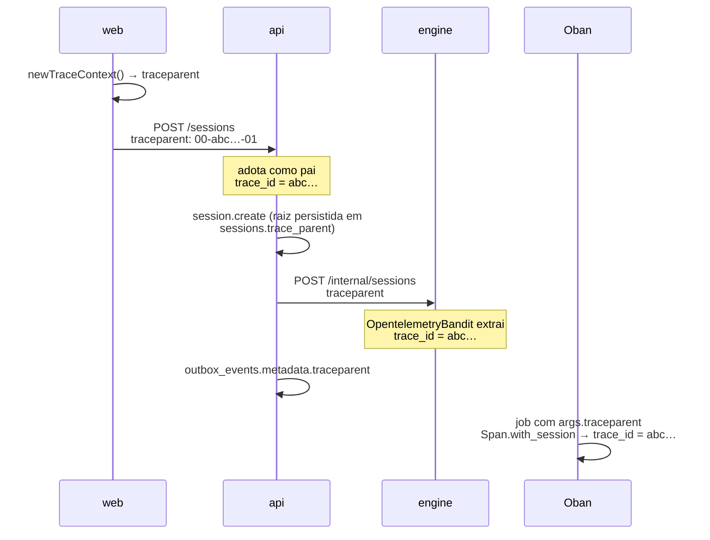

# Как отследить действие через систему {#how-an-action-is-followed-through-the-system}

Действие пользователя в Brabo пересекает три процесса и возвращается: клик в web
вызывает api, api командует engine по HTTP, engine отвечает по HTTP и
запускает асинхронную работу через Oban, а результат возвращается через api на экран.
Когда что-то идёт не так посередине, вопрос всегда один и тот же — **где это
прошло и где остановилось?**

Эта страница объясняет механизм, который на него отвечает. Решения находятся в
[ADR 0026](../adr/0026-fase5-observabilidade-e-graceful-shutdown.md) (модель) и
в [ADR 0035](../adr/0035-observabilidade-legivel-e-trace-sem-coletor.md) (что
изменилось потом); операционная процедура — в
[runbook](../runbook.md#observabilidade).

## Две вещи, которые не путаются {#the-two-things-that-dont-get-confused-with-each-other}

**Создание телеметрии** и **доставка телеметрии** независимы, и это самый важный
выбор дизайна здесь.

Span создаётся всегда — в production, в разработке и в наборе тестов. То, что
решает `OTEL_EXPORTER_OTLP_ENDPOINT`, — **покидает ли он процесс**:

| окружение | span создаётся | `trace_id` в логе | span идёт в Tempo |
|---|---|---|---|
| production (с Collector) | да | да | да |
| `pnpm dev` | да | да | нет |
| набор тестов | да | да | нет |

Это важно, потому что **корреляция не зависит от коллектора**. `trace_id`, который
появляется в логе трёх сервисов, берётся из контекста, а не из экспортёра. В
разработке у вас нет рисунка дерева в Grafana, но есть самое
используемое в повседневной работе: строки трёх сервисов, помеченные одним и тем же id.

До ADR 0035 эти две вещи были связаны, и следствием было то, что
разработка — окружение, где лог читают больше всего, — была единственной без какой-либо
корреляции. Если вы встретите документацию, комментарий или runbook, говорящие, что «без
переменной нет инструментирования», это текст, предшествующий этому исправлению.

## Где рождается `trace_id` {#where-the-trace_id-is-born}

В **web**, а не в api. Браузер генерирует W3C `traceparent` на каждый запрос
(`apps/web/src/lib/logger.ts`) и отправляет его в заголовке; api принимает его как родителя,
engine принимает родителя от api. Поэтому id одинаков во всех трёх местах.



Web **не** загружает браузерный SDK: это ~90 kB, плюс CORS в коллекторе и запись
в `connect-src` CSP, ради решения того, что решают 20 строк. Принятое
следствие — строка лога браузера остаётся в консоли (Alloy читает только
stdout pod) и служит человеку для сопоставления со span сервера.

### Сессия — корень, и она сохраняется {#the-session-is-the-root-and-its-persisted}

Сессия длится минуты или часы, а span попадает в backend, только когда закрывается.
Держать корень открытым всё это время сделало бы сессию невидимой как раз
тогда, когда она происходит. Поэтому `session.create` короткий, а его `traceparent`
записывается в `sessions.trace_parent`; вся последующая работа использует его как **удалённого
родителя**.

Именно это заставляет сегодняшний tool call появиться в том же дереве, что и вчерашний
`session.create`. Три точки внедрения намеренно уникальны — по одной воронке
на каждую:

| путь | точка |
|---|---|
| api → engine | `HttpApiToEngineClient.buildHeaders()` |
| engine → api | `EngineApiClient.headers/0` |
| outbox → Oban | `DrizzleOutboxRepository.append()` → `metadata` jsonb |

## Путь между слоями {#the-cross-layer-path}

`trace_id` говорит, *что* действие существовало. Путь говорит, *где оно прошло*.

В api каждый запрос несёт контекст в `AsyncLocalStorage`
(`infrastructure/observability/request-context.ts`), в котором регистрируются
границы. Регистрирует декоратор `@Traced('<camada>')`, а HTTP-граница
входит бесплатно через interceptor. Результат — одна строка на запрос:

```
14:02:11.418 INFO  POST /projects/…/sessions — 34.1ms trace=4bf92f35
    trace_id: 4bf92f3577b34da6a3ce929d0e0e4736
    layers:
      interfaces        SessionsController.create         0ms
        ↳ application     CreateSessionUseCase.execute    31.2ms
          ↳ infrastructure  DrizzleUnitOfWork.runInTransaction  28.9ms
          ↳ infrastructure  DrizzleOutboxRepository.append       2.1ms
```

В production та же информация выходит как поле `path`, в одной строке JSON.

О механизме стоит знать три вещи, потому что они объясняют то, что вы видите:

- **Путь не зависит от span.** Он берётся из `AsyncLocalStorage`, и поэтому
  работает без коллектора.
- **Guard выполняется до interceptor.** Аутентификация, rate limit и RBAC происходят
  до появления контекста, поэтому не появляются в пути. Это ~1-3 мс, и они уже
  появляются как spans `pg` в Tempo.
- **`@Traced` стоит на критических путях, а не везде.** Сессии, действия, auth и
  мост api↔engine. Метод без декоратора просто не появляется в строке —
  отсутствие там не означает, что он не вызывался.

### Почему ни у одного controller нет `@Traced` {#why-no-controller-has-traced}

Потому что это было бы опасно, а не потому, что неудобно. Nest записывает метаданные
маршрута (`@Public`, `@RequireRole`, `@ApiOperation`) **в объект функции** метода,
а legacy-декоратор, заменяющий `descriptor.value`, отбрасывает то, что было ниже.
В controller это аннотация авторизации, которая исчезает, компилируясь и
проходя набор тестов.

Interceptor читает `getClass()` и `getHandler()` из `ExecutionContext` и получает
ту же пару класс/метод, не трогая ни одного файла controller.

По той же технической причине `@Traced` также не ставится ни на что, что возвращает
`Observable`, ни на генератор: эвристика «это thenable?» классифицировала бы их как
синхронные и закрыла бы span до того, как stream что-то произведёт.

## Лог: читаемый для людей, разбираемый для машин {#logging-readable-for-people-parseable-for-machines}

У одного и того же события два вывода, выбираемых по `NODE_ENV`:

- **разработка** — цветной, с отступами, с деревом слоёв. В api
  `pino-pretty` работает в процессе (не через `transport`, который не позволяет передавать функцию в
  `customPrettifiers`); в engine — `PrettyLogFormatter`.
- **production** — **одна** строка JSON на событие. Это не предпочтение: Alloy читает
  stdout pod построчно, и JSON с отступами сломал бы парсер.

### `trace_id` — это контракт {#trace_id-is-a-contract}

С подчёркиванием, во всех трёх сервисах. Имя читают три вещи, которые не видят
друг друга:

1. `stage.json` Alloy, который повышает его до структурированных метаданных;
2. `derivedFields` источника данных Loki, который превращает строку в ссылку на
   Tempo;
3. запросы этого runbook.

Переименование в `traceId` компилируется, проходит весь набор тестов и уничтожает кликабельную
корреляцию. В каждом из трёх сервисов есть тест, защищающий именно
**имя**, а не форматирование.

### Секрет никогда не попадает в лог {#secrets-never-enter-the-log}

У api намеренно консервативный список `redact` — одно лишнее скрытое поле
ничего не стоит, одно недостающее — это постоянная утечка в Loki. Он покрывает `Authorization`,
cookie, API-ключи LLM, токены доступа и refresh, пароль, сервисный
токен api↔engine и материал DEK envelope encryption.

## Куда смотреть, когда что-то не появляется {#where-to-look-when-something-doesnt-show-up}

Первый срез всегда один и тот же, и лог отвечает сам:

- **есть `trace_id` в логе, но нет trace в Grafana** → дело в экспорте. В
  разработке это ожидаемо; в кластере см.
  [runbook](../runbook.md#quando-nao-ha-trace-no-tempo).
- **нет `trace_id` в логе** → дело в контексте, и это редкость. В api `startTracing()`
  должен быть первым в процессе (`src/tracing-boot.ts`); в engine
  `Engine.Telemetry.Otel.setup/0` выполняется до дерева супервизии.
- **есть trace, но в пути только один шаг** → у метода нет `@Traced`, или он
  находится под `interfaces/http/`, где его быть не может.
