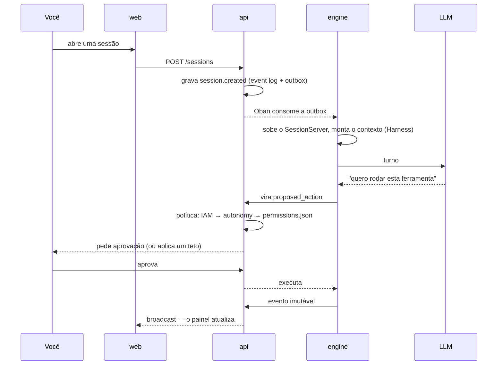

# Что такое Brabo {#o-que-é-o-brabo}

Brabo ведёт полный жизненный цикл приложения — от брифа до деплоя — с командой
ИИ-агентов, работающих над настоящим git-репозиторием. Criativo, PO,
Arquiteto, разработчики по модулям, Infra, QA, SecOps, Psicólogo и Anamnese.

**Последнее слово за вами**, и это не лозунг: это свойство архитектуры.

## Чем он отличается от ассистента для кода {#o-que-o-separa-de-um-assistente-de-código}

**Ни одно действие с внешним эффектом не происходит само по себе.** Команда
терминала, коммит, push, PR, merge, расход токенов — всё рождается как
`proposed_action`, проходит через политику проекта (где `deny` всегда побеждает
`allow`) и только потом выполняется. Два случая не может разрешить даже
политика: **merge в защищённую ветку** и **изменение инструкции агента**. Это
потолки, а не значения по умолчанию.

**Агент ненадёжен по построению, и система это учитывает.** Это языковая
модель: она может галлюцинировать, зациклиться или попросить что-то
разрушительное. Ограничения структурные — потолок итераций, потолок исправлений
на задачу, бюджет, который отклоняет вызов, закрытый каталог того, что может
профилировать Anamnese. Промпт — не гарантия; гарантия — код.

**Всё, что произошло, записано и неизменяемо.** Журнал событий только
дополняется, с плотной нумерацией внутри сессии. Именно это делает
доказательства Psicólogo отслеживаемыми, стоимость — проверяемой, а резервную
копию — верифицируемой.

**Команда улучшается сама, а вы остаётесь в контуре.** Psicólogo анализирует
сессии и предлагает гипотезы, привязанные к реальным событиям; Anamnese выводит
ваш профиль компетенций и предлагает версионированные патчи инструкций. Каждый
патч требует вашего одобрения, а откат создаёт новую версию вместо удаления
истории.

## Один ход, от начала до конца {#um-turno-do-começo-ao-fim}

## С чего начать {#por-onde-começar}

| вы хотите | перейдите к |
|---|---|
| поднять систему и запустить первого агента | [Первые шаги](getting-started.md) |
| понять, как всё устроено | [Архитектура](architecture.md) |
| узнать, что гарантирует система и где это живёт в коде | [Бизнес-правила](business-rules.md) |
| эксплуатировать: поднять, восстановить, ротировать ключ, тушить пожар | [Runbook](runbook.md) |
| расшифровать термин | [Глоссарий](glossary.md) |
| узнать, **почему** что-то решено именно так | [ADR](adr/index.md) |
| настроить | [Конфигурация](reference/configuration.md) |
| настроить политику одобрения | [Разрешения](reference/permissions.md) |
| понять контракт api ↔ engine | [Внутренний API](reference/internal-api.md) |

## Состояние {#estado}

**Фазы 1–26 завершены**, версия **v7.0.0**. Что есть:

- IAM/RBAC, сессии с неизменяемым журналом событий, маршрутизатор LLM, учёт
  потребления и бюджет, конвейер одобрения с `permissions.json`
- GitProvider для Local, GitHub, GitLab, Bitbucket и универсального варианта под
  единым контрактом, с capability, объявляемой только после доказательства;
  идемпотентный bootstrap Gitflow и принятие существующего репозитория с планом
  в качестве шлюза
- Полный Harness и иерархия агентов по областям — lead как внешний контакт,
  приватное внутреннее делегирование, консолидированный вердикт; Criativo, PO,
  Arquiteto и Dev Lead — диалоговые, разработчики по модулям в изолированных
  worktree, QA и SecOps как гейты PR, проактивный Infra, Psicólogo и Anamnese с
  замкнутым циклом
- Собственная аутентификация (argon2id, access Ed25519, ротация refresh с
  отзывом семейства) — Keycloak удалён полностью; OpenAPI зафиксирован по типам
  в контроллерах, с генерируемым [справочником](/reference/api/)
- Девять провайдеров LLM на единой OpenAI-совместимой базе, каталог с ручной
  курацией и ценой, замороженной в учёте потребления
- Production-образы без root, деплой через Kustomize с HPA по очереди Oban,
  graceful shutdown, OpenTelemetry, резервное копирование с **проверенным**
  восстановлением
- Механизированный конвейер релизов: версия вычисляется по функции ветки,
  approval-ladder, promote/tag-release и backmerge с обратным распространением
- Приложение: восемь экранов из дизайн-хэндоффа, вкладка Code только для
  чтения (дерево, файл с собственной подсветкой, поиск, diff PR, blame и PR в
  API), вкладка расходов для двух аудиторий, временная шкала в виде дерева,
  контейнер на проект, выбранный Arquiteto, и его диаграмма C4 в Обзоре

То, что появилось после Фазы 15, не вышло из дорожной карты: оно вышло из
**использования продукта**. Программа 16–26 родилась из первой реальной
навигации по приложению, и каждая находка живых тестовых сессий стала правилом
с `arquivo:linha` и тестом. Вся цепочка доказана на настоящем GitHub —
принятие репозитория, продвижение истории, dev agent, пишущий код, открытый PR,
гейт, выносящий решение, и возвращающийся вердикт.

То, чего ещё нет, сказано там, где это важно, и это стоит прочитать:

- [известный технический долг](architecture.md#divida-tecnica) — это раздел, а
  не умолчание;
- [находки реального выполнения](explanation/achados-execucao-real.md)
  фиксируют то, что остаётся открытым **по решению** — включая два случая, где
  вывод был таков, что путь к автономии не лежит через ослабление политики;
- жизненный цикл контейнера на проект — это **объявленное ограничение** Фазы 25,
  а не забывчивость: пока он не поднимается, политика терминала из
  [ADR 0055](adr/0055-escopo-de-caminho-na-politica-de-terminal.md) продолжает
  действовать как есть.
