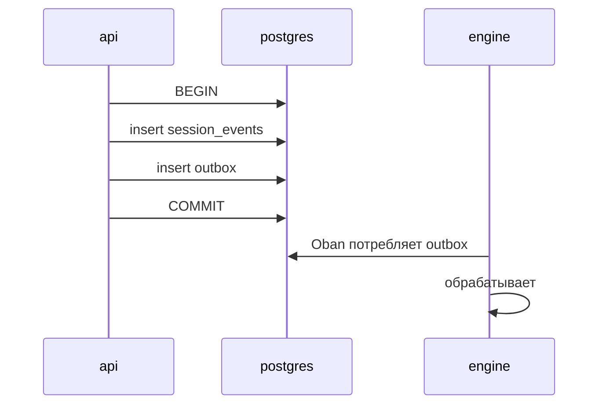

# События

В Brabo сосуществуют три семейства имён, и их легко спутать, потому что все
используют `предмет.глагол`:

| семейство | где хранится | долговечность |
|---|---|---|
| **Доменное событие** | строка в `session_events` | **постоянное и неизменяемое** |
| **Broadcast** | канал Phoenix → браузер | эфемерный, не сохраняется |
| **Span** | трасса OpenTelemetry | хранение Tempo (24 ч локально) |

Только первое является контрактом. Два других — транспорт и наблюдение.

## Доменное событие

Строка в `session_events`, append-only, с плотным `seq` по сессии
([RN-002](../business-rules.md#rn-002)). Колонки:

| колонка | что |
|---|---|
| `id` | uuid |
| `session_id` | сессия-владелец |
| `seq` | порядок внутри сессии, начиная с 1, без пропусков |
| `type` | идентификатор ниже |
| `actor` | кто вызвал: `{kind, id}` — пользователь, агент или система |
| `payload` | jsonb, собственный формат каждого типа |
| `created_at` | — |

> **`type` в коде — свободная `string`** — нет ни union в TypeScript, ни enum в
> базе, перечисляющих допустимые типы. Список ниже извлечён из точек эмиссии и
> поэтому может устареть, ничего не сломав. См. примечание в конце этой
> страницы.

### Сессия

| тип | когда |
|---|---|
| `session.created` | сессия рождается в `created` |
| `session.activated` | перешла в `active` |
| `session.draining` | узел, на котором она размещена, дренируется |
| `session.closed` | обычное завершение |
| `session.closed_abnormally` | завершение с причиной — `node_shutdown` самая частая |
| `session.reopened` | сессия `closed`/`closed_abnormally` вернулась в `active` (ADR 0183) |

**Терминальная сессия больше не принимает разговор ([RN-581](../business-rules.md#rn-581)).**
Когда сессия `closed` или `closed_abnormally`, запись события разговора
отклоняется с **409** и `reason: "sessao_encerrada"`. Разговор — это тип,
существующий только как разговор (`chat.message`,
`chat.message_cancelled`, `chat.structured_question`, `chat.structured_question_answered`,
`agent.status`, `agent.activated`, `handoff.offered`, `handoff.accepted`,
`readiness.confirmed`, `necessity.validated`,
`architecture.readiness_confirmed`), или любое событие, чей актор — разговорный
агент: поэтому `tool.call`/`agent.response` Креатива отклоняются, а те же типы
от Психолога, который работает **поверх** закрытой сессии, продолжают
приниматься. Человеческие решения о ожидающем действии
(`action.approved`/`action.denied`) тоже продолжают приниматься: очередь
действий переживает сессию. Сессия, закрытая потому, что разговор простаивал
дольше потолка, несёт `termination_reason: "conversation_idle_timeout"` и
заканчивается `closed`, как `heartbeat_timeout`.

**Закрытую сессию можно открыть заново ([RN-649](../business-rules.md#rn-649), ADR 0183).**
`POST /projects/:projectId/sessions/:sessionId/reopen` (`developer`, ADR 0184)
возвращает сессию `closed`/`closed_abnormally` в `active` и записывает
`session.reopened` с `{from, to, closedAt, terminationReason}` — единственную
запись об интервале, когда она была закрыта, поскольку `closed_at` и
`termination_reason` в строке очищаются. Ни одно предыдущее событие не
редактируется, и `kind` сессии не меняется. Сессия, у которой уже есть
`execution.activated`, отклоняется с 409 `sessao_com_execucao`.

### Чат и агенты

| тип | когда |
|---|---|
| `chat.message` | сообщение в ленте сессии, от пользователя или агента |
| `chat.message_queued` | сообщение пришло, когда агент был посреди хода, и попало в его ОЧЕРЕДЬ, а не было отклонено ([RN-673](../business-rules.md#rn-673), [ADR 0191](../adr/0191-a-mensagem-com-turno-em-curso-entra-numa-fila.md)). Актор: агент. Payload: `mensagemId` (id `chat.message`), `texto`, `idioma` и `posicao`. Текст передаётся здесь, потому что именно его очередь перечитывает после перезапуска engine. Поставленное в очередь сообщение остаётся ОЖИДАЮЩИМ, пока `chat.message_delivered` или `chat.message_cancelled` его не назовёт; не более 10 на агента и сессию |
| `chat.message_delivered` | начался ход, читающий очередь: ожидающие сообщения читаются ВМЕСТЕ, по порядку, в одном ходе. Актор: агент. Payload: `mensagemIds` |
| `chat.message_cancelled` | тот, кто ОТПРАВИЛ ожидающее сообщение, отменил его — ни один агент его не прочитал. Актор: этот пользователь. Payload: `mensagemId`, `agente`. Записывается engine; отклоняется в закрытой сессии ([RN-581](../business-rules.md#rn-581)) |
| `chat.structured_question` | Креатив запросил НЕСКОЛЬКО ответов сразу, через форму — инструмент `ask_structured_questions` (RN-162). Каждый вопрос несёт `id`, `label`, `type`, `options` и `allowOther` — это выход свободного текста для `select`, и он равен `true`, когда модель ничего не объявляет ([RN-171](../business-rules/autenticacao.md#rn-171)) |
| `chat.structured_question_answered` | пользователь ответил на форму; ответы также возвращаются как `chat.message`, чтобы агент их прочитал |
| `agent.activated` | агент взял работу в сессии |
| `agent.response` | полный консолидированный ответ агента. `modelName` говорит, КАКАЯ модель его сгенерировала, у трёх производителей (пять разговорных агентов, `ToolLoop` каждого исполнительного агента/агента gate и чат api без активного агента) — `null`, когда ход упал до разрешения binding, и отсутствует в событиях, записанных до появления правила ([RN-175](../business-rules/autenticacao.md#rn-175)). От разговорного агента `content` — это только ЗАКЛЮЧИТЕЛЬНЫЙ текст хода, а `passos` (отсутствует, когда их нет) перечисляет по порядку текст предыдущих раундов, который лента сворачивает под «Шаги хода» ([RN-698](../business-rules.md#rn-698), AT-395) |
| `agent.error` | сбой агента, с `origem` (`infra`/`modelo`/`codigo`/`politica`) и `mensagem`, которое он говорит в ленте ([RN-059](../business-rules/custo.md#rn-059)). Также выдаётся с `reason: turno_interrompido_por_reinicio` (источник `infra`), когда engine перезапустился посреди хода и осиротевший статус `working` закрывается при загрузке или подъёме агента, после чего идёт `agent.status: idle` ([RN-586](../business-rules.md#rn-586)). Покрывает весь ход, а также сбой ОДНОГО инструмента посреди цикла, с `tool` и `retentativa` в payload ([RN-163](../business-rules/autenticacao.md#rn-163)) |
| `tool_router.decided` | шаг, на котором Jev выбрал инструмент ([RN-625](../business-rules.md#rn-625), [ADR 0179](../adr/0179-o-laco-pergunta-ao-jev-qual-ferramenta.md)): `menuAntes`/`menuDepois`, `escolha`, `confianca`, `segunda`, `anterior`, `aplicado` (меню вышло меньше каталога), `motivoDaQueda` + `origemDaQueda` (`infra`/`modelo`/`codigo`), когда Jev упал, `latenciaMs`, `custoMicros` (РЕАЛЬНЫЙ `usage.cost`) и `foraDoCardapio` (инструменты, которые модель вызвала, хотя их не предлагали). Записывается фасадом engine для каждого агента; отсутствует, когда маршрутизатор не запрашивался (provider не OpenRouter, меньше двух инструментов, ключ workspace выключен). Измерение выигрыша (AT-239) читается из этого события и из `token_usage`, никогда не записывается вручную |
| `tool.result` | результат выполнения инструмента, записываемый hook `Engine.Harness.Hooks.EventLog` и, для семи разговорных агентов (Infra Lead с [RN-617](../business-rules.md#rn-617)), их серверами с `tool`, `ok` и `resultado` (или `erro`), обрезанным до 2 000 символов с `resultadoTotal`, когда обрезается ([RN-589](../business-rules.md#rn-589)). Тот же payload приходит от Infra Lead для каждого инструмента, который он выполняет напрямую, и от Dev Lead, когда приостановленный вызов разрешается — никогда пока он ждёт одобрения ([RN-593](../business-rules.md#rn-593)) |
| `handoff.offered` | агент предложил работу другому |
| `handoff.accepted` | получатель принял. Обычно человеком (актор `user`). Когда принятие подразумевалось в клике «Я готов» ([RN-658](../business-rules.md#rn-658)), актор остаётся этим человеком, а payload — и payload следующего `agent.activated` — несёт также `implicito: { via: "readiness.confirmed", readinessEventId }`. С [RN-660](../business-rules.md#rn-660) ([ADR 0186](../adr/0186-aceite-automatico-do-handoff-ao-arquiteto.md)) предложение PO Архитектору может быть принято актором `system` `handoff-auto-accept`, и тогда payload несёт также `automatico: true`, `emNomeDe` (кто открыл сессию — репозиторий создаётся от имени этого человека) и `criterio` (`regras`, `cobertas`, `repositorio`) |
| `handoff.auto_accept_failed` | система решила принять предложение PO Архитектору ([RN-660](../business-rules.md#rn-660)), и принятие упало. Payload: `handoffId`, `toAgent`, `origem` (`infra`) и `error`. Актор `system` `handoff-auto-accept`. Предложение сохраняет кнопку, если не было помечено `accepted` |
| `handoff.superseded` | handoff `offered` перестал быть действующим и больше не может быть принят ([RN-635](../business-rules.md#rn-635), [ADR 0182](../adr/0182-ciclo-de-vida-do-handoff.md)). Payload: `handoffId`, `toAgent`, `motivo` (`agente_ativado` — получатель был активирован любым путём; `nova_oferta` — более новое предложение тому же получателю в проекте его заменило) и `substitutaId` (заменившее предложение, `null` для `agente_ativado`). Записывается актором `system` `handoff-lifecycle` в сессии СТАРОГО предложения, которая может быть закрыта — это запись, а не разговор, поэтому RN-581 её пропускает. `status` строки становится `superseded`; событие — это история |
| `context.compacted` | менеджер контекста резюмировал самые старые ходы истории агента, чтобы уместиться в окно. С [RN-580](../business-rules.md#rn-580) payload несёт, помимо `tokensBefore`/`tokensAfter`, `summary`, заменивший эти ходы, `agent` — владельца истории, и `messagesSummarized`. События, записанные раньше, несут только два счётчика — резюме потеряно, и регидратация говорит об этом, а не выдумывает его |

**Что перечитывает разговорный агент ([RN-580](../business-rules.md#rn-580)).**
Когда один из семи разговорных агентов поднимается над сессией, в которой уже
есть разговор, `Engine.Agents.Reidratacao` восстанавливает его историю из
**хвоста** этого журнала (последние 200 событий): `chat.message`, `agent.response`,
`chat.structured_question` (как ход самого агента, с метками и вариантами)
и СОБСТВЕННЫЕ `tool.call`/`tool.result` (как текстовую заметку — события не
несут id вызова, поэтому никогда не повторяются как `role: tool`).
`chat.structured_question_answered` намеренно пропускается: api записывает те
же ответы как `chat.message` сразу после, и именно это агент прочитал вживую.
`chat.message`, отменённое в очереди или ещё ожидающее для этого агента, тоже
пропускается ([RN-673](../business-rules.md#rn-673)): первое так и не было
сказано, второе придёт ходом, читающим очередь. С
[RN-589](../business-rules.md#rn-589) все семь записывают `tool.result` с текстом,
который вернул инструмент (`resultado`, обрезанный до 2 000 символов, с
`resultadoTotal`, дающим реальный размер при обрезке); вызов сессии, записанный
до этого, не имеет `tool.result`, и заметка говорит, что в журнале нет исхода.
Когда разговор длиннее хвоста, история открывается системным сообщением о том,
сколько предыдущих событий осталось за бортом, последним записанным резюме
компактизации и открывающими сообщениями.

### Предлагаемые действия

| тип | когда |
|---|---|
| `proposed_action.created` | действие родилось — до любого выполнения. `payload.status` говорит, как оно родилось (`pending`, `auto_approved` или `denied`), и именно это отличает человеческое решение от политики ([RN-049](../business-rules/custo.md#rn-049)). `payload.reason` говорит, КАКОЕ правило политики решило — строка, которую возвращает `decide()`, во всех трёх исходах; отсутствует в событиях, записанных до появления правила, что означает «не записано», а не «без причины». Одноимённая строка outbox его НЕ несёт ([RN-567](../business-rules.md#rn-567)). В действиях `terminal` — единственном типе, чьё решение учитывает область пути, — `payload.scopeRoot` говорит, с КАКИМ корнем сравнивала область, как `{ executionMode, ancora, segmento }`: `container` → `ancora: raiz_gerenciada` и `workspace_dir_name`; `mounted` → `ancora: base_de_projetos` и сегмент под `BRABO_PROJECTS_BASE` (`ancora: indisponivel`, `segmento: null`, когда папка вне базы или базы нет); `runner` → `ancora: nome_da_pasta` и `workspace_dir_name`. НИКОГДА абсолютный путь, который раскрыл бы `$HOME` пользователя каждому участнику. Отсутствует в старых событиях и в других типах действий; в outbox тоже нет ([RN-609](../business-rules.md#rn-609)) |
| `proposed_action.approved` | решено пользователем — `actor` — это **тот, кто кликнул**. Автоодобрение здесь НЕ проходит: оно появляется в `created` со `status: auto_approved` и актором-агентом |
| `proposed_action.denied` | отклонено — терминальное состояние. `actor` — кто отказал, а `payload.reason` — причина |
| `proposed_action.executed` | выполнено успешно |
| `action.failed` | выполнено и упало |
| `permission.granted` | разрешение записано в политику |

### Backlog

| тип | когда |
|---|---|
| `backlog.epic_created` | — |
| `backlog.story_created` | — |
| `backlog.story_transitioned` | смена состояния истории. `actor` говорит, кто её продвинул: `agent/po` в режиме `auto`, `user` в режиме `manual` ([RN-048](../business-rules/custo.md#rn-048)) |
| `backlog.story_completed` | PO дополнил существующую историю `draft` через `complete_story` — связанные правила, заполненные RF/DoD/DoR — вместо того чтобы создавать её заново ([RN-720](../business-rules.md#rn-720)) |
| `backlog.story_promotion_proposed` | PO завершил ПОЛНУЮ историю в проекте в режиме `manual`: она остаётся `draft` в ожидании решения пользователя, и ни одна её задача до тех пор не может быть взята ([RN-048](../business-rules/custo.md#rn-048)) |
| `backlog.story_promotion_returned` | пользователь ОТКЛОНИЛ продвижение и вернул историю PO с причиной — которая становится закреплённым сообщением в его сессии, как gate, возвращённый dev ([RN-048](../business-rules/custo.md#rn-048)) |
| `backlog.story_updated` | заголовок и/или описание истории `draft` без задачи в работе исправлены пользователем (вкладка Backlog) или PO (`update_story`). Несёт `previousTitle`, `title` и `descriptionChanged` (RN-727) |
| `backlog.story_archived` | история `draft` без задачи в работе АРХИВИРОВАНА пользователем или PO (`archive_story`): она и её задачи уходят из backlog, покрытия, плана и claim; строка остаётся. Несёт `reason` и `taskIds` (RN-727, ADR 0212) |
| `backlog.story_demoted` | модуль исчез из `module_map`; история вернулась в `draft` ([RN-012](../business-rules.md#rn-012)) |
| `backlog.story_overlap_warned` | история создана, но ВСЕ правила, которые она упоминает, уже покрыты другой — предупреждение, не блокировка: судит о наложении пользователь ([RN-081](../business-rules/custo.md#rn-081)) |
| `backlog.semantic_duplicate_warned` | записана история или бизнес-правило, чей ЗАГОЛОВОК по embedding находится на пороге или выше относительно существующего того же типа в проекте — предупреждение, никогда отказ; payload называет похожий элемент и косинус. Актор `system`/`duplicata-semantica` ([RN-681](../business-rules/custo.md#rn-681)) |
| `backlog.semantic_duplicate_check_skipped` | проверка семантического дубликата НЕ смогла выполниться — нет provider embedding, daemon недоступен, потолок 10 с — и `reason` говорит, что именно; элемент всё равно записан ([RN-681](../business-rules/custo.md#rn-681)) |
| `backlog.story_modules_assigned` | связь история ↔ модуль |
| `backlog.task_created` | — |
| `backlog.task_claimed` | dev agent взял задачу |
| `backlog.task_status_changed` | — |
| `backlog.task_merge_conflict` | одобренный merge PR задачи отклонён из-за конфликта слияния: `taskId`, `pullRequestId`, `conflictingFiles`, `actionId`. С [RN-715](../business-rules.md#rn-715) задача возвращается в `in_progress`, а dev agent-владелец пробуждается строкой `task.merge_conflict` в outbox ([RN-705](../business-rules.md#rn-705)) |
| `backlog.task_blocked` | исчерпан потолок попыток исправления, или зарегистрировано препятствие |
| `backlog.task_unblocked` | — |
| `backlog.epic_without_story` | PO закончил ход, создав эпик и НИ ОДНОЙ истории для него. Эпик не порождает задачу — порождает история, — поэтому это состояние, которое блокирует выполнение без видимой ошибки. Явный исход по образцу [RN-059](../business-rules/custo.md#rn-059): долговечное событие с `origem`, `epicIds`/`epicTitles` и сообщением, плюс broadcast `agent.error`. Сообщается ОДИН раз за случай, никогда в цикле ([RN-165](../business-rules/autenticacao.md#rn-165)) |
| `backlog.handoff_not_offered` | PO закончил ход, когда все бизнес-правила покрыты, но не смог предложить handoff Архитектору: у какой-то истории нет задачи (`origem: modelo`, с `storyIds`/`storyTitles`), или чтение backlog либо создание предложения упало (`origem: infra`). Когда у каждой истории есть задача, сервер PO сам предлагает handoff ([RN-700](../business-rules.md#rn-700)) |

### Выполнение и gates

| тип | когда |
|---|---|
| `execution.plan_proposed` | **ВЫВЕДЕН ИЗ ОБИХОДА с ADR 0086** ([RN-284](../business-rules.md#rn-284)) — в старых сессиях этот тип ещё может быть в журнале; новые сессии используют `proposed_action` типа `propose_execution_plan` (см. `docs/reference/permissions.md`), потому что план Dev Lead стал настоящим решением, одобряемым или отклоняемым в Одобрениях, а не простым событием |
| `execution.activated` | началась фаза выполнения. **Входит только в сессию `criativa`** — в `consultiva` запись отвечает 409 ([RN-097](../business-rules.md#rn-097)). Именно это событие, а не колонка `sessions.kind`, говорит, ВЫПОЛНЯЕТСЯ ли сессия |
| `execution.parallelization_suggested` | система предложила распараллелить — выдаётся при активации, только когда у проекта есть зарегистрированный контейнер `running` (иначе dev agents блокируются, `dev.blocked_by_container`, и больше агентов лишь умножили бы заблокированных; AT-104) |
| `execution.plan_applied` | человек ОДОБРИЛ `propose_execution_plan` Dev Lead (или он был автоодобрен), и это одобрение АКТИВИРОВАЛО выполнение: каждая задача плана получила свой модуль, и `ActivateExecutionUseCase` отработал ([RN-677](../business-rules.md#rn-677), [RN-678](../business-rules.md#rn-678)). Payload: `actionId`, `sessaoDeExecucao`, `modulos`, `tarefasAtribuidas` и — когда план несёт `tarefas` — `tarefasPorModulo` и `modulosSemTarefa` (модули, оставшиеся без агента, RN-709). Записывается в сессии Dev Lead, актор `system`/`action-executor` |
| `execution.plan_failed` | одобренный план НЕ активировал выполнение — план больше не совпадает с действующим `module_map`, или активация отказала (например, 409 без репозитория). Payload: те же поля плюс `motivo`, фраза самой api. Человеческое решение остаётся записанным; в задачи ничего не записано, когда отклонён сам план |
| `execution.parallelization_accepted` | принято — субагент наследует потолок базового агента |
| `dev.started` | dev agent начал цикл (активация, распараллеливание — НЕ регидратация, которая никогда не перезапускает) |
| `dev.working` | взял задачу и собрал worktree |
| `dev.idle` | очередь модуля пуста — сейчас нет задачи, которую можно взять |
| `dev.blocked_by_container` | агент НЕ взял задачу, потому что у проекта нет ЗАРЕГИСТРИРОВАННОГО контейнера `running` ([RN-502](../business-rules.md#rn-502)). Он останавливается в `:idle`, как два выше — `idle` единственное состояние, которое wake ещё спасает, — и это событие единственное, что отличает «нет контейнера» от «очередь пуста» (`dev.idle`) и от «claim упал» (`dev.error`). Api никогда не вызывается: охрана выполняется ДО `claim_task/1`, так что ни одна задача не остаётся взятой без живого владельца. Разрешается само: `container.running` в outbox пробуждает каждого агента `:idle` проекта |
| `dev.awaiting_approval` | действия git остались в ожидании одобрения (Фаза 12e): **gate НЕ открывается** — без PR нечего судить — и worktree удерживается до `task.pr_settled` ([RN-050](../business-rules/custo.md#rn-050)) |
| `dev.awaiting_gate` | PR открыт, ждёт gate (Фаза 12b) — `task_id`/`worktree` остаются удержанными |
| `dev.blocked` | задача возвращена с диагнозом (лимит итераций, превышен бюджет, `report_blocked`, сбой worktree/контекста). С [RN-743](../business-rules.md#rn-743) несёт `trabalhoPreservado` (`{branch, commit}` или `null`): незакоммиченная работа закоммичена в ветку задачи как `<agente>[bot]`, и следующая задача агента стартует от этой ветки |
| `dev.idle_tripped` | предохранитель сработал (RN-047) — N заблокированных задач подряд останавливают агента |
| `dev.credit_exhausted` | provider модели отказал из-за нехватки кредита (RN-726) — агент встаёт на паузу в `idle_tripped`, не засчитываясь предохранителю и не беря следующую задачу; Перевзвести возобновляет |
| `dev.rearmed` | пользователь перевзвёл застрявшего агента (Фаза 12b) — `actor` — это ПОЛЬЗОВАТЕЛЬ, который кликнул, а не агент |
| `pr.gate_changed` | PR перешёл к новому gate (`awaiting_qa` → `awaiting_secops` → `awaiting_user`) |
| `infra.gate_changed` | gate Infra |
| `gate.rescue_parked` | `GateRescuer` ПРИПАРКОВАЛ цикл QA/SecOps, простаивающий более 2 ч, вместо того чтобы перезапустить его ([RN-722](../business-rules.md#rn-722), ADR 0207); лента показывает кнопку «Возобновить gate» ([RN-724](../business-rules.md#rn-724)). Payload: `taskId`, `gate`, `idadeSegundos`, `motivo`. Актор `system`/`gate-rescuer` |
| `gate.interrupted` | при ЗАГРУЗКЕ engine у недавнего цикла gate `in_progress` не было живого процесса ни на одном узле кластера: перезапуск его убил, и спасатель перезапускает его сразу, не дожидаясь порога в 15 минут ([RN-823](../business-rules.md#rn-823)). Payload: `taskId`, `gate`, `ultimaAtividadeEm`, `retomadoEm`. Актор `system`/`gate-rescuer`; лента показывает его как предупреждение. В граф не проецируется |
| `infra.artifact_blocked` | артефакт Infra отклонён |

### Делегирование (Фаза 8b, ADR 0038)

| тип | когда |
|---|---|
| `delegation.completed` | подспециальность завершила работу; `payload.parecerArtifactId` ссылается на её ВНУТРЕННИЙ `artifact.qa_verdict` — никогда на то, что доходит до gate |
| `delegation.failed` | подспециальность не завершила работу; `payload.failureOrigin` — это ИСТОЧНИК (`infra`\|`modelo`\|`codigo`\|`politica`, никогда методом исключения — ADR 0020) |
| `delegation.dispensed` | lead решил НЕ делегировать; `payload.justification` объясняет почему — отказ от делегирования никогда не бывает молчаливым |

Все три выдаются `QaLeadServer`, по одному на подспециальность, ОТДЕЛЬНО от
вызова `record_gate_verdict` — событие `pr.gate_changed` выше остаётся
единственным, описывающим сам gate; эти описывают область за ним.

### Цикл инструментов

| тип | когда |
|---|---|
| `toolloop.limit_reached` | цикл упёрся в потолок итераций. `payload` несёт `iteration` и `max_iterations` — потолок задаётся по ТИПУ агента ([RN-085](../business-rules/custo.md#rn-085)) |
| `toolloop.budget_exceeded` | бюджет токенов этого цикла закончился раньше работы; `payload` несёт `tokens_spent_micros` и `token_budget_micros` |

Выдаются `Engine.Harness.ToolLoop` и — начиная с
[RN-166](../business-rules/autenticacao.md#rn-166) — также `PoServer`, у
которого СОБСТВЕННЫЙ цикл и который до тех пор исчерпывал потолок **молча**.
Тот же тип и тот же payload намеренно: это тот же факт, и читающий журнал не
должен учить второе имя только потому, что разговорный агент не использует
`ToolLoop`.

### Артефакты

| тип | схема |
|---|---|
| `artifact.product_brief` | `title`, `summary`, `rules` |
| `artifact.business_rule` | `title`, `description`, `origin` |
| `artifact.decision_record` | `context`, `options`, `choice`, `consequences` — «сжатый ADR», который может выдать любой из шести разговорных агентов; переиспользует общий шаблон вместо выделенного и сосуществует с `open_adr_pr` (только Архитектор, документ, по-настоящему закоммиченный) ([RN-505](../business-rules.md#rn-505)) |
| `artifact.module_map` | карта модулей Архитектора |
| `artifact.module_routing` | образ-кандидат Архитектора по модулю, по одному элементу на модуль действующего `module_map` — Архитектор ПРЕДЛАГАЕТ, Infra ВЫБИРАЕТ ([RN-487](../business-rules.md#rn-487), [ADR 0131](../adr/0131-roteamento-de-modulos-para-infra.md)) |
| `artifact.module_contracts` | контракт между модулями от Архитектора: по модулю — что он ВЫСТАВЛЯЕТ (`modulo`, `expoe: [{tipo, assinatura, descricao}]`), с `version` — каждый раз весь список, действующий заменяет предыдущий; что модуль потребляет — это `dependsOn` из `module_map` ([RN-684](../business-rules.md#rn-684), [ADR 0200](../adr/0200-contrato-entre-modulos-artefato-do-arquiteto.md)) |
| `artifact.project_image` | `image`, `rationale`, `network`, `resources`, `version` (кто решил — актор: `arquiteto` или `infra-lead`) — образ контейнера проекта, выдаваемый api (`DecidirImagemDoProjetoUseCase`), когда его решает Архитектор или Infra Lead выбирает кандидата ([RN-491](../business-rules.md#rn-491)); версионируется, без таблицы. Engine только ЧИТАЕТ, существует ли он, чтобы локально отклонить `container_start_via_runner` без него ([RN-610](../business-rules.md#rn-610)) |
| `artifact.insight` | — |
| `artifact.prototipo_navegavel` | `personas`, `jornadas`, `prototipo` (`telas`, `anotacoes`), `resumo` — прототип UX Designer ([RN-286](../business-rules.md#rn-286), ADR 0087) |
| `artifact.rfc_staff` | — (валидируется в `Engine.Agents.StaffTools`, а не `ArtifactSchemas` — тот же случай, что `artifact.insight`): `problema`, `opcoes` (список `descricao`/`tradeoffs`), `recomendacao`, `poc` (`escopo`, фиксированное `descartavel: true`). RFC от Staff (ADR 0088), возвращаемая Архитектору через handoff в том же вызове инструмента |
| `artifact.plano_de_teste` | `storyId`, `taskId`, `planoDeTeste`, `criteriosExecutaveis`, `estrategiaDeAutomacao` — результат qa-стратегии (ADR 0090), написанный ПОСЛЕ сдачи dev и потребляемый циклом `qa-verificada` с [ADR 0192](../adr/0192-plano-de-teste-depois-da-entrega.md) ([RN-674](../business-rules.md#rn-674)) |
| `artifact.threat_model` | `storyId`, `threatModel`, `requisitosDeSeguranca` — «второй момент» SecOps над ДИЗАЙНОМ истории ([RN-360](../business-rules.md#rn-360), ADR 0090) |

Схемы закрыты: отсутствующее поле отклоняет эмиссию
(`Engine.Harness.ArtifactSchemas`).

### Архитектура и готовность

| тип | когда |
|---|---|
| `architecture.readiness_confirmed` | — |
| `readiness.confirmed` | пользователь кликнул «Я готов — потребность подтверждена» с Креативом. С [ADR 0185](../adr/0185-estou-pronto-fecha-os-dois-gates.md) payload несёт `necessidadeValidada: true` и `aceiteImplicitoDoPo: true` — метку, которую читает неявное принятие PO ([RN-658](../business-rules.md#rn-658)); более старые события несут `{}` |
| `necessity.validated` | gate `necessidade-validada` (Креатив → PO): человек — никогда не вывод модели — заявляет, что бизнес-потребность, консолидированная Креативом, верна. С [ADR 0185](../adr/0185-estou-pronto-fecha-os-dois-gates.md) записывается ТЕМ ЖЕ кликом, что и `readiness.confirmed`, как только engine принимает ход, с `productBriefId: null` (brief приходит из этого хода), `via: "readiness.confirmed"` и `readinessEventId` ([RN-657](../business-rules.md#rn-657)). События отдельного клика из ADR 0095 ([RN-406](../business-rules.md#rn-406)) несут `productBriefId`, указывающий на подтверждённый `artifact.product_brief` |

### Git и bootstrap

| тип | когда |
|---|---|
| `project.git_connected` | учётные данные git привязаны к проекту |
| `project.repository_provisioned` | репозиторий **создан** Brabo |
| `project.repository_adopted` | репозиторий, который **уже существовал**, стал принадлежать проекту ([RN-046](../business-rules/custo.md#rn-046)) |
| `bootstrap.repository_adopted` | тот же факт в выделенной сессии, с `defaultBranch`, наблюдаемой у provider |
| `bootstrap.step_started` | начался один из шести шагов Gitflow |
| `bootstrap.step_completed` | завершён |
| `bootstrap.step_skipped` | уже было сделано — **это успех**, а не ошибка ([RN-029](../business-rules.md#rn-029)) |
| `bootstrap.step_degraded` | завершён без одной из возможностей provider (например, защита ветки в Local) |
| `bootstrap.step_failed` | упал; bootstrap можно возобновить с этой точки |
| `bootstrap.plan_approved` | пользователь одобрил план принятия — **только начиная отсюда bootstrap выполняется в принятом репозитории** ([RN-045](../business-rules/custo.md#rn-045)) |
| `bootstrap.adopted_as_is` | пользователь отказался от bootstrap; ни один шаг не выполнялся, и план остаётся доказательством того, что не было применено |

### Стоимость

| тип | когда |
|---|---|
| `budget.threshold_crossed` | 70%, 90% или 100% — **один раз на порог** ([RN-018](../business-rules/custo.md#rn-018)) |

### Телеметрия RAG (RN-479/480/481)

Эти два — **повествование, никогда не источник измерения**, и существуют только
при наличии сессии — то есть на пути агента. Поиск из вкладки RAG — это поиск
*проекта*, и сессии у него нет, а `session_events.session_id` —
`NOT NULL`, так что измерение по event log молча потеряло бы именно те поиски,
которые человек сделал, глядя на оценки. Источник измерения — пара таблиц
`rag_searches`/`rag_feedback` (читается `pnpm --filter api medir:rag`);
событие лишь помещает тот же факт на временную шкалу сессии.

| тип | когда |
|---|---|
| `rag.search` | агент выполнил гибридный поиск внутри сессии — payload несёт `searchId` строки телеметрии, запрос, `topK`, сколько результатов прошло порог, была ли поиск `degraded` и ids chunks ([RN-479](../business-rules.md#rn-479), [RN-481](../business-rules.md#rn-481)) |
| `rag.feedback` | агент оценил извлечённый chunk как `util`/`irrelevante` — payload несёт `searchId`, `chunkId`, вердикт и **позицию**, которую этот chunk занимал в том поиске ([RN-480](../business-rules.md#rn-480)) |

### Локальный runner (ADR 0103/0104)

| тип | когда |
|---|---|
| `project.workspace_verified` | `brabo-runner` подключился и подтвердил путь проекта с `execution_mode: runner` — runner является источником истины для пути, перезаписывая введённое при создании ([RN-423](../business-rules.md#rn-423)) |

### Психолог

| тип | когда |
|---|---|
| `psychologist.analysis_completed` | — |
| `psychologist.analysis_failed` | с классифицированной причиной: `infra`, `modelo`, `código` или `política` |
| `psychologist.analysis_skipped` | в сессии не было АНАЛИЗИРУЕМОГО события, и анализ не выполнялся — `payload.analisaveis` и `payload.eventCount` показывают разницу ([RN-079](../business-rules/custo.md#rn-079)) |
| `psychologist.hypothesis_proposed` | гипотеза с действительными `evidenceEventIds` ([RN-021](../business-rules.md#rn-021)) |
| `psychologist.hypothesis_accepted` | — |
| `psychologist.hypothesis_dismissed` | — |
| `psychologist.hypothesis_accepted_for_anamnese` | принята и передана — звено, замыкающее цикл с Анамнезом |

### Анамнез и инструкции

| тип | когда |
|---|---|
| `anamnese.run_completed` | — |
| `anamnese.run_failed` | — |
| `anamnese.run_skipped` | раунд завершился БЕЗ профиля, намеренно — `payload.motivo` говорит почему ([RN-063](../business-rules/custo.md#rn-063)) |
| `anamnese.analysis` | текст, который модель Анамнеза написала во время раунда (`payload.content`); никогда не отрисовывается в ленте сессии ([RN-695](../business-rules.md#rn-695)) |
| `anamnese.profile_updated` | `proficiency_profile` изменился |
| `anamnese.agent_deviation` | отклонение АГЕНТА, замеченное Анамнезом (цикл, отменено пользователем, исправлено пользователем) — сигнал продукта, никогда не черта пользователя; `payload` — только `agente`, `tipo` и `evidenceEventIds`, без персональных данных, в граф не проецируется ([RN-717](../business-rules.md#rn-717), [ADR 0205](../adr/0205-desvio-do-agente-como-sinal-do-produto.md)) |
| `instruction.rolled_back` | откат версии инструкции — создаёт новую версию, не удаляет ([RN-027](../business-rules.md#rn-027)) |

---

## Broadcast

Сообщения канала Phoenix в браузер. Они **не** сохраняются: кто перезагружает
страницу, не получает их обратно — получает обратно event log.

| broadcast | что |
|---|---|
| `agent.delta` | фрагмент текста потоковой передачи модели |
| `agent.status` | видимое изменение состояния агента |
| `agent.done` | ход завершился |
| `agent.error` | ход упал |
| `event.appended` | новое событие вошло в журнал — триггер обновления панели; несёт только `type` и `actorId` |

Доменное событие почти всегда производит `event.appended`; обратное неверно.
С [RN-579](../business-rules.md#rn-579) engine выдаёт его для **каждой** записи,
которую api подтвердила через фасад `EngineApiClient` (записи, предлагаемые
действия, handoffs, backlog PO), и никогда для отклонённой. Записи, которые api
делает сама — человек, решающий действие, переход сессии, — доходят до того же
broadcast с AT-157: api просит его у engine после commit записи
(`POST /internal/sessions/:id/event-appended`) и не просит для записей, пришедших
от engine, который их уже объявляет. Браузер использует его только как триггер:
инвалидирует то, что затрагивает `type` (события и бюджет всегда; действия,
handoffs или backlog по префиксу), с минимальным окном на цель, и при живом
канале опросы экрана сессии падают до 15 с (30 с для бюджета).

### Кто может слушать (RN-108)

Вход в канал `session:<id>` — а значит, получение любого из этих broadcasts —
требует непрозрачного одноразового тикета, выдаваемого
`POST /projects/:projectId/sessions/:sessionId/socket-ticket` (TTL 30 с).
До RN-108 `connect/3` сокета Phoenix не проверял ничего, кроме существования
`session_id`: кто узнал UUID, мог войти и слушать всё. Тикет не сохраняется и
не читается в event log — он живёт в `session_socket_tickets`, проверяется и
потребляется самим engine, — поэтому не появляется в инвентаре доменных событий
ниже. См. [RN-108](../business-rules/autenticacao.md#rn-108).

## Span

Имена spans OpenTelemetry. Сессия — это **корневая трасса**, проходящая через
api и engine ([ADR 0026](../adr/0026-fase5-observabilidade-e-graceful-shutdown.md)).

### Доменные имена

Названы вручную, по одному на важную операцию. Именно их ищут в Tempo:

| span | где |
|---|---|
| `session.create` | api — корень |
| `agent.turn` | engine — один проход ToolLoop |
| `llm.turn` | engine — вызов модели |
| `tool.call` | engine — выполнение инструмента |
| `gate.scanner` | engine — сканер SecOps, с именем сканера в атрибуте |
| `outbox.session_lifecycle` | engine — job Oban, привязанный к трассе сессии |
| `outbox.psychologist` | engine — то же, анализ Психолога |

### Имена, производные от кода

Декоратор `@Traced` в api
([ADR 0035](../adr/0035-observabilidade-legivel-e-trace-sem-coletor.md)) называет
span как **`Classe.metodo`** — например `TransitionSessionUseCase.execute`,
`DrizzleOutboxRepository.append`. Они не помещаются в список здесь: рождаются и
умирают вместе с кодом, и список устарел бы при первом переименовании.

Различие важно при запросе: доменное имя стабильно и может идти в сохранённый
запрос или dashboard; имя, производное от кода, — нет.

Атрибуты, которые несут эти spans, — `brabo.layer`, `code.namespace`,
`code.function` — служат для поиска в Tempo и **не являются контрактом**, в
отличие от `trace_id`. Их можно переименовать, ничего не сломав вне Tempo.

Как перейти от сессии к `tool.call`, описано в
[runbook](../runbook.md#observabilidade); вся модель описана в
[наблюдаемости](../explanation/observability.md).

---

## Как событие доходит до engine

Не через внешнюю очередь. Api записывает событие и намерение его опубликовать
**в одной транзакции** (transactional outbox); Oban потребляет прямо из
Postgres. Именно это предотвращает «событие записано, но engine так и не
узнал».

---

## Полный инвентарь

Разделы выше говорят, **когда** происходит каждое событие. Это механический
обход точек эмиссии, повторяемый при каждом `pnpm docs:generate`, — именно он
заставляет новый идентификатор появиться здесь, даже если о нём никто не
написал.

<!-- BEGIN:GENERATED:eventos-inventario -->

> ⚠️ Блок сгенерирован `pnpm docs:generate`. Не редактируйте вручную — следующая сборка его перезапишет.

Извлечено из точек генерации идентификаторов: **114**, из них не описаны выше: **7**.

- `action.failed` (apps/api/src/application/use-cases/actions/execute-git-action.use-case.ts)
- `agent.activated` (apps/api/src/application/use-cases/agents/activate-agent.use-case.ts)
- `agent.delta` (apps/engine/lib/engine/agents/arquiteto_server.ex)
- `agent.done` (apps/engine/lib/engine/agents/turno_assincrono.ex)
- `agent.error` (apps/api/src/application/use-cases/agents/aceite-implicito-do-po.use-case.ts)
- `agent.plan` — ⚠️ **не описан выше** (apps/engine/lib/engine/agents/diario.ex)
- `agent.response` (apps/api/src/application/use-cases/llm/send-chat-message.use-case.ts)
- `agent.status` (apps/engine/lib/engine/agents/diario.ex)
- `agent.turn` (apps/engine/lib/engine/harness/tool_loop.ex)
- `agent.turn_resumed` — ⚠️ **не описан выше** (apps/engine/lib/engine/agents/diario.ex)
- `anamnese.agent_deviation` (apps/engine/lib/engine/anamnese/tools/report_agent_deviation.ex)
- `anamnese.analysis` (apps/engine/lib/engine/workers/anamnese_worker.ex)
- `anamnese.profile_updated` (apps/api/src/application/use-cases/anamnese/record-proficiency.use-case.ts)
- `anamnese.run_completed` (apps/api/src/application/use-cases/anamnese/record-proficiency.use-case.ts)
- `anamnese.run_failed` (apps/engine/lib/engine/session_events/event.ex)
- `anamnese.run_skipped` (apps/engine/lib/engine/session_events/event.ex)
- `architecture.readiness_confirmed` (apps/api/src/application/use-cases/agents/offer-infra-handoff.use-case.ts)
- `artifact.business_rule` (apps/engine/lib/engine/agents/arquiteto_server.ex)
- `artifact.decision_record` (apps/api/src/application/use-cases/backlog/perguntas-em-aberto.use-case.ts)
- `artifact.insight` (apps/engine/lib/engine/harness/tools/emit_insight.ex)
- `artifact.module_map` (apps/api/src/application/use-cases/architecture/create-module-map.use-case.ts)
- `artifact.open_question` — ⚠️ **не описан выше** (apps/engine/lib/engine/harness/decisoes_do_projeto.ex)
- `artifact.plano_de_teste` (apps/engine/lib/engine/gates/qa_lead_server.ex)
- `artifact.product_brief` (apps/engine/lib/engine/agents/arquiteto_server.ex)
- `artifact.project_image` (apps/engine/lib/engine/harness/ambiente_do_agente.ex)
- `artifact.prototipo_navegavel` (apps/engine/lib/engine/agents/ux_designer_tools.ex)
- `artifact.rfc_staff` (apps/engine/lib/engine/agents/staff_tools.ex)
- `artifact.secops_verdict` — ⚠️ **не описан выше** (apps/engine/lib/engine/gates/secops_agent_server.ex)
- `artifact.threat_model` (apps/engine/lib/engine/agents/dev_lead_tools.ex)
- `backlog.epic_created` (apps/api/src/application/use-cases/backlog/create-epic.use-case.ts)
- `backlog.epic_without_story` (apps/engine/lib/engine/agents/po_server.ex)
- `backlog.handoff_not_offered` (apps/engine/lib/engine/agents/po_server.ex)
- `backlog.semantic_duplicate_check_skipped` (apps/api/src/application/use-cases/backlog/verificar-duplicata-semantica.use-case.ts)
- `backlog.semantic_duplicate_warned` (apps/api/src/application/use-cases/backlog/verificar-duplicata-semantica.use-case.ts)
- `backlog.story_archived` (apps/api/src/application/use-cases/backlog/corrigir-historia.use-case.ts)
- `backlog.story_completed` (apps/api/src/application/use-cases/backlog/complete-story.use-case.ts)
- `backlog.story_created` (apps/api/src/application/use-cases/backlog/create-story.use-case.ts)
- `backlog.story_demoted` (apps/api/src/application/use-cases/architecture/create-module-map.use-case.ts)
- `backlog.story_modules_assigned` (apps/api/src/application/use-cases/architecture/assign-story-modules.use-case.ts)
- `backlog.story_overlap_warned` (apps/api/src/application/use-cases/backlog/create-story.use-case.ts)
- `backlog.story_promotion_proposed` (apps/api/src/application/use-cases/backlog/complete-story.use-case.ts)
- `backlog.story_promotion_returned` (apps/api/src/application/use-cases/backlog/return-story.use-case.ts)
- `backlog.story_transitioned` (apps/api/src/application/use-cases/backlog/transition-story.use-case.ts)
- `backlog.story_updated` (apps/api/src/application/use-cases/backlog/corrigir-historia.use-case.ts)
- `backlog.task_blocked` (apps/api/src/application/use-cases/execution/mark-task-blocked.use-case.ts)
- `backlog.task_claimed` (apps/api/src/application/use-cases/execution/claim-next-task.use-case.ts)
- `backlog.task_created` (apps/api/src/application/use-cases/backlog/create-task.use-case.ts)
- `backlog.task_merge_conflict` (apps/api/src/application/use-cases/actions/execute-git-action.use-case.ts)
- `backlog.task_status_changed` (apps/api/src/application/use-cases/actions/execute-git-action.use-case.ts)
- `backlog.task_unblocked` (apps/api/src/application/use-cases/execution/unblock-task.use-case.ts)
- `bootstrap.adopted_as_is` (apps/api/src/application/use-cases/git/decide-bootstrap-plan.use-case.ts)
- `bootstrap.plan_approved` (apps/api/src/application/use-cases/git/decide-bootstrap-plan.use-case.ts)
- `bootstrap.repository_adopted` (apps/api/src/application/use-cases/git/adopt-repository.use-case.ts)
- `bootstrap.step_acknowledged` — ⚠️ **не описан выше** (apps/api/src/application/use-cases/git/acknowledge-protection-failure.use-case.ts)
- `bootstrap.step_completed` (apps/api/src/application/use-cases/git/bootstrap-runner.ts)
- `bootstrap.step_degraded` (apps/api/src/application/use-cases/git/bootstrap-runner.ts)
- `bootstrap.step_failed` (apps/api/src/application/use-cases/git/bootstrap-runner.ts)
- `bootstrap.step_skipped` (apps/api/src/application/use-cases/git/bootstrap-runner.ts)
- `bootstrap.step_started` (apps/api/src/application/use-cases/git/bootstrap-runner.ts)
- `budget.threshold_crossed` (apps/api/src/application/use-cases/llm/record-llm-usage.use-case.ts)
- `chat.message` (apps/api/src/application/use-cases/agents/send-agent-message.use-case.ts)
- `chat.message_cancelled` (apps/engine/lib/engine/agents/fila_de_mensagens.ex)
- `chat.message_delivered` (apps/engine/lib/engine/agents/fila_de_mensagens.ex)
- `chat.message_queued` (apps/engine/lib/engine/agents/fila_de_mensagens.ex)
- `chat.structured_question` (apps/engine/lib/engine/agents/reidratacao.ex)
- `chat.structured_question_answered` (apps/api/src/application/use-cases/agents/answer-structured-question.use-case.ts)
- `delegation.completed` (apps/api/src/application/use-cases/execution/record-delegation.use-case.ts)
- `delegation.dispensed` (apps/api/src/application/use-cases/execution/record-delegation.use-case.ts)
- `delegation.failed` (apps/api/src/application/use-cases/execution/record-delegation.use-case.ts)
- `event.appended` (apps/engine/lib/engine/sessions/live_broadcast.ex)
- `execution.activated` (apps/api/src/application/use-cases/execution/activate-execution.use-case.ts)
- `execution.parallelization_accepted` (apps/api/src/application/use-cases/execution/accept-parallelization.use-case.ts)
- `execution.parallelization_suggested` (apps/api/src/application/use-cases/execution/activate-execution.use-case.ts)
- `gate.interrupted` (apps/engine/lib/engine/gates/gate_rescuer.ex)
- `gate.rescue_parked` (apps/engine/lib/engine/gates/gate_rescuer.ex)
- `gate.scanner` (apps/engine/lib/engine/gates/scanner.ex)
- `handoff.accepted` (apps/api/src/application/use-cases/agents/accept-handoff.use-case.ts)
- `handoff.auto_accept_failed` (apps/api/src/application/use-cases/agents/aceitar-handoff-automaticamente.use-case.ts)
- `handoff.offered` (apps/api/src/application/use-cases/agents/create-handoff.use-case.ts)
- `handoff.superseded` (apps/api/src/application/use-cases/agents/ciclo-de-vida-do-handoff.service.ts)
- `infra.artifact_blocked` (apps/api/src/application/use-cases/execution/mark-infra-artifact-blocked.use-case.ts)
- `infra.correction_delivered` — ⚠️ **не описан выше** (apps/engine/lib/engine/infra/infra_lead_server.ex)
- `infra.correction_queued` — ⚠️ **не описан выше** (apps/engine/lib/engine/infra/infra_lead_server.ex)
- `infra.gate_changed` (apps/api/src/application/use-cases/execution/record-infra-gate-verdict.use-case.ts)
- `instruction.rolled_back` (apps/api/src/application/use-cases/instructions/rollback-instruction.use-case.ts)
- `llm.turn` (apps/engine/lib/engine/sessions/engine_api_client.ex)
- `necessity.validated` (apps/api/src/application/use-cases/agents/confirm-readiness.use-case.ts)
- `permission.granted` (apps/api/src/application/use-cases/actions/approve-always-action.use-case.ts)
- `pr.gate_changed` (apps/api/src/application/use-cases/execution/open-gate.use-case.ts)
- `project.git_connected` (apps/api/src/application/use-cases/git/handle-git-oauth-callback.use-case.ts)
- `project.repository_adopted` (apps/api/src/application/use-cases/git/adopt-repository.use-case.ts)
- `project.repository_provisioned` (apps/api/src/application/use-cases/git/provision-repository.use-case.ts)
- `project.workspace_verified` (apps/api/src/application/use-cases/iam/confirm-project-workspace.use-case.ts)
- `proposed_action.approved` (apps/api/src/application/use-cases/actions/approve-action.use-case.ts)
- `proposed_action.created` (apps/api/src/application/use-cases/actions/propose-action.use-case.ts)
- `proposed_action.denied` (apps/api/src/application/use-cases/actions/deny-action.use-case.ts)
- `proposed_action.executed` (apps/api/src/application/use-cases/actions/execute-git-action.use-case.ts)
- `psychologist.analysis_completed` (apps/api/src/application/use-cases/execution/propose-hypotheses.use-case.ts)
- `psychologist.analysis_failed` (apps/engine/lib/engine/workers/psychologist_worker.ex)
- `psychologist.analysis_skipped` (apps/engine/lib/engine/workers/psychologist_worker.ex)
- `psychologist.hypothesis_accepted` (apps/api/src/application/use-cases/execution/accept-hypothesis.use-case.ts)
- `psychologist.hypothesis_accepted_for_anamnese` (apps/api/src/application/use-cases/execution/accept-hypothesis.use-case.ts)
- `psychologist.hypothesis_dismissed` (apps/api/src/application/use-cases/execution/dismiss-hypothesis.use-case.ts)
- `psychologist.hypothesis_proposed` (apps/api/src/application/use-cases/execution/propose-hypotheses.use-case.ts)
- `rag.feedback` (apps/api/src/application/use-cases/rag/record-rag-feedback.use-case.ts)
- `rag.search` (apps/api/src/application/use-cases/rag/hybrid-search.use-case.ts)
- `readiness.confirmed` (apps/api/src/application/use-cases/agents/confirm-readiness.use-case.ts)
- `session.activated` (apps/api/src/db/seed.ts)
- `session.closed` (apps/engine/lib/engine/outbox/drain.ex)
- `session.closed_abnormally` (apps/engine/lib/engine/outbox/drain.ex)
- `session.created` (apps/api/src/application/use-cases/sessions/create-session.use-case.ts)
- `session.draining` (apps/engine/lib/engine/shutdown.ex)
- `tool.call` (apps/engine/lib/engine/agents/arquiteto_server.ex)
- `tool.result` (apps/engine/lib/engine/agents/arquiteto_server.ex)
<!-- END:GENERATED:eventos-inventario -->

---

> **TODO(humano):** `type` — свободная `string` в
> `application/ports/session-event-repository.port.ts` — ничто не мешает
> опечатке молча создать новый тип, и ничто не гарантирует, что эта страница
> покрывает все. Union в TypeScript, экспортируемый из `packages/shared`,
> решил бы обе проблемы и позволил бы этому списку быть **сгенерированным**, а
> не поддерживаемым вручную. Пока его нет, список выше — датированное
> извлечение из точек эмиссии.
