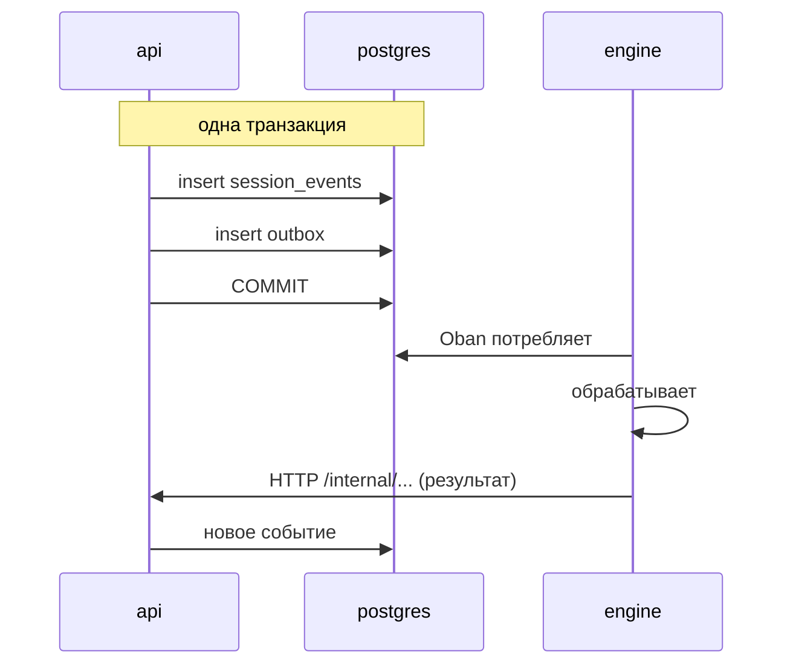

# Внутренний API (api ↔ engine)

api и engine общаются **двумя** способами, и выбор между ними не
стилистический:

| направление | механизм | когда |
|---|---|---|
| api → engine | **outbox + Oban** | события: что-то произошло, engine реагирует, когда сможет |
| api → engine | **HTTP** | синхронные команды: ответ нужен сейчас |
| engine → api | **HTTP** (`/internal/*`) | engine запрашивает данные или фиксирует результат |

Критерий: если операция должна быть атомарной с записью в базу, она идёт
через outbox — api записывает событие и намерение его опубликовать в одной
транзакции, и не существует окна, в котором одно есть без другого. Если нужен
немедленный ответ, она идёт через HTTP.

**Вне рамок этой страницы**: HTTP-маршруты, аутентифицируемые обычным JWT пользователя
(RBAC по роли, `@RequireRole`) — такие как
`/projects/:projectId/agent-autonomy`, `/projects/:projectId/container/lifecycle`
([RN-267](../business-rules.md#rn-267)),
`.../agents/criativo/validate-necessity` (гейт `necessidade-validada`,
[RN-406](../business-rules.md#rn-406), ADR 0095) или CRUD
`/projects/:projectId/personal-access-tokens` ([RN-426](../business-rules.md#rn-426),
ADR 0105) — включая два маршрута `maintainer`
(`GET .../personal-access-tokens/all`,
`DELETE .../personal-access-tokens/:tokenId/admin`,
[RN-427](../business-rules.md#rn-427)) — не являются «внутренними» в смысле этого документа, даже когда
фактически их вызывает агент. То же относится к четырём
маршрутам `HuggingFaceModelsController` под
`/workspaces/:workspaceId/huggingface/*`
([RN-462](../business-rules.md#rn-462), [RN-463](../business-rules.md#rn-463),
ADR 0115): `role:maintainer`, прямое действие человека в Настройках
Проекта/Workspace, никогда не вызываемое engine. То же относится к двум маршрутам
членства, `POST`/`DELETE /projects/:projectId/members`
([RN-471](../business-rules.md#rn-471),
[RN-472](../business-rules.md#rn-472), ADR 0127) — и там это факт
структурный, а не просто верный: два потолка понижения, которые маршрут теперь
навязывает (никто не понижает `owner` workspace, никто не понижает сам себя),
живут ВНУТРИ `AddProjectMemberUseCase`, поэтому их можно было бы обойти через любую
вторую дверь в `project_members`. Её нет — ни один маршрут `/internal/*`
не пишет в эту таблицу, и у сценария использования ровно один вызывающий — сам маршрут
RBAC. Общий
service token НИКОГДА не служит учётными данными на этих маршрутах, а JWT
пользователя никогда не работает на `/internal/*` — два механизма не пересекаются
([RN-035](../business-rules/autenticacao.md#rn-035)).

**Третьи учётные данные — ни service token, ни JWT пользователя**:
`POST /projects/:projectId/runner-ticket` — это `role:developer`, как любой
маршрут RBAC, но он не принимает обычный JWT сессии — только одни из ДВУХ
учётных данных уровня устройства, оба обрабатываются одним `PatAuthGuard`/
`@RequirePatAuth()` и по построению ограничены этим единственным маршрутом:
Personal Access Token (`brb_…`, [RN-424](../business-rules.md#rn-424), ADR
0105) или самоподписанный короткоживущий (≤60s) JWT EdDSA, доказывающий владение
ключом устройства Ed25519 в `runner_device_keys` — ключом машины, созданным в
терминале и зарегистрированным установщиком
([RN-552](../business-rules.md#rn-552)), или ключом проекта, который браузер
зарегистрировал до того, как [ADR 0203](../adr/0203-aposenta-o-fluxo-do-runner-pelo-navegador.md)
вывел этот поток из эксплуатации ([RN-465](../business-rules.md#rn-465), ADR 0118) — в дополнение к PAT,
никогда не вместо него. Это стоит отметить здесь, потому что именно это различие
призвана объяснить эта страница: «не `/internal/*`» не означает «значит, это JWT
пользователя» — учётные данные устройства являются третьим механизмом, без
пересечения с двумя другими.

Также вне рамок:
маршруты `@Public()`, которые являются фактической ТОЧКОЙ ВХОДА, ещё до появления
какой-либо сессии — `POST /auth/login`, `POST /auth/register`,
`GET /auth/oauth/:provider/start`/`callback` (вход через соцсети, ADR 0084) и
остальная часть `auth.controller.ts`. Ни один из них не использует ни service token, ни JWT
пользователя (это то, что ОНИ выдают, а не то, что требуют), поэтому
различие service token × JWT, которое объясняет эта страница, к ним не относится —
у них просто нет никаких учётных данных на входе. Классификация открытости
каждого HTTP-маршрута, внутреннего или нет, находится в
[docs/security-surface.md](../security-surface.md).

## Аутентификация

Ни одна сторона не доверяет частной сети. Все предъявляют **один и тот же
service token** — общий секрет из env, поддающийся ротации, в
заголовке `X-Brabo-Service-Token`:

| вызывающий | проверяется | сравнение |
|---|---|---|
| engine → api | `EngineServiceGuard` | `comparaEmTempoConstante` |
| api → engine | `EngineWeb.Plugs.VerifyServiceToken` | `Plug.Crypto.secure_compare/2` |
| broker → api | `EngineServiceGuard` | `comparaEmTempoConstante` |
| api → broker | `tokenConfere` (`apps/broker/src/config.ts`) | `timingSafeEqual` |
| `install.sh` → api | `EngineServiceGuard` | `comparaEmTempoConstante` |

broker ([ADR 0130](../adr/0130-broker-de-container.md)) вошёл в эту таблицу,
не изменив её: тот же заголовок, тот же секрет, та же ротация. Он отвечает `401`
там, где api отвечает `403`, так же как engine — не хватает
аутентификации вызывающего, а `403` у api — документированное ограничение
совместимости, а не расхождение.

> **Этот трафик не проходит через JWT.** Маршруты `/internal/*` помечены
> `@ServiceRoute()`, что выводит их из-под `JwtAuthGuard` и освобождает от
> `RateLimitGuard` (он выполняется до guard контроллера, поэтому освобождение
> должно приходить из метаданных). Access token пользователя, даже `owner`,
> не открывает ни один из них; а service token не открывает ни один другой маршрут. См.
> [RN-035](../business-rules/autenticacao.md#rn-035).

> **Ротация без простоя.** `BRABO_SERVICE_TOKEN` — отправляемое значение;
> `BRABO_SERVICE_TOKEN_PREVIOUS` принимается **только при проверке**. Поскольку обе
> стороны отправляют текущее и принимают оба, ротация — тот же танец в три шага,
> что и для `AUTH_JWT_SECRET`, описанный в
> [runbook](../runbook.md#rotacao-das-chaves-do-auth).

## Корреляция

Каждый вызов между двумя сервисами несёт также заголовок `traceparent` (W3C),
и это справедливо в **обоих направлениях и для всех методов** — GET, POST и поток
SSE хода LLM. У каждой стороны одна воронка, собирающая заголовки:

| вызывающий | воронка |
|---|---|
| api → engine | `HttpApiToEngineClient.buildHeaders()` |
| engine → api | `EngineApiClient.headers/0` |

До [ADR 0035](../adr/0035-observabilidade-legivel-e-trace-sem-coletor.md)
`traceparent` на стороне engine внедрялся только в POST, поэтому чтения
(`list_events`, контекст агента) и `llm_turn_stream` приходили в api без
корреляции — в Tempo они выглядели как осиротевшие трейсы. Если вы добавляете новый
вызов в этот контракт, используйте воронку: именно она гарантирует, что он не родится осиротевшим.

> Отказ в service token логируется с обеих сторон, с маршрутом и источником
> — и **без** предъявленного токена. Без логов 401 здесь неотличим
> от «engine недоступен», что и было симптомом раньше.

> Маршруты `/internal/*` **не являются внутренними по соглашению об именах.** Префикс
> нужен для читаемости; защищает их guard, проверяющий service token. Полная
> классификация находится в
> [`docs/security-surface.md`](../security-surface.md), и табличный тест
> отклоняет новый маршрут без классификации.

## engine → api

Двадцать восемь маршрутов, все под `/internal/sessions/:sessionId/`, если не указано иное.
Сгруппированы по тому, что они делают.

У одного маршрута этого семейства есть вызывающий, который **не** является engine — см.
[broker → api](#broker--api) ниже. Классификация называет механизм, а не
отправителя.

### Журнал событий и действия

| метод | путь |
|---|---|
| GET · POST | `/events` |
| POST | `/actions` |
| POST | `/termination` |
| POST | `/handoffs` |

engine никогда не пишет напрямую в таблицу событий — он **просит** api, который
контролирует `seq` и атомарность с outbox.

`POST /handoffs` поддерживает **не более одного handoff `offered` на (проект, цель)**
([RN-635](../business-rules.md#rn-635),
[ADR 0182](../adr/0182-ciclo-de-vida-do-handoff.md)). Ответ — ДЕЙСТВУЮЩЕЕ
предложение плюс `desfecho`: `criado`, `substituiu_oferta` (ожидающее стало
`superseded`, с событием `handoff.superseded`) или `ja_oferecido` (без новой строки —
та же сессия и ни одного нового артефакта). Цель, уже активная в незакрытой
сессии проекта, отклоняется с **409** `reason: "agente_ja_ativo"`, а
`message` — это фраза, которую агент читает как результат инструмента
(`Engine.Harness.Tools.OfferHandoff` передаёт её дословно;
`FalhaDeTurno.origem/1` классифицирует её как `politica`). Необязательное поле тела
`seAusente: true` — отправляемое AppSec через `create_handoff_if_absent/5`
([RN-636](../business-rules.md#rn-636)) — возвращает ЛЮБОЕ ожидающее предложение
цели вместо его замены.

Предложение Criativo→PO, которое запросил клик «Я готов — потребность подтверждена»,
ПРИНИМАЕТСЯ в том же вызове от имени того, кто кликнул
([RN-658](../business-rules.md#rn-658),
[ADR 0185](../adr/0185-estou-pronto-fecha-os-dois-gates.md)): предложение
`criativo` → `po`, из этой сессии, несущее `product_brief`, появившийся после
последнего отмеченного `readiness.confirmed`. Принятие идёт через тот же
`AcceptHandoffUseCase`, что и карточка (те же события, человек как актор, метка
`implicito`), и тогда ответ несёт `status: "accepted"`.
engine сопоставляет только `{:ok, _}`, поэтому с его стороны ничего не меняется; неявное принятие,
которое не удаётся, никогда не становится ошибкой для engine — оно становится
долговечным `agent.error`, и предложение всё равно возвращается.

`GET /events` — это то, что читают семь разговорных агентов, когда их процесс
поднимается над сессией, в которой уже есть разговор, и то, что читают kickoff-ы,
чтобы найти brief, правила, карту модулей и истории
([RN-580](../business-rules.md#rn-580)). До этого маршрут понимал только
`afterSeq` и `limit`, а engine отправлял только `limit=200` — поэтому получал
**первые** 200 событий, и агент, разбуженный в разговоре из 201 события, поднимался
без сообщения, на которое отвечал. Добавлены два параметра query, оба
**аддитивные** (без них ответ байт в байт прежний):

| параметр | эффект |
|---|---|
| `latest=true` | возвращает **хвост** — последние `limit` событий, всё ещё по возрастанию `seq` — и игнорирует `afterSeq`; та же семантика, что у человеческого маршрута (ADR 0021) |
| `types=a.b,c.d` | только события этих типов, и `limit` считает только их; не более 20 типов, каждый соответствует `^[a-z][a-z0-9_]*(\.[a-z0-9_]+)*$`, иначе **400** |

Страница по-прежнему ограничена **200** ([ADR 0060](../adr/0060-superficie-de-leitura-de-codigo.md)):
ни один из параметров не делает чтение неограниченным. На стороне engine новые чтения
идут через `EngineApiClient.list_events/3`; `list_events/2` продолжает существовать без изменений
для вызывающих, которые не мигрировали (`InfraLeadServer`, `DevLeadTools`).

Именно поэтому проверка типа сессии живёт в сценарии append, а не
в `ActivateExecutionUseCase`: здешний `POST /events` и маршрут пользователя попадают в
одну воронку. С ФАЗЫ 20 `execution.activated` в сессии `consultiva`
отвечает **409** и по этому пути — тип есть намерение создания, и
событие его не повышает ([RN-097](../business-rules.md#rn-097)). Никаких других
изменений контракта: остальные типы событий остаются идентичными, а отказ
происходит **до** `incrementSeq`, поэтому отклонённая попытка не оставляет дыры
в `seq`.

С [RN-581](../business-rules.md#rn-581) та же воронка также отклоняет
**разговор** в сессии, уже `closed`/`closed_abnormally`:
**409** с именованным телом — `{ message, reason: "sessao_encerrada", status,
type }`. «Разговор» — это тип, существующий только как разговор
(`chat.message`, `chat.structured_question[_answered]`, `agent.status`,
`agent.activated`, `handoff.offered`/`accepted`, события готовности) **или**
любое событие, актор которого — разговорный агент (шесть плюс `dev-lead` и
`infra`). То, что производит само закрытие, продолжает проходить —
`ToolLoop` Психолога, исходы Анамнеза, человек, решающий ожидающее действие.
Статус приходит из **того же** `UPDATE`, что резервирует `seq`, и
отказ откатывает этот инкремент: тоже без дыры.
`append_event/3` в engine логирует отказ как предупреждение вместо того, чтобы его отбросить, поскольку
большинство его вызывающих отбрасывают возвращаемое значение.

`ActivateExecutionUseCase` получил второй побочный эффект, который **не** проходит
ни через один маршрут этого документа ([RN-135](../business-rules/custo.md#rn-135)): в
конце активации, если маршрут пользователя передаёт `originSessionId` (сессию
ЧАТА, откуда пришёл клик), он закрывает эту сессию через
`TransitionSessionUseCase` — тот же путь, который `POST /termination` этой
страницы использует, чтобы engine сообщал о завершении, но запускаемый api, без
обращения к engine. Ни одного нового маршрута, никаких изменений существующего контракта
`engine → api`.

`GET /projects/:projectId/execution/session` ([RN-139](../business-rules/autenticacao.md#rn-139))
— та же история наоборот: открывает через внешний HTTP чтение
(`findActiveExecutionSession`), которое раньше существовало только внутри
`ActivateExecutionUseCase`. Ни одного нового пути `engine → api`, никаких побочных
эффектов — это `SELECT`, и критерий (сессия `active` с записанным `execution.activated`)
ничего не меняет в том, что engine уже делал.

С [RN-579](../business-rules.md#rn-579) (AT-093) фасад `EngineApiClient`
имеет побочный эффект поверх этих маршрутов, и он находится в СОБСТВЕННОМ канале
engine, а не в api: когда api **подтверждает** запись в сессию —
`POST /events` (как `append_event`, так и `append_event_returning`),
`POST /actions` (`proposed_action.created`), `POST /handoffs`
(`handoff.offered`) и `create_epic`/`create_story`/`create_task` PO
(`backlog.*_created`) — фасад транслирует `event.appended` в
`session:<id>` только с `type` и `actorId`. Отклонённая запись ничего не
транслирует. Ни один маршрут и ни одно тело запроса не изменились; до этого только
`ArtifactEmitter` и Infra Lead транслировали вручную, и даже записи, которые
api отклонил. Именно это позволяет браузеру отказаться от опроса раз в 3s, пока
канал жив.

Записи, которые api делает сам — человек, решающий действие,
переход сессии, сообщение чата, на которое ответил собственный ход LLM api, — не проходят
через этот фасад и с AT-157 попадают в канал обратным
путём: после того как запись **закоммичена**, api вызывает
`POST /internal/sessions/:id/event-appended` (см. *api → engine*), и
engine транслирует тот же `event.appended`. Записи, пришедшие от самого
engine (`/internal/*`), не объявляются второй раз — кроме
событий, которые api записывает ПО СОБСТВЕННОЙ инициативе как следствие действия, которое он автоодобрил
и выполнил внутри того внутреннего запроса (`infra.pr_opened`,
`adr.pr_opened`, `action.*`): фасад engine объявляет только ту запись, которую он
запросил, поэтому эти объявляются один раз api
([RN-848](../business-rules.md#rn-848)). Вызов выполняется
по принципу best effort и никогда не ожидается; если он теряется, резервный опрос браузера раз в 15s
покрывает это, как и раньше. `:id` отправляется только когда id сессии —
UUID (тип столбца): api проверяет его там, где собирает URL, кодирует
сегмент и подтверждает, что результат сохраняет origin `ENGINE_URL` и ожидаемый
путь — всё остальное отбрасывается без вызова (AT-344).

### LLM

| метод | путь |
|---|---|
| POST | `/llm-turn` |
| POST | `/llm-turn-stream` |

Каждый вызов модели проходит через api. Это не бесполезная косвенность: именно там
происходит metering и именно там бюджет может **отклонить** вызов. engine,
который говорил бы напрямую с провайдером, сделал бы потолок расходов невозможным для соблюдения.

**Оба** пути используют один и тот же потолок времени, `LLM_TURN_TIMEOUT_MS` (по умолчанию
300.000 ms). Ход LLM — не обычный вызов API: с локальной моделью
первый ход ещё загружает несколько ГБ весов до первого токена, а с
провайдером API большой контекст требует времени. В `/llm-turn-stream` значение действует
НА КАЖДЫЙ полученный чанк — то есть это потолок НЕАКТИВНОСТИ, которого требует
[ADR 0041](../adr/0041-base-openai-compativel-e-contrato-de-llm-providers.md),
а не потолок всего
ответа.

Потолок должен быть явным в обоих: если его не передать, `Req` использует свой
по умолчанию, 15 секунд. Пока его передавал только путь без stream, четыре
разговорных агента — которые используют только путь со stream — падали через 15s с
`%Req.TransportError{reason: :timeout}`, классифицированным как источник `infra`. С
локальной моделью ход укладывался в 15s, и дефект не проявлялся.

#### Каждый вызов без stream выполняется в собственном процессе ([RN-742](../business-rules.md#rn-742))

`post_returning/3` и каждый GET в `EngineApiClient.Live` выполняют вызов `Req`
внутри одноразового `Task` (`isolado/1`); заголовки собираются заранее, в
вызывающем. Ответ, пришедший после `receive_timeout`, попадает в процесс,
который уже завершился, и никогда — в почтовый ящик вызывающего: 08/10 такое
потерянное сообщение уронило dev agent на СЛЕДУЮЩЕМ вызове. Путь со stream остаётся в
вызывающем (его `into:` пишет в словарь процесса вызывающего, а
разговорные агенты уже вызывают его из `Task` хода).

#### Последнее сообщение может быть указанием языка ([RN-622](../business-rules.md#rn-622))

`messages`, которые engine отправляет в оба пути, могут заканчиваться ОДНИМ дополнительным
сообщением `role: "system"` — указанием языка ответа, добавляемым
фасадом `EngineApiClient` в каждый вызов хода агента (язык автора
для хода, который кто-то набрал, язык проекта в остальных; никогда — для
суммаризатора `context-manager`). Оно эфемерно: никогда не попадает в
историю агента. api не делает с ним ничего особенного — это системное сообщение, как
любое другое, и его входные токены учитываются как остальные (18–29 на вызов, измерено
с cl100k/o200k, под потолком в 50 токенов).

С [RN-623](../business-rules.md#rn-623) фасад также читает `tools`
ТОГО ЖЕ вызова: в ходе с автором, когда эти инструменты включают тот, что
записывает общий артефакт проекта, а язык проекта отличается от языка
автора, то же сообщение получает вторую фразу ("Write project artifacts
in X." / "Artefatos do projeto: em X."). Это по-прежнему одно сообщение, по-прежнему эфемерное,
до 42 токенов в худшей измеренной реальной паре. Тело запроса не
меняется.

С [RN-706](../business-rules.md#rn-706) вызовы агентов `dev-*` и
субагентов QA (`ToolLoop`) могут нести ЕЩЁ ОДНО эфемерное сообщение `role: "system"`
ДО профиля автора и указания языка (языковое
остаётся последним): окружение агента, собранное `Engine.Harness.AmbienteDoAgente`
— реальная рабочая папка (`/work/...`, когда есть контейнер `running`),
образ и сеть из последнего `artifact.project_image`, то, что git идёт
через типизированные действия, и его модуль и контракты, которые он потребляет.
Потолок 1 200 символов; неудавшееся чтение оставляет его за бортом. api обращается с ним как с
любым другим системным сообщением и учитывает его токены как остальные. Тело
запроса не меняется.

С [RN-711](../business-rules.md#rn-711) вызовы семи
разговорных агентов несут ЕЩЁ ОДНО эфемерное сообщение `role: "system"`, после
сообщения об окружении и ДО профиля автора и указания языка:
поток поставки, собранный `Engine.Harness.FluxoDoTime` — семь этапов по
порядку, где находится агент, реальный следующий шаг и кто его запускает (человек или
система). Один и тот же текст в каждом ходе одного агента; никогда не сохраняется в
истории агента. Тело запроса не меняется. С
[RN-862](../business-rules.md#rn-862) то же сообщение заканчивается, только для Criativo,
PO, Arquiteto и Dev Lead (агентов с `declare_open_question`),
центральной фразой: каждый вопрос, оставленный пользователю, становится
`declare_open_question` с предложением агента и тем, на что он влияет, — никогда
вопросом только в тексте хода.

С [RN-874](../business-rules.md#rn-874) вызовы PO несут ещё одно
эфемерное сообщение `role: "system"` сразу после сообщения о потоке, собранное
`Engine.Harness.DecisoesDoProjeto`: решения пользователя (`decision_record`)
и вопросы, всё ещё открытые в проекте, прочитанные локально из журнала событий,
с потолком 10 + 10 элементов и 3 000 символов. Опускается, когда сказать
нечего или чтение не удалось.

#### Финальный фрейм несёт имя модели ([RN-146](../business-rules/autenticacao.md#rn-146))

`RunLlmTurnResult` и фрейм `final` из `LlmTurnStreamEvent` получают
`modelName: string | null` — имя модели, которую api разрешил
(`resolveModelBinding` → `models.findById`) перед вызовом провайдера.
`null` только когда ход упал ДО разрешения какой-либо модели (нет
binding или binding указывает на модель, которой больше нет); во всех остальных случаях —
включая превышенный бюджет — binding уже был разрешён, и имя передаётся
даже во фрейме ошибки. Четыре разговорных агента engine
извлекают поле из фрейма и включают его в payload `agent.response`
(`modelName`), который `SessionPage.tsx` читает, чтобы показать модель рядом
с именем агента.

#### Jev может сузить меню инструментов ([RN-625](../business-rules.md#rn-625))

С [ADR 0179](../adr/0179-o-laco-pergunta-ao-jev-qual-ferramenta.md) оба
пути могут спросить маршрутизатор инструментов Jev, какой инструмент подходит шагу, прежде чем вызвать
чат-модель, и затем предложить модели только оставшееся меню. Изменения
контракта аддитивны:

- **Запрос:** оба тела принимают необязательный `catalogoCompleto: boolean`.
  `true` пропускает маршрутизатор в этом вызове и предлагает весь список `tools`.
  engine включает его, когда повторяет шаг, ограниченное меню которого заставило модель
  ответить без вызова инструмента (один раз на шаг).
- **Ответ:** `RunLlmTurnResult` и фрейм `final` из
  `LlmTurnStreamEvent` получают необязательный `toolRouting` — меню до и
  после, выбор, его уверенность, предыдущий инструмент выполнения, задержку,
  реальную стоимость Jev и, при любом откате к полному каталогу, `motivoDaQueda` и
  `origemDaQueda` (`infra`/`modelo`/`codigo`). Он ОТСУТСТВУЕТ, когда маршрутизатор не
  запрашивался: провайдер не OpenRouter, меньше двух инструментов или
  переключатель workspace (`tool_router_enabled`) выключен. engine записывает его как
  событие `tool_router.decided`.
- **Stream:** `/llm-turn-stream` может выдать фрейм `tool_routing_started`
  ДО любого `delta`. engine, которые его не знают, игнорируют его как неизвестный тип
  фрейма.

Ход никогда не падает из-за маршрутизатора: любая ошибка откатывается к полному
каталогу, с причиной в `toolRouting`. Ни один маршрут не добавлен и не удалён.

#### `usage.costMicros` — реальная стоимость, когда провайдер её сообщает ([RN-665](../business-rules/custo.md#rn-665))

С [ADR 0188](../adr/0188-o-custo-real-do-provider-vira-o-numero-do-metering.md) `usage.costMicros`,
который возвращают оба пути — и который engine суммирует в бюджет области, — это
РЕАЛЬНАЯ стоимость, которую вернул провайдер, когда он её вернул (сейчас только
`usage.cost` OpenRouter, и никогда в вызове BYOK). Иначе это
замороженная цена каталога, как раньше ([ADR 0042](../adr/0042-catalogo-vivo-ciclo-de-vida-do-modelo-e-preco-auditavel.md)).
Имя и форма поля не меняются; меняется число, которое engine
получает за тот же вызов, и оно может быть больше каталожного.

#### Код ошибки провайдера: `errorCode`

Рядом с `error` тело `/llm-turn` и фрейм `final` из
`/llm-turn-stream` несут аддитивный `errorCode` — нормализованный `code`
ошибки провайдера ([ADR 0041](../adr/0041-base-openai-compativel-e-contrato-de-llm-providers.md)),
`null`, когда ошибки нет или когда ошибка не от провайдера (бюджет,
отсутствующий binding модели). 402 от провайдера — это `insufficient_credit`
([RN-730](../business-rules.md#rn-730)): engine решает «кредит исчерпан»
сначала по этому коду (`FalhaDeTurno.credito_esgotado?/1`) и сохраняет сравнение текста
только как запасной вариант для api, более старого, чем это поле ([RN-726](../business-rules.md#rn-726)).

#### Ответ, обрезанный на потолке вывода: `truncated`

Когда провайдер закрыл ответ на потолке вывода (`finish_reason:
"length"` в OpenAI-совместимом диалекте, `stop_reason: "max_tokens"` в
Anthropic), тело `/llm-turn` и фрейм `final` из `/llm-turn-stream`
несут `truncated: true` ([RN-737](../business-rules.md#rn-737)). Поле
аддитивное и отсутствует в остальных случаях. Текст и аргументы `toolCalls` приходят обрезанными:
engine не выполняет tool call из обрезанного ответа (возвращает в цикл
именованную ошибку инструмента) и добавляет короткую строку «обрезано» к
обрезанному завершающему тексту.

#### Отчёты о расходах здесь НЕ проходят

Metering записывается **на этом** пути: каждый `/llm-turn` записывает строку в
`token_usage` до того, как ответ вернётся в engine. ЧТЕНИЕ этих данных —
счёт owner (`/workspaces/:id/credential-spend` и
`/workspaces/:id/spend-report`) и потребление участника
(`/projects/:id/spend/me`) — это **внешняя** поверхность, аутентифицируемая JWT и
классифицированная в [security-surface.md](../security-surface.md).

Это не организационная деталь: эти три маршрута ветвятся по **роли
человека** — `owner` для счёта, `viewer` для собственного потребления
([RN-101](../business-rules/custo.md#rn-101)). `X-Brabo-Service-Token` не несёт
никакого человека, поэтому внутреннему аналогу пришлось бы выбирать между тем, чтобы не
различать аудитории, или получать id актора как параметр — а это
именно то, что [ADR 0063](../adr/0063-duas-audiencias-para-o-mesmo-gasto.md)
отвергает. engine записывает расходы; читают их люди.

[ADR 0076](../adr/0076-provider-volta-a-ser-dimensao-de-gasto.md) пересмотрел
0063 и снова открыл разбивку по **провайдеру**, которая является разбивкой по УЧЁТНЫМ ДАННЫМ. Ни
маршрут, ни роль не изменились — оба по-прежнему классифицированы как выше, —
но то, что маршрут owner ВОЗВРАЩАЕТ, изменилось, и поэтому стоит назвать границу
здесь: `porProvider` существует только в отчёте workspace (`owner`), а потребление
участника по-прежнему без провайдера и без учётных данных. Что действительно изменилось — это
механизм гарантии: измерение, запрошенное с областью актора, **не компилируется**
([RN-187](../business-rules/custo.md#rn-187)), вместо того чтобы зависеть от того, что маршрут не
предлагает параметр. Аргумент абзаца выше остаётся в силе — именно он
объясняет, почему это чтение никогда не спускается сюда.

### Жизненный цикл сессии

| метод | путь |
|---|---|
| GET | `/internal/sessions/:id/pending-work` (**не** ограничен сессией в смысле остальных: он о сессии, а не внутри неё) |

`SessionServer` спрашивает перед закрытием по heartbeat. Таймаут измеряет
неактивность ВКЛАДКИ — 30 секунд, — а закрытие сессии касается того, что РАБОТА
завершена, а не того, кто ещё смотрит. В реальном выполнении это удержало
handoff `offered` для Arquiteto внутри закрытой сессии
([RN-064](../business-rules/custo.md#rn-064)).

Ответ: `{ pending, motivo, aguardandoUsuarioDesde }`. `motivo` идёт в лог engine — сессию, которая
отказывается закрываться, не говоря почему, невозможно диагностировать. А недоступный api
**не** мешает закрытию: менять осиротевшую сессию на бессмертную значило бы
менять один дефект на другой.

`aguardandoUsuarioDesde` — пятый сигнал
([RN-581](../business-rules.md#rn-581)), и единственный с **потолком**:
когда самое недавнее событие конца хода в разговоре (`agent.response`,
`chat.structured_question`, `agent.error` со стороны агента; `chat.message`,
`chat.structured_question_answered` со стороны пользователя) пришло от
разговорного агента, разговор ждёт пользователя, и api
возвращает момент ISO, в который этот ход закончился. api говорит *с какого момента*; engine
решает *как долго* (`SESSION_CONVERSATION_IDLE_TIMEOUT_MS`, 8h) и, по истечении
этого, закрывает сессию как `closed` с причиной `conversation_idle_timeout`. Он
равен `null` всякий раз, когда присутствует какой-либо из четырёх сигналов без потолка — они побеждают,
как всегда побеждали. Присутствующее значение, которое engine не может интерпретировать, трактуется как
ошибка (закрытие по heartbeat), никогда как «без потолка».

### Реестр гейтов

| метод | путь |
|---|---|
| GET | `/internal/gates` (**не** ограничен сессией) |

Чтение декларативного реестра в `docs/gates.yml`
([ADR 0054](../adr/0054-gates-como-registro-declarativo.md)). Он не
ограничен сессией по той же причине, что и каталог моделей: реестр глобален —
какие гейты существуют, это факт о продукте, одинаковый для каждого проекта.

Только чтение, и без маршрута записи **намеренно**: реестр меняется через ревью
PR, а не в runtime. Маршрут записи превратил бы инженерное решение в
конфигурацию продакшена, что и отверг ADR, выбрав
YAML вместо таблицы.

Файл едет внутри образа (`COPY docs/gates.yml` в
`docker/api/Dockerfile.prod`), как и миграции: загрузчик поднимается от
`__dirname`, пока не найдёт его, и в продакшене находит его в `/app/docs/gates.yml`.
Загрузка ленивая — нечитаемый файл возвращает ошибку на этом маршруте, вместо того чтобы
помешать api запуститься.

Весь механизм задокументирован в
[docs/explanation/gates.md](../explanation/gates.md).

**Есть второй маршрут к тому же реестру, и он НЕ внутренний.** Панель
команды (ФАЗА 15b) читает `GET /gates`, аутентифицируемый JWT пользователя, как любой
продуктовый маршрут. Это не дублирование по небрежности: `/internal/*` аутентифицируется
**service token**, которого у браузера нет и быть не может — передать его фронтенду
означало бы дать ему всю внутреннюю поверхность, а не только гейты. Они различаются также
тем, что возвращают: внутренний отдаёт реестр как он есть в YAML,
публичный возвращает **только гейты `active`**, потому что гейт `planned` — это
инженерное планирование, и ему незачем появляться на экране того, кто ждёт
PR. Классификация обоих находится в
[docs/security-surface.md](../security-surface.md).

### Каталог моделей

| метод | путь |
|---|---|
| POST | `/internal/models/sync` (**не** ограничен сессией) |

Один из двух маршрутов `engine → api` вне `/internal/sessions/:sessionId/` (
второй — [рабочий remote проекта](#project-working-remote)), потому что
синхронизация каталога не принадлежит ни сессии, ни workspace: каталог
ГЛОБАЛЕН — имя, цена, окно и capabilities являются фактом о провайдере, одинаковым для
всех. С [ADR 0051](../adr/0051-facetas-de-capability-e-curadoria-por-uso.md)
сюда входят фасеты модальности (читает изображения, генерирует изображения, thinking), которые
тот же вызов сверяет по удалённому каталогу — модальность, которую
провайдер не объявляет, сохраняется, а не обнуляется. По workspace — это **курирование**, и синхронизация его не затрагивает
([ADR 0049](../adr/0049-curadoria-de-modelo-por-workspace.md)).
**Планирует** engine (`ModelSyncSchedulerWorker`, Oban, с той же идиомой самоперепланирующегося
worker, что и `AnamneseSchedulerWorker`); учётные данные и
реестр провайдеров есть у api. Дублировать реестр на Elixir означало бы поддерживать два
каталога — см. [ADR 0042](../adr/0042-catalogo-vivo-ciclo-de-vida-do-modelo-e-preco-auditavel.md).

Отвечает **200** с отчётом по провайдерам (`porProvider[]`), никогда 5xx из-за
одного провайдера: каждая строка несёт `descobertos`, `reencontrados`,
`indisponibilizados` и — когда провайдер не был синхронизирован — `pulado`
(`sem_capability` | `sem_credencial` | `falha`) с `origemDaFalha`
(`infra` | `modelo`) и `detalhe`. Пропущенный провайдер **ничего не отключает**:
«не знаю, что там есть» не то же самое, что «там ничего нет»
([RN-043](../business-rules/custo.md#rn-043)). Полное тело есть в
[сгенерированном OpenAPI](/reference/api/) под тегом `internal`.

Две вещи, которые этот маршрут **не** делает и которые раньше были иными:

- **Он не включает и не выключает модель ни в одном workspace.** `descobertos` считает
  новые строки в `models`; ни одна из них не получает курирования. Обнаруженная модель
  не имеет строки в `workspace_models`, а отсутствие строки — это выключенное состояние
  ([RN-052](../business-rules/custo.md#rn-052)).
- **Он не меняет цену молча.** Цена, помеченная `manual_pricing`, сохраняется
  как есть, и каждое изменение, которое делает синхронизация, записывает строку в
  `model_price_changes` с источником `sync` — в той же транзакции, что и запись
  ([RN-044](../business-rules/custo.md#rn-044), [RN-051](../business-rules/custo.md#rn-051)).

### Рабочий remote проекта {#project-working-remote}

| метод | путь |
|---|---|
| GET | `/internal/projects/:projectId/git-remote` (**не** ограничен сессией) |

Второй маршрут `engine → api` вне `/internal/sessions/:sessionId/`, который
появился — два чтения PO в следующем разделе пришли позже, — и
**единственный в продукте, который возвращает расшифрованный секрет**
([ADR 0056](../adr/0056-o-engine-trabalha-em-repositorio-remoto.md)).

Он существует из-за того же разделения, что и синхронизация каталога, применённого к другому ресурсу:
с файловой системой работает engine, мастер-ключ есть у
api. Без него проект у удалённого провайдера выполнял разговорную половину и останавливался
на половине построения — `get_local_repo_path/1` отклонял всё, что не было `local`,
и worktree, терминал, diff гейта и контекст останавливались вместе с ним.

Отвечает **чистым** origin (`origin`), веткой по умолчанию и, для удалённого
провайдера, отдельными `token` и `username`. Разделение не косметическое:

> **`origin` никогда не несёт учётных данных.** Это значение, записанное в
> `.git/config` workspace, **внутри папки, где dev agent имеет
> автоодобренное чтение** ([RN-075](../business-rules/custo.md#rn-075)). URL вроде
> `https://x-access-token:TOKEN@…` там был бы в одном `cat .git/config`
> от превращения в контекст LLM.

У потребителя симметричная обязанность: внедрять токен **на каждый вызов**, в
окружение дочернего процесса каждого вызова git, и никогда в argv или в
файл ([RN-076](../business-rules/custo.md#rn-076), `Engine.Actions.GitAuth`).

Учётные данные — это данные **owner workspace**, через тот же резолвер, что и в
[RN-058](../business-rules/custo.md#rn-058). Провайдер `local` **сюда не доходит**: он
разрешается engine напрямую из базы, не имеет токена и не зависит от того, работает ли
api, — это путь, который проверяют `pnpm dev` и весь набор тестов.

#### Вкладка Код здесь НЕ проходит, и асимметрия в этом и состоит

Поверхность чтения кода ФАЗЫ 26b (`/projects/:projectId/code/*`)
**не имеет внутреннего аналога**, и стоит объяснить почему — маршрут выше существует
для противоположного случая, и вместе они показывают разделение.

engine нужен `git-remote`, потому что он работает в **файловой системе**:
клонирует, создаёт worktree, запускает команды. Вкладка Код нигде не работает —
она просит у **провайдера** содержимое ref через api, с
учётными данными, которые у api уже есть. Ничто на этом пути не требует расшифрованного секрета,
пересекающего границу процесса, и поэтому ничто на этом пути не открывает внутренний маршрут.

Важное практическое следствие: единственный маршрут продукта, возвращающий
расшифрованный секрет, остаётся ОДНИМ. Чтение кода не умножило их.

#### Индексация RAG чата (Волна 4/G2) тоже не открывает внутренний маршрут

`docs`/`adr` индексируются `ReadProjectCodeUseCase` — ТОЙ ЖЕ
поверхностью, что и вкладка Код, теми же учётными данными owner, тем же порогом контейнера
(RN-105) — по причине выше: ничто на этом пути не расшифровывает
секрет в отдельном процессе. `session` читает `chat.message`/`agent.response`
прямо из журнала событий, не выходя из api. Embedding (`RagEmbeddingService`)
никогда не проходит через резолвер учётных данных RN-058: он запрашивает
ФИКСИРОВАННЫЙ провайдер `ollama` напрямую у `LLMProviderRegistry` — тот же путь, который
RN-058 уже описывает как «поиск пропускается» для этого провайдера, — здесь нет
пользовательского секрета для расшифровки, и поэтому также нет
внутреннего маршрута, который нужно открывать ([RN-232](../business-rules.md#rn-232),
[ADR 0080](../adr/0080-busca-hibrida-pesos-limiar-e-citacao.md)).

### Что перечитывает PO: бизнес-правила и бэклог

| метод | путь |
|---|---|
| GET | `/internal/projects/:projectId/business-rules` (**не** ограничен сессией) |
| GET | `/internal/projects/:projectId/backlog` (**не** ограничен сессией) |

Два других маршрута вне `/internal/sessions/:sessionId/`, и по тому
же критерию, что и предыдущие: ресурс принадлежит **проекту**, и
сегмент сессии здесь был бы декоративным — хуже, вводящим в заблуждение, потому что именно
область сессии вызвала дефект, который исправляют эти маршруты
([RN-164](../business-rules/autenticacao.md#rn-164)).

У PO было **четыре инструмента, и все на запись** (`create_epic`,
`create_story`, `create_task`, `offer_handoff`). Его контекст собирался
один раз, в kickoff, из **первых** 200 событий **текущей сессии** (эта
страница говорила «последних»; это были первые, что и измерила и исправила
[RN-580](../business-rules.md#rn-580)) —
и после этого он больше ничего не перечитывал. В длинной сессии или при
возобновлении он не знал, какие правила существуют, какие он уже покрыл и что
уже создал сам. Симптом, проявившийся при реальном использовании, — бэклог с
одним эпиком и **ни одной историей**: без истории нет задачи, а без задачи
выполнение встаёт без какой-либо ошибки.

`/business-rules` возвращает каждый `artifact.business_rule` из сессий проекта
— с полным `description`, тем, какие истории уже ссылаются на каждое правило
(`coveredByStoryIds`), и `uncoveredCount`. Это не повторный `GetCoverageUseCase`:
тот отвечает «какая часть продукта уже стала историей» для
ЭКРАНА и поэтому несёт только заголовок; этот отвечает «что мне нужно превратить в
историю» для МОДЕЛИ, и без описания PO имел бы формулировку правила, но
не его содержание. ВЫЧИСЛЕНИЕ покрытия то же самое (`computeCoverage`,
чистая функция) — два вычисления одного факта разошлись бы при первой правке.

`/backlog` возвращает ТО ЖЕ дерево эпик → история → задача, что и вкладка Бэклог,
через тот же `ListBacklogUseCase` (три чтения на проект, никогда N+1).

Ни один из двух не возвращает секрет, и **ни один не принимает параметров, кроме
id проекта**: ни поискового термина, ни пагинации, ни фильтра. Это
намеренно, и именно это держит их на правильной стороне
[ADR 0060](../adr/0060-superficie-de-leitura-de-codigo.md): чтение не является
внешним эффектом и не становится `proposed_action`, но чтение агента должно быть
ОГРАНИЧЕННЫМ — а у маршрута без параметров нет места, куда модель могла бы написать что
захочет. Стоимость вызова постоянна, а текст, передаваемый модели, имеет
потолок строк, всегда объявляя реальный итог при усечении.

### Что перечитывает PO: продуктовые метрики

| метод | путь |
|---|---|
| GET | `/internal/projects/:projectId/product-metrics` (**не** ограничен сессией) |

ТРЕТИЙ маршрут чтения PO, тот же дизайн, что и у двух выше
([RN-407](../business-rules.md#rn-407)) — закрывает последний открытый пункт
аудита `fluxo.yml` × код
([пункт B4](../explanation/auditoria-fluxo-vs-codigo.md#b-gaps-in-active-roles-already-implementable-work)):
`docs/fluxo.yml` (роль `po`, вход `metricas-de-produto`) объявлял
`status: lacuna` со времён ADR 0089 — ДАННЫЕ уже существовали (скрипт
`analise:funil` измеряет воронку сессия → commit → PR → merge, реальное lead time
и реальную частоту деплоя), не хватало только МЕХАНИЗМА чтения внутри
хода.

Отчёт собирается ТЕМИ ЖЕ чистыми функциями и ТЕМ ЖЕ запросом, что и скрипт, —
`calcularFunil`/`calcularLeadTimes`/`leadTimeMedioMs`/
`deploymentFrequencyPorDia`/`buscarAcoesGitDoFunil`, вынесенными в
`apps/api/src/application/services/funil-metrics.ts` (`scripts/` не может
импортировать `src/` в обратном направлении, а сценарий использования не может импортировать из
`scripts/`), чтобы чтение PO и человеческий отчёт никогда не расходились в
одном и том же факте. `apps/api/scripts/analise-funil.ts` теперь РЕЭКСПОРТИРУЕТ оттуда
вместо локального определения — без изменения сигнатуры и поведения.

В JSON-теле нет ни одного поля для трёх постоянных отсутствий, которые
скрипт объявляет («Не измеряется, намеренно»: полная продуктовая воронка
идея → commit, свидетельство принятия по фиче, MTTR/change failure
rate) — инструмент PO (`listar_metricas_de_produto`) называет все три
по имени в ТЕКСТЕ, который возвращает модели, никогда не позволяя ей заключить по
умолчанию, что пробела нет.

### Что читает dev agent: контракты между модулями

| метод | путь |
|---|---|
| GET | `/internal/projects/:projectId/module-contracts` (**не** ограничен сессией) |

Чтение dev agent контрактов Arquiteto
([RN-684](../business-rules.md#rn-684),
[ADR 0200](../adr/0200-contrato-entre-modulos-artefato-do-arquiteto.md)), чтобы
он перестал читать worktree другого модуля, чтобы узнать интерфейс.
Тот же дизайн, что и у чтений PO: никаких параметров, кроме проекта, постоянная стоимость
(действующий `module_map` и одно чтение по типу события). Ответ содержит одну
запись на модуль ДЕЙСТВУЮЩЕГО `module_map` — `modulo`, `dependeDe` (
`dependsOn` карты: что он потребляет) и `expoe` (элементы действующего
контракта или `null`, когда Arquiteto не объявил ни одного) — плюс
`contratosForaDoMapa`, контракты модулей, которых в карте больше нет, — названные
и никогда ни к чему не прикреплённые. `status: sem_contratos` с `version: 0` — это
законный ответ, а не ошибка. Инструмент engine (`listar_contratos_de_modulos`)
полностью отображает только собственный модуль dev и те, что он потребляет, с потолком
120 элементов, который говорит, что было отрезано.

### Где живёт workspace проекта — и почему ЧТЕНИЕ всё ещё не маршрут

`execution_mode` проекта ([ADR 0072](../adr/0072-projeto-local-ou-container.md)/
[ADR 0104](../adr/0104-execution-mode-tres-valores-e-workspace-verificado-pelo-runner.md),
[RN-169](../business-rules/autenticacao.md#rn-169)/[RN-421](../business-rules.md#rn-421))
следует тому же разделению. По нему проект может быть `container` (
управляемая папка в `PROJECT_WORKSPACES_ROOT`, по умолчанию), `mounted` (
абсолютный путь пользователя, смонтированный через bind-mount) или `runner` (абсолютный
путь пользователя БЕЗ bind-mount, подтверждённый подключённым `brabo-runner`) — и
engine должен знать, какой именно, потому что именно он создаёт worktree и запускает команды
внутри него.

**ЧТЕНИЕ по-прежнему без внутреннего маршрута.** engine разрешает локатор, читая
ТЕ ЖЕ столбцы ТОЙ ЖЕ базы (`projects.execution_mode` и
`projects.workspace_path`), как он уже делал с `workspace_dir_name` со времён
[ADR 0066](../adr/0066-nome-de-pasta-legivel-do-workspace.md). Это всё тот же
аргумент: два вывода — api и engine — должны совпадать, а
совпадать, читая одну и ту же строку, дешевле и труднее разойтись,
чем совпадать через HTTP-контракт. Секрет не задействован, поэтому нет причины
для маршрута чтения.

engine отличает `container` от двух других по **начальному слэшу**
локатора: имя папки в `container`, абсолютный путь в
`mounted`/`runner` — оба разделяют ОДИН И ТОТ ЖЕ вывод корня; между ними
меняется то, КОГДА/КТО подтверждает, что путь действительно существует (см.
следующий раздел).

**База проектов меняет то, где живут папки `mounted`, и намеренно ничего
не меняет здесь** ([ADR 0141](../adr/0141-base-unica-dos-projetos-montados.md),
[RN-500](../business-rules.md#rn-500)). С этого ADR проекты `mounted` живут
под единой базой, настроенной оператором, — `BRABO_PROJECTS_BASE`, — вместо того чтобы
каждому нужна была строка bind-mount, написанная вручную в обоих сервисах. База
монтируется по **идентичности** (`$X:$X`) в `api` и `engine`, и именно
поэтому этот контракт остаётся нетронутым: абсолютный путь, записанный в
`projects.workspace_path`, означает одно и то же в обоих контейнерах и на
хосте, поэтому дискриминатор по начальному слэшу выше продолжает работать, `projectScopeRoot`
(api) и `Engine.Actions.Workspace.workspace_dir/2` (engine) продолжают совпадать, и
**ни один маршрут не появился ни в одном направлении**. Фиксированная точка монтирования
потребовала бы трансляции в этом контракте; идентичность — это то, что покупает её отсутствие.

**Отложенная проверка диска здесь тоже ничего не меняет**
([ADR 0142](../adr/0142-validacao-de-workspace-montado-adiada.md),
[RN-501](../business-rules.md#rn-501)). Создание проекта `mounted` больше не
требует существования папки — создание проверяет лексическую форму плюс
базу, а папка создаётся, когда Infra поднимает контейнер, — поэтому между
этими двумя моментами engine может прочитать `workspace_path`, указывающий на папку,
которой ещё нет. Это не изменение контракта и не требует маршрута:
engine и так должен был это переживать, потому что у `runner` то же окно
со времён ADR 0104 (путь записывается при создании и подтверждается только позже), а
`Engine.Actions.Workspace.ensure!/4` уже создаёт то, что нужно. Чего стоит
это окно, сказано в ADR и относится к ЭКРАНУ, а не к этому
контракту: у проекта в этом состоянии `workspace_verified_at = null`, и
интерфейс должен говорить, что папки ещё нет, вместо того чтобы показывать путь так, будто она есть.

#### Навигация по этой базе тоже НЕ является внутренним маршрутом

Селектор папок, помогающий человеку выбрать, где будет жить проект `mounted`, —
это `GET /workspaces/:workspaceId/project-folders`
([RN-504](../business-rules.md#rn-504)) — **публичный** маршрут
контроллера `workspaces`, за `@RequireRole('maintainer')` и задокументированный в
[поверхности безопасности](../security-surface.md), а не `internal/`.

Различие то же, что эта страница проводит везде: `internal/` существует
для того, что нужно ENGINE и что он не может прочитать из базы, — и никогда для того, что нужно
БРАУЗЕРУ. Никто в engine не ходит по папкам; вызывающий здесь — человек,
кликающий по селектору в мастере проекта, аутентифицированный как он сам и
авторизованный своей ролью в workspace. Пропуск через service token
заменил бы авторизацию по пользователю общим секретом на маршруте, вся
функция которого — раскрывать часть топологии файловой системы оператора.

Оба механизма, которые раньше делали эту работу, жили ВНЕ этого контракта:
`FolderBrowserModal` навигировал через websocket самого runner
(`fs_list_dir`/`fs_home_dir`, канал `terminal:<projectId>` — поэтому
листинг приходил с машины пользователя, никогда с сервера), а
`RunnerOnboardingPanel` использовал `showDirectoryPicker`, который возвращает handle
браузера и никогда абсолютный путь.

Этот маршрут заменил первый для режима `mounted`, и только для него. RN-504
направила ОБА режима сюда в предположении, что режим `runner` уйдёт из
создания проекта; он не ушёл, и
[RN-533](../business-rules.md#rn-533) ([ADR 0151](../adr/0151-base-consentida-no-runner.md)
пункт 7) вернула селектор `runner` обратно в канал. Они не
избыточны — они читают разные диски, и ни один не отвечает за другой: этот
маршрут отвечает о ЕДИНСТВЕННОЙ папке, которую видит api, о базе выше; канал
отвечает о машине, которую сервер не видит вообще. Ничто в контракте
этого маршрута от этого не изменилось.

#### И объявление цели зеркала тоже нет

`PUT /projects/:projectId/mirror-path` ([RN-515](../business-rules.md#rn-515),
[ADR 0147](../adr/0147-agente-local-com-capacidades.md) пункт 4) записывает
папку, куда возможность `espelho` копирует работу проекта, — папку ВНЕ
смонтированной базы. Это **публичный** маршрут контроллера `projects`,
`@RequireRole('maintainer')`, задокументированный в
[поверхности безопасности](../security-surface.md), по той же причине, что и
селектор выше: вызывающий — ЧЕЛОВЕК, настраивающий свой проект, а не engine,
читающий то, что он не может взять из базы.

Этот маршрут решает только **где живёт цель и что считается
допустимой**. Протокол, доставляющий её runner, и само копирование
принадлежат engine и runner и существуют с
[RN-516](../business-rules.md#rn-516) — **без нового внутреннего маршрута**, что
и стоит здесь записать. engine читает столбец напрямую —
`mirror_path` в `projects`, `null`, когда у проекта нет зеркала, что является
нормальным состоянием, — теми же чтениями `Engine.Projects.Project`, которые он уже
использует для `workspace_path` и `execution_mode`, а значение также идёт в
каждом ответе о проекте (`ProjectResponseDto.mirrorPath`), так что вебу тоже не нужен
никакой.

Цель доходит до runner в **ответе на `join` канала
`terminal:<projectId>`**, и больше нигде: когда у проекта есть
цель и возможность `espelho` предоставлена, ответ несёт
`%{espelho: %{destino: "<path>"}}`. runner отклоняет `mirror_sync` для любой
цели, не предоставленной в этом соединении, — никогда глобальная настройка
на его стороне, никогда переменная окружения, потому что глобальная цель
положила бы артефакт проекта B в папку проекта A, и пользователь обнаружил бы
это по содержимому, а не по ошибке. Из этого следуют два последствия, оба намеренные:
объявленная цель делает `espelho` **обязательной** возможностью, поэтому
`brabo-runner` старше этой версии перестаёт подключаться к этому проекту (именованный
отказ, фатальный, без повторной попытки — см. [RN-514](../business-rules.md#rn-514)); и
смена цели при подключённом runner требует его переподключения,
потому что предоставление принадлежит join.

Асимметрия, которую стоит записать: api проверяет этот путь **только
лексически** и говорит об этом. У него нет диска, который можно спросить, — цель живёт на
машине пользователя, точно как в режиме `runner`. Половина защиты `realpath`
(symlink в каком-либо сегменте цели, указывающий обратно внутрь источника)
принадлежит runner (`apps/runner/src/espelho-guard.ts`, RN-516), и ничто
в этом контракте не следует читать так, будто api её уже обеспечил.

### Что СДЕЛАЛ раунд зеркала — отчёт, который ЯВЛЯЕТСЯ новым маршрутом ([RN-517](../business-rules.md#rn-517))

| метод | путь |
|---|---|
| POST | `/internal/projects/:projectId/mirror-sync-result` (**не** ограничен сессией) |

То же исключение, шагом позже, и по той же причине: единственная сторона,
знающая, что произошло на машине пользователя, — это `brabo-runner`. Он
отправляет `mirror_sync_result` через канал `terminal:<projectId>` после того, как
раунд ЗАВЕРШИЛСЯ — никогда оптимистичный «ok» заранее, — и engine передаёт его
сюда (`Engine.Sessions.EngineApiClient.report_mirror_sync/2`). Обработчик
канала намеренно построен по образцу `workspace_confirm` ниже: это единственный
прецедент того, что runner сообщает серверу что-то о себе, а
второй механизм был бы вторым источником той же истины.

engine НЕ пишет в таблицу. Он переводит pt-BR-словарь протокола
(`sucesso`/`erro`/`destino`/`copiados`, та же форма, что у
`container_start_result`) в тело этого маршрута (`ok`/`error`/`destination`/
`filesCopied`) и отправляет его. `ok` никогда не выводится из наличия счётчика:
раунд, скопировавший 0 файлов, нормален, и такой вывод сделал бы его
неотличимым от раунда, который никогда не запускался.

api записывает `project_mirror_states` — ТАБЛИЦУ, никогда не журнал событий, потому что
у раунда зеркала нет сессии, а `session_events.session_id` — `NOT NULL`
(то же рассуждение, что сделало `rag_searches` таблицей,
[RN-479](../business-rules.md#rn-479)), — и никогда не `proposed_action`, потому что
запись зеркала — это конфигурация, объявленная пользователем, а не агент, просящий разрешения
действовать.

**Запись никогда не ломает то, что измеряет.** Копирование уже произошло, когда
вызывается этот маршрут; `404`, таймаут или любой другой отказ только ЛОГИРУЕТСЯ
обработчиком канала, и соединение runner остаётся нетронутым. Именно поэтому
проект, цель которого тем временем была очищена, всё равно записывается: раунд
произошёл, и его ошибка обычно и объясняет, что пошло не так.

Экран читает **публичный** маршрут, а не этот:
`GET /projects/:projectId/mirror-state` (`viewer`), который разрешает три
состояния [RN-088](../business-rules.md#rn-088) — `never` (строки нет), `synced`
(возможно, с `filesCopied: 0`) и `failed` — на стороне api, чтобы у правила,
решающего, какая из двух меток действующая, был единственный источник.

### Подтверждение workspace со стороны runner — ЗАПИСЬ, которая является новым маршрутом ([RN-423](../business-rules.md#rn-423))

| метод | путь |
|---|---|
| POST | `/internal/projects/:projectId/workspace-verification` (**не** ограничен сессией) |

Исключение из правила предыдущего раздела: ЗАПИСЬ пути проекта
`runner` не может быть прямым чтением столбца, потому что тот, кто обладает полномочиями
над путём, — ни api, ни engine, а `brabo-runner`, работающий на
реальном ХОСТЕ. Канал `terminal:<projectId>` получает `workspace_confirm`
от runner сразу после `join`; engine передаёт его на этот маршрут
(`Engine.Sessions.EngineApiClient.confirm_workspace/4`), который:

1. Отклоняет с `400`, если проект не в `execution_mode: "runner"`;
2. Перепроверяет путь ТЕМ ЖЕ лексическим предикатом, что и при создании
   (`caminhoDeWorkspaceLocalValido`) — системный корень и пересечение с
   checkout Brabo остаются запрещёнными, даже если они пришли от runner;
3. **Перезаписывает** `workspacePath` и записывает `workspaceVerifiedAt = now()` —
   runner является источником истины, без требования совпадения с тем, что было набрано
   в мастере;
4. Идемпотентен: переподключение с ТЕМ ЖЕ путём ничего не перезаписывает
   (`changed: false`);
5. Пытается записать `project.workspace_verified` в журнал событий самой
   недавней сессии проекта — если сессии ещё нет, `UPDATE` всё равно происходит,
   а пропускается только событие — та же деградация, которую `pty_open`/`pty_close`
   уже допускают.

`Engine.Actions.TerminalExecutor.decisao_de_execucao/1` — это то, что ПОТРЕБЛЯЕТ
результат: маршрутизирует в runner только при ненулевом `workspaceVerifiedAt` **и**
подключённом сейчас runner; при отсутствии любого из двух явно
отказывает — никогда не откатываясь к `System.cmd`/bind-mount режима `mounted`, которого
не существует для проекта `runner`.

### Выполнение команды терминала внутри реального контейнера — новый маршрут ([RN-492](../business-rules.md#rn-492), [ADR 0134](../adr/0134-dev-agents-executam-dentro-do-container.md))

| метод | путь |
|---|---|
| POST | `/internal/projects/:projectId/container-exec` |

Пятый исход `decisao_de_execucao/1`, `:executar_no_container`: когда
проект в `execution_mode: container` И имеет ЗАРЕГИСТРИРОВАННЫЙ контейнер
`running` в `project_containers` (читается напрямую,
`Engine.Containers.ProjectContainerLifecycle.running?/1` — тот же шаблон, что и
чтение локатора workspace выше, без маршрута и для этой проверки),
команда больше не выполняется через `System.cmd` внутри процесса engine. Она
проходит через этот маршрут (`Engine.Sessions.EngineApiClient.executar_comando_no_container/4`),
который проксирует в `ContainerBrokerPort.exec` (`ExecutarComandoNoContainerUseCase`)
и выполняет её внутри реального контейнера через `docker exec`.

Этот маршрут живёт в `InternalProjectsController`, а не в
`InternalContainersController` (том, что читает BROKER, чтобы собрать
spec) — направление противоположное: здесь ENGINE вызывает
api, и вызов вообще не пишет в `project_containers`, поэтому он не
подпадает под правило «здесь нет ни одного `@Post`» того контроллера (это правило о том, у кого
есть полномочия ЗАПИСЫВАТЬ состояние жизненного цикла, которого этот маршрут никогда не
касается).

`cwd`, когда присутствует, приходит УЖЕ переведённым из пути ХОСТА (внутри
`PROJECT_WORKSPACES_ROOT`) внутрь `/work` — engine выполняет этот
перевод (`cwd_para_container/2`) перед вызовом этого маршрута; api
никогда не видит здесь путь хоста.

Тело ответа никогда не выбрасывает исключение из-за отказа broker или мёртвого/удалённого контейнера
(`RN-486`: зарегистрированное и наблюдаемое никогда не сливаются — строка `running`
не гарантирует, что контейнер работает сейчас). `{ sucesso: false,
motivo }` — НОРМАЛЬНАЯ форма этого; engine превращает её в обычный
`failed_result`, как любую другую упавшую команду — никогда не
падение, никогда не молчаливый откат к `System.cmd` вне контейнера.

**Каждый переход ждёт дольше, чем нижележащий**
([RN-604](../business-rules.md#rn-604)). broker обрывает команду через
`timeoutMs` и отвечает `timedOut: true`; вызов api к broker ждёт
`timeoutMs` плюс накладные расходы самого broker (`tetoDaOperacao` в
`container-broker.client.ts` — не более `timeoutMs` + 45s, 5s для
`inspect` экрана, 195s для `start`/`stop`/`remove` — [RN-605](../business-rules.md#rn-605)); а вызов engine к этому
маршруту передаёт `receive_timeout: timeoutMs + 90s`
(`teto_do_container_exec_ms/1`). До AT-233 engine падал на стандартные
15s Req — то же число, что `TERMINAL_ACTION_TIMEOUT_MS`, — а api
использовал 5s для всего, поэтому любая команда дольше 5s возвращалась как «broker не
ответил». Исчерпанный потолок теперь говорит об этом: `motivo` называет
операцию и число (`teto-excedido`), отличное от недоступного
broker.

ВНЕШНИЙ переход тоже имеет потолок ([RN-757](../business-rules.md#rn-757)):
действие `terminal`, которое api автоодобряет, выполняется внутри того же
запроса `POST /internal/sessions/:sessionId/actions` (api →
`/internal/actions/execute` → этот маршрут), поэтому engine вызывает его с
`receive_timeout: TERMINAL_ACTION_TIMEOUT_MS + 120s`
(`teto_do_propose_action_de_terminal_ms/0`). До AT-440 он использовал стандартные
15s Req, и `npm install` доходил до агента как сырой
`%Req.TransportError{reason: :timeout}`; теперь этот исход доходит до модели,
называя потолок и предлагая `nohup … &`.

### Контекст по агенту

| метод | путь |
|---|---|
| GET | `/dev-context` |
| GET | `/infra-context` |
| GET | `/psychologist-context` |
| GET | `/anamnese-context` |
| GET | `/infra-artifacts/:prActionId/files` |

Один endpoint на агента вместо общего: каждый собирает ровно то, что
нужно этой роли, и Harness не приходится фильтровать в engine то, что
api мог бы просто не отправлять.

`/dev-context` получил `siblingTasks` в AT-448 ([RN-765](../business-rules.md#rn-765))
— ДРУГИЕ задачи той же истории, каждая `{id, title, status}`, без
самой задачи (`tarefasIrmas` в `get-dev-task-context.use-case.ts`), пустой
список, когда у истории одна задача. Это то, что `Engine.Gates.RecorteDaTarefa`
ставит перед планом тестов QA и ревью `qa-automacao`, чтобы
вердикт касался того, что поставляет ЭТА задача, а требование соседней задачи
становилось замечанием, а не отклонением. Только чтение, тот же маршрут, тот же
guard `engine-service`: HTTP-поверхность не меняется.

`/dev-context` также получил `task.primeiraDoModulo` в AT-433
([RN-774](../business-rules/custo.md#rn-774)) — `true`, когда самый ранний
`backlog.task_claimed` проекта для этого модуля — это эта задача
(`ehPrimeiraTarefaDoModulo` в `get-dev-task-context.use-case.ts`), `false`
без модуля или вообще без claim. `Engine.Dev.TetoDaTarefa.efetivo/2`
читает его, чтобы дать первой задаче каждого модуля удвоенный бюджет на задачу.
Только чтение, тот же маршрут, тот же guard `engine-service`: HTTP-поверхность не
меняется.

`/dev-context` также получил `moduleOpenTasks` и `moduleOpenTasksTotal` в
AT-461 ([RN-785](../business-rules.md#rn-785)) — ещё не завершённые задачи
ДРУГИХ историй того же модуля, каждая с заголовком истории, не более 20, с
реальным итогом рядом (`tarefasAbertasDoModulo` в
`get-dev-task-context.use-case.ts`); архивные истории не учитываются.
`Engine.Gates.RecorteDaTarefa` перечисляет их для QA, чтобы требование, которое
зависит от другой, ещё не поставленной истории, становилось замечанием, а не
отклонением. Только чтение, тот же маршрут, тот же guard `engine-service`: HTTP-поверхность
не меняется.

`/dev-context` также получил `moduleContract` в AT-462
([RN-786](../business-rules.md#rn-786)) — действующий контракт
(`artifact.module_contracts`) модуля задачи, `null`, когда у истории
больше одного модуля, а у задачи нет ни одного. Срез QA представляет его как
источник интерфейса: когда история и контракт расходятся, вердикт
называет расхождение, вместо того чтобы отклонить dev, который следовал контракту.
Только чтение, тот же маршрут, тот же guard `engine-service`: HTTP-поверхность не
меняется.

`/dev-context` также получил `decisoes` в AT-521
([RN-859](../business-rules.md#rn-859)) — `decision_record` пользователя, чей
`afeta` касается задачи, её истории или одного из правил истории, сначала новые,
не более 10, каждый текст обрезан до 1.500 символов. При
конфликте они побеждают RF/DoR. Только чтение, тот же маршрут: HTTP-поверхность не меняется.

С AT-526 ([RN-872](../business-rules.md#rn-872),
[ADR 0215](../adr/0215-decisao-do-projeto-chega-ao-dev-e-ao-qa.md)) он также
возвращает `decisoesDoProjeto`: остальные решения проекта, те, чей `afeta`
не касается задачи, в отдельном списке в рамках ТОГО ЖЕ потолка в 10 (решения
задачи занимают его первыми). `decisoes` также сопоставляет устаревшие решения, чей
`afeta.regras` хранит ЗАГОЛОВОК правила вместо id. Аддитивное поле:
engine, который его не знает, его игнорирует.

`/infra-context` получил `gitProvider` в ФАЗЕ 8c (`null` без подготовленного
репозитория) — так субагент Workflows выбирает `.github/workflows/
ci.yml` × `.gitlab-ci.yml`, без нового маршрута (тот же шаблон «один GET на
агента» — см. [RN-037](../business-rules.md#rn-037)). Это **не**
`capabilities` у `GitProvider`: у GitHub и GitLab ОДИНАКОВЫЕ capabilities
(`{protectBranch: true, pullRequests: true}`) — их различает только `provider.name`.

`/infra-context` также получил `moduleRouting` (ADR 0131/0133, [RN-491](../business-rules.md#rn-491))
— маршрутизированных кандидатов Arquiteto (`artifact.module_routing`,
первый HTTP-потребитель `GetModuleRoutingUseCase`), `{status, roteamento,
version, eventId, createdAt}`, `SEM_ROTEAMENTO`, когда Arquiteto ещё не
запускал `route_modules_to_infra`. Это то, что `InfraLeadServer.build_kickoff/1`
перечисляет, чтобы модель выбрала кандидата через `propose_container_start`,
а не придумала образ вне их.

`/infra-context` также получил `projectImage` ([RN-852](../business-rules.md#rn-852),
ADR 0213) — ДЕЙСТВУЮЩЕЕ решение `artifact.project_image` (`{image,
rationale, network, resources}`), `null`, когда ничего не решено. Это
`FROM` Dockerfile и сеть, которую соблюдает compose Infra.

### Бэклог и архитектура

| метод | путь |
|---|---|
| POST | `/epics` · `/stories` · `/tasks` |
| POST | `/stories/:storyId/complete` (RN-720) |
| POST | `/stories/:storyId/update` · `/stories/:storyId/archive` (RN-727) |
| POST | `/story-modules` |
| POST | `/module-map` |
| POST | `/c4-diagram` |
| POST | `/module-routing` |
| POST | `/module-contracts` |
| POST | `/project-image` |
| POST | `/tasks/claim` |
| POST | `/tasks/:taskId/status` |
| POST | `/tasks/:taskId/block` |
| POST | `/tasks/:taskId/unblock` (RN-864) |
| GET | `/tasks/in-progress-by-dev` (RN-856) |

`tasks/claim` атомарен на стороне api — именно это мешает двум dev agents
взять одну и ту же задачу. С RN-856 он возвращает СОБСТВЕННУЮ задачу агента `in_progress`
(вне гейтов, не заблокированную) раньше очереди `todo`.
`tasks/:taskId/unblock` — автоматическая повторная попытка engine после временного
сбоя сети/провайдера ([RN-864](../business-rules.md#rn-864)): тот же сценарий
использования, что и ручная разблокировка, с актором `system`, и без эффекта, когда задача
уже не заблокирована.
`tasks/in-progress-by-dev` перечисляет задачи проекта `in_progress`, удерживаемые
агентом `dev-*` (пусто, если сессия не является сессией выполнения); engine
блокирует те, которые не удерживает ни один живой dev agent, когда останавливает выполнение.

`/stories/:storyId/update` (заголовок и/или описание) и
`/stories/:storyId/archive` (необязательный `reason`) — это `update_story` и
`archive_story` у PO ([RN-727](../business-rules.md#rn-727),
[ADR 0212](../adr/0212-historia-arquivada.md)). Оба проходят через ту же мерку,
что и маршруты пользователя, — только история `draft` без задачи `in_progress` или
`in_review` — и отказывают с именованным 409 (`historia_arquivada`,
`historia_nao_draft`, `historia_com_tarefa_em_execucao`), который доходит до модели
как результат инструмента. Архивная история выходит из бэклога, покрытия,
очереди продвижения, плана Dev Lead и claim; `/stories/:storyId/complete`
и `/tasks` её отклоняют. Тело: `projectId` плюс `title` (≤ 200) и/или
`description` для обновления (`UpdateStoryInternalDto`), `projectId` плюс необязательный
`reason` для архивации — оба в `create-story-internal.dto.ts`.

`/module-map` принимает для каждого модуля необязательный объект `resources` (`cpus`,
`memoryMb`, `pidsLimit` — все три или ни одного): то, что нужно ЭТОМУ модулю самому по себе
в контейнере проекта ([RN-683](../business-rules.md#rn-683),
[ADR 0199](../adr/0199-recurso-minimo-derivado-do-module-map.md)). Частичное
объявление, значение выше потолка контейнера или СУММА модулей выше
него возвращает `400` с причиной — модули делят ОДИН контейнер, поэтому сумма — это
минимум, с которым Infra его поднимает.

`/project-image` — это инструмент `choose_project_image` Arquiteto (ФАЗА 25a,
[ADR 0065](../adr/0065-container-por-projeto-a-fronteira-deixa-de-ser-politica.md)):
фиксирует образ контейнера проекта. Тот же калибр, что `/module-map`, —
артефакт ЕСТЬ событие `artifact.project_image`, без собственной таблицы, версионированный
(действующий — с наибольшим `version`). Образ без явного тега
(`latest` отклоняется), короткий `rationale` или ресурс выше потолка возвращают `400` с
полной причиной в теле — это позволяет модели исправиться по
tool-result, а не повторять то же самое ([RN-061](../business-rules/custo.md#rn-061)).
Пока ни одной версии нет, `GET /projects/:projectId/container` (публичный маршрут,
`role:viewer`) возвращает `status: "sem_decisao"`, и это то же состояние, которое
заставляет вкладку Код отвечать `409` ([RN-105](../business-rules/autenticacao.md#rn-105)).

`/c4-diagram` — это инструмент `create_c4_diagram` Arquiteto
([RN-149](../business-rules/autenticacao.md#rn-149),
[ADR 0068](../adr/0068-diagrama-c4-do-arquiteto.md)): генерирует синтаксис
Mermaid уровней Context и Container диаграммы C4 (модель Simon
Brown). Тот же калибр, что `/module-map`/`/project-image`, — артефакт ЕСТЬ
событие `artifact.c4_diagram`, без таблицы, версионированный (действующий — с
наибольшим `version`; пересмотр — это повторная генерация). Тело несёт только
`system_name`/`system_description`/`actors` — модули уровня Container
НЕ приходят в теле: сценарий использования берёт ДЕЙСТВУЮЩИЙ `module_map` проекта
и выводит их оттуда, никогда из того, что переписывает модель. Без
действующего module_map — `400` (нет уровня Container без модулей). `GET
/projects/:projectId/architecture` (публичный маршрут, `role:viewer`) возвращает
действующую диаграмму в `c4Diagram`, в том же объекте, что уже несёт `moduleMap`
и `adrs`.

`/module-routing` — это инструмент `route_modules_to_infra` Arquiteto
([RN-487](../business-rules.md#rn-487),
[ADR 0131](../adr/0131-roteamento-de-modulos-para-infra.md)): один образ-кандидат
на модуль ДЕЙСТВУЮЩЕГО `module_map`, каждый с `porque`. Тот же
калибр, что `/module-map`/`/c4-diagram`/`/project-image`, — артефакт ЕСТЬ
событие `artifact.module_routing`, без таблицы, версионированный. Тело несёт
`roteamento: [{modulo, imagemCandidata, porque}, ...]`; образ каждого элемента
проверяется ТЕМ ЖЕ правилом, что использует `/project-image` (явный тег/digest,
`latest` отклоняется, нетривиальный `rationale`), а `modulo` должен называть модуль,
существующий в действующем `module_map`, — неизвестное имя, пустой список или
повторяющийся модуль возвращают `400` с указанием, что не так. Arquiteto только
ПРЕДЛАГАЕТ КАНДИДАТОВ: выбор среди кандидатов (или отказ от всех) — это
последующий шаг, за Infra.

`/module-contracts` — это инструмент `declare_module_contracts` Arquiteto
([RN-684](../business-rules.md#rn-684),
[ADR 0200](../adr/0200-contrato-entre-modulos-artefato-do-arquiteto.md)): для
каждого модуля ДЕЙСТВУЮЩЕГО `module_map` — что он ПРЕДОСТАВЛЯЕТ тем, кто от него зависит.
Тот же калибр, что `/module-routing`, — артефакт ЕСТЬ событие
`artifact.module_contracts`, без таблицы, версионированный, и каждый вызов
несёт ВЕСЬ список и заменяет предыдущую версию. Тело несёт
`contratos: [{modulo, expoe: [{tipo, assinatura, descricao}]}]`, `tipo` из
`funcao | rota | evento | dado`. То, что модуль ПОТРЕБЛЯЕТ, в теле нет: это
`dependsOn` действующего `module_map`, выводимый при чтении. Пустой список,
повторяющийся модуль, модуль вне действующего `module_map` (или без него вовсе),
пустой или слишком большой `expoe` (от 1 до 40 элементов), неизвестный `tipo` или
отсутствующая либо слишком длинная `assinatura` (300 символов) возвращают `400` с указанием модуля
и элемента. Это артефакт, ОТДЕЛЬНЫЙ от `module_map`, никогда не его
поле.

**Когда нет задачи, которую можно взять, ответ — `201` с ПУСТЫМ телом**, а не `null` в
теле: сценарий использования возвращает `null`, и NestJS сериализует это как `content-length: 0`.
Потребитель должен трактовать пустое тело как «нечего брать» — и это
именно то, что делает `EngineApiClient.claim_task/4`, нормализуя в `nil`
перед передачей в `AgentIo`.

Стоит записать, потому что противоположное предположение дорого обошлось: клиент ожидал
декодированный `null`, получал `""`, и dev agent обращался с пустой строкой так, будто
это задача, — умирая в самый обычный момент из всех, когда очередь модуля
опустевает (находка W, в
[achados-execucao-real.md](../explanation/achados-execucao-real.md)).

### Гейты

| метод | путь |
|---|---|
| POST | `/tasks/:taskId/gate/open` |
| POST | `/gates/verdict` |
| POST | `/infra-gates/verdict` |
| POST | `/delegations` |

**Машина состояний гейта живёт в api**, а не в engine. engine сообщает
вердикт; решает, законен ли переход, — и отклоняет попытку QA перепрыгнуть в
`awaiting_user` — домен ([RN-014](../business-rules.md#rn-014)).

С AT-521 `/gates/verdict` также принимает `veredito: "needs_user_decision"`
(только QA — [RN-860](../business-rules.md#rn-860), ADR 0214), с `pergunta`
и `sugestao` или существующим `openQuestionId`. Он удерживает тот же гейт, НЕ
засчитывая исправление, записывает `artifact.open_question` (автор `qa-agent`,
затрагивающий задачу), когда `openQuestionId` не передан, помечает `pr.gate_changed`
с `esperandoUsuario: true` и отвечает `nextAction: "await_user"` плюс
`openQuestionId` — engine паркует цикл (ADR 0207), а ответ на
вопрос его возобновляет. engine записывает `artifact.open_question` через
`POST /events`, как любой другой артефакт; api проверяет его payload там же
([RN-858](../business-rules.md#rn-858)). `stories/:storyId/update` и
`stories/:storyId/complete` принимают необязательный `questionId`: история `ready`
исправляется, только когда ссылается на вопрос, на который пользователь уже ответил
([RN-859](../business-rules.md#rn-859)).

С AT-526 `openQuestionId` в вердикте должен существовать в проекте и
быть ОТКРЫТЫМ, что проверяется до любой записи ([RN-870](../business-rules.md#rn-870)):
неизвестный (или из другого проекта) — **404** `reason: "pergunta_nao_encontrada"`;
уже отвеченный — **409** `reason: "pergunta_ja_respondida"` с
решением пользователя в `decisao` — ничего не записывается и `pr.gate_changed` не выпускается.
В `POST /events` у `artifact.open_question`, чей `afeta.regras` хранит
точный ЗАГОЛОВОК `artifact.business_rule` проекта, он преобразуется в id;
всё, что не является ни id, ни точным заголовком, — **400**
([RN-871](../business-rules.md#rn-871)).

На стороне engine ([RN-862](../business-rules.md#rn-862),
[ADR 0214](../adr/0214-pergunta-em-aberto-vira-pendencia.md)) тело
вердикта `needs_user_decision` несёт `pergunta`, `sugestao` и/или
`openQuestionId` рядом с обычными полями (отсутствующие ключи опускаются; остальные
вердикты отправляют то же тело, что и всегда). После его отправки `QaLeadServer`
сам паркует цикл — строка в `gate_states` с шагом `awaiting_user_decision`,
заполненный `parked_at`, `gate.rescue_parked` в логе, — поэтому периодическое спасение никогда
его не перезапускает; это не зависит от обратного чтения `await_user`. api возобновляет его
через существующий `POST /internal/projects/:p/tasks/:t/gates/qa/resume`
([RN-724](../business-rules.md#rn-724)).

`/delegations` ОТЛИЧАЕТСЯ от остальных трёх: он не двигает машину
состояний гейта — только записывает исход делегата области (QA, ФАЗА 8b; Infra,
ФАЗА 8c — [ADR 0038](../adr/0038-hierarquia-de-agentes.md)). Лид области
вызывает этот маршрут один раз на делегата (`completed`/`failed`/`dispensed`),
ОТДЕЛЬНО от вызова, который область использует, чтобы сообщить консолидированный результат
наружу (`/gates/verdict` для QA, `open_infra_pr` для Infra) — см.
[RN-036](../business-rules.md#rn-036)/[RN-037](../business-rules.md#rn-037).
Ограничен сессией, а не задачей: `taskId` идёт в ТЕЛЕ, необязательно — QA всегда
его отправляет, Infra никогда (делегирование касается сессии, за PR infra нет
задачи бэклога).

### Психолог и Анамнез

| метод | путь |
|---|---|
| POST | `/hypotheses` |
| POST | `/proficiency` |
| POST | `/anamnese-window` |
| POST | `/instruction-patches` |
| POST | `/max-parallel-proposals` |

Проверка доказательств ([RN-021](../business-rules.md#rn-021)) и закрытый
каталог компетенций ([RN-024](../business-rules.md#rn-024)) навязываются
**здесь**, в api. engine не может записать гипотезу без валидного
доказательства или профилировать компетенцию вне каталога, даже если модель об этом просит.

`/anamnese-window` ([RN-722](../business-rules.md#rn-722)) закрывает проанализированное
окно, когда раунд заканчивается БЕЗ профиля (`skip_proficiency`): записывает
строку в `anamnese_runs` с нулём профилей, чтобы следующий раунд начинался с
её `window_to`, а не перечитывал — и не оплачивал — одно и то же окно вечно.
`/proficiency` по-прежнему требует непустой список; сбой здесь — лишь
предупреждение в логе engine, никогда не проваленный раунд. Сторона engine —
это `EngineApiClient` в `engine_api_client.ex`.

`/max-parallel-proposals` (ФАЗА 14d) следует тому же разделению: Анамнез предлагает
поднять потолок параллелизма области, и именно **api** отклоняет предложение,
которое ничего не поднимает, — Анамнез запускается периодически, и без этого
отказа он предлагал бы то же самое в каждом раунде. Действие, которое из этого рождается,
**никогда не автоодобряется** ([RN-086](../business-rules/custo.md#rn-086)): автоматизировать корректировку
означало бы, что продукт сам поднимает собственный лимит расходов.

Этот маршрут **отвечал `400` в каждом проекте** до ФАЗЫ 18, и ничто в контракте
этого не выдавало: проверка `área "<key>" não existe neste projeto` — это
первое, что он делает, а в `agent_areas` никогда не писали — у `upsert` репозитория
не было ни одного вызывающего. Теперь область рождается вместе с проектом
([RN-094](../business-rules/custo.md#rn-094)), и отказ снова означает то, что
говорит: несуществующий ключ области. Проекты, созданные до исправления, покрываются
миграцией backfill.

### Граф знаний и RAG ([ADR 0099](../adr/0099-neo4j-grafo-de-conhecimento-e-templates.md)/[0100](../adr/0100-rag-search-e-modelos-garantidos-no-boot.md)/[0101](../adr/0101-memoria-relacional-como-projecao-do-event-log.md))

| метод | путь |
|---|---|
| GET | `/internal/graph/prompt-templates/:name` |
| POST | `/internal/graph/prompt-templates` |
| POST | `/internal/rag/search` |
| POST | `/internal/rag/feedback` |

Два маршрута шаблонов записывают/читают версии промптов в Neo4j, идемпотентно
по хешу — `Engine.Harness.InstructionFiles` (источник `:graph`) и
worker-ы Психолога/Анамнеза разрешают kickoff/идентичность здесь, всегда с откатом
к встроенному тексту при любом сбое ([RN-413](../business-rules.md#rn-413)/[RN-417](../business-rules.md#rn-417)).
`scripts/dev/seed-prompts.ts` наполняет граф из `prompts/*.md`.

`/internal/rag/search` — тонкая ПРОЕКЦИЯ поверх `HybridSearchUseCase` (того
же гибридного векторно-лексического поиска, который уже использует вкладка «Chat RAG») — service
token вместо JWT пользователя, тот же формат ответа с явным `degraded`,
когда embedding был недоступен
([RN-414](../business-rules.md#rn-414)). С [RN-479](../business-rules.md#rn-479)
его тело также несёт НЕОБЯЗАТЕЛЬНЫЕ `sessionId`/`agent`: api не может вывести
ни одно из них, и именно они позволяют ему записать актора телеметрии и — только когда
есть сессия — рассказать `rag.search` на временной шкале. Ответ получил
`searchId` плюс `chunkId` на каждый результат, которые вместе образуют ссылку, нужную
для голоса агента.

`/internal/rag/feedback` — это и есть этот голос ([RN-480](../business-rules.md#rn-480)),
инструмент `rag_feedback` на стороне engine. Он переиспользует ТОТ ЖЕ сценарий использования, что и
человеческий маршрут — второго пути оценки нет, — и неизвестный
`searchId`/`chunkId` возвращается как **400, который инструмент превращает в
tool-result с ошибкой**, чтобы модель исправилась ([RN-061](../business-rules/custo.md#rn-061)),
никогда не падение. **Ни один из четырёх не является путём ЗАПИСИ реляционной
памяти** — handoff, гипотеза, профиль и закрытие сессии
попадают в граф через `GraphProjector` на стороне api, вычерпывающий
вторую линию транзакционного outbox; engine никогда не пишет в граф напрямую
([RN-416](../business-rules.md#rn-416)).

## broker → api {#broker--api}

С [ADR 0130](../adr/0130-broker-de-container.md) существует ТРЕТИЙ сервис,
и он говорит на том же внутреннем протоколе: **broker** контейнеров
(`apps/broker`), единственный процесс продукта с доступом к демону Docker
на сервере.

| метод | путь |
|---|---|
| GET | `/internal/projects/:projectId/container-spec` (**не** ограничен сессией) |

Та же аутентификация, что и у всего выше (`X-Brabo-Service-Token`, сравнение за постоянное
время, `BRABO_SERVICE_TOKEN_PREVIOUS` принимается во время ротации) и
тот же общий секрет. Второй секрет рассматривался и был отвергнут: три
сервиса работают в одном кластере и читают один и тот же Secret, поэтому это создало бы
видимость разделения, ничего не разделяя, ценой
удвоения того, что нужно ротировать вместе, — полное рассуждение находится
в `apps/api/src/infrastructure/security/service-token.ts`.

**Направление этого вызова — вся суть** ([RN-485](../business-rules.md#rn-485)).
broker не ПОЛУЧАЕТ spec контейнера — он получает `projectId` плюс одну
из пяти операций и приходит сюда прочитать:

1. идентичность проекта (`projectId`, `projectSlug`, `workspaceId`) и
   `workspaceDirName`, имя папки, замороженное при создании ([RN-109](../business-rules/autenticacao.md#rn-109));
2. `executionMode`. broker обслуживает `container` **и** `mounted` и отклоняет
   `runner` с `409` — папка проекта runner находится на машине пользователя, и
   этот хост её не видит ([RN-503](../business-rules.md#rn-503));
3. `localizacao`, размеченный локатор папки проекта — см. ниже;
4. действующее решение Arquiteto об образе или `null`, пока его нет
   ([RN-105](../business-rules/autenticacao.md#rn-105)), и в этом случае отклоняется только `start`,
   а остальные четыре операции продолжают работать.

Исходя из этого, broker СОСТАВЛЯЕТ образ, сеть, ресурсы и единственный mount и
перепроверяет всё, прежде чем что-либо передать демону. Нет поля, в
которое вызывающий мог бы написать `privileged`, `cap_add`, `network: host` или произвольный `-v`,
потому что поля нет.

**Две вещи, которые этот маршрут намеренно не возвращает.** `rationale`, который существует
для того, чтобы человек пересмотрел решение, и у которого нет потребителя в `docker run`; и
**никакого абсолютного пути** — источник bind разрешается демоном относительно
файловой системы ХОСТА, поэтому `/data/project-workspaces/<x>` (путь внутри контейнера
api) заставил бы демон создать и смонтировать ПУСТУЮ папку.

**`localizacao`: какой корень плюс часть, которую этот корень не покрывает**
([RN-503](../business-rules.md#rn-503),
[ADR 0144](../adr/0144-a-segunda-raiz-do-broker.md)). У broker ДВА собственных
корня, и spec говорит, какому из них принадлежит сегмент, вместо того чтобы
broker угадывал:

| `localizacao.tipo` | `segmento` | корень, относительно которого разрешается |
|---|---|---|
| `gerenciada` | `workspaceDirName` ([RN-109](../business-rules/autenticacao.md#rn-109)) | `PROJECT_WORKSPACES_HOST_ROOT` |
| `montada` | ОТНОСИТЕЛЬНЫЙ путь под базой (может содержать `/`) | `BRABO_PROJECTS_HOST_BASE` |
| `indisponivel` | отсутствует — вместо него есть `motivo` | нет |

`BRABO_PROJECTS_HOST_BASE` выводится в compose-файлах из
`BRABO_PROJECTS_BASE` ([ADR 0141](../adr/0141-base-unica-dos-projetos-montados.md)),
и broker отклоняет `start`, НАЗЫВАЯ, какой из двух не хватает, не
трогая контейнер. Он никогда не откатывается к другому: управляемый корень
именуется `workspace_dir_name`, а база именуется пользователем, поэтому одно и то же
имя указывает на разные папки, и контейнер поднялся бы с кодом
другого человека внутри.

**Три варианта, а не два.** `indisponivel` — это не замаскированный `null`: это
«ни один корень этого сервера не достаёт до той папки», и у него два разных исправления —
проект `runner` (исправление: runner, на другой стороне) и УСТАРЕВШИЙ проект `mounted`,
созданный вне базы (исправление: переместить папку). Их слияние
отправляло бы оператора не туда в половине случаев. Папка, которая ЯВЛЯЕТСЯ
самой базой, тоже попадает сюда, а не становится пустым сегментом: `<root>/`
смонтировал бы всю базу — каждый смонтированный проект — внутрь контейнера
одного проекта.

`usuarioDaPasta` (`{ uid, gid }` или `null`) — это ВЛАДЕЛЕЦ папки, как его
измерил api ([ADR 0180](../adr/0180-container-com-o-dono-da-pasta.md),
[RN-627](../business-rules.md#rn-627)): broker поднимает контейнер с
`--user uid:gid`, чтобы dev agent мог писать в `/work` под `--cap-drop ALL`.
`null`, когда папку нельзя измерить, владелец — root или проект —
`runner`. Он никогда не передаётся в запросе к broker.

В этом направлении нет маршрута записи. ЗАПИСЫВАЕТ жизненный цикл контейнера
по-прежнему `RegistrarTransicaoDeContainerUseCase`, через уже
существующий маршрут; дать broker полномочия над состоянием, которое он производит, отняло бы
полномочия у api.

### api → broker

Другое направление с этой стороны не является `/internal/*` — это собственная поверхность
broker, пять операций плюс `/health`, доступная только из api (сеть
Compose `internal: true`, без опубликованного порта). Порт api —
`ContainerBrokerPort`, и сейчас у всех **пяти** есть вызывающие. `inspect` —
единственное чтение: `GET /projects/:projectId/container/lifecycle` использует его, чтобы вернуть
НАБЛЮДАЕМОЕ состояние рядом с ЗАРЕГИСТРИРОВАННЫМ ([RN-486](../business-rules.md#rn-486)).
Остальные четыре являются внешним эффектом и не происходят без
`proposed_action` — `start`/`stop`/`remove` за тремя типами действий
жизненного цикла ([ADR 0133](../adr/0133-infra-elege-imagem-do-roteamento.md),
[ADR 0136](../adr/0136-pagina-global-de-containers.md)) и `exec` за
командой терминала dev agent внутри работающего контейнера
([ADR 0134](../adr/0134-dev-agents-executam-dentro-do-container.md)). С
[RN-503](../business-rules.md#rn-503) эти вызывающие достигают broker для
проектов `container` **и** `mounted`; только `runner` идёт вместо этого
в runner.

## install.sh → api

С [RN-546](../business-rules.md#rn-546) /
[ADR 0155](../adr/0155-a-primeira-conta-nasce-no-terminal.md) существует ЧЕТВЁРТЫЙ
вызывающий, и это не долгоживущий сервис: **однострочный установщик**, один раз,
в конце установки.

| метод | путь |
|---|---|
| POST | `/internal/first-account` (**не** ограничен сессией, **не** ограничен проектом) |
| POST | `/internal/machine-device-keys` (аналогично — [RN-552](../business-rules.md#rn-552)) |

Та же аутентификация, что и у всего выше, — и здесь выбор механизма
делает больше работы, чем обычно. `BRABO_SERVICE_TOKEN` генерируется самим `install.sh`
и записывается в `.env` в режиме `600`, поэтому его предъявление доказывает
контроль над **машиной**, а это именно те учётные данные, которых хочет этот шаг.

**Зачем существует маршрут.** Новая установка никого не впускает.
Сгенерированный `.env` не несёт переменной почты, `MAIL_TRANSPORT` падает в `log`, а
обычная регистрация ждёт письма подтверждения, которое никогда не отправляется, —
единственный способ пройти — выудить ссылку из `docker compose logs api`. Поэтому
установщик сам создаёт первую учётную запись, с паролем, набранным в TTY,
и учётная запись рождается **уже подтверждённой**.

**Почему рождение подтверждённой — не ослабление.** Подтверждение почты доказывает,
что *«этот человек контролирует этот почтовый ящик»*. Тот, кто запускает установщик, уже
доказал нечто более сильное — машину, `.env` с пятью
секретами и демон Docker. Требовать более слабое доказательство по каналу, который
установка заведомо знает выключенным, — это театр. Обычная регистрация остаётся
нетронутой.

**Он отказывает, когда в установке есть ЛЮБОЙ пользователь** (`409`). Условие касается
УСТАНОВКИ, а не запрошенной почты — почта, которую никто
никогда не использовал, отклоняется точно так же. Именно это отличает его от создателя
учётных записей: нет способа продолжать вызывать его с разными адресами.
Восстановление миграции ([RN-530](../business-rules.md#rn-530)) заглушает шаг
тем же тестом.

**Ни один публичный маршрут не появился.** Публичный маршрут «создать первого owner» — это гонка
между тем, кто установил, и тем, кто просканировал порт, и проигрыш в этой гонке
означает потерю установки — `owner` первого workspace — это не роль, которую
можно вернуть через HTTP.

**Что передаётся, а что никогда.** Тело — `{ email, senha, nome? }`;
ответ — `{ userId, email, workspaceId }`. Пароль используется и
отбрасывается — никогда в `.env`, никогда в маркере установщика, никогда в
логе — и никогда не генерируется никаким кодом, поэтому ни одна установка не рождается с
паролем, который знает кто-то другой. Личный workspace
([RN-410](../business-rules.md#rn-410)) создаётся в ТОЙ ЖЕ транзакции:
учётная запись без него вошла бы в панель, где «Новый проект» негде
создать.

Нет `GET`, спрашивающего «есть ли в этой установке пользователь?». `POST`
уже отвечает на это `201` или `409`, а маршрут чтения публиковал бы тот же
факт с ещё одной поверхностью — такой, чей ответ является именно тем сигналом, который нужен
сканеру.

### Следующий шаг: ключ устройства МАШИНЫ

Установщик не останавливается на учётной записи. Его следующий шаг
([ADR 0155](../adr/0155-a-primeira-conta-nasce-no-terminal.md) пункт 4) —
спарить локального агента, а для сопряжения нужны учётные данные — единственные, что
существовали, были привязаны к ПРОЕКТУ
([ADR 0118](../adr/0118-configuracao-automatica-do-runner-pelo-navegador.md)), в
установке, где ещё нет проекта. С
[RN-543](../business-rules.md#rn-543) ключ машины — это просто ключ устройства с
`project_id NULL`; не хватало маршрута, который бы его создавал, и
[RN-552](../business-rules.md#rn-552) — это он.

**Учётные данные — тот же service token, а альтернатива была отвергнута по
записанной причине.** Требование учётных данных самого только что созданного пользователя
вынудило бы вход с паролем, набранным в TTY, — паролем, который *используется и
отбрасывается* по решению, на маршруте, чей собственный ADR говорит, что установщик *«ни за кого
не входит»*, и поэтому ответ первой учётной записи не несёт
токена сессии. Доказать контроль над машиной — вот о чём на самом деле этот шаг, и
service token доказывает именно это.

**Что передаётся.** Тело — `{ name, publicKeyJwk }`, а ответ —
`{ id, userId, name, createdAt, replacedKeyIds }`. Пара генерируется НА
МАШИНЕ, и отправляется только публичная половина; JWK, несущий `d`, отклоняется с
`400`, который об этом говорит, и никогда не сохраняется. `id` — это поле, которое имеет значение: оно идёт
ВНУТРЬ приватного JWK как `kid` ([RN-475](../business-rules.md#rn-475)) —
единственная связь между файлом на диске и публичной половиной на сервере, — каждый
последующий шаг лишь передаёт его дальше.

**В теле нет `userId`, и это отсутствие и есть сдерживание.**
Владелец — ЕДИНСТВЕННЫЙ пользователь установки, определяемый api; если их нет или больше
одного, он отвечает `409` и ничего не записывает. Та же форма, что у условия первой
учётной записи — об УСТАНОВКЕ, никогда о запрошенном аргументе, — поэтому
наличие токена никогда не покупает выбор, для кого чеканить учётные данные, и
маршрут окончательно замолкает, когда в установке есть команда.

**Регистрация ЗАМЕНЯЕТ.** Активные ключи МАШИНЫ владельца отзываются в
той же транзакции, и их id возвращаются в `replacedKeyIds`. Переустановленная
машина — законный случай и продолжает работать; тысяча ключей машины становятся
невозможными, ограниченные условием, а не числом, которое устарело бы. Ключи
проекта никогда не затрагиваются — они пришли из потока браузера, о котором этот маршрут ничего
не знает.

Здесь также нет ни `GET`, ни `DELETE`. Листинг опубликовал бы инвентарь
учётных данных человека тому, у кого есть только секрет машины, а отзыв
уже существует там, где есть человек-владелец
(`DELETE /projects/:projectId/runner-device-keys/:deviceKeyId`, который сопоставляет по
`{id, user}` и никогда по проекту).

## api → engine

Двадцать один маршрут команд плюс маршруты здоровья. Под `/internal` с `VerifyServiceToken`:

| метод | путь | что запускает |
|---|---|---|
| POST | `/sessions` | поднимает `SessionServer` |
| POST | `/sessions/:id/event-appended` | тело `{type, actorId}` — api записал событие сам (AT-157, [RN-579](../business-rules.md#rn-579)); engine транслирует `event.appended` в `session:<id>` только с этими двумя полями. `204`; `400` без `type`. Процесс сессии не нужен: без подписчика трансляция ничего не делает |
| POST | `/sessions/:id/agent/start` | начинает ход агента |
| POST | `/sessions/:id/agent/message` | сообщение пользователя в ленте — тело `{projectId, agent, text, idiomaDaResposta?, mensagemId?, perfilDoAutor?}`. **`202` при ПРИНЯТИИ**, до окончания хода: пустое тело, когда ход начался (`lida`), `{entrega: "enfileirada", posicao}`, когда агент был посреди хода и сообщение попало в его ОЧЕРЕДЬ — прочитанное вместе с остальными в одном ходе, когда текущий закончится ([RN-673](../business-rules.md#rn-673), [ADR 0191](../adr/0191-a-mensagem-com-turno-em-curso-entra-numa-fila.md)). **`409`** `{error, motivo}`, когда агент отказывает до начала: `aguardando_aprovacao` (Dev Lead приостановлен) или `fila_de_mensagens_cheia` (10 уже в очереди) — сообщение больше не получает `turno_em_andamento` ([RN-578](../business-rules.md#rn-578), [ADR 0163](../adr/0163-o-clique-responde-ao-aceitar.md)). `mensagemId` — id `chat.message`, который записал api; именно он отменяет сообщение в очереди. `idiomaDaResposta` НЕОБЯЗАТЕЛЕН: язык, который api определил для АВТОРА сообщения в этой сессии; engine добавляет его как эфемерное системное сообщение в конец каждого вызова LLM этого хода ([RN-622](../business-rules.md#rn-622)). Отсутствие (более старый api или определение не удалось) означает отсутствие указания — никогда не отказ |
| POST | `/sessions/:id/agent/queued-message/cancel` | тело `{projectId, agent, mensagemId, userId}` — отменяет ОДНО сообщение, ожидающее в очереди агента ([RN-673](../business-rules.md#rn-673)); api уже проверил, что его отправил `userId`. Когда агент работает, решает его процесс: `204` или **`409`** `mensagem_fora_da_fila` (уже прочитано или отменено). Когда агент не работает, `chat.message_cancelled` записывается напрямую — очередь и есть лог. **`422`** для агента без разговора или неполного тела |
| POST | `/sessions/:id/agent/cancel` | отменяет текущий ход активного агента ([RN-122](../business-rules.md#rn-122)) — убивает Task, удерживающий вызов LLM (`Task.shutdown/2`, `:brutal_kill`); идемпотентно, NO-OP без текущего хода |
| POST | `/sessions/:id/agent/readiness` | подтверждение готовности — `202` при принятии; `409` ход в процессе, **`422`** `sem_regra_de_negocio` ([RN-578](../business-rules.md#rn-578)) |
| POST | `/sessions/:id/agent/revise` | возвращает PO историю, продвижение которой пользователь отклонил (ФАЗА 12c — RN-048); **404, если PO не запущен**, и для api это не ошибка; `202` при принятии, `409` ход в процессе ([RN-578](../business-rules.md#rn-578)) |
| POST | `/sessions/:id/agent/offer-infra-handoff` | предложение handoff в Infra — `202` при принятии, при этом завершающий ход ещё выполняется; `409` ход в процессе ([RN-578](../business-rules.md#rn-578)). Это ЕДИНСТВЕННОЕ предложение, которое делает подтверждение архитектуры: маршрут `offer-dev-handoff` удалён, и Dev Lead предлагается Infra Lead, когда контейнер проекта в состоянии `running` ([RN-672](../business-rules.md#rn-672)) |
| POST | `/sessions/:id/execution/start` | активирует фазу выполнения |
| POST | `/sessions/:id/execution/parallelize` | создаёт субагентов — **выполняет, а не решает** (см. ниже) |
| POST | `/sessions/:id/dev-agents/:agentId/rearm` | перевзводит застрявшего dev agent (ФАЗА 12b — RN-047); 404, если не существует, **409, если не в `idle_tripped`** |
| POST | `/sessions/:id/psychologist/reanalyze` | повторный анализ по требованию |
| GET | `/psychologist/status` | читает глобальный флаг `PSYCHOLOGIST_ENABLED` ([RN-454](../business-rules.md#rn-454)) — без побочных эффектов, глобальный (не ограничен сессией) |
| POST | `/projects/:id/anamnese/run` | раунд Анамнеза, поставленный в очередь с `origem: "manual"`: раунд без подходящего субъекта не вызывает LLM и записывает `anamnese.run_skipped` с `causa: "sem_sujeito_elegivel"` ([RN-680](../business-rules.md#rn-680)) |
| POST | `/projects/:id/tasks/:taskId/gates/:gate/resume` | возобновляет по действию человека ЗАПАРКОВАННЫЙ цикл гейта ([RN-724](../business-rules.md#rn-724), [ADR 0207](../adr/0207-ciclo-de-gate-velho-estaciona.md)) — `202`, и гейт отправляется заново; `409` `gate_nao_estacionado`, когда цикл не запаркован (или гейт не `qa`/`secops`) |
| POST | `/projects/:id/agents/:agent/instructions/invalidate` | инвалидирует кеш инструкций |
| POST | `/actions/execute` · `/actions/execute-git` | выполняет **уже одобренное** действие |
| POST | `/projects/:id/containers/start` · `/containers/stop` · `/containers/remove` | просит RUNNER, подключённый к проекту, поднять/остановить/удалить его контейнер ([RN-497](../business-rules.md#rn-497), [ADR 0137](../adr/0137-o-runner-sobe-o-container-do-projeto.md)) — только для проектов `mounted`/`runner`; `container` по-прежнему идёт через broker, никогда не здесь |
| POST | `/projects/:id/runner/disconnect` | обрывает ЖИВОЕ соединение runner этого пользователя в проекте, какие бы учётные данные ни использовались ([RN-520](../business-rules.md#rn-520), [ADR 0147](../adr/0147-agente-local-com-capacidades.md)) — с [ADR 0201](../adr/0201-revogacao-por-chave.md) вызывается при удалении участника ([RN-615](../business-rules.md#rn-615)) и как запасной вариант отзыва ключа; всегда `200`, с `desfecho` = `derrubado` \| `sem_runner` \| `de_outro_dono` \| `timeout` |
| POST | `/runner/disconnect-credential` | обрывает каждое соединение runner, открытое С учётными данными, в любом проекте, и аннулирует их ожидающие тикеты ([RN-685](../business-rules.md#rn-685), [ADR 0201](../adr/0201-revogacao-por-chave.md)) — вызывается, когда ключ устройства или PAT отзывается. Тело: `credentialKind` (`device_key` \| `pat`), `credentialId` и, только для УСТАРЕВШЕГО соединения (тикет без учётных данных), `userId` + `projectIds`. `200` со счётчиками `derrubados`/`legados`/`intocados`/`semResposta`/`ticketsAnulados`; `400` только для некорректных учётных данных |

**`runner/disconnect` — вторая половина отзыва, и решение
принадлежит api.** `RevokeRunnerDeviceKeyUseCase` сначала записывает отзыв,
а затем спрашивает здесь — обратный порядок оставил бы окно, в котором
runner падает и переподключается с ещё действующим ключом. engine НЕ читает
таблицу ключей устройств: он лишь находит pid канала
(`Engine.Runners.Registry.whereis/1`), сравнивает `user_id` этого
соединения, обрывает транспорт и останавливается. А api НЕ говорит с
каналом. Каждый исход — `200`: со стороны вызывающего `DELETE` — это 204
и идемпотентен, и отзыв не может провалиться оттого, что случайно никто не был
подключён.

**С [ADR 0201](../adr/0201-revogacao-por-chave.md) целью отзыва
являются УЧЁТНЫЕ ДАННЫЕ, и `runner/disconnect-credential` — их маршрут.**
`runner_socket_tickets` записывает, какие учётные данные запросили каждый тикет
(`credential_kind`/`credential_id`, отправляемые api как
`credentialKind`/`credentialId` в `runner-tickets`), сокет хранит их в
`assigns` и в своём `id`, и engine спрашивает КАЖДЫЙ зарегистрированный runner, не
родился ли он из отозванных учётных данных, — у ключа машины нет проекта, по которому
можно адресовать. Другой runner того же пользователя, с PAT или другим ключом, остаётся работать.
Маршрут `{проект, пользователь}` остаётся для удаления участника и как запасной вариант api,
когда engine отвечает 404 на маршрут учётных данных.

**Три маршрута `containers/*` — зеркало `container-exec`, ниже, в
противоположном направлении.** `container-exec` — это ENGINE, просящий api выполнить
команду внутри контейнера СЕРВЕРА (через broker); `containers/*` — это
API, просящий ENGINE выполнить операцию над контейнером, который живёт на
машине ПОЛЬЗОВАТЕЛЯ (через runner, по каналу `terminal:<projectId>`).
Ответ всегда `200`, `{ sucesso: false, motivoCodigo, motivo }` для
«ни один runner не подключён»/«таймаут», `{ sucesso: false, motivo }` для «runner
попытался и отказал» — никогда HTTP-статус ошибки ни для одного из них, та же дисциплина,
что у `container-exec`.

**`spec` в `containers/start` непрозрачна для engine и точна для
runner.** `ContainerCommandController.start/2` передаёт карту, не
читая ни одного её поля, поэтому контракт — между двумя концами: api
составляет десять полей `EspecificacaoDeContainerParaRunner`
(`workspaceDirName`, `projectId`, `projectSlug`, `workspaceId`, `imagem`,
`imagemVersao`, `rede`, `cpus`, `memoriaMb`, `pidsLimit`), а runner передаёт
эту карту, плюс `raizDoProjeto`, которую знает только он, в `especificacaoValidada`
(`packages/docker-port`), которая отклоняет всю спецификацию, если не хватает любого
из них. Она отклоняла каждый раз, пока [RN-508](../business-rules.md#rn-508)
не стала правдой в коде: `projectId` никогда не копировался, поэтому этот путь ни разу
не поднял контейнер. Поскольку ничто посередине не проверяет карту, отсутствующее
поле было бы невидимо для всех трёх наборов тестов — цепочку доказывает
`apps/api/test/contract/especificacao-de-container-para-runner.contract.spec.ts`,
пропуская payload api через настоящий валидатор, и он же фиксирует
`raizDoProjeto` как единственное поле, которое сервер никогда не отправляет (ни один абсолютный путь хоста
не пересекает провод, [ADR 0130](../adr/0130-broker-de-container.md)).

`containers/stop` и `containers/remove` НЕ несут spec: они отправляют
`workspaceDirName` и больше ничего, потому что на другой стороне им нужен только
`nomeDeWorkspaceValidado`, чтобы вывести имя контейнера. Одно запрошенное поле, одно
отправленное — они сверены с тем же валидатором и верны.

#### Кто ЗАПРАШИВАЕТ `containers/start`, изменилось, и это по-прежнему не внутренний маршрут

До [RN-521](../business-rules.md#rn-521) был ровно ОДИН способ добраться до
этих трёх маршрутов: Infra Lead внутри сессии, вызывающий собственный инструмент. Когда
этот путь сломался в реальном выполнении `exp004`, не было способа повторить
машинную операцию, кроме как открыть новую сессию и поговорить с агентом, — пять dev agents
часами выдавали `dev.blocked_by_container`.

Человеческий путь, добавленный RN-521, находится на глобальной странице контейнеров
(`/containers`) и **не** добавляет внутренний маршрут и не обходит его.
Клик предлагает `proposed_action` через ПУБЛИЧНЫЙ api
(`POST /projects/:id/sessions/:sessionId/actions`, `maintainer`), ветвясь по
`execution_mode` ровно так, как уже делал backend:
`container`/`mounted` предлагают `container_start` (broker), а `runner` предлагает
`container_start_via_runner`. Сюда доходит только ОДОБРЕНИЕ этого действия —
`ExecuteContainerStartViaRunnerUseCase` составляет spec из десяти полей выше и
вызывает `POST /projects/:id/containers/start`. Порядок — это инвариант, а не
деталь: api решает, engine выполняет, а экран, который мог бы обращаться к
engine напрямую, был бы чёрным ходом в обход конвейера одобрения — та же
причина, по которой `/actions/execute` существует так, как существует.

Два предложения handoff исходят из **одного и того же** подтверждения готовой
архитектуры и намеренно являются отдельными маршрутами: Infra и Dev — области с независимыми
исходами, и единый вызов позволил бы сбою одного уронить другой. Порядок
важен — сначала Infra, потому что журнал событий неизменяем, и уже
предложенный handoff нельзя было бы отозвать.

`/actions/execute` заслуживает внимания: он выполняет, а не решает. Решение уже
произошло в api. Если бы engine мог решать, у конвейера одобрения был бы
чёрный ход.

**`execution/parallelize` — тот же случай, и с ФАЗЫ 14d это видно.**
ПУБЛИЧНЫЙ маршрут с тем же именем (`POST /projects/:projectId/sessions/:sessionId/execution/parallelize`)
сначала проходит через потолок области ([RN-083](../business-rules/custo.md#rn-083)): в его
пределах агент поднимается сразу; выше него api создаёт `proposed_action` и **не
вызывает engine**. Когда engine получает эту команду, решение уже принято
— потолком или вами.

Стоит заметить, что повторяющееся с обеих сторон имя скрывает асимметрию:
публичный маршрут — это ВОРОТА, внутренний — ИСПОЛНИТЕЛЬ. Это то же разделение, что у
`/actions/execute`, и причина существования идентична.

**Структурированные вопросы Criativo (RN-162) не открывают нового внутреннего маршрута.**
Публичный маршрут `POST /projects/:projectId/sessions/:sessionId/agents/:agent/structured-question/:questionSetId/answer`
(`AnswerStructuredQuestionUseCase`) записывает `chat.structured_question_answered`
и затем вызывает ТОТ ЖЕ `/sessions/:id/agent/message` выше — ответы формы
становятся одним склеенным сообщением ("1. {label}: {resposta}"), как будто
пользователь набрал его в ленте. На стороне engine нет отдельного канала
для «чтения структурированного ответа»: Criativo читает следующий `chat.message`
как обычно, в следующем ходе.

### Здоровье и метрики

| путь | отвечает |
|---|---|
| `/health` | соединение с Postgres |
| `/live` | **не касаясь базы** — liveness, привязанный к Postgres, перезапустил бы все реплики разом при медленной базе |
| `/ready` | открывает трафик только после завершения регидратации сессий; становится 503 во время drain |
| `/metrics` | Prometheus, включая `oban_queue_depth{queue,state}` |

Три пробы, потому что вопросы разные
([ADR 0025](../adr/0025-fase5-deploy-kubernetes-kustomize.md)).

## Путь события

Брокера нет. Очередь — это Postgres через Oban, и поэтому её
глубина — метрика базы, доступная через SQL, и служит сигналом для HPA.

Диаграмма выше — это путь для `aggregate_type = "session"`: каждое доменное
событие записывает строку в `session_events` в той же транзакции, что и outbox. ФАЗА 12b
добавила `aggregate_type = "task"` (`task.gate_resolved`,
`task.became_claimable`, перепланирование dev agent): без
соответствующего `session_events`, только строка outbox — Drain направляет её в
`Engine.Workers.DevAgentWakeWorker`, который доставляет через PubSub ОДНОМУ
конкретному агенту или всем агентам `idle` модуля. См.
[ADR 0045](../adr/0045-reagendamento-por-evento-do-dev-agent.md).

## Где живёт контракт

С ФАЗЫ 7b для направления engine → api существует **OpenAPI**: 32 маршрута
ниже находятся в [сгенерированном справочнике](/reference/api/), под тегом `internal`, с
телом запроса, телом ответа и кодами ошибок. Документ генерируется
из кода командой `pnpm docs:generate`, и `docs:check` отклоняет его, когда он
устаревает.

| сторона | источник |
|---|---|
| маршруты api | [сгенерированный OpenAPI](/reference/api/) (контракт) и [`security-surface.md`](../security-surface.md) (открытость) |
| маршруты engine | `apps/engine/lib/engine_web/router.ex` |
| общие типы | `packages/shared/src/index.ts` (только api ↔ web) |
| клиент engine | `apps/engine/lib/engine/sessions/engine_api_client.ex` |

> **TODO(humano):** сгенерированный справочник даёт обоим концам один и тот же источник для
> сверки, но **не закрывает пробел**: всё ещё нет автоматической
> проверки того, что `engine_api_client.ex` совпадает с маршрутами api. Это
> самый часто изменяемый файл engine, и изменение сигнатуры всё ещё проявляется только
> в runtime. По-настоящему закрыло бы это генерирование клиента Elixir из
> `openapi.json` или контрактный тест между двумя концами.
