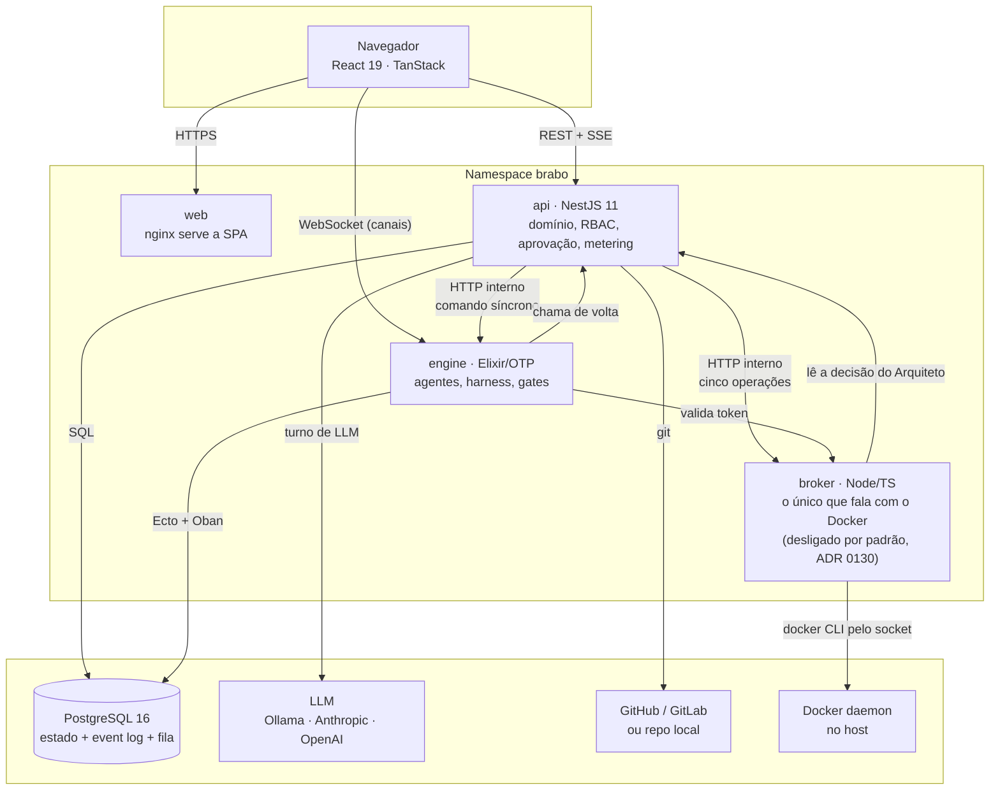
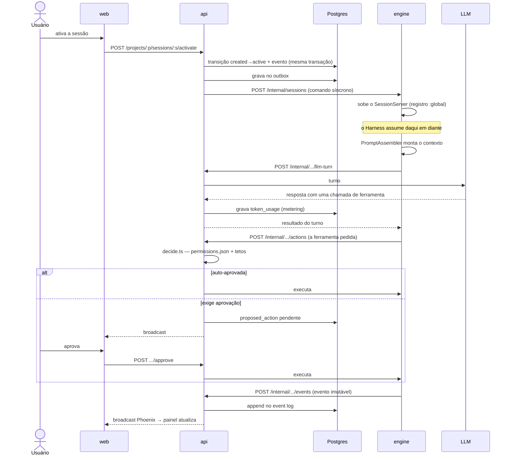
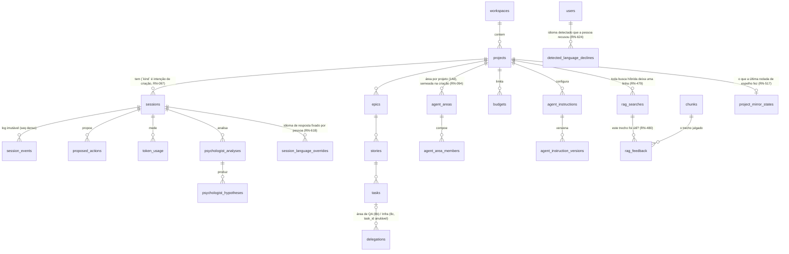

# 架构

本文档是给要在代码上**工作**的人的地图。它告诉你从哪里开始读、每条边界承诺什么，
以及哪些地方已知是歪的。

决策及其理由在 [ADR](adr/index.md) 中——共 215 个，其中好几个记录了在执行中发现的
真实缺陷。这里不重复论证：只指向它。

## 外部视角 {#the-outside-view}

Brabo 接收**一个产品意图**（"我想要一个做 X 的系统"），交回**一个带有代码、测试和
决策历史的 git 仓库**，由一个 AI 智能体团队产出。在输入和输出之间，每一个对外界有
影响的动作——运行命令、提交、开 PR、花费 token——都要经过一个由人决定的审批请求。

从外部看，它是一个 Web 应用。它的不同之处在于，工作由与语言模型对话的长时间运行的
进程完成，而系统的构建方式使得**没有任何事情会在没有痕迹、没有许可的情况下发生**。

## 容器 {#containers}

这张图中有两件事并不显而易见，却能解释很多：

**engine 从不直接与 LLM 或 git 对话。** 它请求 api。正是这一点保证了 metering、
预算和审批管道没有旁路——没有任何路径能绕过它们。

**api→engine 的通信是双重的。** 一个通过 Postgres 中的 *transactional outbox* 的
异步事件（由 Oban 消费），以及用于同步命令的内部 HTTP。outbox 之所以存在，是因为
写入状态和发布事件必须是同一个事务；HTTP 之所以存在，是因为某些操作需要立即响应。

outbox 排空三种 `aggregate_type`：`session`（自 Fase 5 起）、`task`（Fase 12b——
`task.gate_resolved`/`task.became_claimable`，在 gate 解决或新任务变得可领取后对 dev
agent 的重新调度）以及 `container`（[ADR 0143](adr/0143-agentes-de-dev-so-depois-do-container.md)
/[RN-502](business-rules.md#rn-502)——`container.running`，在记录项目容器到达
`running` 的同一事务中附加，使因其缺失而停在 `:idle` 的 dev agents 自行醒来；用一个
独立的聚合而不是借用 `task`，因为这个事件与任何任务都无关）。
它之所以是 outbox，而不是像其他一样的同步 HTTP 调用：在 gate 裁决和智能体反应之间
engine 的一次重启不能丢失信号——这一行能比要读取它的进程活得更久，而 HTTP 无法在
等待响应者死亡后幸存。
一个**崩溃**的 dev agent（任何不是 `:normal`/`:shutdown` 的退出）不被当作已结束：
`Engine.Dev.Monitor` 记录一个持久的 `agent.error`（来源 `infra`），并从它在
`dev_agent_states` 中自己的那一行重启它，最多三次；被中断的任务由已有的重启恢复
机制带着诊断阻塞（[RN-742](business-rules.md#rn-742)）。
`dev_agent_states` 增加了 `consecutive_blocked`/`max_consecutive_blocked`
（断路器，[RN-047](business-rules/custo.md#rn-047)）；完整决定在
[ADR 0045](adr/0045-reagendamento-por-evento-do-dev-agent.md) 中。
因网络/provider 的暂时故障（DNS、连接重置、5xx/429）而阻塞的任务，会在 1、3 和
10 分钟后由一个 Oban job 再次解除阻塞（最多三次，通过人工解除阻塞的同一用例），
dev agent 暂停一分钟而不是去领取下一个任务（[RN-864](business-rules.md#rn-864)）。

gate 智能体（`QaLeadServer`/`SecOpsAgentServer`）在中间转换时不经过 outbox
（`correct`/`run_secops` 仍是内存中的直接调用——机制上的证明在
`record-gate-verdict.use-case.ts` 的注释中：只有终止结果 `done`/`blocked` 经由
outbox 传递），因此它们获得了与 dev agents 已有的**相同**的安全网：`gate_states`，
外加一个 `GateRescuer`，扫描停滞的周期并自行恢复它们——outbox 路径不需要新表，因为
问题不在于缺少 outbox，而在于同一进程中两次调用**之间**发生的事缺少持久状态。见
[RN-140](business-rules.md#rn-140)、[ADR 0067](adr/0067-o-gate-sobrevive-ao-restart.md)。

QA 的 gate 在 `approved`/`changes_requested` 之外还有**第三种**裁决：
`needs_user_decision`，用于用户从未确认过的需求（或与现行决策相矛盾的需求）。它不
消耗一次修正；QA Lead 把它合并在 `approved` 之上，周期由
[ADR 0207](adr/0207-ciclo-de-gate-velho-estaciona.md) 的机制**停放**，直到用户回答
问题，这会恢复它。同一规则在会话侧的对应是工具 `declare_open_question`（Criativo、
PO、Arquiteto、Dev Lead），它写入 `artifact.open_question`；用户的回答作为 dev-context
中的"用户的决定"回到 dev 和 QA（[RN-862](business-rules.md#rn-862)、
[ADR 0214](adr/0214-pergunta-em-aberto-vira-pendencia.md)）。

**请求** gate 的从来不是 gate 自己：`Engine.Gates.Dispatcher` 是一个有五个回调的
behaviour（PR 的 QA 和 SecOps、两个确定性的 infra gates 以及设计阶段的 AppSec——QA
策略的那个随 [ADR 0192](adr/0192-plano-de-teste-depois-da-entrega.md) 移除，当时测试
计划变成了 PR 的 QA 自身的第一步），它唯一的工作是在需要时启动每个项目的
GenServer 并对其 cast。这层间接是为调用方的测试而存在的：`Engine.Agents.DevLeadTools`
由一个不带 Ecto sandbox 的**轻量**测试覆盖，而仅仅为了证明 gate 被**请求**过就在那里
启动一个真实的 GenServer，会把 Dev Lead 的测试绑到数据库上。五个中最新的
`run_appsec_design/2` 关闭了最后一个没有生产调用方也能触发的 gate：
`assess_implementability` 现在**并行**请求用户故事的设计威胁模型——裁决从不等待它，
并且每个用户故事只请求一次（[RN-539](business-rules.md#rn-539)、
[ADR 0090](adr/0090-qa-estrategia-e-appsec-segundo-momento.md)）。

## 代码地图 {#code-map}

### `apps/api` — NestJS，`src/` 中 906 个文件（2026-09-25 测量） {#appsapi--nestjs-906-files-in-src-measured-2026-09-25}

四层，顺序很重要：

| 目录 | 是什么 | 从哪里开始 | **不**用于什么 |
|---|---|---|---|
| `src/domain/` (72) | 纯业务规则。无 IO，无框架 | `actions/decide.ts`——审批的核心 | 不知道什么是 HTTP、数据库或 NestJS |
| `src/application/` (177) | 用例。编排领域和端口 | `use-cases/sessions/` | 不存放规则；如果有业务上的 `if`，就放错了地方 |
| `src/infrastructure/` (76) | 端口的实现：Drizzle、HTTP 客户端、加密 | `persistence/drizzle/` | 不做任何决定 |
| `src/interfaces/http/` (105) | controllers、guards、DTO | `auth/jwt-auth.guard.ts` | 没有规则也没有查询 |

迷路时可以 grep 的符号：`decide(`、`assertTransition`、`@RequireRole`、
`PROTECTED_BRANCHES`、`EncryptionService`。

**入口：** `src/main.ts`——其中 `imports` 的顺序是有意义的（`./tracing-boot` 故意排
第一；OpenTelemetry 的自动插桩无法捕获已加载的模块，而单独的模块正是保证这一点的方式：
TypeScript 会把所有 `require` 提升到顶部，所以写在 import 之间的调用会运行得太晚）。

### `apps/engine` — Elixir/OTP，`lib/` 中 219 个文件（2026-09-25 测量） {#appsengine--elixirotp-219-files-in-lib-measured-2026-09-25}

| 模块 | 是什么 | 从哪里开始 |
|---|---|---|
| `harness/` (33) | 上下文组装、ToolLoop、压缩。**没有任何 LLM 调用发生在这里之外** | `harness/tool_loop/` |
| `dev/` (15) | dev agents、worktrees、monitor | `dev/dev_agent_server.ex` |
| `gates/` (20) | QA 领域（Lead + 自动化，Performance/安全以及 QA 策略的子专长——Lead 的第二时刻，ADR 0090——全部使用 LLM）和 SecOps（确定性） | `gates/qa_lead_server.ex` |
| `infra/` (9) | Infra 领域（会话型 Lead，限定于会话——自 [RN-617](business-rules.md#rn-617) 起是第七个会话型智能体，可通过 composer 访问并在 `TurnoAssincrono` 中运行其轮次——+ 通过 ToolLoop 的 Workflows 子专长——同一领域中的两个架构家族，见 RN-037） | `infra/infra_lead_server.ex` |
| `sessions/` (9) | 会话生命周期，`:global` 注册 | `sessions/session_server.ex` |
| `actions/` (9) | 终端和 git 执行器，lint/扫描器检测器 | `actions/git_executor.ex` |
| `agents/` (16) | Criativo、PO、Arquiteto、Dev Lead、Staff（ADR 0088，对自动触发处于休眠）——每个轮次在一个受监督的 Task 中运行（`TurnoAssincrono`，RN-122），不再在 `handle_call` 内部，因此 `:cancel` 确实能中断它 | `agents/turno_assincrono.ex` |
| `psychologist/` (6) · `anamnese/` (6) | 团队的分析与改进 | — |

**入口：** `lib/engine/application.ex`——整棵监督树都在那里，是理解有什么在运行的
最佳文件。

### `apps/broker` — Node/TS，`src/` 中 9 个文件（2026-09-25 测量） {#appsbroker--nodets-9-files-in-src-measured-2026-09-25}

产品中唯一能访问 Docker daemon 的进程（[ADR 0130](adr/0130-broker-de-container.md)），
也是这里最小的服务：无框架，`node:http`，六个路由（2026-09-25 在 `src/servidor.ts` 中
测量）。

| 文件 | 是什么 |
|---|---|
| `src/operacoes.ts` | **五个**操作，以及 spec 的组合。任何变成 `docker run` 的东西都不来自外部 |
| `src/servidor.ts` | 封闭的路由列表、token 检查和故障表（状态 + `origem`） |
| `src/api-client.ts` | 它如何在 api 中**读取** Arquiteto 的决定——正是这次调用使它不接受 spec |
| `src/config.ts` | 四个环境变量，以及在生产中使用仓库公开 token 时拒绝启动 |

**入口：** `src/index.ts`。对 Docker 的访问本身不在这里：它来自
`packages/docker-port`，与 runner 使用的是同一个文件。

### `apps/web` — React 19，`src/` 中 487 个文件（2026-09-25 测量） {#appsweb--react-19-487-files-in-src-measured-2026-09-25}

`src/lib/api-types.ts` 和 `src/lib/activity.ts` 是值得先读的两个文件：前者是与 api
的契约，后者把日志的 40 种事件类型分类为可显示的东西——它是关于每个事件含义的最佳
事实来源。

同一个 event log 的三种派生，回答不同的问题：

| 文件 | 回答 |
|---|---|
| `lib/activity.ts` | "发生了什么"——按时间顺序的信息流 |
| `lib/agent-status.ts` | "谁存在，处于什么状态"——团队卡片 |
| `lib/timeline-tree.ts` | "每个智能体做了什么，**现在**在做什么"——树 |

`lib/aprovacoes.ts` 回答第四个问题，而它不来自 event log："如果我批准会发生什么"。
每种 `proposed_action` 的动词和句子都在那里，三个决策界面使用它们——审批队列、聊天中
的卡片和 Insights 标签页（[RN-096](business-rules.md#rn-096)）。

**联合类型 `ActionType` 曾经是一份副本，而副本过时了——两次，在生产中**（Gitflow
bootstrap 的三种类型；然后是 `parallelize`/`raise_max_parallel`），两次编译器都没有
察觉，因为 `apps/api` 不是 `apps/web` 的依赖。ADR 0116 关闭了这一类问题：`ActionType`
现在由 `openapi-typescript` 从 `docs/reference/openapi.json` 生成
（`lib/api-types.generated.ts`，由 `lib/api-types.ts` 重新导出），而不是手写，编译器
现在要求 `lib/aprovacoes.ts` 中的 `Record<ActionType, ...>` 映射在每次编辑时都穷尽。
`api-types.ts` 的其余部分——约 1600 行——仍然是手写的；只有这个被证明有重复成本的类型
迁移了。`lib/aprovacoes.test.ts` 也保留，但做更窄的工作：它不再需要抓出**缺失**的条目
（编译器会抓），只抓坏的——句子太短、没有句号、原始的 `snake_case` 泄漏到葡萄牙语
文本中。拿不准时，UI 仍然降级而不是让 React 树崩溃。

树把信息流的轴反过来（先智能体，后时间），因为在一个有 Criativo、PO、Arquiteto 和
N 个 dev 的会话中，按时间排列的列无法回答谁在做什么。三者都没有自己的状态或路由——
全部从同样的事件派生，不在日志中的事件不会出现在其中任何一个里。

**读取范围：项目界面按会话询问，列表界面按 workspace 询问。** 在一个项目内部，查询
按会话和按项目进行，这是打开内容的自然切分。但仪表板和侧边栏显示**所有**项目，在
那里按项目切分会变成 N+1——每张卡片七个带轮询的查询，23 个项目时 3.824 req/min，
而限额是 300，界面会因 429 自己把自己拖垮。两者都读取
`GET /workspaces/:id/projects-summary`——一个跨聚合（git、预算、会话、backlog、架构）
的读模型，其与数据库的往返次数不随项目数量增长（[RN-090](business-rules.md#rn-090)）。

铃铛抽屉遵循同样的切分，有一个值得记录的差异：它需要每个项目的已读截止点，而这个点
是保存在查看者浏览器中的一个 `seq`（`lib/read-state.ts`）——服务器没有、也不会有
"标记为已读"。因此客户端在 `POST /workspaces/:id/unread-events` 的请求体中**发送**
`project → afterSeq` 映射，尽管动词如此，它是一次读取并返回 `200`
（[RN-091](business-rules.md#rn-091)）。动词来自请求体，而不是一次变更：有几十对，
这么长的查询字符串会在代理处断掉，还会把项目 id 放进访问日志。

这个端点返回 event log 的**事实**，从不返回组装好的组件：`lib/agents.ts`（谁是 lead、
图标、颜色）和 `rosterFromFacts`（`lib/agent-status.ts`）仍然是 web 的工作，在场规则
与团队面板使用的相同。这与上面三种派生是同一条边界——api 说发生了什么，web 决定据此
画什么。

有两项 UI 检查是自动的：对比度（`lib/contraste.ts`，一个针对 `design/tokens.css` 的
测试）和布局（`scripts/dev/validacao-visual.js`，在浏览器中运行）。说明在
`design/README.md` 中。

**安装决定项目向导提供什么。** `getProjectsBase`（`lib/api-client.ts`）读取
`GET /workspaces/:workspaceId/projects-base`——本安装挂载项目的唯一基目录（[ADR
0141](adr/0141-base-unica-dos-projetos-montados.md)）——新建项目向导是它唯一的调用方
（[RN-513](business-rules.md#rn-513)）。`projectsBase: null` 是正常状态，不是故障：
安装没有 `BRABO_PROJECTS_BASE`，于是挂载文件夹的卡片就不提供，`container` 仍是默认。
响应在途中以及查询**失败**时同样如此——未知永远不会变成提供，与
[RN-088](business-rules.md#rn-088)/[RN-468](business-rules.md#rn-468) 是同一条规则。
有基目录时，卡片**预选**，路径字段以 `<base>/<slug>` 打开，由 `caminhoSugeridoNaBase`
（`lib/wizard.ts`）组成——一个纯函数，旁边是 `caminhoDentroDaBase`，它按**路径段**回答
"这个路径在基目录之下吗？"，并镜像 api 的 `dentroDoEscopo`。预选和建议都不会覆盖人的
选择。

**文件夹选择器是 web 中唯一有两种传输方式的读取**，使其成为一体的接口位于
`lib/fs-browser.ts`（[RN-504](business-rules.md#rn-504)）。`FsBrowser`——
`listarDiretorio` / `diretorioInicial` / `fechar`——有两种实现，而它们不与同一台机器
对话：`criarFsBrowserViaApi(workspaceId)` 调用 api 中的
`GET /workspaces/:workspaceId/project-folders`，严格限定于 `BRABO_PROJECTS_BASE`
（[ADR 0141](adr/0141-base-unica-dos-projetos-montados.md)），而
`connectFsBrowserChannel(projectId)`（`lib/fs-browser-channel.ts`）使用 Phoenix 通道
`terminal:<projectId>`，通过 runner 读取**用户**的磁盘。

接口之所以从通道模块中抽出来，正是因为它不再只有一种实现。`FolderBrowserModal` 用一个
可辨识联合在两者之间选择——`origem: { tipo: 'api'; workspaceId } | { tipo:
'runner'; projectId }`，而不是两个可选 prop，使"都没有"和"两者都有"不成为组件需要在
运行时处理的可表示状态——它的主体从不知道收到的是哪一个。只有三件事按 `origem` 分支：
运行哪个工厂、存在哪些快捷方式（api 传输不提供 `/`；它按构造就在基目录之外，按钮只能
以 400 结束），以及 `RunnerOnboardingPanel` 是否有意义。

`ListagemResultado` 增加了三个**可选**字段——`arquivos`、`simbolicos`、`truncado`——
它们是可选的，因为只有 api 传输会统计它排除了什么。runner 的协议（`apps/runner/src/channel.ts`
中的 `FsEntrada`）返回混在一起的文件夹和文件，什么也不统计；在那里填零会断言"没有
遗漏任何东西"，这与不知道是两回事。

RN-504 把**两种**模式都指向 api 并声明了代价：对 `runner` 来说，列表不再是用户的机器，
而变成了基目录。之所以接受，是因为 `runner` 模式本要从创建向导中移除——它没有被移除，
而 [RN-533](business-rules.md#rn-533)（[ADR 0151](adr/0151-base-consentida-no-runner.md)
第 7 点）撤销了它。现在是**模式**选择传输，因为它们回答不同的问题：`mounted` 询问 api
（它的文件夹位于**服务器**上的基目录之下），`runner` 询问本地智能体（它的文件夹位于
服务器看不到的机器上）。`runner` 分支锚定在向导已提前创建的项目上
（[RN-437](business-rules.md#rn-437)）；当这次创建失败时，不会打开任何模态框，因为
回落到 api 会在"你的机器"的标签下显示**服务器**的基目录。

失败带有一个**可辨识**的原因（`MotivoDeFalhaDoAgente`）：`sem-agente` 是服务器**断言**
没有 runner，`sem-resposta` 是超时、断开的 socket 或被拒绝的 ticket——无知，就作为无知
说出（[RN-088](business-rules.md#rn-088)/[RN-468](business-rules.md#rn-468)）。组件过去
用 `includes('Nenhum runner conectado')` 判断，匹配一句位于 engine 的 `.ex` 中的 pt-BR
句子；子串匹配现在只在一个地方，即拥有通道协议的模块中，engine 改写过的消息会降级为
`sem-resposta`，而绝不会变成"有一个智能体"。两个原因都会挂载 `EsperaDoRunner`——RN-474
的等待，被**复用**：同样的三种状态、同样的上限、同样的信号——它在时间戳变化时自行重做
失败的列表。每个界面一个等待：`RunnerOnboardingPanel` 接收 `mostrarEspera`，只在其宿主
已经显示一个的地方为假。而选择器在两种来源下都**说明**它正在列出的是谁的磁盘——此前
唯一的线索是一个快捷方式的标签，它命名的是一个位置，而不是一台机器。

**面板还会识别一台已配对的机器**（[RN-548](business-rules.md#rn-548)、
[ADR 0154](adr/0154-chave-de-dispositivo-de-maquina.md)）。`lib/api-client.ts` 中的
`listRunnerDeviceKeys` 读取 `GET /projects/:projectId/runner-device-keys`，自
[RN-543](business-rules.md#rn-543) 起它标记每把密钥的**种类**——而整个派生都在组件之外，
在 `lib/agente-de-maquina.ts` 中，因为规则关乎**数据**，组件关乎绘制。七种状态，没有
一种塌缩成另一种，失败由 `isError` 而不是某个状态派生，因此网络错误说"不知道"，而不是
永远转着"正在检查……"。已注册的密钥**不是**正在运行的智能体——与 `workspaceVerifiedAt`
已经施加的纪律相同——而列表属于**账户**而不是这个浏览器，因此能用的最强的说法是"你的
账户有一台已配对的机器"。这两个限制都在界面上说明。
[ADR 0118](adr/0118-configuracao-automatica-do-runner-pelo-navegador.md) 的浏览器流程
（生成密钥、下载二进制、写入文件夹）已在
[ADR 0203](adr/0203-aposenta-o-fluxo-do-runner-pelo-navegador.md)
（[RN-687](business-rules.md#rn-687)）中退役：面板现在显示 `install.sh` 的命令，当识别到
服务于该项目的密钥时它就消失，而带 PAT 的手动命令放在一个以其回答的情况（另一台机器）
命名的 `
` 中。读取的最低要求来自针对**端点**的 `developer` 的 `roleAtLeast`，
真实的 403 落入同一状态——workspace 角色是代理，api 才是权威。

**代码标签页（FASE 26）是同样的读取模式**，应用于代码而不是事件：
`lib/api-client.ts` 中的 `getContainerState`/`getCodeTree`/`getCodeFile`/
`searchCode`/`getCodeDiff` 镜像 api 的读取路由（`container` 加上 `code.controller.ts`
中的七个，FASE 26b），类型在 `lib/api-types.ts` 中（`EstadoDoContainer`、`CodeTree`、
`CodeFile`、`CodeSearchResult`、`CodeDiff`），从 DTO 复制——与文件其余部分相同的约定，
不导入 `apps/api`。`routes/code/
highlight.ts` 是一个**自有**的基于正则的语法高亮分词器，零新依赖。`ProjectCodeTab.tsx`
的闸门（RN-107）在尝试读取代码**之前**询问容器的状态，使它作为独立的消息出现，而不是
作为一个 409 的脚注。

**FASE 26b 把 `getCodeBlame`/`getCodePullRequests`/`getCodeBranches` 加入同一模式**，
`CodeBlame`/`CodePullRequestList`/`CodeBranchDetailList` 在 `lib/api-types.ts` 中——
代码标签页三个已声明待办项（RN-110/111/112）的基础。三者现在都有消费者：
`CodeEditor.tsx`（blame 开关）、`code/PrListAndDiff.tsx`（PR 列表 + diff，被
`CodeDiffPanel.tsx` 和独立的 `prs` 标签页共同使用）和 `CodeBranchPicker.tsx`（丰富的
分支下拉框）。

容器镜像闸门（RN-105）是一个单一漏斗（`ReadProjectCodeUseCase.alvo`），由七个路由
共享，因此在 Arquiteto 决定镜像之前它们中的任何一个都可能返回 409——不只是树。
`ProjectCodeTab.tsx` 用一次预检避免这个 409（`RN-107`，见上）；`prs` 标签页没有可以
预检的树/文件读取，所以 `code/PrListAndDiff.tsx` 对它自己的
`getCodePullRequests`/`getCodeDiff` 调用的 409 作出反应。两条路径渲染同样的呈现
`ContainerImageGateNotice`（`components/ContainerImageGate.tsx`），由
`isContainerImageGateError`（`lib/api-client.ts`，匹配 `ApiError.status === 409`）检测
——这是使用中发现的 bug：在此之前，`prs` 标签页把这个 409 显示为通用的暂时错误，带一个
"重试"按钮，而对于只有 Arquiteto 采取行动才能解决的状态来说，这是错误的 affordance。

**全局容器页面（`/containers`，ADR 0136/RN-495）是 workspace 的读取**，不是项目的——
`lib/api-client.ts` 中的 `getContainersOverview` 调用
`GET workspaces/:workspaceId/containers`，`lib/api-types.ts` 中的 `ContainerOverviewItem`
镜像 `ContainerOverviewItemResponseDto`。api 一侧是一个专门的读模型
`ContainersOverviewRepository`/`DrizzleContainersOverviewRepository`，与
`ProjectsSummaryRepository` 有同样的"项目之间无 N+1"纪律——三个恒定的查询（`projects`
LEFT JOIN 容器行、批量的 `artifact.project_image` 事件、批量的待处理容器
`proposed_actions`），从不按项目查询。**无法**批量完成的——向 broker 询问观察到的状态——
改为获得每次加载的显式预算（`ObterVisaoGeralDeContainersUseCase.TETO_DE_VERIFICACOES_POR_CARGA`，
只询问 `provisioning`/`running` 行，上限 20）：预算之外的行显示 `naoVerificado`，绝不
悄悄复用另一行的回答，也不继承已记录的状态。动作（停止/移除/启动）与其他地方一样是
`proposed_action`——页面从不直接调用 broker——每行的待处理动作（如果有）随同一次批量读取
一起到来，渲染为内联的 `ApprovalCard`，与 `ProjectPrsTab.tsx` 用于合并提议的模式相同。

自 [RN-521](business-rules.md#rn-521) 起 join 是 LEFT，页面列出 workspace 的**每个**
项目，因为它成了人工启动**第一个**容器的路径：在登记之前就失败的启动不会留下行，而旧的
INNER JOIN 恰好隐藏了需要这个页面的项目。因此 `ContainerOverviewItem.registrado` 可为
空——类型中命名的第三种状态，不同于 `stopped` 和"无法观察"——没有容器的行永远没有资格
占用 broker 的预算，所以它们不能挤掉真实的容器。`container_start`（broker）与
`container_start_via_runner`（本地智能体）之间的分支是**客户端**的一个纯函数
`routes/containers-subida.ts`：它还决定何时**不**提供按钮（没有已决定的镜像、没有任何
智能体确认过其文件夹的 `runner`、按 `roleAtLeast` 低于 `maintainer` 的角色），每种拒绝
都有自己的文本——界面从不提议一个它已知会失败的动作，也从不隐藏原因。

**另一个**提议者——Infra Lead 智能体——自 [RN-566](business-rules.md#rn-566) 起以同样
方式分支。它的两个工具都经过 `infra_lead_server.ex` 中唯一的
`recusa_local_de_subida/2`，它**只**读取项目一次（`Project.get/1`，同一个 BEAM 进程，
从不 HTTP：智能体循环内的网络调用正是这次修正付不起的代价），返回 `nil` 或一个**命名**的
原因，每个工具一个子句——`container`/`mounted` 提议 `container_start`，`runner` 被拒绝
并指向 `container_start_via_runner`，而 `container_start` 的子句是与 broker 一样的
**允许列表**，因此枚举中的新模式生来就被拒绝。拒绝是模型读取的工具**结果**文本（循环的
输入，[RN-163](business-rules/autenticacao.md#rn-163)），绝不是 `agent.error`，并且
`tool.call` 仍会发出，使本地拒绝永远不会从时间线上消失。智能体**不**检查而界面检查的，
是已决定的镜像和已确认的文件夹。

### 应用之外 {#outside-the-applications}

| 目录 | 是什么 |
|---|---|
| `packages/shared/` | `GitProviderContract`——十五个操作，**只有类型，别无其他**：一个在 `tsc` 之后仍存在的值会破坏 api 的启动（由一个测试锁定），所以常量放在消费者处 |
| `packages/docker-port/` | Docker 的**端口**（五个操作）及其 CLI 适配器，由 `apps/runner` 和 `apps/broker` 共享——[ADR 0130](adr/0130-broker-de-container.md)。它是运行时代码，正因如此它**不**在 `packages/shared` 中；它没有构建步骤，两个消费者都会**打包**它，因此没有任何镜像会从 `node_modules` 解析它 |
| `docker/` | dev 和生产镜像；`smoke.sh` |
| `deploy/k8s/` | Kustomize 基础 + overlays（local、staging、prod） |
| `design/` | 设计系统：tokens、字体、组件 |

## 一次智能体轮次的流程 {#an-agent-turns-flow}

热路径，端到端。大部分复杂性都在这里。

`Harness → 工具调用 → 审批 → 事件` 这个循环会重复，直到智能体调用结束工具或碰到上限
（迭代、token、预算）。

## 边界与不变量 {#boundaries-and-invariants}

这是最重要的部分。下面每一项都是可验证的，其中好几项有一个在违反时会失败的测试。

**1. 领域是纯的。** `apps/api/src/domain/` 不导入 `infrastructure`、`application`、
`@nestjs` 或任何数据库驱动——已验证：三者都是**零**出现。方向始终是
`interfaces → application → domain`，`application` 中有 89 个文件导入 `domain`。如果你
需要在 `domain/` 中做 IO，设计就错了：在 `application/ports/` 中创建一个端口。

**2. 领域事件是不可变的。** 事件表上永远没有 `UPDATE`。`session_events` 有
`unique(session_id, seq)`，且 `seq` 在每个会话内是连续的——恢复测试会验证没有空洞。
需要变化的状态（假设的生命周期、handoff 的状态）放在它自己的可变表中，与事件并列。
不再是现行的 handoff 提议在该表中变为 `superseded`，并获得它自己的
`handoff.superseded` 事件——绝不是对宣布它的 `handoff.offered` 的编辑（[ADR
0182](adr/0182-ciclo-de-vida-do-handoff.md)）。

**3. Harness 之外没有 LLM 调用。** 这不是约定：engine 没有 LLM 客户端。它请求 api，
由 api 做 metering。

**4. 每个有外部效果的动作都变成 `proposed_action`。** 在 `permissions.json` 中 `deny`
总是胜过 `allow`，而两个**上限**最后施加，覆盖已计算出的裁决：受保护分支上的合并和
指令补丁**永远**不能自动批准。见 [RN-006 e RN-007](business-rules.md)。

**5. 受保护分支上的合并是手动的。** 没有将其自动化的选项。这是领域中的一个上限
（`decide.ts`），由一个测试保证。

**6. 一个会话，一个所有者。** `SessionServer` 注册在 `:global` 下，而不是本地的
`Registry`——否则 N 个副本会托管同一会话的 N 份拷贝，而没有心跳的拷贝会杀死活着的
会话（[ADR 0026](adr/0026-fase5-observabilidade-e-graceful-shutdown.md)）。

**7. 智能体故障记录来源**（`infra | model | code | policy`），绝不是排除法诊断。来自
[ADR 0020](adr/0020-destravar-gates-qa-secops.md) 的昂贵教训：一次 provider 宕机被记录为
"模型停止了而没有发出信号"，系统把一个基础设施问题归咎于模型。

**8. 项目的容器是被决定的，绝不是隐含的。** 代码标签页只有在 Arquiteto 发出
`artifact.project_image` 之后才解锁——在状态为 `sem_decisao` 时，读取代码返回 `409`
（[RN-105](business-rules/autenticacao.md#rn-105)）。而 `git push`、开 PR 和部署不经过
终端，即使在项目范围之内：`decide()` 通过命令前缀识别它们，并在任何宽松步骤**之前**
返回 `deny`——不是 `require_approval`，因为"总是允许"会把模式写入 `allow` 并重新打开
这扇门（[RN-106](business-rules/autenticacao.md#rn-106)、
[ADR 0065](adr/0065-container-por-projeto-a-fronteira-deixa-de-ser-politica.md)）。
容器的生命周期（配置、回收、清理）尚不存在——FASE 25 的一个已声明的削减，记录在
CLAUDE.md 中——因此这个不变量目前与
[ADR 0055](adr/0055-escopo-de-caminho-na-politica-de-terminal.md) 的路径范围策略共存。

而自 [ADR 0143](adr/0143-agentes-de-dev-so-depois-do-container.md)
/[RN-502](business-rules.md#rn-502) 起，已决定的镜像不再是唯一的前提条件：**在项目的
容器被登记为 `running` 之前，dev agent 不领取任何任务**。守卫位于
`Engine.Dev.AgentIo.try_claim/2`——唯一的领取点——而不仅在 api 的
`activate-execution` 中，因为重新水合会在不经过任何路由的情况下到达 `try_claim/2`
（`DevAgentServer.init/1` -> `finish_restart_recovery/1`）。没有容器时智能体落到
`:idle`（唤醒仍能挽救的唯一状态），并用 `dev.blocked_by_container` 说明这一点。同一
规则的另一半是，`Engine.Actions.TerminalExecutor` 在没有容器时不再回落到 engine 进程
内的 `System.cmd`：它拒绝，并命名原因，就像 `runner` 模式已经做的那样。

**9. 会写的智能体必须能读，也必须能问。** 这两半是同一个教训，来自一个只有写入工具
的智能体：PO 在 kickoff 时组装一次上下文，此后基于一张旧快照行事——面对缺口，它在
编造和停止之间选择（[RN-164](business-rules/autenticacao.md#rn-164)、
[RN-165](business-rules/autenticacao.md#rn-165)）。读取**不**变成 `proposed_action`
（不变量 4 关乎**外部**效果，而读取不是），但它在
[ADR 0060](adr/0060-superficie-de-leitura-de-codigo.md) 的意义上受到约束：范围由路由
路径封闭、每次调用成本恒定、交给模型的文本有行数上限。而智能体的循环不会悄无声息地
结束——迭代上限发出 `toolloop.limit_reached`，未履行的义务发出带来源的持久结果
（[RN-166](business-rules/autenticacao.md#rn-166)）。

## 横切关注点 {#cross-cutting-concerns}

**跨源。** web 从自己的源提供服务，并与**另外两个**源对话，因此 CORS 是一条架构边界，
而不是配置细节（[ADR 0037](adr/0037-cors-do-engine-e-a-porta-como-contrato.md)）。四条
路径，只有三条经过 CORS：

| 路径 | 机制 |
|---|---|
| web → api，HTTP | Nest 的 CORS，`WEB_ORIGIN` 的精确源 + `credentials` |
| web → engine，HTTP（`/health`） | `EngineWeb.Plugs.Cors`，仅 health 路由 |
| web → engine，WebSocket | Phoenix endpoint 的 `check_origin`——**WebSocket 不经过 CORS** |
| api ↔ engine，HTTP | **CORS 不适用**：服务器客户端，不是浏览器 |

单一变量——`WEB_ORIGIN`——在两个服务中为前三条供值。独立地读取两次，正是 engine 的
CORS 最终没有任何源、而 `check_origin` 已有正确列表的原因；在 engine 中它现在只在
`runtime.exs` 中解析一次。

而**端口是源的一部分**：在浏览器看来，`:5174` 上的 web 是另一个系统。这就是
`vite.config.ts` 使用 `strictPort` 的原因。

**认证。** first-party，在 api 的领域中——没有外部 IdP。密码用 argon2id，15 分钟的
EdDSA access token，以及强制轮换的不透明 refresh token；web 的会话保存在 `httpOnly`
cookie 中，用 double-submit 做 CSRF。`JwtAuthGuard` 是全局的，通过 token 的 `sub`
（即 `users.id`）**读取**用户；开放路由需要显式的 `@Public()`。

没有任何 RBAC 决策读取 token 的 claim：角色来自 `request.user.id` 和数据库中的行。这就是
权限矩阵在更换签发者后无需改变而幸存的原因。决定见
[ADR 0031](adr/0031-auth-first-party-argon2id-e-rotacao-de-refresh.md) 和
[ADR 0032](adr/0032-corte-do-keycloak-e-sessao-em-cookie.md)。

engine 的调用不经过 JWT：`/internal/*` 路由是 `@ServiceRoute()`，`EngineServiceGuard`
以恒定时间比较一个共享密钥（`BRABO_SERVICE_TOKEN`）。整个表面在
[`security-surface.md`](security-surface.md) 中分类，一个表格测试会拒绝未分类的新路由。

**授权。** 领域中的 RBAC，有效角色从项目解析（回落到 workspace）。路由上使用
`@RequireRole`。

**错误。** 领域错误是有类型的类（`InvalidSessionTransitionError`、
`StoryNotReadyError`），由 `main.ts` 中的全局过滤器转换为 HTTP。git provider 的错误由
单一契约规范化（[ADR 0002](adr/0002-git-error-normalization.md)）——调用方不知道它是在
与 GitHub 还是 GitLab 对话。

**日志。** 在生产中三个应用每个事件都是**单行** JSON，带有相关联的 `trace_id`；在开发
中对人可读。api 使用 pino，强制脱敏 `apiKey`、`access_token`、`clientSecret` 以及
api↔engine 的服务 token。每一行都说明它来自哪个类和方法，每个请求一行显示**经过各层的
路径**及每一步的耗时——见[可观测性](explanation/observability.md)。

**事务。** 模式是 *unit of work*：通过 outbox 在**同一**事务中写入状态和发布事件。在
事务之外发布会为一个从未持久化的状态创建事件。

**追踪。** 端到端的 OpenTelemetry，`trace_id` 诞生于 **web**：浏览器生成
`traceparent`，api 把它作为父级采用，engine 采用 api 的。一个会话是**一条根 trace**——
`traceparent` 持久化在 `sessions.trace_parent` 中并在 outbox 的信封中传递，因此由事件
触发的异步工作留在产生它的那个 trace 中。

插桩和**导出**是相互独立的（[ADR 0035](adr/0035-observabilidade-legivel-e-trace-sem-coletor.md)）：
span 总是被创建，`trace_id` 总是进入日志，即使没有收集器；`OTEL_EXPORTER_OTLP_ENDPOINT`
只决定它是否离开进程。这就是 `pnpm dev` 中能获得关联的原因。

**密钥。** 信封加密：每条记录一个随机 DEK，由主密钥包裹。通过
`CREDENTIALS_MASTER_KEY_PREVIOUS` 实现无停机轮换——见 [runbook](runbook.md)。

**智能体层级。** 自 Fase 8b 起（[ADR 0038](adr/0038-hierarquia-de-agentes.md)），一个
领域可以有一个 LEAD 和若干子专长——目前是 "qa"（`qa-lead`、`qa-automacao`、
`qa-performance-seguranca`）和 "infra"（`infra` 作为 lead，`infra-workflows` 作为子智能体
——Fase 8c，RN-037）。lead 是唯一的外部联系点：内部委派从不变成 handoff，也从不在领域
之外可见。第一个实例证明了模型的核心保证——`QaLeadServer` 把两个子专长的裁决合并为
单一的 `qa_verdict`，而 api 已有的契约（`RecordGateVerdictUseCase`、`nextGateStatus`）
一行都没有改。第二个实例表明模型并不要求相同的内部实现：`InfraLeadServer` 仍是一个
限定于会话的会话型 GenServer（镜像 `ArquitetoServer`，按 CLAUDE.md 8c 的明确要求保持
外部联系不变），并委派给 `WorkflowsAgent`——它在另一端没有用户，作为一个有限的
`ToolLoop` 运行，与 QA 的子智能体一样。自 [RN-617](business-rules.md#rn-617)
（[ADR 0175](adr/0175-infra-lead-conversa-pelo-composer.md)）起，Infra Lead 也接收来自
composer 的消息，它的三种轮次（kickoff、gate 修正、消息）运行在与其他六个会话型智能体
相同的 `TurnoAssincrono` Task 中。8b 的通用 `delegations` 需要**一处**调整才能服务第二个
领域：`task_id` 变为可空，因为 Infra 是针对会话委派，而不是针对 backlog 中的任务。

Fase 8d 在 `apps/web` 一侧闭合了这个循环，没有新路由——一切都来自面板已经获取的同样的
`session_events`（`useSessionEvents`）。`apps/web/src/lib/agents.ts` 增加了
`AREAS`/`areaFor`：把子智能体的 `AgentKey`（`qa-automacao`、`qa-performance-seguranca`、
`infra-workflows`）关联到 lead 所在领域的登记——正是这种反向查找把团队面板分组（lead 带
"Lead" 徽章 + 可折叠的子专长），按领域分组 Insights，并在信息流中叙述
`delegation.completed`/`failed`/`dispensed`（`activity.ts`）。`consolidated_verdict`
（ADR 0038 的第 4 项决定）从未成为真正的工件——QA 和 Infra 复用
`qa_verdict`/`open_infra_pr`，见 [ADR 的收尾说明](adr/0038-hierarquia-de-agentes.md#fechamento-fase-8d)。

## 数据 {#data}

总共 56 张表。最新的是 `detected_language_declines`（[RN-624](business-rules.md#rn-624)）：
每个人和语言一行，记录此人在被问到"我们注意到你用 X 写作——回答中使用 X 吗？"时**拒绝**
的语言，以及日期。它的存在使同一问题不会再回来；之后确认该语言会删除这一行。检测本身
不保存状态——样本通过部分索引 `session_events_evidencia_de_idioma_idx`（用户执行者、两种
证据类型）从 `session_events` 读取，迟滞会重新计算——因此这张表和 `users` 中已确认的那对
字段就是它写入的全部，而且只在本人回答时写入。在它之前，最新的是
`session_language_overrides`（[RN-618](business-rules.md#rn-618)、
[ADR 0177](adr/0177-idioma-das-respostas-por-conta-sessao-e-projeto.md)）：一个人在一个会话
中固定的回答语言，以 `{session_id, user_id}` **对**为键，使两个参与者永不相互影响。它是
配置，不是事件——再次固定是 upsert，释放是 `DELETE`。同一个 ADR 增加了
`users.response_language`（`NULL` 表示"自动"）以及已确认检测的那对字段
`users.detected_language` / `detected_language_confirmed_at`，由一个 CHECK 绑定；
`users.locale` 仍是界面语言，限定为 `pt-BR`/`en`。而 `projects.language`
（[RN-619](business-rules.md#rn-619)）是没有人类作者之物的语言——共享工件和无人输入的
轮次——始终是一个具体的 BCP-47 代码。在它之前，最新的是 `project_mirror_states`
（[RN-517](business-rules.md#rn-517)、[ADR 0147](adr/0147-agente-local-com-capacidades.md)
第 7 点）：每个项目一行，`project_id` 唯一，保存**最后一轮**镜像做了什么——最后一次成功
同步及其三个计数和冻结的目标，加上最后一个错误。它是**表**而不是事件，原因与上面的
`rag_searches` 相同：一轮镜像没有会话，而 `session_events.session_id` 是 `NOT NULL`，因此
event log 会悄悄丢弃一切。三种永不塌缩的状态（[RN-088](business-rules.md#rn-088)）：
"从未同步"是**不存在**的行，"已同步但什么都没复制"是存在且 `files_copied = 0` 的行，
"失败"是 `last_error_at` 比 `last_synced_at` 新。成功列和失败列是**不相交**的，任何写入都
不触碰另一方的列——这正是界面能够说"从今天开始失败，最后一次好的复制是昨天，412 个文件"，
而不是丢掉它拥有的最有用信息的原因。

在它之前的两张是 `rag_searches`/`rag_feedback`（RN-479/480）：混合搜索的痕迹以及对其返回
内容的投票，之所以加入，是因为 `rag-search-limits.ts` 在自己的注释中声明混合搜索的四个
数字没有一个来自基于真实数据的校准——而在搜索不留痕迹时无法校准。它们是**表**而不只是
会话事件，原因很具体：`session_events.session_id` 是 `NOT NULL`，而来自 RAG 标签页的搜索
是没有会话的*项目*搜索，因此 event log 会悄悄丢弃恰恰是人类看着分数运行的那些搜索（与
迫使 [ADR 0075](adr/0075-embeddings-no-contrato-de-llm-provider.md) 削减 embedding metering
的是同一类问题）。`rag_searches.pesos` 在行内冻结每次搜索的权重——与 metering 中冻结价格
（[ADR 0042](adr/0042-catalogo-vivo-ciclo-de-vida-do-modelo-e-preco-auditavel.md)）同样的
纪律——使后来的校准不会悄悄改变之前每次测量的含义。`session_socket_tickets` 不在图中，
原因与 `refresh_tokens`/`account_tokens` 相同：它是认证机制，不是领域关系。

`projects.mirror_path`（FASE 28，[RN-515](business-rules.md#rn-515)、
[ADR 0147](adr/0147-agente-local-com-capacidades.md) 第 4 点）是一列而不是一张表，因为它是
每个项目**一个**可选值：本地智能体的 `espelho` 能力把工作复制到的、位于**用户**机器上的
绝对路径。它可为空，`NULL` 是**正常**状态——没有镜像的项目占大多数，产品从不自行选择
目标。它故意**不**带有把它绑定到 `execution_mode` 的 CHECK，这与旁边的 `workspace_path`
不同：`container` 不能有目标（它的来源是**服务器**上的托管卷，而会做复制的进程运行在用户
机器上），但 `execution_mode` 是**可转换**的（[RN-447](business-rules.md#rn-447)、
[ADR 0111](adr/0111-conversao-de-execution-mode-de-projeto-existente.md)），所以 CHECK 会让
向 `container` 的转换在 Postgres 中爆炸，而不是带着原因拒绝。拒绝放在用例中，转换会清空
这一列——与 `workspace_verified_at` 的形式相同，还有一个额外原因：来源↔目标循环的两个方向
都是针对**旧的** `workspace_path` 验证的。
自 [RN-516](business-rules.md#rn-516) 起 engine **读取**这一列——由它决定 runner 的 `join`
是否要求 `espelho` 能力，也是它在该 join 的授予中传回（`Engine.Runners.Espelho`、
`EngineWeb.TerminalChannel`）。engine 从不写它。自 [RN-517](business-rules.md#rn-517) 起
附近**有**一个内部路由——`POST /internal/projects/:projectId/mirror-sync-result`——但它写入
`project_mirror_states`，从不写这一列：目标是**配置**（用户声明它），一轮的结果是**遥测**
（本地智能体报告它），把两者合并会让一次报告覆盖一个选择。
**约束就是业务规则**：event log 的唯一 `(session_id, seq)`、在 `budgets` 中要求恰好一个
范围的 `check`（项目**或**会话，绝不两者都有）、保证分析幂等性的部分索引——以及自 Fase 8b
起，`delegations` 的三个 `check`，锁定每个 `status` 哪个字段是必需的（`completed` →
`parecerArtifactId`，`failed` → `failureOrigin`，`dispensed` → `justification`；见
[RN-036](business-rules.md#rn-036)）。`delegations.task_id` 生来是 `NOT NULL`，在 Fase 8c
变为可空——Infra 领域针对会话委派，infra PR 背后没有 backlog 任务（见
[RN-037](business-rules.md#rn-037)）。

`agent_areas`（FASE 14d，[ADR 0053](adr/0053-dev-lead-e-paralelismo-autorizado.md)）是 Fase 8
曾经削减的东西。它回来了，因为 **dev** 领域无法在代码中枚举：`qa` 和 `infra` 能放进固定
列表，但 dev 的成员是 `module_map` 中每个模块一个，由 Arquiteto 决定，每个项目都不同。唯一
`(project_id, key)` 使播种幂等，`max_parallel`（默认 2）是 lead 无需询问就能使用的上限——
超过它，就是 `proposed_action`（见 [RN-083](business-rules/custo.md#rn-083)）。
`budget_micros`/`spent_micros`（ADR 0110）在同一行中镜像 `max_parallel`——一个与
`budgets`（项目/会话）**叠加**的花费上限，绝不是级联：它由已经负责项目和会话花费的同样的
`CheckBudgetGateUseCase`/`RecordLlmUsageUseCase` 独立检查和递增（见
[RN-443](business-rules.md#rn-443)）。不要把它与
[ADR 0064](adr/0064-escopo-de-area-na-cascata-e-o-binding-de-agente-global.md) 的模型 binding
级联（`session > agent > area > project > workspace`）混淆——那个选择唯一的胜出者；领域预算
从不选择。

**迁移：** api 中用 Drizzle（`src/db/migrations/`，由一次性执行的 Job 应用——副本**不**在
启动时迁移，否则它们会争抢同一个迁移），engine 中用 Ecto，在它自己的 schema（`engine`）中。
两个 schema 之间没有交叉引用，因此它们并行运行。

## 已知技术债务 {#divida-tecnica}

从历史热点和记录未决状态的 ADR 中得出。

| 债务 | 证据 | 影响 |
|---|---|---|
| ~~`schema.ts` 是仓库中改动最多的文件（23 次改动），把 51 张表集中在单个文件中~~ | 历史 → **由** [ADR 0121](adr/0121-schema-dividido-por-agregado-de-dominio.md) **关闭** | schema 现在是 `apps/api/src/db/schema/` 中每个领域聚合一个文件，镜像 `src/domain/*`，旧路径保留为 `export *` 的 barrel，使 144 个消费者都无需改动。两个聚合现在可以同时编辑而不冲突。它**不**涉及的：迁移逐字节相同（验收标准是一次 diff 为零的 `drizzle-kit generate`），而下面 api↔engine 契约那一行是另一项仍未关闭的债务 |
| api↔engine 契约分散在 4 个热点文件中（`internal-sessions.controller.ts`、`api-to-engine-client.ts`、`engine_api_client.ex`、`router.ex`），没有单一来源 | 历史 | 一次改动需要同步编辑这四个；没有任何东西保证它们一致 |
| gates 的演示**不是回归测试**——它依赖一个本地 7B 模型的判断 | [ADR 0020](adr/0020-destravar-gates-qa-secops.md) | gate 的语义路径没有自动化覆盖 |
| Fase 4a 有一条验收标准被标为**未关闭** | [ADR 0021](adr/0021-fechamento-4a-infra-e-painel.md) | 有公认未完成的工作而没有跟踪 issue |
| Oban 队列积累了之前执行的 `AnamneseWorker`；守卫只阻止**新的**入队 | [ADR 0020](adr/0020-destravar-gates-qa-secops.md) | 关闭守卫是不够的——队列需要清除 |
| `TerminalExecutor` 在 engine 镜像**内部**运行受管项目的测试套件 | [ADR 0024](adr/0024-fase5-imagens-producao-ci.md) | 无法扩展到任意技术栈；出路是按项目的沙箱 |
| ~~镜像没有发布到 registry；生产 overlay 指向 `ghcr.io/OWNER/*`~~ | [ADR 0027](adr/0027-fase5-backup-hardening-release.md) → **由** [ADR 0119](adr/0119-imagens-publicadas-no-ghcr-por-digest.md) **关闭** | 四个镜像在每个最终 tag 时发布到 GHCR，overlay 从 `.release/images.json` 按 digest 固定。剩下的**不是**这项债务：没有任何东西会自动部署，镜像也没有签名或证明 |
| ~~`SessionPage.tsx` 有 169 KiB，25 个测试文件导入它；`ProjectSettingsTab.tsx` 有 90 KiB~~ | [ADR 0122](adr/0122-sessionpage-dividido-em-cinco-prs.md) + [ADR 0124](adr/0124-hook-do-canal-de-turno-do-sessionpage.md) + [ADR 0125](adr/0125-projectsettingstab-dividido-por-secao.md)——**这一行的两半都已关闭** | ADR 0122 的五个机械 PR 先被合并：PR 1 把 timeline/轮次的纯辅助函数抽到 `apps/web/src/lib/session-timeline.ts`，PR 2 把 `StorySlide` 抽到 `apps/web/src/routes/StorySlide.tsx`，PR 3 把 `StructuredQuestionCard`（加上其私有辅助函数 `permiteOutra`）抽到 `apps/web/src/routes/StructuredQuestionCard.tsx`，PR 4 把 backlog 树的辅助函数（`urlDaPr`、`vinculoDeBacklog`、`montarArvoreDeBacklog`、`totalDeDescendentes`）抽到 `apps/web/src/lib/session-backlog-tree.ts`，并把 `ItemDeBacklog` + `ContextAside`（整个右侧边栏）抽到 `apps/web/src/routes/ContextAside.tsx`，PR 5 把六个就绪派生（`criativoActive`、`arquitetoActive`、`hasBusinessRule`、`hasPromotedStory`、`hasProductBrief`、`activeAgent`）抽到 `apps/web/src/lib/session-readiness.ts` 中的 hook `useSessionReadiness`——`SessionPage.tsx` 从 3 807 行降到 2 661 行，明确把轮次通道的状态集群（`turnoViaCanal`/`statusAgent`/`pensandoVisivel`/`atividadeDoTurno`）留给未来一个自己的 ADR。ADR 0124 就是那个 ADR：一个机械去重 PR 先让 `handleSend`/`handleReadiness`/`handleArchitectureReadiness` 调用已有的那对 `iniciarTurnoDoAgente`/`finalizarTurnoDoAgente`，而不是内联重复它们的分支，然后第二个 PR 把状态、通道效果 `connectSessionHeartbeat` 和三个生命周期函数抽到 hook `useTurnoDoAgente`（`apps/web/src/lib/session-turno.ts`）。`SessionPage.tsx` 现在有 2 479 行；25 个（PR 1 迁移后为 24 个）`SessionPage.*.test.tsx` 文件在两个 ADR 的七个 PR 中都未经编辑就通过了。ADR 0125 在一个 PR 而不是五个中关闭了**另一**半：`ProjectSettingsTab.tsx` 拆分为 `apps/web/src/routes/settings/` 中每节一个文件（17 节 + 一个只有两个符号的 `settings/shared.ts`，只保存 `ORIGIN_TONE` 和 `formatarCustoMicros`，即有多个调用方的两个辅助函数），从 2 532 行降到 77 行，并**留在**原路径作为入口和 barrel——这是承重的，因为 `ProjectSettingsTab.test.tsx` 从它导入 11 个名称，而 `ProjectPage.test.tsx`/`project-tabs.test.tsx` **按路径**对它做 `vi.mock`。一个 PR 而不是五个，因为这个文件从未有 `SessionPage.tsx` 的形状：父组件不保存任何状态（17 个 JSX 子组件，没有 hook，没有查询，没有角色检查），没有任何一节接收多于 `{projectId}` 的东西，17 节中有 11 节已经被导出。`ProjectSettingsTab.module.css` 仍是一个有 15 个导入者的共享样式表（与 ADR 0122 对 `SessionPage.module.css` 给出的答案相同）。web 的整个测试套件——142 个文件、1 537 个测试——在**零**个测试文件被编辑的情况下通过 |
| ~~`SessionPage.tsx` 在其那一行关闭后又开始增长：**2 559 行**（116 KiB，26 个 `SessionPage.*.test.tsx` 文件），于 **2026-09-13** 在 `dev` 的 `b61bc49cd` 上测得——上面那一行在 **2 479** 时关闭了它~~ | 自 [ADR 0124](adr/0124-hook-do-canal-de-turno-do-sessionpage.md) 以来触及它的两个提交上的 `git show --numstat`：`62eebad55`（+8，"适合智能体"的模型选择器）和 `a26ddd84d`（+72，Infra 的可操作 handoff 卡片，RN-499） | 上面关闭的那一行对 `ProjectSettingsTab.tsx`（现在是 96 行的条带和 barrel）是对的，而**对 `SessionPage.tsx` 已不再正确**。没有人做错任何事——每次增加都是合理的功能——而这正是为什么**以一个数字**关闭的债务需要重新测量这个数字：否则，回退就是正确决定的总和。这一行**声明**，不分解：进一步拆分是一个有自己 ADR 的计划，按 0122/0125 的模式。CI 中故意没有大小闸门——在一个没人分解的文件上加棘轮只会产生红色的 PR。关闭的那一行作为历史保留。**这个计划现在存在了：**[ADR 0176](adr/0176-sessionpage-abaixo-de-mil-linhas.md)（AT-138，2026-09-28）在 `dev` 的 `018b8cd24c` 上重新测得 **2 637 行**，并声明了十个堆叠的机械 PR 直到 834 行，大小闸门只在最后一个中诞生。由该计划的最后一个 PR **关闭**：文件有 **834 行**，`apps/web/src/routes/SessionPage.teto.test.ts` 在 1 000 行或以上时拒绝它——这一行在一个没人分解的文件上拒绝的大小闸门，现在在有人分解之后存在了 |
