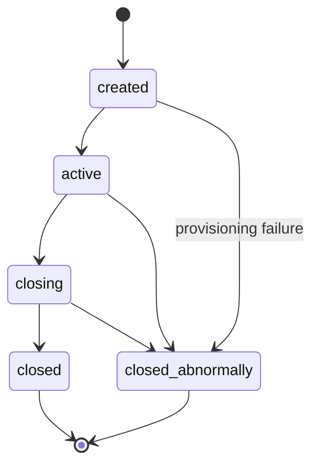
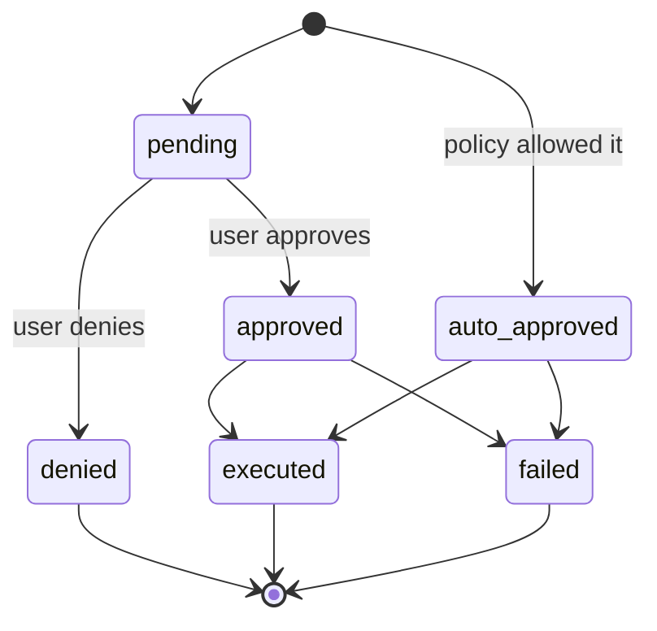
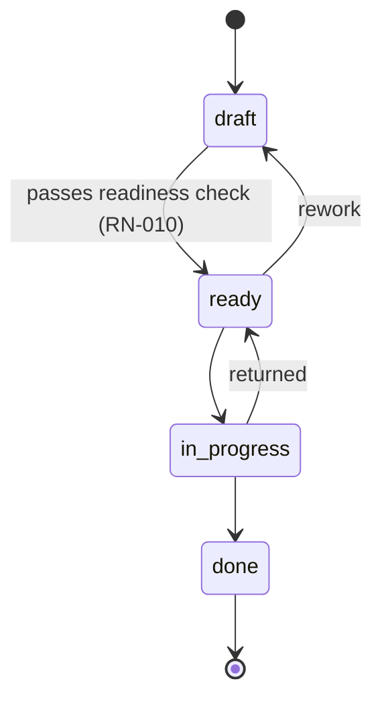
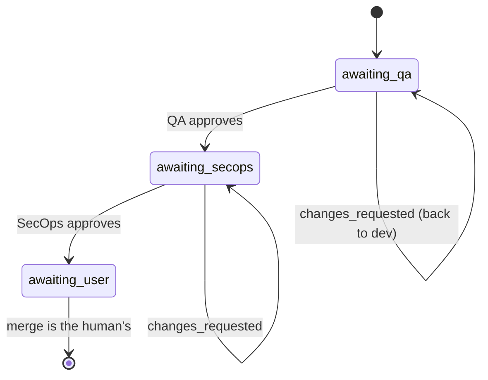

# 业务规则

每条规则都有**陈述**、**所在位置**（`file:line`）和**覆盖它的测试**。如果你修改了一条规则，请在同一次变更中更新这里对应的行——这是
[`.docmap.yml`](https://github.com/daneiel/brabo/blob/dev/docs/.docmap.yml)
以 `block` 级别所要求的。

它们都位于 `apps/api/src/domain/`，该目录是**纯的**：没有 IO，没有框架，没有数据库。因此每一条都有快速、确定性的单元测试。

## 业务背景

Brabo 通过 AI 智能体执行工程工作。有两股力量几乎塑造了这里的每一条规则：

**智能体在构造上就不可信。** 它是语言模型：可能产生幻觉、陷入循环，或请求具有破坏性的操作。这些规则的存在，是为了让可能的损害由结构来约束，而不是由提示词的质量来约束。

**花费是真实且持续的。** 每一轮都会消耗付费 token。预算、上限和计量不是行政上的便利——它们是阻止智能体循环变成亏损的东西。

### 参与者

| 参与者 | 是谁 | 权限 |
|---|---|---|
| **用户** | 人。角色：`viewer`、`developer`、`maintainer`、`owner` | 对任何具有外部效果的操作拥有最终决定权；合并专属于用户 |
| **智能体** | 带有角色的长时运行进程（Criativo、PO、Arquiteto、Dev、Infra、QA、SecOps、Psicólogo、Anamnese） | 提议；从不单独决定策略不允许的事 |
| **系统** | api 和 engine | 执行策略、记录事件、计量成本 |

词汇见[术语表](glossary.md)。

---

## 会话

### RN-001 — 会话有五种状态和封闭的转换 {#rn-001}

`created → active → closing → closed`，`closed_abnormally` 可从任何非终止状态到达。**从 `closing` 永远无法回到 `active`**，终止状态没有出口。



- **位置：** `apps/api/src/domain/sessions/session-state-machine.ts:29`
- **测试：** `test/domain/sessions/session-state-machine.spec.ts`
- **边界情况：** `closing` 是**过渡**状态。卡在那里的会话意味着排空已开始但未完成——对此有告警，见[运维手册](runbook.md)。

### RN-002 — 每个会话事件都不可变，且 `seq` 是稠密的 {#rn-002}

`session_events` 上永远没有 `UPDATE`。`seq` 在每个会话内唯一（`unique(session_id, seq)`）且没有空洞：从 1 开始并连续。

- **位置：** `apps/api/src/db/schema/sessions.ts`（表 `session_events`）
- **测试：** 在恢复时校验——如果
  `count(*) ≠ max(seq) − min(seq) + 1` 或 `min(seq) ≠ 1`，`docker/backup/restore.sh` 会失败
- **原因：** 正是它让 Psicólogo 的证据可追溯、让备份可校验。需要变化的状态存放在旁边它自己的表里。

### RN-097 — 会话的类型是创建意图；执行仍然是事件 {#rn-097}

会话诞生时是 `consultiva`（咨询型）或 `criativa`（创作型），由**打开它的人**选择并记录在 `sessions.kind` 中。`consultiva` 只是对话；`criativa` 是产出的那一种——它与 Criativo 智能体一起开启构思，并且是**唯一**能进入执行的那一种。类型**永不改变**：没有任何路由可以替换它。

这条规则的风险不在于字段，而在于**第二个事实来源**。产品原本就知道如何判断会话是否在执行，而且是通过另一条路径知道的：`findActiveExecutionSession` 查找携带 `execution.activated` 事件的 `active` 会话（正是它让重新激活落到 dev agent 已经所在的会话上，即第一次 dogfooding 的第 11 号发现）。两者在一条防止它们互相冲突的规则下共存：

- **`kind` 分类的是创建意图。** 从未激活执行的 `criativa` 会话**不是**当前执行会话，基于事件的推导也继续不看 `kind`——如果开始看，每个打开的创作型会话都会成为接收 dev agent 的候选。
- **事件分类的是执行状态**，一如既往。
- **`consultiva` 会话上的 `execution.activated` 是错误**（409），永远不是静默转换。这一点决定了两个来源中谁胜出：让事件提升类型，恰恰就是让它们互相覆盖。

守卫位于**漏斗**——`AppendSessionEventUseCase`——而不在 `ActivateExecutionUseCase` 中，因为两条写入事件的路径（用户的路由和 engine 的 `/internal/*`）都经过它。额外的会话读取只在事件是执行事件时才付出代价。拒绝发生在 `incrementSeq` **之前**：被拒绝的尝试不能消耗 `seq`，否则 [RN-002](#rn-002) 就会被破坏。

该列的 DEFAULT 是 `consultiva`——能做的事**更少**的那种：通过不经过路由的路径到达的行（迁移、维护 SQL）不会因此获得执行的权利。迁移的**回填**则相反，而且是有意为之，依据 0033 的推理：在它运行的那一刻，每个会话都早于这一区分，其中一些是 dev agent 正在工作的会话——把它们唤醒为 `consultiva` 会让重新激活一个进行中的项目失败，而没有任何人做出过任何决定。

- **位置：** `apps/api/src/domain/sessions/session-kind.ts:50`
  （`podeAtivarExecucao`）、`apps/api/src/db/schema/sessions.ts:68`（该列）、
  `apps/api/src/application/use-cases/sessions/append-session-event.use-case.ts:53`
  （守卫）
- **测试：** `apps/api/test/application/use-cases/sessions/session-kind-e-nome.spec.ts`
- **来源：** [ADR 0061](adr/0061-tipo-da-sessao-na-criacao.md)

### RN-098 — 会话名称附加在 hashtag 上，永不取代它 {#rn-098}

会话可以获得一个友好名称（`sessions.name`，可选），在创建时或之后通过 `PATCH /projects/:projectId/sessions/:sessionId` 设置。屏幕上显示的标签是**组合的**：`<name> · #<first 8 characters of the
id>`。没有名称时，它降级为**只有 hashtag**。

hashtag 永不消失，原因是操作层面的：它是被粘贴进 URL、命令或对话里的东西，而人选择的名称**不唯一**——两个名为“Checkout”的会话很正常。空白名称（或仅有空白字符）在创建和重命名时都算作**缺失**：写入 `''` 会让标签变成 `" · #a1b2c3d4"`，比只有 hashtag 还糟。`PATCH` 请求体中的 `null` 是**撤销**的方式。

重命名**不是**会话事件。事件日志记录的是会话经历过的事，而名称是导航标签，想改多少次都行——N 个重命名事件会把真正重要的内容挤出 200 个事件的尾部。

- **位置：** `apps/web/src/lib/session-label.ts:61`（`rotuloDaSessao`）、
  `apps/api/src/application/ports/session-repository.port.ts:52`（`rename`）。
  既可从会话内部到达
  （`apps/web/src/routes/SessionPage.tsx:439`，`handleRename`），也可从项目列表到达，无需先打开会话
  （`apps/web/src/routes/ProjectSessionsTab.tsx:101`，`handleRenomear`）——两个屏幕调用同一个 `renameSession` 和同一个 `rotuloDaSessao`。
- **测试：** `apps/web/src/lib/session-label.test.ts`、
  `apps/api/test/application/use-cases/sessions/session-kind-e-nome.spec.ts`、
  `apps/web/src/routes/ProjectSessionsTab.test.tsx`
- **来源：** [ADR 0061](adr/0061-tipo-da-sessao-na-criacao.md)

### RN-104 — 标签页由记录的类型推导，并以该类型创建 {#rn-104}

项目有**两个**会话标签页——**Criativo** 和**聊天**——每一个都是一种 `kind`：它列出 `sessions.kind` 为其自身的会话，其 CTA 以该 `kind` 创建，**不再询问**。没有同时列出两者的第三个标签页。

类型本来就是不可变的（[RN-097](#rn-097)），正是这一点使它成为合法的导航坐标，而不是一个保存的筛选器：会话永远不会换标签页。标签页读取的是**记录的**字段——它不从任何事件推导类型，理由与 RN-097 相同：`execution.activated` 分类的是执行状态，看它的标签页会自己移动。

这条规则确定了两个后果，而且它们不是屏幕细节：

- **类型选择离开了表单。** 它曾经位于单选按钮的 `fieldset` 中，现在在人点击标签页的那一刻发生。两者都保留会提供创建一个与你所处位置相矛盾的会话的机会。表单中留下的是**名称**，它仍然是可选的（[RN-098](#rn-098)）。
- **一个操作，一次一个位置。** “开始构思”仍然存在——它是把 Criativo 智能体带进会话的东西，从那时起开始花费 owner 的密钥（[RN-058](business-rules/custo.md#rn-058)）；没有人会自己进来。改变的是它所在的位置：邀请在屏幕上时位于**邀请内部**，不在时位于顶栏。邀请过去会**指向**顶栏（“使用屏幕顶部的开始构思”），这正是引发 [RN-097](#rn-097) 的问题的字面版本——操作在一处，解释在另一处。顶栏不能简单地去掉按钮：可以在从未召唤 Criativo 智能体的情况下在创作型会话中输入，这时邀请就退场了。

三个屏幕都遵守 [RN-088](#rn-088) 的三种状态，**错误先于空**：两种情况下筛选后的列表都是空的，而在 429 之后说“还没有构思”就是在对发生的事撒谎。

聊天的深链接键仍然是 `sessions`，而不是 `chat`。正是这一点让旧的书签链接 `?tab=sessions` 打开聊天时**标签栏中该标签被标记**——只在面板中把旧键解析为别名，会让标签栏完全没有选中项，因为 `Tabs` 将 `active` 与 `key` 比较，而写入 `active` 的一方从 `validateSearch` 收到的是原始键。

- **位置：** `apps/web/src/routes/project-tabs.ts:95`（两个条目）、
  `apps/web/src/routes/ProjectSessionsTab.tsx:114`（按记录的
  `kind` 筛选）和 `:98`（以标签页的 `kind` 创建的 CTA）、
  `apps/web/src/routes/SessionPage.tsx:716`（`conviteVisivel`，顶栏和邀请共享的唯一问题）
- **测试：** `apps/web/src/routes/ProjectSessionsTab.test.tsx`、
  `apps/web/src/routes/project-tabs.test.tsx`、
  `apps/web/src/routes/SessionPage.sessao.test.tsx`
- **边界情况：** 没有该类型会话的项目显示**该类型的**空状态，即使它有另一类型的会话——这是信息，不是错误。
- **来源：** [ADR 0061](adr/0061-tipo-da-sessao-na-criacao.md)

### RN-123 — 没有活动 Criativo 智能体的创作型会话：第一条消息同时也激活它 {#rn-123}

在尚无 `agent.activated` 的 `kind: 'criativa'` 会话（[RN-097](#rn-097)）中，通过输入框发送第一条消息会先激活 Criativo 智能体（等待激活完成），然后才通过真实路径（`sendAgentMessage`——历史、系统提示词、`emit_artifact` 工具）把该消息交给它。在这条规则之前，没有点击“开始构思”就输入的人会落入一个没有历史、没有业务规则的通用 SSE 聊天：那**不是**真正的 Criativo 智能体，对话也没有在领域中记录任何东西。

“开始构思”的点击仍然存在（[RN-104](#rn-104)）——当人更喜欢显式手势时，它仍然是触发激活的东西，并且在两条路径中的任何一条上，owner 的密钥（[RN-058](business-rules/custo.md#rn-058)）都是从它开始被花费的。改变的是，**第一条消息**现在也算作该手势：没有人应该在和屏幕已经邀请他交谈的对象说话之前还需要单独点一下。

- **位置：** `apps/web/src/routes/SessionPage.tsx:678`（`handleSend`）
- **测试：** `apps/web/src/routes/SessionPage.ideacao-automatica.test.tsx`
- **边界情况：** `consultiva` 会话没有 Criativo 智能体——规则不适用，通用 SSE 路径对它仍然是正确的。

### RN-119 — 会话的活动智能体是拥有最近一次 `agent.activated` 的那个——永远不是固定链 {#rn-119}

`SessionPage` 从**同一个**智能体决定两件事：输入框的消息发给谁，以及顶栏从哪个智能体解析所显示的模型（完整级联 会话→智能体→领域→项目→工作区，与 `RunLlmTurnUseCase` 实际运行该轮时使用的相同）。在这条规则之前，这两个问题有**不同**的答案：路由使用固定的优先链（architect > po > creative，基于历史上的**存在**——“已经激活过一次”，它永远不会“关闭”），而显示的模型甚至不知道谁是活动的——模型绑定路由根本收不到智能体，总是回退到 Criativo 智能体的固定后备（`herdarModeloDeStart`），即使在 handoff 给 PO、Arquiteto 或 Dev Lead 之后也是如此。

唯一的定义：活动智能体是在聊天流程的对话型智能体（Criativo、PO、Arquiteto、Dev Lead）中，拥有**最近**一次 `agent.activated`（按 `seq`）的那个。**Infra Lead 被排除在外**：`agent_command_controller.ex`（engine）只为 po/dev-lead/arquiteto（加上 Criativo，作为最后一个子句的隐式后备）提供 `message` 路由——Infra 从未接通 `message`，只有 `start`。今天向“infra”发送消息会静默落到 Criativo 智能体；把它当作输入框的活动智能体，会重新打开那个陷阱而不是关闭一个。

> **部分被 [RN-631](#rn-631)（AT-251）取代：**“最近的
> `agent.activated` 胜出”本身就是一个隐式的默认接收者，而且是不可见的。输入框的接收者现在由人**选择**（一个列出会话中已有智能体的“收件人”选择器），顶栏的模型跟随该接收者。这条规则留存下来的是关于模型的那一半：绑定路由接收智能体，永不静默回退。

- **位置：** `apps/web/src/lib/session-destinatario.ts:272`
  （`useDestinatarioDoChat`，自 RN-631 起）、
  `apps/web/src/lib/api-client.ts:1124`（`getSessionModelBinding`，即
  `agentId`）、`apps/api/src/interfaces/http/llm/model-bindings.controller.ts:166`
  （`getSessionBinding`，`@Query('agentId')`）
- **测试：** `apps/web/src/routes/SessionPage.destinatario-do-chat.test.tsx`
  （原 `SessionPage.agente-mais-recente.test.tsx`）、
  `apps/web/src/routes/SessionPage.modelo-do-agente-ativo.test.tsx`、
  `apps/api/test/application/use-cases/llm/resolve-model-binding.use-case.spec.ts`
- **边界情况：** Infra Lead 既不参与输入框路由，也不参与“活动智能体”的定义——它是主动型的（第 4 阶段），不是通过输入框对话的。

### RN-120 — 进行中的轮次期间，会话的事件轮询暂停 {#rn-120}

`useSessionEvents` 每隔几秒获取事件，却**完全不知道**有轮次正在进行。如果轮询落在轮次**期间**（很常见——轮次通常比间隔更长），它会带回已持久化的
`chat.message`/`agent.response`，而这些会与屏幕上仍然存在的乐观/流式状态**并排**渲染：同一条消息出现两次。

修复只在 `streaming` 为 `true` 时暂停**定时器**（`refetchInterval`）——查询保持 `enabled`，因此在轮次结束时已经触发的显式失效（`finalizarTurnoDoAgente`）会在正确的时机继续获取新数据。`pausarPoll` 是**可选**参数，默认 `false`：该 hook 的其他消费者（Overview、Code、Provisioning、AdoptionPlan）没有进行中的对话轮次，保持原样。

- **位置：** `apps/web/src/lib/hooks.ts:221`（`useSessionEvents`）、
  `apps/web/src/routes/SessionPage.tsx:277`（`eventsQuery`）
- **测试：** `apps/web/src/lib/hooks.pausar-poll.test.tsx`
- **边界情况：** 暂停定时器不等于禁用查询——显式失效继续工作，而修复依赖它来确保永不丢失数据。

### RN-122 — “停止”按钮真正取消轮次，杀死持有 LLM 调用的任务 {#rn-122}

在此之前，任何地方都没有取消。根源是结构性的：
`agent_command_controller.ex` 用
`GenServer.call(pid, {:user_message, texto}, ...)`——**同步**——处理用户的消息，整个轮次（工具循环 + 对 LLM 的 SSE 调用）都在 `handle_call` **内部**运行。智能体的进程一直阻塞到轮次结束，期间不处理任何其他消息——连未来的取消命令也不处理。

修复：四个对话型智能体（Criativo、PO、Arquiteto、Dev Lead）的轮次 `handle_call`/`handle_cast` 派生一个
`Task.Supervisor.async_nolink/2`（`Engine.Agents.TurnoAssincrono`，新增，四者共享）来承担繁重工作，并返回 `{:noreply, state}`——对原始 `GenServer.call` 的回复被**推迟**到任务完成（`GenServer.reply/2`，在 `{ref, resultado}` 到达
`handle_info` 时触发）。由于智能体进程**不再**阻塞，新的
`handle_cast(:cancel, state)` 会在轮次运行时到达并被处理：
`:brutal_kill` 模式的 `Task.shutdown/2` 杀死任务，从而断开它与 api 之间持有的 HTTP（SSE）连接——正是这一点让取消真正节省 token，而不只是在客户端停止渲染。原始的
`from` 收到 `{:error, :cancelado}`，并记录一个**终止性**的 `agent.error`，来源为 `"politica"`（策略——与预算/凭据/绑定相同的来源——取消是用户停止花费 token 的决定，而不是 ADR 0020 封闭词汇中的第五个值）——没有它，
`GetSessionPendingWorkUseCase` 会看到 `agent.activated` 之后没有
`agent.response`/`agent.error`，会话就会一直挂在待处理工作信号上。

发给同一智能体的两条相互竞争的消息（用户在轮次已在运行时再次发送）永远不会派生第二个任务：
`TurnoAssincrono.iniciar/3` 立即回复 `{:error, :turno_em_andamento}`（轮次进行中）。

> **由 [RN-578](#rn-578)（ADR 0163）修订：** 对原始
> `GenServer.call` 的回复不再推迟到任务完成——它在**接受**时、任务一启动就发出，而取消不再回复任何人（调用方已经拿到 `:ok`）。`{:error, :turno_em_andamento}` 不再被控制器丢弃：它是一个具名的 409 和一个持久的 `agent.error`。

- **位置：** `apps/engine/lib/engine/agents/turno_assincrono.ex`（机制）、`apps/engine/lib/engine/agents/{criativo,po,arquiteto,dev_lead}_server.ex`
  （四个轮次 `handle_call`/`handle_cast`）、`apps/engine/lib/engine_web/controllers/agent_command_controller.ex:361`
  （`cancel/2`）、`apps/engine/lib/engine_web/router.ex`（`POST
  /internal/sessions/:sessionId/agent/cancel`）、
  `apps/api/src/application/use-cases/agents/cancel-agent-turn.use-case.ts`、
  `apps/api/src/interfaces/http/agents/agents.controller.ts`（`POST
  /projects/:projectId/sessions/:sessionId/agents/:agent/cancel`）、
  `apps/web/src/routes/SessionPage.tsx`（`handleCancel`，输入框中的“停止”按钮）
- **测试：** `apps/engine/test/engine/agents/turno_assincrono_test.exs`（任务**真正**死亡——前后都检查 `Process.alive?/1`——而不只是“不再导入结果”）、`apps/api/test/application/use-cases/agents/cancel-agent-turn.use-case.spec.ts`
- **边界情况：** 没有进行中轮次时取消是幂等的**空操作**——没有任务可杀，也没有待回复的 `from`。取消**不会**撤销在任务死亡**之前**已经运行的副作用（例如，一个已经分派并记录了其事件的工具）——它只中断尚未发生的事。
- **来源：** 本次会话的调查；没有专门的 ADR（是 harness **内部**并发模式的变化，而不是层/数据库边界的变化）。

### RN-142 — 在完全没有业务规则时确认就绪会被 engine 拒绝，而不只是在 UI 中隐藏 {#rn-142}

以前，点击“我准备好产出了”——或直接调用该路由——**总是**会创建 `product_brief` 并向 PO 提供 handoff，即使在一个捕获了零条业务规则的对话中也是如此。
`business_rule_refs(state)` 在 `criativo_server.ex` 中早已存在，但只用于**填充** brief 的 `"rules"` 字段——从未作为阻断条件。在 UI 中，`SessionPage.tsx` 只在
`streaming` 期间禁用按钮，不检查规则数量。

真正的保证必须存在于服务端，而不是屏幕上：直接调用路由的人（或未来某个不是这个前端的客户端）不能仅仅因为按钮被画成禁用状态就击穿护栏。`CriativoServer.handle_call(:confirm_readiness, ...)` 现在在派生
`Engine.Agents.TurnoAssincrono` 的 `Task`（[RN-122](#rn-122)）**之前**检查
`business_rule_refs(state)`——为空就当场拒绝，不运行整合轮次，没有
`product_brief`，没有 handoff。

拒绝不会变成 HTTP 4xx：
`agent_command_controller.ex#readiness/2` **忽略**这个 `GenServer.call` 的返回值，总是回答 202，这与 `message/2` 自 RN-122 起已使用的模式相同（“此响应只是确认”——真正的结果存在于事件日志中）。因此拒绝被叙述为一个**持久的** `agent.error`（RN-059），来源为 `"politica"`（策略——这是产品决定，不是 infra/模型/轮次失败）——并附带解释原因的消息；会话线程已经知道如何渲染这种事件类型（`lerFalhaDeTurno`，与任何其他轮次失败相同的红色气泡）。

补充性的 UX，在 `SessionPage.tsx` 中：当 `events` 中没有
`artifact.business_rule` 时，按钮生来就是 `disabled`（带有解释原因的 `title`）——与已经为“业务规则”面板（`ContextAside`）供数的是**同一个**来源，没有可能与第一次读取产生分歧的第二次读取。

- **位置：** `apps/engine/lib/engine/agents/criativo_server.ex`
  （`handle_call(:confirm_readiness, ...)`、`emit_falha_sem_regra/1`）、
  `apps/web/src/routes/SessionPage.tsx`（`hasBusinessRule`，“我准备好产出了”按钮）
- **测试：**
  `apps/engine/test/engine/agents/criativo_server_test.exs`（"readiness:
  refuses when NO business rule was captured"——没有轮次、没有 brief、没有 handoff；拒绝以来源 `"politica"` 叙述）、
  `apps/web/src/routes/SessionPage.readiness-exige-regra.test.tsx`（没有规则时按钮禁用，有 1 条以上时启用）
- **边界情况：** 会话在通知 engine **之前**就已经由 api 记录了 `readiness.confirmed`（`ConfirmReadinessUseCase`）——这一点不变：它是用户**点击**的记录，是一个独立于 engine 之后接受或拒绝而发生的事实。
- **来源：** 确认用户报告的代码调查——没有 ADR（在已有流程上的新护栏，没有层/数据库边界的变化）。

---

## 操作审批

系统的核心。每个具有外部效果的操作都以
`proposed_action` 的形式诞生。

### RN-003 — 操作有六种状态，denied 是终止状态 {#rn-003}



- **位置：** `apps/api/src/domain/actions/action-state-machine.ts:36`
- **测试：** `test/domain/actions/action-state-machine.spec.ts`
- **边界情况：** 已批准并执行的操作变为 `executed`，**而不是**仍然是 `approved`。按 `status = 'approved'` 统计批准数会得到错误的数字——正确的标准是 `decided_by IS NOT
  NULL`。

### RN-004 — 决定分三个阶段评估，`deny` 立即胜出 {#rn-004}

顺序：**(a) IAM → (b) `agent_autonomy` → (c) `permissions.json`**。每个阶段只能**提高**宽松度；沉默的阶段永远不会降低前一个阶段。任何阶段的 `deny` 都立即返回。

- **位置：** `apps/api/src/domain/actions/decide.ts:118`
- **测试：** `test/domain/actions/decide.spec.ts`（10 KB——领域中最大的）

### RN-005 — 每种操作类型的最低角色 {#rn-005}

在任何策略之前是 IAM：每个 `ActionType` 都要求一个最低有效角色。不满足时，`deny` 并给出明确理由。

- **位置：** `apps/api/src/domain/actions/decide.ts:110`（`MIN_ROLE_FOR_ACTION_TYPE`）
- **测试：** `test/domain/actions/decide.spec.ts`

### RN-006 — 上限：合并到受保护分支永远不可自动批准 {#rn-006}

`dev`、`qa`、`rc` 和 `main` 是受保护的。目标为其中之一的 `git_merge` 在所有策略运行**之后**从 `auto_approve` 降级为 `require_approval`。`agent_autonomy` 和 `permissions.json` 都不能提升它。

`rc` 即使在该步骤离开策略（[ADR 0030](adr/0030-politica-de-branches-mecanizada.md)）且引导程序不再创建它（[RN-029](#rn-029)）之后仍留在列表中。这个列表决定锁**拒绝**什么，而由早期版本引导的仓库仍然有这个分支：保护一个不存在的分支没有代价；取消保护一个存在的分支代价高昂。

- **位置：** `apps/api/src/domain/actions/decide.ts:498`（`isProtectedBranch`，合并锁的上限）+ `protected-branches.ts:4`
- **测试：** `test/domain/actions/decide.spec.ts`
- **来源：** [ADR 0011](adr/0011-infra-dev-agents-worktrees-merge-lock.md) §1
- **注：** **平台上**（GitHub/GitLab）的等效保护在不同提供方之间存在差异，并不是 gate——见
  [ADR 0028](adr/0028-protecao-de-branch-divergencia-entre-providers.md)。

### RN-007 — 上限：指令补丁永远不可自动批准 {#rn-007}

修改智能体的指令总是需要人的决定。该功能的价值在于人看到 diff；自动批准就等于智能体在改写自己。

- **位置：** `apps/api/src/domain/actions/decide.ts:168`
- **测试：** `test/domain/actions/decide.spec.ts`
- **来源：** [ADR 0016](adr/0016-anamnese-proficiencia-patches-instrucao.md) §8

### RN-008 — 命令匹配按模式，而非子串 {#rn-008}

`permissions.json` 以结构化模式匹配终端命令，命令经过正确的分词——而不是用 `includes()`。

- **位置：** `apps/api/src/domain/actions/command-matcher.ts`
- **测试：** `test/domain/actions/command-matcher.spec.ts`

---

## Backlog

### RN-009 — 用户故事有四种状态，`done` 是终止状态 {#rn-009}

`draft → ready → in_progress → done`。允许返工：`ready → draft` 和
`in_progress → ready`。



- **位置：** `apps/api/src/domain/backlog/story-state-machine.ts:27`
- **测试：** `test/domain/backlog/story-state-machine.spec.ts`

### RN-010 — `draft → ready` 需要四样东西，在领域中校验 {#rn-010}

要让用户故事变为 `ready`，它需要以下**全部**：

1. `dod` 非空——完成的定义（Definition of Done）
2. `dor` 非空——就绪的定义（Definition of Ready）
3. 至少 1 条功能需求（`rf`）
4. 至少 1 条关联的业务规则（`businessRuleIds`）

错误会**准确说出缺少什么**，而不是笼统的“无效”。

- **位置：** `apps/api/src/domain/backlog/story-readiness.ts:39`
- **测试：** `test/domain/backlog/story-readiness.spec.ts`
- **来源：** [ADR 0009](adr/0009-agente-po-backlog-rastreabilidade.md) §3
- **原因：** 正是它阻止 PO 把一个含糊的用户故事丢进 dev 队列。

### RN-011 — 没有用户故事的业务规则是发现，不是错误 {#rn-011}

规则→用户故事的覆盖是计算出来的，没有用户故事的会显示为**待处理**——是信息，不是失败。

- **位置：** `apps/api/src/domain/backlog/coverage.ts`
- **测试：** `test/domain/backlog/coverage.spec.ts`

### RN-012 — 从 `module_map` 中移除的模块会使用户故事降级 {#rn-012}

关联到一个已不存在的模块的用户故事会回到 `draft`，并产生一个
`backlog.story_demoted` 事件。

- **位置：** `apps/api/src/domain/architecture/module-resolution.ts`；事件在
  `application/use-cases/architecture/create-module-map.use-case.ts:73` 中发出
- **测试：** `test/domain/architecture/module-resolution.spec.ts`

### RN-013 — 模块图不能有环 {#rn-013}

- **位置：** `apps/api/src/domain/architecture/module-graph.ts`
- **测试：** `test/domain/architecture/module-graph.spec.ts`

---

## PR Gates

### RN-014 — gate 顺序不可变，`awaiting_user` 是终止状态 {#rn-014}

`awaiting_qa → awaiting_secops → awaiting_user`。批准 QA **永远不会**直接跳到用户。`changes_requested` 把它送回给 dev，**在同一分支上**，不新建 PR。



- **位置：** `apps/api/src/domain/execution/pr-gate-state-machine.ts:24`
- **测试：** `test/domain/execution/pr-gate-state-machine.spec.ts`
- **来源：** [ADR 0013](adr/0013-gates-qa-secops-pr.md) §1
- **边界情况：** `awaiting_user` **按设计**是终止状态——系统永远不合并（RN-006）。

### RN-015 — 循环 K：修正上限是有限的且可继承 {#rn-015}

每次 gate 退回都消耗一圈。上限耗尽后，任务会带着原因被**阻塞**，而不是永远打转。由并行化创建的子智能体**继承**基础智能体的上限。

自第 8b 阶段起，上限也适用于 QA 领域，无需改代码：`QaLeadServer` 是 `record_gate_verdict` 的唯一调用方，因此一轮 gate——无论其下咨询了多少专业——仍然恰好只消耗**一**圈。见
[RN-036](#rn-036)。

- **位置：** `DEFAULT_MAX_GATE_CORRECTIONS = 3`，位于
  `apps/api/src/application/use-cases/execution/record-gate-verdict.use-case.ts:21`；
  在 `activate-execution.use-case.ts:89` 中应用，在 engine 中于
  `qa_lead_server.ex:268` 和 `secops_agent_server.ex:142` 中应用
- **测试：** `apps/engine/test/engine/gates/qa_automacao_agent_test.exs`
  （专业返回 `{:blocked, ...}` 而不调用 api）
  和 `qa_lead_server_test.exs`（在这种情况下 Lead **从不**调用
  `record_gate_verdict`——正是这一点防止修正次数被白白消耗）
- **来源：** [ADR 0017](adr/0017-lock-de-workspace-e-monitor-de-dev-agents.md) §4

### RN-016 — gate 的判定优先于任务的陈述 {#rn-016}

如果任务描述说的是一回事，而 gate 的判定说的是另一回事，判定胜出。

自第 8b 阶段起，“判定”可以来自两个专业——规则不变：每一个都在**其评估范围内**优先于任务（Automação 针对测试覆盖；Performance/Segurança 针对性能 NFR 和代码发现）。`QaLead.consolidar/1` 不在它们与任务之间仲裁：任何一方的任何 `changes_requested` 都已使整体失败（见 [RN-036](#rn-036)）。

- **位置：** 每个专业的提示词，位于
  `apps/engine/lib/engine/gates/qa_automacao_agent.ex` 和
  `qa_performance_seguranca_agent.ex`
- **来源：** [ADR 0020](adr/0020-destravar-gates-qa-secops.md) §9

### RN-036 — QA 成为一个领域：Lead 进行整合而不改变 gate 的契约 {#rn-036}

Automação 专业（第 4a 阶段的 `QAAgent`）总是被委派；Performance/Segurança 只在用户故事有相关性能 NFR 时被委派（`Engine.Gates.QaLead.rnf_de_performance?/1`——关键词启发式，不是 NLP）。**不**委派的决定也总是被记录——一个带理由的 `dispensed` 委派，永远不是沉默。

整合：只有当**所有**运行过的委派都批准时才 `approved`；任何
`changes_requested` 都使整体失败，并带上请求修改的专业的 `itens`（条目），每个条目都以提出者的标签为前缀（`"[QA de Automação] ..."`）——这就是在**不**把 `itens` 从 `string[]` 改为其他形状的情况下追溯来源的方式。委派失败（任何来源——`infra`、`modelo`、`codigo`、
`politica`）**永远不会**变成 `changes_requested`：Lead 以真实来源阻塞任务（RN-015）。

到达 api 的 `qa_verdict` 是**同一个**制品，并经过与往常**相同**的路由（`RecordGateVerdictUseCase`、
`nextGateStatus`）——两者都没有改变。api 关于该领域所了解的只存在于 `delegation.completed`/`delegation.failed`/
`delegation.dispensed` 事件中，由专业和 Lead 分别记录。

- **位置：** `apps/engine/lib/engine/gates/qa_lead.ex`（`consolidar/1`、
  `rnf_de_performance?/1`）、`qa_lead_server.ex`（接线）；
  `apps/api/src/application/use-cases/execution/record-delegation.use-case.ts`；
  `apps/api/src/db/schema/agents.ts`（表 `delegations`，枚举 `failure_origin`）
- **测试：** `apps/engine/test/engine/gates/qa_lead_test.exs`（纯决策树）、`qa_lead_server_test.exs`（接线：决定 →
  委派 → 记录 → 整合 → 与往常**相同**的调用），以及——契约未改变的证明——
  `record-gate-verdict.use-case.spec.ts`、`pr-gate-state-machine.spec.ts`
  和 `record-infra-gate-verdict.use-case.spec.ts` **完全不修改**即通过
- **来源：** [ADR 0038](adr/0038-hierarquia-de-agentes.md)

在 `apps/web` 一侧（第 8d 阶段）：团队面板把 `qa`/
`qa-automacao`/`qa-performance-seguranca` 分组为 lead + 可折叠的专业，PR 时间线把整合后的判定展开为其内部细节（`ProjectApprovalsTab.tsx`、`PrGateTimeline.tsx`），信息流叙述 `delegation.*`——见 `apps/web/src/lib/agents.ts`
（`AREAS`/`areaFor`）。

---

### RN-054 — 外部 handoff 指向领域的 lead 或无领域的智能体——永远不指向子智能体 {#rn-054}

**从外部**与一个领域交谈的人与 lead 交谈。指向子智能体（`qa-automacao`、`qa-performance-seguranca`、
`infra-workflows`）的 handoff 会以类型化错误被拒绝，该错误**指出调用方本应指向的 lead**——拒绝却不说出正确路径，只会把一次层级违规换成一个卡住的智能体。

拒绝发生在 INSERT **之前**。之后再拒绝会在表中留下一个幽灵 handoff 和一个 `handoff.offered`——一个不可变的事件——断言一个策略不允许的提议。

内部委派（lead → 子智能体）**不**经过这里：它是领域私有的，有自己的表（`delegations`）和自己的路径
（`RecordDelegationUseCase`）。这条规则关乎领域的外部边界，而不是其内部发生的事。

ADR 0038 要求了这项校验，并点名了位置——
`CreateHandoffUseCase` 是系统中唯一写入
`toAgent` 的地方——但它从未被实现（第一次 dogfooding 的第 12 号发现）。engine 的 `offer_handoff` 把 `to_agent` 作为自由字符串原样传递，因此直到现在都没有任何东西阻止智能体违反层级。

**领域、lead 和成员只有一个来源**，自 FASE 18 起：
`apps/api/src/domain/agents/agent-areas.ts`。该列表过去在三处（api、web、engine）手写，而测试只比较 api 与 web——engine 悄悄地产生了分歧。现在
`apps/web/src/lib/agent-areas.generated.ts` 和
`apps/engine/lib/engine/agents/areas.ex` 由
`pnpm --filter api gerar:areas` 生成，测试会使磁盘上过时的内容失败。
自 AT-046 起，同一生成器还把 `SOLO_CONVERSATIONAL_AGENTS`
（RN-440）写入 web 文件——并且只写那里，因为 engine 没有它的读取方。
该列表仍是**目录**；`agent_areas` 是每个项目的**状态**
（RN-094），两者回答不同的问题。

- **位置：** `apps/api/src/domain/agents/agent-areas.ts`
  （`assertHandoffTargetAllowed`、`HandoffToSubagentError`）、
  `apps/api/src/application/use-cases/agents/create-handoff.use-case.ts`
- **测试：** `test/domain/agents/agent-areas.spec.ts`（规则 + 检查派生副本不偏离来源）、
  `test/application/use-cases/agents/create-handoff.use-case.spec.ts`
  （拒绝时没有行也没有事件）
- **来源：** [ADR 0038](adr/0038-hierarquia-de-agentes.md)，由[第一次 dogfooding](explanation/primeiro-dogfooding.md) 的第 12 号发现关闭

---

### RN-037 — Infra 成为一个领域：Workflows 按提供方生成 CI，Lead 整合为单个 PR {#rn-037}

ADR 0038 模型的第二个实例，继 QA 领域（RN-036）之后——有一个结构性区别：Infra 领域的两个委派**总是**运行（Dockerfile/compose 由 Lead 自己完成——“委派给自己”；CI 流水线由 Workflows 子智能体完成），从不豁免其中之一。`Workflows` 根据上下文的 `gitProvider` 决定流水线格式
（`GetInfraContextUseCase`，从 `project_repositories.provider` 读取——**不是**从 `GitProvider` 的 `capabilities` 读取，后者对 GitHub 和 GitLab 是**相同**的）：`"gitlab"` 生成 `.gitlab-ci.yml`；任何其他值
（`"github"`、`"local"` 或未知）生成 `.github/workflows/ci.yml`。
每个文件在完成前都经过 `validate_infra_file`——Dockerfile 用 hadolint，GitHub Actions 工作流用 `actionlint`
（[ADR 0039](adr/0039-actionlint-e-validacao-do-pipeline-de-ci-gerado.md)；
`.gitlab-ci.yml` 没有本地校验，这是有文档记录的缺口，而不是半个方案）。

整合：两个委派者的文件按 `path` 合并（冲突时 Workflows 胜出）为**单个** PR——提议 PR 的机制
（`propose_infra_pr`）从“工具直接调用 api”变为“工具通知 Lead，由它整合并调用一次”——api 收到的
`open_infra_pr` 与往常**相同**，逐字节一致
（`ExecuteInfraPrUseCase` 未动）。任何委派者失败（来源
`infra`/`modelo`/`codigo`/`politica`）**永远不会**打开部分 PR——与 RN-036 相同的规则，再往上一层。

每个委派者（即使是对自己委派的 Lead）都被作为一行 `delegations` 追踪——完全按 RN-036 留下的样子复用，只有**一处**修正：
`task_id` 列变为**可空**（Infra 领域在**会话**上委派，infra PR 背后没有 backlog 任务），路由
`POST /internal/sessions/:sessionId/delegations` 不再嵌套在
`/tasks/:taskId` 之下——`taskId` 现在放在请求体中，可选。循环 K
和预算在 Infra 领域没有专门的列（原来的 InfraAgent 从来没有按任务的预算，这项工作也没有引入）。

- **位置：** `apps/engine/lib/engine/infra/infra_lead.ex`（`consolidar/2`）、
  `infra_lead_server.ex`（接线）、`workflows_agent.ex`、
  `tools/validate_infra_file.ex`（按扩展名分派）、
  `apps/api/src/application/use-cases/execution/get-infra-context.use-case.ts`
  （`gitProvider`）、`record-delegation.use-case.ts`（`taskId` 可选）
- **测试：** `apps/engine/test/engine/infra/infra_lead_test.exs`（合并与阻塞，纯函数）、`infra_lead_server_test.exs`（接线：单个 PR 包含两组文件、两个委派、`gitProvider: "gitlab"` →
  `.gitlab-ci.yml`、Workflows 失败 → 没有 PR）、`workflows_agent_test.exs`
  ——以及 `ExecuteInfraPrUseCase`/`InfraGateRunner`
  契约未改变的证明：`execute-infra-pr.use-case.spec.ts` 和
  `infra_gate_runner_test.exs` **完全不修改**即通过
- **来源：** [ADR 0038](adr/0038-hierarquia-de-agentes.md)、[ADR 0039](adr/0039-actionlint-e-validacao-do-pipeline-de-ci-gerado.md)

在 `apps/web` 一侧（第 8d 阶段）：团队面板以与 QA（RN-036）相同的方式分组 `infra`/
`infra-workflows`，信息流叙述该领域的委派——使用 `apps/web/src/lib/agents.ts` 中同一个 `AREAS`/`areaFor` 注册表，UI 中没有 Infra 专用代码。

---

### RN-140 — 中途死掉的 gate 循环会自行恢复，无需人工干预 {#rn-140}

`QaLeadServer`/`SecOpsAgentServer` 是 `restart: :temporary`，而 gate 的中间转换（`DevAgentServer.correct/3`、
`Dispatcher.run_secops/2`）是直接的内存调用——在
`record_gate_verdict` 已经在 api 上持久推进了 `gate_status` **之后**进行。两者之间的崩溃过去会把 PR 永远困在
`awaiting_qa`/`awaiting_secops`：没有任何东西知道那一步被搁置了，engine 重启也修复不了——[ADR 0057](adr/0057-o-gate-espera-a-aprovacao.md)
本身就已声明在 `{:awaiting, ...}` 中挂起是已知限制，而再次调查发现，已记录的判定与分派调用之间的窗口在实践中更容易撞上。

`gate_states`（schema `engine`，键 `{project_id, task_id, gate}`）在转换原本就发生的**相同**位置记录进行中的循环——在任何子智能体/扫描器运行前记 `"in_progress"`，在 `record_gate_verdict` 返回
`correct`/`run_secops` 之后、进程内调用之前记 `"dispatch_pending"`。
`Engine.Gates.GateRescuer` 扫描卡住超过 15 分钟的行
（可配置，`GATE_RESCUE_STALE_AFTER_SECONDS`）——故意宽松，因为 QA 子智能体的 ToolLoop 合法地最多运行
`TOOL_LOOP_MAX_ITERATIONS_GATE`（60）次迭代，而短阈值会救援（并重复）一个只是慢的循环——然后恢复：
`"in_progress"` 重启整个领域（不对 `ctx` 做外科式恢复，它在重启后无法存活，与 dev agent 的选择相同）；`"dispatch_pending"` 恰好重发丢失的那次调用。在启动时以及由每 5 分钟自我重新调度的 Oban tick 调用
（`GATE_RESCUE_INTERVAL_SECONDS`），
即 `Engine.Workers.GateRescueSchedulerWorker`——与
`ModelSyncSchedulerWorker`/`AnamneseSchedulerWorker` 相同的惯用法。

两个防止重复工作的守卫：**同一**节点上存活的进程
（`Registry.lookup`）永远不会被打扰，而陈旧阈值覆盖本地守卫够不到的情况（远程副本——`Registry`
是节点本地的，与 `Engine.Dev.Wake` 自
[ADR 0045](adr/0045-reagendamento-por-evento-do-dev-agent.md) 以来的注意事项相同）。残余竞争的最坏结果是重复的、廉价的工作——api 会拒绝针对不再拥有
`gate_status` 的 gate 的第二次 `record_gate_verdict`（`nextGateStatus`），而 `DevAgentServer.correct/3` 自 ADR 0052 起已通过状态守卫实现幂等——永远不会是不一致的数据。

- **位置：** `apps/engine/lib/engine/gates/gate_state.ex`、
  `gate_rescuer.ex`、`qa_lead_server.ex` 中的写入点
  （`run_area/3`、`apply_gate_result/6`）和 `secops_agent_server.ex`
  （`run_secops/3`、`apply_verdict/6`），以及
  `apps/engine/lib/engine/workers/gate_rescue_scheduler_worker.ex`
- **测试：** `apps/engine/test/engine/gates/gate_rescuer_test.exs`——在循环进行中杀死一个真实的 `QaLeadServer`
  （`DynamicSupervisor.terminate_child/2`，持久行在进程死后存活），并证明 `GateRescuer.run/0` 自行重新接上该领域直到得到真实结果；陈述中的场景（丢失的
  `run_secops`）和丢失的 `correct` 返回，两者都使用**真实**进程和分派，没有 `FakeGateDispatcher`；以及两个守卫（存活的本地进程不被打扰；最近的行不被触碰）
- **来源：** [ADR 0067](adr/0067-o-gate-sobrevive-ao-restart.md)，它扩展了 [ADR 0057](adr/0057-o-gate-espera-a-aprovacao.md)

---

## 成本

预算、计量和成本上限的 RN 位于
**[业务规则——成本](business-rules/custo.md)**。

与下面“认证”一节的原因相同：是篇幅，而不是主题。
`#rn-NNN` 锚点保持不变。

## 项目面板

### RN-039 — 项目状态点：风险总是胜过不活跃 {#rn-039}

仪表盘侧边栏为每个项目显示一个健康状态点，由三个独立信号推导：预算（与 RN-018 相同的 70%/90% 阈值）、阻塞的任务（`tasks.blocked`）和近期活动（7 天）。颜色：绿色 = 健康且活跃；琥珀色 = 预算 ≥70%；红色 = 预算 ≥90% **或**有阻塞任务；灰色 = 最近 7 天没有活动。当风险信号（琥珀色/红色）和不活跃信号（灰色）同时适用时，风险信号胜出——一个超支又停滞的项目仍然是需要查看的，而不是应该藏在“没有活动”后面的。

- **位置：** `apps/web/src/lib/project-status.ts`（`deriveProjectStatus`）
- **测试：** `apps/web/src/lib/project-status.test.ts`
- **来源：** 项目仪表盘忠实于已批准的设计

### RN-088 — 加载失败要在屏幕上说出来；429 不重试 {#rn-088}

每个从 api 加载数据的屏幕都区分三种状态，永远不是两种：
**加载中**（骨架）、**错误**（api 发来的消息，带
`trace_id` 和一个重试按钮）和**空**（空列表文本）。
`if (!dado) return null` 把三者折叠在一起，而观察到的结果是最糟的：在 api 以 `429` 限流时，`/projects/:id` 的主区域**完全空白**——没有消息、没有错误、没有骨架——原因只存在于控制台。在仪表盘上比空白还糟：`!projects`
在出错时也为真，于是屏幕邀请人在一个可能已有二十个项目的工作区里创建**第一个**项目。

这是 [RN-059](business-rules/custo.md#rn-059) 在线程另一端的体现：失败永远不会变成空响应。
失败的一方要说出来。

这句话是 **api 的**，由 `mensagemDaApi` 提取——与变更路径在 toast 中已在使用的是同一个函数。我们自己的通用文本不知道“请求次数超限，请稍后再试”（等待）和“访问被拒绝”（等也没用）之间的区别。

同一条规则的另一面是不要用更多流量回应限流。**4xx
不重试**：`429` 字面意思就是服务器让你停下，而 `401` 已经在 `request()` 内部续期过一次。并且**查询出错时轮询停止**——在窗口获得焦点、重新挂载或点击按钮时恢复。以前每次失败有三次重试，再加上约 25 个每 3 到 5 秒一次、不知道停下的轮询：一个真实会话针对每用户每分钟 300 次请求的限制（`RateLimitGuard`）累积了 **1128 个 429 错误**，而这个循环让滑动窗口无法恢复。5xx 和网络故障仍保留三次尝试，在那里重复才是正确的反应。

- **位置：** `apps/web/src/lib/query-policy.ts`（`deveRetentar`、
  `pollQueParaNoErro`）、`apps/web/src/components/ErroDeCarregamento.tsx`、
  `apps/web/src/routes/ProjectPage.tsx`、`apps/web/src/routes/Dashboard.tsx`、
  `apps/web/src/routes/Shell.tsx`、`apps/web/src/main.tsx`
- **测试：** `apps/web/src/lib/query-policy.test.ts`；
  `apps/web/src/routes/ProjectPage.test.tsx`（429 变成带 api 原话的消息；403 显示 403 的原因；加载中不是错误）；
  `apps/web/src/routes/Dashboard.test.tsx`（列表出错不会变成“还没有项目”）；`apps/web/src/routes/Shell.test.tsx`（侧边栏说出来而不是留空）
- **来源：** 在 `/projects/:id` 上的真实浏览，控制台中有 1128 个 429 错误

### RN-089 — 同名项目在侧边栏中区分 {#rn-089}

项目名称**不唯一**——领域中没有任何东西阻止这一点。当列表中两个或更多项目同名时，它们每一个都在侧边栏显示缩写 id 和创建日期（`#a1b2c3d4 · 07/08 14:32`），两者都已在项目的 payload 中。名称唯一的项目不显示任何东西：在屏幕上空间最小的地方每行都加图例只会是噪音。

具体来源：一次验证运行创建了二十个名为
`validacao-real` 的项目，侧边栏的二十行在视觉上完全相同。

- **位置：** `apps/web/src/lib/project-label.ts`（`nomesRepetidos`、
  `desempateDoProjeto`）、`apps/web/src/routes/Shell.tsx`
- **测试：** `apps/web/src/routes/Shell.test.tsx`（重名获得区分，唯一名称不获得）
- **来源：** 侧边栏塞满验证项目的真实浏览

### RN-090 — 仪表盘读取工作区，而不是一次一个项目 {#rn-090}

卡片网格和侧边栏状态点由每个周期**一次**请求供数——`GET /workspaces/:workspaceId/projects-summary`——请求数量**不随项目数量增长**。

卡片显示 git 提供方、开通状态、预算、智能体标签和最近活动；侧边栏显示状态点和未读计数。这些过去都来自每个项目七个**轮询**查询，使 23 个项目每分钟花费 3,824 次请求，而限制是 300
（`RateLimitGuard`）——屏幕在加载完之前就以 429 把自己打垮了。[RN-088](#rn-088) 让应用在这种情况下停止坚持；这一条则减少请求。

这条规则确定了两条边界，它们不是实现细节：

- **api 回答事实，而不是名册。** `roster` 带来事件日志中发生的事（已激活执行、模块、已打开的 gate、已委派的子智能体、已接受的 infra）。谁是领域的 lead、每个智能体用什么图标、成员如何变成标签，仍然属于 web——而**在场**规则只有一条
  （`rosterFromFacts`），与团队面板共享，这样一个新智能体就不会在一处出现而在另一处缺失。
- **铃铛抽屉只在打开时获取。** 直到
  [RN-091](#rn-091)，它都是唯一仍然每个项目一次请求的读取——“我读到哪里”的分界是存在浏览器中的 `seq`
  （`read-state`），服务器不知道它。如今浏览器会**发送**这个分界，抽屉也只需一次请求。

被接受且期望的副作用：`gatesEverOpened` 和 `delegatedSubagents`
开始覆盖**整个**会话。客户端过去从最近 200 个事件推导，在长会话中会丢失标签（见
[ADR 0021](adr/0021-fechamento-4a-infra-e-painel.md)）——
`deriveAgentRoster` 的文本一直说的是“曾经打开过”。

- **位置：**
  `apps/api/src/application/ports/projects-summary-repository.port.ts`、
  `apps/api/src/infrastructure/persistence/drizzle/projects-summary.repository.ts`、
  `apps/api/src/interfaces/http/iam/workspaces.controller.ts`
  （`getProjectsSummary`）、`apps/web/src/lib/hooks.ts`（`useProjectsSummary`）、
  `apps/web/src/lib/agent-status.ts`（`rosterFromFacts`）、
  `apps/web/src/routes/Dashboard.tsx`、`apps/web/src/routes/Shell.tsx`
- **测试：** `apps/web/src/routes/Dashboard.fanout.test.tsx`（30 个项目的花费与 3 个相同；不调用任何按项目的端点）；
  `apps/api/test/infrastructure/persistence/drizzle/projects-summary.repository.spec.ts`
  （数据库查询次数不随 N 增长）；
  `apps/web/src/lib/agent-status.test.ts`（api 的事实产生与事件日志相同的标签）
- **来源：** 在浏览器中测量的 23 个项目的仪表盘——之前 3,824 req/min，之后 12

### RN-091 — 浏览器发送它读到哪里；铃铛只需一次请求 {#rn-091}

通知抽屉**打开**时，其内容来自每个周期**一次**请求——`POST /workspaces/:workspaceId/unread-events`——请求数量**不随项目数量增长**。

这是 [RN-090](#rn-090) 缺失的另一半。那一条把仪表盘从
3,824 降到 12 req/min，但铃铛仍然一次获取一个项目：
23 个项目在抽屉打开时测得 **286 req/min**，而限制是 300
（`RateLimitGuard`）。勉强通过，再多一个项目就会崩。

**障碍，以及为什么出路是这个。** 服务器上故意不存在“标记为已读”：分界是每个项目的一个 `seq`，存在每个浏览器的
`localStorage` 中（`read-state`）。有两条出路，它们之间的区别在于**产品**：

- 在抽屉打开时停止重新轮询会改变用户所见内容的时效性——**被拒绝**，没有人要求这种交换；
- 浏览器**发送** `projeto → afterSeq` 映射，能以相同节奏返回完全相同的数据。**这是纯粹的批处理：对看屏幕的人来说什么都没变**，新鲜度和内容都没变。

**这是不做任何变更的 `POST`**，api 以 `200`（永不 `201`）回应来表明这一点。选择这个动词是因为它是唯一有请求体的：有几十对数据，放在查询字符串中会变成长 URL——代理会截断——还会把用户的项目 id 放进访问日志，违反不通过查询字符串传递个人数据的规则。

路由确定了三项语义保证，因为对具有不同分界的读取进行批处理正是容易出错的地方：

- **空映射返回空**，且不触碰数据库。“我什么都没问”不等于“给我全部”；
- **每个项目遵守它自己的分界**——`seq` 严格大于它的分界；
- **50 个事件的上限是按项目的**，与 `GET .../events` 在没有 `limit` 时应用的相同。整个响应的上限会让吵闹的项目吃掉安静项目的配额。

指向其他工作区项目的游标会被**忽略**，而不是拒绝：它来自调用方的本地存储，可能是旧工作区的残留。

- **位置：**
  `apps/api/src/application/ports/projects-summary-repository.port.ts`
  （`unreadEventsForWorkspace`）、
  `apps/api/src/infrastructure/persistence/drizzle/projects-summary.repository.ts`、
  `apps/api/src/interfaces/http/iam/workspaces.controller.ts`
  （`getUnreadEvents`）、`apps/api/src/interfaces/http/iam/dto/unread-events.dto.ts`、
  `apps/web/src/lib/notifications.ts`（`useNotificationGroups`）、
  `apps/web/src/lib/api-client.ts`（`getUnreadEvents`）
- **测试：** `apps/web/src/routes/Dashboard.fanout.test.tsx`（抽屉**打开**时：一次请求，30 个项目的花费与 3 个相同）；
  `apps/api/test/infrastructure/persistence/drizzle/projects-summary.repository.spec.ts`
  （数据库查询次数不随 N 增长；空映射、按项目分界、按项目上限和工作区隔离）
- **来源：** [RN-090](#rn-090) 测得的残余——在 23 个项目的工作区中抽屉打开时 286 req/min

### RN-099 — 活动分页浏览过去，而不重新轮询不会变化的内容 {#rn-099}

概览中的**活动**列显示一个锚定在会话**尾部**的 100 个事件的**窗口**，并一页一页地向过去下翻。每一页使用
`GET /projects/:p/sessions/:s/events` **本来就**返回的 `afterSeq`/`nextCursor`：没有新路由，没有新参数。

**两个问题，两个查询。** `useSessionEvents` 回答“现在是什么样”——轮询最近的 200 个——并为团队面板、树形时间线、执行区块和审批标签页供数。它们都不分页。活动回答的是“发生了什么”，而它曾是唯一一个用另一个问题的答案来回答这个问题的：一次 200 条，没有开头也没有结尾，而且仍然够不到长会话的起点。

**锚点是尾部，而不是会话的开头。** 该端点向**前**分页，并不存在 `beforeSeq`——发明一个就是新契约。但在一个有数千事件的会话中从第 1 号事件打开信息流会给出错误的屏幕：打开活动的人想看的是刚刚发生的事。所以第一页就是屏幕本来就做的那次 `latest` 读取，使用**相同的 `queryKey`**（React
Query 用**一次**获取服务两者），每次点击用 `afterSeq` 向下翻一个固定窗口。

**分页不能付出的代价。** 每个轮询周期一次请求——与之前相同，[RN-090](#rn-090)/[RN-091](#rn-091) 的节省不会倒退。三个部件保证了这一点：

- 尾部就是屏幕本来就有的查询，通过 `queryKey` 共享；
- 第一次点击**不会**变成请求：`latest` 读取带来 200 条而窗口显示 100 条，所以先展示已经付过费的内容，再去请求新的；
- 旧页面是覆盖**不可变**事件（事件表上从不 UPDATE）的一个**封闭** `seq` 窗口：`staleTime: Infinity` 且
  **没有** `refetchInterval`。在那里轮询就是付出 N 次请求去接收 N 个相同的响应。

**计数对它所知道的东西是诚实的。** 按智能体和按类型的筛选运行在**已加载的页面**上，而不是整个会话上——所以 UI 说
`N de M carregados`，而不是“N 条结果”。把筛选放到服务器上会得到真实的总数，但要动事件仓库；那不属于这个阶段，而说出错误的总数比说得少更糟。

[RN-088](#rn-088) 的三种状态在这里适用：**错误先于空**——在 api 拒绝时，该列过去会说“没有活动”。

- **位置：** `apps/web/src/lib/hooks.ts`（`useSessionEventHistory`、
  `EVENTOS_POR_PAGINA`）、`apps/web/src/components/ActivityFeed.tsx`、
  `apps/web/src/routes/ProjectOverviewTab.tsx`、
  `apps/api/src/infrastructure/persistence/drizzle/session-event.repository.ts`
  （`listPaginated`，已存在）
- **测试：** `apps/web/src/lib/session-history.test.tsx`（在尾部打开；第一次点击不花请求；下一次以连续的 `afterSeq` 分页；循环在会话开头终止；与当前状态一起挂载时尾部只是**一次**获取；旧页面不重新轮询）；
  `apps/web/src/components/ActivityFeed.test.tsx`（“N de M carregados”跟随筛选；没有分页 props 时什么都不变）
- **来源：** 用户在第一次真实浏览中的请求——“Atividades na
  aba Visão Geral deve ser paginada, para não ficar infinita”

### RN-100 — 铃铛的顺序由 SQL 决定，而不是前端 {#rn-100}

通知抽屉按**从最新到最旧**的顺序显示事件，当一个项目的未读超过 50 的上限时，出现的是**最新**的那些。

**排序由数据库完成是出于必要，而不是喜好。** 查询用窗口函数在**每个项目** 50 条处截断
（`row_number() OVER (PARTITION BY session_id ORDER BY seq DESC)`），而正是它决定了**哪** 50 个事件留存下来——不仅仅是它们以什么顺序出现。用
`ASC` 时留存的是**最旧**的 50 个，而客户端的 `.sort()` 恰恰会按新近程度去排序查询已经选错的窗口：在一个有 300 条未读的项目中，第 251 个事件会显示为“最新的”。这就是为什么前端路径上没有任何排序，组件中的注释也说不能有。

**后果，以及为什么读取分界没有改变。** 分界是存在 `localStorage` 中的每个项目一个 `seq`，并且按照 [RN-091](#rn-091) 记录的决定，**不存在标记已读的端点**。按 `seq` 的分界标记的是一个**前缀**；抽屉现在显示的是一个**后缀**。把“显示的 50 条”标记为已读，在没有**按事件**的已读集合的情况下无法表达——那是新表，超出范围。仅有的两种可表达分界仍然是“什么都不”和“到现在为止的全部”。

出路不是改变语义（它仍然推进到最后一个 `seq`，与之前完全一样），而是**不再隐藏这种推进所吞掉的东西**：

- 每个项目显示未读**总数**，而不是窗口大小，并声明有多少被留在外面（`+ N mais antigos`）；
- 当窗口外还有内容时，按钮会说出它做什么——`marcar as N como lidas`；
- 缺少的数字来自**减法**，而不是请求：`latestSeq`
  减去分界已经包含在工作区摘要中（[RN-090](#rn-090)）。

由于分界的语义没有改变，这条规则**没有 ADR**：改变的是查询选择哪个窗口，以及抽屉对它的声明。

- **位置：**
  `apps/api/src/infrastructure/persistence/drizzle/projects-summary.repository.ts`
  （`unreadEventsForWorkspace`）、
  `apps/api/src/application/ports/projects-summary-repository.port.ts`、
  `apps/api/src/interfaces/http/iam/dto/iam.response.dto.ts`
  （`ProjectUnreadEventsResponseDto`）、
  `apps/web/src/lib/notifications.ts`（`useNotificationGroups`）、
  `apps/web/src/components/NotificationBell.tsx`
- **测试：**
  `apps/api/test/infrastructure/persistence/drizzle/projects-summary.repository.spec.ts`
  （"com mais não lidos que o teto, voltam os MAIS RECENTES, do novo para o
  velho"——先断言**集合**再断言顺序）；
  `apps/web/src/components/NotificationBell.test.tsx`（按收到的顺序渲染，不重新排序；计数是总数；按钮说出标记多少条）；
  `apps/web/src/lib/notifications.test.tsx`（窗口外的部分通过减法得出，没有第二次请求）；
  `apps/web/src/routes/Dashboard.fanout.test.tsx`（抽屉仍然是**一次**请求）
- **来源：** 用户在第一次真实浏览中的请求——“Sino e
  notificações devem sempre ordenar para última data modificada em descendente
  para a mais antiga”

---

### RN-118 — 团队树按里程碑展示执行细节，并展开“最近 5 个” {#rn-118}

`AgentTimelineTree`/`timeline-tree.ts`（FASE 14b）早已按智能体对事件日志分组，但有三个缺口：展开一个分支的标准只是活动/停止（与存在多少个智能体无关），标题的计数是里程碑的**总数**（从不是“新的内容”），而 `tool.call`/
`tool.result`/`agent.response` 变成的里程碑只显示工具名称——事件日志早已记录的 `args`、`result` 和 `iteration` 从未到达屏幕。

**默认展开**变为“最近活动的 5 个智能体（最后一个里程碑的 `seq` 最大）”，活动的智能体保持对新近度的优先——两者不相加：由于 `montarArvore` 已经先排活动的，并在每组内从最新到最旧排序，两个标准折叠为一个切片（`ramosAbertosPorPadrao`，即前
`max(nº de ativos, 5)` 个分支）。活动的超过 5 个：全部展开，不截断。

每个智能体的**新内容计数**使用与铃铛**相同**的机制
（`read-state.ts`、`localStorage`），粒度是 `projectId:agentId` 而不只是 `projectId`——此前不存在这种粒度的“最后查看”。折叠的分支若有 `seq` 大于该智能体最后查看值的里程碑，就显示**新内容**计数而不是总数；展开分支（自动或手动）会将其标记为已查看，直到最新的 `seq`。

**可展开的细节**是按**里程碑**，而不是按分支——只有 `tool.call`、
`tool.result` 和 `agent.response`（`EVENTOS_EXPANSIVEIS`）变成单独的按钮，因为只有它们携带值得展开的 payload。按**迭代**的视觉分组在存在时使用
`agent.response` payload 中的 `iteration`（ToolLoop——`tool.call`/`tool.result`
继承分派它们的那次响应的迭代，因为在 ToolLoop 中它们是在响应**之后**发出的）；ToolLoop 之外的智能体（PO、Criativo，payload 中没有
`iteration`）获得每个智能体**自己**的计数器，每次响应递增——按 `seq` 邻近性推断，而不是事件日志中的新字段。

- **位置：** `apps/web/src/lib/timeline-tree.ts`（`Marco.iteracao`、
  `Marco.eventType`、`Marco.payload`、`ramosAbertosPorPadrao`、
  `marcoExpansivel`）、`apps/web/src/components/AgentTimelineTree.tsx`、
  `apps/web/src/lib/read-state.ts`（`getAgentLastSeenSeq`/
  `setAgentLastSeenSeq`）
- **测试：** `apps/web/src/lib/timeline-tree.test.ts`（按真实迭代和推断迭代分组，`ramosAbertosPorPadrao` 的活动/新近度/不截断）、`apps/web/src/components/AgentTimelineTree.test.tsx`（默认展开、新内容计数出现/消失、里程碑展开显示参数/结果/迭代）
- **来源：** 用户请求——缺口经调查 FASE 14b 现有组件确认；没有 ADR，与铃铛相同的“未查看”语义，只是新的粒度

---

### RN-096 — 每个决定都用葡萄牙语说明会发生什么；原始 payload 生来折叠 {#rn-096}

每种 `proposed_action` 都有一句描述批准效果的**葡萄牙语句子**，它是卡片上第一眼可见的东西——在任何细节之前，在需要做出决定的三个屏幕上（审批队列、会话聊天中的卡片和 Insights 标签页）。原始 payload 仍然可以访问，**放在一个生来关闭的折叠区内**，永远不会被倾倒在屏幕上。

**过去存在的是一次倾倒。** 每种没有自己视觉主体的类型都落入一个
`Object.entries(payload).map(([k, v]) => k + ': ' + JSON.stringify(v))`，总是展开。打开队列的人读到的是 `worktree: /workspaces/dev-api`、
`coAuthor: Brabo User <user@brabo.dev>` 和 `proposto: 4`——还得自己推断点击批准会发生什么。需要推断的审批就是会被自动放行的审批，而整个产品都依赖于用户是最终权威。

**句子会降级，正是这一点让它可信。** 没有一句假设 payload 中的某个键存在：payload 为空时，句子仍然是一句真实的句子，只是不那么具体（"Registra um commit no repositório do
projeto."）。payload 来自 engine 和十个不同的用例，没有一个承诺格式——只在正确的测试夹具下才成立的句子，会在第一次真实审批时崩溃。

**web 尚不认识的类型不是理论情况。** web 的 `ActionType` 联合类型已经两次落后：第一次是 Gitflow 引导的三种类型，又一次是 FASE
14d 引入的 `parallelize`/`raise_max_parallel`。编译器发现不了：规范列表在 `apps/api` 中，web 不导入它。因此同时做两件事——卡片**降级**（中性动词 + “查看详情”，payload 折叠，而不是在图标映射中得到 `undefined` 从而搞垮整个 React 树），并且**测试读取后端的 `decide.ts`**，在某个类型没有句子就进入时失败。

**展开/关闭的默认值是推导的，而不是配置的。** 规则只有一条——展开仍在等待当前观看者做决定的内容：在聊天中，是 `pending` 的操作；在队列中，从不展开（有 N 张卡片，N 个展开的细节就是同一堵文字墙）；在 Insights 中，是 `proposed` 的假设。而原始 payload 在任何变体中都不展开。设计上的结果是 `ApprovalCard` **没有获得新的必填 prop**：默认值来自本已存在的 `variant` 和 `status`。

**动词和句子出自同一个模块**，由三个屏幕消费。Psicólogo 的假设逐字使用 `instruction_patch` 的动词，而不是一套平行词汇——它的句子说的是 accept 实际做的事（排入 Anamnese 队列，后者**可能**提出调整，而调整仍需审批），永远不是“指令将被修改”。

**`write_file` 有句子，但没有主体。** 它生于
`COM_CORPO_PROPRIO` 之外：句子只显示 `path`，细节落入本 RN 要避免的那种折叠的原始 JSON 倾倒——于是一个真正需要审批的写入（不在 `dev-` 前缀下，或路径超出智能体范围）需要多点一次才能看到 `content`。它以自己的主体进入了 `COM_CORPO_PROPRIO`：`path` 和 `content` 的预览（最多 25 行/4,000 个字符，带截断提示——从不是整个文件，与原始 payload 规则相同），在聊天中待处理时默认展开，与 `terminal` 一样。

**空 payload 不是缺失的 payload。** `command`（terminal）或
`path`/`content`（write_file）以空字符串到达——模型生成的畸形工具调用，而不是渲染缺陷——过去会降级为一个
`$ ` 提示符或空白预览，用户把它读成屏幕的缺陷。两个主体现在区分这两种情况，并显示“模型没有为此操作生成有效的 X”而不是一片空白。

- **位置：** `apps/web/src/lib/aprovacoes.ts`（`VERBO_DA_ACAO`、`fraseDaAcao`、
  `descreverAcao`、`descreverHipotese`），由
  `apps/web/src/components/ApprovalCard.tsx`（审批 + 会话聊天，
  `COM_CORPO_PROPRIO`、用于 `write_file` 的 `content` 的 `previewConteudo`）和
  `apps/web/src/components/HypothesisCard.tsx`（Insights）消费；折叠通过
  `apps/web/src/components/ui/Disclosure.tsx` 的 `Disclosure` 实现
- **测试：** `apps/web/src/lib/aprovacoes.test.ts`（读取
  `apps/api/src/domain/actions/decide.ts` 的 `ACTION_TYPES`，要求每种类型都有动词 + 句子，payload 为空）；`apps/web/src/components/ApprovalCard.test.tsx`
  （`frase e colapso`——两种变体中 payload 都折叠，展开时 JSON 可读，未知类型不会搞垮屏幕，`write_file` 有自己的主体且默认展开、预览截断，`command`/`path`/`content`
  为空时显示后备消息）；
  `apps/web/src/components/HypothesisCard.test.tsx`（`frase e colapso`）
- **来源：** 16–26 计划的 FASE 19，源于在数据库重置后的第一次真实浏览中提出的“hoje está muito difícil a
  leitura”请求

---

### RN-121 — Dev agent 和 QA 是“执行者”：有自己的标签页，不在“智能体团队”中 {#rn-121}

概览中的“智能体团队”网格和“团队时间线”把 Criativo/PO/Arquiteto/Infra 与 dev-`<módulo>` 和 QA（lead +
`qa-automacao`/`qa-performance-seguranca`）混在一起——七八个智能体在同一个网格里，不区分谁**创造/决定**、谁**实现/验证**。**执行者**标签页把后两者隔离出来，使用与概览**相同**的渲染（`AgentCard`、领域网格——提取到 `AgentTeamGrid.tsx`——以及
`AgentTimelineTree`），从不重新发明卡片。

**分离规则只有一个函数**，`isExecutorGroup`/
`isExecutorAgentId`（`lib/agent-status.ts`）：`dev-lead`/`dev-<qualquer
módulo>` 和整个 `qa` 领域（lead + 子专业）是执行者；其余不是。**两个**屏幕用这个函数筛选**同一个** `groupRosterByArea`——概览用 `!isExecutorGroup`，执行者用
`isExecutorGroup`——所以一个智能体不可能出现在两边，也不可能两边都消失：它总是恰好在一边。

**树不会重复**：每个标签页在传给
`AgentTimelineTree` 之前先筛选**事件**（按 `actor.id` 是否属于执行者集合），所以 dev agent 的分支只出现在执行者中，绝不同时出现在概览中。活动列（`ActivityFeed`，RN-099/100）**没有**被筛选——它回答的是整个会话中“发生了什么”，包括 dev/QA，而组件自身的按智能体筛选已经列出了每个发言者；只有“谁在做什么”的网格和树换了位置。

- **位置：** `apps/web/src/lib/agent-status.ts`（`isExecutorGroup`、
  `isExecutorAgentId`、`autonomyActionTypeFor`——从
  `ProjectOverviewTab.tsx` 移来）、`apps/web/src/components/AgentTeamGrid.tsx`
  （从已有的网格中提取）、`apps/web/src/routes/
  ProjectExecutorsTab.tsx`、`apps/web/src/routes/ProjectOverviewTab.tsx`、
  `apps/web/src/routes/project-tabs.ts`（`key: 'executores'`、`ordem: 12`
  ——紧跟概览之后，在 Criativo/聊天/Code 之前）
- **测试：** `apps/web/src/lib/agent-status.test.ts`（`isExecutorAgentId`/
  `isExecutorGroup`——dev-`<módulo>`、`dev-lead`、整个 `qa` 领域是执行者；criativo/po/arquiteto/infra/secops 不是）；
  `apps/web/src/routes/ProjectExecutorsTab.test.tsx`（只显示 dev/QA，两者都没有时的空状态，标题计数）；
  `apps/web/src/routes/ProjectOverviewTab.test.tsx`（dev-backend/QA 从网格消失，团队其余部分保留）；`apps/web/src/routes/
  project-tabs.test.tsx`（新标签页进入注册表的通用扫描——标签栏、面板、深链接、唯一顺序）
- **边界情况：** SecOps **不是**执行者——它通过带来 QA 的**同一个**
  `pr.gate_changed` 进入名册（第 4a 阶段，`rosterFactsFromEvents`），但留在概览中。`dev-lead` 出于完整性在执行者列表中（RN-087 把它描述为对话型），尽管如今没有任何路径在会话名册中实例化它（Dev Lead →
  `dev-<módulo>` 的委派仍在范围之外，ADR 0053 第 5 项）。
- **来源：** 用户请求——为 dev agent 和 QA 设立自己的“执行者”，脱离概览的混合网格。

---

### RN-125 — handoff 的接受在线程中**内联**进行，给 Dev Lead 的 CTA 指向执行者 {#rn-125}

时间线中已有的分隔线“X 把接力棒交给了 Y”（`handoff.offered`）在代表**当前**待处理提议时（与 `offeredHandoff` 早已为顶栏按钮解析的相同），变成一张带内嵌接受按钮的**可操作卡片**。顶栏的按钮**被移除**：接受就在线程内部、在交接发生的确切位置，保留两者会同时显示两个文本**完全相同**的按钮——与 `ApprovalCard` 通过从不在线程外重复操作而避免的问题相同（RN-096）。

**哪个事件变成卡片是按配对决定的，而不是按 id。** `handoff.offered` 的 payload 只携带 `toAgent`；`fromAgent` 是事件的 `actor`（RN-054 已经用这种读取来生成分隔线的文本）。事件中没有 handoff 的 id，“这是当前提议”的判断方式是找到与 `offeredHandoff` 具有**相同** `fromAgent`/`toAgent` 配对的**最近**（`seq` 最大）的 `handoff.offered`——这可以防止重新打开一个已被同一配对的更早提议解决（接受、拒绝或被新提议取代）的接受邀请。

**给 Dev Lead 的卡片获得第二个链接**，“在执行者中跟进执行”，指向已存在的标签页（RN-121）——这是**执行**的开始，接受的人需要知道之后去哪里看。其他提议（PO、Arquiteto……）没有这个链接：它们的会话本身仍然是跟进的地方，没有“别处可看”。

- **位置：** `apps/web/src/routes/SessionPage.tsx`（`timeline`——
  `handoff.offered` 块、`offeredHandoffEventSeq`；`isActive` 被提到
  `useMemo` 之前）、`apps/web/src/routes/SessionPage.module.css`（`.handoffCard`、
  `.timelineLink`）
- **测试：** `apps/web/src/routes/SessionPage.handoff-inline-e-links.test.tsx`
  （只有当前提议是可操作卡片，同一配对的旧提议保持静默，已接受的 handoff 不显示任何按钮，执行者链接只在
  `dev-lead` 上）；`apps/web/src/routes/SessionPage.pista-e-status.test.tsx`
  已针对内联按钮更新（不再在顶栏）
- **经真实运行验证：** 在一个隔离构建（独立的 Docker 栈、真实的项目/会话）上，在创作型会话中接受给 PO 的 handoff——点击从 api 返回后，卡片立即变成静默分隔线，事件日志前进；给 Dev Lead 的 CTA 确实导航到 `?tab=executores`。
- **来源：** 用户请求——handoff 的接受也在线程中内联，而不只在顶栏。

### RN-124 — PO 在线程中叙述创建的史诗/用户故事，并直接链接到 Backlog {#rn-124}

`backlog.epic_created`/`backlog.story_created`——PO 早已在事件日志中记录（`CreateEpicUseCase`/`CreateStoryUseCase`）——在会话时间线中没有任何处理：创建用户故事在线程中**不留任何**痕迹，只在 Backlog 标签页中，给那些已经知道去那里看的人。两种类型在时间线中获得条目，使用与智能体其他消息**相同**的视觉主体（`.message`/`.bubble`）——标签本身没有新类，只有链接。

链接（“在 Backlog 中查看”）复用该标签页的通用深链接（`?tab=backlog`，与仪表盘卡片上“设置预算”CTA 相同的机制）——它不尝试在标签页中高亮刚创建的用户故事，那超出范围。

- **位置：** `apps/web/src/routes/SessionPage.tsx`（`timeline`——
  `backlog.epic_created`/`backlog.story_created` 块）
- **测试：** `apps/web/src/routes/SessionPage.handoff-inline-e-links.test.tsx`
  （`item 2`）
- **经真实运行验证：** 插入到真实会话事件日志中的史诗和用户故事显示为“Épico criado”/“História criada”并带标题，链接确实导航到 `?tab=backlog`。
- **来源：** 用户请求——PO 链接到创建的用户故事，直达 Backlog。

### RN-126 — 用户故事的晋升可在线程中**内联**决定，使用与 Backlog 标签页相同的机制 {#rn-126}

`backlog.story_promotion_proposed`（RN-048）获得与 RN-125 给 handoff 相同的处理：该事件在会话时间线中变成**可操作卡片**，“晋升”和“退回”按钮调用 `PromotionQueue`
（`ProjectBacklogTab.tsx`）已在使用的**相同**的 `promoteStories`/`returnStory`——没有新端点，没有第二个事实来源。决定仍在**一个**地方发生（后端），只是触发多了一条路径。

**通过后续事件解决，而不是另外推导的状态。** 一旦一个 seq **更大**的事件决定了**同一个**用户故事的去向——
`backlog.story_transitioned{storyId}`（已晋升，由
`PromoteStoriesUseCase` 经 `TransitionStoryUseCase` 发出）或
`backlog.story_promotion_returned{storyId}`（已退回）——卡片就会自行消失（变成没有按钮的静默分隔线）。没有这项检查，晋升或退回后同样的两个按钮会留在线程里，再次提供一个已经做出的决定。

`backlog.story_promotion_returned` 在线程中获得对称的叙述（包含原因），复用 `apps/web/src/lib/activity.ts` 过去只在侧边栏折叠日志中使用的同一句话。

- **位置：** `apps/web/src/routes/SessionPage.tsx`（`timeline`——
  `backlog.story_promotion_proposed`/`backlog.story_promotion_returned` 块、
  `handlePromoteStory`/`handleReturnStory`、复用
  `Modal`/`Textarea` 的原因弹窗）
- **测试：** `apps/web/src/routes/SessionPage.promocao-inline-e-volta.test.tsx`
  （带按钮的卡片，晋升以 payload 中的 `storyId` 调用 `promoteStories`，退回需要原因并调用 `returnStory`，被后续 `story_transitioned` 解决的用户故事变成静默分隔线，`story_promotion_returned`
  带原因叙述）
- **来源：** 用户请求——在线程中内联晋升用户故事，这是复用 RN-048 的廉价选项，而不是对用户故事的创建加 gate。

### RN-131 — 在会话线程中**现场**确认的三个竞争：邀请盖在历史之上、焦躁的指示器，以及卡在 `handleReadiness` 的轮次 {#rn-131}

三个缺陷是在 Chrome 中真实浏览 `SessionPage.tsx` 时发现的，而不是通过测试——三者都是伪装成产品决定的竞态条件或不完整的标准。

**1. `conversaComecou` 变成“存在**任何**事件”，而不是“存在
`chat.message`/`agent.response`”。** 先前的标准（发现 G）是为了不把 git 引导的卡片误认为对话而产生的，却有相反的效果：由 `git-bootstrap` 创建的会话（已批准的 commit/branch 操作，零条 `chat.message`）会把邀请盖在它们上面，而同样的事——严重得多地——发生在执行激活所使用的会话中，那里有几十个真实事件（`tool.call`、
`tool.result`、任务事件）却没有 `chat.message`/`agent.response`：邀请盖住了**整个**执行历史。新会话是唯一没有任何事件的——这才是正确的问题。

**2. `conviteVisivel` 等待 `useSessionEvents` 加载完成。** 在冷缓存下（页面重载），`session` 可能在 `events`
仍然是 `[]` 时到达——这是 `data?.items` 的默认值，在第一次获取完成之前与“真正空的会话”无法区分。没有
`!eventsQuery.isPending` 这个 gate，邀请会在有大量历史的会话上闪现。

**3. “思考中”指示器（带 3 个小点的气泡）只在 5 秒内没有任何文本到达后才开启。** 以前它在
`streaming`/`statusAgent` 变为真值的瞬间开启——在大多数不到一秒就响应的轮次中是视觉噪音。一个 `useEffect` 在轮次开始且尚无文本时设置一个
`setTimeout(…, 5000)`，并在第一个增量到达或轮次在期限前结束时（通过清理）解除它。真实文本（`streamingText`）仍然**立即**出现，从不等待定时器——只有空指示器变得有耐心了。

**4. `handleReadiness` 获得了 `handleSend` 早已拥有的同一张安全网。** `confirmReadiness` 和 `sendAgentMessage` 一样，是 engine 上的同步 `GenServer.call`（最长 120 秒）——而 Phoenix 频道在轮次结束时可能还没完成连接（ticket + join，RN-108），从而永远丢失
`agent.done` 的广播。`handleSend` 早已在同步调用返回后立即调用
`finalizarTurnoDoAgente()`，不管频道是否投递了该事件；`handleReadiness` 被遗漏在这一修正之外，没有它，智能体的气泡会一直空着卡住
（`streaming: true`，没有文本），直到页面重新加载。

- **位置：** `apps/web/src/routes/SessionPage.tsx`（`conversaComecou`、
  `conviteVisivel`、紧挨在 `agenteExibido` 下方的 `pensandoVisivel` 的 `useEffect`，以及 `handleReadiness` 的成功块）
- **测试：**
  `apps/web/src/routes/SessionPage.convite-so-em-sessao-vazia.test.tsx`
  （空会话显示邀请；带 git-bootstrap 事件或带几十个 `tool.call`/`tool.result` 的会话隐藏邀请；`eventsQuery.isPending`
  在第一次获取完成前压住邀请）、
  `apps/web/src/routes/SessionPage.pista-e-status.test.tsx`（发现 B——指示器在 5 秒前不出现，之后出现，在第一个增量时消失，轮次在期限前结束时从不出现），以及
  `apps/web/src/routes/SessionPage.readiness-turno-preso.test.tsx`
  （`confirmReadiness` 在没有 `onAgentDone` 的情况下返回时，以与 `SessionPage.turno-preso.test.tsx` 为
  `handleSend` 证明的相同方式协调状态）
- **来源：** 在 Chrome 中对产品的**现场**调查——三者都在修正前手动复现。

### RN-136 — 聊天中可操作的 handoff 卡片只考虑在此屏幕中**对话**的智能体 {#rn-136}

> **自 [ADR 0185](adr/0185-estou-pronto-fecha-os-dois-gates.md)
> （[RN-658](#rn-658)）起**，“我准备好了”所请求的 Criativo→PO handoff 在同一次调用中诞生并被接受，以点击者的名义——它的接受卡片只在这种接受不适用（早于该 ADR 的会话、不是来自点击的 brief）或失败时才出现。下面的筛选不变。

`OfferInfraHandoffUseCase` 向 Infra 提供 handoff，并在**同一次**确认中紧接着向 Dev Lead 提供（FASE 14d）——两次独立的调用，Infra 的在前。`handoffs`（`SessionPage.tsx` 从
`useHandoffs` 读取的）按 `createdAt` 升序排列
（`DrizzleHandoffRepository#findBySession`），而决定哪张卡片变为“可操作”的 `offeredHandoff` 过去用一个纯 `.find()` 解析——总是**最旧**的
`offered`。由于 Infra Lead 不是对话型的（不在 `AGENTES_DE_CHAT` 中，也从不由此屏幕接受），Dev Lead 的卡片只有在有人于此屏幕不显示的地方接受 Infra 的之后才会变为可操作——实际上永远不会：用户只看到“接受 Infra 的 handoff”，而给 Dev Lead 的邀请藏在它后面不可见。

筛选把 `offeredHandoff` 限制为指向 `AGENTES_DE_CHAT` 中智能体的 handoff。给 Infra 的 handoff 仍然在线程中被**叙述**——它的
`handoff.offered` 变成静默分隔线，就像任何不是“当前”的提议一样——只有带按钮的卡片开始忽略它：Infra 从来没有（也不需要有）在这里被接受的方式。

- **位置：** `apps/web/src/routes/SessionPage.tsx`（`offeredHandoff`）
- **测试：**
  `apps/web/src/routes/SessionPage.handoff-devlead-e-colapso.test.tsx`，
  describe "problema 1"——较旧的 Infra + 较新的 Dev Lead 解析为 Dev Lead 的卡片，永远不是 Infra 的；只有 Infra `offered` 时不显示任何卡片
- **来源：** 代码调查 + 在 Chrome 中的现场测试——FASE 14d 之后给 Dev Lead 的 handoff 从未变为可操作

### RN-137 — “激活执行”在 Dev Lead 卡片上有内联快捷方式，但不降低角色要求 {#rn-137}

给 Dev Lead 的 handoff 接受卡片在“在执行者中跟进执行”链接旁边获得了一个“激活执行”按钮——给已经知道自己要什么的人的快捷方式，无需经过对话。它调用概览使用的**同一个**
`activateExecution`，现在以 `sessionId`（打开的聊天会话）作为 `originSessionId`——没有这一点，带来 Dev Lead 的会话会永远保持 `active`，即使执行（在一个**单独**的会话中）已经通过这个快捷方式启动（[RN-135](business-rules/custo.md#rn-135)）。

**该路由仍然要求 `maintainer`**——**有意地**不与同一卡片上接受 handoff 就已足够的 `developer` 对齐。激活的人成为执行会话的 `session.createdBy`，而正是这个角色被
`ProposeActionUseCase` 解析（`ResolveEffectiveRoleUseCase.forProject`）为此后 dev agent 提出的每个 `git_commit`/`git_push`/`pr_open` 的**有效**角色——这与本已为概览按钮的
`maintainer` 辩护的理由相同
（`ExecutionController#activate`）。在这里降低要求会悄悄地反转这种解析：每当点击者是
`developer` 时，执行打开的每个 PR 都会从 `auto_approve` 变为 `require_approval`，而没有人决定过这一点。不是 `maintainer` 的人会收到 api 的真实句子（"Papel insuficiente para esta ação"，经由
`mensagemDaApi`），而不是通用错误。

客户端没有 `module_map` gate：当这张卡片存在时，Arquiteto 已经定义了它——它是先于向 Dev Lead 提供 handoff 的制品——所以复制概览的 `disabled={!hasModuleMap}` 会白白锁住按钮。罕见情况（不一致的会话）落入处理 403/其他错误的同一个 catch。

- **位置：** `apps/web/src/routes/SessionPage.tsx`
  （`handleActivateExecution`）、`apps/web/src/lib/api-client.ts`
  （`activateExecution` 获得了 `originSessionId`）
- **测试：**
  `apps/web/src/routes/SessionPage.handoff-devlead-e-colapso.test.tsx`，
  describe "problema 2"——点击以
  `sessionId` 调用 `activateExecution`；403 显示 api 的真实句子；该按钮与接受 handoff 的按钮和执行者链接共存
- **来源：** 代码调查 + 在 Chrome 中的现场测试——快捷方式的请求，角色差异经确认并按决定保留（未通过自动对齐来修正）

### RN-138 — 智能体交出接力棒后，其消息折叠 {#rn-138}

聊天时间线过去总是全部展开，不按作者分组——在 Criativo、PO 和 Arquiteto 轮流发言的长会话中，已经退场者的历史与正在发言者争夺空间。时间线的每个条目都获得了一个 `agentId`（生成它的 `actor.id`，当它是智能体时——`agent.response`、`agent.error`、PO 创建的史诗/用户故事、审批卡片）；用户的条目和标记**转换**的条目（handoff、用户故事晋升）有意没有 `agentId`，因为它们本质上就是切分点。

同一 `agentId` 的**连续**序列在两个条件都成立时变成可折叠的标题（设计系统的 `Disclosure`，默认关闭——智能体名称 + 计数，一键重新打开）：

1. **智能体已经交出接力棒**——存在一个来自它（`fromAgent`）且
   `status: 'accepted'` 的 handoff（与事件日志的 `handoff.accepted` 记录的事实相同，无需通过事件连接重建）；以及
2. **它没有 `pending` 的操作**——检查是按 `actor.id` 针对会话**所有**的 `actions`，而不只是当前序列中的：一个未决的审批竞争不能在线程的**任何**位置藏在一次点击之后。

只有 1 个条目的序列从不折叠——用“某某 · 1 条消息”代替消息本身没有任何好处。任何没有 `agentId` 的条目，或来自不同智能体的条目，都会像换智能体一样打断当前序列——只对真正连续的内容分组。

- **位置：** `apps/web/src/routes/SessionPage.tsx`（`TimelineEntry.agentId`、
  `timelineAgrupada`）、`apps/web/src/routes/SessionPage.module.css`
  （`.agentGroup*`）
- **测试：**
  `apps/web/src/routes/SessionPage.handoff-devlead-e-colapso.test.tsx`，
  describe "problema 3"——已交出接力棒且没有待处理操作时折叠；没有已接受的 handoff 时不折叠；同一智能体有待处理操作时不折叠；中间夹着其他作者的消息会打断分组
- **来源：** 代码调查 + 在 Chrome 中的现场测试——折叠的请求，以 `AgentTimelineTree`/`timeline-tree.ts` 作为**形式**参考（按智能体分组、名称 + 计数、打开/关闭），适配聊天中交错的异构时间线

---

## Psicólogo 与 Anamnese

### RN-021 — 没有有效证据的假设不被记录 {#rn-021}

`evidenceEventIds` 必须指向**存在且属于被分析会话**的事件。校验按批次原子进行：一个无效 id 使整批失败。

- **位置：** `apps/api/src/domain/psychologist/hypothesis-evidence.ts`
- **测试：** `test/domain/psychologist/hypothesis-evidence.spec.ts`
- **来源：** [ADR 0015](adr/0015-psicologo-real-toolloop-hipoteses-evidencia.md) §3

### RN-022 — 假设的生命周期是比较并交换 {#rn-022}

`proposed → accepted | dismissed`。对同一假设的两个并发决定：一个胜出，另一个收到冲突——不是 500，也不是沉默。

- **位置：** `apps/api/src/domain/psychologist/hypothesis-lifecycle.ts`
- **测试：** `test/domain/psychologist/hypothesis-lifecycle.spec.ts`
- **来源：** [ADR 0022](adr/0022-fechamento-4b-psicologo.md) §7

### RN-023 — 终止原因是确定性分类 {#rn-023}

它来自记录的**理由**，从不来自 LLM 的判断，也从不靠排除法。每次失败都记录来源：`infra | modelo | código | política`。

- **位置：** `apps/engine/lib/engine/psychologist/termination_classifier.ex`
- **来源：** [ADR 0022](adr/0022-fechamento-4b-psicologo.md) §5 和
  [ADR 0020](adr/0020-destravar-gates-qa-secops.md) §6

### RN-024 — Anamnese 只对目录中的能力建立画像——结构性护栏 {#rn-024}

过程能力是**六种**，封闭的：`git`、`agile`、`arquitetura`、
`testes`、`seguranca`、`infra`。再加上从
`module_map` 推导出的技术栈。任何其他东西——“焦虑”、“心理健康”——**没有写入路径**：它是领域中的错误，而不是提示词指令。

- **位置：** `apps/api/src/domain/anamnese/competency-catalog.ts:16`
- **测试：** `test/domain/anamnese/competency-catalog.spec.ts`
- **来源：** [ADR 0016](adr/0016-anamnese-proficiencia-patches-instrucao.md) §1
- **原因：** Anamnese 画像的是**技术能力**，而不是人。限制是结构性的，因为提示词指令不是保证。

### RN-025 — 删除画像就是真正删除，而 opt-out 阻止重新推导 {#rn-025}

- **位置：** `apps/api/src/domain/anamnese/proficiency-profile.entity.ts` +
  表 `anamnese_opt_outs`
- **来源：** [ADR 0016](adr/0016-anamnese-proficiencia-patches-instrucao.md) §2

### RN-026 — 被拒绝的指令补丁不会被重新提议 {#rn-026}

比较针对的是**规范化**后的内容，而不是字面文本：重新缩进同一个补丁不会把它变成新提议。没有去重表——来源是 `actionType =
instruction_patch` 且 `status = denied` 的 `proposed_action` 自身的历史。

- **位置：** `apps/api/src/domain/instructions/patch-dedup.ts:22`
- **测试：** `test/domain/instructions/patch-dedup.spec.ts`

### RN-027 — 指令回滚是**向前**的操作 {#rn-027}

回退会用旧内容创建一个新版本；不删除历史。版本表只追加。

- **位置：** `apps/api/src/domain/instructions/`
- **来源：** [ADR 0016](adr/0016-anamnese-proficiencia-patches-instrucao.md) §4

---

## Git

### RN-028 — 由 capability 决定，而不是提供方的名称 {#rn-028}

不支持的操作（本地提供方上的分支保护）在
`capabilities` 中声明，并以 `GitNotSupportedError` 拒绝——永远不会静默失败。

共有**四种** capability：自第 2 阶段起的 `protectBranch` 和 `pullRequests`，以及自 FASE 26 起的
`listTree` 和 `pullRequestDiff`（Code 标签页，只读）。规则并没有因它们而改变——改变的是覆盖范围。而声明的标准仍然是证明：只有当测试套件在该提供方上执行了它时，capability 才是 `true`；没有证明就声明为 `false` 并降级（与 ADR 0041/0042 的标准相同）。

- **位置：** `packages/shared/src/index.ts`（`GitProviderCapabilities`）；两个读取操作的上限在
  `apps/api/src/domain/git/git-read-limits.ts` 中，不放在 shared 中，因为 shared 100% 是类型
- **测试：** 唯一的契约套件 `test/contract/git-provider.contract.ts`，针对三个提供方运行
- **来源：** [ADR 0001](adr/0001-git-provider-contract-shape.md)

### RN-029 — Gitflow 引导是幂等且可恢复的 {#rn-029}

五个步骤；每一步在行动前先检查，并可从失败的位置恢复。`skip` 是成功，不是错误。

过去是六个。第六个创建 `rc` 分支，这是
[ADR 0030](adr/0030-politica-de-branches-mecanizada.md) 从策略中移除的一级——引导程序继续创建、保护并**在用户的仓库中记录**一个产品早已放弃的阶梯（第一次 dogfooding 的第 3 号发现）。值 `create_rc_branch` 仍保留在 `bootstrap_step` 枚举中：旧行引用了它，而真实发生过的步骤不会从历史中抹去。

- **位置：** `apps/api/src/application/use-cases/git/bootstrap-steps.ts` +
  `domain/git/repo-bootstrap.entity.ts`（`RETIRED_BOOTSTRAP_STEPS`）
- **测试：** `test/domain/git/repo-bootstrap-status.spec.ts`
- **来源：** [ADR 0005](adr/0005-repo-bootstrap-idempotent-steps.md)

---

## 凭据

用户的 LLM 密钥和 git 令牌存放在同一张表中
（`user_credentials`），采用相同的信封加密。本节对两者都适用。

### RN-055 — 凭据总是被加密并保存；验证是单独的操作，有三种答案 {#rn-055}

注册**不评判凭据**：加密并保存，即使提供方会拒绝它。验证是对**已保存**凭据的显式操作——api 解密、调用提供方，只返回判定。明文永远不会出现在任何响应中，不论是片段还是拒绝原因。

过去恰恰相反：注册在持久化之前先测试，并拒绝保存
（[ADR 0004](adr/0004-git-credential-registration.md)，在第 11a 阶段扩展到 LLM 密钥）。真实的失败模式与预期相反——由于字段是只写的，屏幕从不重新显示输入过的内容，一次拒绝会让用户**既没有凭据，也没有可供修改的文本**。

判定有**三个**值，第三个是必需的：

| | 何时 |
|---|---|
| `ok` | 提供方接受了 |
| `recusado` | 提供方拒绝了——携带**提供方的**理由 |
| `nao_suportado` | 没有经过验证的测试端点（`ollama`、`anthropic`、`openai`） |

没有 `nao_suportado`，一个测试器为空操作的提供方会返回 `ok`，屏幕就会断言一次从未发生的验证。这是
[ADR 0041](adr/0041-base-openai-compativel-e-contrato-de-llm-providers.md)
的 capability 规则在此处的应用：只声明已被证明的。因此端口声明了
`supports()`——仅凭 `test()` 的沉默是有歧义的。

坏密钥**不是 HTTP 异常**：用例捕获
`LLMCredentialConnectionTestFailedError`/`GitCredentialConnectionTestFailedError`
并以 200 返回结果。唯一的例外是（用户，提供方）没有凭据——404，因为那时没有什么可测试的。

- **位置：**
  `apps/api/src/application/use-cases/credentials/test-stored-credential.use-case.ts`、
  `apps/api/src/application/use-cases/llm/upsert-user-credential.use-case.ts`、
  `apps/api/src/application/use-cases/git/register-git-credential.use-case.ts`、
  `apps/api/src/application/ports/llm-credential-connection-tester.port.ts`
  （`supports`）
- **测试：**
  `test/application/use-cases/credentials/test-stored-credential.use-case.spec.ts`
  （三种结果、git×LLM 分派、404 以及响应中不含密钥）；`test/application/use-cases/llm/upsert-user-credential.use-case.spec.ts`
  和 `test/application/use-cases/git/register-git-credential.use-case.spec.ts`
  （无条件保存，即这次反转）
- **来源：** [ADR 0050](adr/0050-credencial-sempre-cifrada-verificacao-explicita.md)

---

## 认证

first-party auth 的 RN 位于
**[业务规则——认证](business-rules/autenticacao.md)**。

它们因为**篇幅**而不是主题离开这里：与成本一起，它们占了一个 640 KB 页面的一半。内容没有改变，锚点
`#rn-NNN` 也相同——改变的是承载它们的文件。

## PROGRAMA 28 — 第 4 波，G2 战线：Chat RAG 的索引流水线与混合检索（RN-231..238，ADR 0080）

### RN-231 — `ChunkRepository` 获得 DELETE 以及混合检索的两半 {#rn-231}

第 3 波的端口（RN-226）只覆盖基本的写入/读取。第 4 波加入了 `deleteByScope`/`deleteBySession`（用于通过完全重建实现的幂等重新索引——删除再重建，永不 UPDATE）以及
`searchByVector`/`searchByLexicalQuery`（混合检索的两半，各自是独立的查询，利用为其建立的索引——HNSW 或 GIN）。`deleteByScope` 的类型是 `Exclude<ChunkScope, 'session'>`：按整个项目删除 `session` 会删除此刻并未被重新索引的会话，因此会话只能通过 `deleteBySession` 删除。

- **位置：** `apps/api/src/application/ports/chunk-repository.port.ts`
  （第 105-146 行）、`apps/api/src/infrastructure/persistence/drizzle/chunk.repository.ts`
- **测试：** `apps/api/test/infrastructure/persistence/chunk.repository.spec.ts`
  ——describe "Onda 4 (G2)"（按范围/会话删除、按向量/词法检索，每一项的正常情况和空情况）
- **ADR：** [0080](adr/0080-busca-hibrida-pesos-limiar-e-citacao.md)

### RN-232 — 被索引文本的来源：**本**项目仓库的 `docs`/`adr`，`session` 只来自 `chat.message`/`agent.response` {#rn-232}

`docs`/`adr` 通过 `ReadProjectCodeUseCase` 索引——与 Code 标签页相同的界面，使用相同的 owner 凭据、相同的容器门槛（RN-105）和相同的路径检查（RN-095）——从不是作为产品的 Brabo 的文档。`session` 只索引两种事件类型
（`chat.message`、`agent.response`）；事件日志的其余部分（`tool.call`、
`agent.status`、`agent.error`……）是机制/失败，不是可引用的知识。

- **位置：** `apps/api/src/application/use-cases/rag/index-project-docs.use-case.ts`
  （第 16-17、64 行）、`apps/api/src/application/use-cases/rag/index-session.use-case.ts`
  （第 29、45 行）
- **测试：** `apps/api/test/application/use-cases/rag/index-project-docs.use-case.spec.ts`、
  `apps/api/test/application/use-cases/rag/index-session.use-case.spec.ts`
  （正常情况 + "projeto sem docs/" + "evento sem payload.text é
  ignorado"）
- **ADR：** [0080](adr/0080-busca-hibrida-pesos-limiar-e-citacao.md)

### RN-233 — embedding 提供方不可用：不带向量保存并声明缺口，永不假装索引完整 {#rn-233}

当 `ollama`/`nomic-embed-text` 无响应时，`RagEmbeddingService.embedMany`
不抛出——它返回 `available: false`，并为每个请求的条目返回 `null`。流水线仍然保存分块（`embedding: null`；`search_vector` 是
`GENERATED ALWAYS AS`，不依赖任何提供方），索引报告声明这一缺口（`embedding: { available, embedded, skipped,
reason }`）。同样的降级也适用于检索：`HybridSearchUseCase` 只用词法信号运行，并以 `vectorAvailable: false` 提示。

- **位置：** `apps/api/src/application/use-cases/rag/rag-embedding.service.ts`
  （第 53-58 行）
- **测试：** `apps/api/test/application/use-cases/rag/rag-embedding.service.spec.ts`
  ——"CASO DE FALHA: provider sem a capability..." 和 "CASO DE FALHA: provider
  que lança no meio do lote..."；`index-project-docs.use-case.spec.ts`/
  `index-session.use-case.spec.ts`——"CASO DE FALHA: provider de embedding
  indisponível grava os chunks SEM vetor..."；`hybrid-search.use-case.spec.ts`
  ——"quando o embedding está indisponível, degrada para busca só léxica"
- **ADR：** [0080](adr/0080-busca-hibrida-pesos-limiar-e-citacao.md)

### RN-234 — 混合检索：两个独立查询、按权重融合（0.6/0.4）、阈值 0.2，以及引用契约 {#rn-234}

`searchByVector`/`searchByLexicalQuery` 是**分开的**查询（永不 JOIN），在 `HybridSearchUseCase` 中按加权和融合
（`RAG_SEARCH_WEIGHT_VECTOR = 0.6`、`RAG_SEARCH_WEIGHT_LEXICAL = 0.4`——余弦和归一化 `ts_rank` 的尺度本质上不可比较），并在 `RAG_SEARCH_SCORE_THRESHOLD = 0.2` 处截断。这四个数字没有一个来自真实数据的校准——它们是有文档记录的起点。引用（`HybridSearchHit`）暴露
`chunkId`/`content`/分开的分数（当该信号未找到分块时为 `null`，而不是零）/`origin`，后者是按 `kind` 区分的联合（`file` 带
`sourcePath`/`headingPath`，`session` 带 `sessionId`/`eventId`）。

- **位置：** `apps/api/src/application/use-cases/rag/hybrid-search.use-case.ts`
  （第 44-113 行）、`apps/api/src/domain/rag/rag-search-limits.ts`
  （第 60-93 行）、`apps/api/src/domain/rag/rag-citation.ts`（第 12-71 行）
- **测试：** `apps/api/test/application/use-cases/rag/hybrid-search.use-case.spec.ts`
  （融合/排序/阈值、超出范围的查询、仅词法降级、会话 origin）和 `apps/api/test/infrastructure/persistence/chunk.repository.spec.ts`
  （真正的 SQL 查询，针对真实的 pgvector/tsvector）
- **ADR：** [0080](adr/0080-busca-hibrida-pesos-limiar-e-citacao.md)

### RN-235 — 分块：1200 个字符，150 个重叠，按段落/标题 {#rn-235}

`CHUNK_TARGET_CHARS = 1200`（葡萄牙语约 300 个 token），
`CHUNK_OVERLAP_CHARS = 150`（12.5%），在 200 个字符的窗口内优先在段落换行处切分，其次在单词处。Markdown（`docs`/`adr`）先按**标题**划分，再按大小切割，保留 `headingPath`。这些数字被记录为可调整的起点，没有针对检索质量的真实数据进行校准（目前还不存在一组在此索引上运行过的真实问题）。

- **位置：** `apps/api/src/domain/rag/chunking.ts`（第 30-31 行，第 53 行起）
- **测试：** `apps/api/test/domain/rag/chunking.spec.ts`（放得下/放不下的文本、空文本、真实重叠、没有空格的病态文本、嵌套标题、没有标题的 markdown）
- **ADR：** [0080](adr/0080-busca-hibrida-pesos-limiar-e-citacao.md)

### RN-236 — 重新索引总是**手动**的，幂等的完全重建 {#rn-236}

没有基于推送或会话关闭的监视器。`ReindexProjectUseCase`
对 `docs`/`adr` 运行一次，并对项目的每个会话运行一次 `IndexSessionUseCase`，每次索引都先删除范围/会话再重建——连续运行两次不会重复。由 `POST /projects/:projectId/rag/reindex` 触发，
`role:maintainer`。

- **位置：** `apps/api/src/application/use-cases/rag/reindex-project.use-case.ts`
  （第 36 行）
- **测试：** `apps/api/test/application/use-cases/rag/reindex-project.use-case.spec.ts`
  （汇总 docs+会话，任一轮失败时 embeddingAvailable 为假，项目不存在）
- **ADR：** [0080](adr/0080-busca-hibrida-pesos-limiar-e-citacao.md)

### RN-237 — 索引覆盖率是**真实**计数，永远不是编造的“N 分钟前” {#rn-237}

`GetRagCoverageUseCase` 统计项目仓库中真实的 `.md` 文件数与其中有分块的数量，以及项目会话数与其中有分块的数量。不存在按范围的索引时间戳列，响应也不包含任何“Xmin 前重新索引”——猜出来的数字会撒谎（与 ADR 0042 对模型说明采用的标准相同）。

- **位置：** `apps/api/src/application/use-cases/rag/get-rag-coverage.use-case.ts`
  （第 47 行）
- **测试：** `apps/api/test/application/use-cases/rag/get-rag-coverage.use-case.spec.ts`
- **ADR：** [0080](adr/0080-busca-hibrida-pesos-limiar-e-citacao.md)

### RN-238 — RAG 的三个 HTTP 路由按谁**改变**产品的花费来划分角色 {#rn-238}

`POST .../rag/search` 和 `GET .../rag/coverage` 是 `role:viewer`（纯读取）；`POST .../rag/reindex` 是 `role:maintainer`，因为它会触发对项目仓库和 embedding 提供方的 N 次调用——与领域并行上限（RN-083）相同的“不经询问就改变产品花费”标准。

- **位置：** `apps/api/src/interfaces/http/rag/rag.controller.ts`（第
  50、57、81、98 行）、`docs/security-surface.md`
- **测试：** `apps/api/test/interfaces/route-surface.spec.ts`
  （角色分类、封闭标签、三个路由的 OpenAPI 元数据）
- **ADR：** [0080](adr/0080-busca-hibrida-pesos-limiar-e-citacao.md)

## PROGRAMA 28 — 第 4 波，E2 战线：Code 标签页中的行虚拟化与小地图（RN-239..242）

### RN-239 — 行虚拟化：只有可见窗口变成 DOM 节点 {#rn-239}

`CodeEditor.tsx` 只把可见窗口内的行（加上
`OVERSCAN = 20` 的边距）渲染为 `[data-line-row]`；其余部分变成两个间隔元素，保留高度而不作为节点存在。**不**使用 `react-window`/`react-virtual` 的决定：行高是**固定**的
（`ALTURA_LINHA = 21`，等宽），这把“哪一行可见”简化为对 `scrollTop` 的整数除法——这些库真正解决的问题是每个条目**可变**的高度，而 Code 标签页并非如此。

- **位置：** `apps/web/src/routes/code/CodeEditor.tsx`（第 38-96、45、
  48 行）
- **测试：** `apps/web/src/routes/code/CodeEditor.test.tsx`——describe
  "CodeEditor — virtualização"、"caminho feliz: arquivo de 5.000 linhas
  renderiza uma janela pequena de nós, não o arquivo inteiro"（`< 150` 个
  `[data-line-row]` 节点）和 "rolar para o meio do arquivo troca a janela —
  linha 1 some, linhas do meio aparecem"

### RN-240 — 没有高度测量时，降级为宽裕的默认窗口，永不渲染全部 {#rn-240}

当 `containerHeight` 尚未测量时（第 1 次渲染，或测试中没有
`ResizeObserver` 的 jsdom），窗口回落到 `LINHAS_SEM_MEDICAO = 40`——宽裕到不会截断测试使用的小文件，又小到在真正的大文件中永远不会变成“全部渲染”。

- **位置：** `apps/web/src/routes/code/CodeEditor.tsx`（第 57 行）
- **测试：** `apps/web/src/routes/code/CodeEditor.test.tsx`——"falha/borda:
  sem medição de altura (jsdom sem ResizeObserver, clientHeight 0),
  degrada para uma janela padrão em vez de não renderizar nada"

### RN-241 — 小地图复用与虚拟化**相同**的分词——对文件零次第二遍处理 {#rn-241}

`minimap.ts` 不做任何分词：它汇总 `highlight.ts` 已经产生的输出（`highlightFile` 的 `HighlightToken[][]`，只调用一次）——与虚拟化用来给可见行着色的是**同一个**。仅为小地图重新分词会第二次付出读取文件的代价，因此小地图只在虚拟化就位之后才加入，从不在之前。

- **位置：** `apps/web/src/routes/code/minimap.ts`（第 1-18、39 行）
- **测试：** `apps/web/src/routes/code/minimap.test.ts`

### RN-242 — 小地图是 **CANVAS**，只有一个 DOM 节点，永远不是每行一个 `<div>` {#rn-242}

绘制在 `<canvas>` 中进行（`desenharMinimapa`），而不是每行一个元素：每行一个节点的小地图会把虚拟化（RN-239）刚刚削减的数量再次翻倍。没有可用的 2D canvas 上下文时（没有 `canvas` 包的 jsdom），可点击的覆盖层继续工作——只跳过绘制，从不跳过交互。

- **位置：** `apps/web/src/routes/code/minimap.ts`（第 14-16、91 行）
- **测试：** `apps/web/src/routes/code/CodeEditor.test.tsx`——describe
  "CodeEditor — minimapa"、"caminho feliz: clicar no minimapa rola o
  editor e troca a janela renderizada" 和 "falha: sem contexto de canvas
  2D (jsdom sem o pacote `canvas`), o overlay continua clicável e nada
  quebra"

### RN-243 — 容器的生命周期是**表**，其中没有一行调用 Docker {#rn-243}

`project_containers`（迁移 `0046`）记录项目容器的可变**状态**——区别于事件日志中的 `artifact.project_image`（ADR
0065），后者是 Arquiteto 不可变的**决定**。
`RegistrarTransicaoDeContainerUseCase` 和
`ObterCicloDeVidaDoContainerUseCase` 都不调用 Docker 守护进程：如今产品的任何服务都不挂载 `/var/run/docker.sock`，也不以 `privileged` 运行，而授予这些是本规则范围之外的安全决定。真正的编排器出现时，会在真正行动之后**消费**这张表——永远不是反过来。

- **位置：** `apps/api/src/domain/containers/container-lifecycle.ts`、
  `apps/api/src/application/use-cases/containers/registrar-transicao-de-container.use-case.ts`
- **测试：** `apps/api/test/application/use-cases/containers/ciclo-de-vida-do-container.use-case.spec.ts`
- **ADR：** [0081](adr/0081-ciclo-de-vida-do-container-tabela-sem-orquestrador.md)

### RN-244 — 容器的状态机：只有 `removed` 通过重新开通离开 {#rn-244}

`provisioning → running ⇄ stopped`，`failed` 可从
`provisioning`/`running`/`stopped` 到达，`removed → provisioning` 是 `removed` 的**唯一**出口——没有任何状态是真正的终止状态，因为项目可以用 Arquiteto 修订过的镜像重新开通。表外的转换抛出 `InvalidContainerTransitionError`，用例将其转换为 409——与 `session-state-machine.ts`
和 `pr-gate-state-machine.ts` 的格式相同。

- **位置：** `apps/api/src/domain/containers/container-lifecycle.ts`
  （`ALLOWED_TRANSITIONS`）
- **测试：** `apps/api/test/domain/containers/container-lifecycle.spec.ts`
- **ADR：** [0081](adr/0081-ciclo-de-vida-do-container-tabela-sem-orquestrador.md)

### RN-245 — 第一次转换要求镜像已确定，并**冻结**版本和资源 {#rn-245}

在第一次以 `to: 'provisioning'` 调用之前不存在任何行，而且只有当 Arquiteto 已经确定了项目镜像时（RN-105）它才被接受——与已经保护 Code 标签页的门槛相同，在源头应用而不是复制。那一刻 `artifact.project_image` 的版本和声明的资源被**冻结**在新行中（`image_version`、`cpus`、
`memory_mb`、`pids_limit`）：之后对制品的修订不会追溯性地改变已开通实例所承诺的内容。

- **位置：** `apps/api/src/application/use-cases/containers/registrar-transicao-de-container.use-case.ts`
- **测试：** `apps/api/test/application/use-cases/containers/ciclo-de-vida-do-container.use-case.spec.ts`
  ——"a primeira transição (provisioning) cria a linha…" 和 "sem decisão de
  imagem do Arquiteto, não há o que provisionar"
- **ADR：** [0081](adr/0081-ciclo-de-vida-do-container-tabela-sem-orquestrador.md)

### RN-246 — `local` 模式的项目没有容器生命周期 {#rn-246}

`workspace_mode: 'local'` 的项目（ADR 0072，RN-169）运行在一贯的**智能体**容器中——不启动自己的容器。对 `local` 项目请求任何转换都会在触碰表**之前**以 400 拒绝，在源头拒绝，而不是之后在 UI 中过滤。

- **位置：** `apps/api/src/application/use-cases/containers/registrar-transicao-de-container.use-case.ts`
- **测试：** `apps/api/test/application/use-cases/containers/ciclo-de-vida-do-container.use-case.spec.ts`
  ——"projeto em modo `local` não tem ciclo de vida de container (ADR 0072)"
- **ADR：** [0081](adr/0081-ciclo-de-vida-do-container-tabela-sem-orquestrador.md)

### RN-247 — 每个项目一行：`project_id` 唯一 {#rn-247}

每个项目同一时间只存在**一个**当前容器——与 engine 中 `dev_agent_states` 的设计相同（ADR 0045）。唯一约束位于**数据库**（`project_containers_project_id_unique`），而不只在用例中：对同一项目调用两次 `create` 会在写入时失败，永远不会静默产生第二行。

- **位置：** `apps/api/src/db/migrations/0046_chilly_forgotten_one.sql`
- **测试：** `apps/api/test/infrastructure/persistence/drizzle/container.repository.spec.ts`
  ——"só uma linha por projeto — create duplicado viola a constraint única"
- **ADR：** [0081](adr/0081-ciclo-de-vida-do-container-tabela-sem-orquestrador.md)

### RN-248 — 资源上限是**声明的**，而不是施加的——字段为将来有编排器时而存在 {#rn-248}

`cpus`/`memory_mb`/`pids_limit` 记录开通时 Arquiteto 的制品所承诺的内容，但如今没有任何进程让内核遵守这个上限——没有编排器在调用 `docker run
--cpus … --memory … --pids-limit …`。字段仍然诞生，因为把列推迟到编排器存在时，会迫使在它到来那天写一个修正迁移；只要表不对**施加**撒谎，声明而不施加就是诚实的（如今没有任何屏幕或 API 响应断言“容器被限制为 X”——只说“记录的意图是 X”）。

- **位置：** `apps/api/src/db/schema/containers.ts`（`projectContainers`）
- **测试：** `apps/api/test/infrastructure/persistence/drizzle/container.repository.spec.ts`
  ——"create nasce em `provisioning`, com a versão e os recursos passados"
- **ADR：** [0081](adr/0081-ciclo-de-vida-do-container-tabela-sem-orquestrador.md)

## PROGRAMA 28 — 第 4 波，H4 战线：剩余的临时折叠迁移到 `Disclosure`（RN-249..251）

### RN-249 — 带细节的里程碑的点击目标从 20px 提升到 `Disclosure` 的 24px 下限 {#rn-249}

`AgentTimelineTree` 中**带**细节的里程碑在可点击标题上有 `min-height: 20px`——低于 WCAG 2.2 AA 2.5.8（Target Size，最小 24px），而之前的一条注释已经承诺过却没做到。迁移到共享的 `Disclosure` 免费修正了这一点：通用组件生来就是 24px，不需要记得在每个新消费者中设置这个尺度。

- **位置：** `apps/web/src/components/AgentTimelineTree.module.css`
  （第 135-155 行，`.marcoLinha`）
- **测试：** `apps/web/src/components/AgentTimelineTree.test.tsx`
- **ADR：** 无——点状的 a11y 修正，与 ADR 0036 的模式相同

### RN-250 — `ApprovalCard` 中 diff 的文件条**不**迁移到 `Disclosure`——自带的动画就是原因 {#rn-250}

`ApprovalCard` 中 diff 的文件条通过
`transform: rotate(90deg)` 旋转 chevron，并带有自己的过渡
（`.chevron.open`/`ApprovalCard.module.css`）；通用的 `Disclosure`
**替换**图标（右箭头 → 下箭头），没有任何动画。强制迁移会抹掉这个微交互而毫无收益——互斥性（一次只打开一个文件）已经来自外部（`expandedFile`），与受控的 `Disclosure` 会做的一样。缺少的——而且不是特殊性，正是 `Disclosure` 存在要关闭的同一个缺陷——是指向具名区域的
`aria-controls`：直接修正，不更换组件。

- **位置：** `apps/web/src/components/ApprovalCard.tsx`（第 511-539 行）
- **测试：** `apps/web/src/components/ApprovalCard.test.tsx`

### RN-251 — 五个调用点迁移到共享的 `Disclosure`；组件获得 `testId` 作为唯一的新 hook {#rn-251}

`ModelCatalogSection`（在 FASE 16 中催生该组件的原始参考）、`AgentTimelineTree`（分支 + 里程碑）、`code/CodeExplorer.tsx`
（树中的文件夹）和 `code/CodeShell.tsx`（底部面板）开始使用共享的 `Disclosure`——在 FASE 16 后幸存的六个临时实现中没有一个被落下，除了 RN-250 声明的例外。`testId` 是消费者唯一需要的新 prop（标题上的 `data-
testid`，让现有测试无需重写整个套件就能继续选中正确的按钮）。受控区域即使在关闭时也存在于 DOM 中——只是 `hidden` 且不挂载子元素——因为指向一个无法解析的 id 的 `aria-controls` 比没有这个属性更糟（屏幕阅读器会宣布控制着某个不存在的东西）；正是这一属性允许折叠昂贵的列表（OpenRouter 的目录有 338 个模型）而不挂载没人在看的内容。

- **位置：** `apps/web/src/components/ui/Disclosure.tsx`（第 33-71 行）、
  `apps/web/src/components/ModelCatalogSection.tsx`、
  `apps/web/src/components/AgentTimelineTree.tsx`、
  `apps/web/src/routes/code/CodeExplorer.tsx`、
  `apps/web/src/routes/code/CodeShell.tsx`
- **测试：** `apps/web/src/components/ui/Disclosure.test.tsx`、
  `apps/web/src/routes/code/CodeExplorer.test.tsx`、
  `apps/web/src/routes/code/CodeShell.test.tsx`

## PROGRAMA 28 — 第 5 波，G3 战线：Chat RAG 屏幕（RN-252..254，ADR 0082）

### RN-252 — Chat RAG 屏幕显示后端已经声明的两种诚实降级，从不隐藏它们 {#rn-252}

当 embedding 提供方没有响应时，`HybridSearchUseCase` 已经返回 `vectorAvailable: false`（RN-233），而 `GetRagCoverageUseCase` 已经从不包含索引时间戳（RN-237）——但后端的诚实契约并不能保证屏幕诚实，如果屏幕决定不读这两个字段的话。当 `vectorAvailable` 为 `false` 时，`ProjectRagTab` 在结果上方显示一条提示（存在时附带 `vectorUnavailableReason`），而 `RagCoveragePanel` 只渲染**真实**计数（`filesIndexed`/
`filesInRepo`、`sessionsIndexed`/`sessionsInProject`）——此屏幕不会产生任何“Xmin 前重新索引”之类的文本，因为响应不携带这项数据，编造它就是撒谎（与 ADR 0042 对模型说明采用的标准相同）。

- **位置：** `apps/web/src/routes/ProjectRagTab.tsx`（第 27-31、176-182 行）、
  `apps/web/src/components/rag/RagCoveragePanel.tsx`（第 27-34 行）
- **测试：** `apps/web/src/routes/ProjectRagTab.test.tsx`——"CASO DE FALHA
  (degradação honesta): vectorAvailable false avisa..."；`apps/web/src/components/rag/RagCoveragePanel.test.tsx`
  ——"CASO DE FALHA (degradação honesta): nunca escreve..."
- **ADR：** [0082](adr/0082-chat-rag-aba-de-busca-hibrida.md)

### RN-253 — 来源为 `session` 的引用导航到确切的**事件**，复用 Psicólogo 的机制 {#rn-253}

`RagCitationCard` 不发明第二条导航路径：来源
`{ kind: 'session', sessionId, eventId }` 调用 `useNavigate` 前往
`/projects/:projectId/sessions/:sessionId`，并带 `search: { highlightEvent:
eventId }`——与 Psicólogo 的证据标签（`HypothesisCard.tsx`，第 4b 阶段）用来把线程滚动到事件并高亮它的**同一个**路由和**同一个**参数。来源 `{ kind: 'file' }` 以文本形式显示路径和
`headingPath`，没有链接：Code 标签页如今没有按路径的深链接，构建这种导航超出本战线的范围。

- **位置：** `apps/web/src/components/rag/RagCitationCard.tsx`（第
  32-38、49-56 行）
- **测试：** `apps/web/src/components/rag/RagCitationCard.test.tsx`——
  "caminho feliz: origem de sessão navega até o evento exato ao clicar"
- **ADR：** [0082](adr/0082-chat-rag-aba-de-busca-hibrida.md)

### RN-254 — 重新索引按钮在**屏幕**上限 maintainer/owner，镜像路由的标准 {#rn-254}

`POST .../rag/reindex` 已经要求 `role:maintainer`（RN-238）——保证者是 api。`ProjectRagTab` 在**客户端**以 `ProjectSettingsTab`/`ProjectApprovalsTab` 对其他
`maintainer` gate 已在使用的相同模式镜像该标准（`useCurrentWorkspaceWithRole`，因为如今客户端没有**项目**角色，只有列表返回的工作区角色）：“立即重新索引”按钮对不是
`owner`/`maintainer` 的人根本不出现，而不是显示为禁用——重新索引会触发对项目仓库和 embedding 提供方的 N 次调用（与并行上限相同的“不经询问就改变产品花费”标准，RN-083），而一个可见却总被拒绝的按钮只会教人忽略 403。

- **位置：** `apps/web/src/routes/ProjectRagTab.tsx`（第 43-44、109 行）
- **测试：** `apps/web/src/routes/ProjectRagTab.test.tsx`——"botão de
  reindexar só aparece para maintainer/owner..."；"maintainer vê e pode
  disparar a reindexação"
- **ADR：** [0082](adr/0082-chat-rag-aba-de-busca-hibrida.md)

### RN-267 — `GET /projects/:projectId/container/lifecycle` 是容器生命周期的首次 HTTP 暴露 {#rn-267}

ADR 0081 有意创建了没有路由的 `ObterCicloDeVidaDoContainerUseCase`
（在真正的消费者存在之前，“暴露一个就是在猜测契约”）。第 5 波/F2 就是这个消费者（RN-268），路由作为用例的忠实镜像诞生：项目从未开通时为 `null`——这是如今预期的结果，因为在生产中没有真正的编排器转换
`project_containers`（`RegistrarTransicaoDeContainerUseCase` 在测试之外没有任何调用方）——或者是记录的状态
（`status`/`imageVersion`/`resources`/`failureReason`/`statusChangedAt`），**从不**与 Docker 守护进程核对，因为产品中不存在 Docker 客户端（RN-243）。与兄弟路由（`GET
/projects/:projectId/container`）权限相同：`viewer`、GET、没有 `@Post`——会转换生命周期的是一个尚不存在的编排器。

- **位置：** `apps/api/src/interfaces/http/containers/containers.controller.ts`
  （`cicloDeVida`）、`apps/api/src/interfaces/http/containers/dto/containers.response.dto.ts`
  （`CicloDeVidaDoContainerResponseDto`）
- **测试：** `apps/api/test/interfaces/http/containers/containers.controller.spec.ts`
- **边界情况：** 内部行的 `id`/`projectId`/`containerId` **不会**泄漏到响应中——HTTP 契约与数据库行不是同一形状。
- **ADR：** [0083](adr/0083-terminal-mostra-estado-real-do-container.md)
  （修订 [0081](adr/0081-ciclo-de-vida-do-container-tabela-sem-orquestrador.md)）


### RN-268 — 终端标签页显示容器的**真实**状态，从不假装一个不存在的终端 {#rn-268}

本战线最初的计划是完整的交互式终端，但调查确认 FASE 25b 仍然被砍掉：没有服务挂载
`/var/run/docker.sock`，即使在 ADR 0081（第 4 波）之后，生产中也没有任何东西转换
`project_containers`。实现一个假装执行命令的终端——或者在 Brabo 单仓库的同一个容器中运行的终端，即 ADR 0055 已经描述为策略而非隔离的那笔债——就是在发明能力，与 ADR 0041/0042 对 LLM 提供方和目录模型已经拒绝的错误相同。

这个标签页**获得**的东西是诚实的：在已有的说明文字下方（FASE
26b），`CodeBottomPanel` 只在终端标签页打开时获取 `GET .../container/lifecycle`（RN-267）（`enabled: aba === 'terminal'`——没有后台轮询，与 RN-107 相同的流量纪律），并用一个 `Badge` 显示状态（`provisioning`/`running`/`stopped`/`failed`/
`removed`，以 pt-BR 显示）、已经持续多久，以及状态为
`failed` 时的 `failureReason`。从未开通的项目——如今的常见情况——显示“ainda não foi provisionado”这句话，从不显示编造的徽章。

- **位置：** `apps/web/src/routes/code/CodeBottomPanel.tsx`、
  `apps/web/src/routes/code/CodeBottomPanel.module.css`、
  `apps/web/src/lib/api-client.ts`（`getContainerLifecycle`）、
  `apps/web/src/lib/api-types.ts`（`CicloDeVidaDoContainer`）
- **测试：** `apps/web/src/routes/code/CodeBottomPanel.test.tsx`
  （describe "Terminal — o estado REAL do ciclo de vida do container"）
- **边界情况：** 交互式终端本身**不**在这里诞生——那是 FASE 25b，它仍然被砍掉，并依赖于容器的物理隔墙（智能体的 worktree 住在里面），而不是这条读取路由。
- **ADR：** [0083](adr/0083-terminal-mostra-estado-real-do-container.md)

### RN-272 — 社交登录回调按**顺序**决定：已知身份，然后按邮箱关联，然后新账户 {#rn-272}

`SocialLoginCallbackUseCase` 分三步解析提供方的身份，按此顺序，绝不打乱：`(provider, providerUserId)`
已关联 → 直接登录；没有关联但邮箱与一个现有账户匹配 → 按 [RN-274](#rn-274)/[RN-275](#rn-275) 决定；两者都不是 → 开通新账户（[RN-278](#rn-278)）。第一步的查找键总是 `providerUserId`，从不是邮箱——避免在提供方更换邮箱时“丢失”关联。

- **位置：** `apps/api/src/application/use-cases/auth/social-login-callback.use-case.ts`
- **测试：** `apps/api/test/application/use-cases/auth/social-login-callback.use-case.spec.ts`
  ——`SocialLoginCallbackUseCase` 的七个用例
- **ADR：** [0084](adr/0084-login-social-github-e-gitlab.md)

### RN-273 — 社交登录的 `state` 有其**自己**的用途，即使用与 git 连接流程相同的密钥签名 {#rn-273}

`domain/auth/social-oauth-state.ts` 用 `GIT_OAUTH_STATE_SECRET` 签名——与“把 git 连接到项目 X”的 `state`
（`domain/git/oauth-state.ts`）是**同一个** HMAC 密钥——但 payload 携带
`purpose: 'social_login'`，在任何其他字段**之前**检查。git 连接流程的
`state`，即使签名有效，在这里也会被拒绝：没有这个判别字段，接受它就等于以发起那次连接的人的
`userId` 登录——权限提升。

- **位置：** `apps/api/src/domain/auth/social-oauth-state.ts`
- **测试：** `apps/api/test/domain/auth/social-oauth-state.spec.ts`
  ——"RN-273: rejeita um state do fluxo de CONEXÃO de git, mesma chave"
- **ADR：** [0084](adr/0084-login-social-github-e-gitlab.md)

### RN-274 — 把社交身份关联到现有账户需要提供方**已验证**的邮箱 {#rn-274}

当提供方返回的邮箱与已注册的账户匹配时，只有在提供方把该邮箱标记为已验证（`emailVerified: true`）时才会关联——GitHub 通过 `GET /user/emails`，GitLab 通过
`confirmed_at`。输入了但未验证的邮箱不是身份证明：任何人都可以在 OAuth 提供方注册别人的邮箱。不做这项检查就接受关联会打开账户接管——已经在 Brabo 拥有 `alguem@empresa.com` 的人，并没有要求让一个仅仅**输入**了该地址的他人 GitHub 继承这个账户。拒绝是
`403`，不保存任何关联。

- **位置：** `apps/api/src/application/use-cases/auth/social-login-callback.use-case.ts`
  （`vincularAContaExistente`）
- **测试：** `apps/api/test/application/use-cases/auth/social-login-callback.use-case.spec.ts`
  ——"RECUSA vincular quando o e-mail bate mas NÃO está verificado pelo provider"
- **ADR：** [0084](adr/0084-login-social-github-e-gitlab.md)

### RN-275 — 开通**新**账户不需要已验证的邮箱——只有关联到现有账户才需要 {#rn-275}

RN-274 的邮箱验证保护的是一个已经存在的账户；当没有对应账户时，就没有什么需要保护，只有一个即将诞生的新账户。在这种情况下要求已验证邮箱会让常见路径代价更高（大多数 GitHub 用户有已验证邮箱，但不是全部，因此拒绝登录只会带来摩擦而没有相应的安全收益），却不降低任何风险——最坏情况是一个带有未证实邮箱的新账户，与密码注册在点击验证链接之前已经隐含接受的风险相同。

- **位置：** `apps/api/src/application/use-cases/auth/social-login-callback.use-case.ts`
  （`provisionarContaNova`）
- **测试：** `apps/api/test/application/use-cases/auth/social-login-callback.use-case.spec.ts`
  ——"provisiona conta nova mesmo com e-mail NÃO verificado"
- **ADR：** [0084](adr/0084-login-social-github-e-gitlab.md)

### RN-276 — 社交身份的键是 `providerUserId`，从不是邮箱或登录名 {#rn-276}

`social_identities` 在 `(provider, provider_user_id)` 上有唯一索引——提供方**数字**的、稳定的 id。邮箱和登录名（用户名）可能在提供方处不经通知就更换主人或值；用它们作为键会让在 GitHub 上更换邮箱的人“丢失”已有账户的关联，或者更糟，让之后重新使用该地址的另一个人静默继承关联。

- **位置：** `apps/api/src/db/migrations/0047_complete_hannibal_king.sql`、
  `apps/api/src/application/ports/social-identity-repository.port.ts`
- **测试：** `apps/api/test/application/use-cases/auth/social-login-callback.use-case.spec.ts`
  ——"identidade já conhecida: login direto, sem criar segunda linha"
- **ADR：** [0084](adr/0084-login-social-github-e-gitlab.md)

### RN-277 — 社交登录请求**最小**范围，从不请求仓库连接的范围 {#rn-277}

`buildLoginAuthorizeUrl` 请求 `read:user user:email`（GitHub）和
`read_user`（GitLab）——从不请求 git **连接**流程所请求的 `repo`/`api`。登录账户不应授予对任何仓库的访问；两个流程复用**同一个** OAuth 应用（RN-281），但请求不同的授权，在授权时决定，而不是在应用配置中决定。

- **位置：** `apps/api/src/infrastructure/git/github-oauth-client.ts`、
  `apps/api/src/infrastructure/git/gitlab-oauth-client.ts`
  （`buildLoginAuthorizeUrl`）
- **测试：** `apps/api/test/application/use-cases/auth/social-login-callback.use-case.spec.ts`
  ——"StartSocialLoginUseCase › caminho feliz"
- **ADR：** [0084](adr/0084-login-social-github-e-gitlab.md)

### RN-278 — 通过社交登录开通的账户生来**没有**密码——与 Keycloak 迁移的“待定”状态相同 {#rn-278}

通过社交登录开通会在 `users` 中写入一行，而在
`auth_credentials` 中**不**写入任何行——与 Keycloak 迁移已经为“尚无密码的账户”留下的组合相同（见 RN-032 和 `migracao-keycloak.spec.ts`）。`LoginUseCase` 和 `ResetPasswordUseCase` 已经处理这种状态；社交登录不需要第二套“待定密码”机制。

- **位置：** `apps/api/src/application/ports/auth-credential-repository.port.ts`
  （`criarUsuarioSemCredencial`）、
  `apps/api/src/infrastructure/persistence/drizzle/auth-credential.repository.ts`
- **测试：** `apps/api/test/application/use-cases/auth/social-login-callback.use-case.spec.ts`
  ——"caminho feliz: provisiona um usuário NOVO, sem senha (RN-278)"
- **ADR：** [0084](adr/0084-login-social-github-e-gitlab.md)

### RN-279 — 按已验证邮箱关联时，也会验证现有账户的邮箱 {#rn-279}

当一个通过密码注册（且从未验证）的账户被关联到一个提供方标记邮箱为已验证的社交身份时，该账户会作为副作用获得填充的 `emailVerifiedAt`。提供方刚刚通过一条独立的途径证明了点击验证链接所能证明的完全相同的事——在通过另一条同样强的途径证明了对邮箱的拥有之后，账户继续被禁止密码登录（RN-032）就说不通了。

- **位置：** `apps/api/src/application/use-cases/auth/social-login-callback.use-case.ts`
  （`vincularAContaExistente`）
- **测试：** `apps/api/test/application/use-cases/auth/social-login-callback.use-case.spec.ts`
  ——"vincula a conta existente (…) e marca o e-mail dela como verificado (RN-274/279)"
- **ADR：** [0084](adr/0084-login-social-github-e-gitlab.md)

### RN-280 — 社交登录拒绝**已禁用**的账户，与密码登录标准相同 {#rn-280}

关联到 `auth_credentials.disabled_at` 已填充的账户的社交身份会被以 `403` 拒绝，无论是直接登录（已知身份）还是尝试关联时。禁用账户不能通过更换登录方式来绕过。

- **位置：** `apps/api/src/application/use-cases/auth/social-login-callback.use-case.ts`
  （`entrarComIdentidadeConhecida`、`vincularAContaExistente`）
- **测试：** `apps/api/test/application/use-cases/auth/social-login-callback.use-case.spec.ts`
  ——"recusa login de identidade vinculada a conta DESABILITADA"
- **ADR：** [0084](adr/0084-login-social-github-e-gitlab.md)

### RN-281 — 社交登录复用 git 连接的**同一个** OAuth 应用——没有新的环境变量 {#rn-281}

`GITHUB_OAUTH_CLIENT_ID`/`_SECRET` 和 `GITLAB_OAUTH_CLIENT_ID`/`_SECRET`
仍然是唯一注册的 client id/secret。每个流程不同的是 `redirect_uri`（`/auth/oauth/<provider>/callback` 对
`/git/oauth/<provider>/callback`）和 `scope`（RN-277）——两者都在请求时决定。**运维人员**的操作仍然是必要的（在每个提供方的应用中注册第二个回调 URL），记录在 `.env.example` 中——正是这一要求，而不是新的环境变量，证明分支应以 `breaking/` 诞生。

- **位置：** `.env.example`、
  `apps/api/src/application/use-cases/auth/start-social-login.use-case.ts`
- **测试：** 手动（在 OAuth 应用中注册）——无法自动测试产品外部的配置
- **ADR：** [0084](adr/0084-login-social-github-e-gitlab.md)

### RN-282 — 社交登录的 access token 从不在 URL 中或回调的请求体中传递 {#rn-282}

`GET /auth/oauth/:provider/callback` 写入会话 cookie
（`definirCookiesDeSessao`，与密码登录**相同**的函数）并重定向到 `WEB_ORIGIN/`。web 的启动（`restaurarSessao()`，每次页面加载都会调用）用刚写入的 refresh 换取 access token——除了按钮和错误路由别名之外，客户端没有新代码。

- **位置：** `apps/api/src/interfaces/http/auth/auth.controller.ts`
  （`oauthCallback`）
- **测试：** `apps/api/test/interfaces/route-surface.spec.ts`——覆盖该路由的公开分类和 OpenAPI 元数据；cookie→启动的完整流程是 E2E，超出单元测试范围
- **ADR：** [0084](adr/0084-login-social-github-e-gitlab.md)

### RN-283 — 社交登录回调失败不会在 URL 中泄漏原因 {#rn-283}

任何失败（无效的 `state`、被提供方拒绝的 code、已禁用的账户、未验证的邮箱）都重定向到
`WEB_ORIGIN/login?oauth_error=1`——一个单一的通用信号，从不是真实原因。与 git 连接回调的模式相同
（`WEB_ORIGIN/git-error`）。

- **位置：** `apps/api/src/interfaces/http/auth/auth.controller.ts`
  （`oauthCallback`，`catch` 块）
- **测试：** `apps/api/test/application/use-cases/auth/social-login-callback.use-case.spec.ts`
  ——覆盖控制器映射到同一通用重定向的各种失败结果
- **ADR：** [0084](adr/0084-login-social-github-e-gitlab.md)

---

## 审计 fluxo.yml × 代码——Dev Lead 的计划变成真正的审批（RN-284，ADR 0086）

这不是计划中的阶段：它是对 `docs/fluxo.yml` × 代码审计所发现的一处分歧的修正（`docs/explanation/auditoria-fluxo-vs-codigo.md`，发现 A2）——流程早已把 `dev-lead` 的输出 `plano-de-paralelismo` 声明为 `via: proposed_action`，而代码从未调整到与之一致。

### RN-284 — 对话型智能体的轮次可以**挂起**以等待人工审批 {#rn-284}

> **由 [RN-677](#rn-677)（ADR 0194）修订：** `propose_execution_plan`
> 获得了执行流水线——批准计划会记录任务的模块
> （[RN-678](#rn-678)）并**激活**执行；操作以 `executed` 或
> `failed` 结束，Dev Lead 在恢复时读取的正是这个结果。下面第 1 项
> （“没有 execute-* 流水线”）对这种类型不再成立。

> **由 [RN-578](#rn-578)（ADR 0163）修订：** **所有**对话型智能体的轮次都不再占住 `GenServer.call`——`from` 在接受时就被回复，这里描述的挂起只改变轮次的**收尾**
> （`awaiting_approval` 而不是 `agent.done`），不再改变回复的时机。挂起期间被拒绝的 `user_message` 在点击时变成 409。

这是对话型智能体（Criativo、PO、Arquiteto、Dev Lead——都通过最长 180 秒的 `GenServer.call` 运行同步轮次，由
`Engine.Agents.TurnoAssincrono` 中介）第一次挂起以等待人的决定。这种模式在 dev agent（[RN-073](business-rules/custo.md#rn-073)，ADR 0052）和 QA/Infra 的 gate（ADR 0057）中已经存在，但两者都由 `cast` 触发，从不等待同步响应——这正是本机制解决的点，而促使 Dev Lead 诞生的并行上限（[RN-083](business-rules/custo.md#rn-083)）就是第一个挂起的审批属于它的原因。

**机制分四个部件：**

1. `Engine.Agents.DevLeadTools.run/2`
   （`apps/engine/lib/engine/agents/dev_lead_tools.ex:81-107`）调用
   `EngineApiClient.propose_action/5` 而不是 `append_event/3`，并返回
   `{:ok, texto}`（状态 `executed`/`auto_approved`/`approved`——三者都算成功，因为 `propose_execution_plan` 没有自己的 execute-*
   流水线，手动批准会永远停在 `"approved"`）、
   `{:pending, action_id}` 或 `{:error, texto}`。
2. `Engine.Agents.DevLeadServer.run_turn/2`
   （`apps/engine/lib/engine/agents/dev_lead_server.ex`，`tool_calls` 的分派块）使用 `Enum.reduce_while` 在第一个 `:pending` 处**停止**，不处理后续调用也不递归——并返回设置了 `:aguardando_aprovacao` 键的 `state`
   （`%{action_id:, tool_call_id:, tool_name:, remaining:}`，`remaining`
   已针对上限扣除挂起的那次迭代）。`role:
   "tool"` 消息此时**不**进入 `state.messages`——在那里写入“pending”就是在对模型撒谎说命令已经这样回答了（与 dev agent 相同的推理，`Engine.Harness.Hooks.ActionPipeline`）。
3. `Engine.Agents.TurnoAssincrono.tratar_resultado/2`
   （`apps/engine/lib/engine/agents/turno_assincrono.ex`）以与往常相同的方式、在相同的时刻回复 `from`——这正是在正确时刻打破同步阻塞的东西——但不是调用 `finalizar/1`（它发出
   `agent.done` 和 `agent.status: idle`），而是调用 `suspender/1`：只有
   `agent.status: awaiting_approval`，没有 `agent.done`，因为轮次还没结束。检查依据的是键的**值**（`Map.get/2`，真值），从不是键是否存在——Dev Lead 从
   `init/1` 起就带着 `aguardando_aprovacao: nil`，所以键本身总是存在的。
4. `Engine.Sessions.LiveBroadcast.agent_status/4`
   （`apps/engine/lib/engine/sessions/live_broadcast.ex:38-39`）把守卫从 `["working", "idle"]` 扩展为包含 `"awaiting_approval"`——没有这一点，第 3 步的 `agent.status` 甚至不会被持久化。

**恢复。** `Engine.Agents.DevLeadServer` 在 `init/1` 中订阅
`Engine.Dev.Wake.subscribe(project_id, "dev-lead")`——与
`Engine.Gates.QaLeadServer` 已经为 QA 子智能体复用的是**同一个**模块，尽管名字是“dev”：`{:action_settled, ...}` 的投递是按**智能体**的，由 payload 的 `agentId` 路由（`apps/engine/lib/engine/workers/dev_agent_wake_worker.ex`），而不是按智能体类型。决定到达时，一个 `handle_info` 用**真实**结果组装 `role: "tool"` 消息（`texto_do_desfecho/1`，与 dev agent 和 `QaLeadServer` 相同的词汇），清空 `aguardando_aprovacao`，并以 `TurnoAssincrono.iniciar(state, nil, fn -> run_turn(state,
pendente.remaining) end)` 恢复。

**挂起期间，第二条 `user_message` 不会开启新轮次**——一个在通用子句**之前**测试的
`handle_call({:user_message, _text}, _from, %{aguardando_aprovacao:
%{}})` 守卫发出 `agent.error`（来源
`politica`），解释审批中有一个待处理的决定，不启动任何任务。

**被接受并声明的缺口——等待期间重启。** 与 dev agent（在 `init/1` 中通过 `handle_continue` 重新水合 `laco_pendente`，ADR
0052）不同，Dev Lead **不**重新水合 `aguardando_aprovacao`——它只在内存中。如果 engine 在它挂起时重启，决定仍然被记录并在审批中可见（在 api 中是持久的），但 Dev Lead 不会自动叙述结果：订阅了 `Wake` 的进程已经死了，下一次重启会启动一个新的 Dev Lead，没有对那个操作的订阅。关闭这个缺口需要与 ADR 0052 相同的机制——超出本次变更的范围，本次变更只是让行为与 `docs/fluxo.yml` 已经声明的一致。

- **位置：** `apps/engine/lib/engine/agents/dev_lead_tools.ex`、
  `dev_lead_server.ex`；`apps/engine/lib/engine/agents/turno_assincrono.ex`
  （四个对话型智能体共享）；`apps/engine/lib/engine/sessions/live_broadcast.ex`；
  `apps/api/src/domain/actions/decide.ts`（`propose_execution_plan`）
- **测试：** `apps/engine/test/engine/agents/dev_lead_tools_test.exs`、
  `dev_lead_server_test.exs`（describe "suspensão em aprovação"）、
  `turno_assincrono_test.exs`（describe "resultado com :aguardando_aprovacao"）、
  `live_broadcast_test.exs`、`wake_do_outbox_ao_dev_lead_test.exs`（**整条**链——outbox → drain → worker → `Engine.Dev.Wake` → Dev Lead 的进程，与 `Engine.Dev.WakeDoOutboxAoAgenteTest` 相同的模式）、
  `apps/api/test/domain/actions/decide.spec.ts`（describe "plano de
  execução do Dev Lead"）
- **ADR：** [0086](adr/0086-dev-lead-plano-suspende-para-aprovacao.md)
  （修订 [ADR 0053](adr/0053-dev-lead-e-paralelismo-autorizado.md) 的一部分；直接先例：[ADR 0052](adr/0052-dev-agent-espera-aprovacao-no-meio-do-laco.md)
  和 [ADR 0057](adr/0057-o-gate-espera-a-aprovacao.md)）

---

## UX Designer——第五个对话型智能体（RN-285..287，ADR 0087）

这不是被触发的拆分条件（`docs/fluxo.yml` 一直把“当**被管理的**项目有自己的界面要设计时”声明为标准）——而是产品负责人有意识地决定提前设立这个角色。`teste-de-
usabilidade`（需要真实的人类用户）不在能力范围内；`metricas-de-
uso` 仍是缺口，因为它依赖于 `analytics` 角色，而该角色仍是
`proposto`。

### RN-285 — UX Designer 是**独立**的对话型智能体，没有领域 {#rn-285}

`Engine.Agents.UxDesignerServer`（`apps/engine/lib/engine/agents/ux_designer_server.ex:40`）
镜像 `Engine.Agents.ArquitetoServer`/`DevLeadServer`：每个会话一个 GenServer，自有的有界工具使用循环，上限 14（与 Arquiteto/Dev
Lead 同一量级——推理型智能体，不是 Criativo/PO 那样的轻量对话）。由指向“ux-designer”的 `accepted` handoff 激活——这是早已存在的**通用**机制（api 中的 `ActivateAgentUseCase`/`canActivateAgent` 没有增加任何一行：任何有已接受 handoff 的智能体都已经可以被激活）。

启动（`build_kickoff/1`，`ux_designer_server.ex:222`）读取会话中最近的
`artifact.product_brief`——Criativo 产出的**同一份**“业务需求”，没有新制品。设计系统
（`design/tokens.css`、`design/COMPONENTS.md`）在身份中被**描述**
（`Engine.Harness.Agents`，条目 `"ux-designer"`），是静态文本，因为对话型智能体没有读取仓库文件的工具——它是提示词中**每一**轮都存在的唯一一层，而不只在启动时。

没有领域，没有子智能体：`docs/fluxo.yml` 早已把该角色归类为
`camada_produto`，与 Criativo 和 PO 并列，它们都没有领域。

### RN-286 — `propose_prototype` 记录没有表也没有专门用例的制品，并在**同一个**制品上提供**两个** handoff {#rn-286}

`artifact.prototipo_navegavel` 沿用
`artifact.project_image`/`artifact.c4_diagram` 无表的设计（[RN-149](business-rules/autenticacao.md#rn-149)）——事件日志就是记录——但走的是与这两者**不同**的路径。
`choose_project_image`/`create_c4_diagram` 需要**在 API 中**的用例
（`DecidirImagemDoProjetoUseCase`/`CreateC4DiagramUseCase`），因为它们有从另一个制品**派生**的内容（Container 层来自当前的 `module_map`），或有多个消费者共享的领域拒绝（镜像的资源上限）。`propose_prototype`
（`Engine.Agents.UxDesignerTools.run/2`，
`apps/engine/lib/engine/agents/ux_designer_tools.ex:122`）两个理由都没有——它是**自包含**的内容，只有 UX Designer 自己写、也只有它自己读回——所以**形式**校验位于 engine
（`Engine.Harness.ArtifactSchemas`，类型 `"prototipo_navegavel"`，
`artifact_schemas.ex:49/135`——人物角色和旅程非空，至少一个屏幕），而记录使用 api 已经为任何事件类型暴露的**通用**路径（`EngineApiClient.append_event_returning/3`），与 Criativo 的 `artifact.product_brief` 相同的机制。api 中没有新路由。

记录之后，`gravar_e_ofertar_handoffs/2`（`ux_designer_tools.ex:149`）在**同一个**制品上提供**两个** handoff——给“po”和给“dev-lead”的 `create_handoff`，两者都带原型的 `artifactId`。从不为“spec-visual”（`docs/fluxo.yml`）建第二个制品：PO 读取 `resumo`/`prototipo` 来设计 backlog，Dev Lead 读取**同样的** `telas`/`anotacoes` 作为实现的视觉参考——复制内容会冒两份副本在下次修订中产生分歧的风险，这与 C4 不重新输入 `module_map` 背后的论点相同。

提供两个 handoff 中的**一个**失败，不会撤销已记录的制品，也不会撤销另一个 handoff（RN-116）——原因作为工具结果的文本返回，是循环的输入而不是终点（RN-163）：模型读到后可以在下一次回复中报告给用户。

一次**成功**的 `propose_prototype` 会结束轮次
（`ux_designer_server.ex:120`，与 Dev Lead 中 `propose_execution_plan` 相同的守卫）——没有它，循环会回到模型，模型可能再次提议，产生两个总数相同的原型。这里只有**一个**工具（不像 Arquiteto 那样有第二个工具调用要串联），所以“第一次成功即停止”不会损失任何东西。

### RN-287 — 名册中的 `uxDesignerActive`，在**两个**来源中（RN-090） {#rn-287}

与 `infraActive` 相同的标准：会话中有指向“ux-designer”的 `accepted` handoff。`apps/web/src/lib/agent-status.ts`
（`rosterFactsFromEvents`/`rosterFromFacts`）获得了这项事实，并有条件地把它作为**独立**智能体推入名册——没有对应的 `pushAreaMembers`，因为它不是领域。

RN-090 要求**两个**来源同步（通过事件日志的团队面板；通过在 api 中计算的 `ProjectCardSummary.roster` 的仪表盘卡片），这样新智能体就不会在一处出现而在另一处缺失。这项事实进入了两者：`apps/api/src/infrastructure/persistence/drizzle/projects-summary.repository.ts`
扩展了 `infraActive` 的**同一个**查询（用一个 `inArray(handoffs.toAgent,
['infra', 'ux-designer'])` 取代单个 `eq`，再按 `toAgent` 拆成两个 `Set`）——没有新查询，`projects-summary.repository.spec.ts` 证明的十二个恒定查询的数量没有增长。

- **位置：** `apps/engine/lib/engine/agents/ux_designer_server.ex`、
  `ux_designer_tools.ex`、`ux_designer_supervisor.ex`；
  `apps/engine/lib/engine/harness/agents.ex`（身份）、
  `artifact_schemas.ex`（类型 `prototipo_navegavel`）；
  `apps/engine/lib/engine/application.ex`；
  `apps/engine/lib/engine_web/controllers/agent_command_controller.ex`；
  `apps/web/src/lib/agents.ts`、`agent-status.ts`；
  `apps/api/src/application/ports/projects-summary-repository.port.ts`、
  `apps/api/src/infrastructure/persistence/drizzle/projects-summary.repository.ts`
- **测试：** `apps/engine/test/engine/agents/ux_designer_server_test.exs`、
  `ux_designer_tools_test.exs`；`apps/web/src/lib/agent-status.test.ts`；
  `apps/api/test/infrastructure/persistence/drizzle/projects-summary.repository.spec.ts`
  （同一会话中两个 `toAgent` 的 describe）
- **ADR：** [0087](adr/0087-ux-designer-agente.md)

---

## Staff：代码就绪，对自动触发保持休眠（RN-305/RN-306，ADR 0088）
这不是计划中的阶段：`docs/fluxo.yml` 自 ADR 0085 起就把 Staff/Principal Engineer 声明为
`status: planned`（“契约就绪，激活已决定，等待触发条件”）。产品负责人决定提前写好**代码**，尽管知道自动触发条件（Anamnese 注意到一个**反复出现**的系统性问题）不会触发——Anamnese 已暂停
（`ANAMNESE_ENABLED=false`，2026-08-10 的产品决定）。见 RN-086 中已记录的待办：让 Anamnese 提议提高并行上限的那个信号，正是会让它提议向 Staff 发起 handoff 的信号，而只要它暂停，两者都不会触发。

### RN-305 — Staff 通过**通用** handoff 路径激活，没有 `USER_STARTED_AGENTS`，也没有 `kickoff/1` {#rn-305}

`USER_STARTED_AGENTS`（`apps/api/src/domain/sessions/agent-activation.ts`）是 Criativo 的例外（没有 handoff，由用户命令启动）——Staff **不**在其中。调查确认 `canActivateAgent` 早已能激活任何有指向它的 `accepted` handoff 的智能体，这是对 `dev-lead`/`arquiteto`/`infra` 早已适用的同一路径；而 `assertHandoffTargetAllowed`
（`apps/api/src/domain/agents/agent-areas.ts`）只拒绝指向领域**子智能体**的 handoff——Staff 没有领域，因此 api 中不需要任何领域改动。“可手动触发”意味着领域**机制**允许（任何智能体都可以调用
`EngineApiClient.create_handoff(..., "staff", ...)`，人通过已有路由接受），而不是如今存在一个专门用来选择“向 Staff 发起 handoff”的屏幕——向任选智能体发起 handoff 的通用 UI 仍在 backlog 中（`docs/explanation/backlog.md`），与这次变更之前一样。

`Engine.Agents.StaffServer`（`apps/engine/lib/engine/agents/staff_server.ex`）
是第五个独立对话型智能体（与 Criativo、PO、Arquiteto、Dev
Lead 一起），镜像 Arquiteto——每个会话一个 `GenServer`，从事件日志重新水合，有界工具使用循环上限 14（`staff_server.ex:49`）——但**没有
`kickoff/1`**：其他 lead 从会话事件日志中先前的制品（product_brief、module_map、backlog）合成开场指令；Staff 没有这样的来源，因为系统性问题产生于会话之外。`StaffSupervisor.start_agent/2` 启动进程（重新水合历史），它保持空闲直到第一条 `user_message`
（`staff_server.ex:60`）——这就是发起 handoff 的人解释问题的方式。`apps/engine/lib/engine_web/controllers/agent_command_controller.ex:60`
（`"staff"` 的 `start/2` 子句）从不调用 `kickoff`（这个函数甚至不存在），与 po/arquiteto/dev-lead/infra 不同。

- **位置：** `apps/api/src/domain/sessions/agent-activation.ts`
  （`canActivateAgent`、`USER_STARTED_AGENTS`——未改动）、
  `apps/api/src/domain/agents/agent-areas.ts`
  （`assertHandoffTargetAllowed`——未改动）、
  `apps/engine/lib/engine/agents/staff_server.ex`、
  `staff_supervisor.ex`、
  `apps/engine/lib/engine_web/controllers/agent_command_controller.ex`
  （`"staff"` 的 `start/2`/`message/2`/`via_for/2` 子句）、
  `apps/engine/lib/engine/application.ex`（监督树中的 `Engine.Agents.StaffSupervisor`）
- **测试：** `apps/engine/test/engine/agents/staff_server_test.exs`
  （重新水合、没有自动启动——轮次只由 `user_message` 运行）
- **ADR：** [0088](adr/0088-staff-agente-dormente-para-disparo-automatico.md)

### RN-306 — `propose_rfc` 直接记录制品，并在**同一个**工具调用中返回 handoff，没有 `proposed_action` {#rn-306}

`Engine.Agents.StaffTools.propose_rfc`
（`apps/engine/lib/engine/agents/staff_tools.ex:41`）是 Staff 唯一的工具：问题、带权衡的选项、建议，以及一个**可丢弃** PoC 的范围（`descartavel: true` 是**固定的**——从不由模型写入）。`run/2`
（`staff_tools.ex:89`）通过
`EngineApiClient.append_event_returning/3` 记录 `artifact.rfc_staff`——与 `Engine.Harness.Tools.EmitInsight`（Arquiteto 的 `emit_insight`）相同的**无表**、**无专门用例**模式，而不是 `artifact.c4_diagram`（ADR 0068）的模式，后者在 api 中有自己的用例，因为它从当前的 `module_map` **派生** Container 层——RFC 不从那边派生任何东西，整个 payload 都来自工具调用。

记录之后，**同一个** `run/2` 调用
`EngineApiClient.create_handoff(..., "staff", "arquiteto", artifact_id)`——中间没有人工确认，与
`CriativoServer.executar_confirm_readiness/1` 在同一次响应中发出 product_brief 并向 PO 提供 handoff 的模式相同。`propose_rfc` **不是**
`proposed_action`：记录一份架构文档不是外部效果（不是 git、终端，也不是智能体花费）——真正的决定（采纳、调整、拒绝建议）属于 Arquiteto，在工具已经返回的 handoff 中做出。创建 handoff 失败**不会**搞垮进程，也不会丢失已记录的 RFC（RN-116）——原因进入工具结果，模型知道只需要重试 handoff，而不是重写 RFC。

- **位置：** `apps/engine/lib/engine/agents/staff_tools.ex`
- **测试：** `apps/engine/test/engine/agents/staff_server_test.exs`
  （"propõe o RFC, grava o artefato e devolve o handoff ao arquiteto"；
  "propose_rfc com opções vazias vira tool-result de erro"；"falha ao
  devolver o handoff ao arquiteto NÃO derruba o processo"）
- **ADR：** [0088](adr/0088-staff-agente-dormente-para-disparo-automatico.md)

**声明而非隐藏**：团队面板的名册
（`apps/web/src/lib/agent-status.ts`，`staffActive`）和仪表盘卡片
（`ProjectCardSummary.roster`，`apps/api/.../projects-summary.repository.ts`）在 Staff 活动时显示它，与 `infraActive` 标准相同——避免了 `RosterFacts` 的注释早已警告过的分歧。`SessionPage.tsx`
**没有**被改动：`staff` 不在 `AGENTES_DE_CHAT` 中，与早已为 `infra` 接受的模式相同（一个**真实**且**活动**的 lead 也不在该列表中——对它的 handoff“从不在**这里**被接受”，正如该文件自己的注释所说）。如今端到端的使用路径是内部路由
（`POST .../agent/message`，`agent: "staff"`），而不是会话屏幕。

---

## `implementavel` gate 激活——QA 策略作为 qa-lead 的第二个时刻（RN-340/341，ADR 0090）

### RN-340 — `implementavel` gate 在 dev agent 编写代码**之前**判定用户故事 {#rn-340}

`docs/gates.yml` 自 FASE 14d 起就以 `status: planned` 声明了 `implementavel` gate（负责人 `dev-lead`）——从未激活。[ADR 0090](adr/0090-qa-estrategia-e-appsec-segundo-momento.md)
激活了它：Dev Lead 的 `assess_implementability` 工具把一个用户故事的**可实现性意见**（`implementavel`/`inviavel` + 理由）作为 `proposed_action` 提出，与
`propose_execution_plan`（[RN-284](#rn-284)）**相同**的模式——三种结果
（`{:ok, texto} | {:pending, action_id} | {:error, texto}`），在 `decide.ts` 中最低角色为
`maintainer`，并且**有意地**不在绝对上限块中（这是初始决定，而不是越过上限）。

**意见依赖于测试计划，后者是**前提**，而不是论据。** `run_assessment/2` 在 Dev Lead 自己会话的**历史**中读取该用户故事最近的 `artifact.plano_de_teste`（由 QA 策略发出，[RN-341](#rn-341)）：

1. **还没有计划**——触发 `Engine.Gates.Dispatcher.run_qa_estrategia/3`
   （与 `run_qa/2`/`run_secops/2` 已在使用的、在测试中可替换的同一间接层），并返回 `{:error, texto}`，请求稍后重试。工具错误是循环的**输入**，不是终点（[RN-163](business-rules/autenticacao.md#rn-163)）：Dev Lead 有 14 次迭代的上限可以重试。等待窗口是被接受并声明的——QA 策略在单独的进程（`qa-lead`）中运行，同步的 `run/2` 不能在不耦合两个进程的情况下阻塞等待结果。
2. **有计划**——组装意见，并把测试计划**嵌入** payload（综述和可执行标准），这样用户无需打开两个事件就能决定，然后提议操作。

**自 [RN-674](#rn-674)（ADR 0192）起，上面两步不再成立。**
测试计划在 dev 交付**之后**诞生，并为 `qa-verificada` 供数；`run_assessment/2` 既不读取也不触发计划，在**第一次**调用时就基于 Dev Lead 上下文中已有的用户故事和 `module_map` 提出意见，payload 失去了 `planoDeTeste`/`criteriosExecutaveis`。
`Dispatcher.run_qa_estrategia/3` 被移除。本规则的其余部分（提议、三种结果、最低角色、不在绝对上限中）保持不变。

- **位置：** `apps/engine/lib/engine/agents/dev_lead_tools.ex`
  （`run_assessment/2`、`spec_assess_implementability/0`）、
  `dev_lead_server.ex`（`run_tool/3`）；`apps/api/src/domain/actions/decide.ts`
  （`assess_implementability`）；`docs/gates.yml`（`implementavel`、
  `status: active`）
- **测试：** `apps/engine/test/engine/agents/dev_lead_tools_test.exs`
  （describe "assess_implementability"）、`dev_lead_server_test.exs`
  （describe "suspensão em aprovação"——两个新测试）、
  `apps/api/test/domain/actions/decide.spec.ts`（describe "parecer de
  implementabilidade do Dev Lead"）
- **来源：** [ADR 0090](adr/0090-qa-estrategia-e-appsec-segundo-momento.md)

### RN-341 — QA 策略是 qa-lead 的第二个**时刻**，并且从不挂起 {#rn-341}

`docs/fluxo.yml` 把 `qa-estrategia` 角色声明为 `proposto`，拆分标准写在注册表本身中：“pode ser o próprio
qa-lead em segundo MOMENTO, não necessariamente agente novo — a separação é
de entregável”。[ADR 0090](adr/0090-qa-estrategia-e-appsec-segundo-momento.md)
恰好构建了这一点：`Engine.Gates.QaEstrategiaAgent` 是**无状态**模块（不是 `GenServer`），由 `Engine.Gates.QaLeadServer.run_design/3` 触发——在**同一个** `qa-lead` 进程中一个**新的**、**附加的**入口，不触碰
`run/2`（一贯的路径，PR 评审，绑定到
`DevAgentState.find_by_task_id`）。

**上下文是**轻量的**，交付物的分离正体现在这里。**
`Engine.Gates.QaEstrategiaContext.fetch/3` 只获取用户故事（来自
`EngineApiClient.list_backlog/1`，PO 已经在读的树——[RN-164](business-rules/autenticacao.md#rn-164)）和当前的 `module_map`（来自 `EngineApiClient.get_infra_context/2`，Infra Lead 消费的**同一个**
`GetInfraContextUseCase`，这里只用 `moduleMap` 字段）——**没有** `dev_state`，**没有** `worktree_path`：`implementavel` gate 在 **dev 之前**运行，那时还不存在 dev agent、worktree 或 `task_id`。api 中没有新路由——这两个函数早已存在。

**从不挂起。** 工具注册表（`ReadFile`、`SearchWorkspace`、
`EmitPlanoDeTeste`）不包含 `terminal` 也不包含 `write_file`——这是 `Engine.Harness.Hooks.ActionPipeline` 拦截以创建
`proposed_action` 的**仅有的两个**工具。没有任何调用经过操作流水线，这个智能体的
`ToolLoop` 永远不会产生 `:pending`，`run_design/3` 在自己的 `handle_cast` 中**同步**运行——没有挂起/恢复机制，与 QA 领域的其余部分不同。

**迭代上限保持 8（对话型），而不是 60（gate）——是有意为之，不是缺口。** 这个智能体在没有 `token_budget_micros` 的情况下运行——还没有任务，也没有任务预算。[RN-085](business-rules/custo.md#rn-085) 的标准不是“谁工作量大”：而是“在迭代上限之外是什么在约束花费”。下面没有预算，提高上限会放大最坏情况而没有任何东西来遏制——这与 `infra-workflows` 即使使用工具也保持在 8 的原因**相同**。`"qa-estrategia"` **没有**在
`Engine.Harness.Iteracoes.tipo/1` 中获得自己的子句：落入默认值是正确的决定。

交付物——`emit_plano_de_teste`（综述、可验证的可执行标准、**通用**且不绑定框架的自动化策略——这是本战线的范围决定，写在模型读取的 `spec/0` 中，而不是代码中的校验）——变成制品 `artifact.plano_de_teste`
（`ArtifactEmitter.emit/5`，schema 经过校验，`criteriosExecutaveis` 不能为空），位于调用 `run_design/3` 的**同一个**会话的事件日志中——`assess_implementability`（[RN-340](#rn-340)）之后就在那里读取它。失败（迭代上限、预算、模型停下而没有发出）**从不**是沉默的：带来源的持久 `agent.error`，与
[RN-059](business-rules/custo.md#rn-059) 标准相同。

**自 [RN-674](#rn-674)（ADR 0192）起，**时刻**变了。** 第二个时刻仍然属于 `qa-lead`，没有新智能体，并且仍然从不挂起；但它在交付**之后**运行，在 `run/2` 循环的开始，带着 dev 的 worktree 和 diff 中的文件——`run_design/3` 和 `QaEstrategiaContext` 被移除，制品获得了 `taskId`。上限仍是 8，现在下面**有**任务的预算。

- **位置：** `apps/engine/lib/engine/gates/qa_estrategia_agent.ex`、
  `qa_lead_server.ex`（`run_area/3`，自 [RN-674](#rn-674) 起）、
  `tools/emit_plano_de_teste.ex`、`hooks/termination_plano_de_teste.ex`；
  `apps/engine/lib/engine/harness/artifact_schemas.ex`（`plano_de_teste`）；
  `apps/engine/lib/engine/harness/iteracoes.ex`（**没有**新子句，见上文）；`docs/fluxo.yml`（`qa-estrategia`、`status: active`）
- **测试：** `apps/engine/test/engine/gates/qa_estrategia_agent_test.exs`、
  `qa_lead_server_test.exs`（describe "plano de teste da entrega (ADR 0192)"）、`apps/engine/test/engine/harness/artifact_schemas_test.exs`
  （describe "plano_de_teste"）、`iteracoes_test.exs`（"qa-estrategia é
  conversacional DE PROPÓSITO"）
- **来源：** [ADR 0090](adr/0090-qa-estrategia-e-appsec-segundo-momento.md)

---

## appsec 获得 secops 的第二个时刻（RN-360/361，ADR 0090）

`docs/fluxo.yml` 早已把 `id: appsec` 声明为 `proposto`，拆分标准是预先写好的：“mesmo padrão do QA: dois MOMENTOS, não
dois agentes por ora”。这次变更构建了这个第二时刻——**设计**阶段的威胁建模，在代码/PR 存在**之前**——这是产品负责人提前激活的有意识决定，没有等待注册表本身列为触发条件的 `implementavel` gate。

### RN-360 — **设计**阶段的威胁建模基于用户故事 + module_map 运行，没有 worktree/task_id，在 secops 的**同一个**进程中 {#rn-360}

运行 appsec 的是早已为确定性 PR 判定而存在的**同一个** `Engine.Gates.SecOpsAgentServer`——不是新进程。`run_design/2`
（`apps/engine/lib/engine/gates/secops_agent_server.ex:76`）是一个 `GenServer.cast`，发往 `run/2` 已在使用的同一个 `Registry` 键（`{project_id, "secops"}`）；`handle_cast({:run_design, story_id}, state)`
（`secops_agent_server.ex:93`）通过
`Engine.Gates.AppSecContextBuilder.fetch/2`
（`apps/engine/lib/engine/gates/appsec_context_builder.ex:31`）获取上下文——项目 backlog 中的用户故事（`EngineApiClient.list_backlog/1`，RN-164 给 PO 的**同一次**读取）和创建该用户故事的会话的当前 `module_map`
（`EngineApiClient.get_infra_context/2`，Infra 领域早已进行的、不带 task/story 的**同一次**读取）——然后调用 `Engine.Gates.AppSecAgent.run/3`
（`apps/engine/lib/engine/gates/appsec_agent.ex:47`）。

`AppSecAgent` 是**无状态**模块（不是 GenServer，与
`QaPerformanceSegurancaAgent` 形式相同），工具注册表中**没有** `Terminal`——
`[ReadFile, SearchWorkspace, EmitThreatModel]`——通过 `Engine.Harness.ToolLoop.run/1` 运行一份 STRIDE-lite 检查清单（Spoofing/Tampering/Repudiation/Information disclosure/Denial of
service/Elevation of privilege）。“没有 Terminal、没有 task_id 的第二时刻”与之前 gate 模式的结构性区别：没有任何 `dev_state`/`worktree_path` 进入 `ctx`——
`ReadFile`/`SearchWorkspace` 降级为
`Engine.Actions.Workspace.workspace_dir/1` 的后备（项目的**共享**检出，而不是智能体的 worktree），`session_id` 来自
`story["sessionId"]`，从不来自 `dev_state`。`EmitThreatModel`
（`apps/engine/lib/engine/gates/tools/emit_threat_model.ex`）没有
`approved`/`changes_requested` 判定——appsec 总是以记录威胁模型**结束**，从不批准/否决任何东西——因此不复用
`Engine.Gates.Hooks.Termination`（提取的形状不同）：它有**自己的** hook，`Engine.Gates.Hooks.AppSecTermination`。

成功结束后，`run_appsec_design/3`
（`secops_agent_server.ex:234`）发出 `artifact.threat_model`
（`storyId`/`threatModel`/`requisitosDeSeguranca`/`riscos`，schema 在
`apps/engine/lib/engine/harness/artifact_schemas.ex:71`——`riscos` 不在必填键中，因为空列表是有效的回答）。失败（迭代上限、预算，或模型停下而没有调用
`emit_threat_model`）变成带来源的持久 `agent.error`
（`modelo`/`politica`/`infra`），与 RN-059 标准相同——从不是空响应，也不是只在广播中的沉默。

**自 [RN-539](#rn-539) 起存在自动触发**。这次交付被有意保持自包含（没有触碰其他战线的任何文件：
`decide.ts`、`docs/gates.yml` 和 `dev_lead_tools.ex` 未动），并声明了缺口：`run_design/2` 是**可触发的**，但没有任何东西会自行触发它。它点名的触发点——Dev Lead 的 `assess_implementability`，`qa-estrategia` 战线，`implementavel` gate，同一个 ADR 0090——已成为真正的调用方，并行地、每个用户故事只调用一次。

- **位置：** `apps/engine/lib/engine/gates/secops_agent_server.ex`（`run_design/2`、
  `handle_cast/2`、`run_appsec_design/3`、`emit_threat_model/3`、
  `emit_bloqueio_appsec/3`）；`apps/engine/lib/engine/gates/appsec_agent.ex`；
  `apps/engine/lib/engine/gates/appsec_context_builder.ex`；
  `apps/engine/lib/engine/gates/tools/emit_threat_model.ex`；
  `apps/engine/lib/engine/gates/hooks/appsec_termination.ex`；
  `apps/engine/lib/engine/harness/artifact_schemas.ex`（schema `threat_model`）
- **测试：** `apps/engine/test/engine/gates/appsec_agent_test.exs`、
  `apps/engine/test/engine/gates/appsec_context_builder_test.exs`、
  `apps/engine/test/engine/gates/secops_agent_server_test.exs`（`run_design` 的三个测试）
- **来源：** [ADR 0090](adr/0090-qa-estrategia-e-appsec-segundo-momento.md)

### RN-361 — 完成的威胁模型创建**三个** handoff，总是指向 **LEAD** {#rn-361}

`criar_handoffs_appsec/3`（`secops_agent_server.ex:326`）为 `docs/fluxo.yml` 中声明的每个目标（`appsec` 的 `saidas`）创建一个 handoff：arquiteto、
dev-lead 和 infra——与
`OfferInfraHandoffUseCase`/`ArquitetoServer.executar_offer_infra_handoff/1` 相同的模式（**分开的**调用，每个目标一次，这样一个 handoff 的失败不会撤销已创建的另外两个）。流程中的 id 是 `area-infra`，但可寻址的**智能体**是 `"infra"`（`apps/api/src/domain/agents/agent-areas.ts`——
`lead: 'infra'`），从不是 `area-infra`：外部 handoff 只指向领域的 LEAD（ADR 0038），而 `CreateHandoffUseCase.assertHandoffTargetAllowed`
会拒绝无法解析为 lead/无领域智能体的 `toAgent`。**一个**目标的失败变成按目标叙述的 `agent.error`（RN-116）——已创建的另外两个 handoff 不会被撤销。

**自 [RN-636](#rn-636) 起，这三个是**询问**之后才创建，而不再总是创建：** 已经有待处理提议或已在项目中活动的目标不会再收到一个，这不是失败。

- **位置：** `apps/engine/lib/engine/gates/secops_agent_server.ex:55`
  （`@appsec_handoff_targets`）、`:362`（`criar_handoffs_appsec/3`）
- **测试：** `apps/engine/test/engine/gates/secops_agent_server_test.exs`
  （"run_design: threat model concluído emite artifact.threat_model e cria
  os TRÊS handoffs"）
- **来源：** [ADR 0090](adr/0090-qa-estrategia-e-appsec-segundo-momento.md)

---

## Analytics 与 delivery-metricas：两个角色变成**报告**（RN-320..322，ADR 0089）

产品负责人有意识地决定**提前**构建
`analytics` 和 `delivery-metricas` 角色（`docs/fluxo.yml`，`status: proposto`），而不等待各自早已声明的自然触发条件。两者变成**一个**脚本——`apps/api/scripts/analise-funil.ts`——与
`medir-execucao.ts`（第 13b 阶段）格式相同：`NestFactory.createApplicationContext`、必填的
`--projeto <uuid>`、通过 Drizzle 纯读取，没有任何写入。形式正是流程本身早已规定的：`analytics` “被 `medicao` 吸收”，`delivery-metricas` “永远不变成智能体”——没有 GenServer，没有 LLM 智能体。

### RN-320 — `analise-funil.ts` 是脚本，永远不是智能体——与 `medir-execucao.ts` 骨架相同 {#rn-320}

命令是 `pnpm --filter api analise:funil -- --projeto <uuid> [--json]`。它只读取 `proposed_actions`（按 `actionType IN (git_commit, pr_open,
git_merge)` 筛选）和 `projects`，从不写入。文件末尾的守卫
`if (process.argv[1]?.endsWith('analise-funil.ts')) void main();` 与 `medir-execucao.ts` 相同：没有它，在测试中导入该模块会启动整个 Nest，并在参数解析器的 `process.exit` 中搞垮进程。

- **位置：** `apps/api/scripts/analise-funil.ts:64-73`（`lerOpcoes`）、
  `:256-319`（`main`）、`:390`（执行守卫）
- **测试：** `apps/api/test/scripts/analise-funil.spec.ts`（只测纯函数——与数据库交互的部分通过真实运行来检验，与 `medir-execucao.spec.ts` 模式相同）
- **ADR：** [0089](adr/0089-analytics-e-delivery-metricas-como-relatorio.md)

### RN-321 — 漏斗按阶段统计**会话**，只算 `executed` 的操作，前置时间使用执行的 `updated_at` {#rn-321}

`calcularFunil` 统计有多少会话至少产生了一个状态为 `status: 'executed'` 的 `git_commit`、
`pr_open` 和 `git_merge`——一个有三次提交的会话在其到达的每个阶段只计一次，永远不是三次。一个阶段的转化率是 `sessões-da-etapa / sessões-da-etapa-anterior`，当分母为零时为
`null`（不是 `0`，也不是 `Infinity`）——没有“从”什么转化可以测量。`calcularLeadTimes` 使用 `proposed_actions` 行的 `updated_at`，而不是 `created_at`：它是 `ExecuteGitActionUseCase#record` 真正写入 `execution_result` 的时刻（`updateExecutionResult` 会更新 `updatedAt`），而不是操作被**提议**的时刻——与 `token_usage`/冻结价格在另一个上下文中已经做出的区分相同（RN-042）。`updated_at` 早于提交的合并（同一会话中的两批，或不一致的数据）会被丢弃，永远不会变成负的前置时间。

- **位置：** `apps/api/scripts/analise-funil.ts:115-160`（`calcularFunil`）、
  `:170-193`（`calcularLeadTimes`）
- **测试：** `apps/api/test/scripts/analise-funil.spec.ts`（describe
  "calcularFunil"、"calcularLeadTimes"）
- **ADR：** [0089](adr/0089-analytics-e-delivery-metricas-como-relatorio.md)

### RN-322 — 真实的部署频率筛选合并到**受保护**分支的操作；三项指标被**声明**为缺失，从不近似 {#rn-322}

`deploymentFrequencyPorDia` 只统计 `executionResult.targetBranch` 在 `PROTECTED_BRANCHES`
（`apps/api/src/domain/actions/protected-branches.ts`）中的 `executed` `git_merge`——合并到功能分支不是部署。它通过**引用**与 `backmerge` gate
（`docs/gates.yml`）交叉：后者的证据是 CI，位于 `.release/gate.json`，超出只读数据库的脚本的范围，因此没有数据连接，只有该 gate 观察的相同分支切片。

三项指标以一个“有意不测量”小节代替近似数字离开报告：

1. **完整的产品漏斗（构思 → 提交）。** `sessions` 没有
   `storyId`——[RN-230](business-rules/autenticacao.md#rn-230) 已经在 Criativo 标签页中声明了这一缺口。关闭它需要新 schema，超出本战线的范围（没有迁移）。
2. **按功能的采用证据。** 这不是缺少待收集的数据：Brabo 不对它**构建**的项目进行埋点，如今不存在任何让这种遥测存在的路径。
3. **MTTR 和变更失败率。** 需要真实生产**事故**的信号——与 `docs/fluxo.yml` 为
   `secops-runtime`/`platform` 已经记录的依赖相同（`status: proposto`/`planned`，激活与 `DEPLOY_ENABLED` 同步）。

- **位置：** `apps/api/scripts/analise-funil.ts:220-247`
  （`deploymentFrequencyPorDia`）、`:372-386`（打印的“Não medido”小节）
- **测试：** `apps/api/test/scripts/analise-funil.spec.ts`（describe
  "deploymentFrequencyPorDia"）
- **ADR：** [0089](adr/0089-analytics-e-delivery-metricas-como-relatorio.md)

---

## `secops-runtime`——基于 `rate_limit_hits` 的滥用报告（RN-375..377，ADR 0091）

产品负责人有意识地决定提前设立 `secops-runtime` 角色
（`docs/fluxo.yml`，`camada_seguranca`），该角色以 `proposto` 诞生，拆分标准是“produção com tráfego real (pós `DEPLOY_ENABLED` + `platform`
ativo)”。这个触发条件没有触发——没有生产流量。如今存在的是 `rate_limit_hits`（`RateLimitGuard`，ADR 0027）：每个被计数的请求一行，即使在 dev/CI 流量下也会写入。`secops-runtime` 以**脚本**形式加入（`pnpm --filter api relatorio:seguranca-runtime`），不是 LLM 智能体，也不是
`GenServer`——没有要做的决定，只有要汇总的数据。

### RN-375 — 报告声明时间窗口，从不假装有更长的历史 {#rn-375}

`DomainGaugesCollector.pruneRateLimit`
（`apps/api/src/infrastructure/observability/domain-gauges.collector.ts:177-186`）
每隔 `METRICS_GAUGE_INTERVAL_MS`（默认 15 秒）删除早于 `2 × RATE_LIMIT_WINDOW_MS`（默认 60 秒时为 240 秒）的命中——表中从不保存超过几分钟的数据。`relatorio-seguranca-runtime.ts` 打印**两个**窗口，从不只打印一个：**配置的**窗口（修剪的理论上限）和**观察到的**窗口（数据实际覆盖的范围，从读到的第一个到最后一个
`occurred_at`）。当两者一致时，报告明确说明这是修剪的迹象——更早的命中可能存在过并已被删除——从不说“命中次数不超过这些”。

### RN-376 — 排名只使用 `bucket_key` 保存的东西：桶和时间 {#rn-376}

`RateLimitGuard.registrarEContar`
（`apps/api/src/interfaces/http/shared/rate-limit.guard.ts:150-170`）只写入
`bucket_key`（`user:<uuid>` 或 `ip:<endereço>`）和 `occurred_at`——**没有**路由、HTTP 方法，也没有阻塞原因。`rankingDeBaldes` 和
`interpretarBalde`（`apps/api/scripts/relatorio-seguranca-runtime.ts`）只按这两个字段分类；不符合 `user:`/`ip:` 格式的 `bucket_key` 落入 `desconhecido` 而不是崩溃，这样如果未来的 `RateLimitGuard` 写入其他格式，脚本也不会坏。要求“按路由的 IP 排名”就是在发明一个表从未保存过的维度。

### RN-377 — “未测量”小节是永久的，并按名称列出三个缺口 {#rn-377}

`montarRelatorio` 总是包含 `naoMedido`：自动事故检测、事故响应和安全事后复盘。三者都依赖于 `docs/fluxo.yml` 早已为 `secops-runtime` 声明的同一个触发条件——真实的生产流量——它们没有一个用示例事故或编造的数字来模拟（与 ADR 0041/0042/0077 相同的原则：没有真实数据，缺口保持可见而不是伪装）。只有当产品有真实流量可供对照测量时，该小节才会离开列表——它不是下次清理时要删除的 TODO。

- **位置：** `apps/api/scripts/relatorio-seguranca-runtime.ts`、
  `apps/api/package.json`（`relatorio:seguranca-runtime`）
- **测试：** `apps/api/test/scripts/relatorio-seguranca-runtime.spec.ts`
- **ADR：** [0091](adr/0091-secops-runtime-relatorio-de-abuso.md)

---

## `platform` 获得第一个交付：按需的遥测报告（RN-385/386，ADR 0092）

### RN-385 — `platform` 角色以一次性读取的**脚本**诞生，基于与 `DomainGaugesCollector` 相同的数据源 {#rn-385}

`docs/fluxo.yml` 把 `platform`（`camada_plataforma`）描述为“SRE / Platform
— dono do loop de retorno”，`status: planned`，激活与
`DEPLOY_ENABLED` 同步——而后者不存在。产品负责人决定提前实现背后已有真实数据的那一半：`pnpm --filter api relatorio:telemetria
[--projeto <uuid>] [--json]` 按需读取 `DomainGaugesCollector` 早已每隔 `METRICS_GAUGE_INTERVAL_MS` 为 Prometheus 抓取回答的**相同**问题——每个项目的活动/closing 会话、每个项目的阻塞任务、最后一次备份的状态（年龄、状态、大小，总是**全局**的，从不按项目，因为产品只有一个备份）。它不是 LLM 智能体，也不是
`GenServer`：是独立的、无状态的读取，打印后即结束。

SQL 查询是**复制**的，而不是从收集器导入——它的方法
（`collectSessions`/`collectBlockedTasks`/`collectBackup`）是私有的，并以写入 Prometheus gauge 结束（`this.metrics.*.set(...)`）；没有一个纯粹“只有查询”的那一半可以复用，而不把独立脚本耦合到 NestJS 一个 `@Injectable` 的生命周期上。脚本也**不是**第二个收集器：它不注册任何指标，不在 `setInterval` 中运行。

输出总是带有“在哪里看更多”（`deploy/k8s/observability/dashboards/*.json` 中三个版本化的仪表盘、
`deploy/k8s/observability/alerts/brabo-alerts.yaml` 中的告警、`docs/runbook.md
#observabilidade` 以及用于本地可观测性的 `pnpm dev:obs`）——脚本**链接**到已有的东西，从不复制。

- **位置：** `apps/api/scripts/relatorio-telemetria.ts`；镜像
  `apps/api/src/infrastructure/observability/domain-gauges.collector.ts`
- **测试：** `apps/api/test/scripts/relatorio-telemetria.spec.ts`（纯函数——`parseArgs`、`formatarIdade`、`formatarBytes`——与
  `medir-execucao.spec.ts` 相同的切分：与数据库交互的部分通过针对真实数据库运行脚本来检验）
- **ADR：** [0092](adr/0092-platform-relatorio-de-telemetria-sob-demanda.md)

### RN-386 — 遥测报告不加编造地声明它**不**测量什么 {#rn-386}

`platform` 角色的真实触发条件（`DEPLOY_ENABLED`）不存在：没有带真实流量的生产环境，产品中任何地方都没有定义数值 SLO，没有真实事故就不可能有事后复盘。
`relatorio-telemetria.ts` 在**自己的**输出中，在“未测量”小节里说明这一点，而不是假装有它没有的覆盖——与 ADR 0042 对模型说明、ADR 0077 对代码质量相同的纪律：没有真实数据，产品**声明**缺口，从不编造数字。

三个缺口，全部明确：**正式的数值 SLO**（没有定义任何一个）；**事后复盘**（依赖于尚未发生的真实事故）；以及**闭环地回流到产品的遥测**（脚本是按需的一次性读取——自行观察、决定和行动才是让
`platform` 在 `docs/fluxo.yml` 中变为 `active` 的东西，因此该角色的 `gate_saida: { id:
operavel, status: planned }` 保持 `planned`，未被这次变更触动）。

- **位置：** `apps/api/scripts/relatorio-telemetria.ts`（`imprimir` 函数，
  “Não medido”小节）；`docs/fluxo.yml`（`camada_plataforma › platform ›
  saidas_alvo`，制品 `telemetria-consolidada`，字段 `nota`）
- **测试：** 间接覆盖——该小节是固定文本，通过阅读文件来验证；这里没有需要测试的条件性真值（在“已测量”和“未测量”之间除了文本本身没有什么可出错的）
- **ADR：** [0092](adr/0092-platform-relatorio-de-telemetria-sob-demanda.md)

---

## `dbre` 角色变成两个机械脚本（RN-400..403，ADR 0093）

### RN-400 — 迁移意见是 SQL 的**静态**分析，当风险模式只出现在注释中时忽略它 {#rn-400}

`lintarConteudo`（`lint-migracao.ts` 的纯核心）逐行扫描
`apps/api/src/db/migrations/` 中的每个 `.sql`，不依赖 `--projeto`
也不依赖数据库——它发现的风险是 **SCHEMA** 层面的，而不是负载层面的，因此不依赖任何真实的数据量（`docs/fluxo.yml` 早已为该角色声明的拆分标准）。五种模式，每一种都在发现中附带理由：`DROP TABLE`/`TRUNCATE`（完全丢失，不可逆）、`DROP COLUMN`（丢失该列，不可逆）、
`ALTER COLUMN ... TYPE`/`SET DATA TYPE`（可能重写整张表），以及没有 `DEFAULT` 的 `ADD COLUMN ... NOT NULL`（对非空表会失败——这正是 `0042_tough_captain_midlands.sql` 有意识避免的模式，采用先可空、再回填、再 `SET NOT NULL`）。

以 `--` 开头的行（注释）被有意忽略：这个仓库在 SQL 本身中用文字解释为什么**避免**某个模式——分析注释文本会恰好在描述为什么没有使用它的那句话中发现该模式。

- **位置：** `apps/api/scripts/lint-migracao.ts`（`REGRAS`，第 75 行；
  `lintarConteudo`，第 126 行）
- **测试：** `apps/api/test/scripts/lint-migracao.spec.ts`——每种模式单独测试、同一迁移中多种模式的组合，以及 "ignora o
  padrão de risco quando ele aparece só em COMENTÁRIO"
- **ADR：** [0093](adr/0093-dbre-linter-de-migracao-e-relatorio-de-backup.md)

### RN-401 — linter 不是 CI gate：它扫描整个仓库，而不是 PR 的 diff {#rn-401}

针对仓库中真实的迁移运行 `pnpm --filter api lint:migracao` 会在已合并并接受的迁移中**发现**三处（`0006_whole_princess_powerful.sql:22` 和 `0034_quick_saracen.sql:33`——
`DROP COLUMN`；`0007_groovy_bullseye.sql:2`——`ALTER COLUMN ... SET DATA
TYPE`）。这不是要顺手修正的缺陷（与 CLAUDE.md 中保护 Z/AD/AE 发现的规则相同）：这些是已被接受的迁移，删除它们会抹去为什么做出该决定的证据。这也是为什么脚本以 `!= 0` 退出，却**没有**接入
`.github/workflows/ci.yml`——一个使整个仓库失败的 gate 会永远让每个 PR 失败，原因却是一个不属于该 PR 的发现。要成为真正的阻断 gate，需要把范围限定到针对 PR 基线的 **DIFF**（与
`scripts/ci/pr-police.ts` 相同的技术），留待 `dbre` 需要**阻断**合并时再做——如今它是手动意见，不是自动判定。

- **位置：** `apps/api/scripts/lint-migracao.ts`（`principal`，文件末尾的退出码）；决定记录在文件头和 ADR 中
- **测试：** 不适用于 CI（没有步骤）；针对真实仓库的手动运行记录在 ADR 0093 的“后果”一节
- **ADR：** [0093](adr/0093-dbre-linter-de-migracao-e-relatorio-de-backup.md)

### RN-402 — 备份报告精确地重读 `collectBackup()` 的逻辑，从不使用第二种计算方式 {#rn-402}

`relatorio-backup.ts` 不是新的 Prometheus gauge——它是对 `backup_runs` 的**相同**读取，即 `DomainGaugesCollector.collectBackup()` 已经在做的（最后一次**成功**，用于年龄和大小；**最后一次**执行，用于捕捉连续几天失败但有一个较旧的好备份的情况），只是按需进行。`avaliarBackup` 是纯函数——接收两行和当前时刻，返回 `status`
（`ok`|`atrasado`|`nunca_houve`|`falha_recente_com_sucesso_antigo`）。“延迟”阈值（26 小时 = `BACKUP_AGE_ATRASADO_SEGUNDOS`）与告警 `brabo-backup-atrasado`
（`deploy/k8s/observability/alerts/brabo-alerts.yaml`）的**相同**，是复制的（不是导入的——Grafana 的 YAML 不被 Node 进程读取），如果一边改了而另一边没改，就可能产生分歧。

- **位置：** `apps/api/scripts/relatorio-backup.ts`（`avaliarBackup`，第
  82 行；`BACKUP_AGE_ATRASADO_SEGUNDOS`，第 54 行）
- **测试：** `apps/api/test/scripts/relatorio-backup.spec.ts`——从未有过备份、备份正常、延迟、恰好在阈值上（不算延迟）、近期失败但有较旧的成功、延迟优先于近期失败、年龄从不为负
- **ADR：** [0093](adr/0093-dbre-linter-de-migracao-e-relatorio-de-backup.md)

### RN-403 — 备份报告**不**重新执行恢复；它指向已经测试过的流程 {#rn-403}

真正的恢复流程（`make test-restore` /
`deploy/k8s/test-restore.sh`）已经执行过，并记录在
`docs/runbook.md#restore` 中，真实的 RTO（针对约 108 KB 的数据库约 40 秒）记录在该文档的“最近一次已验证的执行”一节。
`relatorio-backup.ts` 回答一个更窄、更频繁的问题——“这次恢复会使用的备份现在健康吗？”——并为真正需要恢复的人引用运维手册，而不是复制或重新执行该流程。

- **位置：** `apps/api/scripts/relatorio-backup.ts`（`imprimir` 的最后一条消息，引用 `docs/runbook.md#restore`）
- **测试：** 不适用（这是指向运维手册的静态文本，不是逻辑）；已测试流程的存在本身是
  `docs/runbook.md#restore` 的 RN
- **ADR：** [0093](adr/0093-dbre-linter-de-migracao-e-relatorio-de-backup.md)

---

## 审计 fluxo.yml × 代码——第 2 波：后端中的 RN-160 以及 Dev Lead → dev 的委派（RN-404/405，ADR 0094）

关闭审计的最后两个发现（D 节，
`docs/explanation/auditoria-fluxo-vs-codigo.md`）：B6（RN-160 只在客户端得到保证）和 B1（ADR 0053 第 5 项声明却从未实现的 Dev Lead → `dev-<modulo>` 委派）。

### RN-404 — “确认架构就绪”（RN-160）在**后端**重新校验，而不只是在 UI 中禁用 {#rn-404}

[RN-160](business-rules/autenticacao.md#rn-160) 过去只通过在
`SessionPage.tsx` 中禁用按钮来保证规则（“在 Arquiteto→Dev Lead/Infra 双重 handoff 之前至少有 1 个已晋升的用户故事”）——直接对
`POST /agents/arquiteto/handoff-infra` 发起的 HTTP 调用，不经过 UI，就会完全绕过这条规则。`OfferInfraHandoffUseCase.execute` 现在查询
`StoryRepository.findByProject(projectId)`，当项目中**没有**任何用户故事满足 `status !== 'draft'` 时以 `BadRequestException` 拒绝——检查发生在写入 `architecture.readiness_confirmed` **之前**，也在任何对 engine 的调用**之前**（`offerInfraHandoff`；`offerDevHandoff` 在
[RN-672](#rn-672) 中被移除）：一次拒绝不能在不可变的事件日志中留下半提供的 handoff 痕迹。选择 `StoryRepository`（而不是 `ListBacklogUseCase`）是因为它更轻——回答“是否存在任何非 draft？”不需要组装 史诗→用户故事→任务 的树。

- **位置：** `apps/api/src/application/use-cases/agents/offer-infra-handoff.use-case.ts`
  （第 27-34 行，检查；在构造函数中注入 `StoryRepository`）
- **测试：** `apps/api/test/application/use-cases/agents/offer-infra-handoff.use-case.spec.ts`
  ——零个已晋升用户故事时拒绝，对 engine **零**调用，**零**事件写入；至少有一个 `ready`/`in_progress`/`done` 时，按正常流程进行
- **ADR：** [0094](adr/0094-delegacao-dev-lead-vira-dado.md)

### RN-405 — Dev Lead → dev 的委派变成 `delegations` 中的数据，`parecerArtifactId` 重新定义为“为决定提供依据的东西” {#rn-405}

ADR 0053（FASE 14d）早已预见 Dev Lead → `dev-<modulo>` 的委派是“与 QA 和 Infra 相同的路径”（`delegations`，`area = 'dev'`），但宣布它在范围之外。`dev_lead_server.ex` 从未写入这张表——只有 QA（`qa_lead_server.ex`）和 Infra（`infra_lead_server.ex`）写入，两者都在 **ENGINE** 一侧，因为子智能体正是在那里产生一个为 `parecerArtifactId` 提供依据的**意见**（单轮判定）。

Dev Lead 没有这种模式：`dev-<modulo>` 的激活发生在 API 一侧，在 `AcceptParallelizationUseCase.execute` 中——既由直接路径调用（`RequestParallelizationUseCase`，低于
[RN-083](business-rules/custo.md#rn-083) 的会话上限），也由批准路径调用（`ExecuteParallelizationUseCase`，在用户批准类型为 `parallelize` 的 `proposed_action` 之后）。写入被放在该方法**内部**——免费覆盖两条路径，因为两者本来就汇聚于此——`status: 'completed'` 为这个领域**重新定义**：它意味着“委派已**生效**”（智能体已启动），而不是像 QA/Infra 中那样“子智能体完成并发出了意见”（决定记录在
[ADR 0094](adr/0094-delegacao-dev-lead-vira-dado.md) 中）。

`parecerArtifactId` 指向项目最近且当前有效的 `artifact.module_map` 事件的 `id`——通过
`SessionEventRepository.listByTypeForProject(projectId, 'artifact.module_map')`
获取（已有的通用方法，`computeCoverage` 用它来获取
`artifact.business_rule`；没有编写新查询，只是多调用一次——列表的最后一项是最新的，因为函数按 `createdAt` 升序排列）——即为委派决定提供依据的制品。`area: 'dev'`、`leadAgent: 'dev-lead'`，`subagent` 是被激活智能体的确切 id（`extraDevAgentId(module)`，在用例其余各处构建 id 的**同一个**函数——没有新格式）。项目中没有 `artifact.module_map` 时（不应发生——它是 `docs/fluxo.yml` 中 Dev Lead 的必需输入），委派**不会**以一个编造的 id 被写入：只记录这一意外状态，依据与 RN-059 相同的教训（从不静默失败，但也从不假装一个不存在的依据）。而 `RecordDelegationUseCase.execute` 的失败（例如数据库宕机）会被捕获并记录，从不传播——当尝试写入委派时，dev agent 的激活已经成功，不能被一次辅助写入搞垮。

- **位置：** `apps/api/src/application/use-cases/execution/accept-parallelization.use-case.ts`
  （`recordDevDelegation`，在 `execute` 末尾调用）
- **测试：** `apps/api/test/application/use-cases/execution/accept-parallelization.use-case.spec.ts`，
  describe "delegação Dev Lead → dev (área dev, ADR 0094)"——以
  `area: 'dev'` 写入并指向最近的 module_map；没有 module_map 时不写入（也不抛出）；`RecordDelegationUseCase` 失败不会搞垮激活
- **ADR：** [0094](adr/0094-delegacao-dev-lead-vira-dado.md)

---

## 审计 fluxo.yml × 代码——第 6 波（最后一波）：`necessidade-validada` gate（RN-406，ADR 0095）

关闭审计计划的最后一个发现（D 节，
`docs/explanation/auditoria-fluxo-vs-codigo.md`）——B2。其他五波已经关闭（第 3、4、5 波由 ADR
0089/0090 不按顺序提前完成；第 1、2 波在之前的 PR 中）。`docs/fluxo.yml`（`criativo` 角色）自 ADR 0085 起就声明了 `gate_saida: { id: necessidade-validada, status:
proposto }`，背后却没有任何机制——而
`modelo-de-time.md` 早已记录了原因：由 Criativo（模型）自己决定它产出的需求已经通过验证，那是自我验证，不是真正的 gate。

### RN-406 — `necessidade-validada` gate 由用户**单独**的一次点击关闭，从不由 Criativo 自我验证 {#rn-406}

> **由 [ADR 0185](adr/0185-estou-pronto-fecha-os-dois-gates.md)
> （[RN-657](#rn-657)）修订，依据负责人 9月30日 的决定。** 点击不再是**单独**的：“我准备好了——需求已验证”在同一个 POST 中写入
> `readiness.confirmed` 和 `necessity.validated`，`product_brief` 在点击**之后**产出（`productBriefId: null`）。“确认需求已验证”按钮从屏幕上移除。这条规则仍然有效的部分：验证者总是一个**人**，从不是 Criativo；该 gate 仍是
> `warn`。`POST .../agents/criativo/validate-necessity` 仍保留在 api 中，屏幕上没有消费者——它是“我准备好了”早于 ADR 0185 的会话的路径。下文是 ADR 0095 的设计，作为历史保留。

`SessionPage.tsx` 获得第三个确认按钮，与“我准备好产出了”（RN-142）和“确认架构就绪”（[RN-160](business-rules/autenticacao.md#rn-160)）**相同**的交互模式：“确认需求已验证”
（`handleValidateNecessity`）调用 `POST
.../agents/criativo/validate-necessity`，后者写入 `necessity.validated`，其 `payload.productBriefId` 指向会话中最近的 `artifact.product_brief`。

按钮只在 `confirm_readiness` 已经整合出
`product_brief` **之后**才启用（`hasProductBrief`，`events.some(e => e.type ===
'artifact.product_brief')`）——“验证”一份尚未产出的执行摘要没有意义，这也是与 `docs/fluxo.yml` 最一致的解读：`necessidade-validada` 是 Criativo 的**出口** gate，即它的工作已经交付了具体制品的那一刻。`ValidateNecessityUseCase` 在**后端**重新校验同一前提（`SessionEventRepository.listByTypeInSession(sessionId,
'artifact.product_brief')`，按 `seq` 取最后一个）——仅靠禁用的 UI 不够，与 [RN-404](#rn-404) 相同的教训。

与 `OfferInfraHandoffUseCase`（RN-160）不同，这次确认**不**通知 engine：Criativo→PO 的 handoff 已经在
`confirm_readiness` 内部发生
（`CriativoServer.executar_confirm_readiness/1`），所以没有任何智能体在等待这个事件——它只是一个人验证了已交付内容的**实质**的记录。`ValidateNecessityUseCase` 的构造函数不接收 `ApiToEngineClient`。

`docs/gates.yml` 获得 `necessidade-validada` gate：`status: active`、
`aprovacao_humana: true`（字面上就是一次人的点击）、
`verificacao: script`，但 `severidade: warn`——如今产品中没有任何东西在让 PO 继续之前**查询**这个 gate 是否通过（不同于
`story-promovida`/`plano-de-adocao`，它们是 `block`，因为有真实的代码锁阻止它们被跳过）。`docs/fluxo.yml`（`criativo` 角色）从 `status: proposto` → `status: ativo`。

- **位置：** `apps/api/src/application/use-cases/agents/validate-necessity.use-case.ts`；
  `apps/api/src/interfaces/http/agents/agents.controller.ts`
  （`validateNecessityHandoff`）；`apps/web/src/routes/SessionPage.tsx`
  （`hasProductBrief`、`necessidadeJaValidada`、`handleValidateNecessity`）
- **测试：** `apps/api/test/application/use-cases/agents/validate-necessity.use-case.spec.ts`
  ——没有 `product_brief` 时，在写入任何事件**之前**拒绝；有一个或多个时，写入并引用**最近**的那个；
  `apps/web/src/routes/SessionPage.validar-necessidade.test.tsx`——没有 `product_brief` 时按钮禁用，有时启用，在
  `necessity.validated` 之后消失
- **ADR：** [0095](adr/0095-gate-necessidade-validada.md)

---

### RN-407 — PO 读取交付漏斗和部分 DORA，第三种限定于项目的读取 {#rn-407}

PO 获得了第**三个**读取工具——`listar_metricas_de_produto`
（`:direct`，没有任何参数）——由
`GET /internal/projects/:projectId/product-metrics` 提供，与 [RN-164](business-rules/autenticacao.md#rn-164) 的两个兄弟工具设计相同：范围封闭在项目内，没有搜索词，没有分页。

`docs/fluxo.yml`（`po` 角色，输入 `metricas-de-produto`）自 [ADR 0089](adr/0089-analytics-e-delivery-metricas-como-relatorio.md) 起声明
`status: lacuna`，而该 ADR 早已交付了**数据**——脚本 `pnpm --filter api analise:funil`
从 `proposed_actions` 测量真实的 会话 → commit → PR → merge 漏斗、真实的前置时间和真实的部署频率。缺少的只是**机制**：PO 从来没有办法在轮次内重读这份报告。这关闭了 `fluxo.yml` × 代码审计
（[docs/explanation/auditoria-fluxo-vs-codigo.md](explanation/auditoria-fluxo-vs-codigo.md)）的 B4 项——“团队模型 backlog”表（docs/explanation/backlog.md）中的**最后**一个待办，此后该表为空。

**计算**与脚本**相同**，从不重复：纯函数
（`calcularFunil`/`calcularLeadTimes`/`leadTimeMedioMs`/
`deploymentFrequencyPorDia`）和组装 `AcaoGit[]` 的查询
（`buscarAcoesGitDoFunil`）从 `apps/api/scripts/analise-funil.ts`
提取到 `apps/api/src/application/services/funil-metrics.ts`——`src/` 中的用例不能从 `scripts/` 导入，脚本改为从那里**重新导出**而不是在本地定义，签名和行为都不变（脚本的回归测试无需改动仍然通过）。

路由返回的 JSON 请求体对脚本早已以文本声明的三个永久缺失项**没有任何字段**（“有意不测量”：完整的产品漏斗 构思 → commit、按功能的采用证据、MTTR/变更失败率）——报告的形状从未为它们预留空间。PO 的工具在返回给模型的**文本**中总是按**名称**列出这三项，而不只是在数字为零时：没有这一节，PO 只会读到漏斗的数字，并通过遗漏得出没有任何缺口的结论。

- **位置：** `apps/api/src/application/services/funil-metrics.ts`；
  `apps/api/scripts/analise-funil.ts`（重新导出）；
  `apps/api/src/application/use-cases/backlog/list-product-metrics.use-case.ts`；
  `apps/api/src/interfaces/http/internal/internal-projects.controller.ts`；
  `apps/api/src/interfaces/http/internal/dto/product-metrics.response.dto.ts`；
  `apps/engine/lib/engine/harness/tools/listar_metricas_de_produto.ex`；
  `apps/engine/lib/engine/agents/po_server.ex`；
  `apps/engine/lib/engine/sessions/engine_api_client.ex`
- **测试：** `apps/api/test/application/use-cases/backlog/list-product-metrics.use-case.spec.ts`；
  `apps/api/test/scripts/analise-funil.spec.ts`（回归——继续从 `scripts/analise-funil.ts` 导入，未作修改）；
  `apps/engine/test/engine/harness/tools/listar_metricas_de_produto_test.exs`；
  `apps/engine/test/engine/agents/po_server_test.exs`
- **来源：** 与 [RN-164](business-rules/autenticacao.md#rn-164) 相同的模式（限定于项目的智能体读取，没有外部效果，没有 `proposed_action`）；数据来自
  [ADR 0089](adr/0089-analytics-e-delivery-metricas-como-relatorio.md)——这条 RN 只关闭了缺少的读取机制。

### RN-408 — `MAIL_TRANSPORT=smtp` 按 RN-114 的模式让启动失败，没有公开的默认值 {#rn-408}

关闭 backlog 项“MailSender 中的真实 SMTP”（[ADR 0096](adr/0096-smtp-real-no-mailsender.md)）。
`resolverConfigSmtp()` 以与 [RN-114](business-rules/custo.md#rn-114) **相同**的格式校验 `SMTP_HOST`/`SMTP_USER`/`SMTP_PASSWORD`/
`SMTP_FROM`——在生产环境中
（`NODE_ENV === 'production'`），任何一个缺失、只有空白，或者（就 `SMTP_HOST` 而言）等于 `.env.example` 中公布（被注释）的示例字面值时，都会让启动失败。`SMTP_FROM` 多一项检查：必须匹配 `"Nome <email@dominio>"` 或仅 `email@dominio`。无效的 `SMTP_PORT`（非数字或超出 1–65535）在生产中也会让启动失败。

与原始 RN-114 的区别是结构性的，而不是严格程度：RN-114 的四个密钥（`AUTH_JWT_SECRET` 等）**有**一个公开的开发默认值，正是这个默认值的存在使“非空”检查不够。这里没有任何默认值——没人设置时 `SMTP_HOST` 为空——所以整套标准只在 `NODE_ENV=production` **且** `MAIL_TRANSPORT=smtp` 时才应用。在生产之外，或者传输方式为 `log`（默认值，包括在生产中）时，这五个变量都不是必需的：真正发送邮件是运维人员的选择加入，没有这种明确的选择加入，行为仍然是一贯的仅记录日志——包括在生产中，这样如今已在运行产品的人升级时不会出问题。

校验在 `SmtpMailSender` 的构造函数中运行，由 Nest 组装 provider 图（`NestFactory.create()`）时 `AuthUseCasesModule` 的 `useFactory` 触发——而不是像原始 RN-114 的四个密钥那样在 `main.ts` 中急切调用。区别是有意的：那四个保护的是**任何**请求随时都可能触及的路径，因此在启动前失败很重要。`SmtpMailSender` 只在运维人员选择 `smtp` 时才实例化，而 `AuthUseCasesModule` 是无条件导入的（经由 `AuthHttpModule`），所以校验仍然发生在启动时——与 `CREDENTIALS_MASTER_KEY` 已经使用的设计相同（在 `EnvelopeEncryptionService` 的构造函数中校验，由同一次图组装触发）。

- **位置：** `apps/api/src/infrastructure/mail/smtp-config.ts`
  （`resolverConfigSmtp`、`resolverModoDeTransporte`）、
  `apps/api/src/infrastructure/mail/smtp-mail-sender.ts`（`SmtpMailSender`，在构造函数中调用 `resolverConfigSmtp()`）、
  `apps/api/src/application/use-cases/auth/auth-use-cases.module.ts`
  （`MailSender` 的 `useFactory`）
- **测试：** `apps/api/test/infrastructure/mail/smtp-config.spec.ts`
  （与 `auth-key-material.spec.ts`/`service-token.spec.ts` 相同的模式）、
  `apps/api/test/infrastructure/mail/smtp-mail-sender.spec.ts`
- **来源：** [ADR 0096](adr/0096-smtp-real-no-mailsender.md)，扩展了
  [RN-114](business-rules/custo.md#rn-114) 的模式（而后者又扩展了
  [ADR 0059](adr/0059-segredo-do-state-de-oauth-sem-default.md)）

---

## 仪表盘上的“N 个智能体在线”——**实时**状态，从不是历史在场（RN-409，ADR 0097）

之前 backlog 中的一项。事先调查（`docs/explanation/backlog.md`）确认不存在任何活跃度聚合——无论按项目还是按工作区：存在的只有**历史**在场
（`RosterFacts`——“曾在会话中出现过”），而**真正**的实时状态只在客户端，从事件日志推导，并且只在项目**打开**时才有（`deriveAgentRoster`）。仪表盘卡片过去强制使用
`() => 'ocioso'`，因为它不绘制任何状态——这就是本 RN 替换的硬编码。

### RN-409 — “N 在线”以**同一个**标准汇总两种机制：非空闲、非卡死 {#rn-409}

`ProjectCardSummary.onlineAgentCount`（`GET /workspaces/:workspaceId/
projects-summary`）是此刻**在线**的智能体数量——正在工作或有等待决定的待处理项——从不是团队规模。把实际上是“曾经出现过”的数字称为“在线”会产生误导（与 [ADR 0041](adr/0041-base-openai-compativel-e-contrato-de-llm-providers.md)/
[0042](adr/0042-catalogo-vivo-ciclo-de-vida-do-modelo-e-preco-auditavel.md)/
[0077](adr/0077-ranking-de-modelos-por-capacidade-sem-nota-inventada.md) 反对伪造数据的原则相同）。

两个**来源**，一个标准：

- **Dev agent**——`engine.dev_agent_states.status`，按
  `project_id` 批量聚合（`status NOT IN ('idle', 'idle_tripped')`）。`working`、
  `awaiting_gate` 和 `awaiting_approval` 计入（RN-047/ADR 0052——dev 状态机的五种状态）；`idle`/`idle_tripped` 不计入。`dev-<modulo>` 和
  `dev-<modulo>-2` 是**不同**的键（表中的 `agent_id`），所以无需任何努力就能分开计数——主键本身就已分开。
- **对话型智能体**（criativo/po/arquiteto/dev-lead/ux-designer/
  staff/infra）——项目**最近**会话中每个 `actor_id` 的最后一个 `agent.status` 事件（与 `RosterFacts` 其余部分使用的会话范围相同，RN-090）。`agent.status` 只有三个可能的值
  （`Engine.Sessions.LiveBroadcast.agent_status/4` 拒绝任何其他值）：
  `working`/`awaiting_approval` 计入，`idle` 不计入。

**QA/SecOps 从不计入**——这不是筛选，而是数据**缺失**：两者都不发出 `agent.status`（每次调用运行一次判定，在调用之间没有“空闲”的概念——它们的状态来自 `pr.gate_changed`/
`infra.gate_changed`，一个 `deriveAgentRoster` 早已单独处理的独立机制）。不需要显式排除：查询只汇总具有正确事件类型的东西。

这个标准与项目打开时 `deriveAgentRoster` 本来就会应用的**相同**（客户端的 `'trabalhando'`/`'aguardando'` ≅ 后端的 `working`/
`awaiting_gate`/`awaiting_approval`）——**两条**路径从同一个最终状态（事件日志/持久化的状态表）计算“在线”，只是通过不同的**机制**（后端的 SQL 聚合，客户端对已获取事件的折叠），与
`infraActive`/`uxDesignerActive`/`staffActive` 的精神相同（RN-090/RN-287：两个来源，一个标准）。`apps/api` 和 `apps/web` 之间没有为此共享的函数——两者在 `RosterFacts` 的其余部分本来就在语言/运行时上分道扬镳，仅为一个计数引入共享包，代价会比问题本身更大。

**针对 api 不迁移的 schema 的新查询。** `engine.dev_agent_states`
是 **ENGINE** 的表（Ecto，Postgres schema `"engine"`），同一个物理数据库，同一个连接——不是第二个数据源，而是同一个 Postgres 中的第二个**命名空间**。先例早已存在：`apps/api/scripts/medir-execucao.ts`
已经通过同样的路径（经由 Drizzle 的原始 SQL）读取 `engine.oban_peers`，只是作为手动**脚本**，从未被测试。这条 RN 把这一模式提升为经过测试的**生产**代码——关于**不**把它作为 engine 中的内部 HTTP 路由暴露的决定，见 [ADR 0097](adr/0097-leitura-direta-do-schema-do-engine-para-online-agent-count.md)。

**成本是测量的，不是假装免费的。** 两个新查询使读模型的总数从**十二**增加到**十四**（RN-090 仍然有效——十四是**恒定**的，由 `projects-summary.repository.spec.ts` 在 2 个和 20 个项目下统计数据库往返次数来证明）。两者都没有按时间的 `WHERE`——`agent.status` 的那个扫描的是 `lastEvents`/`marcos` 在旁边已经扫描的最近会话的相同 `session_events`，因此边际成本是在一个本来就会发生的查询计划上多一个 `type` 筛选，而不是从零扫描一张新表。**声明**的缺口：没有近期的、具有生产量级的真实运行（dogfooding）来对照第 22 阶段的标准（52.5 万行，`EXPLAIN ANALYZE`）测量真正的 `ms`——两个新查询没有测量数字，只有上面的结构性论证。

- **位置：** `apps/api/src/application/ports/projects-summary-repository.port.ts`、
  `apps/api/src/infrastructure/persistence/drizzle/projects-summary.repository.ts`、
  `apps/api/src/interfaces/http/iam/dto/iam.response.dto.ts`、
  `apps/web/src/lib/api-types.ts`、`apps/web/src/components/ProjectCard.tsx`、
  `apps/web/src/routes/Dashboard.tsx`
- **测试：** `apps/api/test/infrastructure/persistence/drizzle/projects-summary.repository.spec.ts`
  （`describe('onlineAgentCount (RN-409)')`——dev agent working/idle/
  idle_tripped、awaiting_gate/awaiting_approval、同一基础智能体的两个实例、对话型智能体 working/idle/awaiting_approval、只有**最后一个** `agent.status` 计入、QA/SecOps 从不计入、两个来源之间的求和、项目之间的隔离）；
  `apps/api/test/support/global-setup.ts`（`ensureEngineFixture`——engine 的表作为**最小**且已声明的测试夹具创建，只为让上面的测试得以存在）；
  `apps/web/src/components/ProjectCard.test.tsx`（徽章“N online”在
  `0`/`undefined` 时消失，在 `onlineAgentCount > 0` 时出现）
- **来源：** `docs/explanation/backlog.md`（继承自 FASE 13c/dogfooding 收获的项）；数字必须是真正的活跃度而不是历史在场，这一产品决定记录在委托这次修正的提示词中

---

### RN-411 — 第四个待处理工作信号：dev agent 说的是 `dev.*`，而不是 `agent.status` {#rn-411}

这是通过**真实**使用而非测试发现的：在一个执行会话中，五个 dev agent 启动后变为 `idle_tripped`（[RN-047](business-rules/custo.md#rn-047) 的熔断器，卡住等待用户手动解除某个任务的阻塞），而 30 秒的心跳
（`Engine.Sessions.SessionServer.handle_info(:heartbeat_timeout, state)`）在工作——以及对人的决定的等待——仍在继续时，从底下关闭了会话。

`GetSessionPendingWorkUseCase` 针对同一问题早已有第三个信号
（[RN-064](business-rules/custo.md#rn-064)）：智能体已激活、之后没有 `idle`，就会保持会话。但这个信号只读取 `agent.status`，即**对话型**智能体（Criativo/PO/Arquiteto/Dev
Lead/UX Designer/Staff/Infra）的词汇。`Engine.Dev.DevAgentServer`（经由
`Engine.Dev.AgentIo`）从不发出 `agent.status`——它在会话事件日志中使用**自己的**词汇：`dev.started`、`dev.working`、
`dev.awaiting_gate`、`dev.awaiting_approval`、`dev.idle`、
`dev.idle_tripped`、`dev.blocked`、`dev.blocked_by_container`、
`dev.error`。一个有 dev agent 正在工作**或**卡住的执行会话，按第三个信号总是返回 `pending: false`，因为它根本没有 `agent.status`。

**第四个**信号查找会话中已出现的每个 `actor.id`
（`dev-<modulo>`/`dev-<modulo>-2`，与
[RN-195](business-rules/autenticacao.md#rn-195) 相同的键）的**最后一个** `dev.*` 事件——与第三个信号相同，但针对多种事件类型而不是一种，因为 dev agent 的状态不是**一个**带可变 `payload.status` 的类型，而是每次转换各自不同的事件**类型**。标准：当最后一个是 `dev.working`、`dev.blocked` 或 `dev.idle_tripped` 时 `pending: true`——三者都意味着“有工作在进行，或需要人来行动”，而卡住等待解除阻塞**就是**待处理工作（这正是会话在真实执行中被关闭时用户正在做的事）。只有
`dev.idle`（没有任何任务可取，真正排空了）不计入。

`dev.awaiting_gate` 和 `dev.awaiting_approval` 作为最后一个事件，最初**不**触发这个信号——它们被排除在当时决定的标准之外。`awaiting_gate` 是一个**已知**的残余缺口；[RN-412](#rn-412) 关闭了它，连同 `awaiting_approval`（通过一个新论据，而不是原来的那个——见 RN-412）。

`dev.blocked_by_container` 是**之后**加入的，基于同样的论据和同样真实的发现。该类型诞生于
[RN-502](#rn-502)/[ADR 0143](adr/0143-agentes-de-dev-so-depois-do-container.md)——dev agent 在项目有已记录的 `running` 容器之前不认领任务——而用例的 `DEV_EVENT_TYPES` 列表没有跟上。由于用例**查询**的正是这个列表，该事件变得不可见：api 甚至看不到它来忽略它。在 `exp004` 的真实运行中（会话
`f782257e`），五个 dev agent 在 22:41:38 发出了 `dev.started` 和
`dev.blocked_by_container`，engine 在 22:42:07 因
`heartbeat_timeout` 关闭——整整 30 秒——而该会话的事件在 13 分钟和 32 分钟后仍在到达。每个智能体最后一个**可见**的事件是 `dev.started`，它被有意排除在标准之外。五个智能体都在等待一个**人**启动容器，这正是其他信号已在使用的待处理工作的定义。

关于该列表是“完整的词汇，经直接阅读 engine 代码确认”的断言，在写下时是真的——而正是它悄悄地过时了。现在让它保持为真的是**机制**：`scripts/ci/vocabulario-de-eventos-dev.spec.ts` 从 `apps/engine/lib/**/*.ex` 提取 `dev.*` 类型，并在它们与用例的两个列表不一致时失败，指出缺少的类型。它**比较**而不是**生成**（`agent-areas.ts` 的先例），因为这一对中只有一半是可推导的：`DEV_EVENT_TYPES` 是机械的，`DEV_PENDING_TYPES` 是判断——哪些状态意味着“需要人来行动”。

**同一种**漂移在 **WEB** 中还有第三个实例，该机制已经把它也覆盖了。`DEV_STATUS_EVENTS`
（`apps/web/src/lib/agent-status.ts`），团队面板用它来说明每个 dev agent 的状态，也不认识
`dev.blocked_by_container` 和 `dev.awaiting_approval`——而在那里后果不是不可见，而是**撒谎**：两者都落入 `switch` 的
`default: return 'trabalhando'`，于是在 `exp004` 中，面板说五个已经停了好几个**小时**、等待人启动容器的 dev agent 正在工作。两者都映射到
`aguardando`，与 `dev.awaiting_gate` 已经使用的状态相同（智能体在它**之外**的某件事发生之前不会继续），`AgentStatus` 中没有新状态；`dev.error` 以前不在任何列表中，因而让面板回退到之前的 `dev.working`，现在映射到 `falhou`。列表不再是列表：它变成了**映射** `tipo -> AgentStatus`，这去掉了 `default`，使得不回答一个类型意味着什么就无法添加它。交叉测试获得了 engine × web 这一对，还有一项 api 没有的要求——对每个类型做出**显式决定**，要么映射，要么在 `DEV_STATUS_EVENTS_FORA` 中声明（`tipo -> motivo`，目前为空）——因为在面板中，某个 `dev.*` 类型**可以**合理地无关紧要；不可以的是因为遗忘而被排除。

- **位置：** `apps/api/src/application/use-cases/sessions/get-session-pending-work.use-case.ts`
- **测试：** `apps/api/test/application/use-cases/sessions/get-session-pending-work.use-case.spec.ts`
  （dev agent 以 `dev.working`/`dev.blocked`/`dev.idle_tripped`/`dev.blocked_by_container`
  作为最后一个事件 → `pending: true`，包括 `exp004` 场景中的五个智能体，以及 `dev.blocked_by_container` 胜过之前的
  `dev.idle`；`dev.idle` → `pending: false`；没有 `dev.*` 事件的会话保持之前的行为；只有每个智能体的**最后**一个事件重要；`dev-<modulo>-2` 也能保持会话；会话之间的隔离）、`scripts/ci/vocabulario-de-eventos-dev.spec.ts`（engine 的 `dev.*` 词汇 × api 的两个列表**以及** × 面板的映射，外加证明 `DEV_STATUS_EVENTS_FORA` 这一阀门的三个构造用例，如今没有任何真实数据会用到它）以及
  `apps/web/src/lib/agent-status.test.ts`（`dev.blocked_by_container` 和
  `dev.awaiting_approval` → `aguardando`，`dev.error` → `falhou`，从不是
  `trabalhando`；以及最新的事件继续起决定作用）
- **来源：** 通过真实使用发现——一个真实执行会话，五个 dev agent 处于 `idle_tripped`，在用户仍在手动解除任务阻塞时被心跳关闭；以及后来在 `exp004` 中，五个处于 `blocked_by_container` 的 dev agent，同样的机制

---

### RN-412 — `dev.awaiting_gate`/`dev.awaiting_approval` 保持会话；有效的压缩窗口与传输层一致 {#rn-412}

通过**真实**使用发现（“nas PRs sempre está estourando entity too
large”），有两个相互串联的缺陷。QA/SecOps 的 gate 以 `413 request entity too large` 死掉 → 等待判定的 dev agent 无限期地卡在 `dev.awaiting_gate` → 这个状态**不在** [RN-411](#rn-411) 保持会话的三种状态之中 → 30 秒的心跳从底下关闭会话 → 执行者标签页要求会话处于活动状态（`findActiveExecutionSession`），于是清空了整个名册，尽管有真实的工作挂在那里。

**413 的原因来自 Brabo 自己的 api，从不来自 LLM 提供方**——见 [ADR 0098](adr/0098-limites-de-transporte-e-janela-efetiva-de-compactacao.md)。两项修正，两者都是必要的（只做一项只会推迟溢出）：

1. `apps/api/src/main.ts` 从未配置 Express 的请求体限制——使用的是 100 KB 的默认值，这是 engine→api 方向上最窄的瓶颈（Phoenix 接受最多 8 MB）。`POST
   /internal/sessions/:sessionId/llm-turn` 在 `ToolLoop` 的每次迭代中重新发送**整个**对话历史，3-4 个 32 KiB 的工具结果（RN-150 的单项上限）加起来就已超过 100 KB。
   `API_JSON_BODY_LIMIT`（默认 `10mb`）关闭了这一端。
2. `Engine.Harness.ContextManager.Default` 有两个缺陷，使得在请求体溢出之前压缩无法触发：
   `estimate/1` 只统计 `content`，因此带有繁重 `toolCalls` 的 `assistant` 消息在估计中几乎不占 token；而压缩窗口只使用 `context_window`（gate 智能体中为 128,000 个 token——`qa_automacao_agent.ex`、`qa_performance_seguranca_agent.ex`、
   `qa_estrategia_agent.ex`、`appsec_agent.ex`、`dev_agent_server.ex`），在压缩前留出约 350 KB（`threshold` 0.7 × 窗口）。**有效**窗口现在是 `min(context_window, teto_de_transporte)`
   （`transport_max_body_bytes`，单一配置，默认 8 MiB），并且切分总是发生在 `ToolLoop` 的**迭代边界**上
   （`group_by_iteration/1`）——从不把带 `toolCalls` 的 `assistant` 消息与回答它的 `role: "tool"` 分开，那会破坏提供方的工具使用协议。

**待处理工作的标准**（`DEV_PENDING_TYPES`，
`get-session-pending-work.use-case.ts`）获得了两个类型：
`dev.awaiting_gate`（原来的论据——gate 现在不应再死掉，但因为它而锁住会话从来就不正确，这是纵深防御）和 `dev.awaiting_approval`，依据的是一个与 RN-411 当时排除时**不同**的论据：批准/拒绝的决定在 `ApproveActionUseCase` 的事务中**同步**写入 `proposed_actions.status`（第二个信号在那里已经看不到 `pending`），但 dev agent 的恢复是**异步**的——只有在 `avisarQuemEsperava()` 把 `task.action_settled`/`task.pr_settled` 写入 outbox 之后，`Engine.Outbox.Drain` 才会把唤醒 `DevAgentServer` 的 Oban 任务入队。在这个窗口中，没有任何东西保持会话：与 RN-411 相同的缺陷，只是更深一层。

**执行者/概览标签页**在 web 一侧有姊妹缺陷：
`executionActivated` 是从 `events.some((e) => e.type ===
'execution.activated')` 推导出来的，基于 `useSessionEvents`（`{ limit: 200, latest: true }`）只有 200 个事件的窗口——`execution.activated`
是执行会话中**最早**的事件之一，在任何真实会话中都会滑出窗口。正确的值早已存在，基于**所有**事件聚合（`bool_or(...)`，[RN-090](#rn-090)），在工作区摘要中
（`ProjectCardSummary.roster.executionActivated`）——`ProjectExecutorsTab.tsx`
和 `ProjectOverviewTab.tsx` 改为消费它，而不是从窗口推导。`gatesEverOpened` 患有**同一类**缺陷，被**声明**为已知限制，没有在这里修正——修正它需要改变 `deriveAgentRoster`/`rosterFactsFromEvents` 的签名，超出这次修正的范围。

- **位置：** `apps/api/src/main.ts`、`apps/engine/lib/engine/harness/context_manager.ex`、
  `apps/engine/lib/engine/harness/tokenizer.ex`、
  `apps/api/src/application/use-cases/sessions/get-session-pending-work.use-case.ts`、
  `apps/web/src/routes/ProjectExecutorsTab.tsx`、`apps/web/src/routes/ProjectOverviewTab.tsx`
- **测试：** `apps/api/test/main.spec.ts`（接受 1 MB 的请求体；超过限制 → 413）；`apps/engine/test/engine/harness/context_manager_test.exs`
  （繁重的 toolCalls 触发压缩；`:pinned` 留存；即使模型窗口很大，传输上限也会强制压缩）；
  `get-session-pending-work.use-case.spec.ts`（最后一个事件为
  `dev.awaiting_gate`/`dev.awaiting_approval` → `pending: true`）；
  `ProjectExecutorsTab.test.tsx`/`ProjectOverviewTab.test.tsx`（超过 200 个事件的会话仍然通过聚合摘要显示名册）
- **来源：** 通过真实使用发现——“nas PRs sempre está estourando
  entity too large”，与产品负责人一起调查

---

### RN-413 — 提示词模板存放在代码之外，在图中版本化 {#rn-413}

在这次交付之前，每个智能体提示词都是内联的 Elixir heredoc——身份（`Engine.Harness.Agents`）、PO/Arquiteto/Dev
Lead/UX/Infra 的启动、`ContextManager` 的摘要提示词。提示词模板现在可以作为 `(:PromptTemplate {name})-[:HAS_VERSION]->
(:PromptVersion {version, body, hash, active})` 存放在 Neo4j 中，通过
`POST /internal/graph/prompt-templates` 写入，通过 `GET
/internal/graph/prompt-templates/:name` 读取。Upsert 按哈希幂等——把**相同**的内容写两次不会创建新版本，只会返回已存在的哈希相同的版本。

第一批提取到 `prompts/*.md`（front-matter `name`/`version`，占位符记录在“Variáveis”一节中，对应原 `.ex` 中的插值片段）：`ux-designer-identity`、
`psychologist-kickoff`、`anamnese-kickoff`、`context-manager-summarize`。
`scripts/dev/seed-prompts.ts` 读取 `prompts/*.md`，计算正文的 sha256 哈希并发送到上述端点。**这次交付中没有编辑任何 `.ex`**——四个 GenServer 继续使用内联文本；从图中消费模板（`InstructionFiles` 的 `:graph` 来源，优先级
`db > graph > dir > root`）是下一波，在此声明为范围之外。

- **位置：** `apps/api/src/application/use-cases/graph/upsert-prompt-template.use-case.ts`、
  `get-prompt-template.use-case.ts`；`apps/api/src/interfaces/http/internal/internal-graph.controller.ts`；
  `prompts/*.md`、`prompts/README.md`；`scripts/dev/seed-prompts.ts`
  （`SECAO_DE_DOCUMENTACAO`、`corpoSemDocumentacao`、`parseFrontMatter`）
- **测试：** 使用模拟 `GraphStore` 的用例（相同哈希的 upsert 不会重复）+ 针对真实 Neo4j 的集成测试，不可用时优雅跳过；`scripts/dev/seed-prompts.spec.ts`
  （front-matter 解析、确定性哈希、格式错误的模板以清晰消息失败；以及自 AT-244 起对**所有**
  `prompts/*.md` 的扫描：播种的正文不含文档小节，每个占位符在其中只出现一次，摘要器通过 engine 的同一渲染只接收一次轮次）

> **自 AT-244 起**，每个文件的“## Variáveis”一节**不**被播种：模板正文在 `## Variáveis` 这一行结束，播种器丢弃从它开始的内容。之前正文携带整个小节——引用正文中相同 `{{placeholders}}` 的文档——而由于每个消费者都替换**所有**出现（`String.replace/3`），在 `graph_templates_enabled?` 开启时模型会收到文档和数据**两次**：`ContextManager` 的摘要器收到双倍的轮次，Psicólogo 和 Anamnese 的启动收到双倍的事件日志，UX 的身份（在
> `graph_instruction_templates_enabled?` 之后）在每一轮都收到文档。四个文件都有这种形式；切分放在**播种器**中，而不是渲染中，因为每个消费者有一个渲染，而“什么是正文”是关于文件的问题，只有播种器读取文件。版本已经提升（`anamnese-kickoff` 和
> `ux-designer-identity` 升至 `"2"`，`psychologist-kickoff` 和
> `context-manager-summarize` 升至 `"3"`），提示词文本**相同**。**在已经播种过的安装中不会自行修复**：图中的**活动**版本仍是带文档的旧版本，直到再次运行 `scripts/dev/seed-prompts.ts`——正文的哈希变了，因此播种器会创建新版本并停用之前的版本。在开关关闭时（默认值），这个缺陷从未存在：使用的是内联文本，它从来没有这一节。
- **来源：** 产品负责人的决定，灵感来自仓库
  [ErickWendel/neo4j-ai-experiments](https://github.com/ErickWendel/neo4j-ai-experiments)
  （见 [ADR 0099](adr/0099-neo4j-grafo-de-conhecimento-e-templates.md)）

---

### RN-414 — `rag_search`：智能体获得了产品从未暴露过的工具 {#rn-414}

在这次交付之前，`grep -rn "rag" apps/engine/lib` 的结果是**零**——完整的 RAG（pgvector、混合检索）只被 web 的“Chat RAG”标签页消费。新工具 `rag_search`
（`apps/engine/lib/engine/harness/tools/rag_search.ex`，类别
`:direct`，读取不是外部效果）调用 `POST /internal/rag/search`
——一个**复用** `HybridSearchUseCase` 而不复制检索逻辑的新路由——并返回带引用（`path` + 片段）格式化的命中结果，当 embedding 不可用时，总是在文本**开头**可见地标出 `degraded: true`（从不被上限截断藏起来）。

自有上限，遵循 RN-150 的精神：`top_k` 在工具内部被限制为 10（不信任 api 会接受什么），格式化文本上限 16 KiB（小于 `search_workspace`/`read_file` 的 32 KiB——每个 RAG 命中本身已是完整的分块 + 摘录）。网络故障变成模型可读的错误，从不让 `ToolLoop` 崩溃（RN-163）。

注册在 `Engine.Harness.Tools`（PO/Arquiteto/对话型）和
`Engine.Dev.Tools`（dev agent）中；也扩展到已经引用索引过的 ADR/约定的读取型 gate（QA-automação、QA-estratégia、AppSec、
QA-performance/segurança）——不扩展到 `Infra.WorkflowsAgent`，也不扩展到 Psicólogo/Anamnese，它们推理的是事件日志，而不是项目的文档/代码。

- **位置：** `apps/engine/lib/engine/harness/tools/rag_search.ex`；
  `apps/engine/lib/engine/sessions/engine_api_client.ex`（`rag_search/4`）；
  `apps/api/src/interfaces/http/internal/internal-rag.controller.ts`
- **测试：** `rag_search_test.exs`（带引用格式化的命中；可见的降级；网络故障不崩溃；字节上限截断并有清晰标记；`top_k` 的限制）；`engine_api_client_rag_test.exs`
- **来源：** 见 [ADR 0100](adr/0100-rag-search-e-modelos-garantidos-no-boot.md)

---

### RN-415 — Ollama 模型在启动时得到保证，RAG 的降级被声明 {#rn-415}

`nomic-embed-text`（`RAG_EMBEDDING_MODEL`）从未被自动拉取——这是真实的缺陷，不只属于这个功能：`ollama` 服务的入口点只拉取 `llama3.2:1b`，在任何干净环境中 RAG 都会**静默**降级为仅词法检索，没有任何迹象表明这在发生。新服务 `ollama-model-loader`（一次性，`docker-compose.yml` dev 和 prod），读取 `OLLAMA_REQUIRED_MODELS`
（默认 `gemma3:1b,yi-coder:1.5b,nomic-embed-text`），附加于现有的
`ollama` 服务——其入口点保持不动。

降级不再是静默的：`rag_search`（RN-414）和 api 的混合检索在 embedding 失败时早已返回 `degraded: true`——缺少的是一个让这个标志可见的**消费者**。现在工具存在了，模型自己就会在格式化文本中看到提示，而 model-loader 降低了降级首先发生的可能性。

- **位置：** `docker/docker-compose.yml`、`docker/docker-compose.prod.yml`、
  `docker/ollama/pull-models.sh`；`deploy/k8s/base/neo4j/`、
  `deploy/k8s/base/ollama/job-model-loader.yaml`（模板，**没有**接入任何 kustomization——`deploy/k8s/` 还没有可指向的 `ollama` Service，如今接上会在每次真实部署中导致 CrashLoopBackOff）
- **测试：** `scripts/dev/verificar-modelos-ollama.sh`，用一个真实的小模型（`all-minilm`）端到端执行，以免在共享机器上付出生产列表数 GB 的代价
- **来源：** 在构建知识图谱基础时发现——见
  [ADR 0100](adr/0100-rag-search-e-modelos-garantidos-no-boot.md)

---

### RN-416 — 图是**派生**的记忆，可通过 outbox 投影重建 {#rn-416}

让 engine 直接写入 Neo4j 的替代方案被**拒绝**——它会在事件日志之外开辟第二条写入路径，破坏单一事实来源的保证。`GraphProjector`（api）排空**第二**行 outbox，在一贯的同一事务中，`aggregateType: 'graph_projection'`
——engine 一侧的 `Engine.Outbox.Drain` 永远不会匹配这个值（它的筛选是 `aggregate_type IN ('session', 'task')`），避免了复用 `'session'` 时会存在的竞争（engine 已经在约 2 秒内排空并标记该类型）。与 `deny-action.use-case.ts` 相同的模式，它早已在同一事务中写入两种
`aggregateType`。

在两处埋点：`AppendSessionEventUseCase`（针对
`handoff.offered`、`psychologist.hypothesis_proposed`、
`anamnese.profile_updated`——payload 只有 `{eventId}`，投影器在投影时从事件日志**重读**完整的信封，从不信任可能过时的副本）和 `TransitionSessionUseCase`（针对
`session.closed`/`session.closed_abnormally`，它们不经过
`session_events`）。`GraphProjector` 是一个轮询器（约 2 秒，与
`DomainGaugesCollector` 相同的形式），调用上一阶段基础中已有的写入用例——幂等性位于**它们**之中（按类型的自然键：`Hipotese.id`、`Handoff(sessionId,seq)`、
`PerfilAnamnese(userId,dimensao)`、`Interacao.sessionId` 带范围扩展）。批次中途的 `GraphUnavailableError` 会**停止**整个周期（其余部分会因同样的原因失败）——该行保持未处理状态，并在下一个周期自行重试，无需干预。

- **位置：** `apps/api/src/application/graph-projection/graph-projector.ts`；
  `apps/api/src/domain/graph/graph-projection-events.ts`；
  `apps/api/src/application/use-cases/sessions/append-session-event.use-case.ts`、
  `transition-session.use-case.ts`
- **测试：** `graph-projector.spec.ts`（四种类型的正常路径；假设的 证据→seq 解析；`GraphUnavailableError` 使该行不被标记并停止周期；下一个周期成功重新处理；把**同一**行处理两次不会在图中重复）；
  `append-session-event.use-case.spec.ts`/
  `transition-session.use-case.spec.ts` 中的新测试（可投影类型写入第二行；不可投影类型不额外写入任何东西）
- **来源：** 见 [ADR 0101](adr/0101-memoria-relacional-como-projecao-do-event-log.md)

---

### RN-417 — Psicólogo 和 Anamnese 按相关性查询，并声明降级为按新近度 {#rn-417}

`Psychologist.ContextBuilder`/`Anamnese.ContextBuilder` 继续读取它们一贯读取的内容（近期事件/时间窗口），并获得**第二个**来源 `EngineApiClient.rag_search/4`，其查询由分析的**触发条件**推导——在 Psicólogo 中是已经分类的终止原因；在 Anamnese 中是目录中尚无 `current_profile` 的能力（**从不**是假设/理由的自由文本，依据早已确立的禁令：Anamnese 永远不推断健康/性格/年龄/性别——查询只包含能力/成员/项目的名称）。命中进入 `Triage` **现有**的预算（`max_prompt_events`/`max_payload_chars`）——从近期窗口中扣除名额，从不在其之外额外相加。

对 RAG 的调用严格是**附加**的：没有命中（RAG 不可用、出错，或只是没有结果）时，行为与这条 RN 之前**完全相同**——没有任何既有测试需要修改。`degraded: true`
（RAG 因缺少 embedding 降为仅词法）在两个智能体的最终上下文中都**明确**出现——从不被上限截断藏起来。

Psicólogo（`psychologist-kickoff`）和 Anamnese
（`anamnese-kickoff`）的启动在 `graph_templates_enabled?` 开启时（`GRAPH_TEMPLATES_ENABLED`，默认 `false`）解析为图中的**模板**
（`EngineApiClient.get_prompt_template/2`）——在任何失败（api 宕机、模板未播种、开关关闭）时必须回退到内联文本。`:pinned => true` 在两条路径中保持不变。

同一开关的**第三个**消费者是 `ContextManager` 的摘要提示词（`context-manager-summarize`，[RN-413](#rn-413) 那批中的第四个也是最后一个模板——它是唯一仍没有消费者的，这个缺口由
[ADR 0101](adr/0101-memoria-relacional-como-projecao-do-event-log.md)
声明为开放，在此关闭）。标准逐字节相同：开关开启时尝试模板，并用内联路径已经组装的**同一个** `<role>:
<content>` 正文替换 `{{turnos}}`；任何不是带非空二进制正文的 `{"body" => corpo}` 的结果都落回内联——**没有**错误，也**没有**错误日志，因为开关关闭、模板尚未播种和图的 api 宕机是**同一条**降级路径。开关关闭时（默认），api 甚至不会被调用。渲染是**自己的**私有函数，而不是共享的辅助函数：占位符集合属于模板，而不属于机制——三个消费者各有自己的。而**模型**失败时的确定性后备（`"(N turnos anteriores
omitidos)"`）是另一回事，**不**经过任何模板：它是代码行为，不是提示词文本，模板自己的 `.md` 也声明了这一点。

> **自 [RN-621](#rn-621) 起**，摘要提示词在两条路径中都要求每一轮保持原始语言，引用和代码不翻译；版本化模板已升至版本 `"2"`。

**对图其余部分的消费（`query_user_context`——直接从 Neo4j 读取带证据的假设和画像）被**声明**为不在这次交付中**：api 一侧尚没有暴露的 HTTP 路由；如今 Psicólogo/Anamnese 只通过 `rag_search` 查询 RAG（pgvector），而不查询关系图本身。

- **位置：** `apps/engine/lib/engine/psychologist/context_builder.ex`、
  `apps/engine/lib/engine/workers/psychologist_worker.ex`；
  `apps/engine/lib/engine/anamnese/context_builder.ex`、
  `apps/engine/lib/engine/workers/anamnese_worker.ex`；
  `apps/engine/lib/engine/harness/context_manager.ex`（`prompt/1`、
  `render_template/2`、`prompt_inline/1`）
- **测试：** 两个智能体的 `context_builder_test.exs`（存在命中；RAG 失败时无错误降级；`degraded: true` 可见；`top_k` 的限制；由触发条件推导的查询）；`psychologist_worker_test.exs`/
  `anamnese_worker_test.exs`（模板成功和回退；两条路径中 `:pinned` 相同；开关关闭时从不调用 api）；
  `context_manager_test.exs`（`{{turnos}}` 被替换的模板；`{:error, :not_found}` 落回内联，压缩正常结束；开关关闭时从不调用 `get_prompt_template`）
- **来源：** 见 [ADR 0101](adr/0101-memoria-relacional-como-projecao-do-event-log.md)

---

### RN-418 — git 外部效果和特权命令（sudo/doas）变成绝对上限，永远不是 `deny` {#rn-418}

**由 [RN-713](#rn-713) 修订**（AT-385，10月2日）：在自动模式下（`auto_approve` 中的通配符），push 和 PR 会被自动批准。

**由 [RN-689](#rn-689) 修订**（AT-347，负责人 10月1日 的决定）：下面的上限也适用于**类型化**操作 `git_push` 和 `pr_open`，它们此前只有最低角色，并通过通配符、特定规则或 `permissions.json` 以 `auto_approved` 诞生。本条目的其余部分仍然有效。

依据产品负责人**全局**且明确的决定修订 [RN-106](business-rules/autenticacao.md#rn-106)：`git push`、打开 PR、部署（与 RN-106 早已有的相同前缀检测）以及 `sudo`/`doas`（新增——在
`comandoPrivilegiadoNoComando` 中按**动词**匹配，扫描命令的所有分段）不再是无条件的 `deny`，而是变成**绝对上限**——无条件的 `require_approval`，位于**同一个**最终块中，采用与其他上限（受保护分支合并、`instruction_patch`、
`parallelize`/`raise_max_parallel`、路径范围）**相同**的代码模式：
`current.policy === 'auto_approve'` → 被覆盖。永远不能通过 `agent_autonomy`（包括自动模式的通配符 `"*"`）或 `permissions.json` 自动批准。

让这一点安全的条件——没有它，这个上限就只是装饰——是在**源头**关闭“总是允许”的那一半：
`ApproveAlwaysActionUseCase`/`patternsForAction` 拒绝为带 git 外部效果或特权命令的终端操作在 `allow` 中写入模式。具体实例仍可通过正常流程（`ApproveActionUseCase`）批准；只有会永久写入模式的那次点击被拒绝，并附带清晰的消息。这与原始 RN-106 用来为 `deny` 辩护的论据相同——在源头解决，而不再阻断症状。

在实现过程中，一个自动安全提示标记了这次变更（改写一条产品记录为绝对 `deny` 的规则值得审视）——产品负责人在审阅后明确确认这就是决定。

- **位置：** `apps/api/src/domain/actions/decide.ts`（绝对上限块）、`apps/api/src/domain/actions/external-effect.ts`
  （`comandoPrivilegiadoNoComando`、`mensagemDeComandoPrivilegiado`）、
  `apps/api/src/application/use-cases/actions/approve-always-action.use-case.ts`
- **测试：** `decide.spec.ts`（带自动模式 `"*"` **以及**在 `permissions.json` 中匹配 `allow` 的 `git push` 解析为 `require_approval`；
  `sudo` 同上；之前的上限保持完好——完整回归）；`approve-always-action.use-case.spec.ts`（对带外部效果的 git/sudo 的“总是允许”不写入模式；普通命令继续正常写入——回归）；`external-effect.spec.ts`
- **来源：** 见 [ADR 0102](adr/0102-revisao-do-adr-0065-teto-absoluto-substitui-deny.md)

---

### RN-419 — 本地 runner 通过一次性 ticket 认证，范围限定于项目和角色 {#rn-419}

**由 [RN-421](#rn-421)（ADR 0104）修订**：下面引用的 ticket 拒绝条件（`workspaceMode !== 'local'`）变成了 `executionMode
!== 'runner'`——同一标准，新名称。本条目的其余部分照旧有效。

`terminal:<projectId>` 频道（新的 Phoenix socket，`/runner`）接收两种不同的角色——`:runner`（用户机器上的 CLI，每个项目最多**一个**，由
`:global.register_name/3` 保证独占）和 `:web`（终端标签页，可多个同时存在）——两者都通过**一次性 ticket** 认证进入，与 RN-108（会话 socket 的 ticket）的安全模式相同，但所有权反转：ticket 由 **ENGINE 签发**
（`runner_socket_tickets`，schema `"engine"`，自己的 Ecto 迁移——不是对属于 api 的会话 ticket 表的扩展），而 API 通过新的内部 HTTP 路由（`POST /internal/projects/:projectId/runner-tickets`）请求它——与会话 ticket 的流程相反，在那里 api 直接写入自己的表。

`POST /projects/:projectId/runner-ticket`（角色 `developer`+，若
`workspaceMode !== 'local'` 则拒绝）和 `POST /projects/:projectId/terminal-ticket`
（角色 `viewer`+，任何模式）是为正确的客户端签发 ticket 的两个公开路由——runner 请求第一个，web 请求第二个。ticket 在频道的 `join` 时被消费（校验 + 一次性的条件 `UPDATE`）；**其他**项目的或重复使用的 ticket 永远不会打开该主题。

- **位置：** `apps/engine/lib/engine/runners/socket_ticket.ex`、
  `apps/engine/lib/engine/runners/registry.ex`、
  `apps/engine/lib/engine_web/channels/{runner_socket,terminal_channel}.ex`；
  `apps/api/src/interfaces/http/runner/runner-tickets.controller.ts`、
  `apps/api/src/application/use-cases/runner/request-runner-ticket.use-case.ts`
- **测试：** `runner_socket_test.exs`/`terminal_channel_test.exs`（带有效 ticket 的 join 成功；重复使用的 ticket 被拒绝；其他项目的 ticket 不会打开错误的主题；同一项目的第二个 `:runner` 被拒绝；第一个掉线后第二个 runner 可以连接）；`request-runner-ticket.use-case.spec.ts`/
  `runner-tickets.controller.spec.ts`（runner ticket 对非 `local` 项目拒绝；终端 ticket 对任何模式都可用）
- **来源：** 见 [ADR 0103](adr/0103-runner-local-execucao-na-maquina-do-usuario.md)

---

### RN-420 — 路由到 runner 的智能体命令经过**相同**的审批流水线；PTY 是用户的操作，并被审计 {#rn-420}

**由 [RN-423](#rn-423)（ADR 0104）修订**：路由条件不再是二元的。`workspace_mode == "local"` 变成了 `execution_mode ==
"runner"` **且** `workspace_verified_at` 非空 **且** runner 已连接——缺少**三者**中的任何一个，命令都会被明确**拒绝**，永远不会落入 `mounted` 的 `System.cmd`/bind-mount（对于 `runner` 项目它不存在，根本没有 bind-mount）。本条目的其余部分——一贯的审批流水线、PTY 作为用户操作——照旧有效。

`Engine.Actions.TerminalExecutor` 在正常流水线（`decide()`/`proposed_action`）已经批准**之后**，才决定把命令路由到 runner（而不是一贯的、在容器内的 `System.cmd`）——路由只是为同一个已授权命令选择**目的地**，从来不是绕开策略的第二条执行路径（策略中 RN-418 的绝对上限照样有效，包括 sudo/git）。路由条件（历史，见上面的修订）：`workspace_mode == "local"` 且 runner 已连接（`Engine.Runners.Registry.connected?/1`）——两者缺一，就继续一贯的行为（通过 bind-mount 在容器中执行 `System.cmd`，ADR 0072 变成**后备**，从不移除）。

交互式 PTY 是**不同**的：它是经过认证的**用户**在自己机器的终端中输入的操作，而不是智能体的——因此它**不**经过
`proposed_action`。但它需要留下痕迹：来自 web 的 `pty_open`/`pty_close` 在事件日志中发出 `terminal.session.started`/`terminal.session.ended`（发往项目最近的会话，`ProjectSession.latest_id/1`，与 Anamnese 已经用来叙述项目范围内事情的机制相同）。整合时的真实发现：没有已连接的 runner 时，web 需要返回一个**显式**的 `pty_error`——只在服务器上记一条日志就丢弃请求，会让标签页永远卡在“加载中”，永远到不了屏幕早已知道如何显示的“没有 runner”状态。

- **位置：** `apps/engine/lib/engine/actions/terminal_executor.ex`、
  `apps/engine/lib/engine/runners/runner_router.ex`、
  `apps/engine/lib/engine_web/channels/terminal_channel.ex`
- **测试：** `terminal_executor_test.exs`（在 `local` 模式 + runner 已连接时路由到 runner；`cwd` 向下传递；没有已连接 runner 时落入当前路径；在 `container` 模式下从不路由）；
  `terminal_channel_test.exs`（没有已连接 runner 时 `pty_open` 向 web 返回 `pty_error`，从不没有回应）
- **来源：** 见 [ADR 0103](adr/0103-runner-local-execucao-na-maquina-do-usuario.md)

## 注册时自动创建个人工作区（RN-410）

在数据库重置后浏览产品时发现：仪表盘上的“新建项目”/“+”按钮什么都**不做**，也没有任何错误。根本原因在两层。可见的一层：`Dashboard.tsx` 只有在 `useCurrentWorkspace()` 找到一个工作区（`GET /workspaces` 的 `list[0]?.workspace`）时才打开 `NewProjectWizard`；一个都没有时，点击无处可去。深层的一层：`RegisterUseCase` 创建了用户和凭据，却**从不**创建工作区，`SocialLoginCallbackUseCase` 中开通新账户的分支也一样——**每次**新注册，无论通过密码还是社交登录，都会撞上这堵墙。之前没有出现，只是因为
`db/seed.ts` 总是随演示数据一起创建一个工作区，而产品中没有任何屏幕调用 `createWorkspace`（路由、用例和 HTTP 客户端都存在——只是 UI 中没有任何调用方）。

### RN-410 — 每个**新**账户都带着个人工作区诞生，在与账户**相同**的事务中 {#rn-410}

`RegisterUseCase`（邮箱/密码注册）和 `SocialLoginCallbackUseCase`
（通过社交登录开通新账户）创建工作区并把用户添加为 `owner`——与 `CreateWorkspaceUseCase` 已在使用的 `create`/`addMember` 组合相同——在已经创建用户和凭据的**同一个**事务中进行。这不是对该用例的第二次调用：那个用例会开启**自己的**事务，而关键在于中途若有失败，永远不存在没有工作区的用户。

名称和 slug 出自**一个**纯函数，
`nomeESlugDoWorkspacePessoal(nome, email, userId)`
（`apps/api/src/domain/auth/personal-workspace.ts`），两个创建点共同复用——这样规则不会在两个文件中产生分歧，这也是 `normalizarEmail`/`exigirSenhaValida` 位于领域中的原因。名称使用提供的 `nome`（社交登录使用提供方的登录名），没有名称时以邮箱的本地部分作为后备——两者都从不编造。slug 是同一文本的 kebab-case，**总是**以
`userId.slice(0, 8)` 为后缀（与
`extraDevAgentId`/`workspaceDirName`/会话标签相同的模式）：`workspaces.slug`
在数据库中是 `UNIQUE`，而产品中没有任何东西做冲突重试，所以两个名称或本地部分相同的注册在没有后缀时会冲突。没有**任何**字母数字字符的名称或邮箱降级为字面值 `workspace-<8 chars>`，从不降级为空字符串。

- **位置：** `apps/api/src/domain/auth/personal-workspace.ts`
  （`nomeESlugDoWorkspacePessoal`）、
  `apps/api/src/application/use-cases/auth/register.use-case.ts`、
  `apps/api/src/application/use-cases/auth/social-login-callback.use-case.ts`
  （方法 `provisionarContaNova`）
- **测试：** `apps/api/test/domain/auth/personal-workspace.spec.ts`（有/无 `nome` 的名称、回退到邮箱的本地部分、重音/大写变成 ASCII kebab-case、没有任何字母数字字符时回退为 `workspace-<id>`、由于后缀 slug 总是唯一）；
  `apps/api/test/application/use-cases/auth/register.use-case.spec.ts`
  （新账户获得以该用户为 `owner` 的工作区，重复邮箱不会创建第二个）；`apps/api/test/application/use-cases/auth/
  social-login-callback.use-case.spec.ts`（在通过社交登录开通新账户的分支中做同样的证明）
- **ADR：** 无——修正一条本应从一开始就这样做的路径，不是新的结构性决定
- **来源：** 通过真实使用、浏览产品发现——不是计划中的 backlog 项

## ADR 0104 第 1 波——`execution_mode` 三个值，工作区由 runner 验证

ADR 0072（RN-169/RN-170）和 ADR 0103（RN-419/RN-420）从未互相对话：runner 复用同一个 `workspace_mode == 'local'` 标志而没有任何 bind-mount，因此真正使用 runner 仍需要经过**挂载文件夹**的校验。ADR 0104 调和了两者。迁移 `0048` 在单个事务中重建枚举（`project_workspace_mode` → `project_execution_mode`，`local` → `mounted`）——`ALTER TYPE ... ADD VALUE` 不能在添加它的同一事务中被引用——并新增 `workspace_verified_at`（可空）。

### RN-421 — `execution_mode` 有**三个**值：`container`/`mounted`/`runner` {#rn-421}

`projects.workspace_mode`（两个值）变成了 `projects.execution_mode`
（三个）：`container`（默认，不变）、`mounted`（原来的 `local`，**重命名**——行为相同，创建时的磁盘校验相同）和
`runner`（**新增**：用户的一个文件夹，没有 bind-mount，由 CLI
`brabo-runner` 确认）。数据库的 CHECK 变成 `(execution_mode <>
'container') = (workspace_path IS NOT NULL)`——用**相同**的条件覆盖两种非
`container` 模式，不需要按值显式 `OR`。

`projectScopeRoot`/`Project.workspace_dir_name`（api 和 engine）在两种非 `container` 模式中按**相同**的规则推导根目录：用户的路径就是根，通过开头的斜杠与受管文件夹名称区分。`mounted` 和 `runner` 之间改变的不是根在**哪里**——而是**何时/由谁**确认它真的存在（[RN-422](#rn-422)/[RN-423](#rn-423)）。

- **位置：** `apps/api/src/db/migrations/0048_quiet_iron_fist.sql`、
  `apps/api/src/db/schema/iam.ts`（`projectExecutionModeEnum`）、
  `apps/api/src/domain/iam/project.entity.ts`（`PROJECT_EXECUTION_MODES`）、
  `apps/api/src/infrastructure/filesystem/project-workspaces-root.ts`
  （`projectScopeRoot`）、`apps/engine/lib/engine/projects/project.ex`
- **测试：** `apps/api/test/infrastructure/filesystem/project-workspaces-root.spec.ts`
  （describe "projectScopeRoot nos modos mounted/runner"）、
  `apps/engine/test/engine/projects/project_test.exs`
- **架构决策：**
  [ADR 0104](adr/0104-execution-mode-tres-valores-e-workspace-verificado-pelo-runner.md)
- **来源：** 产品负责人要求的、ADR 0072 与 0103 之间的调和

### RN-422 — 创建时的校验按模式**分化**：`mounted` 触碰磁盘，`runner` 只看词法 {#rn-422}

`CreateProjectUseCase.caminhoValidado` 获得了第三个分支。`mounted`
仍与 `local` 当年完全一样（RN-170，历史）：对容器内不存在、不是文件夹或不可写的路径以 `400` 拒绝，并附上挂载说明。`runner` 只校验**词法**——同样的禁止清单（绝对路径、不含 `..`、不在根/系统文件夹、不与 Brabo 的检出重叠）——不触碰磁盘：只有在真正的**宿主机**上运行的 runner 才有权确认文件夹存在。项目以 `workspace_verified_at: null` 诞生。

`caminhoDeWorkspaceLocalValido`（词法谓词）从
`project-workspaces-root.ts` **导出**，以便在两个需要它而不触碰磁盘的地方复用：`runner` 项目的创建和 runner 的确认（[RN-423](#rn-423)）——同一个函数，从不是有一天会分歧的两个副本。

- **位置：** `apps/api/src/application/use-cases/iam/create-project.use-case.ts`
  （`caminhoValidado`）、`apps/api/src/infrastructure/filesystem/project-workspaces-root.ts`
  （`caminhoDeWorkspaceLocalValido`，已导出）、`apps/api/src/interfaces/http/iam/dto/create-project.dto.ts`
- **测试：** `apps/api/test/application/use-cases/iam/create-project-modo-de-workspace.spec.ts`
  （`runner` 块）、`apps/api/test/interfaces/http/iam/project-dto-modo-de-workspace.spec.ts`、
  `apps/web/src/lib/wizard.test.ts`（针对 `runner` 的 `canAdvanceFromWorkspace`）
- **架构决策：**
  [ADR 0104](adr/0104-execution-mode-tres-valores-e-workspace-verificado-pelo-runner.md)
- **来源：** ADR 0104 的调和

### RN-423 — runner **确认**路径；没有确认，命令被拒绝——永远不落入容器 {#rn-423}

runner 是 `runner` 项目路径的**事实来源**，而不是向导中输入的内容。Phoenix 频道一连接上
（`terminal:<projectId>`，角色 `:runner`），`apps/runner/src/index.ts`
就推送带有它从命令行收到的 `--dir` 的 `workspace_confirm`。engine 把它转发（`Engine.Sessions.EngineApiClient.confirm_workspace/4`）到 `POST /internal/projects/:projectId/workspace-verification`
（`ConfirmProjectWorkspaceUseCase`），后者：

1. 如果项目不在 `runner` 模式，以 `400` 拒绝；
2. 用与创建时**相同**的词法谓词重新校验路径
   （[RN-422](#rn-422)）——即使来自 runner，系统根目录和与 Brabo 的重叠仍然被禁止；
3. 用规范化后的路径**覆盖** `workspacePath`，并写入
   `workspaceVerifiedAt = now()`——不要求与创建时输入的内容相同：runner 说了算；
4. 是**幂等**的——重新连接时报告**相同**路径不会重写任何东西
   （`changed: false`）；**不同**的路径会重写，因为每次重连时 runner 仍然是事实来源；
5. 项目中还没有会话时（`ProjectSession.latest_id/1` 返回
   `nil`）：`UPDATE` 照样发生，只是事件
   `project.workspace_verified`（以及 `workspace-verificado` gate 的证据）缺失——与
   `pty_open`/`pty_close` 已经接受的降级**相同**（RN-108/RN-420）。被接受并声明的缺口，不是静默的。

`Engine.Actions.TerminalExecutor.decisao_de_execucao/1` 有**四个**出口，而不是两个：`runner` 且 `workspace_verified_at: nil` 拒绝
（`:recusar_nao_verificado`）；`runner` 已验证但没有已连接的 runner 拒绝（`:recusar_runner_desconectado`）；`runner` 已验证且已连接则路由（`:rotear_runner`）；任何其他模式走一贯的路径
（`:caminho_de_sempre`）。两种拒绝**永远不会**落入 `System.cmd`——`runner` 项目没有 bind-mount，“落回一贯的路径”就是在一个 engine 进程看不到的文件夹里盲目执行。同样的拒绝也适用于竞态（`run/3` 开始时 `Registry` 说已连接，但 runner 在分派回应之前掉线了）。

- **位置：** `apps/api/src/application/use-cases/iam/confirm-project-workspace.use-case.ts`、
  `apps/api/src/interfaces/http/internal/internal-projects.controller.ts`
  （`POST :projectId/workspace-verification`）、
  `apps/engine/lib/engine/actions/terminal_executor.ex`
  （`decisao_de_execucao/1`）、`apps/engine/lib/engine_web/channels/terminal_channel.ex`
  （`handle_in("workspace_confirm", ...)`）、`apps/engine/lib/engine/sessions/engine_api_client.ex`
  （`confirm_workspace/4`）、`apps/runner/src/channel.ts`
  （`enviarWorkspaceConfirm`）、`apps/runner/src/index.ts`
- **测试：** `apps/api/test/application/use-cases/iam/confirm-project-workspace.use-case.spec.ts`、
  `apps/engine/test/engine/actions/terminal_executor_test.exs`
  （describe "roteamento pro runner local"）、
  `apps/engine/test/engine_web/channels/terminal_channel_test.exs`
  （describe "workspace_confirm"）、`apps/runner/src/channel.spec.ts`
  （join 之后的 `enviarWorkspaceConfirm`）
- **边界情况：** `docs/gates.yml` 把 `workspace-verificado` 记录为
  `severidade: warn`——真正阻断的是 engine 的显式拒绝，gate 只是记录/证据。
- **架构决策：**
  [ADR 0104](adr/0104-execution-mode-tres-valores-e-workspace-verificado-pelo-runner.md)
- **来源：** ADR 0104 的调和，经与产品负责人确认的决定（runner 是事实来源；没有会话时 UPDATE 照样发生；没有验证/连接时命令被明确拒绝）

---
### RN-424 — PAT **只**认证 `runner-ticket`，由构造保证——该路由上永不与 JWT 双重认证 {#rn-424}

个人访问令牌（`brb_…`）永远不会授权
`POST /projects/:projectId/runner-ticket` 之外的任何路由。这种保证不是一个新路由可能忘记检查的 `if`：它是结构性的。`@RequirePatAuth()`
用 `IS_PAT_ROUTE_KEY` 标记处理器；`JwtAuthGuard`（全局 `APP_GUARD`）在尝试 JWT 的 `verify()` **之前**检查这个元数据，并不做任何校验地返回
`true`——与 `IS_PUBLIC_KEY` 和
`IS_SERVICE_ROUTE_KEY` 已经使用的绕过形式相同。`PatAuthGuard` 只通过 `@UseGuards()` 应用于这个处理器，它才是真正进行认证的：提取 bearer，对任何不以 `brb_` 开头的值拒绝（401）而不查询仓库——在这个路由上从不尝试作为 JWT 校验，也没有任何其他路由接受 `brb_…` 作为 bearer。

在 `PatAuthGuard` 填充 `request.user` 之后，`RolesGuard`/
`ResolveEffectiveRoleUseCase` 继续运行，不作改变——双保险：如果 PAT 的主人通过正常途径（`ProjectMember`/工作区）失去了在项目中的足够角色，即使没有被显式撤销，令牌也会停止授权。

考虑过并被拒绝的替代方案：全局 `JwtAuthGuard` 识别
`brb_` 前缀并直接填充 `request.user`，用于**任何**路由。那会授权 PAT 访问 api 其余部分中用户角色所允许的一切——“只请求 runner ticket”的范围就成了摆设。

- **位置：** `apps/api/src/interfaces/http/auth/pat-route.decorator.ts`
  （`IS_PAT_ROUTE_KEY`/`@RequirePatAuth()`）、
  `apps/api/src/interfaces/http/auth/jwt-auth.guard.ts`（第三个提前返回）、`apps/api/src/interfaces/http/auth/pat-auth.guard.ts`
  （`PatAuthGuard`）、`apps/api/src/interfaces/http/runner/runner-tickets.controller.ts`
  （`runnerTicket`，唯一被标记的处理器）
- **测试：** `apps/api/test/interfaces/pat-auth.guard.spec.ts`、
  `apps/api/test/interfaces/jwt-auth.guard.spec.ts`（`@RequirePatAuth()`
  不尝试 `verify()` 即通过）、`apps/api/test/interfaces/http/runner/runner-tickets.controller.spec.ts`
  （`runnerTicket` 有该装饰器，`terminalTicket` 没有）
- **架构决策：**
  [ADR 0105](adr/0105-personal-access-token-do-runner-escopado-por-construcao.md)

### RN-425 — PAT 校验把不存在/已撤销/已过期折叠为同一个响应；范围错误是 403；`last_used_at` 从不节流 {#rn-425}

`PersonalAccessTokenRepository.validarEUsar(hash)` 是**一个**查询：
`UPDATE personal_access_tokens SET last_used_at = now() WHERE token_hash
= $1 AND revoked_at IS NULL AND (expires_at IS NULL OR expires_at >
now()) RETURNING id, user_id, project_id`。零行返回 `null`，守卫对“不存在”“已撤销”和“已过期”**以相同的消息响应 401**——出示被盗或过期令牌的人无法得知是三者中的哪一个（与
`AccountTokenRepository.consumir()` 相同的模式）。

项目范围不正确是**不同**的类别：如果查询返回的 `project_id` 与路由的 `:projectId` 不一致，就是 **403**，而不是
401——令牌确实通过了认证，只是对**这个**项目没有权利。

`last_used_at` 在**同一个**校验查询中**无条件**更新——从不在同一个 `WHERE` 中加节流（例如“只在 `last_used_at` 为 `NULL` 或超过 5 分钟时”）。在那里加节流是一个真实的缺陷：一个在 5 分钟内被出示两次的 PAT 第二次会落在 `WHERE` 之外（因为 `last_used_at` “太新鲜”），查询会对一个**有效**令牌返回零行——以 401 拒绝一次合法的重连。runner 的重试循环以秒而不是分钟为单位重连。不节流的代价是每次调用通过唯一索引对一行做一次 `UPDATE`——在真实的最坏情况下（最多连续 10 次尝试，runner 的上限）无关紧要。

- **位置：** `apps/api/src/infrastructure/persistence/drizzle/personal-access-token.repository.ts`
  （`validarEUsar`）、`apps/api/src/interfaces/http/auth/pat-auth.guard.ts`
- **测试：** `apps/api/test/infrastructure/persistence/personal-access-token.repository.spec.ts`
  （不存在/已撤销/已过期 → `null`；"toca `last_used_at` sempre
  que válido, sem throttle"——上述缺陷的回归测试）、
  `apps/api/test/interfaces/pat-auth.guard.spec.ts`（范围错误 → 403，不是 401）
- **架构决策：**
  [ADR 0105](adr/0105-personal-access-token-do-runner-escopado-por-construcao.md)

### RN-426 — 列出/撤销 PAT 限定于用户**本人**，在查询的 WHERE 中——这一波没有跨用户的管理员 {#rn-426}

`ListPersonalAccessTokensUseCase`/`RevokePersonalAccessTokenUseCase`
在 SQL 查询内按 `userId` 筛选（`WHERE user_id = $1 AND ...`），从不先取出全部再在内存中筛选。每个用户只能看到、也只能撤销**自己**的令牌——即使在他是 `maintainer` 的项目中也是如此。

`revogar(id, userId, motivo)` 是**幂等**的：如果 `UPDATE`（带同样的 `WHERE user_id = $1`）因为令牌已被撤销而找不到行，第二次决胜查询会返回该行（再次撤销不是错误）；如果因为令牌不存在**或**不属于调用者而找不到，就返回 `null`——两种情况**相同**的响应（控制器中为 404），以免通过状态码泄露他人令牌的存在。

**已由 RN-427 关闭**：`maintainer` 撤销其他用户的 PAT——事故响应的情况（已离职的开发者令牌泄漏）——本节曾声明为范围之外，现已离开 backlog 并实现。本标准（自我撤销、按 `userId` 限定范围）没有任何改变。

- **位置：** `apps/api/src/application/use-cases/auth/list-personal-access-tokens.use-case.ts`
  （`ListPersonalAccessTokensUseCase`）、`apps/api/src/application/use-cases/auth/revoke-personal-access-token.use-case.ts`、
  `apps/api/src/infrastructure/persistence/drizzle/personal-access-token.repository.ts`
  （`listarDoUsuarioNoProjeto`、`revogar`）
- **测试：** `apps/api/test/application/use-cases/auth/list-personal-access-tokens.use-case.spec.ts`、
  `apps/api/test/application/use-cases/auth/revoke-personal-access-token.use-case.spec.ts`、
  `apps/api/test/infrastructure/persistence/personal-access-token.repository.spec.ts`
  （撤销其他用户的令牌 → `null`）
- **架构决策：**
  [ADR 0105](adr/0105-personal-access-token-do-runner-escopado-por-construcao.md)

---

### RN-427 — `maintainer` 撤销项目中**任何**用户的 PAT，按 `project_id` 限定范围——事故响应 {#rn-427}

这是 RN-426 模型的扩展，而不是新的架构决定：与关闭 RN-407（PO 读取产品指标）时在既定模型上采用的模式相同，没有自己的 ADR。它关闭了 ADR 0105 声明为“不在这一波”的切口——真实的事故响应（已离职的开发者令牌泄漏），此时等待用户本人撤销不是选项。

`ListPersonalAccessTokensAsMaintainerUseCase`/
`RevokePersonalAccessTokenAsMaintainerUseCase` 是**新**用例，位于**单独**的路由（`GET .../personal-access-tokens/all`、
`DELETE .../personal-access-tokens/:tokenId/admin`，都是
`@RequireRole('maintainer')`）——从不是自助处理器内部的一个 `if`，与产品其余部分已用于按级别授权的原则相同（`OfferInfraHandoffUseCase`）。自我撤销路由（RN-426）完全不变。

`listarDoProjeto` 取出项目的**所有**令牌——不按
`userId` 筛选——并对 `users` 做 `innerJoin` 以获取主人的邮箱，与项目成员列表已在使用的模式相同：没有邮箱，一个 `maintainer` 看到“撤销谁的令牌？”时只有一个原始 UUID，而这一项的动机本身（事故响应）就需要知道主人是**谁**。

`revogarComoMaintainer(id, projectId, motivo)` 与 `revogar()` 是相同的幂等设计——条件 `UPDATE`，在 `UPDATE` 找不到行时接一个决胜 `SELECT`——但 `WHERE` 比较的是
`project_id`，从不是 `user_id`：`maintainer` 撤销**他所在项目内**任何主人的令牌，从不撤销其他项目的令牌。一行都没有时（令牌不存在**或**属于其他项目），返回 `null`——两种情况**相同**的响应（404），与 RN-426 已经应用的不泄露存在性的纪律相同。

- **位置：** `apps/api/src/application/use-cases/auth/list-personal-access-tokens-as-maintainer.use-case.ts`、
  `apps/api/src/application/use-cases/auth/revoke-personal-access-token-as-maintainer.use-case.ts`、
  `apps/api/src/infrastructure/persistence/drizzle/personal-access-token.repository.ts`
  （`listarDoProjeto`、`revogarComoMaintainer`）、
  `apps/api/src/interfaces/http/runner/personal-access-tokens.controller.ts`
  （`listAllPats`、`revokePatAsMaintainer`）、
  `apps/web/src/routes/settings/PersonalAccessTokensSection.tsx`
  （只对 `owner`/`maintainer` 可见的子列表）
- **测试：** `apps/api/test/application/use-cases/auth/list-personal-access-tokens-as-maintainer.use-case.spec.ts`、
  `apps/api/test/application/use-cases/auth/revoke-personal-access-token-as-maintainer.use-case.spec.ts`、
  `apps/api/test/infrastructure/persistence/personal-access-token.repository.spec.ts`
  （`listarDoProjeto`/`revogarComoMaintainer`）、
  `apps/api/test/interfaces/http/runner/personal-access-tokens.controller.spec.ts`、
  `apps/web/src/routes/ProjectSettingsTab.test.tsx`
- **架构决策：**
  [ADR 0105](adr/0105-personal-access-token-do-runner-escopado-por-construcao.md)
  （现有模型的扩展，没有新 ADR）

---

### RN-428 — 用户故事晋升轮播在事件窗口之外依然存活 {#rn-428}

`promocoesPendentes`/PO 的晋升轮播（RN-148）不再依赖对 `useSessionEvents` 最近 200 个事件窗口的扫描。内容/计数的来源是 `useBacklog`（`Story.proposedReady`，按会话，完整且无窗口）——在长会话中，`backlog.story_promotion_proposed`
会滑出窗口，而用户故事仍然真正待处理，此前轮播会悄悄缩小（或消失）。与 RN-180 已为 `ContextAside` 修正的缺陷同类。

当用户故事不在已加载的 backlog 中时（查询尚未响应），逐个用户故事降级为一贯的窗口扫描。在时间线中的锚定仍然来自窗口内的事件（如果存在）；如果开启这一批的事件已经滑出窗口，轮播会锚定在可见片段的**顶部**而不是消失——从不因为读取截断而隐藏真实状态。

- **位置：** `apps/web/src/routes/SessionPage.tsx`（`useMemo` `timeline`）
- **测试：** `apps/web/src/routes/SessionPage.carrossel-janela-estourada.test.tsx`
- **ADR：** 无——缺陷修正，与 RN-180 已修正的同类
- **来源：** 通过真实使用发现（“o chat falhou em mostrar o carrossel do PO”）

---

### RN-429 — 本地文件夹浏览是经由 Runner 的纯中继，从不是 api 枚举容器 {#rn-429}

`terminal:<projectId>` 频道获得两个事件，采用与 PTY **相同**的中继设计：`fs_list_dir`/`fs_home_dir`（`:web` 请求，engine **直接**中继给已注册 runner 的 pid，没有已连接 runner 时立即报错——从不等待一个不会来的响应）和
`fs_list_dir_reply`/`fs_home_dir_reply`（`:runner` 响应，广播仅过滤给 `:web`，按客户端生成的 `ref` 关联）。api **不**获得任何新路由——它仍然不枚举文件系统，ADR 0072 早已确立的反对文件夹选择器的论点仍然成立。`apps/runner/src/guard.ts`（把已批准命令的 `cwd` 限制在项目根目录内）有意**不**适用于浏览——列出目录是在用户机器上以他已有的权限自由读取，无权限的条目会被跳过，而不是中止整个列表。

声明的缺口：频道的 ticket 是**按已存在的项目**签发的——在项目创建屏幕（`NewProjectWizard.tsx`）中，项目只在确认时才诞生，因此 `FolderBrowserModal` 在那里收到 `projectId: null`，并显示已声明的状态，而不是尝试一个不可能的连接；自由文本字段仍然是手动路径，与以前一样。

- **位置：** `apps/engine/lib/engine_web/channels/terminal_channel.ex`；
  `apps/runner/src/fs-browser.ts`、`apps/runner/src/channel.ts`、
  `apps/runner/src/index.ts`；`apps/web/src/lib/fs-browser-channel.ts`、
  `apps/web/src/components/FolderBrowserModal.tsx`、
  `apps/web/src/components/RunnerOnboardingPanel.tsx`、
  `apps/web/src/routes/NewProjectWizard.tsx`、
  `apps/web/src/routes/code/TerminalPanel.tsx`
- **测试：** `terminal_channel_test.exs`（web↔runner 纯中继、没有 runner 时立即报错、错误角色被忽略）；`fs-browser.spec.ts`
  （排序、空/不存在的文件夹/文件、按条目的权限）；
  `FolderBrowserModal.test.tsx`（projectId 为空、导航、选择、没有 runner）；`NewProjectWizard.test.tsx`（“Procurar pasta...”按钮）
- **ADR：** [0107](adr/0107-navegacao-de-pasta-local-via-o-runner.md)，修订
  [0072](adr/0072-projeto-local-ou-container.md) 而不编辑它
- **来源：** 产品负责人的请求——“não consegui linkar com uma
  pasta do usuário”

---

### RN-430 — PR 是项目范围的；决定使用操作本身的 sessionId，从不使用最近的会话 {#rn-430}

`prs` 标签页解决了 `ProjectApprovalsTab.tsx` 的缺陷，后者把“评审中的 PR”一节限定在 `usePendingActions(projectId, latestSession?.id)`
——一旦新会话诞生，之前会话的待处理评审就会消失。列表直接来自提供方（`GET
/projects/:id/code/pull-requests`，按设计本就是项目范围的）；与对应的 `proposed_action`（例如 `git_merge`）的交叉使用新的
`ProposedActionRepository.findPendingByProject(projectId, actionType?)`，与已有的按会话限定的方法并列。决定（批准/拒绝/总是允许）使用 `ProposedAction` 自身携带的 `sessionId`，从不使用 `latestSession`——操作可能诞生于与当前不同的会话。

PR 标签页是 UI 中第一个真正产生 `git_merge` 的地方（`actor.kind:
'user'`）；`decide.ts` 中受保护分支的锁（RN-154）无论由谁提议都保持绝对。`git_merge` 在审批卡片中获得了自己的主体，而不是原始 JSON 的倾倒（与 RN-096 已为其他类型修正的缺陷相同）。

- **位置：** `apps/api/src/application/ports/proposed-action-repository.port.ts`、
  `apps/api/src/infrastructure/persistence/drizzle/proposed-action.repository.ts`、
  `apps/api/src/application/use-cases/actions/list-project-pending-actions.use-case.ts`、
  `apps/api/src/interfaces/http/actions/project-actions.controller.ts`
  （`GET /projects/:projectId/actions?status=pending&actionType=`）、
  `apps/web/src/routes/ProjectPrsTab.tsx`、`apps/web/src/components/ApprovalCard.tsx`
- **测试：** `list-project-pending-actions.use-case.spec.ts`（在项目范围内找到旧会话的待处理操作；按 actionType 筛选；从不返回已决定的操作）；`propose-action.use-case.spec.ts`（带 PR 标签页真实 payload 的 git_merge 即使在 `GitMerge()` 处于 allow、且通配符 agent_autonomy 开启时也保持 pending）；`ProjectPrsTab.test.tsx`（多个会话的 PR 一起出现；决定使用操作的 sessionId，而不是最近会话的）；`ApprovalCard.test.tsx`（`git_merge` 自己的主体）
- **ADR：** 无——已有读取路径的扩展，不改变决策流水线
- **来源：** 产品负责人的请求——“não há maneiras de gerir PRs”

---

### RN-431 — 架构标签页的徽章统计待验证项，从不统计“未生成图表” {#rn-431}

`contagens.arquiteturaPendente`（标签栏）来自
`architecture.pendencies.length`（用户故事↔模块交叉验证的分歧），而不是来自 `c4Diagram.status === 'sem_diagrama'`。标签栏的其他三个计数（`promocoesPendentes`、`aprovacoesPendentes`、
`hipotesesPendentes`）都意味着“有东西在等待**你的**决定”——生成图表是 Arquiteto 的工作，不是用户的决策队列，为此加徽章只会是噪音。

- **位置：** `apps/web/src/routes/ProjectPage.tsx`
- **测试：** `ProjectPage.test.tsx`
- **ADR：** 无
- **来源：** 在把架构标签页从概览中提取出来时做出的设计决定

---

### RN-432 — 语言偏好随登录/刷新的 payload 一起到达，从不额外调用 {#rn-432}

> 由 [RN-891](#rn-891) 修订：该列也接受 `ru` 和 `zh-Hans`，web 的默认值从 `en` 改为 `pt-BR`（ADR 0216）。

界面 i18n 的基础（一个更大计划的第 6a 波——应用其余部分字符串的大规模提取是单独的、并行的步骤）。`users` 中的 `locale` 列（`'pt-BR' | 'en'`，默认 `'pt-BR'`——从不悄悄地翻转已有账户的人）。`EmitirSessaoUseCase` 是签发会话的**唯一**位置（登录、刷新、社交登录）——`locale` 由它嵌入 `/auth/login`/`/auth/refresh` 的响应体，没有额外的往返。`GET/PATCH /users/me/preferences` 作为**冗余**途径存在，让 `AccountPage` 无需等待下一次刷新就能重新确认该值。

`en` 从现在起是应用的**默认**语言（`react-i18next`，新依赖——与 `mermaid`/`@xterm/xterm` 已经遵循的“新依赖需要理由”相同的标准）；`pt-BR` 仍然可用。
`apps/web/src/lib/idioma.ts`（与 `tema.ts` 相同的设计）：**服务器**是事实来源，`localStorage['brabo.locale']` 只是缓存，避免首次绘制时闪现错误的语言。还没有账户的用户只把 `navigator.language` 作为**显示**的建议，在账户存在之前从不持久化任何东西。

- **位置：** `apps/api/src/application/use-cases/auth/emitir-sessao.use-case.ts`、
  `apps/api/src/interfaces/http/iam/user-preferences.controller.ts`、
  `apps/web/src/lib/idioma.ts`、`apps/web/src/lib/i18n.ts`、
  `apps/web/src/routes/AccountPage.tsx`
- **测试：** `apps/web/src/lib/idioma.test.ts`、
  `apps/web/src/routes/AccountPage.test.tsx`、
  `apps/api/test/application/use-cases/auth/*.spec.ts`、
  `apps/api/test/interfaces/route-surface.spec.ts`
- **ADR：** 无——对已有咽喉点的附加扩展，不为不使用新字段的任何人改变会话格式
- **来源：** 产品负责人的请求——界面和文档默认为英文，保留葡萄牙语

---

## 本地 runner 的终端永远卡在“Abrindo terminal...”（RN-433）

在 `runner` 模式（ADR 0103/0104）下测试一个新项目并打开 Code → Dev → 终端时发现：屏幕从未离开加载骨架，控制台循环显示 `socket do terminal com erro`/`socket do terminal fechado`，退避时间不断增长直到稳定在约 5-6 秒——这是 `phoenix.js` **默认**退避的模式。

### RN-433 — 终端 socket 在超时后放弃，`ENGINE_PUBLIC_URL` 的默认值可由**浏览器**访问，端点不重复路径 {#rn-433}

三个叠加的缺陷。前两个是在调查症状时发现的；**第三个**只在修正前两个之后才出现——没有它们，浏览器永远到达不了 engine，也就无法揭示底下的路径缺陷。只修正一个会让其他的依然存在：

1. `ENGINE_PUBLIC_URL`（RN-419）在
   `docker/docker-compose.yml` 中从来没有任何默认值——只有 `ENGINE_URL`（`http://engine:4000`，一个**只**在 Compose 网络内部解析的主机名）。代码的后备（`process.env.ENGINE_PUBLIC_URL ?? process.env.ENGINE_URL ?? …`，
   `request-runner-ticket.use-case.ts`）悄悄地落到错误的值上，浏览器试图对一个它永远无法解析的主机名打开 WebSocket。`docker/docker-compose.yml` 在 `api` 服务中加入了
   `ENGINE_PUBLIC_URL: ${ENGINE_PUBLIC_URL:-http://localhost:4000}`——与 `VITE_ENGINE_URL` 在 `web` 服务中已使用的**相同**默认值，原因也相同。
2. 即使 URL 正确，一个**永远**打不开的传输（engine 宕机、防火墙、未来错误的重新配置）也没有任何上限：
   `apps/web/src/lib/terminal-channel.ts` 从未向 `Socket` 传递 `reconnectAfterMs`，于是 `phoenix.js` 落入它的**默认**退避，自己永远尝试重连——模块自己的 docblock 早已声明“没有自动重连”的意图（与
   `session-channel.ts`/RN-108 相同的标准），但实际上从未兑现。没有 `onError`/`onClose` 调用 `handlers.onErro`，`TerminalPanel` 就卡在 `'carregando'`（RN-088——每个屏幕都区分加载中/错误/空——被悄悄违反）。修正方法是让 `reconnectAfterMs` 返回一个几乎永远不会触发的值（24 小时，与 `session-channel.ts` 相同的模式），并设置一个**自己**的 8 秒超时
   （`TIMEOUT_CONEXAO_MS`）：如果在此之前 `onOpen` 没有触发，模块就以可操作的消息调用 `handlers.onErro` 并断开连接。
3. **真正阻止连接的缺陷，被上面两个掩盖了**：`terminal-channel.ts` 把 `'/runner/websocket'` 拼接到一个 api 已经返回**完整**的
   `engineWsUrl` 上——`ws://host:porta/runner`
   （`engineWsUrlPublico()`）——而 `phoenix.js` 的 `Socket` **自己**还会在构造函数中自行追加 `/websocket`
   （`this.endPoint = ${endPoint}/websocket`）。结果以 `GET /runner/runner/websocket/websocket` 打到 engine，被
   `Phoenix.Router.NoRouteError` 拒绝——在这次修正的端到端验证期间于 engine 日志（`docker logs brabo-engine-1`）中得到确认。`apps/runner/src/channel.ts`（CLI 一侧）早已做对了——把 `engineWsUrl` 原样传给 `Socket`，不做改动——而 `terminal-channel.ts` 的测试从未发现，因为
   `getTerminalTicket` 的模拟使用的 `engineWsUrl`（`http://engine.local`，没有
   `/runner`）不反映 api 的真实契约；一并修正。
   修复：`terminal-channel.ts` 改为直接使用 `engineWsUrl`（只做防御性的 `.replace(/^http/, 'ws')`），不拼接任何路径。

针对 `exp001` **端到端**验证（`runner` 模式，没有真实的 `brabo-runner` 连接）：修正之前，标签页永远转圈；修正之后，engine 日志显示 `CONNECTED TO EngineWeb.RunnerSocket` →
`JOINED terminal:<projectId>` → `pty_resize descartado — sem runner
conectado`，屏幕在不到 1 秒内显示带有
`brabo-runner` 命令的 `RunnerOnboardingPanel`——从不是第 2 项的 8 秒超时，后者作为 engine 真正宕机情况下的安全网保留。

- **位置：** `docker/docker-compose.yml`、`.env.example`、
  `apps/web/src/lib/terminal-channel.ts`
- **测试：** `apps/web/src/lib/terminal-channel.test.ts`（永不打开的 socket 在超时内调用 `onErro`，没有 phoenix 的自动重连；模拟的 `engineWsUrl` 已修正以反映真实契约——已带 `/runner`，没有 `/websocket`——正常路径的断言改为要求 `Socket` 使用的 URL 与 ticket 的 `engineWsUrl` **相同**，没有拼接）
- **ADR：** 无——缺陷修正，恢复 ADR
  0103/0104 和模块自己的 docblock 早已声明为意图的行为
- **来源：** 在 `runner` 模式下手动测试新项目时发现；第 3 项只在浏览器中针对真实 engine 端到端验证第 1/2 项的修正时才出现

---

### RN-434 — 在 Linux 上，本地 runner 的 `--dir` 只在用户的 `$HOME` 之内才被接受 {#rn-434}

CLI `brabo-runner`（`runner` 模式，ADR 0103/0104）只校验
`--dir` 存在且是文件夹——对该文件夹可以位于文件系统中的**何处**没有任何限制。`lerArgumentos()`
（`apps/runner/src/index.ts`）在存在性检查之后立即调用
`validarDirDentroDoHomeNoLinux(dir, process.platform, homedir())`
（`apps/runner/src/guard.ts`）：在 Linux 上（`process.platform === 'linux'`），`--dir` 只在
`os.homedir()` 之内才被接受——`$HOME` 本身或它的任何子文件夹；这棵树之外的路径（`/etc`、`/root`、`/`，甚至 `/home` 中的另一个账户）以 `process.exit(2)` 被拒绝，消息说明原因并显示期望的 home。在 Linux 之外（macOS、Windows）行为不变——限制只针对 Linux。

该检查复用 `dentroDoEscopo`/`semBarraFinal`，即同一模块中 `validarCwdDentroDaRaiz` 已在使用的路径比较原语，但有意比它更简单：没有 `realpath`，也不防护 TOCTOU/符号链接，因为它不防御**恶意**服务器（那是 `validarCwdDentroDaRaiz` 的角色，在每次
`exec` 时执行）——它是本地 CLI 自身的**启动**检查，引导在启动 runner 时输错路径的用户。

- **位置：** `apps/runner/src/guard.ts`
  （`DirForaDoHomeError`/`validarDirDentroDoHomeNoLinux`）、
  `apps/runner/src/index.ts`（`lerArgumentos`）
- **测试：** `apps/runner/src/guard.spec.ts`
  （`describe('validarDirDentroDoHomeNoLinux', …)`——在 Linux 上接受 home 本身及其子文件夹，在 Linux 上拒绝 home 之外的路径和 `/home` 内的另一个账户，并确认该限制在 Linux 之外**不**适用）
- **ADR：** [0104](adr/0104-execution-mode-tres-valores-e-workspace-verificado-pelo-runner.md)
  （附加扩展——runner 早已被声明为“路径的事实来源”；这条规则只是收窄了它在 Linux 上接受为 `--dir` 的东西）
- **来源：** 产品负责人在一次真实的项目创建测试中的明确请求（尝试把 `--dir` 指向 home 之外的路径 `/home/dev/exp001`，而该路径在机器上不存在——由此决定在 Linux 上锁定 `$HOME` 之外的路径）

---

### RN-435 — 本地 runner 不存在的 `--dir` 会被创建，而不是被拒绝 {#rn-435}

CLI `brabo-runner`（`runner` 模式，ADR 0103/0104）过去会以
`process.exit(2)` 拒绝任何尚不存在于磁盘上的 `--dir`——必须在启动 CLI 之前手动创建项目文件夹。`garantirDiretorio()`（`apps/runner/src/guard.ts`）改为在文件夹不存在时自动创建它（`mkdirSync(dir, { recursive: true })`），`lerArgumentos()`（`apps/runner/src/index.ts`）在 `validarDirDentroDoHomeNoLinux`（RN-434）**之后立即**调用这个函数——**顺序**就是规则：`$HOME` 检查对尚不存在的路径也有效（只有 `resolve()`，不触碰磁盘），因此它先运行，并在任何创建尝试**之前**继续拒绝 Linux 上 home 之外的 `--dir`，即使它尚不存在——先创建会重新打开 RN-434 刚刚关闭的漏洞。指向一个已存在**文件**的 `--dir` 仍然是真正的错误（`DirNaoEUmaPastaError`、`process.exit(2)`，不尝试创建任何东西）——这个 CLI 从不悄悄覆盖文件。创建本身失败（权限被拒、磁盘已满等）也会拒绝（`NaoConsegiuCriarDiretorioError`），并嵌入原始错误的消息。

- **位置：** `apps/runner/src/guard.ts`
  （`garantirDiretorio`/`DirNaoEUmaPastaError`/`NaoConsegiuCriarDiretorioError`）、
  `apps/runner/src/index.ts`（`lerArgumentos`）
- **测试：** `apps/runner/src/guard.spec.ts`
  （`describe('garantirDiretorio', …)`——文件夹已存在时什么都不做，不存在时递归创建，路径已存在且是文件时不创建而拒绝，并把 `mkdir` 的失败包装为
  `NaoConsegiuCriarDiretorioError`；以及在
  `describe('validarDirDentroDoHomeNoLinux', …)` 中多加一个用例，证明 home 之外且**尚不存在**的 `--dir` 仍被拒绝，确认两项检查的顺序不会打开漏洞）
- **ADR：** [0104](adr/0104-execution-mode-tres-valores-e-workspace-verificado-pelo-runner.md)
  （附加扩展——不改变 runner 作为路径事实来源的设计，只降低启动新项目的摩擦）
- **来源：** 产品负责人的请求，他注意到 `runner` 模式下一个新项目的文件夹在机器上不存在，需要在运行 CLI 之前手动创建——与促成 RN-434 的场景相同（不存在的 `/home/dev/exp001`），现在通过创建文件夹而不只是拒绝来解决

---

### RN-453 — 本地 runner 的相对 `--dir` 针对 `INIT_CWD` 解析，而不是针对 pnpm 重设的 cwd {#rn-453}

`lerArgumentos()` 中的 `resolve(dirBruto)` 过去针对
`process.cwd()` 解析相对的 `--dir`——当 CLI 直接运行时（独立二进制，`npm install -g @brabo/runner`）是正确的，但在如今没有真正发布到 npm 时唯一存在的调用路径上是**错误**的（真实发现，ADR 0106/backlog）：`pnpm --filter runner start` 把 `process.cwd()` **重设**为**包**的文件夹（`apps/runner`），而不是用户输入命令所在的文件夹。从 `~/dev/brabo` 运行的
`pnpm --filter runner start -- --dir ../exp001` 会创建 `~/dev/brabo/apps/exp001` 而不是 `~/dev/exp001`——悄无声息，没有错误，因为 RN-435 已经让不存在的 `--dir` 被创建而不是被拒绝。

`resolverDir()`（`apps/runner/src/guard.ts`）在存在时针对 `INIT_CWD` 解析——npm/pnpm **总是**用原始调用文件夹设置的变量，只在进程由 `package.json` 的脚本产生时才存在——不存在时回落到 `process.cwd()`（直接运行二进制，那里本来就是正确的文件夹）。当 `dirBruto` 是绝对路径时，Node 的 `resolve()` 本就忽略基准，所以绝对路径（README 中记录的情况）的行为不变。

- **位置：** `apps/runner/src/guard.ts`（`resolverDir`）、`apps/runner/src/index.ts`（`lerArgumentos`）
- **测试：** `apps/runner/src/guard.spec.ts`（`describe('resolverDir', …)`
  ——存在 `INIT_CWD` 时相对路径针对它解析，不存在时回落到进程的 cwd，绝对路径忽略两种基准）
- **ADR：** [0104](adr/0104-execution-mode-tres-valores-e-workspace-verificado-pelo-runner.md)
  （附加扩展，与 RN-435 同类——降低调用摩擦，不改变 runner 作为路径事实来源的地位）
- **来源：** 在真实使用中发现，从单仓库检出内部运行 `pnpm --filter runner start --
  dir ../exp001`——这是如今唯一可用的调用路径，因为 `@brabo/runner` 还没有真正发布到 npm（`NPM_TOKEN` 待定，见 ADR 0106 的 backlog）

---

## Runner 的文件夹浏览器变成三列，`runner` 项目的创建不再等待最后一步（RN-436/436）

产品负责人在测试真实项目的创建后要求的两项变更：(1) 现有的文件夹浏览器
（`FolderBrowserModal`）是一个带面包屑的简单列表，而他发送的视觉参考（一个 GNOME Files/GTK 风格的三列选择器）早已作为现成可改编的设计 handoff 存在；(2) “Procurar
pasta...”在项目的**创建屏幕**上不起作用——只在创建之后才行——因为 Runner 频道的 ticket（ADR 0107）锚定在一个 `projectId` 上，而在这次修正之前，它只在确认时才诞生。

### RN-436 — `FolderBrowserModal` 变成三列的浏览器：快捷方式、单击选择/双击进入的列表，以及详情面板 {#rn-436}

单列表布局在 `Modal size="full"` 中变成三列：快捷方式（个人文件夹，调用 `diretorioInicial()`；根目录，`/`）、带面包屑的中间列表，以及右侧的详情面板。协议
（`FsEntrada`，位于 `apps/web/src/lib/fs-browser-channel.ts`）只有
`{ nome, isDir }`——没有大小也没有修改日期——并且没有被扩展（那会动到 `apps/engine`/`apps/runner`，超出这次交付的范围）；详情面板只显示能在客户端推导的内容：名称、类型，以及当显示的项目是**已打开**的文件夹时的条目计数（从不针对仅被选中的文件夹，那需要再调用一次 runner）。

之前合并在一次单击中（单击就已经进入文件夹）的**两个**手势被分开了：单击现在只**选择**（高亮该项目并更新详情面板），双击才**进入**。最终按钮（“Usar esta pasta”，由“Selecionar esta pasta”改名——`pt-BR`/`en` 的键 `folderBrowserModal.select` 一同修改）在有选中项时使用选中项（`selected.kind === 'dir' ? join(path,
selected.name) : path`），没有时使用当前打开的文件夹。列表不再过滤文件——现在显示整个列表，文件渲染为 `<div aria-disabled>` 而不是
`<button>`：视觉上变淡且没有任何手势，因为只有文件夹仍然可导航/可选择。

- **位置：** `apps/web/src/components/FolderBrowserModal.tsx`、
  `FolderBrowserModal.module.css`、
  `apps/web/src/locales/{pt-BR,en}/terminal.json`
- **测试：** `apps/web/src/components/FolderBrowserModal.test.tsx`——单击选择而不再次调用 `listarDiretorio`；双击导航；文件出现在列表中但无法通过 `getByRole('button')` 访问；“Pasta pessoal”/“Raiz”快捷方式；以及“Usar esta pasta”在有选中项时使用选中项，否则使用打开的文件夹
- **ADR：** 无——在已有组件上的 UI 重新设计，没有协议或数据边界的变化（ADR 0107 继续描述背后的机制）
- **来源：** 产品负责人的请求，在测试真实项目的创建后，觉得文件夹浏览器不太像真正的文件浏览器——他发送的视觉参考（三列选择器，GNOME Files/GTK 风格）

### RN-437 — 在 `runner` 模式下，“Procurar pasta...”**提前**创建项目，最终确认按身份**快照**复用 {#rn-437}

ADR 0107 已在自己的“后果”一节中声明了这一缺口：还没有项目时，频道的 ticket（RN-429）无处锚定，“Procurar pasta...”总是落入“项目存在后可用”的状态——即使在 `runner` 模式下也是如此，而在那里创建**不**依赖于校验磁盘（ADR 0104，第 2 项）。由 [ADR 0108](adr/0108-projeto-runner-nasce-ao-navegar-pasta-no-wizard.md) 关闭：
`NewProjectWizard.tsx`（`handleProcurarPasta`）在 `modoDeWorkspace === 'runner'` 时点击“Procurar pasta...”就调用 `createProject`——使用已输入的路径，或在字段仍为空时使用一个词法有效且明显临时的占位符（`/workspace-a-confirmar`），从不阻止点击。`mounted` 模式**不变**：在确认之前继续使用 `projectId={null}`，因为在那里磁盘校验在创建时运行，用空路径提前创建会在用户甚至还没想到路径的时刻返回 RN-422 的拒绝。

一个身份**快照**（`{ name, externalId, adotando }`——从不包括
`caminhoLocal`，对它的细化正是浏览的**目的**）决定何时复用：身份不变时再次点击“Procurar pasta...”会以**同一个**项目重新打开弹窗，不会创建另一个；更改名称（或返回并更换要采用的仓库）会使快照失效，下一次浏览会创建一个新项目。`handleConfirm` 应用同样的标准——快照仍然一致时复用浏览时已创建的项目，只有在没有可复用的东西时才调用 `createProject`。`montarPayloadDeCriacao` 是从之前只存在于 `handleConfirm` 内部的代码中提取出的纯函数，被两条路径复用。

按钮的前提在点击**之前**说明（AT-214）：在这个模式下列表来自本地智能体，所以没有一个正在运行并连接到刚创建项目的 `brabo-runner`，弹窗只能显示等待和引导。屏幕改为在字段下方以**文本**说明这一点（`aviso-procurar-runner`，ADR 0064——从不用提示框），附上命令
`brabo-runner --project <id> --dir <pasta>`，以及不依赖任何东西的替代方案：在字段中输入路径，runner 连接时会确认它。机制（提前创建、经由本地智能体的传输）没有改变。

- **位置：** `apps/web/src/routes/NewProjectWizard.tsx`
  （`handleProcurarPasta`、`handleConfirm`、`montarPayloadDeCriacao`、
  `snapshotDeIdentidade`/`mesmaIdentidade`）
- **测试：** `apps/web/src/routes/NewProjectWizard.test.tsx`，describe
  `navegação de pasta antecipada no modo Runner`——创建项目并以真实 id 打开弹窗；字段为空时使用占位符；什么都不改再次点击不会创建另一个；更改名称使快照失效并创建不同的项目；`handleConfirm` 复用而不是复制。已有的测试“'Procurar pasta...' mostra o estado declarado”（`mounted` 模式）保持通过，未作修改——证明范围没有外溢
- **ADR：** [0108](adr/0108-projeto-runner-nasce-ao-navegar-pasta-no-wizard.md)
  ——结构性变化（在创建流程中项目**何时**开始存在），附带被接受的副作用：向导未完成就关闭时会留下“未开通”的孤立项目（与如今任何中断的创建已经产生的状态**相同**，不是新的回归）
- **来源：** 产品负责人的请求，他在 Runner 模式下测试真实项目的创建，无法在确认前浏览文件夹——这正是 ADR 0107 已声明并推迟的缺口

### RN-438 — `fs-browser-channel.ts` 有与 RN-433 已在姊妹模块 `terminal-channel.ts` 中修正的**相同**的路径重复缺陷 {#rn-438}

在 Chrome 中针对真实 engine 端到端验证 RN-437 时发现：弹窗以正确的 `projectId` 打开，但连接立即断开，显示“A
conexão com o runner caiu — feche e reabra para tentar de novo.”，而不是显示 `RunnerOnboardingPanel`。`apps/web/src/lib/fs-browser-channel.ts`
把 `'/runner/websocket'` 拼接到一个 api 已经返回**完整**的 `engineWsUrl` 上（`ws://host:porta/runner`，来自 `engineWsUrlPublico()`）——`phoenix.js` 的同一个 `Socket` 还会在构造函数中自行追加 `/websocket`，结果以 `GET
/runner/runner/websocket/websocket` 打到 engine，被 `Phoenix.Router.NoRouteError`
拒绝。这**恰恰**是 RN-433 的第 3 项，只是在**姊妹**模块中——那里的修正从未在这里复制，也没有任何测试套件发现，因为这个模块直到现在都没有任何测试（它自己的 docblock 错误地说 `terminal-channel.test.ts`“间接”覆盖了它）。修复：与 RN-433 同样的一行——`engineWsUrl.replace(/^http/, 'ws')`，不拼接任何路径。

针对一个真实的 `runner` 项目**端到端**验证（owner 已登录，
`teste-navegacao`，由 RN-437 创建）：修正之前，弹窗直接落入连接错误；修正之后，在不到 2 秒内显示带有命令 `brabo-runner --project <id-real> --dir <pasta>` 的 `RunnerOnboardingPanel`——这是没有真实 runner 连接时的预期结果。

- **位置：** `apps/web/src/lib/fs-browser-channel.ts`
- **测试：** `apps/web/src/lib/fs-browser-channel.test.ts`（新增——在这次修正之前该模块没有任何自己的测试）。正常路径确认 `socket.url === engineWsUrl`，没有拼接；另外还有
  `diretorioInicial`/`listarDiretorio` 往返、获取 ticket 失败，以及幂等的 `fechar()`
- **ADR：** 无——恢复 ADR 0103/0107 和 RN-433 早已声明为意图的行为，只是在之前的修正没有触及的模块中
- **来源：** 针对 Chrome 和真实 engine 手动测试 RN-437（`runner` 项目的提前创建）时发现——这是 `FolderBrowserModal` 第一次针对真实连接被端到端地使用，因为在这次交付之前，“Procurar pasta...”在确认前从未到达过真实项目

### RN-439 — `POST .../runner-ticket` 在**同一个**守卫中认证**并**授权；`RolesGuard`（全局）在 `@RequirePatAuth()` 路由上弃权 {#rn-439}

`POST /projects/:projectId/runner-ticket` 对**每一个** PAT 都响应 `403 "Não autenticado"`，即使它有效、刚签发、范围限定在正确的项目——这是在 `brabo-runner` 连接到真实项目的一次**现场**验证中发现的，从未通过自动化测试发现。根本原因：`JwtAuthGuard` 和
`RolesGuard` 都是 `APP_GUARD`——**全局**的——而全局守卫**总是**在路由的**局部**守卫（`@UseGuards`）**之前**运行，无论控制器中装饰器的顺序如何。`JwtAuthGuard` 早已知道在这个路由上弃权（`IS_PAT_ROUTE_KEY` 的绕过早已存在，不填充 `request.user`，依赖 `PatAuthGuard` 之后进行认证）；`RolesGuard` 不知道，在 `request.user` 仍为空时拒绝了每一次调用——`PatAuthGuard` 从未有机会运行。控制器的注释把顺序描述反了（“`RolesGuard` roda DEPOIS do `PatAuthGuard`”），而事实从来不是这样。

修正遵循 `JwtAuthGuard` 早已为这个问题使用的**相同**模式：`RolesGuard` 获得了孪生的绕过（`IS_PAT_ROUTE_KEY` →
不检查 `request.user` 就返回 `true`），把全部授权委托给在这个路由上 `request.user` 被填充之后**唯一**运行的守卫——`PatAuthGuard` 本身，它现在还读取 `@RequireRole`（经由 `Reflector`）并解析有效角色
（`ResolveEffectiveRoleUseCase.forProject`），以 `RolesGuard` 会使用的**相同**消息拒绝（“Papel insuficiente para esta ação”）。这段逻辑在两个守卫之间**有意**重复——`RolesGuard` 位于 `iam`，
`PatAuthGuard` 位于 `auth`，仅为复用约 10 行代码而建立交叉依赖不值得。

**第二个**缺陷藏在第一个后面，只有当集成测试开始**同时**运行两个守卫时才出现：`PatAuthGuard`
在 `validarEUsar` 中把**原始**令牌直接与 `personal_access_tokens.token_hash` 比较——而后者总是期望**哈希**（`hashDeToken`，HMAC-SHA256+
pepper，与 `TokenFactory`/`IssuePersonalAccessTokenUseCase` 用来写入的相同）。修正为 `this.tokens.validarEUsar(hashDeToken(token))`。在 `RolesGuard` 先拒绝一切的时候，这第二个缺陷从未表现出来——只修正第一个会把“总是 403”换成“总是 401”，runner 仍然永远无法真正连接。

- **位置：** `apps/api/src/interfaces/http/iam/roles.guard.ts`（`IS_PAT_ROUTE_KEY` 绕过）；`apps/api/src/interfaces/http/auth/pat-auth.guard.ts`
  （按角色授权 + 令牌哈希）；`apps/api/src/interfaces/http/runner/runner-http.module.ts`
  （导入 `IamUseCasesModule`，为 `PatAuthGuard` 新需要的 `ResolveEffectiveRoleUseCase`）；在
  `apps/api/src/interfaces/http/runner/runner-tickets.controller.ts` 中修正了注释
- **测试：** `apps/api/test/interfaces/pat-auth.guard.spec.ts`（单独的按角色授权 + 令牌哈希）；`apps/api/test/interfaces/roles.guard.spec.ts`
  （`IS_PAT_ROUTE_KEY` 绕过）；`apps/api/test/interfaces/http/runner/runner-tickets.guards.integration.spec.ts`
  （**新增**——在真实的 Nest 中以 `supertest` 启动 `JwtAuthGuard`+`RolesGuard`+`PatAuthGuard`，相对顺序与 `AppModule` **相同**：这是缺失的测试，因为在此之前每个守卫都只被单独测试）。也经**现场**验证：`brabo-runner` 使用修正后签发的 PAT 真正连接到了一个真实的 `runner` 项目
- **ADR：** [0105](adr/0105-personal-access-token-do-runner-escopado-por-construcao.md)
  ——对那里已作决定（PAT 认证这个路由）的实现中缺陷的修正，不是新决定
- **来源：** 针对真实项目真正运行 `brabo-runner` 并直接用 `curl` 隔离问题时发现——从未通过自动化测试发现，因为没有任何测试套件在同一个请求中运行 `RolesGuard` 和 `PatAuthGuard`

### RN-443 — 领域预算是对项目/会话预算的**附加**，永不级联；只有 `maintainer` 可以更改上限 {#rn-443}

关闭 ADR 0038 切口中自 FASE 8 起悬而未决的“按领域预算”一项。`agent_areas` 获得 `budget_micros`（可空——`null` 表示**没有上限**，即默认值）和 `spent_micros`（`NOT NULL DEFAULT 0`），完全镜像 `max_parallel`：同一行、同一个决定者、同一个
`AgentAreaRepository`。它**不是** ADR
0064 的模型绑定级联（`sessão > agente > área > projeto > workspace`，“最具体的胜出”）——两种机制都使用“领域”一词，此外再无共同之处。领域预算是与已存在的项目和会话上限并列的**第三个**独立上限：`CheckBudgetGateUseCase.execute` 现在解析 `agentId` 的领域（经由 `areaDo`，纯函数，除非找到对应项否则不触碰数据库），并并行检查三者——任何一个被阻断就拒绝调用，它们之间没有层级。

`RecordLlmUsageUseCase` 只要参与者属于某个领域（lead 或成员——`areaDo` 对两者都返回领域）就**总是**递增该领域的 `spent_micros`，无论是否配置了 `budget_micros`：在有人配置上限之前，领域的真实花费就已经可见。没有领域的参与者（聊天中的用户、不在任何领域的智能体）不写入任何东西——这不是静默遗漏，而是在没有可递增之物时的正确行为。

`SetAreaBudgetUseCase` 要求 `maintainer`（与
`SetAreaMaxParallelUseCase` 相同的标准——不经询问就改变产品能花多少），在控制器中把美元转换为微美元（与
`BudgetsController` 相同的约定），并且不发出领域事件（项目配置，没有可写入的会话——与
`SetAreaMaxParallelUseCase` 中已记录的推理相同）。`null` **清除**上限——一个接受 `null` 作为有效值的必填字段（`ValidateIf`，不是 `IsOptional`），与 `RenameSessionDto` 的模式相同。

- **位置：** `apps/api/src/db/schema/agents.ts`（`agentAreas`，列
  `budgetMicros`/`spentMicros` 和两个 CHECK）；`apps/api/src/domain/llm/area-budget.ts`
  （`isAreaBudgetExceeded`）；`apps/api/src/application/use-cases/llm/check-budget-gate.use-case.ts`；
  `apps/api/src/application/use-cases/llm/record-llm-usage.use-case.ts`；
  `apps/api/src/application/use-cases/execution/set-area-budget.use-case.ts`；
  `apps/api/src/infrastructure/persistence/drizzle/agent-area.repository.ts`
  （`setBudget`/`incrementSpent`）；`apps/api/src/interfaces/http/execution/execution.controller.ts`
  （`PUT agent-areas/:key/budget`）；`apps/web/src/routes/settings/BudgetSection.tsx`
- **测试：** `apps/api/test/application/use-cases/llm/check-budget-gate.use-case.spec.ts`
  （describe `budget de área — aditivo, não cascata`：领域超支时即使项目/会话正常也阻断，反之亦然，没有上限永不阻断，没有领域的智能体不受影响）；`apps/api/test/application/use-cases/llm/record-llm-usage.use-case.spec.ts`
  （describe `gasto por área`：为成员和 lead 递增，没有领域时不做任何有害的事，没有配置上限也累加）；
  `apps/api/test/application/use-cases/execution/set-area-budget.use-case.spec.ts`
  （写入、用 `null` 清除、拒绝负数/NaN/Infinity、零有效）；
  `apps/api/test/infrastructure/persistence/drizzle/agent-area.repository.spec.ts`
  （`setBudget`/`incrementSpent`，并发下的原子性）
- **ADR：** [0110](adr/0110-budget-por-area-aditivo-nao-cascata.md)
- **来源：** 产品负责人在一次明确的规划会话中批准的 backlog 项——`docs/explanation/backlog.md`，“Older
  backlog”表

---

### RN-440 — `addressableAgents()` 是手动 handoff 的**封闭**目录，比 `assertHandoffTargetAllowed` 更严格 {#rn-440}

向任选智能体的手动 handoff（backlog，ADR 0109）：`assertHandoffTargetAllowed`
（ADR 0038）只拒绝领域的**子智能体**——一个把“abc”作为目标的智能体会毫无错误地通过它，因为智能体只会引用它通过自己的指令已经知道的目标。当做选择的是**人**、在一个由可能与后端产生分歧的客户端供数的 `<select>` 中选择时，这就不再成立。`addressableAgents()`（`apps/api/src/domain/agents/agent-areas.ts`）
是**封闭**目录——领域 lead（`AGENT_AREAS.map(a => a.lead)`）∪
`SOLO_CONVERSATIONAL_AGENTS`（`criativo`、`po`、`arquiteto`、`ux-designer`、
`staff`）——`RequestManualHandoffUseCase` 在调用 `CreateHandoffUseCase` **之前**以 400 拒绝其外的任何 `toAgent`。

`SOLO_CONVERSATIONAL_AGENTS` 是一个**独立**的列表，不是从名册
`apps/web/src/lib/agents.ts` 派生的（后者也列出 gate 智能体和 Psicólogo/Anamnese，它们都不能通过 handoff 寻址）。派生方向是从 api 到 web：自 AT-046 起，web 的副本不再是**手动**镜像，而是出自领域的**同一个**生成器（`pnpm --filter api gerar:areas`，第 18 阶段），位于 `apps/web/src/lib/agent-areas.generated.ts`，`agents.ts` 只是重新导出它。当磁盘与生成器的产物不一致时，`agent-areas.spec.ts` 会失败，生成的列表以 `as const satisfies readonly AgentKey[]` 输出——web 名册不认识的名字会让 web 的构建失败。engine **不**接收这个列表（那里没有消费者）。即使两个副本都已锁定，决定接受什么的仍然是
`RequestManualHandoffUseCase`。

- **位置：** `apps/api/src/domain/agents/agent-areas.ts`（`addressableAgents`、
  `SOLO_CONVERSATIONAL_AGENTS`）；`apps/api/src/application/use-cases/agents/request-manual-handoff.use-case.ts`；
  `apps/api/scripts/gerar-areas.ts`（`renderWeb`，把列表写入 web）；`apps/web/src/lib/agent-areas.generated.ts`（**生成**的副本，由 `apps/web/src/lib/agents.ts` 重新导出）
- **测试：** `apps/api/test/domain/agents/agent-areas.spec.ts`
  （`describe('addressableAgents (ADR 0109)')` 和
  `describe('a lista solo sai do gerador para o web (AT-046)')`，外加 web 文件的新鲜度检查器）；`apps/api/test/application/use-cases/agents/request-manual-handoff.use-case.spec.ts`
  （拒绝子智能体**并**拒绝未知智能体）；`apps/web/src/lib/agents.test.ts`
- **ADR：** [0109](adr/0109-handoff-manual-a-agente-a-escolha.md)
- **来源：** 团队模型的 backlog——自 FASE 13c 起开放的一项，由 Staff（ADR 0088）和 UX Designer（ADR 0087）的真实案例关闭，两者的 engine 管线都已就绪，却没有任何通往它们的人工路径

---

### RN-441 — `POST .../sessions/:sessionId/handoffs` 要求 `developer`；手动 handoff 以 `offered` 诞生，没有新状态 {#rn-441}

写入 `toAgent` 的唯一路径仍然是 `CreateHandoffUseCase`
（ADR 0038）——而不是第二种机制。`RequestManualHandoffUseCase`
自行解析 `fromAgent`（会话中**最近**的 `agent.activated`，经由 `SessionEventRepository.listByTypeInSession`——与
`SessionPage.tsx` 中 `activeAgent` 的标准相同，发现 9 的修正；还没有任何智能体被激活的会话落到哨兵值 `"usuario"`，从不是猜测的名字），并调用 `CreateHandoffUseCase.execute`，传入 `actor: {kind: 'user', id:
userId}`——`CreateHandoffInput` 为此获得了可选字段 `actor?: Actor`，默认值 `{kind:'agent', id: fromAgent}` 为内部调用方（engine）保留一贯的行为。handoff 以 `offered` 诞生，与自动 handoff **完全一样**，已有的接受卡片（`SessionPage.tsx` 中的 `offeredHandoff`/`handleAcceptHandoff`）会在 `useHandoffs` 的下一次轮询中自行捕获它——接受路径**没有任何**改变。*（它并没有捕获，直到 AT-253 之前也没人发现：卡片按**参与者**匹配提议，而手动 handoff 的参与者是人。在 [RN-631](#rn-631) 中修正，改为按 `handoffId` 匹配。）*

路由（`POST projects/:projectId/sessions/:sessionId/handoffs`）要求
`developer` 角色，与 `handoffs/:handoffId/accept` 相同（RN-136：在此屏幕中**对话**的人）。`ux-designer` 和 `staff` 在同一次变更中进入了 `AGENTES_DE_CHAT`
（`SessionPage.tsx`）——`message/2` 的两个子句早已存在于 `agent_command_controller.ex` 中（ADR 0087/0088），在编写任何一行 web 代码**之前**通过阅读确认，而两者都没有通往自己的人工路径。

- **位置：** `apps/api/src/interfaces/http/agents/agents.controller.ts`
  （`requestManual`）；`apps/api/src/interfaces/http/agents/dto/request-manual-handoff.dto.ts`；
  `apps/api/src/application/use-cases/agents/create-handoff.use-case.ts`
  （`actor?: Actor`）；`apps/web/src/routes/SessionPage.tsx`
  （`AGENTES_DE_CHAT`、`.manualHandoffRow`、`handleRequestManualHandoff`）；
  `apps/web/src/lib/api-client.ts`（`requestManualHandoff`）
- **测试：** `apps/api/test/interfaces/http/agents/agents.controller.spec.ts`
  （所需角色）；`apps/api/test/application/use-cases/agents/request-manual-handoff.use-case.spec.ts`
  （派生的 `fromAgent`、哨兵 `"usuario"`、`actor: user`）；
  `docs/security-surface.md` + `apps/api/test/interfaces/route-surface.spec.ts`
  （运行时的 `role:developer` 分类）
- **ADR：** [0109](adr/0109-handoff-manual-a-agente-a-escolha.md)
- **来源：** 团队模型的 backlog（见 RN-440）

---

### RN-447 — 当项目中有任何 dev agent 不是 `idle` 时，转换**现有**项目的 `execution_mode` 会被拒绝（409） {#rn-447}

`ConvertProjectExecutionModeUseCase`（`PUT .../execution-mode`，角色
`maintainer`）按 `project_id` **直接**读取 `engine.dev_agent_states`（跨 schema，同一个物理数据库——与 RN-409 相同的路径），覆盖项目的**所有**会话，而不只是最近的。任何不同于 `idle` 的状态（`working`/`blocked`/`idle_tripped`/`awaiting_gate`/
`awaiting_approval`）都会拒绝转换：`Engine.Dev.DevAgentServer` **不会**自行重新解析 worktree——`workspace_root` 只在创建 worktree 时被捕获**一次**，在它底下替换该列会让智能体在一个 `permissions.json` 和终端策略（ADR 0055）已经抛弃的范围中写入。决定是**拒绝**并解释（与 RN-088/RN-422 相同的“拒绝并教导”模式）——从不排空或强制迁移一个活着的智能体。

`idle_tripped` 在这里算作**活动**，与 RN-409 不同（后者把它排除在
`onlineAgentCount` 之外）：两个问题不同——“此刻是否有人在看这个智能体工作”（RN-409）与“是否存在一个会变得过时的范围指针”（这里）。熔断器已触发的智能体仍然持有已捕获的 `workspace_root`，在等待人来解除阻塞——就转换而言它不是“空闲”的，尽管就计数而言它不是“在线”的。

与当前相同的（模式，路径）是**空操作**：dev agent 检查甚至不会运行——不做任何改动重新提交表单，不应该付出扫描活动智能体的代价。

- **位置：** `apps/api/src/application/use-cases/iam/convert-project-execution-mode.use-case.ts`；
  `apps/api/src/application/ports/dev-agent-activity.port.ts`；
  `apps/api/src/infrastructure/persistence/drizzle/dev-agent-activity.repository.ts`
- **测试：** `apps/api/test/application/use-cases/iam/convert-project-execution-mode.use-case.spec.ts`
  （有活动 dev agent 时拒绝，不写入任何东西；空操作不检查）；
  `apps/api/test/infrastructure/persistence/drizzle/dev-agent-activity.repository.spec.ts`
  （`idle` 不计入，其余全部计入，项目之间隔离）
- **ADR：** [0111](adr/0111-conversao-de-execution-mode-de-projeto-existente.md)
- **来源：** 在实现 runner 第 1 波（ADR 0104）期间记录在 `docs/explanation/backlog.md` 中的修正，在这第 2 波中关闭

---

### RN-448 — `permissions.json` 在转换中被**重新定位**——内容从不改变，只改变路径 {#rn-448}

`PermissionsFileStore.move(from, to)` 在**旧**位置（`projectScopeRoot(localAntiga)`）读取文件，把**相同**的内容写入**新**位置并删除旧文件（尽力而为——如果已经不存在，就没有什么可删除的）。内容（`allow`/`deny`/`ask` 模式）自身不携带路径或模式，因此没有什么需要**改写**，只需要移动。
`from === to`（没有任何有效根目录改变）是空操作。

通过阅读 `projectScopeRoot`（`project-workspaces-root.ts`）确认：对于 `mounted`/`runner`，根**就是** `workspacePath`，被当作 **API 容器内**的路径——在 `runner` 中，这在这次交付**之前**就已如此（没有 bind-mount，文件位于一个只在**字符串**上与用户真实文件夹相同、与之断开的文件夹中）。转换不改变这一既有属性，只是一致地重新定位它——除了像任何其他组合一样使用 `move()` 之外，`runner` 没有特殊情况。

- **位置：** `apps/api/src/application/ports/permissions-file-store.port.ts`
  （`move`）；`apps/api/src/infrastructure/filesystem/fs-permissions-file-store.ts`
- **测试：** `apps/api/test/infrastructure/filesystem/fs-permissions-file-store.spec.ts`
  （内容存续并从源头删除；源头没有文件时写入空内容而不抛出；`from === to` 是空操作）
- **ADR：** [0111](adr/0111-conversao-de-execution-mode-de-projeto-existente.md)

---

### RN-449 — 离开 `container` 时，容器的生命周期在列改变**之前**被终结（`removed`） {#rn-449}

`ConvertProjectExecutionModeUseCase` 调用
`RegistrarTransicaoDeContainerUseCase`（ADR 0081），在写入新的 `execution_mode` **之前**把 `project_containers` 的行推进到 `removed`——当它处于 `running` 时先经过 `stopped`（`container-lifecycle.ts` 没有直接的
`running -> removed` 边）。顺序是必需的：`RegistrarTransicaoDeContainerUseCase` 会拒绝（400）在调用**那一刻**不处于 `execution_mode = 'container'` 的项目上的任何转换，因此在替换列之后调用它总会失败。没有容器行时（从未开通的项目），不触发任何转换。

从 `mounted`/`runner` 进入 `container` **不会**自动开通任何东西——从那时起，Arquiteto 的镜像门槛（RN-105）和正常的生命周期生效，与任何 `container` 项目一样——从不是因为项目“在某处已经有代码”就跳过门槛的捷径。

- **位置：** `apps/api/src/application/use-cases/iam/convert-project-execution-mode.use-case.ts`
  （`removerContainerSeExistir`）
- **测试：** `apps/api/test/application/use-cases/iam/convert-project-execution-mode.use-case.spec.ts`
  （`running` 经过 `stopped`；`provisioning` 直接去；没有行时不转换；进入 `container` 从不触发转换）
- **ADR：** [0111](adr/0111-conversao-de-execution-mode-de-projeto-existente.md)

---

### RN-450 — `workspaceVerifiedAt` 在**每次**真实转换时清零，即使以“相同”路径回到 `runner` {#rn-450}

它只在 `execution_mode: 'runner'` 中有意义（RN-423）：一个证明**已连接**的 runner 在真实宿主机上确认了路径的时间戳。任何真正改变（模式，路径）组合的转换——包括以看似相同的路径再次落到 `runner` 的转换——都会清零该字段，强制进行**新**的确认：旧时间戳证明的是在**不同**组合下发生的验证，把它带下去就是断言一次从未对新状态发生过的确认。空操作（RN-447）是唯一的例外——什么都没变，所以什么都不清零。

- **位置：** `apps/api/src/application/use-cases/iam/convert-project-execution-mode.use-case.ts`
- **测试：** `apps/api/test/application/use-cases/iam/convert-project-execution-mode.use-case.spec.ts`
  （`runner -> container` 清零；空操作保留）
- **ADR：** [0111](adr/0111-conversao-de-execution-mode-de-projeto-existente.md)

---

### RN-451 — 独立二进制的冒烟测试运行真实的**子进程**，从不模拟 {#rn-451}

`smoke-dist.mjs`（ADR 0106）已经应用于发布到 npm 的
`dist/index.cjs` 的同一纪律，现在也适用于
`dist-bin/brabo-runner-<platform>-<arch>[.exe]`（ADR 0112）：没有任何测试套件能通过阅读源代码来证明一个**打包**后的制品可以工作——只能真正执行该制品，作为子进程，并观察真实输出。`scripts/smoke-bin.mjs` 运行**编译后**的二进制（从不是
`node src/index.ts` 或任何未编译的形式），带上 `--self-test-pty`
——一个内部标志，没有在 `uso()` 中记录——它完全按生产方式解析 `node-pty`，并通过 `GerenciadorDePty` 派生一个真实的 PTY，向其写入并从中读取。只有真实进程 stdout 中的 `node-pty carregado com sucesso` 这一行 +
`SELF_TEST_PTY_OK:` 才算证明；对这个特定测试，模拟 `node-pty` 或 `child_process` 都是不可接受的，因为它存在的目的恰恰是证明嵌入的原生 `.node`（`with { type: 'file' }`，`native-pty-embed.generated.ts`）在二进制**内部**加载并工作——模拟路径上的任何部件都会抹掉测试唯一需要证明的东西。

- **位置：** `apps/runner/scripts/smoke-bin.mjs`；`apps/runner/src/index.ts`
  （`rodarAutoTestePty`，`--self-test-pty` 的实现）
- **测试：** `smoke-bin.mjs` 本身——有意没有替代它的单元测试（与 `smoke-dist.mjs` 的设计相同，后者也没有对应的单元测试）
- **ADR：** [0112](adr/0112-binario-standalone-do-runner-via-bun-build-compile.md)
- **来源：** 产品负责人对这个 backlog 项的明确要求（“no mocking”）

---

### RN-452 — `node-pty` 通过注入解析，而不是静态导入——由此在 npm 冒烟测试中打开的缺口在同一个 commit 中关闭 {#rn-452}

`pty.ts` 不再在模块顶部静态地 `import * as nodePty from 'node-pty'`——改为在 `GerenciadorDePty` 的构造函数中通过注入接收已解析的模块，在 `main()`（`src/index.ts`）中经由 `native-pty-loader.ts#carregarNodePty()` 解析一次。这一变化是为独立二进制（ADR 0112）而存在的：编译后的路径需要在解析
`node-pty` **之前**把嵌入的文件解压到一个真实目录，这需要一次异步调用——与被提升的静态 `import` 不兼容。在编译后的二进制之外，行为与之前完全相同（`await import('node-pty')`，从安装该包的人的 `node_modules` 解析）。

**这一变化打开的缺口，在**同一个** commit 中关闭**：ADR 0106 早已记录，`node-pty` 的静态 `import` 因为在任何参数解析之前被提升，使得 `smoke-dist.mjs` 仅通过**导入** `dist/index.cjs` 就证明了原生绑定能加载——即使在 `uso()` 路径（零参数）上，它从未到达 `main()`。把解析移进 `main()` 悄悄破坏了这种保证，因为 `smoke-dist.mjs` 只走 `uso()` 路径。`smoke-dist.mjs` 增加了第三项检查——用有效参数运行 CLI（但另一端没有真实的 api/engine），在杀掉进程之前等待 stdout 中出现 `node-pty carregado com
sucesso` 这一行——关闭了这一变化本身打开的缺口，而不是让它成为静默的覆盖率损失。

- **位置：** `apps/runner/src/pty.ts`（`GerenciadorDePty`，注入
  `NodePtyModule`）；`apps/runner/src/native-pty-loader.ts`
  （`carregarNodePty`）；`apps/runner/src/index.ts`（`main`，解析一次）；
  `apps/runner/scripts/smoke-dist.mjs`（第三项检查，
  `verificarNodePtyCarrega`）
- **测试：** `apps/runner/scripts/smoke-dist.mjs`（npm/tsup 路径）和
  `apps/runner/scripts/smoke-bin.mjs`（二进制路径，RN-451）——仅有的两个真正运行打包制品的地方，没有单元测试可以替代
- **ADR：** [0112](adr/0112-binario-standalone-do-runner-via-bun-build-compile.md)
- **来源：** 独立二进制的技术需要；npm 冒烟测试中的缺口是通过对这次变更的自我审计发现的，而不是通过报告失败的真实运行

### RN-454 — Insights 标签页在用户撞上 503 **之前**就知道 Psicólogo 已暂停 {#rn-454}

通过**使用**发现：零个假设时，Insights 标签页显示“Sem hipóteses
ainda — o Psicólogo analisa cada sessão encerrada”，即使在
`PSYCHOLOGIST_ENABLED=false` 时也是如此——与 Psicólogo **活动**但只是还没运行时出现的是同一句话。两种情况从文本上无法区分，这与 RN-088/RN-107 已为其他屏幕关闭的缺陷同类：一个存在且产品知道、却没有显示的状态。

[RN-117](business-rules/autenticacao.md#rn-117) 早已涵盖暂停的发现，但只在点击“重新分析”时（503 → `PsychologistDisabledError`）——而这个按钮只存在于分析条中，后者只在 `runs.length > 0` 时出现。一个没有任何假设的会话永远不会接近它，所以暂停恰恰在空屏幕上不可见。

`GET /internal/psychologist/status`（engine，`PsychologistCommandController.status/2`）
是对 `PsychologistWorker.enabled?/0` 的纯读取——**没有**副作用，不同于启用时会创建任务的 `/reanalyze`。api 在其之上暴露
`GET /projects/:projectId/psychologist/status`（`GetPsychologistStatusUseCase`，
`role:viewer`）——URL 中带项目只是为了与兄弟路由（`hypotheses`、`psychologist/analyses`）保持一致；标志本身是**全局**的，正如 RN-117 已记录的。`ProjectInsightsTab.tsx` 消费这一读取（`usePsychologistStatus`），并据此选择空状态的句子：暂停时显示“O Psicólogo está pausado — nenhuma sessão é analisada até ser
reativado”（`insights.projectInsightsTab.emptyPaused`）；否则保留原句，当功能确实活动时它**是**诚实的。持久提示（`pausedNotice`）和“重新分析”按钮也改为反映这一主动读取，而不只是由 503 发现的 `useState`——后者作为加强仍然存在，用于标志在状态读取和点击之间**飞行中**改变的罕见情况。

- **位置：** `apps/engine/lib/engine_web/controllers/psychologist_command_controller.ex`
  （`status/2`）、`apps/engine/lib/engine_web/router.ex`
  （`GET /internal/psychologist/status`）、
  `apps/api/src/application/ports/api-to-engine-client.port.ts`
  （`getPsychologistStatus`）、
  `apps/api/src/infrastructure/http-clients/api-to-engine-client.ts`、
  `apps/api/src/application/use-cases/execution/get-psychologist-status.use-case.ts`、
  `apps/api/src/interfaces/http/psychologist/psychologist.controller.ts`
  （`status`）、`apps/web/src/lib/api-client.ts`（`getPsychologistStatus`）、
  `apps/web/src/lib/hooks.ts`（`usePsychologistStatus`）、
  `apps/web/src/routes/ProjectInsightsTab.tsx`
- **测试：**
  `apps/engine/test/engine_web/controllers/psychologist_command_controller_test.exs`
  （`status/2`，`enabled: true`/`false`）、
  `apps/api/test/infrastructure/http-clients/api-to-engine-client.spec.ts`
  （`getPsychologistStatus`）、
  `apps/api/test/application/use-cases/execution/get-psychologist-status.use-case.spec.ts`、
  `apps/web/src/routes/ProjectInsightsTab.test.tsx`
- **边界情况：** 标志仍然是**全局**的（见 RN-117）——api 路由在 URL 中接受
  `projectId` 只是为了与控制器的兄弟路由模式一致，而不是因为响应按项目变化。
- **来源：** 在 `PSYCHOLOGIST_ENABLED=false` 下浏览 Insights 标签页时通过真实**使用**发现，而不是按脚本。没有 ADR——RN-117 已有读取机制的点状扩展，与 RN-088/
  RN-107 对产品其余部分采用的模式相同。

---

## 附加的本地文件夹成为 RAG 索引的第四个范围，由**浏览器**读取（RN-455..457，ADR 0113）

产品负责人的请求：把用户**自己**机器上的一个文件夹附加到项目，作为智能体的阅读参考——不需要 CLI
`brabo-runner`（ADR 0103），不同于 `execution_mode: runner`
（ADR 0104），后者需要真实的**宿主机**路径，因为它会把命令路由过去。浏览器读取文件的**内容**（`File.text()`）以及所选文件夹内的**相对**路径（`File.webkitRelativePath`）——从不读取机器的绝对路径，因为浏览器的 `File` API 不向任何网站暴露它。跨越网络的是浏览器本就有权读取的文本，与任何普通文件上传相同的信任模型。

### RN-455 — `chunks.scope` 获得 `'local'`，复用整个 RAG 流水线 {#rn-455}

`ChunkScope` 从 `'docs' | 'adr' | 'session'` 扩展为包含 `'local'`
（迁移 `0052`，`ALTER TYPE ... ADD VALUE`）——附加的，没有数据迁移，没有新 CHECK：`chunks` 的两个 CHECK（迁移 `0045`）本就写成“是 `session` 或不是”，因此 `local` 与 `docs`/`adr` 落在同一边（有 `source_path`，没有 `session_id`），除了枚举值之外无需任何改动。`origemDoChunk`（`domain/rag/rag-citation.ts`）不需要任何新分支：`local` 分块与 `docs`/`adr` 一样携带 `sourcePath`，因此落入引用早已知道如何渲染的 `kind: 'file'`。

- **位置：** `apps/api/src/db/schema/rag.ts`（`chunkScopeEnum`）、
  `apps/api/src/db/migrations/0052_chunks_local_scope.sql`、
  `apps/api/src/application/ports/chunk-repository.port.ts`（`ChunkScope`）、
  `apps/api/src/application/use-cases/rag/index-local-folder.use-case.ts`
- **测试：** `apps/api/test/application/use-cases/rag/index-local-folder.use-case.spec.ts`
  （正常路径和完全重建）、`apps/api/test/interfaces/http/rag/rag.controller.spec.ts`
- **ADR：** [0113](adr/0113-pasta-local-anexada-via-navegador-vira-chunks-scope-local.md)
- **来源：** 产品负责人的请求

### RN-456 — 聚合上限**拒绝**（400）整个上传；过大/二进制的单个文件只被**跳过** {#rn-456}

与 `docs`/`adr`（后台扫描，没人在看）不同，附加文件夹是屏幕上带文件夹选择器的**一次性**动作。当文件数量（`RAG_LOCAL_FILE_COUNT_LIMIT`，500）或总字节数（`RAG_LOCAL_TOTAL_BYTES_LIMIT`，8 MiB）超出时，`IndexLocalFolderUseCase` 拒绝（400）整批——从不静默截断，因为点击“附加”的人可以选择一个更小的文件夹。单个过大的文件（`RAG_LOCAL_FILE_BYTES_LIMIT`，512 KiB）或扩展名不被识别的文件（`RAG_LOCAL_ALLOWED_EXTENSIONS`，允许列表）只被**跳过**（`filesSkipped`），从不让整批失败——与 `IndexProjectDocsUseCase` 只筛选 `.md` 时已隐含的区分相同。含 `..` 或开头斜杠的路径被**拒绝**（400），从不静默接受，与从不信任来自客户端的路径（RN-092/095）相同的纪律，即使它“本不应”包含这些。`apps/web/src/lib/rag-local-limits.ts` 在客户端镜像相同的数字，只作为 UX 便利（发送前的摘要）——真正保证的是服务器。

- **位置：** `apps/api/src/domain/rag/rag-search-limits.ts`（`RAG_LOCAL_*`）、
  `apps/api/src/application/use-cases/rag/index-local-folder.use-case.ts`
- **测试：** `apps/api/test/application/use-cases/rag/index-local-folder.use-case.spec.ts`
  （数量和总字节上限拒绝；过大/二进制文件被跳过；含 `..`/开头斜杠的路径被拒绝）
- **ADR：** [0113](adr/0113-pasta-local-anexada-via-navegador-vira-chunks-scope-local.md)
- **来源：** 产品负责人的请求

### RN-457 — `maintainer`，重新附加就是重新同步的**机制**——从不是通用的“立即重新索引” {#rn-457}

`POST .../rag/local` 要求 `maintainer`，与 `POST .../rag/reindex`
（RN-238）相同的标准：两者都调用 embedding 提供方，并替换项目已经索引的内容。`ReindexProjectUseCase` **没有**被扩展为覆盖 `local`——它通过读取**服务器**能够重访的来源（项目仓库、事件日志）来重新索引，而 `local` 没有任何可重访的来源：文本只存在于附加者的浏览器中，服务器从未保存任何宿主机路径（根本没有）。在通用按钮中调用 `deleteByScope(projectId, 'local')` 会删除附加的参考而无法重建——重新附加文件夹（新的上传）**就是**重新同步的机制，并且是一个有意分开的按钮。两个用例都带有相互引用的注释说明原因，以免未来的“修正”把两者重新连起来，悄悄删掉用户的材料。

- **位置：** `apps/api/src/interfaces/http/rag/rag.controller.ts`
  （`anexarPastaLocal`，`@RequireRole('maintainer')`）、
  `apps/api/src/application/use-cases/rag/reindex-project.use-case.ts`
  （注释“Por que `local` NÃO entra aqui”）
- **测试：** `apps/api/test/interfaces/http/rag/rag.controller.spec.ts`
- **ADR：** [0113](adr/0113-pasta-local-anexada-via-navegador-vira-chunks-scope-local.md)
- **来源：** 产品负责人的请求

### RN-458 — `local` 的覆盖率是**自己**的形状，`lastAttachedAt` 是“从不 Xmin”（RN-237）**唯一**的真正例外 {#rn-458}

`RagCoverage.local` 不复用 `RagFileCoverage`（RN-237，ADR 0080）：没有可比较的“仓库中的总数”——附加的文件夹没有服务器可以重新计数的总数。`RagLocalCoverage` 显示**现在**被索引的内容（`filesIndexed`、`folderName`）和 `lastAttachedAt`，即该范围上的一个**真实**的 `MAX(chunks.created_at)`——这是对“从不显示猜出来的‘Xmin 前重新索引’”规则的唯一声明的例外，因为这里真实的值**存在**且计算廉价（与 `GetRagCoverageUseCase` 已经获取的 `todosOsChunks` 相同）。

- **位置：** `apps/api/src/application/use-cases/rag/get-rag-coverage.use-case.ts`
  （`RagLocalCoverage`）、`apps/web/src/components/rag/RagCoveragePanel.tsx`
- **测试：** `apps/api/test/application/use-cases/rag/get-rag-coverage.use-case.spec.ts`、
  `apps/web/src/components/rag/RagCoveragePanel.test.tsx`
- **ADR：** [0113](adr/0113-pasta-local-anexada-via-navegador-vira-chunks-scope-local.md)
- **来源：** 产品负责人的请求

### RN-459 — 在六个对话型智能体中的四个里，迭代上限不再静默结束 {#rn-459}

在调查轮次活动条（RN-460）期间发现：
`arquiteto_server.ex`、`dev_lead_server.ex`、`ux_designer_server.ex` 和
`staff_server.ex` 在迭代上限溢出时**静默**结束
（`defp run_turn(state, remaining) when remaining <= 0, do: state`，没有任何事件）——违反了“智能体循环不静默结束”这一永久规则。只有 PO 已经发出 `toolloop.limit_reached`
（RN-166）；Criativo 有意以 `agent.error` 分道扬镳（`reason:
"limite_de_iteracoes"`，决定记录在代码本身中——复用 `ToolLoop` 的名称会对谁产生了该事件撒谎），没有被改动。修正后的四个在返回之前改为发出 `toolloop.limit_reached`（与 PO 相同的事件，相同的 payload `iteration`/`max_iterations`）——每个的 `dispatch_tool` 结构都没有任何变化。

- **位置：** `apps/engine/lib/engine/agents/arquiteto_server.ex:195`、
  `dev_lead_server.ex:244`、`ux_designer_server.ex:121`、
  `staff_server.ex:113`
- **测试：** `apps/engine/test/engine/agents/{arquiteto,dev_lead,
  ux_designer,staff}_server_test.exs`（"teto de iterações emite
  toolloop.limit_reached"）
- **来源：** 在实现 RN-460 期间完整阅读六个 server 时发现；范围依产品负责人的决定扩展

### RN-460 — 轮次活动条实时叙述，线程只在结束时收到回复 {#rn-460}

会话屏幕在输入框**上方**显示一条用人类语言叙述对话型智能体（Criativo、PO、Arquiteto、Dev Lead、UX Designer、Staff）在轮次**期间**正在做什么的条带——视觉参考：Claude Code 的状态行。线程只在轮次结束**之后**才收到回复气泡；该规则属于**聊天**（Phoenix 频道），只适用于这六个对话型智能体——没有活动智能体的咨询型聊天（SSE，`streamChatMessage`）保持一贯的流式气泡，不作改动。（自 [RN-682](#rn-682) 起，屏幕不再调用这个 SSE：没有智能体的咨询型会话在发送前先请求一个智能体。）

**机制（engine）**：六个 server 早已在事件日志中发出**持久**的 `tool.call`；现在还会紧接着执行 `broadcast(state, "tool.call", %{tool:
name, agent: @agent})`——**临时**的，没有 `args`（从不发送原始 payload，与 RN-096/RN-412 相同的标准）——让 `session:<id>` 频道实时投递。六个
`dispatch_tool` 之间没有共享的 behaviour/宏（完整阅读确认了四种不同的结构形式）：这一变更是根据每个的本地形式做的六处改编编辑。

**机制（web）**：一个**纯** reducer
（`reduzirAtividadeDoTurno`/`lib/atividade-do-turno.ts`）把 `agent.delta` 的文本累积为“当前”；当频道的 `tool.call` 到达时，把非空的当前文本归档为一条**叙述**行，清零，并**总是**添加一条带 `fraseDaFerramenta(tool)` 的**工具**行（六个智能体 19 个工具的字典，`lib/narracao-de-ferramentas.ts`，没有自己的 RN——它只为这条规则存在）——两次之间没有增量的连续调用变成两条独立的行，从不合为一条。轮次结束时重置（`finalizarTurnoDoAgente`，**唯一**的重置点）。`turnoViaCanal`
是一个**独立**的标志（从不从 `statusAgent`/`streamingAgent` 推导，它们在轮次中途会合法地经过 `null` 的窗口），决定显示条带**还是**旧气泡——从不两者都显示。

**展示规则（历史）**：`agruparNarracoesDoTurno`，一个新的纯处理步骤，在同一个 `useMemo` 中于 `afundarDesfechos`（RN-172）**之后**运行——在同一个 `turno`+`autor` 内，连续的 `agent.response` 变成一个紧凑的 `Disclosure`（“Passos do turno · N”），只让最后一条保持完整并留在外面。`turno === 0`（`turnoDoSeq` 的哨兵序言）被有意排除在分组**之外**——它不是真正的轮次，而旧的测试夹具为了测试另一种机制堆叠了没有轮次边界的 `agent.response`（RN-138/RN-177）。该函数与智能体无关（只读取 `turno`/`autor`），`afundarDesfechos` 本身不变。

- **位置：** `apps/engine/lib/engine/agents/{po,criativo,arquiteto,
  dev_lead,ux_designer,staff}_server.ex`（`tool.call` 的广播）；
  `apps/web/src/lib/atividade-do-turno.ts`（reducer）；
  `apps/web/src/components/TurnActivityStrip.tsx`（组件）；
  `apps/web/src/lib/session-channel.ts:54`（`onToolCall`）；
  `apps/web/src/routes/session-fio.tsx:48`（`agruparNarracoesDoTurno`）、
  `apps/web/src/routes/SessionPage.tsx:197`（`turnoViaCanal`）
- **测试：** `apps/web/src/lib/atividade-do-turno.test.ts`、
  `apps/web/src/components/TurnActivityStrip.test.tsx`、
  `apps/web/src/lib/session-channel.test.ts`、
  `apps/web/src/routes/SessionPage.ordenacao-e-avisos.test.tsx`
  （`agruparNarracoesDoTurno`）、`apps/engine/test/engine/agents/
  *_server_test.exs` 套件（不带原始 args 的 `tool.call` 广播）
- **来源：** 产品负责人的请求

## dev 引导中的原生 Ollama 与 Hugging Face 模型拉取（RN-461..463，ADR 0114/0115）

### RN-461 — 原生 Ollama：只问一次，答案持久化到 `.env`，永不再问 {#rn-461}

`scripts/dev/preflight.mjs` 检测已经在
`OLLAMA_PORT`（与原生安装相同的默认值 11434）上监听的原生 Ollama，并通过 HTTP（`GET /api/tags`）确认它确实是 Ollama，而不是端口上的任意进程。确认后，**只问一次**是否使用这个实例——没有 TTY 时默认“是”（`bootstrap.sh` 有意以 `/dev/null` 作为 stdin 运行该命令，以免抢走用户的方向键）——并把答案写入 `.env`（`OLLAMA_MODE=host|container`）。从那以后检测甚至不再运行：`OLLAMA_MODE` 已经存在时，函数提前返回。`ollama`/`ollama-model-loader` 在 compose 中加入 `profiles:
["local-llm"]`，以便在模式为 `host` 时不启动。重新打开这个问题的**唯一**方式是专门的菜单项“Docker ›
Reconfigurar Ollama”，它会删除已写入的键——只要它们存在，就永远不会再次自发地提问。

- **位置：** `scripts/dev/env-file.mjs:41`（`escreverEnv`）、
  `scripts/dev/preflight.mjs:157`（`ehOllama`）、
  `scripts/dev/preflight.mjs:202`（`perguntarUsoDoOllama`）、
  `scripts/dev/preflight.mjs:238`（`detectarOllamaNativo`）、
  `scripts/dev/reconfigurar-ollama.sh`、`scripts/dev/perfil-ollama.sh`、
  `docker/docker-compose.yml:82,119`（`profiles: ["local-llm"]`）
- **测试：** `scripts/dev/bootstrap.spec.ts`（覆盖菜单的接线——Deploy › All/Create 中的条件 profile 和专门的“Reconfigurar Ollama”菜单项）。检测/持久化逻辑本身
  （`detectarOllamaNativo`/`escreverEnv`）是针对一个假 HTTP 服务器和这台机器上的真实 Ollama 手动端到端验证的（见 ADR 0114）——**声明的缺口**：如今 `preflight.mjs` 没有自己的自动化测试套件。
- **ADR：** [0114](adr/0114-deteccao-de-ollama-nativo-no-bootstrap-dev.md)
- **来源：** 产品负责人的请求，执行期间的真实发现（与原生 Ollama 的端口冲突）

### RN-462 — Hugging Face 模型拉取需要两步的明确确认；从不自行运行 {#rn-462}

`POST .../huggingface/pull-requests` 只**创建**请求，状态为
`pending_confirmation`——不开始任何下载。只有一次**单独**的调用
`POST .../pull-requests/:id/confirm` 会把请求推进到
`confirmed` → `pulling`，并真正调用 `OllamaProvider.pullModel`。
`ConfirmModelPullUseCase` **拒绝**（409）确认一个已不处于 `pending_confirmation` 的请求——状态转换**就是**第二次确认，而不是另外的标志，因此不可重复执行。拉取过程中 Ollama 的失败会把请求标记为 `failed`，其 `failedReason` 以来源为前缀（`infra`/`modelo`/`código`，ADR
0020 的词汇）——从不静默失败，失败时目录中不激活任何东西。

- **位置：** `apps/api/src/application/use-cases/llm/huggingface/request-model-pull.use-case.ts:23`
  （`RequestModelPullUseCase`）、
  `apps/api/src/application/use-cases/llm/huggingface/confirm-model-pull.use-case.ts:45`
  （`ConfirmModelPullUseCase`）、
  `apps/api/src/interfaces/http/llm/huggingface-models.controller.ts:109-165`
  （两个路由，`role:maintainer`）
- **测试：** `apps/api/test/application/use-cases/llm/huggingface/request-model-pull.use-case.spec.ts`
  （以 `pending_confirmation` 创建，除此之外什么都不做）、
  `apps/api/test/application/use-cases/llm/huggingface/confirm-model-pull.use-case.spec.ts`
  （正常路径在目录中激活；Ollama 失败时以正确的来源标记 `failed`——`modelo`/`infra`；拒绝重新确认已离开 `pending_confirmation` 的请求；工作区中不存在的请求返回 404）
- **ADR：** [0115](adr/0115-pedido-de-pull-de-modelo-huggingface-tabela-propria.md)
- **来源：** 产品负责人的请求

### RN-463 — 官方发布者的允许列表；社区需要明确的选择加入并附带安全警告 {#rn-463}

在 Hugging Face Hub 中的搜索默认只筛选**官方**发布者——
`HUGGINGFACE_OFFICIAL_PUBLISHERS`，一个**封闭**且手工策划的词汇表
（`meta-llama`、`google`、`mistralai`、`microsoft`、`Qwen`、`deepseek-ai`、
`openai`、`nvidia`），按**大小写完全一致**比较——小写的重新上传（`qwen/...`）不会继承官方组织（`Qwen/...`）的标识。`includeCommunity=true` 带来其余所有结果，每个结果都标记
`official: true|false`，从不隐藏这一区分。在屏幕上，社区开关生来**关闭**，开启时显示安全警告（`Alert tone="danger"`）——选择加入和警告是同一个动作，从不是用户开一次就忘了它还开着的偏好。

- **位置：** `apps/api/src/domain/llm/huggingface-official-publishers.ts:17-41`
  （`HUGGINGFACE_OFFICIAL_PUBLISHERS`/`isOfficialPublisher`）、
  `apps/api/src/application/use-cases/llm/huggingface/search-huggingface-models.use-case.ts:28-39`
  （默认筛选）、`apps/web/src/components/HuggingFaceModelBrowser.tsx:190-203`
  （开关 + 警告 `Alert`）
- **测试：** `apps/api/test/domain/huggingface/huggingface-official-publishers.spec.ts`
  （识别允许列表中的发布者；拒绝第三方的重新上传；区分大小写；没有 `/` 的 `repoId` 从不匹配）、
  `apps/api/test/application/use-cases/llm/huggingface/search-huggingface-models.use-case.spec.ts`
  （默认只有官方；`includeCommunity` 带来全部并标记）、
  `apps/web/src/components/HuggingFaceModelBrowser.test.tsx`
  （开关生来关闭，只在开启时显示警告；搜索遵守 `includeCommunity`）
- **ADR：** [0115](adr/0115-pedido-de-pull-de-modelo-huggingface-tabela-propria.md)
- **来源：** 产品负责人的请求

## 通过浏览器配置 runner（RN-464..466，ADR 0118）

### RN-464 — runner 的设备密钥：自助注册/撤销；这一轮**没有** maintainer 视图（声明的切口） {#rn-464}

> **由 [RN-687](#rn-687)（[ADR 0203](adr/0203-aposenta-o-fluxo-do-runner-pelo-navegador.md)，10月1日）修订：**
> 浏览器流程被**退役**，`POST .../runner-device-keys` 随之移除——连同 `RegisterRunnerDeviceKeyUseCase` 及其测试，下文按原样引用。保留的是 `GET`/`DELETE` 和自助撤销；新密钥在终端中诞生（RN-551），由安装程序注册（RN-552）。已注册的项目密钥继续有效且可撤销。

`runner_device_keys` 只保存 runner 设备的 Ed25519 **公**钥——在浏览器中生成，从不保存私钥。`POST/DELETE
.../runner-device-keys` 要求最低角色 `developer`，并通过正常的**会话 JWT** 认证（不同于 `runner-ticket`：这里的调用方是已登录的浏览器在注册自己的设备，而不是在没有会话的情况下运行的 runner）。`RegisterRunnerDeviceKeyUseCase` 只校验 JWK 的最小**形式**（`kty:"OKP"`、`crv:"Ed25519"`、存在 `x`）——深度校验（它确实是有效的 Ed25519 点）留给使用时的 `jose.importJWK`，在 RN-465 中。`RevokeRunnerDeviceKeyUseCase` 是**幂等**的，并限定于调用者的
`userId`——与 RN-426 的 `revogar()` 设计相同——对不存在的密钥和其他用户的密钥都返回 404，与不泄露存在性的纪律相同。

**与 PAT 的声明的不对称**：与 RN-427（`maintainer` 撤销项目中**任何**用户的 PAT，事故响应）不同，设备密钥如今**没有**等效的 `maintainer` 路由——只有自我撤销。`RunnerDeviceKeysController` 的 docblock 明确声明这是这一轮的切口，而不是遗忘：如果有需要，把 RN-427 的同一模式扩展到设备密钥是直接的未来工作。

- **位置：** `apps/api/src/db/schema/auth.ts:338`（`runnerDeviceKeys`）、
  `apps/api/src/application/use-cases/auth/register-runner-device-key.use-case.ts`、
  `apps/api/src/application/use-cases/auth/revoke-runner-device-key.use-case.ts`、
  `apps/api/src/interfaces/http/runner/runner-device-keys.controller.ts`
- **测试：** `apps/api/test/application/use-cases/auth/register-runner-device-key.use-case.spec.ts`、
  `apps/api/test/application/use-cases/auth/revoke-runner-device-key.use-case.spec.ts`
- **ADR：** [0118](adr/0118-configuracao-automatica-do-runner-pelo-navegador.md)
- **来源：** 产品负责人的请求

### RN-465 — `POST .../runner-ticket` 接受 PAT **或**设备密钥（Ed25519，TTL ≤60s）——**设备**凭据的第二种形式，从不与会话 JWT 双重认证（RN-439 的区分） {#rn-465}

> **由 [RN-687](#rn-687)（[ADR 0203](adr/0203-aposenta-o-fluxo-do-runner-pelo-navegador.md)，10月1日）修订：**
> 这条 RN 在守卫中没有任何改变——`PatAuthGuard` 继续接受**项目**密钥的 JWT，这就是为什么在 ADR 0203 之前通过浏览器配置的 runner 不会出问题。不再存在的是创建一个**新**的项目密钥：浏览器不再生成密钥对。

`PatAuthGuard` 在不变的 PAT（`brb_...`）旁边获得了第二条路径：紧凑 JWT 格式（三段）的 bearer 被当作设备密钥处理。守卫读取头部的 `kid`（尚不验证签名），在
`runner_device_keys` 中查找对应的**活动**公钥，然后才用
`jose.importJWK`/`jwtVerify` 验证 EdDSA 签名。短且**必需**的 TTL：`exp - iat` 不能超过 60 秒——针对令牌**签名**的有效期检查，而不是针对“现在”，从签名那一刻起关闭了泄露 JWT 的重放窗口。用于授权的 `userId`/`projectId` 总是来自数据库中保存的**注册记录**，从不来自 JWT 的声明——令牌只需要证明持有私钥，从不需要断言主人是谁。`projectId` 被核对**两次**（JWT 的声明对照路由，密钥的注册项目对照路由）——与 PAT 路径已经使用的 401 vs 403 纪律相同：对**错误**项目有效的令牌/密钥，与无效的令牌/密钥是不同的类别。runner 在 `assinarTicketComChaveDeDispositivo`
（`apps/runner/src/auth.ts`）中签署这个 JWT，使用已**加载**到内存中的私有 JWK——从不在那里读取文件，保持 `auth.ts` 的“没有文件 I/O”保证（读取文件的是 RN-466 的独立模块）。

**这并不重新打开 RN-439**：RN-439 确立了 `runner-ticket` 从不接受**登录** JWT 作为凭据的保证——它依然成立。设备密钥是一个**不同**的 JWT，由 runner 自己用一个 api 从未见过私钥的密钥自签名，没有任何用户的 `sub`——只是证明“我是某个用户在这个项目中的设备”的第二种形式，与它所补充的 PAT 一样限定范围。在这里接受会话 JWT 会让 `RolesGuard`/`@RequireRole` 授权该用户在 api 其余部分中做他角色允许的一切，突破
`runner:project:<id>` 的范围——这正是 RN-439 所阻止的。

- **位置：** `apps/api/src/interfaces/http/auth/pat-auth.guard.ts:104-216`
  （`autenticarChaveDeDispositivo`）、`apps/runner/src/auth.ts:143-188`
  （`assinarTicketComChaveDeDispositivo`、`obterTicketDoRunnerComCredencial`）
- **测试：** `apps/api/test/interfaces/pat-auth.guard.spec.ts`（describe
  "chave de dispositivo (JWT EdDSA autoassinado, ao lado do PAT)"——正常路径、无效签名、已撤销的密钥、声明中的 `projectId` 与路由不符、注册在另一个项目的密钥、TTL 过长、没有对应密钥的 `kid`）、`apps/runner/src/auth.spec.ts`（describe
  "assinarTicketComChaveDeDispositivo"/"obterTicketDoRunnerComCredencial"）
- **ADR：** [0118](adr/0118-configuracao-automatica-do-runner-pelo-navegador.md)
- **来源：** 产品负责人的请求

### RN-466 — 当文件夹中有浏览器写入的本地配置时，`brabo-runner` 无需 `--project`/`--dir`/`--token` 即可运行 {#rn-466}

> **由 [RN-687](#rn-687)（[ADR 0203](adr/0203-aposenta-o-fluxo-do-runner-pelo-navegador.md)，10月1日）修订：**
> 浏览器不再写入这些文件——该流程已退役。**读取**完整保留：在 ADR 0203 之前配置的文件夹继续工作，而机器 unit 也正是通过指向
> `$XDG_CONFIG_HOME/brabo/` 的 `--dir` 找到在终端中创建的密钥（RN-551）。

`apps/runner/src/device-key.ts`（**新**模块，有意与 `auth.ts` 分开）从当前 `cwd()` 读取——从不写入——`brabo-runner.config.json`
（`{projectId, apiUrl}`）和 `brabo-runner-device-key.jwk.json`；两者任一缺失都返回 `null`，从不抛出，因为对于仍在使用显式标志的人来说，这种缺失是**正常**情况。在 `lerArgumentos`（`apps/runner/src/index.ts`）中，规则重复三次且**相同**——显式标志总是胜过本地文件：`--project` 胜过
`configLocal.projectId`；有本地配置时，缺少 `--dir` 会落到 `.`（命令运行所在的文件夹本身），而不是以前的用法错误；两者都存在时，`--token`/`BRABO_ACCOUNT_TOKEN` 胜过本地设备密钥。**没有任何**凭据（既没有令牌也没有本地密钥）时，CLI 继续以用法消息拒绝——这里没有任何东西使认证变为可选，只是决定使用两种形式中的哪一种。

- **位置：** `apps/runner/src/device-key.ts`（`lerConfigLocal`、
  `lerChaveDeDispositivo`）、`apps/runner/src/index.ts:95-206`
  （`lerArgumentos`）
- **测试：** `apps/runner/src/device-key.spec.ts`（每种读取的正常路径；文件缺失/JSON 无效/缺字段时返回 `null` 而不抛出；遵守收到的 `cwd`；模块不导入
  `writeFileSync`/`mkdirSync`）
- **ADR：** [0118](adr/0118-configuracao-automatica-do-runner-pelo-navegador.md)
- **来源：** 产品负责人的请求

## “需要你”面板（RN-467）

### RN-467 — 五个决策队列的面板**从不**求和，也**从不**执行：按队列分开并引导到决定 {#rn-467}

项目顶部的“需要你”标签打开一个面板，其中包含项目的**五个**决策队列——操作审批、PR 合并、用户故事晋升、架构待处理项和 Psicólogo 的假设。两项保证定义了它，而两者都不是审美问题：

**从不求和。** 每个队列都有**自己**的标题和计数，项目总数在任何地方都不存在：面板中没有，打开它的标签中也没有——标签宣告的是**存在**（一个点，`temAlgoEsperando`，按签名是布尔值），从不是数量。这与早已让标签栏的五个计数器保持分开的产品决定相同（ADR 0126）：求和会抹去**哪个**队列在请求注意，而这正是打开面板的人要问的问题。`montarFilas`
按声明的紧急顺序（`ORDEM_DAS_FILAS`）返回这五个队列，并且不导出求总数的函数——这种缺失本身就是机制，而不是遗忘。

唯一存在的去重是按**身份**，从不在队列之间：同一个 `git_merge` 的 `proposed_action` 通过两个 hook 到达（`usePendingActions` 属于会话且不按类型筛选；`useProjectPendingActions` 是项目范围的），会在同一列表中以两个标题出现两次。它留在更具体的组（`prs`）中。

**从不执行。** 面板中两个可操作的队列（`aprovacoes`、`prs`）渲染与审批标签页**相同**的 `ApprovalCard`（自 AT-322 起只有一个变体，细节折叠），按钮调用相同的决策端点——面板是通往决定的**捷径**，从不是决定的替代品。这对
`git_merge` 尤为重要：合并到受保护分支会被**无条件**降级为 `require_approval`（`apps/api/src/domain/actions/decide.ts`），这个上限 `agent_autonomy` 和 `permissions.json` 都无法提升，而面板中没有任何东西触碰这条路径。两个卡片中都有意**省略** `onActivateAutoMode`：开启“auto mode”（RN-153）是改变智能体的**策略**，而不是决定眼前的操作——想这样做的人在审批标签页中决定，那里已经检查工作区角色。其他三个队列在其上下文之外没有决策卡片，因此**引向**决定所在的标签页。

**架构待处理项没有自己的日期**——任何字段中都没有（`ArchitecturePendency`）：它是用户故事与 `module_map` 交叉产生的**派生**视图，每次读取时重新计算，从不写入。面板**借用**相关用户故事的日期并**说明**是借来的（“história
atualizada há 18 min”，`dataEmprestada`）；已加载的 backlog 中没有该用户故事时，显示“sem data”并把该项排在队列**末尾**。任何情况下都不会编造时刻：渲染“现在”会让屏幕上最紧急的那一行恰恰是了解最少的，而没有任何东西揭露这个谎言。在 api 中增加列和迁移会真正解决问题，那是单独的决定，不在本条范围内。

- **位置：** `apps/web/src/lib/precisa-de-voce.ts:108`（`ORDEM_DAS_FILAS`）、
  `:117`（`FILAS_ACIONAVEIS`）、`:139`（`montarFilas`——按身份去重和借用日期）、`:245`（`temAlgoEsperando`）；
  `apps/web/src/components/PainelPrecisaDeVoce.tsx:246-248`（`role="dialog"`、
  `aria-modal`、标签）和 `:279-284`（按队列分组，带各自的计数）；
  `apps/web/src/routes/ProjectPage.tsx:120`（从标签栏计数器已在使用的五个 hook 组装队列）
- **测试：** `apps/web/src/lib/precisa-de-voce.test.ts`（五个分开的队列及各自的条目；没有求和，也没有求总数的函数；重复的 `git_merge` 只出现一次，在 PR 队列中；按等待最久排序；借用的日期有标记，缺失时变为 `null` 并排到末尾）、
  `apps/web/src/components/PainelPrecisaDeVoce.test.tsx`（五个标题，各带队列计数；总数在任何地方都不出现；空状态有自己的句子；`ApprovalCard` 按操作**本身**的会话决定；不提供“Modo
  automático”；没有日期的架构行渲染而不崩溃；`Esc`、点击外部、焦点和 `aria-expanded`）
- **来源：** 产品负责人的设计评审（UI 改进画布的第 3 项）

## 屏幕上的环境状态（RN-468）

### RN-468 — 环境信号说出它**知道**的：`workspaceVerifiedAt` 是确认的记录，从不是 runner 活着的保证 {#rn-468}

产品在两个地方显示环境状态，每个地方的切分就是规则：**登录**屏幕只显示**没有**身份时为真的东西，而**项目概览**显示只有**有**身份时才为真的东西。

**登录前，切分由数据的范围强加，而不是审美选择。** 剩下的是两个 `/health`——在两个服务中有意公开（api 中的 `@Public()`；`router.ex` 中的“Sem auth de propósito”），与
`StatusPage` 在没有会话时已经消费的相同。runner 的存在以 `{user_id, project_id}`（`runner_device_keys`）为键，模型列表是带 `viewer` 角色的
`projects/:projectId/models`：登录之前，这两个主体都不存在，因此屏幕**声明缺失**（“Runner e
modelos locais dependem da sua conta e de um projeto”），而不是省略它——省略会让平台看起来不具备它所拥有的东西。两个 `/health` 保持**三种**状态分开（RN-088 应用于环境信号）：
`verificando…` 不是 `sem resposta`，两者都不是 `respondendo`。探测有**上限**（6 秒）：一个接受连接却从不响应的 api 会让这一行永远停在“verificando…”，这在半秒内是诚实的，十秒之后就是因遗漏而撒谎。

**而表单从不等待探测。** 状态是该区块本地的，而该区块是卡片的**兄弟**——api 宕机只改变一段文本，不会延迟或隐藏登录的任何一个像素。这恰恰在 api 宕机的那一刻很重要，那时最需要屏幕至少能**打开**。

**登录后，规则关于数据**不**断言什么。** runner 信号来自
`projects.workspace_verified_at`——`ConfirmProjectWorkspaceUseCase`
在 runner 连接并确认文件夹时写入的时间戳（RN-423），也是 engine 用作门槛的**同一个**字段（`TerminalExecutor` 拒绝在该字段为空的
`runner` 项目中执行命令）。它**不是心跳**，原因有两个，彼此独立：没有被观察的进程，而且**重新连接时报告相同路径不会重写时间戳**（用例的明确决定），所以连日期都不是“runner 最后一次出现的时间”。屏幕说“pasta
confirmada em `<data>`”并附上它不是什么的说明，**从不**说“在运行”“在线”，也不用绿点——色调是 `neutro`，那里的绿色会被读成数据无法支撑的活跃度保证。知道**此刻**情况的是 Code 标签页中的终端 socket（`TerminalPanel`/`RunnerOnboardingPanel`），说明指向那里。与 RN-467 借用用户故事 `updatedAt` 时相同的纪律。

runner 那一行只在 `runner` 模式的项目中存在：在另外两种模式中，该字段按定义为空（模式转换会清零它，RN-450），在那里显示“从未确认”的一行就是编造的缺失。

- **位置：** `apps/web/src/components/SinaisDoAmbiente.tsx:72`（`useSaude`——带上限的探测和对连接拒绝的 `.catch`）、`:133`
  （`SinaisDoAmbiente`，登录前的区块）；
  `apps/web/src/components/AmbienteDoProjeto.tsx:92`（`AmbienteDoProjeto`）、
  `:102`（runner 行，只在 `runner` 模式下，色调 `neutro` 并带说明）；
  `apps/web/src/routes/AuthLayout.tsx:46`（`colunaDeIdentidade`——那里没有可聚焦的东西，否则 `Tab` 的第一站就不再是邮箱字段）；
  `apps/api/src/application/use-cases/iam/confirm-project-workspace.use-case.ts:93`
  （路径不变时**不**重写时间戳——这就是日期不代表新近度的原因）
- **测试：** `apps/web/src/components/SinaisDoAmbiente.test.tsx`（三种不同的状态；连接拒绝变成“sem resposta”而不是沉默；非 OK 响应同上；挂起探测的上限；没有可聚焦元素；runner/模型的缺失被声明）、
  `apps/web/src/components/AmbienteDoProjeto.test.tsx`（`runner` 模式之外没有 runner 行；已确认时要求有说明，且区块不包含
  `de pé|online|conectado agora`；从未确认时教授路径；本地模型计数的单数、复数和零；复用的查询键）、`apps/web/src/routes/LoginPage.ambiente.test.tsx`（探测拒绝**以及**探测挂起时，表单都能渲染和提交；只有一个 `<h1>`；版本仍然只有一个来源）
- **来源：** 产品负责人的设计评审（UI 改进画布的第 6 项）

### RN-469 — 保存一个小节就是 N 次调用，屏幕从不断言它没有得到的结果 {#rn-469}

在“配置”中那些行是按键的**标量**调整的小节里（`Paralelismo por área` 和 `Teto de gasto por área`，两者都按 `agent_areas`），保存按钮只有**一个**，属于小节，而不是每行一个。保存会触发**每个脏行一次调用**——`PUT .../areas/:key/max-parallel` 和
`.../budget` 是按**领域**的端点，不存在“写入这 N 个上限”的事务性端点，本产品**也没有发明一个**。后果是一次点击的结果可能是部分的，而规则关乎屏幕那时能说什么。

**调用是**串行**的，按屏幕顺序，一次失败不会中断后续调用。** 串行是因为失败报告要点名各行，需要按人看到它们的顺序输出。不中断是因为点击的人请求了全部 N 个：在第一次拒绝时中止会让一些行根本没有被尝试，屏幕将无法区分“api 拒绝了”和“根本没尝试”。

**结果是按**行**的，UI 显示的就是它。** 只有 api **确认**了的草稿才被丢弃；失败的仍留在字段中，保留人输入的内容，该小节仍然恰好因这些行被标记为未保存——再次点击保存只会重试它们。三种结果彼此不同，没有一种伪装成另一种：全部通过 → 成功；**一个都**没通过 → API 给出的消息，从不是计数；**部分**通过 → 提示说出多少中的多少，并**点名**留下的那些。在第三种情况下，“已保存”和“未保存”都会是谎言，而这条 RN 存在正是为了保护它。

**小节在点击之前声明有**多少**行待处理。** 每个小节一个按钮，无论有一个脏行还是五个，都同样写着“保存”；计数（“2 alterações não salvas nesta seção”）是把 N 个按钮换成一个的代价。“脏”是按**解释后的值**比较，而不是按文本：`20` 和 `20.0` 是同一个上限，比较字符串会发出一个 api 视为空操作的调用。无效的草稿算作脏，并**取代**计数显示解释阻塞原因的消息——对同一集合给出两个数字是噪音，而有无效值的人需要知道是什么锁住了按钮。

**规则在哪里**不**适用，以及原因。** 控件为**具名**值选择的小节（`Promoção de história`、`Modelos por agente`、`Modelo por área`、
`Membros` 中的角色）在 `onChange` 时保存，没有按钮，并保持如此：确认是为**输入**的字段而存在的，在那里每按一个键就保存，会在通往 `12` 的路上发出 `1`。这句话衡量的是值属于谁：它适用于写入**自身**值的控件，而不涵盖一个其值是对其他行操作的**参数**的选择器——见
[RN-476](#rn-476)，它是例外并说明了原因。而 `Credenciais` 尽管也有按键的 `drafts`，仍保持每行一个按钮：凭据是只写的（ADR 0050），从不从服务器返回，因此没有可供比较以判断“脏”的值；该行的按钮根据该提供方是否已有密钥在“保存”和“更换”之间切换；它与“测试”和“删除”共享卡片，而这两者不可约地属于该行。

- **位置：** `apps/web/src/routes/settings/secao-salvavel.tsx:105`
  （`useSecaoSalvavel`——串行循环、按行的结果和三种 toast）、
  `:130`（按解释后的值判断脏）、`:241`（`MarcaDeNaoSalvo`——计数，以及无效值取代它）、
  `apps/web/src/routes/settings/ParallelismSection.tsx:31`、
  `apps/web/src/routes/settings/BudgetSection.tsx:37`（两个消费者）、
  `apps/web/src/routes/settings/CredentialsSection.tsx:57`（为什么这个小节被排除在外）
- **测试：** `apps/web/src/routes/settings/secao-salvavel.test.tsx`（脏行计数；回到服务器的值会清除标记；无效值取代计数并锁住按钮；一次点击持久化所有脏行；同一批中的数字和 `null`；部分失败说出多少中的多少并点名留下的；小节仍因失败的行被标记；第二次点击只重试它们；一次失败不中断后续；一个都没通过时显示 API 的消息而不是计数）
- **来源：** 产品负责人的设计评审（UI 改进画布的第 7 项——“salvar por seção em vez de por linha”）

### RN-476 — 把一个模型应用到**所有**智能体：一个值、N 次调用，以及尽管值是具名的仍有一个按钮 {#rn-476}

`Modelos por agente` 表每个智能体一行，每行一个选择器。为 17 个智能体选择同一个模型就要逐一走过 17 行，其代价不在时间：而在于没有人会核对 17 个下拉框，屏幕也无法说出是否落下了一个。该小节在表格**上方**获得一个条——一个选择器和一个按钮——一次性把**一个**模型应用到所有智能体。

**该操作在**智能体**级别写入，17 行——而不是项目级别。** “所有智能体一个模型”的两种解读都存在，并产生不同的状态：在项目级别写入并删除智能体和领域的绑定，会让 17 个都**继承**，这是级联本身的惯用法。没有选择它，有两个具体的代价：`PUT projects/:id/model-binding` 和领域端点要求
`maintainer`，而智能体绑定要求 `developer`——能逐行更改的同一个人将无法一次性更改——并且项目绑定也是**会话**的默认值，而
[RN-040](business-rules/custo.md#rn-040) 有意让它保持自由。这一选择的代价是声明的：17 行开始分歧，在“来源”列中显示 `agent`，回到继承仍然要逐行操作。

**尽管值是**具名**的，仍有按钮。** [RN-469](#rn-469) 的标准说具名值的选择在 `onChange` 时保存，它对**每一行**写入自身值的选择器仍然有效。条上的选择器不是任何东西的配置：它是旁边那个操作的参数。在 `onChange` 时应用会让下拉框中的一次探索性点击改写 17 个人并没有在编辑的行，而撤销需要 17 次点击。按钮**说出**它会触及多少行，因为这个数字就是后果。

**结果完全遵循 RN-469，这也是这个条不发明任何东西的原因。** 每个智能体一次调用，**串行**，按屏幕顺序，在第一次拒绝时不中止——中止会让 16 行没有被尝试，屏幕将无法区分“拒绝了”和“没尝试”。三种结果不互相伪装：全部通过 → 成功，并点名模型；**一个都**没通过 → api 的消息，从不是计数；**部分**通过 → 提示多少中的多少，并按智能体的**名称**点名留下的，这是人在第一列中读到的。只有 api **确认**了的行会被重新读取：使全部 17 行失效会从屏幕上抹去部分报告刚刚计算出的差异。

**门槛是**端点**的，而该端点与行控件的相同。**
`developer`，经由 `PUT projects/:projectId/agent-bindings/:agentSlug`——而不是相邻领域小节的 `maintainer`（[RN-102](business-rules/custo.md#rn-102)）。对达不到的人按钮保持惰性，原因在小节说明中以**文本**说**一次**，与另外两个惰性的操作一起：`disabled` 元素上的 `title` 在 Chromium 中不会打开（ADR 0064）。选择器的“适合智能体”筛选打开时是**勾选**的，与行选择器相同、出于同样的原因（[RN-040](business-rules/custo.md#rn-040)）——在这里理由更充分，因为在条上选择一个仅聊天的模型不会产生一个 422，而是 17 个，部分报告会把同一个拒绝数十七次。

- **位置：** `apps/web/src/routes/settings/aplicar-a-todos.tsx:66`
  （`useAplicacaoEmLote`——串行循环和三种结果）、
  `apps/web/src/routes/settings/ModelsSection.tsx`（条、所选模型的本地状态，以及只使已确认行失效）
- **测试：** `apps/web/src/routes/settings/aplicar-a-todos.test.tsx`（按屏幕顺序把同一模型写入所有智能体；一个都没通过时显示 api 的消息而**不是**计数，但仍尝试全部；部分失败说出多少中的多少并点名留下的；低于 `developer` 的角色让按钮惰性，原因仍以文本说明）
- **来源：** 产品负责人在只用一个提供方配置全新环境时的请求——所有智能体都需要同一个模型

---

## 成员小节尊重角色，而角色是项目的**有效**角色（RN-471）

### RN-471 — 成员小节中的角色：`maintainer`，并由项目行覆盖工作区行推导而来 {#rn-471}

`MembersSection` 过去不检查任何角色。该小节的**三个**操作——邀请、更改某人的角色和移除——对所有人都显示为可用，包括 `viewer`，而 api 以 403 拒绝。其中两个甚至不会说出来：`handleRoleChange` 和 `handleRemove` 没有 `try/catch`，而且是从 `onChange`/`onClick` 调用的，所以每次拒绝都变成 `unhandled promise rejection`——屏幕上沉默，控制台中噪音，与 [RN-102](business-rules/custo.md#rn-102) 在模型表中关闭的缺陷同类。静默地移除成员是三者中最糟的：这是有后果的操作，无法在屏幕上撤回，因为恢复需要被移除的那一行带走的 UUID。

**最低是 `maintainer`，并且是**端点**的。** 三条路径要求相同的角色（`projects.controller.ts`），而 `GET` 要求 `viewer`——因此不能编辑的人仍能看到整张表：

| 操作 | 端点 | 角色 |
|---|---|---|
| 邀请 | `POST :projectId/members` | `maintainer` |
| 更改角色 | `POST :projectId/members`（upsert） | `maintainer` |
| 移除 | `DELETE :projectId/members/:userId` | `maintainer` |
| 查看表格 | `GET :projectId/members` | `viewer` |

照抄模型小节的门槛（`developer`，在那里是正确的）会在这里向 api 拒绝的人提供三个控件。这是连续**第二个**最低要求与相邻小节不同的小节：标准仍然是端点，从不是旁边的屏幕。

**角色是**项目**的**有效**角色——这**关闭**了 RN-102 声明的缺口，而不是重复它。** 在那里，屏幕读取**工作区**角色，而授权者是
`ResolveEffectiveRoleUseCase.forProject`，关闭它需要一个 web 没有的按项目的角色查询。这里是从另一侧看到的**同一个**缺口：这个小节**已经**做了这个查询。`listProjectMembers` 就是对所有人一次性执行的 `findMemberRole`，而 `userIdDaSessao()`（access token 的 `sub`）说明哪一行属于正在查看的人。组合字面上就是用例的组合——`projectRole ?? workspaceRole`——而不是只在这个屏幕上发明的第二个角色来源。在列表到达之前，角色是**缺失**的，而不是工作区的：没有它就无法知道是否存在自己的行，而往禁用一侧出错，重新加载即可修复。

**覆盖在**两个**方向上都成立，而有**四个**地方说的是相反的。**
`forProject` 在 `project_members` 的行存在时返回该行，不与工作区比较。所以在这里设置 `viewer` 确实会降级——即使是工作区的 `owner`，之后只能由拥有 `maintainer` 的人恢复。代码从未做过相反的事，`resolve-effective-role.use-case.spec.ts` 本身也固定了这一点（"papel de projeto sobrepõe o de workspace"）。错误的承诺所在之处：

| 位置 | 说了什么 | 状态 |
|---|---|---|
| `POST :projectId/members` 的描述 | "the EFFECTIVE role is the higher of this one and what the person already has in the workspace"；"associating someone as `viewer` here doesn't downgrade a workspace `owner`" | **未修正**——这是 api 的变更 |
| `AddMemberDto.role` 的描述 | 同样的 "higher of" 句子 | **未修正**——这是 api 的变更 |
| `GET :projectId/members` 的摘要 | "with their effective role"；"includes whoever inherits access from the workspace" | **未修正**——这是 api 的变更 |
| `apps/web/src/lib/roles.ts:3` | “Papel efetivo nunca é rebaixado” | **在此修正** |

api 的三处被声明而不顺手改动：这些描述会传播到 `api-types.generated.ts`。web 的那一处比另外三处**更糟**，因此一并修正——api 的至少位于 OpenAPI 描述中，而这一处位于导出 `roleAtLeast` 和 `ROLE_ORDER` 的模块中，也就是说，在这一类修正的下一个人会打开和编辑的代码中，会在任何其他东西之前先读到错误的规则。同一行声明的线性层级仍然有效——它是 `roleAtLeast` 比较的顺序，没有改变。屏幕则**说出**什么有效，而不是让 `Select` 被读作无害的建议。

**去掉的是**控件**，从不是**信息**（ADR 0064）。没有 `maintainer` 的人仍然在变淡的 `Select` 本身中读到每个成员的角色——这是表格的核心信息，换成文本会把状态和操作一起藏起来。原因在说明中以文本说**一次**：`disabled` 元素上的 `title` 在 Chromium 中不会打开，而每个成员一行会把一个关于**查看者**的事实重复在列表中每个人的上方。

**表格是一个**切片**，并且声明了这一点（[RN-180](business-rules/autenticacao.md#rn-180)）。** `listMembers` 是对 `project_members` 的
`innerJoin`：只通过工作区接触到项目的人不会出现在任何一行中，尽管 `GET` 的摘要承诺 "includes whoever
inherits access from the workspace"。这项数据**不**在客户端的能力范围内——web 没有任何查询会列出带角色的工作区成员——因此说明会说列表有所省略，而不是让它被读作“所有有访问权限的人”。这是剩下的缺口，它被声明，而没有被处理。

**这些都不是安全边界：** 拒绝者仍然是
`RolesGuard`。

**邀请保留固定提示，这是一个决定。** 另外两个操作使用
`mensagemDaApi`，因为它们的 `userId` 来自列表且确实存在——剩下的是 403 和网络错误，而 api 的句子是最有用的信息。在邀请中，`userId` 是**输入**的，可能遇到的错误是指向一个不存在的用户：格式良好的 UUID 能通过 `@IsUUID()`，触发外键
`project_members.user_id → users.id` 错误，没有任何全局过滤器处理它，Nest 返回默认的 500。`mensagemDaApi` 会返回 "Internal server error"，比提示更糟——它的 `padrao` 只适用于不是 `ApiError` 的错误。统一形式会让这个输入框最可能的路径上的内容变得更糟。

- **位置：** `apps/api/src/interfaces/http/iam/projects.controller.ts:121`、
  `:135`、`:147`（三个角色——这些行**没有**改变）、
  `apps/api/src/application/use-cases/iam/resolve-effective-role.use-case.ts:14`
  （`projectRole ?? workspaceRole`，两个方向上的覆盖）、
  `apps/api/src/infrastructure/persistence/drizzle/project.repository.ts:194`
  （`listMembers`——使表格成为切片的 `innerJoin`）、
  `apps/web/src/routes/settings/MembersSection.tsx:62`（有效角色以及为什么是
  `maintainer`）、`:109`（为什么邀请不使用 `mensagemDaApi`）、`:142` 和
  `:162`（缺少的两个 `try/catch`）、
  `apps/web/src/lib/roles.ts:49`（`roleAtLeast`）、`:3`（`ROLE_ORDER` 的注释，它断言“papel efetivo nunca é rebaixado”——上表中的第四处，也是唯一被修正的一处）
- **测试：** `apps/web/src/routes/settings/papel-na-secao-de-membros.test.tsx`
  （`viewer` 和 `developer` 不能编辑，点击不会到达 api；`maintainer` 和
  `owner` 可以编辑，POST/DELETE 能到达；缺失的角色是惰性的；行的角色在变淡的控件中保留；证明两个方向覆盖的**一对**——工作区 `viewer` 有 `maintainer` 行时**可以**编辑，工作区 `owner` 有 `viewer` 行时**不能**编辑；两种拒绝都变成带 api 句子的 toast；屏幕不会转而显示 api 拒绝的角色；以及邀请在遇到 500 时保留固定提示）
- **来源：** #443 的评审——它声明的缺口，从拥有关闭它所需数据的小节看过去
- **补充（附加，上文未改动）：** 表中标为“未修正”的三处 OpenAPI 描述**之后已被修正**，由
  [RN-472](#rn-472) / [ADR 0127](adr/0127-tetos-de-rebaixamento-em-project-members.md)
  在把两个降级上限放进 api 的同一次变更中完成。不要重新打开表中的那一行。

---

## `project_members` 中的两个降级上限（RN-472）

### RN-472 — 没有人能降级工作区的 `owner`，也没有人能降级自己 {#rn-472}

[RN-471](#rn-471) 记录了 `ResolveEffectiveRoleUseCase.forProject` 是
`projectRole ?? workspaceRole`——项目行在两个方向上**覆盖**工作区行。它没有记下的是后果：
`AddProjectMemberUseCase` 是到 upsert 的一行直通，两条写入路径都不看目标是**谁**。任何
`maintainer` 都可以 (a) 在一个项目中把**工作区的 `owner`** 降级为 `viewer`，把主人从自己的项目中移走，以及 (b) **降级自己而无法撤销**，因为撤销是同一个路由，需要 `maintainer`。

**覆盖在两个方向上**保留**。** `forProject` 不变。在敏感项目中限制某人（工作区 `developer` → 项目 X 中的 `viewer`）是有意的能力，“两者中较大者”会消除它——`resolve-effective-role.use-case.spec.ts` 自第 1 阶段起就固定了向上的那一半。加入的是**两个**上限，仅此而已：

| 上限 | 拒绝什么 | 状态 |
|---|---|---|
| 1 | 对**工作区** `owner` 设置低于 `owner` 的角色 | 403 |
| 2 | 当目标是调用者自己时，设置低于其当前角色的角色 | 403 |

**`owner` 是 `workspace_members.role`，从不是 `workspaces.created_by`。** 两者都存在于 `db/schema/iam.ts` 中，但不是同一回事：`created_by` 是历史事实，而 `role` 是系统其余各处授权所用的（`forWorkspace` 就是 `workspaces.findMemberRole`；`created_by` 不出现在任何授权路径中）。读取 `created_by` 会保护已经转让所有权的创建者，却让并未创建任何东西的当前 `owner` 暴露在外——这正是上限要关闭的漏洞。

**上限 2 是“对自己”，没有阈值**——而不是“低于 `maintainer`”。带阈值的版本会把控制器 `@RequireRole` 中的一个数字复制到领域中，在路由改变最低要求时悄悄过时。代价，已声明：想在自己的项目中把自己设为 `maintainer` 的 `owner`（可逆的变动）也会被拒绝，需要另一个 `maintainer`。**提升**自己的角色不是降级，仍然通过。

**上限位于**用例**中，规则在领域中——不在 `RolesGuard` 中。**
守卫根据路由的 `@RequireRole` 授权**调用者**，看不到请求体（`dto.role`）也看不到目标（`dto.userId`）；两个上限都关于**目标**以及参与者↔目标的关系。**形式**与 `domain/actions/decide.ts`（RN-154/RN-418）相同：纯函数，消息紧挨条件，没有配置键。不能照搬的是结果——在那里上限把智能体的 `proposed_action` 变成 `require_approval`，在这里调用已经是人工的、同步的，没有可以送去的队列。

**是 403，不是 409 也不是 400：** 这是授权拒绝——调用者拥有路由所需的角色，但没有权限做这个变动。等待不会改变任何东西（不是状态冲突），请求体是有效的（同一个请求体换一个目标就会通过）。

**上限**不**覆盖、仍然可能的：** 降级另一个不是工作区 `owner` 的 `maintainer`；**通过移除进行自我降级**——
`RemoveProjectMemberUseCase` 没有获得上限，移除自己的行会把有效角色降到工作区角色，当工作区能兜住时是无害的，兜不住时是不可逆的（仅凭项目行是 `maintainer`，在工作区是 `viewer`）；自我**提升**，之前就已经可能；以及在**工作区中**降级 `owner`（`POST workspaces/:workspaceId/members` 仍然没有上限）。移除的两种情况都在测试中**固定**，包括开放的那一种。

**屏幕留待以后，而拒绝会显示出来。** `MembersSection` 能自己计算上限 2，但计算不了上限 1：`listProjectMembers` 返回的是**项目行**的角色，而目标的工作区角色不在客户端的能力范围内。半个门槛会是一个对一种拒绝诚实、对另一种沉默的 `Select`——正是 RN-471 反对的第二个角色来源。与此同时，`handleRoleChange` 已经在 toast 中显示 `mensagemDaApi(erro, …)`（RN-471），而说明撞上了哪个上限的正是 api 的句子。

- **位置：** `apps/api/src/domain/iam/tetos-de-rebaixamento.ts`
  （`rebaixaOwnerDoWorkspace`、`ehAutoRebaixamento` 以及两条消息）、
  `apps/api/src/application/use-cases/iam/add-project-member.use-case.ts`
  （在 upsert 之前应用两者的地方）、
  `apps/api/src/interfaces/http/iam/projects.controller.ts`（提供参与者的 `@CurrentUser()`，以及两处已修正的描述）、
  `apps/api/src/interfaces/http/iam/dto/add-member.dto.ts`（第三处）、
  `apps/api/src/application/use-cases/iam/resolve-effective-role.use-case.ts`
  （**未动**——`projectRole ?? workspaceRole` 保持原样）、
  `apps/api/src/db/schema/iam.ts`（`workspaces.created_by` × `workspace_members.role`）
- **测试：** `apps/api/test/application/use-cases/iam/tetos-de-rebaixamento.use-case.spec.ts`
  （两个上限都拒绝；工作区 `owner` 获得项目 `owner` 通过；参与者角色来自项目行时也会自我降级；自我提升通过；**两项**合法能力得以保留——降级他人，以及工作区 `viewer` 在项目中成为 `maintainer`；允许自我移除；以及仍会降级调用者的移除，作为声明的缺口被固定）
- **来源：** [ADR 0127](adr/0127-tetos-de-rebaixamento-em-project-members.md)，基于 #444 评审中记录在 RN-471 里的发现

---

## 文件夹优先，二进制不是阻断（RN-473/474）

### RN-473 — 通过浏览器配置 runner 从**文件夹**开始，二进制的失败从不丢弃已经配置好的内容 {#rn-473}

> **由 [RN-687](#rn-687)（[ADR 0203](adr/0203-aposenta-o-fluxo-do-runner-pelo-navegador.md)，10月1日）修订：**
> 这条 RN 所排序的流程已被**移除**——`runner-bootstrap.ts` 及其测试随浏览器流程一起删除。它留存下来的是“人工步骤要**事先**说明”的标准，面板把它应用于安装程序的命令。

[RN-464](#rn-464)..[466](#rn-466) 的流程按 `chave → registro
→ binário → pasta` 的顺序运行（`configurarPastaAutomaticamente`，
`apps/web/src/lib/runner-bootstrap.ts`）。四个步骤的风险并不相同：
二进制的下载是**唯一**依赖 GitHub 上已发布 release 的步骤（`RunnerReleasesController`，`releases/latest` 的代理），而当前 release 对任何平台都没有资产时，它返回 **502**。异常在 `showDirectoryPicker` 之前抛出，于是**文件夹选择器根本不会打开**——按钮看起来是惰性的，文件夹无法到达，整个配置因为最脆弱的步骤而丢失。

顺序变为 `pasta → config → chave → registro → chave privada →
binário`，最后一步是**尽力而为**：

| 步骤 | 失败会使流程中止吗？ | 原因 |
|---|---|---|
| 1. `showDirectoryPicker` | **是** | 没有文件夹就无处写入任何东西。取消（`AbortError`/`NotAllowedError`）**不是**失败——回到初始状态，没有警告 |
| 2. `brabo-runner.config.json` | **是** | 它是 [RN-466](#rn-466) 读取的那一对中的一半 |
| 3. Ed25519 密钥对 + `registerRunnerDeviceKey` + `…device-key.jwk.json` | **是** | 磁盘上的私钥在服务器上没有对应项就无法认证；因此注册在写入**之前**进行，且两者相邻 |
| 4. 二进制 | **否** | 返回填充了的 `falhaDoBinario`；最终指令变为 `npm install -g @brabo/runner && brabo-runner` |

替代路径**无需任何标志**就能工作，正是因为第 2 和第 3 步已经运行：CLI 从 `cwd` 读取这两个文件（RN-466）。这是 `CLAUDE.md` 声明的**三条**分发路径之一，也是唯一既不依赖 release 也不依赖单仓库检出的路径。`baixarKitManual`（Chromium 之外）遵循同样的标准，颠倒两次下载的顺序：**套件**先出，二进制最后。

**终端那一步是人工的，屏幕从不假装不是。** 网页不会在任何人的机器上执行二进制，File System Access API 也不保留可执行位——所以命令中仍保留 `chmod +x`。产品所做的是把这一步缩成一行、一次点击即可复制；任何 UI 文本都不说“自动安装”。

**而且它在点击**之前**就被宣告，而不只是之后。** 解释这一步的句子从一开始就存在，但只在**成功**状态下渲染——在人选择了文件夹、等待密钥注册和二进制下载之后。点击一个名为“自动配置文件夹”的按钮、之后才发现还需要打开终端的人是被惊到了，即使没有任何一句话撒谎：在最后宣告，是在还不算伪装的前提下最晚的时刻。现在初始状态中、按钮旁边有一条提示，而结尾的那一条**仍然保留**——两者说的是不同的事（一条预告这一步会到来，另一条解释它为什么存在）。按钮的标签**没有**改变：它说的是**文件夹**，而文件夹确实是自动配置的，更换它反而会更差地描述它做的事。

**当能确定是哪个文件夹时，最终命令会说在哪个文件夹中运行。** 指令过去说“在所选文件夹中运行：……”，却从未说出这个文件夹在哪里——File System Access API 只暴露基本名（`dirHandle.name`），从不暴露绝对路径。路径存在于另一边：就是人在创建项目时输入的 `projects.workspace_path`。当它的基本名与所选文件夹一致时，指令获得前缀
`cd <caminho> && `；**不**一致时，不带前缀输出——没有什么强制人在选择器中选择与输入相同的文件夹，而 `cd` 到错误的地方就是屏幕在断言它不知道的事。基本名是从这里所能证明的极限，而它对不同文件夹恰好相同的罕见情况会**大声**失败（`cd` 找不到路径，或者 `./brabo-runner` 不在那里），从不静默——这正是决定启发式能否进入的标准。手动套件（Chromium 之外的后备）**不**获得前缀，这不是遗忘：在那里文件落在下载文件夹中，`cd` 会把人送到文件还没到的地方。

**声明的缺口：** 在第 3 步和结束之间关闭标签页，会在项目中留下一个**孤立**的设备密钥。它是惰性的——对应的私钥只存在于那个标签页的内存中，没有它，密钥认证不了任何东西——但如今它是不可见的：`RunnerDeviceKeysController` 有 `POST` 和 `DELETE`，却没有**列表**路由，所以没有能撤销它的屏幕。重新执行流程会注册一个能工作的新密钥。列表是在已存在的 `DELETE` 之上的直接工作，等需要时再做。

- **位置：** `apps/web/src/lib/runner-bootstrap.ts`
  （`configurarPastaAutomaticamente`、`baixarKitManual`、`COMANDO_VIA_NPM`）、
  `apps/web/src/components/RunnerOnboardingPanel.tsx`
  （`ehCancelamentoDoSeletor`，结果区块）
- **测试：** `apps/web/src/lib/runner-bootstrap.test.ts`（以列表形式断言四个步骤的顺序；二进制 502 以及二进制**写入**失败时写入另外两个文件并返回替代命令；取消选择器时不注册密钥也不下载任何东西；即使二进制 502，套件仍然输出）、
  `apps/web/src/components/RunnerOnboardingPanel.test.tsx`（宣告文件夹，并在旁边给出失败原因；取消不变成警告）
- **ADR：** [0118](adr/0118-configuracao-automatica-do-runner-pelo-navegador.md)
  ——这条 RN 修订它所建立的流程的**顺序**，而不是机制
- **来源：** 产品负责人的请求

### RN-474 — 给出指令之后，屏幕**等待** runner：三种状态、上限，有效的路径是 runner 报告的那个 {#rn-474}

配置文件夹并显示命令会让人不知道是否成功了。第四步是一个自行解决的等待
（`apps/web/src/components/EsperaDoRunner.tsx`），由
`RunnerOnboardingPanel` 在配置一完成就挂载——在两条路径上（文件夹已写入和套件已下载）。

**机制是已经存在的那个。** 信号是 `project.workspaceVerifiedAt`，即 `ConfirmProjectWorkspaceUseCase` 在 runner 连接时写入的时间戳
（[RN-423](#rn-423)），engine 把它用作**门槛**（`terminal_executor.ex`
拒绝在 `workspace_verified_at` 为空的 `runner` 项目中执行）——产品自己对“这个项目有 runner”的定义。这是 `AmbienteDoProjeto` 已经读取的同一数据（[RN-468](#rn-468)），位于整个页面维护的同一个缓存键
`['project', id]` 中。考虑过的替代方案是探测 `connectFsBrowserChannel`（其错误 `'Nenhum runner conectado'` 由
`FolderBrowserModal` 检测）：它知道**此刻**的情况，这更强，但频道会按实例永久写入 `erroDeConexao`，因此每次探测都要付出**新**的 ticket + socket——在整个等待期间几十次——而且它仍然回答不了屏幕应该说出的后一半：runner 报告的是**哪个**路径。

**已确认是指时间戳**改变**，从不是“存在”。** 等待在第一次 `GET` 时取一个基线，并与之比较。没有这一点，一个之前就已确认的项目会在屏幕打开的瞬间被宣告为刚刚连接。

**三种状态不折叠，也没有一种是永久的**（[RN-088](#rn-088)、
[RN-468](#rn-468)）：

| 状态 | 屏幕说什么 |
|---|---|
| `esperando` | “正在寻找 runner”，并**声明**上限（“3 分钟后停止”） |
| `confirmado` | 时间戳的日期**以及** runner 报告的 `workspacePath`，说明它取代了输入的内容——屏幕不与真正在宿主机上运行的东西竞争 |
| `semResposta` | 上限已到，屏幕声明它**不**知道的：用已确认的文件夹重连不会重写时间戳，所以这里的缺失并不证明缺失，知道此刻情况的是 Code 标签页。一个按钮重新开始搜索而不必重做配置 |

- **位置：** `apps/web/src/components/EsperaDoRunner.tsx`（`INTERVALO_MS`、
  `TETO_MS`、`base` 中的基线）、
  `apps/web/src/components/RunnerOnboardingPanel.tsx`（挂载它的组件）
- **测试：** `apps/web/src/components/EsperaDoRunner.test.tsx`（三种状态逐一测试，每一种都断言另外两种**不**在屏幕上；已存在的时间戳不算作新连接；用假定时器让上限到期，以及重新开始的按钮）
- **ADR：** [0118](adr/0118-configuracao-automatica-do-runner-pelo-navegador.md)
- **来源：** 产品负责人的请求

## `kid` 是纽带，拒绝有名字（RN-475）

### RN-475 — 浏览器写入的私有 JWK 携带注册记录的 `kid`；CLI 区分“没有密钥”和“有密钥但不可用” {#rn-475}

> **由 [RN-687](#rn-687)（[ADR 0203](adr/0203-aposenta-o-fluxo-do-runner-pelo-navegador.md)，10月1日）修订：**
> **浏览器**那一半随流程一起移除（连同在 Chromium 中证明它的 e2e）；盖上的 `kid` 对在终端中创建的密钥仍然有效（`device-key finish --id`，RN-551），而 CLI 的那一半——缺失 × 拒绝——完整保留。

[ADR 0118](adr/0118-configuracao-automatica-do-runner-pelo-navegador.md) 的自动模式（[RN-464](#rn-464)..[466](#rn-466)）自诞生以来**从未认证成功过一次**。这条 RN 的两半是缺陷和掩盖它的东西。

**`kid` 不是装饰——它是两边之间唯一的纽带。** `POST projects/:projectId/runner-device-keys` 返回的 `id` 标识保存**公**钥的 `runner_device_keys` 记录。它需要在私有 JWK **内部**到达磁盘，位于 `kid` 字段（RFC 7517），因为整条链正是这样携带它的：`lerChaveDeDispositivo` 只**传递** `jwk.kid`（从不编造或推导 id），`assinarTicketComChaveDeDispositivo` 把它放进 ticket JWT 的受保护头部，而 `PatAuthGuard` 恰恰用这个 `kid` 找到公钥并验证签名（[RN-465](#rn-465)）。

浏览器在**两条**路径（`configurarPastaAutomaticamente` 和 `baixarKitManual`）中都**丢弃了** `registerRunnerDeviceKey` 的返回值，而
`crypto.subtle.exportKey` 导出的是**原始** JWK，不带任何 `kid`。生产者写入一个消费者**总是**拒绝的文件——而缺陷在两边都不可见：每个函数单独看都是对的。证据在数据库里：该流程注册的密钥 `last_used_at` 全部为空。

修正是结构性的，而不是一行：[RN-473](#rn-473) 的第 3 步（导出公钥、注册、导出私钥）变成**一个**函数
（`registrarChaveEExportarPrivada`），`id` 在其内部流动。再次丢弃它需要删除代码，而不是忘记一次赋值。`kid` 只放在**私**钥中：公钥不带它，因为正是公钥的注册产生了它。

**拒绝有名字。** `lerChaveDeDispositivo` 返回 `null` 而不抛出——这是有意的，并且不变：文件缺失是用 `--project`/`--dir`/`--token` 运行的人的**正常**路径。但 `null` 回答了两个不同的问题，CLI 对“你什么都没配置”和“你的文件夹已配置但密钥不可用”打印**相同**的 `uso()` 区块——它讲的是标志，而不提文件。一个拥有完美 `brabo-runner.config.json` 的人被引导去调查恰恰是正确的那一边。

| 状态 | 谁回应 | CLI 的输出 |
|---|---|---|
| `ausente` | 正常路径 | `uso()` 区块，不变 |
| `json-invalido` | 拒绝 | `explicacaoDaChaveRecusada`——点名文件、原因，以及两条出路（通过浏览器重新写入文件夹，或在此期间使用 `--token`） |
| `sem-kid` | 拒绝 | 同上，点名缺少的字段及其用途 |
| `valida` | 继续流程 | — |

`estadoDaChaveDeDispositivo` 和 `explicacaoDaChaveRecusada` 位于
`device-key.ts`，因为它们讲的是**文件**；对拒绝**做什么**（退出、用哪个代码、带不带用法区块）仍然属于 `index.ts`，正如模块的 docblock 早已说明的。`explicacaoDaChaveRecusada` 的类型排除了
`ausente` 和 `valida`：正常情况和成功都没有解释，而一段覆盖四种状态的含糊文本会再次成为同样的缺陷。

**是什么让它漏过的：** web 的测试断言文件被**打开**（以正确的名称调用 `getFileHandle`），从未断言其**中**有什么。一个证明文件被创建却不证明其内容的测试，允许写入任何东西。替身改为把名称 → 内容绑定起来，两个旧断言补上了缺少的那一半。

- **位置：** `apps/web/src/lib/runner-bootstrap.ts`
  （`registrarChaveEExportarPrivada`、`exportarJwkPrivada`）、
  `apps/runner/src/device-key.ts`（`estadoDaChaveDeDispositivo`、
  `explicacaoDaChaveRecusada`、`EstadoDaChaveLocal`）、
  `apps/runner/src/index.ts`（`lerArgumentos` 中的凭据分支）
- **测试：** `apps/web/src/lib/runner-bootstrap.test.ts`（写入的 `kid` **就是**返回的 `id`，用不同于默认值的 id 证明；两条路径——文件夹和手动套件；**不带** `kid` 的公钥；有用的密钥在二进制 502 时存活）、`apps/runner/src/device-key.spec.ts`（四种状态逐一测试；当 `lerChaveDeDispositivo` 把两者都折叠为 `null` 时 ausente ≠ sem-kid；两条拒绝的句子彼此不同）、
  `apps/runner/src/index.spec.ts`（**真正**的 CLI，在独立进程中：没有密钥的文件夹落入用法区块，有密钥但没有 `kid` 的文件夹落入具名拒绝，两种输出不相同——缺陷就在于它们相同）
- **ADR：** [0118](adr/0118-configuracao-automatica-do-runner-pelo-navegador.md)
  ——这条 RN 不修订它的机制，而是关闭它在两端之间留下的隐式契约
- **来源：** 产品负责人针对本地环境真实使用该流程

### RN-477 — 失败的开通会**说出**它失败了，对它的等待有上限 {#rn-477}

仓库开通**完全在 POST 内部**运行——它背后没有 worker 也没有队列（承诺 "continues in
the background" 的 OpenAPI 描述是错误的，已被修正）。因此，当响应到达时，失败已经发生了。这条 RN 关乎屏幕永远不对一项已经糟糕结束的工作断言“正在开通”。

**每次失败都变成**持久**状态，过去有两条路径不会这样。** 第一条是 `step.check()`，它在 `BootstrapRunner` 中位于所有 `try/catch` 之外，并执行网络 IO：令牌过期的 401、403 或超时会在不触碰该行的情况下抛出，该行仍保持 `pending` 且
`lastError: NULL`。第二条是 `createRepo` 中的拒绝，它发生在**该行存在之前**——`repo_bootstraps` 只在提供方确认仓库之后才诞生，所以项目一行都**没有**。现在第一条在一个地方（该步骤的 `catch`）写入 `status: 'failed'` + `lastError` 并发出 `bootstrap.step_failed`；第二条由状态端点从失败的 `git_repo_create` 的 `proposed_action` 中读取。

**创建失败**不**编造一个步骤。** `failedStep` 保持为 `null`：仓库从未存在过，所以 Gitflow 的六个步骤一个也没有被尝试，为了填满句子而点名一个，就是用错误的信息换掉沉默。屏幕为这种情况有自己的标题，不含 `{{step}}`。

**屏幕显示原因并提供出路。** `ProvisioningPage` 中空函数体的 `.catch(() => {})`——其注释声称“a falha aparece via
bootstrapQuery”，这在上面两条路径中都是假的——改为保存 api 的消息并显示它。“重试”按钮不再依赖
`status === 'provision_failed'`：它在 POST 被拒绝时也会出现，而那时恰恰没有可依赖的失败状态。

**等待有**上限**和三种不折叠的状态**，与 [RN-474](#rn-474) 完全一样，原因也相同：1 秒的轮询是无限的。3 分钟仍未收敛时，屏幕说它停止了跟踪，**声明这并不证明失败**（开通在请求内运行，缓慢的提供方可能仍在工作），并提供“再次查找”——它在**不**触发第二次 POST 的情况下重新启动等待，因为第二次 POST 会再创建一个引导会话。

**仪表盘卡片知道。** 读模型与引导行一起查询失败的 `git_repo_create` 操作，因此一个在游标存在之前就失败的项目不再毫无徽章地出现——点击会重新引向开通屏幕，而过去它只在 `provision_failed` 时才跳转。

- **位置：** `apps/api/src/application/use-cases/git/bootstrap-runner.ts:181`
  （该步骤的 `catch`，唯一声明失败的地方）、
  `apps/api/src/domain/git/repo-bootstrap-status.ts:29`（第二个参数）、
  `apps/api/src/application/use-cases/git/get-repo-bootstrap-status.use-case.ts:59`
  （从 `proposed_action` 读取的创建失败）、
  `apps/api/src/infrastructure/persistence/drizzle/projects-summary.repository.ts`
  （卡片的徽章）、`apps/web/src/routes/ProvisioningPage.tsx`（原因、重试和上限）
- **测试：**
  `apps/api/test/application/use-cases/git/provision-repository.use-case.spec.ts`
  （CHECK 中的失败变成带原因和事件的 `failed`；**创建**失败不留下行，但状态会报告，`failedStep` 为空）、
  `apps/api/test/domain/git/repo-bootstrap-status.spec.ts`（没有行且有创建失败；有行时忽略旧的失败；纯 `pending`）、
  `apps/web/src/routes/ProvisioningPage.test.tsx`（原因出现；没有 `provision_failed` 时重试存在；等待停止并说出它不知道的；没有步骤的标题不编造一个）
- **来源：** 产品负责人的真实使用——开通永远停留在“待处理”，而原因（`permissão negada: /data/git-repos/exp001.git`，一个以 `root` 诞生的开发 Docker 卷）只记录在
  `proposed_actions.execution_result` 中，没有任何屏幕读取它

## RAG 检索留下痕迹，痕迹冻结权重（RN-479..481）

### RN-478 — `permissions.json` 位于 api **能到达**的地方，终端的范围指向**宿主机** {#rn-478}

项目根目录过去只有**一个**推导（`projectScopeRoot`）和**两个**需求相反的消费者。当两种带用户文件夹的模式都是 bind-mount 时，这是正确的；当 `runner` 模式诞生时就不再正确了（[RN-423](#rn-423)，[ADR 0104](adr/0104-execution-mode-tres-valores-e-workspace-verificado-pelo-runner.md)），因为它有意**没有** bind-mount。

| 消费者 | 需要 | 原因 |
|---|---|---|
| 终端范围（[ADR 0055](adr/0055-escopo-de-caminho-na-politica-de-terminal.md)） | **宿主机**的路径 | 命令在那里运行——在用户的机器上，经由 runner |
| `permissions.json`（api 读取**并写入**） | 一个 **api 能到达**的路径 | 它从自己的容器内部写入 |

**这是两个推导，两者位于同一个文件中**——来源仍然唯一，分开的是问题。`projectScopeRoot` 保持**不变**；`permissionsFilePath` 是新的，只在一点上与它分歧：在 `runner` 模式下，文件放到
`<PROJECT_WORKSPACES_ROOT>/<workspace_dir_name>/permissions.json`，即受管根目录，以 [RN-109](business-rules/autenticacao.md#rn-109) 在创建时冻结的名称为键。
`container` 和 `mounted` 不变——在 `mounted` 中文件夹**就是** bind-mount，移动文件会破坏磁盘上已有该文件的项目而没有任何收益。

**为什么是受管根目录而不是用户的磁盘**，尽管代码在那里：`permissions.json` 是**策略**，不是项目的代码。读取它的是 api；runner 从不读取它（收到的是已批准的命令），engine 在任何地方都不触碰它——`apps/engine/lib` 中对它的所有提及都是注释。把它保存在用户的机器上会让它可以被它所限制的人编辑，而且恰恰在 runner 断开时不可读，而那正是决定需要继续有效的时候。

**这修正了什么。** 激活执行是对该文件的第一次**写入**，它在 api 的容器内对一个宿主机路径执行 `mkdir -p`：`EACCES: permission denied, mkdir '/home/<usuario>'` → **500**。**读取**则悄悄降级（ENOENT → `EMPTY_PERMISSIONS_FILE`），这就是为什么更大的影响在没被看见的情况下穿了过去：**在 `runner` 项目中，`permissions.json` 从未存在过**，`decide()` 总是因为一个不存在的文件落入 `require_approval`。

**声明的代价：** 对于 `runner` 项目，策略文件不再与代码放在一起——在项目文件夹中找它的人不会找到。

**类型化的拒绝，400 而不是 500。** 推导中的两个 `throw new Error(...)` 变成 `LocalizacaoDeProjetoInvalidaError`，按
`CaminhoLocalInvalidoError` 的模子：可读的 pt-BR `motivo`，`ActivateExecutionUseCase` 把它映射为 **400**。一行不一致的项目数据（（模式，路径）这一对只有在创建流程之外被写入时才会变得无效）现在会说出要修正什么，而不是变成没有响应体的 500。概览屏幕改为显示这条消息——它过去打印常量“Não foi possível ativar a execução”，而会话聊天中的孪生按钮早已使用 `mensagemDaApi`：同一个按钮，两种诊断。

**留下的缺口，已声明：** engine 有**相同**的缺陷，这里没有修正。`Engine.Actions.Workspace.ensure!/4` 执行
`File.mkdir_p!(workspace_dir(project_id))`，在 `runner` 项目中那是宿主机路径——dev agent 的工作树无处诞生。它不会变成 500（`ensure_remoto/2` 的 `rescue` 返回 `{:error, …}`），而是变成一个不工作的 dev agent。单独修正它就是通过一条将被容器内执行取代的路径在宿主机上物化工作树；现在改变的只是**消息**，它点名原因，而不是原样转发“permissão negada”。

- **位置：**
  `apps/api/src/infrastructure/filesystem/project-workspaces-root.ts:231`
  （`projectScopeRoot`，未变）和 `:319`（`permissionsFilePath`，第二个推导），`LocalizacaoDeProjetoInvalidaError` 在 `:219`、
  `apps/api/src/infrastructure/filesystem/fs-permissions-file-store.ts:77`
  （文件路径的唯一调用方）、
  `apps/api/src/application/use-cases/execution/activate-execution.use-case.ts:176`
  （400）、`apps/api/src/interfaces/http/execution/execution.controller.ts:74`
  （OpenAPI 注解，它曾为两种从来不是 409 的情况承诺 409）、`apps/web/src/routes/ProjectOverviewTab.tsx:473`
  （`mensagemDaApi`）、`apps/engine/lib/engine/actions/workspace.ex:61`
  （留下的缺口的消息）
- **测试：**
  `apps/api/test/infrastructure/filesystem/project-workspaces-root.spec.ts`
  （三种模式下的 `permissionsFilePath`；以及 `projectScopeRoot` 在 `runner`/`mounted` 中继续返回宿主机路径的**非回归**——把两者重新合并会破坏 ADR 0055）、
  `apps/api/test/application/use-cases/execution/activate-execution.use-case.spec.ts`
  （使用**真正**的 `FsPermissionsFileStore`：文件落在受管根目录，宿主机文件夹保持不动；不一致的行变成能教人的 400）、
  `apps/web/src/routes/ProjectOverviewTab.test.tsx`（屏幕上 api 的消息）、`apps/engine/test/engine/actions/workspace_runner_test.exs`（在 `runner` 项目中失败点名原因，在其他模式中原样通过）
- **来源：** 产品负责人的真实使用——项目 `exp002` 中“激活执行”返回 500

---
### RN-485 — 容器 broker 不接受规格：它接收一个项目并**组装** {#rn-485}

broker（`apps/broker`）是产品中唯一能访问服务器上 Docker 守护进程的进程。让它不随意的规则不是允许列表：而是**输入的形状**。

**它接收 `projectId` 和五种操作之一——仅此而已。** 这五种是
[ADR 0128](adr/0128-porta-de-docker-e-a-prova-de-empacotamento.md) 的 `DockerPort` 的操作
（`start`、`stop`、`remove`、`inspect`、`exec`），第六种是带 ADR 的产品决定，永远不是多一个参数。`start`、`stop` 和 `remove` 的请求体为**空**；`exec` 带命令和 `cwd`，别无其他。

**规格从 api 读取并在这里**组装**。** broker 调用
`GET /internal/projects/:projectId/container-spec`，它返回项目身份、执行模式和 Arquiteto 当前的镜像决定。镜像、网络、资源和唯一的挂载都出自那里。不存在可以写入 `privileged`、`cap_add`、`network: host` 或自由 `-v` 的字段——因为根本没有字段。如果规格随请求体传递，一个在宿主机上等同 root 的进程的约束就会依赖于**调用方**是否正确，而依赖调用方的约束不是约束。

**它重新校验 api 返回的内容，两种校验并不相同。**
`validarDecisaoDeImagem`（api）问的是“这个架构决定可审阅吗？”——要求 `rationale`，拒绝 `latest`，应用 `RECURSOS_MAXIMOS`，并通过工具结果把拒绝返回给**模型**（RN-061）。`especificacaoValidada`（broker）问的是“我能把这个交给守护进程吗？”——它是把不可信 JSON **解析**进封闭类型。这里的上限是 **broker** 的，即它无论请求来自哪里都绝不越过的最后防线；如今这些数字有意与 api 的一致，若有一天出现分歧，较小者胜出而不会破坏任何东西，因为两者都不声称自己是对方。有一项检查只存在于这一侧：以 `-` 开头的镜像引用会被 CLI 读作**标志**，而不带 shell 的 `execFile` 解决的是**命令**注入，而不是**参数**注入。

**api 不发送任何路径。** `docker run` 的 `-v` 由**守护进程**针对**宿主机**的文件系统解析——api 容器内的路径会让守护进程创建并挂载一个**空**文件夹，dev agent 在没有代码的目录中工作，而没有任何迹象表明原因。broker 用**它自己的**配置 `PROJECT_WORKSPACES_HOST_ROOT` 加上创建时冻结的 `workspaceDirName`（RN-109）组装路径。没有这个变量，`start` 会**拒绝**并点名它；另外四个操作继续工作。拒绝是规则：猜测会静默地产生空挂载。

**`mounted`/`runner` 项目以 409 拒绝**，因为它们的文件夹位于用户的机器上，broker 的宿主机看不到它——在那里启动容器的是 runner。这与 `RegistrarTransicaoDeContainerUseCase` 在 api 中已经应用的策略相同，在 broker 能说出它的地方说出来。

**没有任何东西触发启动。** 没有循环，没有队列，没有 `container_start` 的 `proposed_action`：broker 在被调用时才行动，而如今存在的唯一调用方只做**读取**。外部效果仍然需要审批。

- **位置：** `apps/broker/src/operacoes.ts`（五种操作，以及在
  `especificacaoDoProjeto` 中的组装）、`apps/broker/src/servidor.ts`（封闭的路由列表和状态表）、
  `packages/docker-port/src/spec-de-container.ts`（解析和上限）、
  `apps/api/src/application/use-cases/containers/obter-spec-de-container.use-case.ts`
  （api 返回的内容，以及它不返回的路径）、
  `apps/api/src/interfaces/http/internal/internal-containers.controller.ts`
- **测试：** `apps/broker/src/servidor.spec.ts`（请求体中发送的镜像、网络、资源和挂载被**忽略**；镜像以 `-` 开头的制品是 422，什么都不触碰；第六种操作是 404；`/work` 之外的 `cwd` 被拒绝，包括 `/workspace`；没有 `PROJECT_WORKSPACES_HOST_ROOT` 时 `start` 拒绝并说出缺少哪个变量）、
  `packages/docker-port/src/spec-de-container.spec.ts`（逐字段解析）、
  `apps/api/test/application/use-cases/containers/spec-e-observacao-de-container.use-case.spec.ts`
  （api 不返回任何路径，也不返回 `rationale`）、
  `apps/api/test/infrastructure/http-clients/container-broker.client.spec.ts`
  （`start` 发送空请求体）
- **ADR：** [0130](adr/0130-broker-de-container.md)

### RN-486 — **记录的**状态和**观察到的**状态从不合并，“没看”有自己的原因 {#rn-486}

`project_containers` 保存**记录的**内容。守护进程回答**观察到的**内容。在 broker 之前，这张表没法撒谎（`container_id` 总是 `NULL`）；现在可以了，而读取会说出这一点，而不是把它藏起来。

**生命周期路由分别返回两者。** 被外部杀死的容器显示为记录的 `running` 和观察到的 `exited`，它就应该这样显示。调和发生在**读取时**，而不是后台守护进程。

**单独的 `observado: null` 不是答案。** 它意味着两件不同的事，而 `naoObservado` 正是把它们分开的东西：那里的 `null` 意味着观察**发生了**并返回了空——即正面的断言“我看了，没有容器”——而 `broker-nao-configurado`、`broker-sem-resposta` 和
`broker-recusou` 意味着无法查看，每一种都有不同的修复方法。在这三种情况下继承记录的状态，正是 [RN-468](#rn-468) 所禁止的：环境信号说出它**知道**的，代理永远不成为保证。

**broker 的任何拒绝都不会让读取失败。** 记录的生命周期本身就是合法的信息，在 broker 之前就存在；因为 broker 宕机而失去它，就是拿我们有的数据去换我们没有的数据。

**声明的缺口：** 从未有过生命周期行的项目的孤立容器不会出现在这条路由中——它先读取记录的内容。找到孤立容器的是按 `brabo.managed=true` 的扫描，而消费它的页面尚不存在。

- **位置：**
  `apps/api/src/application/use-cases/containers/obter-estado-observado-do-container.use-case.ts`
  （三种原因，以及不是原因的 `null`）、
  `apps/api/src/interfaces/http/containers/containers.controller.ts`（返回两者的路由）、
  `apps/api/src/application/ports/container-broker.port.ts`（`inspect` 的 `null` 是缺失；失败会**抛出**）
- **测试：**
  `apps/api/test/application/use-cases/containers/spec-e-observacao-de-container.use-case.spec.ts`
  （“看了，没有”和“没能看”不折叠；没有 `BROKER_URL` 时根本不调用 broker；拒绝变成带细节的原因，从不是异常）
- **ADR：** [0130](adr/0130-broker-de-container.md)

### RN-479 — 每次混合检索都在 `rag_searches` 中写入一行，权重被**冻结**；遥测永远不让检索失败 {#rn-479}

`apps/api/src/domain/rag/rag-search-limits.ts` 在自己的注释中声明，混合检索的四个数字（两个权重、阈值和候选数）**没有一个**来自真实数据的校准。之所以没有，是因为无从校准：检索不留任何痕迹——没有表行，也没有事件。不测量就校准，只是用一个猜测换另一个。

`HybridSearchUseCase` 改为在每次检索时记录它返回了什么（`hits`，带每个片段的从 1 开始的**排名**）、在什么条件下（`degraded`/`vector_available`）、用了多久（`latency_ms`）、谁检索的（`actor_kind`/`actor_id`），以及在哪个会话中——或者**不在任何**会话中。

**为什么是**表**而不只是会话事件。** `session_events.session_id` 是
`NOT NULL`，而来自 RAG 标签页的检索属于**项目**：它没有会话。只作为事件记录会恰好丢失那些有人看过分数并做出判断的检索，而它们才携带真实的信号。这与迫使 embedding 计量被切掉的问题同类
（[ADR 0075](adr/0075-embeddings-no-contrato-de-llm-provider.md)，
`token_usage.session_id NOT NULL`），出路也相同：自己的表，`session_id` **可空**。

**在行中冻结 `pesos` 就是重点。** `pesosVigentes()` 把当时的值复制进记录——与计量中冻结价格（[ADR 0042](adr/0042-catalogo-vivo-ciclo-de-vida-do-modelo-e-preco-auditavel.md)）以及 `project_containers` 中的 `image_version` 相同的纪律。没有这份副本，第一次改动 `RAG_SEARCH_WEIGHT_VECTOR` 的校准就会让之前所有的测量悄悄地意味着另一回事——而“改动之后变好了吗？”这个遥测存在要回答的唯一问题，将无法提出。

**写入遥测**永远不会**让检索失败，也不会**静默**失败。** 提问的人不应因为测量仪器坏了而失去答案；仓库对变成沉默的失败有明确规定（[RN-059](business-rules/custo.md#rn-059)）。因此失败的 INSERT 会变成带有已分类来源的日志（`infra`，[RN-023](#rn-023)），响应中 `searchId: null`——这不等于“没有结果”：它是“没有可附加投票的对象”，屏幕需要把两者分开，以免提供一个 api 会拒绝的控件（[RN-088](#rn-088)）。

`degraded` 和 `vector_available` 有意是两列，如今的冗余（`degraded = !vector_available`）在 schema 中被声明而不是隐藏：`vector_available` 是关于**提供方**的事实——正是它让 `medir:rag` 失败——而 `degraded` 是与 engine 的**契约**中的词，其定义可能会扩展。

- **位置：** `apps/api/src/domain/rag/rag-telemetry.ts`（`pesosVigentes`、
  `RagSearchHitTelemetry`）、`apps/api/src/db/schema/rag.ts`（`ragSearches`）、
  `apps/api/src/application/use-cases/rag/hybrid-search.use-case.ts`
  （`registrarBusca`）、
  `apps/api/src/infrastructure/persistence/drizzle/rag-telemetry.repository.ts`
- **测试：**
  `apps/api/test/application/use-cases/rag/hybrid-search.use-case.spec.ts`
  （写入的带排名和权重的行；权重是**副本**而不是同一对象；标签页中没有会话的检索；以及**失败用例**——失败的 insert 不让检索失败，并返回 `searchId: null`）
- **ADR：** [0129](adr/0129-telemetria-de-busca-do-rag-como-tabela.md)——为什么是**表**而不是事件，以及为什么权重被冻结；
  [0080](adr/0080-busca-hibrida-pesos-limiar-e-citacao.md)，这条 RN **不**修订它的数字：它提供了之后修订它们的仪器
- **来源：** 产品负责人的计划，第 2 部分 / 第 1 步

### RN-480 — 对片段的投票是测量中唯一的**真实**信号，它要求检索返回的引用 {#rn-480}

延迟和降级率说明检索是否**运行**了；只有投票说明它是否**命中**了。`rag_feedback` 保存这个投票——两个值（`util`/`irrelevante`）而不是 1 到 5 的量表，因为细粒度的量表会引发投票者之间标准的差异，之后任何聚合都无法恢复。

**引用是必需的，两种拒绝都是能**教人**的 400。** 在该项目中不存在的 `searchId`，以及不在那次检索命中结果中的 `chunkId`，都在任何写入之前被拒绝。这不是装饰性的严格：被投票片段的**排名**正是区分两种被 `precision@1` 混淆的诊断的东西——贫乏的索引在任何位置都返回不了正确的片段，错误的权重则把正确的片段放在第 7 名。没有排名的投票产生没有意义的数字，比没有数字更糟。

拒绝在两条路径上都有效：经由标签页变成屏幕上的 400；经由智能体变成模型可以在下一次迭代中修正的**错误工具结果**（[RN-061](business-rules/custo.md#rn-061)/[RN-163](business-rules/autenticacao.md#rn-163)），从不崩溃。

**每个参与者对每次检索的每个片段一票**（`unique (search_id, chunk_id,
actor_id)`，配合 `onConflictDoUpdate`）：改变主意会覆盖自己的投票。没有这把锁，点击两次的人在 `precision@k` 中就会占双倍权重，指标就会开始测量热情。

角色是 `viewer`，与 `search` **相同**——能读取结果的人就能评判它（[RN-102](business-rules/custo.md#rn-102)：最低要求属于端点，投票既不花钱也不配置任何东西）。智能体的工具是 `:direct`，从不是 `proposed_action`：给片段打分不是外部效果，把它变成待批准的操作会让队列充满噪音。

- **位置：** `apps/api/src/db/schema/rag.ts`（`ragFeedback`、`ragVerdictEnum`）、
  `apps/api/src/application/use-cases/rag/record-rag-feedback.use-case.ts`、
  `apps/engine/lib/engine/harness/tools/rag_feedback.ex`、
  `apps/web/src/components/rag/RagCitationCard.tsx`（两个控件，位于分数已在的位置）
- **测试：**
  `apps/api/test/application/use-cases/rag/record-rag-feedback.use-case.spec.ts`
  （返回的排名；以及三个**失败用例**——未知的 `searchId`、不在命中结果中的 `chunkId`、另一个项目的检索）、
  `apps/engine/test/engine/harness/tools/rag_feedback_test.exs`（拒绝以带 api 消息的工具结果返回，从不崩溃；`:direct`；以及在已有 `rag_search` 的六个智能体中的注册）、
  `apps/web/src/components/rag/RagCitationCard.test.tsx`（控件的三种状态，以及没有 `searchId` 时控件的缺失）、
  `apps/api/test/scripts/medir-rag.spec.ts`（基于已评判内容的 `precision@k`）
- **ADR：** [0129](adr/0129-telemetria-de-busca-do-rag-como-tabela.md)
- **来源：** 产品负责人的计划，第 2 部分 / 第 1 步

### RN-481 — `rag.search`/`rag.feedback` 是时间线的**叙述**，只在有会话时存在 {#rn-481}

这两个事件**只在智能体路径中**进入事件日志——标签页中的检索属于项目，没有可以叙述的会话。这是声明的不对称，不是缺口：**表是测量的来源，事件是叙述**。按事件日志测量会丢失一半的检索，而且恰好是有人工判断的那一半。

叙述失败既不让检索失败也不让投票失败：表中的行已经写入，测量读取的就是它。失败变成来源为 `infra` 的日志，从不是沉默。

`'rag'` 在同一个 commit 中加入 `PREFIXOS_DE_EVENTO`（`scripts/docs/generate.mjs`）——没有它，生成的 `docs/reference/events.md` 清单看不到这两种类型，而 `pnpm docs:check` 会在一个不完整的列表上保持绿色：一份撒谎却通过的文档比一份失败的文档更糟。

- **位置：** `apps/api/src/domain/rag/rag-telemetry.ts`
  （`EVENTO_RAG_SEARCH`/`EVENTO_RAG_FEEDBACK`）、
  `apps/api/src/application/use-cases/rag/hybrid-search.use-case.ts`、
  `apps/api/src/application/use-cases/rag/record-rag-feedback.use-case.ts`、
  `scripts/docs/generate.mjs`（`PREFIXOS_DE_EVENTO`）
- **测试：**
  `apps/api/test/application/use-cases/rag/hybrid-search.use-case.spec.ts`
  （有会话时叙述；没有会话时**不**叙述）、
  `apps/api/test/application/use-cases/rag/record-rag-feedback.use-case.spec.ts`
  （投票的同一对用例）
- **ADR：** [0129](adr/0129-telemetria-de-busca-do-rag-como-tabela.md)
- **来源：** 产品负责人的计划，第 2 部分 / 第 1 步

### RN-487 — Arquiteto 逐个模块路由，但只提出**候选**——选出者是 Infra {#rn-487}

`route_modules_to_infra` 产生**一个**列表——当前 `module_map` 的每个模块一项 `{modulo, imagemCandidata,
porque}`——它变成事件 `artifact.module_routing`，没有表：与 `artifact.module_map`/
`artifact.project_image`/`artifact.c4_diagram` 的设计相同，事件**就是**制品。

**候选镜像经过与 `choose_project_image` **相同**的规则，逐项应用。** `validarDecisaoDeImagem` 早已拒绝没有显式 tag/digest 的镜像、`latest`，以及少于 10 个字符的 `rationale`——按模块重新实现这条规则会产生它的第二个版本，迟早与第一个分歧。`validarRoteamento`
（`domain/architecture/module-routing.ts`）委托给它，只添加列表**特有**的内容：空列表被拒绝（不是决定），重复的模块也被拒绝（同一模块两个镜像是有歧义的——哪个有效？）。

**当前 `module_map` 之外的模块会被拒绝，并点名**有效**的模块**，与 `AssignStoryModulesUseCase`（`missingModules`）相同的标准：只列出错误之处会迫使模型针对一个它无法重读的映射去猜；列出正确的名称则在第一次拒绝时就结束搜索。

**没有当前 `module_map` 就没有模块——以 400 拒绝，从不编造。** 这与 `create_c4_diagram` 在缺少 module_map 时的拒绝相同，原因也相同：没有模块，就没有可路由的 infra。`ArquitetoServer` 的 `build_kickoff/1`——模型学习工具**顺序**的**唯一**地方——把 `route_modules_to_infra` 列为紧随 `create_module_map` 的步骤。

**`:direct`，从不是 `proposed_action`。** 路由没有外部效果——不启动容器，不改变事件日志之外的任何东西——是**内部**的架构决定，与 `choose_project_image`/`create_c4_diagram` 同一量级。把它放进审批队列会把一份 Infra 还要审阅的草稿与已经有真实效果的决定混在一起。

**Arquiteto 提出候选，Infra 选出——而这次交付只是提出候选的那一半。** 在候选中**选出**（或全部拒绝）的那一半属于 Infra Lead，有自己的 `proposed_action`，在单独的 PR 中。这里存在的是事件日志中可审计的列表，在 Infra 拥有对它采取行动的工具之前——与 `module_map` 在 `create_c4_diagram` 需要它之前就已存在时所遵循的顺序相同。

- **位置：** `apps/api/src/domain/architecture/module-routing.ts`
  （`validarRoteamento`、`EVENTO_MODULE_ROUTING`）、
  `apps/api/src/application/use-cases/architecture/route-modules-to-infra.use-case.ts`、
  `apps/api/src/application/use-cases/architecture/get-module-routing.use-case.ts`、
  `apps/api/src/interfaces/http/internal/internal-sessions.controller.ts`
  （`POST .../module-routing`）、
  `apps/engine/lib/engine/harness/tools/route_modules_to_infra.ex`、
  `apps/engine/lib/engine/agents/arquiteto_server.ex`（`build_kickoff/1`，第 4 步）
- **测试：**
  `apps/api/test/domain/architecture/module-routing.spec.ts`（空列表、重复模块，以及对 `validarDecisaoDeImagem` 的委托——`latest` 和过短的 `rationale`）、
  `apps/api/test/application/use-cases/architecture/route-modules-to-infra.use-case.spec.ts`
  （两个模块的正常路径；没有当前 module_map；映射之外的模块；再次路由时的版本化）、
  `apps/engine/test/engine/harness/tools/route_modules_to_infra_test.exs`
  （`:direct`；工具调用键的规范化；api 的拒绝变成错误工具结果，从不崩溃——RN-061）
- **ADR：** [0131](adr/0131-roteamento-de-modulos-para-infra.md)
- **来源：** 产品负责人的计划，第 1 部分 / PR 1.4

### RN-490 — RAG 命中率的 golden-set 按**文件路径**在 **TOP-5** 中测量，从不按确切分块或排名第 1 {#rn-490}

`rag-acertivo` gate（`docs/gates.yml`）测量混合检索是否针对由本仓库真实 RN/ADR 组成的 17 个问题返回正确的文件（golden-set，ADR 0123 的模子应用于 RAG）。“命中”的标准有两个有意的决定，两者都避免测量错误的问题：

- **文件路径，从不是确切分块。** 分块（1200/150）恰恰是这个计划为了能够修订而存在的参数之一（ADR 0080）——把 golden-set 锁定在分块上，会让**任何**分块调整都使 17 个用例失败，即使正确的文件仍被检索出来。
- **TOP-5，从不只是第一位。** 这就是产品使用结果的方式：Chat RAG 每次回答引用**多个**片段（`RagCitationCard`，复数），而不只是第一个。针对排名第 1 测量就是在测量 UI 不会提出的问题。是 `5`，而不是真实路由的 `RAG_SEARCH_RESULT_LIMIT`（10），以免测试一个比大多数真实检索所用的更宽松的 k。

标准是**纯**函数（`acertouCaminhoEsperado`/`rankDoCaminhoEsperado`），由种子（`seed-golden-set-rag.ts`）消费并被单独测试——与 `gate-registry.ts` 相同的纪律：“这命中了”的决定不依赖于结果是如何到达的。

golden-set **手动**运行（`mix golden_set.rag`），从不在普通的 `mix test` 中运行——与已为 QA 的 golden-set 记录的决定相同（ADR 0123）：没有 API LLM 的密钥或新的基础设施，就无法在 CI 中运行真正的 Ollama。它通过 `test_helper.exs` 中的**永久**标签（`:golden_set_rag`）被排除，从不通过检测“Ollama 可达”——与 QA 一侧的原因相同：这台机器一直有 Ollama 在运行。下限是**棘轮**（`>=`，从不是 `>`），是计数而不是百分比，以 **embedding** 模型为键（`nomic-embed-text`，如今产品唯一支持的），只由人写入。

**由 RN-498 修订：**“无法在 CI 中运行真正的 Ollama”在第 2 步时是事实，在第 3 步（ADR 0138）时不再是——一个专门的、定时的工作流现在在 CI 中针对真实的 Ollama 真正运行 `mix golden_set.rag`。上面 `test_helper.exs` 中的永久排除**继续**照样有效：它保护的是普通的 `mix test`（以及任何有 Ollama 运行的开发者的机器），从不是新的工作流，后者显式调用该标签，就像一直以来所需要的那样。

- **位置：** `apps/api/src/domain/rag/golden-set-criterio.ts`、
  `apps/api/scripts/seed-golden-set-rag.ts`、
  `apps/engine/test/engine/rag/rag_golden_test.exs`、
  `apps/engine/test/fixtures/golden_set_rag/floor.json`
- **测试：** `apps/api/test/domain/rag/golden-set-criterio.spec.ts`
- **ADR：** [0132](adr/0132-golden-set-de-acerto-do-rag.md)
- **来源：** 产品负责人的计划，第 2 部分 / 第 2 步

### RN-491 — Infra 在 Arquiteto 的候选中选出一个，选择变成 `artifact.project_image` 的一个**新**版本 {#rn-491}

`propose_container_start` 关闭了 RN-487 声明为开放的那一半：Infra 从 Arquiteto 当前的路由（`artifact.module_routing`）中选出**一个** `imagemCandidata`，并提议启动项目的**真实**容器。选择之所以有效，只是因为 `ExecuteContainerStartUseCase` **复用**
`DecidirImagemDoProjetoUseCase` 来发出带 `decidedBy: 'infra-lead'` 的新版本 `artifact.project_image`——没有这一点，选择是可审计但**惰性**的：broker 通过读取 `GET
.../container-spec` 组装容器，而后者读取 `artifact.project_image`（RN-105），从不读取 `artifact.module_routing`。

**选出的镜像必须总是在候选列表中——在触碰制品**之前**校验。** 在列表之外，操作会失败，点名被拒绝的镜像并列出有效的候选，`DecidirImagemDoProjetoUseCase` 和 broker 都不会被调用：Infra 选出，从不编造。

**新的 `container_start`（`maintainer`，与 `open_infra_pr`/
`parallelize` 同一量级），有意不在 `decide.ts` 的绝对上限块中**——与那里已为
`propose_execution_plan`/`assess_implementability` 记录的推理相同：这是这个容器为这次选择**第一次**真正启动，而不是越过一个已授权的上限。与 `open_infra_pr` 不同，这个操作**不**在
`INFRA_AUTONOMY_SEEDS` 中播种——Infra Lead 从不通过 `open_infra_pr` 应用任何东西（只是提议一个仍需人来合并的 PR），但启动容器是真实的外部效果，所以默认保持 `require_approval`，由 `ApprovalCard` 逐案决定。`maintainer` **可以**之后配置自动批准，因此 `ProposeActionUseCase` 也在 `auto_approved` 路径上执行，与该文件中关于 `parallelize` 的注释相同的教训（“sem isto a ação nascia, era aprovada — e nada subia”）。

**由 [RN-671](#rn-671)（ADR 0190，10月1日）修订：** `container_start` 改为在接受 Infra 的 handoff 时**播种**为 `auto_approve`，Infra Lead 的服务器在有路由时会自行提议第一次启动。本规则的其余部分——候选列表、`maintainer`、不在绝对上限中——保持不变。

**在 broker 确认之后，生命周期的转换遵循 ADR 0081 的状态机，从不无故重新开通。** 还没有行，或行处于 `failed`/`removed`：先 `provisioning`（读取刚决定的镜像并冻结 `imageVersion`），然后才 `running`。行处于 `stopped`：直接到 `running`——状态机甚至不允许 `stopped -> provisioning`，而重新开通会重新发出一个已经记录在该行中的镜像。行已处于 `provisioning`/`running`：完成待定的转换或什么都不做，依靠 broker 幂等的 `start`（`jaEstavaDePe`）。

**修订 RN-485。** “没有任何东西触发启动……如今存在的唯一调用方只做**读取**”不再成立：`container_start` 是 `ContainerBrokerPort.start` 的第一个真正调用方，属于 ADR 0128/0130 声明的五种操作。`RegistrarTransicaoDeContainerUseCase` 也获得了测试之外的第一个调用方。仍然成立的是：**没有任何东西**会自行触发——它总是一个 `proposed_action`，由人或明确的策略决定。

**dev agent 并**不**开始在这里启动的容器内工作。** 那一步是之后的 PR，在 CLAUDE.md 中被声明为开放——审批屏幕显示的句子（`apps/web/src/lib/aprovacoes.ts`）有意在承诺这一点之前停下。

- **位置：** `apps/api/src/application/use-cases/actions/execute-container-start.use-case.ts`、
  `apps/api/src/domain/actions/decide.ts`（`ACTION_TYPES`、
  `MIN_ROLE_FOR_ACTION_TYPE`）、`apps/api/src/domain/containers/container-start-execution-result.ts`、
  `apps/api/src/application/use-cases/actions/approve-action.use-case.ts`、
  `apps/api/src/application/use-cases/actions/propose-action.use-case.ts`、
  `apps/api/src/application/use-cases/execution/get-infra-context.use-case.ts`
  （`moduleRouting`，`GetModuleRoutingUseCase` 的第一个 HTTP 消费者）、
  `apps/web/src/lib/aprovacoes.ts`、
  `apps/engine/lib/engine/infra/tools/propose_container_start.ex`、
  `apps/engine/lib/engine/infra/infra_lead_server.ex`
- **测试：**
  `apps/api/test/application/use-cases/actions/execute-container-start.use-case.spec.ts`
  （选出候选的正常路径；候选之外的镜像被拒绝，不调用 `DecidirImagemDoProjetoUseCase` 也不调用 broker；`BrokerRecusouError`/
  `BrokerIndisponivelError` 变成 `failed`，从不传播；`stopped` 直接跳到 `running`）、
  `apps/api/test/domain/actions/decide.spec.ts`（`container_start` 要求
  `maintainer`；配置后**能够**达到 `auto_approve`——与 `parallelize`/受保护合并/`instruction_patch` 相反）、
  `apps/api/test/application/use-cases/execution/get-infra-context.use-case.spec.ts`
  （`moduleRouting` 存在和缺失）、
  `apps/web/src/lib/aprovacoes.test.ts`（句子不承诺 dev agent 在容器内）、
  `apps/engine/test/engine/infra/infra_lead_server_test.exs`
- **ADR：** [0130](adr/0130-broker-de-container.md)、[0133](adr/0133-infra-elege-imagem-do-roteamento.md)
- **来源：** 产品负责人的计划，第 1 部分 / PR 1.5

### RN-492 — 当存在真实容器时，dev agent 的终端命令在其**内部**运行 {#rn-492}

`Engine.Actions.TerminalExecutor.decisao_de_execucao/1` 获得**第五个**出口
（`:executar_no_container`）：`execution_mode: container` 的项目在 `project_containers` 中有一行**记录**为 `running`
（`Engine.Containers.ProjectContainerLifecycle.running?/1`，对该表的直接只读读取，与 `Engine.Projects.Project` 相同的模式）。在这条规则之前，即使有一个容器在运行（RN-491），**所有**终端命令都通过 engine 进程中的 `System.cmd` 针对共享文件夹运行——容器闲置着。

命令穿过 engine → api → broker
（`POST internal/projects/:projectId/container-exec`、
`ExecutarComandoNoContainerUseCase`、`ContainerBrokerPort.exec`），通过
`docker exec` 运行。`cwd` 存在时，会从**宿主机**路径（在 `PROJECT_WORKSPACES_ROOT` 内）**转换**到 `/work` 内——容器唯一能看到的目录——把前缀 `<project_workspaces_root>/
<workspace_dir_name>` 替换为 `/work` 并保留后缀（包括单个 dev agent 的工作树 `.worktrees/<agent_id>`）。工作树本身的位置和创建机制都不变：`Workspace.ensure!/4`
继续写入 broker 挂载到 `/work` 的**同一个**物理目录（在代码中验证：broker 的 `raizDoProjeto` 和 engine 的 `PROJECT_WORKSPACES_ROOT` 经由 `workspace_dir_name`（RN-109）解析到同一个文件夹）——容器只是它的又一个观察者。

**记录的 `running` 从不确认容器此刻**真的**在运行（RN-486）。** 如果它在记录与这次调用之间死掉或被外部移除，`broker.exec` 会失败并变成**普通**的 `failed_result`——exit_code
`nil`，消息点名原因——从不崩溃，也从不静默回退到容器之外的 `System.cmd`（那会重新打开这条规则要关闭的隔离漏洞）。`mounted` 从不落入这个出口：broker 拒绝为该模式启动容器
（`ModoDeExecucaoNaoSuportadoError`）。

- **位置：** `apps/engine/lib/engine/actions/terminal_executor.ex`
  （`decisao_de_execucao/1`、`run_no_container/4`、`cwd_para_container/2`）、
  `apps/engine/lib/engine/containers/project_container_lifecycle.ex`、
  `apps/engine/lib/engine/sessions/engine_api_client.ex`
  （`executar_comando_no_container/4`）、
  `apps/api/src/interfaces/http/internal/internal-projects.controller.ts`
  （`POST :projectId/container-exec`）、
  `apps/api/src/application/use-cases/containers/executar-comando-no-container.use-case.ts`、
  `apps/api/src/application/ports/container-broker.port.ts`（`exec`、
  `timeoutMs`）
- **测试：** `apps/engine/test/engine/actions/terminal_executor_test.exs`
  （`decisao_de_execucao/1` 的五个出口；在根目录和工作树中的 `cwd` 转换；`sucesso: false` 和传输失败变成 `failed_result`；没有 `running` 行/处于 `stopped` 的容器落入一贯的路径）、
  `apps/api/test/application/use-cases/containers/executar-comando-no-container.use-case.spec.ts`
  （`BrokerRecusouError`/`BrokerIndisponivelError` 从不传播；其他错误传播）、
  `apps/api/test/infrastructure/http-clients/container-broker.client.spec.ts`
- **ADR：** [0130](adr/0130-broker-de-container.md)、[0134](adr/0134-dev-agents-executam-dentro-do-container.md)
- **来源：** 产品负责人的计划，第 1 部分 / PR 1.6

### RN-493 — 真实容器内的终端获得自动批准的**下限**，不触碰绝对上限 {#rn-493}

当 `containerExecutionActive` 为真时（RN-492 的同一个**记录的** `running`，由 `ProposeActionUseCase` 只针对 `execution_mode: container` 项目中的 `actionType ===
'terminal'` 查询），`decide()` 内部 `current` 的**初始**值不再是 `require_approval`，而变为
`auto_approve`——这是**下限**，不是新的上限：后续阶段（`agent_autonomy`、`permissions.json`）仍然可以**降低**这个下限，就像它们过去降低默认的 `require_approval` 一样（显式的 `deny` 或匹配该命令的 `ask` 同样胜出），而 `decide.ts` 的**五个**绝对上限（范围、git push/特权命令、受保护合并、`instruction_patch`、并行）继续在**之上**运行，逐字节保持原样——即使 `auto_approve` 来自下限而不是显式规则。

**理由是**第二道**边界，而不是第一道的缺失。** 终端的词法范围（`terminalNoEscopo`，ADR 0055）继续在一贯的**宿主机**路径上运行——到达 `decide()` 的 `cwd`/`command` **从不**被转换为 `/work`（这种转换只在之后、在 engine 中发生——RN-492）。在真实容器内，在词法边界之上多了一道**更强**的边界：Docker 的挂载命名空间，进程在物理上无法穿越，再加上 broker 已经进行的 `/work` 校验（`DiretorioForaDoEscopoError`）。这是纵深防御——词法范围没有被取代，而是冗余的。

- **位置：** `apps/api/src/domain/actions/decide.ts`
  （`DecideContext.containerExecutionActive`，条件化的初始 `current`）、`apps/api/src/application/use-cases/actions/propose-action.use-case.ts`
- **测试：** `apps/api/test/domain/actions/decide.spec.ts`（describe "decide
  — piso do container ativo do projeto"：没有任何规则时自动批准；没有 `containerExecutionActive` 时不变；不影响非终端操作；显式的 `agent_autonomy`/`permissions.json` 降低下限；IAM 不足在下限之前就拒绝；范围继续在之上胜出；git push/sudo 继续 `require_approval`）、
  `apps/api/test/application/use-cases/actions/propose-action.use-case.spec.ts`
  （describe "piso do container ativo"：容器 running 时终端自动批准并**执行**；不影响 `container_start`；没有 `running` 行时不变；内置 deny/git push/sudo 继续胜出）
- **ADR：** [0134](adr/0134-dev-agents-executam-dentro-do-container.md)
- **来源：** 产品负责人的计划，第 1 部分 / PR 1.6

### RN-494 — 镜像门槛（RN-105）在**三种**执行模式下都有效 {#rn-494}

**修订 [RN-169](business-rules/autenticacao.md#rn-169)（第 1 项）和
[RN-421](#rn-421)**：对 `mounted`/
`runner` 项目豁免 RN-105 门槛——“这些模式不启动自己的容器，所以 Arquiteto 的决定永远不会发生”——已被**撤销**。`ReadProjectCodeUseCase
.portaoDoContainer` 不再检查 `executionMode`：**三种**模式现在都要求在开放 Code 标签页的七个读取路由之前已决定 `artifact.project_image`（由 Arquiteto 通过 `choose_project_image`，或由 Infra 选出一个候选，通过 `container_start`——ADR 0133/RN-491）。

最初的豁免混淆了两个问题：“这个项目在**服务器**上启动容器吗？”（在 `mounted`/`runner` 中不，这里也不变）和“在开放代码读取之前要求**某人**已经决定了项目的镜像，有意义吗？”（是，在三种模式下都是——决定关乎项目**执行**什么，而不是物理容器在哪里启动）。保留豁免会让 `mounted`/`runner` 的 Code 标签页在没有任何人考虑过项目镜像的情况下打开；统一的规则关闭了这个缺口。

**被接受的代价，明明白白地说**：每个**现有**的、没有已决定 `artifact.project_image` 的 `mounted`/`runner` 项目——包括 `exp001`/`exp002` 这样的真实 dogfooding 项目——在这个 PR 部署的那一刻就**失去** Code 标签页的访问，直到 Arquiteto（或 Infra）为它决定一个镜像。这是部署之后需要的**运维操作**，而不是透明的修正——因此分支以 `breaking/` 诞生，版本升 MAJOR。

**生命周期（`project_containers`）也不再按模式拒绝**：
`RegistrarTransicaoDeContainerUseCase` 不再对
`mounted`/`runner` 返回 400——表可以为三种模式记录行，同一个 `provisioning` 漏斗（它已经读取镜像决定，现在对它们也是必需的）。对 `mounted`/`runner` 仍然**不可能**的是**真正**到达 `running`：这只在一个地方施加，即 `ContainerBrokerPort.start()`，它会拒绝
（`ModoDeExecucaoNaoSuportadoError`，有意的策略——服务器上的 broker 看不到 `mounted`/
`runner` 代码所在的用户文件夹）——而 `ExecuteContainerStartUseCase` 早已把这种拒绝当作普通失败处理（`container.start_failed`，具名原因），从不崩溃，从不沉默。实际上，通过正常路径（批准 `container_start`），这两种模式在 `project_containers` 中**一行都不会**诞生，因为 broker 在调用任何转换**之前**就拒绝了。在 `propose-action.use-case.ts` 或 `ExecuteContainerStartUseCase` 中重复这项模式检查被考虑过并被**放弃**：broker 已经大声且具名地失败，重复的检查只会产生第二个与第一个分歧的地方——与 `ModoDeExecucaoNaoSuportadoError` 的注释（`apps/broker/src/operacoes.ts`）相同的推理，它早已指向这个 PR。

web 一侧不再把 `mounted`/`runner` 当作特例：
`ProjectCodeTab` 过去会询问项目的模式，当模式不是 `container` 时直接打开 shell，甚至不调用 `GET /projects/:id/container`。这**简化**了组件——三种模式现在走同一条 `useQuery`/状态路径（加载中、错误、`sem_decisao`、已决定），没有 `modoLocal`，也没有按模式的条件 `enabled`。

- **位置：** `apps/api/src/application/use-cases/git/read-project-code.use-case.ts`
  （`portaoDoContainer`，豁免已移除）、
  `apps/api/src/application/use-cases/containers/registrar-transicao-de-container.use-case.ts`
  （按模式的 400 已移除）、`apps/api/src/application/use-cases/iam/convert-project-execution-mode.use-case.ts`
  （修正了顺序注释）、`apps/web/src/routes/ProjectCodeTab.tsx`
  （统一门槛，`modoLocal` 已移除）
- **测试：**
  `apps/api/test/application/use-cases/git/read-project-code.use-case.spec.ts`
  （"o portão do container" 块：`mounted`/`runner` 没有决定时返回 409，已决定时正常读取）、
  `apps/api/test/application/use-cases/containers/ciclo-de-vida-do-container.use-case.spec.ts`
  （`mounted`/`runner` 记录 `provisioning` 而不是 400）、
  `apps/web/src/routes/ProjectCodeTab.test.tsx`（三种模式同等对待）
- **架构决策：** [ADR 0135](adr/0135-portao-de-imagem-nos-tres-modos.md)
- **来源：** 产品负责人的计划，第 1 部分 / PR 1.7——原计划的第 5 号决定（“Portão RN-105 passa a valer nos TRÊS modos”），在这个 PR 存在之前就已被接受

### RN-495 — `container_stop`/`container_remove` 以 `proposed_action` 诞生，只有 `container_remove` 进入绝对上限 {#rn-495}

关闭 `ContainerBrokerPort` 的注释（ADR 0130）和 CLAUDE.md 自 PR 1.5 起声明的缺口：`stop`/`remove` 有现成的 HTTP **客户端**（`HttpContainerBrokerClient.stop`/`.remove`），却**零**调用方——全局容器页面（`/containers`，RN-496）是第一个。两者**从不**是智能体的操作：只有人在屏幕的某一行点击“停止”/“删除”才会提议。

**`container_stop` 遵循与 `container_start`（RN-491）**完全相同**的量级**：
`maintainer`，默认 `require_approval`，**可以**被配置为 `auto_approve`（从不播种）——`ExecuteContainerStopUseCase` 请求 broker 停止，并且只有当记录的状态仍是 `running` 时，才记录 `running -> stopped` 转换（`container-lifecycle.ts`）。记录的已是
`stopped`/`provisioning`/`failed`：仍然调用 broker（它是幂等的——停止已不在运行的东西在 Docker 一侧是空操作），但**不**写入任何转换——编造一个状态机并未真正描述的转换，与 RN-486 已为观察状态点名的缺陷相同。

**`container_remove` 是三者中**最具破坏性**的——它丢弃容器并要求从零重新开通（`container-lifecycle.ts`：`removed` 只能通过再次开通离开，从不“复活”）——因此它进入 `decide.ts` 中与 git push/特权命令**相同**的绝对上限（RN-418）：永远不能自动批准，无论是通过 `agent_autonomy` 还是 `permissions.json`，即使开启了“自动模式”。** “总是允许”的缝隙在**源头**被关闭，采用与 RN-418 相同的机制：`ApproveAlwaysActionUseCase`
拒绝（400）为 `container_remove` 写入模式——整个点击被拒绝，想删除的人通过正常流程批准该实例（`POST .../approve`）。在 web 中，`ApprovalCard.podeSemprePermitir` 为 `container_remove` 隐藏“总是允许”按钮，与 `instruction_patch` 早已适用的标准相同。

**`ContainerBrokerPort.remove` 就是 `docker rm --force`**——即使是 `running` 的容器也一次调用删除。状态机**没有**直接的 `running -> removed`（只有 `running -> stopped/failed`，然后才从**那里**到 `removed`）：当记录的仍是 `running` 时，`ExecuteContainerRemoveUseCase` 记录**两**跳（`stopped`，然后 `removed`），反映 Docker 一侧真正发生的事，而不为一个只会存在于这里的捷径扩展状态机。

**两者都不决定镜像**——不同于 `container_start`，后者复用 `DecidirImagemDoProjetoUseCase` 来发出新版本的
`artifact.project_image`。`stop`/`remove` 只请求 broker 对已存在的容器采取行动。

- **位置：** `apps/api/src/domain/actions/decide.ts`（`ACTION_TYPES`、
  `MIN_ROLE_FOR_ACTION_TYPE`、`container_remove` 的绝对上限）、
  `apps/api/src/domain/actions/command-matcher.ts`（`ACTION_TYPE_LABELS`）、
  `apps/api/src/domain/containers/container-stop-remove-execution-result.ts`、
  `apps/api/src/application/use-cases/actions/execute-container-stop.use-case.ts`、
  `apps/api/src/application/use-cases/actions/execute-container-remove.use-case.ts`、
  `apps/api/src/application/use-cases/actions/approve-action.use-case.ts`、
  `apps/api/src/application/use-cases/actions/propose-action.use-case.ts`、
  `apps/api/src/application/use-cases/actions/approve-always-action.use-case.ts`、
  `apps/web/src/lib/aprovacoes.ts`、`apps/web/src/components/ApprovalCard.tsx`
  （`podeSemprePermitir`）
- **测试：**
  `apps/api/test/domain/actions/decide.spec.ts`（"container_stop, a página
  global de containers"——**能**达到 auto_approve；"teto de container_remove"——**永远不能**）、
  `apps/api/test/application/use-cases/actions/execute-container-stop.use-case.spec.ts`、
  `apps/api/test/application/use-cases/actions/execute-container-remove.use-case.spec.ts`
  （从 `running` 起的两跳；从 `stopped`/
  `failed` 起只有一跳；幂等性；`BrokerRecusouError`/`BrokerIndisponivelError`
  从不传播）、
  `apps/api/test/application/use-cases/actions/approve-always-action.use-case.spec.ts`、
  `apps/web/src/lib/aprovacoes.test.ts`、
  `apps/web/src/routes/ContainersPage.test.tsx`
- **架构决策：** [ADR 0136](adr/0136-pagina-global-de-containers.md)
- **来源：** 产品负责人的计划，第 1 部分 / PR 1.8

### RN-496 — 全局容器页面以**上限**询问 broker，从不把记录的与观察到的合并 {#rn-496}

与 RN-486/RN-468 同一家族，应用于一个**新**屏幕：`GET
workspaces/:workspaceId/containers`（`/containers`，跨项目）为工作区中每个已有 `project_containers` 的项目返回一行（`ContainersOverviewRepository`，**三个**批量查询，从不每个项目一个——与 `ProjectsSummaryRepository` 同样的精神），但向 broker 询问**观察到的**状态是每个项目一次**网络**调用，装不进一个 SQL 查询。

**上限（ADR 0060）有**两个**标准，而不是一个。** 首先，只有
`provisioning`/`running` 的行是**合格**的——`stopped`/`failed`/
`removed` 的容器不需要守护进程确认也能让屏幕说得通（没人期望它在运行）。其次，在合格的行中，**每次加载**最多有 `TETO_DE_VERIFICACOES_POR_CARGA`（20，可修订）个被询问 broker——并行，从不串行。任一标准之外的行携带 `naoVerificado`
（`fora_do_escopo_da_verificacao` | `teto_de_verificacoes_atingido`），这是屏幕**自己**的字段——从不与 `naoObservado`
（`broker-nao-configurado`/`broker-sem-resposta`/`broker-recusou`）混淆，后者关乎 broker **已被**询问却没有回答。上限之外的行，其 `observado`/`naoObservado`/`detalheDaObservacao` 全部为 `null`：屏幕从不编造 broker 没有给出的回答。

**读取的镜像是**冻结**的，而不是当前的。** `project_containers` 中的 `imageVersion` 指向行诞生时当前的 `artifact.project_image` 版本——Arquiteto 可能**之后**修订了决定。屏幕通过查找版本与 `imageVersion` 一致的 `artifact.project_image` 事件来解析镜像文本
（`decisaoNaVersao`，`domain/containers/project-container.ts`），从不使用最新的决定——显示最新的会对真正启动的容器使用哪个镜像撒谎。找不到该版本的事件时为 `null`（从不编造）。

**容器的待处理 `proposed_action`（如果有）在**同一次**批量读取中传递**，与另外两个一样按 `projectId IN (...)` 匹配——这使得屏幕能用内联的 `ApprovalCard` 取代三个操作按钮，而无需每个项目第四次查询。

- **位置：** `apps/api/src/application/ports/containers-overview-repository.port.ts`、
  `apps/api/src/infrastructure/persistence/drizzle/containers-overview.repository.ts`、
  `apps/api/src/application/use-cases/containers/obter-visao-geral-de-containers.use-case.ts`、
  `apps/api/src/domain/containers/project-container.ts`（`decisaoNaVersao`、
  `versaoDoPayload`）、`apps/api/src/interfaces/http/containers/containers-overview.controller.ts`、
  `apps/web/src/routes/ContainersPage.tsx`、`apps/web/src/lib/hooks.ts`
  （`useContainersOverview`）
- **测试：**
  `apps/api/test/infrastructure/persistence/drizzle/containers-overview.repository.spec.ts`
  （只有带 `project_containers` 的项目进入；镜像是**冻结**的而不是当前的；跨会话的 `acaoPendente`；查询数量不随项目数量增长）、
  `apps/api/test/application/use-cases/containers/obter-visao-geral-de-containers.use-case.spec.ts`
  （按状态的合格性；按加载的上限；`naoObservado` 从不与 `naoVerificado` 混淆）、
  `apps/api/test/interfaces/http/containers/containers-overview.controller.spec.ts`、
  `apps/web/src/routes/ContainersPage.test.tsx`
- **架构决策：** [ADR 0136](adr/0136-pagina-global-de-containers.md)
- **来源：** 产品负责人的计划，第 1 部分 / PR 1.8

### RN-497 — `brabo-runner` 在**用户的机器上**、用**用户的** Docker 启动项目的容器 {#rn-497}

关闭 RN-494（ADR 0135）声明的那一半：`mounted`/`runner` 开始**要求**已决定的镜像（RN-105 的门槛在三种模式下都有效），却仍然不启动**任何**容器——只有 `execution_mode: container` 有一个能真正调用 Docker 的角色（broker，`apps/broker`）。`container_start`/`container_stop`/`container_remove`（RN-491/495）现在有了**第二**条执行路径，在 `ExecuteContainerStartUseCase`/`ExecuteContainerStopUseCase`/
`ExecuteContainerRemoveUseCase` 内部按项目的 `executionMode` 分支——从不在操作的**提议**或**批准**中分支，它们仍与模式无关（`decide.ts` 不变）。

**`container` 继续经由 broker，没有任何变化。** `mounted`/`runner`
请求 **ENGINE**（`ApiToEngineClient.startContainerViaRunner`/
`stopContainerViaRunner`/`removeContainerViaRunner`，与
`executeTerminalAction` 一样同步）转交给已连接的 **RUNNER**——早已维持 `terminal:<projectId>` 频道的 CLI（ADR 0103/0104）获得**三**对新事件，`container_start`/`_result`、`container_stop`/`_result`、
`container_remove`/`_result`（`apps/runner/src/channel.ts`），与
`exec`/`exec_result` **相同**的模子：`Engine.Runners.RunnerRouter` 把它分派到按 `ref` 关联的频道并阻塞在 `receive` 上，runner 用**用户的 Docker**——而不是服务器的——调用 `DockerViaCli.start/stop/remove`（`@brabo/docker-port`，ADR 0128）并回应。`EngineWeb.
ContainerCommandController`（路由 `POST internal/projects/:projectId/
containers/{start,stop,remove}`）是唯一的调用方；engine 一侧没有其他路径能到达这三个操作。

**启动的镜像不会被**再次**选出**——与 `container` 路径相反，后者复用 `DecidirImagemDoProjetoUseCase` 来写入新版本的 `artifact.project_image`。`mounted`/`runner` 路径只**读取**当前的决定（`ObterSpecDeContainerUseCase`，即早已为 broker 组装 `GET .../container-spec` 的**同一个**用例——直接调用，不经 HTTP，因为两者都在 api 进程中运行）并把它发给 runner；没有已决定的镜像（RN-105）时，在询问 engine **之前**就失败。

**“没有已连接的 runner”是**普通失败**，从不是通用异常**——与 `container` 路径中 `BrokerIndisponivelError`/`BrokerRecusouError` 相同的纪律。`RunnerNaoConectadoError`（没有 runner，或超时）和
`RunnerRecusouContainerError`（runner 回应了并**拒绝**——用户机器上 Docker 不可用、规格无效）是 `HttpApiToEngineClient` 抛出的两个类；三个用例捕获它们并以原因写入 `failed`，从不让它们传播。在 engine 一侧，响应**总是** 200——正文中 `sucesso: false`，只有当 engine **甚至没有**询问 runner 时（`RunnerRouter` 返回了 `{:error, _}`）才带 `motivoCodigo`（"not_connected"/"timeout"），对于命令的普通失败从不使用错误 HTTP 状态。

**`Engine.Actions.TerminalExecutor` **没有**获得新出口。** “在宿主机上运行命令，还是在这个 runner 启动的容器内运行”的决定是 runner **内部**的——`decisao_de_execucao/1` 早已把已连接 `runner` 项目的每个命令**无条件**路由到 `RunnerRouter.exec/4`（RN-423）。改变的只有 `apps/runner/src/index.ts`：`EstadoDoRunner` 获得
`containerAtivo`（**这个** runner 启动的容器的**名称**，或 `null`），`tratarExec` 在有活动容器时改为路由到 `DockerViaCli.exec`（经由 `docker exec`），没有时走一贯的路径（直接在宿主机上 `executarComando`）——`cwd` 已经由
`validarCwdDentroDaRaiz` 针对项目根目录校验，通过**前缀**替换（`cwdParaContainer`，`guard.ts`）转换到 `/work` 内，与 engine 一侧 `cwd_para_container/2` 的推理相同（RN-492）。

**`guard.ts`（Linux 上 `$HOME` 内的约束，RN-434）开始也覆盖挂载的路径，**无需任何**新校验。** 容器的 bind-mount **就是**
`estado.dir`——`validarDirDentroDoHomeNoLinux` 在 CLI 启动时、任何容器启动之前就已校验过的同一个根。不存在第二项“挂载路径有效”的检查，因为不需要存在：挂载**就是**已确认的根，仅此而已。

- **位置：** `apps/runner/src/channel.ts`、`apps/runner/src/index.ts`
  （`EstadoDoRunner.containerAtivo`、`tratarContainerStart/Stop/Remove`、
  `tratarExec`）、`apps/runner/src/guard.ts`（`cwdParaContainer`）、
  `apps/engine/lib/engine/runners/runner_router.ex`
  （`start_container/stop_container/remove_container`）、
  `apps/engine/lib/engine_web/channels/terminal_channel.ex`、
  `apps/engine/lib/engine_web/controllers/container_command_controller.ex`、
  `apps/engine/lib/engine_web/router.ex`、
  `apps/api/src/application/ports/api-to-engine-client.port.ts`
  （`RunnerNaoConectadoError`、`RunnerRecusouContainerError`）、
  `apps/api/src/infrastructure/http-clients/api-to-engine-client.ts`、
  `apps/api/src/application/use-cases/actions/execute-container-start.use-case.ts`、
  `apps/api/src/application/use-cases/actions/execute-container-stop.use-case.ts`、
  `apps/api/src/application/use-cases/actions/execute-container-remove.use-case.ts`
- **测试：**
  `apps/runner/src/channel.spec.ts`（三对新事件的往返）、
  `apps/runner/src/index-handlers.spec.ts`（`tratarExec` 在宿主机与容器之间路由；`tratarContainerStart/Stop/Remove` 从不抛出）、
  `apps/runner/src/guard.spec.ts`（`cwdParaContainer`）、
  `apps/engine/test/engine/runners/runner_router_test.exs`、
  `apps/engine/test/engine_web/channels/terminal_channel_test.exs`、
  `apps/api/test/infrastructure/http-clients/api-to-engine-client.spec.ts`、
  `apps/api/test/application/use-cases/actions/execute-container-start.use-case.spec.ts`、
  `apps/api/test/application/use-cases/actions/execute-container-stop.use-case.spec.ts`、
  `apps/api/test/application/use-cases/actions/execute-container-remove.use-case.spec.ts`
  （三者都有 describe "mounted/runner (ADR 0137)"）
- **架构决策：** [ADR 0137](adr/0137-o-runner-sobe-o-container-do-projeto.md)
- **来源：** 产品负责人的计划，第 1 部分 / PR 1.3

### RN-498 — RAG 的 golden-set 在 CI 中真正运行，**定时**——gate 仍然是 `warn` {#rn-498}

RN-490 记录了 RAG 的 golden-set（ADR 0132）以手动 `mix
golden_set.rag` 诞生、“从不在 CI 中”，原因与 QA 的 golden-set（ADR 0123）相同：没有 API LLM 的密钥或新的基础设施，就无法在 CI runner 中运行真正的 Ollama。这条 RN 关闭了这一半——只针对 RAG，从不针对 QA——用一个专门的工作流
（`.github/workflows/golden-set-rag.yml`，`schedule` + `workflow_dispatch`），在真实的 Ollama 服务中拉取 `nomic-embed-text`（与产品其余部分固定的版本相同，如今是 `0.34.4`），并真正运行 `mix golden_set.rag`。

**让这对 RAG 可行而对 QA 不可行的区别：** RAG 的 golden-set 只调用 **embedding** 模型——CPU、确定性、没有采样——从不调用做判断的**聊天**模型，而那正是 QA 的 golden-set 所需要的（昂贵，本质上测量的是非确定性的东西，正如 ADR 0123 本身记录的真实轮次在 6 次中命中 1 到 5 次不等）。`ubuntu-latest`，没有任何 GPU，在这里足够——对 QA 则不够。QA 的 golden-set 因这条 RN **没有任何改变**：仍然完全手动，在 CLAUDE.md 中是 `TODO(humano)`。

**`severidade: warn`（`docs/gates.yml`）**仍然**是 `warn`，而原因变了。** 不再是“没有带 LLM 的 CI”——而是节奏：工作流是**定时**的（每晚 + 手动触发），从不按 `pull_request` 运行。`block` 会承诺一个并不存在的合并锁——与第 2 步时已经成立的推理相同，现在应用于正确的原因。检索命中率的回退会在 24 小时内（或立即，通过 `workflow_dispatch`）变成可见的趋势信号，从不是阻断 PR 的 gate——这一权衡被产品负责人明确接受，考虑到每个窗口都要拉取模型并运行 17 次检索（几分钟）的成本。

**工作流中不需要生成任何密钥。** `seed-golden-set-rag.ts`
从不定义 `NODE_ENV`，而 api 在生产中会以示例字面值拒绝的四个密钥（RN-114）只在
`NODE_ENV === 'production'` 时才检查——脚本落入开发分支，毫无怨言地使用开发字面值，不同于 `docker/smoke.sh`，它有意以 `NODE_ENV=production` 启动，因此用
`openssl rand` 生成自己的密钥。

**`test_helper.exs` 中对 `:golden_set_rag` 标签的永久排除（RN-490）不变。** 它保护普通的 `mix test`——包括任何有 Ollama 运行的开发者的机器——从不保护新的工作流，后者显式调用 `mix golden_set.rag`，与一直以来手动运行时所需的方式相同。

**测量后修正：上面的工作流一次都没有绿过。** 连续五次定时运行（2026年9月5日至9日）都失败了，而且有**三个**叠加的缺陷，每一个都掩盖了下一个：

1. **`mix golden_set.rag` 是一个调用 `test` 的别名，而 Mix 在 `:test` 环境之外拒绝这样做**——`** (Mix) "mix test" is running in the "dev"
   environment`——在运行任何东西之前。`apps/engine/mix.exs` 中的 `def cli` 改为为**两个** golden-set 任务声明 `preferred_envs`：正是这一点让这条简短的、各处唯一记录的命令无需环境前缀就能工作。要求调用者使用 `MIX_ENV=test`，就是把修正转嫁给所有教授这条命令的文字——以及再次忘记的人。
2. **作业从未启动 api**，而当 `API_URL` 无响应时测试会**跳过**（ADR 0132 中声明的环境前提）。修正第 1 项之后，作业会在什么都没测量的情况下变绿。现在它真正启动 api（构建、`node dist/main.js`、等待 `/health`）——满足前提，而从不放宽测试，那会是为了适应 CI 而改变判断。真正做工作的仍然是 `seed-golden-set-rag.ts`，它启动自己的 Nest 上下文；这个实例的存在是为了响应 `/health`。
3. **种子因镜像门槛的 409 而死。** 它把项目创建为 `runner` 恰恰是为了**逃避**门槛（RN-105），依赖的是 RN-169/RN-421 给予 `mounted`/`runner` 的豁免——该豁免**已被 RN-494 撤销**（ADR 0135），而脚本的注释仍在引用它。现在种子通过真实路径**穿过**门槛：通过 `DecidirImagemDoProjetoUseCase` 决定镜像，即 Arquiteto 的 `choose_project_image` 所用的同一个用例，在它打开的一个 `consultiva` 会话中进行（决定事件需要 `session_id`，它是 `NOT NULL`）——从不手工 INSERT 制品，那会让 golden-set 针对一个生产无法产生的状态进行测量。

**作业改为要求 golden-set 确实**测量**了。** 守卫是结果行（`N/N casos acertaram`），它只在 17 个用例运行之后才打印；没有它，该步骤会失败并点名原因。它是必要的，因为测试从**正文**返回的 `{:skip, motivo}` **是惰性的**——ExUnit 中不存在运行时跳过，看到的是 `Result: 1 passed`。测量时恰恰就是这样：种子因 409 而死时，测试通过了。`excluded` 在这里**不能**作为信号，与 `ci.yml` 中姊妹守卫所检查的相反：合法的输出带有一千多个被排除项，即 engine 的所有其他测试，因标签而被排除。

三项修正之后，在这台机器上沿作业将要走的路径测量：**top-5 中 17/17**，与记录下限的两轮手动运行相同。

- **位置：** `.github/workflows/golden-set-rag.yml`、`docs/gates.yml`
  （`rag-acertivo`）、`apps/engine/mix.exs`、
  `apps/api/scripts/seed-golden-set-rag.ts`
- **ADR：** [0138](adr/0138-golden-set-do-rag-em-ci-agendado.md)
- **来源：** 产品负责人的计划，第 2 部分 / 第 3 步

### RN-499 — Infra 的 handoff 有**自己**的可操作卡片，位于线程之外——不扩展 `AGENTES_DE_CHAT` {#rn-499}

`OfferInfraHandoffUseCase` 向 Infra Lead 提供 handoff
（`offer-infra-handoff.use-case.ts:43`），而在此之前**没有任何屏幕能接受它**。`offeredHandoff`（`SessionPage.tsx`）把线程中的卡片限制在
`AGENTES_DE_CHAT`（[RN-136](#rn-136)），其中不包括 `infra`，而
`acceptHandoff`（`api-client.ts`）只有**一个消费者**——就是那张卡片，位于那个筛选之后。代码自己的注释把后果记录为已接受：*“como Infra nunca é aceito por AQUI … na prática, nunca”*。

影响并非表面的：handoff 永远停留在 `offered`，Infra Lead 从未被激活，`propose_container_start` 从未被调用（[RN-491](#rn-491)），**任何模式的任何项目都从未有容器运行**。“Infra 接受 → 提议 `container_start` → 被批准 → `running`”这条链通过任何屏幕路径都无法到达。

**筛选**没有**被扩展，这就是规则。** `AGENTES_DE_CHAT` 排除 `infra` 是对的：engine 的 `agent_command_controller.ex` 没有 Infra Lead 的 `message` 子句，而最后一个子句（没有守卫）会把 `"infra"` 当作 Criativo 处理——把 `infra` 放进列表会让屏幕提供一个并不存在的对话线程，并让输入框把消息发给错误的智能体。（自 [RN-584](#rn-584) 起，engine 会具名拒绝，而不是交给 Criativo；筛选出于同样的原因仍然正确。）接受 Infra 是一个**提议性**的操作，而不是对话性的。

因此可操作卡片位于**线程之外**：在滚动区域与输入框之间的固定条中，与承载手动 handoff 的是同一个条（[RN-440](#rn-440)），它本就声明自己是那些“不是对话，而是重定向”的 handoff 操作的位置。这个选择换来三个后果：Infra 的 `handoff.offered` **继续**在线程中以静默分隔线被叙述（时间线中没有任何变化）；没有任何对话型 handoff 改变形式；在长会话中当提议滑出 200 个事件的窗口时，按钮也不会消失——线程中的卡片会依赖于事件可见，这张不依赖。

卡片**说出点击的后果**，因为它并不显而易见：接受会激活 Infra Lead，后者接管开通并将**提议**启动容器；该提议仍然要经过一贯的审批流水线（`container_start`、`maintainer`，从不通过种子自动批准——[RN-491](#rn-491)）。接受不会启动任何容器。

关闭：与线程卡片相同的 `activeFor(h.toAgent)`——已接受的 handoff，或已通过任何其他路径在本会话中活动的 Infra，都不会重新打开邀请。点击调用的是**同一个** `handleAcceptHandoff`，没有第二条接受路径。

- **位置：** `apps/web/src/routes/SessionPage.tsx`
  （`handoffDaInfraOferecido`，以及位于
  `manualHandoffRow` 上方的 `styles.infraHandoffRow` 块）
- **测试：** `apps/web/src/routes/SessionPage.handoff-da-infra.test.tsx`——卡片出现并以正确的 id 接受；Infra 已活动时消失；在非活动会话中消失；线程中的静默分隔线仍在且没有线程按钮；以及 [RN-136](#rn-136) 的**非回归**：待处理的 Infra（较旧）+ Dev Lead（较新）显示**两张**卡片，各自接受自己的 handoff
- **来源：** 对“Nome e local na mesma tela, e container antes dos dev agents”计划（D0）的探索——这个阻断项使“dev agent 只在容器运行之后”这一要求等同于“dev agent 永远不开始”

### RN-502 — dev agent 只在容器 `running` 时认领任务，终端不再落到容器之外 {#rn-502}

同一条规则的两半：**没有执行环境，dev agent 不开始**，以及**没有执行环境，命令在任何地方都不运行**。

**认领的守卫。** `Engine.Dev.AgentIo.try_claim/2`——认领的**唯一**位置——在调用 `claim_task/1` **之前**查询
`Engine.Containers.ProjectContainerLifecycle.running?/1`。在 `project_containers` 中没有**记录**为 `running` 的行时（[RN-243](#rn-243)/ADR 0081），智能体落入 `:idle`，持久化，发出 `dev.blocked_by_container`，并且**不调用 api**。守卫有意放在认领之前：认领后立刻归还，会让任务被标记却没有活着的主人，而这正是 `block_task/4` 存在要防止产生的状态。

**是 `:idle`，而不是新状态。** 它是唯一一个仍能被唤醒救回的状态——`handle_info/2` 的守卫都与它匹配（`{:wake, :became_claimable}` 要求 `:idle`，`:rearm` 要求 `:idle_tripped`，`gate_resolved` 要求 `task_id` 一致，[RN-047](business-rules/custo.md#rn-047)）。编造一个 `:blocked_by_container` 会是一个没有任何东西能救回的状态。

**在 ENGINE 中而不只在 api 的 `activate-execution` 中**，因为认领有一条任何路由都不覆盖的路径：**重新水合**。`Engine.Dev.DevRehydrator` 不做 cast `:work`；重启后进行认领的是 `DevAgentServer.init/1`
→ `finish_restart_recovery/1` → `try_claim/2`。只在 HTTP 边界设 gate，会让每个重新水合的智能体在没有容器的情况下重新开始工作。

**唤醒。** 读取不会通知任何人：一个已经停下的智能体会继续停着，直到某个不相关的事件碰巧经过。所以到达 `running` 时会**发布**——`RegistrarTransicaoDeContainerUseCase` 在**同一个**事务中写入行和事件，`aggregateType: 'container'`（`Engine.Outbox.Drain` 开始排空的第三个聚合，与 `session` 和 `task` 并列），`aggregateId` = **项目**。`Engine.Workers.DevAgentWakeWorker` 把 `{:wake, :became_claimable}` 投递给项目的**所有**智能体
（`DevAgentState.list_by_project/1`——容器属于项目，而不是某个模块）。这是早已存在的**同一条**消息，而不是新消息：它的语义本就是“现在可能有工作了”，而自己的消息会需要在两个 server 中增加带有与现有完全相同守卫的新 `handle_info/2` 子句。只有 `running` 发布；`provisioning`/`stopped`/`failed`/`removed` 不放出任何人。

**第二半：终端。** `Engine.Actions.TerminalExecutor` 过去会静默降级——没有 `running` 容器的 `container` 落入 `:caminho_de_sempre`，也就是在 engine 进程**内部**执行 `System.cmd`，而这个进程同时与数据库、api 以及所有其他项目交互。ADR
0134（[RN-492](#rn-492)）只在正常路径上关闭了隔离。现在它会拒绝（`:recusar_container_ausente`），与 `runner` 模式早已有的 `:recusar_nao_verificado`/`:recusar_runner_desconectado` 相对应（[RN-423](#rn-423)），作为普通的 `failed_result`——从不崩溃。`mounted` 进入**同一个**分支：有 `running` 容器时与 `container` 一样穿过到 broker；没有时拒绝。兜底的 `:caminho_de_sempre` 缩小为它本该单独承担的情况——**不存在的项目或格式错误的 `project_id`**。没有任何执行模式会落入其中。

**声明的后果：** 没有运行中容器的项目会停止工作，并说出原因。这是有意的——这正是规则存在要做的——也正因为如此，它只能在给 `mounted` 模式提供容器的变更**之后**进入。

- **位置：** `apps/engine/lib/engine/dev/agent_io.ex`（`try_claim/2`）、
  `apps/engine/lib/engine/actions/terminal_executor.ex`
  （`decisao_de_execucao/1`）、
  `apps/engine/lib/engine/outbox/drain.ex`、
  `apps/engine/lib/engine/workers/dev_agent_wake_worker.ex`、
  `apps/api/src/application/use-cases/containers/registrar-transicao-de-container.use-case.ts`
- **测试：** `apps/engine/test/engine/dev/claim_com_container_test.exs`——
  没有容器时初始的 `:work` 落入 `:idle`，持久化，发出事件，并且**不**调用 api；Noop 经过同一个守卫；**重新水合**的智能体停在 `:idle` 而不认领；outbox 中的 `container.running` 走过 drain → worker → wake → 智能体，智能体重新认领；容器 `running` 时一贯的路径保持完好。
  `apps/engine/test/engine/actions/terminal_executor_test.exs`——对 `container`（没有行以及 `stopped`）和 `mounted` 拒绝；`running` 的 `mounted` 穿过到 broker；只有不存在的项目落入
  `:caminho_de_sempre`。
  `apps/api/test/application/use-cases/containers/ciclo-de-vida-do-container.use-case.spec.ts`
  ——`running` 在 `container` 聚合中发布 `container.running`；其他目标状态和行的创建都不发布任何东西
- **ADR：** [0143](adr/0143-agentes-de-dev-so-depois-do-container.md)
- **来源：** “Nome e local na mesma tela, e container antes dos dev
  agents”计划（PR 7）——`exp001` 的十个任务一下子全部卡住，因为没有任何东西让容器排在 dev agent 之前

---

## 挂载项目的唯一基准目录（RN-500）

### RN-500 — 挂载的项目只有**一个**基准目录，它按身份挂载，缺失意味着“不提供该模式” {#rn-500}

`BRABO_PROJECTS_BASE` 是运维人员计算机上 Brabo 的容器能看到的**唯一**文件夹。它在 `api` 和 `engine` 服务中按**身份**（`$X:$X`）挂载，这意味着路径在宿主机上和两个容器内部是**相同**的。

身份不是风格偏好。`projects.workspace_path` 的字符串由用户输入并显示回给用户；如果宿主机 ≠ 容器，产品将不得不选择保存两者中的哪一个，而任何选择都会让屏幕对某人撒谎。也正是它让 `projectScopeRoot`（api）和
`Engine.Actions.Workspace.workspace_dir/2`（engine）在**不新增一行代码**的情况下继续正确——开头斜杠的判别仍然有效，ADR 0055 的终端范围继续恰好授权用户看到的那个文件夹。

**缺失是**正常**状态，不是错误。** 当变量未定义或为空时，`baseDeProjetos()` 返回 `null`，并且**从不**抛出。`null` 经由 `GET /workspaces/:workspaceId/projects-base` 一路传到客户端（`maintainer`，与 `POST .../projects` 相同的最低要求，因为这个值存在的目的就是决定那个路由提供什么），项目创建正是这样学会**不提供**“挂载文件夹”模式的。提供一个安装无法兑现的模式，会产生一个之后卡住的项目，在第一个智能体的第一个工具处，远离做出决定的屏幕——与 RN-170 是同一个教训。

`dentroDaBaseDeProjetos` 复用 `dentroDoEscopo`，即终端范围所用的同一个函数，而不是重新写一个前缀比较：陷阱恰恰是它已经解决的那个——`/home/voce/brabo2` **不在** `/home/voce/brabo` 之内，尽管字符串开头相同。基准目录本身算在内；基准为 `null` 时，什么都不在内。

**基准是**自己的**变量**，从不是 `PROJECT_WORKSPACES_HOST_DIR`。三个原因在 ADR 中，第一个有数据后果：受管工作区以 `workspace_dir_name`（UNIQUE）命名，而挂载项目由用户命名，所以 `<base>/loja` 和一个 `workspace_dir_name = loja` 的 `container` 项目会落在**同一个**物理文件夹中，`init_from_bare!` 会在另一个项目内执行 `git init`。

**检出守卫位于 preflight 中，而那是唯一可能做到的地方。** 当基准目录与 Brabo 的检出在两个方向上重叠时，`pnpm dev` **拒绝启动**。api 做不了这项检查：它与 `process.cwd()` 比较，而在它的容器内那是 `/workspace`，从来看不到磁盘上的真实路径。没有这个守卫，把 Brabo 克隆到 `$HOME/brabo` 并把基准指向那里的人会通过所有现有校验，让 dev agent 在产品自己的目录树中执行——ADR 0055 的失败从一扇它不看守的门进来。

**这条 RN **不**做的：** 它不要求 `mounted` 项目位于基准之内。`caminhoDeWorkspaceLocalValido` 和 `projectScopeRoot` 保持不动——那个谓词在每次**读取**时运行，基准之外的旧挂载项目会在被读取时出错。基准是**创建**和**转换**的规则，在下一条 RN 中进入。

- **位置：** `apps/api/src/infrastructure/filesystem/project-workspaces-root.ts:67`
  （`baseDeProjetos`）和 `:92`（`dentroDaBaseDeProjetos`）；
  `apps/api/src/interfaces/http/iam/workspaces.controller.ts:197`
  （`GET :workspaceId/projects-base`）；`scripts/dev/base-de-projetos.mjs` 以及
  `scripts/dev/preflight.mjs` 中的调用；`docker/docker-compose.yml` 和
  `docker/docker-compose.prod.yml`（`api`、`engine`、`broker` 服务）
- **测试：**
  `apps/api/test/infrastructure/filesystem/project-workspaces-root.spec.ts`
  （`describe('baseDeProjetos / dentroDaBaseDeProjetos')`）和
  `scripts/dev/base-de-projetos.spec.ts`
- **ADR：** [0141](adr/0141-base-unica-dos-projetos-montados.md)
- **来源：** 产品负责人的计划，PR 1

---

## 在宿主机上同意基准目录（RN-511）

### RN-511 — 基准目录在宿主机上**同意**一次，共享通过**挂载**来证明，没有终端时该步骤只报告而不同意 {#rn-511}

[RN-500](#rn-500) 构建了基准目录，并说明了它缺失时该做什么——
`projectsBase: null`，不提供“挂载文件夹”模式。缺少的是有人**请求**配置它：产品中没有任何东西这样做，结果是一个就绪的模式对安装者来说无法到达。

同意步骤位于 `pnpm bootstrap`（`Docker › Base de
projetos`），建议 **`$HOME/projetos-brabo`** 并接受输入的其他路径。这个名称不是偏好：`.env.example` 已经用 `~/brabo-projetos` 作为
`PROJECT_WORKSPACES_HOST_DIR`（**产品**管理的根目录）的示例，给两个变量建议同一个名称就是走进 ADR 0141 拒绝的冲突——`<base>/loja` 会落在与一个 `workspace_dir_name` 也是 `loja` 的 `container` 项目相同的物理文件夹中，引导程序会在另一个项目内执行 `git init`。

**名称只是规避；保护靠机制。** `validarBase` 拒绝任何在**两个**方向上与 Brabo 的检出（RN-500 已有的守卫）**或** `PROJECT_WORKSPACES_HOST_DIR`（新规则）重叠的候选，还拒绝 `~`、相对路径和根目录。拒绝适用于**输入**的路径，而不只是默认值；一个选得好的默认值只是避免让拒绝成为用户看到的第一件事。

**Docker Desktop 的共享通过**挂载**来证明，从不从 `settings.json` 读取。** 那个文件没有文档，在不同版本之间以及 macOS 与 Windows 之间都会变化，并且描述的是用户**配置**了什么——而不是守护进程会做什么。这与 ADR 0041/0042 的“capability 只有在被执行证明时才声明”是同一标准，应用于宿主机。证明是一个**哨兵**，而不是干巴巴的 `ls`：空文件夹和未共享的文件夹会产生同样的空列表，所以脚本写入一个文件并询问容器是否看到它。只在 macOS 和 Windows（`process.platform`）上；在 Linux 上没有共享列表，检查是存在性和可写性。这是产品的**第二个**平台守卫，与第一个（runner 中的 `validarDirDentroDoHomeNoLinux`）对称：每个都只在限制有意义的地方进行限制。

证明有**三种结果，它们不折叠**：已证明；被否决（变量**不**被写入，拒绝点名路径以及在哪里添加它）；以及*无法证明*——没有本地 Docker 镜像可用于挂载——它会写入变量并**大声说出证明没有运行**，附上之后运行它的命令。“我没能看”变成“一切都好”，正是一个未共享的基准会以容器带着空文件夹启动的形式到达用户的方式，远离做出选择的屏幕。

**没有 TTY 时，该步骤**报告**而什么都不做。** `bootstrap.sh` 的菜单项以来自 `/dev/null` 的 stdin 运行——有意如此，否则任何读取 stdin 的东西都会抢走用户的方向键——因此从那里脚本只能报告，输出会说出提问的命令。这与 `perguntarUsoDoOllama` 的设计相同，它在没有终端时应用默认值并提示，而不是卡住。一个在 CI 管道中自行“同意”的同意脚本是对这个词的否定。出于同样的原因，`preflight.mjs` **报告**基准目录的状态而从不提问：答案是某人磁盘上的一个路径，不存在可以静默应用的默认值。

`mkdir -p` 只在接受和校验**之后**才发生——从一个尚未通过拒绝检查的路径创建文件夹，就是在进程能到达的任何地方创建文件夹。已存在的值未经确认从不被覆盖。

- **位置：** `scripts/dev/consentir-base.mjs`（I/O：询问、证明、创建、写入）；`scripts/dev/base-de-projetos.mjs:143`（`basePadrao`）、`:177`
  （`validarBase`）和 `:208`（`exigeProvaDeCompartilhamento`）——纯决策；
  `scripts/dev/env-file.mjs`（`lerEnv`/`escreverEnv`，从
  `preflight.mjs` 中提取，后者在顶层运行 `await main()`，因此不能被导入）；`scripts/dev/bootstrap.sh`（第 `1.6` 项）；
  `scripts/dev/preflight.mjs`（`relatarBaseDeProjetos`）
- **测试：** `scripts/dev/base-de-projetos.spec.ts`（`describe('basePadrao')`、
  `describe('validarBase')`——正常路径和六种拒绝——以及
  `describe('exigeProvaDeCompartilhamento')`）；`scripts/dev/bootstrap.spec.ts`
  （菜单树，25 个叶子）
- **ADR：** [0146](adr/0146-base-consentida-no-bootstrap.md)
- **来源：** FASE 28，第 2 次会话

---

## broker 在本地 compose 中默认启动（RN-512）

### RN-512 — broker 只在**本地** compose 中离开 `profiles`，`DOCKER_GID` 开始在 preflight 中被报告 {#rn-512}

broker 诞生于 `profiles: ["container-broker"]` 之下，理由是 ADR 0130 自己写的：*“dar acesso ao Docker do host a um processo que
nada chama ainda seria uma mudança de postura para toda máquina de
desenvolvimento, em troca de nada”*。两半都已失效。**“没有东西调用它”是假的**，自 ADR 0133/0134/0136 起——broker 有四个真实调用方。而当 ADR 0144 让 `mounted` **经由 broker** 启动容器、ADR 0146 让 `mounted` 成为本地默认值时，**“换来的什么都没有”就不再描述这种交换**：profile 关闭时，默认模式以 `BrokerIndisponivelError` 结束。

于是它在 `docker/docker-compose.yml` 中离开了 `profiles`——**只在那里**。在
`docker/docker-compose.prod.yml` 中 profile **保留**，两个文件开始有意地分歧。

**这种不对称在于 socket 在两边意味着什么。** 运行 `pnpm dev` 的人**已经拥有 Docker 的 socket**——他在运行 `docker compose`，针对的是自己宿主机的守护进程——所以 broker 获得它并不授予运维人员本就没有的任何东西。边际攻击面是 broker 自己的 HTTP，它不发布端口，位于只有 api 能到达的 `internal: true` 网络中，并以恒定时间比较 `BRABO_SERVICE_TOKEN`。在生产中计算恰恰相反：socket 是真正的权限边界，运维人员不是开发者，而这个阶段的任何东西都不改变生产安装的默认模式。

**五层约束不被触碰。** 这改变的是 broker **何时**运行，从不改变它**接受什么**：它继续接收 `projectId` 和五种操作之一，继续去 api 读取 Arquiteto 的决定，继续没有任何可以写入 `privileged`、`cap_add`、
`network: host` 或自由 `-v` 的参数。约束从来就不是 profile。

**环境后果，以及为什么它获得了报告。** `DOCKER_GID` 不再只对有意开启 profile 的人重要——按定义那个人是在留意它的——而是对任何运行 `pnpm dev` 的人都有效。socket 在宿主机上是 `root:docker`，而 broker 的进程以非 root 运行；compose 的 `group_add` 赋予它该组，默认值 `999` 最常见，但在好几个发行版中是错的。弄错**不会让启动失败**——broker 正常启动——却会让**使用**失败：每个操作都在 socket 上以 `permission denied` 死掉，症状在很久之后、有人提议 `container_start` 时才出现。因此 `preflight.mjs` 开始在每次 `pnpm dev` 时**报告**状态。

报告有**三种结果，它们不折叠**：一致；不一致（附上有效值的来源——`configurado` × `default`——因为两者需要不同的指示）；以及**不适用**，当机器没有 `docker` 组时。第三种既不是错误也不是“没能查看”：在 macOS 和 Windows 上 Docker Desktop 不使用 unix 组，而在 rootless Docker 中 socket 属于用户自己。把缺失当作不一致，会指控一半的机器有它们并不存在的缺陷——与 `baseSobrepoeOCheckout` 对未知检出返回 `false` 的谨慎相同。并且它**只报告，从不阻断**：`pnpm dev` 照样启动。

**离开 `profiles` 还不够，缺陷只在第一次默认启动时才出现。** 开发镜像在构建时以 **root** 用 `corepack` 准备 pnpm，却以 uid 1000 运行，后者读不了那个缓存；没有缓存，corepack 会在启动时尝试**下载** pnpm，而 broker 唯一的网络是 `internal: true`——尝试以 `getaddrinfo EAI_AGAIN
registry.npmjs.org` 失败，容器在启动五秒后以 1 退出。该服务也没有 healthcheck，所以 `up --wait` 打印 `Healthy`，完全重置在进程已死的情况下宣布“重置完成”。只要服务位于 profile 之下，这就从未出现：有意开启它的人本来就在留意。修正**把 registry 从运行时路径中移除**——`pnpm install` 迁移到**构建**步骤，`COREPACK_HOME` 改为一个属于运行时 uid 的目录——并且**不打开网络**，那是上面五层中的第一层。由于三个 `node_modules` 是挂载在镜像安装内容之上的命名卷，而 Docker 只为**空**卷播种，`docker/broker/entrypoint.sh` 会把这三个与保存在 `/workspace` 之外的一份副本进行对账，该副本带有构建时 `pnpm-lock.yaml` 的 sha256 标记——同一个标记与目录树中的 lockfile 比较时，会提示镜像已过时而不拒绝启动。**生产** compose 没有这个问题：`Dockerfile.prod` 早已在构建阶段安装，从最终镜像中删除了 `corepack`，并且已经有 `HEALTHCHECK`。自 AT-360 起没有镜像再使用 `corepack`（Node 25+ 不再自带它）：pnpm 从 registry 的 tarball 安装，对照记录在 Dockerfile 中的 sha512 校验，放到 `/usr/local/bin`，`COREPACK_HOME` 从 dev 的 broker 中移除——版本与 `packageManager` 相同，启动时就没有可读的缓存，也没有要尝试的下载（在 `--network none` 下测量）。

- **位置：** `docker/docker-compose.yml`（`broker` 服务，没有 `profiles`，带
  `healthcheck`）和 `docker/docker-compose.prod.yml`（带 `profiles`，以及阻止统一两者的注释）；`docker/broker/Dockerfile`（按 sha512 固定的 pnpm、构建时的 `pnpm install` 以及 `/opt/broker-deps` 中的副本）；
  `docker/broker/entrypoint.sh`（三个卷的对账和 lockfile 提示）；`scripts/dev/docker-gid.mjs`（`avaliarDockerGid`、
  `mensagemDoDockerGid`、`GID_PADRAO_DO_COMPOSE`——纯决策）；
  `scripts/dev/preflight.mjs`（`relatarDockerGid`、`gidDoGrupoDocker`）
- **测试：** `scripts/dev/docker-gid.spec.ts`——正常路径、两种不一致（缺少默认值和错误值）、没有 docker 组时的“不适用”，以及恰好**正确**的默认值
- **ADR：** [0146](adr/0146-base-consentida-no-bootstrap.md)，第 3 点
- **来源：** FASE 28，第 4 次会话

---

## 基准目录决定项目创建提供什么（RN-513）

### RN-513 — 有已同意的基准目录时，`mounted` 被预选并建议 `<base>/<slug>`；没有基准，或不知道时，不提供它 {#rn-513}

> **由 [RN-573](#rn-573)（ADR 0161）修订：** `mounted` 的预选开始**还**要求已确认的容器 broker。有基准而没有 broker 时（通过 Release 安装），`runner` 被预选，`container`/`mounted` 以文本说明原因并保持惰性；broker 未知时，`container` 仍被选中。本规则的其余部分照旧有效。

这条规则的两半**早已是规则**，却从未到达客户端。“没有基准时不提供该模式”是 [RN-500](#rn-500)；“建议 `<base>/<slug>`”是 [RN-501](#rn-501)，而 ADR 0142 恰恰为了让向导能建议一个**尚不存在**的文件夹才推迟了磁盘校验。在此之前，`GET /workspaces/:workspaceId/projects-base` 在 web 中**没有任何调用方**，“挂载文件夹”卡片被无条件提供——在没有 `BRABO_PROJECTS_BASE` 的安装中，选择该模式会在用户选择、输入路径并走到向导末尾之后，以 api 的 400 拒绝告终。

**新**的是**预选**：配置了基准时，`mounted` 生来被选中。它修订了 ADR 0072 的默认值（在那里 `container` 是“正常的”，本地模式是逃生舱），并且**只针对本地安装**修订，在那里基准已由人在宿主机上同意（[RN-511](#rn-511)）。枚举 `project_execution_mode` 不变，没有新模式诞生，模式转换（ADR 0111）不被触碰。

**查询随向导诞生，而不是随步骤。** “代码将放在哪里”这一步是第五步；只在那里挂载的 `useQuery` 会让卡片在人已经看着屏幕之后才闪现。

**未知不会变成提供。** 在响应到达之前，以及查询**失败**时（403、网络、api 宕机），卡片都不出现，`container` 仍被选中。失败不是提供一个无法确认其前提的模式的许可：这与 [RN-088](#rn-088)/[RN-468](#rn-468) 是同一标准——产品不把“我不知道”和“没有”折叠在一起——也与 ADR 0041/0042 相同，在那里 capability 只有在被**证明**时才声明。

**预选从不覆盖人的选择。** 基准经由网络到达，总是在第一次渲染**之后**。屏幕把用户的选择与当前模式分开保存（`modoDeWorkspaceEscolhido` × `modoDeWorkspace`），预选只在没有人碰过卡片时才有效——在已经点击的人手底下更换模式是缺陷，不是便利。

**建议从不覆盖已输入的内容。** `<base>/<slug>` 只在两种情况下进入：字段为空且尚未建议过任何东西，或者字段恰好包含本屏幕之前的建议（名称在详情步骤中改变了，建议随之更新）。其他任何情况——包括用户删除建议**之后**的空字段——都保持原样。空 slug（采用仓库时，名称来自提供方）不会变成编造的路径段：字段保持为空，`canAdvanceFromWorkspace` 拦住这一步。字段始终**可编辑**；预选没有放宽任何前进标准。

**而模式的提示不再撒谎。** 之前的文本早于 ADR
0141：它说路径是自由的，只有用户挂载了它才会工作。如今有**两种状态，正是后端拥有的两种**——在基准之下，中性说明（创建会通过，文件夹甚至不需要存在：Infra 在启动容器时创建它，[RN-501](#rn-501)）；在基准之外，提示说 api **会拒绝创建**（400，在 `resolverWorkspacePath` 中）并**点名**基准，而不是让人去找那个变量。空字段不是“在基准之外”：还没有可供 api 拒绝的路径，在人输入之前就发出警报就是屏幕在断言它没有的东西。比较按**路径段**进行，从不是原始的 `startsWith`——`/base-outra` 不在 `/base` 之内——与 api 的 `dentroDoEscopo` 相对应。

- **位置：** `apps/web/src/routes/NewProjectWizard.tsx:220`（查询）、
  `:238`（`podeOferecerMounted`/`baseDeProjetos`）、`:283`（当前模式）、
  `:333`（`caminhoForaDaBase`）、`:360`（建议）；
  `apps/web/src/lib/wizard.ts:143`（`caminhoSugeridoNaBase`）和 `:171`
  （`caminhoDentroDaBase`）——纯函数；
  `apps/web/src/lib/api-client.ts:296`（`getProjectsBase`）
- **测试：** `apps/web/src/routes/NewProjectWizard.test.tsx`
  （`describe('NewProjectWizard — a base de projetos decide o que é
  oferecido')`——基准存在、基准为 `null`、查询被 403 拒绝、基准到达之前的人工选择，以及提示的两种状态）；
  `apps/web/src/lib/wizard.test.ts`（`describe('caminhoSugeridoNaBase')` 和
  `describe('caminhoDentroDaBase')`）
- **ADR：** [0146](adr/0146-base-consentida-no-bootstrap.md)，第 4 点
- **来源：** FASE 28，第 3 次会话

---

## 挂载的文件夹在容器启动时诞生（RN-501）

### RN-501 — `mounted` 在创建时只校验**词法**和基准；文件夹之后由对磁盘有权限的一方**物化** {#rn-501}

`mounted` 项目的创建**不再触碰磁盘**。它要求两件事，两者都是词法上的：

1. 与 `runner` 早已使用的相同谓词（`caminhoDeWorkspaceLocalValido`）——绝对路径、不含 `..`、不在根和系统文件夹中、不与 Brabo 的检出重叠（RN-422/RN-423）；
2. 位于 **`BRABO_PROJECTS_BASE` 之内**（[RN-500](#rn-500)），它是计算机上 api 和 engine 容器唯一能看到的文件夹。

项目以 `workspaceVerifiedAt: null` 诞生，与 `runner` 完全一样。

**为什么推迟。** 这一要求来自产品负责人，而且是字面上的：*“se for Pasta
montada, o bind-mount deve ser criado APÓS a decisão do arquiteto”*。磁盘校验在**创建**时运行，那是流程的第一个屏幕，而 Arquiteto 的决定发生在许多会话之后——在创建时要求文件夹已就绪，就是在任何决定存在之前就要求它。也正是这一点阻止了 `mounted` 成为一等选择：向导**建议**的路径（`<base>/<slug>`）按构造就是一个尚不存在的路径。

`mounted` 与 `runner` 之间的区别从来不是*什么算作有效路径*——而是**何时由谁**确认磁盘。在 `runner` 中是 CLI 连接；在 `mounted` 中是物化。

**没有配置基准时，该**模式**不可用。** 拒绝会说出这一点，附上变量名和运维人员需要做什么——从不假装是路径错了。在基准之外，拒绝**点名基准**并**建议**
`<base>/<nome que a pessoa pediu>`，从不是光秃秃的基准，那会教人把项目放在所有项目的根下。两条消息出自**一个**来源（`motivoDeForaDaBaseDeProjetos`），因为应用该规则的两扇门——创建/转换和物化——出于同一原因拒绝。

**物化**（`materializarWorkspaceMontado`）是 `mkdir -p` 加上一贯的三个磁盘问题（存在吗？是文件夹吗？可写吗？），因位于基准之外的拒绝发生在 `mkdir` **之前**——否则一个在产品之外写入的路径会让 api 在它能到达的任何地方创建文件夹。两个调用方：

- **`ExecuteContainerStartUseCase`**——正常情况。当 Infra 启动容器时，文件夹被创建、被证明可写，`workspace_verified_at` 通过 `ConfirmProjectWorkspaceUseCase` 使用的**同一**路径盖上时间戳。失败是**具名**的 `failed`，从不是 throw 或 500——与 `BrokerIndisponivelError`/`RunnerNaoConectadoError` 相同的纪律——生命周期**不会**被标记为 `provisioning`：先标记再发现无法写入，会让 `project_containers` 断言一个从未存在过的状态。消息点名变量、路径、可能的原因（宿主机上文件夹的所有者；镜像以非 root 运行，ADR 0024）以及下一步（“再次批准 `container_start`”）。
- **`ConvertProjectExecutionModeUseCase`**——声明的例外。转换没有可以挂靠这项工作的容器步骤，并且紧接着它会把 `permissions.json` **移动**到 `permissionsFilePath(localNova)`，在 `mounted` 中那是用户的文件夹。把文件移进不存在的文件夹会失败，所以在这里“在决定时 mkdir”是对的——在事务之前进行，这样拒绝不会留下打开的事务，并变成 400。

**这条 RN **不**做的，而这是最容易造成的回归。** 基准规则**不**进入 `caminhoDeWorkspaceLocalValido`。这个谓词在**每次读取**时经由 `projectScopeRoot` 运行（终端范围、`permissions.json`、Code 标签页），一个**旧的** `mounted` 项目——创建于 bind-mount 还是每个项目一行 compose 的时候，因此在基准之外——会在仅仅被读取时以 `LocalizacaoDeProjetoInvalidaError` 出错。基准是**创建和转换**的规则；词法是**永久**的。

**没有迁移，数据库的 CHECK 保持完好。** `mounted` 继续写入**非空**的 `workspace_path`，因此
`(execution_mode <> 'container') = (workspace_path IS NOT NULL)` 仍然满足。推迟**验证**从不触碰**配对**不变量。

**声明的后果：** 在创建项目和启动容器之间，`workspace_path` 指向一个可能不存在的文件夹。什么都不会坏（`projectScopeRoot` 是词法的；`permissions.json` 降级为
`EMPTY_PERMISSIONS_FILE`，在一切上都是 `require_approval`），但屏幕需要**说出来**——一个显示路径却不说它尚不存在的屏幕，是在断言它不知道的事。

- **位置：** `apps/api/src/application/services/workspace-location.ts:93`
  （词法）和 `:108`（基准）；
  `apps/api/src/infrastructure/filesystem/project-workspaces-root.ts:575`
  （`motivoDeForaDaBaseDeProjetos`）、`:624`
  （`validarWorkspaceMontadoEmDisco`，原 `validarCaminhoDeWorkspaceLocal`）
  和 `:705`（`materializarWorkspaceMontado`）；
  `apps/api/src/application/use-cases/iam/convert-project-execution-mode.use-case.ts:139`；
  `apps/api/src/application/use-cases/actions/execute-container-start.use-case.ts:133`
  和 `:334`
- **测试：**
  `apps/api/test/infrastructure/filesystem/project-workspaces-root.spec.ts`
  （`describe('materializarWorkspaceMontado')` 以及非回归“projeto
  mounted LEGADO, FORA da base, continua resolvendo sem lançar”）；
  `apps/api/test/application/use-cases/iam/create-project-modo-de-workspace.spec.ts`
  （`describe('mounted valida só o léxico + a base na criação')`）；
  `apps/api/test/application/use-cases/iam/convert-project-execution-mode.use-case.spec.ts`；
  `apps/api/test/application/use-cases/actions/execute-container-start.use-case.spec.ts`
  （`describe` "ExecuteContainerStartUseCase — materialização do mounted"）
- **ADR：** [0142](adr/0142-validacao-de-workspace-montado-adiada.md)，它引用 [0141](adr/0141-base-unica-dos-projetos-montados.md)
- **来源：** 产品负责人的计划，PR 2

---

## 挂载的项目经由 **BROKER** 启动容器（RN-503）

### RN-503 — `mounted` 项目经由 **BROKER** 启动容器，穿过网络的是一个带判别的定位符——从不是绝对路径 {#rn-503}

在此之前，挂载文件夹模式的项目**得不到任何容器**，原因是两个独立的阻断：`ExecuteContainerStartUseCase` 把所有不同于 `container` 的模式都送往 **RUNNER**（需要已连接的 `brabo-runner`），而 broker 在源头以 `ModoDeExecucaoNaoSuportadoError` 拒绝任何不是 `container` 的模式。

两者存在的原因相同，是**几何**上的，而不是模式的名称：挂载项目的文件夹位于运维人员磁盘上的任意位置，服务器的 Docker 守护进程没有理由看得到它。ADR 0141（RN-500）改变了这种几何——每个挂载项目都改为位于**一个**按身份挂载的基准目录之下——而这条规则收获的就是这一点，仅此而已。

**分支改为按**目的地**，而不是按模式。** `container` **和** `mounted` 去往 **BROKER**；只有 `runner` 去往 runner，因为它的文件夹仍位于这台服务器无法到达的机器上（ADR 0137）。对三个生命周期操作同样适用——`container_start`、`container_stop` 和 `container_remove`：它们**必须**一起改变，否则挂载项目的容器在服务器上启动，而停止请求却去用户的机器上找它，让正在运行的东西继续运行而无法停止。

**ADR 0130 的不变量不动：没有任何绝对路径穿过网络。** broker 在宿主机上等同 root，并从**它自己的**根目录**组装** `-v`；如果 api 发送 `/home/voce/brabo/loja`，bind-mount 的约束就会依赖于 api 是否正确，而这正是 broker 存在要摆脱的依赖。改变的是那边现在有**两个**根目录，因此规格需要**说明**相对片段针对哪一个——它通过一个带判别的定位符来说明：

| `localizacao.tipo` | 片段 | broker 的根目录 |
|---|---|---|
| `gerenciada` | `workspace_dir_name`（RN-109） | `PROJECT_WORKSPACES_HOST_ROOT` |
| `montada` | 基准下的**相对**路径 | `BRABO_PROJECTS_HOST_BASE` |
| `indisponivel` | —（有 `motivo`） | 无 |

**三种状态而不是两种**，因为第三种真实存在，并有两种不同的修复：`runner` 项目（文件夹在另一台机器上——修复是那边的 runner）和在基准之外创建的**旧** `mounted` 项目（修复是移动文件夹）。把它们折叠成一个 `null` 会让同一种缺失把运维者引向错误的地方。**就是**基准本身的文件夹也落在这里，而不会变成空片段：`<raiz>/` 会把整个基准——**所有**挂载项目的文件夹——挂载进单个项目的容器中。

**一个根目录的缺失从不由另一个补上。** 没有
`BRABO_PROJECTS_HOST_BASE` 时，挂载项目的 `start` 会**点名该变量**拒绝（`BaseDeProjetosNaoConfiguradaError`，来源 `infra`，503），不触碰任何容器——与 `RaizDeWorkspacesNaoConfiguradaError` 相同的模子。默认落到另一个根目录将是最糟糕的结果：受管根目录按 `workspace_dir_name` 命名，基准按用户命名，所以同一个名字指向不同的文件夹，容器会带着**另一个**项目的文件夹启动，而没有任何迹象说明原因。出于同样的原因，broker 服务的模式列表是**允许**列表：枚举中的新模式生来就被拒绝并附带消息，而不是默认被接受。

**组装仍然经过三道屏障，而不是一道。** api 拒绝不在基准之下的东西（`segmentoSobABaseDeProjetos`）；broker 拒绝不是相对路径的片段（`segmentoDeProjetoValidado`——`..`、绝对路径、空、双斜杠、NUL）；拼接的结果在变成 `-v` 之前还要经过 `raizDeProjetoValidada`。校验片段而不校验拼接，就是信任字符串运算。

**`mounted` 像 `container` 一样**选出**镜像——而不是像 runner 那样读取当前的。** 这不是审美上的对称：它是唯一可行的设计。broker 从 `artifact.project_image` 组装，去 api **获取**它。一个没有写入这个制品的 Infra 选择将是惰性的——容器会以 Arquiteto 决定的镜像启动，人批准的 payload 却说是另一个，记录中没有任何东西揭露这种差异。runner 的路径之所以能读取当前的，恰恰是因为在那里 api 通过频道**发送**规格字段；在那里制品不是另一边查询的来源。

**这条规则**不**做的：** 它不物化任何文件夹——创建挂载项目文件夹的是 [RN-501](#rn-501)，在**同一个**用例中、在这个分支**之前**，正是因为服务器的守护进程需要文件夹存在才能挂载它。它也不触碰镜像门槛（自 RN-494 起 RN-105 已对三种模式有效），也不改变谁**提议** `container_start`——Infra Lead 仍然可以为没有已连接 runner 也没有已决定镜像的项目提议，这是自 RN-494 起声明的缺口。

- **位置：**
  `apps/api/src/application/use-cases/containers/obter-spec-de-container.use-case.ts`
  （`LocalizacaoDoProjeto`、`localizacaoDoProjeto`）；
  `apps/api/src/infrastructure/filesystem/project-workspaces-root.ts`
  （`segmentoSobABaseDeProjetos`）；
  `apps/api/src/interfaces/http/internal/dto/container-spec-internal.response.dto.ts`；
  `apps/api/src/application/use-cases/actions/execute-container-start.use-case.ts`、
  `…/execute-container-stop.use-case.ts`、`…/execute-container-remove.use-case.ts`
  （`!== 'runner'` 分支）；
  `packages/docker-port/src/docker-port.ts`（`segmentoDeProjetoValidado`）；
  `apps/broker/src/config.ts`（`baseDeProjetosNoHost`）和
  `apps/broker/src/operacoes.ts`（`raizDoProjetoNoHost`、
  `garantirModoSuportado`、`BaseDeProjetosNaoConfiguradaError`、
  `LocalizacaoIndisponivelError`）
- **测试：**
  `apps/api/test/application/use-cases/containers/spec-e-observacao-de-container.use-case.spec.ts`
  （`describe('… o localizador discriminado (RN-503)')`）；
  `apps/api/test/application/use-cases/actions/execute-container-{start,stop,remove}.use-case.spec.ts`；
  `packages/docker-port/src/docker-port.spec.ts`
  （`describe('segmentoDeProjetoValidado')`）；`apps/broker/src/operacoes.spec.ts`
  和 `apps/broker/src/config.spec.ts`
- **ADR：** [0130](adr/0130-broker-de-container.md)、
  [0141](adr/0141-base-unica-dos-projetos-montados.md)
- **来源：** 产品负责人的计划，PR 3

---

## 由 api 提供的文件夹浏览器（RN-504）

### RN-504 — 文件夹浏览器限定于项目基准目录，**从不**离开它 {#rn-504}

`GET /workspaces/:workspaceId/project-folders` 列出一个路径的**子文件夹**，它的存在是因为项目创建向导一下子失去了它拥有的**两种**“浏览文件夹”机制：`FolderBrowserModal` 通过 **runner 的 websocket**（`fs_list_dir`/`fs_home_dir`）浏览，而
`RunnerOnboardingPanel` 使用 `showDirectoryPicker`，它返回浏览器句柄，从不返回绝对路径。没有 runner，浏览器就无法列出任何文件系统——而 `projects.workspace_path` 保存的正是绝对路径。

**约束只有**一个**，而且是硬性的。** `path` 是可选的，省略意味着基准（`baseDeProjetos()`）；每个提供的 `path` 都必须满足
`dentroDaBaseDeProjetos`（RN-500），它复用 `dentroDoEscopo`——ADR 0055 终端范围的同一个函数——因此能抓住前缀陷阱：
`/home/voce/brabo2` **不在** `/home/voce/brabo` 之内，尽管字符串开头相同。`..` 和 `.` 被**拒绝**而不是被解析，原因与 `caminhoDeWorkspaceLocalValido` 相同：解析就等于接受读取的路径不是请求的路径。

**离开基准是 400，不是 403。** 403 会说“你没有权限看这个”，暗示另一个角色能看到——事实并非如此。没有任何角色能在基准之外浏览，因为基准之外不是一个更有特权的区域，而是这个路由根本不寻址的区域。请求是**格式错误**的。

**上限是契约，而不是实现细节：** `entries` 中只有目录；最多 **500** 个，在截断**之前**排序（否则“前 500 个”就是文件系统返回的顺序，因机器而异）；不递归；以 `.` 开头的条目排除在外；符号链接**被报告，从不深入**——`readdirSync(withFileTypes)` 具有 `lstat` 语义，因此指向基准之外的链接不是出口。**被排除的东西会被**计数**（`arquivos`、`simbolicos`、`truncado`）：没有这一点，一个满是代码的文件夹会以空列表返回，屏幕会说“空文件夹”，对它没读到的东西做出断言（RN-180）。

**没有 POST。** 创建文件夹属于挂载工作区的物化，发生在容器启动的那一刻——从不属于选择器。

**最低要求是 `maintainer`**，与 `POST .../projects` 和
`.../projects-base` 相同，推理也相同，只是更进一步：`projects-base` 揭示运维人员机器上的**一个**路径，这个路由揭示它之下的**拓扑**。因为相邻路由是邻居就继承它们的 `viewer`，正是 RN-102 点名的缺陷——最低要求属于**端点**，从不属于小节。`workspaceId` 不参与计算：基准属于**安装**，它出现在路由中是因为它为 `RolesGuard` 提供范围。

**在客户端**，传输变成 `FsBrowser` 接口（`apps/web/src/lib/fs-browser.ts`）的**两种**实现之一：`criarFsBrowserViaApi`（新）和
`connectFsBrowserChannel`（runner 的频道，重新类型化）。`FolderBrowserModal` 按 `origem: { tipo: 'api'; workspaceId } | { tipo: 'runner'; projectId }` 选择
——带判别的联合，而不是两个可选 prop，因为“两者都没有”和“两者都有”会是组件不得不在运行时处理的可表示状态。从这里起，经由 runner 的传输在 web 中**没有调用方**，并按产品负责人声明的决定继续留在仓库中（runner 离开界面，二进制继续被打磨）；`apps/runner/src/channel.ts` 中的协议无论如何不被触碰。

- **位置：** `apps/api/src/infrastructure/filesystem/project-folders-browser.ts`
  （`listarPastasDeProjeto`、`TETO_DE_ENTRADAS`、`PastaForaDaBaseError`、
  `PastaNaoLegivelError`）；
  `apps/api/src/interfaces/http/iam/workspaces.controller.ts`
  （`listProjectFolders`）；`apps/web/src/lib/fs-browser.ts`；
  `apps/web/src/components/FolderBrowserModal.tsx`
- **测试：**
  `apps/api/test/infrastructure/filesystem/project-folders-browser.spec.ts`、
  `apps/api/test/interfaces/http/iam/workspaces-project-folders.controller.spec.ts`、
  `apps/web/src/lib/fs-browser.test.ts`、
  `apps/web/src/components/FolderBrowserModal.test.tsx`
- **ADR：** [0141](adr/0141-base-unica-dos-projetos-montados.md)（这个路由所限定的基准）
- **来源：** 产品负责人的计划，PR 4

### RN-509 — 模块 Dev Agent 的“总是允许”限定于 `agent_autonomy`，**按智能体**——不再是整个项目的 `permissions.json` {#rn-509}

`ApproveAlwaysActionUseCase` 一直写入 `permissions.json/allow`——**整个项目**的范围，由任何参与者共享。这意味着为 `dev-checkout`“总是允许”一个命令，也会为 `dev-auth`、`dev-lead` 以及项目未来的任何智能体放开**同一个**命令：点击者的意图（“我信任**这个**智能体做**这件事**”）无从表达——只存在“我信任任何人做这件事”。

**写入改为按**参与者**分支**，在**同一个**用例内（不是新用例——在两处复制范围外终端/`git_push`/`sudo` 以及 `container_remove` 的两个绝对上限守卫，正是 RN-418/RN-495 存在要避免的缺陷）：

- `agent` 参与者且其 id 为 `dev-<modulo>`（ADR 0053/FASE 14d——`dev` 的**动态**领域，`module_map` 的每个模块一个智能体）：通过
  `activate-execution.use-case.ts` 早已调用来为每个模块播种三个 git 操作的**同一个** `AgentAutonomyRepository.upsert`，写入
  `agent_autonomy(projectId, agentId, actionType) = auto_approve`。`permissions.json` 保持不动。
- 任何其他参与者——`user`、`system`、不是模块 dev 的 `agent` 智能体，以及 `dev-lead`——继续写入一贯的 `permissions.json/allow`，整个项目的范围，与之前完全一样。

**`dev-lead` 是需要单独点名的例外。** `ehDevDeModulo`
（`agent-areas.ts`）是**纯粹**的 `agentId.startsWith('dev-')`，有意如此——而这会把 `dev-lead` 归类为 `true`。把 lead 排除在自己领域之外的是 `ehMembroDe`，而不是单独的 `ehDevDeModulo`（“lead 不是自己领域的成员”对任何领域都成立——在谓词内部重复这一排除会让两个副本都无法被测试覆盖，这一发现记录在 `agent-areas.ts` 自己的注释中）。因此分支使用
`ehDevDeModulo(actor.id) && actor.id !== DEV_LEAD`：没有第二项，在 `dev-lead` 的操作上点击“总是允许”会意外地以 **LEAD** 的 agentId 写入模块自治——一个不是 `dev` 成员、没有模块、领域也从不通过 `agent_area_members` 关注的智能体。

**`decide.ts` 的两个绝对上限继续在分支**之前**运行，顺序不变。** 带 git 外部效果的终端（`git push`、`gh pr
create`）或特权终端（`sudo`/`doas`）——RN-106/RN-418——以及
`container_remove`——RN-495——继续拒绝**整个**点击（400，操作甚至不被批准），对**任何**参与者，甚至在获取项目之前。按智能体限定写入范围并不是通往同一上限的第二扇门：两个拒绝 `if` 留在原处，新分支在其后进入。

**`permission.granted` 事件携带一种 payload 或另一种，从不是一种伪装成另一种。** `{ pattern }` 仍然是 `permissions.json` 路径的格式（写入文件的文本模式）；新路径发出 `{ agentId, actionType }`——当写入是一条按智能体为键的表行时，没有任何“模式”可以显示。

**没有数据迁移。** 在这条规则存在之前，为模块 dev 写入 `permissions.json` 的旧“总是允许”条目原样保留——只是从此以后不再收到这类条目。这是产品负责人有意识的决定，不是被遗忘的缺口。

- **位置：**
  `apps/api/src/application/use-cases/actions/approve-always-action.use-case.ts`
  （`ehAgenteDeModulo` 分支）、`apps/api/src/domain/agents/agent-areas.ts`
  （`ehDevDeModulo`、`DEV_LEAD`——被消费，未改动）、
  `apps/api/src/application/ports/agent-autonomy-repository.port.ts`
  （`upsert`，已存在，没有新方法）
- **测试：**
  `apps/api/test/application/use-cases/actions/approve-always-action.use-case.spec.ts`
  （描述 `escopo por Dev Agent de módulo (RN-509)`：正常路径
  `dev-checkout` 写入 `agent_autonomy` 而不泄露给 `dev-auth`；**两个**绝对上限对模块 dev 参与者拒绝整个点击；`dev-lead` 和 `user` 参与者——包括 id 以 `dev-` 开头的——继续走旧路径）
- **来源：** 产品负责人的计划，第 2 战线

---

## 对话型智能体的决策制品（RN-505）

### RN-505 — `decision_record` 复用 `emit_artifact` 的**通用**模式，而不是专用模式 {#rn-505}

在对话中做出相关决定（为什么选 X 而不选 Y、考虑了什么、接受了失去什么）的对话型智能体，用 `emit_artifact` 和 `type: decision_record` 记录它——payload 带 `context`、
`options`（列表）、`choice` 和 `consequences`，这四个键在 `Engine.Harness.ArtifactSchemas`（`artifact_schemas.ex:82`）中是必需的，自进入 `@tool_emittable`（`artifact_schemas.ex:98`）起可由工具发出。**有意不做交叉校验：** `choice` 不需要与 `options` 中的某一项一致——自由文本更健壮，通用 schema 只校验键是否存在（与 `note`/`business_rule` 的标准相同）。

**为什么复用**通用**模式而不是专用模式。** `artifact.project_image`
和 `artifact.c4_diagram`（与本条相邻的 RN）是**版本化**制品——每次发出都会取代前一次成为“当前”，在 api 中有自己的 HTTP 读取路由和专用的 TypeScript schema。决定不是这样：它天然是只追加的记录，而不是会被取代的“当前”——与 `note`/`business_rule` 已经适用的推理相同。为一个只需要存在并能在会话事件日志中被检索的日志付出专用模式的代价（TS schema、版本化、新路由），会耗费决定并不需要的结构。

**与 `open_adr_pr`（只有 Arquiteto 有）的声明区分。** 两者**共存**，目的不同：`decision_record` 用于六个对话型智能体中任何一个的**每个**相关决定，没有任何摩擦——从不提交文件，从不打开 PR，从不等待人工批准。`open_adr_pr` 用于决定大到值得成为 `docs/adr/*.md` 中真正的**文档**时，带真正的 PR 和必需的人工批准。一个项目在一个会话中可以有十个 `decision_record` 而零个 ADR——后者不是前者的“严肃”版本，而是用于另一种决策规模的另一种工具。

**在尚无 `emit_artifact` 的五个对话型智能体中接线**——PO（`po_server.ex:115`）、Arquiteto（`arquiteto_server.ex:103`）、Dev Lead
（`dev_lead_server.ex:153`）、UX Designer（`ux_designer_server.ex:94`）和 Staff
（`staff_server.ex:94`）；Criativo 自第 3b 阶段起就有该工具，只是获得了新类型（决定的是共享的 `known/0`，`CriativoServer` 没有改动）。在每一个中，通用的 `run_tool/3` 获得了子句
`"emit_artifact" -> EmitArtifact.run/2`（例如 `po_server.ex:279`）——**没有特殊处理**：不同于 Dev Lead 中的 `propose_execution_plan`/
`assess_implementability`（它们挂起轮次等待批准，ADR 0086），`emit_artifact` 从不返回 `{:pending, _}`，因此进入通用分派，不需要那两个工具所要求的 `reduce_while`。五者在 `system_prompt/1` 中获得了**同一句**话（例如 `po_server.ex:463`），解释何时使用 `type: decision_record`——放在身份文本（`Engine.Harness.Agents`）之外，因为它不关乎智能体**是谁**，而是关于一个工具的操作指令。

**范围之外，已声明。** 执行型智能体（QA、SecOps、模块 Dev Agent）运行在 `ToolLoop` 上，没有六个对话型智能体共用的 harness——它们不在这一切片中，扩展之前需要逐模块单独调查。与同一计划第 1 战线的衔接（Infra Lead 的分派在经由 runner 提议启动容器时发出一个服务端发出的 `decision_record`）也不在范围内：它依赖于另一个 PR 正在并行创建的工具（`propose_container_start_via_runner`）——见这次变更 PR 中的 TODO。

- **位置：** `apps/engine/lib/engine/harness/artifact_schemas.ex`（schema +
  `@tool_emittable`）；`apps/engine/lib/engine/agents/po_server.ex`、
  `arquiteto_server.ex`、`dev_lead_server.ex`、`ux_designer_server.ex`、
  `staff_server.ex`（alias + `tool_specs` + `run_tool/3` +
  `system_prompt/1`）
- **测试：** `apps/engine/test/engine/harness/artifact_schemas_test.exs`
  （`describe("decision_record …")`）；
  `apps/engine/test/engine/agents/po_server_test.exs` 和
  `arquiteto_server_test.exs`
  （`describe("Frente 3 do plano de decision_record — emit_artifact")`）
- **来源：** 产品负责人的计划，第 3 战线（“Artefato de decisão”）

---

### RN-507 — Docker 成为 `runner` 模式的真正前提：**三种**执行模式要求**相同**的谓词 {#rn-507}

在此之前，`Engine.Actions.TerminalExecutor.decisao_de_execucao/1` 为把终端路由到 `execution_mode: runner` 项目只检查**两个**前提——工作区**已确认**和 runner 此刻**已连接**——两者一满足就无条件路由，不检查是否有**记录**为 `running` 的容器（`Engine.Containers.ProjectContainerLifecycle.running?/1`），而 `container`/`mounted` 自 RN-502（ADR 0143）起就已要求这个谓词。另一边的 runner 自行决定命令是在它启动的容器内运行（ADR 0137）还是落到纯**宿主机**——而当用户机器上没有运行 Docker 时，它总是悄悄落到宿主机：ADR 0134 试图为 `container` 建立的隔离从未对 `runner` 生效。

**修正把三种模式统一在**同一个**问题之下。** `runner` 获得**第三个**前提，与另外两个按同样的顺序：已验证 → 已连接 → 容器 `running`。三种具名拒绝（工作区未验证、runner 未连接、没有容器）如今位于
`Engine.Runners.RunnerReadiness`——之所以提取出来，是因为在同一个 PR 中诞生了**第二个**消费者（`Engine.Actions.Workspace.RunnerGit`，见下文）：“这不是两个推导，而是这个函数有两个消费者”，与 `ProjectContainerLifecycle` 的 moduledoc 相同的推理。

**dev agent 工作树的物化改变的是机制，而不是结果。** `Engine.Actions.Workspace.ensure!/4` 即使在 `runner` 模式下，也尝试针对**宿主机**路径执行本地的 `File.mkdir_p!`/
`System.cmd("git", ...)`——这是 RN-478 记录并有意保持**开放**的缺口（“o
working tree do dev agent não tem onde nascer”，因为 engine 进程对一个位于用户机器上的文件夹没有任何 bind-mount）。修正不是再次“改进错误消息”：`ensure!/4` 改为按 `execution_mode` 分叉——对 `container`/`mounted` 走**本地**（不变：自 ADR 0141 起，`mounted` 已通过 `BRABO_PROJECTS_BASE` 看到自己的文件夹，在 engine 中按身份 bind-mount），对 `runner` 经由 `Engine.Actions.Workspace.
RunnerGit`。`RunnerGit` 把 `git init`/`remote add`/`fetch`/
`checkout`（以及 `Engine.Dev.WorktreeManager` 需要的 `File.dir?`/`ls`/`rm_rf` 等价操作）作为**普通**的 shell 命令执行，经由早已执行已批准终端命令的**同一个** Phoenix 频道（`Engine.Runners.RunnerRouter.exec/5`）投递——从不是新机制，并且总是在 `RunnerReadiness.verificar/1` 确认三个前提**之后**（在尝试任何 I/O 之前就以具名消息抛出，从不盲目 `exec`）。`Engine.Dev.WorktreeManager`（`create/3`、`remove/2`、`list/1`、
`cleanup_orphans/2`）按同一标准分叉。

**周期性清理任务**静默跳过**，从不失败。**
`Engine.Dev.WorktreeCleanup.run/0` 过去扫描 `File.dir?(work_dir)` 来决定是否修剪——对 `runner` 总是 `false`（路径属于**宿主机**，engine 看不到它），所以 `runner` 从未被真正修剪，也从未通过这条路径被测试。门槛改为按**模式**：`container`/`mounted` 继续用 `File.dir?`；对 `runner`，由 `RunnerReadiness.pronto?/1` 决定——此刻没有已连接的 runner 或没有 `running` 容器时，该项目在**本轮**被跳过（`"não dá pra
saber agora"`，从不是错误，也从不把工作树误当作孤立的），`Enum.each/2` 继续处理后续项目，没有任何异常穿出。

**`exec`/`exec_result` 协议获得一个**新**字段：`env`（ADR 0056）。** `RunnerGit` 的带认证 `git fetch` 需要提供方的凭据——它只能在子进程的**环境**中传递（从不在 argv 中，从不在 `.git/config` 中，与本地 `Engine.Actions.GitAuth` 相同的纪律）。由于子进程现在诞生在用户的机器上，`env` 字段（可选，`Record<string,string>`）进入 `RunnerRouter.exec/5` 分派的 payload——只在确实有凭据时出现（`local` 提供方从不携带它）。在 runner 一侧：`apps/runner/src/exec.ts` 在 `spawn` 之前把 `opts.env` **合并**（从不替换）到 `process.env` 之上——定义 `env` 而不合并会丢掉 PATH，破坏 `git`/`sh` 二进制本身的解析。`apps/runner/src/index.ts` 只为**宿主机**路径（`executarComando`）传递 `msg.env`——容器（`docker exec`，经由 `packages/docker-port`）没有获得 `env` 支持（不在本次交付范围内：端口的 `exec` 操作有意继续不带这个字段，ADR 0130）。runner 的任何日志在任何地方都不打印 `env`——经 grep 审计，`console.log`/`console.warn`/`console.error` 仍只引用
`ref`/`command`/`cwd`/`exitCode`。

- **位置：** `apps/engine/lib/engine/actions/terminal_executor.ex`
  （`decisao_de_execucao/1`）；`apps/engine/lib/engine/runners/
  runner_readiness.ex`（新）；`apps/engine/lib/engine/actions/workspace.ex`
  （`ensure!/4`）；`apps/engine/lib/engine/actions/workspace/runner_git.ex`
  （新）；`apps/engine/lib/engine/dev/worktree_manager.ex`；
  `apps/engine/lib/engine/dev/worktree_cleanup.ex`；
  `apps/engine/lib/engine/projects/project.ex`（`all_workspace_dirs/0` 获得
  `execution_mode`）；`apps/engine/lib/engine/runners/runner_router.ex`
  （`exec/5`）；`apps/engine/lib/engine_web/channels/terminal_channel.ex`；
  `apps/runner/src/channel.ts`（`ExecMessage.env`）；`apps/runner/src/exec.ts`；
  `apps/runner/src/index.ts`
- **测试：** `apps/engine/test/engine/actions/terminal_executor_test.exs`、
  `apps/engine/test/engine/actions/workspace_runner_test.exs`、
  `apps/engine/test/engine/dev/worktree_manager_test.exs`、
  `apps/engine/test/engine/dev/worktree_cleanup_test.exs`、
  `apps/runner/src/channel.spec.ts`
- **ADR：** [0145](adr/0145-docker-pre-requisito-do-runner.md)
- **来源：** 产品负责人的决定——Docker 成为 `runner` 模式的真正前提，不回退到宿主机

### RN-508 — `container_start_via_runner`：启动容器的第二种操作类型，`runner` 专用，Infra Lead 在提议**之前**就拒绝盲目操作 {#rn-508}

`container_start`（ADR 0130/0133）要求 `imagem`/`network`/`resources`/
`rationale`——Infra 从 Arquiteto 的路由中**选出**一个候选。在本次交付之前，同一个操作类型也服务于 `execution_mode: runner`
（`ExecuteContainerStartUseCase.executeViaRunner`），但 runner 的路径**从未**读取这四个字段中的任何一个：启动的镜像是已经**决定**的那个（没有可供选择的路由，因为 broker 永远到达不了 `runner` 项目的文件夹）。要求分派总会丢弃的 4 个字段，正是促使诞生一个单独**操作**、而不是一个按模式分支的“聪明” `container_start` 的缺陷。

**`container_start_via_runner` 只有 `rationale`（可选）。** 与 `container_start` 同一量级（`maintainer`，默认 `require_approval`，从不播种为自动批准，可以像另外三个容器操作一样在 `permissions.json` 中配置——不进入 `container_remove` 的绝对上限）。`ExecuteContainerStartUseCase` 失去了整个 `runner` 分支（`executeViaRunner`，`ApiToEngineClient`/`ObterSpecDeContainerUseCase` 离开构造函数）——变为 `container`/`mounted` 专用，两者都经由 **BROKER**（RN-503）。提取出的代码变成
`ExecuteContainerStartViaRunnerUseCase`，同级文件。两条路径通过复制共享的生命周期流程（`provisioning -> running`）变成 `SubirCicloDeVidaDoContainerUseCase`
（`apps/api/.../containers/`）——提取出来，以免在两个文件中重复状态机的推理。

**Infra Lead 在提议之前**本地**查询，不经 HTTP。** 新工具
（`Engine.Infra.Tools.ProposeContainerStartViaRunner`）被
`Engine.Infra.InfraLeadServer.dispatch_calls/2` 拦截，后者在调用 `propose_action` **之前**读取 `Project.get/1`
（execution_mode）和 `Engine.Runners.Registry.connected?/1`（runner 已连接）——这**两次**读取都已经是本地的，在同一个 BEAM 进程中。当项目处于 `container`（使用 `propose_container_start`）、`mounted`（同上，自 RN-503 起）或 `runner` 但此刻没有已连接的 runner 时，以**具名**原因拒绝（从不盲目提议）。这个缺口——“不知道能否成功就提议”——与 `propose_container_start` 自 RN-494 起存在的**相同**，对那个工具被声明并接受（触碰 Infra Lead 的提示词/指令会超出 API/领域的范围）；**新**工具生来就没有这个缺口，因为它生来就知道如何拒绝。

**api 组装的规格就是 runner **校验**的规格，而这已经被证明。** `EspecificacaoDeContainerParaRunner` 是 `EntradaDeEspecificacao`（`packages/docker-port`）的字段减去只有 runner 知道的 `raizDoProjeto`——**十个**，不是九个。它诞生时是九个，没有 `projectId`，后果是这条路径自存在以来**从未**启动过任何容器：engine 不透明地转发该映射，runner 把它交给 `especificacaoValidada`，后者要求 `projectId` 为非空文本，操作以 `failed` 结束：*“especificação de container recusada em `projectId`: esperava texto não vazio, recebi undefined”*——然后 [RN-507](#rn-507)/[RN-502](#rn-502) 的**正确**阻断完成了其余部分，没有任何 dev agent 认领任务。数据一直存在（`SpecDeContainer.projectId`，与 **BROKER** 通过 `GET .../container-spec` 收到的相同，这就是为什么只有 `runner` 模式坏了）；只是没有被复制。三个绿色的测试套件没有发现，因为每个都组装自己的夹具：用例的测试断言它自己期望的东西，runner 的测试组装了一个**带** `projectId` 的夹具，engine 不看这个映射。现在得到保证的是**整条链**——`ExecuteContainerStartViaRunnerUseCase` 组装的 payload 穿过真正的 `especificacaoValidada`——测试还锁定了字段集合：`raizDoProjeto` 是 api 唯一不发送的字段，所以一边新增字段而另一边没有就会失败。

- **位置：** `apps/api/src/domain/actions/decide.ts`（`container_start_via_runner`）；
  `apps/api/src/application/use-cases/actions/
  execute-container-start-via-runner.use-case.ts`（新）；
  `apps/api/src/application/use-cases/containers/
  subir-ciclo-de-vida-do-container.use-case.ts`（新）；
  `apps/api/src/application/use-cases/actions/propose-action.use-case.ts`；
  `apps/api/src/application/use-cases/actions/approve-action.use-case.ts`；
  `apps/api/src/application/ports/api-to-engine-client.port.ts`
  （`EspecificacaoDeContainerParaRunner`，十个字段）；
  `apps/web/src/lib/aprovacoes.ts`；
  `apps/engine/lib/engine/infra/tools/propose_container_start_via_runner.ex`
  （新）；`apps/engine/lib/engine/infra/infra_lead_server.ex`
- **测试：**
  `apps/api/test/application/use-cases/actions/execute-container-start.use-case.spec.ts`、
  `apps/api/test/application/use-cases/actions/
  execute-container-start-via-runner.use-case.spec.ts`（新）、
  `apps/api/test/contract/
  especificacao-de-container-para-runner.contract.spec.ts`（**整条链**——api 组装的 payload 对照真正的 `especificacaoValidada`）、
  `apps/web/src/lib/aprovacoes.test.ts`、
  `apps/engine/test/engine/infra/tools/
  propose_container_start_via_runner_test.exs`（新）、
  `apps/engine/test/engine/infra/infra_lead_server_test.exs`
- **ADR：** [0145](adr/0145-docker-pre-requisito-do-runner.md)
- **来源：** 产品负责人的决定——Docker 成为 `runner` 模式的真正前提，不回退到宿主机

---

## 本地智能体的 `join` 不再沉默（RN-514）
### RN-514 — runner 在 `join` 中「声明」自己会做什么，服务器在 `socket.assigns` 中「授予」交集，缺少能力的消息被「拒绝」而不是消失 {#rn-514}

在此之前，频道 `terminal:<projectId>` 的 `join` **两边都是沉默的**：
runner 发送 `socket.channel(\`terminal:${projectId}\`, {})`，服务器则字面意义上忽略它们（`def join("terminal:" <> project_id, _params,
socket)`）。全部身份都来自票据——角色（`:runner`/`:web`）取自 `kind`——，服务器**无从得知**另一端的二进制是否属于能理解某条新消息的版本。

这造成的缺陷是最糟糕的一种，也正是本规则要关闭的：消息到达，另一端没有对应的处理器，于是**什么都没发生**——没有错误，没有日志，没有人知道该功能从未运行过。

**三种能力，且只声明 runner 会做的。** 服务器的词汇表是 `exec`（已批准的命令，ADR 0104）、`pty`（交互式终端，ADR 0103）和 `espelho`（把工作复制到挂载基目录之外的文件夹）。runner 声明 **`exec` 和 `pty`**，`espelho` **有意**不在其中：声明未实现的东西，恰恰是协商机制要防止的缺陷——服务器会授予、会投递消息，而消息照样会消失。`espelho` 只作为**词汇表中的名字**诞生，没有任何行为；实现它的是 FASE 28 的第 6 次会话。

**没有 params 就是「遗留」，这是事实——不是宽容。** 本次变更之前的每个二进制都发送空 params，而本次变更之前的每个二进制都会做 `exec` 和 `pty`：这是 runner 诞生时就有的两个功能。给什么都不声明的一方授予 `{exec, pty}`，就是正确解读那个二进制唯一可能说出的话。反过来做会让**所有已安装的 runner 都无法再连接**，这是要求运维在部署前采取行动的变更——按仓库约定属于 `breaking/` 和 MAJOR，而本次交付不是这种性质。缺少 params、缺少 `capacidades`、**空**列表以及不是列表的值，全部落入遗留：这些都是「此二进制不会声明任何东西」在网络路径上呈现的形式。

**未知的被「忽略」，绝不成为拒绝的理由。** 授予的集合是所声明内容与**本**服务器所知词汇表的交集——比 engine 更**新**的 runner 必须能够连接。而**只**声明未知名字，则是空声明，不是遗留：会声明的一方已经说了它会做什么。

**每种模式「要求」什么。** `runner` 要求 `exec`——这正是让该模式运作的东西，没有它，`TerminalExecutor` 会把已批准的命令路由给一个不会执行它的二进制，失败表现为*超时*而不是拒绝。`container` 和 `mounted` 什么都不要求（runner 甚至不是它们的执行路径）。**目前还没有任何东西要求 `espelho`**——拒绝机制在实现并测试后诞生，今天在实践中不会触发。这是设计，不是遗留事项。无法读取的模式（项目不存在、id 格式错误、查询失败）要求**无**：因未确认的前置条件而拒绝，会把「不知道」和「没有」混为一谈（[RN-088](#rn-088)）。

**授予的集合存在于 `socket.assigns`，绝不在表中。** 能力是**那条连接**的属性——表可能会断言某个 runner 知道某件事，而现在连接着的进程并不知道。这与让 `Engine.Runners.Registry` 的 `:global` 条目随 pid 一同消亡的推理相同。只有 `:runner` 角色获得集合：`:web` 套接字**不获得 `:capacidades`**，也不对它进行任何能力检查——标签页不执行任何东西，它只是请求。

**join 的拒绝会点名缺少的能力。** `{:error, %{reason: ...}}` 说明项目要求哪项能力，以及二进制需要更新。该拒绝在 **runner 一侧是致命的**，不重试（`JoinRecusadoError`，这是已有且未改变的行为）——因此它是唯一的解释机会，只说「被拒绝」而不点名缺什么，就只能让人去猜。检查发生在 `Registry.register/2` **之前**：先注册再拒绝，会让 `Registry` 断言一个并未进入的 runner。

**今天就产生价值的那一半：缺少被授予能力的消息会以点名的回应「拒绝」，绝不被吞掉。** 发给没有 `exec` 的 runner 的 `exec`，会以 runner 本会发送的**同样的 `exec_result` 格式**回应调用方（`exitCode` 126——「找到了，但不可执行」——，原因放在 `output` 中），而不是让 `RunnerRouter` 一直阻塞到 `receive ...
after`、让用户看到*超时*而非原因。发给没有 `pty` 的 runner 的 `pty_*` 不会被转发，发起它的 `:web` 会收到点名的 `pty_error`，通过与 runner 报告 PTY 错误相同的过滤广播——否则标签页会永远停在「加载中」，这正是 `handle_in("pty_open", ...)` 的 `whereis` 已经为「没有 runner」的情况关闭的缺陷。由于遗留具有两项能力，**今天对任何人都没有变化**。

**这不是安全边界。** 能力是**协议**协商；负责授权的仍然是一次性票据（[RN-108](business-rules/autenticacao.md#rn-108)）和 `proposed_action` 流水线。runner 通过声明获得的，是该类型的消息会被**投递**给它，绝不是对任何事情的许可。

- **位置：** `apps/engine/lib/engine/runners/capacidades.ex`（新增——词汇表、遗留、每种模式的要求以及两条消息）；
  `apps/engine/lib/engine_web/channels/terminal_channel.ex:208`
  （`join/3` 开始接收 `params`）、`:215`（`autorizar_por_papel/3`）、
  `:251`（`entrar_como_runner/3`，在 `Registry` 之前授予）、`:305`
  （`exigencias_do_projeto/1`，在 RN-516 让同一查询也回答镜像目标之前它叫 `modo_de_execucao/1`）、`:595`（`handle_info({:dispatch_exec, ...})` 中 `exec` 的闸门）以及 `:762`（`handle_info({:relay, "pty_" <> _, ...})` 中 `pty` 的闸门）；
  `apps/runner/src/channel.ts`（`CAPACIDADES_DO_RUNNER` 以及 `socket.channel/2` 的 params）
- **测试：** `apps/engine/test/engine/runners/capacidades_test.exs`（新增——纯词汇表：遗留、空列表、忽略未知、每种模式的要求，以及没有任何东西要求 `espelho`）；
  `apps/engine/test/engine_web/channels/terminal_channel_test.exs`
  （`describe "capacidades declaradas no join (ADR 0147 ponto 1, RN-514)"`——在 `assigns` 中授予、无 params 的 join、忽略未知、`:web` 无集合、在 `runner` 项目中点名 `exec` 的拒绝，以及两条以回应而非沉默被拒绝的消息）；
  `apps/runner/src/channel.spec.ts`（join params 的「内容」、`espelho` 不在列表中，以及拒绝变成带有可读服务器消息的 `JoinRecusadoError`）
- **ADR：** [0147](adr/0147-agente-local-com-capacidades.md)，第 1 点
- **来源：** FASE 28，第 5 次会话

---

## 镜像目标按项目设定（RN-515）

### RN-515 — 镜像目标按「项目」声明，绝不全局；`null` 是正常状态；api「只」校验词法，并说明自己只校验词法 {#rn-515}

`espelho` 能力（[RN-514](#rn-514)，[ADR 0147](adr/0147-agente-local-com-capacidades.md)）把代理的工作复制到用户的、位于挂载基目录**之外**的文件夹——这正是它存在的理由，因为 bind mount 跨不过网络，也到达不了挂载范围之外的路径。本规则决定**这个目标放在哪里、用户如何声明它**；它**不**复制任何文件。

**按「项目」，绝不全局。** 目标是列 `projects.mirror_path` 和项目字段 `mirrorPath`，由 `PUT /projects/:projectId/mirror-path` 写入（`maintainer`，与 `execution-mode` 和 `projects-base` 的最低角色相同：该路由涉及运维者计算机上的路径）。绝不是 runner 中的全局配置，绝不是环境变量：全局目标会让项目 B 的产物落进项目 A 的文件夹，而用户会**通过内容、而非通过错误**发现这一点（ADR 0147，第 4 点）。

**`null` 是「正常」状态，不是遗留事项。** 该列可为空且初始为空；没有镜像的项目是多数，产品绝不会自行选择目标。清除是 `{"mirrorPath": null}`——该键是**必需的**，省略它是 **400**：省略字段的请求体与「清除」无法区分，而静默清除恰恰是缺陷。清除**总是**可行，即使在 `container` 项目中也一样，否则一行被转换过的记录会卡在规则所禁止的状态中。

**只有「词法」，且 api「说明」只是词法。** api **看不到**目标将要存在的那台机器——这是 `runner` 模式的处境（[RN-423](#rn-423)），而不是 `mounted` 的处境，后者的文件夹最终位于 api 确实能到达的基目录之内。它复用 `caminhoDeWorkspaceLocalValido`，即创建和转换使用的**同一个**谓词（绝对路径、不含 `..`/`.`、绝不是根目录或系统文件夹、绝不与 Brabo 的检出重叠），而不是同一把尺子的第四份拷贝——并且**不**要求 `BRABO_PROJECTS_BASE`，因为镜像目标按定义就是基目录覆盖不到的文件夹。拒绝消息会声明磁盘未经核实，以及由谁核实。

**同一个环的两个方向。** 目标位于 `workspacePath` **之内**，与目标**包含** `workspacePath`，是从两边看到的同一个拒绝（ADR 0147，第 2 点）：把镜像写进源头会让镜像复制镜像自身，而源头位于目标之内则会在每轮都嵌套一层副本。拒绝一个而允许另一个，就是关了门却留着窗。比较按**段**进行（`dentroDoEscopo`），绝不是原始的 `startsWith`：`/base-outra` **不**在 `/base` 之内，拒绝它就是在惩罚一个完全合法的兄弟文件夹。

**这是守卫的「词法」一半，仅此而已。** 另一半是 `realpath`，属于 RUNNER（`espelho-guard.ts`，ADR 0147 第 2 点），在两条路径真实存在的那台机器上执行。目标任一段中指回源头的 symlink 在这里会被放过——api 没有可以解析它的磁盘。**api 并没有保证不成环**；它阻止的是「写出来的」环。

**`container` 被拒绝，且拒绝会「点名」。** `container` 项目的源头是**服务器上**的托管卷，而负责复制的是**用户**机器上的进程，它看不到这个卷。接受却永不复制比拒绝更糟，因为看起来像已配置。`mounted` 和 `runner` 可以。出于同样的原因，**转换模式会「清空」目标**（[RN-447](#rn-447)..450）：在 `container` 中它不可能存在，即使在 `mounted` 与 `runner` 之间，转换也会「移动」用来校验环两个方向的源头。

**该值在每次读取项目时都会返回**（`ProjectResponseDto.mirrorPath`），这样镜像的实现和状态界面都不需要新路由。没有专用的读取端点。

**而且它「不是」`proposed_action`。** 镜像的写入是用户声明的配置，不是代理请求行动——ADR 0147 对此明确，而通过终端命令同步会落入 [ADR 0055](adr/0055-escopo-de-caminho-na-politica-de-terminal.md) 的范围，变成例行审批的队列。

- **位置：** `apps/api/src/db/schema/iam.ts`（列 `mirror_path`，可为空，无 CHECK——对 `container` 的拒绝放在用例中，因为模式是「可转换的」）；`apps/api/src/db/migrations/0056_lovely_firelord.sql`；
  `apps/api/src/domain/iam/project.entity.ts`（`mirrorPath`）；
  `apps/api/src/application/services/workspace-location.ts`
  （`validarDestinoDeEspelho`——复用的词法、对 `container` 的拒绝以及环的两个方向）；
  `apps/api/src/application/use-cases/iam/set-project-mirror-path.use-case.ts`；
  `apps/api/src/application/use-cases/iam/convert-project-execution-mode.use-case.ts`
  （转换清空目标）；
  `apps/api/src/interfaces/http/iam/dto/set-mirror-path.dto.ts`（`@IsDefined`
  + `@ValidateIf`，绝不用 `@IsOptional`，那会把 `null` 和 `undefined` 混为一谈）；
  `apps/api/src/interfaces/http/iam/projects.controller.ts`
  （`PUT :projectId/mirror-path`，`maintainer`）；
  `apps/api/src/interfaces/http/iam/dto/iam.response.dto.ts`
- **测试：**
  `apps/api/test/application/use-cases/iam/set-project-mirror-path.use-case.spec.ts`
  （写入、规范化、清除、在 `container` 中也能清除，拒绝非绝对路径/`..`/根目录/系统文件夹/Brabo 检出，环的两个方向，`/base-outra` 与 `/base` 「不」算在内，`container` 被拒绝，404）；`apps/api/test/interfaces/http/iam/projects-execution-mode.controller.spec.ts`
  （`describe "destino do espelho (RN-515)"`——`maintainer` 以及 `null` 的透传）；
  `apps/api/test/application/use-cases/iam/convert-project-execution-mode.use-case.spec.ts`
  （转换清空目标）；
  `apps/api/test/interfaces/route-surface.spec.ts`（该路由在 `docs/security-surface.md` 中的分类）
- **ADR：** [0147](adr/0147-agente-local-com-capacidades.md)，第 4 点
- **来源：** FASE 28，第 6 次会话（A 半部——目标放在哪里；复制、`mirror_sync` 和第二遍 `realpath` 是 B 半部，在 engine 和 runner 中）

---

## 镜像把工作复制到用户的文件夹（RN-516）

### RN-516 — 镜像目标随 join 的「授予」传递，镜像只按单一方向复制 git 的列表且绝不删除，触发点是一个具名时刻——绝不是 watcher {#rn-516}

FASE 28 第 6 次会话的 B 半部：`espelho` 能力（[RN-514](#rn-514)，[ADR 0147](adr/0147-agente-local-com-capacidades.md)）开始「存在」。[RN-515](#rn-515) 决定了**目标放在哪里**，没有复制任何文件；本规则决定**它如何到达本地代理、复制什么以及何时复制**。

**目标随 `join` 的授予传递，绝不在 runner 的配置中。** 对 `:runner` 角色而言，频道 `terminal:<projectId>` 的 `join` 回应不再为空：当项目声明了目标（`projects.mirror_path`）**并且**授予了 `espelho` 能力时，它携带 `%{espelho: %{destino: "<caminho>"}}`。runner 将其保存在 `estado.destinoDoEspelho` 中，随连接一同消亡，并且**对那条连接中未授予它的目标拒绝 `mirror_sync`**（ADR 0147，第 4 点）。绝不是环境变量，绝不是本地文件：全局目标会让项目 B 的产物落进项目 A 的文件夹，而用户会**通过内容、而非通过错误**发现这一点。

已声明的后果，也是代价：**在 runner 已连接时更换目标需要重新连接它。** 授予属于 join，从另一扇门到来的新目标恰恰就是规则所拒绝的全局配置。

**非空的 `mirror_path` 开始「要求」该能力。** 它不进入按 `execution_mode` 的映射——要求它的是项目的一项「数据」，而不是模式（`mounted` 和 `runner` 可以有目标，而 `container` 不能）。这是 RN-514 留下的、已实现但从未触发的拒绝机制的**第一个真实案例**：早于此版本的 `brabo-runner` 连接到有目标的项目时**将无法再连接**，并收到点名的拒绝（`JoinRecusadoError`，致命且不重试）。这是 **opt-in**——只在有人配置了目标的地方发生——其代价已在 ADR 0147 中声明。

**守卫的「三种」拒绝，`realpath` 那一遍并不多余。** `apps/runner/src/espelho-guard.ts` 是 **`guard.ts` 的兄弟，而不是它的扩展**：复用 `semBarraFinal`/`dentroDoEscopo`/`realpathMaisProximo` 以及 `validarCwdDentroDaRaiz` 的「先词法再 `realpath`」双遍检查，并以书面形式继承同样的 **TOCTOU** 保留意见——它是尽力而为，不是安全边界。它拒绝 (1) 逃出目标的 symlink，(2) **包含** workspace 的目标，以及 (3) 位于 workspace **之内**的目标；(2) 和 (3) 是方向相反的同一个环，而在 [ADR 0141](adr/0141-base-unica-dos-projetos-montados.md) 的按身份绑定下，把镜像写进源头会让镜像复制镜像自身。api 已经拒绝了**词法**的一半（[RN-515](#rn-515)），并在代码中说明那只是词法——它没有可以解析用户计算机上 symlink 的磁盘。`destino/atalho -> /caminho/do/projeto` 在那边会被放过，而这里会解析它。

实现时发现的一处机制差异：`realpathMaisProximo` 会落到第一个存在的祖先，而镜像目标几乎从不存在（是本轮的 `mkdir -p` 创建它）。把两边都折叠到祖先会让 `/base-outra` 和 `/base` 都变成 `/`，守卫就会拒绝所有兄弟文件夹。因此第二遍解析祖先并**重新接上后缀**——symlink 只能存在于存在的段中，所以剩下的部分绝不会藏着任何链接。拒绝 (1) 还有第二半，**按文件**进行（`caminhoNoDestino`）：一个指向 `/etc` 的 `destino/sub` 链接会让 `sub/passwd` 的复制写到外面，而目标本身却完全合法。

**单一方向，且「绝不」删除。** Workspace → 目标。绝不 `--delete`，绝不 `unlink`，绝不 `rm`。**在 workspace 中删除的文件会留在目标中**，这是决定，不是疏忽：用户的文件夹不是副本，而是累积——因为另一边的一次 `git clean` 而去删除某人个人文件夹中文件的代理，正是产品存在就是为了不制造的意外。覆盖已改变的文件是预期的；删除从来不是。ADR 中声明的代价：目标只增不减，没有任何自动机制清理它。

**复制的是「git 的列表」，别无其他。** **已跟踪**的文件（`git ls-files`）加上**未被忽略的未跟踪**文件（`git ls-files --others --exclude-standard`），带 `-z`（没有它，git 会给含空格或重音的路径加引号并转义）。这恰好就是「工作」：跳过 `node_modules`、`dist`、构建产物以及 `.git` 本身，**无需维护任何排除列表**——那种列表会随每个新技术栈而过时——项目的 `.gitignore` 已经是这份列表，由维护项目的人维护。workspace **从构造上**就是 git 仓库（产品在其中配置 Gitflow，并用 `git init`/`fetch`/`checkout` 将其实体化），所以这一前置条件属于「产品」，不是对机器的假设。git 失败或文件夹不是仓库时，**以点名的原因失败**——绝不以 `cp -r` 全部内容作为 B 计划，那样整个 `node_modules` 就会落进某人的个人文件夹。

两个已验证且已声明、不加隐藏的属性：**嵌套**的 git 仓库作为「一个」目录条目返回，不会深入——每个 dev agent 的 worktree（`<workspace>/.worktrees/<agent_id>`）就是这样一个，所以镜像显示的是**主检出**，绝不是仍隔离在 worktree 中的工作；而**源头中的 symlink 被跳过**，因为跟随链接会把项目之外的内容带进个人文件夹。被排除的东西会被「计数」（`pulados`/`recusados`），绝不被吞掉。也没有「变了吗？」的启发式：总是复制会花掉相同字节的代价，而按大小+mtime 跳过则会让镜像静默地不复制一个已经改变的文件。

**「自己的」谓词，镜像不要求 Docker。**
`Engine.Runners.RunnerReadiness` **逐字节保持原样**（ADR 0147，第 3 点）——`Engine.Runners.Espelho` 不调用它、不扩展它，也不从它接收任何东西。镜像有「两个」前置条件：workspace 已确认、runner 已连接，没有 [RN-507](#rn-507) 加上的第三个（已「登记」为 `running` 的容器）。带有「跳过容器」标志的 `RunnerReadiness`，恰恰就是第三个前置条件在未来某次重构中意外地对 `exec` 失效的机制，而 [ADR 0145](adr/0145-docker-pre-requisito-do-runner.md) 的存在就是为了不让它失效。而镜像确实不需要它：第三个前置条件之所以存在，是因为原本有两种可能的执行，而错误的那种看不见；在用户机器上复制文件，没有可以掉落的容器。它也不询问 `execution_mode`——做出这一决定的已经是 api，在写入目标时（[RN-515](#rn-515) 拒绝 `container`），重复这一决定就是同一规则的第二个来源。

**由「具名时刻」触发，绝不是 watcher。** engine 从代码中一个有名字的点推送 `mirror_sync`——目前是**成功的提交**（`EngineWeb.ActionCommandController`，`git_commit`）。绝不用 `fs.watch`：watcher 是由任何事情触发的无限工作——一次依赖安装、一次构建，更糟的是镜像自身的写入，那就是环——并会在用户机器上持续运行而无人要求，这与「本地代理」应有的含义相反。该推送是 **fire-and-forget**：没有 `from`、没有 `pending_execs`、也没有 `mirror_sync_result`，因为触发者正在做别的事，而同步的遥测是 ADR 的第 7 点，属于另一次会话。镜像失败会变成本地日志，绝不是让 runner 崩溃的异常，也绝不是沉默。

**它「不是」`proposed_action`，也不应变成。** 镜像的写入是用户声明的配置，不是代理请求行动——ADR 0147 对此明确，而通过终端命令同步会落入 [ADR 0055](adr/0055-escopo-de-caminho-na-politica-de-terminal.md) 的范围，变成例行审批的队列，侵蚀那道赋予点击意义的上限。

- **位置：** `apps/runner/src/espelho-guard.ts`（三种拒绝、保留后缀的双遍检查、继承的 TOCTOU 保留意见）；
  `apps/runner/src/espelho.ts`（git 的列表、单向复制、只在守卫「之后」才 `mkdir -p`）；`apps/runner/src/guard.ts`（三个辅助函数改为导出——路径比较只有一个来源）；
  `apps/runner/src/channel.ts`（`CAPACIDADES_DO_RUNNER` 加入 `espelho`、
  `MirrorSyncMessage`、`EspelhoConcedido`、`espelhoConcedidoDaResposta`）；
  `apps/runner/src/index.ts`（`EstadoDoRunner.destinoDoEspelho`、
  `tratarMirrorSync`——对未授予目标的拒绝）；
  `apps/engine/lib/engine/runners/capacidades.ex`（`exigidas/2`/`conceder/3`
  以及 `destino?/1`——要求能力的是目标，不是模式）；
  `apps/engine/lib/engine/runners/espelho.ex`（自己的谓词、join 的 `destino/1` 以及 fire-and-forget 的 `sincronizar/2`）；
  `apps/engine/lib/engine/projects/project.ex`（读取 schema 中的 `mirror_path`）；`apps/engine/lib/engine_web/channels/terminal_channel.ex`（join 回应中的授予以及 `dispatch_mirror_sync`）；
  `apps/engine/lib/engine_web/controllers/action_command_controller.ex`（提交触发点）
- **测试：** `apps/runner/src/espelho-guard.spec.ts`（目标在内、目标包含、在 `tmp` 中真实的 symlink 通过目标本身和中间某段逃逸、`/base-outra` 与 `/base`、按文件的目标、`lstat` 与 `stat`）；`apps/runner/src/espelho.spec.ts`（真实的 git 仓库：已跟踪 + 未跟踪未忽略、被忽略的排除在外、**源头删除的文件留在目标中**、嵌套仓库被跳过、源头 symlink 被跳过、目标 symlink 被拒绝、守卫在 `mkdir` 之前、没有 git 的文件夹以点名方式失败）；
  `apps/runner/src/channel.spec.ts`（目标随 join 回应到来、声明的三项能力、`mirror_sync` 到达处理器）；
  `apps/runner/src/index-handlers.spec.ts`（`describe "tratarMirrorSync"`——未授予的目标被拒绝、没有授予的连接、不抛出的失败，以及频道没有任何回推）；
  `apps/engine/test/engine/runners/capacidades_test.exs`（目标要求该能力、遗留二进制被拒绝、`destino?/1`）；
  `apps/engine/test/engine/runners/espelho_test.exs`（「两个」前置条件以及第三个的「缺席」——没有登记任何容器也是 `:pronto`）；
  `apps/engine/test/engine_web/channels/terminal_channel_test.exs`
  （`describe "o destino do espelho na concessão do join"`——授予、两种拒绝以及 `mirror_sync` 的推送）；
  `apps/engine/test/engine_web/controllers/action_command_controller_test.exs`
  （触发点：成功的提交会触发，失败的提交不会）
- **ADR：** [0147](adr/0147-agente-local-com-capacidades.md)，第 2、3、4 和 8 点
- **来源：** FASE 28，第 6 次会话（B 半部）。第 8 点的第二个具名时刻「代理回合结束」已声明但**未**接上：engine 中有两个同名但互不相交的东西，没有一个是无歧义的挂钩——`Engine.Agents.TurnoAssincrono.finalizar/1` 结束六个对话型代理的回合，而它们在 workspace 中没有写入工具，并且它在崩溃和取消时也会触发；`Engine.Dev.AgentIo.finish_task/3` 不是空闲边界（它在同一次调用中认领下一个 task），而 dev agent 写的东西位于 worktree 中，镜像有意不深入其中。选择其中之一就等于在 ADR 只点名了时刻而没有点名函数的地方发明产品

---

## 镜像的状态可见，三种状态不会坍缩（RN-517）

### RN-517 — 镜像每一轮的结果经频道返回，并在自己的表中成为「遥测」；「从未同步」「已同步但什么都没复制」和「失败」是「三种」答案，成功与错误并存 {#rn-517}

FASE 28 的第 8 次会话，以及 [ADR 0147](adr/0147-agente-local-com-capacidades.md) 的**第 7 点**。[RN-516](#rn-516) 让镜像真正开始复制，并让 `mirror_sync` 保持 **fire-and-forget**——协议中有意没有 `mirror_sync_result`，因为遥测的格式是本次交付的决定。由它来闭合这个环。

**路径与 `workspace_confirm` 相同，别无其他。** runner 在一轮**结束之后**，在频道 `terminal:<projectId>` 上推送 `mirror_sync_result`；engine 在 `handle_in/3` 中处理，并通过内部 HTTP（`POST /internal/projects/:projectId/mirror-sync-result`）「转发」给 api，由 api 通过用例写入。engine **不写这张表**——第二条写入路径会成为同一真相的第二个来源，也是最先出现分歧的东西。这是 runner 讲述自身情况的唯一先例，正因如此 ADR 才点名了它。

**绝不是乐观的「ok」。** 上报的结果是「真实」的：`sincronizarEspelho` 返回的三个计数（已复制、已跳过、已拒绝——绝不重新计数）或点名的错误。`tratarMirrorSync` 的「三种」出口都会上报，且消息各不相同：因目标未授予而拒绝、复制失败、成功。`ok` 「绝不」从是否有计数或消息推断出来——无论在 runner、engine 的转换还是 api 的用例中都不：推断会让复制了 **0** 个文件（完全正常）的一轮与根本没运行的一轮无法区分。

**「表」，而不是 event log。** `project_mirror_states`，每个项目一行（`project_id` 唯一，与 `project_containers` 同样的设计）。原因与让 `rag_searches` 成为表的原因相同（[RN-479](#rn-479)）：`session_events.session_id` 是 `NOT NULL`，而一轮镜像**没有会话**——event log 会丢掉整件事，而不是其中一部分。它在任何情况下都不是 `proposed_action`：镜像的写入是用户声明的配置，不是代理请求行动。

**[RN-088](#rn-088) 的「三种」状态，它们不会坍缩。** 「从未同步」是**不存在**这一行。「已同步但什么都没复制」是存在一行且 `files_copied = 0`——这是一个结果，不是空白。「失败」是 `last_error_at` 比 `last_synced_at` 更新。这是三种不同的答案，人在每种情况下的行动都不同，而用一个横线同时表示三者，就是界面拒绝说出它知道的东西（[RN-470](business-rules/custo.md#rn-470)）。

**成功与错误在同一行中「并存」。** 两种写入涉及**互不相交**的列：成功的写入不碰 `last_error`/`last_error_at`，失败的写入不碰任何成功列，两者都不抹掉对方。决定哪一个「当前有效」的是两个时间戳的比较（`deriveMirrorSyncStatus`，领域中的纯函数），正是这一点让界面能说出 *"a última rodada falhou — última cópia boa em ontem, com 412 arquivos"*。一边对另一边的破坏性写入，恰恰会丢掉镜像损坏期间界面所拥有的最有用的信息。同一方向上的两个较小选择：没有目标的失败不会抹掉上一次成功复制的目标；时间戳完全相等时判定为 `failed`——在断言一切正常和断言出了问题之间，安全的断言是让人去看一眼的那个。

**`destination` 被「冻结」**，就像 `project_containers` 中的 `image_version` 和 `rag_searches` 中的权重一样（[RN-479](#rn-479)）：它是那一轮的「真实」目标，在用户机器上于 `mkdir -p` 之后通过 `realpath` 解析得到。在显示时才读取 `projects.mirror_path`，会把「现在」的目标说成昨天那份副本的目标——两者确实会分歧，因为授予随 join 传递，只在 runner 重新连接时才改变（[RN-516](#rn-516)）。两者分歧时，界面会「说出」这一点。

**写入遥测绝不会拖垮它所测量的东西。** 上报发出时复制已经结束；engine 的 `handle_in` 只「记录」api 的拒绝，在两个分支中都返回 `{:noreply, socket}`，runner 的频道保持存活。没有频道时（连接在请求与复制结束之间断开），runner 不上报也不抛出——已经发生的那一轮不会因此被撤销。而一个目标在中途被「清除」的项目仍会记录：那一轮确实发生了，而它的错误通常正是解释发生了什么的东西。

**在界面上**，这一行进入 `AmbienteDoProjeto`（概览的侧栏，紧挨着执行模式和 runner 的行），并且**只存在于有 `mirrorPath` 的项目中**——在没有镜像的项目里，「从未同步」将是一种捏造出来的缺席，这与 runner 那一行早已适用的论点相同。使用带保留说明的「绝对」日期，绝不用表示「在运行」的绿点，与 `workspaceVerifiedAt` 的先例相同：时间戳说明某一轮发生过，而不是说文件夹与之后的变更保持同步（触发点是一个具名时刻，即提交——绝不是 watcher）。`status` 从 api 到达时已「解析」：决定哪个时间戳有效的规则只有一个来源，正是它决定人读到三句话中的哪一句。

**「读」需要 `viewer` 角色，写目标需要 `maintainer`**——应用 [RN-102](business-rules/custo.md#rn-102) 的尺子：最低角色属于「端点」，而这个端点只读。目标已经随每次项目读取传递（`GET /projects/:projectId`，`viewer`），所以这里要求 `maintainer` 会把信息锁在已经在同一项目中看到它的人之外，这是两种缺陷中更糟的一种，因为失去能力的人看不见它。

- **位置：** `apps/api/src/db/schema/iam.ts`（`project_mirror_states`，放在 `iam` 聚合中，因为目标就住在那里——没有 `domain/runners`）；
  `apps/api/src/db/migrations/0057_brave_silver_centurion.sql`；
  `apps/api/src/domain/iam/mirror-state.ts`（`deriveMirrorSyncStatus`，三种状态的规则，纯函数）；`apps/api/src/application/ports/mirror-state-repository.port.ts`
  （「两个」写入方法，而不是一个所有字段可选的 upsert——正是这让不相交成为类型的不变量，而不是调用方的约定）；
  `apps/api/src/infrastructure/persistence/drizzle/mirror-state.repository.ts`；
  `apps/api/src/application/use-cases/iam/record-mirror-sync.use-case.ts` 和
  `.../get-project-mirror-state.use-case.ts`；
  `apps/api/src/interfaces/http/internal/internal-projects.controller.ts`
  （`POST .../mirror-sync-result`）；
  `apps/api/src/interfaces/http/iam/projects.controller.ts`
  （`GET .../mirror-state`，`viewer`）；
  `apps/engine/lib/engine/sessions/engine_api_client.ex`
  （`report_mirror_sync/2`）；
  `apps/engine/lib/engine_web/channels/terminal_channel.ex`
  （`handle_in("mirror_sync_result", …)` 以及词汇的转换）；
  `apps/runner/src/channel.ts`（`MirrorSyncResultMessage`、
  `enviarMirrorSyncResult`）；`apps/runner/src/index.ts`（`tratarMirrorSync`
  上报三种出口）；`apps/web/src/components/AmbienteDoProjeto.tsx`
- **测试：**
  `apps/api/test/application/use-cases/iam/mirror-sync-telemetry.use-case.spec.ts`
  （纯函数和读取中的三种状态；不抹掉成功的错误；更换的目标；计数 0；无文本的消息和长消息；没有目标但仍然记录的项目）；
  `apps/api/test/infrastructure/persistence/drizzle/mirror-state.repository.spec.ts`
  （针对真实数据库的不相交列不变量——假实现只能证明假实现）；
  `apps/engine/test/engine_web/channels/terminal_channel_test.exs`
  （`describe "mirror_sync_result"`——带转换的转发、不会消失的 `filesCopied: 0`、缺失字段「不」变成 `nil`、缺少 `sucesso` 时变成 `ok: false`、忽略 `:web`，以及拒绝但不拖垮频道的 api）；
  `apps/runner/src/index-handlers.spec.ts`
  （`describe "o desfecho é reportado em mirror_sync_result"`——真实计数、空仓库作为成功、点名的失败、无目标的拒绝，以及断开的连接既不上报也不抛出）；
  `apps/web/src/components/AmbienteDoProjeto.test.tsx`
  （`describe "linha do espelho"`——没有 `mirrorPath` 时该行消失且不查询；三种状态三句话；没有任何存活性词汇；说出已更换的目标）
- **ADR：** [0147](adr/0147-agente-local-com-capacidades.md)，第 7 点
- **来源：** FASE 28，第 8 次会话。已声明且「未」做：没有告警、没有通知，也没有对失败一轮的自动重试——下一轮照常在下一个具名时刻发生，而界面是今天唯一能看到失败的地方

---

## 本地代理成为「用户」服务，`status` 不坍缩状态（RN-518）

### RN-518 — `brabo-runner service install|uninstall|status` 以「用户」级别安装，绝不用 root；`uninstall` 清理「unit」所登记的文件夹；`status` 回答四种状态且不坍缩任何一种；Windows 是点名的拒绝 {#rn-518}

FASE 28 的第 7 次会话，以及 [ADR 0147](adr/0147-agente-local-com-capacidades.md) 的**第 5 点**。在此之前，本地代理**只能在前台运行**：一个由 SIGINT/SIGTERM 结束的进程，随终端一同死去，也不会随用户会话回来。没有任何先例——`apps/runner/` 中没有任何地方提到 `systemd`、`launchd` 或 `LaunchAgent`。

**用户级别，「始终」如此——root 是「拒绝」，不是警告。** Linux 上是 `systemd --user`，macOS 上是 `LaunchAgent`。这不是打包偏好：`apps/runner/src/guard.ts:9-31` 的 docblock 声明 *"o runner roda NA máquina do usuário, com os privilégios DELE"*，这是产品三道真实边界（认证、审批流水线、同意）所依托的前提——而 `cwd` 守卫**明文写着**是尽力而为，正因为撑住任何东西的都不是它。以 root 运行的系统服务会打破这一不变量，让尽力而为的守卫成为已批准命令与机器磁盘之间唯一的东西。因此 `uid` 为 0 时的 `install` **会拒绝并点明原因**，不写任何文件，也不运行任何命令：安装后再警告会让错误的安装留在原地，而警告只会被读一次。

**Windows「不在范围内」，拒绝是点名的。** 构建矩阵已经产出 Windows 二进制（[ADR 0112](adr/0112-binario-standalone-do-runner-via-bun-build-compile.md)），但那里的用户服务是**第三种机制**（以用户账户运行的操作系统服务，或登录时的任务计划程序）——不是前两种的变体。三个子命令的回答都会点名平台，说明这是已声明的决定，并指出仍然可行的途径（在前台运行）。绝不是沉默的失败，绝不是什么都没装的「已安装」。任何其他平台也落入同样的拒绝。

**每个项目一个 unit，以 `projectId` 命名**——`brabo-runner-<id>.service`
/ `dev.brabo.runner.<id>`——因为服务器**已经强制每个项目一个 runner**：同一个 `terminal:<projectId>` 上的第二次 `join` 会被 `Engine.Runners.Registry` 拒绝。按「文件夹」命名会允许安装两个永远不可能同时运行的 unit，而第二个会表现为连接失败，而不是安装错误。从另一个文件夹再次安装会**覆盖**。`uninstall` 和 `status` 能准确找到同一个 unit，因为它们从「同一个」`projectId` 推导名称，按与一直以来的 CLI 相同的顺序、由「同样」的两个来源解析（`--project`，否则 `brabo-runner.config.json`），而文件夹取自 `guard.ts` 的 `resolverDir`——绝不是第二把尺子。在 Linux 上，文件放到 systemd **会去找**的地方，按它的优先级：变量设置时为 `$XDG_CONFIG_HOME/systemd/user`，未设置时为 `~/.config/systemd/user`——只选后者会让 unit 诞生在管理器从不查看的地方，而失败会以 `enable` 时的 *"unit file does not exist"* 出现，看得见，但原因是错的。

**`projectId` 会变成「文件名」，所以在这里校验它。** 它来自两个不是服务器的来源（一个输入的标志和文件夹中的一个文件），而 `--project ../../etc/systemd` 会写到 unit 目录之外。只允许字母、数字、`.`、`-` 和 `_`，最多 64 个字符——UUID，即产品中每个项目的真实格式，可以完整通过。runner 的路径和含双引号或换行的文件夹同样是点名的拒绝：unit 文件中的换行是指令注入，不是边界情况。

**服务以「设备密钥」认证，绝不用令牌。** `install` 要求文件夹中有有效的 `brabo-runner-device-key.jwk.json`，没有就拒绝，并有意忽略 `--token`/`BRABO_ACCOUNT_TOKEN`：把账户令牌写进 unit 文件会让它留在磁盘上，可被用户的任何进程读取，并在导出它的 shell 结束后继续存在——而这个 CLI **从未把凭据写到磁盘**（`auth.ts` 的 docblock 有一个专门防止这种情况的测试锁）。[RN-434](#rn-434) 照样运行，通过「同一个」函数：在 Linux 上指向 `$HOME` 之外的服务会被拒绝，因为用 unit 做 CLI 拒绝用标志做的事，就是从后门绕过规则。

**`Restart=on-abnormal`，绝不用 `on-failure`**（在 plist 中是带 `Crashed` 的 `KeepAlive`，绝不用 `SuccessfulExit`）。当 join 被**「拒绝」**时——票据无效、项目中已有另一个 runner、缺少能力（[RN-514](#rn-514)）——或者耗尽了自己的重试上限时，runner 以 1 退出，而这两种情况都是「停下来，叫一个人」。`on-failure` 会在循环中重启一个致命的拒绝，而这恰恰是 CLI 拒绝自行去做的事。信号、OOM 和 watchdog——`on-abnormal` 所覆盖的——是重启唯一能修复的失败。`PATH` 被**冻结**在 unit 中，其代价在文件本身中已声明：两个管理器都只给服务一个最小 PATH，而 runner 会调用 `git`（镜像，[RN-516](#rn-516)）和 `docker`（[ADR 0137](adr/0137-o-runner-sobe-o-container-do-projeto.md)）；没有它，服务会完美启动，而这两个功能会以「未找到」失败。这是一张快照，只有重新安装才会改变。

**unit 文件的「两半」语法「不」相同，`WorkingDirectory=` 「不」加引号。** `ExecStart=` 会经过*去引号*和分词解析——因此每个参数都加引号——，而 `WorkingDirectory=` **不会**：systemd 把这一行剩余的全部作为路径。把两者当作一样处理付出了一整个版本的代价：加了引号后值不再以 `/` 开头，unit 在加载时被拒绝（`Loaded: bad-setting`，`WorkingDirectory= path is not absolute`），并且**从不启动**——两种类型都是，任何安装都是。测试套件一直是绿的，因为每条断言要回来的恰恰是错误的形式：因此现在的证明是针对真正的校验器 `systemd-analyze --user verify` 进行的，而不是针对文本。「剩下」需要转义的只有**一个**字符，而且不是空格（整行都被采用，所以 `/home/eu/pasta com espaço` 按字面工作）：是 `%`，因为该指令会经过**说明符展开**——`/home/dan/50%off` 会毫无错误地变成 `/home/dan/50<id-do-os-release>ff`，服务在错误的文件夹中启动。`%%` 是表示字面 `%` 的方式。回读接受**两种**形式，这是对磁盘上已有损坏 unit 的人的有意负债：`status` 和 `uninstall` 需要继续能找到它的文件夹。处于这种状态的人通过**重新安装**来修复——`install` 会覆盖整个文件。

**同一文件中还有「第三种」语法：`Environment=`（AT-095）。** 它是以空格分隔的赋值「列表」，带*去引号*和 C 风格转义，也会展开说明符。原样写入——就像「机器」unit 的 `XDG_CONFIG_HOME` 以及两种类型的 `PATH` 之前那样——，`Environment=XDG_CONFIG_HOME=/home/dan/50%off com espaco` 到达服务时变成 `/home/dan/50popff`：`%o` 被展开，`com`/`espaco` 被分词丢弃。unit 能加载，`verify` 通过，服务启动——而代理在一个不存在的文件夹中寻找基目录和密钥，悄无声息。因此「整个」赋值放在引号中（`Environment="VAR=valor"`），`\` 和 `"` 用反斜杠转义，`%` 写作 `%%`；`$` 在那里不转义（`Environment=` 不展开变量）。`ExecStart=` 的 `--dir` 属于同一类问题，一并处理：每个参数仍加引号，现在 `\` 变成 `\\`，`%` 变成 `%%`，`$` 变成 `$$`（`ExecStart=` 的变量替换）。`PATH`/`XDG_CONFIG_HOME` 中的换行在写入前就被「拒绝」——在 unit 文件中它是新指令，不是值。这些都不改变回读：它只读 `WorkingDirectory=`，两个环境变量值都不会从磁盘读取。证明的是「有效值」，而不是 `verify`（它会通过损坏的形式）：`systemd --test --user --unit=<u>` 本身，在一个临时的 unit 文件夹上，会转储解析后的配置，测试比较 systemd「理解」的内容与写入的内容。

**激活失败「不」删除文件，也不说「已安装」。** 写 unit 和激活它是两步，而管理器可能不在（`systemctl` 不在 PATH 中、`launchd` 拒绝）。文件**保留**——那是人手动完成所需要的——回答是第三种结果，点名待执行的命令和原因。删除文件会把「我没能激活」变成「什么都没发生」，而这是假的。

**`uninstall` 删除「三样」东西，文件夹取自「unit」——绝不取自 `cwd`。** ADR 明确：unit 文件、`brabo-runner.config.json` 和
`brabo-runner-device-key.jwk.json`。后两者位于 runner 的文件夹中，而要紧的文件夹是**被安装**的那个，不是人碰巧输入命令时所在的那个——因此 `WorkingDirectory` 是从 unit 文件本身读回的，它就是安装内容的记录。**没有 unit 就没有记录**：这两个文件只有在显式给出 `--dir` 时才被删除，消息会说明原因。按 `cwd` 猜测会删掉一个没人要求删除的项目的密钥。停用失败会变成**警告**，文件照样删除——一个管理器已不再识别的 unit，不是留下文件的理由。

**并且 `uninstall` 「说出」它没做的事：密钥离开的是磁盘，不是服务器。** 对应的公钥仍在 `runner_device_keys` 中，吊销它是另一回事（`DELETE /projects/:projectId/runner-device-keys/:deviceKeyId`，
[ADR 0147](adr/0147-agente-local-com-capacidades.md) 第 6 点）。一个让人以为已吊销的「已删除」比什么都不删更糟。LaunchAgent 的日志也**不**删除：它是用户关于发生了什么的记录，删除它并未被要求。

**`status` 回答「四种」状态，它们不会坍缩**（[RN-088](#rn-088)）：*未安装*、*已安装且运行中*、*已安装且已停止*，以及*已安装但无法询问*。第一个答案来自**「磁盘」**——有 unit 文件吗？——正因如此，在管理器不存在的机器上它依然正确；之后才去问管理器。失败的 `spawn`（PATH 中没有二进制）**绝不**变成「管理器说不」：它们是不同的答案，在源头就分开，而这个 CLI 不知如何解释的词也落入「无法询问」，而不是靠猜变成「已停止」。每种状态都有**自己的语句**和**自己的退出码**（0 / 3 / 4 / 5，不用 1 和 2，因为在这个 CLI 中它们已表示一般失败和用法错误）：对三种「未在运行」使用同一个 `exit(1)`，会在退出码上坍缩语句所区分的东西。

**这里没有任何东西是 `proposed_action`。** 这是用户在自己的机器上、对自己的服务运行命令——不是代理请求行动。`service` 在 `lerArgumentos` **之前**分派，因为三个子命令都不连接任何东西，而最重要的那个（`status`）需要在配置已损坏的文件夹中工作，而那恰恰是有人会问的时候。

- **位置：** `apps/runner/src/servico.ts`（新增——词汇表、作为对「同样」五个问题之回答的两个平台、拒绝、四种状态以及 `CODIGO_POR_ESTADO`）；`apps/runner/src/servico-sistema.ts`（新增——磁盘以及 `systemctl`/`launchctl` 的真实适配器，单独分开，以便「`servico.ts` 不碰 `node:fs`/`node:child_process`」这一保证仍可验证）；`apps/runner/src/index.ts`（`comandoDoRunnerParaServico`、
  `rodarSubcomandoDeServico`、在 `main()` 中先于 `lerArgumentos` 分派 `service`，以及 `uso()` 中的新行）
- **测试：** `apps/runner/src/servico.spec.ts`（新增——两个平台的正常路径，带有 unit/plist 的真实内容；root 被拒绝且什么都不写；Windows 被点名；没有设备密钥；会变成路径的 `projectId`；缺少 `systemctl` 时保留文件并说明未激活；RN-434 的透传；`uninstall` 读取 unit 的文件夹而不是 `cwd`，没有 unit 且没有 `--dir` 时不碰任何文件，以及失败的 `disable` 变成警告；`status` 的「四种」状态加上未知词以及 `launchctl` 的三种结果；以及四个不同的退出码）；
  `apps/runner/src/index.spec.ts`
  （`describe "brabo-runner service é despachado antes de exigir credencial"`——在没有任何凭据的文件夹中的「真实」进程：`status` 回答 4 而不是用法块，未知子命令落入 `service` 的用法）；
  `apps/runner/src/servico-systemd.spec.ts`（「生成」的 unit 交给真实的 `systemd-analyze --user verify` 检查，两种类型都是，文件夹含空格和含 `%`——再加上「旧」形式（带引号）被同一校验器「否决」；机器上没有 systemd 时该文件「跳过」并点明原因，绝不静默通过，也不因环境而失败）——以及自 AT-095 起，`describe "o valor EFETIVO de Environment= é o valor
  gravado"` 和 `describe "o --dir do ExecStart= e o WorkingDirectory= também
  chegam intactos"`，它们向 `systemd --test --user` 的转储询问 `XDG_CONFIG_HOME`、`PATH`、`WorkingDirectory` 以及带 `%`、空格、引号、反斜杠和 `$` 的 `--dir` 的「解析后」的值，并把 `Environment=` 的旧形式固定为交付「另一个」值；`servico.spec.ts` 增加了两个换行拒绝以及没有 `XDG_CONFIG_HOME` 的项目 unit
- **ADR：** [0147](adr/0147-agente-local-com-capacidades.md)，第 5 点
- **来源：** FASE 28，第 7 次会话。已声明且「未」做：**BRB-031**（[ADR 0118](adr/0118-configuracao-automatica-do-runner-pelo-navegador.md) 流程中手动的 `chmod +x`）**不**在这里终结——运行 `brabo-runner service install` 的人为了走到这个命令，已经必须让二进制可执行，而 ADR 0147 把这一副作用与「安装来自 [ADR 0146](adr/0146-base-consentida-no-bootstrap.md) 的版本化引导」绑定在一起，本次交付不涉及它。同样不在范围内：任何 `start`/`stop`/`restart` 子命令（管理生命周期的是操作系统的服务管理器，在 CLI 中重复它会产生关于状态的第二个真相来源），以及上面提到的 Windows

---

## 设备密钥的吊销不再是盲目的，并能到达活动连接（RN-519..520）

### RN-519 — 没有人能吊销自己看不到的东西：设备密钥获得「所有者本人」的列表，`maintainer` 的视图因「决定」而不在范围内 {#rn-519}

FASE 28 的第 7 次会话，以及 [ADR 0147](adr/0147-agente-local-com-capacidades.md) 的**第 6 点**。吊销自 [ADR 0118](adr/0118-configuracao-automatica-do-runner-pelo-navegador.md) 起就存在（`DELETE /projects/:projectId/runner-device-keys/:deviceKeyId`，`developer`，204，幂等）——**却没有办法看到要吊销的东西。**

**真实的缺口比 docblock 说的更大。** 它把这种缺失声明为 *"sem a visão de `maintainer` (listar/revogar de qualquer usuário) que o
PAT tem"*。但 `PersonalAccessTokensController` 有**五个**路由——为用户本人的 `@Post()`、`@Get()` 和 `@Delete(':tokenId')`，加上为 `maintainer` 的 `@Get('all')` 和 `@Delete(':tokenId/admin')`（[RN-427](#rn-427)）——而设备密钥的只有**两个**。缺的不只是 `maintainer` 的视图：缺的是「所有者本人」的列表。一把孤儿密钥（在 [RN-473](#rn-473) 流程中途关闭了标签页）是惰性的、不可见的、永久的，没有任何可以吊销它的界面——这是 `CLAUDE.md` 早已声明的缺口。

**加入 `@Get()`，`developer`，格式与 PAT 已有的相同**，并在仓储的 WHERE 中限定到用户本人，绝不在用例的过滤中。

**已吊销的「仍留在」列表中。** 与 PAT 的 `listarDoUsuarioNoProjeto` 相同的选择：吊销了的人需要看到自己已吊销，而让这一行消失会让界面断言这把密钥从未存在过。`revokedAt` 区分两者，`lastUsedAt` 为空是「孤儿」的信号——已登记但从未被任何 runner 使用。

**绝不返回公钥 JWK。** 它不是秘密，但在这里没有任何用处：列表的存在是为了吊销，为此 `id`、名称和三个日期就够了。私钥那一半 api 从未见过。

**`maintainer` 的视图仍然「不在范围内」——现在是出于决定，而不是遗漏。** PAT 的两个管理员路由源于事件响应（[RN-427](#rn-427)）：已离职的开发者手中有一个「共享」秘密在流传。设备密钥不是这种东西——私钥从不离开生成它的浏览器，所以没有落在别人手中需要遏制的秘密。这里的 `DELETE` 作为交换得到的是「到达范围」（[RN-520](#rn-520)），而不是广度。

- **位置：** `apps/api/src/interfaces/http/runner/runner-device-keys.controller.ts:99`
  （`@Get()`、`listDeviceKeys`、`developer`）；
  `apps/api/src/application/use-cases/auth/list-runner-device-keys.use-case.ts:24`；
  `apps/api/src/application/ports/runner-device-key-repository.port.ts:90`
  （`listarDoUsuarioNoProjeto`）；
  `apps/api/src/infrastructure/persistence/drizzle/runner-device-key.repository.ts:69`；
  `apps/api/src/interfaces/http/runner/dto/runner-device-key-list.response.dto.ts:19`
  （「两个」类型锁 `Wire`/`MesmasChaves`，与登记的 DTO 不同）
- **测试：**
  `apps/api/test/application/use-cases/auth/list-runner-device-keys.use-case.spec.ts`
  （以正确顺序带 `userId`/`projectId` 委托；留在列表中的已吊销密钥；`lastUsedAt` 为空的孤儿；拒绝并传播的仓储）；
  `apps/api/test/interfaces/http/runner/runner-device-keys.controller.spec.ts`
  （「三个」路由都是 `developer`；委托；不会误返回空列表的路由）
- **ADR：** [0147](adr/0147-agente-local-com-capacidades.md)，第 6 点
- **来源：** FASE 28，第 7 次会话。已声明且「未」做：**没有任何界面**。本次交付是服务端的一半；`CLAUDE.md` 的缺口关闭了一半——api 开始能够列出和吊销，而 `apps/web` 还没有地方做这件事
- **另一半已在 [RN-561](#rn-561) 中「关闭」：** 设置标签页获得了列出和吊销的部分，并标记每把密钥的「种类」。这里仍然开放的是 `maintainer` 的视图（如上，出于决定）以及断开连接的目标 `{projeto, usuário}`（[RN-520](#rn-520)）

---

### RN-520 — 吊销不再只是阻止「新」票据，而是开始断开「活动」连接；目标是 `{projeto, usuário}`，绝不是 `{chave}`，而断开失败绝不会让吊销失败 {#rn-520}

> **由 [RN-685](#rn-685) 修订（[ADR 0201](adr/0201-revogacao-por-chave.md)）：**
> 套接字票据开始记录是「哪个」凭据请求了它，密钥（以及 PAT）的吊销只断开「用它」打开的连接——同一用户的另一个 runner，用另一把密钥或用 PAT，会继续运行。下面的「已声明的代价」不再成立。`{projeto, usuário}` 这一对作为成员移除的目标（[RN-615](#rn-615)）、作为发布期间「遗留」连接（没有凭据的票据）的目标，以及作为 engine 不认识按凭据路由时的 B 计划而保留下来。

[ADR 0147](adr/0147-agente-local-com-capacidades.md) **第 6 点**的另一半。吊销一把设备密钥只会阻止「下一个」票据，仅此而已：已经连接的 `brabo-runner` 会让频道 `terminal:<projectId>` 继续运行——执行已批准的命令、服务 PTY、启动容器——带着已被吊销的密钥，直到自己断掉。

**发出命令的是 api；能到达 pid 的是 engine。** api 调用 `POST /internal/projects/:projectId/runner/disconnect`（一直以来的、带 service token 的同一个内部 HTTP，绝不是第二种机制），engine 通过 `Engine.Runners.Registry.whereis/1` 找到频道——它早已提供的 pid。engine **不查询密钥表**，api **不和频道对话**；两者都不做对方的工作，与 `EngineWeb.ContainerCommandController` 相同的划分（[RN-497](#rn-497)）。

**现有的精度是 `{projeto, usuário}`，不存在的是 `{chave}`——这由构造决定，而非偏好。** `Engine.Runners.SocketTicket` 只保存 `project_id`、`user_id` 和 `kind`；api 用 `{userId, kind}` 请求票据。产生票据的「凭据」身份（PAT，或设备密钥的 `kid`——[RN-475](#rn-475)）在 `PatAuthGuard` 中消亡，从未到达套接字。把它带到那里需要 `runner_socket_tickets` 中的新列、内部请求中的新字段以及 `connect/3` 中的新 assign：认证契约的变更，不在本次交付范围内。

**已「声明」的代价，并且在代码中点名，不只在这里：** 同一用户用 PAT 连接的 runner，或用同一项目另一把密钥连接的 runner，也会断开。它会自行重连——下一轮请求新票据，仍然有效的凭据会得到一个。被吊销的得不到，吊销正是在这里生效。同一项目中「另一个」用户的 runner **不会断开**：比较的是 `socket.assigns.user_id`，在频道进程内部进行，只有它能读取——而 `de_outro_dono` 这一结果会返回给请求方，而不是一个无法描述发生了什么的 `:ok`。

**断开的是「传输」，而不只是频道进程。** 只停止频道会让套接字保持存活，Phoenix 客户端会带着已被消费的票据永远重新加入该主题——静默的降级，恰恰是 ADR 0147 存在就是为了不重蹈的缺陷。`EngineWeb.RunnerSocket.id/1` 不再是 `nil`，开始为连接命名（`runner_socket:<kind>:<projectId>:<userId>`），频道使用 Phoenix 文档化的机制 `Endpoint.broadcast(id,
"disconnect", %{})`。runner 正是借此「察觉」断开：`onDisconnected` 结束这一轮，循环请求新票据，而 api 拒绝。

**副作用「绝不」拖垮主效果。** `DELETE` 仍然是 204 且幂等：engine 宕机、没有 runner 连接或超时，都不能让吊销失败或变成 5xx。对 engine 的调用位于一个只「记录日志」的 `try/catch` 中，在用例内部——与 `rag_searches`（[RN-479](#rn-479)）和 `mirror_sync_result`（[RN-517](#rn-517)）「同一把」尺子。四种结果是信息，不是错误：`sem_runner` 是吊销孤儿密钥的人的正常情况（[RN-519](#rn-519)），而来自 engine 的「未知」结果变成 `timeout`，绝不变成 `derrubado`——在断言连接已断开和断言也许没有之间，安全的断言是不承诺自己不知道的东西的那一个。

**先「吊销」，再断开**，项目取自被吊销的「那一行」，绝不取自 URL：路由的 `projectId` 在 `DELETE` 中本来就被忽略，在这里读取它会让一个不一致的 `projectId` 断开与这把密钥毫无关系的项目的 runner。

- **位置：** `apps/api/src/application/use-cases/auth/revoke-runner-device-key.use-case.ts:63`
  （顺序、取自那一行的项目以及只记录日志的 `try/catch`）；
  `apps/api/src/application/ports/api-to-engine-client.port.ts:411`
  （`disconnectRunnerOfUser`、`DesfechoDeDesconexaoDeRunner`）；
  `apps/api/src/infrastructure/http-clients/api-to-engine-client.ts:477`；
  `apps/engine/lib/engine/runners/revogacao.ex:92`（`derrubar/3`）；
  `apps/engine/lib/engine_web/channels/terminal_channel.ex:697`
  （`handle_info({:derrubar_por_revogacao, …})`）；
  `apps/engine/lib/engine_web/channels/runner_socket.ex:79`（`id/1`，不再是 `nil`）；
  `apps/engine/lib/engine_web/controllers/runner_connection_command_controller.ex:27`；
  `apps/engine/lib/engine_web/router.ex:86`
- **测试：**
  `apps/api/test/application/use-cases/auth/revoke-runner-device-key.use-case.spec.ts`
  （`describe "a revogação alcança a conexão viva"`——取自那一行的项目；吊销→断开的顺序；不会拖垮吊销的宕机 engine；不断开任何人的 404）；
  `apps/api/test/infrastructure/http-clients/api-to-engine-client.spec.ts`
  （路由和请求体；未知结果变成 `timeout`；会「抛出」的 500，交给用例处理）；
  `apps/engine/test/engine/runners/revogacao_test.exs`（没有 runner；所有者；另一个所有者；上限；格式不对的参数不会抛出）；
  `apps/engine/test/engine_web/channels/terminal_channel_test.exs`
  （`describe "revogação alcança a conexão viva"`——停止并释放 `Registry` 中存在的「真实」频道、另一个所有者的频道保持运行、`:web` 永远不是目标）；
  `apps/engine/test/engine_web/controllers/runner_connection_command_controller_test.exs`
  （带结果的 200，以及格式错误请求的 400）
- **ADR：** [0147](adr/0147-agente-local-com-capacidades.md)，第 6 点
- **来源：** FASE 28，第 7 次会话。已声明且「未」做：吊销不会到达在「另一个」项目中用同一把密钥连接的 runner——不存在这种情况，因为 `runner_device_keys.project_id` 把密钥绑定到唯一一个项目；目前也没有任何界面触发它（[RN-519](#rn-519) 的 web 一半）

### RN-521 — 页面 `/containers` 列出 workspace 中的「每个」项目，并成为启动容器的「人工」途径，按 `execution_mode` 分支 {#rn-521}

> **由 [RN-574](#rn-574) 扩展（ADR 0161）：** 第四个本地拒绝原因 `sem_broker_na_instalacao`，针对没有容器 broker 的安装中的 `container`/`mounted`——位于「已经在运行」之后、「没有已决定的镜像」之前。
>
> **由 [RN-590](#rn-590) 扩展（AT-105）：** 同样的读取适用于模式转换、停止/删除，以及 Infra Lead 的提议（提议时 api 返回 409 拒绝）。

启动项目的容器原本只有**一条**途径：Infra Lead 在会话中调用它的工具。在一次 `exp004`（`runner` 模式）的真实执行中，`container_start_via_runner` 因 [RN-508](#rn-508) 所关闭的缺陷而失败——而且没有办法「重试」。五个 dev agent 连续数小时发出 `dev.blocked_by_container`（[RN-502](#rn-502)），唯一的出路是开一个新会话，和一个代理对话来重新执行一个机器操作。

全局容器页面（[ADR 0136](adr/0136-pagina-global-de-containers.md)，[RN-495](#rn-495)）本来就是「人」决定容器生命周期的地方——但它甚至不显示这个项目：尺子是「每个已有 `project_containers` 的项目一行」，而在「登记之前」就失败的启动不会留下任何一行。界面恰恰隐藏了它需要为之存在的那个项目。

**「第三种」状态有自己的名字，它不是 `stopped`。** 读模型改为 LEFT JOIN（原为 INNER），对从未配置过的项目 `registrado` 变成 `null`——这不是 `ContainerLifecycleStatus` 的新值（`stopped` 是「曾经存在」后停止的容器），也不是「未观察」（那是关于是否询问过守护进程）。界面显示 **"nunca provisionado"**，观察列显示 `sem_container_registrado`，即 `naoVerificado` 的第三个原因——三者不会坍缩（[RN-088](#rn-088)/[RN-486](#rn-486)）。

**列表变宽了；「预算」没有。** 向 broker 询问观察状态是每个项目一次网络调用，每次加载上限 20 次（`TETO_DE_VERIFICACOES_POR_CARGA`）。没有 `project_containers` 的项目没有可观察的东西，所以永远不符合条件，**永远不占用名额**：在有数百个空项目的 workspace 中，真正有容器的项目仍然像以前一样被核实。而且无论有多少项目，仍然是「三次」批量查询——没有一次在循环中。

**操作按 `execution_mode` 分支，与后端同一把尺子（[RN-497](#rn-497)/[RN-503](#rn-503)）：** `container` 和 `mounted` 提议 `container_start`（broker，在服务器上），`runner` 提议 `container_start_via_runner`（本地代理，在用户机器上）。「两种」payload 有意不同，互不复制：`container_start` 携带镜像的「选定」（镜像、网络、资源），在点击时从项目当前有效的决定中读取；`container_start_via_runner` 的 schema **只有 `rationale`**（[RN-508](#rn-508)），因为它启动的是「已经」决定的镜像，不选任何东西。

**界面「不」提议已知会失败的东西——并在按钮的位置说明原因。** 三种拒绝，各有自己的文字，顺序是「世界的状态先于查看者的能力」（这样 `viewer` 仍能读到「还需要决定镜像」，而不只是「你不能」）：

1. **没有已决定的镜像**——[RN-105](business-rules/autenticacao.md#rn-105) 的闸门，自 [RN-494](#rn-494) 起在「三种」模式中都有效；没有 `artifact.project_image` 就没有可启动的东西；
2. **从未确认过文件夹的 `runner`**（`workspaceVerifiedAt` 为空，[RN-423](#rn-423)）——从来没有任何本地代理连接过，所以该操作肯定会失败。与 Infra Lead 的工具在提议前于「本地」拒绝时已经践行的诚实相同（[RN-508](#rn-508)）；
3. **角色低于 `maintainer`**——最低角色是「端点」的（[RN-102](business-rules/custo.md#rn-102)）：两种类型在 `decide.ts` 中都要求 `maintainer`，比较来自 `roleAtLeast`，绝不来自手写的角色列表。去掉的是「控件」，绝不是「信息」（[ADR 0064](adr/0064-escopo-de-area-na-cascata-e-o-binding-de-agente-global.md)）：无权操作的人仍然看到状态、镜像和资源，原因以「文字」说明「一次」——`disabled` 元素上的 `title` 在 Chromium 中不会弹出。

**而界面「不」知道的，它会声明而不是承诺。**
`workspaceVerifiedAt` 是「一次」确认的记录，绝不是心跳（[RN-468](#rn-468)）：非空并不证明本地代理「现在」已连接，而 api 没有存在信号（知道「现在」的是 engine 中的 Phoenix 频道）。所以 `runner` 那一行提供按钮时**附有书面保留说明**——「如果它现在没有在运行，该操作在被批准时会失败」——而不是一个会说谎的绿点。

**没有任何上限被改动。** 这个界面的每个提议都是 `proposed_action`，总是由「人」点击，绝不由代理；`container_remove` 仍处于绝对上限（[RN-418](#rn-418)），`decide.ts` 逐字节不变。读取的角色是「workspace」的，缺口已声明：有效角色是 `projectRole ?? workspaceRole`（[RN-471](#rn-471)），而逐行查询 `project_members` 就是这个页面存在就是为了不付出的网络 N+1——在某个项目中被「降级」的人仍然看到按钮并收到 403，这是可修复的缺陷（以 toast 结束），而不是不可见的那种。

- **位置：**
  `apps/api/src/infrastructure/persistence/drizzle/containers-overview.repository.ts:96`
  （LEFT JOIN、`ORDER BY` 和 `temImagemDecidida`）；
  `apps/api/src/application/ports/containers-overview-repository.port.ts:20`
  （`executionMode`/为空的 `lifecycle`/`temImagemDecidida`/`workspaceVerifiedAt`）；
  `apps/api/src/application/use-cases/containers/obter-visao-geral-de-containers.use-case.ts:33`
  （`sem_container_registrado`）和 `:101`（`elegivelParaVerificacao`，正是它保持预算不变）；
  `apps/api/src/interfaces/http/containers/containers-overview.controller.ts:60`；
  `apps/web/src/routes/containers-subida.ts:114`（`decidirSubida`，完整的规则，纯函数）；
  `apps/web/src/routes/ContainersPage.tsx:119`（两种 payload）
- **测试：**
  `apps/api/test/application/use-cases/containers/obter-visao-geral-de-containers.use-case.spec.ts`
  （有自己原因的第三种状态；25 个空项目「不会」把 20 个有真实容器的项目挤出核实）；
  `apps/api/test/infrastructure/persistence/drizzle/containers-overview.repository.spec.ts`
  （列表中没有 `project_containers` 的项目；`temImagemDecidida`；待处理的 `container_start_via_runner`；不会增长的「三次」查询）；
  `apps/api/test/interfaces/http/containers/containers-overview.controller.spec.ts`
  （嵌套的 `registrado` 以及在转换后幸存的 `null`）；
  `apps/web/src/routes/containers-subida.test.ts`（按模式分支、三种拒绝、保留说明、角色层级）；
  `apps/web/src/routes/ContainersPage.test.tsx`（`exp004` 的「真实」场景：`runner` 项目、没有行、镜像已决定、文件夹已确认 → 提议的操作是只带 `rationale` payload 的 `container_start_via_runner`，`GET .../container` 甚至不被调用）
- **ADR：** [0136](adr/0136-pagina-global-de-containers.md)（页面），
  [0145](adr/0145-docker-pre-requisito-do-runner.md)（操作类型），
  [0133](adr/0133-infra-elege-imagem-do-roteamento.md)（另一个）
- **来源：** `exp004` 的真实执行，产品负责人的决定。已声明且「未」做：界面不知道「现在」是否有本地代理连接（api 中不存在存在信号），读取的角色是 workspace 的，而不是项目的有效角色

### RN-539 — `assess_implementability` 「并行」触发「设计」阶段的威胁模型，每个 story 只触发一次 {#rn-539}

appsec（`Engine.Gates.SecOpsAgentServer.run_design/2`，[RN-360](#rn-360)）诞生时已实现、已测试，却**没有任何生产调用方**：测试之外唯一提到它的是 `artifact_schemas.ex` 中的一条注释。[RN-360](#rn-360) 本身声明了这个缺口，而 `docs/fluxo.yml`（角色 `appsec`，字段 `acionamento`）早已「点名」缺失的触发器——Dev Lead 的 `assess_implementability`，gate `implementavel`，同一个 [ADR 0090](adr/0090-qa-estrategia-e-appsec-segundo-momento.md)。就是它。`run_assessment/2` 开始通过 `Engine.Gates.Dispatcher.run_appsec_design/2` 调用它——behaviour 的第六个回调，`run_qa_estrategia/3` 的结构性「拷贝」，出于与五个邻居相同的原因可在测试中替换（调用方由一个轻量测试覆盖，不使用 Ecto sandbox，不应该为了证明它「请求」了而启动一个真实的 GenServer）。

**并行，意见不等待。** 触发发生在 `run_assessment/2` 的「两个」出口——有测试计划和没有——每个出口的结果都逐字节保持原样。让意见依赖威胁模型，会让 gate `implementavel` 依赖「两个」异步产出而不是一个，并在今天只消耗一个 Dev Lead 回合的地方消耗两个：`:sem_plano` 分支已经返回 `{:error, ...}` 要求模型再次调用（[RN-163](business-rules/autenticacao.md#rn-163)），在它上面再叠一次等待会成倍拉长窗口。威胁模型通过 [RN-361](#rn-361) 已定义的路径到达需要它的人——向 `arquiteto`、`dev-lead` 和 `infra` 的 handoff——绝不通过这个返回值；`:sem_plano` 的消息甚至不提 appsec，因为向模型承诺它在那里不会收到的东西，正是 [RN-163](business-rules/autenticacao.md#rn-163) 所关闭的缺陷。

**自 [RN-674](#rn-674) 起不再有 `:sem_plano`**：意见在第一次调用时就产出，appsec 的触发随提议一起，而历史读取只服务于下面的守卫。appsec 仍然在「设计」阶段——把测试计划从 pre-dev 中拿掉的负责人决定是关于 QA 的。

**每个 story 只触发一次。** 在测试计划不存在时，模型被「指示」再次调用 `assess_implementability`：没有守卫的话，每次重新调用都会让 appsec 多跑一轮 LLM，并在「同一个」story 上多出三个 handoff。`disparar_appsec_se_preciso/3` 只在历史中没有该 `storyId` 的 `artifact.threat_model` 时触发。这里的问题是「是否存在」，不是「哪一个」——与测试计划相反，那里最新的胜出，因为一个 story 可能被重新评估。

event log 的读取每次调用**一次**：两个问题（「已经有测试计划了吗？」「已经有威胁模型了吗？」）在同一个列表上回答。同一次调用中的两个 `list_events/2` 就是 [ADR 0060](adr/0060-superficie-de-leitura-de-codigo.md) 所拒绝的流量放大器，而这条路径之所以热，正是因为重试。「不可读」的历史不触发任何东西：没有答案不是没有产物的证据，在那里触发会从另一扇门重新打开重复调用。无效参数的子句也不触发——它不知道是哪个 story。

- **位置：** `apps/engine/lib/engine/agents/dev_lead_tools.ex:457`
  （`run_assessment/2`，单次历史读取）和 `:519`
  （`disparar_appsec_se_preciso/3`，幂等守卫）；
  `apps/engine/lib/engine/gates/dispatcher.ex:29`（回调）和 `:86`
  （`Engine.Gates.Dispatcher.Live.run_appsec_design/2`）；
  `apps/engine/test/support/fake_gate_dispatcher.ex:23`
- **测试：** `apps/engine/test/engine/agents/dev_lead_tools_test.exs`，
  describe "assess_implementability dispara o appsec (RN-539)"——没有威胁模型的 story 触发，有威胁模型的 story「不」触发（幂等），另一个 story 的威胁模型不算，`:sem_plano` 的结果不变，意见与触发并行正常提议，无效参数和不可读的历史不触发
- **ADR：** [0090](adr/0090-qa-estrategia-e-appsec-segundo-momento.md)
  （它曾把自动触发声明为不在范围内）
- **来源：** `docs/fluxo.yml`，角色 `appsec`。已声明且「未」做：`artifact.threat_model` 在「STORY」的会话中发出（`emit_threat_model/3` 读取 `story["sessionId"]`），而守卫读取的是「DEV LEAD」会话的历史。在常见路径中它们是同一个会话——Dev Lead 评估的是执行会话自己创建的 story。不是的话，守卫看不到威胁模型，appsec 会再运行一次：代价是重复一轮 LLM，绝不是错误的数据（产物是 append-only 的，消费它的是 handoff）。要关闭这一点，需要 api 接受「跨会话」按 story 查找产物，而这目前不存在
## 启用代理的标志必须「到达」进程（RN-540）

### RN-540 — `runtime.exs` 读取的布尔标志在两个 compose 的 `engine` 服务的 `environment:` 中映射，并使用代码的默认值 {#rn-540}

暂停只有在存在开启路径时才是可逆的。Anamnese 和 Psicólogo 的暂停（[RN-115](business-rules/autenticacao.md#rn-115)，[RN-117](business-rules/autenticacao.md#rn-117)）在「三个」地方被声明为可逆——`AnamneseSchedulerWorker.enabled?/0` 的 docblock（"Ligar de
volta é `ANAMNESE_ENABLED=true` e reiniciar o engine"）、`PsychologistWorker.enabled?/0` 的 docblock 以及[配置](reference/configuration.md)表——而这条路径**在任何环境中都不存在**。

**是测量，不是假设。** 在开发 compose 运行时：

```
$ docker compose … exec -T engine sh -lc \
    'echo "[$START_ANAMNESE] [$ANAMNESE_ENABLED] [$PSYCHOLOGIST_ENABLED]"'
[true] [] []
```

原因在于只有 Compose 才有的那一层：**它不会把宿主机的环境传给容器**。一个变量到达进程，当且仅当它写在该服务的 `environment:`（或某个 `env_file`）中。`engine` 映射了十三个 Anamnese/Psicólogo 变量——全部是成本「上限」（`ANAMNESE_INTERVAL_SECONDS`、`ANAMNESE_BUDGET_MICROS`、
`PSYCHOLOGIST_TRIAGE_THRESHOLD`、…）——却没有映射决定代理是否运行的那两个。`.env` 中的 `ANAMNESE_ENABLED=true` 是无效的：`apps/engine/config/runtime.exs` 落入默认值 `"false"`，两者继续关闭，**悄无声息，没有错误**。

缺陷的可能来源：当代码默认值变成 `false`（2026-08-10）时，没有人需要这个变量来「关闭」。只有试图「开启」的人才会发现这根线不存在——而这个人，按构造，会在几个月后才出现。

**规则。** `runtime.exs` 读取的每个「布尔」标志——形如 `System.get_env("X", "true"|"false") == "true"`——都必须在两个 compose 的 `engine` 服务的 `environment:` 中映射。范围是布尔量，而不是文件中的全部 58 个变量，因为标志恰恰是为了被切换而存在的，而切换通过环境进行：在 compose 中没有一行的标志就是没接线的开关。默认值合理的数值上限（`READ_FILE_MAX_BYTES`）和发布变量（`SECRET_KEY_BASE`、`POOL_SIZE`）理所当然地排除在外，这就是为什么列表从 `runtime.exs`「推导」而不是手工维护。

默认值因文件而异，而差异就是决定：

- 在 `docker/docker-compose.yml`（开发）中，这一行重复「代码」的默认值。开发环境是 docblock 的承诺被兑现的地方，那里的默认值若不同，就会让 compose 在 `runtime.exs` 底下决定产品行为。
- 在 `docker/docker-compose.prod.yml` 中只需映射即可。该文件有意关闭后台代理（`START_ANAMNESE:-false`，而代码中是 `true`），原因写在旁边——要求相等会否决一个有意识的决定。

**这「不」改变任何产品决定。** 两个标志在两个 compose 中的默认值仍然是 `false`：2026-08-10 的暂停逐字节继续有效。新出现的是开关。

**而仅有 `ANAMNESE_ENABLED=true` 是不够的。** `START_ANAMNESE`（「启动」开关，`apps/engine/lib/engine/application.ex:82,106-108`）决定是否调用「安排」周期性 tick 的 `kickoff/0`；`ANAMNESE_ENABLED`（「产品」标志）决定是否可以进行「新」一轮。这是不同的问题，周期性 Anamnese 要求两者都为 `true`。Psicólogo 只有后者——它的自动触发是会话关闭，而不是 tick。

**`deploy/k8s/` 不在范围内，出于决定。** 那里不存在出问题的那一层：Deployment/ConfigMap 不会拦截任何东西，变量写在所有变量都写的地方。`brabo-config` 有「四个」字面量（服务地址和 web 的日志级别），没有 13 个上限中的任何一个，也没有 `START_ANAMNESE`——engine 一致地以代码默认值运行。那里没有需要修复的未接线开关。

- **位置：** `docker/docker-compose.yml:406-425`（四个启动开关和四个产品标志，在各代理的块中）；
  `docker/docker-compose.prod.yml:308-315`；
  `apps/engine/config/runtime.exs:157,158,162,168,185,229,238,264`（八个标志）；`.env.example`（两个问题，并排）
- **测试：** `scripts/ci/flags-do-engine-no-compose.spec.ts`——从 `runtime.exs` 推导标志，并在两个 compose 中任何一个缺失时点名否决，开发环境中与代码默认值不同时也否决。没有 `warn`：真的否决，在 `test-packages` 作业中
- **来源：** 在 engine 容器中直接测量发现，2026-09-08。已声明：例外列表 `FLAGS_FORA_DO_COMPOSE` 诞生时为「空」——它存在是为了让「出于决定而排除」有地方说出来，而不会与「因遗忘而排除」无法区分
---

### RN-529 — `brabo-runner` 诞生时带有本地「基目录」，每个项目是它的一个子文件夹，而基目录「绝不」使 `--dir` 失效 {#rn-529}

本地代理原本没有基目录的概念。唯一的根是 `--dir`，由 `resolverDir` 相对于 `INIT_CWD ?? process.cwd()` 解析；没有该标志时，根就是 `cwd` 本身。`estado.dir` 是**一个**路径，单数——那条连接所属项目的路径——，没有任何常量、变量或字段说明项目在那台机器上住在哪里。「基目录」这个词只出现在注释中。

**基目录是「本地」的，绝不经由网络到来。** 这是把 broker 的设计（[ADR 0144](adr/0144-a-segunda-raiz-do-broker.md)）应用到本地代理：拥有根的是执行者，穿过网络的是**相对段**。不存在来自服务器的基目录字段，`resolverPastaDoProjetoNaBase` 按词法拒绝「绝对」段——绝不「接受后重新解释」。

**两个来源，标志优先。** 命令行上的 `--base <caminho>`，以及 `$XDG_CONFIG_HOME/brabo/runner.json`（否则为 `~/.config/brabo/runner.json`），安装程序（[ADR 0150](adr/0150-instalador-de-uma-linha.md)）就把它写在那里。该文件有意属于「用户」而不属于项目：基目录是 N 个项目共用的**一个**，把它存在 `brabo-runner.config.json` 中——那是按项目的、位于项目文件夹「之内」、由「浏览器」写入的——会产生同一值的 N 份副本，有 N 次分歧的机会。环境变量因两个原因被拒绝：`BRABO_PROJECTS_BASE` 已经存在，是「服务器」一侧 `mounted` 项目的基目录（[RN-500](#rn-500)），这是 [ADR 0141](adr/0141-base-unica-dos-projetos-montados.md) 明文拒绝的命名空间冲突；而且在 `systemd --user`/LaunchAgent（[RN-518](#rn-518)）下，环境是 unit 的，不是安装者 shell 的。只用标志也不够：基目录会进入每个 unit 的 `ExecStart`，更换它就得重写所有 unit。

**`--dir` 的含义与一直以来完全相同，基目录「不」进入它的校验。** 这是把 api 的禁令移植过来：`project-workspaces-root.ts` 明文禁止基目录规则下沉到 `caminhoDeWorkspaceLocalValido`，因为那个谓词在每次「读取」时运行，一个位于基目录之外的遗留项目在被读取时就会炸掉——*"a base é regra de
CRIAÇÃO e CONVERSÃO; o léxico é para sempre"*（[RN-501](#rn-501)）。这一侧同样适用：`--dir` 仍由 `validarDirDentroDoHomeNoLinux` + `garantirDiretorio`（[RN-434](#rn-434)/[RN-435](#rn-435)）校验，位于基目录「之外」不会使它失效。否则基目录会成为没有收益的 `breaking/`，违背 [RN-514](#rn-514) 的遗留二进制。基目录**只**决定「新」项目文件夹在哪里诞生。

**守卫复用尺子；不会诞生第四份拷贝。** `base-guard.ts` 是 `guard.ts` 的「第三个」兄弟，与 `espelho-guard.ts` 并列：导入 `semBarraFinal`、`dentroDoEscopo` 和 `realpathMaisProximo`——这三个辅助函数正是为此不再私有（[RN-516](#rn-516)）——，重复 `validarCwdDentroDaRaiz` 的「先词法再 `realpath`」**双遍**检查，并「整个」复用 `validarDirDentroDoHomeNoLinux` 来要求 Linux 上基目录位于 `$HOME` 之内（基目录在 `$HOME` 之内意味着每个子文件夹都在其中，所以两项检查仍然一致）。从 `espelho-guard.ts` 的环拒绝中复用的是尺子——`dentroDoEscopo`，按「段」比较，绝不是原始的 `startsWith`，这样 `/base-outra` 不会算作在 `/base` 之内——而**不是** `recusarLaco` 函数，它抛出 `DestinoDeEspelhoInvalidoError`，会把格式错误的基目录报告为镜像问题。与 [RN-515](#rn-515) 相同的教训：复用的是尺子，不是消息。

**这里的环是「不对称」的，这就是发现。** 在镜像中两个方向都是缺陷。这里项目文件夹位于基目录「之内」是「正常」的安排——这正是「每个项目是它的一个子文件夹」字面上的意思。反方向才是环：基目录位于本项目的根之内（或等于它），会让每个新项目都诞生在这个项目之内，本项目的 git 和镜像开始扫描其他项目。只拒绝这一个方向。

**拒绝按「来源」有不同的处置，没有一种是静默的。** 没有基目录是「正常」状态（`null`，遗留完好）。来自「标志」且未通过守卫的基目录以代码 2 退出——这是现在输入的、不可能满足的明确请求，与被拒绝的 `--dir` 处置相同。来自「文件」且未通过的基目录会在 `stderr` 中说明，点名失去的东西（"não terá onde criar a pasta de um projeto novo"），runner **在没有基目录的情况下继续运行**：因为一个它还没用到的配置而拖垮正在服务某个项目的本地代理，是不相称的。存在但未声明 `base` 的文件是缺席，不是拒绝——这是「没有」同意基目录的配置，不是损坏的配置。启动行在「两种」状态下都说明基目录，因为省略「无」会让人去找文件夹为什么没出现。

**这是「尽力而为」，TOCTOU 保留意见以书面形式继承**自 `guard.ts` 和 `espelho-guard.ts`：在检查「之后」、`mkdir` 「之前」创建的 symlink 不在覆盖范围内，目标尚不存在的链接也不在。安全边界仍然是认证 + 审批流水线 + 运行 CLI 者的同意。

这里没有任何东西「创建」文件夹：基目录的校验不要求它存在（创建它的是安装程序，这与 [ADR 0142](adr/0142-validacao-de-workspace-montado-adiada.md) 的推理相同——在只有词法可知的地方校验磁盘，会阻止在基目录存在之前就同意它）。唯一的磁盘问题是永远不会有歧义的那个：一个「已经」存在且不是文件夹的路径永远不会变成文件夹。

- **位置：** `apps/runner/src/base.ts:69`（`caminhoDoArquivoDeBase`，`servico.ts` 的 XDG 优先级）、`:106`（`lerBaseConsentida`，四种结果）和 `:181`（`resolverBaseConsentida`，来源顺序和拒绝的来源）；`apps/runner/src/base-guard.ts:128`
  （`validarBaseDeProjetos`）、`:209`（`recusarLacoComARaiz`，不对称的环）和 `:296`（`resolverPastaDoProjetoNaBase`，子文件夹和双遍检查）；
  `apps/runner/src/index.ts:321`（`lerArgumentos` 中的解析，在 `garantirDiretorio` 「之后」且不触碰 `--dir` 的校验）和 `:452`
  （`EstadoDoRunner.base`）
- **测试：** `apps/runner/src/base-guard.spec.ts`（基目录尚不存在时的正常路径；有共同前缀但「不」被混淆的兄弟；`..`、`/`、文件、Linux 上的 `$HOME`；两个方向的环，包括由「真实」symlink 构造的环；绝对段、带 `..` 的段、指向基目录本身的段以及通过中间链接逃逸的段）；
  `apps/runner/src/base.spec.ts`（XDG 优先级、读取的四种结果、标志胜过文件，以及携带「来源」的拒绝）
- **ADR：** [0151](adr/0151-base-consentida-no-runner.md) 第 1 和第 2 点
- **来源：** FASE 29。在这里被声明为未做的 `workspace_create`/`workspace_create_result` 对以及 `workspace` 能力（ADR 的第 3 至 6 点）已在 [RN-532](#rn-532) 中「关闭」——基目录有了消费者。仍声明且「未」做：`install.sh`，它将负责写入该文件
---

## 本地代理的基目录有了消费者：项目文件夹经由频道诞生（RN-532）

### RN-532 — `workspace_create` 在「本地」基目录下创建文件夹，负责「写入」的仍然是已有的 `workspace_confirm` {#rn-532}

[RN-529](#rn-529) 给了 `brabo-runner` 一个「基目录」并校验了它，并明文声明**没有任何东西消费它**。这就是消费者：`workspace_create`/`workspace_create_result` 对、`workspace` 能力以及 engine 中自己的谓词。

**这一对是「请求-响应」式的，无法建模在 `workspace_confirm` 上。** 后者是「单向」的：`handle_in("workspace_confirm",
…)` 回应 `{:noreply, socket}`，不推送任何东西回去。请求创建文件夹的一方需要知道它是否出现了、路径是什么——所以模板是 `exec`/`exec_result` 的（`despachar_pedido` + `pending_execs` +
`responder_pedido_pendente/3`），与三个容器对相同。精确性说明，因为这个名字曾流传过：**`workspace.verified` 不存在**于本仓库——存在的是事件 `project.workspace_verified` 和列 `workspace_verified_at`。

**只有「段」穿过网络。** 基目录是本地的，绝不来自服务器（RN-529）；engine 发送 `projectId` 和「相对」段，由 `resolverPastaDoProjetoNaBase`——在拥有根的 runner 一侧——把它们拼接起来。这是把 [ADR 0130](adr/0130-broker-de-container.md)/
[ADR 0144](adr/0144-a-segunda-raiz-do-broker.md) 的不变量应用到本地代理：拥有根的是执行者。「绝对」段按「词法」被拒绝，绝不被接受后重新解释。

**确认「复用」`workspace_confirm`，这省下了一整条战线。** 创建文件夹后，runner 推送自 [RN-423](#rn-423) 起就存在的 `workspace_confirm`——由它沿已建好的路径写入：频道 → engine → 内部 HTTP → `ConfirmProjectWorkspaceUseCase`，它重新校验词法、是幂等的，并盖上 `workspace_verified_at` 时间戳。**不会诞生任何新的写入路由**，engine 仍然不写这张表，盖时间戳的路径仍然只有一条。「顺序」是机制，不是美观：两次推送按顺序到达「同一个」频道进程，而 `workspace_confirm` 的处理器是同步的——在结果「之前」发送它，正是保证请求方从 `receive` 解除阻塞时时间戳已经存在的东西。

**`workspace` 能力在代码进入的那次会话中进入词汇表**，两边都是（[ADR 0151](adr/0151-base-consentida-no-runner.md) 第 4 点）。[RN-514](#rn-514) 对 `espelho` 做了相反的押注——服务器上有名字而另一边没有代码——它之所以得到回报，只是因为有人追究了；重复它就是重复协商机制存在就是为了防止的那个静默缺陷。

**它是四项能力中唯一一个其声明取决于那次执行的「状态」、而不是二进制版本的。** runner 只在有已同意的基目录时声明它（`capacidadesDoRunner`），而服务器正是通过这一行——别无其他——「知道」存在基目录：engine 不读用户的磁盘，也没有基目录表。没有人在 join 中「要求」它，这是决定：在 `runner` 中要求它会让每个没有基目录的二进制都无法连接，这是 `breaking/` 和 MAJOR，为了一个那个项目也许永远用不上的功能。它从另一端 opt-in——有基目录的声明，只有声明了的才收到消息。

**「自己的」谓词，`RunnerReadiness` 逐字节不变。**
`Engine.Runners.PastaDoProjeto` 有「两个」前置条件——runner 已连接、已同意基目录——ADR 字面采纳了 `Engine.Runners.Espelho` 已经写下的拒绝：带「跳过容器」标志的共享函数，恰恰就是第三个前置条件在未来某次重构中「意外」对 `exec` 失效的路径（[RN-507](#rn-507)/[ADR 0145](adr/0145-docker-pre-requisito-do-runner.md) 的存在就是为了不让它失效）。而在这里第三个前置条件不只是不必要，更糟：它是**循环的**——`runner` 项目只有在 runner 自己把容器启动之后才会有「登记」为 `running` 的容器，而容器是在这条消息存在就是为了创建的那个文件夹上启动的。

它也「不」询问 `workspace_verified_at`（与镜像相反：这里它是「结果」，要求它会让消息恰好在它被设计用于的情况下无法到达），也不询问 `execution_mode`（同一规则的第二个来源——有已同意基目录的是本地代理，而本地代理只存在于它存在的地方）。

**每个前置条件在哪里被回答，以及为什么两者不在同一个地方。** 「runner 已连接」属于 `Registry`，模块可以自己回答。「已同意基目录」是那条「连接」的属性：它存在于 `socket.assigns`，**绝不在表中**（[ADR 0147](adr/0147-agente-local-com-capacidades.md) 的尺子），所以回答它的是分派——频道在推送「之前」拒绝，并通过「同一个」`ref` 以模块已期待的格式返回 `motivo: "sem-base"`，正如 `dispatch_exec` 对 126 所做的那样。绝不是超时，那正是静默缺陷会呈现的样子。两个原因、两条消息以及它们的适用顺序都住在模块中，别无他处。

**「点名」的错误，以及五个不坍缩的原因。** `sem-base`、`segmento`、
`nao-e-pasta`、`mkdir` 和 `git` 作为 `motivo` 随 `erro` 的文本一起传递——有意分开：文本是给人读的，原因是让另一边「做决定」的，把它们坍缩在一起会迫使 engine 匹配 pt-BR 子串。只有 `sem-base` 在 engine 中成为自己的原子（`:sem_base`），因为只有它有自己的修复办法；其他四个是带 runner 消息的 `:recusado`。失败的 `init`/克隆是点名的错误，**绝不是 B 计划**：没有 `.git` 的文件夹会在远离原因的地方弄坏 dev agent 的 worktree、镜像以及用户自己的版本管理。

**幂等，三种结果不坍缩。** `mkdir -p` 本来就是幂等的；需要做决定的是仓库——「已经」是仓库的文件夹以「成功」返回，模式为 `ja-era-repositorio`，绝不在上面再 `init`（那会对发生的事撒谎），也不克隆（那会因文件夹非空而失败，把「早已就绪」变成错误）。这与 `ConfirmProjectWorkspaceUseCase` 的处置相同，原因也相同：消息可能到达两次。

**`estado.dir` 「不」变。** 创建的文件夹是从「服务器」视角看的项目文件夹——由 `workspace_confirm` 把它写到那里。`guard.ts` 用来约束已批准命令的根仍然是这次执行的根：在运行时更换它会因为一条网络消息而移动一道约束边界，而这个 CLI 从不这样做。

**这「不是」`proposed_action`，也没有任何上限获得例外。** 创建用户刚刚请求的项目文件夹是「已同意」的配置，不是代理请求行动——与镜像已经确立的界线相同（[RN-516](#rn-516)）。通过终端命令来做会落入 [ADR 0055](adr/0055-escopo-de-caminho-na-politica-de-terminal.md) 的范围，变成例行审批的队列，侵蚀那道赋予点击意义的上限。

- **位置：** `apps/runner/src/pasta-do-projeto.ts:132`（`criarPastaDoProjeto`——守卫→磁盘→版本管理的顺序以及五个原因）；
  `apps/runner/src/channel.ts:173`（`WorkspaceCreateMessage`）、`:194`
  （`WorkspaceCreateResultMessage`）、`:476`（`CAPACIDADE_DE_WORKSPACE` 和
  `capacidadesDoRunner`）；`apps/runner/src/index.ts:1027`
  （`tratarWorkspaceCreate`——`workspace_confirm` 在结果之前的顺序）；
  `apps/engine/lib/engine/runners/pasta_do_projeto.ex:107`（`verificar/1`）和
  `:134`（`criar/3`）；`apps/engine/lib/engine/runners/runner_router.ex:181`
  （`create_workspace/3`）；`apps/engine/lib/engine/runners/capacidades.ex:95`
  （词汇表中的 `workspace`，且不在遗留中）；
  `apps/engine/lib/engine_web/channels/terminal_channel.ex:666`
  （`handle_info({:dispatch_workspace_create, …})`，点名的拒绝）和 `:380`
  （`handle_in("workspace_create_result", …)`）
- **测试：** `apps/runner/src/pasta-do-projeto.spec.ts`（使用 `init` 和使用克隆的正常路径；用「真实」版本管理二进制证明的幂等性；五个原因，文本各不相同，以及「不会」在基目录之外诞生的文件夹）；`apps/runner/src/index-handlers.spec.ts`（`workspace_confirm` → `workspace_create_result` 的「顺序」；没有基目录就没有 confirm；断开的连接不推送任何东西）；`apps/runner/src/channel.spec.ts`
  （`workspace` 只在有基目录时声明；丢弃没有 `segmento`/`projectId` 的 payload；格式错误的 `env` 变成 `undefined`）；
  `apps/engine/test/engine/runners/pasta_do_projeto_test.exs`（两个前置条件「不」用数据库——断言是纯 `ExUnit.Case`——、精确的 payload、四个原因以及没有路径的成功不会变成成功）；
  `apps/engine/test/engine/runners/runner_router_test.exs`（往返和超时）；`apps/engine/test/engine/runners/capacidades_test.exs`
  （`workspace` 可声明、绝不在遗留中、绝不被要求）；
  `apps/engine/test/engine_web/channels/terminal_channel_test.exs`（通过同一个 `ref` 的点名拒绝，且没有任何东西推送给 runner）
- **ADR：** [0151](adr/0151-base-consentida-no-runner.md) 第 3 至 6 点
- **来源：** FASE 29，第 8 次会话。已声明且「未」做：谁「调用」`PastaDoProjeto.criar/3`——web→api→engine 的路径属于第 9 次会话——，以及写入基目录文件的 `install.sh`，它属于另一条战线

---

## Runner 模式的选择器重新读取「做选择的人」的磁盘（RN-533）

### RN-533 — 在 `runner` 模式下文件夹浏览器询问本地代理，界面说明磁盘是谁的 {#rn-533}

创建向导用**一个**文件夹浏览器服务于读取**不同**磁盘的**两种**模式。[RN-504](#rn-504) 把两者都指向 api——对 `mounted` 是对的，它的文件夹位于「服务器」上的 `BRABO_PROJECTS_BASE` 之下——并明文声明了代价：*"para `runner` a lista deixa de ser o disco da
máquina do usuário e passa a ser a base"*。这被接受是因为 *"o modo
`runner` sai da criação de projeto no PR seguinte"*，而这**并没有发生**：该模式仍被提供，而 [ADR 0151](adr/0151-base-consentida-no-runner.md)（第 7 点）的方向正相反。在此期间，选择 `runner` 并点击「Procurar pasta…」浏览的是一个不属于那个项目的磁盘——而**界面上没有任何东西说明这一点**，所以错误只会通过列表的「内容」显现。

**「模式」决定传输方式，这是两个不同的问题。** `mounted` 逐字节照旧经过 api（`GET workspaces/:workspaceId/project-folders`，严格限定在基目录内——RN-504 不变）；`runner` 回到 `fs_list_dir`，它在两边一直存在，其在 web 中的传输从未离开仓库。这不是一个多余的传输获得了用途：这是「你的机器上有什么？」这个 api 无法回答的问题，重新交给能回答的一方。

**`runner` 模式的锚点是 [RN-437](#rn-437) 的「提前」创建。** 频道的票据限定在一个真实的 `projectId` 上，所以点击会在打开模态框之前创建项目——这正是那条规则的原始目的，而 RN-504 曾让它失去了消费者。这次创建失败时，**模态框不会以任何传输方式打开**：回退到 api 会在「你的机器」的标签下显示「服务器」的基目录，正是本规则所关闭的缺陷。

**没有本地代理连接时，该模式仍被提供——由「选择器」声明，而不是模式步骤。** [RN-513](#rn-513) 在基目录未知或不存在时隐藏 `mounted`，这是对的：那里 api「有」信号（`GET .../projects-base`），没有基目录的话，创建会在向导结束时以 400 告终，在界面上无法修复。这里两者都不成立。api 中不存在 runner 的存在信号——[RN-521](#rn-521) 已经明文声明——，所以隐藏模式或熄灭按钮就是从「不知道」推出「没有」，即 [RN-088](#rn-088)/[RN-468](#rn-468) 所禁止的坍缩；而且该模式没有 runner 时**并未损坏**，因为路径之后由 CLI 确认（[RN-423](#rn-423)）——缺的只是「浏览」。所以声明放到唯一真正发问的地方：选择器，在它发问的那一刻。

**原因是「区分」的，两种结果不坍缩。**
`MotivoDeFalhaDoAgente` 是 `sem-agente`（engine「断言」没有 runner 连接——服务器的事实）或 `sem-resposta`（请求上限、套接字断开、票据被拒——无知，在界面上也作为无知说出）。在本规则之前，做决定的是「组件」中的 `erro?.includes('Nenhum runner conectado')`——一个界面在匹配 engine 某个 `.ex` 中 pt-BR 句子的子串，正是 [RN-532](#rn-532) 在另一边明文拒绝的东西（*"o texto é para um humano ler, o motivo é para o outro lado
DECIDIR"*）。这种匹配只剩在**一个**地方，即拥有频道协议的模块，而降级是点名的：engine 中改写的句子落入 `sem-resposta`——「不知道」状态——，绝不落入「有代理」。api 传输**绝不**填写 `motivo`，这是决定：api 的拒绝就是 api 的拒绝，有自己会「指导」的消息，也没有可以安装来修复它的本地代理。

**等待是 [RN-474](#rn-474) 的，「复用」而非重写。** 两个原因都通向 `EsperaDoRunner`——同样的三种状态（`esperando`/`confirmado`/
`semResposta`，绝不坍缩）、同样 3 分钟的「上限」、同样的措辞、同样的信号（`workspaceVerifiedAt` 「发生变化」，绝不是「存在」）。它获得了一个可选回调，因为这里的确认有「后果」：失败的列表会自动重做，而不必让人发现自己需要点什么。回调每个实例只触发「一次」——没有 `ref` 的话，探针的每一轮都会重新触发它，调用方会陷入循环——而且它**不断言「现在在运行」**（`workspaceVerifiedAt` 从未这么说过，RN-468）：因此收到它的一方会「重复」请求，如果代理又掉线了，界面回到同一状态，两次都诚实。等待每个界面「一个」：`RunnerOnboardingPanel` 获得了 `mostrarEspera`，只在挂载它的一方已显示自己的等待时为 `false`——两个等待就是两个探针、两个上限，最坏情况下两句关于同一个时间戳的相互矛盾的话。

**选择器在「两种」来源下都说明磁盘是「谁」的。** 在此之前唯一的信号是一个快捷方式的标签（「Base de projetos」× 「Pasta pessoal」），它命名的是一个地方，而不是一台机器。api 那句话不是为了对称的装饰：没有它，runner 那句会读起来像例外警告，而这是两者都应提供的信息。

- **位置：** `apps/web/src/lib/fs-browser.ts:60`
  （`MotivoDeFalhaDoAgente`，以及为什么只有 runner 的传输填写它）；
  `apps/web/src/lib/fs-browser-channel.ts:66`
  （`FRASE_DO_ENGINE_SEM_RUNNER`，仅剩的子串匹配）和
  `:68`（`motivoDaMensagem`）；`apps/web/src/components/FolderBrowserModal.tsx:227`
  （`agenteNaoRespondeu`，按原因做决定）以及两种来源下的来源说明行；`apps/web/src/components/EsperaDoRunner.tsx:91`（`onConfirmado`）和
  `:136`（只触发一次的 `ref`）；
  `apps/web/src/components/RunnerOnboardingPanel.tsx:131`（`mostrarEspera`）；
  `apps/web/src/routes/NewProjectWizard.tsx:304`（`origemDoNavegador`，按模式选择的传输，没有可锚定的项目时为 `undefined`）
- **测试：** `apps/web/src/components/FolderBrowserModal.test.tsx`（声明用户机器磁盘的列表；`sem-agente` 落入引导面板；按「原因」而不是文本做决定，使用一个没人承诺保持的措辞；`sem-resposta` 附带「这不证明不存在」的保留说明、只有「一个」等待以及宣布的上限；时间戳变化时列表自动重做）；`apps/web/src/routes/NewProjectWizard.test.tsx`（模式在两个方向上决定传输；提前创建锚定频道；「失败」的创建不打开任何浏览器）
- **ADR：** [0151](adr/0151-base-consentida-no-runner.md) 第 7 点
- **来源：** FASE 29，第 9 次会话。已声明且「未」做：选择器**不**触发 `workspace_create`——选择文件夹就是选择，创建是另一回事。`Engine.Runners.PastaDoProjeto.criar/3`（RN-532）仍没有调用方，接上它需要在 api 中新增一个 HTTP 路由，不在本次会话范围内。子串匹配的彻底修复——engine 在文本旁发送一个代码，就像 runner 对 RN-532 的五个 `motivo` 已经做的那样——也属于 engine 一侧，已在代码中声明

---

## 备份覆盖作为真相来源的「两个」卷，并且无需集群即可运行（RN-528）

### RN-528 — `git_local_repos` 进入备份，目标可以是磁盘，compose 的恢复复用「同样」的三项校验 {#rn-528}

备份原本只覆盖**一个**数据库，只在**一个**地方运行。三个后果，第三个是需要写代码的：`make test-restore` 需要 `kubectl`、一个集群以及命名空间中的 CronJob `brabo-backup`，而 `docker-compose.prod.yml` 没有任何 `backup` 服务——镜像由 bake 构建，只在 k8s 中使用。迁移一个 compose 安装没有「经过证明」的路径。

**先分类再复制。** 容易的做法是「备份所有卷」，而这是错的：七个卷中，`neo4j_data` 和 `project_workspaces` 是「派生」的，`ollama_data` 可以重新获取，`brabo_projects_base` 属于用户。复制它们会给人覆盖的印象，却没有增加任何可恢复性。真相来源有「两个」：`pgdata`——早已覆盖，作为逻辑转储，绝不是运行中 Postgres 数据目录的拷贝——以及 **`git_local_repos`**，**没有任何备份覆盖它**。provider 为 `local` 的项目把*裸*仓库存放在里面，它「无法」从 Postgres 重建：event log 保存的是叙事，不是 git 对象。runbook 的文字说的正相反（"the
real repositories live in GitHub/GitLab"），正是这句话解释了这个卷为何多年没有覆盖——它对 `github`/`gitlab` 成立，而对 `local` 根本没有上游。

**仓库归档的保证是已声明的，而且比「快照」要弱。** 没有任何东西被静默（quiesce）。所保证的是「按引用」的一致性——git 先写对象再移动 ref，并通过原子 rename 替换 ref，所以跨越一次 `git push` 的 `tar` 拿到的是旧值或新值，绝不会是半个。
「不」保证的是全局瞬间（`tar` 在一段时间内遍历目录树），也不保证对象的连通性（镜像中有意不含 git）。而并发的 `gc` 删除 packfile 会变成「失败」而不是不完整的归档：`tar` 的状态被捕获到一个文件中，因为在 POSIX `sh` 中管道的状态是最后一个命令的状态——没有这一步，不完整的归档会宣称自己是好的，而说谎的备份比失败的备份更糟，因为只有后者会变成告警。`*.lock` 被排除：恢复一个孤立的锁会产生一个所有 `git` 都拒绝操作的仓库。

**目标为磁盘，S3 可选。** 五个 S3 变量不再是必需的，成为它们在实践中早已是的东西——「某一个」目标的配置。定义了 `BACKUP_DIR` 就选择磁盘；不存在则为 S3，这就是 k8s 的 CronJob 无需改动一行就能继续运行的方式。推断（而不是一个必需的目标变量）正是让那条路径保持不变的东西：显式目标会在部署那天、而不是提交那天弄坏 CronJob。四个前缀而不是两个（`daily/`、`weekly/`、`git-daily/`、`git-weekly/`），因为保留是按「数量」计算的：一个前缀下的两类文件会让「保留 7 个」意味着三个半备份。

**compose 的恢复改变的是外壳，绝不是判断。**
`test-restore-compose.sh` 通过与生产相同的镜像和相同的命令触发一次「真实」备份，并调用「同一个」`brabo-restore`，带有「同样」的三项校验（表列表对照源头、备份窗口内关键表的计数、`session_events` 的 `seq` 的稠密连续性）。
`deploy/k8s/test-restore.sh` 保持**不变**——把它们统一起来会让 compose 路径依赖 `kubectl`，而这正是它存在就是为了避免的依赖。`restore.sh` 仍然不触碰「源」数据库，这一属性不因迁移的便利而妥协。只有 compose 能要求的一步是第三步：校验仓库归档，因为在 k8s 中那个卷甚至不挂载到 pod 中（跳过是正确的），而在 compose 下它是挂载的（跳过就是虚假的绿色）。

**恢复仓库是「兄弟」命令，而不是另一个的阶段**——这是两个产物、两种判断，合并它们会让 git 的失败否决 event log 的校验。它默认只做校验，只有带 `--restaurar` 才写入；拒绝在已有仓库之上解压（两种状态的混合不会报任何错误，只会在某次历史错误的 `fetch` 中显现）；并且——真实执行中的发现——当卷不接受写入时，在 `tar` 「之前」拒绝，并点名 `--user 0:0`。`git_local_repos` 由三个 uid 不同的镜像共享，带着最先挂载它的那一方的所有者（实测：`1000:1000`，模式 0755），而本镜像以 uid 70 运行。当解压以 root 运行时，解出的内容会被交还给「目录」的所有者，绝不留为 root：否则卷会完好地回来却毫无用处，api 和 engine 都无法写入刚刚恢复的东西。

**Neo4j 获得的是重新投影，不是备份。** 在一个于另一时刻恢复的 Postgres 旁边恢复一个可能过时的投影，会得到两个源自不同时刻的派生状态，没有任何东西能调和它们。重新投影**并未在这里构建**（那是 BRB-018）：在它存在之前，迁移的安装诞生时图是「空」的——已知且点名的降级，不是数据丢失，因为 RAG 存在于 pgvector 中并随转储一起到来。自 [RN-569](#rn-569) 起它已存在（`grafo:reprojetar`），空图会一直持续到有人运行它。

- **位置：** `docker/backup/lib.sh:28`（`destino_tipo`，保持 CronJob 不变的推断）、`:65`（`destino_esperar` 询问的是「写入」而不是存在）、`:105`（`destino_enviar`，写入 `.parcial` 再 rename）、
  `:181`（裸仓库的保证，与产生它的代码写在一起）、
  `:221`（`git_arquivar`，`tar` 的状态写入文件）、`:259`
  （`git_restaurar`，交还所有者）和 `:273`（`git_raiz_gravavel`）；
  `docker/backup/backup.sh:31`（`destino_preparar`——五个 S3 变量不再必需）、`:149`（仓库卷的三种结果，不把「未挂载」与「空」坍缩）、`:170`（`tar` 状态的核对）和 `:220`（四个前缀的修剪）；
  `docker/backup/restore.sh:28`（与备份相同的目标）以及 `:120`、`:184`、
  `:215`（三项校验和裁决，未改一行）；
  `docker/backup/restore-git.sh:43`（默认校验）、`:109`（拒绝覆盖解压）和 `:123`（因写入而拒绝，并点名修复办法）；
  `docker/backup/test-restore-compose.sh:60`（`--profile` 放在 `config` 中而不是 `run` 中）；
  `docker/docker-compose.prod.yml:392`（`backup` 服务，在 `profiles` 下且 `restart: "no"`）和 `:550`（「不」进入七个卷分类的那个卷）；
  `docker/backup/Dockerfile.prod:80`（在 `USER` 「之前」创建并 `chown` 的 `/backups`）；
  `Makefile:54`（`test-restore-compose`）
- **测试：** `scripts/ci/backup-lib.spec.ts`——在真实的 `sh` 中、针对真实目录运行这些函数：磁盘目标的五个操作；缺失对象测得 0；原子写入以及列表忽略的 `.parcial`；不会混在一起的兄弟前缀；存在但「不」接受写入的目标（失败用例）；「未挂载」× 「已挂载且为空」；状态为 0 且内容被重新读取的仓库归档；排除 `*.lock` 和 `objects/tmp_*`；归档→恢复循环逐字节还原；拒绝在无法写入的地方恢复；以及在「读取」时、绝不按大小否决的截断 tar
- **ADR：** [0152](adr/0152-backup-de-volumes-contra-compose.md)
- **来源：** FASE 29，第 5 次会话。已针对开发 compose 以真实数据真正执行过（55 张表、422 个事件、`exp001` 和 `exp004` 的裸仓库），包括在一个新卷中恢复并用 `git fsck` 核对——记录在 `docs/runbook.md` 的「Last verified run —
  compose, disk destination」一节中。已声明且「未」做：适配器的 **S3** 路径没有自动化覆盖（需要一个端点），仍然是之前那个 `aws` 命令；Neo4j 的重新投影是 BRB-018；这里没有任何东西在 compose 中安排备份——触发它的是人或安装程序（第 6 次会话）

---

## 出错时

| 情况 | 系统的做法 |
|---|---|
| 无效的状态转换 | 类型化错误（`InvalidSessionTransitionError` 等），转换为 4xx——绝不写入不一致的状态 |
| 代理超出迭代或 token 上限 | 终止并记录带有失败来源的阻塞产物 |
| Task 耗尽 K 次循环 | 带原因地阻塞，不会永远打转（RN-015） |
| LLM provider 中途宕机 | 记录为**基础设施**失败，绝不是「模型停了」（RN-023） |
| 同一假设上的两个并发决定 | 显式冲突（RN-022） |
| engine 副本宕机 | 会话被另一个副本接管，或以 `closed_abnormally / node_shutdown` 结束——绝不成为孤儿 |
| `QaLeadServer`/`SecOpsAgentServer` 在 gate 循环中途宕机 | `Engine.Gates.GateRescuer` 自行恢复——重启区域（未记录裁决）或重新发送丢失的调用（裁决已记录）——无需人工干预（RN-140） |
| 速率限制不可用 | 请求**放行**：守卫防的是滥用，不是越权访问 |
| 速率限制**超出**（429） | 界面说出 api 的回应，轮询停止；应用绝不以更多流量回应限制（RN-088） |
| 凭据错误、账户不存在或账户被锁定 | **同样**的 401 回应，argon2 成本相同（RN-032） |
| 重新提交已使用过的 refresh | 族被吊销并产生安全事件；合法用户也会被登出（RN-030） |
| 没有服务密钥的内部流量 | api 返回 403，engine 返回 401——绝不到达 controller（RN-035） |
| provider 在目录同步期间拒绝密钥 | 该 provider 被**跳过**并附失败来源；没有任何模型被标记为消失（RN-041） |
| binding 的模型从 provider 中消失 | 级联落到下一层并「提示」跳过了哪个作用域——绝不静默更换模型（RN-041） |
| 模型价格变动 | 从现在起生效；已记录的成本以及产生它的价格保持不变（RN-042） |
| 创建 handoff 失败（Criativo→PO，Arquiteto→Infra/Dev Lead） | 持久的 `agent.error`，代理进程「继续」存活；之前已记录的内容（product_brief、规则）不会丢失（RN-116） |
| **挂载文件夹**项目路径位于 `BRABO_PROJECTS_BASE` 之外 | 创建被**拒绝**（400），点名基目录并建议 `<base>/<nome>`——项目不会诞生后再卡住（RN-170/RN-501） |
| Infra 启动容器时**挂载文件夹**项目文件夹不可达 | `container_start` 以「点名」的 `failed` 结束（变量、路径、文件夹所有者、下一步），生命周期**不会**进入 `provisioning`（RN-501） |
| 缺少 `BRABO_PROJECTS_BASE` | api 回应 `projectsBase: null`，项目创建**不提供**挂载文件夹模式——绝不提供安装无法兑现的模式（RN-500） |
| 文件夹浏览器收到基目录之外的 `path`（包括前缀陷阱 `<base>2`） | **400** 并点名基目录——格式错误，而不是 403：没有任何角色可以浏览基目录之外（RN-504） |
| 文件夹浏览器收到基目录之内、但 api 无法打开的 `path` | **404** 并说明是两者中的「哪一个」（不存在 / 存在但无法读取）——绝不是带 `fs` 消息的 500（RN-504） |
| 浏览的文件夹只有文件、symlink，或超过 500 个子文件夹 | 列表带着 `arquivos`/`simbolicos`/`truncado` 返回，界面「说明」排除了什么——满是代码的文件夹绝不会显示为空（RN-504） |
| `BRABO_PROJECTS_BASE` 与 Brabo 的检出重叠（两个方向） | `pnpm dev` **拒绝启动**，点名两个路径。api 的任何校验都抓不到这一点：它对照的是 `process.cwd()`，在它的容器中是 `/workspace`（RN-500） |
| broker 中缺少 `BRABO_PROJECTS_HOST_BASE` 且 `mounted` 项目执行 `container_start` | 拒绝并**点名变量**（503，来源 `infra`），不触碰任何容器——绝不落到另一个根，那会指向另一个项目的文件夹（RN-503） |
| 文件夹位于基目录之外的「遗留」`mounted` 项目 | spec 返回 `localizacao.tipo: 'indisponivel'`，原因点名基目录和路径；broker 以 409 拒绝，修复办法是**移动文件夹**，而不是更换模式（RN-503） |
| broker 宕机（它在 `profiles` 下启动，默认「不」启动）且 `mounted` 项目执行 `container_start` | 操作以 `failed` 结束，原因为 `BrokerIndisponivelError` 的原因，绝不是异常——生命周期中没有任何转换（RN-503） |
| 数据库中项目位置不一致（模式/路径对在创建之外被写入） | 执行激活以 **400** 拒绝并附 pt-BR 原因，绝不是没有正文的 500（RN-478） |
| 社交登录：provider 的邮箱匹配现有账户但「未」验证 | 以 403 拒绝，不记录任何关联——未验证的邮箱不是身份证明（RN-274） |
| 社交登录：`state` 无效/过期，或属于另一种「用途」（git 连接流程） | 拒绝，不调用 provider，也不写数据库（RN-273） |
| 会话中没有任何 `product_brief` 就校验需求 | 在记录任何事件「之前」拒绝（400）——还没有可校验的东西（RN-406） |
| 在 dev agent 工作中或卡住时转换 `execution_mode` | 在触碰 permissions.json 或容器生命周期「之前」拒绝（409）——绝不迁移一个活着的代理（RN-447） |
| 附加的本地文件夹超出文件数或总字节数上限 | 拒绝（400），整批——绝不静默截断（RN-456） |
| 本地文件夹中的单个文件过大或扩展名不可识别 | 只是被「跳过」（`filesSkipped`），绝不拖垮整个上传（RN-456） |
| 确认一个已不再处于 `pending_confirmation` 的模型拉取请求 | 拒绝（409）——确认不可重复执行（RN-462） |
| Hugging Face 模型拉取在 Ollama 中失败 | 请求以 `failed` 结束并声明来源（基础设施/模型），目录中不激活任何东西（RN-462） |
| 通过浏览器配置期间 runner 二进制不可用（发布没有资产、GitHub 宕机） | 选定的文件夹和两个配置文件「保留」；界面说明原因，并把指引换成 `npm install -g @brabo/runner` 路径（RN-473） |
| runner 未在等待上限内连接 | 界面说明没有看到，声明这不是缺席的证明，并指向代码标签页——绝不会永远「核实中」（RN-474） |
| runner 文件夹中存在无效的设备密钥（JSON 损坏，或没有 `kid`） | CLI 拒绝并「点名」文件和原因，提供两条出路——绝不是用法块，那是对什么都没配置的人的回答（RN-475） |
| 在存在 bootstrap 行之前创建仓库就失败 | 状态端点报告 `provision_failed`，原因读自 `proposed_action`，`failedStep` 为「空」——没有尝试任何 Gitflow 步骤，点名一个就是捏造（RN-477） |
| bootstrap 的 `step.check` 失败（令牌过期、403、超时） | 行中变为 `status: 'failed'` + `lastError`，event log 中有 `bootstrap.step_failed`——以前它在不触碰任何东西的情况下抛出，界面永远轮询下去（RN-477） |
| 配置在界面上限内未收敛 | 等待在 3 分钟时「停止」，声明这不证明失败，并提供再次查找——不会触发第二个 POST（RN-477） |
| 把一个模型应用到所有代理而 api 拒绝了「其中一部分」 | 通过的行保持已记录并被重新读取；提示说明多少中的多少，并「点名」留下的那些——绝不说「已保存」或「未保存」，那两者都是谎言（RN-476） |
| RAG 搜索遥测的 INSERT 失败 | 搜索**照样回应**，带 `searchId: null`，失败变成来源为 `infra` 的日志——测量工具不会拖垮它所测量的东西，也不会悄无声息地消失（RN-479） |
| 对那次搜索未返回的 `searchId`/`chunkId` 投票 | 有指导意义的 400，不记录任何东西——没有排名的投票无法区分「索引贫乏」与「权重错误」，没有意义的数字比没有数字更糟（RN-480） |
| 在 `vector_available` 一直为 `false` 的窗口中运行 `medir:rag` | **否决（exit 1）**：测量的不是混合搜索，而是它的词法一半，对照它来校准向量权重就是对照另一个系统校准（RN-479） |
| 在没有当前有效 `module_map`、列表为空、模块重复、模块不在映射中或镜像无效（`latest`/无 tag/`rationale` 过短）时调用 `route_modules_to_infra` | 400 点名缺少什么或什么有误——对代理而言是模型会改正的错误 tool-result，绝不崩溃（RN-487） |
| `container_start` 选定了不在 Arquiteto 当前有效路由候选中的镜像 | 操作变为 `failed`，点名被拒绝的镜像并列出有效候选——既不决定镜像也不调用 broker（RN-491） |
| 启动容器时 broker 拒绝或不可用（`BrokerRecusouError`/`BrokerIndisponivelError`） | 操作变为 `failed` 并附 broker 的消息——绝不传播，绝不悬而未决（RN-491） |
| `type: decision_record` 的 `emit_artifact` 缺少 `context`/`options`/`choice`/`consequences` | 错误 tool-result 点名缺少的键——模型在循环的下一轮改正，绝不崩溃（RN-505） |
| 已核实且已连接的 `runner` 项目中的终端/worktree，但「没有」`running` 容器 | 「点名」的拒绝（`RunnerReadiness`），绝不落到裸宿主机——Docker 是真实的前置条件，没有回退（RN-507） |
| `RunnerGit` 在没有 RN-507 三个前置条件的情况下尝试实体化 worktree | 在任何 `exec` 「之前」以点名消息抛出——绝不盲目尝试、让频道超时来解释（RN-507） |
| worktree 清理的周期性作业遇到没有连接 runner 或没有 `running` 容器的 `runner` 项目 | 本轮「跳过」该项目，悄无声息——绝不是错误，绝不停止修剪其他项目（RN-507） |
| 为 `container`/`mounted` 项目，或没有连接 runner 的 `runner` 项目提议 `container_start_via_runner` | Infra Lead 在本地「拒绝」并点名原因，一次也不调用 `propose_action`（RN-508） |
| 没有已决定镜像时批准 `container_start_via_runner`（RN-105） | 操作变为 `failed`，点名缺少决定——绝不调用 engine（RN-508） |
| runner 连接到一个项目，其 `execution_mode` 要求一项它在 `join` 中未声明的能力 | join **被拒绝**，点名该能力并要求更新二进制——致命拒绝，不重试，绝不静默降级（RN-514） |
| runner 声明了「本」服务器不认识的能力 | 该名字被**忽略**，join 通过——比 engine 更新的 runner 可以连接（RN-514） |
| `exec` 被分派给未声明 `exec` 能力的 runner | 以相同的 `exec_result` 格式回应调用方，`exitCode` 126，原因放在 `output` 中——绝不让 `RunnerRouter` 等到超时（RN-514） |
| `pty_*` 被转发给未声明 `pty` 能力的 runner | 消息「不」被投递，`:web` 收到点名的 `pty_error`——绝不会永远「加载中」（RN-514） |
| 镜像目标位于项目的 `workspacePath` 之内，或包含它 | **400** 点名环的方向——两者是同一个拒绝，比较按「段」进行，所以 `/base-outra` 「不」算在 `/base` 之内（RN-515） |
| 在 `execution_mode: container` 项目中声明镜像目标 | **400** 并「点名」原因（源头是服务器上的卷，本地代理看不到它）——绝不接受，也绝不复制（RN-515） |
| 请求体中没有 `mirrorPath` 键的 `PUT .../mirror-path` | **400**——省略会与请求「清除」无法区分，而静默清除就是缺陷；清除是显式的 `null`（RN-515） |
| 以 root 运行 `brabo-runner service install` | **点名的拒绝**，不写文件也不运行命令——服务按设计属于用户，root 会打破产品三道边界的前提（RN-518） |
| 在 Windows（或 Linux/macOS 之外的任何平台）上运行 `brabo-runner service <qualquer>` | **拒绝并点名平台**，说明这是已声明的决定并指向前台运行——绝不是沉默的失败，绝不是什么都没装的「已安装」（RN-518） |
| 在没有有效设备密钥的文件夹中运行 `service install` | **拒绝并点名文件**——服务以密钥认证，绝不用令牌，令牌会留在 unit 中的磁盘上（RN-518） |
| `service install` 期间 `systemctl`/`launchctl` 不可用 | unit 文件**保留**，回答说明没有激活，并点名待执行的命令——删除它会变成「什么都没发生」，而这是假的（RN-518） |
| 没有已安装的 unit 且没有 `--dir` 时运行 `service uninstall` | 回答「未安装」且**不碰任何文件**：没有 unit 的记录，按 `cwd` 猜测会删掉另一个项目的密钥（RN-518） |
| 在 PATH 中没有服务管理器的机器上运行 `service status` | 回答「已安装，但「无法」询问」并使用自己的退出码——「不知道」绝不变成「已停止」（RN-518） |
| `/containers` 页面上从未配置过容器的 workspace 项目 | 以 `registrado: null` 和文字 **"nunca provisionado"** 出现在列表中——绝不是 `stopped`，绝不是「未观察」，也绝不消耗 broker 的 20 次核实之一（RN-521） |
| 在没有已决定 `artifact.project_image` 的项目上点击「启动」 | 按钮甚至不会激活：界面以文字「说明」还需要决定镜像，而不是提议一个已知会以失败告终的操作（RN-521/RN-105） |
| 在 `workspaceVerifiedAt` 为空的 `runner` 项目上点击「启动」 | 按钮惰性，有「自己的」原因（「从来没有本地代理确认过文件夹」）——绝不与「没有已决定的镜像」坍缩（RN-521） |
| 在文件夹已确认但 runner 可能已关闭的 `runner` 项目上点击「启动」 | 界面「提供」按钮并写下保留说明：文件夹的确认不是代理的存在（RN-468），如果它没在运行，操作在被批准时失败（RN-521） |
| `/containers` 页面上角色低于 `maintainer` | 控件惰性，原因以文字说明「一次」；状态、镜像和资源仍然「可见」（RN-521/RN-102，ADR 0064） |
| `brabo-runner --base <caminho>` 的路径是相对路径、带 `..`、等于 `/`、指向文件，或（在 Linux 上）位于 `$HOME` 之外 | **拒绝并点名原因**，以代码 2 退出——现在输入的、无法兑现的明确请求，与被拒绝的 `--dir` 处置相同（RN-529） |
| `--base` 位于本项目文件夹「之内」，或与之相等 | 拒绝 `base-dentro-da-raiz`：每个新项目都会诞生在这个项目之内。「相反」方向（项目文件夹在基目录之内）是正常安排，可以通过（RN-529） |
| `$XDG_CONFIG_HOME/brabo/runner.json` 损坏，或带有守卫拒绝的基目录 | 拒绝在 `stderr` 中「说明」，点名失去的东西，runner **在没有基目录的情况下继续运行**——因为一个它还没用到的配置而拖垮正在服务某个项目的代理是不相称的（RN-529） |
| 存在但未声明 `base` 的基目录文件 | 这是**缺席**，不是拒绝：没有同意基目录的配置，而不是损坏的配置——runner 照常运行（RN-529） |
| 文件夹（`--dir`）位于所配置基目录「之外」的项目 | 仍然**有效**，没有警告：基目录是创建规则，`--dir` 的词法是永久的——与 `project-workspaces-root.ts` 中写下的禁令相同（RN-529/RN-501） |
| 项目段是「绝对」的、带 `..`、指向基目录本身，或通过 symlink 逃出基目录 | 以自己的原因点名拒绝，在双遍检查（词法和 `realpath`）中——绝不接受后重新解释，因为穿过网络的是「段」（RN-529，ADR 0130） |

## FASE 29 — 一行安装：为所发布的东西签名

[FASE 28](explanation/fase-28-pasta-do-usuario.md) 明文拒绝了一行安装程序，只要产物尚未签名（BRB-005），这就是为什么 [FASE 29](explanation/fase-29-instalacao-de-uma-linha.md) 在安装**之前**先签名。第 2 次会话，[ADR 0149](adr/0149-assinatura-dos-artefatos-publicados.md)。

### RN-524 — 发布的产物由工作流身份签名，在同一次运行中校验，校验失败时拒绝而不是警告 {#rn-524}

每个正式 tag 都为它发布的东西签名，并**在发布 Release 之前校验所签的东西**：

- **五个镜像**按 **DIGEST** 签名（本规则写下时是四个；第五个 broker 随 [ADR 0162](adr/0162-broker-publicado-e-oferecido-pelo-instalador.md) 加入），读自 `.release/images.json`——绝不按 tag。tag 是可移动的指针：为 `:5.0.0` 签名，证明的是签名那一刻该 tag 指向的东西，而不是有人下载时它所指向的东西。digest 是清单早已记录、生产 overlay 早已应用的东西（ADR 0119）；
- runner 的**二进制**（本规则诞生时是五个目标，自 [ADR 0174](adr/0174-runner-sem-binario-darwin-x64.md) 去掉 `darwin-x64` 后是**四个**）由**一个**签名的 `checksums.txt` 覆盖，而不是每个二进制一个签名——校验了三个而忘了第四个的人无从知道自己忘了；
- 签名是 **keyless** 的（GitHub Actions 的 OIDC）：签名的身份就是工作流本身，不存在托管的私钥。自有密钥对意味着又一个 CI 密钥，而本仓库已经见过一个 PAT 悄无声息地过期并否决了两次 `tag-release` 运行（[ADR 0139](adr/0139-o-alarme-de-esteira-ganha-destinatario.md)）；
- **校验失败是点名的拒绝，绝不是警告。** 点一下就能接受的警告，就是不存在的校验。

清单**声明它覆盖了什么**。矩阵有意设为 `fail-fast: false`，所以一个没有构建成功的目标不会妨碍其他四个拥有清单——但作业会在日志中点名被排除的目标，因为列出四个而对第五个沉默的 `checksums.txt` 比没有更糟：校验了四个的人会以为自己校验了整个发布。这一半曾是**书面意图加上没有兑现它的机制**：在 `needs: build` 下，一个构建失败的目标不是不妨碍，而是把它「推迟」了一天——见 [RN-565](#rn-565)，它让这一半成真并测出了这个数字。

**位置：** `.github/workflows/release.yml`（步骤「Instalar o cosign」和「Assinar
as imagens publicadas」，`permissions` 块中带 `id-token: write`）；
`.github/workflows/build-runner-binaries.yml`（作业 `checksums`，自 [RN-565](#rn-565) 起**没有** `needs:`——等待的是资产，并有上限）。

**测试：** `scripts/ci/actions-pinadas.spec.ts` 覆盖 `sigstore/cosign-installer` 按 SHA 的固定（旁边带版本注释，它告诉人和 Dependabot 那个哈希是哪个版本）。签名本身只能在真实的 tag 中证明——已声明，与发布流水线的其余部分一样。

**来源：** FASE 29，第 2 次会话。为镜像和二进制关闭 **BRB-005**。「不」覆盖二进制的操作系统*代码签名*（macOS 公证、Windows Authenticode），那需要付费身份，仍在待办中。

### RN-526 — 安装程序校验自身的来源，在提问之前「点名」它发现的东西，绝不删除用户文件夹 {#rn-526}

`install.sh`（仓库根目录，版本化并作为 Release 的资产发布）是唯一的安装入口。四项保证，每一项都针对一个具体缺陷：

**调用方式保留 stdin 并留下一个「文件」。** 文档化的形式是 `curl -fsSLO …/install.sh && bash install.sh`——下载一个文件并用 `bash` 运行——，**绝不是** `curl … | sh`：脚本经由管道到达时，进程的 `stdin` 「就是」下载内容，任何 `read` 都会读到脚本自身的字节或遇到 EOF。一个无法提问的安装程序会自行选择在别人电脑上的哪里创建文件夹——与 RN-511 已经应用于基目录同意的尺子相反。直到 AT-083，文档化的形式都是 `sh -c "$(curl -fsSL …)"`，而它**从未奏效**：对自身来源的校验（下一段）计算 `$0` 的哈希，而在 `X -c "…"` 中 `$0` 是 shell 的名字，不是文件；当 `sh` 是 `dash` 时，脚本更早就死在 `set -o pipefail` 上。维护者的决定（9月18日）是改「文档」并保留按 `$0` 的校验，**没有**跳过的后门（ADR 0150）。错误的形式变成了**点名的拒绝**，在第一次下载之前，并打印正确的形式：在不是 bash 的 shell 下运行（顶部的 POSIX 块，在 `set -o pipefail` 之前），以及在没有文件的情况下运行（`exigir_o_proprio_arquivo`，它要求顶层的 `BASH_SOURCE` **以及**可读的 `$0`——`/bin/bash -c` 会留下 `$0=/bin/bash`，它确实存在，没有前一半的话，它的哈希会被送去对照清单，人会读到篡改的那句话）。这种形式是「一个」常量（`COMO_RODAR`），由拒绝和无 TTY 的报告使用。

**它在行动前校验自身的来源**，链条有两环：Release 中 `checksums.txt` 的签名（RN-524），以及已校验清单中**本文件**的哈希。执行校验的 `cosign` 本身也按版本固定，并对照脚本中写下的值核对哈希——信任 `install.sh` 到足以执行它的人，也信任它携带的哈希，链条不会比起始的那一环更脆弱。任何一环失败都是**点名的拒绝，绝不是警告**。

**计算哈希只有「一个」函数和「两种」可接受的工具**——`sha256sum` 或 `shasum -a 256`——，在**第一次下载之前**解析，绝不在校验中途：没有东西可用来核对的机器，就不应该拿到需要核对的东西。两者都缺是**「自己的」拒绝**，点名两种工具，说明各自在哪里，并断言什么都没有下载——绝不是哈希不一致的拒绝，那是**事件**的拒绝（*"pare e investigue"*）。这种区分不是风格：脚本原本在五个校验点直接调用 `sha256sum`，macOS 不带它，`command not found` 以篡改指控的形式传达给安装者——阻断了脚本自身支持的平台上的所有安装（其中固定了 `darwin-*` 的 `cosign`），并教人在那句话为真的那天忽略它。`--print-plan` 在两者都没有的情况下运行，并声明脚本接受哪个（`conferir-hash`）。自 AT-083 起还有「第三种」拒绝：工具存在但**无法读取文件**。没有它，`hash_sha256` 会从命令替换内部返回空值（`errexit` 到不了子 shell），随后的比较会以调用方的事件文本失败——经由另一条路的 AT-091 篡改指控。现在是 `falha_ao_calcular_hash`，它点名文件并说明没有可比较的东西。

**检测会点名它发现的东西。** 有标记（`$XDG_STATE_HOME/brabo/install-state.json`）时依据标记；没有时依据信号（compose 项目 `brabo*`、unit `brabo-runner-*`、PATH 中的二进制）——列表在任何提问**之前**打印。不存在这样的路径
「我发现了某样东西并自行决定」。没有 TTY 时，脚本**报告并以 0 退出**，就像 `consentir-base.mjs` 已经做的那样。

**它绝不删除用户文件夹。** 项目基目录和镜像文件夹不在任何确认的范围之内——与镜像相同的尺子（RN-516）：用户文件夹是累积，不是产品状态。具名卷只有在确认后才删除，并在提问之前逐一列出。

标记存放在 `$XDG_STATE_HOME` 中，**而不是** `~/.brabo/`，后者是 runner 存放按「项目」的东西的地方：安装状态和项目配置是不同的生命，把它们放在一起会让删除其中一个时抹掉另一个。

**位置：** `install.sh`（根目录）。
**测试：** `scripts/dev/install.spec.ts`——`--print-state` 和 `--print-plan` 模式在没有 TTY、没有网络、没有副作用的情况下证明「决定」，仿照 `bootstrap.spec.ts`；而 *"o hash num PATH sem sha256sum"* 块在真实的 shell 中运行哈希函数，`PATH` 逐个工具地组装，核对「两种」拒绝（工具缺失 × 哈希不一致），以及前者绝不使用后者的措辞；
`scripts/dev/install-invocacao.spec.ts` 以错误的形式运行脚本（`bash -c`、`/bin/bash -c`、管道、`dash -c`、`dash install.sh`），要求在任何下载之前给出带正确形式的点名拒绝、第三种哈希拒绝，以及 runbook、bootstrap 和文件头教的是「同一种」形式。
**来源：** FASE 29，第 3 次会话（[ADR 0150](adr/0150-instalador-de-uma-linha.md)）。在本次会话中脚本**什么都不安装**——启动 compose、生成密钥和安装 runner 是第 4 和第 7 次会话，它在输出中**说明这一点**，而不是悄无声息地结束。

### RN-527 — 安装从「自己的」compose 启动，按所选镜像，并在说已安装之前核对健康状况 {#rn-527}

> **由 [RN-575](#rn-575) 修订（ADR 0162）：** `broker` 服务开始存在于这个 compose 中，在 profile `container-broker` 下默认关闭，只有经同意才由安装程序开启；必需的镜像是「五个」。本规则的其余部分照常有效。

`docker/docker-compose.install.yml` 是在安装者机器上运行的东西，它**不是** `docker-compose.prod.yml`。三处差异，各有原因：

- 五个镜像来自**必需变量**（`${BRABO_API_IMAGE:?…}`），没有默认值。有默认值的话，缺失的变量会用一个没人选择的镜像启动半个栈，错误会表现为奇怪的行为而不是拒绝；
- 任何地方都**没有 `build:` 块**：这个文件不构建，这正是它的要点；
- 这里**不存在 `broker`** 服务，因为它的镜像没有发布（`docker-bake.hcl` 有四个目标）。已声明的后果：使用 `--source=ghcr` 时，`mounted` 项目不启动容器（ADR 0150，决定 7）。

`docker-compose.prod.yml` 保持**不变**——它自称是**校验**用的 compose，是 `docker/smoke.sh` 有意在本地构建时使用的，把它提升会破坏这种用途。两个文件的代价已声明，防止分歧的上限是**机械的**：
`scripts/dev/composes-em-conformidade.spec.ts` 在安装用的 compose 获得了校验用 compose 没有的服务、卷或端口，有任何 `build:` 残留，或第三方镜像放宽到不同 tag 时否决。

**镜像来源是选择，而「官方」是校验的结果。**
`--source=ghcr`（默认）从 Release 的 `images.json` 按 **digest** 解析；`--source=local` 运行 `docker buildx bake`，并**要求工作树干净且位于 tag 上**——从脏工作树构建的镜像不是它自称的那个版本，标记会记录一个谎言。

**密钥只生成一次并持久保存。** [RN-114](business-rules/custo.md#rn-114) 的五个加上 `NEO4J_PASSWORD`，用 `openssl rand` 生成，模板与 `docker/smoke.sh:31-57` 相同——包括 `NEO4J_PASSWORD` 用 `-hex` 而不是 `-base64` 这一细节，因为 `/` 会破坏 `NEO4J_AUTH` 的解析。`.env` 在接收内容「之前」被创建为**空文件且模式为 600**：以用户的 umask 创建再收紧，会让密钥在一段窗口期内可读，而这恰恰是不能有这种窗口的文件。

**而 `.env` 是一个由「COMPOSE」解析的文件，要针对它来证明**（AT-083）。`SECRET_KEY_BASE` 来自 `openssl rand -base64 64`，它在 64 个字符处「换行」：密钥的 88 个字符分成两行，第二行孤零零地留在 `.env` 中。在 100 次生成中测得，Compose 拒绝了 49 次（*"unexpected
character in variable name"*），「接受」了 51 次——密钥被截断为 64 个字符，这仍然是 Phoenix 的最小值，因此毫无警告地启动了。现在所有 base64 都经过 `segredo_base64`（`| tr -d '\n'`），文件由 `escrever_env` 写入——是函数，而不是 `main` 的主体，这样 spec 写入的就是安装所写的「同一个」文件。

**没有 migrate 步骤，也不应该有：** compose 以 `service_completed_successfully` 把 `api` → `migrate-api` 串联起来，`up --wait` 会等待。第二个下令迁移的地方会成为同一真相的第二个来源。

**安装程序在断言之前先询问。** 在 `up --wait`——它已经等待健康检查——之后，它访问 api 和 engine 的 `/health`，然后才说已安装。这是 `reset-total.sh` 付出代价才学会的尺子：它曾在 api 处于 `Exited (1)` 时宣布「reset completo」。

**位置：** `install.sh`（根目录）、`docker/docker-compose.install.yml`。
**测试：** `scripts/dev/install.spec.ts`（计划，没有 TTY 也没有副作用）和
`scripts/dev/composes-em-conformidade.spec.ts`（两个 compose 之间的分歧）；`scripts/dev/install-env.spec.ts` 通过真实的函数生成密钥和 `.env`，把文件交给 `docker compose config` 对照安装用 compose，并要求「每个」密钥「完整」到达各服务（没有 `docker compose` 时跳过并点明原因），旧的生成方式被固定为否决。
**来源：** FASE 29，第 4 次会话（[ADR 0150](adr/0150-instalador-de-uma-linha.md)）。安装 runner（第 7 次会话）和迁移之前的安装（第 6 次会话）仍不在范围内，`--print-plan` 将它们声明为 `nao-nesta-versao`。
### RN-525 — 二进制代理对照同一发布的清单核对哈希，无法核对时拒绝，并「说明」这是完整性而不是来源 {#rn-525}

`GET /runner-releases/binary` 是 `@Public()`，没有认证，是通过浏览器配置流程的第 4 步（[RN-473](#rn-473)，[ADR 0118](adr/0118-configuracao-automatica-do-runner-pelo-navegador.md)）。直到 FASE 29 的第 3 次会话，它只校验「输入」（`platform` 对照封闭的允许列表），并把 GitHub 的字节直接传给客户端，**什么都不校验**——它就是 [ADR 0149](adr/0149-assinatura-dos-artefatos-publicados.md) 点名、[RN-524](#rn-524) 留待处理的那个消费者。

现在它在回应任何东西之前**对照「同一」发布的 `checksums.txt` 核对字节的 sha256**，`Content-Digest` 头（RFC 9530）重复核对过的哈希，让接收方可以重新计算。

**这项校验「不」做什么，写在执行它的地方。** 它**不校验**清单的签名（`checksums.txt.bundle`）。这是**对照清单的完整性，不是来源**：能改写 Release 的人可以改写两个文件并通过。关闭这一点的两种方式在本次会话中都被「测量」过，两者都被拒绝：

| 路径 | 测量结果 | 为什么不 |
|---|---|---|
| api 镜像中的 `cosign` | **155 MB**（`cosign-linux-amd64` v2.6.1） | 几乎让运行时镜像（Alpine + Node）翻倍，该镜像按 digest 发布在 GHCR 上（[ADR 0119](adr/0119-imagens-publicadas-no-ghcr-por-digest.md)），只为校验一个可选的下载 |
| `@sigstore/verify` + `@sigstore/tuf` | **2.5 MB，12 个包** | 大小不是代价。`getTrustedRoot()` 会对照 `tuf-repo-cdn.sigstore.dev` 刷新 TUF 元数据（包的 `seeds.json` 只播种 `root.json`），所以一个今天依赖「一个」第三方主机的公开路由将依赖两个。而且，按 ADR [0041](adr/0041-base-openai-compativel-e-contrato-de-llm-providers.md)/[0042](adr/0042-catalogo-vivo-ciclo-de-vida-do-modelo-e-preco-auditavel.md) 的尺子——能力只有在**被证明**时才声明——，今天无法证明这条路径：**没有任何 Release 有 `checksums.txt.bundle`**，因为 `checksums` 作业在第 2 次会话中诞生，只在正式 tag 中运行，这一缺口 [RN-524](#rn-524) 本身已在签名一侧声明 |

校验「签名」的是 `install.sh`（第 4/7 次会话），它有真正的 `cosign`，并以 `sha256sum -c` 固定方式下载它（ADR 0149 的决定 4）。**对于这条路由的来源一半，BRB-005 仍然开放**，[登记表](reference/brb.md)说明了这一点——这不是脚注，而是这条路由所能证明之事的边界。

**没有 `checksums.txt` 的 Release 就「拒绝」，绝不是「带警告地提供」。** 点一下就能接受的警告，就是不存在的校验（ADR 0149，决定 3）——而且这会是最廉价的降级：删除 Release 中 400 个字节就能关掉所有人的核对。代价已测量且很小：v5.0.0 中有两个二进制（`linux-x64`、`linux-arm64`），没有清单，而二进制这一步在浏览器流程中是**尽力而为**的（[RN-473](#rn-473)，第 4 步）——它会落到 `npm install -g @brabo/runner`，后者不依赖任何发布。ADR 0149 之后第一个 tag 之前的每个发布，按构造都落入这条路径。

**六种 502 结果不坍缩。** 仅凭状态码无法区分它们，而它们要求调用方采取不同的行动，所以拒绝在正文中携带一个 `motivo`——`plataforma_nao_publicada`、`release_sem_manifesto`、
`manifesto_nao_cobre_a_plataforma`、`manifesto_ilegivel`、`download_falhou`、
`hash_divergente`。这是 [RN-470](business-rules/custo.md#rn-470) 的尺子用在 api 回应上：「该平台还没发布」让人等下一个发布，「发布没有清单」让人用 npm，「哈希不一致」是事件。尤其是，「清单未在发布中列出」和「清单已列出但下载失败」是「不同」的结果——混淆它们会因为一次瞬时网络故障而让人改用 npm 安装。

**核对哈希需要读取所有字节，而这要经过磁盘。** 把二进制的约 79 MB 缓冲在内存中，在公开路由上会是轻而易举的耗尽（api 的 pod 有 `limits.memory: 512Mi`），而缓存字节会更糟——五个平台 × 79 MB。字节以**流**的方式写入 `/tmp` 中的临时文件（一个 `emptyDir`，之所以挂载正是因为 api 的根文件系统是只读的），哈希在途中计算，文件**只在**哈希匹配之后才以流的方式重新读给客户端：内存恒定，没有任何未经核对的字节到达客户端。256 MiB 的上限会在填满 `/tmp` 之前中止荒谬的回应。现有的缓存（URL，5 分钟）**保留**，并开始同时保存已解析的清单——几百字节的「文本」，绝不是二进制字节——放在「同一个」条目中，绝不放在自己的缓存中：在不同的窗口里，中途发布的一个版本会让新哈希被拿去对照旧二进制，结果会是一个看起来像篡改的 `hash_divergente`。

- **位置：** `apps/api/src/interfaces/http/runner/runner-releases.controller.ts`
  （校验、字节上限、临时文件以及 `Content-Digest`），
  `apps/api/src/interfaces/http/runner/checksums.ts`（清单的纯读取以及 `MotivoDaRecusa` 联合类型），
  `apps/web/src/lib/runner-bootstrap.ts`（`baixarBinario` 开始从正文读取 `message` 和 `motivo`，这句话到达 `falhaDoBinario`）
- **测试：** `apps/api/test/interfaces/runner-releases.controller.spec.ts`
  （带 `Content-Digest` 的正常路径；哈希不一致时正文中「没有」任何字节或头；没有清单的发布在下载二进制之前拒绝；不覆盖该平台的清单；不可读的清单；下载失败；以及把发布和清单一起保存的缓存）以及同一文件的 `describe('parsearChecksums')`；`apps/web/src/lib/runner-bootstrap.test.ts`（api 的语句和 `motivo` 到达调用方，非 JSON 正文不会变成第二个异常）
- **来源：** FASE 29，第 3 次会话。[ADR 0149](adr/0149-assinatura-dos-artefatos-publicados.md)，决定 3 表格中的第三个消费者——就 api 今天能证明的那「一半」而言，另一半被点名而不是假装
| `BACKUP_DIR` 指向一个存在但「不」接受写入的目录 | 备份在 `pg_dump` 「之前」拒绝，说明问题在于「写入」——只读目标会通过存在性测试，之后才失败，诊断会指向错误的地方（RN-528） |
| 并发的 `git gc` 在裸仓库 `tar` 中途删除了一个 packfile | 该次执行在 `backup_runs` 中变为 **`failed`**，点名 `tar` 的状态——绝不是宣称自己完好的不完整归档，因为只有失败会变成告警（RN-528） |
| `git_local_repos` 卷未挂载在备份容器中（k8s 的 CronJob） | 该步骤被**跳过并在日志中说明**——「未挂载」绝不与「已挂载且为空」坍缩，后者是没有 `local` 项目的安装的正常状态（RN-528） |
| 卷中有裸仓库，而 `git-daily/` 前缀中「没有」任何归档 | `brabo-restore-git` **否决**，说明这个卷没有覆盖——不存在且为空是另一种结果，以成功退出（RN-528） |
| 裸仓库的归档被截断 | 在「读取」时否决（`tar -tzf`），绝不按大小：截断的 tar 字节还绰绰有余。这是 git 一侧的 `pg_restore --list`（RN-528） |
| 在已有裸仓库的卷上运行 `brabo-restore-git --restaurar` | 拒绝：叠加两种仓库状态不会报任何错误，只会在某次历史错误的 `fetch` 中显现。真想这么做的人用 `RESTORE_GIT_FORCE=1`（RN-528） |
| 无法写入卷时运行 `brabo-restore-git --restaurar`（uid 70 × api 的所有者） | 在 `tar` 「之前」拒绝，点名 `--user 0:0`——在解压途中才发现会让卷只完成一半。而以 root 解压的内容会交还给「目录」的所有者（RN-528） |

### RN-530 — 迁移要求「经过证明」的备份：安装程序只有在恢复之后才获得删除的权利 {#rn-530}

在现有安装之上安装**不被提供**：要么迁移，要么停下。在另一版本的卷上执行 `up`，是那种不会提前告警的破坏。

迁移有一个顺序，中间那一步赋予了它意义：
**备份 → 「证明」能恢复 → 询问 → 删除 → 安装 → 恢复。**

证明不是过分小心。没人尝试恢复过的备份只是一个文件，而发现这一点的时机不是在 `down -v` 之后——因此安装程序在任何删除之前运行 `docker/backup/test-restore-compose.sh`（与 `restore.sh` 「同样」的三项校验，ADR 0152）。失败的备份或失败的证明**会中断迁移而不删除任何东西**，消息会说明备份留在哪里。

**备份的目标是「宿主机」上的一个文件夹**，这正是迁移与丢失之间的区别所在：compose 的默认值是具名卷 `backup_local`，`down -v` 会把它与想要保留的东西**一起**删除。

**迁移删除的**：安装的具名卷（包括 `pgdata`）、容器和网络。**它绝不删除的**：项目基目录——当 `BRABO_PROJECTS_BASE` 指向宿主机上的文件夹时，compose 中的那一行是 **bind-mount**，`down -v` 不碰 bind——、镜像文件夹（RN-516）以及刚刚证明过的备份。

Postgres 的转储**不会**自动恢复到新数据库上：`brabo-restore` 对照一个测试数据库进行校验，绝不覆盖源头（ADR 0152），而在已有数据的数据库上恢复是安装程序不会自行采取的破坏性操作。本地 git 仓库则会——它们是本会空着诞生的真相来源。

**位置：** `install.sh`、`migrar_instalacao_anterior` 和 `restaurar_apos_migrar`。
**测试：** `scripts/dev/install.spec.ts`——计划声明 `apagar-sem-backup-provado: nunca`，一个测试检查代码中证明的调用位于删除的调用**之前**。
**来源：** FASE 29，第 6 次会话（[ADR 0150](adr/0150-instalador-de-uma-linha.md)，
[ADR 0152](adr/0152-backup-de-volumes-contra-compose.md)）。

### RN-531 — 安装程序为两边同意「一个」基目录，并安装已可执行的本地代理 {#rn-531}

**一个基目录，同意一次。** `install.sh` 询问项目将住在哪里，并把同一路径写入「两个」地方：`.env` 中的 `BRABO_PROJECTS_BASE`（服务器，[ADR 0141](adr/0141-base-unica-dos-projetos-montados.md)）以及 `runner.json` 的 `base` 字段（本地代理，[RN-529](#rn-529)）。`mounted` 与 `runner` 之间的差别是**谁来执行**，而不是代码住在哪里——同一文件夹的两个不同基目录，就是 ADR 0141 明文拒绝的命名空间冲突。

基目录在不是绝对路径、位于 Brabo 检出**之内**以及**包含**检出时被拒绝——两个方向都检查，就像 `preflight.mjs` 在服务器一侧已经做的那样。`~` 有意不展开：值会写进配置文件，而写在那里的 `~` 会被按字面读取。

**本地代理以已可执行的状态安装。** 二进制被下载，对照脚本为核对自身而已经校验过的**同一个**签名 `checksums.txt` 核对（RN-524）——下载两次会有两次拿到不同清单的机会，而第二次不会被校验——并用 `install -m 0755` 安装，它在复制的同一动作中设置执行位。

**这关闭了 BRB-031。** 手动的 `chmod +x` 在 FASE 28 中幸存下来，因为作为服务的安装并非来自一个版本化的产物：走到运行 `brabo-runner service install` 的人，为了到达这个命令，已经必须让二进制可执行。来自安装程序时，这一步消失了——浏览器的 File System Access API 不保留该位，脚本保留。

没有该平台二进制的 Release **不会中断安装**：其余部分已经运行起来，消息指向 `npm install -g @brabo/runner`。这与通过浏览器配置时二进制那一步的处置相同（RN-473），原因也相同——本地代理是最后一步，不是前置条件。

**位置：** `install.sh`、`consentir_base` 和 `instalar_o_runner`。
**测试：** `scripts/dev/install.spec.ts`——存在 `install -m 0755`，不存在面向用户的 `chmod` 指令，以及点名的对照已签名清单的核对。
**来源：** FASE 29，第 7 次会话（[ADR 0150](adr/0150-instalador-de-uma-linha.md)，
[ADR 0151](adr/0151-base-consentida-no-runner.md)）。

### RN-534 — 安装程序进入已签名的清单，并在一台干净的机器上得到演练 {#rn-534}

同一保证的两半。

**`install.sh` 进入 `checksums.txt` 和 Release。** 没有这一点，它对自身的校验（RN-526）就是一纸空文：它对照已签名的清单核对自己的哈希，而清单却不覆盖它。该文件来自 **tag 的检出**，而不是下载——这与在同一作业中被签名的所有其他东西出自同一个提交。

**它在一台干净的机器上得到演练**，这就是 Actions 的临时 runner：新创建的主机，没有 Brabo、没有 `.env`、没有标记。E2E 按这个顺序证明：**计划**没有停止承诺它绝不删除的东西；干净机器上的**状态**不捏造标记或信号；**没有 TTY** 时安装程序报告、以 0 退出且**不写入**；而在真正的 TTY 下（不是管道——管道恰恰会扼杀同意），完整安装会校验签名、核对自身哈希、写入标记，并让 `.env` 处于模式 **600**。

**更正（AT-083）：** 本段曾断言的「由 `script -qec` 模拟的 TTY」**对安装程序而言从来不是 TTY**。该步骤运行的是
`script -qec "… ./install.sh … < respostas"`，`<` 位于 `script` 的命令「之内」：安装程序的 stdin 是那个文件，`[ -t 0 ]` 永远为假，交互流程从未被演练。如今运行安装程序的是一个 Python 写的 PTY 驱动（`python3 -I`，没有新依赖），它把安装程序放在 pty 的从端，并在回答之前「等待」每个问题——对于两个密码问题，它等待回显「关闭」，这证明了 RN-547 的「无回显」，并防止密码出现在输出中。E2E 还以 runbook 规定的「同一种」形式下载并运行安装程序（`curl -fsSLO` + `bash install.sh`，RN-526），如果安装程序说出「Sem terminal interativo」，就立即否决。由于该工作流仍不在 PR 中运行，驱动被从中抽出，并在 `scripts/dev/install-e2e.spec.ts` 中针对一个假的安装程序进行演练（看到终端、按顺序回答、密码不出现在输出中，以及两个点名的停止点），旧形式被固定为「不」提供终端的那种。

**它不在 `pull_request` 中运行**，原因与签名相同：已签名的清单只在正式 tag 之后才存在。让脚本在 PR 中运行，就需要给它一个「跳过」校验的后门——ADR 0150 拒绝的那扇门，一旦打开就对任何人有效，而不只是 CI。这是 RAG 的 golden-set 出于同样推理早已做出的决定（[ADR 0138](adr/0138-golden-set-do-rag-em-ci-agendado.md)）：无法在 PR 中演练的东西按自己的节奏运行，工作流会**说明原因**，而不是假装有覆盖。

**位置：** `.github/workflows/install-e2e.yml`；
`.github/workflows/build-runner-binaries.yml`，作业 `checksums`。
**测试：** 工作流本身——`scripts/dev/install.spec.ts` 继续在无网络的情况下覆盖决定；`scripts/dev/install-e2e.spec.ts`（*"o TTY
do E2E é um TTY para o INSTALADOR"* 块）在 PR 中演练 PTY 驱动。
**来源：** FASE 29，第 10 次会话（[ADR 0149](adr/0149-assinatura-dos-artefatos-publicados.md)，
[ADR 0150](adr/0150-instalador-de-uma-linha.md)）。

> **TODO(humano):** 以上 RN 提取自代码和测试。还需要确认是否存在**未实现**、却应该列在这里的业务规则——已商定但尚未编码的东西不会出现在这次扫描中。

---

## 创建项目不配置仓库（RN-541）

### RN-541 — 创建项目「不」创建 git 仓库；bootstrap 推迟到 Arquiteto 的 handoff {#rn-541}

创建项目和配置 git 在实践中曾是同一个动作——把它们联系在一起的是一个「界面」。`ProvisioningPage` 在挂载的 effect 中触发 `provisionRepository`，是 web 中它的**唯一**调用方；向导在确认时导航到那里，所以每个项目诞生时都带有完整的仓库和 Gitflow，而没有人要求过。

产品负责人想要的正相反：目前生成的东西保持**没有 git**，仓库只在开发真正开始时诞生——即 **Arquiteto 把 handoff 交给 Dev Lead** 的那一刻。

**推迟的机制就是不导航到那个界面。** 创建时，向导直接进入「项目」页面。不需要再关闭别的任何东西：由于触发位于一个不再被访问的路由的 `useEffect` 中，不再访问它「就是」推迟。该路由仍然存在、仍然可达——当配置**失败**需要恢复时，Dashboard 会带人去那里。

**Provider 和凭据离开创建，留在采用中。** 现在没有要创建的仓库，询问「托管在哪里」就是收集一个界面不会用到的决定，而凭据步骤会为一个没人会创建的仓库索要 PAT。采用按构造正好相反——它指向一个已经存在的仓库，没有 provider 就没有可指向的东西。向导在创建时有**三**步，在采用时有四或五步。

**确认界面不再承诺 Gitflow。** 它在创建时宣布「N 个 Gitflow 步骤」，计数 `BOOTSTRAP_STEPS`；在 bootstrap 不再在那里运行的那一刻，这就会成为谎言。它改为说明仓库「何时」诞生，而不是断言它已经在诞生。

**已声明的后果：** 在创建与 handoff 之间，项目存在但没有仓库。没有东西会坏——`GET .../repository` 回应 `null` 而不是 404，项目页面已有「仓库未配置」的状态，设置中的仓库部分直接不出现——，但在那之前，每条需要工作树的路径都会以「点名」方式失败（`remoto_de_trabalho` 返回 `:not_found`，`open_adr_pr` 以「Projeto sem repositório provisionado」拒绝）。这不再是边界情况，而成为项目开始时的正常状态。

**触发器是下一次交付**，没有它，今天创建的项目将永远没有仓库：Arquiteto → Dev Lead handoff 的接受开始配置 `local`，即唯一不要求凭据的 provider。自 [RN-582](#rn-582) 起，这个触发器是**给 Arquiteto** 的 handoff 的接受（给 Dev Lead 的成为第二道门），没有仓库就激活执行会被拒绝。

「在 GitHub 免费计划中，私有仓库不接受分支保护」这一提示也随之离开界面——不是因为它不再为真，而是因为它变得**不可达**：条件是 `provider === 'github'`，而创建时不再有选中的 provider。

- **位置：** `apps/web/src/routes/NewProjectWizard.tsx:379`（`stepKeys`，现在依赖于 `adotando`）、`:540`（限于采用的 `provider` 守卫）和
  `:590`（导航到 `/projects/$projectId`）
- **测试：** `apps/web/src/routes/NewProjectWizard.test.tsx`，`describe('NewProjectWizard — o git é adiado')`
  ——"criar não passa mais pela página de provisionamento — vai direto ao
  projeto"、"criar tem TRÊS passos: provider e credencial saíram"、"adotar
  mantém provider e credencial" 和 "a tela de Confirmar não promete mais o
  Gitflow agora"
- **来源：** 产品负责人的要求——*"o que for gerado por hora segue sem
  git; git mesmo só será iniciado após iniciar desenvolvimento em projetos
  novos, neste momento que deve rodar o bootstrap"*

---

## 仓库在给 Dev Lead 的 handoff 时诞生（RN-522）

### RN-522 — 仓库在「接受」Arquiteto → Dev Lead 的 handoff 时配置，始终为 `local`，失败绝不拖垮接受 {#rn-522}

> **由 [RN-582](#rn-582) 修订（[ADR 0165](adr/0165-o-repositorio-nasce-no-handoff-ao-arquiteto.md)）：**
> 「触发器」变成了给 **Arquiteto** 的 handoff 的接受。下面描述的给 Dev Lead 的接受继续进行配置，作为第二道幂等的门，本规则的其余部分（始终 `local`、失败作为事件、已采用不算失败）继续有效。下面的文字是最初决定的文字。

[RN-541](#rn-541) 把配置从创建中拿走，并声明触发器随后到来。这就是触发器——没有它，创建的项目将**永远**没有仓库，因为 `ProvisioningPage` 是 web 中 `provisionRepository` 的唯一调用方，而创建不再导航到那里。

时刻是**接受 Arquiteto 给 Dev Lead 的 handoff**，而不是激活执行。这是「不同」的两个时刻，按此顺序：接受 handoff 会激活 Dev Lead；激活执行是 dev agent 开始认领 task 的时候。正是在第一个时刻，「开发开始了」变为真，这也是产品负责人所要求的——*"quando o arquiteto passar o handoff para o
desenvolvedor iniciar o desenvolvimento"*。

该分支位于 `AcceptHandoffUseCase` 中，紧挨着早已存在的 `'infra'` 分支，并且出于相同的顺序原因：效果发生在 `activateAgent` **之前**，这样代理醒来时所在的项目已经有了工作的地方。

**始终 `local`。** 它是唯一不要求任何凭据的 provider——`ProvisionRepositoryUseCase` 的 `if (providerName !== 'local')` 永远不会去解析密钥，`LocalGitProvider.createRepo` 甚至不读取签名所接受的 `accessToken`。这正是让**自动**配置成为可能的东西：接受过程中没有人选择托管，所以没有要获取的凭据，也没有要问的问题。发布到远程 provider 仍然是另一条路径（采用，或在设置中转换）——已声明，而非遗忘。已接受的副作用：本地 provider 中的 `protectBranch: false` 让 bootstrap 的最后一步**降级**（`step_degraded`），绝不失败。

**失败成为「事件」，绝不是异常。** 这个用例没有事务：配置运行时，`updateStatus('accepted')` 和 `handoff.accepted` 事件已经「提交」。抛出会对一个在数据库中已被接受的 handoff 向用户返回 500，还会阻止紧随其后的 `activateAgent`，让 Dev Lead 因为一次 git 失败而无法醒来。所以结果作为 `repository.provision_failed` 进入 event log，带有 `origem` 和真实消息，接受继续进行。这是一贯的尺子：失败记录来源，绝不变成空回应。

**「不」算失败的：** 「采用」了仓库的项目。`ProvisionRepository` 有意以 `ConflictException` 拒绝这种情况——第三方仓库的 bootstrap 只能通过计划审批运行（RN-045）——，但项目「有」仓库，所以没有要配置的东西，把它记录为失败会对它的状态撒谎。分支查询 `findByProjectId` 并提前退出。已存在的 `created` 仓库**不会**被跳过：它落入正常的用例，后者按设计是幂等的（「再运行一次不会失败」），中断的 bootstrap 正是这样完成的。

- **位置：**
  `apps/api/src/application/use-cases/agents/accept-handoff.use-case.ts`——`execute` 中的 `dev-lead` 分支以及私有方法 `provisionarRepositorio`，带有 `try/catch` 和对已采用仓库的提前退出；
  `apps/api/src/application/use-cases/agents/agents-use-cases.module.ts`（`GitUseCasesModule` 的导入——箭头是 `agents → git`，而 `git` 不导入 `agents`，所以没有循环）
- **测试：**
  `apps/api/test/application/use-cases/agents/accept-handoff.use-case.spec.ts`
  ——正常路径（"aceitar para o Dev Lead provisiona `local` com o slug do
  projeto"）、两个失败用例（"provisionamento que falha NÃO derruba o
  aceite nem a ativação" 和 "a falha vira evento nomeado, com origem e a mensagem
  real"）以及边界（"aceitar para OUTRO agente não provisiona nada"、
  "projeto que ADOTOU repositório não provisiona, e isso não é falha"、
  "repositório já CRIADO cai no caso de uso, que é idempotente por desenho"）
- **来源：** 产品负责人的要求——*"o gatilho deve vir quando o arquiteto
  passar o handoff para o desenvolvedor iniciar o desenvolvimento"*
## 代理的产物变成文件，放在 `docs/` 中（RN-523）

### RN-523 — `docs/` 文件夹是 event log 的「投影」：派生的、按代理划分的，绝不是真相来源 {#rn-523}

代理产生的每个产物都**只存在于 event log 中**——
`apps/engine/lib/engine/harness/tools/emit_artifact.ex:3-5` 字面上说 *"não há tabela de artefatos"*。对「来源」而言这仍然正确，本 RN 不改动这一点。它关闭的是另一个漏洞：这份记忆从未到达任何一个人会打开的地方。在编辑器中打开项目文件夹的人，找不到任何产生代码的推理过程。（**推迟的配置**——创建项目不再创建仓库，git 在给 Dev Lead 的 handoff 接受时诞生——会打开一整段项目连仓库都没有的间隔，使这个文件夹更加必要；它在自己的 PR 中到来，本 RN 不依赖它。）

每个允许类型的 `artifact.*` 事件都变成项目 workspace 内 `docs/<agente>/` 中的一个 Markdown。这是**派生投影**，与 ADR 0101 赋予 Neo4j 图的严格意义相同：来源是事件，文件夹可以整个删除并重建——自 [RN-590](#rn-590) 起通过 `artefatos:reprojetar`——，并且**产品中没有任何东西从它读取**来决定任何事情。

**机制是 `GraphProjector` 的，逐件复制**——自己的轮询器、公开的 `drainOnce()`、防止周期重叠的标志、50 条一批，并且只在成功后才 `markProcessed`。outbox 行是「第三」行，与事件在同一事务中写入，使用「自己的」`aggregate_type`（`artifact_projection`）：`Engine.Outbox.Drain` 只排空 `session`、`task` 和 `container`，争抢 `'session'` 行几乎总会输掉与它的竞争。与图的一处有意差异：`aggregateId` 是**项目**，而不是会话——文件夹属于项目，把它写在那里可以让投影器省去每个产物一次查询。

**列表是「允许」列表。** 新的产物类型诞生时不在投影中，当有人决定它是文档时才进入，而不是自己出现在用户阅读的文件夹里。排除在外的有 `qa_verdict`、`secops_verdict`、`task_blocked` 和 `infra_delegation_files`：它们是「运营」结果，每个 task 一个 gate 裁决会用没人打开的文件塞满 `docs/qa-lead/`，让文件夹失去使它有用的那个属性——一眼就能看完。

**版本化的覆盖；append-only 的带上 `seq`。** 通过取最大 `version` 来读取的四种类型（`module_map`、`module_routing`、`project_image`、`c4_diagram`）总是写同一个文件，文件夹显示当前有效的那个——历史仍完整保存在 event log 中。其余的变成各自的文件，名称中带有事件的 `seq`，**没有它**的话，同类型同标题的两个产物会生成同一个文件，第二个会抹掉第一个：这是这个投影丢失来源中所有信息的唯一方式。

**针对文件系统的两道屏障，第二道并不多余。** 名称来自「模型」写的标题。`slugDeArquivo` 从一个封闭字母表**推导**出名称（没有任何返回路径能让分隔符幸存；什么都不剩时返回 `null`），`FsArtifactFileStore` 在打开之前用 `relative()` 再核对一次。两者回答不同的问题——「我从中推导出什么名称」和「我实际要打开的是什么」——，只信任第一道，就会让写入的安全性依赖于未来任何 slug 改动都绝不放过一个分隔符，而这正是 ADR 0130 原则上拒绝的约束方式。

**投影绝不拖垮来源。** 没有任何 throw 逃出周期：每一项单独失败，被记录日志，并保持 `processed_at IS NULL` 等待下一个周期。与图不同，**这里没有会让整批停下的错误**——写入失败通常属于「单项」，停下整批会阻塞它后面的所有项。从 event log 中消失的事件被标记为已处理，不会永远重试。

**在 `runner` 模式下文件夹改到托管根目录**，与 `permissions.json` 的物理原因相同（[RN-478](#rn-478)）：写入的是 api，在它自己的容器内，而 runner 的频道只传输命令，没有写入内容的原语。已声明的代价：那里的 `docs/` 不在代码旁边。

**写入「不」经过 `proposed_action`**，这不是遗漏：那条流水线是「代理请求行动」的一切外部效果的源头，而这里产物已经发出、已经在 event log 中。让投影经过队列会用例行决定塞满审批——每个产物一个——，侵蚀那道赋予点击意义的上限，而点击针对的是真正具有外部效果的操作。

- **位置：** `apps/api/src/domain/artifacts/artifact-projection-events.ts`（词汇和命名规则，纯函数）；
  `apps/api/src/application/artifact-projection/artifact-projector.ts`（轮询器）；`apps/api/src/application/ports/artifact-file-store.port.ts` 和
  `apps/api/src/infrastructure/filesystem/fs-artifact-file-store.ts`（写入，带第二道屏障）；
  `apps/api/src/infrastructure/filesystem/project-workspaces-root.ts`
  （`pastaDeArtefatosDoProjeto`，`permissionsFilePath` 的姊妹）；
  `apps/api/src/application/use-cases/sessions/append-session-event.use-case.ts`
  （第三行 outbox）
- **测试：** `apps/api/test/domain/artifacts/artifact-projection-events.spec.ts`
  （命名规则、路径穿越以及按 `seq` 的冲突）和
  `apps/api/test/application/artifact-projection/artifact-projector.spec.ts`
  （正常路径、版本化的覆盖，以及降级：失败让行保持未处理、下一个周期重试、一次失败不阻塞整批、消失的事件不会永远重试、重新处理是幂等的）
- **ADR：** [0148](adr/0148-artefatos-projetados-em-arquivo.md)
- **来源：** 产品负责人的要求——*"criar apenas uma pasta por ora
  chamada docs, onde os artefatos estarão de cada um dos agentes"*

### RN-542 — 安装程序比较已安装的版本与将要安装的版本，提供的选项按关系而定 {#rn-542}

`install.sh` 自 [RN-530](#rn-530) 起就能检测之前的安装，并提供带有经证明备份的迁移。它**不**知道的是那里装的是**哪个**版本：标记（`$XDG_STATE_HOME/brabo/install-state.json`）记录了 `schemaVersion`、`instaladoEm`、平台、来源、digest 和路径——却没有任何说明 5.0.0 的东西。*"migrar esta instalação?"* 这个问题两边都是盲的，回答的人无从知道那是升级、降级还是重复。

这个信息一直触手可及却被忽略：Release 的 `images.json` 带有
`"versao"`，与 `commit` 和 `publicadoEm` 并列，而 `resolver_imagens_do_ghcr` 只读取 `repositorio` 和 `digest`。在另一端，`--source=local` 已经要求工作树**干净且位于 tag 上**——所以在那里 `git describe` 是可信的版本，凭借之前已经发生的两种拒绝。

**顺序就是决定。** 镜像改为在检测**之前**解析：知道要装进来的是什么，是询问现有的是否要移除的前提。标记升级为 `schemaVersion: 2`，并写入 `versao` 和 `commit`——两者一起，因为缺少该字段的新标记会被当成旧的。

手里有了两个版本，提供的选项就不再是一个问题，而是四个，每种关系一个：

| 关系 | 提供的选项 | 默认 |
|---|---|---|
| 更高 | `Atualizar 5.0.0 → 5.1.0?` | **是**——这是人来要做的事，而经证明的备份让它可逆 |
| 相同 | `Já é a 5.0.0. Reinstalar do zero mesmo assim?` | 否——没有可提供的收益 |
| 更低 | 点名**降级**，警告数据库迁移不会倒退 | 否——可能无法回头 |
| 未知 | schema 1 的标记没有版本：说明这一点，**不猜测** | 否 |

`maior` 分支是**唯一**默认为是的，也是唯一可以这样的：这一步可以通过刚刚证明过的备份撤销。其他三个要求键入 `s`。

**在任何分支中，安装都会被删除并从零重建**，绝不在上面覆盖启动——产品负责人的决定，与 RN-530 的理由相同：在另一版本的卷上执行 `up` 是不会提前告警的破坏，半次迁移比没有更糟。备份 → **证明** → 询问 → 删除 → 安装 → 恢复的链条在任何分支中都不变。

`comparar_versoes` 是手工实现的，**不**用 `sort -V`：macOS 的 BSD `sort` 很晚才有 `-V`，而这个脚本运行在别人的机器上——这正是已经让 `sha_do_cosign` 因 bash 3.2 而拒绝关联数组的那种纪律。它回显裁决而不是返回退出码，因为在 `set -e` 下一个合法的 `return 1` 会杀死脚本。

在 `pnpm bootstrap` 的菜单中，*Docker › Instalar (install.sh)* **报告**计划而不安装——这是机制，不是偏好：菜单项以 stdin 为 `/dev/null` 运行，以便菜单继续从同一终端读取按键，而这个安装程序的存在就是为了「提问」（这就是 [ADR 0150](adr/0150-instalador-de-uma-linha.md) 拒绝 `curl | sh` 的原因）。这与 *Base de projetos* 菜单项（[RN-511](#rn-511)）的设计相同，菜单项的说明带有真正执行安装的命令。

- **代码：** `install.sh`（`comparar_versoes`、`campo_do_marcador`、
  `resolver_imagens_do_ghcr`、`resolver_imagens_locais`、`main`）；
  `scripts/dev/bootstrap.sh`（菜单项 `1.7`）
- **测试：** `scripts/dev/install.spec.ts`——*"a comparação de versões"* 和
  *"o marcador registra a versão"*；函数从脚本中提取出来由 `bash` 运行，绝不在 TS 中重新实现（拷贝在 shell 坏掉之后仍会通过）
- **运行时而非阅读时发现：** 对一个**没有点**的字符串执行 `cut -d.` 会返回整行，而不是空——所以 `5.0.0` 对 `5` 回答 `menor`。已在末尾补 `.0.0` 进行规范化，并有回归测试。
- **ADR：** [0150](adr/0150-instalador-de-uma-linha.md)
- **来源：** 产品负责人的要求——*"o sh deve ser inteligente de
  entender que já há uma versão e verificar se será uma nova versão a ser
  executada ou não... caso seja uma nova ou escolhido isso pelo usuário deverá
  deletar a anterior e instalar do zero para evitar possíveis erros"*

## 设备密钥可以属于「机器」（RN-543，FASE 30）

### RN-543 — `runner_device_keys.project_id` 为空即「机器」密钥：对其「所有者」的项目有效，针对所请求的项目解析 {#rn-543}

本地代理的身份原本是按「项目」的。一台有三个 `runner` 模式项目的机器有三把密钥、三个带 `brabo-runner-device-key.jwk.json` 的文件夹和三个服务 unit——人要把同一个浏览器流程（[RN-464](#rn-464)..[466](#rn-466)，[RN-475](#rn-475)）走三遍，来描述**一台**机器。这是 [ADR 0154](adr/0154-chave-de-dispositivo-de-maquina.md) 测量的五个耦合中的第 4 项；第 1、2、3 项（主题、socket id、票据）描述的是一条**连接**，N 条连接逐字节满足它们，所以**这里 engine 中没有任何变化**。

**一张表，两个种类。** `project_id` 有值 = 一直以来的「项目」密钥。`project_id` 为 NULL = 「机器」密钥。ADR 中考虑过并拒绝了姊妹表：`PatAuthGuard` 通过 `kid` 找到公钥，不需要知道种类，而两张表就要两次查找——第二次恰好会被遗忘一次。用 NULL 而不是哨兵值：FK 是真实的，`project_id = '00000000-…'` 会要求 `projects` 中有一行假数据。`user_id` 仍然是 `NOT NULL`——ADR 拒绝跨用户的密钥，因为凭据描述的是**谁**在行动。

**决定一切的点只有一个。** `PatAuthGuard.autorizarPapel` 原本在凭据的项目与路由的项目不同时拒绝。这项比较**没有**被删除：它正是阻止项目 A 的密钥服务项目 B 的东西，它**只**对空的 `project_id` 消失，因为那时没有可比较的东西。角色改为针对**所请求**的项目解析，这正是 ADR 0154 第 2 点的字面意思——*"a autorização continua sendo a de sempre, resolvida contra o
projeto pedido"*。**没有新的上限，也没有放宽任何上限**：机器密钥不会给 runner 任何其「所有者」本来没有的东西，在所请求项目中角色不足仍然是 403。PAT 分支不变——`personal_access_tokens.project_id` 仍然是 `NOT NULL`。

**代理「询问」它服务哪些项目。** `GET runner/projects` 返回处于 `execution_mode: 'runner'`、且凭据所有者至少达到 `developer` 的项目——与 `runner-ticket` 的「同一」最低角色，因为列出一个票据会被拒绝的项目，就是承诺下一个路由会否认的东西。它询问而不是扫描磁盘：机器的基目录属于用户，可能有不属于任何项目的文件夹，按文件夹名猜测是 [ADR 0141](adr/0141-base-unica-dos-projetos-montados.md) 拒绝过的那类错误。传输的是「段」（`workspaceDirName`，[RN-109](business-rules/autenticacao.md#rn-109)），绝不是绝对路径——与 broker 相同的不变量。

这是**第一个路径中没有 `:projectId` 的 `@RequirePatAuth()` 路由**，两个后果都由测试锁定：只有「机器」凭据能进入（项目凭据只描述一个项目，没有可发现的东西——以「自己的」消息返回 403，绝不用「项目错误」的那条，那会对原因撒谎），也没有 `@RequireRole`，因为没有可以针对它解析的项目。最低角色按「行」应用，使用产品「唯一」的尺子（`ResolveEffectiveRoleUseCase.forProject`，`projectRole ?? workspaceRole`——[RN-471](#rn-471)）；SQL 中的候选查询是 `alcança`，绝不是 `tem
papel`，在那里重写 `??` 就是第二把尺子。因此 `route-surface.spec.ts` 将其归类为 `jwt`——分类器读取 `@RequireRole`，看不到机制——而 `docs/security-surface.md` 在文字中纠正这一解读，正如它对 `runner-ticket` 已经做的那样。

**[RN-519](#rn-519) 的列表开始说明「种类」。** 机器密钥服务所有者的每个项目，所以它进入所有项目的列表——带标记（`especie: 'maquina'`，`projectId: null`）。两半都是必需的：不进入列表，它会在每个界面上不可见且永久存在，这正是 RN-519 关闭的缺陷在新种类中重生；没有标记，同一行会出现在 N 个项目中，看起来像 N 把不同的密钥。种类在「一个」地方从 `project_id` 派生——没有它的列，也不应该有。

**吊销的目标变成「复数」。** [RN-520](#rn-520) 断开 `{projeto, usuário}` 的活动连接，而机器密钥不点名任何项目。不断开会重新打开 RN-520 恰恰关闭的东西——密钥对「新」票据失效，而活动连接继续执行已批准的命令——，现在是 N 条连接而不是一条。所以吊销机器密钥会对所有者能到达的、处于 `runner` 模式的**每个项目**请求一次 `disconnectRunnerOfUser`。这是 ADR 事先声明的后果（*"revogar passará a derrubar
todos os projetos daquela máquina"*），而且它**无需触碰 engine** 就能实现：`{projeto, usuário}` 签名逐字节不变，只是被调用 N 次。列表来自「候选」，没有角色过滤，这是有意的——断开连接不是授权决定，漏掉一个项目会让吊销存在就是为了杀掉的东西继续运行。

- **代码：** `apps/api/src/db/schema/auth.ts`（`runnerDeviceKeys.projectId`，没有 `.notNull()`）；`apps/api/src/db/migrations/0058_public_war_machine.sql`；
  `apps/api/src/interfaces/http/auth/pat-auth.guard.ts`（`autorizarPapel`）；
  `apps/api/src/interfaces/http/runner/runner-projects.controller.ts`；
  `apps/api/src/application/use-cases/runner/list-runner-projects.use-case.ts`；
  `apps/api/src/infrastructure/persistence/drizzle/project.repository.ts`
  （`listRunnerModeReachableBy`）；
  `apps/api/src/infrastructure/persistence/drizzle/runner-device-key.repository.ts`；
  `apps/api/src/application/use-cases/auth/revoke-runner-device-key.use-case.ts`
- **测试：** `apps/api/test/interfaces/pat-auth.guard.spec.ts`——*"chave de
  MÁQUINA"*，「两个」方向都锁定（机器密钥在任何项目中有效；「项目」密钥在不同项目中仍被拒绝）以及没有 `:projectId` 的路由；`apps/api/test/application/use-cases/runner/list-runner-projects.use-case.spec.ts`
  （低于 `developer` 的角色被排除）；
  `apps/api/test/infrastructure/persistence/drizzle/runner-device-key.repository.spec.ts`
  和 `.../project-runner-mode.repository.spec.ts`（针对 Postgres——改变的是一个 `NOT NULL` 和一个 `WHERE`，没有任何假实现能证明其中任何一个）；`apps/api/test/application/use-cases/auth/revoke-runner-device-key.use-case.spec.ts`
  （*"o alvo da desconexão vira PLURAL"*）；
  `apps/api/test/interfaces/http/runner/runner-projects.controller.spec.ts`
- **已「声明」的缺口，由 [RN-552](#rn-552)「关闭」：** 本 RN 关闭时，api 中没有任何路由**创建**机器密钥——该路由会在拥有第一个真实调用方的 PR 中诞生，即 `install.sh`（[ADR 0155](adr/0155-a-primeira-conta-nasce-no-terminal.md) 第 4 点），绝不提前。事实正是如此：`POST /internal/machine-device-keys`。端口的类型已经是「列」的类型（`projectId: string | null`），这样未来的消费者在那里没有需要改的东西。而 web 仍然没有可以列出或吊销设备密钥的界面（RN-519 开放的一半）：新种类让缺口变得更大，它保持已声明，而不在这里关闭。**之后由 [RN-561](#rn-561)「关闭」**，它就是那个界面——而这里创建的种类标记正是它用来不对吊销范围撒谎的东西。
- **ADR：** [0154](adr/0154-chave-de-dispositivo-de-maquina.md)
- **来源：** FASE 30，第 2 次会话——
  [阶段的范围划定](explanation/fase-30-runner-por-maquina.md)

## 本地代理打开 N 条连接，每个项目一条（RN-544，FASE 30）

### RN-544 — 本地代理打开 N 条连接，路由发现的每个项目一条——重试上限和 join 拒绝不再属于「进程」 {#rn-544}

[RN-543](#rn-543) 开放了 `GET runner/projects`，却没有调用方。`brabo-runner` 仍然要求 `--project`：`index.ts` 中有 `if (!projectId) uso()`，不存在没有项目的执行。本 RN 就是消费者——也是 [ADR 0154](adr/0154-chave-de-dispositivo-de-maquina.md) 证明其发现的那一半：*"um único processo que abra N conexões — uma por
projeto que ele atende — satisfaz os itens 1, 2 e 3 byte a byte"*。**engine 中没有任何变化**：主题 `terminal:<projectId>`、socket id 和票据描述的是一条「连接」，N 条连接仍然是 N 条连接。对同一项目中第二个 runner 的拒绝保持不变，这是真实的保证，不是偶然。

**两种模式，旧的逐字节不变。** 使用项目凭据的 `--project`/`--dir`——包括浏览器流程（[ADR 0118](adr/0118-configuracao-automatica-do-runner-pelo-navegador.md)，[RN-464](#rn-464)）——是一直以来的路径：「一条」连接，它的结果仍然是进程的结果。新模式要求「两样」东西，原因各不相同：「机器」凭据，因为路由接受的是它；以及**已同意的基目录**（[RN-529](#rn-529)），因为没有它就无从推导每个项目的文件夹，而捏造一个就是往用户磁盘上写一个他没有同意的路径。没有基目录时，不带 `--project` 运行仍然落入 `uso()`，说明缺的是两者中的哪一个。

**runner 不知道自己密钥的种类，这是决定。** 在磁盘上，机器密钥和项目密钥是「同一种」文件：一个带 `kid` 的私有 JWK（[RN-475](#rn-475)）。知道的是「服务器」，它通过这个 `kid` 找到公钥。所以 CLI 去询问，`PatAuthGuard` 点名的 403 变成 `CredencialNaoEDeMaquinaError`，带有 api 的原话和修复办法（`--project`）——绝不是笼统的「连接失败」。本地猜测会成为关于同一件事的第二个真相来源，而本地的那个会是错的。这次调用的 JWT **不带** `projectId` 声明，因为守卫比较 `payload.projectId !== request.params.projectId`，而在没有项目的路由上两者都必须是 `undefined`。

**N 条连接需要 N 个状态。** `EstadoDoRunner` 的四个字段是按项目的——`dir`、`canalAtual`、`containerAtivo`、`destinoDoEspelho`——再加上由 `dir` 产生的 `gerenciadorPty`。共享状态会让一个项目的 `docker exec` 在「另一个」项目的容器中运行，让一个项目的 PTY 在另一个项目的文件夹中打开。`docker` 和 `base` 属于「机器」，作为「同一个」值进入所有状态，绝不是可能分歧的拷贝。类型没有变，处理器（`tratarExec`、`tratarMirrorSync`、`tratarWorkspaceCreate`…）一行都没变：镜像（[RN-516](#rn-516)）和 `workspace_create`（[RN-532](#rn-532)）本来就是按项目的，并且本来就随那条连接的 `join` 授予传递，这正是让它们在 N 条连接下也正确的东西。

**上限和拒绝变成「项目」的。** 它们原本属于进程：join 被拒绝会导致 `process.exit(1)`，`TETO_DE_TENTATIVAS_SEGUIDAS` 耗尽也是。有 N 条连接时，因为一条而杀掉全部，会让代理在所有正常工作的项目中都倒下。所以每个项目有自己的循环和计数器；被拒绝或耗尽的项目**单独结束，并「点名」**，其余继续——只有当一个都不剩时，进程才以 1 退出，并附上说明每个项目结果的摘要。循环的每条日志都以项目名为前缀：在 N 个交错的循环中，没有归属的「连接失败」就是有 N 个东西时沉默所呈现的样子。在 `projeto` 模式中旧的处置完全相同，出于相反的同一推理：只有「一条」连接时，就没有剩下要服务的东西。

**列表在启动时只查询「一次」。** 定期重新查询被考虑过并拒绝：为一个罕见事件付出周期性调用的代价，而真正的代价不是流量——而是一个变「短」的列表是有歧义的（项目被删除、模式被转换、角色被吊销，或一个伪装成这三者的瞬时 500），因为这种歧义断开「活动」连接，会把一个确定的状态换成一个猜测。进程在启动时**说明**这一点，而获取新项目的动作是重新连接代理——一条命令，借助 [RN-518](#rn-518) 的用户服务。

**「空」列表是正常状态，以 0 退出。** 这是每台刚安装的机器的状态：安装程序在任何项目存在之前就启动代理（[ADR 0155](adr/0155-a-primeira-conta-nasce-no-terminal.md)）。这不是错误，所以不是错误码——而 `Restart=on-abnormal`（[RN-518](#rn-518)）不会重新拉起它，这是对的：没有要拉起的东西。以零条连接保持运行，就是一个什么都不做的「活动」服务，unit 的 `status` 就会开始撒谎。

**每个项目的文件夹是 `<base>/<workspaceDirName>`，经过已有的守卫。** `resolverPastaDoProjetoNaBase`（`workspace_create` 使用的「同一个」，原因也相同：名称来自网络），再加上 `validarDirDentroDoHomeNoLinux`（[RN-434](#rn-434)）和 `garantirDiretorio`（[RN-435](#rn-435)）——不会诞生第四份尺子拷贝。创建文件夹是把 RN-435 应用到一个「推导」的而不是输入的路径；这里「不」发生的是 `git init`/克隆，那仍然属于 `workspace_create`（[RN-532](#rn-532)）。文件夹被拒绝的项目被点名移出计划，不会拖垮其他项目。在机器模式下 `OpcoesDaBase.raizDoProjeto` 接受 `null`：没有 `--project` 就没有 `--dir`，环拒绝**失去了主体**（每个根都由基目录推导，所以「基目录在某个项目的根之内」无从构造），而在那里传入基目录本身会更糟——`dentroDoEscopo(base, base)` 为真，每个基目录都会被拒绝。

- **代码：** `apps/runner/src/index.ts`（`lerArgumentos` 中的入口、
  `lerArgumentosDeMaquina`、`manterConexaoDoProjeto`、`criarEstado`、
  `rodarComoAgenteDeMaquina`）；`apps/runner/src/projetos.ts`
  （`listarProjetosDoRunner`、`planejarConexoes`、
  `CredencialNaoEDeMaquinaError`）；`apps/runner/src/auth.ts`
  （`assinarDescobertaComChaveDeDispositivo`——没有 `projectId` 声明的 JWT）；
  `apps/runner/src/base-guard.ts`（为空的 `OpcoesDaBase.raizDoProjeto`）
- **测试：** `apps/runner/src/projetos.spec.ts`——路由和计划的正常路径、403 变成「自己的」错误、不符合契约的回应，以及逃出基目录的段被拒绝而「不」拖垮邻居（包括通过 symlink，在第二遍中）；`apps/runner/src/index.spec.ts`——真实进程中的「入口」（没有基目录时，`uso()` 附原因；有基目录时，拒绝改由凭据给出）；`apps/runner/src/base-guard.spec.ts`——为空的 `raizDoProjeto` 不会放宽任何其他拒绝
- **已「声明」的缺口，之后由 [RN-552](#rn-552)「关闭」：** 本 RN 关闭时，没有人「创建」机器密钥（那是 `install.sh`，ADR 0155 第 4 点），所以新模式只能用手工登记的密钥来演练——这是 RN-543 已经声明的那一半。机器模式下的 `apiUrl` 来自 `--api-url`/`BRABO_API_URL`/默认值，**而不是** `brabo-runner.config.json`，后者是按「项目」的：一个端口或
  主机不同的安装需要在 `ExecStart` 中带上该标志，写入它的是按机器的 unit，那是本阶段的第 4 次会话。而 unit 仍然是按「项目」的——这个 PR 改变的是「进程」，不是服务
- **ADR：** [0154](adr/0154-chave-de-dispositivo-de-maquina.md)
- **来源：** FASE 30，第 3 次会话——
  [阶段的范围划定](explanation/fase-30-runner-por-maquina.md)

## 自我降级的上限也适用于「移除」（RN-556）

### RN-556 — 当净效果是降级时，移除自己在 `project_members` 中的那一行会以 403 被拒绝 {#rn-556}

> **关于编号。** 从 [RN-542](#rn-542) 跳到 556 是有意的：543–555 区间保留给 FASE 30，它已在进行中的分支里分配了这些编号。在这里分配会造成本仓库已经在同一时刻观察到三次的冲突（ADR 0148 ×2、RN-522 ×2、RN-523 ×2），事后按「日期」解决。没有任何编号是被误跳过的。

[ADR 0127](adr/0127-tetos-de-rebaixamento-em-project-members.md) 只把 [RN-472](#rn-472) 的两个上限放在「写入」路径上，并以书面形式声明第三个动作是开放的，附有估计的代价：*"`RemoveProjectMemberUseCase`
NÃO ganhou teto… A premissa de que 'a remoção é sempre benigna' é falsa, e fica
escrita aqui para não ser redescoberta"*。本 RN 关上这扇门——这是 `BRB-001`，安全 P1。

**移除不是删掉一个角色，而是「替换」有效角色。** `ResolveEffectiveRoleUseCase.forProject` 是 `projectRole ?? workspaceRole`（[RN-471](#rn-471)），而覆盖在「两个」方向上都成立。项目行消失后，有效角色改由第二项解析——它可能「更低」。一个权威来自项目行、在 workspace 中是 `viewer` 的 `maintainer`，移除自己的那一行就会掉到 `viewer`，无法通过界面回来：恢复要用 `POST :projectId/members`，而它要求刚刚放弃的 `maintainer`。没有任何 workspace 角色时，就掉到「完全无法访问」。

**这是上限 2，不是新上限。** `ehAutoRebaixamento` 比较「今天」与「之后」的有效角色，从来不需要知道第二个是经由哪条路由到来的：在 `add` 中之后的角色来自请求体，在移除中来自 workspace。`remocaoEhAutoRebaixamento` 就是这种应用，并且「委托」——不重新实现任何比较。它作为独立函数存在，是因为「一个」另一个函数的签名无法表述的情况：没有 workspace 角色的执行者，之后的角色是「无」，而它不是一个 `Role`。这种情况是最大程度的降级，会被拒绝。

| 动作 | 结果 |
|---|---|
| 移除自己的那一行，workspace 角色「相同」 | 通过——这就是一个人离开名单的方式 |
| 移除自己的那一行，workspace 角色「更低」 | **403** |
| 移除自己的那一行，「没有」workspace 角色 | **403**——掉到完全无法访问 |
| 移除「另一个人」的那一行，即使对方会掉级 | 通过——一直以来的正当能力 |
| 移除限制着 workspace `owner` 的那一行 | 通过——只可能「提升」 |

**上限 1 没有对应项，这种缺席是决定。** `owner` 是 `ROLE_ORDER` 的顶端：移除 workspace 中为 `owner` 的人的项目行，只可能提升或保持其有效角色。这不只是无害，它还是撤销上限 1 阻止创建的那种限制的「唯一」方式。在那里设上限只会拒绝良性的动作，并让 ADR 0127 生来要消除的状态永久化。这一点写在函数旁边，并由测试固定。

**没有阈值，与上限 2 一样——代价也随之而来。** 拒绝的是「对自己」，而不是「低于 `maintainer`」，原因与 RN-472 相同：阈值会把 controller 的 `@RequireRole` 中的一个数字复制到领域中，并在路由改变最低角色时悄悄过时。已声明的代价是在项目中为 `owner`、在 workspace 中为 `maintainer` 的人的自我移除：可逆，也被拒绝。这是之前唯一通过、现在被拒绝的良性动作；仍然可由另一个 `maintainer` 完成。

**消息是「自己的」。** 点击「移除」的人并没有要求改变任何角色，所以 `MENSAGEM_TETO_AUTO_REBAIXAMENTO_POR_REMOCAO` 说明的是「机制」——没有项目行，角色就落到 workspace 的角色，回来需要被放弃的那个角色——而不是复用 `add` 的语句，那会谈论一个人没有做过的动作。

**界面不变，而拒绝会显示出来。** `MembersSection.handleRemove` 已经在 toast 中显示 `mensagemDaApi(erro, …)`（[RN-471](#rn-471)），所以 api 的语句无需改动一行 web 就能到达。与上限 1 不同，这个闸门「可以」在客户端计算——但只计算它会产生 ADR 0127 拒绝过的半个闸门。

- **代码：** `apps/api/src/domain/iam/tetos-de-rebaixamento.ts`
  （`remocaoEhAutoRebaixamento` 和 `MENSAGEM_TETO_AUTO_REBAIXAMENTO_POR_REMOCAO`，以及说明上限 1 为何没有对应项的注释），
  `apps/api/src/application/use-cases/iam/remove-project-member.use-case.ts`
  （带 `atorId` 的签名以及两次角色读取），
  `apps/api/src/interfaces/http/iam/projects.controller.ts`
  （`@Delete(':projectId/members/:userId')` 中的 `@CurrentUser()`、更正的描述以及 `@ApiForbiddenResponse`），
  `apps/api/src/application/use-cases/iam/resolve-effective-role.use-case.ts`
  （「未改动」——`projectRole ?? workspaceRole` 照旧）
- **测试：** `apps/api/test/application/use-cases/iam/tetos-de-rebaixamento.use-case.spec.ts`，
  块 *"Teto 2 pela outra porta — a remoção da própria linha"*（三种拒绝；良性的自我移除；移除他人；以及把项目还给 workspace `owner` 的移除）。其中第一个是 ADR 0127 的缺口测试「反转」过来，名称保留了来源
- **ADR：** [0156](adr/0156-teto-de-auto-rebaixamento-na-remocao.md)，它引用 [0127](adr/0127-tetos-de-rebaixamento-em-project-members.md) 并关闭其声明的缺口
- **来源：** `BRB-001`，维护者登记表中的安全 P1——ADR 0127 以 *"quem for fechá-lo vê o teste falhar"* 这句话写下的缺口

---

## WORKSPACE upsert 中的自我变动上限，以及被关闭的自我提升（RN-557）

### RN-557 — 在两个关联路由中、两个方向上改变「自己」的角色都以 403 被拒绝 {#rn-557}

> **由 [RN-615](#rn-615) 扩展（ADR 0173）：** 下文说不存在的 workspace 成员移除路由开始存在，带有「同一个」上限（移除自己是 403）——正是这一条款在不计数的情况下守住最后一个 owner。下面关于上限 1 的推理仍然有效。

由 [RN-472](#rn-472) 开启、[RN-556](#rn-556) 延续的这条线上的第三道也是最后一道门。[ADR 0127](adr/0127-tetos-de-rebaixamento-em-project-members.md) 以书面形式声明了它——*"`POST workspaces/:workspaceId/members` continua um
upsert sem teto nenhum — mesma classe de defeito, escopo acima"*——[ADR 0156](adr/0156-teto-de-auto-rebaixamento-na-remocao.md) 将其重申为「不同的范围，单独的决定」。这是 `BRB-002`，安全 P1。

**缺陷，已测量。** `AddWorkspaceMemberUseCase.execute` 接收 `(workspaceId, userId, role)` 并调用 `workspaces.addMember`——**不接收执行者**——，而 controller（`@Post(':workspaceId/members')`，`@RequireRole('owner')`）以纯请求体调用，没有 `@CurrentUser()`。根本没有可以用来施加任何上限的东西。

**为什么在上一层范围更严重。** 项目中存在的两样东西这里不存在：(a) **没有更高的层级来接住下落**——在项目中，自我降级会把有效角色降到 workspace 角色，而它常常能接住；在 workspace 中角色就是角色，一个把自己写成 `viewer` 的 `owner` 会失去整个 workspace，连同所有项目以及邀请能恢复它的人的能力；(b) **不存在成员移除路由**——`WorkspacesController` 没有成员的 `@Delete`（已测量，ADR 0156 已用过这一事实）。撤销就是这同一个路由，而它要求刚刚放弃的 `owner`。

**自我「提升」曾是漏洞，现在关闭。** ADR 0127 在 Consequences 中记录了它会保留：*"Um `maintainer` pode se gravar como `owner` do projeto (…) os
tetos são sobre descer"*。本 RN **修订**这句话。两半是同一个动作——一个人独自决定自己拥有什么权威——而向上的那一半是唯一**升级权限**的：ADR 0127 可以说它的上限不是关于升级的（「没有人获得原本没有的角色」），而对提升而言这是假的。

| 动作 | 结果 |
|---|---|
| 在「项目」中改变自己的角色，向下 | **403**——[RN-472](#rn-472)，不变 |
| 在「项目」中改变自己的角色，向上 | **403**——原本允许，这就是变化之处 |
| 在「WORKSPACE」中改变自己的角色，任何方向 | **403**——新的那道门 |
| 用「相同」的值重写自己的角色 | 通过——幂等的 upsert 不是变动 |
| 一个 `owner` 在 workspace 中降级「另一个」`owner` | 通过——这是撤销所有权的唯一方式 |
| 在任何范围内关联/降级「另一个人」 | 通过——一直以来的正当能力 |
| 通过「移除」项目行实现自我提升 | 通过——受 ADR 0156 第 3 点保护 |

**上限「不」计数 owner。** 只在调用者是最后一个所有者时才拒绝，这一做法被考虑过，并按 ADR 0127 的字面标准被拒绝：*"se enuncia numa
cláusula, não tem número para envelhecer"*。计数会增加一次可能与写入不同步的读取，必须判断一个不活跃的第二所有者算不算，还会让同一请求体的同一调用今天通过、明天被拒绝，而调用者能控制的东西一样都没变。而该条款**已经产生了计数本该保证的不变量**：workspace 永远不会没有 `owner`，因为移除最后一个需要他自己来做。

**上限 1 在这个范围内没有对应项，这是考虑后的结果，不是照搬。** 与移除（[RN-556](#rn-556)）不同，这里这个动作「存在」——一个 `owner` 可以降级另一个。拒绝的原因在于上限 1 是关于**层级倒置**的规则：在项目中，项目行覆盖 workspace 的行（[RN-471](#rn-471)），一个 `maintainer` 能够到比他「更高」的人；在 workspace 中，`@RequireRole('owner')` 已经保证没有人能够到比自己更大的人——前提条件不存在。加上对应项，再加上没有移除路由，会让 `owner` 成为一个**吸收态**：没有人能通过 HTTP 离开它，离职、所有权轮换以及纠正错误邀请都会变得需要直接写数据库——这正是 ADR 0127 生来要消除的那类状态，只是符号反了。

**尺子不被复制：比较变成「一个」分类器。**
`autoMovimentoDoProprioPapel` 返回「方向」（`'rebaixamento' | 'promocao' | null`）而不是布尔值，因为调用方需要它来选择消息。`ehAutoRebaixamento` 继续作为分类器的一种「读取」存在，这是出于行为原因而不是兼容性：`remocaoEhAutoRebaixamento` 委托给它，而放宽它会让「移除」也拒绝自我提升——移除限制着某人的自己那一行，恰恰是撤销上限 1 阻止创建的那种限制的方式，这一动作被 ADR 0156 以书面形式保护。

**四条消息，按「方向」和「范围」各一条。** 试图提升自己的人不会收到降级的语句（那不是他做的事），碰到 workspace 上限的人也不会被告知去找 `maintainer`——在那里能撤销的角色是 `owner`。与 [RN-556](#rn-556) 第 5 点以及 [RN-470](business-rules/custo.md#rn-470) 相同的纪律。

**执行者的角色来自仓储，而不是 `ResolveEffectiveRoleUseCase`**——与 RN-556 的选择相反，原因与它给出的相同：在项目用例中引入另一个，是为了不让执行者的角色变成手写的第二个 `projectRole ?? workspaceRole` 组合；在 workspace 中没有需要保护的组合（`forWorkspace` 「就是」`workspaces.findMemberRole`），而这个用例手里已经有仓储。

**workspace 中「提升」那一半通过 HTTP 无法到达，但照样施加。** 在 `@RequireRole('owner')` 下，执行者已在顶端，无处可升。它被加入并测试，原因与上限 2 一直不设阈值的原因相同：用例不假设守卫的存在，路由改变最低角色的那天，正确的就是它。与 [RN-514](#rn-514) 按能力的拒绝相同的设计，在有触发之前就已实现。

**web 一行都不变，这不是遗漏：** `POST /workspaces/:workspaceId/members` 在 `apps/web` 中没有调用方——已测量；唯一的出现是 `api-types.generated.ts` 中生成的类型。没有要调整的 toast，也没有要关闭的 `Select`。

- **代码：** `apps/api/src/domain/iam/tetos-de-rebaixamento.ts`
  （`autoMovimentoDoProprioPapel`、类型 `SentidoDoAutoMovimento`、三条新消息，以及成为分类器读取的 `ehAutoRebaixamento`），
  `apps/api/src/application/use-cases/iam/add-workspace-member.use-case.ts`
  （带 `atorId` 的签名、执行者角色的读取以及两个 403），
  `apps/api/src/application/use-cases/iam/add-project-member.use-case.ts`
  （把 `ehAutoRebaixamento` 换成分类器，这正是关闭那里自我提升的东西），
  `apps/api/src/interfaces/http/iam/workspaces.controller.ts`
  （`@CurrentUser()`、`@ApiForbiddenResponse` 以及描述），
  `apps/api/src/interfaces/http/iam/dto/add-member.dto.ts` 和
  `apps/api/src/interfaces/http/iam/projects.controller.ts`（曾承诺「sem teto nenhum」和「downgrading yourself」的描述），
  `apps/api/src/db/seed.ts`（以 `owner.id` 作为执行者），
  `apps/api/src/application/use-cases/iam/resolve-effective-role.use-case.ts`
  （「未改动」，连续第三个 ADR）
- **测试：** `apps/api/test/application/use-cases/iam/tetos-de-rebaixamento.use-case.spec.ts`，
  块 *"Teto de auto-movimento no WORKSPACE — a quarta porta"*（存在另一所有者时的拒绝、唯一所有者的拒绝、无法到达的提升、按范围的消息、幂等 upsert、`owner` 降级另一个 `owner` 以及第三方的关联），以及上限 2 块中的三个用例——自我提升的测试「反转」过来、名称保留来源，每个方向有自己语句的断言，以及项目中的幂等 upsert
- **ADR：** [0157](adr/0157-teto-de-auto-movimento-no-upsert-de-workspace.md)，它引用 [0127](adr/0127-tetos-de-rebaixamento-em-project-members.md) 和 [0156](adr/0156-teto-de-auto-rebaixamento-na-remocao.md)，并修订前者关于自我提升的那句话
- **来源：** `BRB-002`，维护者登记表中的安全 P1——前两个 ADR 留下声明的最后一个动作

---

## 穿不过本地代理容器的凭据（RN-558）

### RN-558 — 容器处于活动状态时，`exec` 中的凭据被 runner「拒绝」，结果被点名，来源为 `politica` {#rn-558}

在关闭 [RN-507](#rn-507)/[RN-508](#rn-508)（[ADR 0145](adr/0145-docker-pre-requisito-do-runner.md)）时以书面形式声明的缺口，在这里写下任何一行之前被逐环重新测量。

**链条，已测量。** `Engine.Runners.RunnerReadiness.verificar/1`（`runner_readiness.ex:52`）在 `Engine.Actions.Workspace.RunnerGit` 的「任何」操作之前都要求有已「登记」为 `running` 的容器——包括初始的带认证 `git fetch`，它出自 `fetch!/3`（`runner_git.ex:226`，经由 `:288` 处的 `exec/4`）。在 `runner` 项目中，这条登记存在的「唯一」方式，是「同一个」runner 启动了自己的容器（[ADR 0137](adr/0137-o-runner-sobe-o-container-do-projeto.md)），而正是这次成功在它那里标记了 `estado.containerAtivo`（`apps/runner/src/index.ts:822`，在 `tratarContainerStart` 中）。设置了 `containerAtivo` 后，`tratarExec` 把命令路由到容器内部（`index.ts:728`–`730`，以及 `:693` 处的新拒绝），而 `packages/docker-port` 的 `exec` 操作**没有 `env` 字段**——这是有意的（[ADR 0130](adr/0130-broker-de-container.md)：没有任何自由的 `-e`）。RN-507 加到 `exec`/`exec_result` 对上的 `env` 字段（`RunnerRouter.exec/5`，`runner_router.ex:50`；`ExecMessage.env`，`apps/runner/src/channel.ts:62`）只在「宿主机」路径上应用，在那里 `apps/runner/src/exec.ts:94` 把它「合并」到 `process.env` 之上。

结果：在 RN-507 让带认证的 `fetch` 运行的那一刻，容器几乎总是已经在「同一个」runner 中运行——而正是在那里，凭据（[ADR 0056](adr/0056-o-engine-trabalha-em-repositorio-remoto.md)，`GitAuth.env_de_auth/1`）被丢弃，**悄无声息，没有错误**。`git` 在用 `-c` 安装的临时 helper 和两个「空」变量下运行，以认证失败退出——与令牌无效、权限错误或网络中断无法区分。人在追查错误的东西，而产品什么都没说。

**修复是「点名」的结果，而不是交付凭据。** `docker
exec` 仍然没有 `env` 字段——改动它就是改变约束端口，属于 ADR 的决定，而不是取舍（见下面声明的缺口）。改变的是：(`env` 存在、容器活动) 这一组合不再被执行，而是被**拒绝**，带有标记、消息和来源。

**拒绝的是「RUNNER」，也只有它能。** 它是唯一同时知道两半的进程：命令携带凭据，以及它将进入容器内部。engine 不知道后一半，这一点已被「测量」：`estado.containerAtivo` 在 runner 每次执行时都初始为 `null`（`index.ts:1449`），只由 `tratarContainerStart` 设置，所以一个容器
在数据库中被「登记」为 `running`，**并不意味着**容器在那个进程中是活动的——一个在容器运行时重启的 runner 会路由到「宿主机」，凭据在那里正常到达。把检查上移到 `RunnerReadiness` 或 `RunnerGit` 会拒绝一条可行的路径。而 `RunnerReadiness` 「逐字节」保持原样：它不获得标志，也不获得第四个前置条件——这与 [RN-516](#rn-516) 已经阐明的「不给它挂一个『跳过容器』标志」是同一条规则。

**「标记」是「协议」常量，不是消息细节。**
`MARCA_DE_CREDENCIAL_NAO_ENTREGUE`（`index.ts`）和 `@marca`（`credencial_de_git.ex`）携带「同一个」令牌，engine 正是凭借它——而不是语句——在拒绝穿过一个 `rescue` 并变成散落的字符串之后识别出它。只改一边不会让任何东西编译失败：拒绝照样发生，只是「分类」重新出错，这恰恰就是本 RN 所关闭缺陷的形态。两个测试套件都到达不了另一种语言（ExUnit 不读 TypeScript，runner 的 vitest 不读 Elixir），所以守卫住在 `scripts/ci/` 中，和其他把整个仓库当作文本读取的测试在一起。

**来源是 `politica`，这一选择指向「行动」。** [ADR 0020](adr/0020-destravar-gates-qa-secops.md) 的四种来源不分配责任，它们说明该做什么。这不是没人写的子句（`codigo`），也不是断掉的网络（`infra`）：这是 ADR 0130 的约束按设计运作，面对一个它没有预见的情况。读到 `politica` 的人知道没有 bug 要追——有一个待定的产品决定。`Engine.Runners.CredencialDeGit.desfecho/1` 增加「一个」情况，不重新分类任何其他情况：任何其他 worktree 失败在「两个」dev agent（真实的那个，以及 Noop——它的存在是为了演练「这条」路径而不是它的拷贝）中都逐字节保持 `{"falha ao preparar o worktree", "codigo"}`。

**「约束」拒绝优先，顺序是决定。** 它位于 `validarCwdDentroDaRaiz`（`guard.ts`）「之后」：指向根之外的命令需要听到**那个**，因为那里拒绝的是一道约束边界，而这里缺的是一项能力。把两者坍缩会让一个越界命令看起来像凭据问题——同样的诊断缺陷，只是信号不同。

**`env` 绝不出现在拒绝中——只有「计数」。** RN-507 的不变量是 `msg.env` 不进入任何日志，而这个输出会进入产品的 event log：拒绝说的是「2 variável(is) de ambiente」，绝不是名称或值。这个数字已经说明了那里需要知道的东西。

**「不」受影响的，经阅读确认：** `local` 仓库（没有令牌的 provider）——`GitAuth.env_de_auth/1` 返回 `[]`，`fetch!/3` 把它转换为 `nil`，该字段甚至不进入 payload，拒绝不会触发；`container` 和 `mounted` 模式——从不经过 `RunnerGit`（`Workspace.ensure!/4` 按 `execution_mode` 分叉，只有 `runner` 会去那里），它们的容器通过 broker 在网络另一端启动；以及普通的终端命令，它从不携带 `env`。`workspace_create` 也携带 `env`，同样不受影响：它在「宿主机」上运行（`criarPastaDoProjeto`），而不是在容器中。

- **代码：** `apps/runner/src/index.ts`（`MARCA_DE_CREDENCIAL_NAO_ENTREGUE` 以及 `tratarExec` 中的拒绝，位于 `cwd` 校验之后），`apps/runner/src/channel.ts`
  （`ExecMessage.env` 的 docblock，它曾承诺「roda só sem a credencial」），
  `apps/engine/lib/engine/runners/credencial_de_git.ex`（新增——标记、
  `recusada?/1`、`mensagem/2` 和 `desfecho/1`），
  `apps/engine/lib/engine/actions/workspace/runner_git.ex`（`fetch!/3` 中的新子句，位于通用子句之前，以及 moduledoc），
  `apps/engine/lib/engine/dev/dev_agent_server.ex` 和
  `apps/engine/lib/engine/dev/noop_dev_agent_server.ex`（创建 worktree 时 `{:error, reason}` 的结果）
- **测试：** `apps/runner/src/index-handlers.spec.ts`，块 *"a credencial não
  atravessa o docker exec (RN-558)"*——正常路径（没有容器，`env` 到达宿主机，什么都不拒绝）、失败用例（有容器，点名的拒绝，且「不」调用 `docker.exec`）、变量的名称和值不在输出中泄露的否定证明、空 `env` 不变成拒绝，以及 `cwd` 位于根之外时 `guard.ts` 的约束拒绝优先于本拒绝；
  `apps/engine/test/engine/actions/workspace_runner_test.exs`（两个 `RN-558` 测试：变成来源为 `politica` 的点名消息的拒绝，以及保留一贯消息、来源为 `codigo` 的「真实」fetch 失败——证明新子句没有劫持旧子句的否定对）；
  `apps/engine/test/engine_web/channels/credencial_no_runner_test.exs`（AT-111，经由真实 `TerminalChannel` 的完整「链条」：`env` 只在 `fetch` 中到达频道，runner 的回应是 fixture
  `apps/runner/fixtures/exec-result-recusa-de-credencial.json`——runner 的 spec 把它与 `tratarExec` 的真实输出逐字节比较——，`RunnerGit` 返回点名的消息，`DevAgentServer` 以来源 `politica` 写入 `dev.blocked`；再加上没有活动容器的分支，其中 `fetch` 回应 0，以及仍为 `codigo` 的真实失败。它「不」通过执行证明跨语言的桥梁：ExUnit 中不会启动任何 `node` 进程，闭合它的是共同的 fixture。经变异验证：在频道中、在 `RunnerGit` 中切掉 `env`，或者切掉拒绝的识别、`desfecho/1` 或 dev agent 对它的使用，都会让测试失败；关闭 `tratarExec` 中的拒绝会让 runner 的 spec 失败）；
  `scripts/ci/marca-de-credencial-do-runner.spec.ts`（两边相同的标记）。经变异验证：使 `fetch!/3` 的子句失效会让 engine 的测试失败，并显露旧消息
- **已「声明」的缺口，即仍然开放的那「一半」——由 [RN-676](#rn-676)「关闭」（[ADR 0193](adr/0193-git-credenciado-no-host-do-runner.md)，负责人 10月1日 的决定）：** 带凭据的 fetch 由 engine「标记」后发出，即使容器处于活动状态，也在 runner 的宿主机上运行；本拒绝缩小为「不带」标记的 `env`（实践中是 ADR 0193 之前的 runner）。下面的文字是它关闭沉默那一半时的文字：凭据仍然**穿不过** `docker exec`。在 `runner` 模式下、容器运行时，带「认证」的远程仓库克隆/fetch 仍然不可能——变化的是，现在它失败时会「说明」这一点，而不是看起来像令牌错误。关闭它需要决定带凭据的操作「如何」与一个没有 `env` 字段的 `docker
  exec` 对话，而已知的选项都会触动 ADR 0130 的约束端口（给操作一个 `env`；挂载后删除的凭据文件；即使容器活动也在宿主机上运行 `fetch`，那会打破「工作发生在容器内」的不变量）。这是 ADR，绝不是顺手的修正。本次交付也声明了的「相邻」问题——拒绝发生在 `init_from_bare!/5` 已经执行 `git init` 「之后」，而 `ensure!/5` 的 `git_dir?/2` 会在下一次尝试中因找到 `.git` 而把 workspace 标记为就绪，于是第二次尝试会在后面的 `worktree add` 处失败，而不是重复拒绝——**已在 AT-112 中关闭**：失败的初始化（任何一步，不只是带凭据的 `fetch`）会「撤销」它自己创建的 `.git`（`Engine.Actions.Workspace` 和 `RunnerGit` 中的 `inicializar_ou_desfazer!`）并重新抛出原始异常，于是下一次尝试会重复「同一个」原因。撤销只在原本「没有」`.git` 的分支中运行——「标记之前的 workspace」那一支（有 `.git` 且不重新初始化）保持不变，所以不会删除任何人的工作。在 `runner` 一侧，`rm -rf` 是尽力而为（runner 可能已经掉线，这正是失败的原因之一）。考虑过并拒绝的信号：「进行中」标记（又一个要维护的文件，若进程在两步之间死去就会成为孤儿）以及检查预期的 ref（空仓库没有 `origin/<branch>`，这是「合法」状态，却会被当作失败）
- **ADR：** 没有新的——本次交付不移动任何边界。它「消费」[0130](adr/0130-broker-de-container.md)（没有 `env` 的端口）、[0137](adr/0137-o-runner-sobe-o-container-do-projeto.md)（用户机器上的容器）、[0145](adr/0145-docker-pre-requisito-do-runner.md)（前置条件和 `env` 字段）以及 [0020](adr/0020-destravar-gates-qa-secops.md)（四种来源）
- **来源：** `AT-053`——ADR 0145 以书面形式留下声明的缺口

---

## 安装的第一个账户在终端中诞生（RN-546）

### RN-546 — 内部路由创建「第一个」账户，已验证，并在存在任何用户时拒绝 {#rn-546}

[FASE 30](explanation/fase-30-runner-por-maquina.md) 的第 5 次会话，由 [ADR 0155](adr/0155-a-primeira-conta-nasce-no-terminal.md) 决定。这是完成一行安装那一步的 api 一半；消费这条路由的 `install.sh` 是第 6 次会话，它已在 [RN-547](#rn-547) 中到来。

**漏洞，已测量。** 在新安装中没有人能进入。安装程序生成的 `.env` **没有任何**电子邮件变量，`MAIL_TRANSPORT` 落入默认值 `log`（`docker/docker-compose.install.yml`），而正常注册要求验证电子邮件——通过一个关闭的通道无法完成。安装以「Pronto」结束，唯一的出路是从 `docker compose logs api` 中捞出链接。

**路由。** `POST /internal/first-account`，`engine-service`——由 `BRABO_SERVICE_TOKEN` 认证，与其他内部路由使用同一个请求头和同样的常数时间比较。请求体 `{ email, senha, nome? }`，回应 `{ userId, email, workspaceId }`，`201`。

**为什么是内部的，绝不公开。** 一个公开的「创建第一个 owner」路由，是安装者与端口扫描者之间的赛跑，输掉赛跑的人就输掉了安装：第一个 workspace 的 `owner` 不是能通过 HTTP 找回的角色。service token 在正确的地方关闭了这场赛跑——它由 `install.sh` 本身生成，并以模式 `600` 写入 `.env`，所以出示它证明的是对**机器**的控制，而这正是这一步真正想要的凭据。

**账户诞生时即已「验证」，这是这条路由唯一放宽的东西。** 电子邮件验证证明的是*"esta pessoa controla esta caixa"*；运行安装程序的人已经证明了更强的东西——机器、带有五个密钥的 `.env` 以及 Docker 守护进程。通过安装知道已关闭的通道向她索要更弱的证明，是表演。**正常注册逐字节保持不变**：ADR 为一个点名的情况创建了一条路径，不碰另一条。

**拒绝针对的是「安装」，而不是电子邮件。**
`UserRepository.existeAlgumUsuario()`（`SELECT 1 … LIMIT 1`，绝不用 `count(*)`），存在任何用户时返回 `409`。问题针对 `users` 而不是 `auth_credentials`，因为通过社交登录配置的账户（[RN-278](#rn-278)）诞生时没有凭据，询问凭据会在一个有人的安装中回答「没有任何人」。继承 `provisionarUsuario` 按电子邮件的幂等性，会把这条路由变成一个名不副实的账户创建器——只要换个地址就行。在迁移中（[RN-530](#rn-530)），用户随恢复而来，这一步按同一标准保持沉默。

**个人 workspace 在「同一」事务中**（[RN-410](#rn-410)）。这是「第三个」账户创建点，它不获得自己的名称/slug 规则：调用与另外两个相同的 `nomeESlugDoWorkspacePessoal`。没有它，安装会以一个能通过的登录和一个「新项目」无处可建的 dashboard 结束——这是本阶段要填补的漏洞的一半，而不是另一半。

**抽取，以及为什么不用 `BRABO_FORCE_SEED`。** `provisionarUsuario` 拒绝在 `NODE_ENV=production` 下运行，而安装程序恰恰运行在生产环境。拒绝所保护的东西写在它的 docblock 中：**无人工交互**创建的**已知**密码。这条路由是另一类——密码由人在 TTY 中选择，无回显读取并经确认，位于 service token 之后，并且只在没有任何用户时。所以核心（让账户以已验证状态诞生的三次写入）变成了 `ProvisionarUsuarioUseCase`，而**拒绝留在脚本中**，那才是它所保护的。让安装程序把自己声明为「强制 seed」，会让它越过一条从未谈论过它的规则，并恰恰在拒绝有效的地方放宽它。

**一把密码尺子，而不是两把。** 领域的 `exigirSenhaValida`，由注册所调用的「同一」代码调用——因此这条路由的 DTO **不**重复一个 `@MinLength`：这次调用覆盖策略的「五种」拒绝，而不只是长度。`@MaxLength` 保留，因为它不是策略：它是对 argon2id 的保护，后者在派生之前会复制输入。`PoliticaDeSenhaError` 是领域 `Error`，没有全局过滤器，所以用例把它**转换**为 `400`——否则安装程序会把正确答案「选另一个密码」读成「服务器错误」。在那里转换不触及正常注册。

**认证轨迹中有「自己的」kind。** `first_account_created`，而不是 `register_created`：账户在没有发送任何电子邮件的情况下以已验证状态诞生，事后审计的人需要看到这一点被写下来，而不是凭旁边缺少 `email_verified` 来推断。TypeScript 中是封闭联合，数据库中是 `text` 列——新的 kind 不需要迁移。

**没有 `GET`。** 「存在任何用户吗？」是没有人需要从外部提出的问题：`POST` 回应 `201` 或 `409`，`409` 本身就是答案。一个读取路由会以多一个暴露面的方式发布同一事实，而它的回应正是扫描器想要的那个信号。

**新的暴露面是已声明的，而不是隐藏的。** 开始存在第二条在「生产」中有效的用户创建路径。它在三个独立的维度上都很窄（第一个账户、内部路由、service token），一旦安装有了人就消失。它写在 [`security-surface.md`](security-surface.md)、ADR 的 Consequences 以及这里。

**一个已声明、未关闭的窗口。** 「存在任何用户」的检查在事务「之内」运行，但 `READ COMMITTED` 并不阻止两个电子邮件不同的并发调用同时通过。关闭它需要针对「行不存在」的咨询锁，而这不是约束所在之处：能到达这条路由的人已经拥有 service token，也就是说已经控制了整个安装。这个条件阻止的是这条路由「成为」永久的账户创建暴露面，而这一点它做到了。

**依 ADR 决定「未」纳入的：** 公开的第一个 owner 路由；由代码生成或默认的密码（密码绝不被记录——不在 `.env` 中，不在标记中，也不在日志中）；自行开启的 SMTP（`MAIL_TRANSPORT=log` 仍是已声明的默认值）；LLM 凭据（属于要花钱的人，[RN-058](business-rules/custo.md#rn-058)）；以及对正常注册的任何改动。

- **代码：** `apps/api/src/application/use-cases/auth/criar-primeira-conta.use-case.ts`
  （对有人安装的拒绝、密码尺子、个人 workspace 以及事件），`apps/api/src/application/use-cases/auth/provisionar-usuario.use-case.ts`
  （抽取出的核心，没有生产拒绝），
  `apps/api/src/scripts/provisionar-usuario.ts`（只有拒绝，加上委托），`apps/api/src/interfaces/http/internal/internal-first-account.controller.ts`，
  `apps/api/src/interfaces/http/internal/dto/first-account-internal.dto.ts` 和
  `…/first-account-internal.response.dto.ts`，
  `apps/api/src/application/ports/user-repository.port.ts` 和
  `apps/api/src/infrastructure/persistence/drizzle/user.repository.ts`
  （`existeAlgumUsuario`），`apps/api/src/domain/auth/auth-event.ts`
  （`first_account_created`），
  `apps/api/src/domain/auth/password-policy.ts`（「未改动」——这是复用的尺子）
- **测试：** `apps/api/test/application/use-cases/auth/criar-primeira-conta.use-case.spec.ts`
  （已验证账户和个人 workspace 的正常路径、自己的 kind、有人安装时的 `409`、因长度的 `400` 和因「非」长度原因的 `400`，以及名称的回退）；
  `apps/api/test/interfaces/http/internal/internal-first-account.controller.spec.ts`
  （转交给用例、缺失的 `nome` 变成 `null`，以及守卫的三种拒绝：缺少请求头、令牌错误、令牌正确）；
  `apps/api/test/scripts/provisionar-usuario.spec.ts`（生产拒绝「留在」脚本中，以及委托）；
  `apps/api/test/interfaces/route-surface.spec.ts`（路由的分类）
- **ADR：** [0155](adr/0155-a-primeira-conta-nasce-no-terminal.md)，它依赖 [0154](adr/0154-chave-de-dispositivo-de-maquina.md)

## 安装程序登记的「机器」密钥（RN-552）

### RN-552 — 内部路由为安装的「唯一」用户登记「机器」设备密钥，登记即「替换」 {#rn-552}

[FASE 30](explanation/fase-30-runner-por-maquina.md) 的第 7 次会话，关闭 [ADR 0155](adr/0155-a-primeira-conta-nasce-no-terminal.md) 第 4 点，涉及 [ADR 0154](adr/0154-chave-de-dispositivo-de-maquina.md) 创建的密钥种类。这是 [RN-543](#rn-543) 以书面形式声明、并按 `DEPLOY_ENABLED` 的尺子有意留下的缺口：*"nenhuma rota da api cria chave
de máquina ainda; isso é o `install.sh`, e nasce com o primeiro chamador"*。调用方到了——是第 6 次会话的安装程序——，所以路由诞生。

**路由。** `POST /internal/machine-device-keys`，`engine-service`。请求体 `{ name, publicKeyJwk }`，回应 `201`，带
`{ id, userId, name, createdAt, replacedKeyIds }`。没有 `GET`，也没有 `DELETE`。

**凭据是「SERVICE TOKEN」，替代方案因书面理由被拒绝。** 这是同一个安装程序，在同一分钟内，紧接 [RN-546](#rn-546) 那一步：`BRABO_SERVICE_TOKEN` 由 `install.sh` 本身生成并以模式 `600` 写入 `.env`，所以出示它证明的是对**机器**的控制——这正是这一步想要证明的。另一边真正的候选是刚创建用户的凭据，而它违背了
ADR 0155 本身：密码在 TTY 中读取，*"usada e descartada"*，第 5 点声明 *"o instalador não faz login por ninguém"*，这就是为什么第一个账户的回应不返回会话令牌。在这里要求它，会迫使安装程序在机器上创建那个 ADR 拒绝创建的活动会话。

**这一选择的代价，已声明而不加隐藏。** 一个泄露的 `BRABO_SERVICE_TOKEN` 开始能够**伪造**某个用户的持久访问凭据——而不只是和内部路由对话。这一点写在这里、[`security-surface.md`](security-surface.md) 以及 controller 的 docblock 中，紧挨着第一个账户的姊妹声明。密钥授予的东西没有增加：它给本地代理的恰好是其所有者以 `developer` 已能到达的项目，针对所请求的项目解析（[RN-543](#rn-543)）。

**路由不知道如何选择密钥属于谁。** **请求体中没有 `userId`。** 所有者是安装的「唯一」用户，由 `UserRepository.usuarioUnicoDaInstalacao()` 解析（`LIMIT 2`，绝不用 `LIMIT 1`：只有一行时无法区分「恰好一个」与「很多」）；为零或多于一个时返回 `409`，**什么都不写入**。这与 [RN-546](#rn-546) 的条件完全对应——针对「安装」，绝不针对所请求的参数——，正是它阻止持有令牌的人挑选受害者。已声明的后果：在有两个人的安装中，这条路由对任何人都不再有效。它像第一个账户的路由一样沉默下来，原因也相同——它属于安装的「时刻」，而不属于产品的生命周期。

**登记即「替换」，绝不累积。** 所有者的每一把活动「机器」密钥都在「同一」事务中被吊销，其 id 在 `replacedKeyIds` 中返回。重新安装的机器是合法情况，继续通过；一千把机器密钥变得不可能——不是靠一个会过时的数字，而是因为一个用户存活的机器密钥集合永远不超过一个。吊销发生在登记「之前」：之后再吊销会留下一个两者都存活的窗口，而中途失败会让安装拥有两个机器凭据，却无法知道哪个是新的。只有「机器」密钥会失效（`project_id IS NULL`）：「项目」密钥来自浏览器（[ADR 0118](adr/0118-configuracao-automatica-do-runner-pelo-navegador.md)），在这条路由不了解的流程中产生，断掉它们会抹掉已在使用产品的人的配对——这正是 [RN-545](#rn-545) 在拒绝静默转换他人安装时所点名的错误。

**回应返回 `id`，因为它会变成 `kid`。** 这是 [RN-475](#rn-475) 的教训，这一领域代价最高的教训：登记的 id 被写进私有 JWK「之内」的 `kid` 中，整条链只是「转交」它——本地代理读取 `jwk.kid`，票据 JWT 把它放在头部，`PatAuthGuard` 凭它找到公钥。没有人从别的东西推导出这个 id，而浏览器的自动模式之所以从未认证成功，正是因为缺了它。`userId` 也会返回，由 api「解析」：调用方不发送它，返回它让安装程序能对照刚刚创建的账户进行**核对**，而不是假设。

**私钥从不传输，到达的私钥会被「拒绝」。** 密钥对在机器上生成，只有公钥那一半上传——与浏览器相同的设计，出于相同的原因，让 [RN-519](#rn-519) 所使用的那句话保持为真。形式校验变成了领域中「唯一」的尺子（`exigirJwkPublicaEd25519`），由「两个」登记方调用：两份拷贝会在其中一份改动的第一天就分歧，正如 [RN-546](#rn-546) 的密码策略已经解决的那样。它还获得了两者都没有的一个情况：带 **`d`** 的 JWK 回应 `400` 并说明到达了什么。`d` 是 OKP JWK 的私有一半（RFC 8037 §2），只会因为序列化了整个密钥对的人的失误而到来——之前它能通过检查（像任何公钥一样有 `kty`、`crv` 和 `x`）并被**写入**。拒绝就是答案；消息点名到达的东西，因为笼统的「JWK inválida」会让人用同一个文件再试一次。

**认证轨迹中有「自己的」kind。** `machine_device_key_registered`：这是唯一一种用户的持久凭据，在该用户没有认证任何东西的情况下诞生——证明者是对机器的控制。在怀疑 service token 泄露时，正是这一行说明它是何时、为谁创建的，而 `metadata` 携带它所替换的 id，绝不携带 JWK 或名称。

**没有 `GET` 也没有 `DELETE`，以及这的代价。** 在这里列出，会向只拥有机器令牌的人公开一个人的凭据清单；吊销已经存在于有人类所有者的地方（`DELETE /projects/:projectId/runner-device-keys/:deviceKeyId`，按 `{id, usuário}` 匹配，绝不按项目）。这种不对称有代价，且已声明：在还没有项目的安装中，**没有任何界面能到达机器密钥**——这正是为什么登记会「替换」，而不是留下孤儿，那些孤儿会存活且无法到达。

**「未」纳入的：** 公开路由（与 [RN-546](#rn-546) 相同的赛跑）；请求体中的 `userId`；为团队安装提供机器密钥（上面已声明为缺口，而非偶然）；新表（机器密钥仍是 `runner_device_keys` 中 `project_id NULL` 的一行，[ADR 0154](adr/0154-chave-de-dispositivo-de-maquina.md) 第 1 点）——以及**没有任何迁移**，因为该列自 [RN-543](#rn-543) 起已可为空。

- **代码：** `apps/api/src/interfaces/http/internal/internal-machine-device-keys.controller.ts:87`
  （路由的 `@Post()`，以及记录凭据选择的 docblock），
  `apps/api/src/application/use-cases/auth/registrar-chave-de-maquina.use-case.ts:122`
  （解析所有者）、`:124`（`409`）、`:136`（登记之前的替换）和 `:146`（`projectId: null`，正是它让这把密钥成为机器密钥），
  `apps/api/src/domain/auth/jwk-de-dispositivo.ts:33`（唯一的尺子）和 `:59`（对私钥的拒绝），
  `apps/api/src/infrastructure/persistence/drizzle/user.repository.ts:31`
  （`usuarioUnicoDaInstalacao`，`LIMIT 2`），
  `apps/api/src/infrastructure/persistence/drizzle/runner-device-key.repository.ts:148`
  （`revogarChavesDeMaquina`，两个 `IS NULL`），
  `apps/api/src/domain/auth/auth-event.ts`（`machine_device_key_registered`），
  `apps/api/src/interfaces/http/internal/dto/machine-device-key-internal.dto.ts`
  和 `…/machine-device-key-internal.response.dto.ts`
- **测试：** `apps/api/test/application/use-cases/auth/registrar-chave-de-maquina.use-case.spec.ts`
  （`projectId` 为空且所有者已解析的正常路径；没有唯一用户时的 `409`，不写入任何东西；登记「之前」的替换；在打开事务之前拒绝私钥；不含 JWK 的轨迹）；
  `apps/api/test/domain/auth/jwk-de-dispositivo.spec.ts`（唯一的尺子，含 `d` 以及曲线的优先级）；
  `apps/api/test/interfaces/http/internal/internal-machine-device-keys.controller.spec.ts`
  （回应的契约、「没有」所有者的请求体，以及守卫的三种情况）；
  `apps/api/test/infrastructure/persistence/drizzle/user.repository.spec.ts`
  （一个用户时返回它；两个时返回 `null`，绝不是「第一个」）；
  `apps/api/test/infrastructure/persistence/drizzle/runner-device-key.repository.spec.ts`
  （针对真实 Postgres 的替换，以及它「不」断掉的东西）；
  `apps/api/test/interfaces/route-surface.spec.ts`（路由的分类）
- **ADR：** [0155](adr/0155-a-primeira-conta-nasce-no-terminal.md) 第 4 点，涉及 [0154](adr/0154-chave-de-dispositivo-de-maquina.md) 创建的种类

## 「机器」unit，与按项目的 unit 共存（RN-545）

### RN-545 — `service install --machine` 为机器安装「一个」unit，两个种类不会重叠 {#rn-545}

[RN-544](#rn-544) 让机器代理作为「进程」存在——N 条连接，路由发现的每个项目一条——并以书面形式声明了缺少的东西：*"a unit continua sendo POR PROJETO; este PR muda o PROCESSO, não o serviço"*。本 RN 是另一半，也是 [ADR 0154](adr/0154-chave-de-dispositivo-de-maquina.md) 测量的五个耦合中的第五个也是最后一个（`apps/runner/src/servico.ts:264,391`）。其他四个已经关闭或被声明为不可触碰：第 1、2、3 项描述的是一条「连接」，N 条连接逐字节满足它们，第 4 项在 [RN-543](#rn-543) 中关闭。

**机器 unit 的名称不能与任何 `projectId` 冲突，而它按构造就不冲突。** `brabo-runner.service` / `dev.brabo.runner`，没有后缀，对比 `brabo-runner-<projectId>.service` /
`dev.brabo.runner.<projectId>`。`PROJECT_ID_VALIDO` 要求**至少一个字符**，所以项目名在机器名结束的地方总有一个 `-`（或者在 launchd 中一个分隔用的 `.`）——两者永远不会产生同一个字符串。这由测试锁定，而不是靠阅读正则。

**平台层改为按「种类」而不是按 `projectId` 为键。** `PlataformaDeServico` 的八个成员中有六个接收 `projectId: string`；它们改为接收 `AlvoDaUnidade`，一个可辨识的类型（`{especie:'projeto', projectId}` | `{especie:'maquina'}`）——绝不用 `projectId: string | null`，因为有了 null，每个成员都会自行决定如何处理它，而编译器不会要求任何一个。`PlanoDeInstalacao` 出于同样的原因变成联合：项目计划的三个字段在机器上失去意义，那里没有项目、没有 `--dir`（每个根都来自基目录），api 也不能来自一个按项目的文件。`caminhoDaUnidade` 从成员「下沉」为函数，因为两个平台回答的是同一件事——文件夹加名称——，维持两份相同的实现，就是在第二个种类到来时让它们分歧的机会。

**区分依据是 `--machine` 标志，「绝不」是缺少 `--project`。** ADR 0154 第 5 点写道 *"`service install` sem `--project` instala a unit de
máquina"*，这在本次会话中经测量后**无法**按字面实现：`resolverProjeto` 有「两个」来源，而今天的正常路径是在浏览器配置好的文件夹中不带任何标志运行 `install`——由 `brabo-runner.config.json` 来回答。把「没有 `--project`」当作「机器」，会静默转换已在使用产品的人的安装，而这恰恰是同一 ADR 第 5 点承诺不做的。所以新种类是**显式 opt-in**，两个项目来源逐字节保持不变，`--machine` 与 `--project` 同时出现是点名的拒绝，而不是捏造的优先级。

**`install --machine` 比项目那一半拒绝得更多，两种自己的拒绝都经过测量。** 第一种：文件夹中不能有 `brabo-runner.config.json`。`lerArgumentos` 在缺少 `--project` 时通过这个文件解析 `projectId`，而机器模式恰恰是「没有 `projectId`」——一个 `WorkingDirectory` 中有这个文件的机器 unit 会静默地以「项目」模式启动进程，服务「一个」项目却自称机器代理。第二种：没有**已同意的基目录**（[RN-529](#rn-529)），机器代理在第一次启动时就会落入 `uso()`（[RN-544](#rn-544)），写入一个永远起不来的服务，就是本模块处处拒绝的「错误的安装留在原地」——基目录以「注入」方式进入（`DependenciasDeInstalacao.resolverBase`），与其他四个依赖一样，这样 `servico.ts` 仍然不会自行读取磁盘或环境。

**unit 冻结 `XDG_CONFIG_HOME`，绝不冻结基目录的「值」。** 这与 [RN-518](#rn-518) 中 `PATH` 的决定相同，后果更大：正是这个变量决定基目录文件住在「哪里」（`base.ts`），而 `systemd --user` 不传递安装者 shell 的环境——没有它，一个把该变量指向 `~/.config` 之外的用户，服务会读到错误的基目录，或者读不到。基目录的值有意不放进去：更换它仍然是编辑文件并重启，绝不是重新安装，这正是 `base.ts` 的 docblock 在拒绝「只用 `--base` 标志」时已经主张的。

**机器 unit 的 `apiUrl` 读取 `BRABO_API_URL`，项目 unit 不读。** 「项目」计划的优先级逐字节不变（`--api-url` › 那个文件夹的配置 › 默认值），因为那里有一个文件在回答。在机器计划中，这个文件是按项目的，用不上，所以没有这个变量的话，`--api-url` 唯一的替代就是默认的 `localhost`——在设置了 `BRABO_API_URL` 的 shell 中安装会静默生成一个指向错误地方的 unit。它进入 `ContextoDoServico`（`apiUrlDoAmbiente`），绝不直接从 `process.env` 读取。

**当另一个种类已安装时，`install` 会「拒绝」，且什么都不删除。** 机器代理服务其密钥所有者在 `runner` 模式下的「每个」项目；在它之上再加一个按项目的 unit（或反过来），会让两个进程争夺同一个 `terminal:<projectId>`，服务器会拒绝其中一个——很可能是人刚刚安装的那个，这是发现问题最糟糕的顺序。这一拒绝与该文件中已有的 root 拒绝采用「同一」标准：*"instalar e avisar deixaria a instalação errada de pé, e a
mensagem seria lida uma vez só"*。已存在的 unit 保持完好，消息点名每个的 `uninstall`，并且**没有 `--force`**——一个能推倒症状沉默的守卫的标志，会把沉默的症状带回来。这「不」违背 ADR 第 5 点：它保证的是已安装的按项目 unit 继续工作，而它确实逐字节继续工作；被拒绝的是「现在」制造重叠。

**`status` 回答所询问的种类，四种状态不会变成八种。** 退出码仍然是「被询问」unit 的（[RN-088](#rn-088)）——把两者相加会抹掉是哪一个在请求关注，就像把五个决策队列相加会抹掉哪个队列是哪个一样。共存以「文字」显示，并且是来自**磁盘**的回答：另一个种类的 unit 按名称列出，不向管理器询问各自的状态，输出会「说明」它没有询问。这就是 ADR 0154 第 5 点的兑现——*"deixar seis processos disputando três projetos em silêncio"* 正是这一块存在就是为了防止的缺陷。没有 `--machine` 且没有可解析的项目时，主体是**机器** unit（唯一一个名称不需要参数的），输出为想要另一个的人点名 `--project`；在本 RN 之前，同样的输入回答的是「需要知道是哪个项目」，对于拥有安装程序恰好产生的那种安装的人来说，这是一个问题而不是答案。

**`uninstall` 「不」继承这个默认值，这种不对称是有意的。** 读错种类的代价是一行错误；删错种类的代价是一个服务和一把设备密钥。没有 `--machine` 且没有可解析的项目时它会「拒绝」，列出磁盘上存在的东西以及各自的确切命令——绝不两者都删，那会删得比所要求的更多。

**`Restart=on-abnormal` 逐字节保持，两个种类都是。** exit 1 是致命的 join 拒绝或耗尽的重试上限，重启就是 CLI 拒绝自行进入的循环（[RN-514](#rn-514)）。此外：RN-544 让**空列表以 0 退出**，恰恰是为了让 `on-abnormal` 不在新安装中重新拉起服务——那里没有要服务的东西——，换成 `on-failure` 会一次推翻这两个决定。

- **代码：** `apps/runner/src/servico.ts`（`AlvoDaUnidade`、`ALVO_DE_MAQUINA`、
  `alvoDeProjeto`、`resolverEspecie`、作为联合的 `PlanoDeInstalacao`、
  `caminhoDaUnidade`/`projetosInstalados`/`maquinaInstalada`、
  `prepararPlanoDeProjeto`/`prepararPlanoDeMaquina`、`recusaDeSobreposicao`、
  `linhasDoQueExiste`/`linhasDeCoexistencia`、
  `ContextoDoServico.apiUrlDoAmbiente`、
  `DependenciasDeInstalacao.resolverBase`、`SistemaDeServico.listarPasta`）；
  `apps/runner/src/servico-sistema.ts`（基于 `readdirSync` 的 `listarPasta`）；
  `apps/runner/src/index.ts`（基于 `resolverBaseConsentida` 的 `resolverBase` 适配器、`apiUrlDoAmbiente`、用法文本）
- **测试：** `apps/runner/src/servico.spec.ts`——`service install --machine`（没有 `--project`/`--dir` 的 unit、名称不冲突、冻结 `XDG_CONFIG_HOME` 而不冻结基目录值、launchd 的 Label 和日志、`BRABO_API_URL`）以及五种自己的拒绝（文件夹中有项目配置、没有基目录、基目录无效、没有密钥、`--machine` 与 `--project` 同时出现）；以及两个种类不重叠（在「两个」方向上拒绝且什么都不删除、每一侧的 `status` 都说明另一侧而不相加退出码也不询问管理器、不带参数的 `status` 落到机器、`uninstall --machine` 让项目 unit 保持完好，以及不指定种类的 `uninstall` 拒绝并列出两者）
- **已「声明」的缺口：** `install --machine` **不知道**那个文件夹的密钥是否真的是机器密钥——在磁盘上两个种类是同一种文件，一个带 `kid` 的 JWK（[RN-475](#rn-475)），知道的是「服务器」（[RN-544](#rn-544)）。一个带「项目」密钥的文件夹会毫无错误地安装 unit，拒绝只在第一次启动时以 `CredencialNaoEDeMaquinaError` 出现。在 `install` 中核实需要在一个今天不做任何网络调用的子命令中进行网络调用，而捏造本地猜测会产生 RN-544 拒绝过的第二个真相来源。并且，在本 RN 那时，没有人「创建」机器密钥：登记它的是 `install.sh`（[ADR 0155](adr/0155-a-primeira-conta-nasce-no-terminal.md) 第 4 点），在第 6 次会话——本次会话交付它将调用的子命令，而它调用的路由在 [RN-552](#rn-552) 中到来
- **ADR：** [0154](adr/0154-chave-de-dispositivo-de-maquina.md)
- **来源：** FASE 30，第 4 次会话——

---

## 界面识别已配对的「机器」本地代理（RN-548，FASE 30）

### RN-548 — 有活动的「机器」密钥时，runner 面板不再要求配对，而是说明还缺什么——绝不断言代理在运行 {#rn-548}

[FASE 30](explanation/fase-30-runner-por-maquina.md) 的第 7 次会话，由 [ADR 0154](adr/0154-chave-de-dispositivo-de-maquina.md) 决定。这是机器身份的 WEB 一半：[RN-543](#rn-543) 让密钥列表标记「种类」（`projeto` | `maquina`）*"para que uma chave de máquina não ficasse
invisível em toda tela"*，却没有消费者。本 RN 就是消费者。

**缺陷，已测量。** `RunnerOnboardingPanel` 是「三个」引导点（`TerminalPanel`、`FolderBrowserModal` 以及 `NewProjectWizard` 的 `workspace` 步骤）都挂载的面板，而它只有一个问题：*"configure a pasta"*。有了 ADR 0154 的机器密钥，这个问题在最常见的情况下变成错误的——机器已经配对，缺的是代理在运行。
让人重复机器已有的配对，是面板在用一个最终落到她终端里的流程回答错误的问题。

**七种状态，没有一种会变成另一种（[RN-088](#rn-088)/[RN-470](business-rules/custo.md#rn-470)）。** `semPapel`（我们没有问）、
`verificando`（问了还没回来）、`naoSei`（询问失败）、
`semChaveDeMaquina`（回来了，没有）、`revogada`（有过，已被吊销）、
`pareadaNuncaUsada`（有活动密钥，但没有任何代理用过——[RN-519](#rn-519) 的「孤儿」在新种类中重生）以及 `pareada`。**「不知道」绝不变成「没有」**，两种空状态有不同的文字，因为动作不同：一个要求配对，另一个解释代理为什么不再连接。失败由 `isError` 推导，而不是由是否有 `status` 推导——网络错误没有状态码，从状态码推导会让一个被拒绝的 `fetch` 永远在「verificando…」中转圈，十秒之后这就是因省略而撒谎。`semChaveDeMaquina` 是唯一什么都不渲染的状态，而且是有意的：整个面板本身「就是」对「没有配对的机器」的回答。

**识别「不」等于说代理在运行，尺子还是那把。** `workspaceVerifiedAt` 是一次确认的记录，不是心跳（[RN-468](#rn-468)）；已登记的密钥是早一步的同一回事——它证明机器曾经被配对过，绝不证明现在有活着的进程。把两者混淆的界面会比今天的「更糟」，因为今天的至少不撒谎。因此提示的色调是 `accent`，绝不是 `success`（绿色会被读成「在运行」——与 `AmbienteDoProjeto` 在 runner 那一行做的是同一种算术），保留说明以文字写在旁边，而回答「现在」的仍然是 `EsperaDoRunner`（[RN-474](#rn-474)），「复用」而非重写：机器被识别后，缺的是代理「连接」，而这恰恰是它的问题。

**还有第二道界限，由数据施加，任何措辞都抹不掉：列表属于「账户」，不属于这个浏览器。** `runner_device_keys` 不知道浏览器在说哪台机器，所以界面最多能断言 *"sua
conta tem uma máquina pareada"*——绝不是 *"esta máquina está pareada"*。这就是为什么浏览器流程（[ADR 0118](adr/0118-configuracao-automatica-do-runner-pelo-navegador.md)）**没有被移除**：它换了「位置」，移到一个 `<details>` 中，其标签点名了它仍是答案的唯一情况（「estou em outra máquina」）。让它退役是 `BRB-031`，维护者的决定，而不是本次交付的后果。

**「种类」会显示，显示的是它的「代价」。** 面板不列出密钥，也不提供吊销——那是 web 从未获得的界面，即 RN-519 开放的一半，是另一条战线。它说的是这个种类对读者意味着什么：机器密钥服务其所有者在 `runner` 模式下的「所有」项目，吊销它会在所有项目中断开本地代理（[RN-520](#rn-520)，其 `{projeto, usuário}` 范围在这里不变）。没有这句话，RN-543 的标记就只是装饰。

**角色是「端点」的，api 是权威。** 最低角色来自 `roleAtLeast`（[RN-102](business-rules/custo.md#rn-102)）对照 `developer`，即 `RunnerDeviceKeysController` 在三个路由上要求的——界面不再询问 api 会拒绝的东西，并以「文字」说明原因「一次」（`disabled` 元素上的 `title` 在 Chromium 中不会弹出）。这**不是安全边界**：拒绝的是 `RolesGuard`。真正的 403 落入「同一」状态，这不是冗余——读取的角色是 WORKSPACE 的，而授权的是项目的「有效」角色（[RN-471](#rn-471)），在两个方向上都是覆盖：代理（proxy）避免显然会输的询问，api 纠正这个代理。

**它出现在哪里，以及为什么在三个挂载方中不一样。** 识别是按「项目」的，因为路由是 `GET /projects/:projectId/runner-device-keys`——它存在于总有项目的 `TerminalPanel` 和 `FolderBrowserModal` 中，而在 `NewProjectWizard` 中只在提前创建（[RN-437](#rn-437)）「之后」才存在。没有 `projectId` 就没有可以询问的对象，面板逐字节保持原样。这种差异不是设计选择：而是端点的形态。

- **代码：** `apps/web/src/lib/agente-de-maquina.ts`（完整的推导——
  `reconhecerAgenteDeMaquina`、`podeLerChavesDeDispositivo`、
  `maquinaJaPareada`），`apps/web/src/components/RunnerOnboardingPanel.tsx:173`
  （两个查询以及 `ReconhecimentoDeMaquina`），
  `apps/web/src/components/RunnerOnboardingPanel.module.css`
  （`.reconhecimento`、`.gesto`），`apps/web/src/lib/api-client.ts:434`
  （`listRunnerDeviceKeys`），`apps/web/src/lib/api-types.ts:773`
  （`RunnerDeviceKeyListItem`、`RunnerDeviceKeyEspecie`），
  `apps/web/src/locales/{en,pt-BR}/terminal.json`（`agenteDeMaquina.*`）
- **测试：** `apps/web/src/lib/agente-de-maquina.test.ts`——正常路径（活动且已使用，在 N 把中取「最近」的使用）以及不坍缩的七种状态，包括「没有」状态码的失败和「不」算数的「项目」密钥；
  `apps/web/src/components/RunnerOnboardingPanel.test.tsx`——面板宣布配对并给出服务的动作、ADR 0118 的流程被折叠但仍可到达、两条保留说明（「não é agente rodando」、「é da sua CONTA」）加上范围的那条、被「吊销」的密钥重新要求配对、失败的查询说明自己不知道、低于 `developer` 的角色不调用路由，以及没有 `projectId` 的向导无从询问
- **已「声明」的缺口，之后由 [RN-552](#rn-552)「关闭」：** 本 RN 关闭时，没有人「创建」机器密钥（那是 `install.sh`，ADR 0155 第 4 点，第 6 次会话），所以这个界面只能用手工登记的密钥演练——与 RN-543 和 RN-544 已经声明的同一半。面板提供的命令是 `brabo-runner service status --project <id>`，即「今天」存在的形式；按机器的形式随第 4 次会话的 unit 到来——**之后已关闭（AT-106）**：识别出「机器」密钥后，面板提供 `brabo-runner service status --machine`（[RN-545](#rn-545) 的机器 unit），「项目」密钥那一块继续提供 `--project <id>`；两个种类都活动时各显示各的。命令仍然是让人去「询问」——界面不断言答案（键 `agenteDeMaquina.comandoDeServico` 和
  `chaveDeProjeto.comandoDeServico`，测试在 `RunnerOnboardingPanel.test.tsx` 中，覆盖两个分支以及两者并存）。一把活动的「项目」密钥「不」改变面板：这是姊妹缺陷，低一层范围，关闭它是另一个决定——**之后已关闭（AT-107）**：面板识别「本」项目的活动「项目」密钥（`reconhecerChaveDeProjeto`，`lib/agente-de-maquina.ts`，同一个列表、同一个 `queryKey`，没有新路由），使用同样的词汇——色调 `accent`、已登记的密钥不等于代理在运行、动作是检查服务——并说明该「种类」的代价：吊销会断开「本」项目中的代理，而不是所有项目。其他项目的密钥和已吊销的不算，ADR 0118 的 `<details>` 仍可到达。而 web 仍然没有可以列出或吊销设备密钥的「界面」（[RN-519](#rn-519) 开放的一半）——本次交付消费列表而不构建它。**之后由 [RN-561](#rn-561)「关闭」**，它构建了它：设置中的那一节复用这里的 `podeLerChavesDeDispositivo` 和「同一个」`queryKey`，因此在那里吊销会使这个面板的识别失效
- **ADR：** [0154](adr/0154-chave-de-dispositivo-de-maquina.md)
- **来源：** FASE 30，第 7 次会话——
  [阶段的范围划定](explanation/fase-30-runner-por-maquina.md)

---

## 机器代理等待第一个项目，密钥在终端中诞生（RN-550/551，FASE 30）

### RN-550 — 连接数为零时本地代理「不」退出：它等待并重新查询列表；有活动连接时查询仍然只在启动时进行 {#rn-550}

[FASE 30](explanation/fase-30-runner-por-maquina.md) 的第 8 次会话。[RN-544](#rn-544) 让空列表成为「正常」状态，进程以 **0** 退出，并说 *"crie um projeto em modo Runner e suba o agente de novo — a lista é
consultada só no start"*。这与 [ADR 0155](adr/0155-a-primeira-conta-nasce-no-terminal.md) 第 5 点白纸黑字地矛盾——*"ele
**espera**… quando a pessoa criar o primeiro projeto na web, o agente já está
lá"*——并恰恰破坏了本阶段所追求的情况：新安装，即项目数为零的安装。安装程序启动代理，代理发现什么都没有就离开了，而几分钟后创建第一个项目的人会回到终端，却从未被告知这一点。

**规则是「不对称」的，不对称就是设计：**

```
conexões > 0  →  a lista é consultada SÓ no start   (a RN-544 fica byte a byte)
conexões = 0  →  reconsulta, com cadência declarada
```

**它「不」推翻 RN-544 的决定。** 那次会话的论点完整保留：一个变「短」的列表是有歧义的——项目被删除、模式被转换、角色被吊销，或一个伪装成这三者的瞬时 500——，因为这种歧义断开「活动」连接，会把一个确定的状态换成一个猜测。连接数为**零**时没有可断开的东西，也没有任何歧义：出现的任何项目都是纯收益，不会对消失的东西做出任何决定。重新查询在第一个非空列表到达的那一刻**停止**，此后的行为逐字节与今天相同——只要进程活着，等待模块就不会再被调用。

**`exit 0` 的论点不成立，因为它的前提不成立了。** RN-544 写道 *"ficar de pé com zero conexões seria um serviço 'ativo' que não faz nada, e
o `status` da unit passaria a mentir"*——而这依赖于进程什么都不做。本 RN 移除的正是这个前提：它以声明的节奏重新查询，并「说明」自己在这样做。`active (running)` 变为真实，撒谎的是以 0 退出，它恰恰在人要创建第一个项目的那一分钟让新安装没有代理。

**节奏逐级递增并「稳定」：15 秒、30 秒、60 秒，最后一个永远重复。** 两个短档存在，是因为要照顾的情况是有人「现在」正在创建第一个项目；以分钟计的上限会让代理在人放弃观看之后才出现。60 秒的平台是常态下的代价——一次安装每分钟「一个」请求，针对一个返回凭据所有者自己列表的路由。再增长就是节省没人在付费的流量，而让等待唯一交付的东西变差。

**有上限，而它是「失败」的上限，绝不是等待的上限。** 等待没有限制——等待是新安装的正常状态，可能持续数天。有上限的是查询的**连续**失败：十次，之后进程以 1 退出并「点名」这个数字，就像连接循环对 `TETO_DE_TENTATIVAS_SEGUIDAS` 已经做的那样，原因也相同（问题不是暂时的时候，不永远捶打 api）。一次「有回应」的查询会把计数器清零——包括回应为「空」时，这是成功，因为空列表就是正确答案。这个常量有意「分开」，值相同：一个计数「连接」的失败，另一个计数「列出」的失败，把它们绑在一起会让连接节奏的改动在没人要求的情况下改变新安装放弃前等待的时间。`CredencialNaoEDeMaquinaError`（按密钥种类的 403，[RN-544](#rn-544)）**不**计入上限：它当场就是致命的，因为项目密钥不会因为多等一分钟就变成机器密钥。

**静默地保持运行比退出更糟。** 对读 `journalctl` 的人来说，「等待中」和「卡住了」是同一幅画面，所以进程在进入等待时说明节奏，在第一个项目出现时说明，并每 30 次查询（在平台期是半小时）打一次「心跳」，告知已经查询了**多少**次。也有意不让每次查询都变成一行：每分钟一条日志、永远持续，正是会埋没重要行的噪音。

**`Restart=on-abnormal` 逐字节保持，在「两个」unit 种类中都是（[RN-545](#rn-545)），它们中没有任何改变。** 已测量：`on-abnormal` 因「信号」、watchdog 或超时而重新拉起——绝不因退出码，无论 0 还是 1。以 0 退出从来不是阻止服务被重新拉起的原因；阻止它的是 `on-abnormal` 不看任何退出码。这一变化的真实效果与所担心的相反：运行这种模式的「机器」unit 开始真正保持 `active (running)`，而不是在启动几秒后以 `inactive (dead)` 结束——在新安装中，`service status --machine` 开始回答 `rodando` (0)，而之前回答 `parado` (3)。按「项目」的 unit 一行都不受影响：它运行 `projeto` 模式，永远到不了这里。

**一个已声明的例外：所有项目都被拒绝的「非空」列表仍然以 1 退出。** 这也是零条连接，但仍然不等待——因为那里每个拒绝都点名了一个具体的本地缺陷（逃出基目录的段、是文件的文件夹），有自己的修复办法，而重新查询会无限重复同样的拒绝，把说明该修什么的那一行埋进日志。等待是为了 *"ainda não existe projeto"*，绝不是为了 *"existe e eu não consigo atendê-lo"*。

- **代码：** `apps/runner/src/espera-de-projetos.ts:127`
  （`esperarPrimeiroProjeto`）、`:60`（`CADENCIA_DA_ESPERA_MS`）、`:75`
  （`TETO_DE_FALHAS_DE_CONSULTA`）、`:88`（`CONSULTAS_POR_BATIMENTO`）；
  `apps/runner/src/index.ts:1465`（`rodarComoAgenteDeMaquina` 中的等待，以及紧随其下的被拒绝项目的例外）
- **测试：** `apps/runner/src/espera-de-projetos.spec.ts`——正常路径（等待、重新查询、返回第一个非空列表并在那里「停止」）、稳定下来的节奏、每 N 次查询一次心跳、带数字的消息的连续失败上限、中途的回应把计数器「清零」、种类 403 原样上抛，以及 SIGTERM 返回 `parado`；
  `apps/runner/src/index.spec.ts`——真实「进程」中的衔接，针对一个返回 `[]` 的假 api：进程「说明」自己保持运行并且**不终止**，而这正是之前的缺陷
- **ADR：** [0155](adr/0155-a-primeira-conta-nasce-no-terminal.md) 第 5 点
- **来源：** FASE 30，第 8 次会话——
  [阶段的范围划定](explanation/fase-30-runner-por-maquina.md)

### RN-551 — `brabo-runner device-key create`/`finish`：Ed25519 密钥对在「机器上」诞生，私钥从不传输，runner 读取的文件绝不会在没有 `kid` 的情况下存在 {#rn-551}

[FASE 30](explanation/fase-30-runner-por-maquina.md) 的第 8 次会话，另一半。在此之前，**只有浏览器**生成设备密钥对（`apps/web/src/lib/runner-bootstrap.ts`，[ADR 0118](adr/0118-configuracao-automatica-do-runner-pelo-navegador.md)，[RN-464](#rn-464)）；CLI 只会**读取**别人放在文件夹里的东西（`device-key.ts`）。[ADR 0155](adr/0155-a-primeira-conta-nasce-no-terminal.md) 第 4 点要求另一边：*"o par é gerado **na máquina**; a privada nunca
viaja… mantém verdadeira a frase que a RN-519 usa para recusar a visão de
`maintainer`: 'a privada de uma chave de dispositivo nunca sai do navegador' —
passa a ser 'nunca sai da máquina'"*。没有它，[RN-543](#rn-543)、[RN-544](#rn-544) 和 [RN-545](#rn-545) 都带着同一个已声明的缺口：**没有人创建机器密钥**。

**这是「两」步，原因在于 `kid`。** 写在私有 JWK 之内的 `kid` 「就是」服务器上登记的 id（[RN-475](#rn-475)）——整条链只是「转交」它（runner 读取 `jwk.kid`，JWT 把它放在头部，`PatAuthGuard` 凭它找到公钥），没有人从别的东西推导它。它只在公钥登记**之后**才存在，在那之前写入的私钥生来就无用，这正是 RN-475 花了一番追查才找到的那个缺陷。浏览器的解决方式是在登记与写入之间把密钥对保存在「内存」中；CLI 的解决方式是一个**不完整（PARCIAL）**文件：

```sh
PUB=$(brabo-runner device-key create)          # gera aqui, imprime a PÚBLICA
ID=$(… registra PUB na api …  | jq -r .id)     # quem registra é o instalador
brabo-runner device-key finish --id "$ID"      # carimba o kid e grava
```

**任何时刻都不存在没有 `kid` 的 `brabo-runner-device-key.jwk.json`。** `create` 写入 `…jwk.json.parcial`，这是 `lerChaveDeDispositivo` 不会查找的名字；`finish` 盖上 kid 并写入真正的名字。runner「读取」的文件要么完整，要么不存在，两步之间的中断会留下一个 runner 「忽略」、下一次 `create` 会「点名」的 `.parcial`——说明那次尝试的登记可能已成为「孤儿」，它是惰性的，并出现在 [RN-519](#rn-519) 的列表中。

**CLI 「不」和 api 对话，原因在于「密钥」，而非技术。** 登记机器密钥的是安装程序，由它刚刚生成的 `BRABO_SERVICE_TOKEN` 认证（[ADR 0155](adr/0155-a-primeira-conta-nasce-no-terminal.md) 第 1 点）。让 `brabo-runner` 调用该路由，就需要把这个令牌交到它手上——一个「安装」级的密钥，能打开内部路由，交给一个今天只看到设备凭据、并且永远在用户机器上运行的进程。切分正好相反：**每一边恰好保管一个密钥，谁也看不到对方的**。穿过两者之间边界的是「公钥」JWK 和 id——没有任何需要保护的东西。

**默认目标是机器的配置文件夹，优先级是「复用」的。** `$XDG_CONFIG_HOME/brabo/`（否则为 `~/.config/brabo/`），紧挨着 [RN-529](#rn-529) 的 `runner.json`，原因相同——这是「机器」的配置，而机器密钥没有可以住的项目文件夹。`pastaDeConfiguracaoDoBrabo` 在获得第二个消费者时从 `caminhoDoArquivoDeBase` 中「抽取」出来，绝不是复制。这**不会**重新打开 [ADR 0104](adr/0104-execution-mode-tres-valores-e-workspace-verificado-pelo-runner.md) 第 2 波所关闭的那扇门（全局且「隐式」路径中的凭据）：`device-key.ts` 仍然只从调用方传入的 `cwd` 读取，而指向这个文件夹的是机器 unit 的 `--dir`（[RN-545](#rn-545)），显式地写在服务中。`--dir` 存在并服务于
项目文件夹——在磁盘上两个种类是同一种文件，知道区别的是「服务器」（[RN-544](#rn-544)）：这个命令不断言任何种类。

**私钥以模式 600 写入，显式设置，绝不交给 `umask`。** 当文件夹由「本」命令创建时，它以 700 诞生；已经存在的文件夹属于用户（可能是浏览器配置的那个），不会被重新收紧。`--dir` 经过 [RN-434](#rn-434) 的「同一个」`validarDirDentroDoHomeNoLinux`，完整复用：写入的是用户的密钥，而位于其 `$HOME` 之外的文件夹不是他的 `systemd --user` 会去找的地方。

**stdout 携带「一个」值，占一行，其余全部是 stderr。** 这是 `install.sh` 所依赖的契约（`PUB=$(…)`）：把两者混在一起会迫使脚本过滤给人看的输出，而契约就是这样在无人察觉中被打破的。在 `create` 中 stdout 是公钥 JWK；在 `finish` 中是文件的「路径」——下一步（`service install --machine
--dir <pasta>`）需要的值。

**覆盖完整的密钥会被「拒绝」，没有 `--force`。** 替换一台已配对机器的密钥，会静默地替换一个「现在」可能正在运行的代理的身份：公钥仍然登记着，而进程会开始用一把没人知道的密钥签名。拒绝点名动作（吊销、删除、重建），而一个能推倒症状沉默的守卫的标志，会把沉默的症状带回来。

- **代码：** `apps/runner/src/criar-chave-de-dispositivo.ts:202`
  （`criarChaveDeDispositivo`）、`:275`（`finalizarChaveDeDispositivo`）、`:82`
  （`SUFIXO_PARCIAL`）、`:177`（`resolverDestino`）；`apps/runner/src/base.ts:85`
  （`pastaDeConfiguracaoDoBrabo`，抽取而来）；
  `apps/runner/src/index.ts:1280`（在 `lerArgumentos` 之前的分派，以及 stdout/stderr 的分离）
- **测试：** `apps/runner/src/criar-chave-de-dispositivo.spec.ts`——端到端的正常路径（stdout 中的公钥、600 的 parcial、`finish` 盖上 kid，以及得到的密钥被 `lerChaveDeDispositivo` 读取并「签署」一个真正的票据 JWT）、`--dir`，以及拒绝：没有 `create` 的 `finish`、没有 `--id`、`--id` 粘贴了整个 JSON、完整密钥已在原处（两个命令都是）、不是 JWK 的 parcial、未知子命令以及孤儿警告；`apps/runner/src/index.spec.ts`——真实进程中的「衔接」：`device-key create` 在一个「没有」任何凭据的文件夹中运行，stdout 只包含公钥 JWK
- **已「声明」的缺口，两半都已「关闭」：** 本 RN 关闭时，本仓库中不存在「登记」公钥的一方——路由在 [RN-552](#rn-552) 中到来，串联两个命令的 `install.sh` 在 [RN-547](#rn-547) 中到来。这个命令所假定的契约就是「项目」密钥路由已有的契约（`{ name, publicKeyJwk }`，其中 `publicKeyJwk` 是 Ed25519 公钥 JWK 的 JSON——`kty` "OKP"、`crv` "Ed25519"、`x`——回应带 `id`），而这正是 `create` 的 stdout 所产生的：一行这种格式的内容。该命令也有意**不**选择设备的 `name`——它是登记的字段，命名的是登记的一方
- **ADR：** [0155](adr/0155-a-primeira-conta-nasce-no-terminal.md) 第 4 点
- **来源：** FASE 30，第 8 次会话——
  [阶段的范围划定](explanation/fase-30-runner-por-maquina.md)

---

## `install.sh` 完成安装（RN-547，FASE 30）

### RN-547 — 安装程序创建第一个账户、登记本机的密钥并把代理作为服务启动——中途失败的东西会被「报告」，绝不撤销，也绝不吞掉 {#rn-547}

[FASE 30](explanation/fase-30-runner-por-maquina.md) 的第 6 次会话，由 [ADR 0155](adr/0155-a-primeira-conta-nasce-no-terminal.md) 决定。这次会话会同时触及三个 workspace，因此被**分成三次**：代理和 api 的两块已经关闭（[RN-546](#rn-546)、[RN-551](#rn-551)、[RN-552](#rn-552)，基于 [RN-545](#rn-545) 的 unit），这里剩下的是作为**编排者、仅此而已**的 `install.sh`——`apps/` 中没有改动任何一行，也没有诞生任何路由。

**它填补的漏洞。** 一个新安装以「Pronto」结束，带着一个「没有人」能通过的登录：生成的 `.env` 没有任何电子邮件变量，`MAIL_TRANSPORT` 落入默认值 `log`，而正常注册要求验证电子邮件。唯一的出路是从 `docker compose logs api` 中捞出链接。而本地代理在没有凭据的情况下被安装，等待有人回到浏览器去配对一个文件夹。

**链条，每一环都已存在。** `POST /internal/first-account`（[RN-546](#rn-546)）→ `brabo-runner device-key create`（[RN-551](#rn-551)）→
`POST /internal/machine-device-keys`（[RN-552](#rn-552)）→ `device-key finish
--id <id>` → `brabo-runner service install --machine`（[RN-545](#rn-545)）。api 在登记中返回的 `id` 就是成为私钥 `kid` 的那个，整条链只是「转交」它——没有人从别的东西推导它（[RN-475](#rn-475)）。服务的 `--dir` 取自 `finish` 打印的「路径」，而不是脚本对配置文件夹位置的第二次计算。

**中间某一环失败时会发生什么：什么都不撤销，一切都被「报告」，脚本总是以 0 退出。** 这是本次交付的决定，论点是已完成的环节本身就有用——账户创建了，人就能进入；密钥登记了，机器就配对了；而服务是她唯一需要用脚本打印的一条命令手动重复的步骤。撤销需要删除账户和吊销密钥，而没有这样的路由，也不应该有一个安装程序会自行调用的路由。代价是一次安装可能只完成一半；它绝不会做的是「静默地」只完成一半——每个失败都变成最后的 **「O que ficou pendente」** 块中点名的一行，就在安装者还在看的地方。因为最后一步而推倒整个安装，就是用零个安装换半个。

**幂等性就是 HTTP 状态码，`409` 不是失败。** 当安装已有人时，两个路由都回应 `409`——第二次执行，或一次其恢复带回了用户的迁移（[RN-530](#rn-530)）。这是「预期」的结果：这一步说明原因后保持沉默，**不**进入待办。任何其他状态码都是失败，并附上状态码和 api 的回应。`000`——没能和 api 对话的 curl——出于同样原因有自己的处理：把它与回应码坍缩，会把「api 没起来」读成「api 拒绝了」。而代理那一步只在「本次」执行创建了账户时运行：已有用户时，登记机器密钥就会为一个在这一轮中什么都没要求的人铸造持久凭据。

**密码不碰磁盘也不碰 `argv`。** 在 TTY 中无回显读取（`stty -echo`，终端模式在结束时恢复），经确认后通过 `curl` 的 **STDIN** 发送给 api——绝不通过命令行上的 `--data`，`/proc/<pid>/cmdline` 会把它公开给机器上的任何用户，也绝不通过文件。带有 `BRABO_SERVICE_TOKEN` 的请求头放在模式为 600 的 `--config` 中，随后删除：它也是密钥，而这个密钥已经以同样的模式住在磁盘上的 `.env` 中。机器上没有 `stty` 时这一步会被**拒绝**，绝不降级为带回显的询问——承诺无回显却交付有回显，比不问更糟。密码不进入 `.env`、不进入标记、也不进入任何日志；标记获得的是**电子邮件**，它用于识别而不是秘密，`MARCADOR_SCHEMA` 随该字段升到 **3**，与它获得 `versao` 时升到 2 的尺子相同。

**密码拒绝可以重复，上限是 3。** 策略是领域的（[RN-546](#rn-546)），与正常注册相同，只有在 POST 「之后」才知道。在那里中止安装会让某人的 compose 处于运行状态，而第二次执行落入迁移路径——所以循环是「询问+回答」这一对的，耗尽上限变成点名的待办而不是拒绝。与确认不一致的密码根本不会离开机器。输入中的制表符会被**拒绝**，绝不静默删除：一个改写密码的安装程序会产生一个密码不是本人所输入的账户。

**`service install --machine` 的拒绝在开发者机器上是「常见」情况，它会带着自己的原话到来。** 当安装了按「项目」的 unit 时，`install --machine` 拒绝，没有 `--force`（[RN-545](#rn-545)：*"instalar e avisar deixaria a instalação errada de pé"*）。安装程序「完整」转发 CLI 的输出而不是概括它——正是它点名了找到的每个 unit 的 `uninstall`，那就是要做的动作——而待办携带之后重复的确切命令。

**密钥的 `name` 是 `hostname`，这是本脚本的选择。** [RN-551](#rn-551) 以书面形式声明 CLI **不**命名：`name` 是登记的字段，命名的是登记的一方。打开设备密钥列表的人需要知道要去「哪台」机器，而 hostname 是人已经用来称呼自己机器的名字——就是 shell 提示符显示的那个。它不是秘密，不唯一，api 不从它推导任何东西。引号和反斜杠被去掉（它们会在 JSON 中错位），截断为 80（DTO 的 `@MaxLength(80)`，在这里应用，免得拒绝来自 api），完全没有 `hostname` 和 `uname` 时返回一个固定名称——空值会在账户已经存在之后因 `@MinLength(1)` 变成 `400`。

**登记未完成时剩下的 `.parcial` 「留在」原处，并被点名。** `create` 把私钥写入一个带 `.parcial` 后缀的文件，runner 按构造会忽略它（[RN-551](#rn-551)），如果登记失败，它就会剩下。删除它就是安装程序认定自己知道某件它并不知道的事：api 写入之后的超时与之前的超时无法区分，而这个文件可能是一把已登记密钥私有一半的唯一副本。它是惰性的，下一次 `device-key create` 会点名并替换它，消息说明这两点。

**这个脚本「不」做的事，现在说对了。** 输出的最后一行在这些函数存在数月之后仍宣布它 *"não pareia o agente
local"*，密钥 *"continua vindo da tela do projeto"*。文字已重写：SMTP 仍出于决定保持关闭（`MAIL_TRANSPORT=log`，这里和生产一样——而创建的账户正因如此以已验证状态诞生），LLM 凭据仍属于要花钱的人（[RN-058](business-rules/custo.md#rn-058)），而通过项目界面配对（[ADR 0118](adr/0118-configuracao-automatica-do-runner-pelo-navegador.md)）仍为想要的人存在——变化在于它不再是必需的。`--help` 在一个没有任何测试到达的地方也有同样的缺陷（它打印的是「文件头」，那是注释，而禁止谈论「阶段会话」的规则只读取代码行）：它说 *"ESTA VERSÃO NÃO
INSTALA NADA"*。已更正，静默截断它的固定行区间改为「直到第一个非注释行」。

**「未」纳入的：** 任何种类的新路由（这次会话是编排——如果另一边缺了什么，该做的是停下并报告）；SMTP；LLM 凭据；在任何地方写入密码；以及任何没有 TTY 就创建账户的路径——没有交互终端时，脚本在已有的那一步、在任何写入之前报告并**以 0 退出**。

- **代码：** `install.sh:1664`（`fechar_a_instalacao`，串联以及「总是 0」）、`:1463`（`perguntar_e_criar_a_conta`，同意、循环和上限）、`:1563`（`parear_esta_maquina`，`id` 变成 `--id`）、`:1640`
  （`subir_o_agente_como_servico`，完整转发的拒绝）、`:1366`
  （`post_interno`，通过 stdin 的请求体和通过 600 `--config` 的请求头）、
  `:1385`（`criar_primeira_conta`）和 `:1426`（`registrar_chave_de_maquina`）——两个路由的裁决——、`:1441`（`ler_sem_eco`）、`:1345`
  （`nome_da_maquina`）、`:1586`（`avisar_chave_parcial`）、`:1208`/`:1215`
  （`escapar_json`/`sem_controle`）、`:108`（`MARCADOR_SCHEMA=3`）、`:1871`（调用，位于 runner 之后、标记之前）、`:1882`（`ownerEmail`）。行号在 9月18日（AT-096）、9月27日（AT-065，在 `instalar_o_runner` 中加入了 Mac Intel 分支）和 10月1日（AT-122）按符号重新读取；`:966`/`:682` 在 9月17日就已对不上
- **测试：** `scripts/dev/install-fechamento.spec.ts`——「真正」运行的 shell 函数（整个脚本以 `source` 加载，只去掉 `main` 的调用），针对真实的 `node:http` 服务器和一个替身 `brabo-runner`：账户的正常路径（请求体、service token 和密码到达）、`409`/`400`/
  `500`/无回应各有「不同」裁决、密码循环和 3 次上限、`create → registrar → finish → service install` 的顺序且 `--id` 是 api 的 `id`、`service install` 的拒绝带着原话被转发、登记失败时留下的 `.parcial`、拒绝且什么都没登记的 `create`，以及没有代理二进制时的收尾；`scripts/dev/install.spec.ts`
  （可打印的计划，以及不再撒谎的 `--help`）
- **已「声明」的缺口：** 在干净机器上的端到端安装——真实的 compose、真实的 api、真实的 runner 二进制、写入的 unit 以及等待第一个项目的代理——是本阶段第 8 次会话的 **E2E**，只有它能证明。这里 `brabo-runner` 是 shell 替身，api 是测试服务器；证明的是「串联」，绝不是集成。而 `install.sh` 的主流程（对照已签名的 `checksums.txt` 校验自身来源）仍没有覆盖，原因是 `install.spec.ts` 已经记录的：在下一个正式 tag 之前，没有任何 Release 有这个资产
- **ADR：** [0155](adr/0155-a-primeira-conta-nasce-no-terminal.md)
- **来源：** FASE 30，第 6 次会话——
  [阶段的范围划定](explanation/fase-30-runner-por-maquina.md)

### RN-549 — 干净机器上的 E2E 证明「整个」安装：五个环节、在运行中等待的代理，以及无人回到终端即被接手的第一个项目 {#rn-549}

[FASE 30](explanation/fase-30-runner-por-maquina.md) 的第 8 次会话，最后一次——也是唯一能回答整个阶段所追问问题的一次：*在一台干净的机器上，`install.sh` 结束时本地代理是否在运行且已配对，人是否无需回到终端就能以 Runner 模式创建第一个项目？* 在此之前，答案是一个书面意图：[RN-547](#rn-547) 串联了五个命令，并以书面形式声明在它的测试中 `brabo-runner` 是 shell 替身、api 是 `node:http`——*"o que se prova é o ENCADEAMENTO, nunca a integração"*。

**测试装置不是在这里诞生的：它被「扩展」了。** `.github/workflows/install-e2e.yml` 自 FASE 29（[RN-534](#rn-534)）起就存在，已经在 Actions 的临时 runner 中运行已发布的安装程序——字面意义上就是一台干净的机器，没有 Brabo、没有 `.env`、没有标记。它证明的东西止步于 `.env`：计划、状态、三个绝不删除的承诺、无 TTY 路径，以及在模拟 TTY 下的启动。第二个工作流会为了测量便宜的一面而重复昂贵的一面（等待 Release、下载、校验签名）。

**它「不」在 `pull_request` 中运行，后果是声明出来的，而不是藏起来的。** 安装程序对照 Release 的**已签名** `checksums.txt` 校验自身来源（[RN-526](#rn-526)），后者只在正式 tag 之后存在；让它在 PR 中运行的唯一方式是给它一扇「跳过」校验的门——[ADR 0150](adr/0150-instalador-de-uma-linha.md) 拒绝的那扇门，一旦打开就对任何人有效，而不只是 CI。因此：**写下这个 E2E 的 PR 并没有执行它**，它的检查在没有演练其新增内容任何一行的情况下通过。这与 RAG golden-set 的决定（[ADR 0138](adr/0138-golden-set-do-rag-em-ci-agendado.md)）相同，原因也相同。

**由此有了在 PR 中「运行」的那一半，这就是它存在的理由。** 只在 tag 中运行的工作流，其错误会在 tag 中出现，那时发布已在推出，没人再看那个弄坏它的 PR。`scripts/dev/install-e2e.spec.ts` 测量这个 E2E 悄无声息地腐烂的两种已知方式：有人**放宽**闸门（在触发器中加上 `pull_request`，或传入一个跳过校验的标志），以及有人**改写** `install.sh` 中的一句话——于是工作流中的每个 `grep` 都不再匹配任何东西，断言不是失败，而是「消失」。提示的金丝雀是推导出来的，而不是背下来的：TTY 的回答按文件、**按顺序**传入，安装程序中新增的一个 `read -r` 会让之后的所有回答错位——基目录会变成密码——，所以测试会数提示的个数，并让人去看回答文件。

**E2E 开始证明的东西，每条断言都有归属。** [RN-547](#rn-547) 的五个环节，逐一针对「真实」的 api 和二进制——账户（[RN-546](#rn-546)）、在机器上生成的密钥对和盖上的 `kid`（[RN-551](#rn-551)）、公钥的登记（[RN-552](#rn-552)）以及按机器的 unit（[RN-545](#rn-545)）。再加上在「磁盘」而不是输出上测量的 [RN-475](#rn-475) 不变量（runner 读取的文件有 `kid`、有 `d`，并且 `finish` 完成时 `.parcial` 已消失），`.env`、标记和日志中都没有密码，以及标记中存在 `ownerEmail`。

**「否定」证明最有价值，那就是待办块的缺席。** [RN-547](#rn-547) 要求在一个点名的最终块中报告每个失败的环节——并照样以 **0** 退出。一个看退出码的 E2E 会在五个环节坏了四个的情况下给出绿色。*"Nenhuma pendência"* 是断言五个都完成的唯一方式，包括工作流说不出名字的那些。

**代理「在运行」并等待的信号是那「一行」，绝不是管理器的状态——这一选择是本 E2E 的核心决定。**
`perguntarEstado` 把 `activating` 映射为 `rodando`（[RN-088](#rn-088)，有道理：「启动中」不是「已停止」），所以 `systemctl is-active` 和 `brabo-runner service status --machine` 都会对一个两秒后就会死掉的进程回答*在运行*。这恰恰是固定的 `sleep` 所掩盖的竞态，而在这里测量错误的产物——磁盘上的一个二进制、一个写好的 unit——是 E2E 不证明任何东西就给出绿色的最容易的方式。所选的信号是进程在「进入」等待时写下的那一行（[RN-550](#rn-550)）：它只在代理从磁盘读取了机器密钥、拿到票据、和真实的 api 对话并收到一个「空」列表之后才存在——一次性证明了配对和等待。而且它不是
状态采样：它是已经写进 journal、不会撤销的事实。所以带上限地等待它不是竞态——要么它出现，要么上限耗尽，该步骤失败并显示整个 journal。`service status --machine` 在它**之后**进入，作为退出码回答了运维者将看到的内容的确认，绝不取代它。

**阶段的结果由 API 测量，而不是由浏览器。** 断言的主体是「代理」，不是页面：它观察的是 `GET /runner/projects`（[RN-543](#rn-543)），api 的一个事实。浏览器会通过「同一」路由创建项目，多一层会因与承诺无关的原因失败的东西——而且不会让断言更强，因为断言仍然是代理 journal 中的那一行。浏览器层是存在的（`e2e/`，[ADR 0120](adr/0120-e2e-de-navegador-contra-o-compose-de-producao.md)），它回答的是另一个问题（三个源、`httpOnly` cookie、CSRF），有自己的 lockfile，并假定生产 compose 在运行：把它拖到这里，会让安装程序的 E2E 依赖于在一台本应干净的机器上安装的第二个测试装置。证明向导是 web 套件的工作，那里已经覆盖了。这一步测量的是整条链：在终端中诞生的账户**通过登录**，无需任何验证链接；[RN-410](#rn-410) 的个人 workspace 存在；项目以 `runner` 诞生；代理在 [RN-550](#rn-550) 的 15s/30s/60s 节奏内自行接手它。

**幂等性由 E2E 无需重新安装就能到达的那一半来测量。** api 对第二次 `first-account` 确实回应 `409`——使用「生成」的密码，绝不是常量，因为 `exigirSenhaValida` 在冲突「之前」运行，弱密码会得到 `400`，测量的就是错误的东西。安装程序如何「处理」这个 `409`（保持沉默，而不变成待办）是 HTTP 状态码的分类，在 `install-fechamento.spec.ts` 中针对测试服务器覆盖：在这里重复它需要第二次完整安装，那会走「迁移」路径（[RN-530](#rn-530)）——经证明的备份、删除、重建——是另一项交付。

**这个 runner 与干净机器之间唯一的分歧来自「环境」，并已点名。** 在真实机器上，安装者有登录会话，`systemd --user` 已经在运行；Actions 作业以非交互方式运行，没有会话，没有会话时 `systemctl --user` 没有可以对话的总线——`service install
--machine` 会因为一个不属于产品的原因变成待办，而 E2E 会「证明」一个实验室故障。`loginctl enable-linger` 让用户管理器运行起来；它不是安装程序的标志，不跳过任何校验，也不改变 unit 的行为。

**编写它时出现了两个缺陷，两者都是不可见的，因为工作流从未运行过。** 第一个在测试装置本身：回答文件以 `nao-migrar` 开头，在干净机器上它会落到「标记」的问题上——它不匹配 `s|S|sim|SIM`，脚本说 *"Nada foi gravado"* 并以 0 退出，而紧随其下的标记断言就会失败。迁移问题位于 `if [ -n "$marcador" ] || [ -n "$sinais" ]` 之下，而在干净机器上两者都为空：这个问题不会出现。已更正为「七个」真实回答。

**第二个是「发现」，有意没有在这里修复。** 已发布的 `install.sh` **无法在干净机器上独自启动任何东西**：它用 `docker compose -f docker/docker-compose.install.yml` 启动栈，这是一个相对于其运行目录的「相对」路径——而这个文件**不是 Release 的资产，不进入已签名的 `checksums.txt`（[RN-524](#rn-524)），脚本也不在任何地方下载它**（它唯一下载的是 `cosign`、清单、自身哈希和 runner 二进制）。compose 还 bind-mount 了 `./postgres/init.sql`，所以是「三个」文件而不是一个。按照 runbook 的 `sh -c "$(curl … install.sh)"` 操作的人，会在已经校验签名、选定基目录并写入 `.env` **之后**，死于 *"no such file or directory"*。修复意味着决定 compose 是成为已签名的资产，还是安装程序改为克隆——这是另一项交付，不是在发现这个漏洞的 E2E 中顺手要做的事。工作流按 tag 手工带来这三个文件，在一个「说明」这是发现的步骤中；PR 中的测试要求两半（该步骤存在，并且安装程序仍在不下载的情况下使用 compose），而安装程序自行获取它们的那一天，测试会失败——那时正确的做法是删除这个步骤，而不是放宽测试。

**「未」纳入的：** 任何跳过来源校验的门；`apps/` 未被触碰（发现变成了报告，而不是顺手的修复）；没有第二个安装程序 E2E 工作流；没有放宽任何闸门——尤其是，E2E 仍然不在 `pull_request` 中。

- **代码：** `.github/workflows/install-e2e.yml:16`（仍然没有 `pull_request` 的触发器）、`:111`（发现的那一步——安装程序不下载的三个文件）、`:172`（systemd 的用户会话，已声明的分歧）、`:204`（带「七个」回答的完整安装）、`:241`–`:245`（RN-547 的五个环节，每行一个）、`:253`（否定证明——没有待办）、`:267`–`:274`（`kid`、`d` 和 `.parcial`，在「磁盘」而不是输出上测量）、`:278`（没有泄露的密码）、`:307`（代理在运行，凭 journal 的那一行而不是管理器）、`:354`（通过 api 的第一个项目，以及代理接手它）、`:415`（第二个账户的 `409`）
- **测试：** `scripts/dev/install-e2e.spec.ts`——在 PR 中运行的那一半：从「文档」读取的触发器（而不是从文本，那会匹配到解释为什么没有 `pull_request` 的注释）、两个文件中都没有跳过校验的标志、工作流与 `install.sh` 之间的语句契约（五个环节加上一贯的四个）、断言所依赖的 `apps/runner` 的两行、交互提示的金丝雀、journal 行与 `service status --machine` 之间的「顺序」，以及 compose 发现的两半。经变异验证：改写安装程序的一句话以及在触发器中加入 `pull_request` 都会失败
- **已「声明」的缺口：** 这个 E2E **不在写下它的 PR 中运行**，它的任何检查都不证明所新增内容的任何一行——第一次真实执行是下一个正式 tag。同样不在范围内，而且不是因为遗忘：经由「迁移」路径（[RN-530](#rn-530)）的第二次安装程序执行——备份、恢复证明、删除和重建——、macOS（完整步骤是 Linux 的：`launchd`，以及托管 runner 没有的 Docker），以及浏览器
- **ADR：** [0155](adr/0155-a-primeira-conta-nasce-no-terminal.md)
- **来源：** FASE 30，第 8 次会话——
  [阶段的范围划定](explanation/fase-30-runner-por-maquina.md)

## 模式转换不再是盲目一跳（RN-559，RN-560）

### RN-559 — 转换为 `mounted` 打开与向导「相同」的文件夹浏览器；`runner` 分支仍需输入，界面说明原因 {#rn-559}

`ExecutionModeSection` 曾是产品中选择文件夹的**五个地方中唯一一个**需要**盲目**输入路径的地方——其他四个自 [RN-473](#rn-473)/[RN-504](#rn-504) 起就打开 `FolderBrowserModal`。这一缺口已在 `CLAUDE.md` 中声明，声明的原因来自**另一个分支**：在转换保存「之前」引导 runner，会在一个还不是 `runner` 的项目上登记密钥，而 `ConfirmProjectWorkspaceUseCase` 会以 400 拒绝。这些对 `mounted` 都不适用，而这正是本规则要关闭的。

**相同的组件、相同的传输、没有新尺子。** `mounted` 分支以 `origem: { tipo: 'api', workspaceId }` 挂载 `FolderBrowserModal`——与 `NewProjectWizard` 对这种模式使用的同一个可辨识联合（[RN-533](#rn-533)），因为文件夹位于「服务器」的基目录之内（[ADR 0141](adr/0141-base-unica-dos-projetos-montados.md)），看得到它的是服务器。不会诞生新的浏览器或新的端点，浏览器也**不保证**路径有效：负责校验的仍是 `validarExecutionModeEWorkspacePath` 和数据库的 CHECK。

**`runner` 分支「不」获得浏览器，这是决定，不是遗忘。** 它的传输（`{ tipo: 'runner', projectId }`）要求有 runner 连接到「本」项目，而一个还不是 `runner` 的项目没有任何 runner——等待会以一个看起来像 bug 的错误结束。*"converte, depois onboarda"* 的顺序仍是另一个产品决定。变化在于界面开始以文字**说明**这一点，而不是只不提供任何按钮，这是 [ADR 0064](adr/0064-escopo-de-area-na-cascata-e-o-binding-de-agente-global.md) 的尺子：去掉的是控件，绝不是信息。

**基目录是一个「四值」状态，它们不会坍缩。** 路由 `GET workspaces/:workspaceId/projects-base`（[RN-500](#rn-500)）可能正在进行、已失败、已回应 `null` 或已回应一个路径——每一种都有「自己的」文字，按 [RN-088](#rn-088)/[RN-468](#rn-468) 的尺子：*"不知道"* 绝不变成 *"没有"*。在前三种状态下按钮留在界面上并变暗，原因以「文字」写在其下方，而不是通过 `title`（在 `disabled` 元素上它在 Chromium 中不会弹出）。

| 基目录状态 | 按钮 | 界面说明 |
|---|---|---|
| 进行中 | 变暗 | "consultando a base de projetos desta instalação" |
| 查询失败 | 变暗 | 无法「得知」它是否存在；请重新加载 |
| 回应 `null` | 变暗 | 此安装未声明基目录 |
| 回应一个路径 | 可用 | 基目录，「点名」，以及浏览器就在其中打开 |

缺少基目录时 `mounted` 模式**不会离开选择器**，这是与向导（[RN-513](#rn-513)）的有意区别：一个「已经」是 `mounted` 的项目，不能因为一次进行中的查询而看到自己的模式从控件中消失。消失的是「浏览器」，不是转换。

**最低角色是「端点」的。** `PUT projects/:projectId/execution-mode` 和 `GET workspaces/:workspaceId/projects-base` 都要求 `maintainer`，通过 `roleAtLeast` 在 `ROLE_ORDER` 上读取，绝不通过手写的角色列表（[RN-102](business-rules/custo.md#rn-102)）——这一节原本写的是 `role === 'owner' || role === 'maintainer'`，在最低角色较高时碰巧正确。达不到最低角色的人不会触发基目录查询：它会以确定的 403 结束，而它产生的 *"不知道"* 会是关于授权的，而不是关于基目录的。

在浏览器中选定的值被当作「输入」的值对待：它填充字段，只在有人点击该节的按钮确认时才发往 api。这一节**不会变成自动保存**（[RN-469](#rn-469)）。

- **代码：** `apps/web/src/routes/settings/ExecutionModeSection.tsx:68`（基目录的四种状态，作为联合）、`:211`（通过 `roleAtLeast` 的最低角色）、`:220`（对达不到 `maintainer` 的人不发出的查询）、`:260`（四种状态的推导）、`:280`（浏览器存在所需的条件）、`:414`（按钮，变暗而不隐藏）、`:423`（`runner` 分支的文字）、`:475`（带 `origem: { tipo: 'api', workspaceId }` 的 `FolderBrowserModal`）；
  `apps/web/src/locales/pt-BR/settings.json:231` 和
  `apps/web/src/locales/en/settings.json:231`（`executionMode.path.*`，两种语言的五段文字）
- **测试：** `apps/web/src/routes/settings/conversao-de-modo.test.tsx`——正常路径（打开浏览器、选择 `loja`、字段被填充，转换在按钮点击「之后」才发送所「选」的值）、基目录查询「失败」（按钮惰性、自己的文字、模态框即使强制也不挂载、字段仍可编辑）、基目录「缺失」且文字与失败和加载时「不同」、没有按钮且以文字说明原因的 `runner` 分支，以及低于 `maintainer` 的角色（控件变暗、当前值仍可见、不触发基目录查询）
- **已「声明」的缺口：** 这一节的 `runner` 分支**仍然盲目输入**——`CLAUDE.md` 的缺口缩小到它，并未关闭。关闭它需要决定「先转换，后引导」的顺序，这是另一个产品决定，仍然无人负责。*更新：* 该顺序已在 [RN-612](#rn-612) 中决定并测量——`runner` 分支在保存「之后」获得引导，而浏览器出于那里所说明的另一个原因仍不在其中
- **ADR：** [0111](adr/0111-conversao-de-execution-mode-de-projeto-existente.md)，
  [0141](adr/0141-base-unica-dos-projetos-montados.md)
- **来源：** AT-049（EP-021/HS-033）

### RN-560 — 转换提示说明它拒绝什么、带走什么以及「不」带走什么——并点名旧路径 {#rn-560}

这一节的固定提示用两种语言断言 *"isto migra a pasta de trabalho do agente"*。`ConvertProjectExecutionModeUseCase` **没有一行代码复制或移动文件夹内容**：它移动 `permissions.json`（「策略」，allow/deny/ask 原样保留——[RN-448](#rn-448)），清空 `workspaceVerifiedAt`（[RN-450](#rn-450)）和 `mirrorPath`（[RN-515](#rn-515)），在「离开」`container` 时撤销容器配置（[RN-449](#rn-449)），并写入新的 `workspacePath`。`materializarWorkspaceMontado` 只是「创建」新文件夹（[RN-501](#rn-501)）。旧文件夹中的任何东西——**包括未提交的工作**——都留在那里，成为孤儿。

自 [RN-447](#rn-447)..[450](#rn-450) 起，孤儿就已是 `CLAUDE.md` 中声明的缺口。本规则关闭的不是孤儿：而是界面断言了与服务器所做「相反」的事情。这是对断言的更正，不是功能——在模式之间迁移内容仍不在范围内，无人负责。

**三个事实，而不是一段话**，因为它们回答不同的问题：

1. **转换「拒绝」什么**——现在正在工作或卡住的 dev agent 会变成 409，出现在 toast 中的是 api 的语句（已有且仍然有效的文字）；
2. **它「带走」什么**——项目的策略改变范围，内容保持不变；
3. **它「不」带走什么**——文件夹的内容，包括未提交的工作，**并点名旧路径**。

**提示「点名」路径**，因为不说是哪个磁盘的 *"留在旧磁盘上"* 会让人去找。这个值就在一行之外（`project.workspacePath`），并在转换保存的那一刻**从界面上消失**。当没有可点名的路径时——项目是 `container`，旧文件夹是「服务器」上的卷——语句是「另一句」，指向托管文件夹：一个 `{{caminho}}` 为空的变体会说 *"o que estiver em "*，这是界面拒绝说出它知道的东西。而这恰恰是人最难猜到的情况。

**它不承诺检测。** 向磁盘询问 *"有未提交的工作吗？"* 是按模式的 I/O，对 `runner` 而言从 api 一侧不可能回答：文件夹在服务器看不到的机器上。不测量，就不断言（ADR [0041](adr/0041-base-openai-compativel-e-contrato-de-llm-providers.md)/[0042](adr/0042-catalogo-vivo-ciclo-de-vida-do-modelo-e-preco-auditavel.md)）。它也不阻止任何东西：转换仍然是同一次调用，带着同样的拒绝。

`Alert` 的色调从 `accent` 变为 `warning`，因为第三个事实是可达性的「丧失」，而不是中性信息。它仍然没有 `role="alert"`：这是界面打开时就已在其上的文字，那里的断言式实时区域会成为没有原因的打断。

- **代码：** `apps/web/src/routes/settings/ExecutionModeSection.tsx:333`（三个事实，每行一个）、`:337`（点名旧路径的变体 × 托管文件夹的变体）；
  `apps/web/src/locales/pt-BR/settings.json:220` 和
  `apps/web/src/locales/en/settings.json:220`（`executionMode.warning.*`，两种语言的四段文字——`en` 是应用的默认语言（[RN-425](#rn-425)），一个只用葡萄牙语诚实的提示是带着口音的同一个谎言）
- **测试：** `apps/web/src/routes/settings/conversao-de-modo.test.tsx`——正常路径（提示包含旧路径「以及」「trabalho não
  commitado」这几个词）、没有旧路径的变体（`container` 项目指向托管文件夹，带路径的变体「不」渲染），以及在「两个」语言包中的否定证明：迁移的承诺在两者中都不幸存，四个键在两者中都存在
- **「条件性」后果（AT-144）。** 本规则留下的问题——列出「所有」后果，还是只列出误导人的那一个——已由维护者决定：**只列出对「本」项目成立的**。提示在三个事实之后，为每个适用的后果加一行，对不适用的「一行都不加」：

  | 行 | 何时出现 | 与用例相同的条件 |
  |---|---|---|
  | 镜像目标被清空，「点名」 | `mirrorPath` 有值 | 每次转换都会清空（[RN-515](#rn-515)） |
  | 已登记的容器被停止并删除 | 项目「今天」是 `container`，且生命周期存在于 `removed` 之外 | `removerContainerSeExistir` 只在「离开」`container` 时运行（[RN-449](#rn-449)） |
  | 「无法读取是否有容器」 | 项目是 `container`，且生命周期读取「失败」 | ——（「不知道」绝不变成「没有」，[RN-468](#rn-468)） |
  | 在 `<data>` 确认的文件夹不再有效 | `workspaceVerifiedAt` 有值 | 每次转换都会清空（[RN-450](#rn-450)） |

  即使有已登记的容器，容器那一行在 `mounted`/`runner` 中也**不**出现，因为用例在那里不删除它——提示会说出与服务器相反的话，而这正是本规则存在就是为了关闭的缺陷。数据是这一节已有的（`Project`：`mirrorPath`、`workspaceVerifiedAt`、`executionMode`），再加上这一节原本「不」加载的容器生命周期：它来自「已」存在的路由 `GET projects/:projectId/container/lifecycle`（`viewer`），只在项目是 `container` 时查询——没有新端点。读取进行中时，这一行干脆不出现。
  - **代码：** `apps/web/src/routes/settings/ExecutionModeSection.tsx:102`
    （`consequenciasCondicionais`）、`:118`（`containerParaOAviso`，三种状态）、`:236`（`cicloQuery`，只在 `container` 中）、`:344`（`Alert` 中的四行）
  - **测试：** `apps/web/src/routes/settings/conversao-de-modo.test.tsx` 中的 `AT-144` describe——没有任何条件（不多加一行）、已登记的容器、不算数的 `removed` 行、以自己的文字表示的读取「失败」、带镜像的 `mounted`（镜像那一行有，容器那一行没有，查询也不发出）、文件夹已确认的 `runner`（带日期），以及 `en` 中的三个条件行
- **ADR：** [0111](adr/0111-conversao-de-execution-mode-de-projeto-existente.md)
- **来源：** AT-050（EP-021/HS-034）；条件行，AT-144（EP-021/HS-034）

### RN-612 — 转换为 `runner` 是先转换、「之后」引导：保存会挂载现在已是 `runner` 的项目的引导面板，文件夹浏览器按构造不在其中 {#rn-612}

转换的 `runner` 分支曾是盲目输入的（[RN-559](#rn-559)），因为顺序尚未决定：在保存「之前」引导，会在一个还不是 `runner` 的项目上登记密钥，而 `ConfirmProjectWorkspaceUseCase` 以 400 拒绝确认。维护者的决定是用「机器」密钥（[RN-543](#rn-543)/[RN-548](#rn-548)）**测量**另一种顺序，如果摩擦可以接受就实现。测量是在「代码」上做的（没有启动环境），结果如下：

| 谁将服务这个项目 | 保存之后会发生什么 | 动作 |
|---|---|---|
| 正在等待的「机器」代理（零个 `runner` 项目，[RN-550](#rn-550)） | `GET /runner/projects` 的下一次查询会列出它，代理自行连接——`espera-de-projetos.ts` 的 15/30/60 秒节奏 | **零**，最多 60 秒 |
| 已在服务「另一个」项目的「机器」代理 | 列表在启动时只读「一次」，带活动连接（RN-550）——新项目**不会**进入 | **一个**：重启服务 |
| 没有机器密钥 | 与项目创建时相同的配对（[RN-473](#rn-473)） | 配对 + 一条命令 |

在三种情况下摩擦都等于或小于项目创建，所以转换变成**同一节中的两步**：保存为 `runner` 会在下方挂载与代码标签页和向导「相同」的 `RunnerOnboardingPanel`，使用一个现在「就是」`runner` 的项目的 `projectId`——对已配对机器的识别、`EsperaDoRunner` 以及 ADR 0118 的配对一并到来，没有新尺子。在面板上方，这一节「说明」机器代理的不对称（自行等待 × 重启），并附两个平台的重启命令（`systemctl --user restart brabo-runner.service`、`launchctl kickstart -k gui/$(id -u)/dev.brabo.runner`）：界面不知道代理是否有另一条活动连接，所以它点名两种情况，而不是断言其中一种。

当「已保存」的项目是 `runner`、选择器中没有待定的模式更换、且文件夹尚未确认时，面板出现——或者持续到转换保存的那次访问结束，这样 `EsperaDoRunner` 能显示确认，而不是在确认到达的那一刻消失。已经确认过的 `runner` 项目不会获得它。

**输入的路径是「临时」的，界面说明这一点。** 决定 `runner` 项目文件夹的是 runner：确认会「覆盖」`workspacePath`（[RN-423](#rn-423)），机器代理甚至不看输入的值——它使用 `<base>/<workspaceDirName>`（[RN-544](#rn-544)）。该字段仍是必填的，因为数据库的 CHECK 在 `container` 之外要求非空路径；这一节不捏造占位符。

**文件夹浏览器仍然不在 `runner` 分支中，现在是出于正确的原因。** 不再是顺序问题：而是传输 `{ tipo: 'runner', projectId }` 要求有 runner 连接到「本」项目，而已连接的 runner 已经确认了「自己的」文件夹（`--dir`，或从基目录推导的那个）。在那里选择另一个，就是一次下一次重连会撤销的 `runner → runner` 第二次转换。提供这个按钮就是一个什么都控制不了的控件；这一节以文字说明这一点（[ADR 0064](adr/0064-escopo-de-area-na-cascata-e-o-binding-de-agente-global.md)）。

- **代码：** `apps/web/src/routes/settings/ExecutionModeSection.tsx:300`
  （`mostrarProximoPasso`）、`:313`（`setConvertidoParaRunner`，转换保存的那次访问）、`:452`（下一步的块）、`:483`
  （`RunnerOnboardingPanel`，与代码标签页的相同）；
  `apps/web/src/locales/pt-BR/settings.json:249` 和
  `apps/web/src/locales/en/settings.json:249`（`executionMode.nextStep.*`）以及
  `:241`（`executionMode.path.runnerTyped`，已重写）；测得的节奏在
  `apps/runner/src/espera-de-projetos.ts:60`（`CADENCIA_DA_ESPERA_MS`），只读一次的列表在 `apps/runner/src/index.ts`（`rodarComoAgenteDeMaquina`）
- **测试：** `apps/web/src/routes/settings/conversao-de-modo.test.tsx` 中的 `RN-612` describe——正常路径（保存之前没有面板；保存挂载下一步，带重启命令，面板询问「本」项目的密钥）、识别出的机器密钥、失败用例（已确认的 `runner` 项目不获得这一步）、另一种模式的草稿隐藏这一步，以及 `en` 中的文字
- **已「声明」的缺口：** 已在服务另一个项目的机器代理的重启仍是终端中的一个动作——带活动连接重新查询列表已被 RN-550 拒绝，本规则不重新打开它。而且测量是「代码」层面的，不是界面层面的：环境没有启动
- **ADR：** [0111](adr/0111-conversao-de-execution-mode-de-projeto-existente.md)，
  [0154](adr/0154-chave-de-dispositivo-de-maquina.md)
- **来源：** AT-143（EP-021/HS-033）

---

## 主密钥轮换不再是试错（RN-562，RN-563）

### RN-562 — 主密钥轮换经端到端证明，覆盖两张表 {#rn-562}

[Runbook](runbook.md#rotacao-da-chave-mestra) 中结局最糟糕的流程开始有「点名」的校验：一个测试走完整个轮换——**用 K1 加密、发布 K2、重新封装、丢弃 K1 后仍能解密**——针对 `user_credentials` **和** `project_git_connections`，使用真实的 Postgres。

**为什么是集成测试，而不是又一个单元用例。** 已有的（`envelope-encryption.service.spec.ts`，describe `rotação da chave mestra`）在内存中演练 `encrypt`/`decrypt`/`rewrap`，这证明不了 runbook 第 3 步所依赖的唯一一件事：脚本遍历了**两张**表。转换一半存量并报告成功的话，丢弃旧密钥会让另一半永远不可读。证明这一点的是关于两行的断言——当脚本的表列表缩小时它会失败。

**幂等性进入同一个测试**，因为这是 runbook 向中断脚本的人承诺的属性：第二轮在两张表中都报告 `re-embrulhados=0` 和 `já na chave atual=1`。

**一行不可读的记录不会中止其他行。** 由「第三」把密钥封装的记录——runbook 称之为「veio de outro ambiente」的情况——会被计数，按表和 id 标识，并让其余记录继续；它的信封保持不变。

**测试对代码提出的要求：** `rewrap-deks.ts` 原本是在模块「加载」时就触发的 `main()`，所以从 spec 中导入它就会运行轮换。核心变成了导出的 `reenvelopar(db, cofre, reportarFalha)`，而 `main()`——读取环境、打开连接池、打印并选择退出码——改为只在 `require.main === module` 下运行。脚本名和 runbook 的调用方式（`node scripts/rewrap-deks.js`）都「没有」改变。

**测试中没有任何密钥或秘密是字面量**：两者每轮都由 `randomBytes` 生成。fixture 中的常量 passphrase 是一个看起来像秘密的字符串进入历史，而 gitleaks 会扫描分支。

- **代码：** `apps/api/src/scripts/rewrap-deks.ts:93`（`reenvelopar`，导出的函数）、`:100`（两张表的列表，正是测试所固定的）、`:209`（阻止导入时轮换的 `require.main === module`）
- **测试：** `apps/api/test/scripts/rewrap-deks.spec.ts`——正常路径（K1 → K1+K2 → 重新封装 → 只有 K2 的序列）、幂等性，以及来自另一环境的那一行的失败用例，它还断言报告中「不」携带任何秘密
- **来源：** AT-033（EP-015/HS-022），发现 `BRB-010`

### RN-563 — 信封说明是哪把密钥封装了它，而这个标签绝不决定它能否打开 {#rn-563}

`user_credentials` 和 `project_git_connections` 获得**可为空**的 `key_id text`——封装那个 DEK 的主密钥的指纹。有了它，决定轮换第 3 步的问题（*"还有凭据在旧密钥上吗？"*）变成一条查询：

```sql
select count(*) from user_credentials      where key_id is distinct from '<atual>'
union all
select count(*) from project_git_connections where key_id is distinct from '<atual>';
```

用 `IS DISTINCT FROM`，绝不用 `<>`：用 `<>` 的话，`key_id` 为 NULL 的行——这一列出现之前的存量——会从计数中消失，*"不知道是哪把密钥"* 会变成 *"已经在当前密钥上"*，而这正是让人过早丢弃旧密钥的那种解读。

**值是截断为 8 字节的 `HMAC-SHA256(chave derivada, 'brabo-master-key-id')`**，而不是 `.env` 中的计数器，也不是 passphrase 的哈希。没有新的预言机（oracle），这一点是「测量」过的，不是假设：读取数据库的人已经拥有一个完美的校验预言机——信封本身是 AES-256-GCM，它会认证，所以测试一个候选 passphrase 本来就要花一次 `scrypt` 和一次解密。拿它对照指纹测试花的是「同样」的 `scrypt`。也没有让运维者出错的新变量：这个值是他已发布密钥的纯函数。

**标签是「可观测性」，绝不是「权威」。** `decrypt` 逐字节保持原样——试当前的，回退到前一个，由 GCM 决定——而 `rewrap` 仍然通过「尝试」来决定「已经在当前密钥上」。信任标签会让一个「撒谎」的行（标签为「当前」，信封在旧密钥上）被静默跳过、不计入重新封装的计数，而第 3 步会让它永远不可读。不一致的元数据会变成秘密的丢失；这就是为什么固定本规则的测试是一个撒谎的行照样被重新封装的测试。

**标签在失败时换来的东西：** 当两把密钥都打不开时，消息不再笼统，而是点名情况——「veio de outro ambiente」（未知标签）、「rótulo incoerente ou registro adulterado」（标签说是当前却打不开）和「não tem key_id」（这一列之前的行）是不同的诊断，有不同的行动。这些消息都不携带 passphrase、派生密钥或秘密的内容——只有指纹。

**不迁移存量。** `key_id` 在下一次写入时诞生（`encrypt` 和 `rewrap` 会写入它）。今天的行保持 `NULL`，在已有安装中，这条查询只在第一次轮换之后才开始有效。为了填充这一列而强制重新封装所有东西，会把可观测性变成对所有凭据的高风险操作。

**运维者需要当前指纹**，否则这一列无从比较：api 在启动时用一行记录它，已有的轮换警告开始点名「两个」指纹。

- **代码：** `apps/api/src/infrastructure/security/envelope-encryption.service.ts:130`
  （`impressaoDigital`）、`:107`（启动行）、`:113`（带两个指纹的警告）、`:226`（`rewrap` 的诊断）、`:251`（`diagnosticoDaChave`）；
  `apps/api/src/db/schema/llm.ts:259` 和 `apps/api/src/db/schema/git.ts:76`
  （两张表中的列）；迁移
  `apps/api/src/db/migrations/0059_key_id_no_envelope.sql`
- **测试：** `apps/api/test/infrastructure/security/envelope-encryption.service.spec.ts` 中的 `key_id da chave mestra` describe
  ——正常路径（稳定且确定的指纹，由 `encrypt` 和 `rewrap` 写入）、**标签不做决定的证明**（撒谎的行被重新封装）、没有标签的遗留行，以及两个失败用例（点名密钥而不泄露秘密的消息；「sem rótulo」照实说出）。真实的 SQL 查询在 `apps/api/test/scripts/rewrap-deks.spec.ts` 中，包括 `NULL` 行算作待处理的情况
- **ADR：** [0158](adr/0158-o-id-da-chave-mestra-gravado-no-envelope.md)
- **来源：** AT-034（EP-015/HS-022），发现 `BRB-016`

---

## 设备密钥获得界面，界面说明吊销的范围（RN-561）

### RN-561 — 设置标签页列出并吊销设备密钥，并标记「种类」——因为吊销「机器」密钥会在所有者的「所有」项目中断开本地代理 {#rn-561}

[RN-519](#rn-519) 缺失的那一半，自那时起就在 `CLAUDE.md` 中以书面形式声明：*"o que segue aberto é só a TELA: `apps/web` não tem onde listar
nem revogar, então quem quiser revogar chama a rota"*。两个路由都存在——`DELETE` 自 [ADR 0118](adr/0118-configuracao-automatica-do-runner-pelo-navegador.md) 起，`GET` 自 RN-519 起——，而**没有任何界面使用它们**。本 RN 就是那个界面，它**不开新路由**：列表已经返回的东西足以画出下面的一切。

**它放在哪里，以及为什么是「项目」的。** 它让设置标签页从 17 节变为 **18** 节，是**渲染顺序中的第 13 节**（`device-keys`，`pessoas` 组，紧接 `access-tokens`——对 PAT 做同样事情的邻居）；注册顺序与 barrel 「相同」，因为 scroll-spy 用的就是它。属于项目，是因为端点是 `/projects/:projectId/runner-device-keys`：一个「账户」界面需要新路由，而这次的范围是现有的那个。

**「种类」会显示，它不是装饰——它是界面上唯一不可逆操作的范围。** 自 [RN-543](#rn-543) 起列表标记 `projeto` | `maquina`，一把「机器」密钥（`project_id` 为空）**服务其所有者的所有项目**，因此出现在「所有」项目的列表中。不带标记地显示它，会让界面断言它是「本项目的密钥」，点击吊销的人会以为只在这里断开本地代理，而实际上会**在所有地方**断开——界面会恰恰在最不能出错的事情上撒谎。机器密钥的标记是 `warning`，项目密钥是 `muted`，**绝不是 `success`**：绿色会被读成「在运行」，这正是 [RN-548](#rn-548) 已经拒绝的算术。

**确认「取决于」种类，并且也说明附带代价。** 吊销会打开一个有「三」句话的对话框，中间那句会变：机器密钥那句点名 *todos os seus projetos em modo runner*（`RevokeRunnerDeviceKeyUseCase` 在 `listRunnerModeReachableBy` 上的循环），项目密钥那句点名 *o projeto dela*。两者共用一段文字会在其中一半撒谎。第三句是 [RN-520](#rn-520) 声明而本次交付**不改变**的代价：断开连接的目标是 `{projeto, usuário}`，绝不是 `{chave}`，所以同一用户在同一项目中的另一个 runner 也会断开——即使以 PAT 或另一把密钥认证——如果其凭据仍然有效，它会自行重连。

**登记的使用「不」等于代理在运行，词汇与 RN-548「相同」。** `lastUsedAt` 与 `workspaceVerifiedAt`（[RN-468](#rn-468)）是同一类数据：一次确认的记录，绝不是心跳。保留说明以「文字」写在图例中，状态列谈论的是「吊销」（「ativa」/「revogada」，关于那一行的事实），绝不谈论连接——知道「现在」的仍然是终端的频道。为同一区分发明第二套词汇，就是界面用两种方式说同一件事，而其中一种会过时。

**五种状态，没有一种会变成另一种（[RN-088](#rn-088)/[RN-470](business-rules/custo.md#rn-470)）。** 没有密钥（「Nenhuma chave de dispositivo sua serve este projeto」）、已「吊销」的密钥（按 RN-519 的决定**仍留在列表中**——让这一行消失会让界面断言它从未存在，它不获得按钮，因为再次吊销即使在 api 中是幂等的，也会暗示一个并未剩下的效果）、`lastUsedAt` 为空（[RN-473](#rn-473) 的「孤儿」密钥：由一个在流程中途关闭的标签页登记，从未被任何 runner 使用——有自己的文字，表格下方还有一段只在存在孤儿时才出现的解释，因为解释没有发生的事就是噪音）、「还没加载」以及「无法读取」。**「不知道」绝不变成「没有」。**

**角色是「端点」的，并且是项目的「有效」角色。** 最低角色是 `developer`——`RunnerDeviceKeysController` 在「三个」路由上都要求的（[RN-102](business-rules/custo.md#rn-102)）——比较来自 RN-548 创建的「同一个」函数（`podeLerChavesDeDispositivo`，基于 `roleAtLeast`），绝不是第二把尺子，也绝不是手写的 `role === 'x' || role === 'y'`。与 RN-548 相比改变的是「输入」：那里面板读取 WORKSPACE 角色并**声明**缺口，因为它挂载在不查询 `project_members` 的地方；这里数据就在手边——这一节与 `MembersSection` 在同一标签页，使用「同一个」`queryKey`，react-query 会去重——，所以角色像用例中那样组合（`projectRole ?? workspaceRole`，两个方向上的覆盖，[RN-471](#rn-471)），缺口**关闭**而不是重复。角色「缺失」不等于角色「不足」：成员列表还在进行中时，界面说明正在核实，不会指责读者达不到 `developer`。达不到的人**仍能看到**整节、设备密钥是什么以及吊销机器密钥的代价——消失的是「控件」，绝不是「信息」（[ADR 0064](adr/0064-escopo-de-area-na-cascata-e-o-binding-de-agente-global.md)）——，原因以「文字」说明「一次」（`disabled` 元素上的 `title` 在 Chromium 中不会弹出）。由于三个路由要求「同一」角色，达不到的人也看不到「列表」：界面不再询问 api 会拒绝的东西，而不是把可预见的 403 变成「无法读取」。这**不是安全边界**——拒绝的是 `RolesGuard`。

**一次一个，所以没有批量结果。** 界面不提供「全部吊销」，所以 [RN-469](#rn-469) 的尺子——变成 N 次
调用的 UI 操作不是事务，界面要说明这一点——不适用：提供批量操作会为一个没人要求的动作制造一个需要叙述的部分结果。吊销失败会显示 api 「自己」的语句，那一行**仍留在**列表中。

- **代码：** `apps/web/src/routes/settings/RunnerDeviceKeysSection.tsx:76`
  （整节；有效角色在 `:107`，查询在 `:130`，按种类的确认在 `:326`）；
  `apps/web/src/routes/settings/sumario.ts:62`（新条目，18 节中渲染顺序的第 13 节）；
  `apps/web/src/routes/ProjectSettingsTab.tsx:86`（组合，按「同样」顺序）；`apps/web/src/locales/{en,pt-BR}/settings.json`
  （`runnerDeviceKeys.*`）。消费 `listRunnerDeviceKeys`/
  `revokeRunnerDeviceKey`（`apps/web/src/lib/api-client.ts:431`）和
  `podeLerChavesDeDispositivo`（`apps/web/src/lib/agente-de-maquina.ts:68`），两者都未改动
- **测试：** `apps/web/src/routes/settings/chaves-de-dispositivo.test.tsx`——同一列表中被标记的两个种类；留下的已吊销密钥，带标记且没有按钮；有自己文字的孤儿密钥，以及没有孤儿时「不」出现的解释；文字不同的空状态和失败；登记的使用不等于代理在运行的保留说明；「两个」种类的范围提示，调用只在确认之后发出；取消而不吊销；失败带来 api 的语句且密钥仍在列表中；`viewer` 不调用路由并以文字说明原因；项目角色在「两个」方向上的覆盖；以及缺失的角色说「verificando」而不是指责
- **已声明且「未」关闭的：** (1) **吊销的目标**仍然是 `{projeto, usuário}`，绝不是 `{chave}`——界面「说明」这一点且不改变它，因为改变它需要 `runner_socket_tickets` 中的新列和新的认证契约（RN-520），是带 ADR 的另一条战线；(2) 在**没有项目**的安装中，[RN-552](#rn-552) 刚创建的机器密钥仍然**无法到达**：两个路由都是项目的，没有项目就没有可以询问的对象——已在 [RN-611](#rn-611) 中「关闭」，有按「账户」的路由和节；(3) `maintainer` 的视图（列出/吊销任何用户的）仍按 RN-519 的决定排除在外，不是这个界面的遗漏；(4) 没有浏览器 E2E——这里证明的是界面「断言」的东西，而这由组件套件证明
- **来源：** AT-012（EP-003/HS-007）

---

### RN-566 — Infra Lead 在提议之前按「模式」拒绝 `container_start`：RN-494 的缺口在声明它的工具中关闭 {#rn-566}

`propose_container_start` 曾是盲目提议的。`dispatch_container_start/2` 组装 payload 并直接调用 `EngineApiClient.propose_action(...)`——两者之间没有任何项目读取，整个工具中 `execution_mode` 的出现次数为**零**。在 `runner` 项目中，提议只能以失败告终：自 [RN-507](#rn-507)/[ADR 0145](adr/0145-docker-pre-requisito-do-runner.md) 起，`container_start` **不服务**这种模式，因为它的 payload 从 Arquiteto 的路由中「选定」一个候选（[ADR 0131](adr/0131-roteamento-de-modulos-para-infra.md)），而在 `runner` 中没有可以用来选择的路由——那个模式的类型是 [`container_start_via_runner`](#rn-508)。

**尺子不是新的，也没有诞生第二把。** 姊妹工具早已在本地拒绝（[RN-508](#rn-508)），`/containers` 页面早已按「目标」分支（[RN-521](#rn-521)，`acaoDeSubidaDoModo`）：`container` 和 `mounted` 通过 BROKER 启动，`runner` 通过本地代理启动（[ADR 0144](adr/0144-a-segunda-raiz-do-broker.md)/[RN-503](#rn-503)）。本规则做的是给缺少它的工具「同一把」尺子——一次项目读取（`recusa_local_de_subida/2`，返回 `nil` 或原因）以及每个工具一个「子句」（`recusa_por_modo/3`）。两把平行的尺子会在枚举的第一个新模式上分歧。

**`container_start` 的拒绝是「允许」列表**，与 broker 本身的一样：`container`/`mounted` 通过，`runner` 被拒绝并「点名」姊妹工具，枚举中的新模式诞生时就被拒绝并附消息，而不是因遗漏而被提议。不存在的项目也会被拒绝——两个工具的同一子句。

**拒绝是循环的「输入」**（[RN-163](business-rules/autenticacao.md#rn-163)）：工具「结果」的文字，模型读取它并用来调用正确的工具。绝不是 `agent.error`，绝不是回合结束，绝不是 `proposed_action`——不调用 api。而且**不是沉默**：`tool.call` 的 `emit` 在「两个」工具中都改为在拒绝「之前」发生（在姊妹工具中它原本位于提议的分支内），就像同一模块的通用 `dispatch_tool/2` 那样——在 event log 中没有痕迹的拒绝，就是这次调用从人的时间线上消失。

**读取是「本地」的，这就是决定。** `Project.get/1` 和 `Engine.Runners.Registry.connected?/1` 与 Infra Lead 在「同一个」BEAM 进程中运行；在这里向 api 发 HTTP，会在代理的循环中放入一次网络调用。`CLAUDE.md` 中声明的代价——*"corrigir exigiria tocar o
prompt/instrução do Infra Lead"*——**没有得到证实**：没有改动任何一行提示词，拒绝的文字就是模型作为结果读到的东西。

**本规则「不」关闭的，也是缺口的一半：** 因「缺少镜像」而盲目提议在 `container`/`mounted` 中仍然可能。这里的拒绝是关于「模式」的，要求已决定的镜像会颠倒顺序——选定镜像恰恰是这个提议「所做」的事（[RN-491](#rn-491)）。`/containers` 检查「三」样东西（已决定的镜像、模式、已确认的文件夹），因为有人在点击；代理开始检查「一」样。`GetInfraContextUseCase` 仍然没有 `executionMode`——丰富 Infra Lead 的上下文是另一条战线。`container_stop`/`container_remove` 不在其中：它们由界面提议，绝不由代理（[RN-495](#rn-495)）。

没有任何上限改变：`container_start` 仍然是真正的 `proposed_action`，`maintainer`，从不被播种进自动批准（直到 [RN-671](#rn-671)，它在 Infra 的 handoff 接受时播种它），`container_remove` 仍处于 git push/特权命令的绝对上限（[RN-418](#rn-418)）。

- **代码：** `apps/engine/lib/engine/infra/infra_lead_server.ex:599`（`container_start` 的分派在提议之前查询）、`:902`
  （`recusa_local_de_subida/2`——「唯一」的项目读取）、`:474`（`container_start` 的子句：允许列表）、`:477`（点名 `container_start_via_runner` 的拒绝）、`:492`（姊妹工具的子句，带第二个问题——runner 已连接）、`:409`（`tool.call` 的 `emit` 移到拒绝之前）；
  `apps/engine/lib/engine/infra/tools/propose_container_start.ex`
  （moduledoc——该工具不再盲目提议）
- **测试：** `apps/engine/test/engine/infra/infra_lead_server_test.exs:422`
  （`mounted` 中的正常路径——broker 服务两者）、`:448`（失败用例：`runner` 「点名」拒绝，`propose_action` 从未被调用，`tool.call` 照样被叙述）、`:538`（不存在的项目）、`:380`（`container` 的正常路径，现在需要数据库中的那一行）
- **ADR：** [0144](adr/0144-a-segunda-raiz-do-broker.md)，
  [0145](adr/0145-docker-pre-requisito-do-runner.md)
- **来源：** AT-048（EP-020/HS-032）——自 [RN-494](#rn-494) 起在 `CLAUDE.md` 中声明的缺口

### RN-565 — 已签名的清单随 Release「已有」的东西发出，不等待永远构建不出来的平台 {#rn-565}

已签名的 `checksums.txt`（[RN-524](#rn-524)）是另外两条规则的前提：没有它，`GET /runner-releases/binary` 以 `release_sem_manifesto` 拒绝（[RN-525](#rn-525)），`install.sh` 拒绝它自己（[RN-526](#rn-526)）——**在所有平台上，包括那些正常附加了二进制的平台**。一个延迟的清单不是延迟的清单：对在这段间隔内安装的人来说，它就是缺失的清单。

**测量，针对现有的三个 tag。** 在 `v4.0.0`、`v4.0.1` 和 `v5.0.0` 中，`darwin-x64` 目标（`macos-13`）在队列中停留了 **24h00m01s**，被 Actions 的上限取消——三个中都是「同一个」数字，这说明它从未被调度。其他四个作业最多在 **4m18s** 内结束（`v4.0.1` 中的 `linux-x64`，17:38:28Z → 17:42:44Z）。`checksums` 作业带有 `needs: build`：`always()` 保证它会「运行」（被取消的依赖也覆盖在内），却从不保证「何时」运行。

**规则：** 清单作业**不依赖矩阵**。它等待的是 Release 的**资产**，而不是**作业**——带上限——，并发布存在的东西，在日志中点名它没有覆盖的内容。一个目标的缺失是预期的结果（`::notice::`），绝不是错误；**Release** 的缺失仍然是点名的错误，因为这个工作流只「附加」、从不创建；而**没有任何**附加的二进制仍然是错误，因为一个空的 `checksums.txt` 会断言发布没有二进制，而实际发生的是整个矩阵都失败了。

**二进制的上限是 1200 秒，这个数字不是随意的：** 它是 `build` 作业本身的 `timeout-minutes: 20`——一个**有 runner** 的目标在开始后最多可能花费的时间。它有意不覆盖的是**排队**时间，而不覆盖排队时间正是全部要点。所有目标都到达时循环会提前退出，这是正常路径。

**作业「所做」的事情一样都没变。** 它仍然从资产（而不是那里为空的 `dist-bin/`）组装清单，用 `cosign` keyless 签名，并在附加之前校验——[RN-524](#rn-524) 不变，一个清单而不是五个签名。而在上限「之后」才附加的目标也不会成为孤儿：`--clobber` 本来就是为此存在的，重做清单就是用同一个 tag 执行一次 `workflow_dispatch`。

**本规则「不」做的：** `darwin-x64` 仍然构建不出来。更换标签、去掉该平台或为 runner 付费是负责人的决定，而清单不能依赖它——正是因为依赖它，清单才一直发不出来。

> 之后在 AT-065 中测量（2026-09-13，通过演练用的 `workflow_dispatch`）：
> `macos-13` 是没有 runner 的标签（GitHub 已于 2025 年 12 月退役该镜像；在队列中 30 分钟，被取消，run `34769280227`）。`macos-15-intel` 在 3–22 秒内调度并构建，但在 `--self-test-pty` 上失败，因为在 Bun 下，`node-pty` 的 `onData` 不交付子进程的输出（oven-sh/bun#25822，仍开放）；同样的证明在同一 runner 上在 Node 下通过（run `34770476634`）。
> 待定的决定不再是关于 runner 的，而是等待 Bun 还是去掉该平台。上面的规则不因此改变。

> **于 2026-09-27 决定（[ADR 0174](adr/0174-runner-sem-binario-darwin-x64.md)，AT-065）：
> 该平台已移除。** 矩阵变为「四个」目标，`ALVOS_ESPERADOS` 随之调整——缺失正是对照它来声明的，把 `darwin-x64` 留在那里会让每个清单永远宣布一个本是决定的缺失。Mac Intel 使用 `npm install -g @brabo/runner`（在 Node 下，同样的证明能通过）：`install.sh` 说明这一点而不尝试下载，代理 `GET /runner-releases/binary` 以指向 npm 的自己的 400 拒绝 `darwin-x64`，浏览器面板甚至不请求下载。本 RN 的规则不变：它仍适用于任何失去 runner 的目标，而当矩阵、api 的列表、安装程序的 `case` 和浏览器的列表出现分歧时，`scripts/ci/alvos-do-runner.spec.ts` 会失败。

- **代码：** `.github/workflows/build-runner-binaries.yml:283`（作业，现在没有 `needs:`）、`:318`（`timeout-minutes: 40`，容得下两次等待）、`:335`（作业级的 `ALVOS_ESPERADOS`，让两个步骤读取同一个列表）、`:397`（等待的步骤）、`:401`/`:402`（两个上限）、`:410`（缺失的 Release，这是错误）、`:433`（二进制的上限，这是 `notice`）、`:499`（点名未覆盖内容的清单）
- **测试：** `scripts/ci/checksums-nao-espera-a-matriz.spec.ts`——作业没有 `needs:`、两个上限都存在、二进制的上限由 `build` 的 `timeout-minutes` 推导（而不是复制）、它容得进作业自身的 `timeout-minutes`、目标缺失是 `notice` 而 Release 缺失是 `error`、`ALVOS_ESPERADOS` 与矩阵一致，以及本次改动不触及的 ADR 0149 的四项保证（一个签名、附加之前校验、`id-token: write`、清单中的 `install.sh`）。它是「静态」的，其局限在文件顶部声明：该作业只能在正式 tag 中证明，而它从未在任何 tag 中运行过
- **已「声明」的缺口：** 自 [ADR 0187](adr/0187-runner-sem-binario-win32-x64.md) 起矩阵有「三个」目标（`win32-x64` 按 ADR 0174 的同一模式移除，`ALVOS_ESPERADOS` 随之调整），而 Release 仍然收到**两个**——`darwin-arm64` 已在演练中证明（[RN-688](#rn-688)），只差一个正式 tag 来演练它。清单诞生时将覆盖两个，并会**说明**这一点，这就是部分与沉默之间的区别。而当整个矩阵都失败时，作业会在拒绝之前耗尽两次等待
- **ADR：** [0149](adr/0149-assinatura-dos-artefatos-publicados.md)
- **来源：** AT-051（EP-009/HS-035）

### RN-567 — `proposed_action.created` 说明是「哪条」规则做出决定：`decide()` 的 `reason` 在操作通过时也得以保留 {#rn-567}

`decide()` 一直返回一对值——`policy` 和 `reason`——，原因在每个返回点都会写出：IAM 不足、容器的下限（[RN-492](#rn-492)）、`agent_autonomy`、`permissions.json` 的规则行、复合命令，以及每个绝对上限。但 `ProposeActionUseCase` 只在一个地方保存它：`rejectionReason`，`initialStatusFor` **只**在策略拒绝时填写它。在自动批准中——最需要审计的结果——event log 说的是 *"策略做出了决定"*（[RN-049](business-rules/custo.md#rn-049)），却从不说是*哪条*规则。`status` 让自动批准与点击可以区分；原因是下一级台阶。

**规则：** 「会话」事件 `proposed_action.created` 的 payload 获得 `reason`，带有 `decide()` 的字符串**原样**，在「三种」结果中都是——`auto_approved`、`pending` 和 `denied`。不会诞生第二把「结构化」的尺子：字符串已经是来源，一个平行的枚举会在第一个新上限上与它分歧。在 `denied` 中，该值与变成 `rejectionReason` 的「相同」。

**outbox 「不」获得这个字段，这是决定。** outbox 的 `proposed_action.created` 行是 api↔engine 的契约，engine 中没有任何消费者读取原因；在没有消费者的情况下扩宽契约，正是 [ADR 0153](adr/0153-deploy-enabled-o-gatilho-que-ninguem-cria.md) 所点名的那种取舍。`AppendSessionEventUseCase` 为同一事件写入的 `session_event.appended` 行只携带 `eventId`/`seq`/`type`，所以原因也不会经由它泄露。

**缺失不等于「没有原因」。** 本规则之前写入的事件没有这个字段，没有重新处理，也没有新列：读者把缺失的 `reason` 当作「未记录」。每个新事件都有这个字段，因为 `Decision.reason` 在类型中是必需的 `string`。

`decide()` 中没有任何改变——没有上限、没有裁决、没有字符串。界面在本规则中也不改变：原因开始「存在」于日志中，显示它是另一项交付。（自 [RN-614](#rn-614) 起，界面在日志面板的事件行和 `ApprovalCard` 中，以同一句话显示它。）

**原因「不」说明的，已声明：** 它点名规则，而不是范围的「根」——[ADR 0055](adr/0055-escopo-de-caminho-na-politica-de-terminal.md) 第 7 点要求的是*哪个根*授权，而 `escopo: cd dentro da pasta do projeto` 不携带路径。（自 [RN-609](#rn-609) 起，根以「自己的」字段进入事件，是相对路径，绝不是绝对路径。）在复合命令中，原因说明所有段都命中了 `allow`，却不说明哪个模式匹配了哪个段。而 `permissions.json` 的规则行在文字中重复命令的「令牌」（`matchAgainstFile` 的 `label`）——与已经存放在 `proposed_actions.payload` 和审批卡片中的同一个命令。

- **代码：** `apps/api/src/application/use-cases/actions/propose-action.use-case.ts:259`
  （会话事件 payload 中的 `reason`）、`:223`（关于 outbox 不带该字段的注释）、`:227`（outbox 的 payload，不变）、`:356`（`rejectionReason`，仍然只在 `deny` 中）；
  `apps/api/src/domain/actions/decide.ts:278`（`Decision`，字符串的来源）
- **测试：** `apps/api/test/application/use-cases/actions/propose-action.use-case.spec.ts:902`
  （正常路径：自动批准写入 `agent_autonomy: auto_approve`）、
  `:948`（因默认值和合并锁上限而 `require_approval`）、
  `:1047`（`deny`，文字与 `rejectionReason` 相同）、`:999`（不带 `reason` 的 outbox）
- **ADR：** [0048](adr/0048-decisao-no-log-e-a-ordem-do-gate.md)，
  [0055](adr/0055-escopo-de-caminho-na-politica-de-terminal.md)（第 7 点，部分）
- **来源：** AT-066

### RN-568 — 团队面板中 QA、SecOps 和区域成员的存在由「整个」会话决定，而不是 200 个事件的窗口 {#rn-568}

概览和执行者标签页用 `deriveAgentRoster` 在会话的「最后」200 个事件上组装名册（`useSessionEvents`，`latest: true`）。其中两个存在事实来自这个窗口：`gatesEverOpened`（当已经发生过某个 `pr.gate_changed`/`infra.gate_changed` 时，qa 和 secops 进入）和 `delegatedSubagents`（有登记的委派时区域成员进入）。这两个事件是一次执行最早的事件之一——在长会话中它们会离开窗口，QA、SecOps 和 `qa-automacao` 就会**从仍在运行的执行的面板上消失**。这与 `executionActivated` 已经关闭过的是同一类缺陷，而 workspace 摘要（[RN-090](#rn-090)）早已在整个会话上聚合这两个事实（`projects-summary.repository.ts` 中的 `bool_or` 和 `selectDistinct`）——两个界面都加载了它，却忽略了这两个字段。

**规则：** `deriveAgentRoster`/`rosterFactsFromEvents` 接受一个
「可选」的 `agregado`（`AgregadoDaSessao`），两个界面用摘要来填充它。四个决定，各有原因：

1. **缺失是「没读到」，绝不是「没有发生」。** 没有加载摘要时（首次绘制、错误），事实只来自窗口，与以前完全一样。缺失的读取绝不会变成「QA 不在这里」。
2. **聚合值「叠加」到窗口上，而不是取代它**（gate 上的逻辑或，委派上的并集）。这两个事实在一个会话内是「单调」的——打开过的 gate 不会撤销打开，登记的委派不会消失——，所以窗口只会产生假「阴性」，绝不会产生假阳性。一个与窗口中「看到」的 gate 不一致的聚合 `false`，是滞后的摘要（两种读取各有自己的轮询节奏），不能把 QA 藏起来。
3. **只有当摘要属于界面所读取的「同一」会话时才有效**（`latestSessionId === sessionId`）。摘要聚合的是项目「最近」的会话；概览读取的就是这个会话，但执行者标签页读取的是当前的「执行」会话（[RN-139](business-rules/autenticacao.md#rn-139)）。之后打开的一次构思会让两者分歧，那时聚合值就属于「另一个」会话——界面回到只由窗口决定。
4. **只改变「存在」。** `rosterFromFacts`（唯一的规则，与 dashboard 卡片共享）保持不变，每个代理的「状态」（`gateStatus`、`subagentStatus`）仍从窗口读取。没有新请求，200 的上限不变。

`delegatedSubagents` 以「同一」模式加入，因为它无需改变规则就能放进来：摘要读取的 `delegations` 表与窗口读取的 `delegation.*` 事件在 `RecordDelegationUseCase` 中一起诞生（一行、一个事件、三种结果），所以两个集合描述的是同一件事。

**`executionActivated`（AT-130）。** 这是同一模式的第三个事实：执行者标签页原本从摘要读取它而「没有」第 3 项的守卫，所以当存在比执行会话更新的会话时，（属于它的）摘要会说 `false`，dev agent 就会消失——或者说 `true`，它们就会在没有证据的情况下出现。现在它只在 `latestSessionId === sessionId` 时进入 `agregado.executionActivated`，而 `deriveAgentRoster` 把它与窗口和参数「叠加」（逻辑或，单调），后者也开始查看事件中的 `execution.activated`。API 中没有新字段。测试：`ProjectExecutorsTab.test.tsx`（「另一个」会话的摘要，两个方向）。
**仍然开放：** 当执行会话很长「且」摘要属于另一个会话时，事件可能已经离开窗口，标签页又回到只由它决定——这是守卫的代价，与其他两个事实相同。

- **代码：** `apps/web/src/lib/agent-status.ts:324`（`AgregadoDaSessao`），

- **代码：** `apps/web/src/lib/agent-status.ts:324`（`AgregadoDaSessao`）、
  `:296`（`rosterFactsFromEvents` 的可选参数）、`:304`（委派的并集）、`:312`（gate 的或）、`:410`（由 `deriveAgentRoster` 转交的参数）；`apps/web/src/routes/ProjectOverviewTab.tsx:97` 和
  `apps/web/src/routes/ProjectExecutorsTab.tsx:111`（带会话守卫的聚合值）
- **测试：** `apps/web/src/lib/agent-status.test.ts:628`（整个块：
  `:633` 窗口之外的 gate 带回 QA/SecOps 并使用窗口中的状态，`:658` 没有聚合值时窗口独自决定，`:676` 聚合的 `false` 不会隐藏窗口中看到的 gate）；`apps/web/src/routes/ProjectExecutorsTab.test.tsx:385`
  （QA 和区域成员通过摘要回来）、`:397`（另一个会话的摘要不做决定）；`apps/web/src/routes/ProjectOverviewTab.test.tsx:301`（SecOps 通过摘要回来）
- **来源：** AT-047——在 `CLAUDE.md` 以及两个界面的注释中声明的缺口

### RN-569 — 图由 event log 通过与活动投影器「相同」的翻译器重建，不触碰 outbox，绝不以静默的成功结束 {#rn-569}

[ADR 0152](adr/0152-backup-de-volumes-contra-compose.md)（决定 4）拒绝备份 `neo4j_data`，所依据的前提——*图可以丢弃，因为它可以重建*——其机制并不存在：在 `apps/` 和 `scripts/` 中 `grep` `reprojet`/`reproject` 返回为空，`application/graph-projection/` 只有「向前」的投影器。在它存在之前，图不是可丢弃的：而是会丢失的。

**规则：** `apps/api/src/scripts/reprojetar-grafo.ts`
（`pnpm --filter api grafo:reprojetar`；镜像中为 `node scripts/reprojetar-grafo.js`）通过扫描来源重建图。五个决定，各有原因：

1. **只有一个翻译器。** 事件 → 节点/边的翻译从 `GraphProjector` 「移出」到 `GraphEventTranslator`，两条路径都调用它——投影器通过一行 outbox 到达来源，重新投影通过游标。两个翻译器会分歧，而分歧的那个会是一年运行一次的那个。投影器的注入面「没有」改变（它用已接收的依赖组装翻译器）。一个测试会在 `GRAPH_PROJECTABLE_EVENT_TYPES` 中出现没有翻译的新类型时失败。
2. **来源有两个，都是真正的来源。** `handoff.offered`、
   `psychologist.hypothesis_proposed` 和 `anamnese.profile_updated` 来自 `session_events`；`Interacao` 来自处于 `closed`/`closed_abnormally` 的 `sessions`，因为关闭会话是纯粹的转换，不在日志中留下事件。`PromptTemplate`/`PromptVersion` 「不」来自 event log，也「不」被重新投影——它们通过 `scripts/dev/seed-prompts.ts` 回来。
3. **幂等、分批、绝不删除。** 每次写入都是对自然键的 `MERGE`；再运行一次就是恢复的方式。`session_events` 按 `id`（ULID，主键）的顺序扫描，每批 200，`--after-event` 从打印出的游标之后恢复。带 `--project` 时，只处理那个项目的会话。
4. **不触碰 outbox。** 活动投影器把进度保存在 `outbox_events.processed_at` 中；重新投影既不读也不写这张表，所以它可以在 api 运行时执行，不会抢走、重新打开或标记任何行。
5. **绝不静默成功。** 图被关闭时在读取日志「之前」就拒绝（空范围会以零投影「通过」）；Neo4j 中途宕机时停在最后完成的事件；不存在的项目被拒绝且不写入任何东西；payload 不一致的项会被计数、点名，进程以 1 退出。

**本规则「不」关闭的：** `PerfilAnamnese` 是按用户 + 维度的快照，「没有」项目——最后写入的胜出——，所以一次带 `--project` 的运行可能把它留在那个项目的值上，而另一个项目在之后写过；完整运行会恢复全局的最后值。没有在大型 event log 上的耗时测量（唯一一次真实运行是开发 compose，98 个事件，2.5 秒），BRB-018 所要求的本地集群证明也没有做——它仍然开放。

- **代码：** `apps/api/src/application/graph-projection/graph-event-translator.ts:15`
  （`EVENTOS_DO_LOG_PROJETAVEIS`）、`:31`（`FECHAMENTOS_DE_SESSAO`）、`:56`（翻译器）、`:75`（`projetarEvento`）、`:99`（`projetarFechamentoDeSessao`）；
  `apps/api/src/application/graph-projection/graph-projector.ts:77`（投影器组装「同一个」翻译器）、`:141`（通过 outbox 到达来源并委托）；
  `apps/api/src/scripts/reprojetar-grafo.ts:124`（`montarTradutor`）、`:145`
  （`reprojetarGrafo`）、`:154`（读取之前的拒绝）、`:163` 和 `:169`（不存在的项目）、`:187`（事件阶段，按游标）、`:213`（点名的中断）、`:218`（计数但不中止其余部分的失败）、`:230`（已关闭会话的阶段）、`:301`（`lerArgumentos`）、`:370`（只有直接调用才重新投影）；`apps/api/package.json:44`（`grafo:reprojetar`）；`Makefile:61`
  （`test-reprojecao`）
- **测试：** `apps/api/test/scripts/reprojetar-grafo.spec.ts:349`（向前投影器 → 删除子图 → 重新投影整个日志 → 相同的节点和边数量以及相同的键列表；第二次运行完全相同；outbox 不变）、
  `:394`（按项目）、`:417`（不存在的项目，不写入任何东西——失败用例）、`:432`（图不可用是点名的错误——失败用例）、`:441`（未知参数被拒绝）、`:452`（翻译器恰好覆盖可投影的类型）；`apps/api/test/application/graph-projection/graph-projector.spec.ts`
  （向前投影器，未改变，基于抽取出的翻译器）。前四个需要 Neo4j 在运行，没有它时「跳过」——api 的 CI 不启动 Neo4j。
- **来源：** AT-032（BRB-018）——ADR 0152 没有机制的前提

### RN-570 — 安装程序只用 Release 签过名的文件来启动安装，并在询问或写入任何东西之前核对它们 {#rn-570}

[RN-549](#rn-549) 在安装程序第一次于干净机器上运行时测得，已发布的 `install.sh` **无法独自启动任何东西**：它调用 `docker compose -f docker/docker-compose.install.yml`，这是相对于其运行目录的「相对」路径，而这个文件不是 Release 的资产，不进入已签名的 `checksums.txt`，也不在任何地方被下载。按 runbook 的一行命令操作的人，会在脚本写入带密钥的 `.env` 「之后」死于 *"no such file or directory"*。维护者于 2026-09-13 决定了出路——签名的资产，而不是克隆（[ADR 0160](adr/0160-o-compose-do-instalador-viaja-assinado.md)）。

**规则：**

1. **四个文件随安装程序一起传输，在「同一个」清单中。** 安装 compose 以及安装通过相对路径使用的三个文件——compose bind-mount 的 `postgres/init.sql` 和 `ollama/pull-models.sh`，以及迁移（[RN-530](#rn-530)）执行的 `backup/test-restore-compose.sh`——由 `checksums` 作业作为 `brabo-install-*` 资产发布，并进入生成已签名 `checksums.txt` 的 `sha256sum`。第四个不在 E2E 的变通办法中，是在实现时发现的：在没有检出的文件夹中，迁移会死在那里。作业在附加之前对照文件核对清单的每一行（`sha256sum -c --strict`）。
2. **表有两面和一个守卫。** 发布方读取 `scripts/ci/assets-do-instalador.ts`；下载方读取 `install.sh` 中 `destino_do_asset_do_instalador` 的 `case`（bash 3.2，没有 Node）。spec 在两者分歧时失败，「并且」从 compose 推导出每个不在表中的 `./…` bind-mount——这正是缺陷诞生的方式。
3. **校验紧随自身来源之后，并先于一切。** 安装程序下载这四个文件，并以名称「完全」相等的方式，对照 `verificar_a_si_mesmo` 已校验过的 `checksums.txt`（绝不是第二次下载）比较每个 sha256。三种拒绝各不相同——资产未发布、清单不覆盖它、哈希不匹配——并且都在机器未被触碰的情况下发生。
4. **绝不落回相对路径。** `COMPOSE_DE_INSTALACAO` 初始为「空」，只有当已校验的副本被放到安装文件夹下时——在首次需要它们的那一刻（迁移或启动）——才获得绝对路径。已经在那里的东西会被「替换」，绝不读取——在 `cp` 之前先 `rm`，这样 symlink 就不会把写入带到外面。

**本规则「不」关闭的：** 端到端的证明只在合并后的第一个正式 tag 中发生——`install-e2e.yml` 不在 PR 中运行（ADR 0150）——，已发布的 Release 也不会获得这些资产：它们继续使用旧安装程序，以及在 tag 的检出中运行它的变通办法。ADR 0160 声明的相邻问题——`test-restore-compose.sh` 调用 Compose 时不带 `--env-file`，而 Compose 在 compose 的文件夹中查找 `.env`——在 AT-102 中关闭：安装程序传入 `BRABO_ENV_FILE`（`--env-file`，而不是 `--project-directory`，后者还会改变项目名和相对路径的基准），安装 compose 声明了 `backup` 服务引用的 `backup_local` 卷，它的缺失会在开启 profile 时拒绝整个文件。由 `scripts/dev/prova-de-restauracao-env.spec.ts` 覆盖。

- **代码：** `install.sh:128`（实体化之前为空的 `COMPOSE_DE_INSTALACAO`）、
  `:587`（`ASSETS_DO_INSTALADOR`）、`:589`（`destino_do_asset_do_instalador`，下载方的表）、`:614`（`baixar_e_verificar_os_arquivos_da_instalacao`）、
  `:607`/`:615`/`:617`（三种拒绝）、`:648`
  （`materializar_os_arquivos_da_instalacao`）、`:1573`（迁移在备份之前实体化）、`:1677`（紧随自身来源之后的校验）、
  `:1831`（启动在 `up` 之前实体化）；
  `scripts/ci/assets-do-instalador.ts:55`（发布方的表）、`:93`
  （`problemasDoMapeamento`）、`:135`（`prepararAssets`）；
  `.github/workflows/build-runner-binaries.yml:468`（从 tag 的检出准备的资产）、`:494`（在同一个 `sha256sum` 中）、`:520`（`--strict` 核对）、`:527`（与清单一起附加）
- **测试：** `scripts/dev/install-arquivos-da-instalacao.spec.ts:144`（针对假 Release 的正常路径）、`:162`（资产缺失，`.env` 从未写入——失败用例）、`:179`（哈希不匹配——失败用例）、`:191`
  （不覆盖的清单）、`:202`（相似的名称不算覆盖）、`:217`
  （未校验就实体化是拒绝）、`:225`（已有的被替换，symlink 不会把写入带到外面）、`:258`/`:273`/`:280`（`main` 和迁移中的顺序）；`scripts/ci/assets-do-instalador.spec.ts:89`（每个相对 bind-mount 都是资产）、`:114`（shell 的 `case` 就是 TypeScript 的表）、`:148`/`:152`/`:161`（流水线签名、核对并附加）；
  `scripts/dev/install-e2e.spec.ts:247`（手工变通办法不会回来，E2E 断言安装程序下载了它们）、`:295`（下载清单的令牌不在安装程序的环境中）
- **来源：** AT-026——AT-008 的发现（RN-549），由维护者于 2026-09-13 决定

### RN-572 — 团队的树翻译 engine 发出的每个 `dev.*` 类型，只在面板显示 `trabalhando` 的地方才说明正在进行的工作 {#rn-572}

在一次真实安装中（9月14日），dev agent「没有走出 *começou a task*」。event log 中有 `dev.started`，随后是 `dev.blocked_by_container`，带有完整的 `reason`（[RN-502](#rn-502)）。团队的树（`timeline-tree.ts`）没有阻塞的翻译——不在 `TRADUCAO` 中的会被丢弃——，于是分支停在前一个里程碑，而现在时的语句对一个已停下的代理断言了工作。同一执行界面上的团队面板对同一事件已经显示 `aguardando`（`DEV_STATUS_EVENTS`，[RN-411](#rn-411)）：两个界面、两张表，而只有其中一个被与 engine 词汇的比较所覆盖。

**规则**，分三部分：

1. **engine 发出的每个 `dev.*` 类型在树中都有决定**——在 `TRADUCAO` 中翻译，或在 `TRADUCAO_FORA` 中声明并附原因（目前为空）。遗漏不再可能：`scripts/ci/vocabulario-de-eventos-dev.spec.ts` 用与事件清单相同的提取器推导 engine 的词汇，并在缺少时点名该类型失败；也会在翻译了 engine 不发出的 `dev.*` 类型时失败。第一轮就发现了「两个」缺失（`dev.blocked_by_container` 和 `dev.error`）和「一个」多余（`dev.rearmed`，api 以 `user` 执行者写入，因此从未到达任何分支——树只挂载 `agent` 执行者的里程碑）。
2. **一个 dev agent 的最后里程碑是否是进行中的工作，不在树中决定。** 对 `dev.*` 里程碑而言，只有当面板对同一事件给出 `trabalhando` 时（`statusDoEventoDev`，读自 `DEV_STATUS_EVENTS`），分支才是「活动」的。`aguardando`、`ocioso`、`falhou` 和 `travado` 让分支停下——随之还有 `dev.idle`、`dev.blocked`、`dev.awaiting_gate`、`dev.awaiting_approval` 和 `dev.idle_tripped`，它们之前也算作活动。面板未决定的 `dev.*` 类型「不」变成活动：有疑问时界面不断言工作。
3. **因容器而阻塞是自己的里程碑**（`espera`，颜色为 `warning`，与 gate 相同），以 engine 的 `reason` 作为详情——正是它说明该做什么。而 `dev.started` 不再说「começou a task」：在 engine 中测得，它在「收到」工作命令时、在 `try_claim` 之前发出（`DevAgentServer.handle_cast(:work)`）；它改为说「procurando task」，断言 task 的是 `dev.working`，它现在显示 task 的标题。

**本规则「不」做的，以及原因：**

- **`container.start_failed` 不进入树。** 它是阻塞的原因，但执行者是 `system`（`action-executor`）：把它挂到某个 dev agent 的分支上就是捏造作者，而结构中唯一的另一个地方 `tronco` **没有被任何消费者渲染**（已测量：`AgentTimelineTree` 和 `Shell` 的活动部分只读取 `ramos`）。该事件仍在按时间排序的日志中，一点即达，而被阻塞的分支已经通过 `reason` 说明缺的是启动容器。
- **树的标签在这次修正中保持固定的 pt-BR**——迁移它们是整个界面的改动。AT-134 之后做了这次迁移，而它「没有」触动上面的规则：按类型的「决定」（是否成为节点、什么 `MarcoTipo`、什么详情）仍在代码的 `TRADUCAO` 中，spec 正是拿它与 engine 比较；移出去的只有「文字」，作为「键」（`ChaveDeRotulo`）在 `executors:timelineTree.label.*` 中解析，现在时的语句在 `timelineTree.now.*` 中，来源详情在 `timelineTree.detail.origin` 中，两种语言都有（`en` 是默认，[RN-425](#rn-425)）。`montarArvore` 以参数接收语言（`getFixedT`），两个消费者（`AgentTimelineTree` 和 `Shell` 的活动部分）从 `useTranslation` 传入——切换语言会重建树。表中使用的键如果在两个语言包之一中没有文字，`timeline-tree.test.ts` 会失败。

- **代码：** `apps/web/src/lib/timeline-tree.ts:161`（`TRADUCAO`）、`:205`
  （`dev.started`）、`:206`（带标题的 `dev.working`）、`:222`
  （`dev.blocked_by_container`）、`:227`（`dev.error`）、`:246`
  （`TRADUCAO_FORA`）、`:307`（从面板读取的 `ativo`）、`:96`
  （`ChaveDeRotulo`，AT-134）、`:135`（`tradutorDaArvore`）；
  `apps/web/src/locales/{en,pt-BR}/executors.json`（`timelineTree.label`、
  `timelineTree.now`、`timelineTree.detail`）；
  `apps/web/src/lib/agent-status.ts:134`（`statusDoEventoDev`）；
  `apps/web/src/components/AgentTimelineTree.module.css`（`.espera`）
- **测试：** `scripts/ci/vocabulario-de-eventos-dev.spec.ts:300`（树的块：`:308` engine 的每个类型都已决定、`:324` 没有翻译 engine 不发出的东西、`:342` 两边都没有遗留）；
  `apps/web/src/lib/timeline-tree.test.ts:130`（测得的序列：
  `dev.started` + `dev.blocked_by_container` 让分支带着原因停下——失败用例）、`:149`（`dev.started` 不断言 task）、`:156`
  （面板不称为工作的状态让分支停下；`dev.working` 带标题保持活动）、`:168`（`dev.error` 以原因结束）、`:367`
  （AT-134：每个使用的键在两个语言包中都有文字，子树有相同的键，传入的语言优先于当前语言）
- **来源：** AT-087——9月14日的真实安装；标签的 i18n，AT-134

### RN-573 — 创建向导只预选安装能执行的模式：没有 broker 时建议 `runner`，`container`/`mounted` 保持惰性并以文字说明原因 {#rn-573}

在一次 v6.1.0 的真实安装中（AT-085），向导预选了 `mounted`——`install.sh` 总是写入 `BRABO_PROJECTS_BASE`，而基目录已知时 [RN-513](#rn-513) 会预选该模式。但通过 Release 的安装没有容器 broker（镜像未发布，[ADR 0150](adr/0150-instalador-de-uma-linha.md) 的决定 7），而 `container`/`mounted` 只能通过 broker 启动容器（[RN-503](#rn-503)）。结果：六个 `dev.blocked_by_container` 和两个 `container.start_failed`——没有人在项目上工作，永远（[RN-502](#rn-502)）。

**规则（[ADR 0161](adr/0161-a-tela-so-oferece-o-modo-que-a-instalacao-executa.md)）：**

1. **api 在向导已经读取的路由中说明是否有 broker。**
   `GET workspaces/:workspaceId/projects-base` 开始在 `projectsBase` 旁返回 `brokerConfigurado`——同一个问题（「这个「安装」执行什么模式？」）、同一个最低角色（`maintainer`）、没有新路由。来源是 `ContainerBrokerPort.configurado()`，与观察状态的读取相同。它说明 `BROKER_URL` 存在，绝不说明 broker 有回应。
2. **三种状态，不会坍缩。** broker **已确认**：RN-513 不变。**已确认**缺失：`container` 和 `mounted` 仍在界面上，**惰性**（控件去掉，信息保留——[RN-102](business-rules/custo.md#rn-102)），原因在卡片下方以文字说明「一次」，`runner` 被预选。**不知道**（加载中、查询失败、字段缺失）：不变成「有」——「不」预选 `mounted`，这是对 RN-513 的修订——也不变成「没有」：没有卡片被锁定，也不以文字断言任何东西；`container` 仍被选中，与以前一样。
3. **人的选择不会指向无法运行的东西。** 在回应到达之前点击了某个模式、而回应确认它在这里不执行的人，会落到 `runner`——与基目录消失时已经让 `mounted` 落下的规则相同。

**本规则「不」关闭的：** 模式转换（[RN-559](#rn-559)）在没有 broker 的安装中仍然提供 `container`/`mounted`；安装程序不询问是否开启 broker，因为通过 Release 的安装无法获取它的镜像（已测量——见 ADR 0161）；在开发 compose 中，它默认启动 broker（[RN-512](#rn-512)），但在有人把 `BROKER_URL` 放进 `.env` 之前它为空，提示会出现——这是对的，因为没有这个变量，api 永远不会调用 broker。

- **代码：** `apps/api/src/interfaces/http/iam/workspaces.controller.ts:404`
  （`getProjectsBase`，`:256` 是新字段），
  `apps/api/src/interfaces/http/iam/dto/iam.response.dto.ts:554`，
  `apps/api/src/interfaces/http/iam/iam-http.module.ts`（仅为 `configurado()` 这个问题而导入的 broker 模块）；
  `apps/web/src/routes/NewProjectWizard.tsx:257`（`brokerConfirmado`）、`:260`
  （`semBrokerConfirmado`）、`:270`（`modoExecutavel`）、`:283`（当前模式）、
  `:716`（惰性卡片）、`:728`（文字说明的原因）；
  `apps/web/src/locales/{pt-BR,en}/newProject.json`（`workspace.noBroker`）
- **测试：** `apps/api/test/interfaces/http/iam/workspaces-projects-base.controller.spec.ts:59`
  （有 `BROKER_URL`，`true`）、`:69`（没有时为 `false`，即使有基目录——失败用例）、`:79`（只有空格算作缺失）、`:52`（最低角色仍是 `maintainer`）；`apps/web/src/routes/NewProjectWizard.test.tsx:504`（没有 broker：预选 `runner`，两张卡片惰性，原因以文字说明）、
  `:523`（broker 未知：不预选 `mounted`，也不锁定任何东西）、
  `:534`（在回应之前点击 `container` 会落到 `runner`）、`:479`
  （失败的查询不断言缺失）
- **来源：** AT-085——2026-09-14 v6.1.0 的真实安装，由维护者于 2026-09-18 决定

### RN-574 — 在没有 broker 的安装中，`/containers` 在点击之前就拒绝启动 `container`/`mounted`，并以文字给出自己的原因 {#rn-574}

AT-085 的同一个安装允许通过容器页面（[RN-521](#rn-521)）批准两个只能以 `BrokerIndisponivelError` 结束为 `failed` 的 `container_start`。页面已经在本地拒绝它知道会失败的东西——没有镜像、文件夹未确认的 `runner`、角色低于 `maintainer`——却不知道这一点。

**规则（[ADR 0161](adr/0161-a-tela-so-oferece-o-modo-que-a-instalacao-executa.md)）：**

1. **列表在每一行中说明是否有 broker。**
   `GET workspaces/:workspaceId/containers` 每行获得 `brokerConfigurado`，所有行的值「相同」，每次加载只读「一次」——这是安装的配置，把列表换成一个信封会破坏契约。
2. **第四个拒绝原因 `sem_broker_na_instalacao`，**在 `brokerConfigurado !== true` 时适用于 `container` 和 `mounted`（「不知道」不变成「有」）。它紧接在「已经在运行」之后、「没有已决定的镜像」之前：在没有人能启动容器的安装中，让人去决定镜像就是指错了门。文字说明是什么（此安装不为这两种模式启动容器）、为什么（没有 broker，`BROKER_URL` 为空）以及什么不受影响（`runner`）。
3. **`runner` 永远不会落入它。** 谁依赖 broker 由 `acaoDeSubidaDoModo`（`usaBroker`）的「同一」按目标分支决定，而不是第二把尺子。

**本规则「不」关闭的：** 停止和删除没有获得这一拒绝（没有 broker 就没有处于运行状态的已登记 `container`/`mounted` 容器可停，这种情况也没有测量），Infra Lead 仍然不知道 broker 缺失——它按「模式」拒绝（[RN-566](#rn-566)），在没有 broker 的安装中由代理提议 `container_start` 仍然可能。

- **代码：** `apps/api/src/application/use-cases/containers/obter-visao-geral-de-containers.use-case.ts:71`
  （字段）、`:150`（每次加载读一次）；
  `apps/api/src/interfaces/http/containers/dto/containers.response.dto.ts:408`；
  `apps/web/src/routes/containers-subida.ts:33`（原因）、`:94`
  （`usaBroker`）、`:122`（拒绝）；
  `apps/web/src/locales/{pt-BR,en}/containers.json`
  （`actions.bloqueio.sem_broker_na_instalacao`）
- **测试：** `apps/api/test/application/use-cases/containers/obter-visao-geral-de-containers.use-case.spec.ts:252`
  （没有 broker，每行都是 `false`——失败用例）、`:264`（有 broker，`true`）；`apps/web/src/routes/containers-subida.test.ts:54`（`container` 和 `mounted` 在镜像之前拒绝）、`:70`（`runner` 不受影响）、`:84`
  （缺失字段拒绝）、`:93`（已在运行时仍然这样说）；
  `apps/web/src/routes/ContainersPage.test.tsx:562`（按钮惰性，原因以文字说明，从不提议）、`:636`（`runner` 继续启动）
- **来源：** AT-085——2026-09-14 v6.1.0 的真实安装，由维护者于 2026-09-18 决定

---

## 安装中的容器 broker，经同意开启（RN-575）

### RN-575 — 安装程序只在键入「s」后才开启容器 broker，从容器内部测量 socket 的组，四行要么一起写入要么都不写 {#rn-575}

在通过 Release 的安装中，`container` 或 `mounted` 项目从未执行过：启动这两种模式容器的是 broker（[ADR 0144](adr/0144-a-segunda-raiz-do-broker.md)），而安装中没有这个服务，因为镜像未发布（ADR 0150，决定 7）。[ADR 0162](adr/0162-broker-publicado-e-oferecido-pelo-instalador.md) 将该镜像作为第五个发布，并把服务放进安装 compose，默认「关闭」；本规则决定它何时开启，因为开启意味着把机器的 Docker socket 交给安装中的一个服务。

**规则：**

1. **只有键入的「s」/「sim」才会开启。** 问题出现在基目录之后（broker 的第二个根由它推导）、`.env` 之前，并以文字「说明」它授予了什么——这台机器的 Docker socket，以及控制 broker 的人就控制了 Docker——以及是什么约束着它。回车、任何其他回答以及没有终端都会保持关闭，而没有终端这一点会被「说明」，绝不静默决定。在回答不是「是」之前，Docker 不会被触碰。
2. **socket 的组是从容器「内部」测量的**，使用 broker 自己的镜像，没有网络，根文件系统只读，socket 通过 `--mount type=bind` 挂载——它会拒绝不存在的源，而不是像 `-v` 那样在宿主机上创建一个文件夹。`group_add` 需要的是从内部看到的 gid（在 Docker Desktop 中宿主机的 gid 说明不了任何东西）。测量失败、路径不是 socket 或 gid 不是数字，都是点名的「拒绝」，并指导以回答「否」重新运行——绝不使用 compose 默认值中的 `999`。
3. **四行一起写入，否则都不写：** `COMPOSE_PROFILES=container-broker`、
   `BROKER_URL=http://broker:8090`、`DOCKER_GID` 和 `PROJECT_WORKSPACES_HOST_ROOT`。有 profile 没有 URL 会启动一个没人调用的 broker；有 URL 没有 profile 会让 api 指向一个不会启动的服务。`escrever_env` 拒绝在没有测量到 gid 的情况下写入这一块——这是脚本的缺陷，不是机器的。`BRABO_BROKER_IMAGE` 「总是」写入，无论是否开启：Compose 在按 profile 过滤之前会插值整个文件。
4. **托管文件夹的根先「计算」再「核对」。** 启动前为 `<DockerRootDir>/volumes/brabo_project_workspaces/_data`；之后与卷的 `Mountpoint` 比较。不一致，或 api 无法通过内部网络到达 broker，会在最后变成点名的「待办」——绝不是拒绝，那会因为一个编辑 `.env` 就能修复的步骤而推倒一个已在运行的安装。
5. **决定出现在最终摘要中**，两个方向都有，而说明安装程序「不」做什么的语句不再说只有挂载文件夹没有容器：`container` 也没有。

**本规则「不」关闭的：** `DOCKER_GID` 和计算出的根没有在 macOS 的 Docker Desktop 上测量过，tag 的 E2E 只在 Linux 上运行交互式那一半。Rootless 或远程 Docker 的 socket 不在 `/var/run/docker.sock`，而那是 compose 挂载的路径，会落入第 2 项的拒绝——在那里开启 broker 不通过其他路径提供。

- **代码：** `install.sh:1050`（`consentir_broker`）、`:1002`
  （`medir_gid_do_socket`）、`:1037`（`calcular_raiz_gerenciada`）、`:1034`
  （`conferir_o_broker`）、`:792`（`escrever_env_do_broker`）、`:855`（清单中的 broker）、`:1812`（顺序：基目录之后、`.env` 之前）；
  `docker/docker-compose.install.yml`（`broker` 服务和 `broker` 网络）
- **测试：** `scripts/dev/install-broker.spec.ts:158`（没有终端：关闭、说明、Docker 未被触碰——失败用例）、`:169`（回车）、`:179`（`n`）、`:187`
  （`s` 开启，带 `--mount` 且没有网络）、`:208`/`:221`/`:229`（三种拒绝）、
  `:237`（作为待办的根）、`:248`（最终语句）；
  `scripts/dev/install-env.spec.ts:250`/`:259`（四行一起或都没有）、`:270`（gid 的守卫）、`:291`/`:307`（`.env` 对照 Compose 的解析器：broker 不带标志就启动，带令牌、两个根和 gid，api 指向它——或者这些都没有）；`scripts/dev/composes-em-conformidade.spec.ts:114`
  （传输的文件中的 ADR 0130 各层）
- **ADR：** [0162](adr/0162-broker-publicado-e-oferecido-pelo-instalador.md)
- **来源：** AT-097——由维护者于 2026-09-18 决定

---

### RN-577 — 当项目没有仓库时，`open_adr_pr` 和 `open_infra_pr` 在提议之前就被代理拒绝 {#rn-577}

在一次真实安装中（AT-088，2026-09-14），一个没有仓库的项目——`project_repositories`、`project_git_connections` 和 `repo_bootstraps` 都为空——收到了 Arquiteto 的三个 `open_adr_pr` 和 Infra Lead 的一个 `open_infra_pr`。人批准了这四个，四个都以 *"Projeto sem
repositório provisionado"* 结束为 `failed`（`ExecuteAdrPrUseCase`、`ExecuteInfraPrUseCase`）。这个人批准了四个只可能失败的操作。

**这不是边界情况，而是常见情况。** 自 [RN-541](#rn-541) 起，创建项目不创建仓库，而仓库的触发器是 Arquiteto 给 Dev Lead 的 handoff 的接受（[RN-522](#rn-522)）。Arquiteto 在这个 handoff 「之前」工作——所以在新项目中，**每一个** `open_adr_pr` 按构造都会失败。

**规则：** 两个工具在提议「之前」询问项目是否有仓库，没有的话就以「点名」的原因「拒绝」——缺什么，以及何时开始存在。`proposed_action` 不会诞生，审批队列不会收到不可能成功的东西。

**模式与 [RN-566](#rn-566) 相同，没有新尺子，不触碰提示词。** 拒绝是工具的结果（[RN-163](business-rules/autenticacao.md#rn-163)），是循环的输入——绝不是 `agent.error`，绝不是回合结束——，模型读到原因后继续回合。

**读取是「本地」的，谓词与执行时的「相同」。** engine 本来就直接从 Postgres 读取 `project_repositories`（`Engine.Projects.ProjectRepository`，`default_branch/1` 和 `remoto_de_trabalho/1` 的消费者），所以代理循环中没有需要测量或辩护的 HTTP：新问题 `recusa_de_pr_sem_repositorio/2` 与两个用例中 `ProvisionedRepositoryRepository.findByProjectId` 所问的「相同」——项目是否有一行。如果两者分歧，工具会放过执行会拒绝的东西，或拒绝执行会接受的东西。两个工具使用「同一个」函数，同样的文字。

**在 Infra Lead 中，问题在 HALT 之前提出。** `propose_infra_pr` 不会立即提议：它中断回合，让 `finalize/3` 运行 `WorkflowsAgent` 并合并为一个 PR。在那之后（在 `abrir_pr/3` 中）才拒绝，会浪费一整个 LLM 循环，并为一个不可能存在的 PR 记录两个 `completed` 委派。拒绝发生在拦截时，回合「继续」。

**两者都有持久的痕迹。** AT-048 发现本地拒绝不会在 event log 中留下痕迹；RN-566 通过在拒绝之前发出 `tool.call` 解决了这个问题，这里同样适用——在 Arquiteto 中 `dispatch_tool/2` 已经发出它；在 Infra Lead 中，对 `propose_infra_pr` 的拦截原本什么都不发出，现在在拒绝分支中发出，带有标题和「路径」（绝不包括文件内容）。「原因」也随之而来：一个带 `ok: false` 和 `erro`（原因）的 `tool.result`——Criativo 已经使用的形式——，因为只有 `tool.call` 只能说明调用存在过，而不能说明它为什么没有变成提议。在提议的路径上什么都不变：它的痕迹仍然是 `proposed_action` 本身。

**执行用例仍像以前一样拒绝**——纵深防御：代理的拒绝是「之前」的一层，绝不取而代之。

**本规则「不」决定的：** 仓库「应该」在哪里诞生。拒绝的文字描述当前的触发器，而它已经「改变」：AT-092 在 [RN-582](#rn-582)（ADR 0165）中做出了决定——仓库在给 Arquiteto 的 handoff 接受时诞生，在它的第一个回合之前，给 Dev Lead 的接受作为第二道门。文字也随之改变，正如本规则所承诺的：它点名新的触发器，并且由于 Arquiteto 只在这次接受之后工作，它说明拒绝意味着配置「失败」（`repository.provision_failed`）或项目早于本规则，并给出两条出路。它不再是常见情况；拒绝仍然存在，因为这两种情况存在。`open_infra_pr` 在新项目中也会以另一种方式受到影响（Infra Lead 由 Arquiteto 的 handoff 触发，这可能发生在给 Dev Lead 的 handoff 之前）；本规则只让提议不诞生，不重排 handoff 的顺序。

- **代码：** `apps/engine/lib/engine/projects/project_repository.ex:74`
  （`recusa_de_pr_sem_repositorio/2`——谓词和文字，两个工具唯一的）；`apps/engine/lib/engine/harness/tools/propose_adr.ex:54`（提议之前的拒绝）、`:61`（带原因的 `tool.result`）；
  `apps/engine/lib/engine/infra/infra_lead_server.ex:251`（对 `propose_infra_pr` 的拦截在 HALT 之前询问）、`:594`
  （`recusa_de_infra_pr/4`）、`:309`（带路径的 `tool.call`）、`:314`（`tool.result`）
- **测试：** `apps/engine/test/engine/agents/arquiteto_server_test.exs:107`
  （失败用例：没有仓库，`open_adr_pr` 从未被提议，原因作为工具结果，event log 中有 `tool.call` 和 `tool.result`）、`:80`
  （正常路径：有仓库时提议）；
  `apps/engine/test/engine/infra/infra_lead_server_test.exs:491`（失败用例：没有仓库，既没有 `propose_action` 也没有 Workflows 的委派，回合继续，持久的痕迹）、`:89`（正常路径：有仓库时提议合并的 PR）
- **来源：** AT-088——2026-09-14 的真实安装

### RN-580 — 在一段对话之上启动的对话型代理收到它的「结尾」，含问题和工具，放不下的开头被概括并写明数量 {#rn-580}

六个对话型代理（Criativo、PO、Arquiteto、Dev Lead、UX Designer 和 Staff）在 `init/1` 中从 event log 重建历史——在重启时，以及在已有对话的会话中启动时（在 Criativo 的 handoff 中的 PO）。在 9月13日测得（AT-073，针对 `b61bc49cd`），六者都有「同一份」`rehydrate/2` 拷贝，带有三个缺陷：
1. **它们读取的是开头。** `EngineApiClient.list_events/2` 请求 `limit=200` 而不带 `latest`，内部路由——它甚至不接受 `latest`——返回的是「最前」的 200 个。在一个 201 个事件的对话中，代理醒来时缺少它正在回复的那条消息。界面早已用 `latest: true` 和截断提示解决了这个问题（[RN-180](business-rules/autenticacao.md#rn-180)）；engine 没有继承。
2. **只重建 `chat.message` 和 `agent.response`。** 通过表单提出的问题（`chat.structured_question`）以及调用的工具（`tool.call`/`tool.result`）都消失了。
3. **静默截断。** kickoff 的读取（PO、Arquiteto、Dev Lead、UX Designer）以及 product_brief 的规则读取（Criativo）在内存中过滤的是同样的「最前」200 个所有类型的事件：在与 Criativo 的长对话中，brief 在第 200 个事件之后诞生，PO 收到「(sem product
   brief disponível)」。

**规则：**

1. **只有一条路径。** `Engine.Agents.Reidratacao` 取代六份拷贝；六个服务器在 `init/1` 中调用 `historico/3`。
2. **尾部，带 ADR 0060 的上限。** 读取是 `latest=true&limit=200`——路由的 `MAX_LIMIT`，不多（api 会截断）也不少（会漏掉它免费提供的东西）。上限「没有」变成无限。
3. **纳入什么。** `chat.message` 和 `agent.response` 照旧（来自会话中任何代理——这就是 PO 从 Criativo 继承的东西）；`chat.structured_question` 作为代理的发言，带标签和选项；「本」代理的 `tool.call`/`tool.result` 作为文本说明，含工具、参数（截断为 1,500 个字符）和结果——绝不作为 `role: "tool"` 消息，因为事件不保存调用的 id，而没有对应 `tool_use` 的 `tool_result` 会被 provider 拒绝。`chat.structured_question_answered` 有意「排除」：api 紧接着在一个 `chat.message` 中写入同样的回答（`AnswerStructuredQuestionUseCase` 复用 `SendAgentMessageUseCase`），两者都重新水合会让回答重复。
4. **放不下的开头会被说出来，附带数量。** `seq` 无间隙且从 1 开始，所以省略的事件数等于尾部第一个的 `seq` 减一——「减法」，不多一次请求。当它大于零时，历史以「一条」系统消息开头，写出这个数字，并带上代理最近一次上下文压缩的摘要（如果已记录）以及对话的开场（前 40 个事件中的前六条消息，截断为 500 个字符）。这是另外两次带上限的读取——总共三次，对话放得下时只有一次。
5. **`context.compacted` 从现在起记录摘要**——`summary`、`agent` 和 `messagesSummarized`，与一贯的计数并列。在此之前被压缩的对话会被「声明」（「compactada N vez(es) antes de o resumo passar a
   ser gravado; aquele resumo se perdeu」），绝不重建；旧事件不变。
6. **不可读的历史不会变成空对话。** 如果读取失败，代理会收到一条说明它无法读取历史的系统消息。
7. **kickoff 和 brief 的引用「按类型」读取，从尾部读。** 内部路由获得了 `types`（最多 20 个，经校验；格式错误为 400）——契约的「增量」变更：没有 `latest`/`types` 时回应与之前相同。当按类型的读取碰到上限时，kickoff 会说明可能还有更早的条目。

**按代理测量：** 六个在重新水合（`init/1`）中都有变化。在 kickoff 中，PO、Arquiteto、Dev Lead 和 UX Designer 有变化；Criativo 在 product_brief 的引用和零规则护栏中有变化；Staff 没有 kickoff（ADR 0088）。

**本规则「不」关闭的：** 工具返回的文本不在日志中——由 [RN-589](#rn-589) 从现在起关闭（旧会话仍然没有）。`InfraLeadServer`（自 AT-150 起通过 `Reidratacao.historico/3` 重新水合，没有自己的拷贝）和 `DevLeadTools.run_assessment/2`（读取「尾部」，`latest`，同样 200 的上限）也走公共路径；`apps/engine/lib` 中不再剩下不带 `latest` 的 `list_events/2` 读取者。重新水合可能比活动上下文拥有的「更多」（整个尾部，即使已被压缩过的部分）；`ContextManager` 会在下一个回合再次压缩。

- **代码：** `apps/engine/lib/engine/agents/reidratacao.ex:71`（`historico/3`）、
  `:46`（上限）、`:104`（`eventos_do_tipo/3`）、`:152`（`mensagens/2`）、`:167`
  （结构化问题）、`:170`（工具）、`:271`（通过减法得出的省略数）、`:274`（开头的摘要）、`:294`（压缩）、`:328`（开场）；`apps/engine/lib/engine/harness/context_manager.ex:138`（记录的摘要）；`apps/engine/lib/engine/sessions/engine_api_client.ex:1066`

  记录的摘要）；`apps/engine/lib/engine/sessions/engine_api_client.ex:1146`
  （`list_events/3`）；六个 `init/1`——
  `apps/engine/lib/engine/agents/criativo_server.ex:89`、`po_server.ex:93`、
  `arquiteto_server.ex:87`、`dev_lead_server.ex:132`、`ux_designer_server.ex:85`、
  `staff_server.ex:86`；按类型的读取——`criativo_server.ex:435`、
  `po_server.ex:352`、`arquiteto_server.ex:313`、`dev_lead_server.ex:431`、
  `ux_designer_server.ex:246`；
  `apps/api/src/interfaces/http/internal/leitura-interna-de-eventos.ts:24`，
  `apps/api/src/interfaces/http/internal/internal-sessions.controller.ts:306`，
  `apps/api/src/infrastructure/persistence/drizzle/session-event.repository.ts:56`
- **测试：** `apps/engine/test/engine/agents/reidratacao_test.exs:57`（结构化问题）、`:92`（回答只进入「一次」）、`:108`（带结果的工具）、`:128`（没有 `tool.result`）、`:136`（另一个代理的工具被排除）、`:157`（以 200 上限请求尾部）、`:176`（结尾进入，开头变成带数量的摘要）、`:194`（压缩的摘要）、`:233`
  （声明的旧压缩）、`:248`（不可读的历史——失败用例）、
  `:255`（开场失败不会抹掉数字）、`:270`（按类型读取和上限提示）；`apps/engine/test/engine/agents/reidratacao_dos_seis_test.exs:59`
  （六个 `init/1`）、`:84`（第 200 个事件之后的 brief 到达 PO）、`:118`
  （第 200 个事件之后的规则进入 Criativo 的 brief）、`:135`（Arquiteto、Dev Lead 和 UX 按类型读取）；`apps/engine/test/engine/harness/context_manager_test.exs:74`
  （记录的摘要）、`:101`（摘要器的回退）；
  `apps/api/test/interfaces/http/internal/leitura-interna-de-eventos.spec.ts:13`
  （没有参数时，选项与之前相同）、`:40`（格式错误的类型为 400）；
  `apps/api/test/infrastructure/persistence/session-event-latest.repository.spec.ts:129`
  （`types` 过滤，`limit` 只计算它们）、`:143`（`types` 与 `latest`）
- **来源：** AT-073，于 2026-09-13 提出

### RN-578 — 触发代理回合的点击在「接受」时回应，拒绝不再沉默 {#rn-578}

在一次 v6.1.0 的真实安装中（2026-09-14），回答 Criativo 的问题表单花了 **97.3 秒**，确认就绪 **97.3 秒**，确认架构就绪 **51.8 秒**——每次点击都被代理的「整个」回合拖住，因为对话型代理的 `handle_call` 只在回合的 Task 结束时才回应 engine controller 的 `GenServer.call`。超过上限（Criativo 120 秒，其他 180 秒）的回合会在一个本已成功的命令上变成 500。而在回合进行中对第二条消息的拒绝（`{:error, :turno_em_andamento}`）被 controller 丢弃，它回应 202：在 Arquiteto 的 kickoff 期间输入的 *"Continue"* 被接受却从未被读取，没有任何痕迹。

**规则（[ADR 0163](adr/0163-o-clique-responde-ao-aceitar.md)，它推广了 [ADR 0086](adr/0086-dev-lead-plano-suspende-para-aprovacao.md)）：**

1. **接受立即发出。** `TurnoAssincrono.iniciar/3` 在 Task 启动后立即向 `from` 回应 `:ok`——在持久化 `agent.status: working` 之后，绝不在之前。这适用于六个对话型代理，适用于触发回合的四个用户路由（`…/agents/:agent/message` 以及经由它的 `…/structured-question/:id/answer`；`…/readiness`；
   `…/agents/arquiteto/handoff-infra`），也适用于 story 的退回（`ReturnStoryUseCase`）。api 的状态码和正文「不」变（`201 { ok: true }`）：它们一直表示「已接受」；改变的是它们何时到达。
2. **回合启动「之前」的拒绝是同步且点名的。** engine 以 `{error, motivo}` 回应 409（`turno_em_andamento`、`aguardando_aprovacao`）或 422（`sem_regra_de_negocio`），api 以「同样」的语句转发「同样」的状态码。`turno_em_andamento` 获得持久的 `agent.error`（来源 `politica`）；另外两个本来就有。
3. **回合的结果经由频道和日志传递，绝不经由 HTTP。** 失败仍是持久的 `agent.error`，来源与以前相同。
4. **界面不再把「调用已返回」当作回合结束。** 接受之后，它通过频道（`agent.done`）跟踪结束，并作为安全网每 4 秒读取一次日志尾部：当该代理最近持久化的 `agent.status` 不是 `working` 时结束。窗口中没有该代理的任何 `agent.status` 时，不结束——不知道不等于「结束了」。
5. **给 Dev Lead 的 handoff 仍然在 Infra 的「之后」诞生。** 在 Arquiteto 的收尾回合进行中到达的 `:offer_dev_handoff` 会保持待处理，并在回合结束时运行——成功、失败、崩溃或取消。*（已被 [RN-672](#rn-672) 取代：Arquiteto 不再向 Dev Lead 提议，这一待处理不复存在。）*

**本规则「不」关闭的：** api 在询问 engine 之前写入的 `chat.message`，在 engine 拒绝时仍留在日志中（现在由 `agent.error` 解释，以前是孤立且沉默的）；在回合中途重启的 engine 不会写入 `idle`，状态条会一直保留，直到「Parar」或重新加载；而通过输入框发给 `infra` 的消息会因 `AgentCommandController.message/2` 的最后一个子句落到 Criativo——这是先前就有的问题，在这里测得，之后由 [RN-584](#rn-584) 关闭，它去掉了默认收件人。

**由 [RN-673](#rn-673) 针对「消息」修订**（ADR 0191）：回合进行中到达的用户消息不再收到 `turno_em_andamento`——它进入代理的队列，在回合结束时被读取。第 2 项的拒绝仍适用于不是发言的命令（审阅、就绪、handoff 提议）。

- **代码：** `apps/engine/lib/engine/agents/turno_assincrono.ex:120`（接受）、`:130` 和 `:314`（持久的拒绝）；
  `apps/engine/lib/engine_web/controllers/agent_command_controller.ex:241`
  （202）、`:243`/`:253`/`:263`（409/409/422）；
  `apps/engine/lib/engine/agents/dev_lead_server.ex:211`；
  `apps/engine/lib/engine/agents/arquiteto_server.ex:160`（推迟）、`:202`
  （排空）；`apps/api/src/infrastructure/http-clients/api-to-engine-client.ts:591`，
  `:612`；`apps/web/src/lib/session-turno.ts:33`（`turnoTerminouNoLog`）、
  `:349`（`acompanharTurnoPeloLog`）、`:316`；
  `apps/web/src/routes/SessionPage.tsx:491`、`:517`、`:578`；
  `apps/web/src/lib/session-promocao.ts:141`；
  `apps/web/src/lib/recusa-do-agente.ts:17`
- **测试：** `apps/engine/test/engine/agents/turno_assincrono_test.exs:66`
  （task 存活时的接受）、`:84`（`working` 在接受之前写入）、`:178`
  （持久的拒绝——失败用例）；
  `apps/engine/test/engine_web/controllers/agent_command_controller_test.exs:35`，
  `:66`（409）、`:107`（422）；
  `apps/engine/test/engine/agents/arquiteto_server_test.exs:209`（handoff 的顺序）、`:237`（取消）；
  `apps/api/test/infrastructure/http-clients/api-to-engine-client.spec.ts:520`，
  `:538`、`:580`（500 仍是通用的）；
  `apps/web/src/routes/SessionPage.turno-preso.test.tsx:181`、`:252`（409）；
  `apps/web/src/routes/SessionPage.readiness-turno-preso.test.tsx:172`、`:210`
  （422）；`apps/web/src/lib/fim-do-turno-pelo-log.test.ts:29`、`:76`
- **来源：** AT-089——2026-09-14 v6.1.0 的真实安装

### RN-579 — 会话频道存活时，会话界面把短轮询换成失效通知加长回退；空正文的回应带 `ETag` {#rn-579}

AT-093 测量的安装（v6.1.0，9月14日）显示「一个」浏览器在 56 分钟内发出 7,088 个请求——中位数 118/分钟，峰值 263/分钟——对照 `RATE_LIMIT_USER` 的 300/分钟。峰值时两个可见的标签页就会超过上限，429 落在账户所有者的浏览器上。几乎全部是会话界面对很少变化的数据每 3–5 秒一次的轮询（操作、handoff 和 backlog 99% 的时间返回 304），而界面早已与 engine 保持着 `session:<id>` 频道的连接。上限「不」变：减少的是请求。

**规则：**

1. **engine 通知每一次已确认的写入。** 外观 `Engine.Sessions.EngineApiClient` 在 api 「确认」`append_event`、`append_event_returning`、`propose_action`（`proposed_action.created`）、`create_handoff`（`handoff.offered`）和 `create_epic/story/task`（`backlog.*_created`）之后发出 `event.appended`（只有 `type` 和 `actorId`，绝不包括 `payload`）。被拒绝的写入不通知。以前只有 `ArtifactEmitter` 和 Infra Lead 手工通知——即使 api 拒绝了追加也会通知。**自 AT-157 起，api 自行进行的写入也会通知**——另一个标签页中人的决定、会话的转换、由 api 自己的模型回复的聊天。`AppendSessionEventUseCase` 和 `SendChatMessageUseCase`（不经过 engine 而写入 `session_events` 的仅有两个点）调用 `SessionChannelNotifier.eventAppended`，它请求 engine 的 `POST /internal/sessions/:id/event-appended`；engine 发出「同样」的 `event.appended`（只有 `type` 和 `actorId`）。通知在最外层事务提交「之后」发出（`DrizzleUnitOfWork` 中的 `aposCommit`）：被回滚的事务不通知，而在事务内部通知会让 web 在事件存在之前就去获取。来自 engine 的写入（`/internal/*` 路由，由 `OrigemEngineMiddleware` 标记）「不」再由 api 通知——外观已经通知过了。这是尽力而为且不被等待的：丢失的通知绝不让写入失败，15 秒的回退会覆盖它。只有这两个点：另一个不经过 `AppendSessionEventUseCase` 而开始写入 `session_events` 的用例，也需要调用 notifier。
2. **「频道存活」是「已确认」的 join。** `connectSessionHeartbeat` 在 join 的 `ok` 时把会话标记为存活，在频道或套接字出错/关闭时以及在清理时取消标记。状态是按会话、按标签页的，位于 React 之外，因为间隔属于每个「观察者」，而三个观察者（Shell、`SessionPage`、`ContextAside`）读取同一个事件键。
3. **频道存活时，轮询变成回退。** 事件、操作、handoff、backlog 以及会话本身从 3–5 秒变为 15 秒；预算从 5 秒变为 30 秒。`intervaloDaSessao` 是 `Math.max`：已经轮询更慢的不会加速。频道断开会「立即」恢复短间隔——界面绝不会比以前更差。
4. **通知的「类型」决定使什么失效，并带窗口。** 每个通知都会使事件和预算失效；`proposed_action.*`/`action.*` 还会使操作失效，`handoff.*` 使 handoff 失效，`backlog.*` 使 backlog 失效。每个目标在两次获取之间都有最小窗口（事件 3 秒，操作/handoff/backlog 2 秒，预算 10 秒）：第一次立即发出，窗口内的后续请求在窗口结束时合并为「一次」。没有这一点，一连串 `tool.result` 会变成每个事件一次获取。发现 C 的规则仍然有效，且只针对「事件」：在流式回合期间它们不会被提前；操作会。
5. **隐藏的标签页不轮询。** `refetchIntervalInBackground: false`（TanStack v5 的默认值，现在写在 `OPCOES_PADRAO_DAS_QUERIES` 中）——由测试测量，而不是假设。
6. **空正文有校验器。** 返回 `null` 的处理器发出的是空正文且「没有」`ETag`（Express 的 `res.send` 只在有正文时生成 `ETag`），所以 304 是不可能的：`sessions/:id/budget` 在测量的 483 次调用中 0% 返回 304，`execution/session` 为 22%（有活动执行的时间）。当 `send` 不带正文发出时，api 写入空正文的 `ETag`——依据发到线路上的东西决定，而不是依据处理器的值，这样一个带 `@Res()`、之后才写入的处理器绝不会继承空值的校验器。304「不」减少速率限制的计数（守卫在处理器之前计数）；它减少的是带宽。
7. **与通过日志尾部跟踪回合（[RN-578](#rn-578)）相组合。** 「已接受」的回合仍然通过每 4 秒读取尾部来跟踪（`acompanharTurnoPeloLog`）——这是防止 `agent.done` 丢失的网，而频道的通知可能与它一起丢失，所以这个节拍「不」变成 15 秒的回退。改变的是：被跟踪代理的 `agent.status` 的 `event.appended` 会「立即」触发读取（`avisoPedeVerificacaoDoTurno`），回合一旦被日志说明已结束就结束，不必等节拍。来自其他代理、其他类型或没有被跟踪回合的通知，不会多读任何东西。而事件的 3 秒轮询在流式期间仍「暂停」（发现 2/7）：`intervaloDaSessao` 只在暂停不适用时才有效，频道的失效通知遵循发现 C 的同一规则。

**数字**（预算测试，会话界面上的一个标签页，每分钟）：频道断开时 **123**（以前的行为，作为回退保持不变），频道存活时 **46**——其中 24 来自 Shell（项目摘要和执行会话，它们不属于会话，仍为 5 秒）。两个标签页：246 → 92。自 [RN-632](#rn-632)（AT-278）起，「项目」的读取以项目节奏（15 秒）轮询，执行者和概览标签页也经过「同一个」`criarInvalidadorDoCanal`——用真实界面和两个标签页的测量住在那里。

**本规则「不」关闭的：** api 自行写入的通知（第 1 项，AT-157）是尽力而为——如果 engine 宕机或通知丢失，界面通过回退到达，最多 15 秒（以前是 3 秒）；通知发给接收调用的 engine 节点，Phoenix PubSub 的广播会把它投递给集群中任何节点上的订阅者（未在集群中测量）。名册的 `working` 状态仍依赖 `agent.status` 的 `event.appended`，它在 api 写入之后发出。`projects-summary` 和 `execution/session`（Shell）仍为 5 秒。在已接受的回合期间，RN-578 的 4 秒尾部读取最多增加 15 次请求/分钟，仅在回合持续期间。这不是一致性模型的改变（没有 ADR）：来源仍然是 GET，频道仍只是触发器——自 Fase 4a 起就是如此——，改变的是没有通知的写入的最大延迟。
- **代码：** `apps/engine/lib/engine/sessions/engine_api_client.ex:581`、
  `:607`、`:630`、`:1034`（`avisar_canal`）；

  `:607`、`:630`、`:953`（`avisar_canal`）；
  `apps/engine/lib/engine/sessions/live_broadcast.ex`（`event_appended/3`）；
  `apps/engine/lib/engine_web/controllers/session_command_controller.ex:46`
  （`event_appended`，api 通知的路由）；
  `apps/api/src/application/use-cases/sessions/append-session-event.use-case.ts:225`
  （`eventAppended`）；
  `apps/api/src/infrastructure/persistence/drizzle/drizzle-context.ts:39`
  （`aposCommit`）、`:53`（`veioDoEngine`）；
  `apps/web/src/lib/canal-vivo.ts:35`（回退）、`:66`（状态）、`:108`
  （`intervaloDaSessao`）、`:134`（`alvosDoEvento`）、`:150`（窗口）、`:207`
  （`criarInvalidadorDoCanal`）；`apps/web/src/lib/session-channel.ts:161`、
  `:165`、`:131`、`:229`；`apps/web/src/lib/session-turno.ts:414`
  （通知：使失效，并对被跟踪的代理提前读取）、`:86`
  （`avisoPedeVerificacaoDoTurno`）、`:344`（立即读取）；
  `apps/web/src/lib/hooks.ts`（`useSessionEvents`、`usePendingActions`、
  `useHandoffs`、`useBacklog`）；`apps/web/src/lib/query-policy.ts:86`；
  `apps/api/src/interfaces/http/shared/etag-do-corpo-vazio.ts:40`；
  `apps/api/src/main.ts:80`
- **测试：** `apps/web/src/lib/canal-vivo.orcamento.test.tsx:138`（之前，123）、
  `:155`（之后，46）、`:176`（频道断开——失败用例）、`:186`（突发）、
  `:214`（隐藏的标签页）；`apps/web/src/lib/session-channel.test.ts:237`、`:253`
  （断开——失败用例）、`:267`；
  `apps/engine/test/engine/sessions/engine_api_client_aviso_no_canal_test.exs:29`，
  `:57`（被拒绝的追加不通知——失败用例）、`:71`；
  `apps/api/test/application/use-cases/sessions/aviso-ao-canal-da-sessao.spec.ts`
  （AT-157：带类型和执行者的通知；被拒绝的不通知，回滚的事务不通知——失败用例；engine 宕机不会让写入失败；来自 engine 的写入不会被重复通知），
  `apps/api/test/infrastructure/http-clients/origem-engine.middleware.spec.ts`，
  `apps/engine/test/engine_web/controllers/session_command_controller_event_appended_test.exs`；
  `apps/api/test/interfaces/http/shared/etag-do-corpo-vazio.spec.ts:56`（原因）、`:69`、`:98`（迟到的 `@Res()`——失败用例）；
  `apps/api/test/interfaces/rate-limit.guard.spec.ts:183`（2 × 263 超出，2 × 118 不超出）；`apps/web/src/routes/SessionPage.canal-e-acompanhamento.test.tsx:166`
  （谓词）、`:203`（被跟踪代理的通知不等节拍就结束回合）、`:221`（另一个代理的通知不读取，4 秒节拍仍是那张网——失败用例）、`:244`（回合已结束：通知和节拍都不读取）
- **来源：** AT-093——已安装 api 的日志（v6.1.0），2026-09-14；AT-157——api 自身写入的通知

### RN-581 — 进行中的对话最多让会话保持 8 小时，已结束的会话拒绝对话 {#rn-581}

在 `exp001` 中，心跳在标签页停止 30 秒后关闭了会话，而 Criativo 刚刚提出问题——event log 在 `closed_at` 之后的四分钟里仍在接收事件。两个缺陷，关闭的两侧各一个：[RN-064](business-rules/custo.md#rn-064) 的待办工作信号中，没有一个能看到等待用户的对话（结束回合的 Criativo 处于 `idle`，没有 handoff、没有操作、没有 `dev.*`），而且没有任何东西——事件漏斗、对话的用例、engine 都没有——在写入之前查看会话的状态。

**规则，心跳一侧：**

1. **等待用户的对话就是待办工作。** 这是 `pending-work` 的「第五」个信号：会话中最近的回合结束事件（代理一侧的 `agent.response`、`chat.structured_question` 或 `agent.error`；用户一侧的 `chat.message` 或 `chat.structured_question_answered`）属于「代理」，且执行者是对话型代理。`agent.error` 有意算作回合结束：按 [RN-059](business-rules/custo.md#rn-059)，代理在线程中说明发生了什么，下一步轮到用户。不进行对话者（Psicólogo、dev agent）的发言不会保持会话。
2. **这是唯一带「上限」的信号：8 小时**，从代理回合「结束」时（该事件的 `created_at`）开始计算，而不是从最后一次心跳。api 返回这一时刻（`aguardandoUsuarioDesde`），engine 应用上限（`SESSION_CONVERSATION_IDLE_TIMEOUT_MS`，默认 `28800000`）。超过后，会话以「自己的」原因 `conversation_idle_timeout` 关闭为 `closed`——不是 `heartbeat_timeout`，因为读取 `termination_reason` 的人（Psicólogo、按会话的指标）需要区分消失的标签页与无人继续的对话。`TerminationClassifier` 把它读作 `:timeout`：api 在假设中认识六种原因，开第七种就是改变那个契约。**标签页「打开」时上限也有效**（AT-152）：`SessionServer` 有自己的时钟（`:conversation_idle_check`，每 5 分钟——没有环境变量，只有测试钩子 `:session_conversation_idle_check_ms`），独立于心跳——标签页的 ping 不会重置也不会推迟它。每一轮它读取待办，只因上限而「关闭」（同一原因 `conversation_idle_timeout`）；api 宕机、没有待办或待办没有时刻时只是重新安排，因为因 api 宕机而结束会话的仍然是心跳。以前，上限只在心跳到期时检查，一个打开的标签页（约每 10 秒 ping 一次）让它无法到达：永生的会话。
3. **没有上限的信号优先。** 当有 `offered` 的 handoff、`pending` 的操作、代理正在回合中或 dev agent 正在工作时，时刻返回 `null`，会话没有上限，一如既往。这就是为什么这个信号是列表中「最后」一个。
4. **存在但不可读的时刻是「错误」，绝不是 `nil`。** `nil` 加 `pending: true` 是没有上限的待办；格式损坏会变成永生的会话。作为错误，它落入 api 宕机的路径——通过心跳结束，并说明原因。

**规则，已结束会话一侧：**

5. **`closed`/`closed_abnormally` 的会话以「点名」的 409 拒绝「对话」事件**：`{ message, reason: "sessao_encerrada", status, type }`。`closing` 仍然接受——这把锁针对的是「终止」状态。
6. **「对话」有两个子句，两者都必要。** 「类型」只作为对话存在（`chat.message`、`chat.structured_question[_answered]`、`agent.status`、`agent.activated`、`handoff.offered`/`accepted`、`readiness.confirmed`、`necessity.validated`、`architecture.readiness_confirmed`），「或者」执行者是对话型代理（六个加上 `dev-lead` 和 `infra`）。按类型的「允许」列表经测量被拒绝：在已关闭会话中合法写入的是关闭的「消费者」——Psicólogo 针对它运行一个 `ToolLoop` 并写入 `tool.call`、`agent.response`、`agent.error`；Anamnese 写入它自己的结果——，它们使用与 Criativo「相同」的通用词汇。类型是一样的；不同的是执行者。
7. **对操作的人类决定仍然进入。** `action.approved`/`action.denied` 以及执行结果不是对话：操作是一个在会话之后仍然存在的「持久」队列中的条目，拒绝这个决定会留下一个无法解决的待办。正常情况甚至到不了这里（`pending` 操作会保持会话，RN-064 的信号 2）；它只在会话经由另一扇门死去时才存在。
8. **拒绝不留痕迹。** 状态来自预留 `seq` 的「同一个」`UPDATE`（在最热的路径上不多一次查询，处于转换的同一行锁下），拒绝在事务内部抛出：增量回滚，`seq` 保持无间隙。不经过漏斗写入 `chat.message` 的人类聊天有同样的锁。在事件「之前」就有效果的用例在效果之前拒绝：`CreateHandoff` 在创建行之前，`AcceptHandoff` 在标记 `accepted`（会激活下一个代理）之前，`ActivateAgent` 在调用 engine 之前。
9. **关闭会「停止」对话型代理。** `SessionLifecycleWorker`——每个关闭都经过它（心跳、空闲对话、人、崩溃）——在「所有」节点上停止会话的对话型代理（`Engine.Agents.Conversacionais`，通过 `:erpc`——注册表是本地的，作业可能落在任何副本上）。进行中的回合在六个服务器的 `terminate/2` 中被「放弃」（`TurnoAssincrono.abandonar/1`）：task 死去，不写入也不广播任何东西，因为写入就是向 api 请求它会拒绝的东西。没有需要给出的回应：自 [RN-578](#rn-578)（ADR 0163）起，触发回合的一方在接受时已经收到 `:ok`。出于同样原因，Arquiteto 留到回合收尾时的 `offer_dev_handoff` 在收尾是会话的收尾时「不」运行——handoff 会被拒绝（自 [RN-672](#rn-672) 起没有什么需要保留了：给 Dev Lead 的 handoff 来自 Infra）。在 `handle_call` 内运行回合的 Infra Lead，如果 5 秒内不退出就会被杀掉。
10. **在 engine 中拒绝绝不沉默。** 几乎每个 `append_event/3` 的调用者都丢弃返回值；客户端把 409 `sessao_encerrada` 作为警告记入日志，返回值照旧。
11. **界面通过「代码」识别 409，并说明会话已关闭**（AT-154）。`ehRecusaDeSessaoEncerrada` 检查 `status === 409` 「并且」`body.reason === "sessao_encerrada"`——绝不检查文字，也绝不只检查 409，它也表示「回合进行中」。在四个对话操作中（发送消息、回答结构化问题、确认 Criativo 和 Arquiteto 的就绪），界面显示自己的语句而不是通用错误，重新读取会话（是新的 `status` 让输入框消失），并且「不」丢失已输入的内容：消息回到草稿，并以只读方式显示在输入框的位置，表单的回答保留在字段中。这句话不承诺「Reabrir」——这个操作不存在。而「Encerrar」按钮在「两个」终止状态中都惰性（`sessaoEhTerminal`，`isTerminal` 的镜像），而不只是在 `closed` 中（AT-155）。

**本规则「不」关闭的：** 上限只在「心跳」到期时测量——标签页打开且发送心跳时，会话保持存活而没有上限，一如既往（正在看的人不是空闲对话）。无状态人类聊天对一个在会话打开时「开始」的回合的回复，即使会话在中途关闭也会进入（执行者是模型，花费已被计量）。`deploy/k8s/` 不携带 `SESSION_CONVERSATION_IDLE_TIMEOUT_MS`，自 AT-153 起这是写在 engine Deployment 中的「决定」，而不是待办：那里没有任何东西拦截环境，缺失就是 `runtime.exs` 的默认值，写下这个数字会产生没有防分歧守卫的第二份拷贝——在那里改变上限是 overlay 中 engine 补丁里的一个 `env:` 条目。「三个」compose 都以代码默认值映射它（安装用的那个只自 AT-153 起，在那之前安装的 `.env` 中的那一行是无效的），由 `scripts/ci/teto-ocioso-nos-composes.spec.ts` 守卫。自 AT-154 起，界面以自己的语句处理 409（第 11 项）；界面中其他写入已关闭会话的操作仍显示 api 的消息。

- **代码：** `apps/web/src/lib/sessao-encerrada.ts`
  （`ehRecusaDeSessaoEncerrada`、`sessaoEhTerminal`）；
  `apps/api/src/domain/sessions/conversa-em-sessao-encerrada.ts:56`
  （`AGENTES_CONVERSACIONAIS`）、`:67`（`TIPOS_DA_CONVERSA`）、`:95`
  （`ehEventoDeConversa`）、`:117`（`garantirQueSessaoAceitaEvento`）；
  `apps/api/src/application/use-cases/sessions/append-session-event.use-case.ts:44`
  （`conflitoDeSessaoEncerrada`）、`:114`（与 `seq` 同一个 `UPDATE` 中的状态）、
  `:241`（`garantirQueAceita`）；
  `apps/api/src/infrastructure/persistence/drizzle/session.repository.ts:117`
  （`incrementSeq`）；
  `apps/api/src/application/use-cases/llm/send-chat-message.use-case.ts:78`
  （人类聊天）；`apps/api/src/application/use-cases/agents/create-handoff.use-case.ts:67`，
  `accept-handoff.use-case.ts:90`、`activate-agent.use-case.ts:52`；
  `apps/api/src/application/use-cases/sessions/get-session-pending-work.use-case.ts:30`
  （`FALA_DO_AGENTE`）、`:238`（第五个信号）；
  `apps/api/src/infrastructure/persistence/drizzle/session-event.repository.ts:124`
  （`findLatestOfTypesInSession`）；
  `apps/engine/lib/engine/sessions/session_server.ex:115`（带时刻的待办）、`:141`（自己时钟的 `handle_info`，AT-152）、`:168`
  （`conversa_ociosa`）、`:193`（`encerrar`）、`:222`
  （`conversation_idle_timeout_ms`）；`apps/engine/lib/engine/sessions/monitor.ex:185`
  （`classify`）；`apps/engine/lib/engine/psychologist/termination_classifier.ex:46`；
  `apps/engine/lib/engine/sessions/engine_api_client.ex:1112`
  （`narrar_recusa_de_sessao_encerrada`）、`:1464`（`pendencia_da_resposta`）；

  `apps/engine/lib/engine/sessions/engine_api_client.ex:1112`
  （`narrar_recusa_de_sessao_encerrada`）、`:1464`（`pendencia_da_resposta`）；
  `apps/engine/lib/engine/agents/conversacionais.ex:49`（`parar_da_sessao`）、
  `:69`（`parar_da_sessao_no_cluster`）；
  `apps/engine/lib/engine/agents/turno_assincrono.ex:411`（`abandonar`）；
  `apps/engine/lib/engine/workers/session_lifecycle_worker.ex:88`
  （`parar_conversacionais`）；`apps/engine/config/runtime.exs:79`
- **测试：** `apps/api/test/application/use-cases/sessions/conversa-em-sessao-encerrada.spec.ts:144`
  （已结束会话以点名的 409 拒绝 `chat.message`——失败用例）、
  `:167`（没有事件，没有消耗 `seq`）、`:183`（Psicólogo 和 Anamnese 继续进入）、`:211`（对操作的决定继续进入）、`:223`
  （活动会话接受——正常路径）、`:244`（`closing` 接受）、`:258`
  （`SendAgentMessage` 不调用 engine）、`:263`（没有孤立的 handoff）、
  `:276`（接受不激活任何人）、`:309`（激活不启动代理）；`apps/api/test/application/use-cases/sessions/get-session-pending-work.use-case.spec.ts:478`
  （Criativo 已回复：带时刻的待办）、`:519`（用户最后发言）、`:546`（不对话者不保持会话）、`:563`（没有上限的信号优先）；
  `apps/engine/test/engine/sessions/session_lifecycle_test.exs:87`（上限之内，重新安排）、`:106`（超过上限，`conversation_idle_timeout`，`closed`）、`:124`（默认是 8 小时）、`:151`（没有时刻的待办仍没有上限）、`:152` 和 `:194`（AT-152：标签页打开——有 ping——超过上限的空闲对话会关闭，上限之内不关闭）；`apps/engine/test/engine/sessions/pendencia_de_conversa_test.exs:28`
  （无效时刻变成错误）；`apps/engine/test/engine/agents/conversacionais_test.exs:60`
  （只停止会话中的那些）、`:85`（AT-204：Registry 中已死的 pid 不进入已停止列表）、`:126`（`session.closed` 停止活着的 Criativo）；
  `apps/engine/test/engine/agents/turno_assincrono_test.exs:161`（放弃不写入也不广播，不再回应）、`:194`（`terminate/2` 放弃）；
  `apps/engine/test/engine/psychologist/termination_classifier_test.exs:20`
- **来源：** AT-072——`exp001`；维护者于 2026-09-18 的决定（8 小时上限和自己的原因；已结束会话拒绝对话，点名）

## 已结束的会话可以重新打开（RN-649/RN-650）

### RN-649 — `closed`/`closed_abnormally` 会话以完好的日志重新打开为 `active`，之前的关闭变成新事件 {#rn-649}

[RN-001](#rn-001) 说终止状态没有出口。自 [ADR 0183](adr/0183-reabrir-sessao-encerrada.md) 起有「一个」，仅此一个：重新打开，从 `closed` 或 `closed_abnormally` 到 `active`，经由自己的路径。「通用」转换仍以 409 拒绝 `closed → active`，`closing → active` 在任何路径下仍被禁止。

1. **回来的是整个会话。** event log 不被触碰——对话、业务规则、已回答的问题、handoff 的提议和接受。在关闭时停止的对话型代理在第一条消息时通过幂等的 `start_agent` 回来，并重建历史（[RN-580](#rn-580)）。对话重新进入，因为 [RN-581](#rn-581) 的拒绝读取的是会话的状态，而它现在是 `active`。
2. **之前的关闭不会被抹掉。** `sessions` 中的行失去 `closed_at` 和 `termination_reason`；「新」事件 `session.reopened` 使用同一个 `seq`（[RN-002](#rn-002)），以重新打开它的人作为执行者，携带 `{from, to, closedAt, terminationReason}`。没有事件被编辑或重新编号，`kind` 不变（[RN-097](#rn-097)）。
3. **有执行的会话不重新打开**——409 `sessao_com_execucao`。重新打开一个有 `execution.activated` 的会话会把它还给 `findActiveExecutionSession`（[RN-139](business-rules/autenticacao.md#rn-139)）。这是负责人的决定，在 [ADR 0184](adr/0184-reabrir-sessao-decisoes-do-dono.md) 中确认。
4. **没有期限。** 每个已结束的会话都可以重新打开（负责人的决定，ADR 0184）。
5. **engine 在事务之前被调用**，与激活时一样：它失败时会话保持结束状态，没有事件。非终止的其他状态是 409 `sessao_nao_encerrada`。
6. **被重新打开撤销的关闭不会停止存活的会话。** `SessionLifecycleWorker` 读取会话的 `status`，并带日志地忽略针对 api 已说明为非终止的会话的 `session.closed`/`session.closed_abnormally` 作业。
7. **Psicólogo 的第二次自动分析被已有的 `alreadyAnalyzed` 阻止**；手动重新处理仍然可行。图的第二次整合会扩展同一个 `Interacao` 的窗口。

- **位置：** `apps/api/src/domain/sessions/session-state-machine.ts:66`
  （`canReopen`）、`:70`（`assertReopen`）；
  `apps/api/src/domain/sessions/reabertura-de-sessao.ts:24`
  （`SessaoComExecucaoNaoReabreError`）、`:44`
  （`garantirQueSessaoSemExecucaoReabre`）、`:58`（`payloadDaReabertura`）；
  `apps/api/src/application/use-cases/sessions/reopen-session.use-case.ts:53`
  （`execute`）、`:96`（`garantirQuePodeReabrir`）；
  `apps/engine/lib/engine/workers/session_lifecycle_worker.ex:59`
  （`encerrar_se_ainda_encerrada`）；
  `apps/engine/lib/engine/sessions/project_session.ex:48`（`status`）
- **测试：** `apps/api/test/domain/sessions/session-state-machine.spec.ts:56`
  （只有终止状态能重新打开；`closing` 永远不回来）；
  `apps/api/test/application/use-cases/sessions/reopen-session.use-case.spec.ts:121`
  （`closed` 重新打开，日志保留，`session.reopened` 带之前的关闭——正常路径）、`:151`（`closed_abnormally`）、`:163`（对话重新进入）、`:186`（`closing` 是 409，没有 engine 也没有事件——失败用例）、`:208`（有执行的会话是 409 `sessao_com_execucao`）、`:239`
  （engine 宕机：什么都不变）；
  `apps/engine/test/engine/workers/session_lifecycle_worker_test.exs:66`
  （已是 `active` 的会话的关闭不会停止进程）、`:82`（`closed` 会话的关闭会停止，一如既往）
- **来源：** AT-071（HS-048），关于 `exp001`

### RN-650 — 重新打开需要 `developer`，经由自己的路由，界面只对达到该角色的人提供按钮 {#rn-650}

`POST projects/:projectId/sessions/:sessionId/reopen` 要求 `developer`——
与结束会话的通用转换「相同」的角色：能宣布它结束的人，就能把它带回来。以会话回应 200。`viewer` 是 403。[ADR 0183](adr/0183-reabrir-sessao-encerrada.md) 曾把 `maintainer` 定为临时默认值；负责人于 2026-09-30 决定为 `developer`（[ADR 0184](adr/0184-reabrir-sessao-decisoes-do-dono.md)），同时确认了另外两个决定——没有期限，以及拒绝有 `execution.activated` 的会话。

在会话界面上，已结束会话的横条显示「Reabrir sessão」以及一句说明什么会回来的话。低于 `developer`（`roleAtLeast`，WORKSPACE 角色——界面上已声明的 [RN-471](#rn-471) 缺口）时按钮惰性，原因以「文字」说明。api 的拒绝（有执行的会话的 409、403）变成带其语句的 toast。线程把 `session.reopened` 叙述为「sessão reaberta」，在之前关闭的原因已记录时附上它。

- **位置：** `apps/api/src/interfaces/http/sessions/sessions.controller.ts:210`
  （`reopen`）；`apps/web/src/lib/api-client.ts:623`（`reopenSession`）；
  `apps/web/src/routes/SessionPage.tsx:153`（`podeReabrir`）；
  `apps/web/src/lib/session-acoes-da-sessao.ts:77`（`handleReopen`）；`apps/web/src/routes/SessionComposer.tsx:383`（按钮）；
  `apps/web/src/lib/activity.ts:633`（线程中的语句）
- **测试：** `apps/api/test/interfaces/http/sessions/sessions-reopen.controller.spec.ts:22`
  （`developer`，与通用转换相同）、`:36`（viewer 达不到路由的角色；developer、maintainer 和 owner 达到）、`:49`（200）；
  `apps/web/src/routes/SessionPage.reabrir-sessao.test.tsx:143`（developer 通过自己的路由重新打开——正常路径）、`:167`（maintainer 和 owner 也可以）、`:178`（viewer/无角色：惰性，原因以文字说明——失败用例）、`:191`（api 的拒绝变成 toast）、`:213`（活动会话不提供）；
  `apps/web/src/lib/activity.test.ts`（"reabertura de sessão"）
- **来源：** AT-071；角色在 AT-337 中决定

## 仓库在给 Arquiteto 的 handoff 接受时诞生，没有它执行就不开始（RN-582）

### RN-582 — 给 Arquiteto 的 handoff 接受时配置仓库；给 Dev Lead 的接受是幂等的第二道门；没有仓库的 `execution/activate` 是点名的 409 {#rn-582}

修订 [RN-522](#rn-522) 的「触发器」，后者兑现了 [RN-541](#rn-541) 的承诺。机制不变——同一个 `ProvisionRepositoryUseCase`，由同一个 `AcceptHandoffUseCase` 调用，始终 `local`，失败变成 `repository.provision_failed`，绝不拖垮接受。结构性决定在 [ADR 0165](adr/0165-o-repositorio-nasce-no-handoff-ao-arquiteto.md) 中。

**真实安装所显示的（AT-092，v6.1.0，2026-09-14）。** Arquiteto 在仓库存在之前三次提议 `open_adr_pr`；给 `infra` 和 `dev-lead` 的 handoff 被一起提议，只有 `infra` 的被接受，而 `POST /projects/:id/execution/activate` 回应了 **201**。`project_repositories`、`project_git_connections` 和 `repo_bootstraps` 表保持为空——项目永远没有仓库。两个缺陷：触发器来得比需要仓库的人「晚」（Arquiteto 和 Infra Lead 在 Dev Lead 之前就要写入它），而唯一的触发器是「可跳过」的（激活执行不要求给 Dev Lead 的接受）。

**1. 触发器是给 `arquiteto` 的 handoff 的接受。** Arquiteto 只由发给它的 `accepted` handoff 激活（`canActivateAgent`），而这个 handoff 来自 PO（`offer_handoff(to_agent: "arquiteto")`）或用户（手动 handoff）——两扇门都经过同一个接受。配置在 `activateAgent` 「之前」运行：Arquiteto 醒来时，项目已经有可以写入的地方。后果：由 Arquiteto「发出」的 handoff 激活的 Infra Lead，再也不会在没有仓库的情况下醒来。

**2. 给 `dev-lead` 的接受继续配置，作为「第二道门」。** 这是本规则之前已经经过 Arquiteto 的项目的出路（AT-092 的 `exp001`：Arquiteto 已接受，Dev Lead 为 `offered`），也是在给 Arquiteto 接受时失败的配置的自然恢复。当 `created` 仓库已经存在时，第二次调用不创建任何东西——没有仓库、没有会话、没有 bootstrap 行、没有分支、没有提交——，这一点通过「两扇」门依次针对真实的 Postgres 和 `LocalGitProvider` 得到证明。

**3. 没有仓库的 `execution/activate` 以 409「拒绝」**，紧接 `module_map` 的检查之后、任何效果（持久化的预算、`permissions.json`、会话、engine、事件）「之前」。语句根据项目 handoff 的状态选择，由 `HandoffRepository.findByProject` 读取（所有会话的——给 Arquiteto 的 handoff 住在 PO 的会话中）：给 Arquiteto 的 handoff 为 `offered` → 接受它；否则给 Dev Lead 的为 `offered` → 接受它；否则两者之一已经 `accepted` → 配置没有留下仓库，查看 `repository.provision_failed` 并使用配置页面（`/projects/:id/provisioning?provider=local`）；否则 → 没有任何给 Arquiteto 的 handoff 被接受。提议给「另一个」代理的 handoff 绝不会变成接受的指令（接受 Infra 不配置任何东西）。「采用」的仓库算作仓库。在这里拒绝而不配置是一个决定：在激活中配置会隐藏一个 git 效果，而在它之前的代理仍会没有仓库。

**4. 界面去掉控件，并以文字说明原因一次**（[RN-102](business-rules/custo.md#rn-102) 和 [ADR 0064](adr/0064-escopo-de-area-na-cascata-e-o-binding-de-agente-global.md) 的尺子）。在概览的执行部分，当 `GET .../git/repository` 「确认」回应 `null` 时，「Ativar execução」在原位惰性，文字说明仓库在哪里诞生，并有一个去配置的链接。在会话中给 Dev Lead 的 handoff 卡片上，「Ativar execução」快捷方式消失，卡片说明接受该 handoff 会配置仓库。加载中或出错时，什么都不锁——「不知道」不变成「没有」，后端无论如何都会拒绝。接受 handoff 会使仓库查询失效，因为接受可能已创建了它。

**技术会话不会挤掉工作会话（AT-131）。** 配置所打开的会话（`repo_bootstraps.session_id`，名称 `git-bootstrap`）诞生在 Arquiteto 阶段的「中间」，只按 `createdAt` 选择「最近的」会把它放在工作会话的位置，直到下一个会话诞生（ADR 0165 已声明这一点）。现在 workspace 摘要中按 `createdAt` 的两种读取（`latestSessionId` 和未读的截断）在 `createdAt` 「之前」先按「是否为 bootstrap 会话」排序，概览（`useLatestSession`）也同样处理。技术会话只有在它是「唯一」会话时才是最近的——在手动配置流程中，项目就是从它开始的。api 通过 `repo_bootstraps` 读取标记；web 只有会话的「名称」，重命名它会让两者分歧（这时概览会把摘要当作另一个会话的而不使用它）。这个标准不改变 ADR 0165 所决定的东西（仓库在哪里诞生），因此没有新的 ADR。

> **由 [RN-592](#rn-592) 修订（AT-183）：** web 不再读取「名称」——会话列表通过 `repo_bootstraps` 中的同一关联返回 `technical` 标记，重命名会话不再让两者分歧。

**激活的拒绝不会让人去接受已结束会话的 handoff（[RN-581](#rn-581)，AT-131）。** 在终止会话中接受 handoff 是 409 `sessao_encerrada`，在 handoff 变为 `accepted` 「之前」检查——所以不会有半途的配置。拒绝的语句现在查询每个 `offered` handoff 的会话状态：只有住在「打开」会话中的才会变成「接受它」；如果唯一的 `offered` 在已结束会话中，语句会说明这一点并指向配置页面。找不到的会话算作打开（「不知道」不变成「已结束」）。配置写入的事件不落入 RN-581：执行者是 `system`，目标是刚创建的 `git-bootstrap` 会话。仍「未」覆盖的：概览和会话中的 handoff 卡片读取的是仓库的状态，而不是每个会话的状态，它们没有改变。

- **位置：**
  `apps/api/src/application/use-cases/agents/accept-handoff.use-case.ts:66`
  （`AGENTES_QUE_PROVISIONAM_O_REPOSITORIO`，触发器和第二道门）和 `:141`
  （分支，在 `activateAgent` 之前）；
  `apps/api/src/application/use-cases/execution/activate-execution.use-case.ts:143`
  （拒绝，在任何效果之前）；
  `apps/api/src/domain/execution/repositorio-para-executar.ts:50`
  （`motivoDeExecucaoSemRepositorio`，以及接受也使用的两个代理名）；`apps/api/src/infrastructure/persistence/drizzle/handoff.repository.ts:55`
  （`findByProject`）；`apps/web/src/routes/ProjectOverviewTab.tsx:369` 和 `:511`；
  `apps/web/src/routes/SessionPage.tsx:147`；`apps/web/src/routes/session-timeline-montagem.tsx:495`；
  `apps/web/src/lib/session-acoes-de-handoff.ts:122`；
  `apps/engine/lib/engine/projects/project_repository.ex:74`（[RN-577](#rn-577) 拒绝的文字，它点名旧的触发器，随之改变）
- **测试：**
  `apps/api/test/application/use-cases/agents/accept-handoff.use-case.spec.ts`
  （"aceitar para o Arquiteto provisiona `local` com o slug do projeto"、"o
  repositório nasce ANTES de o Arquiteto acordar"、"aceitar para o Dev Lead
  continua provisionando `local` (segunda porta)"）；
  `apps/api/test/application/use-cases/agents/accept-handoff-provisiona-uma-vez.spec.ts`
  （针对数据库的两扇门："UM createRepo, UMA linha, nenhuma falha"，以及
  "o exp001: Arquiteto aceito SEM repositório, e a segunda porta provisiona"）；
  `apps/api/test/application/use-cases/execution/activate-execution.use-case.spec.ts:725`
  （"sem repositório: 409, e NENHUM efeito antes da recusa"、"a frase nomeia o
  handoff ao Dev Lead pendente — a saída do exp001"、"repositório ADOTADO conta
  como repositório"）；`apps/api/test/domain/execution/repositorio-para-executar.spec.ts`；
  `apps/api/test/infrastructure/persistence/handoff-por-projeto.repository.spec.ts`；
  `apps/web/src/routes/ProjectOverviewTab.test.tsx:409`、`:427` 和 `:440`；
  `apps/web/src/routes/SessionPage.handoff-devlead-e-colapso.test.tsx:575`；
  `apps/engine/test/engine/agents/arquiteto_server_test.exs:134` 和
  `apps/engine/test/engine/infra/infra_lead_server_test.exs:520`（拒绝点名新的触发器）
- **来源：** AT-092——2026-09-14 v6.1.0 的真实安装，由维护者于 2026-09-18 决定

### RN-584 — 聊天消息没有默认收件人：每个对话型代理有自己的子句，其余是点名的拒绝 {#rn-584}

`EngineWeb.AgentCommandController.message/2` 的最后一个子句不看代理：它匹配上面的子句没有捕获的「任何」名字，并把消息交给 **Criativo**。写给 `infra` 的消息被另一个代理读取，点击回应 202，Criativo 在线程中回复——什么都没坏，也没人看见。作为 [RN-578](#rn-578)（AT-089）的相邻问题被发现，并在这里修正（AT-098）。

**修复之前的测量**（三个方面，在 `dev` 的 `72ee8cdcf` 上）：

| 目标 | 界面提供吗？ | api 接受吗？ | engine 原本有子句吗？ |
|---|---|---|---|
| `criativo` | 是（输入框：创意会话的回退以及 `AGENTES_DE_CHAT`） | 是 | 「没有」——它是最后的子句，没有守卫 |
| `po`、`arquiteto`、`dev-lead`、`ux-designer`、`staff` | 是（`AGENTES_DE_CHAT`，最近的 `agent.activated`） | 是 | 有，各一个 |
| `infra` | 输入框中没有（自发现 9-fix 和 [RN-499](#rn-499) 起不在 `AGENTES_DE_CHAT` 中） | 是 | 没有——落到 Criativo |
| 名册中的任何其他名字（`qa`、子代理、`secops`、`psicologo`…） | 只通过结构化问题表单，它回复提问的「执行者」（`agent={event.actor.id}`）；目前只有 Criativo 和 PO 提问 | 是 | 没有——落到 Criativo |
| 未知名字，或没有名字 | 否 | 是（api 不校验 `agent`；只有 `sessionId` 会成为经检查的 URL 段，RN-128） | 没有——落到 Criativo |

**规则：**

1. **每个对话型代理有「自己的」子句**，包括 Criativo（`"agent" => "criativo"`）。最后的子句不再作为投递存在：它是「拒绝」。
2. **没有子句的名字是「点名」的 422**，按 [RN-578](#rn-578) 的模式为 `{error, motivo}`：`agente_sem_conversa`，语句点名该代理，并说明消息已记录而没有代理读取它。api 以带「同样」语句的 `UnprocessableEntityException` 转发 422（RN-578 的 `postComandoDeTurno`，没有新代码），界面通过已有的 `mensagemDaRecusaDoAgente` 显示它。请求体中没有 `"agent"` 是 `agente_ausente`，对话型代理没有文字是 `mensagem_sem_texto`——三个原因，因为对会对话者说「不对话」就是撒谎。
3. **`infra` 有「自己的」拒绝**，语句说明它做什么：它通过提议工作（infra 的 PR、容器的启动），需要决定的东西会出现在审批中。这不是缺代码，而是与 [RN-499](#rn-499) 相同的解读——Infra Lead 是提议型的。而 `InfraLeadServer` 仍然导出的 `user_message/2` **不适合**作为一个子句：它在 `handle_call` 内运行「整个」回合（最多 180 秒），没有 ADR 0163 的接受，也没有「Parar」（`via_for/2` 不认识它）。接上它会把 [RN-578](#rn-578) 去掉的等待还给点击。
4. **「Parar」也不猜。** 没有 `"agent"` 的 `cancel/2` 原本会停止 Criativo 的回合；现在是 422 `agente_ausente`。api 在两个路由中总是发送代理，所以这两个拒绝只会到达损坏的调用方。
5. **界面仍不在输入框中提供 `infra`**——没有 UI 改变：`AGENTES_DE_CHAT` 本来就排除了它，改变的是，如果有一天有人把它放在那里，engine 会点名拒绝而不是交给别人，而 CI 的守卫会更早失败。

> **自 [RN-617](#rn-617)（ADR 0175）起，第 3 和第 5 项不再有效：** Infra Lead 的回合迁移到 `TurnoAssincrono`，此后它才获得 `message/2` 的自己的子句、「Parar」的 `via_for/2` 以及在 `AGENTES_DE_CHAT` 中的位置。它的 `agente_sem_conversa` 拒绝已移除；本 RN 的底层规则——没有默认收件人，每个没有子句的名字都被点名拒绝——不变。

**关闭这一类问题的守卫**住在 `scripts/ci/destinos-do-composer.spec.ts`，因为目标诞生在 TypeScript 中而子句住在 Elixir 中——两个套件都不读另一种语言。它从来源「推导」目标（`AGENTES_DE_CHAT`、`SessionPage.tsx` 中的 `agentParaEnviar = '…'` 字面量以及名册的 `AgentKey`）并要求：输入框的每个目标都有自己的对话子句和「Parar」的 `via_for/2`；没有任何头部不带固定代理的子句会把消息交给某个代理；`message/2` 的最后一个子句是拒绝；`infra` 不在输入框中并有自己的拒绝；以及 `@agentes_de_conversa` 等于对话子句的集合。测量了五个变异，全部被杀死（旧的兜底子句回来、`infra` 进入 `AGENTES_DE_CHAT`、Criativo 的子句被重命名、Staff 的 `via_for` 被移除、`infra` 的子句被重命名）。

**本规则「不」关闭的，已声明：**

- **Infra Lead 是否通过输入框对话曾是产品决定，无人负责**——在 [RN-617](#rn-617)（AT-141）中做出：是。给它一个子句之前，需要先把它的回合迁移到 `TurnoAssincrono`（[RN-578](#rn-578) 的接受和 `turno_em_andamento` 拒绝），并把它注册到「Parar」；还需要决定对话对一个契约是提议的代理做什么。它的 `user_message/2` 仍被导出且没有调用方。
- **api 在拒绝之前写入的 `chat.message` 仍在日志中**——自 [RN-587](#rn-587) 起，engine 在旁边写入拒绝的 `agent.error`，所以线程能自我解释。
- **api 不校验 `agent`。** 在那里、在写入之前拒绝，需要在 TypeScript 一侧有第二份「谁在对话」的列表——而它与子句的分歧正是本规则所关闭的缺陷。做决定的是拥有子句的一方（在 [RN-587](#rn-587) 中维持该决定）。

- **代码：**
  `apps/engine/lib/engine_web/controllers/agent_command_controller.ex:42`
  （`@agentes_de_conversa`）、`:177`（Criativo 的子句）、`:192`（`infra` 的拒绝）、`:283`（`mensagem_sem_texto`）、`:249`（`agente_sem_conversa`）、
  `:312`（`agente_ausente`）、`:310`（没有代理的「Parar」）；
  `apps/api/src/interfaces/http/agents/agents.controller.ts:115` 和 `:174`
  （文档化的 422 回应）；`apps/web/src/lib/session-readiness.ts:37`
  （`AGENTES_DE_CHAT`，守卫读取的来源）
- **测试：** `scripts/ci/destinos-do-composer.spec.ts`（这一类的守卫）；
  `apps/engine/test/engine_web/controllers/agent_command_controller_test.exs:124`
  （正常路径：通过自己子句的 Criativo）、`:231`（`infra`：422，两者都不启动——失败用例）、`:258`（区域目录和名册中每个不对话的名字）、`:286`、`:302`、`:317`；
  `apps/api/test/infrastructure/http-clients/api-to-engine-client.spec.ts:575`
  （目标按所选传输，422 带语句到达）
- **来源：** AT-098——在 PR #594（AT-089）中测得的相邻问题

### RN-585 — 回合的结束只在回合在代理中关闭之后才可见 {#rn-585}

自 [ADR 0163](adr/0163-o-clique-responde-ao-aceitar.md)（[RN-578](#rn-578)）起，六个对话型代理的回合在一个 Task 中运行，而 Task 写入的结果——`agent.response`，或当 api 在最终帧中叙述预算、凭据或 binding 时的 `agent.error`——在结果到达代理的 GenServer 并清零 `turno_assincrono` 「之前」发出。一个在 `agent.error` 之后立即读取 state 的测试在约 4 次中失败 1 次（AT-099：30 次测量中 8 次）。问题是「同一个」窗口是否对用户存在：界面看到回合结束，而下一条消息听到 409 `turno_em_andamento`？

不存在，而规则正是让它不存在的东西：

1. **回合结束的两个信号只来自 `finalizar/1`**，它在 GenServer 的进程中、在「已经」清零 `turno_assincrono` 的 `handle_info` 内运行：频道中的 `agent.done` 以及持久化的 `agent.status: idle`。界面用来结束回合的就是这两个，也只有这两个（`onAgentDone` 和 `turnoTerminouNoLog`，[RN-578](#rn-578) 第 4 项）。
2. **看到其中一个信号的人的消息在这个 `handle_info` 之后才被处理**——GenServer 一次处理一条消息——，所以它会发现代理是空闲的并被接受。
3. **Task 写入的东西不是结束信号。** `agent.response` 和 `agent.error` 出现在线程中时，回合在代理中仍然打开。
   改为凭它们结束回合的界面或客户端会重新打开这个窗口；从 Task 内部发出 `agent.done` 或 `idle` 也会。

行为没有改变：自 RN-578 起顺序就是这样。本 RN 增加的是在六个对话型代理中「写下」并由测试锁定的顺序——测试在 Task 已结束时停住 GenServer，证明两个信号都没有发出，没有超时——以及对 PO 测试的修正，它改为等待持久化的 `idle` 而不是 `agent.error`。

- **代码：** `apps/engine/lib/engine/agents/turno_assincrono.ex:158`（在 `handle_info` 中清零回合）、`:442`（`finalizar/1`，两个信号的唯一发出者）；`apps/web/src/lib/session-turno.ts:30`（`turnoTerminouNoLog`）
- **测试：** `apps/engine/test/engine/agents/turno_assincrono_test.exs:434`
  （六个对话型代理：GenServer 挂起且 Task 已结束时，`agent.response` 已在日志中，而 `agent.done` 和 `idle` 都没有发出；`idle` 之后，下一条消息被接受——失败用例是 `turno_em_andamento` 拒绝，测试否定它）；
  `apps/engine/test/engine/agents/po_server_test.exs:478`（读取 state 前等待 `idle`）
- **来源：** AT-099——`PoServerTest` 的间歇性测试，于 2026-09-19 测量

### RN-586 — 被 engine 重启中断的回合以持久的结果关闭，绝不重做 {#rn-586}

自 [RN-578](#rn-578) 起，`agent.status: working` 在接受「之前」写入，而回合的结束（`agent.status: idle` 和 `agent.done`）只来自代理进程内的 `finalizar/1`（[RN-585](#rn-585)）。如果 engine 在回合中途宕机，进程和 Task 一起死去，没有人写入结束：代理的最后一个 `agent.status` **永远**停在 `working`（AT-156，已复现——在这个日志之上重新启动服务器不写入任何东西，六个都是）。这个信号的两个读取者都把它当作进行中的回合：界面（`turnoTerminouNoLog`，[RN-578](#rn-578) 第 4 项）保留活动条，而 `GetSessionPendingWorkUseCase` 将其计为「没有」上限的待办工作（[RN-064](business-rules/custo.md#rn-064) 的第三个信号），所以会话不会因心跳而关闭。只有用户的下一条消息才能解锁，而且只是因为它会启动代理。

1. **没有存活回合的 `working` 由「新」事件关闭**，绝不改写（事件不可变）：一个来源为 `infra`、`reason: turno_interrompido_por_reinicio` 的 `agent.error`——语句说明 engine 已重启、回合未完成、由用户决定是否重试（[RN-059](business-rules/custo.md#rn-059)：失败绝不变成空回应）——随后是持久化的 `agent.status: idle`。频道收到 `agent.error` 和 `agent.done`，让打开界面的人无需重新加载状态条就会消失。适用于共享 `TurnoAssincrono` 的代理——最初六个，自 [RN-617](#rn-617) 起七个。
2. **回合「绝不」重新执行。** 重做会以用户可能已经忘记的消息的名义花费 token，而且基于重建的历史；关闭时不会调用任何模型。
3. **只有每个代理的「最后」一个 `agent.status` 才算数**，且只有 `working`：`idle` 已经关闭，`awaiting_approval`（挂起的 Dev Lead，[RN-284](#rn-284)）是待定的决定，不是死掉的回合。
4. **「没有存活回合」看的是集群，有疑问时不关闭。** 代理的注册表是本地的；在滚动发布中旧 pod 可能正在运行这个回合，从这里关闭它会杀死一个健康的回合。不回应的节点算作存活。drain 的会话转交（[RN-588](#rn-588)，`Monitor.expect_handoff/1`）属于 `SessionServer`，而不属于对话型代理：旧 pod 运行期间它的代理仍在那里注册，新 pod 的扫描能看到它；`Adopter` 不扫描——旧 pod 死后到达孤儿 `working` 的是代理的 `init/1`。
5. **两个入口，一个函数**（`Engine.Agents.TurnoOrfao`）：每个重新水合的会话的启动扫描（`Rehydrator`，不在就绪检查的路径上——启动不等待 api），即使没人发消息也会关闭回合；以及每个服务器的 `init/1`，作为启动无法写入时（api 仍然宕机）的安全网。读取或写入失败会记录日志，代理照常启动。

已声明但未关闭：~~Infra Lead（`infra`）在 `handle_call` 中运行回合，没有 `TurnoAssincrono`，被排除在外~~——已在 [RN-617](#rn-617) 中关闭，它把 Infra Lead 放进了 `TurnoAssincrono` 和 `TurnoOrfao`；读取窗口是会话中最近 200 个 `agent.status`；如果启动时 api 宕机「且」没有人唤醒代理，`working` 会一直保留到它下一次启动；关闭也不会恢复回合在宕机前已经写入的东西。

- **代码：** `apps/engine/lib/engine/agents/turno_orfao.ex:71`（`varrer/2`）、
  `:81`（`fechar_ao_subir/3`）、`:134`（`encerrar/3`）；
  `apps/engine/lib/engine/sessions/rehydrator.ex:75`（启动时的扫描）；六个 `*_server.ex` 的 `init/1` 调用 `TurnoOrfao.fechar_ao_subir/3`
- **测试：** `apps/engine/test/engine/agents/turno_orfao_test.exs:72`（六个中：没有存活回合的 `working` 变成 `infra` 的 `agent.error` + `idle`，且不调用 LLM）、`:108`（`awaiting_approval` 不是孤儿；`idle` 和另一个代理的 `working` 不被关闭）、`:124`（`varrer/2` 跳过在「本」节点或集群中真实 `:peer` 节点上有存活进程的代理；失败的读取和写入不会拖垮启动）；
  `apps/engine/test/engine/sessions/rehydration_test.exs:46`（启动触发扫描）
- **来源：** AT-156，继承自 AT-089（RN-578）——于 2026-09-19 复现

### RN-587 — 没有代理读过的消息留在线程中并说明这一点：engine 写入拒绝的 `agent.error` {#rn-587}

api 在询问 engine「之前」写入 `chat.message`（engine 通过读取日志重建对话，消息即使在它宕机时也必须是持久的）。当 engine 拒绝时，消息在用户的线程中看起来像已投递，而原因只存在于 toast 中——界面断言了来源所否认的东西。两个源头 RN 把这一点留作声明（[RN-578](#rn-578)、[RN-584](#rn-584)）；本 RN 关闭它（AT-132）。

**修复之前的测量**，按拒绝：

| 拒绝 | 由谁产生 | `chat.message` 旁边有持久的 `agent.error` 吗？ |
|---|---|---|
| 409 `turno_em_andamento` | `TurnoAssincrono`（RN-578） | 早就有——`emitir_recusa_por_turno_em_andamento/1`，带测试 |
| 409 `aguardando_aprovacao` | `DevLeadServer.handle_call`（RN-578） | 早就有——`reason: "aguardando_aprovacao_de_plano"` |
| 422 `agente_sem_conversa`、`mensagem_sem_texto`、`agente_ausente` | controller（RN-584），没有 `*Server` | 没有——解释只存在于 toast 中 |

**规则：**

1. **engine 是拒绝「以及」记录的来源。** 三个 422 拒绝写入 `agent.error`（来源 `politica`，`mensagem` 等于 422 的语句，`reason` 等于 `motivo`），并在会话频道中广播——与两个 409 相同的持久/临时组合。线程已经绘制 `agent.error`（`SessionPage.tsx`、`lerFalhaDeTurno`），所以没有界面改变。
2. **只有点名的会话才有东西可写。** 请求体中没有 `projectId`/`sessionId`（损坏的调用方）时，拒绝仍只作为回应。
3. **执行者不来自路由。** `infra` 和六个对话者作为 `agent` 进入；任何其他名字（公共路由会放行）是 `system` `engine`——输入的名字绝不会成为日志中的执行者。
4. **不删除也不推迟 `chat.message`。** 事件不可变，而只在接受之后才写入会重排日志：回合在 Task 中运行，`agent.response` 可能先于它所回复的消息（而接受与追加之间的失败会让回合在未写入的消息上运行）。

**api 仍不校验 `agent`，现在这是决定而不是缺口。** AT-098 所要求的校验就是 engine 的 422 拒绝，它是「唯一」机制：api 转发它（`postComandoDeTurno`），engine 记录它。TypeScript 一侧的列表会是在第一个新代理上就分歧的第二份拷贝，而从子句「生成」的列表需要解析 Elixir——对已经在线程中看到消息和解释的用户没有收益。

- **代码：** `apps/engine/lib/engine_web/controllers/agent_command_controller.ex:547`
  （`recusar_mensagem/5`）和 `:552`（`registrar_recusa_de_mensagem/3`）
- **测试：** `apps/engine/test/engine_web/controllers/agent_command_controller_test.exs:164`
  （`qa`，名册中仍然不对话的代理——在 RN-617 之前，这个用例是 `infra`，它开始对话了：带语句和原因的 `agent.error`）、`:178`（未知名字不成为执行者）、`:194`、`:209`、`:224`（没有会话：什么都不写入——失败用例）；测得的变异：移除记录后，5 个中有 4 个失败；
  `scripts/ci/destinos-do-composer.spec.ts`（`message/2` 的拒绝是 `recusar_mensagem/5`，它写入 `agent.error`；六个变异被杀死）
- **来源：** AT-132——在 RN-578（AT-089）和 RN-584（AT-098）中声明为开放

### RN-588 — 转交会话不会让旧 pod 删除接手方的行 {#rn-588}

在滚动发布中，旧 pod 的 drain 停止 `SessionServer` 并请一个接手方接管会话（`Engine.Shutdown`）；接手方的 `init` 重写 `engine.session_states` 的行。然而，被停止进程的 `:DOWN` 以消息形式到达旧 pod 的 `Engine.Sessions.Monitor`——而 Monitor 是单一的 GenServer，它对每个会话的 `:DOWN` 串行执行一次到数据库的 DELETE，不等待随后的转交。当 `:DOWN` 在接手方的 upsert「之后」才被处理时，`DELETE ... WHERE session_id`——它不看所有者也不看代——会带走「接手方」的行：会话有所有者却没有行，对 `Adopter`、`Rehydrator` 和接手方 drain 的 `local_sessions/0` 不可见。如果接手方是「另一个」旧 pod（`.33 → .28 → novo`），它在 drain 时看不到它，而它的 SIGTERM 会杀死它：在 api 中是 `active` 却没有所有者（AT-078，`propriedades.yml` 的 `rollout-test`，13 轮中约 3 个孤儿）。

规则：drain 用 `Monitor.expect_handoff/1` 标记停止（一贯的 `expect_stop/1` 「加上」「这一行不是我的」），Monitor「不」删除已转交会话的行——在 `Logger.info` 中记录它保留了该行。没有接管时，删除的是 drain 本身（`terminate_unadopted`），与以前一样；Monitor 继续删除因其他原因死去的每个会话的行，以及 `SessionLifecycleWorker` 的 `expect_stop/1` 的行（api 已经结束了会话）。没有迁移：行没有获得所有者列，标记存在于 Monitor 的状态中，按会话。Monitor 的每次删除现在都会留下「一」行日志，带有会话、节点和删除的行——drain 的日志永远到不了 pod 的日志（`preStop` 会丢弃它），Monitor 的日志能到。

**仍然存在的推断：** 行消失的那一刻从未在 k3d 中测量过；解读来自 `35452845830` 那一轮的产物（没有行 + 第二个旧 pod）以及代码，竞态在 ExUnit 中被证明，而不是被观察到。k3d 的下一次失败（如果有）会带来 Monitor 的那一行。

- **代码：** `apps/engine/lib/engine/sessions/monitor.ex:45`
  （`expect_handoff/1`）、`:119`（`apagar_linha/1`）；
  `apps/engine/lib/engine/shutdown.ex:130`（`release/1`，drain 标记转交）
- **测试：** `apps/engine/test/engine/sessions/monitor_repasse_test.exs:52`
  （Monitor 挂起：迟到的 `:DOWN` 不会删除接手方重写的行）、
  `:67`（旧 → 旧 → 新的链条：第二个 drain 仍能看到会话）、
  `:87`（没有接管时，行仍由 drain 移除）、`:100`
  （`Shutdown.release/1` 标记转交——把调用换回 `expect_stop/1` 「只」会让这个测试失败）
- **来源：** AT-078——engine 滚动发布中间歇性的孤儿会话

### RN-589 — 工具返回的文本进入 `tool.result`，截断时说明总量 {#rn-589}

RN-580 声明为开放：只有 Criativo 写入 `tool.result`，而且不带文本——在另外五个中，重新水合的说明说日志不记录结果，重新水合的代理知道自己「调用了」`create_epic`，却不知道它返回的 epic 的 id。

**规则：**

1. **六个都写入。** Criativo、PO、Arquiteto、Dev Lead、UX Designer 和 Staff 在「每次」返回文本的调用之后发出 `tool.result`。payload 来自「一个」地方，`Engine.Agents.ResultadoDeFerramenta.payload/2`：`tool`、`ok`，以及——成功时——`resultado`；失败时为 `erro`（与 Criativo 已经做的一样）。
2. **有上限，上限说明总量。** 文本截断为 2,000 个字符；截断时，`resultadoTotal` 带上「真实」长度（ADR 0060）。上限的原因：日志被项目的每个成员读取并进入备份，而一个列表（`listar_backlog`）可能很大。
3. **增量。** 现有类型中的新字段，没有迁移；`tool`/`ok`/`erro` 照旧。事件不可变：之前的会话仍然没有文本，重新水合的说明对没有 `tool.result` 的调用继续这样说。
4. **重新水合使用这个文本。** `desfecho: ok, devolveu: <texto>`（有 `resultadoTotal` 时带提示 `[cortado; o total real tinha N caracteres]`）。仍然是文本说明，绝不是 `role: tool`——事件不保存调用的 id。
5. `propose_adr` 不再写入自己的拒绝 `tool.result`：Arquiteto 的服务器为每个工具写入它，两者会重复该事件。

**仍然开放的：** (a) 和 (b) 已在 [RN-593](#rn-593) 中关闭——(a) 「挂起」的 Dev Lead（`{:pending, _}`，`propose_execution_plan`/`assess_implementability`）在挂起时和 `action_settled` 时都不写入 `tool.result`；(b) `InfraLeadServer` 有自己的 `tool.result`，不经过这个模块；(c) 2,000 的上限是「选择」，不是对存量的测量——没有抽样任何真实结果；(d) **待定的产品决定（AT-151 的 TODO humano）：** 六个代理的工具返回 id、规则/backlog/指标列表和错误消息——没有一个读取仓库文件或命令输出——，但如果诞生了这样的工具，它会把其中的内容写入日志；截断是唯一的约束。

- **代码：** `apps/engine/lib/engine/agents/resultado_de_ferramenta.ex:24`
  （`payload/2`）、`criativo_server.ex:382`、`po_server.ex:259`、
  `arquiteto_server.ex:336`、`dev_lead_server.ex:407`、
  `ux_designer_server.ex:232`、`staff_server.ex:198`；
  `apps/engine/lib/engine/agents/reidratacao.ex:224`（`desfecho/1`）
- **测试：** `apps/engine/test/engine/agents/reidratacao_test.exs:128`（说明中的文本和截断提示；`:145` 没有 `tool.result` 的旧会话）、
  `apps/engine/test/engine/agents/po_server_test.exs:252`（写入的事件，截断，带 `resultadoTotal`）
- **来源：** AT-151——在 RN-580（AT-073）中声明为开放
### RN-590 — 产物的 `docs/` 文件夹由 event log 通过与活动投影器「相同」的翻译器重建，不触碰 outbox，绝不以静默的成功结束 {#rn-590}

[ADR 0148](adr/0148-artefatos-projetados-em-arquivo.md) 称 `docs/` 文件夹可重建，并在代价 3 中声明**不存在重新投影命令**：删除文件夹不会重建它，因为 outbox 行已被标记。这与 [RN-569](#rn-569) 为图关闭的缺口相同，只是在第二个消费者中。通过阅读代码测量：Postgres 的恢复、`project_workspaces` 卷的丢失以及 `execution_mode` 的转换（不触碰 `docs/`）会让文件夹缺失或留在旧位置，而没有任何东西重写它。

**规则：** `apps/api/src/scripts/reprojetar-artefatos.ts`
（`pnpm --filter api artefatos:reprojetar`；镜像中为 `node scripts/reprojetar-artefatos.js`）扫描 `session_events` 并重写文件夹。与 RN-569 一样：

1. **只有一个翻译器。** 事件 → 代理文件夹、文件名和 Markdown 的翻译从 `ArtifactProjector` 「移出」到 `ArtifactEventTranslator`；投影器通过一行 outbox 到达事件，重新投影通过游标，两者都调用它。投影器的接口（构造函数、`drainOnce`）没有改变。被投影的列表仍是 `ARTIFACT_PROJECTABLE_EVENT_TYPES`——新类型进入那里并在同一处翻译，绝不在第二个翻译器中。
2. **幂等且绝不删除。** 名称是事件的函数（版本化：`<tipo>.md`；append-only：带 `seq`），所以再运行一次会重写相同的文件；恢复就是再运行一次，或从打印出的游标开始用 `--after-event`。用户放进 `docs/` 的文件会保留。
3. **不触碰 outbox**（`aggregate_type = 'artifact_projection'`）：在 api 运行时执行，不抢走、不重新打开、不标记任何行。
4. **绝不静默成功。** 与图不同，没有会让一切停止的目标（写入失败属于「单项」，ADR 0148）：每个失败都被计数并以事件 id 点名，其余照常写入，进程以 1 退出。不存在的 `--project` 被拒绝且不写入任何东西。

**本规则「不」关闭的：** (a) 版本化的类型（`module_map`、`module_routing`、`project_image`、`c4_diagram`）显示按 `id` 顺序的「最后」一个事件；从两个版本之间开始的 `--after-event` 可能留下较旧的一个——只有完整运行才能保证当前有效的那个；(b) 它写入项目的「当前」位置，需要看到与 api 相同的磁盘；(c) 不重建从未成为文件的 `qa_verdict`/`secops_verdict`/`task_blocked`/`infra_delegation_files`；(d) 没有在大型 event log 上的耗时测量；(e) 「不」进入备份——它是派生的，即 [ADR 0152](adr/0152-backup-de-volumes-contra-compose.md) 的论点。

- **代码：** `apps/api/src/application/artifact-projection/artifact-event-translator.ts:21`
  （`ArtifactEventTranslator`）、`:24`（`projetarEvento`）；
  `apps/api/src/application/artifact-projection/artifact-projector.ts:64`
  （投影器组装「同一个」翻译器）、`:131`（委托）；
  `apps/api/src/scripts/reprojetar-artefatos.ts:96`（`reprojetarArtefatos`）、
  `:115`（翻译器）、`:137`（在 `session_events` 上按游标扫描）、
  `:163`（计数但不中止的失败）、`:185`（`lerArgumentos`）、`:241`（只有直接调用才重新投影）；`apps/api/package.json:45`（`artefatos:reprojetar`）
- **测试：** `apps/api/test/scripts/reprojetar-artefatos.spec.ts:215`（向前投影器 → 删除文件夹 → 重新投影 → 相同的路径和内容；第二次运行完全相同；outbox 不变）、`:254`（绝不删除）、`:265`（按项目）、
  `:275`（不存在的项目——失败用例）、`:289`（写入失败被计数而不中止其余部分——失败用例）、`:314`（未知参数）；
  `apps/api/test/application/artifact-projection/artifact-projector.spec.ts`
  （向前投影器，未改变，基于抽取出的翻译器）
- **来源：** AT-128——ADR 0148 声明的缺口（代价 3）
### RN-591 — 没有 broker 的安装在模式转换、停止/删除以及 Infra Lead 的提议中被说明，与 RN-574 使用同一来源 {#rn-591}

[RN-573](#rn-573)/[RN-574](#rn-574)（ADR 0161）教会了项目**创建**和 `/containers` 中的**启动**知道安装没有 broker（`BROKER_URL` 为空）。收尾时声明其余部分不在范围内：模式转换、停止/删除以及 Infra Lead。本规则覆盖这三扇门，使用「同一个」来源——`ContainerBrokerPort.configurado()`——且没有新路由。它说明变量「存在」，绝不说明 broker 有回应（那仍是 `naoObservado`，[RN-486](#rn-486)）。

1. **模式转换（`ExecutionModeSection`）。** `brokerConfigurado` 字段本来就在这一节已读取的 `GET .../projects-base` 中。在**已确认**缺失（`false`）时转换为 `container`/`mounted`，按钮惰性并以文字说明原因；「查询中」、失败的查询和缺失的字段不断言任何东西——「不知道」既不变成「有」也不变成「没有」——也不阻止。转换为 `runner`，或转换为项目已有的模式，永远不会被阻止。这是「界面」规则，与创建时的一样：`PUT projects/:projectId/execution-mode` 不应用它。
2. **`/containers` 中的停止/删除。** `container`/`mounted` 中的 `container_stop`/`container_remove` 也经过 broker（[RN-495](#rn-495)），所以没有它只能以失败告终：界面让「Parar」/「Remover」惰性并有自己的文字（`sem_broker_para_parar`），与启动时一样用 `!==
   true`。`runner` 永远不会落到这里。
3. **api 在提议时拒绝。** 当 `configurado()` 为 `false` 时，对于非 `runner` 项目中的 `container_start`/`container_stop`/`container_remove`，`ProposeActionUseCase` 在创建提议「之前」回应 409 `sem_broker_na_instalacao`。这就是 Infra Lead 如何在循环中不使用 HTTP 就知道的决定：engine 不读取 `BROKER_URL`（第二个来源会与 `configurado()` 分歧），而工具「已经」在做的调用会返回拒绝。`dispatch_container_start/2` 改为把 api 消息的「文字」（`container_start recusado: …`）作为工具结果交给模型（[RN-163](business-rules/autenticacao.md#rn-163)），而不是原始元组。[RN-566](#rn-566) 保持原样：按「模式」的本地拒绝。

**「不」关闭的：** 因缺少「镜像」而盲目提议仍然可能（[RN-566](#rn-566) 已经声明）；api 的拒绝也适用于非代理的调用方，这正是所期望的——批准只会以 `failed` 告终；`PUT execution-mode` 仍接受直接调用进行的转换。

- **代码：** `apps/api/src/application/use-cases/actions/propose-action.use-case.ts:90`
  （409 拒绝）、`apps/web/src/routes/containers-subida.ts:181`
  （`semBrokerParaCicloDeVida`）和 `:192`（`conversaoSemBroker`）、
  `apps/web/src/routes/settings/ExecutionModeSection.tsx`（惰性按钮）、
  `apps/engine/lib/engine/infra/infra_lead_server.ex:817`
  （`motivo_da_recusa_da_api`）
- **测试：** `apps/api/test/application/use-cases/actions/propose-action.use-case.spec.ts:207`
  （三个操作中的 409，有 broker 时 `container_stop` 仍为 `pending`），
  `apps/web/src/routes/containers-subida.test.ts`（两个函数，三种状态），
  `apps/web/src/routes/settings/conversao-de-modo.test.tsx`，
  `apps/web/src/routes/ContainersPage.test.tsx`，
  `apps/engine/test/engine/infra/infra_lead_server_test.exs`（409 的文字到达模型）
- **来源：** AT-105——由 ADR 0161 声明在范围之外

### RN-592 — 会话列表通过 `repo_bootstraps` 中的关联说明哪个是技术会话，界面读取标记而不是名称 {#rn-592}

[RN-582](#rn-582)（AT-131）让配置的技术会话——`repo_bootstraps.session_id` 的那个——不再作为「最近的」挤掉工作会话，但使用了「两个」标准：api 通过 `repo_bootstraps` 中的关联识别它，web 通过「名称」（`git-bootstrap`）识别。名称是用户可以重命名的标签（[RN-098](#rn-098)），所以重命名会话会让概览和 workspace 摘要对哪个是工作会话产生分歧。

1. **api 返回标记。** `GET /projects/:projectId/sessions` 的每个条目携带 `technical: boolean`（`SessionListItemResponseDto`），只有「该」项目的 `repo_bootstraps.session_id` 会话为 `true`（每个项目一个，`unique(project_id)`）。这与 workspace 摘要的标准「相同」（`sessaoTecnicaDeBootstrap`），绝不是名称：重命名不改变标记，一个名为 `git-bootstrap` 的工作会话也不会变成技术会话。
2. **只有列表携带它。** 标记不是 `sessions` 的列，也不是 `Session` 实体的字段：单个会话的 GET 以及创建/重命名/转换的回应仍使用 `SessionResponseDto`，不带它。是列表让界面排序以找出「最近的」。
3. **界面读取标记。** `sessaoMaisRecente`（`useLatestSession`）跳过 `technical: true` 的会话，只在它是「唯一」时才返回它——RN-582 的规则不变，只是换了来源。web 的 `SessaoListada` 类型从 OpenAPI「生成」的类型中取这个字段。

**「不」关闭的：** 概览和会话中的 handoff 卡片仍不查询每个 handoff 的会话状态（RN-582 声明的缺口）；决定它们是否开始查询是另一个决定，不在本规则范围内。

- **代码：** `apps/api/src/application/use-cases/sessions/list-sessions-for-project.use-case.ts:30`
  （`execute`）、`apps/api/src/interfaces/http/sessions/dto/sessions.response.dto.ts:110`
  （`SessionListItemResponseDto`）、`apps/web/src/lib/hooks.ts:147`
  （`sessaoMaisRecente`）
- **测试：** `apps/api/test/application/use-cases/sessions/list-sessions-for-project.use-case.spec.ts:81`
  （关联而非名称；另一个项目的技术会话不标记），
  `apps/web/src/lib/sessao-mais-recente.test.ts:28`（重命名后仍被排除）和
  `:36`（名为 `git-bootstrap` 的工作会话不是技术会话）
- **来源：** AT-183——AT-131 的发现

### RN-593 — 挂起的 Dev Lead 和 Infra Lead 通过公共模块写入 `tool.result` {#rn-593}

[RN-589](#rn-589) 声明了两个开放项：在审批中挂起的 Dev Lead 在任何时刻都不写入 `tool.result`，而 `InfraLeadServer` 只写入 `propose_infra_pr` 拒绝的那一个，payload 是手工组装的。在两种情况下，重新水合的代理（[RN-580](#rn-580)）都会读到「o log não registra o
desfecho desta chamada」，针对的是用户已经决定的计划，或者 `validate_infra_file` 和容器启动的每一次调用。

**规则：**

1. **Dev Lead：`tool.result` 在「恢复」时诞生，绝不在挂起时。** 当 `propose_execution_plan`/`assess_implementability` 挂起（`{:pending, _}`）时，日志只有 `tool.call`：没有结果，在那里写入「pending」就是对模型说的同一个谎言。当「同一」操作的 `{:action_settled, …}` 到达时，服务器写入 `tool.result`，其文字与进入 `role: "tool"` 消息的「相同」。`ok` 遵循 `texto_do_desfecho/1` 的划分：`executed`/`auto_approved`/`approved` 为 `true`；拒绝、失败以及模块不认识的状态为 `false`——对没人分类过的结果给出 `ok: true` 就是在不知道的情况下断言成功。「另一个」操作的结果仍被忽略，不写入任何东西。
2. **Infra Lead：每个内联分派的工具都写入。** `validate_infra_file`、`propose_container_start` 和 `container_start_via_runner` 通过 `Engine.Agents.ResultadoDeFerramenta.payload/2` 写入 `tool.result`——被 api 接受的提议为 `ok: true`；按模式的本地拒绝（[RN-566](#rn-566)）、api 的拒绝（[RN-591](#rn-591)）以及缺少 runner 为 `ok: false` 并附原因。没有仓库时 `propose_infra_pr` 的拒绝（[RN-577](#rn-577)）经过同一模块，payload 与以前相同（`tool`、`ok: false`、`erro`）并有截断。
3. **被接受的 `propose_infra_pr` 仍「没有」`tool.result`**，这是有意的：它不发出 `tool.call`（它的痕迹是 `proposed_action`），没有调用的结果会在重新水合中成为孤立的说明。

**仍然开放的：** 被 engine 重启穿过的挂起仍会丢失在 `Wake` 中的订阅（ADR 0086）——在那里 `tool.result` 永远不会诞生，重新水合会说日志没有结果，这是真的；2,000 字符的上限仍是「选择」，不是测量：本次改动没有抽样任何真实存量（[RN-589](#rn-589) 的 (c) 项）；`validate_infra_file` 的输出（hadolint/actionlint）可能引用代理「自己」写的文件片段，截断是唯一的约束——这是 [RN-589](#rn-589) 的 (d) 项的第一个具体案例。

- **代码：** `apps/engine/lib/engine/agents/dev_lead_server.ex:313`
  （`action_settled` 的 `handle_info/2`，`tool.result` 在 `:271`）、`:719`
  （`sentido_do_desfecho/1`）；
  `apps/engine/lib/engine/infra/infra_lead_server.ex:1042`
  （`registrar_resultado/4`）、`:317`（`propose_infra_pr` 的拒绝）
- **测试：** `apps/engine/test/engine/agents/dev_lead_server_test.exs:292`（挂起不写入）、`:364`（恢复写入模型读到的文字）、
  `:488`（被拒绝的为 `ok: false` 并附原因）；
  `apps/engine/test/engine/infra/infra_lead_server_test.exs:253`
  （`validate_infra_file` 的结果）、`:409`（被接受的提议）、`:485`（按模式拒绝）、
  `:863` 和 `:910`（有和没有 runner 的 `container_start_via_runner`）
- **来源：** AT-190——在 [RN-589](#rn-589)（AT-151）中声明为开放

### RN-599 — 在开发 compose 中 api 自行找到 broker，托管文件夹的缺失在每次启动时被说明 {#rn-599}

自 [RN-512](#rn-512) 起 broker 在「开发」compose 中默认启动，但 api 收到的是空的 `BROKER_URL`（`${BROKER_URL:-}`，而该行在 `.env.example` 中被注释掉）。结果，在 9月26日负责人的测试中测得：broker 就在旁边运行，`brokerConfigurado` 却为 `false`，项目创建只放行 `runner`（[RN-573](#rn-573)）。两条规则关闭这一点：

1. **`BROKER_URL` 在开发 compose 中有默认值，且只在那里。** 默认值是 `http://broker:8090`——「同一个」文件声明的服务和端口（`BROKER_PORT`），测试把两者锁在一起：指向别处的默认值会把「没有 broker」换成「broker 不可达」。`.env` 中的值仍然优先。「生产」和「安装」compose 有意保持 `${BROKER_URL:-}`：在那里 broker 位于 `profiles: ["container-broker"]` 之下，开启它的人写入 URL（`install.sh`，经询问——[RN-575](#rn-575)）。那里的默认值会让没有 broker 的安装的 api 断言它有一个。
2. **`preflight.mjs` 「报告」托管文件夹，仿照 `DOCKER_GID`。** 没有 `PROJECT_WORKSPACES_HOST_DIR` 时，api 和 engine 使用托管卷 `project_workspaces`（没有宿主机路径），broker 没有 `PROJECT_WORKSPACES_HOST_ROOT`——开发 compose 由前者「推导」它——，栈健康地启动，而默认的 `container` 模式的 `container_start` 以被拒绝告终。报告有四种不坍缩的结果：`ausente`、`ok`、`nao-absoluta`（`~`：Compose 在 api/engine 的 bind-mount 源中展开它，但「不」在 broker 收到的变量中展开——用 `docker compose config` 测得）以及 `divergente`（显式的 `PROJECT_WORKSPACES_HOST_ROOT` 与 api 和 engine 挂载的文件夹不同，包括它们挂载的是卷的情况）。每条消息都说明症状和修复办法。它「绝不」拒绝启动，也「绝不」写入 `.env`：答案是某人磁盘上的一个路径，而把卷换成文件夹会隐藏已经在卷中的东西（数据留在那里，只是不再被看到）——消息也说明这一点。

**仍然开放的：** `pnpm bootstrap` 「不」提供这个文件夹。那样做就是第二个 `consentir-base.mjs`（在 TTY 中询问、以正确所有者创建文件夹、一起写入「两个」变量、决定如何处理已有数据的 `project_workspaces` 卷），这是另一条战线。

- **代码：** `docker/docker-compose.yml:266`（`BROKER_URL` 的默认值）、
  `:571`（`PROJECT_WORKSPACES_HOST_ROOT` 的推导）；
  `scripts/dev/pasta-gerenciada.mjs:63`（`avaliarPastaGerenciada`）、`:89`
  （`mensagemDaPastaGerenciada`）；`scripts/dev/preflight.mjs:424`
  （`relatarPastaGerenciada`）
- **测试：** `scripts/dev/broker-url-no-dev.spec.ts:42`（默认值存在）、
  `:47`（指向文件中的服务和端口）、`:64`（生产和安装没有默认值）；`scripts/dev/pasta-gerenciada.spec.ts:31`
  （缺失）、`:51`（`~`）、`:67`（与卷不一致）、`:75`（消息说明症状、修复以及不会迁移的东西）、`:113`（preflight 调用报告而不因它退出）
- **来源：** AT-213——负责人于 2026-09-26 的测试

### RN-600 — 通过界面创建项目时不发送已知 api 会拒绝的请求体，一次只创建一个，拒绝显示在界面上 {#rn-600}

在 9月26日负责人的测试中，api 在约 4 秒内记录了 11 次 `POST /workspaces/:id/projects →
400`，而同一个 `runner` 项目通过 api 带路径创建时返回 201。通过阅读测量并在向导的 vitest 中复现：没有自动重试（`createProject` 被直接调用，没有 `useMutation`），所以每个 POST 都是一次「点击」。可能的原因是 `runner` 模式的「Procurar pasta...」，它会提前「创建」项目（[RN-437](#rn-437)）：在详情步骤中，路径字段位于名称「之上」，在输入名称之前点击会发送 `{ name: '', slug: '', executionMode: 'runner', workspacePath:
'/workspace-a-confirmar' }`——`CreateProjectDto` 拒绝少于 2 个字符的 `name` 和不是 kebab-case 的 `slug`——，而失败只变成 toast「Não deu
para preparar a navegação de pasta agora」，没有原因；再点一次是界面暗示的唯一回应。「一个」字母的名称能通过 `Continuar`，却在「Provisionar」时因同一个 `MinLength(2)` 返回 400。

三个部分，全部在界面上（api 拒绝是对的）：

1. **不发送已知会被拒绝的东西。** `nomeAceitoPelaApi` 镜像 DTO（2 个以上字符、去除首尾空白、slug 非空），并成为详情步骤的名称闸门。在 `runner` 模式中，当名称未通过，或「输入」的路径不合理时（`caminhoLocalParecePlausivel`），「Procurar pasta...」保持「惰性」，原因以文字写在字段下方（`procurar-bloqueado`，ADR 0064）。「空」路径仍然不阻止——[RN-437](#rn-437) 的临时占位符会覆盖它。这是对 RN-437 中「nunca bloqueando o clique」这句话的修订，那句话说的是「路径」，没有预见到空名称。名称以去除首尾空白后的形式进入请求体。
2. **一次一个创建。** `criacaoEmVoo`（一个 `useRef`）锁住「两条」创建路径——「Procurar pasta...」和「Provisionar」——，因为 `disabled` 要到下一次渲染才会到达按钮。在 jsdom 中 `disabled` 已经能挡住第二次点击；ref 才能挡住浏览器同一帧中的两个事件。
3. **拒绝显示在界面上。** 提前创建的 400 失败改为把 api 的语句（`mensagemDaApi`，合并 `class-validator` 的列表）放进「Provisionar」已经使用的同一步骤的「同一个」`Alert` 中（[RN-170](business-rules/autenticacao.md#rn-170)）；其他错误仍只显示 toast。

**未测量的：** 负责人测试的 api 日志没有在容器重启后保留，所以 11 个 POST 中每一个的「请求体」都没有看到——上面的原因是阅读代码和 vitest 唯一能复现的，并不能证明就是它。相邻问题（[RN-437](#rn-437)）保持原样：以临时路径提前创建的项目，之后在「Provisionar」时不会收到细化后的路径（它被「复用」，而不是更新）——修正它的是连接时的 runner（RN-423）。

- **代码：** `apps/web/src/lib/wizard.ts:108`（`nomeAceitoPelaApi`）；
  `apps/web/src/routes/NewProjectWizard.tsx:112`（`montarPayloadDeCriacao`）、
  `:202`（`criacaoEmVoo`）、`:321`（`bloqueioDoProcurarNoRunner`）、`:486`
  （`handleProcurarPasta`）、`:536`（`handleConfirm`）
- **测试：** `apps/web/src/routes/NewProjectWizard.test.tsx:850`（describe
  `criar projeto sem rajada de 400`——没有名称，11 次点击且没有 POST；相对路径；一个字母的名称；去除首尾空白的名称；同一帧中的三次点击只创建一个；界面上 api 的拒绝）；`apps/web/src/lib/wizard.test.ts:210`
  （`nomeAceitoPelaApi`）
- **来源：** AT-215（负责人测试，9月26日），AT-214 的姊妹

### RN-604 — 对 broker 的调用有「按操作」的上限，耗尽的上限会说明是上限 {#rn-604}

broker 的 HTTP 客户端对五个操作应用「一个」上限，5 秒。docblock 以界面的「读取」路径（[RN-486](#rn-486)）为它辩护，而它也适用于 `exec`——其请求「携带」自己的 `timeoutMs`——以及等待 `docker run` 和它所做镜像拉取的 `start`。在 AT-233 中复现：一个在 6 秒内回应 `exec`、`timeoutMs` 为 8 秒的假 broker，返回为 `BrokerIndisponivelError('sem-resposta')`——「o broker de container não respondeu … The operation was aborted due to
timeout」。也就是说，在有 `running` 容器的 `container`/`mounted` 项目中（[RN-492](#rn-492)），每个超过 5 秒的终端命令都会以 broker 宕机为由失败，而命令仍在运行。

engine 也会截断：`container-exec` 调用不传 `receive_timeout`，落入 Req 的默认值 15 秒——与 `TERMINAL_ACTION_TIMEOUT_MS` 的默认值「相同」。用一个在 16 秒内回应的假 api（Bandit）复现：`{:error, %Req.TransportError{reason: :timeout}}`。只在 api 中提高上限什么都修不好。

规则：

1. **`inspect` 保持短（5 秒）**——它是 `/containers` 和生命周期路由的读取，等待 broker 最坏情况的界面比声明「未观察」的界面更糟。
2. **`exec` 由 `timeoutMs` 「推导」**（或者在没有时由 broker 的 15 秒默认值推导）：broker 的上下文（10 秒）+ `ps`（30 秒）+ 命令与诊断用 `docker version`（30 秒）中较大者 + 5 秒余量。broker 在 `timeoutMs` 时截断命令并「回应」`timedOut: true`；回应到达时 api 必须仍在等待。
3. **`start`/`stop`/`remove` 等待 broker 「自身」的最坏情况**：上下文 + `ps` + 操作（带拉取的 `run`；带 10 秒宽限的 `stop`；`rm --force`）+ 它失败时运行的 `docker version`，再加余量。等待这些就是等待 broker 的「回应」，包括它点名的拒绝。这个计算诞生时是 105 秒，并漏掉了 `resolver` 的「第二个」`ps`（托管的和同名的）：真实最坏情况是 130 秒。自 [RN-605](#rn-605) 起它计算 `start` 的六次控制调用，得到 195 秒。
4. **engine 比 api 等得更久**：`timeoutMs` + 90 秒。链条是 broker < api < engine，两边的测试都核对它（api 把 engine 的余量镜像为 `FOLGA_DO_EXEC_NO_ENGINE_MS`，engine 的测试从 api 源码读取这个数字）。
5. **耗尽的上限有自己的原因**：`BrokerIndisponivelError` 获得 `teto-excedido`，与 `sem-resposta`（连接被拒、DNS）不同，消息点名操作和数字——对于长操作，还说明后果：命令可能仍在容器中运行；`run`/拉取可能已经发生，所以重试之前检查 `/containers`。在界面读取中，`teto-excedido` 落入一贯的「同一个」`naoObservado: 'broker-sem-resposta'`，文字在 `detalhe` 中——DTO 中没有新值。

另一边的数字（`TIMEOUT_DE_CONTROLE_MS`、`TIMEOUT_DE_EXEC_PADRAO_MS`、broker 上下文客户端的 `TIMEOUT_MS`）以具名常量「镜像」，而不是导入：api 不消费 Docker 端口的包。broker 的约束（[ADR
0130](adr/0130-broker-de-container.md)）、`DockerPort` 以及 [RN-502](#rn-502) 都不变。

**已声明、未关闭：**

- **超过 30 秒的拉取仍然失败——在 broker 中。** 拉取在 Docker 端口的 `TIMEOUT_DE_CONTROLE_MS`（30 秒）下运行，大镜像第一次尝试启动不了。自 [RN-605](#rn-605) 起，超时有了「名字」（`PullExcedeuTetoError`，来源 `infra`），而不是 `origem: null` 的「código -1」；上限本身没有提高，这是维护者的决定。
- **Node 的 `fetch` 最多等待 300 秒的响应头。** `timeoutMs` 超过约 255 秒的 `exec` 会在本规则的上限之前被 undici 截断；错误以 `teto-excedido` 发出并点名这 300 秒。外部那一跳（`/internal/actions/execute`，api → engine）也没有显式上限，落入同样的 300 秒，所以超过约 210 秒的 `TERMINAL_ACTION_TIMEOUT_MS` 无法完整到达。
- **`ps` 中生病的 broker**（`docker ps` 花满 30 秒，诊断再花 30 秒）可能在短命令下超过 `exec` 的上限；以 `teto-excedido` 发出，名字是对的。

- **代码：**
  `apps/api/src/infrastructure/http-clients/container-broker.client.ts:240`（`tetoDaOperacao`）、
  `:205`（`TETO_DE_MUTACAO_MS`）、`:217`（`FOLGA_DO_EXEC_NO_ENGINE_MS`）、
  `:270`（`erroDeTransporte`）；
  `apps/api/src/application/ports/container-broker.port.ts:89`（`MotivoDeBrokerIndisponivel`）；
  `apps/engine/lib/engine/sessions/engine_api_client.ex:1950`（`teto_do_container_exec_ms`）

  `apps/engine/lib/engine/sessions/engine_api_client.ex:1950`（`teto_do_container_exec_ms`）
- **测试：** `apps/api/test/infrastructure/http-clients/container-broker.client.spec.ts:286`
  （复现，针对一个延迟 6 秒的 `node:http` broker）、`:182`（`AbortSignal` 中每个操作的上限）、`:204` 和 `:229`（点名操作和数字的 `teto-excedido`）、`:245`（undici 的上限）、`:330`（describe `tetoDaOperacao`，包括 broker < api < engine 的顺序）；
  `apps/api/test/application/use-cases/containers/spec-e-observacao-de-container.use-case.spec.ts:298`
  （界面仍说 `broker-sem-resposta`）；
  `apps/api/test/application/use-cases/containers/executar-comando-no-container.use-case.spec.ts:98`；
  `apps/engine/test/engine/sessions/engine_api_client_container_exec_test.exs:72`
  （engine 一侧的复现，使用 Bandit 的真实 HTTP）、`:91`（api 中镜像的余量）
- **来源：** AT-233

### RN-605 — 镜像拉取是 `start` 的一个「具名」步骤，在控制上限之下，超时会说明大镜像启动不了 {#rn-605}

Docker 端口的 `start` 原本不做拉取：是 `docker run` 在内部做的，在 `TIMEOUT_DE_CONTROLE_MS`（30 秒）之下。在 AT-234 中用守护进程替身（镜像缺失、45 秒拉取、不休眠、无网络）复现：超时以 `ComandoDeDockerFalhouError` 发出——「`docker run …` terminou com código -1:
(sem saída de erro)」——，在 broker 中变成 `origem: null` 的 502，到达 api 时没有名字。而杀掉 CLI 会「取消」拉取（在 Docker 29.8.0、containerd 上测得）：在随后的 60 秒内镜像仍然缺失，所以「o pull pode
seguir no daemon」这句话不成立。

在测量过的四种出路中（约 300 秒的自有上限、异步 `start`、在镜像决定时提前拉取、只给名字），维护者决定了 **D——只给名字**（2026-09-27）。规则：

1. **拉取是显式的。** 在 `run` 之前先 `image inspect`；已存在的镜像不会被再次下载（与 `run` 的 `--pull missing` 相同）。缺失时，在「同样」30 秒的控制上限下执行 `docker
   pull`——没有更大的上限。
2. **超时有名字。** `PullExcedeuTetoError`，来源 `infra`，带有镜像、上限和完整的后果：拉取被取消，镜像仍然缺失，大镜像无法经由这条路径启动，修复办法是事先在宿主机上下载。在断言这一点之前，适配器检查守护进程（`docker version`）：守护进程宕机仍是 `DockerIndisponivelError`。因其他原因失败的拉取走一贯的路径（`ComandoDeDockerFalhouError`，没有来源，ADR 0128）。
3. **名字会穿过去。** broker 以 `origem: 'infra'` 回应 504，api 在 `BrokerRecusouError` 中转发它——`origem` 有值，绝不是 `null`。在 `runner` 模式中，同一个适配器在用户机器上运行，消息在 `container_start_result` 中到达。
4. **等待 `start` 的一方的上限计算完整的最坏情况**：`resolver` 的两个 `ps`、`image inspect`、`pull`、`run` 以及诊断用的 `docker version`——六次控制调用（`CHAMADAS_DE_CONTROLE_NO_START`）。api 等待 10 + 6 × 30 + 5 = **195 秒**（`TETO_DE_MUTACAO_MS`）；engine 在 `RunnerRouter` 中，`start` 等待 6 × 30 + 5 = **185 秒**，`stop`/`remove` 等待 4 × 30 + 5 = **125 秒**（以前是 60 秒，少于 `resolver` 加操作）。
5. **engine 的 `propose_action` 等待 api 在其内部进行的执行。** 自动批准的 `container_start`、`container_start_via_runner` 和 `container_stop` 在同一个请求中被「执行」（`ProposeActionUseCase`），而调用落入 Req 的 15 秒默认值——一个长的 `start` 即使没有拉取也会以传输超时返回。现在它带有 **225 秒**的 `receive_timeout`（api 的上限 + 30 秒），在 api 中镜像为 `TETO_DO_PROPOSE_ACTION_DE_CONTAINER_NO_ENGINE_MS`；两边的测试核对 broker < api < engine 以及 runner < engine。`container_remove` 不在其中：它从不以自动批准诞生。

没有新依赖（[ADR 0128](adr/0128-porta-de-docker-e-a-prova-de-empacotamento.md)），也没有调用方可以写的字段（[ADR 0130](adr/0130-broker-de-container.md)）：镜像仍然来自 Arquiteto 的决定，`pull` 不是 broker 的新操作——它是 `start` 的一个步骤。

**已声明、未关闭：**

- **大镜像第一次尝试启动不了**，无论通过 broker 还是 runner——维护者的决定 D。结果现在是点名的；修复办法是事先在宿主机上下载镜像。
- **在最坏的失败情况下，审批会被卡住最多约 195 秒**：`ExecuteContainerStartUseCase` 在审批的 `POST` 内运行，web 和 HTTP 服务器都没有自己的上限。
- 没有测量取消之前已下载的层是否会在下一次尝试中复用。

- **代码：**
  `packages/docker-port/src/docker-cli.ts:192`（`PullExcedeuTetoError`）、
  `:553`（`garantirImagem`）、`:115`（`CHAMADAS_DE_CONTROLE_NO_START`）、
  `:106`（`TIMEOUT_DE_CONTROLE_MS`）；
  `apps/broker/src/servidor.ts:199`（`PullExcedeuTetoError`）；
  `apps/api/src/infrastructure/http-clients/container-broker.client.ts:205`（`TETO_DE_MUTACAO_MS`）、
  `:175`（`CHAMADAS_DE_CONTROLE_NO_START`）、
  `:228`（`TETO_DO_PROPOSE_ACTION_DE_CONTAINER_NO_ENGINE_MS`）；
  `apps/engine/lib/engine/sessions/engine_api_client.ex:1872`（`opcoes_do_propose_action`），

  `apps/engine/lib/engine/sessions/engine_api_client.ex:1872`（`opcoes_do_propose_action`）、
  `:1649`（`@teto_do_propose_action_de_container_ms`）；
  `apps/engine/lib/engine/runners/runner_router.ex:52`（`@timeout_do_start_ms`）
- **测试：** `packages/docker-port/src/docker-cli.spec.ts:425`（复现的 describe，「(AT-234)」：45 秒的拉取以「点名」方式结束，`:457`；守护进程宕机仍是守护进程宕机，`:481`；放得下的拉取能启动，`:493`；已存在的镜像不被下载，`:508`；六次调用，`:520`）；
  `apps/broker/src/servidor.spec.ts:317`（带来源 `infra` 的 504）；
  `apps/api/test/infrastructure/http-clients/container-broker.client.spec.ts:144`
  （带 `origem` 到达）、`:362` 和 `:377`（计算和顺序）；
  `apps/runner/src/index-handlers.spec.ts:420`（`container_start_result` 中的名字）；
  `apps/engine/test/engine/sessions/engine_api_client_propose_action_test.exs:67`
  （真实 HTTP：延迟 16 秒的 api 被等到）、`:82` 和 `:95`（操作和顺序，读取 api 的镜像）；
  `apps/engine/test/engine/runners/runner_router_test.exs:183`
- **来源：** AT-234

### RN-609 — `proposed_action.created` 说明范围比较的是「哪个」根，相对的，绝不是绝对的 {#rn-609}

[RN-567](#rn-567) 把做出决定的「规则」（`reason`）放进事件，并声明了排除在外的东西：[ADR 0055](adr/0055-escopo-de-caminho-na-politica-de-terminal.md) 第 7 点要求*哪个范围*授权，而 `escopo: cd dentro da pasta do projeto` 不说明那天范围是哪个文件夹。根会变——模式转换、新的基目录——，而事件是唯一保存决定那一刻什么有效的地方。

**规则：** `terminal` 操作的「会话」事件 `proposed_action.created` 的 payload 获得 `scopeRoot`，有三个字段——`executionMode`、`ancora` 和 `segmento`：

| 模式 | `ancora` | `segmento` |
|---|---|---|
| `container` | `raiz_gerenciada` | `workspace_dir_name`——根「就是」`<PROJECT_WORKSPACES_ROOT>/<segmento>` |
| `mounted` | `base_de_projetos` | `BRABO_PROJECTS_BASE` 之下的那一段，通过 broker 使用的「同一个」`segmentoSobABaseDeProjetos` |
| `mounted`（没有基目录、在基目录之外，或就是基目录本身） | `indisponivel` | `null` |
| `runner` | `nome_da_pasta` | `workspace_dir_name`——它标识文件夹，而不相对于服务器知道的任何东西 |

**绝不是绝对路径，这就是决定（AT-147，维护者的）。** event log 被项目的每个成员读取，事件不会被改写；在 `mounted`/`runner` 中，根是用户机器上的文件夹，路径中带着他的 `$HOME`。这就是 `indisponivel` 存在的原因：「为了不丢失信息」而退回到绝对路径恰恰就是泄露。在 `runner` 中，代理的本地基目录从不穿过网络，所以服务器没有可以计算的相对段——`ancora` 说明这个值是一个「名称」而不是路径。

**只在 `terminal` 中。** 这是 `decide()` 唯一查询范围的类型（`terminalNoEscopo`）；在其他类型中这个字段不存在，而不是存在却说着决定没有用到的东西。推导就是 `projectScopeRoot` 的——`raizDoEscopoNoEvento` 与它住在同一个文件中，不是第二把尺子：它做的是在不带绝对部分的情况下「表达」同一个根。

**增量，缺失不等于「没有根」。** 本规则之前写入的事件，或其他类型的事件，没有这个字段；没有重新处理，也没有新列。outbox 不携带它，原因与 [RN-567](#rn-567) 相同（engine 中没有消费者）。`decide()` 中没有任何改变，没有上限改变，界面也不变——它在哪里出现是另一项交付（AT-148）。（自 [RN-614](#rn-614) 起，根与原因一起出现在日志面板的事件行和 `ApprovalCard` 中，始终是相对的，对 `indisponivel` 有自己的文字。）web 把 payload 当作通用记录读取，所以旧事件和新事件经过同样的读取。

**已声明：** 在 `mounted` 中，段相对于决定「那一刻」配置的基目录——如果之后基目录改变，旧的段仍说明当时为真的东西，这正是要点。范围与 `permissions.json` 之间的分离（[RN-478](#rn-478)）不进入这个字段：它描述的是「范围」的根，绝不是策略文件住在哪里。

- **代码：** `apps/api/src/infrastructure/filesystem/project-workspaces-root.ts:907`
  （`raizDoEscopoNoEvento`）、`:901`（`RaizDoEscopoNoEvento`）、`:117`
  （`segmentoSobABaseDeProjetos`，复用）；
  `apps/api/src/application/use-cases/actions/propose-action.use-case.ts:297`
  （仅在 `terminal` 中的 `scopeRoot`）；
  `apps/api/src/domain/actions/decide.ts:604`（`terminalNoEscopo`，范围的唯一消费者）
- **测试：** `apps/api/test/application/use-cases/actions/propose-action.use-case.spec.ts:1143`
  （`container`）、`:1123`（`mounted`）、`:1123`（`runner`）、`:1123`（`/home/usuario/…` 下的绝对路径「绝不」泄露，三种情况都是，包括在基目录之外）、`:1213`（`indisponivel`）、`:1163`（其他类型以及不带该字段的 outbox）、`:1183`（之前的事件，没有该字段，经过同样的读取）；
  `apps/api/test/infrastructure/filesystem/project-workspaces-root.spec.ts:772`
  （纯函数，三种模式以及 `indisponivel` 的三种情况）
- **ADR：** [0055](adr/0055-escopo-de-caminho-na-politica-de-terminal.md)（第 7 点）
- **来源：** AT-147（EP-025/HS-043）

### RN-610 — Infra Lead 按「状态」拒绝启动，顺序与 `/containers` 相同：已在运行、没有镜像、文件夹从未确认 {#rn-610}

[RN-566](#rn-566) 给了 Infra Lead 的两个启动工具按「模式」的拒绝，并声明了其余部分：`/containers` 在提供按钮之前检查三样东西（已决定的镜像、模式、已确认的文件夹），而代理只检查一样。维护者的决定（AT-142，2026-09-27）是通过**分派时的本地拒绝**来缩小这个差距，仿照 RN-566/[RN-577](#rn-577)，而「不」通过丰富上下文——`GetInfraContextUseCase` 不变。

`recusa_local_de_subida/2` 仍然只读取项目「一次」。先是「模式」（`recusa_por_modo/2`，RN-566 的尺子，文字不变）——是它说明该用哪个工具，而对调用了错误工具的人回答「缺镜像」会指错门。然后是「状态」（`recusa_por_estado/3`），每个原因一个子句，顺序与 `decidirSubida`（`apps/web/src/routes/containers-subida.ts`）「相同」，只评估到第一个拒绝为止：

| 子句 | `propose_container_start` | `container_start_via_runner` | 本地读取 |
|---|---|---|---|
| 容器已「登记」为 `running`/`provisioning`（`ja_esta_de_pe`） | 拒绝 | 拒绝 | `project_containers.status` |
| 没有已决定的镜像（`sem_imagem_decidida`） | **不**拒绝 | 拒绝 | 项目的某个会话中存在 `artifact.project_image` |
| 文件夹从未确认（`runner_nunca_confirmou`） | —— | 拒绝 | `projects.workspace_verified_at` 为空 |
| 现在没有连接任何 runner | —— | 拒绝（已有，RN-508） | `Engine.Runners.Registry` |

**为什么 `propose_container_start` 不按镜像拒绝。** 选定镜像就是这个提议「所做」的事（[RN-491](#rn-491)）：要求先有决定会颠倒顺序。界面在两种模式中都检查镜像，因为它的按钮不选定任何东西。`container_start_via_runner` 不选定——它启动「已经」决定的镜像，没有它 `ExecuteContainerStartViaRunnerUseCase` 会失败——，所以那里这个子句有效。谓词与 api 的「相同」（`ObterContainerDoProjetoUseCase`）：事件的「存在」，绝不是 payload 的有效性，因为 api 把不可读的 payload 降级为默认值，而不是把它当作缺失。

**为什么「已在运行」会拒绝，即使执行不会失败。** `SubirCicloDeVidaDoContainerUseCase` 在 `provisioning`/`running` 上是幂等的，所以被批准的提议会是一个浪费了一次人类决定的空操作——在 `container`/`mounted` 中比空操作更糟：它会选定一个新版本的 `artifact.project_image`，而运行中的容器（版本冻结在行中，[RN-245](#rn-245)）不会使用它。登记不等于观察（[RN-486](#rn-486)）：文字不断言容器活着，而是说明当它在外部死掉时该怎么做。`stopped`、`failed` 和 `removed` 不拒绝。查询错误返回 `nil` 并落入一贯的路径——「无法查看」绝不变成拒绝。

**文字，即模型读到的工具结果**（[RN-163](business-rules/autenticacao.md#rn-163)）——绝不是 `agent.error`，绝不是回合结束，event log 中通过 [RN-593](#rn-593) 的同一个 `registrar_resultado/4` 留有 `tool.call`/`tool.result`（`ok: false`）：

- 已在运行：*"o container deste projeto já está REGISTRADO como `<status>` —
  subir não é a próxima ação, e `<tool>` não foi proposta. O registro não é
  observação (RN-486): se o container morreu por fora, ou se a imagem precisa
  mudar, diga ao usuário que parar ou remover é pela página `/containers`; só
  depois disso uma nova subida faz sentido. Não repita a chamada agora."*
- 没有镜像：*"nenhuma imagem de container foi decidida para este projeto
  (`artifact.project_image`, RN-105) — `container_start_via_runner` sobe a
  imagem JÁ decidida e não elege nenhuma, então aprovada ela só poderia falhar,
  e não foi proposta. Quem decide a imagem é o Arquiteto
  (`choose_project_image`): diga isso ao usuário e não repita a chamada até
  haver decisão."*
- 文件夹从未确认：*"a pasta deste projeto nunca foi confirmada por um
  agente local (`workspace_verified_at` vazio, RN-423) — nenhum `brabo-runner`
  jamais conectou a ele, e `container_start_via_runner` não foi proposta. Peça
  ao usuário para rodar `brabo-runner --project <id> --dir <pasta>` na máquina
  dele: a confirmação acontece quando o runner conecta."*

没有改动任何一行提示词，本规则中也没有用真实模型进行测量：模型能理解拒绝这一前提来自 RN-566。

**没有「任何」子句检查的，已声明：** 没有 broker 的安装（engine 不读取 `BROKER_URL`；拒绝的是提议时的 api，返回 409 `sem_broker_na_instalacao`，[RN-591](#rn-591)）以及角色/会话（代理不是点击的人）。文件夹子句使用时间戳，它不是心跳（[RN-468](#rn-468)）——这就是为什么「runner 已连接」子句仍在它之后。

- **代码：** `apps/engine/lib/engine/infra/infra_lead_server.ex:902`
  （`recusa_local_de_subida`）、`:955`（`recusa_por_estado`）、`:956`
  （`recusa_ja_de_pe`）、`:964`（`recusa_sem_imagem_decidida`）、`:1014`
  （`recusa_pasta_nunca_confirmada`）、`:1025`（`recusa_runner_desconectado`）；
  `apps/engine/lib/engine/containers/project_container_lifecycle.ex:83`
  （`status_registrado`）；
  `apps/engine/lib/engine/session_events/event.ex:120`（`imagem_decidida?`）
- **测试：** `apps/engine/test/engine/infra/infra_lead_server_test.exs:742`
  （经由 runner，`running` 拒绝）、`:804`（`provisioning` 拒绝）、`:814`
  （`stopped` 不拒绝）、`:779`（没有镜像）、`:790`（文件夹从未确认）、`:850`（容器 `running` 时的 `propose_container_start`）、
  `:850`（没有镜像时 `propose_container_start` 「提议」）、`:863`（经由 runner 的正常路径）、`:901`（没有连接的 runner）
- **来源：** AT-142

---

### RN-611 — 「机器」密钥获得按「账户」的列表和吊销，不带 `:projectId`：只有机器密钥，只有用户本人的，吊销仍是一贯的「同一个」 {#rn-611}

[RN-552](#rn-552) 和 [RN-561](#rn-561) 以书面形式声明的缺口：*"numa instalação que ainda não tem PROJETO, a listagem e a revogação — as duas
por `/projects/:projectId/runner-device-keys` — não têm projeto contra o que
responder"*。一行安装（[RN-547](#rn-547)）恰好造成了这种情况：账户和机器密钥在任何项目**之前**诞生，密钥活着却无法到达。维护者的决定（AT-118）：**是的，放在账户中**。

**两个新路由，只有两个。** `GET /users/me/machine-device-keys` 列出，`DELETE /users/me/machine-device-keys/:deviceKeyId` 吊销（204，幂等）。没有 `@RequireRole`，与 `users/me/credentials` 和 `users/me/preferences` 一样：范围是用户「本人」，没有可以用来解析角色的项目或 workspace。`userId` 来自会话 JWT 并进入 `WHERE`；没有任何参数点名另一个人，`maintainer` 对他人密钥的视图仍按 [RN-519](#rn-519) 的决定**排除在外**——这条路由不会从另一扇门重新打开它。

**只有「机器」种类。** 列表「只」返回 `project_id IS NULL`（`especie: "maquina"`），包括已吊销的（RN-519 的尺子：让那一行消失会让界面断言密钥从未存在）。项目密钥有自己的家——它们项目的 `device-keys` 节，在那里说明吊销它们的范围——，把它们带进账户会让账户在不点名项目的情况下断开项目的配对。出于同样的原因，按账户的吊销以 **404** 拒绝「项目」密钥，与不存在或属于他人的密钥「相同」的回应：问题去往界面的「同一个」列表，按 `userId` 过滤，所以无法通过询问他人的密钥得知它存在。

**吊销实际断开什么，目标「不」变。** 按账户的吊销不是新的吊销：`RevokeMachineDeviceKeyUseCase` 核对该密钥在调用者的机器密钥之中，然后逐字节「委托」给 `RevokeRunnerDeviceKeyUseCase`。它写入那一行，并对机器密钥向 engine 请求对所有者能到达的每个 `runner` 模式项目执行一次 `disconnectRunnerOfUser`（[RN-520](#rn-520)/[RN-543](#rn-543)）。目标仍是 `{projeto, usuário}`，**绝不是** `{chave}`：同一用户在这些项目中的另一个 runner 也会一起断开，即使用 PAT 或另一把密钥，如果其凭据仍然有效，它会重连。在**没有项目**的安装中，项目列表为空，吊销只写入那一行——这就足够了：等待第一个项目的机器代理（[RN-550](#rn-550)）没有任何要断开的连接，它请求的下一个票据会被拒绝。改变目标仍是另一条带 ADR 的战线（AT-013）。

**「登记即替换前一个」「保留」。** [RN-552](#rn-552) 有两个理由在每次登记时吊销前一把机器密钥：(a) service token 不能批量伪造持久凭据，重新安装的机器不能留下没人记得吊销的活密钥；(b) 孤儿会「无法到达」。本 RN 推翻了 (b)，(a) 完好——它不依赖界面。改变的是被替换的那把开始以已吊销状态「出现」在账户中；由于没有人通过界面吊销它，这一节以「文字」说明重新安装会吊销前一把，免得那一行被读成事件。

**界面放在账户中**（`/account`），这个页面本来就是为跨项目跟随一个人的东西而存在的。它列出名称、创建日期、最后使用和状态，并「完整」继承 [RN-561](#rn-561)/[RN-548](#rn-548) 的词汇：`lastUsedAt` 是「登记」的使用，绝不是连接，为空时有自己的文字（「nunca usada」）；「ativa」/「revogada」谈论的是「那一行」，绝不是代理在运行——而「ativa」**不**是绿色，因为机器种类绝不会变成绿色，而那里只有它。没有种类列：只有一个种类时，它会在每一行重复同一个词，而它在项目节中所承载的东西——「范围」——在图例和确认中说明（「derruba o agente local em TODOS os seus
projetos em modo runner; sem projeto nenhum, só impede a chave de ser usada de
novo」），连同 RN-520 的附带代价。加载中、失败、空、已吊销和从未使用是五种状态、五段文字（[RN-088](#rn-088)/[RN-470](business-rules/custo.md#rn-470)）。端点没有最低角色，界面也不捏造一个：在这里 `roleAtLeast` 会锁住有权限的人，这是两种缺陷中更糟的那个。

**在一个列表中吊销会使「所有」列表失效。** 机器密钥出现在账户的列表中（`['machine-device-keys']`），也出现在所有者「每个」项目的列表中（`['runner-device-keys', projectId]`，由 `RunnerOnboardingPanel` 和 `device-keys` 节读取）。`invalidarChavesDeDispositivo` 按「前缀」使按项目的列表失效（缓存中的每个项目），并总是使账户的失效，「两个」吊销界面都调用它——以前，在项目节中吊销只会使打开的那个项目的列表失效，其他列表仍在宣布已吊销的密钥。

- **代码：** `apps/api/src/interfaces/http/runner/machine-device-keys.controller.ts:48`
  （`MachineDeviceKeysController`）、`:69`（`listMachineDeviceKeys`）、`:93`
  （`revokeMachineDeviceKey`）；
  `apps/api/src/application/use-cases/auth/list-machine-device-keys.use-case.ts:33`
  （`ListMachineDeviceKeysUseCase`）；
  `apps/api/src/application/use-cases/auth/revoke-machine-device-key.use-case.ts:33`
  （`RevokeMachineDeviceKeyUseCase`）；
  `apps/api/src/infrastructure/persistence/drizzle/runner-device-key.repository.ts:97`
  （`listarDeMaquinaDoUsuario`）；
  `apps/web/src/routes/MachineDeviceKeysSection.tsx:69`
  （`MachineDeviceKeysSection`）；
  `apps/web/src/lib/chaves-de-dispositivo-queries.ts:31`
  （`invalidarChavesDeDispositivo`）；
  `apps/web/src/lib/api-client.ts:447`（`listMachineDeviceKeys`）；
  `apps/web/src/locales/{en,pt-BR}/machineKeys.json`
- **测试：** `apps/api/test/application/use-cases/auth/machine-device-keys.use-case.spec.ts`
  （只按用户的列表，包括已吊销的；「真实」吊销在每个项目中断开 `{projeto, usuário}`；没有项目时只写入；不属于调用者的密钥为 404 且不吊销任何东西）；
  `apps/api/test/interfaces/http/runner/machine-device-keys.controller.spec.ts`
  （没有 `@RequireRole`、204、来自 JWT 的 `userId`、传播的 404）；
  `apps/api/test/infrastructure/persistence/drizzle/runner-device-key.repository.spec.ts`
  （针对 Postgres：只有用户的机器密钥、列表中已吊销的被替换者、另一个用户的被排除、没有项目的安装）；
  `apps/web/src/routes/MachineDeviceKeysSection.test.tsx`（列表、五种状态、带范围的确认、账户「以及」每个项目的失效——也在缓存中的一个项目条目上得到证明——、带 api 语句的失败，以及两种语言）；
  `apps/api/test/interfaces/route-surface.spec.ts`（两个路由在 `docs/security-surface.md` 中被归类为 `jwt`）
- **已声明且「未」关闭的：** (1) 吊销的目标仍是 `{projeto, usuário}`（RN-520，AT-013）；(2) `maintainer` 的视图仍排除在外（RN-519）；(3) 「创建」机器密钥的路由仍只服务「一个」人的安装（RN-552）——账户列出并吊销，不创建。
- **来源：** AT-118（EP-003/HS-007）

### RN-614 — 界面在两个地方用同一句话显示策略的原因和范围的根 {#rn-614}

[RN-567](#rn-567) 在 `proposed_action.created` 中放入了做出决定的规则（`reason`），[RN-609](#rn-609) 放入了范围的根（`scopeRoot`，只在 `terminal` 中）——两者都声明界面不变。通过界面审计一个「通过」了的操作的人，仍然不知道是哪条规则让它通过的。

**规则：** 数据出现在「两个」地方（维护者的决定），两者说的是由「一个」函数 `fraseDaDecisaoDaPolitica` 组装的「同一」句话：

- **日志面板中的事件行**——`classifyEvent` 获得 `proposed_action.created` 的分支（类型 `permission`，被拒绝时为 `bad`），带有策略的结果，破折号之后是这句话；
- **`ApprovalCard`**，紧接在说明会发生什么的语句（[RN-096](#rn-096)）下方的独立一行中——绝不在折叠的 payload 里。

操作（`proposed_actions`）不保存这两个字段中的任何一个：界面从它已经加载的「事件」中读取它们（`decisaoDaPoliticaDaAcao`，按 `actionId`）。因此卡片有「三」种状态，不会坍缩：不读取 event log 的界面（「precisa de você」面板、PR、容器）不传入数据，卡片「沉默」；读取的界面（会话聊天和审批标签页的队列，两者都基于最近的会话）在已加载的窗口中没有找到事件时说 *"fora dos eventos carregados nesta tela"*；找到事件则给出这句话。Insights 标签页没有 `ApprovalCard`——Psicólogo 的假设不是 `proposed_action`。

**自 AT-336（[RN-656](#rn-656)）起，审批标签页的每张卡片都有「自己」的原因**，当已加载的日志不覆盖时按操作读取；下一段是它所取代的 AT-333 的状态——统一的说明只留给「失败」的读取。自 AT-340 起，聊天中「其他」会话待办的卡片也是如此（[RN-626](#rn-626)），它们以前是沉默的：线程的日志永远不覆盖另一个会话的操作。

**在 AT-333 中，审批标签页的队列开始只说明「一次」缺口。** 队列是「项目」的（[RN-638](#rn-638)），而事件是「一个」会话的，所以在那里 *"fora dos eventos carregados"* 几乎在每张卡片上都会出现——按卡片重复的事实，就是工具在解释自己。api 不按操作暴露原因（操作不保存它，事件读取也不按 `actionId` 过滤：已测量），而不带窗口的查找需要新端点。于是标签页改为「计数」没有事件的待办，并在队列上方的说明中说明有多少以及为什么（*"destas N ações"*，或 *"de N das M ações abaixo"*），仿照 [RN-180](business-rules/autenticacao.md#rn-180)；这些的卡片保持沉默（「不读取的界面」状态），事件已加载的卡片继续显示这句话。说明只在手中有日志时才计数：事件到达之前它不断言任何东西。会话聊天仍对每张卡片使用三种状态——那里的截断就是线程本身的截断。

**缺失不等于「没有原因」，绝对路径永远不会出现。** RN-567 之前的事件说 *"motivo da política não registrado"*；RN-609 之前的 `terminal` 说 *"raiz do escopo não registrada"*；其他类型没有 `scopeRoot`，不谈根（范围只在 `terminal` 中被查询）。四个锚点都有自己的文字——托管文件夹、项目基目录内的段、runner 机器上的文件夹名，以及 `indisponivel`（*"sem forma relativa"*，没有段）。界面不认识的锚点会说它不认识，并且不打印段：界面不重建任何路径。这些语句有 `en` 和 `pt-BR` 版本（`approvals.json`，键 `politica`）。

- **代码：** `apps/web/src/lib/decisao-da-politica.ts:111`
  （`fraseDaDecisaoDaPolitica`）、`:65`（`lerDecisaoDaPolitica`）、`:124`
  （`decisaoDaPoliticaDaAcao`）、`:145`（`linhaDoEventoDePolitica`）；
  `apps/web/src/lib/activity.ts:721`（`proposed_action.created` 的分支）；
  `apps/web/src/components/ApprovalCard.tsx:272`（卡片中的那一行）；
  `apps/web/src/routes/session-timeline-montagem.tsx:825` 和
  `apps/web/src/routes/ProjectApprovalsTab.tsx:307`（`decisoesDaPolitica`，自 AT-336 起通过 `useDecisoesDaPolitica`）以及 `:499`（传入数据的一方）
- **测试：** `apps/web/src/lib/decisao-da-politica.test.ts:43`（锚点，
  `:43`/`:54`/`:65`/`:76`）、`:87`（旧事件）、`:102`（未知锚点不泄露路径）、`:114`（两种语言）、`:144`（日志行「就是」卡片的语句）；`apps/web/src/components/ApprovalCard.test.tsx:733`（卡片使用同一个函数，以及三种状态）；
  `apps/web/src/routes/ProjectApprovalsTab.test.tsx:304`（自 AT-336 起，说明只计数失败的读取）
- **来源：** AT-148（EP-025/HS-043）；队列的说明，AT-333；按卡片的原因，AT-336

---

### RN-615 — WORKSPACE 成员的移除诞生时就继承了上限 2：移除自己是 403，正是这一条款在不计数的情况下守住最后一个 owner {#rn-615}

上限这条线的第五道门（[RN-472](#rn-472)、[RN-556](#rn-556)、[RN-557](#rn-557)），也是 [ADR 0157](adr/0157-teto-de-auto-movimento-no-upsert-de-workspace.md) 拒绝顺手打开的路由。在此之前 `WorkspacesController` 没有成员的 `@Delete`，离职要写数据库。维护者的决定（AT-115/HS-006）：**路由诞生，由「条款」保护。**

**路由。** `DELETE /workspaces/:workspaceId/members/:userId`，`owner`（与 upsert 「相同」的最低角色），204，幂等。

**上限是继承的，没有新尺子。** `remocaoEhAutoRebaixamento` 接收执行者在 WORKSPACE 中的角色作为今天的有效角色，`null` 作为「之后」的角色——在 workspace 中没有更高的层级来接住下落，所以移除自己的那一行总是落到「完全无法访问」，这正是该函数已为没有 workspace 行的项目表述过的分支。移除「自己」**总是 403**，有自己的语句：*"Você não pode remover a si mesmo deste workspace: aqui não há
papel acima para segurar a queda, e sem a linha você perde o workspace e todos
os projetos dele. Voltar exige o owner que você estaria abandonando. Peça a
outro owner."*

**最后一个 owner，靠「同一个」条款。** 只有 `owner` 调用该路由；没有人能移除自己；因此每次成功的移除都至少留下「调用者」作为 `owner`。移除最后一个需要他自己移除自己——而这个动作被拒绝。计数仍被拒绝（ADR 0157，第 2 点）。路由的最低角色 `owner` 是证明的「一半」，因此在测试中断言。

| 动作 | 结果 |
|---|---|
| 从 workspace 中移除「自己」，无论是否有其他 owner | **403** |
| 移除「另一个」`owner` | 通过——这就是完全撤销所有权的方式 |
| 由另一个 owner 移除「持有者」（`created_by`） | **409** `criador_do_workspace`——[RN-616](#rn-616) |
| 移除任何其他人 | 通过 |
| 移除没有 workspace 行的人 | 204——他在 workspace 中的项目行照样移除 |

**级联，在一个事务中。** `workspace_members` 的那一行；被移除者在「本」workspace 各项目中的 `project_members` 行（没有它们，[RN-471](#rn-471) 的 `projectRole ?? workspaceRole` 覆盖会让他留在每个有自己行的项目中）；以及他绑定到这些项目的凭据——「项目」设备密钥和 PAT——，以原因 `workspace_member_removed` 吊销。提交之后，他的 runner 活动连接经由 [RN-520](#rn-520) 的路径在 workspace 的「每个」项目中断开，放在只记录日志的 `try/catch` 中：engine 宕机不会拖垮移除。

**已声明且「未」做：** 「机器」密钥（它属于账户并服务其他 workspace；在这里它不再能到达，因为角色解析为无）；被移除者已连接的「会话」套接字和 `:web` 终端（一直到断开为止；新票据被拒绝）；界面（`apps/web` 中没有 workspace 成员节）。「持有者」（`workspaces.created_by`）不能经由这条路由离开——那是 [RN-616](#rn-616)。

- **代码：** `apps/api/src/interfaces/http/iam/workspaces.controller.ts:262`
  （`removeMember`）；
  `apps/api/src/application/use-cases/iam/remove-workspace-member.use-case.ts:79`
  （`RemoveWorkspaceMemberUseCase`）；
  `apps/api/src/domain/iam/tetos-de-rebaixamento.ts:88`
  （`MENSAGEM_TETO_AUTO_REMOCAO_DO_WORKSPACE`）、`:248`
  （`remocaoEhAutoRebaixamento`）；
  `apps/api/src/infrastructure/persistence/drizzle/workspace.repository.ts:84`
  （`removeMember`）；
  `apps/api/src/infrastructure/persistence/drizzle/project.repository.ts:167`
  （`removeMemberFromWorkspaceProjects`）；
  `apps/api/src/infrastructure/persistence/drizzle/runner-device-key.repository.ts:169`
  （`revogarChavesDeProjetoNoWorkspace`）；
  `apps/api/src/infrastructure/persistence/drizzle/personal-access-token.repository.ts:187`
  （`revogarDoUsuarioNoWorkspace`）
- **测试：**
  `apps/api/test/application/use-cases/iam/remove-workspace-member.use-case.spec.ts`
  （针对 Postgres：移除另一个成员，完整级联且不影响 workspace 之外的东西；移除另一个 owner；engine 宕机不拖垮；幂等；拒绝自己且不写入任何东西；自己的语句；唯一的 owner 不会离开；有两个 owner 时，执行移除的人留下）；
  `apps/api/test/interfaces/http/iam/workspaces-members.controller.spec.ts`
  （两个成员路由中的 `owner`、204、执行者/目标的顺序、传播的 403）；
  `apps/api/test/interfaces/route-surface.spec.ts`（路由在 `docs/security-surface.md` 中的分类）
- **ADR：** [0173](adr/0173-remocao-de-membro-de-workspace.md)
- **来源：** AT-115（EP-002/HS-006）

---

### RN-616 — workspace 的「持有者」不能经由成员移除离开：在转移之前为 409 `criador_do_workspace`，持有权只能转给另一个 `owner` {#rn-616}

维护者对 [RN-615](#rn-615) 留下的问题做出的决定（AT-115，[ADR 0173](adr/0173-remocao-de-membro-de-workspace.md)，第 7 点）。`workspaces.created_by` 不授权任何东西——授权的是角色（[RN-472](#rn-472)）——，但代理所花费的 LLM 凭据、代理操作的 git 凭据（[RN-058](business-rules/custo.md#rn-058)）以及花费报告的所有者（[RN-060](business-rules/custo.md#rn-060)）都是通过它解析的。移除创建者会让代理花费一个已不在 workspace 中的人的凭据。这一列在规则中被称为**持有者**。

**拒绝。** 目标为持有者的 `DELETE /workspaces/:workspaceId/members/:userId` 是带 `code: "criador_do_workspace"` 的 **409**：*"Não é possível remover o titular
do workspace: a credencial de LLM que os agentes gastam, a de git das ações de
agente e o relatório de gasto são dele (RN-058/RN-060). Transfira antes a
titularidade para outro owner (PUT /workspaces/:workspaceId/owner-of-record) e
remova depois."* RN-615 的上限优先：试图移除自己的持有者收到自我移除的 403。

**转移。** `PUT /workspaces/:workspaceId/owner-of-record`，`owner`，请求体 `{ userId }`，回应 workspace（200）。目标必须「已经」是 workspace 的 `owner`，否则为 **409** `titular_precisa_ser_owner`（*"A titularidade só vai
para quem já é owner deste workspace: o titular paga o que os agentes gastam
(RN-058). Promova a pessoa a owner antes, ou escolha outro owner."*）。在与角色读取同一个事务中写入 `created_by`；转移给当前持有者是幂等的。任何 `owner` 都可以转移，包括转给一个没有提出请求的「另一个」owner——已声明，这与移除所有者是同一个权威。

**花费，自提交起。** `ResolveCredentialOwnerUseCase` 返回新的持有者：代理回合为模型的 provider 查找「他的」凭据，git 操作查找他的 git 凭据。没有凭据时，结果与已有的相同——回合以 *"Nenhuma credencial cadastrada para
<provider>"* 结束，远程 git 读取失败并点名缺少的是谁的凭据。转移「不」事先核对这一点（已在 ADR 中声明）。已记录的花费不会移动：`token_usage` 不保存持有者，整个报告（包括历史）都归新持有者。没有领域事件：留下一行带「从/到/谁」的日志。

- **代码：** `apps/api/src/domain/iam/titularidade-do-workspace.ts:22`
  （`CODIGO_CRIADOR_DO_WORKSPACE`）、`:38`（`removeOTitular`）；
  `apps/api/src/application/use-cases/iam/remove-workspace-member.use-case.ts:120`
  （`removeOTitular`）；
  `apps/api/src/application/use-cases/iam/transfer-workspace-ownership.use-case.ts:39`
  （`TransferWorkspaceOwnershipUseCase`）；
  `apps/api/src/infrastructure/persistence/drizzle/workspace.repository.ts:98`
  （`transferirTitularidade`）；
  `apps/api/src/interfaces/http/iam/workspaces.controller.ts:324`
  （`transferOwnership`）
- **测试：**
  `apps/api/test/application/use-cases/iam/remove-workspace-member.use-case.spec.ts`
  （`describe` "o TITULAR não sai"：带代码的 409 且不写入任何东西；移除自己的持有者收到 403；转移之后，移除原创建者通过，新持有者成为受保护者——以及 `describe`
  "TransferWorkspaceOwnershipUseCase"：转给 owner 写入 `created_by`；转给 `maintainer` 和非成员为 409 `titular_precisa_ser_owner`；转给当前持有者是幂等的）；
  `apps/api/test/interfaces/http/iam/workspaces-members.controller.spec.ts`
  （`owner` 以及转移的委托）
- **ADR：** [0173](adr/0173-remocao-de-membro-de-workspace.md)，第 7 点
- **来源：** AT-115（EP-002/HS-006）

---

### RN-617 — Infra Lead 通过输入框对话，其回合经过 `TurnoAssincrono`：立即接受、「Parar」、关闭孤儿回合 {#rn-617}

[RN-584](#rn-584) 留下的决定——*"se o Infra Lead passa a
conversar pelo composer"*——已由维护者做出（AT-141，2026-09-27）：**是**，它成为「第七个」对话型代理（[ADR 0175](adr/0175-infra-lead-conversa-pelo-composer.md)）。RN-584 写下的条件先到：它的回合不再在 `handle_call`/`handle_cast` 「之内」运行，而是经过与其他六个「相同」的 `Engine.Agents.TurnoAssincrono`；之后 `message/2` 的子句才诞生。

**第 1 阶段——回合。**

1. **Infra Lead 的三种回合在 Task 中启动**——kickoff（仍是 `cast`，只在已接受 handoff 的「全新」启动时）、gate 修正（`{:correct, _}`）以及输入框的消息。消息在「接受」时回应，`agent.status: working` 在之前写入（[RN-578](#rn-578)）；结果经由频道传递，失败时还经由持久的 `agent.error`。原本内联运行回合的 `user_message/2` 「已移除」：名字保留，它就是接受。
2. **回合进行中的第二条消息是 `409 turno_em_andamento`**，线程中有来源为 `politica` 的 `agent.error`——包括 kickoff 期间，以前在那里消息会在进程队列中被卡住整个回合。
3. **「Parar」能到达 Infra Lead**（`cancel/2` 中的 `via_for("infra")`）：杀死 Task——以及在合并中运行的 `WorkflowsAgent`——，写入 `agent.error` `cancelado_pelo_usuario` 并恢复 `idle`。
4. **与 Workflows 的合并是回合函数的一部分**，返回 `state`；结束信号（`agent.done`、`agent.status: idle`）只来自服务器进程中的 `TurnoAssincrono`（[RN-585](#rn-585)）。
5. **回合进行中到达的 gate 修正进入一个「队列」**（`correcoes_pendentes`），在回合收尾时按到达顺序启动——没有 `from` 的 `TurnoAssincrono` 会「丢弃」遇到进行中回合的请求，gate 就会向无人请求修改。
6. **重启造成的孤儿回合会关闭**，按 [RN-586](#rn-586)：`infra` 进入了 `TurnoOrfao`（`@agentes`），在启动时和 `init/1` 中。
7. **历史来自 `Engine.Agents.Reidratacao`**（[RN-580](#rn-580)），一如既往，`tool.result` 来自 `ResultadoDeFerramenta`（[RN-593](#rn-593)）。
8. **迭代上限是它自己的，14**（与 Arquiteto、Dev Lead、UX Designer 和 Staff 相同），耗尽时开始发出 `toolloop.limit_reached`（[RN-166](business-rules/autenticacao.md#rn-166)）——以前第 14 步会沉默地结束。

**第 2 阶段——输入框。**

9. **`message/2` 为 `infra` 提供「自己的」子句**，它的 `agente_sem_conversa` 拒绝已移除——一个名字，一条路径。`@agentes_de_conversa` 包含它；发给未在运行（engine 已重启）的 Infra Lead 的消息会在「不」进行 kickoff 的情况下重新拉起它，它在 `init/1` 中重新水合。
10. **界面按一贯的规则提供它**：`infra` 进入了 `AGENTES_DE_CHAT`，所以当它是最近的 `agent.activated` 时就是收件人——没有默认收件人（RN-584）。「它的」handoff 的接受仍在 [RN-499](#rn-499) 自己的卡片中；线程的卡片按「名称」排除它（`offeredHandoff`），否则邀请会出现两次，而且作为较早的那个，会重新隐藏 Dev Lead 的（[RN-136](#rn-136)）。活动条为它的四个工具获得了语句。
11. **对话不会打开外部效果。** 工具还是同样的四个；infra 的 PR 和两种容器启动仍以 `proposed_action` 诞生，[RN-566](#rn-566)、[RN-577](#rn-577) 和 [RN-610](#rn-610) 的本地拒绝保持不变。

**180 秒的上限对回合不再重要。** 它小于容器 `propose_action` 的 225 秒（[RN-605](#rn-605)），一条让模型提议 `container_start` 的消息可能在提议仍在进行时让 `GenServer.call` 超时。有了立即接受，`GenServer.call` 只等待接受；`propose_action` 在 Task 内运行，没有人同步等待。180 000 保留下来，与其他六个相同，作为「接受」的上限。

**不变的，已声明：** `SOLO_CONVERSATIONAL_AGENTS`（由 `pnpm --filter api gerar:areas` 生成）是手动 handoff 所寻址的、「没有」区域的代理列表；Infra Lead 是区域 lead，仍不在其中，而 `AGENTES_DE_CHAT` 不是生成的。Infra Lead 没有获得结构化问题，也没有 backlog 读取——与它对话就是与 kickoff 给它的东西和四个工具对话。

- **代码：** `apps/engine/lib/engine/infra/infra_lead_server.ex:187`
  （`user_message`）、`:211`（`TurnoOrfao.fechar_ao_subir`）、`:248`
  （`handle_cast(:kickoff`）、`:270`（`handle_cast({:correct`，队列）、`:280`
  （`handle_cast(:cancel`）、`:296`（`handle_call({:user_message`）、`:355`
  （`handle_info`）、`:373`（`drenar_correcao_pendente`）、`:420`
  （`toolloop.limit_reached`）、`:1085`（`concluir`）；

  （`toolloop.limit_reached`）、`:1057`（`concluir`）；
  `apps/engine/lib/engine_web/controllers/agent_command_controller.ex:44`
  （`@agentes_de_conversa`）、`:192`（`infra` 的子句）、`:592`
  （`via_for`）；`apps/engine/lib/engine/agents/turno_orfao.ex:57`（`@agentes`）；
  `apps/web/src/lib/session-readiness.ts:37`（`AGENTES_DE_CHAT`）；
  `apps/web/src/lib/session-handoffs.ts:120`（`ofertasAcionaveis`）
- **测试：** `apps/engine/test/engine/infra/infra_lead_server_test.exs:1033`
  （立即接受，之前写入 `working`）、`:1048`（回合进行中的 409——失败用例）、`:1077`（「Parar」）、`:1103`（没有回合时的「Parar」）、`:1107`（队列中的 gate 修正）、`:1788`（`toolloop.limit_reached`）；
  `apps/engine/test/engine/agents/turno_orfao_test.exs:76`（孤儿，现在是七个）；`apps/engine/test/engine/agents/reidratacao_dos_seis_test.exs:62`（重新水合，七个）；
  `apps/engine/test/engine_web/controllers/agent_command_controller_test.exs:236`
  （经由路由的 202、409 和「Parar」）、`:283`（不带 kickoff 重新拉起）；
  `apps/web/src/routes/SessionPage.cancelar-turno.test.tsx:256`（输入框发送给 Infra Lead，「Parar」属于它）；
  `apps/web/src/lib/session-readiness.test.ts:123`；
  `scripts/ci/destinos-do-composer.spec.ts:174`（守卫：`infra` 是目标，带「一个」对话子句）
- **来源：** AT-141（维护者的决定），由 AT-098 开启

### RN-621 — 压缩的摘要保持每个回合的原始语言，不翻译引文和代码 {#rn-621}

当代理的上下文超过阈值时，`ContextManager` 把旧回合换成「一个」摘要，由另一次 LLM 调用写出（执行者 `context-manager`），并作为 `system` 消息重新插入。这次调用的提示词是 pt-BR，且对语言只字未提：在英语对话或双语对话中，摘要会被翻译，下一个模型以摘要提示词的语言读取自己的记忆——这正是语言史诗所追查的语言偏移，诞生于用户回合之外。回合的语言指引保护不了这一点：它从不在 `messages` 中，所以从不被概括，但也从不被摘要器看到。

规则是摘要提示词中的一句话，在「两条」轨道上（内联文本以及版本化模板 `prompts/context-manager-summarize.md`，后者升到版本 `"2"`）：

> Mantenha cada turno no idioma original; não traduza citações nem código.

1. **语言是「按回合」的**，绝不是会话的语言：在有两位不同语言作者的会话中，两种语言都在摘要中保留下来。
2. **引文和代码是字面文本**，不翻译——在摘要中被翻译的标识符或错误消息就再也找不到了。
3. **这句话在回合「之前」**，这样位于提示词末尾的某个回合的文字不会被当作它的延续。
4. **代价：** 增加了 76 字节——按 engine 的启发式（字节/4）是 19 个 token，按每 2 字节 1 个 token 的悲观尺子最多 38 个——，在维护者为语言指引决定的每次调用 50 个输入 token 上限之内（AT-169，回答 8）。测试会否决按两把尺子超出上限的语句。
5. **不是 `agent_instructions`：** 它是代码和版本化模板中的文字，不在 `instruction_patch` 的上限之内（[RN-007](#rn-007)），因为摘要器不是项目代理，没有按项目的指令。

**在没有基线的情况下决定，已声明：** 维护者决定现在就改提示词，不等付费验证显示 pt-BR 摘要会偏移（AT-169，回答 4）。后果是 AT-167 的验证测量的是「组合」（指引 + 新摘要），没有单独测量旧摘要。

**本规则「不」关闭的，已声明：**

- **开启 `graph_templates_enabled?` 时，有效的是图中「激活」的版本。** 播种了版本 `"1"` 的安装会继续发送旧提示词，直到再次运行 `scripts/dev/seed-prompts.ts`——正文的哈希变了，所以播种器会创建新版本。关闭该标志时（默认）有效的是内联的，它已经有这句话。再次播种还会从正文中移除那一节文档，它曾让摘要器收到两遍回合（AT-244，见 [RN-413](#rn-413)）；模板处于版本 `"3"`。
- **摘要器失败时的回退**（`"(N turnos anteriores
  omitidos)"`）不是摘要，不加这句话：其中没有回合文字。
- **这句话是 pt-BR。** 它要求的是每个回合的语言，而不是提示词的语言；模型在其他语言的对话中是否遵守它，是 AT-167 的验证所测量的。

- **代码：** `apps/engine/lib/engine/harness/context_manager.ex:214`
  （`@instrucao_de_idioma`）、`:276`（`prompt_inline`）、`:233`（`prompt`，模板与内联之间的选择）；`prompts/context-manager-summarize.md`
- **测试：** `apps/engine/test/engine/harness/context_manager_test.exs:417`
  （正常路径：发给摘要器的提示词带有这句话，位于回合之前）、`:433`（50 个 token 的上限，按两把尺子）、`:443`（版本化模板带着「同一」句话）、`:453`（摘要器失败：回退不假装是摘要，也不加这句话）
- **来源：** AT-166，在 AT-081 中规定，由 AT-169 解锁（维护者 2026-09-28 的决定）

## 代理回复的语言（RN-618..620、RN-622..624、ADR 0177）

史诗 EP-028 诞生于一段用葡萄牙语进行、却被用西班牙语回复的对话。维护者 2026-09-28 的决定（AT-168、AT-169）确定了「回复」的语言放在哪里——账户、会话和项目——以及各来源之间的优先级。这些规则都不触及「界面」的语言（[RN-432](#rn-432)）。

### RN-618 — 回复的语言属于「人」：在账户中选择，按会话覆盖，优先级链总是以一种语言结束 {#rn-618}

1. **开放列表，规范形式。** 回复的语言是任何其语言子标签能被 api 的 ICU 识别的 BCP-47 代码，以规范形式记录（`pt-br` 变成 `pt-BR`）——绝不是界面的 `pt-BR`/`en` 枚举，后者仍是封闭的。`und`、私有用途和自由文本以点名规则的 400 被拒绝。
2. **新账户以「自动」诞生。** 在人做出选择之前，`users.response_language` 为 `NULL`（「自动」）；api 以 `automatico` 作为这一状态的名称来显示和接受。
3. **界面和回复相互独立。** `PATCH /users/me/preferences` 把 `locale` 和 `responseLanguage` 都作为「可选」接受；发送其中一个不会触及另一个，两者都没有的请求体是 400，而无效的 `responseLanguage` 会在写入任何字段之前拒绝「整个」请求体。
4. **检测到的只有经确认才有效。** 由人的消息检测出的语言（检测是 [RN-624](#rn-624)）只有与 `detected_language_confirmed_at` 一起才进入 `users.detected_language`——一个 CHECK 拒绝其中一个没有另一个。单靠检测不会改变任何东西。
5. **按会话的覆盖只属于设置它的人。**
   `PUT projects/:projectId/sessions/:sessionId/response-language`
   （`developer`，向代理发送消息的角色——覆盖只改变对本人消息的回复）为「调用者」在那个会话中固定一种语言；`language: null`（必需的键）释放并重新从账户继承。`GET`（`viewer`）返回调用者的有效语言。键是会话×用户这一对：同一会话的另一参与者永远不受影响，也没有读取或改动他人设置的路由。
6. **优先级**，按人解析，绝不按会话：会话覆盖 > 账户选择 > 已确认的检测 > `users.locale`。由于 `users.locale` 是 `NOT NULL`，这条链总是以一种语言结束，来源（`sessao`/`conta`/`detectado`/`interface`）随之传递。消息中的临时请求（「翻译成英语」）不是一级台阶：满足它的是模型。

**谁消费：** 自 [RN-622](#rn-622) 起，有效语言到达模型——api 用发给代理的每条消息的「作者」和会话调用 `ResolverIdiomaDaRespostaUseCase`，engine 在该回合的每次 LLM 调用末尾加上指引。账户不再说这个值「ainda não chega」。

- **代码：** `apps/api/src/domain/iam/idioma-de-resposta.ts:56`
  （`normalizarIdiomaBcp47`）、`:118`（`resolverIdiomaDaResposta`）；
  `apps/api/src/db/schema/iam.ts:104`（`responseLanguage`）、`:111`
  （`detectedLanguage`）、`:128`（`users_idioma_detectado_so_confirmado`）；
  `apps/api/src/db/schema/sessions.ts:120`（`sessionLanguageOverrides`）；
  `apps/api/src/application/use-cases/iam/resolver-idioma-da-resposta.use-case.ts:44`
  （`ResolverIdiomaDaRespostaUseCase`）；
  `apps/api/src/application/use-cases/iam/update-user-preferences.use-case.ts:25`
  （`idiomaDaRespostaOuRecusa`）、`:47`（`UpdateUserPreferencesUseCase`）；
  `apps/api/src/application/use-cases/iam/idioma-da-resposta-na-sessao.use-case.ts:19`
  （`IdiomaDaRespostaNaSessaoUseCase`）；
  `apps/web/src/routes/ResponseLanguageSection.tsx`
- **测试：** `apps/api/test/domain/iam/idioma-de-resposta.spec.ts:12`（尺子，以及它拒绝的东西——失败用例）、`:40`（优先级）；
  `apps/api/test/application/use-cases/iam/idioma-da-resposta.use-case.spec.ts:96`
  （新账户为自动）、`:124`（以规范形式写入，不触及界面）、
  `:158`（无效的什么都不写入——失败用例）、`:188`（覆盖到不了另一个参与者）、`:209`（另一个项目会话的 404）；
  `apps/api/test/infrastructure/persistence/session-language-override.repository.spec.ts:73`
  （数据库中的 CHECK）、`:93`（按对 upsert）；
  `apps/web/src/routes/ResponseLanguageSection.test.tsx:76`（带来源的有效语言，没有旧的「ainda não chega」提示）、`:115`（输入的代码只在按钮点击时保存）
- **来源：** AT-162，基于 AT-168（回答 1、2、3、4 和 6）以及 AT-169（回答 2）的决定；AT-079 的规格

### RN-619 — 项目有一种语言，即所有没有人类作者的东西的语言，它由创建者的语言产生 {#rn-619}

1. **它管辖什么**（维护者的决定：AT-168 回答 8，AT-169 回答 1）：「共享」产物（product brief、业务规则、ADR）以及「没有」人类作者的回合（`kickoff` 开场、dev agent、gate、提交消息、PR 正文）的语言。代理对一个「人」的回复仍是此人的回复语言（[RN-618](#rn-618)）。
2. **总是一种具体的语言。** `projects.language` 是 `NOT NULL`，按 RN-618 的「同一」尺子为规范的 BCP-47 代码——但没有「自动」，那是按某个人的消息来解析的，不适用于没有人的东西。`automatico` 和无法识别的代码是 400，项目不会诞生（或不会改变）。
3. **新项目**：创建时请求的 `language`，经规范化；没有请求时，为「创建者」回复的「有效」语言（`ResolverIdiomaDaRespostaUseCase`，不带会话：账户选择 > 已确认的检测 > 界面语言）。原提议是创建者的 `users.locale`；之所以选择整条链，是因为已经说过想用什么语言工作的人，不应看到项目以另一种语言诞生——而在没有选择也没有检测时，它「就是」`users.locale`。
4. **已存在的项目**：迁移 `0062_idioma_do_projeto` 写入 workspace「持有者」的语言（`workspaces.created_by`，代理所花费凭据的所有者——RN-058/RN-616），走同一条链。迁移时还没有人有选择或检测，所以值就是他的 `users.locale`。是持有者，而不是 `workspace_members` 中的「某个 owner」，因为他只有「一个」，迁移不能在两个之间做选择。
5. **谁来更改**：带 `language` 的 `PATCH /projects/:projectId`（`maintainer`，路由的最低角色），以及设置中的「Idioma do projeto」一节，达不到的人看到惰性控件和文字原因（RN-102）。列的默认值 `pt-BR` 只是绕过用例插入者（seed、脚本、fixture）的安全网。

**谁消费，以及剩下的：** 自 [RN-622](#rn-622) 起 engine 读取这一列（`Engine.Projects.Project`，直接从 Postgres），并在每次「没有」人类作者的回合的 LLM 调用中把它发给模型，自 [RN-623](#rn-623) 起也作为代理在「有」人类作者的回合中写入的共享产物的语言——本规则声明的分歧已经关闭。

- **代码：** `apps/api/src/db/schema/iam.ts:262`（`language`）；
  `apps/api/src/db/migrations/0062_idioma_do_projeto.sql`（回填）；
  `apps/api/src/application/use-cases/iam/idioma-do-projeto.ts:13`
  （`idiomaDoProjetoOuRecusa`）；
  `apps/api/src/application/use-cases/iam/create-project.use-case.ts:72`
  （`language`）；`apps/api/src/application/use-cases/iam/update-project.use-case.ts:18`
  （`idiomaDoProjetoOuRecusa`）；
  `apps/api/src/interfaces/http/iam/dto/iam.response.dto.ts:233`
  （`language`）；`apps/web/src/routes/settings/ProjectLanguageSection.tsx`
- **测试：** `apps/api/test/application/use-cases/iam/idioma-do-projeto.use-case.spec.ts:63`
  （以创建者的语言诞生）、`:74`（账户选择优先于界面）、`:100`（无效和 `automatico`——失败用例，项目不诞生）、`:132`（无效的 PATCH 什么都不改）、`:152`（迁移写入持有者的）；`apps/web/src/routes/settings/idioma-do-projeto.test.tsx:84`
  （当前值以及对尚未遵循它的东西的声明）、`:125`（低于 `maintainer`：值保留，控件惰性）
- **来源：** AT-243，基于 AT-168（回答 8）和 AT-169（回答 1）的决定

### RN-620 — 会话栏显示「查看者」回复的语言及其来源，在那里更改就是只针对此人、此会话的覆盖 {#rn-620}

1. **在模型选择器旁边，属于另一个范围。** 栏中的模型属于「会话」，对所有人有效；语言属于「人」（`GET
   .../sessions/:sessionId/response-language`，为调用者解析，[RN-618](#rn-618)）。在那里更改就是按会话的覆盖——维护者的决定，AT-169 回答 2——，绝不改动其他参与者的设置，也不改动账户。
2. **绝不显示没有来源的值**（[RN-470](business-rules/custo.md#rn-470) 的尺子）：「fixado
   por você nesta sessão」「escolhido por você na Conta」「detectado pelas
   suas mensagens e confirmado por você」和「o idioma da interface」是四段文字，没有一段坍缩成另一段。加载中和失败也有自己的文字——失败不假装是一种语言。检测到的语言绝不变成对人的断言（「você é brasileiro」），只是关于消息的（AT-080）。
3. **「Seguir a Conta」释放覆盖**（`language: null`），并说明这会得到「什么」语言——去掉会话这一级的同一条链，在客户端由路由已经返回的链推导，没有新端点。「Outro
   código…」打开一个只在按钮点击时才固定的字段（RN-469），api 的拒绝以其语句出现在 toast 中。一个链接通向账户，那里存放对所有会话都有效的选择。
4. **谁来更改**：`PUT` 的最低角色（`developer`），通过 `roleAtLeast` 基于 WORKSPACE 角色（不查询 `project_members` 的界面所声明的缺口）。低于它时，值和来源仍在栏中，选择器惰性，原因以文字给出。
5. **栏「不」断言的**：绝不把「代理以 X 回复」作为关于人的事实——只有有效语言和来源。自 [RN-622](#rn-622) 起，这个有效语言随查看者的消息到达模型，「ainda não
   chega aos agentes」的提示已从来源行中移除。这一行在栏的 60px 处截断，并在 `title` 中带有完整文本——文本在界面上，`title` 只还原省略号截掉的部分。
6. **在窄栏中，语言「换位置」而不消失**（AT-317）。栏按「自身」宽度排布（`modoDaBarra`，由 `ResizeObserver` 测量；宽度未知时为完整栏）：从 1720px 起所有东西在一行；低于此值时，模型、语言和预算变成「一个」控件，其触发器概括模型和语言代码（低于 920px 时只有图标，带可访问名称），它的面板带有完整的指示器，来源会「换行」而不是截断。检测的问题（[RN-624](#rn-624)）住在面板中，存在期间触发器获得一个标记，可访问名称会宣布它。会话标题是唯一会收缩的项（有下限，完整名称在 `title` 中），按钮不换行——「Encerrar」只在最小栏中变成带可访问名称的图标。

- **代码：** `apps/web/src/routes/SessionLanguageIndicator.tsx:79`
  （`SessionLanguageIndicator`）、`:35`（`idiomaSemOverride`）、`:170`
  （`origemPorExtenso`）、`:219`（`podeTrocar`）；
  `apps/web/src/routes/SessionTopbar.tsx:247`（`SessionLanguageIndicator`）、
  `:120`（`modoDaBarra`）、`:364`（`AjustesAgrupados`）；
  `apps/web/src/lib/modo-da-barra-da-sessao.ts:35`（`modoDaBarra`）
- **测试：** `apps/web/src/routes/SessionTopbar.test.tsx:174`（1440px 的栏不是完整的）、`:191`（分组，面板带有含来源的语言）、
  `:236`（带可访问名称的最小栏）、`:256`（待定问题标记控件）、`:273`（语言读取失败——失败用例）；
  `apps/web/src/routes/SessionLanguageIndicator.test.tsx:99`
  （带来源的有效语言和链接，没有旧提示）、`:112`（检测到的不会变成「escolhido」）、`:126`（更改只固定于本会话）、`:151`（「Seguir a
  Conta」发送 `null`）、`:180`（api 的拒绝——失败用例）、`:202`
  （低于 `developer`）、`:213`（读取失败）、`:225`（去掉会话的链）
- **来源：** AT-165，基于 AT-169（回答 2）和 AT-168（回答 7）的决定
### RN-622 — 语言作为该轮每次调用的「最后一条」消息到达模型，且是临时的：有作者时用「作者」的语言，没有时用「项目」的语言 {#rn-622}

RN-618..620 决定了 agent 用「哪种」语言回复，并在界面上显示出来；但这些都没有传到模型。本规则就是这条传输通道（AT-164，基于 AT-081 的规格以及 AT-161 中按 provider 验证过的机制）。

1. **在该轮的每次 LLM 调用中，于列表「末尾」加一条 `role: "system"` 消息**——包括工具迭代——且「绝不」进入历史：它不进入 `state.messages`，因此不会在轮与轮之间累积，不会被压缩摘要（[RN-621](#rn-621)），并随该轮一起消失。在 OpenAI 兼容格式中它放在对话末尾；在 Anthropic 中它被提升到顶部 `system` 的末尾（AT-161）。它不是 `agent_instructions`：它是代码中的文本，不受 `instruction_patch` 上限约束（[RN-007](#rn-007)）。
2. **只有一个地方。** 负责追加的是门面 `EngineApiClient`（`llm_turn/5` 和 `llm_turn_stream/6`），engine 的「所有」LLM 调用都经过它——七个对话型 agent、`ToolLoop`（dev agents 和 gates）以及 Infra Lead。没有任何服务器自行组装这条指引。
3. **「有」人类作者的轮次**（某人输入给某个 agent 的消息）：api 解析出「该」人在该会话中的语言（`ResolverIdiomaDaRespostaUseCase`，[RN-618](#rn-618)——会话覆盖 > 账户 > 已确认的检测结果 > 界面），并在 `agent/message` 命令中以 `idiomaDaResposta` 发送，这是一个「可选」字段。agent 的服务器在 `handle_call` 期间把它放入「该轮」的状态，该轮的 Task 从进程字典继承它（`TurnoAssincrono`）；GenServer 不会为下一轮保存它。同一会话中的两位作者各自收到自己的语言。
4. **「没有」人类作者的轮次**（kickoff、dev agents、gates、commit、PR 正文、Dev Lead 在审批后的恢复）：使用「项目」的语言（[RN-619](#rn-619)），每次调用时从 `projects.language` 读取（维护者的决定，AT-169 第 1 条答复）。
5. **压缩摘要器（`context-manager`）不在此列**：「用 X 回复」会把摘要翻译掉，而在摘要中保留每一轮的语言是 [RN-621](#rn-621) 的职责。
6. **失败绝不中断该轮。** api 中解析失败会记入日志，消息继续发送但「不带」`idiomaDaResposta`；有作者但没有语言的轮次继续进行且「不带」指引——绝不用项目的语言代替该人的语言。engine 中读取项目语言失败会变成 `warning`，调用继续进行且不带指引。不具备 BCP-47 代码形式的值也不会变成指引：任何不是代码的东西都不会被插入提示词。
7. **文本**是代码常量，每种语言一条：`pt-BR`（"Responda em português brasileiro (pt-BR), salvo pedido explícito do usuário por outro idioma nesta mensagem."）、`en`，以及一条英文通用文本，为开放列表中的任何其他语言写明其 BCP-47 代码（AT-168 第 2 条答复）。文本不依赖模型：在会话中途切换模型不会改变任何东西，也没有按模型的级联或针对 DeepSeek 的特殊情况。
8. **成本**——已决定的上限是每次调用 50 个「输入」token（AT-169 第 8 条答复）。用 `gpt-tokenizer` 测量，只算内容，cl100k / o200k：`pt-BR` 29 / 23，`en` 18 / 18，通用 `es-MX` 26 / 26，「最坏」情况（通用文本配上被接受形式中最长的代码）42 / 42；消息框架约加 4，因此最坏情况约为 46。测试把文本锁定在 160 个字符，作为上限的看守。
9. **测量：** api 记录的 `chat.message` 在解析成功时带有 `idiomaAlvo` 和 `origem`——事件不可变，永远说明该轮向模型要求了什么（AT-082）。

**本规则「不」覆盖的内容，已声明：**

- **没有 agent 的人类聊天**（`SendChatMessageUseCase`）不在此列，依维护者的决定（AT-169 第 3 条答复）。
- **只有发给 agent 的「消息」带有作者**（以及复用它的结构化提问表单的回答）。一个人触发的其他命令——向 Criativo 确认就绪、接受 handoff——发起的是没有作者的轮次，落到「项目」的语言：`confirmReadiness` 的 product brief 以项目的语言输出。
- **有作者的轮次中的产物**：本规则原先声明它跟随书写者的语言；自 [RN-623](#rn-623) 起，同一条消息增加了产物子句，使用项目的语言。
- **未测量：** DeepSeek 和 Anthropic 的分词器；指引能否压过 pt-BR 的系统提示词，由 AT-167 的付费验证来测量。在 Anthropic 中，提升到顶部的指引会在每次更换作者或语言时改变缓存前缀——缓存目前不可观测。

- **代码：** `apps/engine/lib/engine/harness/idioma_da_resposta.ex:294`
  （`anexar`），`:253`（`com_idioma_do_autor`），`:161`（`orientacao`），`:94`
  （`@sem_orientacao`），`:301`（`texto_do_turno`），`:326`
  （`idioma_do_projeto`）；
  `apps/engine/lib/engine/sessions/engine_api_client.ex:685`
  （`IdiomaDaResposta`），`:783`（`IdiomaDaResposta`）；

  `apps/engine/lib/engine/sessions/engine_api_client.ex:685`
  （`IdiomaDaResposta`），`:783`（`IdiomaDaResposta`）；
  `apps/engine/lib/engine/projects/project.ex:64`（`idioma`）；
  `apps/engine/lib/engine_web/controllers/agent_command_controller.ex:515`
  （`idioma_da_resposta`）；
  `apps/engine/lib/engine/agents/criativo_server.ex:136`（`handle_call`，其余六个中也是「同一」子句）；
  `apps/engine/lib/engine/agents/turno_assincrono.ex:134`
  （`copiar_dicionario`）；
  `apps/api/src/application/use-cases/agents/send-agent-message.use-case.ts:168`
  （`resolverIdioma`），`:74`（`idiomaAlvo`）；
  `apps/api/src/infrastructure/http-clients/api-to-engine-client.ts:203`
  （`idiomaDaResposta`）
- **测试：** `apps/engine/test/engine/harness/idioma_da_resposta_test.exs:78`
  （无作者：项目的语言，位于末尾），`:123`（有作者：作者的语言胜过项目的语言），`:134`（作者语言未解析：无指引），`:98`（查询失败——失败情形：列表完好并记日志），`:93`（摘要器不在此列），`:67`（50 token 上限的看守），`:340`（端到端：作者的语言位于每次调用末尾且不在历史中），`:370`（门面在 `llm_turn/5` 中同样追加）；
  `apps/engine/test/engine_web/controllers/agent_command_controller_test.exs:402`
  （命令把语言带到模型），`:414`（字段无效：被接受，无指引）；
  `apps/api/test/application/use-cases/agents/send-agent-message.use-case.spec.ts:109`
  （按作者和会话解析——会话覆盖胜出），`:125`（解析失败不会中断消息——失败情形）；
  `apps/api/test/infrastructure/http-clients/api-to-engine-client.spec.ts:528`
  （字段只在解析成功时传递）
- **来源：** AT-164，规格见 AT-081，由 AT-168 和 AT-169 的决定解锁（维护者，2026-09-28）；机制在 AT-161 中验证

### RN-623 — 在「有」作者的轮次中，回复使用该人的语言，而共享的「产物」使用「项目」的语言 {#rn-623}

[RN-619](#rn-619) 承诺共享产物使用项目的语言，而 [RN-622](#rn-622) 在每个有作者的轮次中放入了「作者」的语言——于是 agent 在与某人对话「期间」写下的东西都以该人的语言输出。维护者的决定（AT-168 第 8 条答复，AT-245）：**产物跟随「项目」**；聊天回复仍使用作者的语言。

1. **机制就是 RN-622 的同一条消息，加上第二个子句。** 在有作者的轮次中，当调用至少携带一个写入共享产物的工具，且项目的语言（`projects.language`）与作者的语言「不同」时，指引变为「Responda em português brasileiro (pt-BR), salvo pedido… **Artefatos do projeto: em en.**」——使用基础文本的语言：`pt-BR` 的子句是葡萄牙语，其余的是英语（"Write project artifacts in X."）。它仍是末尾的「一条」临时 `system` 消息，由门面组装；决定因素是「同一」次调用带给模型的工具集合，门面已经掌握它。
2. **为什么用指引，而不是工具描述。** 描述在「每次」调用中、随每个工具传递，无论语言是否相同；子句只在两者不同时存在，并且位于唯一已经决定语言的地方。语言相同时、调用不含产物工具时、以及在「没有」作者的轮次中（它已经收到项目的语言），不追加任何东西。
3. **什么是共享产物**——工具「持久化」的内容会被其他人和后续 agent 阅读：
   - `emit_artifact`（`business_rule`、`note`、`decision_record`）——Criativo、PO、Arquiteto、Dev Lead、UX Designer、Staff；
   - `create_epic`、`create_story`、`create_task`——PO；
   - `create_module_map`、`assign_story_modules`、`choose_project_image`、
     `create_c4_diagram`、`route_modules_to_infra`、`propose_adr`（`open_adr_pr` 的 ADR）、`emit_insight`——Arquiteto；
   - `propose_execution_plan`、`assess_implementability`——Dev Lead；
   - `propose_prototype`——UX Designer；`propose_rfc`——Staff；
   - `propose_infra_pr`——Infra Lead。
   product brief「不」经过这里：它由「服务器」在 `confirmReadiness` 中发出，那是没有作者的轮次，已经以项目的语言输出（handoff 和 revise 也一样，本规则不改变它们）。
4. **「不」属于产物的：** `ask_structured_questions`（是向该轮的「人」提问）、`offer_handoff`（不带文本）、读取类工具（`listar_*`、`rag_*`、`read_file`、`search_workspace`）、`validate_infra_file`（只做校验）以及启动容器的提议（要求决定，不写产物）。dev agents 和 gates 没有有作者的轮次。
5. **失败绝不中断该轮。** 读取项目语言失败会变成 `warning`，并「只」保留作者的指引——绝不是没有指引，也绝不用项目的语言代替该人的语言。作者语言未解析时不带指引，同 RN-622。
6. **成本**——AT-169 的 50 个输入 token 上限适用于整条消息。用 `gpt-tokenizer` 测量，只算内容，cl100k / o200k，覆盖 `pt-BR`、`en`、`es`、`es-MX` 和 `zh-Hant-TW` 的所有组合：最坏情况 `pt-BR` → `zh-Hant-TW` 42 / 36；`en` → `pt-BR` 26 / 26；通用 `es-MX` → `zh-Hant-TW` 36 / 36。只有「两个」代码都是简短规范形式（`idioma[-Escrita][-Região]`，例如 `pt-BR`、`zh-Hant-TW`、`es-419`）时才加入该子句，因为正是这种「形式」守住了上限：其最坏情况（`pt-BR` → 12 个字符的代码）为 44 / 37，加上消息框架约 48。不符合这种形式的代码只保留作者的指引，并记入日志。测试把每一对锁定在 165 个字符，作为看守。

**本规则「不」覆盖的内容，已声明：** 列表按工具「名称」——写入产物的新工具要在同一个 PR 中加入列表（测试把每个名称绑定到一个存在的 spec，但不会发现新工具）。模型是否「遵循」同一消息中的两个子句，由 AT-167 的付费验证来测量；DeepSeek 和 Anthropic 的分词器仍未测量。

- **代码：** `apps/engine/lib/engine/harness/idioma_da_resposta.ex:174`
  （`orientacao`），`:127`（`@ferramentas_de_artefato`），`:118`
  （`@forma_curta`），`:301`（`texto_do_turno`），`:319`（`grava_artefato?`），
  `:320`（`idioma_do_projeto_para_o_artefato`）；
  `apps/engine/lib/engine/sessions/engine_api_client.ex:685`
  （`IdiomaDaResposta`），`:783`（`IdiomaDaResposta`）；

  `apps/engine/lib/engine/sessions/engine_api_client.ex:685`
  （`IdiomaDaResposta`），`:783`（`IdiomaDaResposta`）；
  `apps/web/src/routes/settings/ProjectLanguageSection.tsx`
- **测试：** `apps/engine/test/engine/harness/idioma_da_resposta_test.exs:157`
  （语言不同：指引说明两者），`:168`（相同：只有一个），`:175`（代码不符合简短形式：只用作者的，并记日志），`:190`（上限的看守），`:204`（列表中的每个名称都是存在的 spec），`:235`（作者 pt-BR、项目 en，在同一条消息中），`:259`（没有产物工具：只用作者的），`:290`（项目语言不可读——失败情形：只用作者的，并记日志），`:316`（无作者：没有变化），`:340`（经由 Criativo 的端到端）；`apps/web/src/routes/settings/idioma-do-projeto.test.tsx:84`
- **来源：** AT-245，基于 AT-168 的决定（第 8 条答复）以及维护者 2026-09-29 的决定

### RN-667 — 结构化表单跟随回复的语言：工具描述不固定任何语言 {#rn-667}

AT-167 的付费验证发现，对于偏好 `en` 的作者（C06/C12），`ask_structured_questions` 调用的**正文是英语，而表单中的问题是葡萄牙语**——在处理组的 DeepSeek 上，C06+C12 的 15 个回答中有 8 个如此。原因在产品内部，且只在一个地方：工具描述写着 `label` 是「问题的文本，**用 pt-BR**」。这是「第二条」语言指引，固定不变，位于 [RN-622](#rn-622) 的门面之外，在 Criativo 和 PO 的每次调用中与之竞争（两者使用「同一个」spec）。

1. **机制是去掉竞争的指引，而不是再加一条。** 描述改为「问题的文本，**使用你回复的语言**（`options` 同样适用）」，而示例仍是葡萄牙语，并标注「文本跟随你回复的语言」。它不点名「任何」语言：「哪种」语言仍只由 `Engine.Harness.IdiomaDaResposta` 的临时消息决定，门面 `EngineApiClient` 不变。
2. **RN-622/623 的指引逐字节保持不变。** 50 的上限中没有多出一个 token。`ask_structured_questions` 仍在 `@ferramentas_de_artefato` 之「外」（它是向该轮的人提问，[RN-623](#rn-623) 第 4 项），因此 `en` 作者在 `pt-BR` 项目中会收到英语的问题——这正是想要的结果。
3. **成本落在哪里。** 描述随每次携带该工具的调用传递，无论作者是谁：用 `gpt-tokenizer` 测量，只算改变的文本，cl100k 多 23 个 token，o200k 多 19 个（`label` 那一行 18/17 → 29/27；示例那一行 8/6 → 20/15）。这不是把指引搬进描述——这句话指向指引而不说出语言，被删掉的恰恰是说出一种语言的那句话。
4. **守护。** harness 的任何工具描述（`Engine.Harness.Tools.*` 的 22 个）都不能提到 `pt-BR`、`(en)`、"in English"、"em português" 或 "em inglês"——`emit_artifact` 的描述要求 payload 的「键」"em INGLÊS"，它不在此列，因为它讲的是契约，不是给人看的文本。

**本规则「不」覆盖的内容，已声明：** 付费的前后对比测量**没有运行**（做这次改动的机器上没有 OpenRouter 的密钥）——「之前」是 AT-167 的结果（处理组 DeepSeek：C06+C12 的 15 个回答中有 8 个表单是葡萄牙语），「之后」是**负责人的待办**：
`pnpm --filter @brabo/scripts idioma:validar --arquivo-de-chave ~/.config/brabo/openrouter-test.env --bracos tratamento --casos C06,C12 --rodadas 5 --teto-usd 0.5 --saida ~/.cache/brabo/validacao-idioma/at-282`，
随后在同一文件夹中执行 `idioma:validar --relatorio --saida`，并审查表单（标签 `formulario`，来自 `idioma:revisar`）。建议上限 0.50 美元：整个处理组在 17 个用例上花费 0.21 美元（DeepSeek）和 0.94 美元（Haiku），而这里只有 2 个。脚本从产品文件中读取描述，因此测量的是新文本，无需复制。如果描述中立后表单仍是葡萄牙语，下一步是在指引中加一个条件子句（只在调用携带 `ask_structured_questions` 时），而它必须装进 RN-623 的最坏情况（44 / 37），加上框架后已经约为 48。

- **代码：** `apps/engine/lib/engine/harness/tools/ask_structured_questions.ex:193`
  （`descricao`），`:44`（`spec`）
- **测试：** `apps/engine/test/engine/harness/tools/ask_structured_questions_test.exs:199`
  （描述要求跟随回复的语言），`:207`（不点名语言——失败情形：旧形式 "em pt-BR" 被同一标准拒绝），`:214`（harness 的工具都不固定语言）；
  `scripts/idioma/validacao.spec.ts:60`（测量读取新描述）
- **来源：** AT-282，来自对 AT-167 的人工审查（PR #750，9月29日）；在维护者于 2026-09-30 批准的轮次中加入

### RN-624 — api 通过作者自己的消息检测其语言并「询问」；只有确认过的才成为偏好 {#rn-624}

[RN-618](#rn-618) 留下了「已确认的检测结果」这一级，已就绪但为空。维护者的决定（AT-168 第 4、6、7 条答复）：**检测，「询问」语言是否正确，确认的结果成为默认值**——按人、全局，问题出现在已经显示并可更正语言的界面上。

1. **标准只有「一个」，位于 api 中。** AT-080 的启发式规则，经 AT-160 测量（`pt`/`es`/`en` 的对比标记，以及对代码、日志、引用、URL 和标识符的清理），从 `scripts/idioma/` 移到了 `apps/api/src/domain/iam/heuristica-de-idioma.ts`，测量工具从那里「重新导出」它——产品运行的就是工具测量的。关于「什么」算证据的规则（只有 `user` 角色；在表单中只有回答，跳过带 agent 标签的回显）也只有一个，`evidenciasDoAutor`，供真实语料提取和检测共同使用。本地运行，不用 LLM，不加新依赖。
2. **样本来自 event log，滞后判断是重算的。** 检测读取该人在「所有」会话中最近的 11 条证据（10 条的窗口加上滞后判断要重算的那一条），当样本的「最后两次」评估指向同一语言时作出判断（`idiomaConcordante`）。不保存任何检测状态：对前一条消息的评估用截至该消息的窗口重新计算。读取由一个「部分」索引提供（`session_events_evidencia_de_idioma_idx`，`user` 角色和两种证据类型）：在 20 万个事件上测量，走索引 0.056 ms，不走索引的扫描 13.5 ms。
3. **阈值是「临时」的。** `PARAMETROS_PROVISORIOS` 是 AT-080 的候选值，只有「一处」不同：最少证据为 10 个词而不是 20——在「合成」语料中，取 10 时可判定样本的覆盖率从 42.2% 升到 58.9%，错误仍是同样的三个（都是这三种之外的语言）。列表 `at080`；阈值 0.8，边距 0.3，样本 10 条消息 / 2,000 个字符，滞后 2。合成语料与启发式规则出自同一人之手：这些数字都没有校准过，负责人会用真实语料重新校准（`pnpm --filter @brabo/scripts idioma:medir --real`），修改该对象，那是 api 读取它们的唯一地方。
4. **何时询问。** `GET .../sessions/:sessionId/response-language` 返回带有待询问语言的 `detectionQuestion`，或 `null`。以下情况不询问：检测结果不一致（短文本、「ok」、代码、日志、混合）；有效语言来自「明确」选择——会话覆盖或账户——因为确认会写入比它们「低」的一级，回复不会改变；检测结果已是有效语言，按「子标签」比较（`pt` 与 `pt-BR` 不算不同——启发式只知道语种）；或者该人已经拒绝过这种语言。
5. **检测绝不自行改变任何东西。** 只有 `POST /users/me/preferences/detected-language` 会写入：`confirm` 写入 `detected_language` + `detected_language_confirmed_at` 这一对（RN-618 的 CHECK），并删除同一语言的旧拒绝记录——当消息已不再指向该语言时返回 409 `deteccao_mudou`，不写入（该列表示「检测到的」，不能保存启发式没有检测到的东西）；`decline` 把拒绝写入 `detected_language_declines`（每人每种语言一行，带日期），「该」语言不会再被询问。保存的是语言和该人的决定——绝不保存国家、国籍或熟练程度。
6. **问题出现在哪里。** 出现在会话栏语言指示器正下方的一个小卡片中（[RN-620](#rn-620)）：「Detectamos que você escreve em espanhol (es) — usar espanhol (es) nas respostas?」，带「Usar」「Não」和「Agora não」。没有模态框，不遮挡 composer；「Agora não」只在此界面隐藏，不写入，下次读取时问题会再次出现。发送消息（或回答表单）会重新读取指示器，因为新消息正是可能让问题出现的证据。
7. **失败绝不阻塞任何东西。** 检测在「读取」语言时运行，而不是在 `SendAgentMessageUseCase` 内部：证据已在 event log 中，问题在刷新页面后依然存在并出现在任何会话中，而发送消息不经过它——不会增加延迟，也不会因它失败。在读取中，任何失败（数据库、启发式）都会变成 `warning` 和 `detectionQuestion: null`；语言依然显示。
8. **成本：** 在合成语料上、在这台机器上测得的 CPU——清理并分类一条消息 11.6 µs，每次检测 110 µs（11 条消息，两次评估），外加第 2 项的索引读取。零 token。

**本规则「不」覆盖的内容，已声明：** 启发式只认识三种语言，而语言列表是开放的——加利西亚语和法语可能被判成 `es`/`pt`（合成语料中的错误），在本规则下代价是一个错误的问题，由该人拒绝。葡萄牙语窗口中的一条西班牙语消息会让样本在其存在期间不确定（不提问，不更换）。并且启发式文件不能有 `import`：测量工具通过 type stripping 执行它，而 `scripts/idioma/` 有自己的 tsconfig，不带 `verbatimModuleSyntax`，以接受一个 CommonJS 模块的 `export`。

- **代码：** `apps/api/src/domain/iam/heuristica-de-idioma.ts:175`
  （`PARAMETROS_PROVISORIOS`），`:457`（`evidenciasDoAutor`），`:500`
  （`mensagensNecessarias`），`:520`（`idiomaConcordante`）；
  `apps/api/src/domain/iam/deteccao-de-idioma.ts:43`（`idiomaAPerguntar`）；
  `apps/api/src/application/use-cases/iam/detectar-idioma-do-autor.use-case.ts:57`
  （`DetectarIdiomaDoAutorUseCase`），`:66`（`detectar`），`:88`（`pergunta`），
  `:123`（`responder`）；
  `apps/api/src/infrastructure/persistence/drizzle/deteccao-de-idioma.repository.ts:27`
  （`ultimasEvidencias`），`:75`（`confirmar`）；
  `apps/api/src/db/schema/iam.ts:144`（`detectedLanguageDeclines`）；
  `apps/api/src/db/schema/sessions.ts:164`
  （`session_events_evidencia_de_idioma_idx`）；
  `apps/api/src/interfaces/http/iam/session-response-language.controller.ts:66`
  （`comPergunta`）；`apps/api/src/interfaces/http/iam/user-preferences.controller.ts:94`
  （`answerDetected`）；`apps/web/src/routes/SessionLanguageIndicator.tsx`；
  `scripts/idioma/heuristica.ts`（重新导出）
- **测试：** `apps/api/test/domain/iam/deteccao-de-idioma.spec.ts:29`（临时值），`:42`（两次评估一致），`:48`（只有一次不够），`:52`（不确定时不指向——失败情形），`:77`（跳过表单回显），`:105`..`:158`（何时询问）；
  `apps/api/test/application/use-cases/iam/detectar-idioma-do-autor.use-case.spec.ts:109`
  （询问但不写入），`:116`（确认），`:131`（拒绝后不再询问），`:142`（不确定时不询问——失败情形），`:148`（明确的账户设置），`:159`（检测出错变为「无问题」——失败情形），`:169`（409 `deteccao_mudou`）；
  `apps/api/test/infrastructure/persistence/deteccao-de-idioma.repository.spec.ts:87`
  （只有作者，所有会话），`:166`（部分索引），`:200`（这一对与被删除的拒绝记录）；`apps/web/src/routes/SessionLanguageIndicator.test.tsx:117`
  （「Usar」），`:148`（「Não」），`:162`（「Agora não」不写入），`:172`（409 变为 toast）
- **来源：** AT-163，基于 AT-168 的决定（第 4、6、7 条答复）、AT-080 的规格和 AT-160 的测量

### RN-625 — 循环向 Jev 询问用哪个工具，用户的模型只看到剩下的菜单；Jev 只做限制，从不决定 {#rn-625}

维护者的决定（AT-236，2026-09-28），以及关于标准的决定（2026-09-29）：在 agent 的每次聊天调用之前，api 先问 Jev（`typesafe/jev-1.13`，OpenRouter 的 Decisions API）该步骤适合哪个工具，聊天 provider 只收到 P3 策略从该回答中得出的**菜单**。机制见 [ADR 0179](adr/0179-o-laco-pergunta-ao-jev-qual-ferramenta.md)；采用决定及其数字也在其中。

1. **何时。** 仅当该轮模型的 provider 为 `openrouter`、请求中有两个或更多工具、该轮有 agent（Anamnese 和压缩摘要器除外）、engine 没有请求 `catalogoCompleto`，且工作区已开启（`workspaces.tool_router_enabled`，默认开启，`PUT workspaces/:workspaceId/tool-router`，`owner`）。任一条件不满足：不调用，也不产生事件。provider ≠ `openrouter` 时连工作区都不读取。所用密钥是工作区持有人的，与聊天相同（RN-058）。
2. **策略是 P3，只做限制。** 菜单 = {Jev 的选择，「同一」次执行中的上一个工具}。Jev 返回 `responder_sem_ferramenta`，或该步骤的目录中没有上一个工具，则保留「完整」目录。没有 `tool_choice`（模型仍可以用文本回答），v1 中也没有置信度阈值：置信度会被记录，由 AT-239 提出一个阈值。采用标准：**80%**，负责人 2026-09-29 的决定——Jev 的 top-1 为 73%（66–79），P3 的菜单覆盖率 91%（85.1–94），top-2 为 90%；覆盖率是端到端准确率的「上限」（回放中 62%–91%），真实验证是 AT-239。
3. **`state`** 是产品在该步骤之前已有的内容，从 engine 已发送的 `messages` 中截取，不读数据库：`agente` = `agentId`；`contexto` = 放在最前面的 `system` 消息的开头（1,500 个字符），该消息由 `ToolLoop` 放置（`apps/engine/lib/engine/harness/tool_loop.ex:98`，`system_msg`，由 `system_prompt/1` 在 `:316` 处组装）；`pedido` = 最后一条 `user` 消息——在执行型 agent 中是循环的初始消息（`apps/engine/lib/engine/dev/dev_agent_server.ex:484`，`initial_message/2`，或 `:523` 处的修正消息），在对话型 agent 中是该人的发言；`passos_recentes` = 该消息之后最近 6 次工具调用，每次调用一条，参数和结果截断到 500 个字符——结果来自循环附加的 `tool` 消息（`tool_loop.ex:293`，`concluir_despacho/5`，带 `toolCallId`）。当前执行指「最后一条 `user` 之后」，因为 `ctx.messages` 在每次 `ToolLoop.run` 时重新开始。上限 8 千 token；超出则回退 `estado_grande`。
4. **该轮绝不因 Jev 而失败。** HTTP 错误、超时（2,000 ms，`TOOL_ROUTER_TIMEOUT_MS`）、网络错误、意外的 JSON、选项之外的选择、状态过大以及与保留名称冲突：provider 收到完整目录，事件带上 `motivoDaQueda` 和 `origemDaQueda`（`infra`、`modelo` 或 `codigo`——RN-059），绝不静默。
5. **策略不变。** Jev 不批准、不拒绝，也不选择模型。被选中的工具若需要审批仍需审批；调用菜单之外的工具照常派发，事件只记录 `foraDoCardapio`。迭代上限与之前相同（对 Jev 的调用不算一次迭代）。
6. **按步骤记录。** engine 记录 `tool_router.decided`，位置在门面 `EngineApiClient` 中，适用于所有 agent，包含前后的菜单、选择、置信度、第二选项、`aplicado`、回退、延迟、实际成本和 `foraDoCardapio`。api 为 Jev 记录「一行」`token_usage`：角色 = agent 本身（花费计入区域预算，ADR 0110），`modelName =
   typesafe/jev-1.13`，`modelId` 为空，`estimated = false`，`costMicros` = 响应中的 `usage.cost`，每百万的价格是「隐含」的（`custo ÷ tokens`），带 `price_implicit = true`——保持 RN-044 的 `tokens × preço = custo`，而不捏造目录价格。响应中没有 `usage.cost` 就没有这一行。在 Jev 和聊天之间不会重新查询预算 gate。
7. **走出死胡同。** 菜单被限制后，模型回答时没有调用工具（也没有可恢复的文本形式），且 provider 没有报错：门面以 `catalogoCompleto: true` 把该步骤重做「一次」，跳过 Jev。在流式中，只有当还没有向该人写出任何内容时才这样做。它要求的是更多工具，绝不是 agent 原本没有的工具。

**本规则「不」覆盖的内容，已声明：** 界面（显示该步骤经过了路由、显示置信度，以及通过 `tool_routing_started` 帧显示「正在选择工具」条）属于 `apps/web`；收益属于 AT-239；OpenRouter 收了费但没有返回 `usage.cost` 的超时不进入 `token_usage`；该端点是 ALPHA，由手动 smoke（`jev-tool-router.smoke.spec.ts`，上限 0.05 美元）发现变化。

- **代码：** `apps/api/src/domain/llm/tool-router.ts:27`（`MODELO_DO_JEV`），
  `:109`（`montarPedidoAoJev`），`:166`（`lerRespostaDoJev`），`:216`
  （`recortarEstado`），`:268`（`menuP3`）；
  `apps/api/src/application/use-cases/llm/decidir-ferramenta-do-passo.use-case.ts:118`
  （`preparar`），`:143`（`executar`），`:305`（`registrarGasto`）；
  `apps/api/src/application/use-cases/llm/run-llm-turn.use-case.ts:152`
  （`decisaoDoJev`）；`apps/api/src/application/use-cases/llm/stream-llm-turn.use-case.ts:167`
  （`preparar`）；`apps/api/src/infrastructure/llm/jev-tool-router.ts:32`
  （`decidir`）；`apps/api/src/db/schema/iam.ts:169`（`toolRouterEnabled`）；
  `apps/api/src/db/schema/llm.ts:356`（`priceImplicit`）；
  `apps/engine/lib/engine/harness/roteamento_de_ferramenta.ex:60`（`registrar`），
  `:112`（`custo_micros`），`:123`（`repetir_com_catalogo_inteiro?`），`:146`
  （`mesclar_repeticao`）；`apps/engine/lib/engine/sessions/engine_api_client.ex:700`
  （`llm_turn`），`:773`（`llm_turn_stream`）；

  （`mesclar_repeticao`）；`apps/engine/lib/engine/sessions/engine_api_client.ex:700`
  （`llm_turn`），`:773`（`llm_turn_stream`）；
  `apps/engine/lib/engine/harness/tool_loop.ex:132`（Jev 的成本计入本地预算）
- **测试：** `apps/api/test/domain/llm/tool-router.spec.ts:25`（`questions` 是对象），`:86`（意外的形式变为回退——失败情形），`:138`（`state`），`:210`（P3）；
  `apps/api/test/infrastructure/llm/jev-tool-router.contract.spec.ts:60`（录制的响应），`:121`（HTTP 错误），`:130`（超时），`:142`（网络），
  `:149` 和 `:154`（意外的 JSON），`:163`（选项之外的选择）；
  `apps/api/test/application/use-cases/llm/decidir-ferramenta-do-passo.use-case.spec.ts:186`
  （provider ≠ openrouter 不调用），`:222`（工作区关闭），`:255`
  （状态过大），`:277`（P3），`:318`（无工具 = 完整目录），
  `:331`（无上一个 = 完整），`:352`（策略不变），`:369`（各种回退），`:456`（计量，计入区域预算）；
  `apps/engine/test/engine/harness/roteamento_de_ferramenta_test.exs:67`（事件），`:103`（事件中的回退），`:180`（走出死胡同），`:288`（循环中的成本），`:299`（审批仍然必需），`:325`（路由不知道策略）
- **来源：** AT-238，基于 AT-235 的规格、AT-236 的十六项决定、AT-237/AT-280 的测量以及负责人 2026-09-29 的决定（80% 标准）
## 在聊天中决定，就在负责人所在的地方（RN-626）

### RN-626 — 会话聊天可以决定 agent 在另一个会话中提出的内容，显示正在进行的轮次并提议合并——不改变任何上限 {#rn-626}

2026-09-29 的真实使用测量了这样一种代价：负责人在一个会话中对话，而 dev agents 在另一个会话中提出提议：它们的审批从未出现在他所在的地方，173 次点击「Sempre permitir」中有 45 次返回 409（操作已离开 `pending` 后卡片仍可点击），而在有轮次进行中时重新打开会话，composer 是空闲的并返回 409。四项修正都在「界面」——api、engine 和所有上限保持不变。

1. **卡片变为不可操作并显示 api 的句子（AT-256）。** `ApprovalCard` 在决定进行中时锁住按钮（双击必然是 409），并且当调用返回被拒绝的 promise 时，在卡片「上」显示 api 发来的句子——绝不是通用的 toast。409（操作已不是 `pending`）会让按钮保持不可操作并以文字显示原因，直到列表把卡片换成结果行。调用方返回 promise，并且「即使」被拒绝也重新获取列表（`finally`）：每次点击「一次」失效，没有新的轮询，失效使用 [RN-579](#rn-579) 的通道和预算。
2. **重新打开会话会从日志恢复轮次（AT-268）。** 界面的轮次状态是本地 `useState`，离开就丢失。在首次读取一个 `active` 会话的事件时，`turnoEmCursoNoLog` 查看每个 agent 最近持久化的 `agent.status`（与 [RN-578](#rn-578) 的 `turnoTerminouNoLog` 相同的读取方式）；处于 `working` 的会重新打开状态条，并通过与已接受轮次相同的入口锁住 composer（`iniciarTurnoDoAgente` +
   `acompanharTurnoPeloLog`），日志尾部的读取会把它关闭。每个挂载的会话只运行「一次」（反复执行的 effect 会用缓存中仍存在的旧 `working` 重新武装状态条）。engine 重启留下的 `working` 会在启动时被新事件关闭（[RN-586](#rn-586)），所以剩下的是活着的轮次。**不排队消息：** 有轮次进行中时，消息仍以命名的 409 被拒绝——队列是负责人待定的决定（AT-267）。
3. **项目中「其他」会话的待处理项出现在聊天中（AT-265）。** `PendenciasDeOutrasSessoes` 读取 `GET /projects/:id/actions?status=pending`（与 PR 标签页和「需要你处理」面板相同的端点），并绘制「不」在本会话中产生的那些——本会话的由消息流来决定。它是「快捷方式」，绝不是替代（[RN-467](#rn-467)）：「同一个」`ApprovalCard`，同样的端点，使用操作本身携带的 `sessionId`；`onActivateAutoMode` 被排除（那是策略，不是决定）。两个队列——审批和 PR 合并——有「各自」的标题和计数，绝不相加，每一行注明来源会话。绘制上限为 20 张卡片，超出部分会说明（"Mostrando N de M"）：声明的截取，同 [RN-180](business-rules/autenticacao.md#rn-180)。轮询使用会话的节奏（通道断开时 5 秒，通道活着时 15 秒的回退——`intervaloDaSessao`），因为会话的通道不会通知另一个会话的写入。
4. **在已打开 PR 的卡片上「Mergear」（AT-266）。** 在已执行的 `pr_open` 卡片下方，且仅当 `action.pr_open` 事件带有 PR 的 id 并且该 PR 没有活着的 `git_merge`（待处理、已批准或自动批准）时，该按钮通过与 PR 标签页相同的端点「提议」`git_merge`（角色 `user`，在本会话中）。提议以常规卡片出现在消息流中，带「批准/拒绝」：**确认是同一个，并且由人来做**——在受保护分支上合并仍是无条件 `require_approval`（[RN-418](#rn-418)），不自动批准，没有「始终允许」，没有自动模式。api 的去重和拒绝（PR 已合并、合并已提议——[RN-663](#rn-663)）以 api 的句子传达给负责人；待处理的 gate 不是拒绝，而是按钮旁的文字提示。
5. **角色以「端点」为准，缺口已声明。** 决定操作和提议操作都要求 `developer`（`actions.controller.ts`）；界面对「工作区」角色使用 `roleAtLeast`，因为会话页不获取 `project_members`——这是 [RN-471](#rn-471) 的同一个缺口，在此声明而未关闭。达不到的人「能看到」待处理项和按钮，控件不可操作并以文字说明原因（`bloqueio`，属于 `ApprovalCard`）：去掉的是控件，绝不是信息。

**本规则「不」覆盖的内容，已声明：** (a)「Mergear」不会一次点击就提议「并」批准——需要两次点击，提议和确认，这是有意的；(b) 轮次恢复读取的是已加载的事件窗口，窗口之外的 `agent.status` 看不到（不知道不等于「正在工作」）；(c) 其他会话待处理项列表有 20 张卡片的上限，其余仍在「审批」标签页；(d) 架构待处理项和 Psicólogo 的假设仍然「没有」内联决定（它们没有 `ApprovalCard`）。

- **代码：** `apps/web/src/components/ApprovalCard.tsx:228`（`decidir`，进行中的决定和卡片上的拒绝）；`apps/web/src/lib/session-turno.ts:59`
  （`turnoEmCursoNoLog`），`:532`（`useRetomarTurnoDoLog`）；
  `apps/web/src/lib/pendencias-do-projeto.ts:24`（`usePendenciasDoProjeto`），
  `:56`（`separarPendenciasDeOutrasSessoes`）；
  `apps/web/src/components/PendenciasDeOutrasSessoes.tsx:65`
  （`PendenciasDeOutrasSessoes`）；`apps/web/src/routes/MergearNoChat.tsx:28`
  （`prAbertaDaAcao`），`:56`（`jaHaMergeDaPr`），`:89`（`MergearNoChat`）；
  `apps/web/src/routes/SessionPage.tsx:150`（`podeDecidir`），`:272`
  （`useRetomarTurnoDoLog`），`:767`（`PendenciasDeOutrasSessoes`）
- **测试：** `apps/web/src/components/ApprovalCard.decisao-em-voo.test.tsx:37`
  （双击），`:52`（卡片上的 409 和不可操作的按钮——失败情形），`:67`
  （非 409 的错误会恢复按钮）；`apps/web/src/lib/turno-em-curso-no-log.test.ts:18`
  （working），`:22`（idle 和 awaiting_approval 会关闭），`:38`（窗口中没有状态——失败情形）；`apps/web/src/routes/SessionPage.retomar-turno.test.tsx:159`
  （界面恢复，日志解锁），`:182`（idle 不会凭空造出轮次——失败情形）；`apps/web/src/components/PendenciasDeOutrasSessoes.test.tsx:71`
  （分开的队列，操作的 sessionId），`:99`（低于 developer 的角色——失败情形），`:109`（卡片上的 409），`:126`（截取）；
  `apps/web/src/routes/MergearNoChat.test.tsx:62`（事件中的 PR），`:75`
  （去重），`:100`（以用户身份提议，不批准），`:121`（api 拒绝——失败情形），`:134`（角色——失败情形）
- **来源：** AT-256、AT-268、AT-265 和 AT-266，来自对 2026-09-29 真实使用的分析（第 4、5 和 10a 项），第 27 轮，lane web-sessao

### RN-629 — QA Lead 对在恢复时「再次」挂起的子 agent 与第一次一样处理，未知的结果变为命名的阻塞 {#rn-629}

`qa-automacao` 会运行多个命令，每个都可能请求人工审批。`QaLeadServer` 在 `run/5` 返回 `{:awaiting, _}` 时已经会停下该区域（发现 AB，ADR 0052），但「恢复」（`retomar/3`，决定到达时）返回的是一个可能「再次」挂起的循环的结果——而这第二个 `{:awaiting, _}` 进入了已收集结果的列表，仿佛是一份意见。合并时，`registrar_resultado/5` 没有针对它的子句，GenServer 崩溃（`FunctionClauseError`，测于 2026/09/29：06:55:01 和 07:00:10），使三个已交付的 task 永远停在 `awaiting_qa`，没有裁决，也没有命名的结局。

1. **只有一个地方决定如何处理子 agent 的结果**（`tratar_resultado/6`），无论结果来自 `run/5` 还是 `retomar/3`。`{:awaiting, _}` 保存进行中的状态（以新操作为键），让 `gate_states` 那一行和子 agent 保持在 `in_progress`，并「停下」该区域：没有裁决，不阻塞 task，不记录委派。负责恢复的仍是 `{:action_settled, _}`（来自 `Engine.Dev.Wake`，ADR 0086），需要多少次就多少次。
2. **lead 不认识的结果绝不导致崩溃，也绝不消失**（RN-059）：它变成 `{:blocked, …}`，来源为 `codigo`（这里缺了一个子句，不是 infra、模型或策略问题），`registrar_resultado/5` 把它记录为 `failed` 的委派，`QaLead.consolidar/1` 把它变为带来源的 task 阻塞。

**已声明，未解决：** lead 挂起时 engine 重启会丢失在 Wake 中的订阅（ADR 0086 已接受的缺口）；`GateRescuer` 重启整个区域（ADR 0067），不恢复 `ctx`。本规则不改变 ADR 0090（QA 策略的时机），也不改变子 agent 的迭代上限。

- **代码：** `apps/engine/lib/engine/gates/qa_lead_server.ex:127`
  （`handle_info`），`:233`（`tratar_resultado`），`:230`（未知结果）
- **测试：** `apps/engine/test/engine/gates/qa_lead_server_test.exs:325`
  （恢复时的第二次挂起：保持挂起，不作任何决定，第二个决定完成该区域）；`:278`（一次挂起，正常路径）
- **来源：** AT-248，基于 2026-09-29 真实使用分析的发现 E2

### RN-630 — 会话中谁是活跃的，从「整个」会话读取，而不是最近 200 个事件 {#rn-630}

「谁是活跃的」和「谁接收 composer」来自 `agent.activated`，即在 200 个事件窗口（`latest: true`）中看到的那个。在长会话中，Arquiteto 和 Infra 的激活事件移出了窗口；发给它们的 handoff 提议又显得可以接受，而「oi」被发给了最后一个仍然可见的 agent。这是 RN-180 那一类缺陷（静默上限让界面对没读到的东西下结论），对 QA/SecOps 的在场情况已在 [RN-568](#rn-568) 中关闭。

**规则：** 项目摘要（[RN-090](#rn-090)）返回 `roster.activatedAgents`——在最近的会话中至少有一个 `agent.activated` 的 agent，每个 agent 一条，最近激活的（按 `seq`）排在前面。四项决定：

1. **来源仍是 event log。** 没有派生列、没有索引、没有 migration：该字段进入已经计算 `executionActivated`/`gatesEverOpened` 的「同一次」按会话扫描（`array_agg ... filter`），因此摘要访问数据库的次数不变（常数次数的 spec 仍然有效）。预留的 migration 0066 没有被使用。
2. **轮询中没有新的 HTTP。** 该字段随界面已经读取的摘要一起传递（[RN-579](#rn-579)）。
3. **客户端把它「加」到窗口上，并且只信任「同一」会话的摘要**（`latestSessionId === sessionId`），同 RN-568：激活是单调的（已激活的 agent 不会被停用），所以窗口只会给出假阴性。其他会话的摘要无效；没有摘要时由窗口单独决定。
4. **api 说明发生了什么，而不是谁接收。** 聊天中明确可见的接收者（AT-251）和按 `handoffId` 接受（AT-253）在 web 中使用此字段，「不」属于本规则。

**声明的缺口：** 本轮只交付 api 的「契约」。`apps/web`（`session-readiness.ts`、`session-handoffs.ts`）仍读取窗口，直到 AT-251/AT-253 开始使用 `roster.activatedAgents`。

> **已在 [RN-631](#rn-631) 中关闭（AT-251）：** 会话界面中 composer 的接收者和 handoff 提议把 `roster.activatedAgents` 「加」到窗口上，带有同一会话的守护。`criativoActive`/`arquitetoActive`
> （`session-readiness.ts`）仍然只读取窗口。

- **位置：** `apps/api/src/infrastructure/persistence/drizzle/projects-summary.repository.ts:212`
  （`activatedAgents`）；`apps/api/src/application/ports/projects-summary-repository.port.ts:32`
  （`activatedAgents`）
- **测试：** `apps/api/test/infrastructure/persistence/drizzle/projects-summary.repository.spec.ts`
  （"activatedAgents cobre ativações anteriores à janela de 200 eventos" 和
  "activatedAgents é da sessão MAIS RECENTE: ativação de sessão antiga não vale"）
- **来源：** AT-252

### RN-627 — 项目的容器以文件夹所有者的身份运行，由 api 测量 {#rn-627}

在 `--cap-drop ALL` 下，容器的 root 没有 `CAP_DAC_OVERRIDE`，无法写入属于操作员 uid 的项目文件夹：`npm install` 对每个 dev agent 都报 `EACCES`（AT-247，[ADR 0180](adr/0180-container-com-o-dono-da-pasta.md)）。

1. **api 测量，broker 组装。** `container-spec` 返回 `usuarioDaPasta`（`stat` 读取 `container`/`mounted` 模式的文件夹；为 `null` 的情况：文件夹不可达、所有者是 root 或项目是 `runner`）。broker 把它复制到 `spec.usuario`，适配器输出 `--user uid:gid` 和 `--env HOME=/tmp`。
2. **绝不来自请求方。** `start` 没有请求体，`exec` 的请求体忽略多余字段；`exec` 继承容器的用户。
3. **broker 再次校验。** 整数在 1..2^31-1；`0` 被拒绝并点名 `usuario.uid`/`usuario.gid`（root 用「缺省」表示，「一如既往」）。
4. **不放松隔离**：`--cap-drop ALL`、一个 bind、两种取值的网络和五种操作保持不变。已创建的容器只有在重新创建时才会改变。

- **位置：** `packages/docker-port/src/docker-cli.ts:637`（`argsDeCriacao`），
  `packages/docker-port/src/spec-de-container.ts:141`（`usuarioValidado`），
  `apps/broker/src/operacoes.ts:385`（`especificacaoDoProjeto`），
  `apps/api/src/application/use-cases/containers/obter-spec-de-container.use-case.ts:110`
  （`ObterSpecDeContainerUseCase`）
- **测试：** `packages/docker-port/src/docker-cli.spec.ts`（`run` 带 `--user`，仍没有自由字段），`packages/docker-port/src/spec-de-container.spec.ts`
  （`usuario`），`apps/broker/src/operacoes.spec.ts`（"o usuário do container"），
  `apps/api/test/application/use-cases/containers/spec-e-observacao-de-container.use-case.spec.ts`
- **来源：** AT-247

### RN-628 — 已执行的合并会关闭 PR 对应的任务：`done`，只一次 {#rn-628}

QA/SecOps 的 gate 以 `awaiting_user` 结束，此后没有任何东西再改动任务的 `status`：在 9月29日的真实使用中，`pr-6` 被合并了三次，而任务仍停在 `in_review`（AT-275）。

1. **在合并之后，绝不代替合并。** `git_merge` 仍是无条件 `require_approval`（[RN-418](#rn-418)）；本规则在 `ExecuteGitActionUseCase` 「内部」运行，在记录合并结果的事务中，且仅当 provider 返回 `state: 'merged'` 时（打开的 PR 或失败的合并不触及任务）。
2. **通过打开它的 PR 找到任务。** 项目中每个 `pr_open`，其 `pullRequestId` 是被合并的 PR，且 payload 中带有 `storyTaskId`。没有任务的 PR（infra、ADR）不改变任何东西。
3. **幂等。** `TaskRepository.markDoneIfNotDone` 是一个 `UPDATE … WHERE
   status <> 'done'`：同一 PR 的重复合并返回 `null`，不再移动，也「不」记录事件。移动时，记录「一个」不可变事件 `backlog.task_status_changed`（`cause: 'pr_merged'`、`pullRequestId`、`actionId`），仅追加，不对事件表做 UPDATE。没有 migration。
4. **声明的边界（AT-249）。** 本规则「不」拒绝对已合并 PR 的合并，也不查询 `gate_status`。对已合并 PR（以及重复提议）的拒绝是后来在 [RN-663](#rn-663) 中加入的，在合并到达这里之前；待处理的 gate，依负责人的决定，只是界面上的提示。

- **位置：** `apps/api/src/application/use-cases/actions/execute-git-action.use-case.ts:295`
  （`settleMerge`），`apps/api/src/infrastructure/persistence/drizzle/backlog.repository.ts:480`
  （`markDoneIfNotDone`）
- **测试：** `apps/api/test/application/use-cases/actions/execute-git-action.use-case.spec.ts`
  （"git_merge marca a tarefa como done"：正常、重复、打开的 PR/失败的合并、没有任务的 PR）
- **来源：** AT-275

### RN-640 — 中性调色板还清了对比度欠账，UI 颜色只来自 token {#rn-640}

深色主题不再是深青蓝色，而是带柔和赤陶色强调的中性黑；浅色主题变成同一系列的中性色（ADR 0181）。[RN-184](business-rules/autenticacao.md#rn-184) 的机制不变——颜色对在两个主题中都测量，下限相同——；改变的是要求的内容：

1. **深色主题的欠账变成了下限。** RN-184 曾以数字锁定的五对（3.89 / 3.10 / 3.88 / 3.88 / 4.41）现在在两个主题中都达到 4.5:1，测试会拒绝把它们调低的人——不再只是「记录」。最终值来自「测量」：草稿中的 `--text-muted`（`#71717a`）重复了欠账而被拒绝（深色用 `#86868f`，浅色用 `#696972`），muted 在三种表面上仍「低于」`--text-secondary`，测试也会检查这一点。
2. **品牌/状态纯色背景上的文字通过 AA。** 深色主题的 `--on-accent` 是中性黑（在强调色上 5.61:1，悬停时 7.25:1，在 `--success` 上 7.65:1，在 `--danger` 上 5.24:1）；主按钮的「已知例外」不复存在，强调色的色相在两个主题中仍是赤陶色（10°–30°）。
3. **UI 颜色只来自 token。** 通过运行时库着色的（Mermaid、xterm、小地图）读取当前主题的 token，没有时回落到 `TOKENS_PADRAO` 的默认值——这是 `:root` 的一份副本，测试会把它与 `design/tokens.css` 对比。agent 的颜色始终是 `var(--token)`；三个没有语义色的 agent 每个主题都有 `--agent-*`，按 3:1 测量。并且任何 CSS 模块都不使用没人声明的 `var(--x)`。

- **位置：** `design/tokens.css:118`，`design/tokens.css:126`，
  `apps/web/src/lib/tokens-padrao.ts:50`（`lerTokenDoTema`），
  `apps/web/src/lib/agents.ts:90`
- **测试：** `apps/web/src/lib/contraste.test.ts`（"a antiga dívida de
  contraste agora é piso"），`apps/web/src/design-contraste.test.ts`，
  `apps/web/test/design-contraste.test.ts`（"o botão primário — a exceção que
  deixou de existir"），`apps/web/src/lib/tokens-padrao.test.ts`，
  `apps/web/src/lib/agents.test.ts`（"cor de agente vem do design system"），
  `apps/web/src/design-tokens-existentes.test.ts`
- **ADR：** [0181](adr/0181-tema-preto-neutro.md)
- **来源：** AT-283，AT-284

### RN-642 — 「Sempre permitir」在「同一个」事务中批准并写入模式；对已批准操作的点击是命名的成功 {#rn-642}

在 9月29日的真实使用中，173 次点击「Sempre permitir」中有 45 次返回 409（AT-310）：模式在批准「之前」写入，而一个已经离开 `pending` 的操作（双击、两个面板中的同一待处理项、另一个标签页）会抛出 409，此时模式「已经」写入，却「没有」`permission.granted` 事件。

1. **同一事务，在状态转换之后。** `ApproveActionUseCase` 接受一个 `aoAprovar`，它在决定的事务「内部」运行，在 `assertTransition` 通过之后、执行之前；模式（`permissions.json/allow` 或 `agent_autonomy`，[RN-509](#rn-509)）和 `permission.granted` 都通过它写入。「先批准、后写入」分在不同事务的方案被拒绝：那会把缺陷换成操作已批准（甚至已执行）而模式随后写入失败。`agent_autonomy` 和事件与决定是原子的；`permissions.json` 是文件，不进入事务——它只在转换有效后才写入，写入失败会撤销批准。剩下的已声明窗口是：文件写入后 COMMIT 失败。
2. **事件伴随写入，且仅伴随写入。** 已存在的模式不会被重写，也不会再次叙述（`padraoGravado: false`）。
3. **已批准的操作是命名的成功。** 如果转换因为操作已经是 `approved`/`auto_approved`/`executed`/`failed` 而被拒绝，回应是 201，带 `desfecho: 'ja_aprovada'`（正常路径返回 `'aprovada'`），不重复执行，只在模式缺失时写入——连同事件。在决定已确认之后来自「执行」的无效转换「不」会变成 `ja_aprovada`：照常向上传播。
4. **被「拒绝」的操作仍返回命名的 409**（`reason: 'acao_ja_recusada'`），不写模式也不写事件：永久放行某人刚刚拒绝的东西不是幂等。
5. **上限不受影响。** `git push`/PR/deploy、`sudo`/`doas`（`motivoDeRecusaSempreAprovar`，[RN-418](#rn-418)）和 `container_remove` 在读取任何状态「之前」仍以 400 拒绝——即使操作已批准。模式仍是该操作的「精确」模式（按动词泛化是 AT-257，不在此处）。
6. **上限中的「类型」也一样（AT-320）。** 在 9月30日的审计中测得：api 只拒绝在终端中「输入」的 `git push`；「类型化」的 `git_push` 能通过并把 `GitPush()` 写入 `allow`（或模块的自主权），而 `ApprovalCard` 也提供了按钮。`TIPOS_SEM_SEMPRE_PERMITIR` 是「唯一」列表——`git_push`、`pr_open`、`git_merge`（整个：`GitMerge()` 模式会对所有目标生效）、`container_remove`、`instruction_patch`、`parallelize`、`raise_max_parallel`——`motivoDeRecusaDoSempreAprovar` 按命令判断终端，其余按类型判断。拒绝是 400，带 `reason:
   'teto_do_sempre_permitir'` 和 `actionType`。web 通过 `apps/web/src/lib/sempre-permitir.ts` 中的副本隐藏按钮，该副本由测试与 api 的副本对照；终端命令仍保留按钮（在界面上重复解析器就是第二套标准），并接收 api 的拒绝。诞生时它「不」改变 `decide()`，也不改变初始写入；自 [RN-689](#rn-689) 起两者都改变了——`git_push`/`pr_open` 处于 `decide()` 的上限中，激活只写入 `git_commit`——点击为它们写入的模式将是无效的。

- **位置：** `apps/api/src/application/use-cases/actions/approve-always-action.use-case.ts:109`
  （`execute`），`:190`（`cliqueSobreAcaoJaDecidida`），`:240`
  （`gravarPadraoSeFaltar`），`apps/api/src/application/use-cases/actions/approve-action.use-case.ts:255`
  （`approve`），`apps/api/src/domain/actions/sempre-permitir.ts:30`
  （`TIPOS_SEM_SEMPRE_PERMITIR`），`:65`（`motivoDeRecusaDoSempreAprovar`），
  `apps/web/src/lib/sempre-permitir.ts:15`（`TIPOS_SEM_SEMPRE_PERMITIR`）
- **测试：** `apps/api/test/application/use-cases/actions/approve-always-action.use-case.spec.ts`
  （"ordem e idempotência (RN-642)"：双击、并发点击、经由其他路径批准的操作、被拒绝 → 命名的 409 且无模式、模式失败撤销批准、操作已批准时的上限；"tipos do teto
  (AT-320)"），`apps/api/test/domain/actions/sempre-permitir.spec.ts`，
  `apps/web/src/lib/sempre-permitir.test.ts`（web 的副本与 api 的相同），
  `apps/web/src/components/ApprovalCard.test.tsx`（类型化 git 没有该按钮）
- **来源：** AT-310，AT-320

### RN-631 — 聊天的接收者是被选择且可见的，handoff 提议按 `handoffId` 匹配 {#rn-631}

composer 消息的接收者原先是「推导」出来的：「200 个事件窗口内最近的 `agent.activated`」（发现 9-fix）。这是「界面」一侧的默认接收者——[RN-584](#rn-584) 在 engine 中关闭的那一类缺陷——而且是「不可见」的：composer 不说明消息发给谁，在此界面接受 handoff 除了日志之外什么也不改变。在 9月29日的真实使用中，会话先后对 Infra 和 Arquiteto 有 `handoff.accepted`，用户的「oi」被 Arquiteto 回答了，界面没有任何提示。并且接受卡片按「角色/`toAgent`」对来匹配提议与事件（`e.actor.id ===
offeredHandoff.fromAgent`），尽管 `handoff.offered` 从一开始就带有 `handoffId`（AT-251）。

**规则：**

1. **「选项」** 是会对话的 agent（`AGENTES_DE_CHAT`）中已经在会话里的：窗口中的 `agent.activated`、项目摘要的 `roster.activatedAgents`（[RN-630](#rn-630)，「整个」会话，只用「同一」会话的摘要，仿照 [RN-568](#rn-568)），或「已接受」的 handoff（handoff 列表没有窗口）。后两项就是 [RN-180](business-rules/autenticacao.md#rn-180)：agent 不会因为激活事件移出 200 个事件而从选择器中消失。在创意会话中，Criativo 在激活之前就是选项，因为第一条消息会激活它（发现 3）。
2. **接收者是该人「选择」的**——在 composer 的「Para」选择器中，或在「此」界面接受一个 handoff（召唤该 agent 的动作；失败的接受不改变任何东西）。日志中的任何内容都不会替她选择：在另一个标签页或经由其他路径完成的接受只会增加一个选项。
3. **「唯一」选项就是接收者，composer 在发送前点明它。** 这不是 [RN-584](#rn-584) 意义上的默认值——消息没有别的 agent 可去。
4. **有两个或更多选项且没有有效选择：没有接收者。** 「Enviar」（以及 Enter）被锁住，界面以「文字」说明需要选择——绝不是「最近的那个」。零选项是没有 agent 的会话聊天（SSE），界面同样会说明。**由 [RN-682](#rn-682) 修订：** 零选项同样锁住发送——没有 agent 的咨询会话需要一个 agent，界面不再调用直达原始模型的 SSE。
5. **选择按会话记在 `localStorage` 中**——这是查看者的便利（没有存储时界面只是重新要求选择），绝不是产品状态。
6. **「Parar」停止的是「该轮」的 agent**（`turnoAgentRef`、`streamingAgent`、`statusAgent`），只有在没有它时才是接收者：在另一个 agent 的轮次中途切换选择器，不能停错对象。顶栏显示的模型跟随接收者。
7. **提议按 payload 的 `handoffId` 匹配**，绝不按角色：每个 `handoff.offered` 就是它自己那份提议的卡片，没有可混淆的配对，也没有要挑选的「最近」。发给已激活 agent（窗口「或」`roster.activatedAgents`）的提议不会再变得可接受。

8. **每个待处理的提议都可操作，没有一个会遮住另一个**（AT-253）。卡片原先只选「一个」提议（`handoffs.find`，最早的待处理项），而「手动」handoff（[ADR 0109](adr/0109-handoff-manual-a-agente-a-escolha.md)，[RN-441](#rn-441)）——以「人」为角色记录，因而从不按角色匹配——既没有「Aceitar」，又遮住了后续的提议。现在，发给会对话的 agent 的每个待处理提议（Infra 的除外，它有自己的卡片，[RN-499](#rn-499)）都在其事件上有按钮；发给「同一」agent 的两个待处理提议只给一个按钮，即最近那个的按钮，接受它会通过 `activeFor` 移除另一个。手动 handoff 的标签显示「Handoff manual」，而不是该人的 id。
9. **「已在会话中」从「没有」窗口、限定在「所请求」会话的来源中读取**（PR #759 的审查）。摘要中的 `roster.activatedAgents` 属于项目「最近」的会话，而激活执行会「创建」一个新会话，它随即成为最近的会话：聊天会话因此失去整个来源，又回到依赖 200 个事件的窗口。现在的合计有「三个」来源——摘要，仅当它属于本会话时；「本」会话的 handoff（接收了已接受 handoff 的，以及「提出」过 handoff 的，后者当时就在会话中）；以及「本」会话按 agent 的花费（`GET .../token-usage`，无窗口的聚合：在那里有记录的 agent 运行过轮次，而只有被激活的才会运行轮次）。每个来源只纠正假阴性，花费是「在场」的证据，绝不是缺席的证据。**声明的缺口：** 通过 `start` 直接激活、没有 handoff、从未运行过轮次、且所在会话已不是最近会话的 agent，仍依赖窗口——角色低于 `developer`（花费路由的最低要求）的人没有第三个来源。要关闭它需要 api 中「按会话」的激活聚合；此处没有做。
10. **事件已移出窗口的待处理提议，会在 composer 上方的固定条中获得按钮**（PR #759 的审查）。可操作的卡片属于 `handoff.offered`，而 handoff 列表没有窗口：在长会话中，提议仍是 `offered`，却在任何地方都没有按钮。标准是「截断」，而不是缺失——提议早于窗口中最早的事件（刚创建、事件尚未到达的提议不会在条上闪现），空窗口不能断言截断。固定条只有接受；Dev Lead 卡片上的「Ativar execução」快捷方式留在消息流中。

[RN-584](#rn-584) 的守护（`scripts/ci/destinos-do-composer.spec.ts`）改为读取 `DESTINATARIO_DA_SESSAO_CRIATIVA`，而不是 `SessionPage.tsx` 中的字面量：composer 可能给出的每个目标在 engine 中仍有自己的子句。api 和 engine 没有任何改动。

- **位置：** `apps/web/src/lib/session-destinatario.ts:210`（`agentesEmConversa`），
  `:237`（`resolverDestinatario`），`:272`（`useDestinatarioDoChat`），`:116`
  （`useAtivadosNaSessaoInteira`），`:141`（`ativadosSemJanela`）；
  `apps/web/src/routes/SessionComposer.tsx:287`（`destinatarioRow`），`:193`
  （`ofertasForaDaJanela`）；`apps/web/src/routes/SessionPage.tsx:350`
  （`aceitarHandoff`）；`apps/web/src/routes/session-timeline-montagem.tsx:547`
  （`handoffIdDoEvento`），`:555`（`origem`）；`apps/web/src/lib/session-handoffs.ts:68`
  （`activeFor`），`:120`（`ofertasAcionaveis`），`:142`（`ofertasForaDaJanela`）
- **测试：** `apps/web/src/routes/SessionPage.destinatario-do-chat.test.tsx`
  （选择 → 发送给所选者；两个 agent 且未选择时不发送并说明原因；唯一选项；窗口外已接受的 handoff；同一会话和另一会话的摘要；会改变接收者的接受和失败的接受；记住的选择；没有 agent 的会话；最近的执行会话，激活从本会话的 handoff 和花费中读取，以及花费被拒绝；窗口外的提议出现在固定条中，窗口内或比窗口更新的提议不在其中），
  `apps/web/src/lib/session-destinatario.test.ts`（`ativadosSemJanela`），
  `apps/web/src/routes/SessionPage.handoff-inline-e-links.test.tsx`（「其他」`handoffId` 的旧提议保持静默），
  `apps/web/src/routes/SessionPage.handoff-manual.test.tsx`（手动 handoff 获得「Aceitar」；待处理的手动 handoff 不遮住后续提议；发给同一 agent 的两个变成一个按钮）
- **来源：** AT-251，AT-253

### RN-633 — 手动 handoff 不声明就绪，提议的「已激活」以项目为准 {#rn-633}

会话界面的两处读取让 handoff 显得过时（AT-293、AT-294）：

1. **「手动」handoff 不会隐藏「Estou pronto para produzir」或「Confirmar arquitetura pronta」**（AT-293）。`prontidaoJaDeclarada` 和 `arquiteturaJaDeclarada` 只问「是否存在从 Criativo/Arquiteto 发出的 handoff？」，而手动 handoff（[ADR 0109](adr/0109-handoff-manual-a-agente-a-escolha.md)，[RN-441](#rn-441)）把「最后」激活的 agent 记为 `fromAgent`（`request-manual-handoff.use-case.ts`）：在 Criativo 活跃时向 Staff 请求手动 handoff，会在没有声明任何就绪的情况下隐藏就绪按钮。手动 handoff 通过 `handoff.offered` 的人类「角色」识别（按 `handoffId` 匹配，[RN-631](#rn-631)）——api 的 `Handoff` 不带角色。在 200 窗口之外角色未知，此时：对 Criativo 以 `artifactId` 为准（就绪 handoff 带有 `product_brief`，`criativo_server.ex`；手动 handoff 从不带产物）；对 Arquiteto，两种自动 handoff 都不带产物，因此来源未知的仍照旧计数。**声明的缺口：** 持久的标记应当是 api 的 `Handoff` 本身上的角色（或手动标记）；此处没有做（api 属于生命周期那条 lane，ADR 0182）。
2. **对已在项目另一会话中「活跃」的 agent 的提议不可操作**（AT-294）。「活跃」原先以「会话」为准：在「Ativar execução」之后，Dev Lead 在执行会话中运行，而聊天会话中给它的提议仍显示「Aceitar」。现在，提议（消息流中的卡片、窗口外的固定条和 Infra 的卡片）在「已进入本会话」之外再加上摘要的 `roster.activatedAgents`，它是项目「最近」的会话——激活后即执行会话。`activeFor` 仍以「本」会话为准，因为手动 handoff 的选择器使用它。**声明的缺口：** 既不是本会话也不是最近会话的会话看不到；关闭它需要 api 中「按项目」的激活聚合，而它不存在。

api 和 engine 没有任何改动。

- **位置：** `apps/web/src/lib/session-handoffs.ts:41`（`origemDoHandoff`），
  `:108`（`jaAtivo`），`:180`（`prontidaoJaDeclarada`），`:192`
  （`arquiteturaJaDeclarada`）；`apps/web/src/lib/session-destinatario.ts:156`
  （`useAtivosNoProjeto`）
- **测试：** `apps/web/src/routes/SessionPage.handoff-obsoleto.test.tsx`
  （Criativo 活跃时的手动 handoff 不隐藏「Estou pronto」；Arquiteto 活跃时的手动 handoff 不隐藏「Confirmar arquitetura pronta」；agent 的 handoff 仍会隐藏——失败情形；窗口外，带 brief 的 Criativo handoff 计数；Dev Lead 在执行会话中活跃会让提议静默；没有它时，提议仍可操作——失败情形）
- **来源：** AT-293，AT-294

### RN-634 — 「Ativar execução」之后，界面转到执行会话 {#rn-634}

执行在一个「新」会话中运行（RN-135、RN-139），而发起点击的聊天会话甚至可能关闭。给 Dev Lead 的 handoff 卡片上的「Ativar execução」快捷方式（RN-137）——以及与接受的合并（RN-161）——把人留在了聊天会话，看着工作出发的地方（AT-295）。现在 `handleActivateExecution` 读取 `sessionId`，即 `POST .../execution/activate` 返回的那个，并把界面带过去，提示「Levando você à sessão de execução.」。响应中没有 `sessionId`、与当前会话 id 相同，或没有可执行导航的一方（界面挂载在路由之外）时，只给出常规提示，界面保持不动。被拒绝的激活不导航，并显示 api 的句子。执行导航的是「路由」（`irParaSessao`，router 的 `navigate`）：界面不依赖 router。

- **位置：** `apps/web/src/lib/session-acoes-de-handoff.ts:147`
  （`handleActivateExecution`）；`apps/web/src/router.tsx:339`（`irParaSessao`）
- **测试：** `apps/web/src/routes/SessionPage.handoff-obsoleto.test.tsx`
  （导航到返回的 `sessionId`，带提示；拒绝不导航——失败情形；没有导航方时只提示）
- **来源：** AT-295
### RN-632 — 「项目」读取按项目节奏轮询，所有监听会话通道的界面都通过「同一个」窗口失效 {#rn-632}

9月29日的真实使用在两个标签页打开时撞上了用户每分钟 300 次请求的上限（[RN-579](#rn-579)）：07:14 出现 192 次 429，其中 106 次在 `GET /projects/:id/sessions`，20 次在 `GET /projects/:id`，中途有三次 `approve_always` 点击被拒绝（AT-278）。RN-579 把「会话」界面的读取置于通道之下；「项目」的读取以及其他监听通道的界面被落下了。上限「不」变：降低的是请求。

**规则：**

1. **没有任何通道通知的项目读取以 15 秒轮询**（`INTERVALO_DO_PROJETO_MS`），「无条件」。`session:<id>` 通道只通知本会话的写入；项目的会话列表和侧轨的计数器（最近会话的审批、项目的待合并、待提升的故事、架构待处理项、假设）会因「任何」会话的写入而变化——没有可等待的通知，所以机制是长轮询，与 RN-579 已对会话接受的回退相同。适用于 `useProjectSessions`/`useLatestSession`（原为 5 秒）、`ProjectPage` 框架的五个计数器以及「执行者」标签页的架构。把该数据作为「主题」展示的标签页（Backlog、架构、PR）保持自己的轮询，最快的观察者决定该键的节奏。在此标签页写入的一方仍立即使该键失效。
2. **只在点击时才需要数据的不轮询。** `/containers` 的每一行读取其项目的最近会话，以便「提议」停止/移除/启动；在 5 秒轮询下，「每个项目」每分钟 12 次——九个项目，仅这个页面每分钟 108 次，与日志中的 106 次吻合。`useLatestSession(projectId, false)`：挂载和窗口获得焦点就够了。
3. **所有监听通道的界面都经过 `criarInvalidadorDoCanal`。** 「执行者」和「概览」标签页在「每个」`event.appended` 时都让事件失效，没有窗口：一个突发的 dev agent（每秒 10 次通知）仅在「执行者」标签页就造成每分钟 630 次事件 GET。现在两者使用与会话界面「相同」的失效器（按目标的窗口，由「类型」决定目标），并顺带得到了原先缺少的东西：dev agent 的操作提议会立即使操作失效，而不是等待 15 秒的回退。「概览」通过 `extras` 参数在每次通知时请求 backlog（被阻塞的 task 来自它），使用同一窗口。
4. **等待 runner 在结束时停止。** `EsperaDoRunner` 只在「上限」时停止对 `GET /projects/:id` 的探测（3 秒）；连接确认后，上限的 effect 提前退出，探测则永远继续——面板在屏幕上时每分钟 20 次，并且作为 `['project', id]` 最快的观察者，拖着整个页面的键。现在在上限「或」确认时停止。

**数字**（`duas-abas.orcamento.test.tsx`，真实的界面——`Shell`、`SessionPage`、处于「执行者」标签页的 `ProjectPage`、`ContainersPage`——基于按路由计数的 `fetch`；每个标签页单独测量，因为两个标签页是两个 JS 上下文，再相加；每分钟请求数，`dev` → 本规则）：

| 场景 | 之前 | 之后 |
|---|---|---|
| 会话聊天 + 执行者，通道活着 | 70 + 138 = 208 | 70 + 72 = 142 |
| 同上，dev agent 突发（每秒 10 次通知） | 70 + 764 = 834 | 70 + 97 = 167 |
| 同上，通道从未连接 | 155 + 186 = 341 | 155 + 120 = 275 |
| 9 个项目的 `/containers` | 132（其中 108 来自 `/sessions`） | 24 |

**本规则「不」覆盖的内容：** 两个标签页的通道都「断开」时，每分钟 275 次仍接近上限——会话界面回到一贯的 3 秒（RN-579：绝不比以前更差），每分钟 25 次的余量会被一阵点击消耗掉。`Shell` 仍以 5 秒轮询 `projects-summary` 和 `execution/session`，并在聊天标签页中以 3 秒轮询「执行」会话的事件（该标签页没有它的通道）——占聊天标签页每分钟 70 次中的 44 次。在另一个标签页创建的会话列表会在最多 15 秒内出现在这里（原为 5 秒）。事故的数字是「对上」的，不是复现的：日志没有说明打开了哪些标签页，而 `/containers` 在其中之一的判断是从 106 ≈ 9 × 12 推断出来的。

- **代码：** `apps/web/src/lib/canal-vivo.ts:54`（`INTERVALO_DO_PROJETO_MS`），
  `:255`（`aoEvento`，`extras`）；`apps/web/src/lib/hooks.ts:127`
  （`useProjectSessions`），`:158`（`useLatestSession`）；
  `apps/web/src/routes/ProjectPage.tsx:77`（侧轨的计数器）；
  `apps/web/src/routes/ContainersPage.tsx:62`（`useLatestSession`，不轮询）；
  `apps/web/src/routes/ProjectExecutorsTab.tsx:203`（`invalidador`），
  `apps/web/src/routes/ProjectOverviewTab.tsx:191`（`invalidador`）；
  `apps/web/src/components/EsperaDoRunner.tsx:73`（`confirmadoPor`）
- **测试：** `apps/web/src/routes/duas-abas.orcamento.test.tsx`（两个标签页，通道活着、突发、通道从未连接，以及 `/containers`；四者在 `dev` 上都不通过）；`apps/web/src/components/EsperaDoRunner.test.tsx`
  （"confirmada a espera, a sonda PARA" 以及失败情形：没有确认时继续）；`apps/web/src/routes/ContainersPage.test.tsx`（"a linha lê a sessão
  mais recente SEM poll"）
- **来源：** AT-278（[RN-579](#rn-579) 的扩展；不改变 RN-108——一次性 ticket 和手动重连保持不变）

### RN-635 — 项目中每个目标只有一个待处理的 handoff 提议；失效的那个变为 `superseded` {#rn-635}

`handoffs` 原先只记录 `offered`/`accepted`，没有过期、取代或去重：双击「arquitetura pronta」会产生 2× Infra 和 2× Dev Lead，发给已激活 agent 的提议则永远可操作（AT-291，[ADR 0182](adr/0182-ciclo-de-vida-do-handoff.md)）。

1. **每个（项目，目标）最多「一个」`offered`。** 由 `decidirOferta` 决定：没有待处理的，就创建；在「同一」会话中有待处理的且没有新产物（新产物为 `null` 或相同），就返回现有的（`desfecho: ja_oferecido`，不加行也不加事件）；其他任何情况，创建新的并取代待处理的（`substituiu_oferta`）——返回旧的会丢掉新产物，或让请求者在其所在会话中没有可接受的东西。
2. **谁取代谁写入。** 该行变为 `superseded`，并在「旧」提议所在会话中产生一个 `handoff.superseded` 事件（`handoffId`、`toAgent`、`motivo`、`substitutaId`），角色 `system`，即使会话已结束。原来的 `handoff.offered` 不被触碰。
3. **按目标串行化。** `CreateHandoffUseCase` 在一个事务中运行，对（项目，目标）这一对使用 `pg_advisory_xact_lock`：两个标签页同时到达只产生「一」行。以前的重复项会在下一次提议或激活时收敛，并带有事件；migration 不改写任何行。
4. **已激活的 agent 不接收提议：** 409 `reason: agente_ja_ativo`，不加行也不加事件。激活 = 在项目的某个「非」终止会话中有 `agent.activated`。`message` 是模型读到的文本：`offer_handoff` 原样转述它，`FalhaDeTurno.origem/1` 把它归类为 `politica`。
5. **激活即取代。** `ActivateAgentUseCase`（接受和直接激活）与 `ActivateExecutionUseCase`（按 `dev-<modulo>`）在激活之后取代项目任何会话中发给该 agent 的所有待处理提议；已接受的不被触碰，被拒绝的激活不取代任何东西。
6. **「Arquitetura pronta」是幂等的。** `OfferInfraHandoffUseCase` 不触发已有待处理提议或已激活的目标（`infra`、`dev-lead`）；两者都如此时，不写入也不调用 engine（`desfecho: ja_oferecido`，`jaAtendidos` 带每一方的原因）。

- **位置：** `apps/api/src/domain/sessions/ciclo-de-vida-do-handoff.ts:71`
  （`decidirOferta`），`:104`（`mensagemDeAgenteJaAtivo`）；
  `apps/api/src/application/use-cases/agents/ciclo-de-vida-do-handoff.service.ts:43`
  （`sessaoOndeEstaAtivo`），`:71`（`substituir`），`:97`
  （`substituirOfertasAoAtivar`）；
  `apps/api/src/application/use-cases/agents/create-handoff.use-case.ts:109`
  （`travarOfertasDoDestino`）；
  `apps/api/src/infrastructure/persistence/drizzle/handoff.repository.ts:94`
  （`travarOfertasDoDestino`）；
  `apps/api/src/application/use-cases/agents/activate-agent.use-case.ts:88`
  （`substituirOfertasAoAtivar`）；
  `apps/api/src/application/use-cases/execution/activate-execution.use-case.ts:319`
  （`substituirOfertasAoAtivar`）；
  `apps/api/src/application/use-cases/agents/offer-infra-handoff.use-case.ts:96`
  （`jaAtendido`）；
  `apps/engine/lib/engine/harness/tools/offer_handoff.ex:132`
  （`agente_ja_ativo`）；`apps/engine/lib/engine/agents/falha_de_turno.ex:63`
  （`agente_ja_ativo`）；`apps/api/src/db/migrations/0064_ciclo_de_vida_do_handoff.sql`
- **测试：** `apps/api/test/application/use-cases/agents/ciclo-de-vida-do-handoff.spec.ts`
  （针对 Postgres：同一会话中重复、并发双击、新产物、另一个已结束的会话、ADR 之前的数据、已激活的 agent 以及在已结束会话中激活、取代的激活和被拒绝的激活）；
  `apps/api/test/application/use-cases/agents/offer-infra-handoff.use-case.spec.ts`
  （"ADR 0182: segundo clique…"，"ADR 0182: só aciona o destino que falta…"）；
  `apps/api/test/application/use-cases/agents/activate-agent.use-case.spec.ts`；
  `apps/api/test/application/use-cases/execution/activate-execution.use-case.spec.ts`
  （"ciclo de vida do handoff"）；
  `apps/engine/test/engine/harness/tools/offer_handoff_test.exs`；
  `apps/engine/test/engine/agents/falha_de_turno_test.exs`；
  `apps/web/src/lib/session-handoffs.test.ts`（界面：`superseded` 不会在消息流、窗口外固定条或 Infra 卡片中变成可操作的卡片）
- **来源：** AT-291

### RN-636 — AppSec 只向尚未收到提议且未激活的一方提供 threat model {#rn-636}

AppSec 原先对每个带 `run_design` 的故事创建三个提议，发往同样的三个目标——N 个故事，3N 个待处理提议（AT-292，依负责人的决定合并了 vault 中的 AT-273；[ADR 0182](adr/0182-ciclo-de-vida-do-handoff.md)）。

1. **以 `seAusente` 模式询问。** `criar_handoffs_appsec/3` 调用 `EngineApiClient.create_handoff_if_absent/5`，它向「同一个」内部路由发送 `seAusente: true`。api 在目标的锁下决定（[RN-635](#rn-635)）：项目「任何」会话中有待处理提议时，返回现有的（`desfecho: ja_oferecido`），不取代它；目标已激活时，409 `agente_ja_ativo`。由 engine 事先询问会与另一个提议产生竞争。
2. **「已处理」不是失败。** 上述两种回应都不产生 `agent.error`。真正的失败（5xx、网络）仍按目标叙述，并带来源（[RN-116](business-rules/custo.md#rn-116)，[RN-361](#rn-361)）。
3. **产物保留。** `artifact.threat_model` 在「之前」写入，而且无论如何都写入；不再产生的是重复的提议。

- **位置：** `apps/engine/lib/engine/gates/secops_agent_server.ex:362`
  （`criar_handoffs_appsec/3`）；
  `apps/engine/lib/engine/sessions/engine_api_client.ex:1131`

  `apps/engine/lib/engine/sessions/engine_api_client.ex:1211`
  （`create_handoff_if_absent`）；
  `apps/api/src/domain/sessions/ciclo-de-vida-do-handoff.ts:71`
  （`decidirOferta`）
- **测试：** `apps/engine/test/engine/gates/secops_agent_server_test.exs`
  （"run_design (RN-636): destino com oferta pendente ou já ativo não recebe
  outra, e isso não é erro"，"run_design (RN-636): falha de verdade ao
  oferecer segue narrada, só para aquele destino"）；
  `apps/api/test/application/use-cases/agents/ciclo-de-vida-do-handoff.spec.ts`
  （"`seAusente` (AppSec, RN-636)…"）
- **来源：** AT-292，AT-273

### RN-644 — 消息流按「消息」截断，绝不拆开一次往来，并按发生顺序折叠历史 {#rn-644}

第 29 轮的视觉调查（发现 X3，AT-319）测得 [RN-177](business-rules/autenticacao.md#rn-177) 消息流截断的三个缺陷，都在同一个函数中：(1)「最后 5 条」计算的是**条目**，handoff、审批和故事的卡片各算一条消息——在短对话中，第一个问题和第一个回答被放进了折叠的历史；(2) 截断落在计数指向的位置，可能让问题被折叠而回答展开；(3) 历史**按来源**分组，按来源的顺序排列，「LLM」组排在「Usuário」之前——展开后，Criativo 的回答出现在引出它的问题「之上」。

**规则，适用于消息流（日志面板「不」变——那里的轴是层）：**

1. **截断计算「消息」**：`chat.message`、`agent.response` 和 `chat.structured_question`（`TimelineEntry.mensagem`）。卡片和分隔符不计入；截断之后的那些与周围的消息一起保持展开。按 agent 的折叠（[RN-138](#rn-138)）和「Passos do turno」仍是「一个」条目，算作一条消息。
2. **截断绝不拆开一个轮次**（[RN-172](business-rules/autenticacao.md#rn-172)）：它回退到标记截断的那条消息所在轮次的开头，所以问题总是和回答在一起。因此展开的条目可能超过五条——绝不会出现半截往来。序章（轮次 `0`）没有开头，不回退；如果回退到了起点，就没有历史。
3. **历史是「一个」块，按时间顺序**，并「声明」截取（[RN-180](business-rules/autenticacao.md#rn-180)）：标题说明截断计算的是什么（"Antes das últimas 5
   mensagens"），`trailing` 区分其中的内容（"2 mensagens · 2
   outras entradas"）。「LLM」标签随按来源的分组一起从消息流中移除。

**声明的损失：** 只重新打开用户说过的话而不打开其余内容，是消息流中按来源分组的理由。它在时间顺序下无法保留——日志面板仍提供这种截取。

- **代码：** `apps/web/src/routes/session-fio.tsx:119`（`FIO_RECENTES_ABERTAS`），
  `:291`（`dividirFio`），`:141`（`entradaSimples`）；
  `apps/web/src/lib/session-timeline.ts:67`（`mensagem`）；
  `apps/web/src/routes/session-timeline-montagem.tsx:389`，`:426`，`:673`（三种消息）；`apps/web/src/routes/SessionFio.tsx:139`（单一的块）
- **测试：** `apps/web/src/routes/session-fio.test.ts`（卡片不计入，截断回退到开头，消息流的顺序，以及轮次大于截断的失败情形）；`apps/web/src/routes/SessionPage.painel-e-agrupamento.test.tsx`
  （describe "RN-177/RN-644"：测得的穿插卡片的情形，以及按顺序展开的历史）
- **来源：** AT-319，第 29 轮「之前」视觉调查的发现 X3
### RN-637 — 界面读取会话操作的「尾部」，旧的待处理项也一并返回 {#rn-637}

`GET /projects/:projectId/sessions/:sessionId/actions` 按 `seq` 升序排列，上限 200，而 `usePendingActions` 从不分页：从一个会话的第 201 个操作起——真实执行很容易达到，一个 dev agent 每个任务提议几十条命令——「新的」待处理项落在唯一读取的那一页之外，从消息流、「执行者」和「审批」中消失（AT-296），恰恰是在有人等着它的时候。

**规则：**

1. **路由接受 `latest=true` 和 `status=pending`。** `latest` 返回 `limit` 个操作，即 `seq` 最高的那些，按「升序」返回，不带 `nextCursor`，忽略 `afterSeq`——与事件的 `latest` 契约相同（ADR 0021）。`status` 只接受 `pending`（其他值为 400，不查询）；与 `latest` 组合时，返回最新的待处理项，而不让已决定的占据窗口。不带这两个参数时契约同以前。
2. **界面问两个问题，第二个只在需要时问。** `buscarAcoesDaSessao` 读取尾部（200）；只有在尾部「满」时才同时请求待处理项，并按 `id` 合并，按 `seq` 升序。被尾部挤出去的旧待处理项仍是需要作出的决定，不会因为等得太久而消失。短会话——常见情形——仍只花「一次」请求，而读取待处理项失败会让查询失败（界面说明失败了，绝不假装队列为空——RN-088）。

**本规则「不」覆盖的内容：** 一个会话中有超过 200 个「待处理」项时，超出部分中较旧的会落在外面（上限是同一个 `limit`）；消息流展示的「已决定」项仍是尾部——较旧的已决定操作，若不在最新的 200 个之内，不会出现在消息流中。整个「项目」的待处理项是另一种读取（[RN-638](#rn-638)）。

- **代码：** `apps/api/src/infrastructure/persistence/drizzle/proposed-action.repository.ts:96`
  （`listPaginated`），`:113`（`latest` 分支）；
  `apps/api/src/interfaces/http/actions/actions.controller.ts:105`（`list`），
  `:114`（对 `status` 的拒绝）；
  `apps/api/src/application/ports/proposed-action-repository.port.ts`
  （`ListProposedActionsOptions`）；
  `apps/web/src/lib/acoes-da-sessao.ts:48`（`buscarAcoesDaSessao`），`:30`
  （`juntarCaudaEPendentes`）；`apps/web/src/lib/hooks.ts:432`
  （`usePendingActions`）
- **测试：** `apps/api/test/infrastructure/persistence/proposed-action-latest.repository.spec.ts`
  （没有 `latest` 时新的待处理项落在外面——缺陷；有 `latest` 时它在尾部；`status=pending` 返回旧的；且不带出其他会话）；
  `apps/api/test/interfaces/http/actions/actions-list.controller.spec.ts`
  （参数的传递和 400——失败情形）；
  `apps/web/src/lib/acoes-da-sessao.test.ts`（短会话一次请求；有 250 个操作的满尾部返回第 3 个和第 250 个待处理项；读取待处理项失败会让查询失败）
- **来源：** AT-296（HS-076）

### RN-638 — 询问「什么在等待决定」的一方读取「项目」的队列，绝不是最近的会话 {#rn-638}

侧轨的「审批」计数器、「需要你处理」面板（[RN-467](#rn-467)）、「审批」标签页、「概览」的 roster 和「代码」标签页原先从 `useLatestSession`——最后「创建」的会话——读取待处理项，它碰巧才是执行会话。执行之后打开的一个构思或聊天会把计数器清零，并在 roster 中隐藏等待决定的 dev agents（AT-297）。而聊天中其他会话的待处理项块（[RN-626](#rn-626)）只存在于活跃会话中，可 Infra Lead 在「聊天」中提议的 `container_start` 解锁的却是出现在「执行」中的 `dev.blocked_by_container`（AT-298）。

**规则：**

1. **队列是项目的队列。** 这些界面读取 `useProjectPendingActions`（`GET /projects/:projectId/actions?status=pending`，任何会话），全部通过「同一个」键 `['project-pending-actions', projectId, undefined]`——按 [RN-632](#rn-632) 的项目节奏，只有在以它为主题的「审批」标签页中才是 3 秒。`ProjectPage` 框架从「同一次」读取中取出 PR 计数器（`git_merge`），而不是第二次查询。各队列仍然分开，各有自己的徽章——不做任何相加（RN-467）。
2. **每张卡片按操作「自身」携带的会话来决定。** 在「审批」标签页中，批准、拒绝、「始终允许」和批量操作都以 `action.sessionId` 调用端点，并按前缀使项目队列失效，以及该操作所在会话的操作失效。该标签页的 PR 和 gate 块读取当前「执行」会话的事件和操作（RN-139），只有在没有它时才读取最近的会话。
3. **其他会话的待处理项在任何状态下都会出现。** 聊天中的块在已结束的会话和技术会话中也会出现——决定针对的是「另一个」会话的操作，而不是在本会话中对话（RN-581 仍拒绝对话）——「执行者」标签页为执行会话获得「同一个」块：聊天中的 `container_start` 在出现阻塞的地方可见。
4. **提议通过通道到达，不等待轮询。** 界面所监听的任何会话通道上的每个 `proposed_action.*`/`action.*` 通知也会使项目队列失效（`pendenciasDoProjeto`，位于 `criarInvalidadorDoCanal`，2 秒窗口），`dev.blocked_by_container` 也一样——解锁它的提议产生在另一个会话中，那里的人没有监听其通道（AT-299）。没有增加任何轮询。
5. **该块放得进栏位并显示全部（AT-318）。** 宽度与消息流和 composer 一致（780px），可折叠，在标题中显示每个队列的「在场」——「Aprovações 3 · Merges de PR 1」，各有自己的数字，绝不相加（RN-467）——即使折叠也可见。卡片的详情初始为「收起」（`detalheRecolhido`，位于 `ApprovalCard`）：展开时它们覆盖了约 60% 的消息流，三张卡片中只能看到一张。来源标签每个会话只出现「一次」，带最早一项的时间——按卡片时它会在相邻卡片间重复。20 张卡片的上限和声明的截取（RN-180）保持不变。

**本规则「不」覆盖的内容：** 通知只到达有界面在监听会话通道的地方（会话；概览，最近的会话；执行者，执行会话）。在没有通道的标签页（审批、PR、Backlog……），或对于在没有任何打开界面监听其通道的会话中作出的提议，计数器通过项目轮询到达，最多 15 秒；在框架中打开一个会话通道会改变会话的生命周期（通道是 RN-064 的心跳），因此被排除。「审批」计数器仍像以前一样计入待处理的 `git_merge`——面板把它去重到 PR 队列。用「工作区」角色代替有效角色的缺口（RN-471）对执行者的新块和对聊天的块同样适用。

- **代码：** `apps/web/src/routes/ProjectPage.tsx:82`（计数器），
  `:121`（来自同一次读取的合并）；
  `apps/web/src/routes/ProjectApprovalsTab.tsx:111`（`pendentesQuery`），`:115`
  （`sessaoDeTrabalho`），`:322`（`handleApprove`）；
  `apps/web/src/routes/ProjectOverviewTab.tsx:114`（`pendentesDoProjeto`）；
  `apps/web/src/routes/ProjectExecutorsTab.tsx:107`（`pendentesQuery`），`:290`
  （该块）；`apps/web/src/routes/code/CodeShell.tsx:101`（`pendentesQuery`）；
  `apps/web/src/routes/SessionPage.tsx:782`（不带 `isActive` 的块）；
  `apps/web/src/lib/canal-vivo.ts:134`（`alvosDoEvento`），`:180`
  （按前缀的键）；`apps/web/src/components/PendenciasDeOutrasSessoes.tsx`
  （`porSessao`，`presenca`）；`apps/web/src/components/ApprovalCard.tsx`
  （`detalheRecolhido`）；`apps/web/src/lib/hooks.ts:455`
  （`useProjectPendingActions`）；`apps/web/src/lib/precisa-de-voce.ts`
  （`acoesPendentes`）
- **测试：** `apps/web/src/routes/ProjectApprovalsTab.test.tsx`（存在较新的构思会话时执行中的待处理项，按其自身会话决定；已决定的不进入——对照）；`apps/web/src/routes/project-tabs.test.tsx`（按项目队列的徽章）；`apps/web/src/routes/ProjectExecutorsTab.test.tsx`
  （聊天中的 `container_start` 出现在执行标签页；执行自身的待处理项不变成块——对照）；
  `apps/web/src/routes/SessionPage.sessao-encerrada.test.tsx`（`closed` 和 `closed_abnormally` 中的块；本会话自己的不进入）；
  `apps/web/src/lib/acoes-da-sessao.test.ts`（通道按前缀并带窗口使项目队列失效；`tool.call` 不会）；
  `apps/web/src/components/PendenciasDeOutrasSessoes.test.tsx`（三张卡片可见，详情收起，按队列的在场不相加；折叠时在场留在标题中；每个会话一个来源标签）；
  `apps/web/src/routes/duas-abas.orcamento.test.tsx`（突发在「执行者」标签页使项目队列失效，在 RN-632 的预算内）
- **来源：** AT-297，AT-298，AT-299（HS-076），AT-318（9月30日的视觉审计）

### RN-646 — 阻塞和不可操作的控件说明的是「当前界面」的原因：PR 标签页讲 PR 列表，没有容器时的停止/移除说明没有容器 {#rn-646}

两个界面显示了正确的状态，却配着别处的文字（AT-323、AT-324——第 29 轮视觉调查的发现 P1 和 K1/K2）。

**PR 标签页与镜像关卡。** 阻塞是「真实」的，保持不变：PR 列表和 diff 经过与「代码」标签页「相同」的漏斗（`ReadProjectCodeUseCase.alvo` → `portaoDoContainer`），因此在镜像未决定时（RN-105，经 [RN-494](#rn-494) 适用于三种模式）api 在那里同样返回 409——这是测得的，不是假设的。错的是文字：PR 标签页显示「A aba Code ainda não está liberada」，讲的是「另一个」标签页，用的名字（「Code」）也不是侧轨上的（「Código」）。现在 `ContainerImageGateNotice` 接收被阻塞的「界面」（`'code' | 'prs'`），PR 标签页显示「A lista de PRs ainda não está liberada」，并说明它通过与「代码」标签页相同的路径读取仓库；文字中的标签页名称来自 `nav:tabs.*.label`，与侧轨「同一」来源——绝不是字面量，「Code」和「Código」正是这样分叉的。PR 标签页的说明「不」承诺会自行解除：「代码」标签页会查询状态并重新校验，而 PR 列表只有在查询失败时才发现 409。

**没有容器的 `/containers`。** 停止和移除本来就是 `disabled`，在 `registrado: null`（[RN-521](#rn-521)，「从未配置」）和 `removed` 时，但没有任何东西说明原因，而 `danger` 变体（属于 `Button`）没有禁用状态——「Remover」显示为满红色，与可用时一样。现在该行以文字说明原因「一次」（`Nunca provisionado: não há container para
parar nem remover.` / `Container removido: …`），`.danger:disabled` 获得与其他变体相同的不透明度。有容器在运行的行不加任何文字。

**缺少 broker 的长原因。** 点名 `BROKER_URL` 的文字有九行，使表格行的高度变成三倍。单元格现在在 `<summary>` 中显示「一句」短句，长文字（仍为操作员点名该变量）在 `<details>` 中按需展开——原生且可用键盘访问，绝不是禁用按钮上的 `title`（ADR 0064）。当「同一个」broker 缺失同时锁住启动「和」停止/移除时，只有「一行」（「subir, parar e remover só terminariam em falha」），两份详情放在同一个 `<details>` 后面。

- **代码：** `apps/web/src/components/ContainerImageGate.tsx:33`
  （`ContainerImageGateNotice`），`:42`（`bloco`）；
  `apps/web/src/routes/ProjectPrsTab.tsx:157`（`superficie="prs"`）；
  `apps/web/src/routes/ContainersPage.tsx:261`（`semContainer`），`:276`
  （`chaveCurtaDoBroker`）；`apps/web/src/components/ui/Button.module.css:101`
  （`.danger:disabled`）
- **测试：** `apps/web/src/routes/ProjectPrsTab.test.tsx`（"409 do portão vira
  o estado dedicado, com o texto da aba PRs e não o da aba Código"，"409 no
  diff aberto por id também usa o texto da aba PRs"，以及失败情形：500 仍是带「Tentar de novo」的横幅）；`apps/web/src/routes/ProjectCodeTab.test.tsx`
  和 `apps/web/src/routes/code/CodeDiffPanel.test.tsx`（「代码」标签页显示「Código」）；`apps/web/src/routes/ContainersPage.test.tsx`，块 "Parar/Remover
  sem container e o motivo curto (AT-324)"（从未配置、已移除、失败情形 "container de pé: nenhum motivo"、关闭的 `<details>` 且 `BROKER_URL` 只在其中，以及 broker 锁住三者时的单行）
- **来源：** AT-323，AT-324。不改变 RN-105/RN-494 的关卡（没有已决定的镜像时 PR 列表仍被阻塞——它是否「应该」绕过关卡是负责人的决定），也不改变 RN-521/RN-574 的启动标准。

### RN-648 — 侧边栏、Dashboard 卡片和产物面板互不矛盾：每个空状态说明读取的是「哪个」会话，计数器和列表用同一单位计数 {#rn-648}

三个界面在显示了某些内容的界面旁边声称「什么都没有」（AT-325——AT-290 视觉调查的发现 S2/D2/X6）。在此环境中无法用真实 engine 复现（egress 阻止了 `repo.hex.pm` 和 Alpine，没有镜像能编译）；这三处矛盾是在代码中「测得」的，并由修正前会失败的测试证明。Dashboard 那一处在调查中源于 engine 存根在工作区摘要上的 500——但把它变成「sem atividade」的文字属于 web，用真实 engine 时摘要的任何失败都会产生同样结果。

**侧边栏读取「执行」会话，而且只读它。** 「Atividades」块（RN-198）请求当前执行会话的事件（`useActiveExecutionSession`）。在只有对话会话的项目中它是 `null`，列表为空，侧边栏显示「Nenhum agente entrou em ação ainda」，旁边却是 Criativo 正在等待的「概览」。现在：有当前执行时，侧边栏继续读取「它」（dev agents 和 `-2` 实例正是 RN-198 的分组要展示的，`queryKey` 与「执行者」标签页相同）；「没有」执行时，读取与「概览」和 Dashboard 卡片「相同」的会话——最近的工作会话（`useLatestSession`，`sessaoMaisRecente` 的规则）。原先合并为同一文字的状态被分开（[RN-470](business-rules/custo.md#rn-470)）：加载中（不作断言）、错误（专属文字）、项目没有会话（「Este projeto ainda não tem sessão.」），以及读取的会话中没有 agent，文字「点明」是哪个（「…na sessão de execução…」/「…na sessão mais recente…」）。会话列表只在没有执行时请求，并带一个项目周期的新鲜度（`frescorMs`，位于 `useProjectSessions`）：侧边栏启用它时，项目框架已经把它取来了，[RN-632](#rn-632)/[RN-645](#rn-645) 的请求预算不会增加。

**Dashboard 卡片四种状态只有一个文字。** 「Sem atividade ainda」在工作区摘要「加载中」、摘要「失败」（调查中的情形：摘要返回 500，一个有十六个事件的项目的卡片说一个也没有）、项目「没有」会话以及最近会话为空时都会出现。现在是四个文字：「carregando atividade…」、「atividade indisponível」、「Nenhuma sessão ainda」和「Sem atividade na sessão mais recente ainda」。该行仍读取最近的工作会话（`latestSessionId`），与「概览」以及没有执行时的侧边栏相同——api 没有改变。

**「Artefatos gerados 3」上面只有一个「PO 1」分组。** 该节的标题计算的是 backlog 的「树」（史诗、故事和任务：3），而按 agent 的分组只计算「根」（1）。现在两者用同一单位计数——每个条目带有 `quantos`（1，作为 backlog 的根时再加上后代），标题是条目之和，每个分组是其条目之和，因此各分组之和「就是」标题，这是构造上保证的。该节的空状态说明它计算的是什么（「Nenhuma PR nem item de backlog nesta sessão ainda.」），而不是通用的「Nada ainda.」，后者放在同一会话的 brief 或规则旁边，看上去像在否认它们存在——该节的范围（PR 和 backlog，[RN-159](business-rules/autenticacao.md#rn-159)）不变。

- **代码：** `apps/web/src/routes/Shell.tsx:579`（`execucao`），`:587`
  （`origemDaAtividade`），`:594`（`estadoDaAtividade`）；
  `apps/web/src/lib/hooks.ts:127`（`useProjectSessions`，`frescorMs`）；
  `apps/web/src/routes/Dashboard.tsx:75`（`lastActivityText`）；
  `apps/web/src/routes/ContextAside.tsx:46`（`quantos`），`:340`
  （`totalDeArtefatos`）
- **测试：** `apps/web/src/routes/Shell.test.tsx`（"Shell — Atividades"：没有执行时读取「概览」的会话，Criativo 出现；有执行时读取执行会话，空状态说明是哪个；项目没有会话；以及失败情形，会话列表失败变为命名的错误，绝不是「没有 agent」）；
  `apps/web/src/routes/Dashboard.test.tsx`（"Dashboard — linha de atividade do
  card (RN-648)"：失败的摘要显示「indisponível」，加载中不作断言，没有会话 × 空会话的文字不同，有事件时不出现任何空状态）；`apps/web/src/routes/SessionPage.artefatos-gerados.test.tsx`（各分组之和就是标题；空状态说明计算的内容）；
  `apps/web/src/routes/configuracoes.orcamento.test.tsx` 和
  `apps/web/src/routes/duas-abas.orcamento.test.tsx` 仍在上限之内
- **来源：** AT-325（AT-290 的发现 S2/D2/X6）。不改变 [RN-159](business-rules/autenticacao.md#rn-159) 的范围，也不改变工作区摘要（[RN-090](#rn-090)）；扩展了 [RN-198](business-rules/autenticacao.md#rn-198)（侧边栏读取哪个会话）并应用了 [RN-470](business-rules/custo.md#rn-470)

## 实时跟进而不狂轰滥炸（RN-639）

### RN-639 — 逐 token 变化的内容不会重新渲染界面，跟进 bootstrap 的以 3 秒轮询并在结束时停止 {#rn-639}

三个界面在做没人看见的工作（AT-301/AT-302）。会话界面在轮次的每个 token 都会「整个」重新渲染——进行中的文本存放在它所调用的 hook 的状态中。配置和接管界面以 1 秒轮询 bootstrap 的状态和技术会话的事件，事件轮询从不停止，即使仓库已就绪。而 `/status` 会永远去敲一个没有响应的服务。

1. **进行中的文本存放在外部 store 中。** 咨询聊天的文本和轮次的活动条存放在每个会话的 store 中（`criarStoreDoStreaming`），只由绘制它们的两个组件——消息流中的气泡和活动条——通过 `useSyncExternalStore` 订阅。页面订阅「一个」布尔问题（轮次是否已经显示了内容？），这正是「pensando」计时器（[RN-131](#rn-131)）所需要的，且每轮只变化一次。活动条的 reducer 不变；变的是谁保存状态。
2. **bootstrap 以 3 秒跟进。** 状态和事件，两个界面都是。
3. **并在结束时停止。** 状态和事件在 bootstrap 收敛（`provisioned`）以及查询出错时停止（`pollQueParaNoErro`）。「失败」（`provision_failed`）在接管中是终态，在配置中「不是」：在那里「Tentar novamente」会触发新的 bootstrap，界面需要看到它的进度（[RN-477](#rn-477)）。
4. **`/status` 在出错时停止。** 有响应的服务——包括 5xx，它在已解析的响应体中变为 `status: 'error'`——继续每 5 秒一次。没有响应的服务不再被定时器询问；窗口获得焦点和重新挂载会再次询问，第一次成功会恢复节奏。

- **位置：** `apps/web/src/lib/streaming-do-turno.ts:48`（`criarStoreDoStreaming`），
  `apps/web/src/lib/streaming-do-turno.ts:98`（`useSemConteudoNoTurno`），
  `apps/web/src/lib/poll-do-bootstrap.ts:33`（`pollDoBootstrap`），
  `apps/web/src/lib/poll-do-bootstrap.ts:47`（`bootstrapTerminou`），
  `apps/web/src/routes/ProvisioningPage.tsx:41`（`acompanharBootstrap`），
  `apps/web/src/routes/StatusPage.tsx:78`（`pollQueParaNoErro`）
- **测试：** `apps/web/src/routes/SessionPage.streaming-isolado.test.tsx`（第一个之后的二十个 token 不会重新渲染页面；轮次结束会重新渲染），`apps/web/src/lib/streaming-do-turno.test.ts`，
  `apps/web/src/lib/poll-do-bootstrap.test.ts`，
  `apps/web/src/routes/StatusPage.test.tsx`
- **来源：** AT-301，AT-302

### RN-643 — 低于 768px 时侧边栏变成抽屉，项目侧轨变成横向栏；页面绝不横向滚动 {#rn-643}

第 29 轮的视觉审计（AT-290，发现 S1）测得产品在登录后没有移动布局：在 390px 时侧边栏（264px）和项目侧轨（180px）仍是「固定」的，框架合计 444px，内容只剩 0 到 126px 或向右溢出。「配置」页面多达 114 处文字被截断（`validacao-visual.js`）。

**规则：**

1. **一个断点，一个来源。** 断点是 `CONSULTA_MOVEL`（`(max-width: 767px)`），由 `useLayoutMovel` 读取。切换布局的一方读取这个 hook，并通过一个「类」应用移动设计；CSS 模块没有为此设置自己的 `@media`。这样 JS 决定的和 CSS 绘制的不会在边界像素上分歧，组件测试（jsdom，没有 CSS）证明的也是浏览器应用的同一个断点。没有 `matchMedia` 时布局是「桌面」布局：只有当查询断言时移动布局才生效。
2. **侧边栏变成抽屉。** 顶部的栏带有菜单按钮（`aria-expanded`、`aria-controls`）和标识。抽屉是一个模态对话框（`role="dialog"`、`aria-modal`）：打开时焦点进入其中；Tab 不会离开；Esc、X 和背景会关闭它并把焦点还给菜单按钮。点击其中任何链接（项目标签页只改变 `?tab=`）以及路由从外部改变时，它也会关闭。在抽屉中侧边栏始终「展开」，「Recolher menu」按钮消失：手动折叠（[RN-195](business-rules/autenticacao.md#rn-195)）是桌面的偏好，它被保存，并在窗口再次跨过断点时重新生效。
3. **项目侧轨变成横向栏。** 还是同样的 12 个叶子，同样的顺序，组标题内联，`aria-orientation="horizontal"`。可移动的方向键是左和右，当前标签页会被滚动到可见区域内。栏在「内部」滚动；页面不横向滚动。项目主体变成一列（栏在面板上方），「概览」把团队和活动堆叠起来，而不是在旁边保留 360px 的侧轨。

**测得**（390×844，深色主题，api 的 seed，注入 `validacao-visual.js`）：文档的 `scrollWidth` = 390，在所有已认证界面（dashboard、12 个标签页、`/containers`、`/account`）中，`<main>` 占满 390px。在「配置」中，`texto-cortado` 从 114 降到 33。剩余的是组件文字（表格和各节的标签），属于排版和空间问题，不是框架问题。「概览」和「审批」中剩下的 `fora-da-viewport` 是横向栏中超出边缘的标签页，内部滚动可以到达它们。

**由 [ADR 0211](adr/0211-uma-navegacao-so-a-sidebar-absorve-o-trilho.md)
修订（AT-404）：** 第 3 项不再有效——项目侧轨被移除，横向栏也随之移除。在手机上，项目标签页位于「抽屉」中（第 2 项），带有分组、当前项和计数器；选择一个会关闭抽屉。项目主体不再变成一列：只是留白缩小。

**本规则「不」覆盖的内容：** 「代码」标签页保留 `CodeShell` 48px 的侧轨和分栏编辑器；它不是为手机设计的。会话界面继承了新框架，但顶栏和消息流仍有审计的发现 X1–X3。按标签页的导航重复（抽屉和栏）已在 ADR 0211 中关闭。

- **代码：** `apps/web/src/lib/layout-movel.ts:18`（`CONSULTA_MOVEL`），
  `:39`（`useLayoutMovel`）；`apps/web/src/routes/Shell.tsx:422`
  （`movel`），`:443`（`prenderFoco`），`:462`（`fecharAoSeguirLink`）；
  `apps/web/src/routes/ProjectPage.tsx:49`（`movel`）；
  `apps/web/src/routes/ProjectOverviewTab.tsx:68`（`movel`）
- **测试：** `apps/web/src/routes/Shell.test.tsx`（"Shell — layout móvel
  (RN-643)"：抽屉打开时焦点在内，Esc 关闭并归还焦点；通过链接、X、背景和路由切换关闭；忽略保存的折叠状态；跨过断点回到固定侧边栏；以及失败情形，没有 `matchMedia` 时既没有菜单也没有对话框）；
  `apps/web/src/routes/Shell.test.tsx`（"no telefone as abas estão na gaveta,
  e escolher uma fecha a gaveta (RN-643)"）和
  `apps/web/src/routes/AbasDoProjeto.test.tsx`（"no telefone continua
  VERTICAL"），自 ADR 0211 起，基于 mock
  `apps/web/src/test/match-media.ts`
- **来源：** AT-316（AT-290 的发现 S1）；不改变 ADR 0126，只是为窄屏给侧轨一种形态

### RN-645 — 配置不在每次挂载时重新获取，不轮询，「配置」标签页有三条框架带而不是四条 {#rn-645}

第 29 轮的视觉调查（发现 G1，AT-321）在约 40 秒内浏览了「配置」的各节，整个项目页面变成了「Limite de requisições excedido」——每分钟 300 次请求的上限属于「用户」（[RN-579](#rn-579)）。脚本每节都「重新加载」页面，标签页的一次加载花费 55 次请求。用真实界面测量，缺陷有三部分，没有一部分需要提高上限：

**规则：**

1. **「配置」数据有效期为一分钟**（`FRESCOR_DA_CONFIGURACAO_MS`）。在 TanStack 的 `staleTime: 0` 下，每个在第一个之后「挂载」的观察者都会重新获取。各节只在项目到达后才挂载，因此 `GET /projects/:id`、`GET /projects/:id/git/repository` 和 `GET /workspaces` 在每次加载中都发出「两次」；切换标签页再回来会重新挂载 19 个节，重新获取 31 次。配置只通过「变更」改变，而标签页的每个变更都会使自己的键失效——失效会忽略 `staleTime`，因此保存的人立即看到新值。这一分钟延迟的是「其他人」所做的修改，它仍会在窗口获得焦点时以及一分钟之后的下一次挂载时到达。**运行状态不在此列**（容器的生命周期、按 agent 和按密钥的花费、带 `lastUsedAt` 的设备密钥、bootstrap 计划）：那里的问题是「现在什么在运行」。
2. **配置不轮询。** 熟练度档案和指令版本历史原先以 15 秒轮询——对两份只会由本节（它会使之失效）或已批准的补丁改变的列表，每分钟 8 次请求计入上限。
3. **目录「横放」在各节上方，无论宽度如何。** 作为挨着它们的 `sticky` 列时，它是第四条竖向带（侧边栏 264 + 侧轨 180 + 目录 208）：在 1440px 时内容只剩约 740px，模型表格把 agent 名称截到 79px、模型名称截到 91px（发现 G2）。即使在宽显示器上这一列也无法回本，因为 `.body` 的上限是 1040px（ADR 0078）。横放后，它把 208px 还给各节；代价是窄窗口本来就付出的——失去的是「钉」在屏幕上的「我在哪里」，而不是导航。没有改动任何 token。

**数字**（`configuracoes.orcamento.test.tsx`，`Shell` + 处于「配置」标签页的 `ProjectPage`，基于按路由计数的 `fetch`；`dev` → 本规则）：

| 场景 | 之前 | 之后 |
|---|---|---|
| 标签页加载（2.5 秒） | 53 | 50 |
| 在标签页上停留一分钟 | 76 | 68 |
| 配置 → 概览 → 返回（配置相关的获取） | 31 | 0 |
| 标签页加载，已解析的 binding 以「批量」获取（[RN-654](#rn-654)，AT-334） | 49 | 30 |

前三行的「之后」是在与「之前」相同的基础上测得的；与带有 [RN-638](#rn-638) 的 `dev` 集成后（框架只读取一次项目队列），加载为 49，一分钟为 64。第四行是 [RN-654](#rn-654)，在 94e5dc721d 处的 `dev` 上测得：按键解析的 20 个 binding 变成了「一次」读取，测试把加载锁定在 30，一分钟锁定在 64。

**本规则「不」覆盖的内容：** 在 [RN-654](#rn-654) 之前，加载中有 20 次请求是每个 agent（17）和每个区域（3）的「已解析」binding，每个键一条路由（`GET projects/:projectId/agent-bindings/:agentSlug`）——这一部分随「批量」路由关闭了。像调查脚本那样每节都「重新加载」页面，每次加载仍花费 30（达到上限之前每分钟约 10 次加载）；在标签页「内」通过目录导航不会重新挂载任何东西，花费为零。一分钟内的 68 次全部来自「框架」（`Shell` 以 5 秒轮询 `projects-summary` 和 `execution/session`，以 3 秒轮询执行会话的事件），所有标签页共有——即 [RN-632](#rn-632) 声明的同一缺口。

- **代码：** `apps/web/src/lib/query-policy.ts:111`
  （`FRESCOR_DA_CONFIGURACAO_MS`）；`apps/web/src/lib/hooks.ts:29`
  （`useCurrentWorkspaceWithRole`），`:535`（`useProficiency`）；
  `apps/web/src/routes/settings/InstructionVersionsSection.tsx:31`
  （`instruction-versions`，不轮询）；`apps/web/src/routes/settings/` 的各节
  以及 `apps/web/src/components/ModelCatalogSection.tsx`；
  `apps/web/src/routes/settings/sumario.module.css:36`（`.layout`，横带）
- **测试：** `apps/web/src/routes/configuracoes.orcamento.test.tsx`（加载时每个资源只获取一次；一分钟内没有配置轮询；切换标签页再回来没有配置相关的获取——三者在 `dev` 上都不通过——以及失败情形：失效会立即获取，过了一分钟后返回会重新获取）
- **来源：** AT-321（第 29 轮视觉调查的发现 G1 和 G2；[RN-579](#rn-579) 和 [RN-632](#rn-632) 的扩展）

### RN-654 — 所有 agent 和区域的已解析 binding 在一次读取中获得 {#rn-654}

[RN-645](#rn-645) 在「配置」标签页的加载中测得 49 次请求，其中 20 次是每个 agent（17）和每个区域（3）的「已解析」binding，每个键一条路由。三个节读取这些键——按 agent 的模型、按区域的模型和按能力的最佳模型——而每分钟 300 次请求的上限属于「用户」（[RN-579](#rn-579)）。

**规则：**

1. **`GET projects/:projectId/model-bindings/resolved?agents=…&areas=…`**
   返回 `{ agents: [{ key, binding }], areas: [{ key, binding }] }`，按请求的顺序，不重复。每个 `binding` 「恰好」就是单独路由对该键的回应（`GET .../agent-bindings/:slug`、`GET .../area-bindings/:key`）：同样的无会话级联 `workspace › projeto › área ›
   agente`，界面把它变成链条的同样来源（[RN-470](business-rules/custo.md#rn-470)），Criativo 的继承，以及没有任何层级有模型时为 `null`。没有新的级联：用例逐键调用 `ResolveModelBindingUseCase`，入参与单独路由传入的相同。
2. **最低角色是单独读取路由的角色，`viewer`。** 无法访问项目的人收到「相同」的 403。
3. **读取是受控的**（[ADR 0060](adr/0060-superficie-de-leitura-de-codigo.md)）：键以逗号分隔的列表传入，使用 slug 的字母表（小写、数字、`-`、`_`），合计最多 64 个（`TETO_DE_CHAVES_NO_LOTE`）。格式错误的键或超出上限的批量返回 400 并点名原因，绝不静默丢弃键——否则回应断言的键会比界面请求的少。
4. **web 通过「一个」`queryKey` 读取批量**（`['model-bindings-resolved',
   projectId]`），以一次请求服务「配置」的三个节，自 AT-339 起也服务「概览」和「执行者」标签页（`useBindingsDosAgentes`）：roster 中目录认识的 agent 来自这「同一个」键——一个标签页预热的缓存无需请求即可服务另一个——目录不认识的（`dev-<modulo>`）来自额外的「一次」批量读取，使用相同前缀，按相同上限分片。对 agent 或区域 binding 的每次写入都通过该「前缀」重新读取整个批量，它覆盖这两种读取；不存在按 agent 需要失效的键。这些读取失败时，agent 卡片没有模型——「不知道」，绝不断言某个模型——并且不会回落到按 agent 的路由。
5. **批量失败不会变成「没有模型」。** 只有一次读取时，失败是所有键同时失败：该节说明原因「一次」，附上 api 的句子和重新读取的操作，每一行在链条的位置显示「não lido」。批量未响应时，该行显示「lendo…」。「Sem modelo em nenhum nível」只保留给 api 断言的 `null`。

**数字：** 标签页的加载从 49 次请求降到 30 次（`configuracoes.orcamento.test.tsx`，在 94e5dc721d 处的 `dev` 上）；停留一分钟仍是 64，全部来自框架。在 AT-339 中，「执行者」标签页的加载从 29 降到 27，「概览」从 33 降到 31（`duas-abas.orcamento.test.tsx`，基础 roster 为三个 agent——有团队和模块时，每张卡片减少一次），从「配置」转到「概览」不再获取任何 binding（之前为 3）。

**本规则「不」覆盖的内容：** 按键的路由仍存在于 api 中（已没有界面读取它们）。键超过 64 个字符的 `dev-<modulo>` 会被批量的格式拒绝，额外项的读取会整体失败——未在真实项目中测量，已声明。

- **代码：** `apps/api/src/application/use-cases/llm/resolve-model-bindings-em-lote.use-case.ts:12`
  （`TETO_DE_CHAVES_NO_LOTE`），`:37`（`lerListaDeChaves`），`:77`
  （`ResolveModelBindingsEmLoteUseCase`）；
  `apps/api/src/interfaces/http/llm/model-bindings.controller.ts:233`
  （`getResolvedBindings`）；`apps/web/src/lib/api-client.ts:1149`
  （`getResolvedModelBindings`）；`apps/web/src/lib/bindings-resolvidos.ts:43`
  （`invalidarBindingsResolvidos`），`:69`（`useBindingsResolvidos`），`:111`
  （`useBindingsDosAgentes`）；`apps/web/src/routes/ProjectOverviewTab.tsx:144`
  和 `apps/web/src/routes/ProjectExecutorsTab.tsx:155`（调用方）；
  `apps/web/src/components/AgentTeamGrid.tsx:46`（`bindingDoAgente`）；
  `apps/web/src/routes/settings/LeituraDosBindings.tsx:19`
  （`AvisoDeBindingsNaoLidos`），`:40`（`MarcaDeBindingNaoLido`）
- **测试：** `apps/api/test/interfaces/http/llm/model-bindings-em-lote.integration.spec.ts:182`
  （针对 Postgres 的正常路径：viewer 读取批量，每个键与单独路由相同），`:256`（按角色拒绝，与单独路由相同的 403），`:275`（格式错误的键），`:287`（超出上限的批量）；
  `apps/web/src/routes/settings/bindings-em-lote.test.tsx:150`（两个节由「一次」调用渲染，没有按键路由），`:182`（批量失败会被说明，没有一行变成「sem modelo」），`:217`（读取中，不是「sem modelo」）；
  `apps/web/src/routes/configuracoes.orcamento.test.tsx:233`（加载读取批量一次，控制在 30 以内），`:279`（转到「概览」不获取 binding）；`apps/web/src/routes/ProjectOverviewTab.test.tsx:472`（卡片的模型来自「一次」批量读取，没有按 agent 路由），`:493`（被拒绝的批量不会捏造模型，也不回落到按 agent 路由）；
  `apps/web/src/routes/ProjectExecutorsTab.test.tsx:524`（目录之外的 `dev-<modulo>` 来自额外项的读取），`:547`（被拒绝的额外项让卡片没有模型）；`apps/web/src/routes/duas-abas.orcamento.test.tsx:334`
  （两个标签页的加载读取批量一次，控制在 27 和 31 以内）
- **来源：** AT-334（负责人对 [RN-645](#rn-645) 中声明缺口的决定）；AT-339（「概览」和「执行者」标签页纳入批量）

### RN-651 — 在手机上，会话面板是抽屉，栏会换行，表格变成卡片 {#rn-651}

第 29 轮「之后」的视觉审计（`docs/explanation/auditoria-visual-rodada-29.md`，发现 N1 以及 N3 到 N8）在 390px 下测得 [RN-643](#rn-643) 没有触及的问题：在会话中，「Contexto da sessão」面板保持约 320px，只给消息流留下约 70px（每行一个词），栏把「Iniciar ideação」和「Encerrar」挤出了边缘；在 `/containers` 中，七个按比例分配的列使标题重叠并截断了操作；在「Modelos por agente」中，agent 名称只有 6px，选择器 0px；`/status` 横向滚动（413px）；Dashboard 的搜索变成了「Bus」；Criativo 列表中的会话名称为 0px；移动侧轨让当前标签页被截断，也没有可滚动的迹象。

**规则**（断点与 [RN-643](#rn-643) 的 `useLayoutMovel` 相同，设计通过组件设置的「类」或属性实现，绝不用 `@media`）：

1. **会话的上下文面板在手机上初始为「关闭」**，并作为「抽屉」从右侧覆盖在消息流上打开：带面板名称的模态对话框，打开时焦点在 X 上，Esc、X 和背景会关闭它并把焦点还给打开它的一方。在桌面上它照常在消息流旁边以打开状态出现。跨过断点会回到新一侧的默认状态——在桌面上打开的面板不会在手机上重新出现并挤压消息流。例外是「来到」面板的导航（`highlightEvent`，Psicólogo 的证据标签）：此时它在手机上也以打开状态出现。
2. **会话栏换行，绝不截断。** 返回、状态、标题和面板切换器留在第一行；类型、设置、「Iniciar ideação」和「Encerrar」下移，必要时再下移。栏显示什么仍由它的宽度决定（[RN-620](#rn-620) 第 6 项）。
3. **每个 `Table` 在手机上变成卡片堆。** 每一行是一张卡片，每个单元格在值旁边带上列标签；表头消失。没有标签的列，或标记为 `largaNoMovel` 的列（一个选择器、一组操作），占据卡片宽度，标签在上方。
4. **页面不横向滚动，标识一行的内容不会消失。** `/status` 在自己的容器内滚动表格；Dashboard 的搜索占据整行；会话列表的行换行，名称完整地显示在上方。
5. **移动侧轨跟随当前标签页并提示可以滚动。** 当前标签页在挂载时、切换时、侧轨「内容」变化时（计数器稍后到达并加宽了前面的标签页）以及字体加载完成时被带入可见区域——绝不在每次渲染时，否则手动滚动过条带的人会被拉回去。隐藏了标签页的边缘会淡出（`data-rola-inicio`/`data-rola-fim`）。

**测得**（390×844，两个主题，带 seed 的原生 api，注入 `validacao-visual.js`）：七个界面的 `scrollWidth` 全部为 390；`texto-cortado` 为零：Dashboard、Criativo 列表、会话（有抽屉和没有抽屉）、`/containers` 和 `/status`；「配置」中的 33 降为零，在测量的三个标签页中，侧轨的当前标签页完整地位于可见区域内。

**本规则「不」覆盖的内容：** 在最小的栏中，「Encerrar」仍只有图标和可访问名称（[RN-620](#rn-620) 按栏宽决定这一点）。面板切换器只在「绘制」时（`order`）上移到标题行：Tab 顺序仍遵循 DOM。检查器在「配置」和「审批」中仍报告的 `fora-da-viewport` 是折叠线以下控件内部带 `position: absolute` 的装饰图标，不是被截断的东西。

- **代码：** `apps/web/src/lib/painel-de-contexto.ts:16`
  （`usePainelDeContexto`）；`apps/web/src/routes/GavetaDoContexto.tsx:14`
  （`GavetaDoContexto`）；`apps/web/src/routes/SessionTopbar.tsx:126`
  （`movel`）；`apps/web/src/components/ui/Table.tsx:13`（`largaNoMovel`），
  `:28`（`movel`）；`apps/web/src/routes/Dashboard.tsx:165`（`movel`）；
  `apps/web/src/routes/ProjectSessionsTab.tsx:149`（`movel`）
- **测试：** `apps/web/src/routes/SessionPage.layout-movel.test.tsx`（抽屉初始关闭，打开时焦点在 X 上，Esc 关闭并归还焦点；X 和背景会关闭；栏在操作之前换行；以及失败情形，在桌面上面板位于消息流旁边，没有抽屉也不换行；跨过断点会关闭面板）；`apps/web/src/components/ui/Table.test.tsx`（"layout estreito"）；
  `apps/web/src/routes/ContainersPage.test.tsx`，
  `apps/web/src/routes/settings/modelos-por-agente-no-movel.test.tsx`，
  `apps/web/src/routes/StatusPage.test.tsx`，
  `apps/web/src/routes/Dashboard.test.tsx`，
  `apps/web/src/routes/ProjectSessionsTab.test.tsx`（每个都有移动布局以及桌面或条带放得下时的失败情形）。项目标签页的条带（`ProjectRail`，发现 N8）在 [ADR 0211](adr/0211-uma-navegacao-so-a-sidebar-absorve-o-trilho.md) 中被移除：标签页位于抽屉中
- **来源：** 第 29 轮视觉审计的 AT-328（发现 N1）和 AT-330（发现 N3 到 N8）；补全了 [RN-643](#rn-643)

## 消息流中每句话的作者是事件的角色（RN-652）

### RN-652 — `chat.message` 显示在事件的「角色」名下——人、agent 或未知——绝不在查看界面的人名下 {#rn-652}

此前每个 `chat.message` 都带着当前登录者的名字和头像显示：在共享会话中，另一个人的发言显示为「你的」名字，agent 的发言显示为你的电子邮件（第 29 轮视觉审计的发现 N2，在消息流按来源分组历史时被掩盖）。现在作者来自事件的 `actor`，api 用发送者的 id 记录它（`SendAgentMessageUseCase`、`SendChatMessageUseCase`），通用的追加事件路由接受任何类别的角色。各种结果不会合并：

1. **查看者本人**（`actor.id` 等于 token 的 `sub`；没有时按成员行的电子邮件）——成员行的名字或电子邮件，否则是会话的电子邮件，只有两者都没有时才是「Você」。
2. **界面知道如何称呼的另一个人**——她的名字，否则是电子邮件，来自合并为一个列表的「两次」读取（`comporMembros`），「项目」的在「工作区」的之前：`GET projects/:id/members`（最低 `viewer`），使用与「配置」标签页「相同」的 `queryKey`，以及自 AT-335 起的 `GET workspaces/:id/members`（[RN-655](#rn-655)），即「该项目所属」的工作区。两行都有的人只出现一次，取项目的那一行——与角色覆盖的顺序相同（[RN-471](#rn-471)）。
3. **界面「不」知道如何称呼的另一个人**——「Outro membro」：既没有项目行也没有工作区行（已离开工作区但日志中仍有发言的人），或者两次读取都失败或尚未到达。失败的读取不会抹掉另一个，两者都不会让消息流崩溃。在 AT-335 之前，这是仅通过工作区角色进入的人的声明「缺口」，那时没有读取路由；该路由依负责人的决定而产生。
4. **Agent**——`nomeDoAgente` 以及 agent 的头像/颜色，同 `agent.response`。
5. **未知角色**（缺失、没有 id、`system` 或人/agent 之外的类别）——「Autor desconhecido」，绝不是「Você」。

叙述 `backlog.story_promotion_returned` 有同样的缺陷（查看者的名字显示在退回故事的人头上），现在也经过同一个函数。composer 的「乐观」消息仍带查看者的电子邮件——它始终属于他。

- **代码：** `apps/web/src/lib/autor-da-mensagem.ts:52`（`autorDaMensagem`）；
  `apps/web/src/lib/autoria-da-sessao.ts:45`（`useAutoriaDaSessao`），`:18`
  （`comporMembros`）；
  `apps/web/src/routes/session-timeline-montagem.tsx:154`（`rotuloDoAutor`），
  `:405`（`chat.message`），`:687`（故事的退回）；
  `apps/web/src/routes/SessionPage.tsx:133`（`autoria`）
- **测试：** `apps/web/src/routes/SessionPage.autor-da-mensagem.test.tsx:147`
  （两个人和一个 agent，每条消息在自己的作者名下——正常路径），`:168`（未知角色和成员之外的人有各自的文字——失败情形），`:186`（仅通过工作区角色进入的人被点名——AT-335），`:205`（被拒绝的工作区读取不会抹掉项目的读取），`:219`（成员读取被拒绝）；
  `apps/web/src/lib/autoria-da-sessao.test.ts:15`（项目行在工作区行之前），`:22`（一次读取失败不会抹掉另一个）；
  `apps/web/src/lib/autor-da-mensagem.test.ts:58`（缺失、没有 id 或类别未知的角色绝不会变成「você」）
- **来源：** AT-329（`docs/explanation/auditoria-visual-rodada-29.md` 的发现 N2）；工作区列表，AT-335

## 工作区成员的读取（RN-655）

### RN-655 — `GET workspaces/:id/members` 为 `viewer`，只返回 id、名字、电子邮件和角色 {#rn-655}

会话消息流（[RN-652](#rn-652)）只能称呼在 `project_members` 中有行的人；仅通过「工作区」角色进入项目的人会变成「Outro membro」，因为没有读取工作区成员的路由（负责人的决定，AT-335）。该路由产生于三条成员「写入」路由旁边（成员的 `POST`/`DELETE` 和 `PUT owner-of-record`，都是 `owner`），而它的最低要求「不」与它们相同：最低要求以「端点」为准（[RN-102](business-rules/custo.md#rn-102)），读取列表不等于维护它。它是 `viewer`，与相邻的读取（`GET workspaces/:id`、`.../projects`）以及它所补全的 `GET projects/:id/members` 相同——打开会话的人需要知道是谁在其中发言，而工作区的 `viewer` 已经能看到工作区的所有项目。

回应与项目读取的形式「相同」——`userId`、`name`、`email`、`role`（「工作区」角色）——别无其他：没有 `createdAt`，没有账户状态。不存在的工作区为 404，非成员被 `RolesGuard` 拒绝（403）。仍然没有工作区成员的「界面」：读取是为了称呼，写入路由仍然是 API。

- **代码：** `apps/api/src/interfaces/http/iam/workspaces.controller.ts:216`
  （`listMembers`）；
  `apps/api/src/application/use-cases/iam/list-workspace-members.use-case.ts:16`
  （`execute`）；
  `apps/api/src/infrastructure/persistence/drizzle/workspace.repository.ts:127`
  （`listMembers`）
- **测试：**
  `apps/api/test/application/use-cases/iam/list-workspace-members.use-case.spec.ts:75`
  （回应的形式，针对 Postgres——正常路径），`:96`（不存在的工作区为 404），`:104`（最低是 `viewer`），`:112`（`viewer` 通过 guard），`:125`（非成员收到 403）
- **来源：** AT-335

## 每张审批卡片上的策略原因（RN-656）

### RN-656 — 会话事件的读取按 `actionId` 过滤，「审批」标签页的每张卡片通过它读取自己的原因 {#rn-656}

操作不保存策略的原因：原因位于 `proposed_action.created` 中（[RN-567](#rn-567)，[RN-609](#rn-609)）。「审批」标签页读取「项目」的队列（[RN-638](#rn-638)）和「一个」会话的日志，因此自 AT-333 起，它在一条统一的说明中告诉有多少操作没有原因（[RN-614](#rn-614)）。负责人的决定（AT-336）：每张卡片显示「自己」的原因。

**测量了什么。** 卡片的两个出路是事件读取上的 `actionId` 过滤，或一条按操作读取事件的路由。过滤更小：复用路由（`GET .../sessions/:sessionId/events`，`viewer`）、DTO 和用例，而操作已经带有提议它的会话的 `sessionId`。不新增索引也不新增 migration：对 `payload->>'actionId'` 的谓词在会话「内」运行，唯一索引 `(session_id, seq)` 已经把它切出来。按 `actionId` 的「项目」级读取需要一条新路由来找到卡片早已知道的会话。

**api 中的规则。** `actionId` 只返回 `payload.actionId` 为该操作的事件，在所请求的会话中——绝不跨会话。它可与其他参数组合，`limit` 只计算匹配的；`seq` 在页面中不再连续，因此过滤的一方「不」通过相减推导省略数（[RN-180](business-rules/autenticacao.md#rn-180)）。空值为 400：一个遇到错误字符串就消失的过滤，会把整个日志返回给只请求一个操作原因的人。

**界面中的规则。** `useDecisoesDaPolitica`：事件已在标签页「已经」加载的日志中的操作直接使用它，不发请求；其他操作在自己的会话中按操作读取，带 `staleTime: Infinity`——事件不可变，因此只要缓存存在，每个操作只花「一次」读取，队列轮询时不会重复任何一次。标签页仍在加载自己的日志时，不请求任何东西。返回了「没有」该事件的读取给出「原因未记录」的句子（绝不沉默）；只有「失败」的读取让卡片沉默，而顶部的说明计数的正是这一种，且只计这一种（*"de N das M ações abaixo"*）。自 AT-340 起，聊天中「其他」会话待处理项的卡片（[RN-626](#rn-626)，`PendenciasDeOutrasSessoes`，也在「执行者」标签页中）经过「同一个」hook 和「同一个」缓存：那里的每个操作都属于另一个会话，因此没有一个被界面的日志覆盖，每个都按操作读取——只有「绘制出来」的那些，在块的卡片上限之内，「审批」标签页已经读过的在那里不花任何代价（反之亦然）。失败的读取同样让卡片沉默，并在块的顶部说明一次。「需要你处理」面板「不」使用这条路径：它不读取任何日志，打开也不触发查询，因此那里的卡片仍保持沉默，正如 [RN-614](#rn-614) 已经说过的——这是决定，不是缺口。没有任何上限改变。

- **代码：** `apps/api/src/interfaces/http/sessions/sessions.controller.ts:256`
  （`listEvents`）；
  `apps/api/src/infrastructure/persistence/drizzle/session-event.repository.ts:61`
  （过滤）；
  `apps/web/src/lib/decisao-da-politica-queries.ts:35`（`useDecisoesDaPolitica`）；
  `apps/web/src/routes/ProjectApprovalsTab.tsx:307`（调用方），`:481`（失败的说明），`:499`（每张卡片上的原因）；
  `apps/web/src/components/PendenciasDeOutrasSessoes.tsx:74`（聊天调用同一个 hook），`:145`（每张卡片上的原因），`:181`（失败的说明）
- **测试：**
  `apps/api/test/application/use-cases/sessions/list-session-events-por-acao.use-case.spec.ts:80`
  （只有该操作的事件，带原因——正常路径，针对 Postgres），
  `:109`（不跨会话），`:123`（另一项目的会话为 404），
  `:134`（空的 `actionId` 为 400）；
  `apps/web/src/routes/ProjectApprovalsTab.test.tsx:267`（另一会话的操作按操作读取原因，已加载日志中的不会变成请求），`:294`（事件缺失时显示「não registrado」），`:304`（失败的读取说明一次，只计它自己）；
  `apps/web/src/components/PendenciasDeOutrasSessoes.test.tsx:204`（聊天中的卡片在其会话中按操作读取原因，重新挂载不会重读），`:228`（失败的读取让卡片沉默并说明一次）
- **来源：** AT-336；AT-340（聊天中其他会话的待处理项）

- **来源：** AT-329（`docs/explanation/auditoria-visual-rodada-29.md` 的发现 N2）

### RN-659 — 新项目以自动故事提升开始；现有项目保持原有模式 {#rn-659}

`projects.story_promotion` 的默认值从 `manual` 改为 `auto`（负责人 9月30日的决定，AT-313）：PO 的每个完整故事都以 `ready` 产生，不再需要 AT-309 调查中算作 +N 步的逐故事提升点击。两种模式的校验「相同」（RN-048）；变的只是由谁触发。

改变的是列的「默认值」，通过 migration `0065`（`ALTER COLUMN … SET DEFAULT 'auto'`），仅此而已：没有任何行被改写，因此以 `manual` 产生的项目会一直是 `manual`，直到有人在「配置」中修改。创建「不」发送该字段——值就是列的默认值，单一来源——两个界面都「说明」该值：创建的「确认」步骤显示「Promoção de histórias: automática — o PO promove」，并说明在哪里修改；「配置」中的那一节说明新项目以「自动」开始，在那里修改只对该项目生效。演练手动流程的两个验证脚本（`validacao-fase-12.ts`、`validacao-real.ts`）改为显式请求 `manual`。

- **代码：** `apps/api/src/db/schema/iam.ts:287`（`storyPromotion`）；
  `apps/api/src/db/migrations/0065_default_de_promocao_auto.sql`；
  `apps/web/src/routes/NewProjectWizard.tsx:978`（「确认」中的那一行）；
  `apps/web/src/routes/settings/PromotionSection.tsx:75`（默认值的说明）
- **测试：** `apps/api/test/db/story-promotion-migration.spec.ts:29`（新项目以 `auto` 产生——正常路径），`:40`（`manual` 的现有项目不变——失败情形）；`apps/web/src/routes/NewProjectWizard.test.tsx:254`
  （「确认」说明该值）；`apps/web/src/routes/ProjectSettingsTab.test.tsx:625`
  （旧项目仍是 `manual`，界面说明默认值），`:646`（api 拒绝修改，界面说明未保存）
- **来源：** AT-313（AT-309 的调查，第 5 步）；修订了 [RN-048](business-rules/custo.md#rn-048) 的默认值

### RN-660 — 当 backlog 已覆盖且仓库是本地且无凭据时，PO 给 Arquiteto 的 handoff 由「系统」接受 {#rn-660}

engine 创建的 `po → arquiteto` 提议（`POST
/internal/sessions/:id/handoffs`）在四个条件都成立时被接受，无需点击，在同一请求中、在提议的事务「之后」（`decidirAceiteAutomatico`，纯函数）：

1. 提议处于 `offered`；
2. **backlog 已覆盖**：项目至少有「一条」业务规则（`artifact.business_rule`），且「没有」一条规则缺少在 `businessRuleIds` 中引用它的故事——与 Backlog 标签页和 PO 读取「相同」的 `computeCoverage`（RN-164）。零条规则不算覆盖；
3. 仓库是**本地且无凭据**的：项目没有仓库（接受时会配置 `local`）或者有一个 `local` 仓库，并且在 `project_git_connections` 中没有 git 连接（OAuth）；
4. 打开会话的人在项目中仍有 `developer`（有效角色，RN-471）——人工接受路由的最低要求。

负责接受的仍是 `AcceptHandoffUseCase`：仓库在那里、在 `activateAgent` 之前产生（RN-582，ADR 0165），以打开会话者的名义。接受是可审计的：`handoff.accepted` 和 `agent.activated` 以「系统」角色 `handoff-auto-accept` 发出，`handoff.accepted` 带有 `automatico: true`、`emNomeDe` 和 `criterio`（`regras`、`cobertas`、`repositorio`）。不满足的条件不写入任何东西——提议保留常规按钮，给 engine 的回应说明原因（`regras_sem_historia`、`repositorio_nao_local`、`credencial_de_git_no_projeto`……）。在决定「是」之后发生的失败不会向上抛出：它变成事件 `handoff.auto_accept_failed`（来源 `infra`），消息流会显示它。接受完成后，工具 `offer_handoff` 告诉 PO Arquiteto 已被激活。远程或带凭据的仓库仍需要点击，手动 handoff（ADR 0109）也一样。

- **代码：** `apps/api/src/domain/sessions/aceite-automatico-do-handoff.ts:81`
  （`decidirAceiteAutomatico`），`:74`（`backlogCoberto`）；
  `apps/api/src/application/use-cases/agents/aceitar-handoff-automaticamente.use-case.ts:44`
  （`AceitarHandoffAutomaticamenteUseCase`）；
  `apps/api/src/application/use-cases/agents/accept-handoff.use-case.ts:91`
  （`AceitePeloSistema`）；
  `apps/api/src/interfaces/http/internal/internal-sessions.controller.ts:414`
  （`handoff`）；`apps/engine/lib/engine/harness/tools/offer_handoff.ex:59`；
  `apps/web/src/routes/session-timeline-montagem.tsx:604`（消息流中的提示）
- **测试：** `apps/api/test/application/use-cases/agents/aceitar-handoff-automaticamente.use-case.spec.ts:73`
  （backlog 已覆盖且没有仓库：由系统接受——正常路径），
  `:89`（规则没有故事：不接受，不写入任何东西——失败情形），
  `:99`（远程仓库），`:109`（git 连接），`:128`（失败变为 `handoff.auto_accept_failed`）；
  `apps/api/test/domain/sessions/aceite-automatico-do-handoff.spec.ts:37`，
  `:49`（每种拒绝原因）；
  `apps/api/test/application/use-cases/agents/accept-handoff.use-case.spec.ts:323`
  （系统角色、标准以及激活前的配置）；
  `apps/web/src/routes/SessionPage.handoff-aceite-automatico.test.tsx:174`，
  `:196`；`apps/engine/test/engine/harness/tools/offer_handoff_test.exs:38`
  （本次会话未运行：环境中没有 Elixir）
- **来源：** AT-314，[ADR 0186](adr/0186-aceite-automatico-do-handoff-ao-arquiteto.md)

### RN-661 — 在执行开始时向团队批量「提供」自动模式，并且提议说明它不放行什么 {#rn-661}

在「执行者」标签页中，当执行处于活动状态且执行团队显示在界面上时，一张卡片提供一次性为团队的 agent 开启自动模式（RN-153）（AT-315）。这是「一个」控件，而且是提议：尚未处于自动模式的 agent 预先勾选，人可以取消不想要的，不点击「Ligar」就不写入任何东西。点击写入「同一个」通配符（`agent_autonomy`、`actionType: "*"`、`auto_approve`），通过与按 agent 开关「相同」的端点（`PUT .../agent-autonomy`，`maintainer`）——每个 agent 一次 PUT，串行，遇到第一次拒绝不中止，按 RN-469 的三种情况给出「按 agent」的结果（全部、一个都没有并附 api 的句子、部分并说明谁留在手动）。关闭仍在每个 agent 卡片的手动/自动开关上；没有「批量关闭」。当所有 agent 都已处于自动模式时，卡片消失。

卡片在点击「之前」说明自动模式「不」放行什么——绝对上限仍需审批（RN-154、RN-418）：在受保护分支上合并；`git push`、打开 PR 和 deploy；`sudo`/`doas`；`container_remove`；`instruction_patch`；并行化或提高并行上限。没有 `maintainer` 时控件不可操作，原因以文字说明；读取的角色是「工作区」角色，与其他自动模式界面有同样的已声明缺口（RN-471）。

- **代码：** `apps/web/src/components/ModoAutomaticoDoTime.tsx:73`
  （`ModoAutomaticoDoTime`），`:109`（`ligar`），`:44`
  （`agentesEmModoAutomatico`）；`apps/web/src/routes/ProjectExecutorsTab.tsx:89`
  （`podeLigarModoAutomatico`），`:308`（提议挂载的位置）
- **测试：** `apps/web/src/components/ModoAutomaticoDoTime.test.tsx:54`（挂载时不写入任何东西；点击为每个选中的 agent 写入通配符——正常路径），`:85`（api 拒绝一个 agent，结果点明谁留在手动——失败情形），`:74`（不放行的内容），`:102`（没有 `maintainer`），`:108`（全部已是自动，没有可提供的）
- **来源：** AT-315（AT-309 的调查，「Modo automático」一行）

## 一次点击关闭就绪、需求和 PO 的接受（RN-657/RN-658）

### RN-657 — 「Estou pronto — a necessidade está validada」在一次 POST 中关闭「两个」gate，`product_brief` 在点击之后产生 {#rn-657}

依负责人的决定修订 [RN-406](#rn-406)（9月30日，AT-311）：Criativo 的按钮改名为 **「Estou pronto — a necessidade está validada」**（en："I'm ready — the need is validated"），正是这个标签让点击成为 [ADR 0095](adr/0095-gate-necessidade-validada.md) 要求单独进行的「价值」判断——该人用两者的措辞同时声明两件事。`POST .../sessions/:id/readiness` 按以下顺序写入：

1. `readiness.confirmed`，角色为该人，带标记 `{ necessidadeValidada: true, aceiteImplicitoDoPo: true }`（[RN-658](#rn-658) 读取这个标记；payload 为 `{}` 的旧事件不接受任何东西）；
2. 给 engine 的命令（整合 `product_brief` 的轮次，[RN-142](#rn-142)）；
3. 只有当 engine「接受」了该轮时，才写 `necessity.validated`，角色为同一人，带 `productBriefId: null`（brief 尚不存在——它从点击触发的轮次中产生）、`via: 'readiness.confirmed'` 以及第 1 步的 `readinessEventId`。

engine 的拒绝（409 轮次进行中，422 没有业务规则）在第 3 步「之前」向上抛出：没有被接受的轮次就没有正在产生的 brief，需求「不」算已验证。gate 仍为 `warn`（`docs/gates.yml`）——下游没有任何东西查询它。界面不再有「Confirmar necessidade validada」按钮；启用按钮的标题说明点击关闭了什么，成功提示说明摘要就绪后 PO 会加入。

- **代码：** `apps/api/src/application/use-cases/agents/confirm-readiness.use-case.ts:26`（`ConfirmReadinessUseCase`），
  `:42`（`necessity.validated`）；
  `apps/api/src/domain/sessions/estou-pronto.ts:27`（`MARCA_DO_ESTOU_PRONTO`）；
  `apps/web/src/routes/SessionComposer.tsx:315`（按钮的标题）；
  `apps/web/src/lib/session-acoes-da-sessao.ts:143`（`handleReadiness`）
- **测试：** `apps/api/test/application/use-cases/agents/confirm-readiness.use-case.spec.ts:49`
  （两个事件，带标记且 brief 尚未产生——正常路径），`:72`
  （engine 返回 422：只有就绪被写入——失败情形）；
  `apps/web/src/routes/SessionPage.estou-pronto.test.tsx:150`（一次点击，需求已验证的提示，没有单独的按钮），`:169`（拒绝：不会说任何东西已验证）
- **ADR：** [0185](adr/0185-estou-pronto-fecha-os-dois-gates.md)，它修订了 [0095](adr/0095-gate-necessidade-validada.md)
- **来源：** AT-311（AT-309 的调查，发现 1）

### RN-658 — Criativo→PO handoff 的接受隐含在「Estou pronto」中：「相同」的事件，以该人为角色并带 `implicito` 标记 {#rn-658}

负责人的决定（9月30日，AT-312）：单独接受 PO 的点击被取消。Criativo→PO 的 handoff 在点击「之后」产生（由点击触发的轮次提出它，`CriativoServer.executar_confirm_readiness/1`），因此接受无法放进点击的 POST 中：它发生在「创建」提议的内部路由中（`POST /internal/sessions/:id/handoffs`），紧接在 `CreateHandoffUseCase` 之后，并经过与卡片「相同」的 `AcceptHandoffUseCase`。

修改前测得，通过卡片接受会写入：该行转换为 `accepted`，`handoff.accepted`（角色为该人，`{handoffId, toAgent}`），`agent.activated`（角色为该人，`{agent}`），以及根据 [RN-635](#rn-635)，项目中给 PO 的其他提议的 `handoff.superseded`。隐含接受写入的正是这些，使用「相同」的人类角色——点击的人，从带标记的 `readiness.confirmed` 中读取——并加上标记 `implicito: { via: 'readiness.confirmed', readinessEventId }`，放在 `handoff.accepted` 和 `agent.activated` 的 payload 中。没有任何事件被编辑，没有系统角色取代该人，通过卡片的接受仍然不带标记。

只有当「所有」条件都成立时才接受（`decidirAceiteImplicitoDoPo`）：提议是 `criativo` → `po`、`offered`、属于「本」会话，并且作为产物带有 `product_brief`，它在最近一次带标记的 `readiness.confirmed`「之后」产生。除此之外，提议保持 `offered`，卡片照常出现：ADR 0185 之前的会话（没有标记）、点击之前的 brief，以及从不带产物的「手动」handoff（[RN-633](#rn-633)——之后「Estou pronto」仍留在界面上）。接受失败「不」会向上传给 engine（提议已创建，而 Criativo 会说「não consegui oferecer」——那是假的）：它变成持久的 `agent.error`，角色 `system`/`aceite-implicito`，带来源（`infra` 或 `politica`）和 `reason: aceite_implicito_falhou`。「não está
`offered`」的 400 不是失败：有人在这期间通过别的路径决定了提议，这已经记在日志中。界面在点击时把 composer 的接收者交给 PO（召唤它的动作，[RN-631](#rn-631)）；在它加入之前，这一选择无效，Criativo 继续接收。没有任何上限移动：接受 PO 不会配置仓库（只有 Arquiteto 和 Dev Lead，[RN-582](#rn-582)），不会合并也不会推送。

- **代码：** `apps/api/src/domain/sessions/estou-pronto.ts:62`（`decidirAceiteImplicitoDoPo`）；
  `apps/api/src/application/use-cases/agents/aceite-implicito-do-po.use-case.ts:37`（`AceiteImplicitoDoPoUseCase`），
  `:45`（`seCouber`）；
  `apps/api/src/interfaces/http/internal/internal-sessions.controller.ts:414`（`handoff`）；
  `apps/api/src/application/use-cases/agents/accept-handoff.use-case.ts:135`（`implicito` 位于 `handoff.accepted`）；
  `apps/api/src/application/use-cases/agents/activate-agent.use-case.ts:80`（`implicito` 位于 `agent.activated`）
- **测试：** `apps/api/test/application/use-cases/agents/aceite-implicito-do-po.use-case.spec.ts:105`
  （以点击者的名义接受——正常路径），`:129`（接受失败变为 `agent.error`，不向上抛出——失败情形），`:120`，`:146`；
  `apps/api/test/domain/sessions/estou-pronto.spec.ts:58`，`:72`，`:83`，`:94`；
  `apps/api/test/application/use-cases/agents/accept-handoff.use-case.spec.ts:318`
  （相同的事件、人类角色和标记），`:338`（通过卡片则没有标记）
- **ADR：** [0185](adr/0185-estou-pronto-fecha-os-dois-gates.md)
- **来源：** AT-312（AT-309 的调查，第 4 步）

## dev agent 的 PR 指向 `dev`，gate 评判该 PR 的 diff（RN-664）

### RN-664 — agent 的工作从 `dev` 产生，它们的 PR 指向 `dev`，gate 针对 `dev` 评判 diff——三者一起 {#rn-664}

产品的分支策略要求工作从 `dev` 产生（bootstrap 创建 `dev` 和 `qa`，基于 `main`，[RN-582](#rn-582)），但此前没有人把 agent 指向它：dev agent 的 `pr_open` 不带 `targetBranch`，api 用 `repo.defaultBranch`（`main`）补全；Arquiteto 的 ADR PR 从 `main` 产生并指向 `main`；项目的工作树打开 `default_branch`；gate 针对它计算 diff；QA 的上下文写着「Repositório · branch main」（AT-250，9月29日真实使用的 A4 项）。每个 agent 的 PR 都跳过了 `dev → qa → main` 流水线。

负责人的决定（9月30日）：「三者」一起改用 `dev`——只改一个会让 gate 评判一个不是该 PR 的 diff。「工作」分支是 `dev`，而「不」是 provider 的 `default_branch`（后者仍是提升最后到达的分支，在它就是问题本身的地方继续被读取）：

- 项目的工作树打开 `dev`（`ensure_remoto/2` 在选择基准时忽略远程的 `default_branch`），每个 dev agent 的 worktree「显式」从 `dev` 产生，而不是从 HEAD——本规则之前初始化的工作区停在 `default_branch` 上（就绪标记阻止重新初始化），它会得到本地的 `dev`，来自 `origin/dev`，无需新的 `fetch`；
- dev agent 的 `pr_open` 在 payload 中带 `targetBranch: "dev"`，api 在没有该字段时（之前提议的操作）用 `dev` 补全，而不再用 `defaultBranch`；ADR PR 从 `dev` 产生并指向 `dev`；
- gate 的 diff 是 `dev...HEAD`，项目的上下文行写着「Repositório · branch de trabalho dev」。

**「没有」`dev` 的仓库**（未经 bootstrap 接管的，或 bootstrap 没走到 `create_dev_branch` 的）：「不」回落到 `default_branch`——那将是 agent 在一个不是该 PR 基准的基础上工作、gate 在其上评判。每个点都以「命名」的方式失败，沿用它对缺失分支已有的行为，只有一个新的例外：工作树原先什么也不拒绝，创建一个「空的本地」`dev`（从未收到推送的 bare 的路径），标记就绪后再也不重新初始化。现在这条路径只适用于「没有任何」分支的远程；有分支但没有 `origin/dev` 时，初始化以命名的消息抛出（`mensagem_sem_branch_de_trabalho/1`，「o repositório do projeto não tem a branch `dev`… crie a branch… e tente de novo」），并撤销 `.git`（AT-112），因此下一次尝试在 `dev` 创建后会正常初始化。没有 `dev` 也没有 `origin/dev` 时，worktree 以同样的消息拒绝；diff 以点名该修订的 git 错误失败；provider 拒绝 PR（以及 ADR 分支的创建）并点名该 ref。`infra`（`open_infra_pr`）「没有」改变：仍从 `defaultBranch` 产生并指向它。

该值有意存放在「两个」地方，每种语言一个，并一起改变：api 中的 `BRANCH_DE_TRABALHO` 和 engine 中的 `branch_de_trabalho/0`。

- **代码：** `apps/engine/lib/engine/projects/project_repository.ex:165`
  （`branch_de_trabalho`），`:176`（`branch_de_trabalho`），`:190`
  （`mensagem_sem_branch_de_trabalho`）；
  `apps/engine/lib/engine/actions/workspace.ex:70`（`ensure_remoto`），`:224`
  （`init_from_bare!`），`:272`（`remoto_vazio?`）；
  `apps/engine/lib/engine/actions/workspace/runner_git.ex:158`（`add_worktree`），
  `:183`（`garantir_base`），`:308`（`remoto_vazio?`）；
  `apps/engine/lib/engine/dev/worktree_manager.ex:36`（`create`），`:138`
  （`add_worktree`），`:201`（`garantir_base`）；
  `apps/engine/lib/engine/dev/agent_io.ex:427`（`propose_pr`）；
  `apps/engine/lib/engine/gates/diff.ex:29`（`compute`）；
  `apps/engine/lib/engine/harness/project_context.ex:29`（`repo_line`）；
  `apps/api/src/domain/actions/protected-branches.ts:26`（`BRANCH_DE_TRABALHO`）；
  `apps/api/src/application/use-cases/actions/execute-git-action.use-case.ts:208`
  （`targetBranch`）；`apps/api/src/application/use-cases/actions/execute-adr-pr.use-case.ts:86`
  （`fromRef`），`:99`（`targetBranch`）
- **测试：** `apps/engine/test/engine/gates/diff_test.exs:64`（diff 只是 agent 的改动，不含 `main` 的任何内容——正常路径），`:73`（没有 `dev` 时 diff 失败并点名修订——失败情形），`:91`（上下文说明工作分支）；`apps/engine/test/engine/actions/workspace_test.exs:87`，`:98`，
  `:110`（接管的仓库没有 `dev`：命名的拒绝，撤销 `.git`，创建分支后通过——失败情形），`:130`；
  `apps/engine/test/engine/dev/worktree_manager_test.exs:119`，`:127`
  （本规则之前的工作区），`:147`（没有 `dev` 也没有 `origin/dev`）；
  `apps/engine/test/engine/dev/dev_agent_server_test.exs:114`；
  `apps/api/test/application/use-cases/actions/execute-git-action.use-case.spec.ts:184`，
  `:213`；`apps/api/test/application/use-cases/actions/execute-adr-pr.use-case.spec.ts:143`，
  `:151`（没有 `dev`，`failed` 并附 provider 的原因）
- **来源：** AT-250（9月29日真实使用分析的 A4 项），负责人 9月30日的决定

## Infra Lead 不宣布它没有做的启动（RN-668）

### RN-668 — Infra Lead 的轮次关于容器启动宣布什么，由代码决定，而不是模型的文本 {#rn-668}

这是把 [RN-163](business-rules/autenticacao.md#rn-163)（「不宣布代码不会执行的任何东西」）应用于 Infra Lead。在 9月29日的真实使用中（会话 `be70`，seq 282），它写道会与 infra PR「并行」启动容器，之后没有任何启动的 `tool.call`（AT-264）。代码中有两个原因，都在这里关闭：

1. **回应的整个批次在结束前都会被派发。** 被接受的 `propose_infra_pr` 会结束该轮，不再回到模型——这是「代码」在模型想继续时切断循环的唯一地方——但它会在批次「中途」停止派发：在「同一」回应中、PR 之后请求的 `propose_container_start`（或 `container_start_via_runner`）会消失，没有 `tool.call`，没有 `tool.result`，也没有提示。现在采用 Dev Lead 的形式（`propose_execution_plan`）：回应中的所有调用都运行，之后被接受的 PR 才结束该轮。同一回应中的第二个 `propose_infra_pr` 会带原因被拒绝（`tool.call` + `tool.result`，带 `ok: false`）——只有第一个会与 Workflows 合并。
2. **当启动「没有」被提议时，轮次的收尾用「服务器」的句子说明**——Criativo 合并结局的形式（`encerrar/2`）。决定依据的是循环执行了什么（本轮是否有被 api「接受」的启动提议？），绝不是模型写了什么；不读取它的文本。只在两种情况下说明：轮次因 PR 结束且没有提议任何启动；或尝试过启动、被拒绝，之后没有被接受的提议。从未涉及启动的轮次（一个问题、一次 gate 修正）不加任何句子，已「登记」为 `running`/`provisioning` 的容器也不加（与 `recusa_ja_de_pe/2` 相同的本地读取，没有 HTTP）。

kickoff 和 `propose_infra_pr` 的描述改为说明代码所做的：启动在 PR「之前」或在「同一」回应中，因为 PR 会结束该轮。这是对模型的帮助，不是保证——保证是第 2 项的收尾。

这里没有任何东西启动容器或提议启动，按模式和状态的拒绝保持不变（RN-566/RN-610）。自 [RN-671](#rn-671)（AT-260）起，第一次启动是 kickoff 中「服务器」的步骤，由「同一个」`registrar_subida` 标记：在常见情况下它已被提议，第 2 项的收尾无话可说；当服务器的启动被拒绝（或被策略「拒绝」，此后也算作拒绝）以及启动不归服务器负责（没有路由，`runner`）而模型也没有提议时，它仍会说明。

- **代码：** `apps/engine/lib/engine/infra/infra_lead_server.ex:464`
  （`dispatch_calls`），`:560`（`recusa_pr_repetida_no_lote`），`:1173`
  （`registrar_subida`），`:1183`（`fechar_subida`），`:1155`

  （`dispatch_calls`），`:539`（`recusa_pr_repetida_no_lote`），`:1140`
  （`registrar_subida`），`:1150`（`fechar_subida`），`:1154`
  （`desfecho_da_subida`）；`apps/engine/lib/engine/infra/tools/propose_infra_pr.ex`
  （工具的描述）
- **测试：** `apps/engine/test/engine/infra/infra_lead_server_test.exs:1075`
  （在同一回应中 PR 之后请求的启动被派发——正常路径），
  `:1107`（PR 结束该轮且没有启动，消息流说明——失败情形），
  `:1147`（启动被拒绝且有承诺，没有提议：收尾说明），`:1132`
  （容器已在运行：无话可说），`:1169`（拒绝在轮次中被纠正：没有句子），`:1190`（没有启动的轮次：没有句子），`:1199`（批次中的第二个 `propose_infra_pr` 被拒绝）
- **来源：** AT-264（2026-09-29 的真实使用，分析的 A18 项）

### RN-669 — 路径范围与「真实」执行文件夹比较：容器运行时为 `/work` 和容器的 `/tmp` {#rn-669}

ADR 0055 的范围上限把每条命令都与「宿主机」上的项目文件夹比较，即使命令在容器「内」运行（RN-492/RN-502）。在 9月29日的真实使用中，37 个「escopo」请求都是 `/work/...` 和 `/tmp`，被拿来与 `/home/<usuario>/projetos-brabo/<projeto>` 比较（AT-258）。

有已「登记」的 `running` 容器、且项目为 `container` 或 `mounted` 时，范围的根是 `/work`——挂载点，项目的文件夹和 `.worktrees` 都在其中——再加上「该」容器自己的 `/tmp`。`cwd` 以宿主机路径到达，转换为 `/work`，按 engine 的同一规则（`cwd_para_container/2`）：根变成 `/work`，其下的变成 `/work/...`，其外的原样保留并留在范围之外。在 `mounted` 中转换是双射的。没有容器时，根仍是宿主机上的项目文件夹，宿主机的 `/tmp` 在范围「之外」。

适用于不在自动驾驶中的一方（具体规则 `terminal`）：自动驾驶不经过范围（[RN-603](business-rules/autenticacao.md#rn-603)，由 [RN-670](#rn-670) 维持）。`projectScopeRoot` 不变，也不与 `permissionsFilePath` 合并（[RN-478](#rn-478)）；自动批准的「下限」仍只属于 `container` 模式（[RN-493](#rn-493)）。`runner` 有意排除在外：api 不知道 runner 会路由到容器还是宿主机（RN-558）。有容器时，带「宿主机」路径的命令参数算作在范围之外——engine 只转换 `cwd`，而该路径在容器内不存在。

- **代码：** `apps/api/src/domain/actions/path-scope.ts:153`（`cwdNoContainer`），
  `:174`（`comandoNoEscopoDoContainer`），`:112`（`comandoNoEscopo`，现在有多个根），`:137`（`PONTO_DE_MONTAGEM_DO_CONTAINER`）；
  `apps/api/src/domain/actions/decide.ts:275`（`execucaoNoContainer`），`:616`
  （`execucaoNoContainer`，在 `terminalNoEscopo` 中）；
  `apps/api/src/application/use-cases/actions/propose-action.use-case.ts:174`
  （`containerExecutionActive`，与 `execucaoNoContainer` 分开）
- **测试：** `apps/api/test/domain/actions/decide.spec.ts:1274`（有容器时 `/work`、`.worktrees`、`/tmp` 和 `..` 在范围内——正常路径；`/etc`、另一个项目、`/workspace`、`/tmp/../etc` 在范围外；没有容器时 `/tmp` 和 `/work` 在范围外——失败情形）；`apps/api/test/domain/actions/path-scope.spec.ts:216`
  （以及 `/work` 的副本，对照 `packages/docker-port` 锁定）；
  `apps/api/test/application/use-cases/actions/propose-action.use-case.spec.ts:1141`
  （`mounted` 模式有容器和没有容器，以及没有下限）
- **来源：** AT-258（9月29日真实使用分析的 A12 项），负责人 10月1日的决定，[ADR 0189](adr/0189-o-piloto-automatico.md)

### RN-670 — 自动模式就是「自动驾驶」，「Sempre permitir」不会关闭它 {#rn-670}

负责人 10月1日的决定（[ADR 0189](adr/0189-o-piloto-automatico.md)）：[RN-603](business-rules/autenticacao.md#rn-603)「不」被撤销。通配符 `*: auto_approve` 批准「一切」，包括 `permissions.json` 中合成的复合命令、文件夹之外的路径、`git commit` 以及创建「本地」分支。仍排除在外、永不可自动批准的：通过终端的 push/PR/merge/deploy 以及 `sudo`/`doas`（[RN-418](#rn-418)）、在受保护分支上合并、`container_remove`、`instruction_patch` 和并行化。明确的 `deny` 胜出，文件中写的 `ask` 会请求审批。保证这一切触及不到 Brabo 代码的是容器的隔离——只有一个文件夹，在 `/work`，严格位于 broker 根目录之下，没有 Docker 套接字也没有特权——由 `apps/broker/src/contencao-do-brabo.spec.ts` 证明；证明「不」覆盖的部分已在 ADR 0189 中声明。

**「Sempre permitir」不会关闭自动驾驶（AT-255）。** dev agent 的点击写入 `terminal: auto_approve`（[RN-509](#rn-509)），而仓库原先在通配符「之前」返回这条具体规则，来源为 `especifica`——`decide()` 便不再识别自动模式（9月29日真实使用中 97 + 37 个请求，界面上模式是开着的）。现在，位于通配符 `auto_approve` 之下的具体规则 `auto_approve` 按「通配符」解析。表达其他意思的具体规则（`require_approval`、`deny`）仍然胜出，开关切回手动时，点击写入的具体规则重新单独生效，并带范围。点击仍写入具体规则；判断它是否已存在的是解析结果中的 `especifica` 字段，绝不是解析出的模式。

**界面说明自动驾驶放行什么、不放行什么**，在开启该模式的三个地方使用「一个」列表：「执行者」的批量卡片（[RN-661](#rn-661)，展开）、`ApprovalCard` 和 agent 卡片的开关（收起）。「不放行」是 RN-661 已有的文字，被复用。

- **代码：** `apps/api/src/infrastructure/persistence/drizzle/agent-autonomy.repository.ts:25`
  （`resolve`），`:67`（`modoEspecifico`，自动驾驶的例外）；
  `apps/api/src/application/ports/agent-autonomy-repository.port.ts:5`
  （`AutonomiaResolvida`，带 `especifica`）；
  `apps/api/src/application/use-cases/actions/approve-always-action.use-case.ts:263`
  （`especifica`）；`apps/api/src/domain/actions/decide.ts:295`
  （`modoAutomaticoDoAgente`）；`apps/web/src/components/OQueOPilotoLibera.tsx:16`
  （`OQueOPilotoLibera`）；`apps/web/src/components/ApprovalCard.tsx:434`，
  `apps/web/src/components/AgentCard.tsx:164`，
  `apps/web/src/components/ModoAutomaticoDoTime.tsx:134`
- **测试：** `apps/api/test/application/use-cases/actions/approve-always-action.use-case.spec.ts:850`
  （测得的场景：通配符 +「Sempre permitir」仍不产生请求——正常路径；开关切回手动后回到范围——失败情形）；
  `apps/api/test/infrastructure/persistence/drizzle/agent-autonomy.repository.spec.ts:115`；
  `apps/api/test/domain/actions/decide.spec.ts:1210`（commit 和本地分支放行；push、merge、PR、deploy 和 `doas` 仍需请求）；
  `apps/broker/src/contencao-do-brabo.spec.ts:105`（隔离）；
  `apps/web/src/components/ModoAutomaticoDoTime.test.tsx:86`，
  `apps/web/src/components/ApprovalCard.test.tsx:145`，
  `apps/web/src/components/AgentCard.test.tsx:81`
- **来源：** AT-259 和 AT-255（9月29日真实使用分析的 A9 和 A13 项），负责人 10月1日的决定

### RN-675 — 「Sempre permitir」写入「动词 + 子命令」，命令的每个片段一个模式 {#rn-675}

负责人 10月1日的决定（AT-257，它关闭了 AT-170——ADR 0055 的第 6 点，泛化的单位；[ADR 0189](adr/0189-o-piloto-automatico.md)）。此前点击写入「整条」命令，逐字节（`Terminal(<comando>)`）：下一条命令几乎从不相同——9月29日真实使用中 173 次点击——而复合命令变成「一个」模式，其内容只匹配「第一个」片段，因此 `cd src && npm test` 只放行了 `cd src`。

现在命令的每个「片段」（与 `decide()` 相同的切分：`&&`、`||`、`;`、`|`、`&`）都变成一个模式，单位是：

- 单独的动词（`ls`）→ 该动词；
- 动词 + 单词（`npm test`、`git status`、`mix test`、`npx vitest`）→ 两者。「单词」以字母开头，不含 `/`、`.`、`=`、通配符或标志；看起来像单词的参数（`cd src`）作为子命令保留——这是疑问中「较窄」的一侧，因为区分两者需要一个动词列表，而这正是发现 Z/AD 所说无法收敛的空间；
- 动词 + 非单词的参数（`cat src/x.ts`、`cd ../lib`）→ 该动词；
- 动词 + 「标志」（`ls -la src`、`git -C /x status`）→ 「精确」片段：带标志的形式正是动词与调用方式分歧之处，在那里泛化等于从代码内部选择一种形式；
- 作为 [RN-418](#rn-418) 某个上限「前缀」的单位（`git remote`、`gh pr`）→ 「精确」片段；如果连精确片段也是前缀（单独的 `git`），则该片段不写任何模式。

匹配仍照旧（token 前缀），对具有外部效果或特权的命令的点击仍在之前被整体拒绝（`motivoDeRecusaDoSempreAprovar`，400 `teto_do_sempre_permitir`），`decide()` 的上限在文件之后运行，路径范围在自动驾驶之外仍限制「在哪里」（[RN-669](#rn-669)）。可以写入的仍是原本就可以的人（端点的角色，未变）；与自动模式的优先级是 [RN-670](#rn-670) 的优先级。模块 dev agent 的「Sempre permitir」仍写到 `agent_autonomy`（[RN-509](#rn-509)），没有模式。只有「缺失」的模式被写入并叙述；`permission.granted` 带有 `patterns`（写入的列表）和 `pattern`（同一列表以逗号连接，供时间线使用）。

- **代码：** `apps/api/src/domain/actions/pattern-for-action.ts:22`
  （`patternsForAction`），`:62`（`unidadeDoSegmento`），`:43`（`SUBCOMANDO`）；
  `apps/api/src/domain/actions/external-effect.ts:237`（`padraoAlcancaTeto`）；
  `apps/api/src/application/use-cases/actions/approve-always-action.use-case.ts:277`
  （`faltam`），`:315`（`patternsForAction`）
- **测试：** `apps/api/test/domain/actions/pattern-for-action.spec.ts:18`
  （单位，正常路径），`:103`（作为上限前缀的片段不写入任何东西——失败情形）；`apps/api/test/domain/actions/external-effect.spec.ts:11`
  （`padraoAlcancaTeto`）；
  `apps/api/test/application/use-cases/actions/approve-always-action.use-case.spec.ts:936`
  （对复合命令的点击放行下一条使用相同动词的命令；其他子命令仍需请求；会推送的复合命令仍被拒绝）；
  `apps/web/src/components/ApprovalCard.test.tsx:253`（说明中写明单位）
- **来源：** AT-257（9月29日真实使用分析的 A11 项）和 AT-170（EP-025），负责人 10月1日的决定

### RN-663 — PR 合并会拒绝已合并的 PR 和重复的提议；待处理的 gate 只是提示 {#rn-663}

9月29日的真实使用测得了两个漏洞：`pr-6` 有「三个」`git_merge` 处于 `executed`，`pr-4` 在任务处于 `awaiting_qa` 时被合并。api 不按 PR 对 `git_merge` 去重（只有界面去重，且仅在同一列表中），而 `LocalGitProvider` 对已合并的 PR 不报错地返回——执行器为同一次合并写下第二个 `executed`。

1. **提议。** `git_merge` 针对的 PR 若已被之前某次执行合并（`executed` 且 `state: 'merged'`），则为 409 `pr_ja_mergeado`；同一 PR 存在「活着」的提议（`pending`、`approved` 或 `auto_approved`）时，409 `merge_ja_proposto`。两种情况都不创建任何东西。被拒绝或失败的不计入：拒绝过或看到失败的人可以再试。比较依据 payload 中的 `pullRequestId`，在整个项目中（任何会话）。
2. **批准。** 批准一个待处理的 `git_merge`，而其 PR 已被「另一个」提议合并，会返回 409 `pr_ja_mergeado`，在任何效果之前，该操作对看到它被拒绝的人仍保持 `pending`。仅仅「活着」的兄弟提议不妨碍决定这一个。
3. **Provider。** `LocalGitProvider` 拒绝合并已合并的 PR，抛出 `GitPullRequestAlreadyMergedError`，目标不移动——与 GitHub 一致，GitHub 也拒绝重复合并。
4. **待处理的 gate 是「提示」，绝不是拒绝**（负责人的决定，9月30日）。PR 标签页和聊天中的「Mergear」以「文字」说明缺少哪个 gate（`qa-verificada` 在 `awaiting_qa` 或 gate 尚未打开时，`secops-segura` 在 `awaiting_secops` 时），按钮和卡片保持可用。`awaiting_user`、任务 `done` 以及没有任务的 PR 不提示。「gate bloqueado」（任务 `blocked`）保持原样。
5. **没有任何上限移动。** 在受保护分支上合并仍是无条件的、由人进行的 `require_approval`（[RN-418](#rn-418)，`decide.ts`）：本规则只阻止提议或批准没有东西可合并的操作。已声明：同一 PR 的两个同时提议不会被串行化（没有按 PR 的锁），是第 2 条规则挡住第二个。

- **代码：** `apps/api/src/domain/actions/merge-de-pr.ts:56`（`recusaDeMerge`），
  `:40`（`mergeouAPr`）；
  `apps/api/src/application/use-cases/actions/propose-action.use-case.ts:120`（`recusaDeMerge`）；
  `apps/api/src/application/use-cases/actions/approve-action.use-case.ts:282`（`recusaDeMerge`）；
  `apps/api/src/infrastructure/git/local-git-provider.ts:339`（`GitPullRequestAlreadyMergedError`）；
  `apps/web/src/lib/gate-do-merge.ts:19`（`gatePendenteNoMerge`）；
  `apps/web/src/routes/ProjectPrsTab.tsx:232`（`gatePendenteNoMerge`）；
  `apps/web/src/routes/session-timeline-montagem.tsx:1100`（`gatePendenteNoMerge`）
  `apps/web/src/routes/ProjectPrsTab.tsx:232`（`gatePendenteNoMerge`）；
  `apps/web/src/routes/session-timeline-montagem.tsx:1100`（`gatePendenteNoMerge`）
- **测试：** `apps/api/test/application/use-cases/actions/propose-action.use-case.spec.ts:664`
  （`merge_ja_proposto`），`:687`（`pr_ja_mergeado`——失败情形），`:696`

  `apps/web/src/routes/session-timeline-montagem.tsx:1100`（`gatePendenteNoMerge`）
- **测试：** `apps/api/test/application/use-cases/actions/propose-action.use-case.spec.ts:664`
  （`merge_ja_proposto`），`:687`（`pr_ja_mergeado`——失败情形），`:696`
  （被拒绝的不阻塞，另一个 PR 不冲突——正常路径）；
  `apps/api/test/application/use-cases/actions/approve-deny-action.use-case.spec.ts:473`；
  `apps/api/test/infrastructure/git/local-git-provider.contract.spec.ts:150`；
  `apps/web/src/routes/ProjectPrsTab.test.tsx:266`，`:300`，`:315`；
  `apps/web/src/routes/MergearNoChat.test.tsx:135`，`:148`；
  `apps/web/src/lib/gate-do-merge.test.ts:5`，`:18`
- **来源：** AT-249（9月29日真实使用分析的 A3 项/额外 E3）

### RN-671 — Infra 在接受 handoff 时启动容器：服务器提议，预置的自主权批准 {#rn-671}

负责人 10月1日的决定（[ADR 0190](adr/0190-a-infra-sobe-o-container-no-aceite.md)），修订 [RN-491](#rn-491) 的「从不预置」。在 9月29日的真实使用中，Infra 宣布「并行」启动却没有提议；容器只是经由 `/containers` 才启动（AT-260）。

1. **预置。** 接受发给 `infra` 的 handoff 时，除了 `open_infra_pr: auto_approve` 和 `terminal: deny`，还写入自主权 `container_start: auto_approve`。容器相关的只有它：`container_start_via_runner` 和 `container_stop` 仍从不预置，`container_remove` 仍在绝对上限之中（[RN-495](#rn-495)）。
2. **触发方是「服务器」。** 在 Infra Lead 的 kickoff 中，在第一次调用模型「之前」，只要有当前路由（`artifact.module_routing` 为 `roteado`，有候选）且项目为 `container`/`mounted`，服务器就提议 `container_start`，通过与工具 `propose_container_start`「相同」的路径：先是按模式和状态的本地拒绝（[RN-566](#rn-566)，[RN-610](#rn-610)），然后是 `propose_action`，api 在那里对没有 broker 的情况拒绝（[RN-591](#rn-591)），解析自主权，自动批准后执行启动，通过 `DecidirImagemDoProjetoUseCase` 以 `decidedBy: 'infra-lead'` 选定镜像（[RN-491](#rn-491)）。`runner` 没有服务器步骤：仍通过 `container_start_via_runner`，由模型提议、由人决定。
3. **选择是确定性的。** 模块数最多的候选；并列时取路由中的第一个。网络 `none`，默认资源，以及一个说明是服务器所为的 `rationale`。*（由 [RN-683](#rn-683) 修订：资源被省略，api 以从 `module_map` 派生的最小值启动，而不是默认值。）*
4. **痕迹说明是谁调用的。** 持久的 `tool.call`（带 `origem: "servidor"`）和 `tool.result`，模型历史中没有工具消息；kickoff 以文字说明「已经」发生了什么（返回的状态，或拒绝的原因）。
5. **[RN-668](#rn-668) 的收尾仍然成立。** 服务器的启动像工具的启动一样标记该轮：已提议时，收尾不说话；被拒绝时，它说明被拒绝了。被策略「拒绝」的提议（状态 `denied`，例如由非 `maintainer` 打开的会话）在两种来源中都算作拒绝。

没有任何上限移动：最低角色仍是 `maintainer`（打开会话者的有效角色），`deny`（来自 `permissions.json`）仍然胜出，`/containers` 不变（它以人的身份提议，agent 的自主权对它不适用）。已声明：卡片的手动/自动开关写入的是通配符，而具体规则胜出——把 Infra 设为「manual」不会关闭这一预置。

- **代码：** `apps/api/src/application/use-cases/agents/accept-handoff.use-case.ts:38`
  （`INFRA_AUTONOMY_SEEDS`）；
  `apps/engine/lib/engine/infra/infra_lead_server.ex:256`（`handle_cast`），
  `:647`（`propor_container_start`），`:728`（`subir_no_aceite`），`:780`
  （`eleger_candidata`），`:1356`（`passo_da_subida`）

  `:626`（`propor_container_start`），`:707`（`subir_no_aceite`），`:759`
  （`eleger_candidata`），`:1319`（`passo_da_subida`）
- **测试：** `apps/api/test/application/use-cases/agents/accept-handoff.use-case.spec.ts:250`
  （预置，且仅此一项——正常路径），`:267`（其他 agent 不预置——失败情形）；
  `apps/engine/test/engine/infra/infra_lead_server_test.exs:1263`（服务器在模型之前选定并提议——正常路径），`:1454`（`mounted`），`:1464`
  （`runner` 不由服务器启动），`:1377`（没有路由），`:1387`（api 在没有 broker 时拒绝——失败情形），`:1427`（容器已 `running`），`:1439`
  （被策略拒绝），`:1576`（`eleger_candidata/1`）
- **来源：** AT-260（9月29日真实使用分析的 A14 项）

### RN-672 — 给 Dev Lead 的 handoff 由 Infra 发出，且仅在项目容器为 `running` 时 {#rn-672}

负责人 10月1日的决定（[ADR 0190](adr/0190-a-infra-sobe-o-container-no-aceite.md)，AT-262）。此前「Confirmar arquitetura pronta」提出「两个」handoff——给 Infra 和给 Dev Lead（FASE 14d，`handoff-duplo`，位于 `docs/fluxo.yml`）——Dev Lead 可能在 dev agents 工作所需的容器存在之前就被接受（[RN-502](#rn-502)）。在 9月29日的真实使用中，两者产生于同一次确认（会话 `be70`，seq 252/254）。

1. **架构确认只向 Infra 提出。** `OfferInfraHandoffUseCase` 只有一个目标（`infra`）；engine 端口的 `offerDevHandoff`、路由 `POST /internal/sessions/:id/agent/offer-dev-handoff` 以及 Arquiteto 的 `:offer_dev_handoff`/`handoff_dev_pendente` 都不再存在。`ja_oferecido` 改为表示「Infra 已有提议或已激活」。
2. **向 Dev Lead 提出的是 Infra Lead 的服务器**，通过 `create_handoff_if_absent/5`（`infra → dev-lead`，ADR 0182）：项目任何会话中的待处理提议原样返回，Dev Lead 已激活（409 `agente_ja_ativo`）不是失败。这不是工具：模型不决定 Dev Lead 何时加入。
3. **仅当容器已「登记」为 `running` 时**（`ProjectContainerLifecycle` 的本地读取）。这个问题在两个时刻提出：在 Infra 每一轮结束时（`concluir`）——常见情况，因为接受时服务器的启动（[RN-671](#rn-671)）在 kickoff 内执行——以及当 outbox 的 `container.running` 在轮次之外到达时（之后的批准、`/containers`、`container_start_via_runner`）：`Engine.Outbox.Drain` 改为也把 `Engine.Workers.InfraOfereceDevLeadWorker` 加入队列，它通过 PubSub 通知项目的 Infra Lead。
4. **不是「已处理」的失败是持久的 `agent.error`**，带来源（[RN-116](business-rules/custo.md#rn-116)），不中断该轮；Infra 下一轮结束时会再试。

保持原样的：在接受 Dev Lead 时仓库的第二道入口（[RN-582](#rn-582)）——接受不变，只是提出者变了——以及在接受时串联的执行激活（RN-161）。已声明：outbox 的通知是至多一次的，与 `Engine.Dev.Wake` 相同；那一刻没有运行中的 Infra Lead 时，提议会等到它下一轮结束。

- **代码：** `apps/api/src/application/use-cases/agents/offer-infra-handoff.use-case.ts:15`
  （`ALVOS_DA_CONFIRMACAO`）；
  `apps/engine/lib/engine/infra/infra_lead_server.ex:1090`（`oferecer_ao_dev_lead`），
  `:1085`（`concluir`），`:345`（`handle_info`），`:1075`

  `:1057`（`concluir`），`:345`（`handle_info`），`:1074`
  （`topico_do_container`）；
  `apps/engine/lib/engine/workers/infra_oferece_dev_lead_worker.ex:29`（`perform`）；
  `apps/engine/lib/engine/outbox/drain.ex:107`（`handlers_for`）
- **测试：** `apps/engine/test/engine/infra/infra_lead_server_test.exs:1490`
  （轮次结束时容器 `running`：提出——正常路径），`:1504`
  （没有 `running`：不提出——失败情形），`:1515`（轮次之外的通知），`:1532`（轮次进行中的通知），`:1544`（409 不是失败；500 变为 `agent.error`）；
  `apps/engine/test/engine/agents/arquiteto_server_test.exs:256`（Arquiteto 不再向 Dev Lead 提出）；
  `apps/engine/test/engine/workers/infra_oferece_dev_lead_worker_test.exs:9`；
  `apps/engine/test/engine/outbox/drain_test.exs:266`；
  `apps/api/test/application/use-cases/agents/offer-infra-handoff.use-case.spec.ts:104`，
  `:147`
- **来源：** AT-262（9月29日真实使用分析的 A16 项）

---

## 测试计划在 dev 交付之后产生（RN-674，ADR 0192）

### RN-683 — Infra 以「最小」的合格资源启动容器，该资源由 Arquiteto 在 `module_map` 中按模块声明的内容派生 {#rn-683}

负责人 10月1日的决定（[ADR 0199](adr/0199-recurso-minimo-derivado-do-module-map.md)，AT-261）。此前省略的 `resources` 变成 `RECURSOS_PADRAO`（2 个 cpu，4096 MiB，512 个 pid），而接受时服务器的启动（[RN-671](#rn-671)）总是省略它：每个容器都以默认值产生，没有最小值的概念。

1. **每个模块声明自己的。** `module_map` 按模块增加 `resources`（`cpus`、`memoryMb`、`pidsLimit`）——「该」模块在容器中单独需要的。工具 `create_module_map` 会要求它；api 接受缺省，并在创建映射时以 400 拒绝：只声明「一半」（三项全有或全无）、非正值或超出上限，以及模块之间的「总和」超出上限。该字段存放在产物的 JSON 中，没有 migration。
2. **最小值是逐字段的「总和」。** 一个项目只有「一个」容器（`project_id UNIQUE`，位于 `project_containers`），各模块同时在其中运行；取模块之间的最大值会在两个模块同时运行时让容器规格不足。
3. **没有声明的模块：以当前默认值为下限。** 不捏造数字。只要有模块没有声明，最小值就是已声明之和与 `RECURSOS_PADRAO` 中的较大者，逐字段计算，`rationale` 会「点名」没有声明的模块。完全没有声明时（本规则之前的所有映射），以及没有当前 `module_map` 时，最小值恰好是当前的默认值。
4. **`container_start` 的执行逐字段解析。** 省略的变成最小值（服务器的启动全部省略）；低于最小值是命名的 `failed`，不写镜像决定也不启动；高于最小值在上限之内有效，上限不变。写入的 `rationale`（属于 `artifact.project_image`）增加「Recursos mínimos (RN-683): …」，带上相加的模块和映射的版本。
5. **只有一套标准。** 由 api 派生；engine 不做任何加法，服务器的启动在 rationale 中说明资源是派生出的最小值。

已声明排除在外的：`choose_project_image`（Arquiteto 决定它的镜像和资源）和 `container_start_via_runner`（启动已决定的镜像）不变；低于最小值的拒绝发生在执行时，而不是提议时。

- **代码：** `apps/api/src/domain/containers/recursos-minimos.ts:70`
  （`validarRecursosDoModulo`），`:108`（`derivarRecursosMinimos`），`:150`
  （`validarSomaNoTeto`），`:171`（`resolverRecursosDaSubida`），`:206`
  （`explicarRecursosMinimos`）；
  `apps/api/src/application/use-cases/architecture/create-module-map.use-case.ts:134`
  （`normalizarModulo`）；
  `apps/api/src/application/use-cases/actions/execute-container-start.use-case.ts:175`
  （`resolverRecursosDaSubida`）；
  `apps/engine/lib/engine/harness/tools/create_module_map.ex:103`（`normalize`）；
  `apps/engine/lib/engine/infra/infra_lead_server.ex:803`
  （`rationale_do_servidor`）
- **测试：** `apps/api/test/domain/containers/recursos-minimos.spec.ts:18`
  （求和——正常路径），`:35`（旧映射 = 默认值），`:41`（下限并点名），
  `:54`（总和超出上限——失败情形），`:94`（低于最小值）；
  `apps/api/test/application/use-cases/architecture/create-module-map.use-case.spec.ts:190`
  （写入），`:208`（只声明一半——失败情形），`:217`（总和在上限内）；
  `apps/api/test/application/use-cases/actions/execute-container-start.use-case.spec.ts:530`
  （服务器以总和启动），`:556`（没有声明），`:575`（高于），
  `:588`（低于——失败情形），`:608`（没有映射）；
  `apps/engine/test/engine/harness/tools/create_module_map_test.exs:94`，`:109`；
  `apps/engine/test/engine/infra/infra_lead_server_test.exs:1307`
- **来源：** AT-261（9月29日真实使用分析的 A15 项）

### RN-674 — QA 策略在 `qa-verificada` 周期开始时，基于「已交付」的代码编写计划，`implementavel` 不依赖它来评判 {#rn-674}

在 9月29日的真实使用中，PRE-DEV 测试计划（[RN-341](#rn-341)）两次以 `toolloop.limit_reached` 8/8 结束，没有 `emit_plano_de_teste`：循环读了文档、空的 RAG 和文件夹，直到得出「代码还不存在」的结论。负责人（10月1日）选择了出路 (b)：计划在交付「之后」产生。[ADR 0192](adr/0192-plano-de-teste-depois-da-entrega.md) 在这一点上修订了 0090，规则有四部分：

1. **计划是审查周期的第一步。** `run_area/3`（属于 `QaLeadServer`）在各子专业「之前」获取交付的计划（`plano_de_teste_da_entrega/5`）：在会话尾部（重新水合的上限，[RN-580](#rn-580)）中找回 `artifact.plano_de_teste`，属于「同一」`taskId`——修正轮次不再为另一个循环付费——否则运行 `QaEstrategiaAgent.run/6`，以 dev 的 worktree 作为 `workspace_root`，带上 task 的业务规则以及交付所触及的文件列表（`git diff dev...HEAD`，最多 40 个名称）。失败的 diff 变成文字（「não consegui listar: motivo」），绝不是空列表。
2. **计划是「输入」，绝不是裁决。** 它出现在 Automação 消息的「末尾」，用于找出哪个测试覆盖每条规则这一步；裁决的标准不变（故事的每条规则一行 `coverageMatrix`，只有套件全绿且每条规则都被覆盖才是 `approved`），外部契约仍是每个周期「一个」`qa_verdict`。「失败」的计划不会挡住审查：QA 策略写入带来源的 `agent.error`（[RN-059](business-rules/custo.md#rn-059)），Automação 收到常规消息，逐字节不变。
3. **`implementavel` 基于故事和 `module_map` 评判。** `run_assessment/2` 不读取也不触发计划：它在「第一次」调用中提出意见，基于 Dev Lead 的 kickoff 已提供的内容，payload 为 `storyId`/`parecer`/`justificativa`。gate、所有者、严重度 `warn` 和人工审批不变；只有 `entrada` 变了（`[story-ready, module_map]`）。appsec（[RN-539](#rn-539)）仍在那里、在设计阶段触发。
4. **上限仍是 8。** `"qa-estrategia"` 在 `Iteracoes.tipo/1` 中不加子句；改变的是输入。该 agent 改为在各子专业共享的 `task_budget_micros` 之下运行（[RN-036](#rn-036)）。

`run_design/3`、`Dispatcher.run_qa_estrategia/3` 和 `QaEstrategiaContext` 被移除，`artifact.plano_de_teste` 改为要求 `taskId`。已声明、此处未决定：计划中可执行的标准是否应成为 `coverageMatrix` 的「必需」行（从而导致交付被否决）。

- **位置：** `apps/engine/lib/engine/gates/qa_lead_server.ex:190`（`plano_de_teste_da_entrega`），
  `:715`（`plano_de_teste_da_entrega`），`:716`（`plano_ja_emitido`），
  `:721`（`arquivos_alterados`）；
  `apps/engine/lib/engine/gates/qa_estrategia_agent.ex:86`（`run`），
  `:104`（`token_budget_micros`），`:188`（`descrever_arquivos`）；
  `apps/engine/lib/engine/gates/qa_automacao_agent.ex:207`（`com_o_plano`）；
  `apps/engine/lib/engine/agents/dev_lead_tools.ex:457`（`run_assessment`），
  `:538`（`propor_parecer`）；
  `apps/engine/lib/engine/harness/artifact_schemas.ex:59`（`taskId`）；
  `docs/gates.yml`（`qa-verificada`，`implementavel`）；`docs/fluxo.yml`
  （`qa-estrategia`，`area-qa`，`dev-lead`）
- **测试：** `apps/engine/test/engine/gates/qa_lead_server_test.exs`，describe
  "plano de teste da entrega (ADR 0192)"——计划在 Automação 之前并位于其消息中（正常路径）、按 `taskId` 复用、另一个 task 的计划不计入，以及失败的计划不会挡住审查（失败情形）；`apps/engine/test/engine/gates/qa_estrategia_agent_test.exs`（消息中交付的文件、失败的 diff、产物中的 `taskId`）；
  `apps/engine/test/engine/agents/dev_lead_tools_test.exs`，describe
  "assess_implementability (ADR 0090, insumo do ADR 0192)"（第一次调用即给出意见，payload 不含计划）；`dev_lead_server_test.exs`
  （"assess_implementability pending TAMBÉM suspende"）；`apps/engine/test/engine/harness/artifact_schemas_test.exs`
  （"sem taskId é rejeitado"）。ExUnit：只在 CI 中证明（本轮环境中 `repo.hex.pm` 返回 403）。
- **来源：** AT-269（9月29日真实使用分析的 A23 项）；负责人 10月1日的决定

## 带凭据的 git 在 runner 的宿主机上运行（RN-676）

### RN-676 — 容器活动时，带凭据的 `git fetch`（属于 `RunnerGit`）在 runner 的「宿主机」上运行，由 engine 标记；代码仍在容器中 {#rn-676}

负责人的决定（10月1日），记录于 [ADR 0193](adr/0193-git-credenciado-no-host-do-runner.md)：「带凭据」的 git 操作在 runner 的宿主机上运行，代码在容器中运行。它关闭了 [RN-558](#rn-558) 留下的另一半——`runner` 模式下容器运行时的认证 fetch，这是常见路径，过去总是以命名的拒绝结束。

1. **由 engine 标记，且只在一个地方。** `RunnerGit.fetch!/3` 通过 `RunnerRouter.exec_git_credenciado/5` 派发带凭据的 fetch，它放入 `gitCredenciado: true`，在 `exec` payload 中，并以守卫要求 `env` 非空。dev agent 的终端命令经过 `RunnerRouter.exec/4`，从不带标记。没有凭据时（provider `local`），fetch 不带标记。
2. **runner 只在「同时满足」时在宿主机上运行**：字面的 `true` 标记 **和** 非空的 `env`。此时命令交给 `executarComando`（`env` 合并到 `process.env` 之上），即使容器是活动的。文件夹相同：`estado.dir` 是 `/work` 的 bind-mount。
3. **没有标记的 `env` 不会得到宿主机。** 容器活动时，这一组合仍以 RN-558 的标记和 `politica` 来源被「拒绝」。目前 engine 没有任何调用方会产生它；实践中它来自 ADR 0193 之前的 `brabo-runner`，后者不读取标记——engine 的消息会提示更新它。没有 `env` 的标记也不改变任何东西：命令交给容器。
4. **隔离不变**：`DockerPort.exec` 仍没有 `env`（ADR 0130），`RunnerReadiness`（RN-507）逐字节不变——标记决定 runner 在「哪里」执行，绝不决定 engine「是否」派发。
5. **日志绝不包含 `env` 中变量的名称或值**：拒绝给出计数，宿主机路径的日志只追加 `[git credenciado, no host]`。

- **代码：** `apps/runner/src/index.ts:694`（`gitCredenciadoNoHost`），`:659`
  （`tratarExec`）；`apps/runner/src/channel.ts:71`（`gitCredenciado`），`:627`
  （`gitCredenciado`）；`apps/engine/lib/engine/runners/runner_router.ex:93`
  （`exec_git_credenciado`），`:98`（`despachar_exec`）；
  `apps/engine/lib/engine/actions/workspace/runner_git.ex:338`（`exec`），`:426`
  （`despachar`）；`apps/engine/lib/engine_web/channels/terminal_channel.ex:609`
  （`git_credenciado`）；`apps/engine/lib/engine/runners/credencial_de_git.ex:93`
  （`mensagem`）
- **测试：** `apps/runner/src/index-handlers.spec.ts:366`（`git` 的真实 helper 在容器活动时于宿主机上收到凭据——正常路径），
  `:391`（真实的 `git fetch origin` 在宿主机上成功），`:430`（没有标记的 `env` 仍被拒绝——失败情形）；`apps/runner/src/channel.spec.ts:208`；
  `apps/engine/test/engine/actions/workspace_runner_test.exs:451`，`:466`，
  `:476`；`apps/engine/test/engine_web/channels/credencial_no_runner_test.exs:149`
  （AT-111：经过真实 `TerminalChannel` 的链路以 `{:ok, _}` 结束），`:177`。
  ExUnit 测试没有在此次交付的环境中运行（`repo.hex.pm` 403）；由 CI 证明。
- **来源：** AT-116（证明：AT-111），负责人 10月1日的决定

### RN-673 — 在轮次进行中到达的消息进入持久化在日志中的队列，在轮次结束时读取，N 条消息合为一轮 {#rn-673}

此前在轮次中途到达对话型 agent 的消息是 409 `turno_em_andamento`（[RN-578](#rn-578)）：以 `chat.message` 记录（api 在与 engine 通信之前记录）却从未被读取。9月29日的真实使用在一个会话中测得三次——PO、Infra Lead 和 Dev Lead。负责人的决定（10月1日），「七个」对话型 agent 走同一路径：

1. **排队，而不是拒绝。** 有轮次进行中时，消息进入 agent 的队列（`TurnoAssincrono.receber_mensagem/4`），agent 写入 `chat.message_queued`（`mensagemId`、`texto`、`idioma`、`posicao`），点击收到 202 和 `{entrega: "enfileirada", posicao}`。没有轮次时，照常立即开始轮次（`entrega: "lida"`）。api 的路由还会返回 `mensagemId`——`chat.message` 的 id。
2. **N 条消息 = 1 轮。** 在轮次「结束」时（`finalizar/1`，绝不是 `suspender/1`），待处理的消息按到达顺序合成「一」轮，放在一段文本中（`FilaDeMensagens.texto_do_turno/1`：一条就是它本身；多条则编号），agent 写入带这些 id 的 `chat.message_delivered`。交付是发给自己的一条消息，在服务器收尾之后（Infra Lead 的 gate 修正和 Arquiteto 的 handoff 先来）。在轮次结束和交付之间到达的消息进入队列「末尾」，队列被立即交付。
3. **每个 agent 和会话最多 10 条**待处理。第 11 条为 409 `fila_de_mensagens_cheia`，带持久的 `agent.error`，来源 `politica`——它已被记录，不会被读取。
4. **取消。** `POST …/agents/:agent/messages/:messageId/cancel`（`developer`，消息路由的最低要求）：只有「发送者」可以（403 `mensagem_de_outra_pessoa`），只在接受对话的会话中（[RN-581](#rn-581)）。判断它是否仍在队列中的是 agent 的进程，它把与交付之间的竞争串行化：已被读取或取消时为 409 `mensagem_fora_da_fila`。engine 以取消者的名义写入 `chat.message_cancelled`；agent 不在线时直接写入（队列就是日志）。
5. **持久化在日志中，绝不在表中。** 待处理 = 已入队且既未交付也未取消——engine 和界面使用相同的推导。七个 agent 的 `init/1` 重建队列并安排交付；[RN-580](#rn-580) 从历史中去掉已取消的和 agent 自己的待处理消息；启动时，在关闭孤儿轮次（[RN-586](#rn-586)）之后，唤醒有待处理队列的 agent。被中断的轮次仍然绝不重做。
6. **因审批挂起的轮次**（Dev Lead，RN-284）仍以 `aguardando_aprovacao` 拒绝——没有可预见的结束，排队就是承诺一个没有日期的读取。已存在的队列等待恢复结束。
7. **界面。** 有轮次进行中时，composer 不再因发给 agent 的消息而锁住：按钮变为「Pôr na fila」，消息不会触发新轮次。在消息流中显示「na fila de <agente>」，作者可「Cancelar」，「cancelada」显示为删除线。没有 agent 的聊天仍会锁住。

`turno_em_andamento` 拒绝对非发言内容仍然有效：PO 的故事审查、Criativo 的就绪、Arquiteto 的 handoff 提议。

- **代码：** `apps/engine/lib/engine/agents/turno_assincrono.ex:301`
  （`receber_mensagem`），`:245`（`tratar_resultado`），`:461`（`entregar_fila`），
  `:346`（`cancelar_mensagem`），`:392`（`fila_ao_subir`），`:497`
  （`emitir_recusa_por_fila_cheia`）；
  `apps/engine/lib/engine/agents/fila_de_mensagens.ex:71`（`pendentes`），`:97`
  （`fora_do_historico`），`:143`（`texto_do_turno`），`:164`
  （`acordar_pendentes`）；
  `apps/engine/lib/engine/agents/reidratacao.ex:160`（`fora_do_historico`）；
  `apps/engine/lib/engine/agents/dev_lead_server.ex:245`（`_mensagem_id`）；
  `apps/engine/lib/engine_web/controllers/agent_command_controller.ex:393`
  （`cancel_queued_message`），`:461`（`responder_ao_aceite`）；
  `apps/api/src/application/use-cases/agents/cancel-queued-agent-message.use-case.ts:35`
  （`CancelQueuedAgentMessageUseCase`）；
  `apps/api/src/infrastructure/http-clients/api-to-engine-client.ts:65`
  （`entregaDaResposta`）；
  `apps/api/src/domain/sessions/conversa-em-sessao-encerrada.ts:72`；
  `apps/web/src/lib/fila-de-mensagens.ts:27`（`estadosNaFila`）；
  `apps/web/src/lib/enfileirar-mensagem.ts:25`（`useEnfileirarMensagem`）；
  `apps/web/src/routes/SeloDaFila.tsx:22`（`SeloDaFila`）
- **测试：** `apps/engine/test/engine/agents/fila_de_mensagens_test.exs:156`
  （进入队列——正常路径），`:181`（N 条消息 = 1 轮），`:223`（在窗口中到达的放到末尾），`:246`（10 条上限——失败情形），`:276`
  和 `:306`（取消以及在队列外取消），`:322`（重启），`:349`（Dev Lead 挂起），`:78`/`:120`（推导和重新水合）；
  `apps/engine/test/engine_web/controllers/agent_command_controller_test.exs:70`；
  `apps/api/test/application/use-cases/agents/cancel-queued-agent-message.use-case.spec.ts:40`，
  `:61`（另一个人——失败情形），`:95`，`:106`；
  `apps/api/test/application/use-cases/agents/send-agent-message.use-case.spec.ts:74`；
  `apps/api/test/infrastructure/http-clients/api-to-engine-client.spec.ts:531`；
  `apps/web/src/routes/SessionPage.fila-de-mensagens.test.tsx:163`，`:189`
  （队列已满），`:207`，`:233`；`apps/web/src/lib/fila-de-mensagens.test.ts:17`
- **来源：** AT-267（2026-09-29 真实使用分析的 A21 项），负责人 10月1日的决定；[ADR 0191](adr/0191-a-mensagem-com-turno-em-curso-entra-numa-fila.md)

### RN-677 — 接受 Dev Lead 只是让它来做规划；「批准」它的计划才激活执行 {#rn-677}

> **修订 [RN-161](business-rules/autenticacao.md#rn-161)**（负责人的决定，10月1日）：接受给 Dev Lead 的 handoff 不再串联
> `POST .../execution/activate`，对「所有」角色都是如此。卡片上明确的「Ativar
> execução」快捷方式（[RN-137](#rn-137)）以及「概览」上的快捷方式保留——它们是独立的点击，不是接受。

9月29日的真实使用测得了这种颠倒：执行在 06:45:01 接受 handoff 时被激活——web 为 `maintainer`/`owner` 串联了激活（`session-acoes-de-handoff.ts`，RN-161）——而 Dev Lead 在 06:47:47 提出的计划停在 `pending`，从未被使用。计划没有消费者：`propose_execution_plan` 没有执行流水线，批准后永远停在 `approved`。修改前在 `dev` 上测得：接受的后端（`AcceptHandoffUseCase`）「从未」发出 `execution.activated`；发出它的只有 `ActivateExecutionUseCase`，只由 `execution/activate` 路由调用。

**规则：**

1. **接受 Dev Lead 只是为了规划而激活它。** `handleAcceptHandoff` 只接受，别无其他；`AcceptHandoffUseCase` 不变——仍作为幂等的第二道入口配置仓库（[RN-582](#rn-582)）。
2. **批准 `propose_execution_plan` 会「激活」执行。** 该操作在 api 中获得了执行器 `ExecuteExecutionPlanUseCase`，由手动批准（`ApproveActionUseCase`）和自动批准（`ProposeActionUseCase`——该类型不在 `decide.ts` 的绝对上限中，因此「可以」被配置为自动批准）调用。它写入任务的模块（[RN-678](#rn-678)），并调用与按钮「相同」的 `ActivateExecutionUseCase`——没有第二套标准：没有仓库时的 409、咨询会话中 `execution.activated` 的 409（[RN-097](#rn-097)）以及通过 `findActiveExecutionSession` 的幂等重新激活都留在那里，不被触碰。
3. **激活者就是「批准」者**（`decidedBy`）；在自动批准中，是打开会话的人——`decide()` 针对其解析角色的人。两者都要求 `maintainer`，与 `execution/activate` 的最低要求相同，因此 dev agents 的 `git_*` 的有效角色解析（执行会话的 `createdBy`）不会更换主人。
4. **Dev Lead 的会话「不」关闭**（不作为 `originSessionId` 传入，[RN-135](business-rules/custo.md#rn-135)）：它在那里恢复挂起的轮次并叙述结局。
5. **结局是命名的、持久的。** 操作以 `executed` 结束并带 `{ sessaoDeExecucao, modulos, tarefasAtribuidas }`，或以 `failed` 结束并带 `motivo`（api 的句子，例如没有仓库时的 409），并在时间线上加上事件 `execution.plan_applied`/`execution.plan_failed`。Dev Lead 恢复时读到真实的结局（「execução ATIVADA na sessão …」或「a ativação falhou: …」），绝不是「plano registrado」。失败不会撤销批准：人的决定已经写入。

- **位置：** `apps/api/src/application/use-cases/execution/execute-execution-plan.use-case.ts:89`
  （`execute`）；`apps/api/src/application/use-cases/actions/approve-action.use-case.ts:192`
  （`executeExecutionPlan`）；`apps/api/src/application/use-cases/actions/propose-action.use-case.ts:390`
  （`executeExecutionPlan`）；`apps/web/src/lib/session-acoes-de-handoff.ts:91`
  （`handleAcceptHandoff`）；`apps/engine/lib/engine/agents/dev_lead_tools.ex:220`
  （`classificar`）；`apps/engine/lib/engine/agents/dev_lead_server.ex:699`
  （`texto_do_desfecho`）；`apps/web/src/lib/aprovacoes.ts:317`
  （`propose_execution_plan`）
- **测试：** `apps/api/test/application/use-cases/execution/execute-execution-plan.use-case.spec.ts:106`
  （批准后以批准者身份激活——正常路径），`:129`（自动批准：打开会话的人），`:151`（因缺少仓库而被拒绝的激活变为带句子的 `failed`——失败情形）；
  `apps/api/test/application/use-cases/actions/approve-deny-action.use-case.spec.ts:399`
  （批准会调用执行器并通知 Dev Lead）；
  `apps/web/src/routes/SessionPage.handoff-devlead-e-colapso.test.tsx:396`
  （接受不会激活，三种角色都是），`:416`（明确的快捷方式保留）；
  `apps/web/src/lib/aprovacoes.test.ts:118`（句子说明批准即激活）；
  `apps/engine/test/engine/agents/dev_lead_tools_test.exs:134`，`:141`；
  `apps/engine/test/engine/agents/dev_lead_server_test.exs:426`，`:457`
- **架构决策：** [ADR 0194](adr/0194-aprovar-o-plano-ativa-a-execucao.md)
- **来源：** AT-263（9月29日真实使用分析的 A17 项）

### RN-678 — 任务属于一个模块，由 Dev Lead 在计划中指定，只有该模块的 dev 才能领取 {#rn-678}

在 9月29日的真实使用中，`dev-input-keyboard` 领取了「Implementar loop de queda automática da peça」，`dev-board-engine` 领取了「Mapear teclas…」：任务没有模块，故事有多个，`claimNext` 让故事任何模块的任何 dev 领取其中任何任务（`s.module_ids ? $1`）。

**规则：**

1. **任务有模块**——`tasks.module`，可空的 `text`（migration `0068_modulo_da_tarefa`）。指定它的是 **Dev Lead**，在执行计划中：`propose_execution_plan` 增加了 `tarefas: [{ taskId, modulo }]`，它的 kickoff 列出「项目」backlog 中的待处理任务，带上 `task_id` 和故事的模块。
2. **有效集合是当前的 `module_map`。** api 在「提议」时读取计划（`lerPlanoDeExecucao`，纯函数），并在以下情况以 400 `plano_de_execucao_invalido` 拒绝且不创建操作：计划没有 `tarefas`；某个任务没有 `taskId` 或**没有模块**；模块（任务的或计划的）**不在 `module_map` 中**；任务出现两次；或任务不存在于本项目。句子点明任务、模块和有效模块，并作为工具错误回到 Dev Lead（循环的输入，[RN-163](business-rules/autenticacao.md#rn-163)），让它修正。
3. **批准时重新读取**计划，对照当时的 `module_map`（它可能已改变）：拒绝变为 `failed`，不写入任何东西，也不激活。通过时，模块在激活「之前」写入，这样刚启动的 dev agent 不会去找没有归属的任务。
4. **只有该模块的 dev 才能领取。** `claimNext` 和 `countClaimableByModule` 使用「同一个」谓词（`daTarefaDoModulo`）：有模块的任务属于拥有该模块的人，别无他人——故事的 `module_ids` 不再起决定作用。**没有**模块的任务只有在故事只有「一个」模块且它就是该 dev 的模块时才可领取：这是「该模块的 dev」不含糊的唯一情况，也是不经计划从「概览」激活的路径。属于多模块故事的无模块任务等待下一个计划。

已声明排除在外的：计划「之后」创建的任务不带模块（PO 不指定）；通知 `task.became_claimable` 仍按「故事」的模块路由（多唤醒一个 dev 不会领取任何东西，只花一次查询）；计划中按模块的 `agentes` 仍只是信息性的——激活仍像以前一样按 `module_map` 的每个模块启动一个 dev，额外的并行仍通过 `parallelize`（[RN-083](business-rules/custo.md#rn-083)）。

- **位置：** `apps/api/src/domain/execution/plano-de-execucao.ts:33`
  （`lerPlanoDeExecucao`）；`apps/api/src/infrastructure/persistence/drizzle/backlog.repository.ts:680`
  （`daTarefaDoModulo`），`:403`（`claimNext`），`:391`（`assignModules`）；
  `apps/api/src/application/use-cases/actions/propose-action.use-case.ts:137`
  （`recusaNaProposta`）；`apps/api/src/application/use-cases/execution/execute-execution-plan.use-case.ts:67`
  （`recusaNaProposta`）；`apps/api/src/db/schema/backlog.ts:187`（`module`）；
  `apps/engine/lib/engine/agents/dev_lead_tools.ex:372`
  （`tarefas_do_backlog`）；`apps/engine/lib/engine/agents/dev_lead_tools.ex:204`
  （`erro_da_proposta`）
- **测试：** `apps/api/test/domain/execution/plano-de-execucao.spec.ts:22`
  （正常路径），`:41`（没有模块的任务——失败情形），`:49`（模块不在 `module_map` 中），`:80`（重复的以及其他项目的）；
  `apps/api/test/application/use-cases/execution/claim-next-task.use-case.spec.ts:127`
  （有两个模块的故事：只有任务所属模块的 dev），`:152`（没有模块且有多个模块：没有人），`:169`（任务的模块胜出）；
  `apps/api/test/application/use-cases/actions/propose-action.use-case.spec.ts:289`
  （命名的 400，没有提议）；
  `apps/api/test/application/use-cases/execution/execute-execution-plan.use-case.spec.ts:135`
  （批准时模块不在映射中：不写入，不激活）；
  `apps/engine/test/engine/agents/dev_lead_tools_test.exs:110`，`:118`；
  `apps/engine/test/engine/agents/dev_lead_server_test.exs:131`
- **架构决策：** [ADR 0194](adr/0194-aprovar-o-plano-ativa-a-execucao.md)
- **来源：** AT-274（9月29日真实使用分析的 A28 项 / 额外 E5）

## 重新启用的 Anamnese：合格的对象与档案事实（RN-680）

### RN-680 — 没有合格对象时 Anamnese 不运行，本人接受的假设成为其在图中的档案事实，并进入与其对话的 agent 的上下文 {#rn-680}

负责人 10月1日的决定（AT-277）：**带修正地重新启用 Anamnese**。在 9月29日的真实使用中，它运行了六次，六次都以 `anamnese.run_skipped`（「nenhum membro elegível」）结束，由「模型」在一次付费调用之后写下（8 933 micros），三个已接受的假设停在队列中无处可去。见 [ADR 0196](adr/0196-anamnese-religada-com-sujeito-e-fato-do-perfil.md)。

1. **没有合格对象，轮次就不运行。** 对象是项目的「有效」成员（`projectRole ?? workspaceRole`，[RN-471](#rn-471) 的标准），未退出，并在轮次展示给模型的内容中有「自己」的互动——窗口中他的、带 `actor_kind: "user"` 的事件，或他的决定。守卫在分诊「之前」，即使队列中的假设也无法越过它。没有对象时：不调用 LLM，也不搜索 RAG；原因被「命名」写入 engine 日志（`sem_sujeito_elegivel`，带 `nenhum_membro` 或 `nenhuma_interacao_propria` 以及数字），在手动请求的轮次中也写入 event log（`anamnese.run_skipped`，带 `causa: "sem_sujeito_elegivel"`）。通过 tick 时只记日志——否则每个项目每 15 分钟就是一条通知。提示词改为只列出对象。
2. **项目成员是「有效」成员。** 创建项目不写入 `project_members`，而 Anamnese 只读取这张表——工作区的所有者从来不是成员。Anamnese 的三个用例改为读取 `listEffectiveMembers`；`listMembers` 仍只读 `project_members`。
3. **由「本人」「接受」的假设成为档案事实。** `psychologist.hypothesis_accepted` 带有 `projectId`、`sujeito`（被分析会话的作者）、`hipotese`、`sugestao` 和 `fatoDoPerfil`，而 `GraphEventTranslator`——与投影器和 `grafo:reprojetar` 相同——把它转换为 `(:FatoDoPerfil {hypothesisId})`，连接到该人（`SOBRE`）和项目（`NO_PROJETO`）。只有当接受者就是对象时 `fatoDoPerfil` 才为 `true`：关于一个人的事实绝不由另一个人的点击产生，payload 说明原因（`motivoSemFato`）。被拒绝的照旧只被记录。本 RN 之前记录的接受没有这些字段，不会变成事实。
4. **事实进入与该人对话的 agent 的上下文。** 作者发给对话型 agent 的消息带上「他」在本项目中的事实——由 `QueryUserContextUseCase` 读取，限定在项目内，最近 5 条，旁边附总数并说明截取——engine 把它们作为「临时」`system` 消息放入该轮，走与语言相同的路径（[RN-622](#rn-622)）：绝不进入历史，在语言指引之前，上限 2 000 个字符。图不可用时记日志，该轮在没有事实的情况下继续。没有作者的轮次不接收事实。
5. **重新启用。** `ANAMNESE_ENABLED` 恢复默认值 `true`，在 `runtime.exs` 和三个 compose 中；`START_ANAMNESE` 不变（生产环境的仍为 `false`，分歧已声明）。Psicólogo 仍处于暂停。

- **代码：** `apps/engine/lib/engine/anamnese/elegibilidade.ex:59`（`avaliar`）；
  `apps/engine/lib/engine/workers/anamnese_worker.ex:63`（`maybe_analyze`），
  `:97`（`narrar_sem_sujeito`）；
  `apps/api/src/domain/iam/membros-efetivos.ts:16`（`membrosEfetivos`）；
  `apps/api/src/infrastructure/persistence/drizzle/project.repository.ts:209`（`listEffectiveMembers`）；
  `apps/api/src/application/use-cases/execution/accept-hypothesis.use-case.ts:75`（`fatoDoPerfil`）；
  `apps/api/src/application/graph-projection/graph-event-translator.ts:171`（`projectProfileFact`）；
  `apps/api/src/application/use-cases/graph/query-user-context.use-case.ts:68`（`fatos`）；
  `apps/api/src/domain/graph/perfil-do-autor.ts:30`（`textoDoPerfilDoAutor`）；
  `apps/api/src/application/use-cases/agents/send-agent-message.use-case.ts:111`（`resolverPerfil`）；
  `apps/engine/lib/engine/harness/perfil_do_autor.ex:68`（`anexar`）；
  `apps/engine/lib/engine/harness/idioma_da_resposta.ex:253`（`com_idioma_do_autor`）；
  `apps/engine/config/runtime.exs:315`（`anamnese_enabled?`）
- **测试：** `apps/engine/test/engine/anamnese/elegibilidade_test.exs:17`
  （正常路径），`:35` 和 `:46`（没有对象——失败情形）；
  `apps/engine/test/engine/workers/anamnese_worker_test.exs:305`（没有成员，即使有队列，也不调用 LLM），`:324`，`:343`（手动轮次会叙述），`:360`；
  `apps/engine/test/engine/anamnese/context_builder_test.exs:82`；
  `apps/api/test/infrastructure/persistence/drizzle/project-effective-members.repository.spec.ts:69`；
  `apps/api/test/application/use-cases/execution/accept-dismiss-hypothesis.use-case.spec.ts:136`，
  `:156`（第三方的接受不会变成事实）；
  `apps/api/test/application/graph-projection/graph-projector.spec.ts:361`，`:386`；
  `apps/api/test/application/use-cases/agents/send-agent-message.use-case.spec.ts:181`，
  `:207`（图不可用）；
  `apps/engine/test/engine/harness/perfil_do_autor_test.exs:14`；
  `apps/engine/test/engine_web/controllers/agent_command_controller_test.exs:428`
- **来源：** AT-277（9月29日真实使用分析的 A31 项；负责人 10月1日的决定）

### RN-682 — 没有 agent 的咨询会话需要一个 agent：composer 没有接收者时不发送，聊天路由以命名的方式拒绝 {#rn-682}

此前，没有 agent 的**咨询**会话中的消息会去往 `POST .../chat` 的 SSE（`SendChatMessageUseCase`），它只把当前文本发给绑定的模型——没有历史、没有系统提示词、没有工具——并以「模型名称」作为角色记录回答。在 9月29日的真实使用中测得：会话 5d66 回答「não tenho acesso a conversas anteriores」。负责人的决定（10月1日）是：没有活跃 agent 时，咨询会话**要求选择一个 agent**——与 [RN-584](#rn-584) 相同的标准（没有默认接收者）延伸到仍有默认接收者的最后一种情况：原始模型。

**修复前的测量：** 聊天路由只有「一个」客户端，即界面（`handleSend`，仅在没有接收者时——自 [RN-631](#rn-631) 起，这只发生在没有 agent 的咨询会话中：创意会话总有 Criativo 作为选项）。seed 打印的 `curl` 是开发提示，在创意会话中。该用例还有「第二个」合法消费者：provider 的 smoke（`*-provider.smoke.spec.ts`）在没有 agent 的会话中直接把它作为端到端工具使用（凭据 → 调用 → 计量）。因此 api 的拒绝放在「路由」上，用例不变。

**规则：**

1. **界面没有接收者时不发送。** 零选项时「Enviar」和 Enter 被锁住，就像以前两个选项而未选择时一样；SSE 分支已从 `handleSend` 中移除。
2. **接收者行「显示」可以召唤谁。** 没有选项时，手动 handoff 的选择器（[RN-440](#rn-440)）移到该行内——「Para」、列表和「Chamar」——上方的选择器消失，以免同一选择出现在两个地方。列表是会对话的 agent（`AGENTES_DE_CHAT`，engine 以专属子句匹配的那些）中手动 handoff 能到达的，减去已经加入的，**再减去 Criativo**：咨询会话在邀请中承诺它不会加入，因为开启构思是创意会话的事（[RN-097](#rn-097)）。「Chamar」提出 handoff；在消息流中接受它会让该 agent 成为接收者（RN-631）。
3. **api 对任何客户端拒绝同样的情况。** 调用 `POST .../chat`，而会话为咨询会话且没有记录任何 `agent.activated` 时，返回 **422** `{reason: "destinatario_ausente"}`，句子指向 `.../agents/:agent/message`，在任何效果「之前」：不写入任何东西，也不调用任何模型。拒绝以 HTTP 回应发出，而不是 200 流中的 `error` 帧——handler 返回 `Promise<Observable>`，在 SSE 头之前的拒绝会变成正常回应。

**本规则「不」覆盖的内容，已声明：**

- **在这种情况之外，路由仍以原始模型回应**：在没有 agent 的创意会话中（seed 的 `curl`），以及在「有」agent 的咨询会话中，对手动调用它的人。界面在这两种情况下都不调用它；负责人的决定针对的是没有 agent 的咨询会话，关闭整条路由是另一项决定。
- 带历史的自由聊天，即 AT-254 的另一个选项，没有做。

- **代码：** `apps/api/src/domain/sessions/chat-sem-destinatario.ts:24`
  （`chatSemDestinatarioRecusado`），`:17`（`MOTIVO_CHAT_SEM_DESTINATARIO`）；
  `apps/api/src/application/use-cases/llm/garantir-destinatario-do-chat.use-case.ts:27`
  （`GarantirDestinatarioDoChatUseCase`）；
  `apps/api/src/interfaces/http/llm/chat.controller.ts:82`（`chat`）；
  `apps/web/src/lib/session-destinatario.ts:329`（`agentesParaChamar`）；
  `apps/web/src/routes/SessionPage.tsx:678`（`handleSend`）；
  `apps/web/src/routes/SessionComposer.tsx:276`
- **测试：** `apps/api/test/application/use-cases/llm/garantir-destinatario-do-chat.use-case.spec.ts:82`
  （没有 agent 的咨询会话——失败情形），`:96`，`:113`，`:120`；
  `apps/api/test/interfaces/http/llm/chat.controller.spec.ts:56`（422 作为 HTTP 回应），`:79`（正常路径）；
  `apps/web/src/routes/SessionPage.destinatario-do-chat.test.tsx:458`（不发送——失败情形），`:471`（列表和「Chamar」——正常路径）；
  `apps/web/src/lib/session-destinatario.test.ts:93`；
  `apps/web/src/routes/SessionPage.ideacao-automatica.test.tsx:177`
- **来源：** AT-254（2026-09-29 真实使用分析的 A8 项），负责人 10月1日的决定

### RN-684 — 模块间的契约是 Arquiteto 的版本化产物，dev agent 通过工具读取它，绝不在另一个 dev 的 worktree 中读取 {#rn-684}

负责人的决定（10月1日），记录于 [ADR 0200](adr/0200-contrato-entre-modulos-artefato-do-arquiteto.md)。在 9月29日的真实使用中，`dev-board-engine` 在 24 个工具步骤中花了 5 个去读其他模块的 worktree 以了解它们的接口：`module_map` 说明谁依赖谁，从不说明一个模块暴露什么。把 [RN-164](business-rules/autenticacao.md#rn-164) 应用于 dev agents。

1. **产物是 `artifact.module_contracts`**，没有表，与 `module_routing` 和 `c4_diagram` 一样：当前的是 `version` 最大的那个，平局按 `seq`。每次声明都带上「完整」列表并「取代」之前的；修改契约就是 Arquiteto 的新版本。
2. **按模块，只有它「暴露」的内容**：`{modulo, expoe: [{tipo, assinatura,
   descricao}]}`，`tipo` 取值于 `funcao | rota | evento | dado`，`assinatura` 必填（最多 300 个字符），1 到 40 项。它「消费」的是 `dependsOn`（属于当前 `module_map`），在读取时推导——绝不重新输入。
3. **api 以 400 和完整原因拒绝**（原因回到模型，RN-061）：空列表、重复模块、不在当前 `module_map` 中的模块（列出有效的）或没有 `module_map`、`expoe` 为空或超过 40、未知的 `tipo`、`assinatura` 为空或超过 300。不写入任何东西。
4. **与 `module_map` 「分开」的产物**，绝不是它的一个字段：修订一个不会重新发出另一个。
5. **dev 通过 `listar_contratos_de_modulos` 读取**，`:direct`，位于 `Engine.Dev.Tools` 的注册中：项目范围来自路由，「没有」参数，dev 的模块来自 `ctx.module`。完整显示它自己的以及它消费的；消费它的以及其余的只显示名称；上限 120 项，并说明截断。已从映射中移除的模块的契约会被「说明」，绝不会被归属。
6. **dev 的 kickoff 说明到哪里读另一个模块的接口**，并且不是在另一个 dev agent 的 worktree 中。显示的模块没有契约时，工具要求按 story 和 task 所说的实现，如果缺少接口，就 `report_blocked` 并点名该模块——绝不重读 worktree。

- **代码：** `apps/api/src/domain/architecture/module-contracts.ts:110`
  （`validarContratos`）；
  `apps/api/src/application/use-cases/architecture/declare-module-contracts.use-case.ts:55`
  （`execute`），`:80`（`missingModules`）；
  `apps/api/src/application/use-cases/architecture/get-module-contracts.use-case.ts:23`
  （`execute`）；
  `apps/api/src/application/use-cases/architecture/list-module-contracts.use-case.ts:42`
  （`execute`）；
  `apps/api/src/interfaces/http/internal/internal-sessions.controller.ts:779`
  （`moduleContracts`）；
  `apps/api/src/interfaces/http/internal/internal-projects.controller.ts:178`
  （`moduleContracts`）；
  `apps/engine/lib/engine/harness/tools/declare_module_contracts.ex:91`（`run`）；
  `apps/engine/lib/engine/harness/tools/listar_contratos_de_modulos.ex:43`
  （`run`），`:66`（`renderizar`）；
  `apps/engine/lib/engine/dev/tools.ex:36`（`ListarContratosDeModulos`）；
  `apps/engine/lib/engine/dev/dev_agent_server.ex:497`（`module`），`:501`；
  `apps/engine/lib/engine/agents/arquiteto_server.ex:112`，`:335`，`:399`
- **测试：** `apps/api/test/application/use-cases/architecture/module-contracts.use-case.spec.ts:173`
  （写入版本 1——正常路径），`:185`（当前版本取代），`:210`
  （模块不在映射中——失败情形），`:222`（没有 `module_map`），`:123`
  （领域层的拒绝），`:239` 和 `:257`（dev 的读取）；
  `apps/engine/test/engine/harness/tools/declare_module_contracts_test.exs:26`，
  `:65`（api 的拒绝）；`apps/engine/test/engine/harness/tools/listar_contratos_de_modulos_test.exs:71`，
  `:76`，`:97`，`:109`，`:128`；`scripts/jev/kickoff.spec.ts:19`。ExUnit 测试没有在此环境中通过 `mix` 运行（`repo.hex.pm` 403；它们在一个手工编译模块的独立 harness 中运行过）；由 CI 证明。
- **来源：** AT-276（2026-09-29 真实使用分析的 A30 项），负责人 10月1日的决定

### RN-685 — 撤销一个凭据只会断开「用它」打开的连接：套接字的 ticket 保存凭据，目标不再是 `{projeto, usuário}` {#rn-685}

修订 [RN-520](#rn-520)。此前，撤销设备密钥会按 `{projeto, usuário}` 这一对断开 runner 的活动连接，因为凭据的身份在 `PatAuthGuard` 中丢失了：「同一」用户用 PAT 或另一把密钥连接的 runner 也会一起断开，而「机器」密钥（[RN-543](#rn-543)）会按项目把这种情况成倍放大。撤销 PAT 则什么也不会断开。

**ticket 保存是「哪个」凭据请求了它。** `runner_socket_tickets`（engine 的表）增加 `credential_kind`（`device_key` | `pat`）和 `credential_id`（`kid`，即记录的 id——[RN-475](#rn-475)——或 PAT 的 id），两者都「可为空」：`terminal` 的 ticket 属于 web 标签页，没有设备凭据，而由旧版 api 签发的 `runner` ticket 到达时不带凭据。`PatAuthGuard` 在授权「之后」标注凭据（`request.credencialDeDispositivo`），`runner` 的 ticket 把它带到 engine，`terminal` 的从不带；不完整的一对或未知的类别都视为「缺失」，绝不捏造凭据。

**套接字保存凭据，它的 id 也是。** `connect/3` 设置 `assigns.credencial`，存在凭据时 id 变为 `runner_socket:<kind>:<projectId>:<userId>:<espécie>:<id>`——通道向自身 id 广播的 `disconnect` 只触及该凭据。

**撤销「一个」凭据时：**

1. **作废它的「待处理」ticket**——撤销前几秒发出的请求不会在撤销后进入（`consumed_at`，与「已使用」相同的状态，没有新状态）；
2. **询问集群中的「每一个」runner** 是否由该凭据产生——只有通道知道——只有由它产生的才断开。机器密钥是「一次」请求，会在它打开过连接的每个项目中断开，包括 api 不会列出的项目；
3. 返回一份「汇总」（`derrubados`、`legados`、`intocados`、`semResposta`、`ticketsAnulados`）——零断开是孤儿密钥的正常情况（[RN-519](#rn-519)）。

适用于三种撤销：密钥的撤销（按项目和通过账户，[RN-611](#rn-611)）以及 PAT 的两种撤销（所有者的，[RN-426](#rn-426)，以及 `maintainer` 的，[RN-427](#rn-427)）。先撤销，后断开，断开仍是只「记日志」的副作用——`DELETE` 仍是 204 且幂等。

**原来会断开的仍会断开**（AT-013 的禁令）。「旧式」连接——没有凭据的 ticket——属于同一所有者、位于「密钥」撤销作为范围发送的某个项目中（该行的项目，或机器的候选项目），照旧按这一对断开；PAT 不获得旧式范围，因为它以前什么也不断开。如果 engine 不认识按凭据的路由（旧版 engine 的 404），密钥的撤销会回退到这一对，`disconnectRunnerOfUser`，逐个项目进行。

**`{projeto, usuário}` 这一对仍然存在，换了主人：** 它是成员移除（[RN-615](#rn-615)）的目标，移除的是「人」，无论用的是什么凭据。

**界面说明这种精确性**（[RN-561](#rn-561)）：撤销的确认——「配置」中的设备密钥和「账户」中的机器密钥——把 *"outro
runner seu também cai"* 换成 *"só cai o que se conectou com ESTA chave"*。改变的是标签，不是行为。

- **位置：** `apps/api/src/interfaces/http/auth/pat-auth.guard.ts:151`
  （`credencialDeDispositivo`，PAT），`:236`（`credencialDeDispositivo`，密钥）；
  `apps/api/src/interfaces/http/runner/runner-tickets.controller.ts:67`
  （`runnerTicket`）；
  `apps/api/src/application/use-cases/runner/request-runner-ticket.use-case.ts:55`
  （`execute`）；
  `apps/api/src/application/use-cases/auth/revoke-runner-device-key.use-case.ts:71`
  （`execute`），`:109`（`derrubarConexoesDaChave`）；
  `apps/api/src/application/use-cases/auth/derrubar-conexoes-do-pat.ts:21`
  （`derrubarConexoesDoPat`）；
  `apps/api/src/infrastructure/http-clients/api-to-engine-client.ts:633`
  （`disconnectRunnerCredential`）；
  `apps/engine/lib/engine/runners/socket_ticket.ex:107`（`emitir`），`:207`
  （`anular_pendentes_da_credencial`）；
  `apps/engine/lib/engine/runners/revogacao.ex:131`（`derrubar_credencial`）；
  `apps/engine/lib/engine/runners/registry.ex:64`（`todos`）；
  `apps/engine/lib/engine_web/channels/runner_socket.ex:81`（`socket_id`）；
  `apps/engine/lib/engine_web/channels/terminal_channel.ex:772`
  （`handle_info`），`:879`（`desfecho_da_revogacao_por_credencial`）；
  `apps/engine/lib/engine_web/controllers/runner_connection_command_controller.ex:58`
  （`disconnect_credential`）；
  `apps/engine/priv/repo/migrations/20261001120000_add_credential_to_runner_socket_tickets.exs`；
  `apps/web/src/routes/settings/RunnerDeviceKeysSection.tsx:346`，
  `apps/web/src/routes/MachineDeviceKeysSection.tsx:202`
- **测试：**
  `apps/api/test/application/use-cases/auth/revoke-runner-device-key.use-case.spec.ts`
  （`describe "o alvo da queda é a CHAVE"`——正常路径；`describe "CASO DE
  FALHA: o engine não atende o pedido por chave"`——按这一对的备用方案；机器只需一次请求）；
  `apps/api/test/application/use-cases/auth/machine-device-keys.use-case.spec.ts`；
  `apps/api/test/application/use-cases/auth/revoke-personal-access-token.use-case.spec.ts`
  和 `revoke-personal-access-token-as-maintainer.use-case.spec.ts`；
  `apps/api/test/interfaces/pat-auth.guard.spec.ts`（两条路径中都标注凭据，拒绝时不标注）；
  `apps/api/test/interfaces/http/runner/runner-tickets.guards.integration.spec.ts`
  （真实 PAT 一直到对 engine 的请求）；
  `apps/api/test/application/use-cases/runner/request-runner-ticket.use-case.spec.ts`
  （`terminal` 从不带凭据）；
  `apps/api/test/infrastructure/http-clients/api-to-engine-client.spec.ts`
  （`describe "o alvo é a CREDENCIAL"`，包括会「抛出」的 404）；
  `apps/engine/test/engine_web/channels/terminal_channel_test.exs`
  （`describe "revogação por CREDENCIAL"`——真实通道断开、同一用户的 PAT 保持连接、没有列表的两个项目中的机器、按这一对的旧式连接、作废的待处理 ticket）；
  `apps/engine/test/engine/runners/socket_ticket_test.exs`，
  `apps/engine/test/engine_web/channels/runner_socket_test.exs`，
  `apps/engine/test/engine_web/controllers/runner_connection_command_controller_test.exs`
  （200 带汇总，格式错误的凭据为 400）；
  `apps/web/src/routes/settings/chaves-de-dispositivo.test.tsx`，
  `apps/web/src/routes/MachineDeviceKeysSection.test.tsx`（精确性的句子，以及旧目标的句子不再回来）
- **ADR：** [0201](adr/0201-revogacao-por-chave.md)
- **来源：** AT-013（HS-008，EP-003），负责人 10月1日的决定。已声明且「未」做：「没有」凭据的 ticket（旧版 api 的）在撤销时不被作废——没有可比较的东西，而窗口只有 30 秒，仅在发布期间；ExUnit 测试只在 CI 中运行（在编写它们的环境中 `repo.hex.pm` 返回 403）

### RN-688 — runner 的二进制在 Bun 下用自己的读取器读取 PTY，自检证明「第二次」读取 {#rn-688}

在 Bun 下（`bun build --compile` 的二进制，[ADR 0112](adr/0112-binario-standalone-do-runner-via-bun-build-compile.md)），`tty.ReadStream`（`node-pty` 用它读取 PTY 主端）是一个 `fs.ReadStream`，非阻塞 fd 上第一次没有数据的读取会以 `EAGAIN` 「抛出」：流自我销毁，关闭 fd，此后不再有任何 `onData`（oven-sh/bun#25822）。二进制的交互式终端在「三个」Unix 平台上都在第一段输出后停止；Linux 能通过测试只是因为第一次读取已经同时带回了回显和回答。

**规则：** 在 Bun 下且不在 Windows 上，`spawn`（属于 `node-pty`）运行时会把 `tty.ReadStream` 换成一个自己的读取器，它用 `fs.read` 读取「同一个」fd，遇到 `EAGAIN` 时「等待」并重试（从 4 ms 开始，翻倍直到 32 ms，每次有数据就回到最小值）；`EIO` 或零字节表示结束。替换只在 `spawn`「期间」有效，即使它抛出也会恢复；在 Node 下模块保持「原样」。fd 和子进程仍是真实的——不模拟任何输出。并且 `--self-test-pty` 做「两」轮，第二轮在一段无可读内容的停顿之后：正是这段停顿迫使读取经过一次 `EAGAIN`，也正因此旧读取器在 Linux 上同样不通过。不通过时，自检会说明原因（数据段、子进程的输出、在第二个 PTY 上的探测以及流的事件）——裁决不变。

正是探测测得了 Windows 的情况：在那里读取端是 ConPTY 的命名管道，由 `node-pty` 作为 `net.Socket` 打开，没有读取器可以接管的 fd，而管道在第一段之后就结束了——因此 `win32-x64` 被移出了矩阵（[ADR 0187](adr/0187-runner-sem-binario-win32-x64.md)），而不是加一个变通方案。

- **位置：** `apps/runner/src/leitor-de-pty.ts:60`（`precisaDoLeitorProprio`），
  `:70`（`LeitorDeFdNaoBloqueante`），`:115`（`agendar`），`:152`
  （`comLeitorDePtyProprio`）；`apps/runner/src/native-pty-loader.ts:114`
  （`comLeitorDePtyProprio`）；`apps/runner/src/index.ts:1268`
  （`PAUSA_ENTRE_VOLTAS_MS`），`:1291`（`sondarPty`），`:1346`
  （`rodarAutoTestePty`）
- **测试：** `apps/runner/src/leitor-de-pty.spec.ts:14`（只在 Bun 下且不在 Windows 上），`:23`（在此之外，是「同一个」模块），`:28`（只在 `spawn` 期间替换，它抛出时会恢复——失败情形），`:48`（真实 `cat` 的两轮，中间有 `EAGAIN`）；端到端的证明是矩阵中的 `smoke:bin`，在 `darwin-arm64`、`linux-x64` 和 `linux-arm64` 上为绿，演练 `36779817686`
- **ADR：** [0112](adr/0112-binario-standalone-do-runner-via-bun-build-compile.md)，
  [0187](adr/0187-runner-sem-binario-win32-x64.md)
- **来源：** AT-342，AT-343

## 通过浏览器配置 runner 的流程退役（RN-687，ADR 0203）

### RN-687 — runner 面板指向安装程序；浏览器不生成密钥、不下载二进制、不写入文件夹 {#rn-687}

[ADR 0118](adr/0118-configuracao-automatica-do-runner-pelo-navegador.md) 的流程（[RN-464](#rn-464)..[466](#rn-466)）依负责人的决定「退役」（10月1日，`BRB-031`）：它是唯一以手动 `chmod +x` 结束的安装路径，而 `install.sh` 已经在正确的一侧完成它的三件事——下载经签名 `checksums.txt` 校验的二进制并用 `install -m 0755` 安装（[RN-531](#rn-531)），以及在「机器上」创建密钥并注册（[RN-547](#rn-547)，[RN-551](#rn-551)，[RN-552](#rn-552)）。

**规则：**

1. **`RunnerOnboardingPanel` 显示安装程序的命令**（`curl -fsSLO …/install.sh && bash install.sh`，与 runbook 和 `install.sh` 「相同」的句子，[RN-526](#rn-526)），可复制，用文字说明它做什么，注明它服务于安装所在的机器，下方是 `EsperaDoRunner`（[RN-474](#rn-474)）。web 中的命令是一份「副本」，该副本与安装程序的常量对照校验。
2. **识别到服务该项目的有效密钥后**——机器密钥（[RN-548](#rn-548)）或项目密钥（AT-107）——安装程序块「移除」，动作变为检查服务。带 PAT 的手动命令（`--token`）始终保留在 `<details>` 中，被命名为「另一台」机器的路径。
3. **没有配置文件夹、下载文件或选择平台的按钮**，web 不再调用 Web Crypto、File System Access 或二进制的代理。`runner-bootstrap.ts` 被整个移除。
4. **api 不再有 `POST /projects/:projectId/runner-device-keys`。** 它已没有调用方。`GET` 和 `DELETE` 保留（列出和撤销）；机器的内部路由（`POST /internal/machine-device-keys`）保留。
5. **「已经」注册的项目密钥仍然有效且可撤销**：数据库中没有任何变化，`PatAuthGuard` 仍接受它（[RN-465](#rn-465)），CLI 仍读取配置的文件夹（[RN-466](#rn-466)）。在 ADR 0203 之前通过浏览器配置的 runner 不会损坏。

已声明排除在外的：有「团队」的安装失去了不用 PAT 配对第二台机器的路径（机器密钥路由在有两人或以上时为 409），改用手动命令；`GET /runner-releases/binary` 没有生产消费者，「没有」被移除——那是另一项决定。

- **位置：** `apps/web/src/components/RunnerOnboardingPanel.tsx:68`
  （`COMANDO_DO_INSTALADOR`），`:124`（`RunnerOnboardingPanel`）；
  `apps/api/src/interfaces/http/runner/runner-device-keys.controller.ts:75`
  （`RunnerDeviceKeysController`），`:96`（`listDeviceKeys`），`:119`
  （`revokeDeviceKey`）；`apps/api/src/interfaces/http/auth/pat-auth.guard.ts:152`
  （`autenticarChaveDeDispositivo`）
- **测试：** `apps/web/src/components/RunnerOnboardingPanel.test.tsx:91`
  （正常路径：安装程序的命令、已复制、以及等待），`:119`（浏览器流程已移除：没有它的按钮，没有 `chmod`），`:134`（失败情形：剪贴板被拒绝不会破坏界面），`:211`（机器密钥有效：安装程序移除）；`apps/api/test/interfaces/http/runner/runner-device-keys.controller.spec.ts:43`
  （没有 `POST` 的 handler）；`apps/api/test/interfaces/pat-auth.guard.spec.ts:345`
  （项目密钥仍被接受）；`scripts/dev/install-invocacao.spec.ts:162`
  （面板的命令就是安装程序的句子）；
  `scripts/ci/alvos-do-runner.spec.ts:70`（浏览器的目标列表不会回来）
- **架构决策：** [ADR 0203](adr/0203-aposenta-o-fluxo-do-runner-pelo-navegador.md)
- **来源：** AT-014（`BRB-031`），负责人 10月1日的决定

## 类型化入口同样适用 RN-418 的上限（RN-689）

### RN-689 — 类型化的 `git_push` 和 `pr_open` 永不可自动批准：RN-418 的上限对命令「和」操作都有效 {#rn-689}

**由 [RN-713](#rn-713) 修订**（AT-385，10月2日）：自动模式（`auto_approve` 中的通配符）改为放行 `git_push` 和 `pr_open`。

依负责人的决定（10月1日）修订 [RN-418](#rn-418)。此前 `decide()` 的外部效果上限只看 `actionType === 'terminal'`：「输入」的 `git push` 变为 `require_approval`，消息要求改用类型化操作 `git_push`——而它在满足最低角色（`maintainer`）后，会经由三个阶段中的「任何一个」以 `auto_approved` 产生：自动模式的通配符 `"*"`（[RN-153](business-rules/autenticacao.md#rn-153)，[RN-670](#rn-670) 的自动驾驶）、`agent_autonomy` 的具体规则（执行激活会把 `git_push`/`pr_open` 预置为 `auto_approve`，针对每个 `dev-<modulo>`），或 `allow`（在 `permissions.json` 中）。修正前在 `decide.spec.ts` 中测得：六种情况（两种类型 × 三个阶段）都输出 `auto_approve`。

**规则：** `git_push` 和 `pr_open` 进入绝对上限块——如果到那时为止的裁决是 `auto_approve`，就变为无条件 `require_approval`，带命名的原因（「teto de efeito externo (RN-418): … nunca é auto-aprovável」），写在 `proposed_action.created` 中。`deny` 在此之前已返回，仍然胜出；自主权的「来源」无关紧要。两者的「始终允许」早已在源头被拒绝（[RN-642](#rn-642)，`TIPOS_SEM_SEMPRE_PERMITIR`），正是这一半让上限不至于形同虚设。

**预置随之调整：** `DEV_AUTO_GIT_ACTIONS` 改为只有 `git_commit`——在激活时以及在接受并行化时。预置 push 和 PR 等于写入一项 `decide()` 永远不会兑现的自主权，界面承诺不会发生的事（RN-642 的论点）。已写入的行留在数据库中，不起作用。dev agent 走 [RN-050](business-rules/custo.md#rn-050) 的路径：commit 执行，push 和 PR 为 `pending`，agent 处于 `awaiting_approval` 并保留 worktree 直到 `task.pr_settled`；之后 gate 才打开。

有意排除在外的：`git_merge`（受保护分支有自己的上限）；`git_commit`（留在本机，RN-670）；`open_adr_pr` 和 `open_infra_pr`（在 provider 上打开真实 PR，但负责人的决定不覆盖它们——`open_infra_pr` 在接受 Infra 时被预置为 `auto_approve`，[RN-671](#rn-671)）；bootstrap 操作（`git_repo_create`/`git_branch_create`/`git_branch_protect`，不经过 `decide()`）；以及 `deploy`，它不是 `proposed_action` 的类型——只作为终端命令消息的目标存在。

- **位置：** `apps/api/src/domain/actions/decide.ts:414`（`ehAcaoTipadaComEfeitoExterno`）；
  `apps/api/src/domain/actions/external-effect.ts:258`
  （`ACOES_TIPADAS_COM_EFEITO_EXTERNO`），`:266`（`ehAcaoTipadaComEfeitoExterno`），
  `:280`（`mensagemDoTetoDaAcaoTipada`）；
  `apps/api/src/application/use-cases/execution/activate-execution.use-case.ts:71`
  （`DEV_AUTO_GIT_ACTIONS`）
- **测试：** `apps/api/test/domain/actions/decide.spec.ts:1375`（两种类型在通配符、具体规则和 `allow` 下都输出 `require_approval`；`deny` 仍然胜出——失败情形；指向未受保护分支的 `git_commit` 和 `git_merge` 不在此列）；`apps/api/test/application/use-cases/actions/propose-action.use-case.spec.ts:953`
  （使用 Postgres：以 `pending` 产生，原因在事件中）；
  `apps/api/test/application/use-cases/execution/activate-execution.use-case.spec.ts:473`
  和 `accept-parallelization.use-case.spec.ts:141`（只预置 `git_commit`）；
  `apps/api/test/application/use-cases/actions/approve-always-action.use-case.spec.ts:795`
  （「始终允许」被拒绝，400 `teto_do_sempre_permitir`）
- **来源：** AT-347，负责人 10月1日的决定

### RN-695 — Anamnese 的分析不进入会话消息流 {#rn-695}

在 v7.0.0 的真实使用中测得：Anamnese 的模型在轮次中写下的文本（「Analisando a janela do log… usuário (09824667-…)… Decisão de proficiência」）以「气泡」形式出现在构思会话的消息流中，位于 Criativo 和 PO 之间，带着用户的原始 UUID。Anamnese 不与任何人对话：它分析的是「人」，它产出的是档案（[RN-680](#rn-680)）。

**规则：** 轮次的文本记录为 `anamnese.analysis`，绝不是 `agent.response`。`ToolLoop` 在上下文中接受 `response_event`（默认 `agent.response`，对所有其他消费者不变），由 Anamnese 设置它。会话消息流不绘制角色为 agent `anamnese` 的「任何」事件——包括修正前记录的 `agent.response`。会话的日志面板仍显示它的事件；结果位于「配置 › 熟练度档案」，没有原始 id。消息流中不加入任何「档案已更新」标记：在有人要求之前不做。

- **位置：** `apps/engine/lib/engine/harness/tool_loop.ex:124`（`loop`）；
  `apps/engine/lib/engine/workers/anamnese_worker.ex:157`（`build_ctx`）；
  `apps/web/src/routes/session-timeline-montagem.tsx:115`（`ehDaAnamnese`）
- **测试：** `apps/engine/test/engine/workers/anamnese_worker_test.exs:253`
  （文本以 `anamnese.analysis` 输出；`agent.response` 从不被记录——失败情形）；`apps/web/src/routes/session-timeline-montagem.falha-de-turno.test.tsx:86`
  （Anamnese 的回答从消息流中消失，Criativo 的保留）
- **来源：** AT-355

### RN-696 — 按能力的熟练度等级到达与该人对话的 agent {#rn-696}

在代码中测得：此前 Anamnese 写入的 `proficiency_profiles` 不会到达任何 agent——只有该人接受的 Psicólogo「事实」（[RN-680](#rn-680)）进入轮次。档案只是界面。

**规则：** api 读取消息「作者」在本项目中按能力的等级（`listByUser`），并把它追加到「同一个」`perfilDoAutor` 文本中，engine 把该文本作为临时 `system` 消息放入轮次（`Engine.Harness.PerfilDoAutor`）——没有任何 agent 服务器改变。只发送 `competência: nível`，以及校准提问数量的指引；`rationale` 和证据「不」发送，超出等级范围的会被丢弃。上限 12 项能力，整段文本仍在 2 000 个字符的 `TETO_DO_TEXTO` 之下。读取失败记日志，轮次在没有它的情况下继续，与图的读取无关。`fatosDoPerfil`（位于 `chat.message`）仍只计算 Psicólogo 的事实。

排除在外、属于待定的产品决定：Anamnese 观察到的关于「agent」行为的内容（循环、用户取消轮次）变成产品改进信号，与人的档案分开。

> **TODO(humano)：** 来自 Anamnese 的产品改进信号是事件
> （`anamnese.agent_signal`，主体不是人）还是独立的表，由谁读取
> （Staff？一个改进界面？），保存多久？这是新的数据边界，需要 ADR（已预留 0205）。

- **位置：** `apps/api/src/domain/anamnese/proficiencia-do-autor.ts:22`
  （`textoDaProficienciaDoAutor`）；
  `apps/api/src/application/use-cases/agents/send-agent-message.use-case.ts:111`
  （`resolverPerfil`），`:134`（`resolverProficiencia`）
- **测试：** `apps/api/test/application/use-cases/agents/send-agent-message.use-case.spec.ts:254`
  （等级发送，rationale 不发送），`:274`（读取失败，消息继续——失败情形）；`apps/api/test/domain/anamnese/proficiencia-do-autor.spec.ts`
- **来源：** AT-356（前一半）
### RN-693 — 激活 agent 不是对话：开场提示留在消息流中直到第一条消息，会话的文本字段不招来自动填充 {#rn-693}

在 v7.0.0 的真实使用中测得：「Iniciar ideação」写入 `agent.activated`（以及 `agent.status`），Criativo 只在第一条消息之后才说话，而邀请——带有提示「Comece contando o que você quer construir…」——在点击时就消失了，因为「对话开始了吗？」的判断是 `events.length > 0`。消息流约有 25 秒是空的。

**规则：** agent 的「生命周期」事件（`agent.activated`、`agent.status`）不算对话。其他任何事件仍然算，以免邀请覆盖 git-bootstrap 会话或执行会话（[RN-131](#rn-131)）。Criativo 已激活但没有消息时，邀请保留提示但没有「Iniciar ideação」按钮；第一条消息会移除它。

composer 和结构化问题的文本字段带上 `autocomplete="off"` 以及密码管理器会遵守的属性（`data-1p-ignore`、`data-lpignore="true"`、`data-bwignore`、`data-form-type="other"`）：每次聚焦都会打开浏览器的自动填充弹窗。

- **位置：** `apps/web/src/lib/conversa-comecou.ts:15`（`conversaComecou`），
  `:29`（`SEM_AUTOFILL`）；`apps/web/src/routes/SessionPage.tsx:436`
  （`conversaComecou`）；`apps/web/src/routes/SessionComposer.tsx:389`
  （`SEM_AUTOFILL`）；`apps/web/src/routes/StructuredQuestionCard.tsx:206`
  （`SEM_AUTOFILL`）
- **测试：** `apps/web/src/routes/SessionPage.sessao.test.tsx:316`（Criativo 已激活但没有消息时保留提示；有消息时提示消失——失败情形；composer 的属性）；`apps/web/src/routes/SessionPage.perguntas-estruturadas.test.tsx:201`
  （问题字段的属性）
- **来源：** AT-353
### RN-690 — 助手保存回应中的 `toolCalls`：工具结果不会以孤儿形式到达 provider {#rn-690}

带自己循环的对话型 agent（Criativo、PO、Arquiteto、Dev Lead、UX Designer、Staff 和 Infra Lead）在历史中保存的助手消息「不带」回应中的 `toolCalls`，紧接着是 `role: "tool"` 消息，带 `toolCallId`。在传输中，provider 收到一个不回应任何调用的结果并把它丢弃：模型从未看到工具返回了什么，于是重复同一调用直到循环上限（在 v7.0.0 中测得：PO 在两个轮次中 12 次里有 12 次调用 `listar_regras_de_negocio`）。

助手消息在有原生 `toolCalls` 时改为带上它们——与 `ToolLoop` 已经保存、`ContextManager` 在压缩时分组的格式相同——在一个地方组装。没有 `toolCalls` 的回应不加这个键。从文本中恢复的调用（`ToolCallRecovery`，id 为空）被排除：没有可匹配的 id。api 本来就把该字段传给 provider（OpenAI 兼容中的 `toWireMessage`，Anthropic 中的 `tool_use`）；重新水合仍以文本形式带回工具。

- **位置：** `apps/engine/lib/engine/agents/mensagem_do_assistente.ex:17`（`de`）；
  `apps/engine/lib/engine/agents/po_server.ex:280`，以及其他六个服务器中的同一位置
- **测试：** `apps/engine/test/engine/agents/po_server_test.exs:93`（第二次调用带有 `assistant`，含 `toolCalls`，紧接在回应它的 `tool` 之前；不带工具的最终回应不加该键——失败情形）
- **来源：** AT-350

### RN-694 — 模型目录有搜索，凭据提供同步，第一个模型一次点击就交给团队 {#rn-694}

三个基于已有操作的快捷方式，没有新端点（AT-357）：

1. **搜索。** 目录有一个搜索字段，匹配模型的显示名称、`name` 或 `id`，不区分大小写。有搜索词时，每个有结果的 hub 分组和子分组自动展开；没有结果的搜索会「说明」没有匹配，并附搜索词——绝不是一个沉默的空列表。
2. **凭据旁边的同步。** provider 有密钥但目录中「没有」模型的凭据卡片会说明这一点，并提供「Atualizar catálogo」——与目录「相同」的操作（`POST .../models/sync`）。该按钮只对 `owner` 显示（端点的最低要求，RN-102）；读取目录需要 `maintainer`。谓词只有「一个」，`providersSemCatalogo`，目录的提示也使用它。
3. **激活并应用到团队。** 当「没有」模型处于激活状态且有「一个」被勾选时，批量栏提供「Ativar e aplicar aos N agentes」：激活（`POST .../models/activate`），激活通过后，按 RN-476 的同一路径应用到每个 agent，带有它的覆盖警告和 RN-469 的部分报告。激活被拒绝时什么也不应用。只在点击时，绝不自动，且只对 `owner`（两个最低要求中较高的）；低于它时控件不可操作，原因以文字说明。精选仍是手动的（ADR 0042）。

- **位置：** `apps/web/src/lib/models.ts:244`（`casaComBusca`），
  `apps/web/src/lib/models.ts:425`（`providersSemCatalogo`），
  `apps/web/src/lib/models.ts:441`（`algumModeloAtivo`），
  `apps/web/src/components/ModelCatalogSection.tsx:333`（`ativarEAplicarAoTime`），
  `apps/web/src/routes/settings/CredentialsSection.tsx:128`（`handleSync`）
- **测试：** `apps/web/src/components/catalogo-com-busca.test.tsx`
  （按 id 搜索和无结果；激活并应用、部分、激活被拒绝、低于 owner、已有激活模型；卡片上的同步，有目录和没有目录，以及失败）
- **来源：** AT-357
### RN-697 — Criativo 的就绪轮次只做综合：不带工具 {#rn-697}

`confirm_readiness` 触发的轮次把规则整合成一份摘要并写入 `product_brief`。在真实使用中（v7.0.0，Haiku 4.5），它花了 25 秒，又多写了四条 `artifact.business_rule` 和一个没人会回答的 `chat.structured_question`：PO 已经通过隐含接受加入了（RN-658）。该轮改为「不带」工具目录发给模型，其中不响应任何调用——包括模型从历史中照抄的调用。目录在下一轮原样恢复；普通轮次仍带有 `emit_artifact` 和 `ask_structured_questions`。

- **位置：** `apps/engine/lib/engine/agents/criativo_server.ex:218`（`executar_confirm_readiness`）；
  `:263`（`ferramentas_da_prontidao`）
- **测试：** `apps/engine/test/engine/agents/criativo_server_test.exs:172`（该轮带 `tools: []`，不写规则也不写问题）和 `:192`（回归：普通轮次保留两个工具）
- **来源：** AT-352

### RN-698 — 轮次的文本变成「一个」回应，迭代上限出现在消息流中 {#rn-698}

带工具时，模型分段书写——调用前一段，下一轮又一段，经常是在续写同一句话。每一轮都变成自己的 `agent.response`，消息流把前面的折叠进「Passos do turno」：可见的只有最后一段（" histórias e tarefas que cubram tudo."，以空格开头）。传输没有丢失任何东西——api 的 `final` 帧带有该「轮」的完整文本——被拆开的是「轮次」。在七个对话型 agent 中，带工具那一轮的文本累积在轮次进程中，只在轮次结束时（无工具、上限、失败、Dev Lead 挂起、Infra 的 PR）写入一个 `agent.response`。以空格开头或结尾的片段按原样进入；粘在一起的两段变成段落。

对话型 agent 的 `toolloop.limit_reached`（RN-166）改为消息流中的一行，位于失败气泡中，来源 `modelo`，说明上限（「parou no teto de N
passos sem terminar o turno」）；payload 中没有数字时，该行显示 `?`。

轮次的 `agent.response` 在「所有」结局中都带有 `modelName`（RN-146），而不仅在无工具的收尾中：当轮次结束时没有带它的最终调用（交付了一个 `ask_structured_questions` 表单、用尽上限、失败），取累积的最后一轮的模型。没有任何返回了模型的 LLM 调用时，该字段为 `nil`——绝不是捏造的模型（AT-384；Infra Lead 在任何结局中都不写 `modelName`，仍不在此列）。

**修订（负责人的决定，10月3日，AT-395）：气泡中只有轮次的收尾。** 在真实使用中（loja-teste-2，10月2日），单一回应把「所有」轮的文本拼在一起（「Vou registrar… Excelente! Registrei…」，PO 中连续两段摘要）。轮次的 `agent.response` 仍是「一个」，但 `content` 改为只有「收尾」——最后一个写了内容的轮次的文本（以表单结束、最后一轮没有文本的轮次，取前一轮）——前面各轮的文本按顺序放入 `passos` 字段，没有时不出现。没有任何东西消失：消息流把每个步骤绘制为同一轮次+作者在收尾之前的叙述，已有的「Passos do turno」折叠把它们收起，默认关闭；步骤不计入消息流的消息截断（RN-644）。重新水合（RN-580）把 `passos` 放在 `content`「之前」返回，在同一个 `assistant` 中，这样模型不会丢失它在轮次中途说过的话。适用于七个对话型 agent（Infra Lead 也是，没有 `modelName`）。`passos` 没有专门的上限：修订之前累积的内容本来就被完整写入。

- **位置：** `apps/engine/lib/engine/agents/texto_do_turno.ex:83`（`descarregar`）；
  `:111`（`juntar`）；`:51`（`descarregar_com_modelo`）；`:65`（`payload_do_turno`）；
  `apps/engine/lib/engine/agents/reidratacao.ex:177`（`acumular`）；
  `apps/web/src/routes/session-timeline-montagem.tsx:809`（`passos`）
- **测试：** `apps/engine/test/engine/agents/texto_do_turno_test.exs:43`（三轮：收尾和两个步骤），`:56`（一轮，没有 `passos`），`:60`（以表单结束）；`apps/engine/test/engine/agents/reidratacao_test.exs`
  （步骤在收尾之前）；`apps/web/src/routes/SessionPage.ordenacao-e-avisos.test.tsx:502`
  （只显示收尾，展开后显示步骤）和 `:524`（没有步骤，没有额外内容）；
  `apps/engine/test/engine/agents/criativo_server_test.exs:209`（两轮，一个完整回应；没有第二个），`apps/engine/test/engine/agents/texto_do_turno_test.exs`
  和 `apps/web/src/routes/session-timeline-montagem.falha-de-turno.test.tsx:85`
  （上限那一行；没有数字时不捏造）；表单中的模型见
  `apps/engine/test/engine/agents/criativo_server_test.exs:703`（有模型）和
  `:724`（没有模型，`nil`）
- **来源：** AT-354，AT-384，AT-395

### RN-700 — PO 不会只宣布而不实际做出给 Arquiteto 的 handoff，没有任务的故事不予交付 {#rn-700}

在真实使用中，PO 写了「Handoff ao Arquiteto」却没有调用 `offer_handoff` 就结束了轮次（违反 RN-163），并交付了五个 `ready` 故事而任务为零——Dev Lead 没有东西可分配。在 PO 每一轮结束时，如果服务器在该进程中尚未记录给 Arquiteto 的提议，它会读取项目的规则（`uncoveredCount`，与 RN-660 自动接受相同的覆盖率）和 backlog：所有规则都已覆盖且每个故事都有 ≥ 1 个任务时，由「服务器」提出 handoff（仿照 Infra 自行提议的方式，ADR 0190，RN-671/672），由 RN-660 继续决定接受。规则已覆盖但有故事没有任务时，不提出，并写入 `backlog.handoff_not_offered`（来源 `modelo`），点名这些故事；读取或提议失败时写入同一事件，来源 `infra`。规则未覆盖，或 backlog 没有规则/故事时，不作评判。PO 的指令改为要求每个故事都有任务。创建任务的是 PO（AT-364 中主 agent 的决定：它已有 `create_task`）。

- **位置：** `apps/engine/lib/engine/agents/po_server.ex:475`（`fechar_handoff`）；
  `:502`（`oferecer_handoff`）
- **测试：** `apps/engine/test/engine/agents/po_server_test.exs:592`（提出且不重复），`:610`（没有任务的故事：不提出，并点名）
- **来源：** AT-364

### RN-699 — Dev Lead 读取当前的 module_map 和「项目」的 backlog，并在计划被拒绝时重新读取两者 {#rn-699}

在真实使用中测得（10月2日）：Dev Lead 被接受后，回答说缺少 module_map——而映射是存在的。kickoff 查找的是事件 `architecture.module_map_created`，「没有」任何代码会发出它（Arquiteto 通过 api 写入映射），因此总是落到「(sem module_map)」。现在映射来自 AppSec 所用的「同一」项目读取（`get_infra_context`，api 的当前版本），绝不来自会话事件；没有映射时，kickoff 说明没有。

在同一次使用中，任务在 kickoff「之后」才产生，Dev Lead 捏造了一个 `task_id`，api 拒绝了计划，轮次结束且没有再次尝试。它获得了 `read_backlog`：「受控」读取，没有参数，限定在项目内（待处理任务经由与 PO 的 `listar_backlog` 相同的路由，上限 200 行并说明真实总数，以及当前的 module_map）。api 的拒绝回到循环中，要求调用 `read_backlog` 并修正；只有成功的 `propose_execution_plan` 才结束轮次——此前，最后一次调用中任何成功的工具（一次读取、一次 `emit_artifact`）都会结束轮次。kickoff 的指令禁止捏造 `task_id`，并要求它只说自己评估过调用了 `assess_implementability` 的那些故事。

- **位置：** `apps/engine/lib/engine/agents/dev_lead_tools.ex:339`（`module_map_vigente`）；
  `:324`（`spec_read_backlog`）；`:340`（`tarefas_do_backlog`）；
  `apps/engine/lib/engine/agents/dev_lead_server.ex:557`（`kickoff_instruction`）；

- **位置：** `apps/engine/lib/engine/agents/dev_lead_tools.ex:339`（`module_map_vigente`）；
  `:324`（`spec_read_backlog`）；`:372`（`tarefas_do_backlog`）；
  `apps/engine/lib/engine/agents/dev_lead_server.ex:557`（`kickoff_instruction`）；
  `:393`（`run_turn`）
- **测试：** `apps/engine/test/engine/agents/dev_lead_server_test.exs:164`（当前映射到达 kickoff，旧类型不被读取），下一个测试（没有映射时说明没有——失败情形）以及 `:202`（计划被 api 拒绝 → 同一轮次中 `read_backlog`，带真实任务）
- **来源：** AT-362，AT-363
## 安装程序提供本地模型，并且不把 dev 环境误认为一次安装（RN-691，RN-692）

### RN-691 — `install.sh`「询问」是否开启本地模型（profile `llm`），在写入前测量 Ollama 的端口，并组成「一行」`COMPOSE_PROFILES` {#rn-691}

在 v7.0.0 的一次真实安装中测得（AT-351）：每条业务规则都写入 `backlog.semantic_duplicate_check_skipped`，带 `getaddrinfo EAI_AGAIN ollama`，因为通过 Release 的安装启动时没有 profile `llm`，而安装程序从不询问；手动开启它会在 11434 上遇到 `address already in use`，那是宿主机上「原生」Ollama 的端口。

**规则：** 在 broker 的问题（[RN-575](#rn-575)）之后，安装程序说明「成本」（镜像和 `ollama-model-loader` 下载的模型所占磁盘、加载模型时的 RAM）以及没有它会「失去」什么（[RN-681](business-rules/custo.md#rn-681) 的语义重复检查和供 agent 使用的本地模型），只有输入「s」才开启；没有终端时保持关闭并「说明」这一点。开启会在写入任何东西之前「测量」宿主机端口——11434，或直到 11443 的第一个空闲端口，通过 bash 自身的 `/dev/tcp`（包括 3.2）——整个范围都被占用时是「命名」的拒绝，不写入任何东西，绝不是启动时的 `address already in use`。`.env` 获得 `OLLAMA_PORT` 和 profile `llm`；同意的 profiles 放在「唯一一行」`COMPOSE_PROFILES` 中（`container-broker,llm`），因为两行不会相加——最后一行会胜出，broker 会静默消失。

已声明排除在外的：会话「一次」说明语义检查被跳过（api 那一侧，另一条战线）；tag 的 E2E 回答「否」（开启会下载数 GB 的模型），因此带 profile `llm` 的启动没有端到端证明。

- **位置：** `install.sh:1128`（`consentir_llm`），`:1113`
  （`escolher_porta_do_ollama`），`:1103`（`porta_em_uso`），`:800`
  （`escrever_env_do_llm`），`:821`（`escrever_env_dos_profiles`）
- **测试：** `scripts/dev/install-llm.spec.ts`（没有终端时保持关闭并说明成本；11434 被占用时选择下一个；整个范围被占用时失败——失败情形；一个正在监听的服务器被测为已占用；broker 和模型在同一行）；`scripts/dev/install-e2e.spec.ts`（新问题的回答在 TTY 驱动的列表中，顺序正确）
- **来源：** AT-351

### RN-692 — 只有 compose 项目 `brabo` 才是之前的安装，迁移在备份得到证明后提供「从零」重新安装 {#rn-692}

`detectar_por_sinais` 匹配 `"Name":"brabo[^"]*"`，于是 DEV 的 compose（`brabo-dev`，ADR 0170）被算作之前的安装——安装程序会提议迁移开发环境。现在只匹配「精确」名称 `brabo`。

迁移的确认增加了第三种回答：`z` 「从零」重新安装。ADR 0150 的顺序不变——备份、「证明」、询问、删除、安装——但旧数据「不」恢复：经证明的备份留在文件夹中，之后恢复它是 runbook 的 `#restore`。`s` 仍是恢复，Enter 仍不删除任何东西。

同时，收尾不再说通过项目界面配对文件夹「continua existindo (ADR 0118)」：该流程已在 ADR 0203 中移除（[RN-687](#rn-687)）。

- **位置：** `install.sh:370`（`detectar_por_sinais`），`:1694`
  （`migrar_instalacao_anterior`）
- **测试：** `scripts/dev/install-llm.spec.ts`（`brabo-dev` 不算而 `brabo` 算；`z` 在证明之后删除并让 `MIGRAR_DE` 为空；Enter 不删除——失败情形；ADR 0118 的句子不再回来）
- **来源：** AT-358

### RN-711 — 对话型 agent 知道自己在流程中的位置，用户的技术约束变成 decision_record {#rn-711}

- **规则：** 七个对话型 agent（Criativo、PO、Arquiteto、Infra、Dev Lead、UX Designer、Staff）在每次 LLM 调用中都收到一条「临时」`system` 消息，带有交付流程——按顺序的七个阶段（Criativo → PO → Arquiteto → Infra → Dev Lead → dev agents → QA/SecOps → 手动合并），agent 所在的「位置」，真实的「下一步」以及由「谁」触发（人 × 系统）——经由门面 `EngineApiClient`，在环境（RN-706）之后、档案（RN-680）和语言（RN-622，始终是最后一条）之前。来源只有「一个」，`Engine.Harness.FluxoDoTime`，由测试对照 `docs/fluxo.yml` 校验：提到的每个角色在那里都以 `active` 存在，文本不提及其中没有的阶段（deploy、pipeline、Dockerfile、InfraAgent）。Criativo 把用户「明确」的技术约束（语言、「nenhuma dependência」、「sem rede」、「um módulo só」）记录为 `decision_record`（`emit_artifact`，RN-505），不说教；Arquiteto 的 kickoff 读取会话的 `artifact.decision_record`（同样按类型读取，RN-580），要求遵守它们，违背时说明「哪个」以及「为什么」。Arquiteto 的收尾不再要求已经给出的确认，Infra 不把文件粘贴到聊天中，也不承诺 deploy。
- **测量（AT-369/AT-370，10月2日，loja-teste）：** Criativo 宣布下一步是 Arquiteto（实际是 PO）；PO 说 Arquiteto 将「implementar」；Arquiteto 说 ADR 之后「dev agents começam」，并在确认之后要求「Confirme:
  Arquitetura pronta」；Infra 在消息流中倾倒了约 80 行 compose。「Node puro, nenhuma dependência, sem rede, um módulo
  só」的要求没有变成产物，Arquiteto 创建了三个模块。
- **位置：** `apps/engine/lib/engine/harness/fluxo_do_time.ex:107`（`texto`），
  `:97`（`anexar`），`apps/engine/lib/engine/sessions/engine_api_client.ex:647`

  `:97`（`anexar`），`apps/engine/lib/engine/sessions/engine_api_client.ex:700`
  （`llm_turn`），`apps/engine/lib/engine/harness/agents.ex:23`（`identity`），
  `apps/engine/lib/engine/agents/arquiteto_server.ex:388`（`build_kickoff`）
- **测试：** `apps/engine/test/engine/harness/fluxo_do_time_test.exs`
  （"todo papel citado existe no fluxo.yml como ativo"；失败情形："nenhum
  texto cita etapa/agente fora do fluxo"），
  `apps/engine/test/engine/agents/arquiteto_server_test.exs`（"kickoff lê os
  decision_record e manda respeitar \"um módulo só\""），
  `apps/engine/test/engine/harness/agents_test.exs`
- **声明的缺口：** Arquiteto 对 `decision_record` 的读取是「会话」级的（与 kickoff 的规则和故事一样），不是整个项目的；并且没有任何东西会「拒绝」违背约束的 `create_module_map`——指令要求说明理由，而不强制执行。
- **来源：** AT-369，AT-370

### RN-706 — 执行型 agent 知道自己在哪里：文件夹、镜像、网络、类型化 git 和自己的模块 {#rn-706}

- **规则：** dev agents（`dev-*`）和 QA 子 agent（`qa-*`）在每次 LLM 调用中都收到一条「临时」的环境 `system` 消息，走与语言（RN-622）和作者档案（RN-680）相同的路径——绝不进入 `state.messages`，绝不由服务器组装。它说明 `terminal` 运行的真实文件夹（循环的 `workspace_root`，转换为 `/work`，按 `TerminalExecutor` 的同一规则，当有已「登记」的 `running` 容器时），最近一个 `artifact.project_image` 的镜像和网络，`git` 不在终端中运行（使用 `git_commit`/`git_push`/`pr_open`），以及对 dev agent 而言，它的「模块」：它从其他模块消费的内容来自契约（`listar_contratos_de_modulos`），通过 stub/mock 使用，绝不重新实现，`dev` 中已存在的根目录文件（`package.json`、lockfile）不重新创建。没有 `running` 容器时，消息「说明」这一点，不断言 `/work`。上限 1 200 个字符；读取失败时消息缺省，绝不中断轮次。
- **测量（AT-379/AT-378，10月2日，loja-teste）：** `dev-api` 和 `qa-automacao` 运行了 `cd /workspace`（没有任何提示词提到这个文件夹）；`git status` 在没有 git 的镜像中返回 exit 127；`dev-api`（模块 `api`）创建了 `src/catalog.js` 和 `package.json`，与 `dev-catalog` 的相同，合并冲突了。
- **位置：** `apps/engine/lib/engine/harness/ambiente_do_agente.ex:102`（`montar`），
  `:48`（`com_ambiente`），`:65`（`anexar`），
  `apps/engine/lib/engine/harness/tool_loop.ex:87`（`com_ambiente`）
- **测试：** `apps/engine/test/engine/harness/ambiente_do_agente_test.exs`
  （"caminho feliz: com container running, a pasta é /work/.worktrees/<agente>"；
  失败情形："sem container running, não afirma /work"）
- **声明的缺口：** 对其他模块的文件，`git_commit` 的结果中没有任何提示（`module_map` 不说明哪些路径属于哪个模块，因此提示不会是确定性的），也没有任何 commit 阻断，依负责人的决定。
- **来源：** AT-379，AT-378


### RN-715 — 合并冲突把任务退回给所属的 dev agent，gates 重新评判 {#rn-715}

- **规则：** 当一个 PR 已批准的合并因与 `dev` 冲突而被拒绝时（`GitMergeConflictError`，[RN-704](#rn-704)），PR 中每个处于 `in_review` 的任务回到 `in_progress`，`gate_status` 清零（QA/SecOps 的旧裁决对即将改变的分支无效），写入 `backlog.task_status_changed`，带 `cause: merge_conflict`，并把 `task.merge_conflict` 放入 outbox，带上提议 `pr_open` 的 agent（「所有者」）、PR 和冲突的文件。engine 通过 `Engine.Dev.Wake` 交给所有者；空闲时，它「重新接管」PR 的分支（`WorktreeManager.adopt/3`，同一个 `garantir_base`，不丢失 commit），并以文本中的原因运行「修正」循环：引入 `origin/dev`，通过 `git fetch`/`git merge`，解决文件，运行测试套件。在 `report_done` 中，它按常规路径提议 commit 和 push（由当前的审批策略决定），gate 从 QA「重新开始」（`open_gate` + QA），不新建 `pr_open`——PR 是同一个分支。没有新的任务状态：`in_progress`，原因在事件中。
- **命名的结局：** 所有者在 `dev_agent_states` 中没有行——任务被「阻塞」（`conflito de merge sem dev agent para resolvê-lo`，来源 `infra`）；所有者的断路器已打开（`idle_tripped`）——被阻塞，来源 `politica`；分支无法恢复（`adopt` 失败）——被阻塞，来源 `infra`。忙碌的所有者（`working`/`awaiting_gate`/`awaiting_approval`）会在 30 秒后再次收到冲突。合并的拒绝（[RN-705](#rn-705)）不依赖于这些：在 engine 动作之前，操作已经是 `failed`，并带有原因。已不再是 `in_review` 的任务（重复合并）不会被重新打开，也不唤醒任何人，由人打开的 PR 没有可唤醒的所有者。
- **测量（AT-383，10月2日，loja-teste）：** #6 以 `failed` 结束，原因是 `package.json` 中的冲突，任务停留在 `in_review`，没有人去解决它。
- **位置：** `apps/api/src/application/use-cases/actions/execute-git-action.use-case.ts:392`（`devolverAoDono`），
  `apps/api/src/infrastructure/persistence/drizzle/backlog.repository.ts:490`（`reabrirPorConflitoDeMerge`），
  `apps/engine/lib/engine/workers/dev_agent_wake_worker.ex:151`（`task.merge_conflict`），
  `apps/engine/lib/engine/dev/dev_agent_server.ex:350`（`handle_info`），
  `apps/engine/lib/engine/dev/dev_agent_server.ex:831`（`trigger_gate_recheck`），
  `apps/engine/lib/engine/dev/worktree_manager.ex:47`（`adopt`）
- **测试：** `apps/api/test/application/use-cases/actions/execute-git-action.use-case.spec.ts`（"conflito de merge → kind git_merge, arquivos no
  resultado e evento na tarefa"；失败："RN-715: tarefa que já não está em
  revisão não é reaberta nem acorda ninguém"），
  `apps/engine/test/engine/dev/dev_agent_server_test.exs`（describe "conflito
  de merge (RN-715)"：重新接管、轮次中的原因、commit+push 而不新建 PR、gate 从 QA 重新打开；失败：分支无法恢复以及断路器已打开），
  `apps/engine/test/engine/workers/dev_agent_wake_worker_test.exs`（"dono que
  não existe: bloqueia a task com motivo nomeado, nada calado"），
  `apps/engine/test/engine/dev/worktree_manager_test.exs`（"readotar a branch
  da PR preserva os commits dela"）
- **声明的缺口：** 对忙碌所有者的再次交付存放在内存中——在这个窗口中重启 engine 会丢失它，任务停留在 `in_progress` 直到人工介入（与 `Engine.Dev.Wake` 的缺口同属一类，ADR 0045）。agent 通过 MERGE 而非 rebase 整合 `dev`：rebase 所需的强制推送在 git 执行器中不存在。`NoopDevAgentServer` 不处理冲突。
- **来源：** AT-383

### RN-705 — 合并的拒绝出现在 PR 标签页，失败会记录操作的类型 {#rn-705}

- **规则：** 失败的 git 操作写入 `execution_result`，带有该操作「自身」的 `kind`（`git_merge`、`pr_open`、`git_commit`、`git_push`）、`failed:
  true`、`error`，以及对 `git_merge` 而言的 `pullRequestId`；此前每次失败都写入 `{kind: 'git_push', branch: ''}`。合并冲突（`GitMergeConflictError`，RN-704）还会写入 `conflictingFiles`，并在 PR 的每个任务中写入事件 `backlog.task_merge_conflict`。`GET
  projects/:projectId/actions` 接受 `status=failed`（只与 `actionType` 一起），PR 标签页从那里读取每个打开 PR 最近一次合并拒绝：原因、文件，以及需要先解决冲突的句子。它是文字「提示」，与待处理 gate 的提示一样（RN-663）：「Merge」按钮保持可用，决定仍由人作出。批准合并会使 PR 列表失效，通道的 `action.git_merge`/`action.failed` 通知也会；「审批」中的「PRs em revisão」列表不再显示 `done` 任务。合并卡片通过成员读取（RN-655）称呼人类角色，并显示 PR 的「编号」（`#3`，而不是 `#pr-3`），本地 provider 记录 PR 的作者（`<agente>[bot]`）。
- **测量（AT-383/AT-382，10月2日，loja-teste）：** #6 以 `failed` 结束，带有 `package.json` 中的冲突，PR 标签页仍显示「ABERTA」和「Merge」按钮，没有任何文字；操作写入的是 `kind: git_push`。一次合并执行后，PR 一直留在「Abertas」直到刷新，卡片显示用户的 UUID 和 `#pr-3`，每个本地 PR 都是「autor desconhecido」。
- **位置：** `apps/api/src/application/use-cases/actions/execute-git-action.use-case.ts:72`（`resultadoDaFalha`），
  `apps/api/src/application/use-cases/actions/list-project-pending-actions.use-case.ts:22`（`execute`），
  `apps/web/src/routes/ProjectPrsTab.tsx:65`（`ultimaRecusaDeMerge`），
  `apps/web/src/lib/canal-vivo.ts:134`（`alvosDoEvento`）
- **测试：** `apps/api/test/application/use-cases/actions/execute-git-action.use-case.spec.ts`
  （"conflito de merge → kind git_merge, arquivos no resultado e evento na
  tarefa"；失败情形："falha que não é conflito não grava arquivos nem
  evento de conflito"），`apps/web/src/routes/ProjectPrsTab.test.tsx`（"conflito
  de merge: mostra motivo e arquivos..."；"recusa de OUTRA PR não aparece
  nesta"），`apps/api/test/infrastructure/git/local-git-provider.contract.spec.ts`
  （"grava o autor ao abrir..."）
- **声明的缺口（已在 [RN-715](#rn-715) 中关闭）：** 冲突「不」会唤醒任务的 dev agent 去 rebase 并重新提交。QA 使用的路径（`DevAgentServer.correct/3`）只在 agent 处于 `:awaiting_gate` 且在「同一」任务上时起作用，而在合并时 gate 已经结束（`task.gate_resolved` 带 `done`，让 agent 进入 `finish_task`，它清空任务、worktree 和分支并领取另一个）。复用它需要决定 agent 如何在现有分支上重新接管一个 `in_review` 任务，以及 rebase 之后 gate 是否重新运行——这是设计决定，此处没有作出。任务保持 `in_review`，带有持久的 `backlog.task_merge_conflict`。
- **来源：** AT-383，AT-382

### RN-704 — 本地仓库的合并是真正的合并，冲突是命名的拒绝 {#rn-704}

- **规则：** `mergePullRequest`（属于 `local` provider）只在目标是来源的祖先时才快进；两者分叉时，构建一个有两个父提交的合并 commit（`git merge-tree --write-tree` + `commit-tree`，不用工作树，消息为 `Merge pull request #N from <branch>`，身份为 `Brabo
  Bot`）。目标的 ref 通过带期望旧值的 `update-ref` 移动，因此并发合并会失败而不是覆盖。冲突时抛出带冲突文件的 `GitMergeConflictError`：ref 保持不变，PR 仍为 `open`，`git_merge` 操作以 `failed` 结束，原因写在 `action.failed` 中，通过 HTTP 时错误为 409 `merge_conflict`。
- **测量（AT-377）：** 来自同一基准 commit 的两个 PR（#3 和 #4）依次合并：`dev` 只剩下 #4，#3 的 commit 不再是它的祖先。旧的 `update-ref` 是强制重置。
- **位置：** `apps/api/src/infrastructure/git/local-git-provider.ts:783`（`mergeShas`），
  `apps/api/src/domain/git/git-errors.ts:89`（`GitMergeConflictError`），
  `apps/api/src/interfaces/http/shared/git-provider-error.filter.ts`
- **测试：** `apps/api/test/infrastructure/git/local-git-provider.contract.spec.ts`
  （"duas PRs divergentes sem conflito: os dois commits ficam no alvo, por
  commit de merge"；失败情形："conflito: recusa nomeada com os arquivos,
  alvo intacto e PR aberta"）
- **声明的缺口：** GitHub 和 GitLab 通过自己的 API 拒绝有冲突的合并（405/406），没有转换为 `GitMergeConflictError`。
- **来源：** AT-377

### RN-707 — SecOps gate 的 semgrep 有可写的 `$HOME`，无输出的失败被命名 {#rn-707}

- **规则：** 在生产和安装的 compose 中，engine 的 tmpfs `/home/engine` 以镜像用户为所有者创建（`/home/engine:uid=1000,gid=1000,mode=0700`）。`SemgrepDetector.Live` 区分带 JSON 的 exit `1`（发现）与 stdout 为空的 exit `0`/`1`，后者变为 `{:error, {:sem_saida, exit_code}}`，而不是 `:invalid_output`。gate 的裁决「不」变：没有运行的扫描器在意见摘要中仍是「pulado」。
- **测量（AT-380）：** 在 `brabo-engine-1`（生产镜像，`read_only: true`）内部，tmpfs `/home/engine` 以 `root` `2755` 创建；gate 的 `semgrep scan` 以 `1` 退出，stdout 为空，stderr 中是 `PermissionError: '/home/engine/.semgrep'`，解析器把这称为 `:invalid_output`。tmpfs 为 `uid=1000` 时，同一命令返回 JSON（exit 0）。Kubernetes 没有这个缺陷（`fsGroup: 1000`，位于 `emptyDir`）。
- **位置：** `apps/engine/lib/engine/actions/semgrep_detector.ex:73`
  （`interpretar`），`docker/docker-compose.prod.yml`，
  `docker/docker-compose.install.yml`
- **测试：** `apps/engine/test/engine/actions/semgrep_detector_test.exs`
  （"JSON com results vira findings, inclusive com exit 1 (achou algo)"；失败情形："exit 1 com stdout vazio é falha de execução nomeada, não
  :invalid_output"）
- **决定（由 [RN-714](#rn-714) 修订）：** 「o veredito do gate
  NÃO muda」这句话不再有效：负责人决定（10月2日）没有运行的 SAST 让 gate 保持「待处理」并阻塞。
- **来源：** AT-380


### RN-714 — 没有运行的 SAST 让 SecOps 的 gate 保持待处理，绝不是已批准 {#rn-714}

- **规则：** 当 SecOps gate 的 semgrep 没有运行时——二进制缺失、输出无效（`:invalid_output`）、`:sem_saida`、异常或时间上限——不写入任何裁决：PR 仍处于 `awaiting_secops`，gate 保持「待处理」并阻塞，PR 不会以 SecOps 已批准的状态到达用户。原因以 `agent.error` 进入消息流，来源 `infra`（「SAST não rodou: <motivo> — … reexecute o gate depois de corrigir」）。外部契约不变：仍是那两种裁决（`approved`/`changes_requested`），每个 gate 一个。缺少 gitleaks 仍只在摘要中显示为「pulado」。
- **重新执行：** 周期保持 `in_progress`，在 `gate_states` 中，`GateRescuer` 在 engine 启动时以及超过陈旧阈值（`gate_rescue_stale_after_seconds`，15 分钟）后重新执行它。界面上没有重新执行 gate 的按钮。
- **不重复（AT-386）：** 再次遇到「同一」原因的救援不会写入另一个 `agent.error`：如果该 task 的 SecOps 最后一个事件（`agent.error` 或 `artifact.secops_verdict`，按类型读取，带上限的尾部）已经是这个带相同 `reason` 的错误，就只留下服务器的 Logger 行。原因不同、中间有裁决或读取失败时会再次写入；`agent.error` 改为带上 `taskId`。
- **位置：** `apps/engine/lib/engine/gates/secops_agent_server.ex:116`
  （`run_secops`），`apps/engine/lib/engine/gates/secops_agent_server.ex:144`
  （`sast_nao_rodou`），`apps/engine/lib/engine/gates/secops_agent_server.ex:194`
  （`erro_ja_registrado?`）
- **测试：** `apps/engine/test/engine/gates/secops_agent_server_test.exs`
  （"sem achados (gitleaks e semgrep limpos): approved"；失败情形："semgrep com saída inválida: gate pendente, sem veredito, motivo nomeado" 和
  "semgrep com binário ausente: gate pendente, sem veredito, motivo nomeado"；
  AT-386："primeiro resgate grava; o segundo, com o mesmo motivo, não"，
  "motivo diferente, ou veredito depois do erro, grava de novo"，"o SAST que
  volta a rodar aprova como sempre"）
- **修订：** [RN-707](#rn-707)（「o veredito do gate NÃO muda」）
- **来源：** AT-380

### RN-702 — 上下文压缩遵守 128k 的默认窗口，绝不用空标记替换轮次 {#rn-702}

- **规则：** 上下文中没有 `context_window` 时（对话型 agent 不声明它），压缩窗口为 `DEFAULT_CONTEXT_WINDOW`，其默认值从 8 192 改为 128 000，与 gate 和 dev 的 agent 所声明的值相同。当摘要器（`context-manager`）失败或返回空文本时，摘要是「确定性」的（每个被替换的轮次取最多 300 个字符的片段），`context.compacted` 记录 `summaryOrigin:
  "deterministico"` 以及 `falha`，带 `origem` 和 `motivo`（RN-059）。摘要器有响应时，`summaryOrigin: "modelo"` 且 `falha: null`。
- **测量（AT-366）：** 会话 17d41c20，Arquiteto 使用 `anthropic/claude-haiku-4.5`（200k 窗口）：6 799 个 token 超过了 `0,7 × 8 192 = 5 734`，压缩了 35 个轮次；摘要器失败，写入的摘要是标记 `"(35 turnos anteriores omitidos)"`。下一轮中，Arquiteto 再次要求一个它已经收到的确认。
- **位置：** `apps/engine/lib/engine/harness/context_manager.ex:157`（`summarize`），
  `apps/engine/lib/engine/harness/context_manager.ex:188`（`resumo_deterministico`），
  `apps/engine/config/runtime.exs`（`default_context_window`）
- **测试：** `apps/engine/test/engine/harness/context_manager_test.exs`
  （"sem context_window declarado: 6,8k tokens NÃO compactam"；"sumarizador
  respondendo: summaryOrigin modelo, sem falha"；失败情形："sumarizador
  falhando: falha NOMEADA com origem e resumo determinístico com o conteúdo"）
- **声明的缺口：** 窗口仍不是按模型从目录中读取的（engine 收不到 binding 的 `context_window`）；128k 是安装的默认值，可通过 `DEFAULT_CONTEXT_WINDOW` 调整。
- **来源：** AT-366


### RN-701 — 上下文面板不会对已移出窗口的规则断言「0」 {#rn-701}

「Contexto da sessão」面板读取已下载的事件（RN-180）。在事件多于窗口的会话中，开头发出的业务规则位于窗口「之前」，计数器显示 **0** 并写着「Nada ainda.」——对没读到的东西下了断言（在 10月2日有 268 个事件的会话中测得：5 条规则变成了 0）。有窗口之前的事件时，计数器改为显示「N na janela · há mais antes」，空的部分说明「在已加载的事件中」没有任何规则。没有新的读取：之前的数量仍由对 `seq` 的相减得出。

AT-365 的另一半——已执行的审批卡片再次要求决定——此处「没有」修正：消息流中的卡片已经按「操作」的 `status` 决定（`ApprovalCard`，`isPending`），而操作的读取是尾部加上待处理项（RN-637）；这个缺陷在 web 的代码中无法复现。

测量（10月2日，在 AT-015 的环境中）：会话 17d41c20 的 `GET .../actions?latest=true` 把两个 `open_adr_pr` 返回为 `executed`，重新加载会话（展开已折叠的块）后看不到任何「Aprovar」。待处理的卡片只在实时会话「期间」出现过——界面的瞬态，不是 api 或窗口的状态。AT-015 的下一轮会在它出现时捕获网络，然后再做任何修正。

- **位置：** `apps/web/src/routes/ContextAside.tsx:393`（`trailing`），`:415`
  （`nadaNaJanela`）
- **测试：** `apps/web/src/routes/SessionPage.painel-e-agrupamento.test.tsx`
  （"RN-701 (AT-365): com as regras fora da janela, o contador não afirma 0"；
  所避免的失败情形是旁边的「alcançando o começo da sessão」）
- **来源：** AT-365

### RN-708 — 新项目会说明下一步，由已读取的内容推导 {#rn-708}

新建项目的「概览」没有说明该做什么：没有 provider 密钥、没有模型、没有会话，界面上没有任何东西指明道路，而凭据和目录位于「配置」的末尾（在 10月2日的真实测试中测得，全新安装）。自 AT-372 起，「概览」以「Primeiros passos」卡片开头，包含「三个」步骤，每个都带有指向确切位置的链接：

- **凭据**——账户至少有一个 LLM 凭据（与「凭据」一节相同的 `['credentials']` 读取，带配置的新鲜度且不轮询，RN-645）。「概览」原先不做这个读取，而它的加载有预算：只在团队还没有模型时才运行；模型已解析时，该步骤视为已完成；
- **模型**——Criativo 的已解析 binding 不为空（RN-654 的批量，与「配置」相同的 `queryKey`）；
- **构思**——项目至少有一个会话（页面已在轮询的列表）。

没有新路由。尚未读取（或出错）的输入是「不知道」（RN-470），只要有一个这样的输入，卡片就「不」出现——没读就断言「缺少凭据」等于界面在撒谎。三步都完成后，卡片消失。同时，「配置」标签页改为从模型分组打开，凭据在前，目录跟随这一顺序。

- **位置：** `apps/web/src/lib/primeiros-passos.ts:37`（`derivarPrimeirosPassos`），
  `apps/web/src/components/PrimeirosPassos.tsx:22`（`PrimeirosPassos`）
- **测试：** `apps/web/src/lib/primeiros-passos.test.ts`（正常路径以及 "insumo
  não lido não vira pendente"）和 `apps/web/src/routes/ProjectOverviewTab.test.tsx`
  （"primeiros passos (RN-708, AT-372)"）
- **来源：** AT-372

### RN-710 — 没有可运行的 CI 时不委派 Workflows，它也不向任何人提问 {#rn-710}

在接受 Infra 时，`infra-workflows` 以一个没有人会收到的问题回应（「qual é o provider do repositório do projeto?」）——子 agent 不对话——委派以 `failed` 结束，来源 `modelo`，消息流中只有一个泛泛的 `dev.error`（在 loja-teste 中测得，10月2日）。项目是 `local`：服务器上的 bare 仓库，没有 CI runner。

- provider 为 `local` 或缺失：对 Workflows 的委派被**免除**（`delegation` 为 `dispensed`，带命名的理由——「repositório local
  … não tem CI que rode」），infra 的 PR 只包含 Lead 产出的内容。只有 `github` 和 `gitlab` 会委派。
- 委派时，提示词说明收到的 provider「就是」项目的，并禁止提问。
- 以「文本」停下而不调用工具的子 agent 仍是报告给 lead 的命名失败，但诊断会说明它请求了什么：「pediu
  informação que não recebeu, em vez de chamar emit_infra_delegation_result:
  <texto>」（最多 300 个字符）。
- infra PR 的标题只在模型的摘要尚未以 `infra: ` 开头时（不区分大小写）才加上这个前缀——此前会输出「infra: infra: Dockerfile…」（AT-396）。

- **位置：** `apps/engine/lib/engine/infra/workflows_agent.ex:61`（`dispensa`），
  `apps/engine/lib/engine/infra/infra_lead.ex:69`（`com_prefixo`），
  `apps/engine/lib/engine/infra/workflows_agent.ex:184`（`parada_sem_ferramenta`），
  `apps/engine/lib/engine/infra/infra_lead_server.ex:1217`（`finalize`）

  `apps/engine/lib/engine/infra/infra_lead_server.ex:1217`（`finalize`）
- **测试：** `apps/engine/test/engine/infra/workflows_agent_test.exs`（"RN-710: …"）
  和 `apps/engine/test/engine/infra/infra_lead_server_test.exs`（"RN-710:
  repositório local dispensa o Workflows …"）以及
  `apps/engine/test/engine/infra/infra_lead_test.exs`（"com_prefixo/1 (AT-396)"）
- **来源：** AT-368，AT-396

### RN-712 — 会话消息流显示刚刚发生的事，只显示一次且可读 {#rn-712}

在 10月2日的真实测试中测得（`loja-teste`）：轮次条显示原始 Markdown，结构化表单的回答出现两次，手动 handoff 选择器从构思的第一分钟起就提供 Dev Lead、QA 和 Infra，「Para」在 Arquiteto 已开始工作时仍停在 PO，「Iniciar ideação」按钮在会话中途重新出现，一个 80 行的 docker-compose 把对话推出了屏幕。自 AT-375 起：

- **轮次条**——预览和展开的行经过 `textoPlanoDoMarkdown`：`**`、`##`、分隔线、表格和反引号变成连续文本。条是预览；渲染后的回答仍是轮次结束时的气泡（RN-460），流式 store 不变（RN-639）；
- **已回答的表单**——api 把回答作为用户的 `chat.message` 重新发给 agent；文本「恰好」是 api 所组装内容（`"<n>. <rótulo>: <resposta>"`）、且是回答之后第一条用户消息的气泡从消息流中移除，因为已回答的卡片已经显示了它们。只是看起来像列表的手打消息保留；
- **接收者**——在 composer「选择器」中作出的选择是手动的，绝不被覆盖。来自某个动作的选择（在此界面接受 handoff、「Estou pronto」）跟随最后一个「已接受」handoff 的目标，包括由系统接受的（RN-660）。修订 RN-631 中「经由其他路径的接受『只增加选项』」这一条款——仅针对非手动的选择。没有任何选择且有两个选项时，发送仍被锁住；
- **手动 handoff**——选择器初始折叠在一个按钮后面；agent 列表没有变；
- **「Iniciar ideação」**——一旦有 agent 进入会话（agent 事件或 handoff），就从标题栏消失；
- **标题栏**——时间变为「iniciada às HH:MM:SS」，语言来源在省略之前最多折成两行，完整文本放在 `title` 中；
- **代码块**——超过 20 行时初始折叠为前 8 行，带「Mostrar as N linhas」。

已测得而排除在外的：Criativo 第一个气泡的「modelo não registrado」来自「ENGINE」——当轮次以交付表单结束时，`criativo_server.ex` 以空的 `modelName` 写入累积文本（`gravar_texto_do_turno(state,
"", nil)`），而不是来自界面。

- **位置：** `apps/web/src/lib/texto-plano.ts:7`（`textoPlanoDoMarkdown`），
  `apps/web/src/lib/eco-de-formulario.ts:17`（`ecosDeRespostaEstruturada`），
  `apps/web/src/lib/session-destinatario.ts:237`（`resolverDestinatario`），
  `apps/web/src/components/ui/MarkdownMessage.tsx:74`（`CodeFence`）
- **测试：** `apps/web/src/lib/texto-plano.test.ts`，
  `apps/web/src/lib/eco-de-formulario.test.ts`，
  `apps/web/src/lib/session-destinatario.test.ts`（"RN-712"），
  `apps/web/src/components/ui/MarkdownMessage.test.tsx`（"RN-712"）
- **来源：** AT-375

### RN-709 — 卡片使用动词的正确时态，上限不提供「始终允许」，计划说明成本并只为有任务的模块启动 agent {#rn-709}

在 10月2日的测试项目中测得。同一张决定卡片的四个缺陷，一起关闭：

- **动词跟随操作的状态（AT-371）。** PR 的待处理卡片在打开之前就写着「abriu pull request (de ADR)」。`VERBO_DA_ACAO` 讲的是「提议」（「quer abrir pull request…」），`VERBO_DA_ACAO_EXECUTADA` 给出已发生之事的动词，只针对时态会变的类型；`verboDaAcao` 接收 `status`，是唯一来源。
- **ADR 和 infra 的 PR 属于 RN-418 的上限（AT-371）。** `open_adr_pr` 和 `open_infra_pr` 进入 `TIPOS_SEM_SEMPRE_PERMITIR`（api 以及 web 的副本，由测试校验），与 `pr_open` 一样——「始终允许」拒绝写入模式，卡片不提供该按钮，也不提供「Modo automático」。在终端之外，说明不再谈论命令（「npm test」、「roda qualquer comando」）：类型化的类型有自己的说明。
- **计划显示估算（AT-381）。** 提议 `propose_execution_plan` 时，api 在 payload 中加入 `orcamentoPorTarefaMicros`——「当前」的每任务预算，与激活所用的相同（项目设置或默认的 0.50 美元）——卡片的句子说明「até US$ X (N tarefas × US$ Y) — é o
  teto por tarefa, não o preço」。没有新路由。
- **没有任务的模块不获得 agent（AT-381）。** 应用计划时，把有 ≥ 1 个任务的模块传给激活（`modulosDoPlano`）；`module_map` 中没有任务的模块被排除，并在结果中说明（`modulosSemTarefa`），与 `tarefasPorModulo` 并列。「Ativar execução」按钮（没有计划）以及没有 `tarefas` 的计划仍启动整个映射。计算出的摘要在工具结果的文本中到达 Dev Lead（`resumo_do_plano/1`），让它引用数字而不是重新计数。

- **位置：** `apps/web/src/lib/aprovacoes.ts:428`（`verboDaAcao`），
  `apps/api/src/domain/actions/sempre-permitir.ts:33`（`TIPOS_SEM_SEMPRE_PERMITIR`），
  `apps/api/src/application/use-cases/actions/propose-action.use-case.ts:84`（`execute`），
  `apps/api/src/application/use-cases/execution/execute-execution-plan.use-case.ts:89`（`execute`），
  `apps/api/src/application/use-cases/execution/activate-execution.use-case.ts:123`（`execute`），
  `apps/engine/lib/engine/agents/dev_lead_tools.ex:587`（`resumo_do_plano`）
- **测试：** `apps/web/src/lib/aprovacoes.test.ts`（"AT-371 — o verbo segue o
  estado da ação"，"AT-381 — o plano mostra a estimativa de gasto"），
  `apps/web/src/components/ApprovalCard.test.tsx`（"open_adr_pr pendente"），
  `apps/api/test/domain/actions/sempre-permitir.spec.ts`，
  `apps/api/test/application/use-cases/execution/activate-execution.use-case.spec.ts`
  （"módulos do plano"），`apps/api/test/application/use-cases/execution/execute-execution-plan.use-case.spec.ts`，
  `apps/engine/test/engine/agents/dev_lead_tools_test.exs`（`resumo_do_plano/1`）
- **来源：** AT-371，AT-381

### RN-716 — Anamnese 不对它没有观察到的东西记录等级，批准不等于精通 {#rn-716}

- **规则：** 只有当证据中至少包含一个由被评估者「本人」写下、且不是审批点击（`proposed_action.approved`、`handoff.accepted`、`readiness.confirmed`）的事件时，才记录熟练度档案。只有其他角色的证据是「未观察到」——缺乏机会，绝不是知识不足——而「未观察到」是独立的状态：该批次以命名的原因被拒绝，不写入任何东西，也不产生 `anamnese.profile_updated`。与本人的互动并存的审批仍被接受。修复 agent 失败的本人消息是「agent」的偏差，不是她的特征：提示词说明了这一点，记录位于 [RN-717](#rn-717)。
- **测量（AT-376）：** 在 10月2日的 loja-teste 中，「Git → iniciante」和「Infra →
  iniciante」出现时，该人与两者都没有互动过，「aprova 2 ADRs
  sem hesitar」被当作高级架构能力。
- **位置：** `apps/api/src/domain/anamnese/proficiency-validation.ts:53`
  （`ehEvidenciaObservadaDaPessoa`），`apps/api/src/domain/anamnese/proficiency-validation.ts:74`
  （`validateProficiencyBatch`），`apps/api/src/application/use-cases/anamnese/record-proficiency.use-case.ts:189`
  （`resolveKnownEventIds`），kickoff 中的规则（`prompts/anamnese-kickoff.md`
  v3 以及 `anamnese_worker.ex` 的内联后备）
- **测试：** `apps/api/test/domain/anamnese/proficiency-validation.spec.ts`
  （"RN-716: aprovação ao lado de interação da pessoa passa"；失败："só
  evidência de outro ator é \"não observado\""，"aprovação sem leitura não é
  evidência"），`apps/api/test/application/use-cases/anamnese/record-proficiency.use-case.spec.ts`
  （"evidência só de aprovação não grava perfil nem profile_updated"）
- **声明的缺口：** 在档案批次中识别「修复」消息由模型负责（提示词）；代码不对消息文本做分类。
- **来源：** AT-376

### RN-717 — Anamnese 观察到的 agent 偏差变成产品信号，不含个人数据 {#rn-717}

- **规则：** agent 的循环、被用户取消的轮次以及修复 agent 失败的用户消息，由 Anamnese 记录为 `anamnese.agent_deviation`（工具 `report_agent_deviation`），绝不记录为该人的档案。payload 在 engine 中按允许列表组装——`agente`、`tipo`（`laco` | `cancelamento_pelo_usuario` |
  `reparo_pelo_usuario`）和 `evidenceEventIds`（去重，上限 20）——没有自由文本，也没有用户的 id、姓名、电子邮件或特征；额外字段被丢弃。该类型不投影到用户的图中。词汇表之外或没有证据的类型被拒绝，不写入。
- **位置：** `apps/engine/lib/engine/anamnese/tools/report_agent_deviation.ex:73`
  （`payload`），`apps/engine/lib/engine/anamnese/tools/report_agent_deviation.ex:52`
  （`run`），`apps/engine/lib/engine/anamnese/tools.ex`，kickoff 中的规则
  （`prompts/anamnese-kickoff.md` v4）
- **测试：** `apps/engine/test/engine/anamnese/report_agent_deviation_test.exs`
  （"reparo do usuário vira anamnese.agent_deviation do AGENTE, só com agente,
  tipo e evidência"；失败："tipo fora do vocabulário é recusado e nada é
  gravado"，"sem evidência é recusado"），
  `apps/api/test/application/graph-projection/desvio-do-agente-fora-do-grafo.spec.ts`
- **声明的缺口：** api 不校验证据是否存在；读取通过查询 event log 进行，没有界面（[ADR 0205](adr/0205-desvio-do-agente-como-sinal-do-produto.md)）。
- **来源：** AT-356（第 2 部分），负责人 10月2日的决定

## 自动模式放行 push 和 PR（RN-713）

### RN-713 — 在 agent 的自动模式下，`git_push` 和 `pr_open` 被自动批准；只有通配符能放行 {#rn-713}

依负责人的决定（10月2日，AT-385），修订 [RN-418](#rn-418) 和 [RN-689](#rn-689)，仅限 push 和 PR 那一半。当通配符 `agent_autonomy`
`actionType: "*"` 处于 `auto_approve` 时（自动模式，[RN-153](business-rules/autenticacao.md#rn-153)，[RN-670](#rn-670) 的自动驾驶），类型化的 `git_push` 和 `pr_open` 以及通过终端命令产生的相同效果（`git push`、`git remote add/set-url`、`gh pr create`、`glab mr create`）输出 `auto_approve`，原因「modo automático (RN-713)」写在 `proposed_action.created` 中（[RN-567](#rn-567)）。

只有通配符能放行：没有它的具体规则 `auto_approve`、「Sempre
permitir」（在源头被拒绝，[RN-642](#rn-642)）以及 `allow`（在 `permissions.json` 中）仍处于 RN-418 的上限之中，激活仍只预置 `git_commit`。即使在自动模式下仍是绝对上限的：合并（受保护分支上的类型化合并，以及通过终端的 `git merge`/`gh pr merge`）、deploy、`sudo`/`doas`、`container_remove`、`instruction_patch` 和并行化。开关切回手动会恢复审批。

- **位置：** `apps/api/src/domain/actions/decide.ts:296`（`modoAutomaticoDoAgente`），
  `:311`（`decide`）；`apps/api/src/domain/actions/external-effect.ts:294`
  （`mensagemDoModoAutomaticoNoEfeitoExterno`）；
  `apps/web/src/components/OQueOPilotoLibera.tsx`
- **测试：** `apps/api/test/domain/actions/decide.spec.ts`（自动驾驶放行 `git push`/`gh pr create` 和类型化操作；`git merge`、`gh pr merge` 和 `sudo` 仍为 `require_approval`；没有通配符时具体规则和 `allow` 仍在上限之中；通配符为 `require_approval` 时请求审批——失败情形）；
  `apps/api/test/application/use-cases/actions/propose-action.use-case.spec.ts`
  （使用 Postgres：自动批准并执行，原因在事件中；单独的具体规则以 `pending` 产生）；`apps/web/src/components/ModoAutomaticoDoTime.test.tsx`，
  `AgentCard.test.tsx`，`ApprovalCard.test.tsx`（界面说明 push 和 PR 被放行）
- **架构决策：** [ADR 0204](adr/0204-modo-automatico-libera-push-e-pr.md)
- **来源：** AT-385，负责人 10月2日的决定

## 一个缓存键，一个问题（RN-718）

### RN-718 — 把会话操作写入缓存的一方，执行与消息流「相同」的读取 {#rn-718}

`['session-actions', projectId, sessionId]` 是 TanStack Query 缓存中的「一个」条目，而「会话」标签页在其中写入的是另一个问题的结果：「第一」页升序数据（`listActions({ limit: 200 })`，不带 `latest`），而会话消息流读取的是最新 200 条的尾部加上被它挤出去的待处理项（[RN-637](#rn-637)）。两个界面互相替换对方的截取——打开该标签页后，消息流可能绘制会话中最「旧」的 200 个操作，即 RN-637 已经关闭的缺陷，从缓存这扇门又被打开了（AT-365）。

**规则：** 键和函数一起走，在 `consultaDasAcoesDaSessao` 中（`apps/web/src/lib/acoes-da-sessao.ts`）。为放入缓存而「读取」会话操作的一方使用这一对——`usePendingActions` 以及「会话」标签页按会话的摘要。曾考虑为该标签页使用专属的键并被否决：它会停止缓存的互换，但会让标签页继续汇总错误的截取。使用相同的读取，摘要也受益——长会话中新的待处理项开始计入「aguardando」。只「使」键失效的一方（审批界面中的决定、实时通道）仍手动编写列表：失效不写入数据。

- **位置：** `apps/web/src/lib/acoes-da-sessao.ts:76`（`chaveDasAcoesDaSessao`），
  `:80`（`consultaDasAcoesDaSessao`）；`apps/web/src/lib/hooks.ts:432`
  （`usePendingActions`）；`apps/web/src/routes/ProjectSessionsTab.tsx:270`
  （`acoesPorSessao`）
- **测试：** `apps/web/src/routes/ProjectSessionsTab.test.tsx`（describe "a
  leitura de ações é a mesma do fio"：在消息流已写入尾部的情况下，挂载标签页后缓存中是尾部 + 待处理项，且没有不带 `latest` 的调用——在旧代码上失败，旧代码写入最旧的 200 个；被挤出尾部的待处理项计入「aguardando」）
- **声明的缺口：** 其 `proposed_action.created` 已移出 200 个事件窗口的操作卡片仍会「跳」到消息流顶部（`ordemDaAcaoNaTimeline` 退化为 `createdAt` 并锚定在 0.5）——作为当前行为固定在 `apps/web/src/routes/SessionPage.acao-fora-da-janela.test.tsx` 中，其修正是另一项决定。同一测试证明已决定的卡片不会再次要求决定：AT-365 中看似「回来」的是「另一个」操作。
- **来源：** AT-365

### RN-719 — agent 工具接受以 JSON 文本发送的列表，工具内部的异常回到循环 {#rn-719}

**背景：** 实时测得（10月2日，经由 OpenRouter 的 Haiku 4.5），模型把列表和对象作为 JSON「字符串」发送（`"business_rule_ids": "[\"01M…\"]"`）。三种结果：`create_story` 静默丢弃 id（故事停在 `draft`），其他工具拒绝并多花轮次，`create_c4_diagram` 对字符串执行 `Enum.map`，以 `agent.error` 中断了 Arquiteto 的轮次。

**规则：** 七个对话型 agent 和 `ToolLoop` 的每个工具都经过「一个」入口 `Engine.Harness.ArgumentosDeFerramenta.executar/4`。schema 声明为 `array`/`object` 而以该类型的有效 JSON 字符串到达的参数，变为其值；不是的字符串在工具运行之前是「命名」的拒绝（「o campo X precisa ser uma lista」）。声明为 `string` 的字段绝不被触碰。工具内部抛出的异常变为 `tool.result` `ok: false`，带 `origem: "codigo"`，错误像其他错误一样进入循环（RN-163）：轮次继续。

- **位置：** `apps/engine/lib/engine/harness/argumentos_de_ferramenta.ex:26`
  （`executar`），`:73`（`coagir`），`:52`（`falha_interna?`）；
  `apps/engine/lib/engine/agents/resultado_de_ferramenta.ex:29`（`payload`）；
  `apps/engine/lib/engine/harness/tool_loop.ex:348`（`run_direct`）；
  `apps/engine/lib/engine/agents/arquiteto_server.ex:331`
  （`executar_ferramenta`，其他六个服务器中是同一个 helper）
- **测试：** `apps/engine/test/engine/harness/argumentos_de_ferramenta_test.exs`
  （以 JSON 字符串传 id 的 `create_story` 写入 id；`create_c4_diagram` 在 `actors` 为 JSON 字符串时能正常工作；数组字段中的非 JSON 字符串是命名的拒绝；抛出异常的工具不会结束 `ToolLoop` 的轮次，并写入 `tool.result` `ok: false`）
- **来源：** AT-387

### RN-721 — 故事或任务的缩短 id 在项目内解析 {#rn-721}

Arquiteto 向 `assign_story_modules` 传入故事 id 的前 8 个字符，api 回应 400「storyId must be a UUID」，经过八次尝试，没有一个故事获得模块（loja-teste-2，10月2日）。每个接收故事或任务 id 的 agent 工具——`assign_story_modules` 和 `create_task`（`story_id`）、`assess_implementability`（`storyId`）以及 `propose_execution_plan`（`tarefas[].taskId`）——在调用 api 之前把 id 交给 `Engine.Harness.IdDoBacklog`：

- 完整 UUID 不查询，直接通过。
- 至少 8 个十六进制字符的前缀在「项目」backlog（`list_backlog`）中解析：只有一个以它开头的 id 时变为该 UUID；没有时是命名的拒绝（「nenhuma história do projeto tem id começando com
  …」）；多于一个时是命名的拒绝（「o prefixo … é ambíguo」）。拒绝作为工具结果回到模型（RN-163）。
- 既不是 UUID 也不是前缀的按原样传递，由 api 拒绝。

- **位置：** `apps/engine/lib/engine/harness/id_do_backlog.ex:21`（`resolver`），
  `:43`（`resolver_em`）；`apps/engine/lib/engine/agents/dev_lead_tools.ex:176`
  （`resolver_tarefas`）
- **测试：** `apps/engine/test/engine/harness/id_do_backlog_test.exs`（唯一前缀可解析；有歧义和不存在的以命名方式拒绝）
- **来源：** AT-390

### RN-723 — Infra 继承 Arquiteto 为项目声明的网络 {#rn-723}

负责人 10月2日的决定（[ADR 0208](adr/0208-a-infra-herda-a-rede-do-arquiteto.md)），修订 [RN-671](#rn-671) 接受时启动所用的字面网络 `none`。Infra 的选择使用 `network`，取自 Arquiteto 发出的最近一个 `artifact.project_image`（`actor_id: "arquiteto"`，项目的任何会话），由 engine 在本地读取；没有它的决定，或值不在 `none`/`egress` 之内时，仍为 `none`。适用于接受时服务器的启动以及工具 `propose_container_start`（不带 `network` 时）。预置的自主权不变：`egress` 无需点击即可启动，其代价（`egress` 网络能到达本机已发布的端口，ADR 0189）已在 ADR 中声明。

- **代码：** `apps/engine/lib/engine/session_events/event.ex:139`（`rede_do_arquiteto`），
  `apps/engine/lib/engine/infra/infra_lead_server.ex:740`（`rede_herdada`）
- **测试：** `apps/engine/test/engine/infra/infra_lead_server_test.exs`——
  "RN-723: a subida herda a rede `egress` que o Arquiteto declarou" 和
  "RN-723: rede do Arquiteto fora do vocabulário — a subida segue `none`"
- **来源：** AT-392

### RN-720 — PO 补全已有的故事，在规则未覆盖时不向 Arquiteto 提出 handoff {#rn-720}

**背景：** 在 loja-teste-2 的真实使用中（10月2日），PO 创建了十二个没有关联规则的故事，在 `listar_regras_de_negocio` 中读到八条规则中有七条「没有」覆盖，写道它没有编辑故事的工具，却仍向 Arquiteto 调用了 `offer_handoff`——并在消息流中声称覆盖已完整、系统会自行接受。[RN-660](#rn-660) 的自动接受没有发生（条件不满足），它重新创建的故事触发了语义重复提示（[RN-681](business-rules/custo.md#rn-681)）。

**规则：**

1. PO 拥有 `complete_story`：补全项目中一个「已存在」的 `draft` 故事——传入的 `business_rule_ids` 会「加到」已关联的规则上（补全绝不解除规则关联；不是 `artifact.business_rule` 的 id 为 400），传入的非空列表替换当前的，省略的保留。不是 `draft` 的故事为 409；其他项目的为 404。写入后，提升遵循与 `create_story`「相同」的标准（`isPromotable`；`auto` 进入 `ready`，`manual` 设置 `proposedReady`），写入会记录 `backlog.story_completed`。
2. PO 向 Arquiteto 的 `offer_handoff` 被「拒绝」，不创建提议，只要还有没有故事的规则或不完整的 `draft` 故事（没有 `proposedReady`）——结果列出这两类，带 id 和标题，并要求用 `complete_story` 补全。覆盖率是 api 的（`computeCoverage`，与自动接受相同），绝不在 engine 中另算一次；读取失败不会变成拒绝。其他 agent 和目标不经过这项检查。
3. 当 PO 的 `emit_artifact`（`business_rule`）带着相似提示返回（`status: warned`）时，结果会补充说明该规则似乎在「修改」一条已有规则，它应先询问用户（`ask_structured_questions`）以哪条为准再继续（AT-389：用户说「taxa fixa de R$ 10」，Criativo 记录为「R$ 10 por pedido」，PO 发出了「R$ 10 por torrefador」）。已写入的规则不会撤销；提示仍只是提示。

PO 的 kickoff 说明这三件事。

- **位置：** `apps/api/src/application/use-cases/backlog/complete-story.use-case.ts:52`
  （`CompleteStoryUseCase`）；
  `apps/api/src/interfaces/http/internal/internal-sessions.controller.ts:541`
  （`completeStoryRoute`）；`apps/engine/lib/engine/harness/tools/complete_story.ex:47`
  （`run`）；`apps/engine/lib/engine/harness/tools/offer_handoff.ex:52`
  （`recusa_por_cobertura`）；`apps/engine/lib/engine/harness/tools/emit_artifact.ex:188`
  （`pergunte_antes`）
- **测试：** `apps/api/test/application/use-cases/backlog/complete-story.use-case.spec.ts`
  （关联规则并提议提升；`auto` 进入 `ready`；不存在的规则、其他项目和 `ready` 故事被拒绝）；
  `apps/engine/test/engine/harness/tools/offer_handoff_test.exs`（describe
  "cobertura (RN-720)"：带列表拒绝，覆盖完整时提出且自动接受继续）；`apps/engine/test/engine/harness/tools/complete_story_test.exs`；
  `apps/engine/test/engine/harness/duplicata_semantica_test.exs`（PO 中的提示要求询问；PO 之外或没有提示时不要求）
- **声明的缺口：** PO 的服务器仍按 RN-700 在轮次结束时自行提出，该规则本就要求覆盖；这里的拒绝属于「工具」。在 loja-teste-2 的真实情况中语义重复是否发出了提示，本次修改没有测量（那次执行的数据库没有被读取）。
- **来源：** AT-388，AT-389

## Anamnese 不为同一窗口付两次钱，gate 救援不重启正在等人的周期（RN-722）

### RN-722 — Anamnese 关闭已评估的窗口，只在有新互动时运行；gate 救援按 task 询问，尊重待定的人工决定，并把旧周期停放 {#rn-722}

- **规则（Anamnese）：** (1) 「评估」了窗口并以无档案结束（`skip_proficiency`）的轮次以零档案写入 `anamnese_runs`，下一轮从 `window_to` 开始——修订 RN-680/moduledoc 中「未完成的轮次不写入」的条款：「失败」的轮次（上限、预算、provider）仍不写入，而根本没到 LLM 的轮次（没有对象、分诊、每日上限）什么也不关闭；(2) Anamnese 自己写的事件（`anamnese.*` 以及所有角色为 `agent`/`anamnese` 的事件）和角色为 `system` 的事件不计入窗口，也不计入分诊的计数；(3) 负责人 10月2日的决定：对象是至少有 **5** 次自己的「新」互动的人（`actor_kind: "user"` 的事件加上决定，在从上次尝试结束时开始的窗口中）——修订 RN-680 的「至少一次」——项目每个 UTC 日最多 **4** 次付费轮次（完成的、失败的或由模型写下 `run_skipped` 的；没有对象的跳过不计）。低于任一条件，都不调用 LLM 也不调用 RAG；原因记入日志，只有在手动请求的轮次中才写入 `anamnese.run_skipped`（`causa:
  "teto_diario"` 或 `"sem_sujeito_elegivel"`）。
- **规则（gate 救援，修订 RN-140）：** `GateRescuer` (a) 通过询问 lead（`{:em_voo?, task_id}`），把其 TASK 正在 lead 中进行的周期视为活的，而不再看项目的进程——空闲的 lead 不会挡住救援；忙得无法回应的 lead 算作活的；(b) 不重启这样的周期：其会话中有「待处理」的 `proposed_action`，来自 gate 角色（`qa*`、`secops*`、`appsec`）——只记入日志；(c) 负责人 10月2日的决定：自「最后一次活动」（`updated_at`）起停滞超过 2 小时的周期被「停放」（`parked_at`），并在会话日志中记录 `gate.rescue_parked`（task、gate、时长、原因），无论启动时还是 tick 时都不会恢复，恢复需要人的动作（`GateRescuer.retomar_estacionado/3`）。
- **位置：** `apps/engine/lib/engine/workers/anamnese_worker.ex:189`
  （`fechar_janela`），`apps/engine/lib/engine/workers/anamnese_worker.ex:104`
  （`dentro_do_teto_diario?`），
  `apps/engine/lib/engine/session_events/event.ex:194`
  （`project_window_query`），`apps/engine/lib/engine/session_events/event.ex:202`
  （`count_anamnese_rounds_since`），
  `apps/engine/lib/engine/anamnese/elegibilidade.ex:67`
  （`min_interacoes_proprias`），
  `apps/api/src/application/use-cases/anamnese/record-proficiency.use-case.ts:160`
  （`fecharJanelaSemPerfil`），`apps/engine/lib/engine/gates/gate_rescuer.ex:336`
  （`task_em_voo?`），`apps/engine/lib/engine/gates/gate_rescuer.ex:360`
  （`aguardando_humano?`），`apps/engine/lib/engine/gates/gate_rescuer.ex:283`
  （`estacionar`），`apps/engine/lib/engine/gates/gate_rescuer.ex:320`
  （`retomar_estacionado`），`apps/engine/lib/engine/gates/qa_lead_server.ex:95`
  （`handle_call`）
- **测试：** `apps/engine/test/engine/workers/anamnese_worker_test.exs`
  （describe "a janela avaliada fecha (RN-722)"："skip_proficiency grava a
  rodada vazia; a segunda começa em window_to e, sem interação nova, não chama
  o LLM"；失败："falha ao fechar a janela não vira falha da rodada"，"rodada
  que FALHA não fecha a janela"；describe "piso de interações e teto diário
  (RN-722)"），`apps/engine/test/engine/anamnese/elegibilidade_test.exs`，
  `apps/engine/test/engine/session_events/event_window_test.exs`（"dez
  eventos da Anamnese sozinhos não passam a triagem"），
  `apps/engine/test/engine/gates/gate_rescuer_test.exs`（"lead do projeto vivo
  e OCIOSO não segura o resgate de uma task perdida"，"ciclo com ação PENDENTE
  de ator do gate espera o humano"，"ação pendente de OUTRO ator não segura o
  resgate"，"ciclo parado há mais de 2 h é ESTACIONADO"，"ciclo parado há
  MENOS de 2 h segue sendo resgatado"），
  `apps/api/test/application/use-cases/anamnese/record-proficiency.use-case.spec.ts`
  （describe "fecharJanelaSemPerfil (RN-722)"）
- **声明的缺口：** 恢复已停放的周期没有界面也没有路由——那是操作员的调用（`bin/engine rpc`）；已在 [RN-724](#rn-724) 中关闭（`gate.rescue_parked` 事件上的路由和按钮）。人工待处理项按周期的「会话」读取（`proposed_action` 没有 `task_id`）（[ADR 0207](adr/0207-ciclo-de-gate-velho-estaciona.md)）。
- **来源：** AT-391（10月2日的真实使用：没有人请求的一天中 Anamnese 花了约 8.90 美元；有待处理操作的 gate 周期被重启，另一个 8 小时没有被救援），负责人 10月2日的决定

### RN-724 — 停放的 gate 周期通过消息流中的按钮恢复，而不只是通过操作员的终端 {#rn-724}

- **规则：** 被救援「停放」的 gate 周期（[RN-722](#rn-722)，[ADR 0207](adr/0207-ciclo-de-gate-velho-estaciona.md)）通过 `POST /projects/:projectId/tasks/:taskId/gates/:gate/resume` 恢复，最低角色与决定 PR 的人「相同」（`developer`）。api 只做授权并请求 engine（`POST /internal/projects/:id/tasks/:taskId/gates/:gate/resume`），后者委托给 `GateRescuer.retomar_estacionado/3`：周期不存在、未停放或 gate 不在 `qa`/`secops` 之内时为 409 `gate_nao_estacionado`，不派发任何东西。在会话消息流中，`gate.rescue_parked` 事件变成带「Retomar gate」按钮的提示，角色达不到 `developer` 时按钮不可操作并以文字说明原因；拒绝时显示 api 的句子。没有新的轮询：恢复后 gate 的进展通过会话日志到达。
- **位置：** `apps/engine/lib/engine_web/controllers/gate_command_controller.ex:15`
  （`resume`），
  `apps/api/src/application/use-cases/gates/resume-parked-gate.use-case.ts:18`
  （`execute`），
  `apps/api/src/infrastructure/http-clients/api-to-engine-client.ts:351`
  （`resumeParkedGate`），
  `apps/api/src/interfaces/http/gates/gate-resume.controller.ts:40`
  （`resume`），`apps/web/src/routes/RetomarGateEstacionado.tsx:59`
  （`RetomarGateEstacionado`）
- **测试：** `apps/engine/test/engine_web/controllers/gate_command_controller_test.exs`
  （"ciclo estacionado: 202 e despacha o gate de novo"；失败："ciclo NÃO
  estacionado: 409 nomeado e nada despachado"），
  `apps/api/test/interfaces/http/gates/gate-resume.controller.spec.ts`
  （正常、409 `gate_nao_estacionado`、低于 `developer` 的角色），
  `apps/web/src/routes/RetomarGateEstacionado.test.tsx`（点击调用路由；拒绝变为带 api 句子的 toast；角色不足让按钮不可操作）
- **来源：** AT-397，关闭了 RN-722 中声明的缺口

### RN-728 — 用户的消息只有一个气泡，Dev Lead 的卡片只有一个主操作 {#rn-728}

- **规则：** (1) 发给 agent 的消息的「乐观」气泡，一旦 `chat.message` 出现在日志中，且带有 api 在接受时返回的 `mensagemId`，就从消息流中移除——按 id 匹配，绝不按文本，也不等轮次结束；它的名字来自与日志气泡「相同」的 `autorDaMensagem`（[RN-652](#rn-652)），token 的电子邮件只作为后备。此前两者在轮次期间并存，一个显示名字，另一个显示电子邮件。(2) 在「passou o bastão ao Dev Lead」卡片中，接受 handoff 是主操作，「Ativar execução」是「次要」操作，并提示它跳过了什么：没有计划时，dev 按原样领取任务（[RN-677](#rn-677)）。
- **位置：** `apps/web/src/lib/mensagem-otimista.ts:14`（`otimistaJaNoLog`），
  `apps/web/src/lib/mensagem-otimista.ts:22`（`nomeDaMensagemOtimista`），
  `apps/web/src/routes/SessionPage.tsx:790`（`otimistaJaNoLog`），
  `apps/web/src/routes/session-timeline-montagem.tsx:609`
  （`handleActivateExecution`）
- **测试：** `apps/web/src/lib/mensagem-otimista.test.ts`（正常：日志中的 id 移除乐观气泡；失败：id 缺失或属于其他类型时保留它；名字是成员行的名字），`apps/web/src/routes/SessionPage.cancelar-turno.test.tsx`
  （"com o turno em curso, a otimista sai quando o chat.message do aceite chega
  ao log"），
  `apps/web/src/routes/SessionPage.handoff-devlead-e-colapso.test.tsx`
  （"o aceite é o primário; "Ativar execução" é secundário e diz o que pula"）
- **来源：** AT-409 和 AT-410（10月3日的 TP-01）；卡片的形式是负责人的决定（「Secundário com aviso」）

### RN-725 — 带字面转义的文本会被解码，参数拒绝会说明收到了什么 {#rn-725}

**背景：** 在 TP-01 中（10月3日，Claude Haiku 4.5），PO 写下的故事标题带有「字面」的 unicode 转义（`código`）：RN-719 的规范化只解码 `array`/`object` 字段。以正确标题重新创建后，这些故事又经过了重复拒绝（RN-720/RN-081），它没有把转义形式与正常形式匹配起来。而「exige X」类的拒绝不说明收到了什么：PO 花了 28 步以上（测试成本的 48%）直到上限，`complete_story` 回应「ainda faltam RF, DoD, DoR ou business_rule_ids」却不说是哪个。

**规则：**

1. 在 RN-719 的同一位置，带「字面」`\uXXXX` 的字符串（包括代理对）会被解码，同时解码「同一」字符串中的 `\n`、`\t`、`\"` 和 `\\`。不含 `\uXXXX` 的字符串逐字节原样返回——`content` 中带字面 `"\n"` 的代码不会改变。这只在这种情况下修订 RN-719 的「`string` 字段绝不被触碰」。
2. 故事（api）和规则（engine）的「精确」重复比较的是解码转义后的标题，在照常的大小写和 NFD 处理之前。
3. 说「exige `X`」的工具拒绝，在同一位置加上收到的「键」（名称，绝不是值），或者说明收到的是字符串/列表而不是对象。`emit_artifact` 若 `payload` 中缺少键，会说明缺失的键和收到的键，而不是 `{:missing_keys, …}`。
4. `complete_story` 准确点名缺少什么（`falta: business_rule_ids`），使用与 api 的 `missingForReady` 相同的标准，从返回的故事中读取。

- **位置：** `apps/engine/lib/engine/harness/argumentos_de_ferramenta.ex:88`
  （`decodificar_escapes`），`:135`（`chaves_recebidas`），`:152`
  （`com_chaves_recebidas`）；`apps/engine/lib/engine/harness/tools/complete_story.ex:80`
  （`faltam`）；`apps/api/src/domain/backlog/story-overlap.ts:39`
  （`decodificarEscapesLiterais`），`:25`（`normalizarTitulo`）；
  `apps/engine/lib/engine/harness/artifact_dedupe.ex`（`normalizar`）
- **测试：** `apps/engine/test/engine/harness/argumentos_de_ferramenta_test.exs`
  （describe "RN-725"：转义被解码，不含 `\u` 的文本和列表保持不变；拒绝带键而不带值；`complete_story` 点名字段）；
  `apps/api/test/domain/backlog/story-overlap.spec.ts`（转义的标题与正常标题匹配；不同的标题仍不同）
- **来源：** AT-405，AT-408

### RN-726 — provider 额度耗尽会暂停 dev agent，来源为 `infra`，不会烧掉后续任务 {#rn-726}

- **规则：** 当模型的 provider 因缺少「额度」而拒绝时（HTTP 402，或 OpenRouter 的文本「available credits」/「add credits」），dev agent 的轮次不是「停下而未完成」：任务以原因「crédito do provider esgotado」和来源 `infra`（绝不是 `codigo`）被阻塞，自动停止（RN-047）的计数器「不」前进，agent 也「不」领取下一个任务——它保持 `idle_tripped` 并发出 `dev.credit_exhausted`（`motivo: credito_esgotado`），绝不是 `dev.idle_tripped`。恢复方式是团队面板中已有的「Rearmar」，在充值额度之后；被阻塞的任务通过常规的解除阻塞回来。「执行者」界面把 agent 显示为 `travado`，带「crédito do provedor do modelo esgotado —
  recarregue e rearme para retomar」，通知铃也这样说。同样的识别让 `FalhaDeTurno.origem/1` 对额度的最终帧返回 `infra`（适用于 gate 的 agent，例如 QA）。会话把 `dev.credit_exhausted` 计为待处理工作，与 `dev.idle_tripped` 一样。自 RN-730 起，402 带有自己的 `code`（`insufficient_credit`），由它来决定；按文本识别只作为兜底。
- **位置：** `apps/engine/lib/engine/agents/falha_de_turno.ex:134`
  （`credito_esgotado?`），
  `apps/engine/lib/engine/dev/dev_agent_server.ex:906`（`handle_outcome`），
  `apps/engine/lib/engine/dev/agent_io.ex:271`（`pausar_por_credito`），
  `apps/web/src/lib/agent-status.ts:198`（`breakerReasonFor`），
  `apps/api/src/application/use-cases/sessions/get-session-pending-work.use-case.ts`
- **测试：** `apps/engine/test/engine/dev/dev_agent_server_test.exs`
  （"402 do provider: origem infra, pausa sem idle_tripped e sem queimar a
  próxima task"；失败："erro que não é de crédito segue como antes: parou sem
  concluir, conta no disjuntor"），
  `apps/engine/test/engine/agents/falha_de_turno_test.exs`（"402 do provider
  é infra e é reconhecido"），`apps/web/src/lib/agent-status.test.ts`
  （"RN-726: dev.credit_exhausted é travado com motivo de crédito…"）
- **来源：** AT-407（10月3日的 TP-01：OpenRouter 的 402 变成了三个来源为 `codigo` 的被阻塞任务以及自动停止）

### RN-730 — provider 的 402 有自己的 `code`，由它决定额度是否耗尽 {#rn-730}

- **规则：** LLM provider 的 HTTP 402 被规范化为 `insufficient_credit`（此前落入 `upstream`），在 ADR 0041 的同一状态表中——其他状态保持不变。`code` 以 `errorCode` 的形式与 `error` 一起传到 engine，位于 `llm-turn` 的响应体和 `final` 帧（属于 `llm-turn/stream`）中（没有错误或错误不来自 provider 时为 `null`，例如预算和缺少 binding）。在 engine 中，`FalhaDeTurno.credito_esgotado?/1` 首先按 `code` 决定（`insufficient_credit` 是额度问题；其他 `code` 不是，即使带有那句话），对话型 agent 的 `{:final, texto, code}` 帧按代码给出来源 `infra`。RN-726 的按文本识别只作为「兜底」：没有该字段的旧版 api，以及只带消息的路径。
- **位置：** `apps/api/src/domain/llm/llm-provider-errors.ts:38`
  （`LLMInsufficientCreditError`），`:81`（`normalizeHttpStatus`），
  `apps/api/src/application/use-cases/llm/run-llm-turn.use-case.ts:207`
  （`streamErrorCode`），
  `apps/api/src/application/use-cases/llm/stream-llm-turn.use-case.ts:219`
  （`streamErrorCode`），
  `apps/engine/lib/engine/agents/falha_de_turno.ex:83`（`credito_esgotado?`），
  `:71`（`origem`），`apps/engine/lib/engine/harness/tool_loop.ex:148`
  （`last_error_code`），`apps/engine/lib/engine/dev/dev_agent_server.ex:906`
  （`handle_outcome`）
- **测试：** `apps/api/test/contract/llm-provider.contract.ts`（`erro_402 vira
  chunk de erro com code "insufficient_credit"`；失败：`erro_500` 仍为 `upstream`），由所有 provider 契约套件运行；
  `apps/engine/test/engine/agents/falha_de_turno_test.exs`（"insufficient_credit
  é crédito esgotado e origem infra, sem frase nenhuma"；失败："outro code não
  é crédito, mesmo com a frase; sem code, o texto é a rede"）
- **来源：** AT-416（RN-726 中声明的缺口）

### RN-729 — infra 的 PR 指向 `dev` 并说明在哪里合并；侧边栏只展开当前打开的项目 {#rn-729}

- **规则：** 在 TP-01（10月3日）中测得的四个条款。
  (1) infra 的 PR（`open_infra_pr`）遵循 [RN-664](#rn-664)：分支 `feature/infra-setup` 从 `dev` 产生，PR 指向 `dev`——dev agent 的 worktree 从 `dev` 产生，所以合并到 `main` 的 Dockerfile 从未到达它。没有 `dev` 的仓库由 provider 以命名方式失败，不回落到默认分支。PR 带有作者 `<agente>[bot]`（角色不是 agent 时为 `infra[bot]`），与 [RN-705](#rn-705) 的身份相同。在「审批」中，每个审查中的 infra PR 获得「Mergear na aba PRs」，它把框架切换到 PR 标签页（合并所在之处）。(2) 打开一个项目会在侧边栏中「折叠」其他项目，并把列表滚动到它；在 Dashboard 中没有项目被强制展开；箭头仍可手动切换。(3)「Novo projeto」向导的文本字段（名称、路径、接管的仓库）带有 `SEM_AUTOFILL`，与 [RN-693](#rn-693) 的属性集相同。(4) 在 PR 标签页决定一次合并会使项目的整个待处理队列失效，因此侧边栏的「PRs」计数器不会在下一次轮询之前一直显示已执行的合并；QA（或 SecOps）的 lead 在最后一份意见之后、当该区域的某个子 agent 记录 `delegation.failed` 时，不再显示「trabalhando」——改为 `falhou`。没有新的查询或轮询。
- **位置：** `apps/api/src/application/use-cases/actions/execute-infra-pr.use-case.ts:71`
  （`ExecuteInfraPrUseCase`），
  `apps/web/src/routes/ProjectApprovalsTab.tsx:106`（`ProjectApprovalsTab`），
  `apps/web/src/routes/Shell.tsx:545`（`idDoProjetoAtual`），
  `apps/web/src/routes/NewProjectWizard.tsx:155`（`NewProjectWizard`），
  `apps/web/src/routes/ProjectPrsTab.tsx:141`（`invalidateMergeActions`），
  `apps/web/src/lib/agent-status.ts:222`（`gateStatus`）
- **测试：** `apps/api/test/application/use-cases/actions/execute-infra-pr.use-case.spec.ts`
  （"a branch nasce de dev, a PR mira dev e leva infra[bot]"；失败：
  "repositório sem dev falha nomeado, sem cair na default"），
  `apps/web/src/routes/Shell.test.tsx`（"abrir um projeto recolhe o visitado
  antes e rola até o aberto"，"no Dashboard nenhum projeto fica forçado
  expandido"），`apps/web/src/routes/NewProjectWizard.test.tsx`（"o campo de
  nome não convida o autofill"），`apps/web/src/lib/agent-status.test.ts`
  （"delegação falhada depois do parecer encerra o trabalhando"）
- **来源：** AT-411，AT-412，AT-413，AT-415

### RN-727 — draft 故事可以被修正和归档，由 PO 和用户进行，不删除任何东西 {#rn-727}

- **规则：** `draft` 故事，若「没有」执行中任务（`in_progress` 或 `in_review`），可以修正标题，也可以被「归档」——由 PO（工具 `update_story`，它也能修正描述，以及 `archive_story`）和用户在 Backlog 标签页中进行（「Editar título」和「Arquivar」，带确认）。两个入口经过「同一」标准（`recusaDeCorrecaoDeHistoria`），拒绝是「命名」的 409：`historia_arquivada`、`historia_nao_draft` 或 `historia_com_tarefa_em_execucao`，带有模型和 toast 显示的句子。归档「不」删除：`stories` 的那一行获得 `archived_at`/`archived_reason`（migration `0069`，[ADR 0212](adr/0212-historia-arquivada.md)），任务保留，「新」事件 `backlog.story_archived` 保存是谁、为什么以及哪些任务；编辑写入带旧标题的 `backlog.story_updated`。归档的故事退出 backlog（包括 `listar_backlog`——PO 看不到它，以免再次补全它）、覆盖率（`computeCoverage` 只读未归档的）、提升队列、Dev Lead 的计划和领取，它的任务也随故事一起退出；状态转换、`complete_story` 和 `create_task` 拒绝已归档的故事。用户的最低角色与其他 backlog 写入（提升/退回，RN-048）相同：`developer`；低于它时按钮不可操作并以文字说明原因，对不在 `draft` 或有执行中任务的故事也一样。每个故事显示它有多少任务。
- **位置：** `apps/api/src/domain/backlog/correcao-de-historia.ts:33`
  （`recusaDeCorrecaoDeHistoria`），
  `apps/api/src/application/use-cases/backlog/corrigir-historia.use-case.ts:47`
  （`editar`），`:95`（`arquivar`），
  `apps/api/src/infrastructure/persistence/drizzle/backlog.repository.ts:97`
  （`findByProject`），`:403`（`claimNext`），
  `apps/api/src/interfaces/http/backlog/backlog.controller.ts:205`
  （`updateTitle`），`:219`（`archive`），
  `apps/api/src/interfaces/http/internal/internal-sessions.controller.ts:576`
  （`updateStoryRoute`），`:609`（`archiveStoryRoute`），
  `apps/engine/lib/engine/harness/tools/update_story.ex:45`（`run`），
  `apps/engine/lib/engine/harness/tools/archive_story.ex:38`（`run`），
  `apps/web/src/routes/ProjectBacklogTab.tsx:76`（`motivoDeCorrecaoInerte`）
- **测试：** `apps/api/test/application/use-cases/backlog/corrigir-historia.use-case.spec.ts`
  （正常：标题和归档带事件；失败：`in_progress`/`in_review` 的任务为 409 `historia_com_tarefa_em_execucao`，不写入），
  `apps/api/test/application/use-cases/execution/claim-next-task.use-case.spec.ts`
  （"não pega task de story ARQUIVADA, nem a conta, nem a lista"，针对 Postgres），`apps/api/test/interfaces/http/backlog/backlog-corrigir-historia.controller.spec.ts`
  （两条路由的角色与提升相同；`viewer` 达不到），
  `apps/engine/test/engine/harness/tools/corrigir_historia_test.exs`（命名的拒绝到达模型），`apps/web/src/routes/ProjectBacklogTab.test.tsx`
  （"corrigir história (RN-727)"：正常，执行中的任务和低于 `developer` 的角色使其不可操作并说明原因）
- **来源：** AT-406（10月3日的 TP-01：PO 创建了两个重复的故事，调用了 `delete_story`，收到「ferramenta desconhecida」；重复的故事获得了任务并进入了计划），负责人 10月3日的决定（「PO e
  usuário」）

### RN-731 — 轮次收尾用服务器的数字说明写入了什么 {#rn-731}

- **规则：** 对话型 agent 在一个轮次中写入了多少，是服务器的「事实」，绝不是模型的文本（RN-163）。Criativo、PO 和 Arquiteto 在轮次进程中统计每个返回 `ok` 的写入工具（`emit_artifact` 按类型——业务规则、决定、笔记、其他——以及 `create_epic`、`create_story`、`update_story`、`archive_story`、`create_task`），`agent.response` 的收尾在模型文本「之后」、不改写它地加上一行「Gravado neste turno: N …」。被拒绝的工具和读取不计；没有写入的轮次不加这一行；计数随轮次结束。这一行使用轮次的语言（RN-622）：作者的，否则是项目的；`pt*` 用葡萄牙语（「Gravado neste turno: 1 regra de
  negócio」），任何其他语言——或没有解析出语言——用英语（「Recorded this turn: 2 business rules」），两种语言都有单复数。
- **位置：** `apps/engine/lib/engine/agents/gravado_no_turno.ex:62`（`anotar`），
  `:95`（`descarregar`），
  `apps/engine/lib/engine/harness/idioma_da_resposta.ex:272`（`idioma_do_turno`），
  `apps/engine/lib/engine/agents/texto_do_turno.ex:65`（`payload_do_turno`）
- **测试：** `apps/engine/test/engine/agents/gravado_no_turno_test.exs`（正常：写入了六条规则和一项决定，一个被拒绝——模型的收尾「8 regras」保留，旁边加上「6 regras de negócio, 1 decisão」；没有写入：什么也不追加；pt-BR 和 en，单复数；两者之外的语言落到 en），
  `apps/engine/test/engine/agents/criativo_server_test.exs`
- **来源：** AT-414（10月3日的 TP-01：Criativo 以「Registrei as 8
  regras de negócio」收尾，而面板上有 6 条）

### RN-732 — 轮次的文本经过与参数相同的转义标准 {#rn-732}

- **规则：** 模型在对话型 agent 轮次中写的文本——`content`（收尾）和每个 `passos`（属于 `agent.response`）——在写入之前经过 RN-725 的「同一个」`decodificar_escapes/1`：字面的 `\u00e3` 变成 `ã`。只有一套标准，没有副本，限制也相同：只在有字面 `\uXXXX` 时起作用，因此没有转义的文本——包括围栏代码块中带字面 `"\n"` 的代码——逐字节原样返回。流式的 `agent.delta`「不」解码：一个转义可能被拆在两个 delta 之间，而写入的气泡会在轮次结束时替换进行中的文本。这是一条独立规则，而不是 RN-725 的一个条款，因为作用面不同（模型的回答，不是工具参数），关于 delta 的决定属于这一条。
- **位置：** `apps/engine/lib/engine/agents/texto_do_turno.ex:65`（`payload_do_turno`），
  `apps/engine/lib/engine/harness/argumentos_de_ferramenta.ex:88`（`decodificar_escapes`）
- **测试：** `apps/engine/test/engine/agents/texto_do_turno_test.exs`（正常：测得的五个转义，在收尾和一个步骤中；不变：没有转义的文本以及带字面 `\n` 的代码块）
- **来源：** AT-417（10月3日的 TP-01，第 2 轮：Criativo 的最终回答被写入时带有「colis\u00e3o」、「usu\u00e1rio」以及另外三个转义出现在气泡中）

### RN-735 — Arquiteto 镜像的 `none` 网络会说明它不会安装依赖 {#rn-735}

- **规则：** `choose_project_image` 的描述及其「结果」说明，在 `none` 网络下，任何包管理器（npm、pnpm、pip、mix、cargo、go mod...）都不会在容器中安装依赖，并且 Infra 会继承这个网络（RN-723）。为 `none` 时，结果要求模型在技术栈需要安装依赖时以 `egress` 再次调用该工具。这是「提示」，绝不是拒绝：api 不猜测技术栈，broker 的隔离（ADR 0130）不变。
- **代码：** `apps/engine/lib/engine/harness/tools/choose_project_image.ex:96`
  （`mensagem_de_fixada`），`apps/engine/lib/engine/harness/tools/choose_project_image.ex:23`
  （`spec`）
- **测试：** `apps/engine/test/engine/harness/tools/choose_project_image_test.exs`
- **来源：** AT-420（10月3日的 TP-01：`node:22-bookworm-slim` 使用 `none` 网络，dev agent 无法 `npm install`）

### RN-736 — 「Nome do projeto」字段不会自行获得焦点，也不叫「name」 {#rn-736}

- **规则：** 在项目向导的详情步骤中，「Nome do projeto」字段「不」带 `autoFocus`，并使用 `id`/`name` `project-title`（自 RN-834 起为 `projeto-slug`），绝不是单纯的「name」；关闭密码管理器的属性（`data-1p-ignore`、`data-lpignore`、`data-bwignore`、`data-form-type="other"`）仍来自单一来源 `SEM_AUTOFILL`（RN-729）。决定：任何情况下都不自动聚焦（键盘也不）——这些扩展的「Contact Info」菜单在「聚焦」时打开，忽略 `autocomplete="off"`，并遮住页面；多一次点击或 Tab 是代价。这些属性名是 1Password、LastPass、Bitwarden 和 Dashlane 公开记录的，此处没有针对每个扩展测量。
- **位置：** `apps/web/src/routes/NewProjectWizard.tsx:746`（`projeto-slug`），
  `apps/web/src/lib/conversa-comecou.ts:29`（`SEM_AUTOFILL`）
- **测试：** `apps/web/src/routes/NewProjectWizard.test.tsx`（"RN-736: o campo
  de nome não ganha foco sozinho nem se chama \"name\"" 以及 RN-729 的那个，它检查四个属性）
- **来源：** AT-418（TP-01，10月3日第 2 轮）

### RN-740 — 「Nome do projeto」字段声明它不提供任何建议，其余缺口属于扩展 {#rn-740}

- **规则：** `SEM_AUTOFILL` 增加 `aria-autocomplete="none"`（可访问性树说明该字段不提供建议）和 `data-protonpass-ignore`（Proton Pass 记录的属性）。可见标签和可访问名称仍是「Nome do projeto」：只改 `aria-label` 会破坏「名称中的标签」（WCAG 2.5.3），改可见标签是产品决定，没有作出。在 10月3日的 TP-01 中测得：即使有 RN-736 的属性，「Contact Info」菜单仍在聚焦/输入时打开——扩展可能是按标签的「文字」分类的。如果下一次 TP-01 在有这些属性时复现，缺口就属于「扩展」，并在此声明。
- **位置：** `apps/web/src/lib/conversa-comecou.ts:29`（`SEM_AUTOFILL`）
- **测试：** `apps/web/src/routes/NewProjectWizard.test.tsx`（"RN-740: …"）
- **来源：** AT-425（TP-01，10月3日第 3 轮）

### RN-737 — 被输出上限截断的回答会被标记、不执行并被说明 {#rn-737}

- **规则：** api 以两种方言读取停止原因——OpenAI 兼容格式中的 `finish_reason:
  "length"`（包括 OpenRouter）和 Anthropic 中的 `stop_reason:
  "max_tokens"`——并且只在回答被输出上限（RN-734）截断时，返回 `truncated: true`，在 `llm-turn` 的回应和 `final` 帧（属于 `llm-turn-stream`）中（附加字段；正常情况下不出现）。engine 在每次 LLM 调用时把这个信号记在轮次进程中：(a) 被截断回答中的工具调用「不」执行——作为命名的错误回到循环（「a resposta foi cortada pelo limite de tokens… Reenvie o
  argumento em partes menores」），模型读到后会修正（RN-163）；(b) 被截断的文本收尾在模型文本「之后」、不改写它地加上一行，使用轮次的语言（RN-622，仿照 RN-731）：`pt*` 为「Resposta
  cortada pelo limite de tamanho.」，其他任何语言——或没有——为「Response cut
  off by the length limit.」。Ollama 不读取停止原因（不在范围内，已声明）。
- **位置：** `apps/api/src/infrastructure/llm/openai-compatible-provider.ts:257`
  （`cortadaPeloTeto`），
  `apps/api/src/infrastructure/llm/anthropic-provider.ts:198`（`finalMessage`），
  `apps/api/src/application/use-cases/llm/run-llm-turn.use-case.ts:204`
  （`truncated`），
  `apps/api/src/application/use-cases/llm/stream-llm-turn.use-case.ts:217`
  （`truncated`），
  `apps/engine/lib/engine/harness/resposta_cortada.ex:43`（`registrar`），
  `:89`（`descarregar`），
  `apps/engine/lib/engine/harness/argumentos_de_ferramenta.ex:26`（`executar`），
  `apps/engine/lib/engine/agents/texto_do_turno.ex:65`（`payload_do_turno`）
- **测试：** `apps/api/test/contract/llm-provider.contract.ts`（"resposta
  cortada pelo teto de saída emite o sinal truncated" 和 "resposta normal não
  traz o sinal de corte"，由 OpenAI 兼容和 Anthropic 的 harness 用假服务器运行），
  `apps/engine/test/engine/harness/resposta_cortada_test.exs`（被截断回答中的工具不运行并返回命名的错误；正常回答运行；被截断的收尾以 pt-BR 加上这一行而不改写；正常收尾不变；pt/en）
- **来源：** AT-423（RN-734 中声明的缺口）

### RN-733 — 额度失败会说明该怎么做，`reason` 绝不是元组 {#rn-733}

- **规则：** `reason`，写在 `agent.error` 中，属于对话型 agent、Infra Lead 和 `ToolLoop`（dev agent），在有最终帧时是它的「文本」——绝不是被 inspect 的元组 `{:final, …}`；其他形式仍用 `inspect/1`。provider 额度耗尽时（`errorCode:
  insufficient_credit`，RN-730，或 RN-726 的按文本识别），气泡的 `mensagem` 简短且可操作，使用轮次的语言（RN-622）：pt 为「Crédito do provedor do modelo esgotado — recarregue a chave e tente de
  novo.」，其他任何语言为「The model provider's credit is exhausted —
  top up the key and try again.」；没有解析出语言时用 pt-BR。provider 的 JSON 只留在 `reason` 中（诊断）。其他错误保留常规句子。
- **位置：** `apps/engine/lib/engine/agents/falha_de_turno.ex:158`（`mensagem`），
  `:181`（`diagnostico`）
- **测试：** `apps/engine/test/engine/agents/dev_lead_server_test.exs`（pt-BR 和 en 下的 402：简短句子，`reason` 不含 `{:final`；`upstream` 错误：常规句子），`apps/engine/test/engine/agents/falha_de_turno_test.exs`
- **来源：** AT-421（10月3日的 TP-01，第 2 轮：Dev Lead 写入了 `reason: "{:final, …"`，气泡倾倒了 402 的 JSON）

### RN-734 — OpenAI 兼容路径「总是」发送输出上限 {#rn-734}

- **规则：** 通过 `/chat/completions` 方言的每次聊天调用（从 `OpenAICompatibleProvider` 派生的 provider，包括 OpenRouter）都带有输出上限字段——`max_tokens` 或 `max_completion_tokens`，取决于 `maxTokensField`——即使调用方没有定义 `maxTokens`。未定义时，值为 `MAX_TOKENS_PADRAO`（4096），与 `DEFAULT_MAX_TOKENS`（属于 `anthropic-provider.ts`）「相同」，让 agent 在两种方言中有相同的上限。原因是额度的「预留」：没有该字段时，OpenRouter 每次调用都预留模型的「最大」输出，并以 402（「would exceed your available credits given your current in-flight
  requests」）拒绝，而余额本足以支付真实调用。目前没有任何调用方（engine → `llm-turn`）定义 `maxTokens`，因此默认值适用于所有 agent。被上限截断的回答（`finish_reason: "length"`）自 [RN-737](#rn-737) 起会被读取并叙述（RN-698 叙述的是「迭代」上限，不是 token 上限）。「未」用真实密钥测量的假设：预留解释了 TP-01 的 402。
- **位置：** `apps/api/src/infrastructure/llm/openai-compatible-provider.ts:38`
  （`MAX_TOKENS_PADRAO`），`:484`（`flags`）
- **测试：** `apps/api/test/infrastructure/llm/openai-compatible-provider.contract.spec.ts`
  （没有 `maxTokens` 时请求体带 `max_tokens: 4096`；有 `maxTokens: 123` 时带 123；有 `maxTokensField: 'max_completion_tokens'` 时字段改变，`max_tokens` 不发送）
- **来源：** AT-419（10月3日的 TP-01：可用 1.79 美元，Dev Lead 和 dev agent 的调用却返回 402）

### RN-738 — 停止项目容器是即时的，`/containers` 的行在决定时重新读取 {#rn-738}

- **规则：** 每个项目容器都以 `--init` 启动——这是 `docker run` 组装的「常量」，在 `DockerViaCli` 中，绝不是 spec 的字段（隔离就是类型，ADR 0130）；对 broker 和 runner 都适用，它们使用同一端口。等待命令（`sleep infinity`）是没有 SIGTERM handler 的 PID 1，而内核不会向 PID 1 递送默认动作的信号：`docker
  stop` 会等 10 秒然后杀掉（`Exited (137)`）。在一次性容器中测得：没有 `--init` 时 10.25 秒，有时 0.20 秒。在 `/containers` 页面，决定待处理操作（批准、拒绝、始终允许）会使 `['containers-overview']` 和 `['container-lifecycle', projectId]` 失效，在 `finally` 中——调用失败或掉线时也一样——并把 promise 返回给卡片。没有新的轮询（RN-579/632）。
- **位置：** `packages/docker-port/src/docker-cli.ts:637`（`argsDeCriacao`），
  `apps/web/src/routes/ContainersPage.tsx:72`（`invalidateContainers`），`:183`
  （`aprovar`）
- **测试：** `packages/docker-port/src/docker-cli.spec.ts`（`run` 在命令之前带 `--init`），`apps/broker/src/contencao-do-brabo.spec.ts`
  （两种模式都以 `--init` 启动），`apps/web/src/routes/ContainersPage.test.tsx`
  （批准会重新读取概览和生命周期；被拒绝的批准也会重新读取）
- **来源：** AT-422（本地安装，10月3日：三次停止为 `executed`，行却停在「rodando」且 `Exited (137)`）

### RN-739 — 诊断带上 provider 完整的错误体，气泡保持简短 {#rn-739}

- **规则：** provider 规范化错误（ADR 0041）的消息带上错误体，最多 `LIMITE_DO_DETALHE` = 4 000 个字符（原为 200，会在说明错误性质的 `metadata.reason` 之前截断 OpenRouter 的 JSON）。这条消息是最终帧的文本，并原样成为 `reason`（属于 `agent.error`）（`FalhaDeTurno.diagnostico/1`，RN-733）。气泡的句子「不」随之变长：在额度情形之外（它已有简短句子），叙述的文本进入气泡时截断到 300 个字符并加上「…」。
- **位置：** `apps/api/src/domain/llm/llm-provider-errors.ts:159`
  （`LIMITE_DO_DETALHE`），`apps/engine/lib/engine/agents/falha_de_turno.ex:284`
  （`@teto_da_bolha`），`:286`（`curto`）
- **测试：** `apps/api/test/domain/llm/llm-provider-errors.spec.ts`（402 完整带有 `"metadata":{"reason":"insufficient_credits"`；超出上限的错误体被截断），`apps/engine/test/engine/agents/falha_de_turno_test.exs`
  （RN-739：`reason` 包含 `metadata`；长错误在气泡中截断，在诊断中不截断）
- **来源：** AT-424（TP-01，第 3 轮，10月3日：`reason` 在 `…"code":402,"metadata":{"reason":"in…` 处被截断）

### RN-741 — 推理有自己的预算，不吃掉可见输出 {#rn-741}

- **规则：** 当 binding 的模型会推理时（`models.supports_reasoning`，来自目录），LLM 用例向 provider 发送 `reasoning: true`。配置了 `campoDeRaciocinio` 的 provider（目前只有 OpenRouter）发送「明确」的推理预算——`reasoning: { max_tokens:
  ORCAMENTO_DE_RACIOCINIO }`，4096——调用的 `max_tokens` 改为可见输出（RN-734 的上限）「加上」这个预算，让文本和工具调用保留各自的上限。推理从不被关闭（不发送 `exclude`/`enabled: false`）。不推理的模型以及没有该配置的 provider，发送与以前逐字节相同的请求体。直接的 `anthropic-provider` 不发送 `thinking`，因此模型在那里不推理，这个漏洞不存在——已声明，没有改动。字段的形式取自 OpenRouter 的文档（Reasoning Tokens：`reasoning.max_tokens`；调用的 `max_tokens` 必须大于它）。
  **由 [RN-782](#rn-782)/[RN-783](#rn-783) 修订（AT-467）：** 10月10日用凭据进行的测量表明 Haiku 5.5「忽略」`reasoning.max_tokens`；该字段不再发送，`max_tokens` 中的余量保留。
- **位置：** `apps/api/src/infrastructure/llm/openai-compatible-provider.ts:48`
  （`ORCAMENTO_DE_RACIOCINIO`），`:490`（`controla`）
- **测试：** `apps/api/test/infrastructure/llm/openai-compatible-provider.contract.spec.ts`
  （`raciocínio com orçamento próprio (RN-741)`：预算与相加后的上限；没有推理时请求体不变；没有该字段的 provider 不捏造预算）
- **来源：** AT-427（TP-01，10月8日：`anthropic/claude-haiku-5.5` 在 PO 的两次连续调用中 `output_tokens = reasoning_tokens = 4096`）

### RN-756 — Anamnese 只在对象有技术内容的互动时运行；批准不算 {#rn-756}

- **规则：** 修订 RN-680/RN-722 中「自己的互动」的计数。只有以下内容能让某人成为轮次的对象：(a) 该成员自己的 `actor_kind: "user"` 事件，且类型在 `tipos_de_evento_com_conteudo/0` 中——`chat.message`（他写的消息）和 `chat.structured_question_answered`——以及 (b) 带书面拒绝原因的操作决定（非空的 `rejectionReason`，即一次修正）。批准、接受 handoff、点击以及任何其他用户事件都「不」算：它们不是能力的证据。5 次的下限（RN-722）、每日上限以及没有对象时的结局（原因记日志；`anamnese.run_skipped` 只在手动请求的轮次中）不变，分诊仍是「本地」的，在 LLM 和 RAG 之前。
- **代码：** `apps/engine/lib/engine/anamnese/elegibilidade.ex:61`
  （`avaliar`），`:102`（`recusa_com_motivo?`），`:108`
  （`tipos_de_evento_com_conteudo`）
- **测试：** `apps/engine/test/engine/anamnese/elegibilidade_test.exs`
  （`só interação com conteúdo técnico conta (RN-756, AT-439)`：消息和结构化回答使人成为对象；只有批准、handoff 和不带原因的拒绝则不会）
- **来源：** AT-439（TP-01，10月8日，项目 `c1dc053d`：执行期间两次轮次，0.20 美元，都以「o usuário apenas
  aprovou propostas」为由 `skip_proficiency`）
### RN-742 — dev agent 不会静默死亡，迟到的 HTTP 回应不会留在它的信箱中 {#rn-742}

- **规则：** engine 对 api 的每个非流式 HTTP 调用（`post_returning/3` 以及 `EngineApiClient.Live` 的 GET）都在一个一次性的 `Task` 中运行；在 `receive_timeout` 之后到达的回应会落到一个已经结束的进程中，绝不会进入调用方的信箱，请求内部的异常以 `{:error, _}` 返回。并且「崩溃」的 dev agent（退出原因既不是 `:normal` 也不是 `:shutdown`）不被当作已结束：`Engine.Dev.Monitor` 写入「持久」的 `agent.error`，来源为 `infra`（`reason: processo_do_dev_caiu`、`religado`、`taskId`），并从它自己在 `dev_agent_states` 中的那一行「重新启动」它，每个 agent 最多 3 次；`resume` 经过已有的 `handle_continue({:restart_recovery, _})`，它以诊断（来源 `infra`）阻塞被中断的 task，并尝试下一次领取。没有那一行，或达到上限时，该行被移除，错误说明没有重启。`llm_turn_stream/6` 不在隔离之内（`into:` 写入调用方的字典）；对话型 agent 已经在轮次的 Task 内部调用它（`TurnoAssincrono`），因此「GenServer 内的 HTTP」模式触及不到它们——已声明。web 没有改变：「执行者」标签页开始能看到恢复过程中的 `agent.error` 和 `dev.blocked`。
- **位置：** `apps/engine/lib/engine/sessions/engine_api_client.ex:2073`
  （`isolado`），`apps/engine/lib/engine/dev/monitor.ex:69`（`ao_terminar`），
  `:107`（`registrar_e_religar`）
- **测试：** `apps/engine/test/engine/sessions/engine_api_client_isolado_test.exs`
  （迟到的消息不到达调用方；异常变为 `{:error, _}`），
  `apps/engine/test/engine/dev/monitor_test.exs`（崩溃写入 infra 的 `agent.error` 并重启；`:normal` 删除该行；没有该行时不重启）
- **来源：** AT-428（10月8日：`CaseClauseError`，位于 `Finch.HTTP1.Conn.receive_response/8`，发生在 `npm install` 超时之后）

### RN-743 — 阻塞 task 会保留 worktree 中的工作，下一个 task 从它出发 {#rn-743}

- **规则：** 在阻塞一个 task 之前（任何来源，包括预算上限 `taskBudgetMicros`，其「值」在此不变），dev agent 留在 worktree 中的内容会变成 task 自身分支上的一个 commit，身份为 `<agente>[bot]`（`git add -A` + `commit --no-verify`）。`dev.blocked` 带有 `trabalhoPreservado`（`{branch, commit}` 或 `null`），诊断「说明」工作留在了哪里——或者说明无法保留它，并给出原因；保留失败绝不阻止阻塞。「同一」agent（因而是同一模块）的下一个 task 从这个分支产生（`create_from/4`），而不是从 `dev`，只此一次。干净的 worktree 不产生 commit。已声明：指针只存在内存中（engine 重启会丢失指针，而不是 commit），在 `runner` 模式下 worktree 在用户的机器上，engine 不保留任何东西。
- **位置：** `apps/engine/lib/engine/dev/worktree_manager.ex:72`
  （`preservar_em`），`:55`（`create_from`），
  `apps/engine/lib/engine/dev/agent_io.ex:491`（`preservar_trabalho`），
  `apps/engine/lib/engine/dev/agent_io.ex:321`（`base_preservada`）
- **测试：** `apps/engine/test/engine/dev/worktree_manager_test.exs`
  （`preservar_em/3 e create_from/4`：以 `dev-api[bot]` commit，下一个 task 能看到文件；干净时为 `:nada`；没有仓库的文件夹是错误），
  `apps/engine/test/engine/dev/bloqueio_preserva_trabalho_test.exs`（`dev.blocked` 说明分支；保留失败不阻止阻塞）
- **来源：** AT-429（10月8日：`feature/task-86dade03` 没有 commit，`package.json` 和 `src` 在因预算阻塞后丢失）

### RN-744 — dev 知道 shell 是 `sh`，并从查看自己的 worktree 开始 {#rn-744}

- **规则：** `terminal` 工具的描述说明容器的 shell 是 `sh`（dash），不是 bash——没有大括号展开，没有 `[[ ]]`，没有数组，没有 `source`——并给出可行的写法。dev agent 每个 task 的 kickoff 增加第二条固定消息，带 worktree 的「快照」：分支以及已存在的文件（已跟踪 + 未跟踪且未忽略），上限 80 行，截断时给出真实总数（ADR 0060）；由服务器组装，没有模型参数。engine 无法到达的文件夹（`runner` 模式）会说明快照不可用，并要求通过 `terminal` 列出。已声明且「未」修正：dev 的 worktree 可能在 infra PR 合并之前产生，因此 Infra 通过 PR 交付的内容可能不在它出发的 `dev` 中。
- **位置：** `apps/engine/lib/engine/harness/tools/terminal.ex:12`（`spec`），
  `apps/engine/lib/engine/dev/worktree_manager.ex:108`（`retrato`），
  `apps/engine/lib/engine/dev/dev_agent_server.ex:595`（`retrato_do_worktree`）
- **测试：** `apps/engine/test/engine/dev/worktree_manager_test.exs`
  （`retrato/2`：分支和文件；无法到达的文件夹说明不可用；terminal 的描述写明 `sh`）
- **来源：** AT-444（10月8日的 TP-01：dash 中的 `mkdir -p src/{a,b}`，以及 dev 重新创建已经存在的东西）
### RN-745 — 在被截断的回答中，只有不完整的调用被拒绝 {#rn-745}

- **规则：** 当模型的回答被输出上限截断时（`truncated: true`，[RN-737](#rn-737)），只有回答中「最后」一个工具调用被视为不完整，并以命名的错误拒绝（现在它说明是「a última da resposta」，前面的已经执行，并要求「uma
  por chamada」）。同一回答中前面的调用正常执行——在代码中测得：OpenAI 兼容的流按顺序组装调用，截断落在最后一个上，api 的 `parseArgumentos` 对断开的 JSON 返回 `{}`。调用按名称和参数识别。没有已知调用的被截断回答仍拒绝所有工具（RN-737 的标准）。`propose_adr` 的描述引导每个回答一个 ADR。
- **位置：** `apps/engine/lib/engine/harness/resposta_cortada.ex:44`
  （`registrar`），`:64`（`incompleta?`），
  `apps/engine/lib/engine/harness/argumentos_de_ferramenta.ex:26`（`executar`），
  `apps/engine/lib/engine/harness/tools/propose_adr.ex:27`（`spec`）
- **测试：** `apps/engine/test/engine/harness/resposta_cortada_test.exs`（"só
  a última chamada da resposta cortada é recusada; as completas executam"；
  "ferramenta de resposta cortada NÃO executa"，没有已知调用）
- **来源：** AT-430（10月8日：Arquiteto 在一个被截断的回答中发送了 5 个 `propose_adr`，五个全部被拒绝；0 个 ADR）
### RN-746 — Arquiteto 的收尾说明它写入了什么，被拒绝的写入会被计数 {#rn-746}

- **规则：** [RN-731](#rn-731) 的事实行「Gravado neste turno: …」改为也计入 Arquiteto 的写入（提议的 ADR、模块映射、模块指派、决定的镜像、C4 图、给 infra 的路由、模块契约、insight）、Staff 的 RFC 和 UX Designer 的原型，并单独计数该轮中被拒绝的「写入」调用（`{:error, _}`）：「…; N chamadas de escrita recusadas」。尝试写入却什么也没写成的轮次以「Gravado neste turno: nada; N
  chamadas de escrita recusadas.」收尾（en："Recorded this turn: nothing; N write
  calls refused."）。Criativo 改为也记录拒绝；Staff 和 UX Designer 开始记录。读取从不计入。模型的文本不被改写（RN-163：agent 不把服务器拒绝的东西宣布为已完成——读者会在旁边看到事实）。已声明排除在外：Dev Lead（计划会挂起轮次，RN-284）和 Infra Lead。
- **位置：** `apps/engine/lib/engine/agents/gravado_no_turno.ex:77`（`anotar`），
  `:96`（`descarregar`），`:141`（`classe`），
  `apps/engine/lib/engine/agents/arquiteto_server.ex:323`（`dispatch_tool`）
- **测试：** `apps/engine/test/engine/agents/gravado_no_turno_test.exs`
  （"Arquiteto com as cinco propose_adr recusadas fecha com nada gravado"；
  "escritas do Arquiteto contadas, leitura e ferramenta desconhecida não"）
- **来源：** AT-431（10月8日：5 个 `propose_adr` 都是 `ok: false`，Arquiteto 却以「✅ ADRs Propostas (5 decisões críticas)」收尾，没有事实行）
### RN-747 — Dev Lead 的计划说明会启动多少个 dev agent，而不是它要求多少个 {#rn-747}

- **规则：** 批准 `propose_execution_plan` 会激活执行（RN-677），激活为每个模块启动「一个」dev agent；计划中按模块的 `agentes` 只是建议。审批卡片写明「sobe N dev agent(s), um por
  módulo」，当计划要求更多时，说明多出的 agent 只有在用户之后接受并行化时才会启动——并行化是 RN-154 的上限，绝不自动批准，也不嵌入计划的批准中。回到 Dev Lead 的工具结果说明同样的内容，`agentes` 的描述要求不要承诺并行化收益。在句子引用摘要之前，去掉模型放在摘要两端的引号，以免残留 `coberto."`。
- **位置：** `apps/web/src/lib/aprovacoes.ts:317`（`propose_execution_plan`），
  `apps/engine/lib/engine/agents/dev_lead_tools.ex:254`（`sobem`），`:245`
  （`classificar`），`:97`（`spec`）
- **测试：** `apps/web/src/lib/aprovacoes.test.ts`（"plano com 2 agentes num
  módulo único diz que sobe 1…"；"plano sem agente a mais não fala de
  paralelizar"），`apps/engine/test/engine/agents/dev_lead_tools_test.exs`
  （"agente a mais no plano é dito como NÃO subindo"）
- **来源：** AT-437（10月8日：批准的计划承诺「2 agentes no módulo
  único… ~40% de ganho」，执行只启动了 1 个 dev）
### RN-748 — 等待审批会关闭轮次条并把卡片带到视野内 {#rn-748}

- **规则：** 当 agent 挂起轮次等待人工审批时（`agent.status: awaiting_approval`，目前是 Dev Lead 在 `propose_execution_plan` 中，RN-284），会话界面也通过「通道」把它当作轮次「结束」——而不只是通过日志读取（`turnoTerminouNoLog`，它早已如此）：活动条移除，「Pôr na fila」和「Parar」也随之移除。并且当日志中出现「新」的等待时（最近一次等待的 `seq` 在打开之后改变），消息流滚动到底部，「不」受 RN-173 的 120px 守护约束，因为审批卡片正是此人需要看到的。带着旧的等待重新打开会话时，除了常规的打开之外不会滚动。
- **位置：** `apps/web/src/lib/session-channel.ts:232`（`awaiting_approval`），
  `apps/web/src/lib/session-turno.ts:418`（`awaiting_approval`），
  `apps/web/src/lib/session-rolagem.ts:30`（`seqDaEsperaPorAprovacao`），
  `:141`（`esperaPorAprovacao`）
- **测试：** `apps/web/src/lib/session-channel.test.ts`（`onAgentStatus repassa
  awaiting_approval (RN-748)`），`apps/web/src/lib/session-rolagem.test.ts`
  （`seqDaEsperaPorAprovacao (RN-748)`：最近的等待；没有等待时为 `null`）
- **来源：** AT-432（TP-01：Dev Lead 处于 `awaiting_approval`，「Montando o plano de execução」条仍活跃，卡片不在视野内）
### RN-749 — 被上限截断的回答提供一键继续 {#rn-749}

- **规则：** 收尾以 engine 附加给被输出上限截断的回答的那一行结束（RN-737，两种语言）的 agent 气泡，在会话活动时显示「Continuar de onde parou」按钮。点击通过与 composer 相同的发送方式，向「同一」agent 发送文本「Continue de onde parou.」（使用界面语言）——有轮次进行中时进入它的队列（RN-673）——此人正在写的草稿不受影响。只有收尾有按钮；轮次的步骤没有。界面按文本识别这一行，这两句话就是与 `Engine.Harness.RespostaCortada` 的契约。
- **位置：** `apps/web/src/lib/resposta-cortada.ts:14`（`respostaCortada`），
  `apps/web/src/routes/session-timeline-montagem.tsx:889`（`respostaCortada`），
  `apps/web/src/routes/SessionPage.tsx:447`（`continuarRespostaCortada`），
  `:686`（`enviarMensagem`）
- **测试：** `apps/web/src/lib/resposta-cortada.test.ts`（`respostaCortada
  (RN-749)`：两行都能识别；完整回答以及位于文本中间的这句话不被识别）
- **来源：** AT-434（TP-01：被截断的回答没有提供操作，用户只好猜着输入「continue」）
### RN-750 — 按 agent 的折叠让每个 agent 的收尾保持展开 {#rn-750}

- **规则：** 在 agent 交出接力棒之后按 agent 折叠消息（RN-138）时，绝不折叠该 agent 在消息流中的「最后」一条消息——收尾，在 handoff 中就是此人刚刚读过的摘要。折叠的是同一序列中它之前的内容，并且只在有两条或以上时（单独一条不会变成标题，RN-138 的常规标准）。同一 agent 被其他发言隔开的较早序列照旧折叠。消息流的截断（RN-644）不变：它在已分组的列表上运行。
- **位置：** `apps/web/src/routes/session-fio.tsx:155`（`fechoDeCadaAgente`），
  `:181`（`fechoPorAgente`），`:190`（`indiceDoFecho`）
- **测试：** `apps/web/src/routes/SessionPage.handoff-devlead-e-colapso.test.tsx`
  （`duas mensagens consecutivas do PO colapsam...`：两条折叠，收尾展开；`RN-750: com duas mensagens, o fecho fica aberto e a outra, sozinha,
  não vira grupo`）
- **来源：** AT-435（TP-01：在 handoff 时消息流折叠了 Criativo 的整个回答，「Criativo · 2 mensagens」，把摘要藏了起来）
### RN-751 — 会话和目录不会跳动：composer、当前标签页、批量栏和滚动 {#rn-751}

- **规则：** 四项布局修正，每项都是一条界面规则。
  (1) composer 在轮次期间不挤压输入框：按钮不收缩也不折行文字，放不下时换到下一行。(2) 项目框架未挂载时，侧边栏标记的标签页是「路由」所隐含的——在会话界面中是「Chat」——只有在此之外才用默认的。(3) 模型目录的批量操作栏「覆盖」在列表之上，固定在窗口底部，打开时该节在末尾增加留白；放在流中时它会推动列表，复选框会从光标下跑开。(4) 消息流在此人在高度变化「之前」处于底部时也会「跟随到底」（RN-173）——意图在滚动手势中测量，内容小于窗口时被夹住的滚动不会改变它。120px 的守护保留：向上滚动的人不会被拖走。Infra handoff 接受时跳到顶部的原因没有在浏览器中复现；修正覆盖的是这一类问题（内容缩小后又恢复）。
- **位置：** `apps/web/src/routes/project-tabs.ts:383`（`abaDaRota`），
  `apps/web/src/routes/Shell.tsx:510`（`abaDaRota`），
  `apps/web/src/lib/session-rolagem.ts:16`（`estaPertoDoFim`），`:82`
  （`estavaNoFimRef`），`:120`（`aoRolarOFio`），
  `apps/web/src/components/ModelCatalogSection.module.css`（`.barraDeLote`），
  `apps/web/src/routes/SessionPage.module.css`（`.composer`）
- **测试：** `apps/web/src/lib/session-rolagem-fim.test.ts`（`estaPertoDoFim`
  和 `abaDaRota`：正常路径和失败），`apps/web/src/routes/Shell.test.tsx`
  （`sem a moldura montada (ex.: tela de Sessão)`：标记 Chat），
  `apps/web/src/routes/SessionPage.ordenacao-e-avisos.test.tsx`（`não arrasta
  quem rolou pra cima`）
- **来源：** AT-442（TP-01，视觉调查）
### RN-752 — 已合并的 infra PR 退出「PRs de infra em revisão」 {#rn-752}

- **规则：** 读取 `GET .../infra-artifacts`（「审批」标签页的「PRs de infra em
  revisão」一节）不返回其 PR 已被合并的 infra 产物。产物的 gate 以 `awaiting_user` 结束，合并后没有任何东西移动它；不新增列，标准是「推导」的：产物的 PR 是 `pullRequestId`，取自打开它的 `open_infra_pr` 的结果（`prActionId`），当项目中某个 `git_merge` 状态为 `executed` 且为该 id 返回了 `state: 'merged'` 时它就是已合并的——与关闭任务所用的按 `pullRequestId` 匹配相同（RN-628）。失败或仍待处理的合并不会从列表中移除任何东西。在消息流或「需要你处理」面板中提示「PR de infra pronta para merge」此处「没有」做。
- **位置：** `apps/api/src/application/use-cases/execution/list-infra-artifacts.use-case.ts:26`
  （`execute`）
- **测试：** `apps/api/test/application/use-cases/execution/list-infra-artifacts.use-case.spec.ts`
  （已执行的合并移除该 PR；失败或待处理的合并保留它）
- **来源：** AT-436（TP-01：在 PR 标签页「Merge」→「Aprovar」之后，PR 仍显示 Dev ✓ QA ✓ SecOps ✓ 以及待处理的「Você」）
### RN-755 — 开启自动模式不会批准开启它的那张卡片 {#rn-755}

- **规则：** 在 `ApprovalCard` 中（四个界面中都是同一个），「Modo automático」按钮写入 agent 的通配符（RN-153），「不」决定卡片本身的操作：它仍是待处理，「Aprovar」是主操作。凡是显示该按钮的地方，都会同时在点击前显示一条说明（「Ligar o
  modo automático não aprova esta ação: ela continua esperando o seu
  Aprovar.」）。在开启模式的同时批准卡片将是负责人的决定，「没有」做。
- **位置：** `apps/web/src/components/ApprovalCard.tsx:203`（`ApprovalCard`）
- **测试：** `apps/web/src/components/ApprovalCard.test.tsx`（`ligar o
  "Modo automático" não aprova o card, e o card diz isso`；没有按钮时说明不出现）
- **来源：** AT-443（TP-01：在待处理卡片上开启的模式没有批准它，界面上也没有任何东西说明原因）
### RN-757 — 自动批准的 `terminal` 会等待命令，命令的上限是 2 分钟 {#rn-757}

- **规则：** api 自动批准的 `terminal` 操作在 `propose_action` 的同一请求中「执行」（api → engine `/internal/actions/execute` → api `container-exec` → broker），engine 等待该请求 `TERMINAL_ACTION_TIMEOUT_MS` + 120 秒——而不是 `Req` 的默认 15 秒。命令的上限（`TERMINAL_ACTION_TIMEOUT_MS`）在三个 compose 和 `runtime.exs` 中从 15 秒改为 120 秒。链条变为 broker (T) < api → broker（T + 最多 45 秒，[RN-604](#rn-604)）< engine → `container-exec`（T + 90 秒）< engine → `propose_action`（T + 120 秒），T = 120 秒时最外层（240 秒）仍低于 Node `fetch` 的 300 秒头部超时。如果等待仍然超时，模型收到「命名」的文本——以秒计的上限、进程可能仍在运行，以及带日志的 `nohup … &` 建议——绝不是原始的 `%Req.TransportError{reason: :timeout}`。考虑过异步/流式 exec 但没有做：能让常见 `npm install` 放得下的最小改动就是上限。
- **位置：** `apps/engine/lib/engine/sessions/engine_api_client.ex:1919`
  （`opcoes_do_propose_action`）以及
  `apps/engine/lib/engine/harness/hooks/action_pipeline.ex:80`
  （`resultado_de_teto_do_terminal`）
- **测试：** `apps/engine/test/engine/sessions/engine_api_client_propose_terminal_test.exs`
  （耗时 16 秒的假 api 仍被等待；各上限的顺序低于 300 秒；超时文本点明上限）
- **来源：** AT-440（10月8日的 TP-01：`npm install 2>&1 | tail -50` 在 `node:22-bookworm-slim` 容器中返回「falha no pipeline:
  %Req.TransportError{reason: :timeout}」；在这台机器上测得，同样的 `npm install`（`bcrypt`+`sqlite3`+`express`） 在镜像已缓存且有预编译包时耗时 5.3 秒——在 15 秒处截断的是链条，不是命令）

### RN-758 — Jev 的截取绝不会拿走 agent 必需的工具 {#rn-758}

- **规则：** 当 Jev 截取该步骤的菜单时（[RN-625](#rn-625)，P3），菜单会补回 agent 的「下限」：对 PO 是 `create_story` 和 `create_task`；对 Arquiteto 是 `create_module_map`、`route_modules_to_infra`、`declare_module_contracts`、`propose_adr` 和 `create_c4_diagram`。只加入该步骤目录中有的——下限绝不增加 agent 原本没有的工具，任何回退时完整目录照旧。下限按 agent 是「静态」的，这一点已声明：api 没有廉价的信号知道该步骤哪项义务待完成，因此只要有截取它就生效。dev agents 有意没有下限（它们的义务每步都在变；对它们只适用 [RN-759](#rn-759)）——除了 `report_done`/`report_blocked`，自 [RN-839](#rn-839) 起它们进入了 dev agents 的下限。
- **位置：** `apps/api/src/domain/llm/tool-router.ts:392`（`menuComPiso`）和
  `apps/api/src/application/use-cases/llm/decidir-ferramenta-do-passo.use-case.ts:248`
  （`menuComPiso`）
- **测试：** `apps/api/test/application/use-cases/llm/decidir-ferramenta-do-passo.use-case.spec.ts`
  （菜单为 `["listar_backlog","create_story"]` 的 PO 保留 `create_task`；9 个中有 2 个的 Arquiteto 保留五个产物工具）
- **来源：** AT-445（10月9日的 TP-01：没有 `create_task` 的 PO 回答「Não
  tenho uma ferramenta para criar tarefas」并以 8 个没有任务的故事收尾；9 个中只有 2 个的 Arquiteto 收尾时没有路由、契约、ADR 和 C4）

### RN-759 — 被截取的步骤会告知模型菜单是一个截取 {#rn-759}

- **规则：** 当应用了 Jev 的截取时（`aplicado: true`），对「该」步骤的 provider 调用在末尾带上一条「临时」`system` 消息，说明该步骤收到了多少个以及哪些工具，其余的在后续轮次中仍然可用，agent 不应断定自己没有某个工具，也不应为等它而结束轮次。它绝不进入 agent 的历史，也不进入 event log，没有截取或回退时不存在。它在 api 中组装，而不是像 [RN-622](#rn-622) 那样在 engine 的门面中，因为只有 api 知道 Jev 之后的菜单。评估过在结束轮次的那一轮不应用截取但没有做：api 在回应之前不知道这一轮会是最后一轮。
- **位置：** `apps/api/src/domain/llm/tool-router.ts:411`（`avisoDeRecorte`）和
  `apps/api/src/application/use-cases/llm/decidir-ferramenta-do-passo.use-case.ts:263`
  （`avisoDeRecorte`）
- **测试：** `apps/api/test/application/use-cases/llm/decidir-ferramenta-do-passo.use-case.spec.ts`
  （有截取时提示作为最后一条消息到达；没有截取和回退时，消息就是请求中的那些）
- **来源：** AT-445（dev agent 在拥有 `write_file` 的情况下以「sem ferramenta para
  editar arquivos」阻塞了一个任务）
### RN-766 — 等待点击而停住的 gate 会被说明，批量提议覆盖 QA 的子 agent {#rn-766}

- **规则：** 在「需要你处理」面板中（[RN-467](#rn-467)），由「gate」agent（QA 区域——`qa`、`qa-*`——或 SecOps）提出的待处理操作，在「同一个」`ApprovalCard` 上方获得一句话，说明该 gate 在决定之前处于「停止」状态；每张卡片一句，绝不是队列的总和。「执行者」标签页中自动模式的批量提议（[RN-661](#rn-661)）从激活起就列出 QA 区域的 agent（`AREAS.qa`），不等它们出现在 roster 中——此前 `qa-automacao` 只有在它的第一个事件之后才进入提议，而那时第一个操作已经在等待点击。默认的 `allow`（`permissions.json` 中）「不」变（负责人的决定）。
- **位置：** `apps/web/src/lib/precisa-de-voce.ts:256`（`gateEsperandoClique`）
  和 `apps/web/src/components/ModoAutomaticoDoTime.tsx:63`
  （`agentesDaOfertaEmLote`）
- **测试：** `apps/web/src/lib/precisa-de-voce.test.ts`（QA 和 SecOps 的 gate 被点名；dev agent 和人不被点名）和
  `apps/web/src/components/ModoAutomaticoDoTime.test.tsx`（提议在 roster 之前覆盖 QA 的子 agent，不重复）
- **来源：** AT-449（10月9日的 TP-01：`qa-automacao` 提议了 `ls; cat; for f in test/*.js…`，其中一个片段不在 `allow` 中，没有自动模式，待处理了 25 分钟，唯一的信号是「审批」计数器）
### RN-765 — QA 的 gate 评判「任务」，兄弟任务的 RF 只是观察 {#rn-765}

- **规则：** QA 策略（测试计划，[RN-674](#rn-674)）和 QA 自动化除了故事之外，还收到任务的「截取」：标题和描述、故事的业务规则，以及同一故事的「其他」任务及其状态（`siblingTasks`，位于 `GET .../dev-context`）。裁决针对的是「本」任务的内容：属于兄弟任务（已完成或待处理）的需求不导致否决——它作为观察进入 `resumo`，不在 `itens` 中，不妨碍 `approved`。这是「提示词」标准，不是代码：`emit_qa_verdict` 仍只要求测试套件全绿即可批准。自 AT-479 起，当任务描述或某条规则「按项」量化时（「por
  X」、「cada」、「de todos os」——「por exemplo」/「por padrão」不算），截取增加「Forma da resposta」一节：检查回答带有「每一项」的值，而不只是总数（只带 `{totalCliques}` 就被批准的面板，对应「a contagem… de todos os links」），以及输入拒绝会点名字段——后者是 `resumo` 中的「观察」，不在 `itens` 中，除非有规则要求。仍是提示词标准：代码中没有新的否决。
- **位置：** `apps/engine/lib/engine/gates/recorte_da_tarefa.ex:18`（`texto`），
  `apps/engine/lib/engine/gates/recorte_da_tarefa.ex:82`（`secao_da_forma`），
  `apps/api/src/application/use-cases/execution/get-dev-task-context.use-case.ts:195`
  （`tarefasIrmas`）和 `apps/engine/lib/engine/gates/qa_automacao_agent.ex:170`

  `apps/engine/lib/engine/gates/recorte_da_tarefa.ex:82`（`secao_da_forma`），
  `apps/api/src/application/use-cases/execution/get-dev-task-context.use-case.ts:195`
  （`tarefasIrmas`）和 `apps/engine/lib/engine/gates/qa_automacao_agent.ex:204`
  （`com_o_recorte`）
- **测试：** `apps/engine/test/engine/gates/recorte_da_tarefa_test.exs`（自 AT-479 起还有「regra que quantifica por item pede a conferência da forma da
  resposta」以及没有量词的情形）和
  `apps/api/test/application/use-cases/execution/get-dev-task-context.use-case.spec.ts`
  （兄弟任务不含任务本身）。QA 的 golden-set（ADR 0168）「没有」增加用例：它运行真实模型，不付费调用就无法证明裁决——已声明。
- **来源：** AT-448（10月9日的 TP-01：任务「Modelar tabela
  de usuários e hash bcrypt」的 QA gate 三次以「RF01: login HTTP com
  JWT não existe nesta entrega」否决，那属于另一个任务，任务被阻塞；`artifact.qa_verdict`，属于 task `42bea901` 和 `762833bd`）
### RN-768 — 在 PR 标签页，Merge 旁边的文字说出按钮的真实情况 {#rn-768}

- **规则：** 待处理的 gate 仍是「提示」，不锁住合并（[RN-663](#rn-663)）。「被阻塞」的任务（`task.blocked`）是另一回事，会禁用按钮；此时 PR 行「不」显示「o merge segue
  disponível」：它以文字说明合并不可用，因为任务被阻塞（点名待处理的 gate，如有，或阻塞原因）。项目中没有会话时也一样：原因以文字给出，绝不只放在 `title` 中（`disabled` 按钮的），后者在 Chromium 中不会弹出。被阻塞的任务是否应锁住合并是负责人的问题，此处不作决定。
- **位置：** `apps/web/src/routes/ProjectPrsTab.tsx:276`（`avisoDaLinha`）
- **测试：** `apps/web/src/routes/ProjectPrsTab.test.tsx`（"AT-451: tarefa
  bloqueada com gate pendente NÃO diz que o merge segue disponível"）
- **来源：** AT-451（10月9日的 TP-01：「O merge segue disponível — a decisão é
  sua」显示在一个禁用的「Merge」旁边）
### RN-769 — 结束有活动执行的会话会先询问，状态以翻译后的形式出现 {#rn-769}

- **规则：** 在有活动执行的会话中（窗口中有 `execution.activated` 事件，或整个会话的已激活者中有某个 `dev-<modulo>`——Dev Lead 不算，它在执行之前做规划）点击「Encerrar」，会打开一个确认，说明会停止什么：会话的 agent 立即停止，进行中的命令被截断，进行中的轮次不被写入，有执行的会话不能重新打开（[RN-650](#rn-650)）。没有执行时，点击照旧直接结束。composer 中会话已结束的句子插入的是「翻译后」的状态（`pontoDaSessao(...).rotuloKey`），绝不是原始枚举（`closed`）。这一点在「代码」中守护，而不只在 locale 中：词汇标准读取的是 JSON，而枚举是在运行时通过插值进入的；`i18n-enum-cru.test.ts` 拒绝 `t(…, { status: x.status })`。
- **位置：** `apps/web/src/routes/ConfirmarEncerramento.tsx:13`
  （`useEncerrarComConfirmacao`）和 `apps/web/src/routes/SessionComposer.tsx:473`
  （`statusGenerico`）
- **测试：** `apps/web/src/routes/ConfirmarEncerramento.test.tsx`（没有执行时直接结束；有执行时只在确认后结束；取消不结束）和 `apps/web/src/lib/i18n-enum-cru.test.ts`（修正前会拒绝 `SessionComposer.tsx`）
- **来源：** AT-452（10月9日的 TP-01：「Encerrar」在 3 秒内关闭了执行会话，dev agent 正处在一次 `npm install` 中途，栏上显示「Sessão
  closed」）

### RN-770 — 项目界面的小问题：ADR PR 的作者、Infra 的模型、dev PR 的标题、执行的徽章、路径和表格 {#rn-770}

- **规则：** (1) ADR 的 PR 带上 agent 的身份（`<agente>[bot]`，否则 `arquiteto[bot]`），与 infra 的一样（[RN-729](#rn-729)）——PR 标签页不再显示「autor desconhecido」；(2) Infra Lead 的 `agent.response` 带有最终帧的 `modelName`，与其他对话型 agent 一样——气泡不再显示「modelo não registrado」；(3) dev agent 的 PR 标题以「任务」开头，然后是故事（`<tarefa> — <história>`），这样同一故事的三个 PR 在末尾被截断时看起来不会一样；(4) 有活动执行时（与 [RN-769](#rn-769) 相同的谓词），会话栏显示「Execução」而不是写入的 `kind`（`criativa`，它不变——[RN-097](#rn-097)），composer 在 Criativo 激活之前不提供它；(5) 在创建确认中，路径的每一段都是 `nowrap`：只在斜杠之后换行，绝不在连字符处；(6) 气泡中的 Markdown 表格每「列」下限为 `12rem`，按比例增长，容器为 `min-content`——用 `max-content` 时它会是不换行文本的宽度（在 Chromium 中测得：在 708px 的气泡中为 2 236px），最后一列消失。
- **位置：** `apps/api/src/application/use-cases/actions/execute-adr-pr.use-case.ts:96`
  （`openPullRequest`）；`apps/engine/lib/engine/infra/infra_lead_server.ex:1521`
  （`gravar_texto_do_turno`）；`apps/engine/lib/engine/dev/dev_agent_server.ex:1164`
  （`propose_pr`）；`apps/web/src/lib/session-destinatario.ts:210`
  （`agentesEmConversa`）和 `apps/web/src/lib/session-kind.ts:69`
  （`tipoDaSessao`）；`apps/web/src/routes/NewProjectWizard.tsx:1122`
  （`quebraPorSegmento`）；`apps/web/src/components/ui/MarkdownMessage.tsx:139`
  （`TabelaMarkdown`）
- **测试：** `apps/api/test/application/use-cases/actions/execute-adr-pr.use-case.spec.ts`，
  `apps/engine/test/engine/infra/infra_lead_server_test.exs`（"agent.response
  carrega o nome do modelo"），`apps/engine/test/engine/dev/dev_agent_server_test.exs`
  （正常流程），`apps/web/src/lib/session-destinatario.test.ts`，
  `apps/web/src/lib/session-kind.test.ts`，`apps/web/src/routes/NewProjectWizard.test.tsx`，
  `apps/web/src/components/ui/MarkdownMessage.test.tsx`
- **来源：** AT-455（10月9日的 TP-01，发现 2、3、8、9、16 和 18）
### RN-760 — dev agent 的下一个 task 从它最后一个尚未合并的分支出发 {#rn-760}

- **规则：** 推广 [RN-743](#rn-743)。结束一个 task 时——在 gates 中获批（`nextAction: "done"`）或因「任何」原因被阻塞，包括由 api 决定、只以 `gate_resolved` 到达 engine 的「ciclo de correção esgotado (gate)」——dev agent 保存它的分支，「同一」agent（因而是同一模块）的下一个 task 从这个分支产生，而不是从 `dev`。worktree 中未提交的剩余内容会先被保留，与 RN-743 一样；`block_task/4` 写下的指针不被覆盖。当前一个分支已经是本地 `dev` 的祖先（已合并）时，下一个从已经包含它的 `dev` 出发。队列「何时」前进不变：下一个 task 仍在 gates 结束时、用户合并之前领取（负责人的决定）。已声明：远程的 squash 合并不会让分支成为 `dev` 的祖先，因此下一个仍从它出发；指针仍只在内存中，在 `runner` 模式下合并检查不运行。
- **位置：** `apps/engine/lib/engine/dev/agent_io.ex:296`
  （`levar_branch_para_a_proxima`），`:324`（`criar_worktree`），
  `apps/engine/lib/engine/dev/worktree_manager.ex:199`
  （`ja_mergeada_volta_ao_trabalho`）
- **测试：** `apps/engine/test/engine/dev/bloqueio_preserva_trabalho_test.exs`
  （`levar_branch_para_a_proxima/1 e criar_worktree/2`：获批的把分支带给下一个；阻塞的指针不被覆盖），
  `apps/engine/test/engine/dev/worktree_manager_test.exs`（`add_worktree/4
  com a branch da task anterior`：未合并时从它出发，已合并时从 `dev` 出发）
- **来源：** AT-447（10月9日的 TP-01：task `762833bd` 和 `5ebad64b`——第二个从 `dev` 产生，没有第一个的登录路由，QA 否决了）

### RN-761 — 安装的依赖不进入仓库：基础 `.gitignore`、排除它们的 commit 以及指出它们的 gate {#rn-761}

- **规则：** 三层，使用「同一」目录列表（`node_modules`、`deps`、`_build`、`.venv`、`venv`、`__pycache__`、`vendor`、`target`）：
  1. 仓库的 bootstrap（三个 provider 和接管）增加步骤 `commit_gitignore`，提交一个基础 `.gitignore` 到 `main`，在 `dev` 产生「之前」，因此每个工作分支都继承它。这是唯一的点，因为「每个」创建或接管的仓库都会在任何 agent 写入之前经过它；通过 `module_map` 的 Infra 会在 dev 的第一个 commit 之后才到，而且只在经过它的项目中。该步骤只「创建」文件：已存在的 `.gitignore`，即使不同，也属于用户，不进入计划；
  2. dev agent 的 commit（`git_commit`）以及阻塞时保留 worktree 的 commit（[RN-743](#rn-743)）暂存除这些目录「以外」的所有内容，任意深度（pathspec `:(exclude,glob)`），即使没有 `.gitignore`；
  3. SecOps gate 把出现在 PR diff 中的列表目录作为发现（`changes_requested`）指出，并附文件数量。
  列表的两份副本（api 和 engine）由测试对照。已声明：本规则之前「已经」被跟踪的依赖文件不会被 commit 移除（排除不会暂存删除）；已 bootstrap 的项目只有在 bootstrap 再次运行时才得到 `.gitignore`；在 `runner` 模式下 commit 通过同一个 `GitExecutor` 运行，同样的排除在 engine 执行 git 的地方生效。
- **位置：** `apps/api/src/application/use-cases/git/bootstrap-templates.ts:28`
  （`gitignoreContent`），`apps/api/src/application/use-cases/git/bootstrap-steps.ts:164`
  （`soSeAusente`），`apps/engine/lib/engine/actions/diretorios_de_dependencia.ex:20`
  （`argumentos_do_add`），`:28`（`commitados`），
  `apps/engine/lib/engine/gates/secops_agent_server.ex:162`
  （`dependencias_commitadas`）
- **测试：** `apps/api/test/application/use-cases/git/bootstrap-plan.spec.ts`
  （空仓库计划 3 个文件；用户的 `.gitignore` 不进入计划），`apps/api/test/application/use-cases/git/provision-repository.use-case.spec.ts`
  （本地收敛 6 个步骤），
  `apps/engine/test/engine/actions/git_executor_test.exs`（`commit exclui
  diretórios de dependência mesmo sem .gitignore`），
  `apps/engine/test/engine/actions/diretorios_de_dependencia_test.exs`（列表与 api 的相同；SecOps 指出 `node_modules`）
- **来源：** AT-446（10月9日的 TP-01：一个有 1,453 个文件的 PR，其中 1,437 个在 `node_modules/` 中，被 QA 和 SecOps 批准）
### RN-762 — 因修正周期耗尽而阻塞时记录来源 `politica` {#rn-762}

- **规则：** 当 gate 用尽修正上限（`maxGateCorrections`），task 以「ciclo de correção esgotado (gate)」被阻塞时，`backlog.task_blocked` 和 task 行都带有 `origin: "politica"`——上限是配置决定，不是真实失败（ADR 0020 的词汇，RN-059 的规则）。此前输出 `origin: null`。同一原因导致的 infra 产物阻塞（`infra.artifact_blocked`）没有来源字段，保持原样，已声明。
- **位置：** `apps/api/src/application/use-cases/execution/record-gate-verdict.use-case.ts:215`
  （`politica`）
- **测试：** `apps/api/test/application/use-cases/execution/record-gate-verdict.use-case.spec.ts`
  （耗尽的周期调用 `MarkTaskBlockedUseCase`，带 `'politica'`；批准的裁决不阻塞）
- **来源：** AT-450（10月9日的 TP-01：`backlog.task_blocked` 带 `origin: null`）
### RN-763 — 结束执行会话会停止 dev agents 和 gates，「执行者」标签页中有「Parar execução」 {#rn-763}

- **规则：** 会话的关闭（`session.closed`/`closed_abnormally`，由 `SessionLifecycleWorker` 进行，所有关闭都经过这一点）在所有节点上「停止」它的 dev agents，并停止项目的 gates（QA lead 和 SecOps）——即对话型 agent 早已适用的标准（[RN-581](#rn-581)）。进程立即被终止，不写入进行中的轮次，`Engine.Dev.Monitor` 事先被通知（`esquecer/1`）：持久行被移除，agent「不」被重启（[RN-742](#rn-742)）。对每个有进行中 task 的 dev（`working`、`awaiting_approval` 或 `awaiting_gate`），worktree 中的工作变成 task 分支上的 commit（[RN-743](#rn-743)），task 以原因「sessão de execução encerrada」、来源 `politica` 被「阻塞」，诊断说明工作留在了哪里——人解除后回到队列，绝不丢失。会话的 `gate_states` 行被移除，这样 `GateRescuer` 不会重开已结束会话的周期。「执行者」标签页增加「Parar execução」（角色 `developer`，即结束会话的角色），其机制就是「同一个」关闭（`closing` → `closed`），没有新状态；确认在点击之前说明会留下什么：进行中的任务（带计数）、打开的 PR、待处理的审批，以及会话不能重新打开。已声明：dev agent 的待处理操作仍是待处理；打开的 PR 仍是打开的；带 `execution.activated` 的会话不能重新打开（[RN-650](#rn-650)），所以恢复就是在新会话中激活执行；确认中的任务计数来自标签页的事件窗口。会话栏「Encerrar」上的确认属于另一项活动（AT-452）。
- **位置：** `apps/engine/lib/engine/dev/encerramento_da_sessao.ex:40`
  （`parar_da_sessao`），`:74`（`parar_processos`），`:104`（`devolver_task`），
  `apps/engine/lib/engine/dev/monitor.ex:34`（`esquecer`），
  `apps/engine/lib/engine/workers/session_lifecycle_worker.ex:94`
  （`parar_execucao`），`apps/web/src/components/PararExecucao.tsx`
- **测试：** `apps/engine/test/engine/dev/encerramento_da_sessao_test.exs`
  （dev 死亡且不被重启，行被移除，task 以来源 `politica` 被阻塞；没有 dev 的会话为空操作，其他会话的 dev 保持运行），
  `apps/web/src/components/PararExecucao.test.tsx`（确认说明会留下什么并关闭 `closing` → `closed`；api 的拒绝留在确认中；没有角色时按钮不可操作并说明原因）
- **来源：** AT-456（10月9日的 TP-01：执行会话结束后，`dev-encurtador-api` 阻塞了任务 3，领取了任务 4 并打开了 PR；唯一的刹车是停止容器）

### RN-772 — Arquiteto 读取它提议的 ADR 的「当前」状态 {#rn-772}

- **规则：** Arquiteto 拥有读取工具 `listar_adrs_propostas`：「项目」的 `open_adr_pr` 操作，现在从 `proposed_actions` 读取（同一个 Postgres，循环中没有 HTTP），带每一个的状态——待处理、已批准、自动批准、已执行（带 PR 的 URL）、已拒绝（带原因）或失败。受控（ADR 0060，[RN-164](business-rules/autenticacao.md#rn-164)）：没有参数，范围限定在上下文的项目中，每次调用一次计数和一次查询，最近 20 个，截断时说明真实总数。读取失败是带原因的 `tool.result` `ok: false`，绝不是空文本。自 [RN-784](#rn-784) 起它「在」Jev 的下限之中。
- **位置：** `apps/engine/lib/engine/harness/tools/listar_adrs_propostas.ex:37`
  （`run`），`:40`（`ler`），`apps/engine/lib/engine/agents/arquiteto_server.ex:124`
  （`ListarAdrsPropostas`）
- **测试：** `apps/engine/test/engine/harness/tools/listar_adrs_propostas_test.exs`
  （已批准的显示为已批准，已执行的带 PR，已拒绝的带原因，只有本项目的；上限带真实总数；没有提议；读取失败变为命名的错误）
- **来源：** AT-454（10月9日的 TP-01，会话 `771131f4`：3 个 ADR 已批准，下一个收尾却说「As 3 ADRs seguem pendentes de aprovação」）

### RN-773 — Arquiteto 读取 backlog，并在断言状态之前先查询 {#rn-773}

- **规则：** Arquiteto 获得与 PO 相同的 `listar_backlog`（[RN-164](business-rules/autenticacao.md#rn-164)），带每个故事的任务数。它的 kickoff 和 `propose_adr` 的结果说明 ADR 的状态和任务会在对话之外变化，并要求在断言它们之前查询这两个读取，而不是依赖之前某个结果的快照。这里不叙述任何团队流程（[RN-711](#rn-711)）。
- **位置：** `apps/engine/lib/engine/agents/arquiteto_server.ex:125`
  （`ListarBacklog`），`apps/engine/lib/engine/harness/tools/propose_adr.ex:94`
  （`propor`）
- **测试：** `apps/engine/test/engine/harness/tools/listar_backlog_test.exs`
  （每个故事的任务数），`apps/engine/test/engine/agents/arquiteto_server_test.exs`
  （两个读取都在 Arquiteto 的目录中）
- **来源：** AT-454（10月9日的 TP-01：backlog 中有 17 个任务，Arquiteto 却说「faltam as tarefas」和「não consigo verificá-las daqui」）

### RN-788 — 团队的决定和时间线不对没读到的东西下断言 {#rn-788}

- **规则：** 在「Contexto da sessão」面板中，「Decisões registradas」遵循与规则相同的声明截取（[RN-701](#rn-701)）：有窗口之前的事件时，计数器显示「N na janela · há mais antes」，空状态说明之前的事件中可能有决定，绝不说「Nenhuma decisão registrada nesta
  sessão」。在「概览」中，「Linha do tempo do time」在存在「执行」会话时读取它（与侧边栏相同），并在它不是最近的会话时在副标题中说明。没有多一次请求：这些键是侧边栏已经订阅的，`useActiveExecutionSession` 获得与间隔相等的 `staleTime`，让第二个订阅者不重新获取（[RN-632](#rn-632)）。
- **位置：** `apps/web/src/routes/ContextAside.tsx:393`（`trailing`），
  `apps/web/src/routes/ProjectOverviewTab.tsx:86`（`linhaDoTempoNaExecucao`）
- **测试：** `apps/web/src/routes/SessionPage.painel-e-agrupamento.test.tsx`
  （窗口外的决定不会变成 0；整个会话都在窗口中时说明为空），
  `apps/web/src/routes/ProjectOverviewTab.test.tsx`（读取执行会话并说明；没有执行时读取最近的），`apps/web/src/routes/duas-abas.orcamento.test.tsx`
  （「概览」的加载仍在上限内）
- **来源：** AT-463（10月9日的 TP-01）

### RN-789 — 在会话界面，侧边栏标记会话所在列表的标签页 {#rn-789}

- **规则：** 会话界面发布会话「类型」所隐含的标签页——创意会话在「Criativo」（构思列表），咨询会话在「Chat」——侧边栏标记它，而不是总标记「Chat」（[RN-751](#rn-751)）；点击会带到会话出现的列表，也就是回到它的路径。会话仍在加载，或发布的标签页属于另一个项目时，落到「Chat」。没有新的读取：类型已随会话一起到来。
- **位置：** `apps/web/src/routes/project-tabs.ts:383`（`abaDaRota`），
  `apps/web/src/lib/session-kind.ts:94`（`usePublicarAbaDaSessao`）
- **测试：** `apps/web/src/lib/session-rolagem-fim.test.ts`（创意会话标记「Criativo」；其他项目的或无效的标签页无效）
- **来源：** AT-463（10月9日的 TP-01）
### RN-782 — 接受推理参数不等于请求推理 {#rn-782}

- **规则：** 修订 [RN-741](#rn-741)。具有 `supportsReasoning` 的模型（在 OpenRouter 中是 `reasoning`，位于 `supported_parameters`——478 个模型中有 341 个，也就是说「接受该参数」，而不是「会推理」）在上限中继续保留「余量」：`max_tokens` = 可见输出（RN-734）+ `ORCAMENTO_DE_RACIOCINIO`（4096）。去掉的是 `reasoning: { max_tokens }` 字段：它不再发送给任何模型。10月10日的付费测量（AT-467）：在没有该字段时不推理的 `anthropic/claude-haiku-4.5` 上，它在 74% 的调用中「开启」了推理，成本为 2.8 倍；在 `anthropic/claude-haiku-5.5` 上它被「忽略」（请求 1024，仅推理就花了 8192）。请求什么的决定只在一处，`opcoesDeRaciocinio`，由三个轮次用例调用。RN-741 的 TODO(humano) 随这次测量关闭。
- **位置：** `apps/api/src/domain/llm/raciocinio-do-agente.ts:18`
  （`opcoesDeRaciocinio`），`apps/api/src/infrastructure/llm/openai-compatible-provider.ts:490`
  （`controla`），`apps/api/src/application/use-cases/llm/run-llm-turn.use-case.ts:189`
  （`opcoesDeRaciocinio`）
- **测试：** `apps/api/test/infrastructure/llm/openai-compatible-provider.contract.spec.ts`
  （`modelo que raciocina: folga no teto e NENHUM campo de raciocínio (RN-782)`，请求体逐字节），`apps/api/test/domain/llm/raciocinio-do-agente.spec.ts`
- **来源：** AT-467（10月10日的付费测量）

### RN-783 — 执行型 dev agents 在关闭推理的情况下运行 {#rn-783}

- **规则：** 负责人 10月10日的决定。对于 `dev-<modulo>` agent（Dev Lead，`dev-lead`，是对话型，不在此列），若其模型具有 `supportsReasoning`，能够表达「关闭」的 provider（目前只有 OpenRouter，`campoDeRaciocinioDesligado`）发送 `reasoning: { enabled: false }`，保留 [RN-782](#rn-782) 的余量。在 Haiku 5.5 上测得：8 个回答中 0 个被截断，成本 −42%。对话型 agent 和 gates 不变（没有该字段），没有 `supportsReasoning` 的模型什么也不发送。这不是静默的：模型目录中「thinking」维度的帮助说明，在执行型 dev agents 中以及自 RN-838 起在 QA de Automação 中，推理是关闭的（所选的最低值；选择器和气泡不变）。
- **位置：** `apps/api/src/domain/llm/raciocinio-do-agente.ts:23`
  （`raciocinioDesligadoParaOAgente`），`apps/api/src/infrastructure/llm/openrouter-provider.ts:224`
  （`campoDeRaciocinioDesligadoOpenRouter`）
- **测试：** `apps/api/test/infrastructure/llm/openai-compatible-provider.contract.spec.ts`
  （`dev agent: raciocínio desligado explícito, com a folga (RN-783)`），
  `apps/api/test/domain/llm/raciocinio-do-agente.spec.ts`（dev-* 关闭；criativo 和 dev-lead 只有余量；没有 `supportsReasoning` 时什么也不发）
- **来源：** AT-467（负责人 10月10日的决定）
### RN-784 — Arquiteto 的状态读取进入 Jev 的下限 {#rn-784}

- **规则：** 修订 [RN-758](#rn-758) 和 [RN-772](#rn-772)（负责人的决定）。Arquiteto 的下限增加 `listar_adrs_propostas` 和 `listar_backlog`：Jev 的截取绝不去掉它们，这样 Arquiteto 不会在无法查询的情况下断言 ADR 的状态或 backlog 的任务（[RN-773](#rn-773)）。下限只交还该步骤目录中已有的内容，这一点仍然有效。
- **位置：** `apps/api/src/domain/llm/tool-router.ts:311`（`PISO_DO_MENU`）
- **测试：** `apps/api/test/application/use-cases/llm/decidir-ferramenta-do-passo.use-case.spec.ts`
  （`Arquiteto recortado pelo Jev: as leituras de estado (ADRs propostas,
  backlog) continuam no menu (RN-784)`）
- **来源：** AT-460（10月9日的 TP-01：Jev 从 Arquiteto 的菜单中去掉了 AT-454 的读取）
### RN-779 — （重新）领取的 task 的 worktree 从「当前」的 `dev` 出发并整合它 {#rn-779}

- **规则：** 在创建 task 的 worktree 之前（第一次或恢复时），engine 在项目的工作树中执行 `git fetch origin`（按项目串行化）——PR 是在远程合并的，而本地的 `dev` 只在初始化的 checkout 时前进。当本地落后时，`dev` 的末端是 `origin/dev`。task 产生自：(1) 未合并的前一个 task 的分支（RN-760），(2) 当它自己的分支有 `dev` 不包含的工作时，产生自「它自己」的分支——在新进程中恢复的 task，丢失了内存中的指针（RN-743）——或 (3) `dev` 的当前末端。在情况 (1) 和 (2) 中，worktree 在第一步之前「整合」`dev` 的末端（`merge --no-ff`，身份 `<agente>[bot]`）。这次整合中的冲突是「命名」的拒绝（「conflito ao
  integrar a `dev` atual」，附文件），合并被中止，源分支保持不变，task 以专门的原因和来源 `codigo` 阻塞。失败的 `fetch` 以 git 的原因阻塞 task，绝不落到旧的 `dev`。合并冲突后的重新接管（RN-715）不会自行整合。在 TP-01 中测得：AT-447 在第 1 次领取时「触发」了（reflog：`Created from
  feature/task-b3cc92b8`）；丢失基准的是重新领取，它把分支重置到停在 infra 合并处的「本地」`dev`（`Reset to dev`）。已声明：在 `runner` 模式下这些都不运行（git 属于用户的机器）。
- **位置：** `apps/engine/lib/engine/dev/worktree_manager.ex:151`
  （`atualizar_remoto`），`:195`（`add_worktree`），`:227`
  （`ponta_do_trabalho`），`:225`（`retomada`），`:300`（`integrar_trabalho`）
- **测试：** `apps/engine/test/engine/dev/worktree_manager_test.exs`
  （`integração da dev atual (RN-779)`：带旧分支的恢复从远程的新 dev 出发；保留的工作整合新的 dev；处于 `awaiting_user` 的前一个是整合了 dev 的基准；冲突是命名的拒绝）
- **来源：** AT-458（10月9日的 TP-01：`feature/task-c80daf6c` 从 `1fa2241` 产生，没有之后合并的 12 个任务，合并冲突了）
### RN-780 — 被上限截断、只有推理的回答是截断，不是放弃 {#rn-780}

- **规则：** 在 `ToolLoop` 中（所有执行型和 gate agent 的路径），没有文本也没有工具调用、被 api 标记为 `truncated: true`（RN-737 的 `finish_reason: length`）的回答，是推理吃掉了输出上限。这一轮重试「一次」，不把空回答放入历史，并计入迭代——迭代上限和任务预算仍然有效。如果再次发生，循环以 `corte_pelo_teto` 标记停止，dev agent 以原因「resposta só de raciocínio, cortada
  pelo teto」和来源 `modelo` 阻塞 task，而不是「parou sem concluir nem reportar
  bloqueio」。中间出现一次工具调用会把重试清零。已声明：engine 从 api 收到 `truncated` 和 `usage.outputTokens`，但「没有」`reasoningTokens`（它们只在 `token_usage` 中），因此碰到上限却没有 `finish_reason: length` 的空回答不会被识别。
- **位置：** `apps/engine/lib/engine/harness/tool_loop.ex:219`
  （`parada_sem_chamada`），`apps/engine/lib/engine/dev/dev_agent_server.ex:1116`
  （`motivo_da_parada`），`:1119`（`stop_diagnosis`）
- **测试：** `apps/engine/test/engine/harness/tool_loop_test.exs`（`corte só
  de raciocínio`：重试一次后继续；重复时以 `corte_pelo_teto` 停止），`apps/engine/test/engine/dev/dev_agent_server_test.exs`
  （`resposta só de raciocínio cortada pelo teto bloqueia com motivo nomeado`）
- **来源：** AT-459（10月9日的 TP-01：任务 `c80daf6c` 在 40 秒内被阻塞，输出 8,192 个 token，全部是推理）
### RN-781 — dev 的 commit 消息不写入属于系统的待办 {#rn-781}

- **规则：** `report_done` 的摘要是 dev agent 的 commit 消息，commit、push 和 PR 由系统在它之后完成。在提议 `git_commit` 之前，engine 从待办标记（「Pendente」、「Pendência」、「Pending」）处截掉到末尾的内容，前提是其余部分谈论的是 commit、push 或 PR，并去掉括号「(ainda sem commit…)」；不涉及这些的待办保留。`summary` 字段的描述说明它会成为 commit 消息，不要叙述 commit、push 或 PR。变为空的摘要回落到默认消息 `<agente>: <task>`。
- **位置：** `apps/engine/lib/engine/dev/agent_io.ex:374`
  （`mensagem_de_commit`），`:373`（`propose_commit`），
  `apps/engine/lib/engine/dev/tools/report_done.ex:27`（`summary`）
- **测试：** `apps/engine/test/engine/dev/mensagem_de_commit_test.exs`
  （截掉叙述；去掉括号；与系统无关的待办保留）
- **来源：** AT-464 第 2 项（10月9日的 TP-01：`git log feature/task-9d6dcd53` 中有「Pendente: commit… as ações git_commit, git_push e pr_open não estavam
  disponíveis neste passo」）
### RN-785 — 依赖另一个尚未完成的故事的需求，在 QA gate 中是观察 {#rn-785}

- **规则：** 除了兄弟任务（[RN-765](#rn-765)），QA 策略和 QA 自动化收到的截取还带有同一模块中「其他」故事「未」完成的任务，附故事标题（`moduleOpenTasks`，位于 `GET .../dev-context`）。模块是任务的模块，否则是请求的，否则是故事的；已归档的故事被排除。受控读取（ADR 0060）：最多 20 个，真实总数在 `moduleOpenTasksTotal` 中，截断在截取中说明。交付中依赖于另一个故事尚未交付内容（一条路由、一个界面）的需求，作为观察进入 `resumo`，不导致否决。这是「提示词」标准，与 RN-765 相同。
- **位置：** `apps/api/src/application/use-cases/execution/get-dev-task-context.use-case.ts:210`
  （`tarefasAbertasDoModulo`），`apps/engine/lib/engine/gates/recorte_da_tarefa.ex:20`
  （`texto`）
- **测试：** `apps/api/test/application/use-cases/execution/get-dev-task-context.use-case.spec.ts`
  （只有同一模块另一个故事的未完成任务；已归档的排除；上限带真实总数）和 `apps/engine/test/engine/gates/recorte_da_tarefa_test.exs`
  （未完成的任务以及文本中的截断）。QA 的 golden-set 没有增加用例（裁决需要付费调用）——已声明。
- **来源：** AT-461（10月9日的 TP-01，会话 `80e3ce09`：任务「middleware
  JWT」被否决，因为「não há rotas de criar, listar, apagar links nem de
  painel no diff」，而那些是其他尚未完成的故事的路由）

### RN-786 — QA 的 gate 读取模块的契约，与故事的分歧是观察 {#rn-786}

- **规则：** QA 策略和 QA 自动化收到的截取带有任务所属模块的「当前」契约（`artifact.module_contracts`，[RN-684](#rn-684)），位于 `moduleContract` 中（属于 `GET .../dev-context`），作为「接口」的来源。模块是任务的模块，否则是请求的，否则是故事唯一的模块；有多个模块的故事且任务没有模块时是有歧义的，不带契约。当故事与契约在某个接口名称上（路由、函数、事件）不一致时，遵循契约的交付不因此被否决：意见在 `resumo` 中点明这一「分歧」（故事说 X，契约说 Y），供用户和 Arquiteto 参考。「提示词」标准，与 [RN-765](#rn-765) 相同。自 [RN-792](#rn-792) 起，Arquiteto 在声明契约时会对照故事中引用的路由检查它。
- **位置：** `apps/api/src/application/use-cases/execution/get-dev-task-context.use-case.ts:255`
  （`moduloDoContrato`），`apps/engine/lib/engine/gates/recorte_da_tarefa.ex:66`

- **位置：** `apps/api/src/application/use-cases/execution/get-dev-task-context.use-case.ts:255`
  （`moduloDoContrato`），`apps/engine/lib/engine/gates/recorte_da_tarefa.ex:70`
  （`secao_do_contrato`）
- **测试：** `apps/api/test/application/use-cases/execution/get-dev-task-context.use-case.spec.ts`
  （故事所属模块的契约；没有契约或模块有歧义时为 `null`）和
  `apps/engine/test/engine/gates/recorte_da_tarefa_test.exs`（契约一节带分歧标准；没有契约时没有该节）
- **来源：** AT-462（10月9日的 TP-01，会话 `80e3ce09`：故事要求 `GET /painel`，契约声明了 `GET /panel`，dev 遵循了契约，QA 按故事否决了）

### RN-787 — gate 针对来源的 `dev` 计算 PR 的 diff，QA 意见以列表写入 {#rn-787}

- **规则：** (1) QA 和 SecOps 评判的 diff（`dev...HEAD`，[RN-664](#rn-664)）使用工作树能看到的「最新」`dev`：来源为本地（磁盘上的路径）时，gate 先执行 `git fetch origin dev`，尽力而为，在 `origin/dev` 和本地 `dev` 之间取包含另一方的那个。PR 在来源处合并时，克隆的本地 `dev` 不会前进，SecOps 的意见会计入已合并任务的累计内容。来源为远程时 gate 中没有 fetch（凭据属于 `Workspace`）——已声明。semgrep 和 gitleaks 仍扫描整个 worktree，而不仅是 diff：收窄扫描器看到的范围会改变 gate 否决的内容，这留给负责人决定。(2) QA 意见的 `itens` 和 `coverageMatrix` 到达 `artifact.qa_verdict` 时总是「列表」：列表的 JSON 字符串会被解码（仿照 [RN-719](#rn-719)），不是列表的字符串变为 `[]`。
- **位置：** `apps/engine/lib/engine/gates/diff.ex:44`（`base_mais_nova`），
  `apps/engine/lib/engine/gates/hooks/termination.ex:46`（`lista`）
- **测试：** `apps/engine/test/engine/gates/diff_test.exs`（任务 B 从 A 产生，A 已在来源处合并：diff 只有 B）和
  `apps/engine/test/engine/gates/hooks/termination_test.exs`（JSON 字符串变为列表；列表不变；无效字符串变为 `[]`）
- **来源：** AT-464 第 1 和第 3 项（10月9日的 TP-01，会话 `80e3ce09`：一个针对 `dev` 只有 3 个文件的 PR 显示「17
  arquivo(s) alterado(s) nesta PR」，最近几份意见中 `coverageMatrix`/`itens` 被写成 `"[]"`）
### RN-776 — 在等人处理的执行任务会保住执行会话 {#rn-776}

- **规则：** 心跳不会关闭项目的「当前」执行会话（最近一个 `active` 且带 `execution.activated` 的会话），只要还有未归档故事的任务处于「阻塞」、PR 处于 `awaiting_user`，或因合并冲突被退回（[RN-715](#rn-715)，本会话中的 `backlog.task_merge_conflict`）且仍为 `in_progress`。这是 [RN-064](business-rules/custo.md#rn-064) 的第六个信号，没有上限，与其他等人的信号一样；它在对话空闲信号（[RN-581](#rn-581)）之前，后者仍是唯一有上限的。同一项目「旧的」执行会话不会被任务保住：任务属于项目，没有这个截取它将永不消亡。
- **位置：** `apps/api/src/application/use-cases/sessions/get-session-pending-work.use-case.ts:242`
  （`findPendenteDaExecucao`），`apps/api/src/infrastructure/persistence/drizzle/backlog.repository.ts:252`
  （`findPendenteDaExecucao`）
- **测试：** `apps/api/test/application/use-cases/sessions/get-session-pending-work.use-case.spec.ts`
  （阻塞的、PR 等待合并的和冲突的会保住；什么都没有时关闭；旧的执行会话不被保住）
- **来源：** AT-457（10月9日的 TP-01：两个执行会话都在 `dev.idle` 之后 2–8 秒关闭，当时有被阻塞的任务和等待合并的 PR）

### RN-777 — 解除任务阻塞会唤醒「它」所属模块的 dev {#rn-777}

- **规则：** `task.became_claimable` 的原因为 `task_unblocked` 时，以任务的模块作为 `modules`（`tasks.module`，[RN-678](#rn-678)），在它存在时，只有任务没有模块时才用故事的模块——领取按任务的模块进行，所以要唤醒的是它的 dev。合并冲突已经会唤醒所有者（[RN-715](#rn-715)）；执行会话保持运行时（[RN-776](#rn-776)），所有者在 `dev_agent_states` 中仍有行可被唤醒。
- **位置：** `apps/api/src/application/use-cases/execution/unblock-task.use-case.ts:68`
  （`modules`）
- **测试：** `apps/api/test/application/use-cases/execution/unblock-task.use-case.spec.ts`
  （有模块的任务唤醒该模块的 dev）
- **来源：** AT-457

### RN-778 — 孤儿 dev agent 在启动时以新事件关闭 {#rn-778}

- **规则：** 启动时，对每个非终止会话，最后一个 `dev.*` 是等待类（`dev.working`、`dev.blocked`、`dev.idle_tripped` 以及 `GetSessionPendingWorkUseCase` 计入的其他事件）且在「本」会话的 `dev_agent_states` 中「没有」行的 dev agent，获得 `dev.error`，来源为 `infra`（`reason: dev_agent_sem_processo`），随后是 `dev.idle`，后者把它从待处理工作的标准中移除（[RN-064](business-rules/custo.md#rn-064)）。这是 [RN-586](#rn-586) 套用于 `dev.*` 词汇：绝不重新执行，绝不改写事件，持久行是所有权的证明——有它时 `DevRehydrator` 会重启 agent，关闭它就是杀死一个健康的 agent。不触碰任务：被阻塞或 PR 等待合并的任务仍按 RN-776（AT-457）保住当前执行会话，它有人类所有者。
- **位置：** `apps/engine/lib/engine/dev/dev_orfao.ex:49`（`varrer`），
  `apps/engine/lib/engine/sessions/rehydrator.ex:81`（`varrer`）
- **测试：** `apps/engine/test/engine/dev/dev_orfao_test.exs`（孤儿以 infra 的 `dev.error` + `dev.idle` 关闭；有持久行的和已经 `idle` 的不关闭；读取失败时什么也不关闭）
- **来源：** AT-465（10月9日的 TP-01：会话 `63a4e1aa` 因一个没有进程的 `dev.working` 被心跳每 30 秒重新调度）
### RN-790 — 说明如何启动交付物的 README 是 PO 编写的 DoD 标准 {#rn-790}

- **规则：** PO 的 kickoff 指令要求在创建应用入口（服务器、CLI、配置或持久化）的故事的 DoD 中——或在一个专门的故事中——加入标准「README diz como instalar, configurar
  (variáveis de ambiente obrigatórias e opcionais, com o padrão) e subir a
  aplicação, e como criar o primeiro acesso, quando houver」。dev agent 满足故事的 DoD，gate 据此评判。「提示词」标准，与 [RN-765](#rn-765) 相同：没有任何工具会拒绝缺少此标准的故事。另一种方案——dev agent 在每个涉及配置/入口的任务中更新 README——「没有」做：那需要在 `AmbienteDoAgente` 或 `report_done` 中对任务分类，是新的代码规则——已声明。
- **位置：** `apps/engine/lib/engine/agents/po_server.ex:560`（`kickoff_instruction`）
- **测试：** `apps/engine/test/engine/agents/po_server_test.exs:438`（kickoff 指令带有 README 标准）
- **来源：** AT-466（10月9日的 TP-01：`encurtador-api` 交付的 README 只有 `npm test`，没有必需的 `JWT_SECRET`、`DB_PATH`/`PORT`、`npm start`，也没有如何创建第一个成员）
### RN-792 — 声明契约时，Arquiteto 会收到故事中有而契约未声明的路由 {#rn-792}

- **规则：** 在 `declare_module_contracts` 写入版本（[RN-684](#rn-684)）之后，该工具读取项目的 backlog，以确定性方式、不用 LLM，从未归档故事的标题、描述、RF 和 DoD 中提取每个 `MÉTODO /caminho`（GET、POST、PUT、PATCH、DELETE），并从契约的 `assinatura` 中提取同样的模式。被故事引用却不在契约路由「并集」中的路由（前端的故事引用后端的路由）作为「分歧」在结果中返回，附上契约在同一方法下声明的内容——循环的输入（[RN-163](business-rules/autenticacao.md#rn-163)），让 Arquiteto 修正契约或记录决定。参数（`:id`、`{id}`）、末尾斜杠和查询字符串被规范化；上限 10 行，附总数。读取 backlog 失败「不」拒绝声明（已写入）：结果说明没有核对。已声明排除在外：只有契约声明的路由（不是分歧）、声明「之后」编辑的故事（只在下一次核对），以及契约跟随 dev 改名的路由（QA 在意见中点明分歧，[RN-786](#rn-786)，但没有任何东西把它带回 Arquiteto）。
- **位置：** `apps/engine/lib/engine/harness/rotas_do_contrato.ex:37`
  （`divergencias`），`apps/engine/lib/engine/harness/tools/declare_module_contracts.ex:119`
  （`conferencia_com_historias`）
- **测试：** `apps/engine/test/engine/harness/tools/declare_module_contracts_test.exs`
  （故事中的 `GET /painel` × 契约中的 `GET /panel` 会被指出；参数和斜杠规范化后相同的路由不被指出；backlog 不可读时说明没有核对）
- **来源：** AT-468（10月9日的 TP-01：故事要求 `GET /painel`，契约声明了 `GET /panel`，在架构阶段没有人指出）
### RN-794 — 没有当前执行时，界面说明还剩下什么待处理，并通过同一路径重新启动 {#rn-794}

- **规则：** 当对当前执行会话的读取（[RN-139](business-rules/autenticacao.md#rn-139)）「确认」没有任何执行会话，且 backlog 中有不是 `done` 的任务（`todo`——包括被 gate 退回的——、`in_progress`、`in_review`、阻塞）时，「执行者」标签页和「概览」的「执行」一节会说明有多少个，并提供「Religar execução」，它调用与「Ativar execução」按钮「相同」的 `POST .../execution/activate`（`ActivateExecutionUseCase`），不带 `originSessionId`（就像「概览」一直以来的调用：没有聊天会话需要 api 关闭，[RN-135](business-rules/custo.md#rn-135)）。拒绝（没有仓库的 409、咨询会话、角色）以 api 的句子显示。没有当前执行时，「Desbloquear」会提示任务只有在执行被重新启动后才会运行——按钮就在同一节中。在「执行者」标签页中，只有在确认缺失后才读取 backlog（执行运行时查询关闭，开启时按项目节奏，[RN-632](#rn-632)）。
- **位置：** `apps/web/src/components/ReligarExecucao.tsx:23`（`ReligarExecucao`），
  `apps/web/src/lib/execution.ts:21`（`contarTarefasPendentes`），
  `apps/web/src/routes/ProjectExecutorsTab.tsx:99`（`semExecucaoVigente`），
  `apps/web/src/routes/ProjectOverviewTab.tsx:506`（`semExecucaoVigente`）
- **测试：** `apps/web/src/routes/ProjectExecutorsTab.test.tsx`（重新启动执行），`apps/web/src/routes/ProjectOverviewTab.test.tsx`（重新启动已结束的执行）
- **来源：** AT-469
### RN-800 — 团队时间线按家族过滤，而不是按最近会话的 roster {#rn-800}

- **规则：** 「概览」的「Linha do tempo do time」树在有当前执行时读取「执行」会话（AT-463），并按角色的「家族」从中去掉 dev agent 和 QA 的事件（`isExecutorAgentId`，与「执行者」标签页相同的标准，RN-121）——绝不按 roster，它是从最近的会话推导出来的。按 roster 过滤会抹掉所有只在执行中行动过的 agent（handoff 在那里被接受的 Infra Lead），而在之后打开一个构思会话时，树会对一个正在工作的团队说「Nenhum agente entrou em ação nesta sessão ainda」。没有新的读取。
- **位置：** `apps/web/src/routes/ProjectOverviewTab.tsx:267`（`overviewEvents`）
- **测试：** `apps/web/src/routes/ProjectOverviewTab.test.tsx`（"AT-471: agente
  que só agiu na execução aparece na árvore…"；没有执行的情况仍读取最近的）
- **来源：** AT-471（10月10日的 TP-01）
### RN-801 — 新会话的名称不招来密码管理器 {#rn-801}

- **规则：** 新会话表单（Criativo 标签页和 Chat 标签页）的「Nome (opcional)」字段获得与 composer 和向导「相同」的 `SEM_AUTOFILL`（[RN-736](#rn-736)/[RN-740](#rn-740)）：`autocomplete="off"`、`aria-autocomplete="none"` 以及 1Password、LastPass、Bitwarden 和 Proton Pass 的忽略属性。会话的 composer 早已有它。该常量「没有」NordPass 的忽略属性，也没有捏造一个：如果 NordPass 仍然附着，其余缺口属于扩展，与 RN-740 一样。
- **位置：** `apps/web/src/routes/ProjectSessionsTab.tsx:319`（`SEM_AUTOFILL`），
  `apps/web/src/lib/conversa-comecou.ts:29`（`SEM_AUTOFILL`）
- **测试：** `apps/web/src/routes/ProjectSessionsTab.test.tsx`（"AT-472: o nome
  da nova ideação não convida o gerenciador de senhas"）
- **来源：** AT-472（10月10日的 TP-01）

### RN-796 — gitleaks 的条目说明规则以及掩码后的密钥片段 {#rn-796}

- **规则：** `gitleaks` 放入 SecOps 意见的条目，除了路径和行号之外，还带有触发的规则（`RuleID`）以及被指出的片段（`Match`），其中的密钥（`Secret`）被替换为 `***`——绝不是明文密钥。没有可供掩码的 `Secret` 时，片段不加入。并且执行型 agent 的环境（[RN-706](#rn-706)）用一行说明测试用的密码、token 或密钥在运行时生成，绝不是字面量。没有新的 allowlist。
- **位置：** `apps/engine/lib/engine/actions/gitleaks_detector.ex:121`
  （`mensagem`），`apps/engine/lib/engine/harness/ambiente_do_agente.ex:102`
  （`montar`）
- **测试：** `apps/engine/test/engine/actions/gitleaks_relatorio_test.exs`，
  `apps/engine/test/engine/harness/ambiente_do_agente_test.exs`
- **来源：** AT-470

### RN-797 — 分支与 `dev` 没有 diff 的 task 以「已在 dev 中」关闭 {#rn-797}

- **规则：** 在 `report_done` 中，在提议 commit、push 和 PR 之前，dev agent 询问 worktree 的分支是否带有 `dev` 没有的东西：工作树干净且 `git diff --quiet <ponta da dev>...HEAD` 没有差异。这是被重新整合的 task（[RN-779](#rn-779)）的情形，其代码已经通过另一个 PR 进入。没有 diff 时，task 以 `done` 关闭，带事件 `dev.task_already_in_dev`（agent、task、分支、原因）——没有 commit、没有 PR、没有 gates，也不需要点击。任何疑问（engine 到达不了的文件夹，如 `runner` 模式；git 失败；`dev` 的 ref 缺失）都视为「有 diff」：task 走向 gates，绝不自行关闭。测量的是 DIFF 而不是祖先关系，因此也覆盖了 [RN-760](#rn-760) 声明看不到的 squash 合并。已声明：该分支的旧 PR（如果存在）不会在 provider 中被关闭。
- **位置：** `apps/engine/lib/engine/dev/worktree_manager.ex:246`
  （`sem_diff_contra_a_dev?`），`apps/engine/lib/engine/dev/dev_agent_server.ex:1048`
  （`ja_na_dev`）
- **测试：** `apps/engine/test/engine/dev/tarefa_ja_na_dev_test.exs`
- **来源：** AT-474
### RN-798 — QA 对照 scripts 检查交付所触及 README 中的命令 {#rn-798}

- **规则：** 当交付相对 `dev` 的 diff 触及 README 时，QA 不用 LLM 检查其中引用的每个 `npm run <s>`、`npm test`、`npm start`、`pnpm [run] <s>` 和 `yarn [run] <s>` 是否存在于 `scripts` 中，属于同一文件夹（否则是 worktree 根目录）的 `package.json`。检查作为又一份意见（「Conferência do README」）进入合并：分歧为 `changes_requested`，每个命令一条，点名缺少的 script；没有分歧时批准。diff 中没有 README、diff 失败或 `package.json` 无法到达时，不作任何断言。已声明排除在外：包管理器内置的子命令（`pnpm install`、`pnpm dlx`…）、在 script 之前带标志的命令（`pnpm --filter x test`）、项目自身 CLI 的标志以及非 Node 的命令。
- **位置：** `apps/engine/lib/engine/gates/conferencia_do_readme.ex:28`
  （`conferir`），`apps/engine/lib/engine/gates/qa_lead_server.ex:776`
  （`conferencia_do_readme`）
- **测试：** `apps/engine/test/engine/gates/conferencia_do_readme_test.exs`
- **来源：** AT-475

### RN-803 — 自动模式的批量提议在知道谁已开启之前保持不可操作 {#rn-803}

- **规则：** 在项目 `agent_autonomy` 的读取到达之前，「执行者」标签页的「Ligar para N agentes」（[RN-661](#rn-661)）和 agent 复选框都是 `disabled`，以文字说明原因（「Lendo quais agentes já
  estão em modo automático…」）；这段时间内的点击不写入任何东西。此前列表以「所有」agent 作为猜测开始，读取到达时缩小，导航后的第一次点击会落到另一个元素上，既不写入也不说明。批量的结果（全部、一个都没有并附 api 的句子、部分）即使写入后的重新读取失败也会说明。已声明：PR 标签页的「Merge」、「Nova ideação」以及「Aplicar a
  todos os agentes」中的同样症状此处「没有」复现也没有修正。
- **位置：** `apps/web/src/components/ModoAutomaticoDoTime.tsx:98`（`carregando`）
- **测试：** `apps/web/src/components/ModoAutomaticoDoTime.test.tsx`（"AT-477
  (RN-803): antes de a leitura de agent_autonomy chegar, o botão fica inerte e
  diz por quê"）
- **来源：** AT-477（10月10日的 TP-01）
### RN-804 — Dev Lead 计划的卡片在批准之前提供批量自动模式 {#rn-804}

- **规则：** `ApprovalCard`（待处理的 `propose_execution_plan`）在「Aprovar」上方显示与「执行者」标签页「相同」的批量提议控件（[RN-661](#rn-661)）：计划启动的 `dev-<modulo>`（与 api 的 `devAgentId` 相同的推导）加上 gate 子 agent，全部勾选，不点击「Ligar」就不写入任何东西。相同的端点（`PUT .../agent-autonomy`，通配符 `*`），每个 agent 一次 PUT，按 agent 的结果，以及同一份自动模式不放行内容的列表。批准会激活执行（[RN-677](#rn-677)），dev 紧接着请求第一个命令；之后再开启不会批准待处理项（[RN-755](#rn-755)）。只在调用方传入了自动模式回调（角色 `maintainer`）且有 `QueryClient` 时出现。卡片仍是唯一的（AT-322）：这是该类型多出的一块，而不是外观变体。
- **位置：** `apps/web/src/components/ApprovalCard.tsx:386`
  （`ModoAutomaticoDoPlano`），`apps/web/src/components/ModoAutomaticoDoPlano.tsx:17`
  （`agentesDoPlano`）
- **测试：** `apps/web/src/components/ApprovalCard.modo-automatico-do-plano.test.tsx`
- **来源：** AT-476（10月10日的 TP-01）
### RN-805 — 写入的测试计划就是工具所接受的那个 {#rn-805}

- **规则：** `emit_plano_de_teste` 校验「已经」规范化的参数（[RN-719](#rn-719)：JSON 字符串形式的 `criteriosExecutaveis` 变为列表），结束 QA 策略循环的 hook 通过「同一」规范化读取 `criteriosExecutaveis`（`Termination.lista/1`，即 [RN-787](#rn-787) 的那个）。此前工具说「plano registrado: 9 critérios」，hook 拿到的是原始字符串，产物被拒绝（`:criterios_vazios`），agent 仍返回 `{:ok, plano}`，Automação 在对字符串的 `Enum` 上出错——QA Lead 崩溃，gate 一直停着直到救援（真实使用中 18 分钟）。现在被拒绝的产物是 QA 策略的「命名」失败（`agent.error`，来源 `codigo`），审查在没有计划的情况下继续，就像计划失败时一样；Automação 也会规范化它收到的标准。
- **位置：** `apps/engine/lib/engine/gates/hooks/termination_plano_de_teste.ex:23`
  （`criterios_executaveis`），`apps/engine/lib/engine/gates/qa_estrategia_agent.ex:231`
  （`emit_returning`）
- **测试：** `apps/engine/test/engine/gates/qa_estrategia_agent_test.exs`
  （"critérios em string JSON viram lista: o plano é gravado e devolvido como lista"）
- **来源：** AT-478（10月10日的 TP-01）

### RN-807 — 超出上限的 `exec` 以超时返回，命令在容器内被杀死 {#rn-807}

- **规则：** `exec`（属于 `DockerPort`）是否超出上限，除 `killed` 之外还由「时钟」决定（已用时间 ≥ 上限），因为 `docker exec` 客户端会捕获 SIGTERM（来自 `timeout`，属于 `execFile`） 并以代码 0 退出——测得：上限 3 秒下的 `sleep 30; echo FIM` 返回 `erro: null`、`stdout: ""`，适配器返回 `exitCode: 0`。超出 120 秒的 agent 命令返回「exit 0」，QA 批准了会卡住的测试套件。现在超时返回 `exitCode: -1`、`timedOut: true` 以及超时标记。杀死客户端并不会杀死命令：`exec` 把命令（仍作为「一个」参数，原封不动）包在一个 `sh` 中，该 shell 把自己的 PID——进程组和会话的领导者，因为运行时都做 `setsid`，在每个 `docker exec` 上——写到容器的 `/tmp` 中；超时时，适配器通过这个 PID 杀死整个「进程组」（SIGKILL），在一次内部调用中，端口上没有新操作（ADR 0130）。测量后被否决：使用 busybox 的 `timeout`，在 `sh -c` 内——看守进程随客户端一起死掉，`sleep` 存活。如果杀死失败（例如 `/tmp` 不可写），标记会说明进程可能存活。
- **位置：** `packages/docker-port/src/docker-cli.ts:269`（`estourouOTeto`），
  `packages/docker-port/src/docker-cli.ts:455`（`matarExecEstourado`）
- **测试：** `packages/docker-port/src/docker-cli.spec.ts`（"erro nulo depois do
  teto É estouro"；"no estouro mata o grupo do comando DENTRO do container"；
  "o comando que estoura volta timedOut e MORRE dentro do container"，针对真实 Docker，没有守护进程时跳过）
- **来源：** AT-482

### RN-806 — 每个任务一个 QA 周期：裁决之前的请求被丢弃 {#rn-806}

- **规则：** QA Lead 每个 task 运行「一个」周期。对其周期正挂起等待决定的 task 发出的 `{:run, task}` 请求被忽略，并且在一个周期结束时（裁决或阻塞），所有在进程信箱中等待的 `{:run, task}` 都被丢弃——它们是在裁决存在之前请求的，而 dev 的合法修正只在裁决之后产生。在真实使用中，救援（[RN-722](#rn-722)）在同一时刻触发了两次周期，第二次在批准之后运行，对已经合并的任务写下了相反的意见。已声明排除在外：engine 的两个副本（信箱是按进程的，与 `GateRescuer` 的保留意见相同）以及救援双重扫描的原因，此处没有修正。
- **位置：** `apps/engine/lib/engine/gates/qa_lead_server.ex:106`（`handle_cast`），
  `apps/engine/lib/engine/gates/qa_lead_server.ex:157`（`descartar_pedidos_obsoletos`）
- **测试：** `apps/engine/test/engine/gates/qa_lead_server_test.exs`（"pedido
  repetido que esperava na caixa é descartado ao fim do ciclo"；"pedido para a
  task com ciclo suspenso não abre um segundo"）
- **来源：** AT-478（10月10日的 TP-01）

### RN-809 — Arquiteto 关于模块和镜像的义务进入 Jev 的下限 {#rn-809}

- **规则：** 扩展 [RN-758](#rn-758) 和 [RN-784](#rn-784)。Arquiteto 的下限增加 `assign_story_modules` 和 `choose_project_image`，即它 kickoff 的第 2 和第 3 步（`arquiteto_server.ex`）：Jev 的截取绝不去掉它们，Arquiteto 不会在故事没有模块、镜像未决定时以工具「não está disponível nesta
  etapa」收尾。`emit_insight`（第 8 步，记录张力）和 `emit_artifact` 不在下限之中：它们不是该阶段的义务。下限只交还该步骤目录中已有的内容，这一点仍然有效。
- **位置：** `apps/api/src/domain/llm/tool-router.ts:311`（`PISO_DO_MENU`）
- **测试：** `apps/api/test/application/use-cases/llm/decidir-ferramenta-do-passo.use-case.spec.ts`
  （`Arquiteto recortado pelo Jev sem assign_story_modules/choose_project_image:
  as duas continuam no menu (RN-809)`）
- **来源：** AT-481（TP-01：截取只留下 11 个工具中的 7 个，Arquiteto 没有把故事分配到模块）
### RN-810 — provider 短暂的网络故障会被重试，由此导致的阻塞是 `infra`，不计入断路器 {#rn-810}

- **规则：** 当对模型的调用返回 provider 的「网络」错误时——api 规范化的 `code` `connection`/`timeout`（ADR 0041），或者没有代码时传输层的文本（`EAI_AGAIN`、`ECONNRESET`、`ETIMEDOUT`、`ECONNREFUSED`、`ENOTFOUND`）——`ToolLoop` 最多重试两次，分别等待 1 秒和 3 秒，每次都写入 `toolloop.network_retry`。适用于 `ToolLoop` 的所有消费者（dev agents 和 gate 子 agent）。用尽上限后，结局的来源是 `infra`，绝不是 `codigo`，dev agent 的 task 因此被阻塞时「不」增加连续阻塞计数器（[RN-047](business-rules/custo.md#rn-047)）：agent 继续领取。在真实使用中，一次持续 17 秒的 `getaddrinfo EAI_AGAIN openrouter.ai` 把两个任务以 `codigo` 阻塞，并使 dev 解除了武装。
- **位置：** `apps/engine/lib/engine/harness/tool_loop.ex:246`
  （`llm_turn_com_retentativa`），`apps/engine/lib/engine/agents/falha_de_turno.ex:112`
  （`falha_de_rede?`），`apps/engine/lib/engine/dev/dev_agent_server.ex:952`
  （`bloquear_parada`），`apps/engine/lib/engine/dev/agent_io.ex:228`
  （`finish_task`）
- **测试：** `apps/engine/test/engine/harness/tool_loop_test.exs`（"falha de
  rede do provider: retenta e segue quando a rede volta"；"falha de rede que
  persiste esgota o teto"），`apps/engine/test/engine/dev/dev_agent_server_test.exs`
  （"erro de rede do provider: origem infra e o disjuntor não conta"），
  `apps/engine/test/engine/agents/falha_de_turno_test.exs`
- **来源：** AT-484（10月10日的 TP-01）

### RN-811 — 「已在 dev 中」与更新后的远程 `dev` 比较 {#rn-811}

- **规则：** 在 `report_done` 中进行「已在 dev 中」检查（[RN-797](#rn-797)）之前，dev agent 更新远程的 `dev`，通过与 [RN-779](#rn-779) 在领取时所做的「同一个」`fetch`，按项目串行化。没有它时，比较使用的是 worktree 产生那天的 `dev`：其 commit 已经通过另一个 task 的 PR 进入远程 `dev` 的 task 分支，以 0 个文件通过了 QA 和 SecOps。失败的 `fetch` 不决定任何事——与现有的比较，有疑问时 task 走向 gates。
- **位置：** `apps/engine/lib/engine/dev/worktree_manager.ex:267`
  （`sem_diff_contra_a_dev?`），`apps/engine/lib/engine/dev/worktree_manager.ex:277`
  （`sem_diff_atualizado?`），`apps/engine/lib/engine/dev/dev_agent_server.ex:892`
  （`handle_outcome`）
- **测试：** `apps/engine/test/engine/dev/tarefa_ja_na_dev_test.exs`（"caminho
  feliz: com a dev atualizada, a branch não tem diff"；"falha: remoto
  inalcançável não fecha a task sozinha"）
- **来源：** AT-486（10月10日的 TP-01）

### RN-812 — 同一分支已打开的 PR 会被复用，绝不重复 {#rn-812}

- **规则：** 在为 `pr_open` 打开 PR 之前，执行器询问 provider（`listPullRequests`，只看打开的）是否已有来源和目标都相同的「打开」PR。如果有，就复用它：操作以 `executed` 结束，带它的 URL 和 id 以及 `reaproveitada: true`，不再打开另一个——task 的 push 已经更新了它。在真实使用中，阻塞后重新打开的 task 在 pr-8 仍打开时为同一分支打开了 pr-9，PR 标签页显示了两个。没有列表功能的 provider，或列表失败，都不妨碍打开：常规路径照旧。[RN-797](#rn-797) 以「已在 dev 中」关闭的分支所对应的 PR 保持原样：它不会在 provider 中被关闭。
- **位置：** `apps/api/src/application/use-cases/actions/execute-git-action.use-case.ts:32`
  （`prAbertaDaBranch`），`apps/api/src/application/use-cases/actions/execute-git-action.use-case.ts:204`
  （`prAbertaDaBranch`）
- **测试：** `apps/api/test/application/use-cases/actions/execute-git-action.use-case.spec.ts`
  （"pr_open com PR aberta da mesma branch → reaproveita, sem abrir outra"；
  "pr_open: listar PRs falha → abre a PR como sempre"）
- **来源：** AT-485（10月10日的 TP-01）
### RN-815 — 「Parar execução」统计进行中「和」审查中的任务，从 backlog 读取 {#rn-815}

- **规则：** 「Parar execução」的确认（[RN-763](#rn-763)）按「backlog」统计任务，只在确认打开时读取，而不是按事件窗口：`in_progress` 和 `in_review`（QA gate 正在运行）分句说明，每句说明停止时它会怎样——进行中的被阻塞，工作被保留；审查中的 gate 被停止，并在 PR 打开的情况下被阻塞；两者在解除后都回到队列。此前计数来自窗口中有 task 的 dev agents，而审查中的任务（没有 dev 在处理）让界面断言「Nenhuma tarefa está em curso」。backlog 加载中或出错时以专属文字说明，绝不说「nenhuma」。同时，Dev Lead 计划的卡片（[RN-804](#rn-804)）以专属文字（「Ao aprovar o plano, a execução começa」）开启批量提议，因为在那里执行尚未开始（[RN-677](#rn-677)）。
- **位置：** `apps/web/src/lib/execution.ts:37`（`contarTarefasAfetadasAoParar`），
  `apps/web/src/components/PararExecucao.tsx:26`（`PararExecucao`），
  `apps/web/src/components/ModoAutomaticoDoTime.tsx:73`（`ModoAutomaticoDoTime`）
- **测试：** `apps/web/src/components/PararExecucao.test.tsx`（"RN-815 (AT-488):
  a tarefa em revisão de QA conta…"；"RN-815: sem backlog lido não afirma…"），
  `apps/web/src/components/ModoAutomaticoDoTime.test.tsx`（"RN-816 (AT-488): no
  cartão do plano não afirma que a execução começou"）
- **来源：** AT-488（10月10日的 TP-01）

### RN-822 — 第一次点击 Merge 就打开卡片，不等待队列 {#rn-822}

- **规则：** [RN-816](#rn-816) 的扩展。在 PR 标签页中，创建 `proposed_action`（`git_merge`）的「Merge」点击立即用 api「返回」的操作显示决定卡片，而不是等待项目队列（`useProjectPendingActions`）返回。此前，在提议的回应与队列重新获取之间，按钮恢复而没有任何卡片，此人会以为「点击没生效」。本地操作按 PR id 生效，仅在队列还没有比提议「更新」的读取（`dataUpdatedAt`）期间；有更新的读取时，由队列说明它是否仍待处理。作出决定（批准、拒绝、始终允许）会忘掉它。已声明：原因是在「代码」中测得的（卡片依赖重新获取），不是在浏览器中；重新获取慢到让点击看似丢失，是从 TP-01 推断出来的。
- **位置：** `apps/web/src/routes/ProjectPrsTab.tsx:125`（`acaoDaPr`）
- **测试：** `apps/web/src/routes/ProjectPrsTab.test.tsx`（"RN-822 (AT-493):
  o 1º clique em Merge abre o cartão sem esperar a fila do projeto voltar" 和
  "RN-822: a fila lida DEPOIS da proposta, sem ela, vence o cartão local"）
- **来源：** AT-493（10月10日的 TP-01）

### RN-816 — 迟到的块到达时按钮不会移位 {#rn-816}

- **规则：** 在首次绘制「之后」到达的块不会出现在此人要点击的按钮上方，需要位于上方的则在加载期间预留空间。在会话中，其他会话的待处理项（[RN-626](#rn-626)）位于消息流「上方」——在消息流和 composer 之间时，它们从下方挤压消息流，加上「跟随到底」（[RN-751](#rn-751)），最后的卡片（「Aceitar handoff e iniciar…」）会在光标下上移。在「执行者」标签页中，它们排在「Parar execução」和批量提议「之后」。在 PR 标签页中，Merge 排在行的列中第一个，依赖 backlog 的 gate 流水线在加载期间有预留高度（骨架）。已声明：流水线的预留是一行阶段的流水线高度，没有在浏览器中测量，jsdom 不做布局——测试证明的是「顺序」和预留，而不是像素位移。
- **位置：** `apps/web/src/routes/SessionPage.tsx`（`PendenciasDeOutrasSessoes`
  位于 `styles.messages` 之前），`apps/web/src/routes/ProjectExecutorsTab.tsx`，
  `apps/web/src/routes/ProjectPrsTab.tsx:103`（`ProjectPrsTab`），
  `apps/web/src/routes/ProjectPrsTab.module.css`（`.reservaDaEsteira`）
- **测试：** `apps/web/src/routes/salto-de-layout.test.ts`，
  `apps/web/src/routes/ProjectPrsTab.test.tsx`（"RN-816 (AT-480): o Merge não
  muda de lugar quando o backlog chega"）
- **来源：** AT-480（10月10日的 TP-01）
### RN-813 — 涉及入口点的任务要求证明它能启动 {#rn-813}

- **规则：** [RN-765](#rn-765) 截取的扩展。当任务的标题或描述涉及入口点、连接（路由、迁移、注册）或运行用的 README 时，QA gate 的截取增加「Ponto de entrada」一节：要求证明「真实」的入口能启动（运行项目的 `start`/`main`，或一个导入真实入口的测试，而不是在测试中自行组装的应用），并在某条路由或命令上响应。没有这种证据时，缺口进入 `itens`。这是「提示词」标准：gates 的外部契约（`docs/gates.yml`）和 `emit_qa_verdict` 的代码不变，没有新的 gate 产生。不涉及这些的任务不加这一节。
- **位置：** `apps/engine/lib/engine/gates/recorte_da_tarefa.ex:121`
  （`secao_do_ponto_de_entrada`）
- **测试：** `apps/engine/test/engine/gates/recorte_da_tarefa_test.exs`
  （"tarefa que toca a fiação exige evidência do ponto de entrada real" 和 "tarefa
  que não toca entrypoint nem fiação não ganha a seção"）
- **来源：** AT-483（10月10日的 TP-01：`server.ts` 从未调用 `links` 表的迁移，`/:code` 遮蔽了 `GET /links`；53 个测试都通过，因为每个都组装了自己的数据库和应用）

### RN-814 — QA 的意见在一轮中列出所有缺口 {#rn-814}

- **规则：** [RN-765](#rn-765) 截取的扩展：QA gate 在 `itens` 中一次列出它在本轮发现的该任务的「所有」缺口，绝不是每轮一个——每一轮都是一次付费修正，也是周期上限中的一步。之前的提示词只要求列出「quais regras faltam」，不是未覆盖规则的缺口被留到下一轮。提示词标准。
- **位置：** `apps/engine/lib/engine/gates/recorte_da_tarefa.ex:20`（`texto`）
- **测试：** `apps/engine/test/engine/gates/recorte_da_tarefa_test.exs`（"o
  recorte pede todas as lacunas numa volta só"）
- **来源：** AT-487（10月10日的 TP-01，任务 `c7ced5a2`：两次否决，针对原始交付中早已存在的两个缺口）

### RN-817 — QA 在干净状态下运行测试套件，跳过的测试不算绿 {#rn-817}

- **规则：** [RN-765](#rn-765) 截取的扩展，适用于所有任务。在运行套件之前，QA gate 结束项目「自己」留下的运行中进程（`start` 的服务器在项目端口上监听），只限该文件夹的进程，绝不触及外部。启动进程的测试应结束整个「进程组」（或直接启动 `node`，而不是通过 `npm`）；不结束的会在干净克隆中卡住套件，是 `itens` 中的缺口。因环境（端口被占用、工具缺失）而「跳过」的测试不算绿：作为观察进入 `resumo`。这是截取中的指令，不是 harness 的步骤：运行套件的是 QA 自己，通过 `terminal`，它已经经过策略以及三种模式的容器路由——harness 中的 `pkill` 需要按模式的第二条执行路径。提示词标准；gates 的契约不变。
- **位置：** `apps/engine/lib/engine/gates/recorte_da_tarefa.ex:178`
  （`secao_do_ambiente_limpo`）
- **测试：** `apps/engine/test/engine/gates/recorte_da_tarefa_test.exs`
  （"RN-817: pede ambiente limpo, encerrar o grupo e pulado como observação"）
- **来源：** AT-496（10月10日的 TP-01：`npm test` 在干净克隆中卡住——测试杀死了 `npm`，孙进程 `node` 留在 3000 端口——而在容器中 QA 看到 exit 0，因为测试在端口被一个孤儿服务器占用时跳过了）

### RN-818 — 入口点的证据是 dev 的环境能产生的那种 {#rn-818}

- **规则：** [RN-813](#rn-813) 的扩展。「Ponto de entrada」一节说明在 dev 的环境中什么「算作」证据——在项目文件夹中启动入口进程、在项目容器中运行脚本、请求运行中进程的某条路由——以及什么在那里「不」可行：构建 Docker 镜像、`docker compose`、外部网络。第二类要求绝不进入 `itens`；它作为观察进入 `resumo`。提示词标准。
- **位置：** `apps/engine/lib/engine/gates/recorte_da_tarefa.ex:121`
  （`secao_do_ponto_de_entrada`）
- **测试：** `apps/engine/test/engine/gates/recorte_da_tarefa_test.exs`
  （"RN-818: com ponto de entrada diz o que conta e o que não cabe" 和 "RN-818:
  sem ponto de entrada não traz a régua de evidência"）
- **来源：** AT-492（10月10日的 TP-01，task `c708f8b2`：第 4 轮要求从 Dockerfile 构建镜像，项目容器没有 Docker，周期以 `politica` 阻塞耗尽）

### RN-819 — QA 在发出意见之前逐条规则扫描 {#rn-819}

- **规则：** [RN-814](#rn-814) 的扩展。除了列出所有缺口，截取还要求在发出之前进行「逐条规则扫描」：一条一条地过任务的每条业务规则和每个标准，指出证据在哪里或说明缺失，只有全部过完才发出。单独的「Liste todas」没能防止既有缺口在下一轮出现。提示词标准。
- **位置：** `apps/engine/lib/engine/gates/recorte_da_tarefa.ex:20`（`texto`）
- **测试：** `apps/engine/test/engine/gates/recorte_da_tarefa_test.exs`
  （"RN-819: pede varredura por regra antes de emitir"）
- **来源：** AT-490（10月10日的 TP-01：任务 2 和 11 在第 2 轮带出了交付中早已存在的缺口）
### RN-846 — HTTP 路由进入 README，输入错误属于项目自己 {#rn-846}

- **规则：** [RN-819](#rn-819) 的扩展。执行型 dev agent 的 kickoff 要求新建或修改的 HTTP 路由进入 README（方法、路径、请求体、响应和状态码），输入错误（格式错误的 JSON、无效字段）以项目格式的专属消息回应，绝不是库的原始消息。QA 的截取在逐条规则扫描中检查这两点，缺失的进入 `itens`。提示词标准。
- **位置：** `apps/engine/lib/engine/dev/dev_agent_server.ex:604`
  （`initial_message`）和 `apps/engine/lib/engine/gates/recorte_da_tarefa.ex:20`
  （`texto`）
- **测试：** `apps/engine/test/engine/dev/report_done_instrucao_test.exs`
  （"RN-846: kickoff pede a rota no README e erro de entrada próprio"）和
  `apps/engine/test/engine/gates/recorte_da_tarefa_test.exs`（"RN-846: confere
  rota no README e erro de entrada próprio"）
- **来源：** AT-515（TP-01，第 12 次：README 没有记录 API，格式错误的 JSON 以 400 和解析器的「Expected property name…」回应）

### RN-850 — 路由进入「Rotas HTTP」一节，README 不带流程说明 {#rn-850}

- **规则：** [RN-846](#rn-846) 的扩展。dev agent 的 kickoff 要求路由进入 README 中「Rotas HTTP」一节「之内」（缺失时在「Testes」之前创建），绝不放在文件末尾，并且属于用户的 README 不加流程说明，也不加给 agent 的指令。QA 的截取检查这两点。提示词标准。
- **位置：** `apps/engine/lib/engine/dev/dev_agent_server.ex:604`
  （`initial_message`）和 `apps/engine/lib/engine/gates/recorte_da_tarefa.ex:20`
  （`texto`）
- **测试：** `apps/engine/test/engine/dev/report_done_instrucao_test.exs`
  （"RN-850: a rota vai dentro de Rotas HTTP e o README não leva nota de
  processo"）和 `apps/engine/test/engine/gates/recorte_da_tarefa_test.exs`
  （"RN-850: confere a seção Rotas HTTP e a ausência de nota de processo"）
- **来源：** AT-520（TP-01：每个任务都在 README 末尾、「Testes」之后追加路由，还剩下一段给 agent 的流程说明）

### RN-851 — Infra 的 compose 在用户机器上启动「应用」，PR 声明如何运行它 {#rn-851}

- **规则：** Infra Lead 的 kickoff 要求「启动应用」的 compose（而不只是开发环境）：每个模块的 Dockerfile 的 `build`，`FROM` = 已决定的镜像（Infra 上下文中的 `projectImage`；没有时用路由的候选，在 README 中说明），端口 `${APP_PORT:-8080}:<porta interna>`，持久数据的卷，提交的 `.env.example`（绝不是 `.env`），以及 README 中的「Rodar na sua máquina」一节。agents 的「工作」容器仍通过 broker 启动，没有 deploy。`propose_infra_pr` 增加「必填」字段 `run`（`command` 最多 300 个字符；`urls` 1 到 5 个，`label` 最多 60，`kind` 取值于 `api_docs | web`，`url` 以 `http://localhost:` 或 `http://127.0.0.1:` 开头；`envExample` 布尔值），在 HALT「之前」由 engine 校验，命名的拒绝进入循环（RN-163），并转交到 `open_infra_pr` 的 payload 中。决定见 [ADR 0213](adr/0213-o-entregavel-roda-na-maquina-pelo-compose-da-infra.md)。
- **位置：** `apps/engine/lib/engine/infra/instrucoes_de_execucao.ex:20`
  （`validar`），`apps/engine/lib/engine/infra/infra_lead_server.ex:1398`
  （`build_kickoff`）和 `:1256`（`abrir_pr`），以及
  `apps/engine/lib/engine/infra/tools/propose_infra_pr.ex:24`（`spec`）
- **测试：** `apps/engine/test/engine/infra/infra_lead_server_test.exs`
  （describe "o compose sobe o app e a PR leva `run` (RN-851)"）
- **来源：** AT-517（交付物没有办法由用户运行）

### RN-823 — engine 重启杀死的 gate 周期在启动时被恢复，消息流会说明 {#rn-823}

- **规则：** 在 engine「启动」时，「最近」的 `in_progress` 行（`gate_states` 中）（低于 `gate_rescue_stale_after_seconds`，15 分钟，因而 tick 看不到），如果在「本」节点和集群的「其他」节点上都没有活着的进程，就是重启造成的孤儿，而不是慢周期：启动会立即恢复它（`Dispatcher.run_qa`/`run_secops`），不等阈值。「活着」是 [RN-722](#rn-722) 的标准（task 正在 lead 中进行），也通过 `:erpc.multicall` 询问其他节点——不回应的节点算作「活着」，即 `TurnoOrfao` 的标准（[RN-586](#rn-586)）。常规的守护仍然有效：有 gate 角色的待处理操作时不重启，所属 dev 缺失时只删除该行。在重新派发之前，启动在会话日志中写入 `gate.interrupted`（`taskId`、`gate`、`ultimaAtividadeEm`、`retomadoEm`），消息流以提示的形式显示它，两种语言。周期性的 tick「不」变：启动之外，最近的行就是进行中的周期。声明的残余：启动那一刻尚未加入集群的节点不会被询问，最坏的结局仍是常规的（重复且廉价的工作；第二个裁决会被 api 拒绝）。
- **位置：** `apps/engine/lib/engine/gates/gate_rescuer.ex:191`（`run_boot`），
  `:209`（`interrompido_no_boot`），
  `apps/web/src/routes/RetomarGateEstacionado.tsx:33`（`cicloInterrompido`）
- **测试：** `apps/engine/test/engine/gates/gate_rescuer_test.exs`（"boot com
  ciclo RECENTE órfão do reinício: grava gate.interrupted e retoma já
  (RN-823)"；失败："boot com ciclo recente esperando ação PENDENTE do gate:
  não reinicia nem grava (RN-823)" 以及本地活着的进程不受影响），
  `apps/web/src/routes/RetomarGateEstacionado.test.tsx`（"cicloInterrompido
  (RN-823)"）
- **来源：** AT-495（10月10日的 TP-01：18:51 的重启杀死了任务 10 的 QA 周期，dev 停在 `awaiting_gate` 15 分钟，没有任何界面说明）
### RN-820 — 守护进程重启时项目容器会自行恢复 {#rn-820}

- **规则：** `docker run`（由 `DockerViaCli` 组装）带有 `--restart unless-stopped` 作为「常量」，与 [RN-738](#rn-738) 的 `--init` 并列——spec 不增加字段，ADR 0130 的隔离不变。重启的守护进程（系统更新）会重新启动项目容器；明确的 `docker stop`（生命周期的 `container_stop`）「不」会被撤销，因为 `unless-stopped` 不会重启手动停止的——绝不用 `always`。测得：`unless-stopped` 容器用 `docker stop` 停止后保持 `exited`，`RestartCount=0`。
- **位置：** `packages/docker-port/src/docker-cli.ts:637`（`argsDeCriacao`）
- **测试：** `packages/docker-port/src/docker-cli.spec.ts`（"cria o container
  com rótulo gerenciado, UM bind e as capabilities derrubadas"）
- **来源：** AT-494（重启的守护进程让所有项目容器都处于 `Exited (143)`，而记录仍是 `running`）

### RN-821 — 登记为运行而观察到已停止时提供「Subir de novo」 {#rn-821}

- **规则：** 在 `/containers` 中，记录为 `running` 而「观察」状态为 `exited` 的行不再是「已在运行」，而是提供该模式的启动操作（`acaoDeSubidaDoModo`），无需先停止，并以文字给出保留意见 `registrado_rodando_observado_parado`。只有观察结果能解锁：没有观察，或观察为 `running` 时，记录仍然有效。api 本来就接受：`ExecuteContainerStartUseCase` 遇到 `running` 行时不做任何转换（ADR 0081 的状态机不变），broker 对已停止的容器执行 `docker
  start`。
- **位置：** `apps/web/src/routes/containers-subida.ts:125`（`caiuPorFora`）
- **测试：** `apps/web/src/routes/containers-subida.test.ts`（"AT-494:
  registrado running e observado exited oferece subir de novo, com a ressalva"
  和 "AT-494: registrado running e observado running (ou não observado) continua
  já de pé"）
- **来源：** AT-494

### RN-824 — 有了模块映射之后，composer 说明下一步是确认架构 {#rn-824}

- **规则：** 向 Infra 的提议仍是「人」的点击（「Confirmar
  arquitetura pronta」）；变化的是界面会「提示」。当 Arquiteto 活跃、没有轮次进行中、它的 handoff 尚未提出，且会话中已写入 `artifact.module_map` 时，composer 以可见文字说明可以确认架构，让系统向 Infra 提出。没有已提升的故事时，同一位置以文字说明按钮不可操作的原因，一次（禁用按钮的 `title` 在 Chromium 中不会弹出，[RN-102](business-rules/custo.md#rn-102)）；启用的按钮在 `title` 中获得说明。推导读取界面已有的 `events`——没有新的查询（[RN-579](#rn-579)）。
- **位置：** `apps/web/src/lib/session-readiness.ts:149`（`temMapaDeModulos`），
  `apps/web/src/routes/SessionComposer.tsx:365`（`hasModuleMap`）
- **测试：** `apps/web/src/routes/SessionPage.proximo-passo-arquitetura.test.tsx`
  （"mapa gravado + história promovida + Arquiteto parado: o texto aparece"；
  失败："com o handoff do Arquiteto já oferecido, o texto some"，"com turno
  em curso (streaming), o texto não aparece"，"sem história promovida, o
  motivo vem em texto visível"）
- **来源：** AT-491（选项 a：人的动作是设计，缺陷在于界面没有提示）

### RN-832 — dev agent 知道 `report_done` 会做 commit、push 和 PR，新测试要加入 `test` 脚本 {#rn-832}

- **规则：** dev agent 没有也不需要 `git_commit`、`git_push` 或 `pr_open`：commit、push 和 PR 在它调用 `report_done` 时发生。`report_done` 的描述、`report_blocked` 的描述（「falta ferramenta de git」不是阻塞的理由）、dev agent 的 kickoff 以及环境消息（[RN-706](#rn-706)）都说明这一点——此前环境消息要求使用类型化的 git 操作，而 dev 并没有它们。kickoff 和环境还说明，如果 `test` 脚本（`package.json` 的）逐个列出文件，每个新的测试文件都要加入其中。只有文本：没有新的代码规则，Jev 对 dev agents 仍没有下限（[RN-758](#rn-758)）——直到 [RN-839](#rn-839) 把 `report_done`/`report_blocked` 放入它们的下限。
- **位置：** `apps/engine/lib/engine/dev/tools/report_done.ex:16`（`spec`），
  `apps/engine/lib/engine/dev/tools/report_blocked.ex:12`（`spec`），
  `apps/engine/lib/engine/dev/dev_agent_server.ex:604`（`initial_message`），
  `apps/engine/lib/engine/harness/ambiente_do_agente.ex:102`（`montar`）
- **测试：** `apps/engine/test/engine/dev/report_done_instrucao_test.exs`
  （"caminho feliz: report_done, kickoff e ambiente carregam as duas
  instruções"；失败："o ambiente não manda mais usar as ações tipadas de git"）
- **来源：** AT-499（TP-01，第 11 次：任务在套件全绿的情况下因「git_commit não existe」被阻塞；因测试不在 `test` 脚本中，QA 进行了四轮）
### RN-825 — 聊天显示可以合并的 PR，并在那里提议合并 {#rn-825}

- **规则：** 在会话消息流上方，与其他会话的待处理项（[RN-626](#rn-626)）并列，「PRs prontas para merge」队列列出项目中「打开」的 PR，它们的任务 gates 已获批（`gateStatus: awaiting_user`）或者没有任务（ADR、infra），并且没有来自「另一个」会话的待处理 `git_merge`（那种已在「Merges de PR」中）。「Mergear」在本会话中「提议」合并，通过与 PR 标签页相同的端点，审批卡片以 api 返回的操作出现在 PR 行上（[RN-822](#rn-822)）；合并仍是手动的（[RN-418](#rn-418)）。每个队列有自己的标题和计数，绝不相加（[RN-467](#rn-467)），读取就是 PR 标签页和 backlog 已在做的那些（相同的 `queryKey`，backlog 为 15 秒），没有新的紧密轮询（[RN-579](#rn-579)）。
- **位置：** `apps/web/src/lib/prontas-e-bloqueadas.ts:30`（`prsProntasParaMerge`），
  `apps/web/src/components/PendenciasDeOutrasSessoes.tsx:112`（`prontas`）
- **测试：** `apps/web/src/components/PendenciasDeOutrasSessoes.test.tsx`
  （"a PR com os gates aprovados aparece, a com gate pendente não, e Mergear
  mostra o cartão ali"）
- **来源：** AT-497（通过 Criativo 的聊天进行的 TP-01）

### RN-826 — 聊天列出被阻塞的任务并在那里解除阻塞 {#rn-826}

- **规则：** 在同一区域，「Tarefas bloqueadas」队列列出 backlog 中 `blocked` 的任务，带标题和原因（`blockedReason`，或「sem motivo
  registrado」），「Desbloquear」以打开的会话调用与「概览」相同的 `unblock`（[RN-794](#rn-794)）。结果在任务行上说明：成功以文字说明，拒绝附 api 的句子。低于 `developer` 的角色能看到队列，按钮不可操作并以文字说明原因。
- **位置：** `apps/web/src/lib/prontas-e-bloqueadas.ts:53`（`tarefasBloqueadas`），
  `apps/web/src/components/PendenciasDeOutrasSessoes.tsx:180`（`desbloquear`）
- **测试：** `apps/web/src/components/PendenciasDeOutrasSessoes.test.tsx`
  （"CASO DE FALHA: desbloquear com erro diz o erro da api na linha da tarefa"）
- **来源：** AT-497

### RN-829 — 消息流中说话者的头像是 agent 的，在流式期间和之后都一样 {#rn-829}

- **规则：** 流式中的 agent 气泡和回答的持久化气泡（`agent.response`）按 agent 的 id 绘制「同一个」头像 `AvatarDoAgente`。此前进行中的气泡显示 agent 的图标，持久化的显示模型的图标，轮次结束时头像当着此人的面切换。生成回答的模型仍只显示在名字旁边的标签中。不在 roster 中（或没有 id）的 agent 退化为通用图标，绝不是空框。
- **位置：** `apps/web/src/components/ui/AvatarDoAgente.tsx:22`（`AvatarDoAgente`），
  `apps/web/src/routes/SessionFio.tsx:284`（`BolhaDoStreaming`），
  `apps/web/src/routes/session-timeline-montagem.tsx:120`（`montarTimeline`）
- **测试：** `apps/web/src/routes/SessionFio.at503.test.tsx`（"a bolha
  persistida usa o avatar do agente, não o do modelo; o modelo segue no chip"，
  "a bolha em streaming usa o MESMO avatar"；退化："sem agente
  identificado, degrada para o avatar genérico"）
- **来源：** AT-503（TP-01 第 11 次，聊天 UX 说明 §2.1）

### RN-830 — composer 尊重重音组合输入，消息流与屏幕阅读器对话 {#rn-830}

- **规则：** 只有在没有进行中的组合输入时 Enter 才发送（`nativeEvent.isComposing`）——在 IME 或死键输入重音的过程中，它确认字符。消息流的容器是 `role="log"`（带名称），轮次的活动条（[RN-460](#rn-460)）是 `role="status"`，带 `aria-live="polite"`：屏幕阅读器播报新回答以及 agent 正在做什么，而不打断正在阅读的人。检查放在 composer 中，而不是页面中，页面已达到行数上限（[ADR 0176](adr/0176-sessionpage-abaixo-de-mil-linhas.md)）。
- **位置：** `apps/web/src/routes/SessionComposer.tsx:81`（`ignorarComposicaoIme`），
  `apps/web/src/components/TurnActivityStrip.tsx:41`（`TurnActivityStrip`）
- **测试：** `apps/web/src/routes/SessionFio.at503.test.tsx`（"Enter sem
  composição chega ao handler de envio"，"a faixa do turno é uma região de
  status educada"；失败："Enter no meio da composição de acento NÃO envia"）
- **来源：** AT-503（聊天 UX 说明 §3）

### RN-831 — 未发送的消息留在消息流中，带「重试」 {#rn-831}

- **规则：** 当向 agent 发送消息失败时（会话已结束导致的拒绝除外，那会把文本还给输入框——AT-154），乐观气泡不会消失：文本留在消息流中，带「não enviada」徽章和「Tentar de
  novo」按钮，后者通过常规路径把「同一」文本重新发给「同一」接收者。一次只有一条；新的发送（或重发本身）会替换它。说明原因的 toast 仍然保留。
- **位置：** `apps/web/src/lib/mensagem-nao-enviada.ts:29`
  （`marcarMensagemNaoEnviada`），`apps/web/src/routes/SessionFio.tsx:52`
  （`SessionFio`）
- **测试：** `apps/web/src/routes/SessionFio.at503.test.tsx`（"mostra o texto
  com \"não enviada\" e reenvia ao clicar em tentar de novo"，"um envio novo
  (otimista acesa) substitui a não enviada"）；
  `apps/web/src/routes/SessionPage.turno-preso.test.tsx`（失败："CASO DE
  FALHA: erro no envio desarma o turno e a mensagem fica \"não enviada\"
  (RN-831)"）
- **来源：** AT-503（聊天 UX 说明 §3）
### RN-833 — web 的每个 Phoenix 套接字都会被丢弃，被替换的那个不再起作用 {#rn-833}

- **规则：** web 的每个 Phoenix 套接字都由 `criarSocket` 产生，由 `descartar()` 结束，后者执行 `disconnect()` 并移除 `phoenix@1.8.9` 构造函数在 `window` 上注册的三个监听器（`pagehide`、`pageshow`、`visibilitychange`）——单独的 `disconnect()` 会留下它们，而 `visibilitychange` 会重新打开旧套接字。在会话通道中，每次 `conectar()` 都是一个「代」：在新的一代产生之前，前一代被丢弃（leave、`descartar()` 以及「它的」ping），旧代的每个回调都是空操作——被替换套接字的 `onClose` 不会安排重连，不会清除当前的 ping，也不会把活着的通道标记为死亡。活通道（[RN-579](#rn-579)）是按会话的连接「计数」，不是布尔值。自动重连的中和（[RN-108](business-rules/autenticacao.md#rn-108)）在 `criarSocket` 的类型中仍是必需的。
- **位置：** `apps/web/src/lib/socket-phoenix.ts:31`（`criarSocket`），
  `apps/web/src/lib/session-channel.ts:92`（`descartarGeracao`），
  `apps/web/src/lib/session-channel.ts:136`（`ehAtual`），
  `apps/web/src/lib/canal-vivo.ts:70`（`marcarCanalDaSessao`）
- **测试：** `apps/web/src/lib/socket-phoenix.test.ts`（真实 Phoenix："50×
  criar + descartar deixa saldo líquido 0 nos três ouvintes de window"；
  失败："socket só desconectado (sem descartar) deixa os três ouvintes"），
  `apps/web/src/lib/session-channel.test.ts`（"gerações (AT-500, RN-833)"），
  `apps/web/src/lib/canal-vivo.test.ts`
- **来源：** AT-500

### RN-834 — 向导中的项目名称不叫「title」 {#rn-834}

- **规则：** 创建向导的「Nome do projeto」字段使用 `id`/`name` `projeto-slug`，它们不匹配任何联系人数据 token（`name`、`nome`、`title`、`first`、`last`、`company`、`contact`）。[RN-736](#rn-736) 的 `project-title` 去掉了「name」，但「title」在联系人填充中是称谓（先生/女士），NordPass 仍在字段上方打开联系人列表。可见标签「Nome do projeto」（通过 `htmlFor` 关联）和 [RN-740](#rn-740) 的 `SEM_AUTOFILL` 保留。这是「启发式」，未经测量：NordPass 没有记录忽略属性，`SEM_AUTOFILL` 也没有加入任何属性；证明靠 TP-01。
- **位置：** `apps/web/src/routes/NewProjectWizard.tsx:746`（`projeto-slug`）
- **测试：** `apps/web/src/routes/NewProjectWizard.test.tsx`（"RN-834: id e
  name do nome do projeto não parecem dado de contato…"）
- **来源：** AT-501（10月10日的 TP-01）
### RN-827 — 上下文面板统计整个会话，窗口只提供细节 {#rn-827}

- **规则：** 「Contexto da sessão」面板的「数字」——业务规则、已记录的决定和按 agent 的产物——来自服务器统计的「整个」会话的聚合（`GET .../sessions/:sessionId/context-summary`，`viewer`，读取不需要新表），按 [RN-568](#rn-568) 的方式「加」到界面已加载的事件窗口上：计数是单调的，所以取两者中较大者。「细节」（规则卡片、决定、backlog 树）仍是窗口中的，截取提示（「Mostrando N de
  M」）只出现在细节不完整的那一节；产物全部在窗口之前的 agent 获得带总数的分组。聚合「缺失」（加载中或失败）就是「没读到」：面板回落到 [RN-180](business-rules/autenticacao.md#rn-180)/[RN-701](#rn-701) 声明的截取，空的「Arquivos tocados」说明没读到，绝不说「Nada ainda」。聚合「不」轮询（[RN-579](#rn-579)，[RN-632](#rn-632)）：当窗口看到新的产物或 commit/PR 操作时（查询的键）、获得焦点时以及重新挂载时重新读取。
- **位置：** `apps/api/src/infrastructure/persistence/drizzle/session-context-summary.repository.ts:22`
  （`resumir`），`apps/web/src/lib/contexto-da-sessao.ts:15`
  （`useContextoDaSessaoInteira`），`apps/web/src/lib/contexto-da-sessao.ts:34`
  （`totalDaSessao`），`apps/web/src/routes/ContextAside.tsx:174`（`resumo`）
- **测试：** `apps/api/test/infrastructure/persistence/drizzle/session-context-summary.repository.spec.ts`
  （"conta a sessão INTEIRA, além de qualquer cauda de 200…"），
  `apps/api/test/application/use-cases/sessions/get-session-context-summary.use-case.spec.ts`
  （失败："sessão de outro projeto é 404 e não lê nada"），
  `apps/web/src/routes/ContextAside.sessao-inteira.test.tsx`（"com o agregado
  maior que a janela, mostra o total da sessão…"；失败："sem o agregado, os
  arquivos dizem \"não li\"…"）
- **来源：** AT-498（10月10日的 TP-01：有 301 个事件的会话在 11 条规则中显示 0 条，6 项决定中显示 2 项）

### RN-828 — 「Arquivos tocados」包括关联的执行会话，带上限和真实总数 {#rn-828}

- **规则：** 聚合（[RN-827](#rn-827)）的已触及文件列表合并所请求会话与关联到它的「执行」会话的 `git_commit`/`git_push`——即在「本」会话中获批的 Dev Lead 计划所激活的那个（`executionResult.sessaoDeExecucao`，属于已执行的 `propose_execution_plan`），同一项目。没有这种关联的会话不计入。列表从新到旧，截断为 100（`TETO_DE_ARQUIVOS_TOCADOS`），`total` 给出真实数量；截断时界面声明截取。
- **位置：** `apps/api/src/infrastructure/persistence/drizzle/session-context-summary.repository.ts:31`
  （`ligadas`），`apps/web/src/routes/ContextAside.tsx:366`（`filesTouched`）
- **测试：** `apps/api/test/infrastructure/persistence/drizzle/session-context-summary.repository.spec.ts`
  （"…e soma os arquivos da execução ligada"；失败："corta a lista de arquivos
  no teto e devolve o total real; não lê sessão sem ligação"）
- **来源：** AT-498

### RN-842 — 项目名称的标签不写「Nome」 {#rn-842}

- **规则：** 创建向导名称字段的可见标签是「Projeto」（en："Project"），而不是「Nome do projeto」/「Project name」：在 [RN-834](#rn-834) 的 `id`/`name` `projeto-slug` 下，NordPass 仍在字段上方打开「Contact info」（TP-01，第 12 次），`<label>` 的文本是剩下的信号。标签仍然可见并通过 `htmlFor` 关联，字段仍在 `<form>` 之外并带有 [RN-740](#rn-740) 的 `SEM_AUTOFILL`。这是「启发式」：搜索（NordPass 帮助中心、扩展商店、论坛）没有找到 NordPass 记录的忽略属性（没有类似 `data-np-ignore` 的东西），因此没有向 `SEM_AUTOFILL` 添加任何属性。之前已尝试过：去掉 `autoFocus`（RN-736）、`aria-autocomplete`/`data-protonpass-ignore`（RN-740）、不含联系人 token 的 `id`/`name`（RN-834）。证明靠 TP-01。
- **位置：** `apps/web/src/routes/NewProjectWizard.tsx:749`（`projeto-slug`），
  `apps/web/src/locales/pt-BR/newProject.json`（`nameLabel`）
- **测试：** `apps/web/src/routes/NewProjectWizard.test.tsx`（"RN-842: o
  rótulo visível do campo não traz \"nome\"…"）
- **来源：** AT-511（10月11日的 TP-01）
### RN-835 — 「概览」的「Desbloquear」不移位，并说明发生了什么 {#rn-835}

- **规则：** [RN-816](#rn-816) 和 [RN-794](#rn-794) 的扩展。在「概览」的执行一节中，被阻塞任务的列表排在「最前」，在「Religar execução」（依赖当前执行的读取）和 dev agents 网格（依赖事件）之前——这些块在首次绘制之后到达，会把按钮推到光标下。解除阻塞按「任务」给出反馈：进行中时按钮不可操作并显示「Desbloqueando…」（一次点击，一次调用），成功时显示「Tarefa desbloqueada」，直到重新读取的 backlog 移除该行，拒绝则在该行显示 api 的句子。没有读取到会话时，按钮不可操作并以文字说明原因——此前点击会静默返回。已声明：该节「上方」的内容（团队和活动树）没有预留高度，jsdom 不做布局——测试证明的是「顺序」，不是像素位移；TP-01 中第 1 次点击丢失是两个原因中的哪一个（跳动或会话未读取）没有在浏览器中测量。
- **位置：** `apps/web/src/routes/ProjectOverviewTab.tsx:485`（`desbloqueio`），
  `apps/web/src/routes/ProjectOverviewTab.tsx:611`（`blockedTasks`）
- **测试：** `apps/web/src/routes/ProjectOverviewTab.test.tsx`（"RN-835
  (AT-502): o desbloqueio chama uma vez, fica em voo e diz quando terminou"；
  失败："RN-835: a recusa do desbloqueio mostra a frase da api na linha"），
  `apps/web/src/routes/salto-de-layout.test.ts`（"RN-835 (AT-502): Visão
  geral — as tarefas bloqueadas vêm antes…"）
- **来源：** AT-502（10月10日的 TP-01）
### RN-836 — 有新内容到达而此人已向上滚动时，消息流提供「转到末尾」 {#rn-836}

- **规则：** 当此人远离消息流末尾（[RN-173](business-rules/autenticacao.md#rn-173) 的 120px 守护），且自她离开末尾后消息流增加了消息或审批卡片时，可滚动区域底部的悬浮按钮提供跳到末尾，并统计新消息（「3 mensagens novas」，i18next 复数，带 `_zero`/`_one`/`_other`）。新的审批卡片不计入数字：它「突出」按钮，并把标签换成「Há uma aprovação
  esperando」。按钮有自己的可访问标签，到达末尾时消失，对已在末尾的人从不出现——在那里 RN-173 的自动滚动仍起主导作用，按钮只是观察。
- **位置：** `apps/web/src/lib/session-rolagem.ts:206`（`estadoDoIrAoFim`），
  `apps/web/src/lib/session-rolagem.ts:227`（`useIrAoFimDoFio`），
  `apps/web/src/routes/IrAoFimDoFio.tsx:10`（`IrAoFimDoFio`）
- **测试：** `apps/web/src/routes/IrAoFimDoFio.test.tsx`（"caminho feliz: fora
  do fim e com mensagens novas, mostra o contador…"，"aprovação nova realça o
  botão"；失败："no fim, conteúdo novo não mostra botão"）
- **来源：** AT-506（聊天 UX 改进，第 1.3 项）
### RN-837 — 消息流的 Markdown：新的块类型，流的前缀不显示原始标记 {#rn-837}

- **规则：** 聊天的轻量 Markdown（自有解析器，无依赖）也识别分隔线（`---`、`***`、`___`；紧跟段落文本之后仍是文本）、引用（连续的 `>` 行，内部由同一解析器重新处理）、标题 `####`、「一」层嵌套列表（缩进 2 个以上空格的项归入前一项；更深的被拉平）以及清单（`- [ ]`/`- [x]`，复选框只是视觉的，已禁用）。在流模式下（`MarkdownMessage` 带 `emCurso`），文本先经过 `fecharMarcadoresAbertos`，它闭合未完成的围栏、反引号和 `**`，并去掉末尾孤立的标记——任何前缀都不会抛出或显示原始标记。最终文本从不经过它。仍然没有 `dangerouslySetInnerHTML`。
- **位置：** `apps/web/src/lib/markdown.ts:122`（`HR_RE`），
  `apps/web/src/lib/markdown.ts:123`（`CITACAO_RE`），
  `apps/web/src/lib/markdown.ts:124`（`TAREFA_RE`），
  `apps/web/src/lib/markdown.ts:374`（`fecharMarcadoresAbertos`），
  `apps/web/src/components/ui/MarkdownMessage.tsx:298`（`MarkdownMessage`）
- **测试：** `apps/web/src/lib/markdown.blocos-e-stream.test.ts`（"checklist
  marca cada item…"；失败："`---` logo depois de texto continua texto"），
  `apps/web/src/components/ui/MarkdownMessage.stream.test.tsx`（"nenhum
  prefixo lança nem mostra marcador cru"；失败："o texto final (sem
  emCurso) não é alterado"）
- **来源：** AT-507（聊天 UX 改进，10月10日，第 1.2-a 项）
### RN-838 — QA de Automação 在关闭推理的情况下运行 {#rn-838}

- **规则：** 扩展 [RN-783](#rn-783)（负责人 10月10日的决定）。gate `qa-automacao` 获得与执行型 dev agents 相同的处理：模型具有 `supportsReasoning` 时，能够表达「关闭」的 provider 发送 `reasoning: { enabled: false }`，保留 [RN-782](#rn-782) 的余量。QA 策略（`qa-estrategia`）和其他 gates 不变。促成它的测量：gates 的推理从每轮 4.4 万 token 升到 21.1 万，它们的成本从 0.15 美元升到 0.55 美元。
- **位置：** `apps/api/src/domain/llm/raciocinio-do-agente.ts:34`
  （`raciocinioDesligadoParaOAgente`）
- **测试：** `apps/api/test/domain/llm/raciocinio-do-agente.spec.ts`
  （`QA de Automação desliga; QA-estratégia e outros gates não (RN-838)`；
  `falha: QA de Automação com modelo sem supportsReasoning não manda nada`）
- **来源：** AT-504（负责人 10月10日的决定）

### RN-839 — `report_done` 和 `report_blocked` 进入 dev agents 的 Jev 下限 {#rn-839}

- **规则：** 修订 [RN-758](#rn-758)/[RN-759](#rn-759)（负责人 10月10日的决定）。执行型 dev agents（`dev-<modulo>`，绝不是 `dev-lead`）不再没有下限，「仅」针对 task 的两个结局工具：Jev 的截取绝不去掉 `report_done` 或 `report_blocked`。它们步骤中的其余部分仍可截取，带 RN-759 的截取提示。与所有下限一样，它只交还该步骤目录中已有的内容。
- **位置：** `apps/api/src/domain/llm/tool-router.ts:351`（`pisoDoMenu`）
- **测试：** `apps/api/test/domain/llm/piso-dos-dev-agents.spec.ts`
  （`recorte que deixa só \`terminal\` para dev-api: report_done e
  report_blocked continuam`；`falha: dev-lead e outro agente não ganham as
  ferramentas de desfecho`）
- **来源：** AT-499（后续，负责人 10月10日的决定）

### RN-840 — 每个 gate agent 的意见工具进入 Jev 的下限 {#rn-840}

- **规则：** 把 [RN-758](#rn-758) 和 [RN-839](#rn-839) 扩展到「gate」agent。Jev 的截取绝不去掉每个 agent 自己的「意见」工具，且只限它自己的：`qa-automacao` → `emit_qa_verdict`，`qa-performance-seguranca` → `emit_perf_seguranca_verdict`，`qa-estrategia` → `emit_plano_de_teste`，`appsec` → `emit_threat_model`。没有它时，gate 会运行测试套件后停下而没有裁决，委派以来源 `modelo` 失败，已完成的任务被阻塞。gates 之外的 agent 不获得意见工具，下限只交还该步骤目录中已有的内容。
- **位置：** `apps/api/src/domain/llm/tool-router.ts:311`（`PISO_DO_MENU`）
- **测试：** `apps/api/test/domain/llm/tool-router-piso-dos-gates.spec.ts`
  （id 和工具对照 engine 的 `.ex` 校验；只剩 `terminal`/`read_file` 的截取最终带有意见工具；失败：`criativo`、`dev-api` 和 `dev-lead` 不获得意见工具；下限不添加目录之外的工具）
- **来源：** AT-509（TP-01，第 12 次执行）
### RN-841 — 「PRs prontas」队列不需刷新页面就会重新读取 {#rn-841}

- **规则：** [RN-825](#rn-825) 的扩展。打开的 PR 列表仍没有自己的轮询，在两个时刻重新读取：(1) 当聊天已在以 15 秒进行的 backlog 读取带来某个任务的 `status` 或 `gateStatus` 与上一次读取不同时（dev 的 PR 产生于「执行」会话，聊天不监听它的通道，而 gates 的批准会体现在那里）；以及 (2) 当本会话的通道通知 `adr.pr_opened`、`infra.pr_opened`、`action.pr_open`、`action.git_merge` 或 `action.failed` 时，通过带 2 秒窗口的失效器（[RN-579](#rn-579)，[RN-632](#rn-632)）。第一次读取和相同的读取不重新读取任何东西：新增轮询的成本为零。已声明排除在外：在另一个会话中打开、既不改变任务也不经过本通道的 infra PR，只会在由其他原因触发的下一次读取中出现。
- **位置：** `apps/web/src/lib/prontas-e-bloqueadas.ts:66`（`assinaturaDoBacklog`），
  `apps/web/src/components/PendenciasDeOutrasSessoes.tsx:91`（`assinaturaAnterior`），
  `apps/web/src/lib/canal-vivo.ts:134`（`alvosDoEvento`）
- **测试：** `apps/web/src/components/PendenciasDeOutrasSessoes.test.tsx`
  （"RN-841: a tarefa que entra em awaiting_user relê as PRs…" 和 "CASO DE FALHA
  RN-841…"），`apps/web/src/lib/acoes-da-sessao.test.ts`
- **来源：** AT-510

### RN-845 — 对提议 ADR 的读取说明 PR 是否已合并 {#rn-845}

- **规则：** 在 `executed` 的 ADR 那一行中，`listar_adrs_propostas`（[RN-772](#rn-772)）不再按「操作」状态断言「PR aberta」：它把结果中的 `pullRequestId` 与同一项目中「已执行」的 `git_merge`（所有合并都经过的操作，[RN-418](#rn-418)）交叉比对，并说明「PR MERGEADA em
  <data da decisão>」或「PR aberta (nenhum merge dela registrado no Brabo)」。没有 PR id 的结果，或合并查询失败，变为「estado da PR:
  NÃO CONSEGUI LER」——绝不是「aberta」。受控（ADR 0060）：多一次查询，只针对列出的 id，在同一个 Postgres 中。声明的限制：在 Brabo「之外」（远程 provider 上）未合并就关闭的 PR 看不到，仍被读作打开——询问 provider 将是 agent 循环中的 HTTP。
- **位置：** `apps/engine/lib/engine/harness/tools/listar_adrs_propostas.ex:88`
  （`cruzar_com_merges`），`:102`（`merges_por_pr`），`:155`（`estado_da_pr`）。
- **测试：** `apps/engine/test/engine/harness/tools/listar_adrs_propostas_test.exs`
  （"PR mergeada aparece como mergeada…"，"estado da PR ilegível diz que não
  leu, nunca aberta"）。
- **来源：** AT-514（TP-01，10月11日：合并 30 秒后 Arquiteto 说「aberta como PR」）。
### RN-849 — 架构就绪轮次以 ADR 的当前状态开场 {#rn-849}

- **规则：** [RN-845](#rn-845) 的扩展。当用户确认架构已就绪时，Arquiteto 的服务器通过与 `listar_adrs_propostas` 相同的代码「读取」ADR 的状态（本地 Postgres，没有 HTTP，相同的 20 行上限），并把它放入该轮的开场消息中，附上不要断言不同 ADR 状态的指令。读取失败时说明「NÃO CONSEGUI LER」，并要求说不知道——绝不是「pendente」。
- **位置：** `apps/engine/lib/engine/harness/tools/listar_adrs_propostas.ex:50`
  （`contexto_de_prontidao`），`apps/engine/lib/engine/agents/arquiteto_server.ex:225`
  （`contexto_de_prontidao`）。
- **测试：** `apps/engine/test/engine/harness/tools/listar_adrs_propostas_test.exs`
  （"contexto_de_prontidao/2 (RN-849)"）。
- **来源：** AT-519（TP-01：在就绪轮次中，Arquiteto 对已合并的 ADR 说「pendente
  de aprovação」，重复了上一轮的读取）。
### RN-843 — 聊天中每个操作只有一张决定卡片 {#rn-843}

- **规则：** [RN-822](#rn-822) 的扩展。待处理项块在 PR 行（「PRs prontas para merge」）上绘制的「待处理」`git_merge` 是它在界面上「唯一」的 `ApprovalCard`：该块把它绘制的 id 记在客户端的一个轻量注册表中，而会话消息流在该操作待处理且已注册期间只显示一行指向队列的提示。决定之后，消息流回到卡片（历史）；没有挂载该块时（其他界面、PR 不在队列中），消息流显示完整卡片。注册只在卡片「挂载」期间有效：块折叠时（`Disclosure` 会卸载内容），消息流显示卡片。没有任何端点或上限改变。
- **位置：** `apps/web/src/lib/acoes-no-bloco.ts:48`（`useAcaoEstaNoBloco`），
  `apps/web/src/components/PendenciasDeOutrasSessoes.tsx:460`（`useRegistrarAcoesNoBloco`），
  `apps/web/src/components/CartaoOuReferenciaNoFio.tsx:11`（`CartaoOuReferenciaNoFio`），
  `apps/web/src/routes/session-timeline-montagem.tsx:1137`（`CartaoOuReferenciaNoFio`）
- **测试：** `apps/web/src/components/CartaoOuReferenciaNoFio.test.tsx`，
  `apps/web/src/components/PendenciasDeOutrasSessoes.test.tsx`（"a PR com os
  gates aprovados aparece…"）
- **来源：** AT-512
### RN-844 — 上下文面板列出整个会话的规则、决定以及 PR 的文件 {#rn-844}

- **规则：** [RN-827](#rn-827) 和 [RN-828](#rn-828) 的扩展。聚合 `GET .../sessions/:sessionId/context-summary` 除了数字之外还返回「条目」：会话的业务规则（`itensDeRegras`：标题、描述以及引用了多少来源）和已记录的决定（`itensDeDecisoes`：选择和背景），最新的在前，每种最多 50 个（`TETO_DE_ITENS_DO_CONTEXTO`）；总数仍在 `regras`/`decisoes` 中。有聚合时，面板列出这些条目而不是 200 个事件的窗口——位于窗口之前的规则仍会出现——截取说明「Mostrando as N mais recentes de M」。「Arquivos tocados」改为包括本会话及关联执行会话中 PR 的文件（已执行的 `pr_open`/`open_adr_pr`/`open_infra_pr`，带 `pullRequestId`），从与 PR 标签页「相同」的 diff 读取（`ReadProjectCodeUseCase.pullRequestDiff`），排在 commit payload 的文件之前，上限 100 并带真实总数。受控读取（[ADR 0060](adr/0060-superficie-de-leitura-de-codigo.md)）：没有自由参数，每次调用最多 20 个 diff（`TETO_DE_PRS_LIDAS`）；超出上限或 diff 失败的 PR 进入 `prsNaoLidas`，界面说明有多少被排除。有聚合但没有可列出的内容时，空状态说明没有的是什么（本会话或关联执行中没有 PR 或 commit 的文件），绝不说「Nada
  ainda」。该用例位于 git 模块中，因为读取仓库的是它；另一项目的会话仍为 404，不读取任何 PR。
- **位置：** `apps/api/src/infrastructure/persistence/drizzle/session-context-summary.repository.ts:140`
  （`itensDeRegras`），`apps/api/src/infrastructure/persistence/drizzle/session-context-summary.repository.ts:184`
  （`prsDasSessoes`），`apps/api/src/application/use-cases/git/resumir-contexto-da-sessao.use-case.ts:37`
  （`prs`），`apps/web/src/routes/ContextAside.tsx:197`（`businessRules`），
  `apps/web/src/routes/ContextAside.tsx:222`（`decisoes`）
- **测试：** `apps/api/test/infrastructure/persistence/drizzle/session-context-summary.repository.spec.ts`
  （"RN-844: devolve os ITENS de regra e decisão fora de qualquer cauda, com
  teto de 50"；"RN-844: lista as PRs executadas da sessão e da execução
  ligada…"），`apps/api/test/application/use-cases/git/resumir-contexto-da-sessao.use-case.spec.ts`
  （"lê os arquivos das PRs das sessões lidas…"；失败："corta no teto de
  arquivos, conta PR fora do teto e diff que falhou em prsNaoLidas" 和 "sessão
  de outro projeto é 404 e não lê PR nenhuma"），
  `apps/web/src/routes/ContextAside.sessao-inteira.test.tsx`（"…lista os itens
  do servidor (RN-844)"；"agregado sem arquivo diz O QUE não houve…"）
- **来源：** AT-513（10月11日的 TP-01：9 条规则没有列表，决定「mostrando 1 de 4」，有 12 个已合并 PR 时「Arquivos tocados: Nada ainda」）

### RN-847 — 已合并的 PR 仍会说明它修改了哪些文件 {#rn-847}

- **规则：** [RN-844](#rn-844) 的扩展。在「本地」git provider 中，PR 的 diff 在合并之后也是 `target...source`——而那时合并基准就是来源的末端本身，所以已合并的 PR 返回「零」个文件（在测试中测得：快进和合并 commit 都是 `[]`），「Contexto da sessão」面板在有 14 个已合并 PR 时显示「Nenhum arquivo nas PRs」，`prsNaoLidas` 中什么也没有（diff 没有失败，只是为空）。现在合并会在 PR 的存储中记录合并时刻的合并基准和来源末端（`mergedBaseSha`/`mergedHeadSha`），已合并 PR 的 diff 是 `mergedBaseSha...mergedHeadSha`。在这些字段之前合并的 PR 回落到目标上的合并 commit（第一父提交），其第二父提交是来源的末端；没有这些字段的快进合并无法重建，仍为空（声明的缺口）。GitHub 和 GitLab 已经由平台本身返回已合并 PR 的 diff。在界面上，上下文摘要在与重新读取 PR 列表「相同」的触发点上重新读取（[RN-841](#rn-841)）：通道的 `prs` 目标（带它 2 秒的窗口，没有额外获取）以及 backlog 签名的变化，按前缀 `['session-context-summary', projectId]`。
- **位置：** `apps/api/src/infrastructure/git/local-git-provider.ts:374`
  （`mergedBaseSha`），`apps/api/src/infrastructure/git/local-git-provider.ts:862`
  （`rangeDoDiff`），`apps/web/src/lib/canal-vivo.ts:221`（`prs`），
  `apps/web/src/components/PendenciasDeOutrasSessoes.tsx:101`（`invalidateQueries`）
- **测试：** `apps/api/test/infrastructure/git/local-git-provider.contract.spec.ts`
  （"PR mergeada por fast-forward devolve os arquivos que mudou"；"PR mergeada
  por commit de merge devolve só os arquivos dela"；"PR mergeada antes de os
  SHAs serem gravados acha o commit de merge"），
  `apps/web/src/lib/contexto-da-sessao.test.tsx`（"o merge que chega pelo canal
  relê o resumo"；"CASO DE FALHA: evento que não mexe em PR não relê o
  resumo"），`apps/web/src/components/PendenciasDeOutrasSessoes.test.tsx`
  （"RN-841: a tarefa que entra em awaiting_user relê as PRs…"）。计入 `prsNaoLidas` 的读取失败仍由
  `apps/api/test/application/use-cases/git/resumir-contexto-da-sessao.use-case.spec.ts`
  覆盖（"corta no teto de arquivos, conta PR fora do teto e diff que falhou em
  prsNaoLidas"）。
- **来源：** AT-518（TP-01，第 13 次：有 14 个已合并 PR 时显示「Nenhum arquivo nas PRs nem nos commits」，标签页也不重新读取摘要）
### RN-848 — 在内部请求中执行的操作所产生的效果会通知会话通道 {#rn-848}

- **规则：** [RN-579](#rn-579)（AT-157）的扩展。api 不为来自 engine 的写入（`/internal/*`）通知通道，因为 engine 的门面会通知「它」请求写入的事件。api 作为在该请求中执行的自动批准操作的「效果」而自行写入的内容（`infra.pr_opened`、`adr.pr_opened`、`action.*`），没有任何门面通知，现在会被通知：`ProposeActionUseCase` 在 `runComoEfeitoDeAcao` 标记下执行操作，notifier 只在来源为 engine 且「没有」该标记时保持沉默。engine 请求的事件（包括 `proposed_action.created`）仍不由 api 通知，以免重复。
- **位置：** `apps/api/src/application/efeito-de-acao.ts:18`（`ehEfeitoDeAcao`），
  `apps/api/src/application/use-cases/actions/propose-action.use-case.ts:314`
  （`runComoEfeitoDeAcao`），
  `apps/api/src/infrastructure/http-clients/session-channel-notifier.ts:73`
  （`ehEfeitoDeAcao`）
- **测试：** `apps/api/test/application/use-cases/sessions/aviso-ao-canal-da-sessao.spec.ts`
  （"AT-516: efeito de ação executada dentro de /internal avisa o canal, uma
  vez"；失败/回归："escrita vinda do engine (/internal) não é avisada de
  novo pela api"）
- **来源：** AT-516（自动批准的 infra PR 约 5 分钟后才通过回退轮询进入聊天的「PRs prontas」）

### RN-853 — 当任务涉及路由时，dev 暴露 OpenAPI 和 Swagger {#rn-853}

- **规则：** ADR 0213 的一部分。当任务涉及入口点或路由时（与 QA 截取「相同」的标准，`toca_ponto_de_entrada?`，绝不是副本），dev 的 kickoff 增加条款：暴露 HTTP 的模块提供 `/openapi.json`（OpenAPI 3）和 `/docs`（Swagger UI）；没有网络或没有包时，`/docs` 是从 CDN 加载 swagger-ui 的 HTML 页面；web 模块提供首页；URL 进入 README 的「Rodar na sua máquina」一节。不涉及路由的任务不承担这一条款（该消息是固定的，每次迭代都会重发）。
- **位置：** `apps/engine/lib/engine/dev/dev_agent_server.ex:636`
  （`clausula_de_openapi`），
  `apps/engine/lib/engine/gates/recorte_da_tarefa.ex:113`
  （`toca_ponto_de_entrada?`）
- **测试：** `apps/engine/test/engine/dev/report_done_instrucao_test.exs`
  （"RN-853: tarefa que toca rotas pede /openapi.json e /docs"；失败："RN-853
  falha: tarefa sem rota nem entrypoint não paga a cláusula"）
- **来源：** AT-517

### RN-854 — QA 在容器内证明 `/openapi.json` 和 `/docs` {#rn-854}

- **规则：** ADR 0213 的一部分。在截取的入口点一节（[RN-813](#rn-813)）中，QA 在容器「内」以后台方式通过 README 的命令启动应用，请求 `localhost:<porta interna>/openapi.json` 和 `/docs`（`curl`、`wget` 或 `node -e fetch`），然后结束进程组（[RN-817](#rn-817)）。失败进入 `itens`；真实的 `docker compose up` 留在 `resumo` 中，作为「provado só
  na máquina do usuário」。
- **位置：** `apps/engine/lib/engine/gates/recorte_da_tarefa.ex:121`
  （`secao_do_ponto_de_entrada`）
- **测试：** `apps/engine/test/engine/gates/recorte_da_tarefa_test.exs`
  （"tarefa que toca rotas pede /openapi.json e /docs, compose em resumo"；
  失败："falha: tarefa sem rota não recebe a seção"）
- **来源：** AT-517
### RN-852 — infra 的 PR 声明如何运行交付物，这会成为产物 {#rn-852}

- **规则：** `open_infra_pr`「要求」`run` = `{command, urls, envExample}`（ADR 0213）：`command` 为非空文本，最多 300 个字符；`urls` 1 到 5 项 `{label (até 60), url, kind}`，`url` 以 `http://localhost:` 或 `http://127.0.0.1:` 开头，`kind` ∈ `api_docs` | `web`；`envExample` 为布尔值。api 在「提议」时以 400 `run_invalido` 拒绝（文本回到 Infra Lead），并在「执行」时再次校验，以命名的方式失败且不提交。PR 打开（或更正）后，api 发出 `artifact.run_instructions` `{command, urls, envExample, prUrl, version}`——版本化，没有表，`version` 最大的为当前（`artifact.project_image` 的设计），并像其他版本化产物一样投影到 `docs/` 中。`GET /projects/:projectId/run-instructions`（`viewer`）返回当前版本（`+ version, eventId, declaredAt`）或 `null`。它由 Infra「声明」，绝不在读者的机器上验证（RN-468）。并且 Infra 的上下文（`/internal/.../infra-context`）改为带上 `projectImage`，即当前的镜像、网络和资源决定，没有决定时为 `null`。
- **位置：** `apps/api/src/domain/infra/run-instructions.ts:44`（`recusaDoRun`），
  `apps/api/src/application/use-cases/actions/propose-action.use-case.ts:155`
  （`recusaDoRun`），
  `apps/api/src/application/use-cases/actions/execute-infra-pr.use-case.ts:111`
  （`recusaDoRun`），`:328`（`EVENTO_INSTRUCOES_DE_EXECUCAO`），
  `apps/api/src/application/use-cases/execution/get-run-instructions.use-case.ts:26`
  （`execute`），
  `apps/api/src/application/use-cases/execution/get-infra-context.use-case.ts:89`
  （`projectImage`）
- **测试：** `apps/api/test/application/use-cases/actions/propose-action.use-case.spec.ts`
  （"sem `run`: 400 `run_invalido`, sem proposta"；"URL fora de localhost: 400
  nomeando o campo"；"`run` válido: a proposta nasce"），
  `apps/api/test/application/use-cases/actions/execute-infra-pr.use-case.spec.ts`
  （"PR aberta emite artifact.run_instructions com prUrl e versão seguinte"；
  失败："`run` inválido na execução falha sem commitar nem emitir"），
  `apps/api/test/application/use-cases/execution/get-run-instructions.use-case.spec.ts`
  （"devolve o vigente — o de maior version"；"null sem artefato, e o de outro
  projeto não vaza"），
  `apps/api/test/application/use-cases/execution/get-infra-context.use-case.spec.ts`
  （"RN-852: projectImage é a decisão vigente…"；"…null sem decisão de imagem"）
- **来源：** AT-517（TP-01 的交付物没有说明如何在用户的机器上运行）

### RN-855 — 「概览」显示如何运行交付物，是声明的、未经验证的 {#rn-855}

- **规则：** 「概览」获得「Rodar na sua máquina」卡片，就在入门步骤卡片下方，内容是 Infra 在它的 PR 中声明的（`artifact.run_instructions`，RN-852）：放在带「Copiar」按钮的代码块中的命令，作为在新标签页打开的链接的 URL（`target="_blank"`、`rel="noopener noreferrer"`）——只有 `http://localhost:<porta>` 和 `http://127.0.0.1:<porta>`；其他 URL 不变成链接，即使 api 已经拒绝它——提醒 `cp .env.example .env`（当 `envExample` 时），以及说明「Declarado pela Infra na PR, não verificado na sua máquina」（RN-468：绝不是绿色，绝不是「rodando」）。没有声明（`null`）时卡片不出现，就像入门步骤卡片在无话可说时消失一样。读取是配置类的（`FRESCOR_DA_CONFIGURACAO_MS`，不轮询），会话通道的 `infra.pr_opened` 通知会重新读取它。
- **位置：** `apps/web/src/components/RodarNaSuaMaquina.tsx:32`（`RodarNaSuaMaquina`），`:20`（`urlLocalSegura`），
  `:13`（`releSeInfraAbriuPr`），
  `apps/web/src/routes/ProjectOverviewTab.tsx:202`（`releSeInfraAbriuPr`），
  `apps/web/src/lib/api-client.ts:832`（`getRunInstructions`）
- **测试：** `apps/web/src/components/RodarNaSuaMaquina.test.tsx`（"mostra
  comando, copiar, link local e a nota de não verificado"；"sem declaração
  (null) o cartão não aparece"；"só localhost/127.0.0.1 com porta vira link"；
  "infra.pr_opened relê o cartão; outro evento não"）
- **来源：** AT-517（ADR 0213）

### RN-856 — 解除阻塞不会结束执行，孤儿进行中任务有回路 {#rn-856}

- **规则：** 同一缺陷的三个部分（TP-01 测得「Desbloquear」与 dev 领取之间只有 1 秒，心跳就在这时结束了会话）。(1) [RN-064](business-rules/custo.md#rn-064) 的第六个信号（[RN-776](#rn-776)）在当前执行会话中也计入：`todo` 任务（属于 `ready` 故事），其模块属于「本」执行的某个 dev agent（会话中 `dev.*` 事件的角色），以及分配给其中某个的 `in_progress` 任务——没有上限，与其他信号一样。(2) 领取在 `todo` 队列「之前」恢复已属于该 agent 的 `in_progress` 任务（相同的 `assigned_to`，不在 gate 中，未被阻塞）；它的分支如果存在且未合并，就是 worktree 的起点（`WorktreeManager` 的恢复）。(3) 结束执行会话（[RN-763](#rn-763)）也会阻塞 `in_progress` 任务，其所有者为 `dev-*`、却没有任何 `dev_agent_states` 行持有它，使用相同的原因和来源 `politica`；该列表只针对「执行」会话，因此结束同一项目的咨询会话不阻塞任何东西。
- **位置：** `apps/api/src/infrastructure/persistence/drizzle/backlog.repository.ts:252`
  （`findPendenteDaExecucao`），`:403`（`claimNext`），`:221`（`listEmCursoDeDev`），
  `apps/api/src/application/use-cases/sessions/get-session-pending-work.use-case.ts:49`
  （`em_curso_de_dev`），
  `apps/engine/lib/engine/dev/encerramento_da_sessao.ex:133`（`bloquear_orfas`）
- **测试：** `apps/api/test/application/use-cases/sessions/get-session-pending-work.use-case.spec.ts`
  （"tarefa recém-desbloqueada (todo) do módulo de um dev da execução segura a
  sessão"；"tarefa todo de módulo SEM dev na execução não segura"；"tarefa
  in_progress atribuída a dev da execução segura a sessão"；"listEmCursoDeDev
  lista a in_progress de dev só para sessão de EXECUÇÃO"），
  `apps/api/test/application/use-cases/execution/claim-next-task.use-case.spec.ts`
  （"retoma a in_progress que já é DELE antes da fila todo"；"não retoma a
  in_progress dele que está em gate"），
  `apps/engine/test/engine/dev/encerramento_da_sessao_test.exs`（"bloqueia a
  task em curso ÓRFÃ…"；"sem nenhuma linha, a órfã também é bloqueada…"）
- **来源：** AT-522（TP-01，第 14 次：会话 `538a0ba5` 在解除阻塞 1 秒后被结束，`in_progress` 任务卡在没有进程的 `dev-api` 上）

### RN-857 — dev agent 的修正步骤在 Jev 的截取中拥有写入和终端 {#rn-857}

- **规则：** 当 Jev 的截取（RN-625）决定执行型 dev agent（`dev-<modulo>`，绝不是 `dev-lead`）的菜单，且该步骤的「最后」一条 `user` 消息是 engine 组装的修正意见时——gate 要求修正（「pediu correção nesta PR」）或因冲突被拒绝的合并（RN-715）——菜单在结局下限（RN-839）之外再获得 `write_file` 和 `terminal`。判断依据是 api 已经收到的文本，没有新字段；每个步骤的固定下限不扩大（RN-759），其他 agent 不获得，下限只加入该步骤目录中已有的内容（P3）。
- **位置：** `apps/api/src/domain/llm/tool-router.ts:368`（`PISO_DA_CORRECAO_DO_DEV`），
  `:379`（`ehPassoDeCorrecao`），`:392`（`menuComPiso`），
  `apps/api/src/application/use-cases/llm/decidir-ferramenta-do-passo.use-case.ts:248`（`menuComPiso`）
- **测试：** `apps/api/test/domain/llm/tool-router-correcao-do-dev.spec.ts`
  （"dev agent em correção recebe write_file e terminal"；"passo comum de
  leitura do dev não alarga"；"outro agente com a mesma mensagem não ganha"；
  "as marcas existem no texto que o engine monta"）
- **来源：** AT-523
### RN-858 — agent 的未决问题是持久记录，只有会话作者可以回答 {#rn-858}

- **规则：** agent 留给用户的疑问变成事件 `artifact.open_question`（仅追加，在其产生的会话日志中），带 `{questionId (uuid), pergunta (até 500), sugestao (até 300, opcional),
  afeta: {regras, historias, tarefas}, autor, sessionId}`——事件漏斗以 400 拒绝不符合该格式的 payload，无论来自 engine 还是 api。它以 `open_question.answered` `{questionId, resposta,
  aceitouSugestao, decisionEventId, respondidaPor}` 关闭；「状态」来自日志（未决 = 没有 `answered`），绝不来自表。`GET
  /projects/:projectId/open-questions?status=open|answered|all`（`viewer`，默认 `open`）按从新到旧列出，上限 50 并带 `total`（RN-180），并在 `autorDaSessao` 中说明谁可以回答。`POST
  .../open-questions/:questionId/answer` 带 `{resposta}` 或 `{aceitarSugestao: true}`，只接受来源会话「作者」的请求（403 `so_o_autor_da_sessao`）；已回答为 409 `pergunta_ja_respondida`，其他项目的问题为 404，空回答（或不存在的建议）为 400。回答在一个事务中写入以用户为角色的 `artifact.decision_record`（`context` = 问题，`choice` = 回答，`consequences` = 影响范围，外加 `questionId` 和 `afeta`）以及 `open_question.answered`，通知会话通道（经由漏斗，RN-579），并请求 engine 恢复每个受影响任务的「已停放」QA gate（RN-724 的路径）——尽力而为：未停放的 gate 或 engine 不在线不会撤销回答。ADR 0214。
- **位置：** `apps/api/src/domain/open-questions/pergunta-em-aberto.ts:44`
  （`validarPerguntaEmAberto`），`:112`（`respostaEscolhida`），
  `apps/api/src/application/use-cases/sessions/append-session-event.use-case.ts:101`
  （`EVENTO_PERGUNTA_EM_ABERTO`），
  `apps/api/src/application/use-cases/backlog/perguntas-em-aberto.use-case.ts:72`
  （`listar`），`:106`（`responder`），`:189`（`resumeParkedGate`），
  `apps/api/src/interfaces/http/backlog/open-questions.controller.ts:51`
  （`list`），`:81`（`answer`）
- **测试：** `apps/api/test/application/use-cases/backlog/perguntas-em-aberto.use-case.spec.ts`
  （"o autor responde: decision_record (ator usuário, com questionId) e
  answered, e o gate é religado"；"aceitar a sugestão grava a sugestão como
  escolha"；失败："quem não é o autor da sessão recebe 403
  so_o_autor_da_sessao, sem escrever"；"já respondida é 409
  pergunta_ja_respondida"；"pergunta de outro projeto é 404"；"o funil de
  eventos recusa com 400 antes de qualquer escrita"）
- **来源：** AT-521（TP-01：Criativo 的四个问题从视野中消失，流程在没有回答的情况下继续）

### RN-859 — 用户的决定到达工作者，并解锁对 `ready` 故事的修正 {#rn-859}

- **规则：** `GET /internal/sessions/:sessionId/dev-context` 返回 `decisoes`：项目中的 `artifact.decision_record`，其 `afeta` 涉及该任务、它的故事或故事引用的某条规则——从新到旧，最多 10 个，问题和决定各截断到 1 500 个字符（`{id, questionId, pergunta, decisao, decididaEm}`）。没有 `afeta` 的决定不计入。冲突时它们胜过 RF/DoR（dev 的 kickoff 和 QA 的截取会显示它们——engine）。并且故事修正的标准（RN-727，`recusaDeCorrecaoDeHistoria`）被修订（ADR 0214，基于 ADR 0212）：`ready` 故事也可以修正，当请求引用一个用户「已经」回答的 `questionId` 时——未决或不存在的问题解锁不了任何东西，`in_progress`/`in_review` 任务的锁仍然有效。PO 的两个入口都接受 `questionId`：`update_story`（标题/描述，事件带上它）和 `complete_story`（RF/DoD/DoR；故事保持 `ready`，没有新的提升，`backlog.story_completed` 带上 `questionId`）。
- **位置：** `apps/api/src/application/use-cases/execution/get-dev-task-context.use-case.ts:122`
  （`decisoesDaTarefa`），`:374`（`decisoesDoContexto`），
  `apps/api/src/domain/backlog/correcao-de-historia.ts:33`
  （`recusaDeCorrecaoDeHistoria`），
  `apps/api/src/application/use-cases/backlog/corrigir-historia.use-case.ts:126`
  （`respostaDoUsuario`），
  `apps/api/src/application/use-cases/backlog/complete-story.use-case.ts:82`
  （`corrigindoReady`）
- **测试：** `apps/api/test/application/use-cases/execution/get-dev-task-context.use-case.spec.ts`
  （"devolve só as que afetam a tarefa, a história ou uma regra dela, mais
  recentes primeiro"；"decisão sem afeta não entra; teto de 10 e texto cortado
  em 1 500"），
  `apps/api/test/application/use-cases/backlog/corrigir-historia.use-case.spec.ts`
  （"história ready citando pergunta RESPONDIDA é corrigida, e o evento a
  cita"；失败："história ready citando pergunta AINDA ABERTA segue
  recusada"；"história ready com tarefa em revisão segue recusada mesmo com a
  resposta"），
  `apps/api/test/application/use-cases/backlog/complete-story.use-case.spec.ts`
  （"história ready com pergunta respondida tem RF/DoR corrigidos e segue
  ready"；"história ready com pergunta ainda aberta é recusada"）
- **来源：** AT-521（在用户已经作出决定之后，QA 读着一个没人能修正的 `ready` 故事的 DoR 否决了三次）

### RN-860 — QA gate 等待用户而不消耗修正周期 {#rn-860}

- **规则：** gate 意见（`POST /internal/sessions/:sessionId/gates/verdict`）接受裁决 `needs_user_decision`，只来自 gate `qa`，带 `pergunta`（最多 500）和 `sugestao`（最多 300）或一个已存在的 `openQuestionId`——两者都没有为 400。状态机保持「同一」gate，「不」增加修正计数，在上限时也不，因此周期不会到达 RN-762 的 `politica` 阻塞。没有 `openQuestionId` 时，api 写入 `artifact.open_question`（角色和作者为 `qa-agent`，在执行会话中，影响该任务及其故事），`pr.gate_changed` 带 `esperandoUsuario: true` 和 `openQuestionId` 发出（界面正是借此把任务显示为「esperando você」），回应返回 `nextAction:
  "await_user"` 和 `openQuestionId`——engine 停放周期（ADR 0207），对问题的回答会重新启动它（RN-858）。这种结局不产生任何 outbox 行。ADR 0214。
- **位置：** `apps/api/src/domain/execution/pr-gate-state-machine.ts:63`
  （`nextGateStatus`），
  `apps/api/src/application/use-cases/execution/record-gate-verdict.use-case.ts:135`
  （`esperaUsuario`），`:171`（`nextAction`）
- **测试：** `apps/api/test/domain/execution/pr-gate-state-machine.spec.ts`
  （"needs_user_decision mantém o gate e NÃO incrementa o contador, nem no
  teto"），
  `apps/api/test/application/use-cases/execution/record-gate-verdict.use-case.spec.ts`
  （"needs_user_decision no teto: grava a pergunta, não conta correção, não
  bloqueia"；失败："needs_user_decision sem pergunta nem openQuestionId é
  recusado"）
- **来源：** AT-521（QA de Automação以「não confirmado
  pelo usuário」否决了四次，直到周期耗尽）

### RN-862 — engine 一侧的未决问题：工具、裁决以及上下文中的决定 {#rn-862}

- **规则：** Criativo、PO、Arquiteto 和 Dev Lead 用 `declare_open_question` 声明留给用户的每个疑问（`pergunta` 最多 500，`sugestao` 最多 300 可选，`afeta: {regras, historias, tarefas}`），它写入 `artifact.open_question`，带 `questionId`（uuid）、`autor` 和 `sessionId`；无效的 payload 是命名的拒绝，不写入。指令是「一」句核心句子，位于这四个 agent 的流程文本中（RN-711），绝不按服务器分别写。在 QA gate 中，「não confirmado pelo usuário」（或与当前决定相矛盾）的需求是 `needs_user_decision`，绝不是 `changes_requested`：`emit_qa_verdict` 只在带 `pergunta` 或 `openQuestionId` 时接受它，QA Lead 把它合并在 `approved` 之上，裁决连同问题发给 api，周期保持「停放」（ADR 0207，`gate.rescue_parked`，没有自动救援），直到 api 通过 RN-724 的路由请求恢复。dev-context 的 `decisoes` 以「Decisões do usuário —
  vencem RF/DoR quando conflitam」（`pergunta → decisao`）进入 dev 的 kickoff 和 QA 的截取；为空时什么也不写。写入的问题计入轮次收尾（RN-731），PO 根据回答修正故事时传入 `question_id`，在 `update_story`/`complete_story` 中（[ADR 0214](adr/0214-pergunta-em-aberto-vira-pendencia.md)）。
- **位置：** `apps/engine/lib/engine/harness/tools/declare_open_question.ex:54`（`run`），
  `apps/engine/lib/engine/harness/fluxo_do_time.ex:113`（`frase_da_pergunta`），
  `apps/engine/lib/engine/gates/tools/emit_qa_verdict.ex:77`（`run`），
  `apps/engine/lib/engine/gates/qa_lead.ex:89`（`consolidar_decisao`），
  `apps/engine/lib/engine/gates/qa_lead_server.ex:569`（`estacionar_por_decisao`），
  `apps/engine/lib/engine/dev/context_builder.ex:121`（`secao_de_decisoes`）
- **测试：** `apps/engine/test/engine/harness/perguntas_em_aberto_test.exs`
  （"válida grava artifact.open_question…"；"inválida é recusa nomeada…"；
  "consolidação: needs_user_decision vence approved"；"o recorte diz a régua…"；
  "ContextBuilder: a história leva as decisões…"），
  `apps/engine/test/engine/gates/qa_lead_server_test.exs`（"grava a pergunta
  na api, estaciona o ciclo e só o gesto humano o retoma"）
- **来源：** AT-521，[ADR 0214](adr/0214-pergunta-em-aberto-vira-pendencia.md)
### RN-863 — `api_docs` 总是 `/docs`，每条路由都进入 OpenAPI，QA 否决缺失的 {#rn-863}

- **规则：** HTTP 模块在 `run.urls` 中「总是」声明 `/docs`（Swagger UI，`kind: "api_docs"`），即使它尚不存在，web 模块声明首页——绝不是业务路由；Infra 的 kickoff 在 README 步骤中说明这一点（扩展 RN-851）。`run` 的校验以命名的方式拒绝 `api_docs`，若其 URL 不以 `/docs` 结尾，两侧使用「相同」标准（扩展 RN-852）。dev 的条款说明任务中新建或修改的「每条」HTTP 路由都进入 `/openapi.json`——带方法、请求体和响应的 path（扩展 RN-853）。在 QA 的截取中，README「Rotas HTTP」一节中的每条路由都必须出现在 `paths` 中（所提供的 `/openapi.json`）；缺失的路由是导致否决的条目，绝不是观察（扩展 RN-854）。
- **位置：** `apps/engine/lib/engine/infra/instrucoes_de_execucao.ex:52`（`url`），
  `apps/api/src/domain/infra/run-instructions.ts:44`（`recusaDoRun`），
  `apps/engine/lib/engine/infra/infra_lead_server.ex:1398`（`build_kickoff`），
  `apps/engine/lib/engine/dev/dev_agent_server.ex:636`（`clausula_de_openapi`），
  `apps/engine/lib/engine/gates/recorte_da_tarefa.ex:20`（`texto`）
- **测试：** `apps/engine/test/engine/infra/infra_lead_server_test.exs`
  （"run api_docs em rota de negócio é recusado com motivo, sem propor"），
  `apps/api/test/application/use-cases/execution/get-run-instructions.use-case.spec.ts`
  （"recusaDoRun (RN-852)"），
  `apps/engine/test/engine/dev/report_done_instrucao_test.exs`（"RN-853: …"），
  `apps/engine/test/engine/gates/recorte_da_tarefa_test.exs`（"RN-854: …"）
- **来源：** AT-524，[ADR 0213](adr/0213-o-entregavel-roda-na-maquina-pelo-compose-da-infra.md)
### RN-861 — 未决问题在聊天中是独立的队列，就绪提示不阻塞 {#rn-861}

- **规则：** 聊天的待处理项块增加「Perguntas em
  aberto」队列，有「自己」的标题和计数（api 的 `total`，绝不与其他队列相加——RN-467），列表有上限时声明截取（RN-180）。每张卡片说明问题、提问的 agent、它影响什么、带「Aceitar sugestão」的建议以及带「Responder」的简短字段；因该问题被 QA gate 停放的任务（RN-860）在卡片本身显示为「esperando sua resposta」。只有来源会话的作者（`autorDaSessao`）有控件；其他人看到卡片，控件不可操作并以文字说明原因（ADR 0064）。拒绝时显示 api 的句子；成功时重新读取队列，问题移除。读取「不」轮询：通道在 `artifact.open_question`、`open_question.answered` 和 `pr.gate_changed` 时重新读取队列（目标 `perguntas`，2 秒窗口）。在「Estou pronto」和「Confirmar arquitetura pronta」旁边，composer 提示「N perguntas em
  aberto」并带有通往队列的快捷方式，读取「同一个」query——只是提示，按钮保持可用（ADR 0214）。
- **位置：** `apps/web/src/components/PerguntasEmAberto.tsx:47`
  （`PerguntasEmAberto`），`:117`（`eAutor`），`:282`
  （`AvisoDePerguntasEmAberto`），`apps/web/src/lib/canal-vivo.ts:135`
  （`alvosDoEvento`）
- **测试：** `apps/web/src/components/PerguntasEmAberto.test.tsx`（"fila
  própria com contagem própria; o autor responde e aceita a sugestão"，"o
  aviso do composer diz N e não bloqueia nada; some sem perguntas"；失败："a
  recusa 409 mostra a frase da api"，"quem não é o autor da sessão vê o
  cartão com o controle inerte e o motivo em texto"）
- **来源：** AT-521

### RN-864 — 短暂的网络故障最多 3 次自行恢复，dev 暂停 {#rn-864}

- **规则：** dev agent 因「短暂」的网络/provider 故障以来源 `infra` 阻塞的 task——明确的允许列表：DNS（`EAI_AGAIN`、`ENOTFOUND`、`getaddrinfo`）、`ECONNRESET`、`ETIMEDOUT`、`aborted`、provider 的 HTTP 5xx/429（代码 `rate_limit`/`upstream`、`connection`/`timeout`）——会自行「恢复」最多 3 次，分别在 1、3 和 10 分钟之后（负责人的决定），由一个 Oban job 调用与人工「相同」的解除阻塞（`UnblockTaskUseCase`，经由内部路由 `.../tasks/:taskId/unblock`，角色 `system`，如果 task 已不再被阻塞则为空操作）。阻塞原因说明安排了哪一次恢复；第 3 次恢复之后，下一次失败照旧保持阻塞，原因说明 3 次都已尝试。并且 agent「暂停」1 分钟，而不是领取下一个 task（暂停期间忽略唤醒）。额度耗尽（402，RN-726/730）和代码错误「不」在此列：立即阻塞。恢复计数器只在内存中：重启 engine 会清零。
- **位置：** `apps/engine/lib/engine/agents/falha_de_turno.ex:133`
  （`passageira?`），`apps/engine/lib/engine/dev/dev_agent_server.ex:982`
  （`bloquear_passageira`），`apps/engine/lib/engine/dev/agent_io.ex:293`
  （`pausar_por_rede`），`apps/engine/lib/engine/workers/retomada_de_tarefa_worker.ex:33`
  （`agendar`），`apps/api/src/application/use-cases/execution/unblock-task.use-case.ts:33`
  （`ator`）
- **测试：** `apps/engine/test/engine/dev/dev_agent_server_test.exs`（"falha
  passageira: agenda a retomada, pausa e não queima a fila"，"fim da pausa
  volta a reivindicar"；失败："falha passageira depois de 3 retomadas fica
  bloqueada pedindo o clique"，"402 não agenda retomada"），
  `apps/engine/test/engine/workers/retomada_de_tarefa_worker_test.exs`
- **来源：** AT-525

### RN-870 — 裁决只等待存在且未决的问题 {#rn-870}

- **规则：** `POST /internal/sessions/:sessionId/gates/verdict` 带 `needs_user_decision` 和 `openQuestionId` 时，在任何写入（PR 评论、gate 状态、事件）「之前」检查问题是否存在于项目中且未决。不存在或属于其他项目：404 `reason: "pergunta_nao_encontrada"`。已回答：409 `reason: "pergunta_ja_respondida"`，`decisao` 中带用户的决定——不写入，也没有 `pr.gate_changed`。状态来自日志（RN-858）。
- **位置：** `apps/api/src/application/use-cases/execution/record-gate-verdict.use-case.ts:85`
  （`exigirPerguntaAberta`），`apps/api/src/domain/open-questions/pergunta-em-aberto.ts:154`
  （`estadoDaPergunta`）
- **测试：** `apps/api/test/application/use-cases/execution/record-gate-verdict.use-case.spec.ts`
  （"pergunta aberta: estaciona sem gravar outra"；失败："inexistente ou de
  outro projeto: 404 nomeado, sem escrita"，"já respondida: 409 com a decisão,
  sem escrita nem pr.gate_changed"）
- **来源：** AT-526，ADR 0215

### RN-871 — `afeta.regras` 接受规则的精确标题并保存 id {#rn-871}

- **规则：** 在事件漏斗中，`artifact.open_question` 若其 `afeta.regras` 带有项目中某个 `artifact.business_rule` 的精确「标题」，就以该规则的 id 写入（标题重复时取最近的）；既不是 id 也不是精确标题的，以 400 拒绝并点名这些值。在 dev 的上下文中，`decisoes` 也按故事规则的标题匹配，以照顾本规则之前写入的决定。
- **位置：** `apps/api/src/domain/open-questions/pergunta-em-aberto.ts:179`
  （`resolverRegrasDoAfeta`），`apps/api/src/application/use-cases/sessions/append-session-event.use-case.ts:117`
  （`resolverRegrasDoAfeta`），`apps/api/src/application/use-cases/execution/get-dev-task-context.use-case.ts:134`
  （`decisoesDoContexto`）
- **测试：** `apps/api/test/application/use-cases/backlog/perguntas-em-aberto.use-case.spec.ts`
  （"título exato é convertido para o id da regra"；失败："texto que não é id
  nem título de regra: 400 sem escrita"），
  `apps/api/test/application/use-cases/execution/get-dev-task-context.use-case.spec.ts`
  （"decisão legada com TÍTULO de regra em afeta.regras casa pelo título"）
- **来源：** AT-526，ADR 0215

### RN-872 — 项目的其他决定以独立一节到达 dev 和 QA {#rn-872}

- **规则：** `GET /internal/sessions/:sessionId/dev-context` 除了 `decisoes`（涉及该任务的，RN-859）之外，还返回 `decisoesDoProjeto`：项目中其余的 `artifact.decision_record`，从新到旧，格式相同。10 的上限是「共享」的——任务的决定排在前面并先消耗上限。对这个列表修订 ADR 0214 中「decisão sem `afeta` não entra」这句话。该字段是附加的（不认识它的 engine 会忽略它）。
- **位置：** `apps/api/src/application/use-cases/execution/get-dev-task-context.use-case.ts:134`
  （`decisoesDoContexto`），`apps/api/src/interfaces/http/internal/dto/internal.response.dto.ts:237`
  （`decisoesDoProjeto`）
- **测试：** `apps/api/test/application/use-cases/execution/get-dev-task-context.use-case.spec.ts`
  （"as que não tocam a tarefa vêm em decisoesDoProjeto; teto de 10 somado, as
  da tarefa primeiro"）
- **来源：** AT-526，ADR 0215

### RN-865 — 端点以及带路径的 HTTP 动词也会开启 OpenAPI 检查，检查覆盖代码中的路由 {#rn-865}

- **规则：** 「任务涉及入口点/路由」的唯一标准（`toca_ponto_de_entrada?`，由 QA 的截取和 RN-853 的 dev 条款使用）也匹配「endpoint」以及后跟路径的 HTTP 动词（`POST /links`）。没有这一点，描述为「Endpoint protegido…」的任务既得不到 OpenAPI 条款（dev），也得不到对 `/openapi.json` 的检查（QA）——在 TP-01 中，`POST /links` 和 `GET /panel` 就是这样在两个任务都获批的情况下没有进入 OpenAPI。QA 的检查改为要求 `paths` 中（所提供的 `/openapi.json`），除了 README「Rotas HTTP」一节的路由之外，还包含「代码」注册的每条路由；缺失的是导致否决的条目（扩展 RN-863）。
- **位置：** `apps/engine/lib/engine/gates/recorte_da_tarefa.ex:103`
  （`@ponto_de_entrada`），`apps/engine/lib/engine/gates/recorte_da_tarefa.ex:114`
  （`toca_ponto_de_entrada?`）
- **测试：** `apps/engine/test/engine/gates/recorte_da_tarefa_test.exs`
  （"RN-865: tarefa que diz só endpoint ou verbo com caminho recebe a seção"；
  失败："falha: tarefa sem rota não recebe a seção"）
- **来源：** AT-527


### RN-867 — 已停放 gate 的提示说明记录的原因，未决问题指向它的卡片 {#rn-867}

- **规则：** `gate.rescue_parked` 有两个发出者：按时间的救援（`GateRescuer`，RN-722），它写入 `idadeSegundos`；以及等待未决问题回答而停放的 QA，它不写入。消息流按 `idadeSegundos` 的「存在与否」区分两者（`motivo` 是固定的 pt-BR 文本，不作为键读取）：「parado mais de 2 h」只出现在按时间的救援中；在另一种情况下，提示说明 gate 在等待回答，并指向「Perguntas em aberto」卡片（RN-861）。「Retomar gate」按钮（RN-724）在两种情况下都保留。
- **位置：** `apps/web/src/routes/RetomarGateEstacionado.tsx:18`
  （`cicloEstacionado`），`apps/web/src/routes/session-timeline-montagem.tsx`
  （`gateEstacionado.avisoPergunta`）
- **测试：** `apps/web/src/routes/RetomarGateEstacionado.test.tsx`（"o
  resgate por tempo grava idadeSegundos e lê como tempo"；失败："a pergunta
  em aberto não tem idadeSegundos e não fala em 2 h"）
- **来源：** AT-528

### RN-868 — gate 救援的 tick 只有一条链 {#rn-868}

- **规则：** `GateRescueSchedulerWorker` 以与 `kickoff/0`「相同」的唯一性重新调度自己的后继（状态 `available`/`scheduled`/`retryable`，不含 `executing`，两个间隔的窗口）。此前只有 `kickoff/0` 是唯一的：执行中的 job 不计入，因此启动时的 kickoff 在前一个 tick 进行中时，或重新运行 `perform/1` 的重试，会开出「第二条」链，而它们从不合并。在真实使用中测得（10月14日）：同时调度了 11 个 job，RN-722 的「espera decisão humana」那一行对「一」行 `gate_states` 每个 tick 出现 11 次。这不是数据缺陷。重新调度带上唯一性后，重复的链在下一个 tick 合并为一条。
- **位置：** `apps/engine/lib/engine/workers/gate_rescue_scheduler_worker.ex:42`
  （`unicidade`）
- **测试：** `apps/engine/test/engine/workers/gate_rescue_scheduler_worker_test.exs`
  （"o tick se reagenda e mantém a corrente viva"；失败："com um sucessor já
  agendado, o tick não abre uma segunda corrente"）
- **来源：** AT-529


### RN-874 — PO 在轮次中收到用户的决定和项目的未决问题 {#rn-874}

- **规则：** PO 的每一轮都带有一条「临时」`system` 消息，由门面 `EngineApiClient` 紧接在团队流程（RN-711）之后追加——绝不在 `state.messages` 中，也不在服务器的提示词中——内容是用户的决定（`artifact.decision_record`，`choice` 和 `context`）以及项目中「仍然」未决的问题（`artifact.open_question`，没有 `open_question.answered` 带同一 `questionId`），来自「所有」会话。文本要求把已决定的「回答」写入故事、规则、DoR、DoD 和任务，绝不写「pergunta em aberto N」；仍未决的问题按 `questionId` 引用，不捏造回答。读取是「本地」的（直接 Postgres，循环中没有 HTTP），取这些类型最近的 200 个事件，上限为 10 个决定、10 个问题、每项 240 个字符、文本 3 000 个字符。没有决定也没有未决问题，或读取失败时，轮次在没有这条消息的情况下继续，绝不中断。只有 `po` 收到。
- **位置：** `apps/engine/lib/engine/harness/decisoes_do_projeto.ex:34`
  （`anexar`），`:49`（`texto`），
  `apps/engine/lib/engine/session_events/event.ex:224`
  （`list_types_for_project`），
  `apps/engine/lib/engine/sessions/engine_api_client.ex:707`
  （`DecisoesDoProjeto`）
- **测试：** `apps/engine/test/engine/harness/decisoes_do_projeto_test.exs`
  （"o turno do PO leva a decisão e só a pergunta AINDA aberta"，"custo de
  entrada tem teto"；失败："sem decisões nem perguntas não acrescenta nada"，
  "leitura que falha deixa o turno sem a mensagem, sem queda"）

### RN-876 — 被 api 拒绝的 `needs_user_decision` 回到 QA，只有接受才会停放 gate {#rn-876}

- **规则：** QA gate 只有在一种情况下才「停放」（`gate.rescue_parked`）：api 接受裁决 `needs_user_decision` 并给出 `nextAction: "await_user"`。如果 api「拒绝」（400、404 或 409 `pergunta_ja_respondida`），拒绝作为新消息回到 QA de Automação 的循环（RN-163：错误是循环的输入），恢复它发出时的「同一」上下文——在 409 时，附上已经作出的决定，让 QA 应用它而不是再次提问。其他委派不会重新运行。这次回送计入该循环自身的迭代上限；用尽时，任务以原因和来源 `modelo` 被阻塞（RN-059），绝不静默停放。此前 api 的返回被丢弃，gate 在消息流中没有问题的情况下停放（测得：`openQuestionId: "1"`，来自 `@IsUUID` 的 400）。工具 `emit_qa_verdict` 在循环「内部」、在 api 之前拒绝不是 uuid 的 `openQuestionId`。
- **位置：** `apps/engine/lib/engine/gates/qa_lead_server.ex:575`
  （`devolver_ao_qa`），`apps/engine/lib/engine/gates/qa_lead_server.ex:308`
  （`devolver_ao_qa`），`apps/engine/lib/engine/gates/qa_lead_server.ex:671`
  （`texto_da_recusa`），`apps/engine/lib/engine/gates/qa_automacao_agent.ex:77`
  （`devolver`），`apps/engine/lib/engine/gates/tools/emit_qa_verdict.ex:75`
  （`uuid`）
- **测试：** `apps/engine/test/engine/gates/qa_lead_server_test.exs`（"400:
  nada estaciona, o QA recebe o motivo e uma nova volta acontece"；"409 no
  laço: a volta seguinte do QA lê a decisão"；失败："teto esgotado depois da
  recusa: bloqueio narrado, nunca estacionamento"），
  `apps/engine/test/engine/harness/perguntas_em_aberto_test.exs`（"AT-526
  (RN-876): openQuestionId que não é uuid é recusa nomeada; uuid passa"）
- **来源：** AT-526

### RN-877 — QA 的截取要求在请求决定之前先核对已有决定 {#rn-877}

- **规则：** QA 截取的指令说明，在 `needs_user_decision` 之前，它要核对列出的决定；已被其中某个回答的需求不是问题，应用该决定即可。`openQuestionId` 只用于「未决」问题的 uuid；没有它时，新问题放在 `pergunta`/`sugestao` 中。这是阅读提醒：不改变裁决的标准。
- **位置：** `apps/engine/lib/engine/gates/recorte_da_tarefa.ex:20`（`texto`）
- **测试：** `apps/engine/test/engine/gates/recorte_da_tarefa_test.exs`
  （"AT-526 (RN-877): manda conferir as decisões antes de needs_user_decision"；
  指令的失败由 RN-876 对工具的测试覆盖）
- **来源：** AT-526

### RN-879 — 交付物的绝对 URL 带端口，同一错误使用同一 `code` {#rn-879}

- **规则：** 当任务涉及入口点或路由时，dev 的条款要求交付物 API 返回的绝对 URL（例如短链接）来自 `PUBLIC_BASE_URL` 或请求的 `Host`，「带」端口——绝不是固定的 `http://localhost`，也不是没有端口的主机名——并且同一错误情形在所有路由中返回同一个 `code`。QA 的截取检查这两点，把分歧（例如 `not_found` × `link_not_found`）当作「条目」。负责人 10月14日的决定：通用规则。
- **位置：** `apps/engine/lib/engine/dev/dev_agent_server.ex:644`（`clausula_de_openapi`）；
  `apps/engine/lib/engine/gates/recorte_da_tarefa.ex:122`（`secao_do_ponto_de_entrada`）
- **测试：** `apps/engine/test/engine/dev/report_done_instrucao_test.exs`
  （"RN-879/880: tarefa que toca rotas leva URL com porta, code único e CORS" 以及
  失败 "RN-879/880 falha: tarefa sem rota não recebe CORS nem PUBLIC_BASE_URL"）；
  `apps/engine/test/engine/gates/recorte_da_tarefa_test.exs`（"RN-879/880: URL,
  code de erro e CORS"）
- **来源：** AT-531

### RN-880 — 交付物以可配置的 CORS 回应，`servers` 为相对路径，swagger-ui 固定版本 {#rn-880}

- **规则：** 在同一条款中，交付物的 API 以 `CORS_ORIGINS` 中的来源回应 CORS（默认 `http://localhost:<porta>` 和 `http://127.0.0.1:<porta>`），`OPTIONS` 返回 204，`Access-Control-Allow-*` 带 `Authorization` 和 `Content-Type`；`/openapi.json` 只声明相对的 `servers`（`/`）——绝对 URL 会在页面从另一个主机打开时造成 CORS 错误——CDN 的 swagger-ui 使用精确版本，绝不是 `@5`。QA 用另一来源的预检（`curl -X OPTIONS`）证明，在没有这些头、`servers` 为绝对 URL 或 CDN 浮动时否决。
- **位置：** `apps/engine/lib/engine/dev/dev_agent_server.ex:644`（`clausula_de_openapi`）；
  `apps/engine/lib/engine/gates/recorte_da_tarefa.ex:122`（`secao_do_ponto_de_entrada`）
- **测试：** 与 RN-879 相同（两个文件中的正常路径和失败）
- **来源：** AT-532

### RN-881 — engine 为 dev 和 QA 打印项目的其他决定 {#rn-881}

- **规则：** `decisoesDoProjeto`（api 在 `dev-context` 中返回；RN-872，ADR 0215，已带上限）在 dev 的 story 单元和 QA 的截取中变成「Outras decisões do projeto」一节，独立且排在任务的决定「之后」。为空或缺失时什么也不写；engine 不施加自己的上限。
- **位置：** `apps/engine/lib/engine/dev/context_builder.ex:133`（`secao_de_decisoes_do_projeto`）；
  `apps/engine/lib/engine/gates/recorte_da_tarefa.ex:20`（`texto`）
- **测试：** `apps/engine/test/engine/dev/context_builder_test.exs`（"RN-881:
  decisoesDoProjeto vira a seção..." 和 "RN-881 falha: sem decisoesDoProjeto a
  seção some"）；`apps/engine/test/engine/gates/recorte_da_tarefa_test.exs`
  （"RN-881: outras decisões do projeto"）
- **来源：** AT-526（F4 切片，engine 一侧）

### RN-885 — 交付物的 CORS 使用「发布」的端口，QA 在两个来源上核对该头 {#rn-885}

- **规则：** 修订 RN-880（其余部分仍然有效）。交付物 `CORS_ORIGINS` 的默认值使用「发布」的端口——`APP_PORT`，由 compose 传给应用——绝不是内部的 `PORT`：在 TP-01（第 16 次）中，默认值以 `PORT=3000` 输出，而 compose 发布的是 8080，没有任何真实来源收到 `Access-Control-Allow-Origin`（用 curl 测得：`:3000` 收到，`:8080` 没有；在 Chrome 中，`Failed to fetch`）。QA 针对「发布」的端口做预检，一次针对 `http://localhost:<APP_PORT>`，另一次针对 `http://127.0.0.1:<APP_PORT>`，没有 `Access-Control-Allow-Origin` 头时否决——单单 204 不够，只在内部端口上的 CORS 是「条目」。
- **位置：** `apps/engine/lib/engine/dev/dev_agent_server.ex:644`（`clausula_de_openapi`）；
  `apps/engine/lib/engine/gates/recorte_da_tarefa.ex:122`（`secao_do_ponto_de_entrada`）
- **测试：** `apps/engine/test/engine/dev/report_done_instrucao_test.exs`
  （"RN-885: o padrão do CORS usa a porta PUBLICADA, nunca a interna"；失败：
  "RN-879/880 falha: tarefa sem rota não recebe CORS nem PUBLIC_BASE_URL"）；
  `apps/engine/test/engine/gates/recorte_da_tarefa_test.exs`（"RN-885: o
  preflight é na porta PUBLICADA, nas duas origens, e confere o header"）
- **来源：** AT-535

### RN-886 — OpenRouter 的预算 403 是额度耗尽，带限额、花费和重置时间 {#rn-886}

- **规则：** OpenRouter 带 `Budget limit exceeded` / `limit_source: openrouter_guardrail_budget` 的 403（密钥的每月护栏）「不是」凭据被拒绝：api 把它规范化为与 402 「相同」的 `insufficient_credit`（RN-730）——契约中没有新代码——额度路径的其余部分同样适用：来源 `infra`（RN-726），暂停且不自动恢复（绝不是短暂故障，RN-864）。简短句子使用轮次的语言（RN-733），说明从响应体中读到的限额、花费和重置时间（`limit_usd`、`spend_usd`、`resets_at`，有什么用什么），并请 OpenRouter 管理员提高预算；dev 以这句话作为原因阻塞任务，而不是来源为 `codigo` 的「parou sem concluir nem reportar bloqueio」。没有该标记的 403 仍是 `auth`。
- **位置：** `apps/api/src/domain/llm/llm-provider-errors.ts:81`（`normalizeHttpStatus`），
  `:135`（`pareceOrcamento`）；`apps/engine/lib/engine/agents/falha_de_turno.ex:205`
  （`orcamento_esgotado`），`:219`（`frase_de_orcamento`），`:163`
  （`credito_esgotado?`）；`apps/engine/lib/engine/dev/dev_agent_server.ex:961`
  （`motivo_de_credito`）
- **测试：** `apps/api/test/domain/llm/llm-provider-errors.spec.ts`（"o 403 de
  orçamento vira insufficient_credit com o corpo inteiro"；失败："403 sem
  marcador de orçamento continua credencial rejeitada"）；
  `apps/engine/test/engine/agents/falha_de_turno_test.exs`（"RN-886: o 403 de
  orçamento do OpenRouter"）
- **来源：** AT-534

### RN-878 — 执行型 agent 的语言从第一句话起生效 {#rn-878}

- **规则：** 在执行型 agent（`dev-*`、`qa-*`）「没有」人类作者的轮次中，RN-622 的语言指引说明它从「第一」句话起生效，包括每个工具之前的叙述，并去掉「salvo pedido do usuário」的保留（该轮没有用户）。在会话 `6c68fbc0` 中测得（pt-BR 项目，`anthropic/claude-haiku-5.5`）：指引到达了，但 `qa-automacao` 和 `dev-encurtador-api` 的第 0 次迭代仍以英语开头（「I'll start by running…」）。路径仍只有「一条」（门面，RN-622）：不放在服务器提示词、`agent_instructions` 或工具描述中（RN-667）。50 token 的上限（AT-169）仍然有效：用 `gpt-tokenizer` 测得，`pt-BR` 32/26，`en` 19/19，简短形式代码的通用文本最坏情况 30/30（cl100k/o200k）；不是简短形式的代码落到常规指引，它本来就放得下。有作者的轮次和对话型 agent 不变。没有解析出语言时，什么也不追加。效果在下一次 TP-01 中测量。
- **位置：** `apps/engine/lib/engine/harness/idioma_da_resposta.ex:164`
  （`orientacao_de_execucao`），`:154`（`agente_de_execucao?`）
- **测试：** `apps/engine/test/engine/harness/idioma_da_resposta_test.exs`
  （"agente de execução: vale desde a primeira frase, dentro do teto"；失败：
  "agente de execução sem idioma resolvido: nada é acrescentado"）
- **来源：** AT-530

### RN-882 — 会话的 composer 在快速输入时不丢按键 {#rn-882}

- **规则：** composer 的字段在输入期间拥有「自己」的值：绘制的值是本地状态，在 `onChange` 中更新，页面的 `draft` 接收每个值（发送、队列和按钮仍从它读取）。作为 prop 回来的延迟 `draft`「绝不」改写字段——只采用字段没有发出过的值（发送后清空、失败时退回的文本、邀请中的示例）。此前 `<textarea>` 直接由 `draft`（属于 `SessionPage`）控制，页面延迟的重新渲染会用更旧的值改写字段：TP-01 中 1 010 个字符只剩 991 个，而同一页面上的普通 textarea 收到了 249/249。Enter、Shift+Enter 和重音组合输入（RN-830）不变。
- **位置：** `apps/web/src/components/CampoDoComposer.tsx:21`（`CampoDoComposer`）；
  `apps/web/src/routes/SessionComposer.tsx`
- **测试：** `apps/web/src/components/CampoDoComposer.test.tsx`（"digitação
  rápida com a página atrasada não perde tecla nenhuma"；失败/边界："a
  escrita de fora (esvaziar depois do envio) é adotada pelo campo"）
- **来源：** AT-533

### RN-883 — 自动模式的批量提议也出现在会话聊天中 {#rn-883}

- **规则：** 会话活动且有执行时（`sessaoTemExecucao`），聊天显示与「执行者」标签页「相同」的批量提议（RN-661）——同一个组件、同一个端点（每个 agent 一次 PUT）、同一份自动模式不放行内容的文本，不点击就不写入任何东西。agent 是整个会话中进入过的 `dev-<modulo>` 加上 gate 子 agent（`agentesDaOfertaEmLote`）；角色 `maintainer`（端点的角色）。没有执行时，什么也不出现，甚至不读取 `agent_autonomy`。所有 agent 都已处于自动模式时消失。
- **位置：** `apps/web/src/components/ModoAutomaticoNoChat.tsx:41`
  （`ModoAutomaticoNoChat`），`:18`（`agentesDoChat`）
- **测试：** `apps/web/src/components/ModoAutomaticoNoChat.test.tsx`（"caminho
  feliz: com execução, a oferta aparece e só o clique grava"；失败："sem
  execução, nada aparece e nem a leitura acontece"）
- **来源：** AT-537

### RN-884 — 已回答的问题提供「Corrigir a história」 {#rn-884}

- **规则：** 通过聊天的「Perguntas em aberto」面板（RN-861）回答的问题以已回答卡片保留，直到被关闭，backlog 中 `afeta.historias` 的每个故事，当按 RN-727 的标准仍可修正时（`draft`，没有 `in_progress`/`in_review` 任务，角色 `developer`），获得「Corrigir a história」——链接带到打开该故事的「故事」标签页（`?historia=`）。它不触发 PO（负责人的决定，10月14日）。不可修正时：链接不存在，原因以文字说明（RN-102）。标准与「故事」标签页使用的是「同一个」函数，已移到 `lib/`。
- **位置：** `apps/web/src/components/PerguntasEmAberto.tsx:222`
  （`CartaoRespondido`）；`apps/web/src/lib/correcao-de-historia.ts`
  （`motivoDeCorrecaoInerte`）；`apps/web/src/routes/ProjectBacklogTab.tsx:398`
  （`useHistoriaInicial`）
- **测试：** `apps/web/src/components/PerguntasRespondidas.test.tsx`（"caminho
  feliz: história draft sem tarefa em execução ganha o link para a aba
  Histórias"；失败："com tarefa em execução o botão não existe e o motivo é
  dito em texto"）
- **来源：** AT-538

### RN-887 — 任务的阻塞与状态正交，显示的一方读取两者 {#rn-887}

- **规则：** 被阻塞的任务仍是 `todo`/`in_progress`，带 `tasks.blocked = true`（以及 `blocked_reason`/`blocked_origin`）——枚举中没有 `blocked` 状态，依负责人的决定（10月14日）。「统计」或「显示」任务的一方读取这两个字段，`blocked` 胜过 `status`：「故事」标签页显示「Bloqueada」徽章（危险色调）并以文字说明原因，其余按状态显示（待做、进行中、审查中、已完成）；Dev Lead 读取的 backlog 任务列表把该行标记为 `| BLOQUEADA: <motivo, até 120 caracteres>`，任务仍在列表中。领取、解除阻塞和恢复不变。
- **位置：** `apps/web/src/lib/execution.ts:10`（`estadoDaTarefa`）；
  `apps/web/src/routes/ProjectBacklogTab.tsx`（任务列表的徽章）；
  `apps/engine/lib/engine/agents/dev_lead_tools.ex:410`（`bloqueio`）
- **测试：** `apps/web/src/lib/execution.test.ts`（"blocked vence o status"；
  失败："sem bloqueio, o status"）；`apps/web/src/routes/ProjectBacklogTab.test.tsx`
  （"a bloqueada mostra \"Bloqueada\" e o motivo, sem o selo \"a fazer\""）；
  `apps/engine/test/engine/agents/dev_lead_tools_test.exs`（"a tarefa
  bloqueada diz BLOQUEADA e o motivo; a todo normal não"）
- **来源：** AT-536

### RN-889 — 自动模式的批量提议出现在执行中项目的任何活动会话的聊天中 {#rn-889}

- **规则：** 扩展 RN-883。批准 Dev Lead 的计划会创建「执行」会话，与 Criativo 的会话分开，而用户是在 Criativo 的聊天中引导的。当「项目」有执行时，批量提议（RN-661）出现在每个「活动」会话的聊天中——项目摘要的 `roster.executionActivated`（最近的会话，即执行会话），与聊天已在进行的读取和 `queryKey`「相同」（`useAtivosNoProjeto`，RN-633），没有新的查询或轮询。那里的 dev agents（`roster.activatedAgents`）加到本会话的之上。同一个组件、同一个端点、同一段文本，不点击就不写入，等待知道谁已开启（RN-803），整个团队都处于自动模式时消失。项目没有执行时，什么也不出现，甚至不读取 `agent_autonomy`。声明的缺口：信号是最近会话的 `roster.executionActivated`，它说明该会话「曾有」`execution.activated`，而不是它仍然打开；执行会话已经结束时，提议仍会出现在 Criativo 的聊天中——已声明，未修正，因为区分它需要一次新的读取（请求预算）。
- **位置：** `apps/web/src/components/ModoAutomaticoNoChat.tsx:29`
  （`ofertaDoChat`）；`apps/web/src/lib/session-destinatario.ts:174`
  （`useExecucaoNoProjeto`）
- **测试：** `apps/web/src/components/ModoAutomaticoNoChat.test.tsx`（"caminho
  feliz: execução ativa noutra sessão do projeto, time em manual — a oferta
  aparece no chat do Criativo"；失败："time todo já em automático: nada
  aparece"，"sem execução no projeto: nada aparece e nem a leitura acontece"）
- **来源：** AT-540

### RN-890 — QA 要求命令行命令的退出码，拒绝时也一样 {#rn-890}

- **规则：** QA de Automação 的指令要求，在证明交付中某个命令行命令（CLI、`package.json` 的脚本）的测试中，核对正常路径的退出码为 0，命令拒绝输入时不为 0；拒绝时没有这项核对的测试就是没有覆盖的规则，进入 `itens`。QA 策略的指令要求在 `criteriosExecutaveis` 中为每个会拒绝输入的命令写出这两个标准。这是 agent 指令：没有新的 gate，裁决或结构都不改变。
- **位置：** `apps/engine/lib/engine/gates/qa_automacao_agent.ex:142`
  （`instrucao_de_codigo_de_saida`），
  `apps/engine/lib/engine/gates/qa_estrategia_agent.ex:129`
  （`instrucao_de_codigo_de_saida`）
- **测试：** `apps/engine/test/engine/gates/qa_automacao_agent_test.exs`（"a
  instrução cobra código de saída 0 no feliz e diferente de 0 na recusa"）；
  `apps/engine/test/engine/gates/qa_estrategia_agent_test.exs`（"os arquivos
  da entrega entram na mensagem"）
- **来源：** AT-542（TP-01，第 17 次：`npm run user:create` 拒绝了密码，却以 0 退出）

### RN-891 — 界面有四种语言，以 pt-BR 为默认和后备 {#rn-891}

- **规则：** 界面语言（`users.locale`）接受 `pt-BR`、`en`、`ru` 和 `zh-Hans`，拒绝其他任何语言；账户的默认值仍是 `pt-BR`。在 web 中，`pt-BR` 是默认值和 `fallbackLng`（修订 RN-432，它曾让 `en` 成为 web 的默认值）。账户中保存的选择总是胜出；没有它时，由浏览器建议：`pt*` → `pt-BR`；`zh`、`zh-CN`、`zh-SG`、`zh-Hans*` → `zh-Hans`；`ru*` → `ru`；`en*` → `en`；其余（德语、繁体中文……）→ `pt-BR`。在 `locales/` 中没有目录的 locale 不会破坏启动：界面落到 pt-BR，「账户」的选择器使用原生标签并说明「tradução em andamento」。`<html lang>` 跟随当前语言。键的一致性把每个现有 locale 与 pt-BR 源进行比较。
- **位置：** `apps/api/src/domain/iam/user.entity.ts:8`（`USER_LOCALES`），
  `apps/web/src/lib/idioma.ts:65`（`resolverIdiomaDoNavegador`），
  `apps/web/src/lib/i18n.ts:72`（`fallbackLng`）
- **测试：** `apps/api/test/interfaces/http/iam/user-preferences-locale.dto.spec.ts`
  （"aceita pt-BR, en, ru e zh-Hans"；"recusa idioma fora da lista"）；
  `apps/web/src/lib/idioma.test.ts`（"idioma sem catálogo cai no pt-BR, nunca
  no inglês"）；`apps/web/src/lib/i18n-paridade.test.ts`
- **来源：** AT-548，ADR 0216（第 1–4 项）

### RN-893 — PO 在 RF 和 DoD 中声明所提供值的边界 {#rn-893}

- **规则：** PO 的 kickoff 指令（无论有无事件日志）带有第三项义务：每个接收用户所提供值（日期、数字、文本、列表、限制）的 RF，都要在 RF 和 DoD 中声明边界——过去/未来、零、空、负数、限制本身——是被接受还是被拒绝（附 HTTP 状态/错误）；示例是过去的过期时间。不确定时，PO 调用 `declare_open_question`，带上 `afeta.historias` 和一条建议，绝不编造或省略。这是一条提示词规则，仿照 [RN-790](#rn-790)：没有工具会拒绝没有边界的故事。PO 不会开始重写 `business_rule`；创意、QA、schema 和 gate 均不变。
- **位置：** `apps/engine/lib/engine/agents/po_server.ex:649` (`obrigacoes`)
- **测试：** `apps/engine/test/engine/agents/po_server_test.exs:438`（kickoff 指令带有边界义务）和 `:460`（没有事件日志时，kickoff 仍带有它）
- **来源：** AT-541（10/14 的 TP-01：交付物接受了过去的 `expiresAt`，链接一创建就已过期，410；故事的 RF 只说过期时间是可选的），所有者 10/15 的决定

### RN-900 — `write_file` 拒绝重写 README 而丢失 Infra 的使用章节 {#rn-900}

- **规则：** `write_file` 整体替换文件。当 `path` 是 README（`README*`），当前文件有 `## Rodar na sua máquina` 章节而新内容没有时，该工具以具名错误拒绝，且不写入任何内容。要修改某一段，必须整体重写 README 并保留该章节。标题只有一个常量（`titulo_secao_de_uso/0`），Infra 和 dev 的提示词也使用它，使拒绝与指令不至于分歧。这不是 gate：拒绝属于工具本身，且不覆盖通过 `terminal`（`cat >`、`sed -i`）的写入。
- **位置：** `apps/engine/lib/engine/harness/tools/write_file.ex:62`（`recusa_de_secao_perdida`）
- **测试：** `apps/engine/test/engine/harness/tools/write_file_test.exs:41`（不带该章节的重写被拒绝且文件保持不变）；正常路径由同一文件的前两个测试覆盖
- **来源：** AT-571（10/19 的 TP-01 第 18 轮：dev 代理在修正 QA 意见时重写了 README，Infra 写的使用章节丢失；没有任何 gate 发现）
