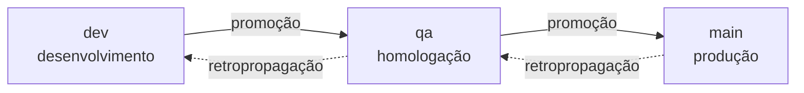

# 分支与版本策略 {#branch-and-versioning-policy}

本页是策略的**来源**。执行它的 workflow 都由此派生——如果某个机制与这里写的不一致，错的是
机制。

## 为什么要机械化 {#why-mechanize-it}

在会议上约定的分支策略只能活到第一个周五晚上。匆忙不是恶意：而是规则存在于人的脑子里，而
压力下的脑子会为短期优化。

因此这里的策略**不请求合作**——它由 CI 强制执行。不是出于不信任，而是因为依赖个人纪律的规则
在事故中活不下来，而恰恰是在事故中它最重要。

我们有意接受的两个后果：

- **PR 变得更官僚。** 分支名错了就让检查失败。这是代价。
- **错误消息必须能教人。** 只说"无效"的检查会训练人们绕过它。每个错误都引用规则、收到了
  什么以及正确的示例。

## 阶梯 {#the-ladder}

三个永久分支，**每个环境一个**。代码一次上一级。



| 分支 | 环境 | 在这里意味着什么 |
|---|---|---|
| `dev` | 开发 | 已集成，经 CI 测试 |
| `qa` | 预发布验收 | 正在进行功能验证 |
| `main` | 生产 | 正在线上运行的 |

曾经有第四级 `rc`（预生产），位于 `qa` 和 `main` 之间。它被移除了：只有一个维护者且周期很短，
多出来的一级要花一整次晋升和一个环境来区分"已验证"和"几乎就绪"——这个区分不划算。`qa` 成为
进入生产之前唯一的闸门。

这次移除花了一段时间才完全落地。`pr-police` 立即开始以三级运作，但 **Gitflow 的 bootstrap**
继续创建 `rc`、保护 `rc`，并向用户的仓库提交一份教授四级阶梯的 `branching-policy.md`——产品
向使用它的人记录了一个它自己早已放弃的策略。这是[第一轮 dogfooding](./primeiro-dogfooding.md)
的第 3 个发现，之后被关闭（[RN-029](../business-rules.md#rn-029)）。

有两个松散的端头被故意保留，原因各不相同：值 `create_rc_branch` 仍在数据库的 `bootstrap_step`
枚举中（已执行的 bootstrap 有带它的行），而 `rc` 仍在**受保护合并**的列表中——见
[permissions.md](../reference/permissions.md) 中的说明。

**任何一级都不能跳过。** `dev → main` 不存在，即使在紧急情况下也不存在——紧急情况有自己的路径
（`hotfix`，见下），它也遵守阶梯，只是从顶部开始。

## 分类法 {#taxonomy}

每个分支都是 `funcao/descritivo`，由 `^.{0,30}/\S{0,32}$` 验证——功能最多 30 个字符，描述最多
32 个，没有空格。

```
✅ feature/pr-police          ✅ bugfix/rate-limit-off-by-one
✅ hotfix/vaza-token          ✅ docs/politica-de-branches

❌ minha-branch               (sem função)
❌ ci/build-paralelo          (`ci` não está na lista; use `chore`)
❌ fix/algo                   (`fix` não está na lista; use `bugfix`)
```

仅有正则还不够：功能必须在**封闭列表**中。

### 谁从哪里诞生 {#whos-born-where}

| 功能 | 诞生于 | PR 指向 | 用于 |
|---|---|---|---|
| `breaking` | `dev` | `dev` | 不兼容的变更 |
| `feature` | `dev` | `dev` | 新功能 |
| `bugfix` | `dev` | `dev` | 普通修复 |
| `perf` | `dev` | `dev` | 性能 |
| `refactor` | `dev` | `dev` | 不改变行为的重构 |
| `chore` | `dev` | `dev` | 维护、工具、CI |
| `docs` | `dev` | `dev` | 文档 |
| `test` | `dev` | `dev` | 覆盖率 |
| `hotfix` | `main` | `main` | 生产事故 |

在**预发布验收**中发现的修复没有自己的前缀：它变成从 `dev` 出发的 `bugfix/` 并沿阶梯上升。曾经
有一个用于预生产的 `rcfix/`，它随 `rc` 级一起移除了——没有来源分支的前缀是个陷阱。

来源不是建议——它**通过 merge-base 验证**。从 `dev` 诞生的 `hotfix` 会带上 `dev` 中所有尚未
验证的东西；在事故中把这些匆忙推到生产，正是灾难发生的方式。

### 在高处诞生的修复会向下传播 {#a-fix-born-high-goes-back-down}

`hotfix` 直接进入问题出现的那一级。这让下面的级别**过时**——修复存在于 `main` 而不在 `dev`。

因此每个在高处诞生的修复都会产生一次**反向传播**：`main →
qa → dev`，链式地、按顺序。在它完成之前，受影响的级别保持锁定——见[反向传播闸门](#the-back-merge-gate)。

一个 hotfix 的完整链条是**三个 PR**：hotfix 加两次反向传播。

## PR 家族 {#pr-families}

每个 PR 都会自动获得一个家族标签：

| 家族 | 何时 | 示例 |
|---|---|---|
| `trabalho` | 一个工作功能 → `dev` | `feature/pr-police` → `dev` |
| `correcao-alta` | `hotfix` → `main` | `hotfix/vaza-token` → `main` |
| `promocao` | 相邻级别，向上 | `dev` → `qa` |
| `retropropagacao` | 相邻级别，向下 | `main` → `qa` |

标签不是装饰：正是它让人无需在 git 里考古就能回答"这个季度我们有多少次 hotfix？"。

<a id="push-direto-é-bloqueado"></a>

## 直接推送被阻止 {#direct-push-is-blocked}

三个永久分支都不接受直接推送。每个变更都通过 PR 进入。这是**唯一的门**——它恰好有三个例外，
全部来自机器人，全部写在这里，因为没有记录的例外会变成先例：

| 例外 | 谁 | 为什么 |
|---|---|---|
| tags `v*` | `brabo-release[bot]` | 版本诞生于 workflow，绝不手工 |
| `main` 中的 `.release/gate.json` | `brabo-release[bot]` | 闸门在锁定和解锁时需要写入自己 |
| `gh-pages` 分支 | `github-actions[bot]` | 按级别发布文档需要一棵可变的树（[ADR 0034](../adr/0034-documentacao-publicada-por-degrau.md)） |

**第三个是三者中最容易接受的，值得说明为什么，以免它为困难的那些开先例。** `gh-pages` **不是
代码分支**：其中没有任何东西是源，一切都由 `docs/` 和 `website/` 生成，把它整个删掉也不会丢失
任何东西——下一次推送会重建它。生成的网站不可能有审阅者，每次发布一个 PR 将是没有读者的仪式。
它的 `git log` 就是每次发布的记录，带有日期和来源 sha。

它也**不是永久的**，所以不在 rulesets 中——这就是 `GITHUB_TOKEN` 就足够、不需要 bypass 也不需要
`BRABO_BOT_TOKEN` 的原因。

第二个是三者中最让人不舒服的，所以值得说明为什么闸门存在而不是通过 PR：闸门会锁定分支，而
一个用于打开锁的 PR 会被闸门本身阻止。替代方案——把状态保存在仓库之外——会把一个在历史中可见
的例外换成某个面板上不可见的状态。机器人的提交留在 `git log` 中，带有日期和内容。

`tag-release` **按内容**识别这个提交（它只触碰 `.release/`），绝不按作者或消息：谁写了它是可以
验证的，谁*声称*写了它则不是。

确切的配置在 [Rulesets](../reference/rulesets.md) 中，应用它是手动步骤——仓库对来源做版本控制，
GitHub 接收应用。

## 已合并的分支会被归档 {#merged-branches-get-archived}

每个 PR 已被合并的分支会在**合并 7 天后**离开分支列表——机械地，由 `archive-merged-branch.yml`
完成，它每天运行一次（`schedule:`，加上 `workflow_dispatch`）并遍历仓库的所有分支（AT-557，
负责人 2026-10-15 的决定）。在那之前分支保持原地，以便后续修正仍能在它之上进行。只有当以下
各项都成立时，分支才会被归档：

- 它不是下面排除的名称之一，也不来自 fork；
- 没有以它为 head 的**打开**的 PR；
- 有一个以它为 head 的 PR 在本仓库中被**合并**，且最近的那个是 7 天或更久之前合并的
  （`DIAS_ATE_ARQUIVAR`）；
- 分支的尖端仍是该 PR 的 `head.sha`——合并后又收到提交的分支会**保留**。

从未有 PR 被合并的分支没有合并日期，**永远**不会被这个 job 归档；删除它仍是手动决定。job 的
摘要列出归档了什么、保留了什么（带原因）以及什么失败了；一个分支的失败不会阻止其他分支，并让
job 变红。

"归档"是字面意思，不是删除的委婉说法：分支从 `refs/heads/<nome>` 变为 `refs/archive/<nome>`，
这是一个 GitHub 界面不会作为分支显示的命名空间。提交对象及其历史完全照旧留在仓库中——知道这个
ref 的人可以恢复，用一条
`git push origin refs/archive/<name>:refs/heads/<name>` 就能把它带回来。

四个名称永远不会被归档，四者的原因相同：它们都不是可丢弃的功能工作。

| 名称 | 为什么被排除 |
|---|---|
| `dev`、`qa`、`main` | 三个永久分支——它们作为每个已合并的晋升 PR（`dev`→`qa`、`qa`→`main`）的 `head` 出现，这正是这个排除要捕获的情况 |
| `gh-pages` | 文档网站的部署分支（见上面"直接推送被阻止"）——不是功能分支，删除 `refs/heads/gh-pages` 会把线上网站一起拖垮 |

第五个条件不是名称，而是边界：head 分支位于 **fork** 中的 PR
（`head.repo.full_name != base.repo.full_name`）永远不会被触碰。workflow 的 `GITHUB_TOKEN` 的
范围是本仓库——它没有任何理由去改写别人仓库里的 ref。

决定本身——哪四个名称被排除，以及 fork 检查——是一个经过测试的纯函数
（[`scripts/ci/archive-branch.ts`](https://github.com/daneiel/brabo/blob/dev/scripts/ci/archive-branch.ts)），
而不是内联 shell：这是这个机制中出错真正值得测试的部分——7 天的资格也是（`aptaParaArquivar`，
同一文件）。然后同一个脚本调用 GitHub API：创建 `refs/archive/` ref（或在该名称之前已被归档时
强制更新它），读回它并确认它指向分支的 SHA，然后才删除 `refs/heads/`——这样一次失败永远不会在
没有留下归档副本的情况下拖垮一个分支。

## 机器人跳过阶梯 {#bots-skip-the-ladder}

由 `dependabot[bot]` 和 `github-actions[bot]` 打开的 PR **免于**名称、来源和目标的验证。

原因很实际：Dependabot 把分支命名为 `dependabot/npm_and_yarn/brace-expansion-5.0.8`，没有办法
教它分类法。拒绝它意味着每次安全警报都要手工重命名分支——恰恰在需要快速的流程上增加摩擦。

教学式的消息教不了机器人。豁免是按**作者**，不是按前缀，以免有人把一个分支命名为
`dependabot/` 来把它当作漏洞。

### Dependabot 的分支被允许，没有字符限制 {#dependabot-branches-are-allowed-with-no-character-limit}

除了机器人的通用豁免之外，策略还明确点名了 Dependabot 的分支：**`dependabot/…` 是允许的分支名，
没有字符标准**——没有 30/32 的限制，斜杠数量不限。本仓库中的真实名称：
`dependabot/npm_and_yarn/npm_and_yarn-582a9020a7`、
`dependabot/github_actions/dev/anthropics/claude-code-action-1.0.221`——后者作为工作分支会在
`funcao/descritivo` 格式上失败。

这是一条命名的规则（`scripts/ci/pr-police.ts` 中的 `PREFIXO_DO_DEPENDABOT` 和
`ehBranchDoDependabot`），只有在**两件**事都成立时才生效：head 以 `dependabot/` 开头，**并且**
作者是 Dependabot 本身（`dependabot[bot]`、`app/dependabot`，或带有 API 的 `type: Bot` 的
`dependabot`）。一个把分支命名为 `dependabot/…` 的人类仍要经过完整的规则，并在
`FUNCAO-DESCONHECIDA` 上失败，消息说明该前缀是保留的，而手工的依赖更新应该是 `chore/`。规则不
检查目标：把安全 PR 从 `main` 带到 `dev` 是 `dependabot-para-dev.yml` 的工作（下一节）。

## Dependabot 从 dev 进入 {#dependabot-enters-through-dev}

上面的豁免是关于分支的**名称**。**目标**不豁免：依赖更新与其他一切一样从 `dev` 进入，并通过
`dev → qa → main` 的晋升到达 `main`。直接合并到 `main` 的依赖会跳过阶梯，并让 `main` 与工作
发生的分支产生分歧。

两个机制，因为 GitHub 对两种更新的处理方式不同：

- **版本更新**遵循 `.github/dependabot.yml` 中的 `target-branch: dev`。
- **安全更新**在仓库界面中开启，GitHub 总是针对**默认**分支（`main`）打开它们，忽略
  `target-branch`。`.github/workflows/dependabot-para-dev.yml` 处理每个针对 `main` 打开的
  Dependabot PR，并做两件事之一，由一个经过测试的纯函数决定
  （[`scripts/ci/dependabot-para-dev.ts`](https://github.com/daneiel/brabo/blob/dev/scripts/ci/dependabot-para-dev.ts)）：
  - 当 `dev` 的 lockfile 已经把 PR 的每个依赖都只解析为 `>=` 阈值的版本时，带着理由**关闭**
    PR；
  - 在所有其他情况下把 PR **重定向**到 `dev`——低于阈值的版本、lockfile 中缺失的包、无法比较
    的版本、无法读取的正文。

**阈值**是该 lockfile 中该包的打开警报的第一个*已修复*版本，只有在没有警报时它才是 PR 的目标
版本。差异在 PR #553 中测得：它把 `@vitest/mocker` 升到 `5.0.0`，而 `dev` 解析的是 `4.1.11`，
正好是该警报的第一个已修复版本——Dependabot 提议的是**最新**版本，而不是修复问题的最小版本。
如果无法读取警报，比较回落到目标版本，它更严格：它只会更多地重定向，绝不会更多地关闭。
**有疑问时，PR 被重定向，绝不被关闭。**

workflow 在**推送到 `dev`** 时运行，这才是要紧的触发器。`pull_request_target` 和 `schedule`
只能看到默认分支的 workflow，而 `pull_request` 运行的是 Dependabot 从 `main` 创建的 head 与
`main` 合并后的 workflow——它们都看不到只存在于 `dev` 的文件，而 `main` 只沿阶梯前进（与在
`pr-police.yml` 中测得的是同一个陷阱）。推送到 `dev` 会运行 `dev` 的副本，因此那里的每次合并都会
扫描针对 `main` 的打开的 Dependabot PR。`workflow_dispatch` 避免等待下一次合并；当文件到达
`main` 时，`pull_request_target` 立即生效。

**在第一次执行中测得（2026-09-13）：** 用 workflow 的 `GITHUB_TOKEN` 读取警报**失败**了，因此
今天每个决定都回落到 PR 的目标版本。后果是安全的那种——一个 `dev` 已经修复的安全 PR，比如
#553，被**重定向**而不是关闭，关闭它仍是手动步骤。执行日志中的警告现在带有 API 的消息；用另一个
凭据读取警报是另一个决定。

**已声明：** 重定向之后，`dev` 的必需检查**不会**自行运行——`GITHUB_TOKEN` 创建的事件不会触发
workflow，Dependabot 也不接受来自这个机器人的命令。有写权限的人评论 `@dependabot rebase`；
workflow 的评论会在 PR 中说明这一点。

### 固定版本的更新自证合理 {#a-pin-bump-justifies-itself}

更新 action 的 Dependabot PR 会触及 workflow 文件，而文档漂移检查是按**文件**触发的：
`release.yml` 由规则 `politica-de-branches` 监视，级别为 `block`。当整个 diff 是 `uses:` 的 SHA
和旁边的版本注释时，这条规则没有什么可问的——PR #578 和 #580 是手工解锁的，由一个人类在正文中
写下 `docs-not-needed:`。

自 AT-094 起**机器人写这一行**，而且只在这一类 PR 上。`Drift, gerados e build` job
（`.github/workflows/docs-check.yml`）中的一个步骤，就在漂移检查之前，在漂移检查评估的同一区间上
调用
[`scripts/ci/dependabot-justifica-pin.ts`](https://github.com/daneiel/brabo/blob/dev/scripts/ci/dependabot-justifica-pin.ts)。
当**两件**事都成立时它写下这一行：

- **作者**是 Dependabot（`ehBranchDoDependabot`：前缀 `dependabot/` **和**应用的登录名——单独的
  前缀会是给人类的一扇门）；
- **diff** 只是固定版本的更换：每个文件都是 `.github/workflows/` 或 `.github/actions/` 下的 YAML，
  原地修改（绝不是新建、删除、重命名或改变模式），每个更改的行都是一个
  `uses: <action>@<sha>  # <version>`，与另一个**同一** action、**同一**缩进的行配对，只改变
  SHA 和/或版本标记。

其他任何东西——一个 job、一个触发器、一个 `with:`、一个 `package.json`、一个 lockfile、一个新的
workflow、一个人类作者——都不会写入任何东西：docmap 照常评判。这条规则永远不会变成"机器人的 PR
跳过 docmap"。这一行带有一个 HTML 标记（`<!-- dependabot-justifica-pin -->`），正是这个标记让它
**可逆**：如果之后的推送加入了不是固定版本的东西，机器人的这一行会被**删除**。人类写的
`docs-not-needed:` 永远不会被触碰，既不会被复制也不会被删除，而在 `edited` 中，步骤只在编辑者是
机器人本身时才评估，因此删掉机器人那一行的人类胜出。

自 AT-100 起这个 `edited` 的情况是明确的：`@dependabot rebase` 一次发出 `synchronize` **和**
`edited`，`concurrency` 取消其中一个，当幸存的是 `edited` 时，步骤被跳过，漂移检查读到的是没有
这一行的正文（#578，执行 `35412983999`/`35412984299`）。机器人自己的 `edited` 现在会评估；人类
的不会。

**为什么是漂移 job 中的一个步骤而不是兄弟 workflow**——三次测量：

- 用 `GITHUB_TOKEN` 编辑正文不会触发 `edited`，因此单独的 workflow 会写入这一行而让必需检查保持
  红色；
- 重新运行漂移 job 没有帮助：重新运行复用原始事件的**载荷**，带着旧的正文（执行 34898913072，
  第 2 次尝试，2026-09-17：正文已经有了这一行，`PR_BODY` 没有，漂移检查失败）；
- `pull_request_target`，在那里 token 无需询问即可写入，只运行**默认**分支的 workflow——在
  `pr-police.yml` 中测得的陷阱。

在同一个 job 中，漂移检查按顺序从 `PR_BODY_FILE` 读取新的正文，没有竞争，也没有重新触发。如果
编辑失败，不会写入任何文件，漂移检查读取事件的正文：fail-closed，PR 照旧被阻止。针对仓库历史上
每一个 Dependabot PR 测量：`github_actions` 的十个（#561–#565、#577–#581）是纯粹的固定版本更换；
`npm_and_yarn` 的那个（#553）不是。

## 谁来批准 {#who-approves}

审批要求有**两种模式**，由仓库变量 `APPROVAL_MODE` 选择。两者都已实现并测试；从一种切换到另一种
**只需改变量**，无需触碰代码。

### `solo` 模式——目前适用的 {#solo-mode--what-applies-today}

项目只有**一个维护者**。完整的审批者阶梯预设了尚不存在的团队，而一条无法遵守的规则是在教人
作弊。

| 情况 | 要求 |
|---|---|
| 第三方的 PR | **owner 的 1 次批准** |
| owner 编写的 PR | **无需审查**即通过检查 |

第二行不是特权，而是 GitHub 的工作方式：**没有人能通过界面批准自己的 PR**。在一个 BDFL 项目中，
**owner 的手动合并就是批准**——这是他深思熟虑的行为，在他选择点击按钮的那一刻。要求一个平台
不允许的审查只会产生一个永久红色的检查。

在这种模式下，**不同的人**这一要求被**暂停**，而且是有意暂停：只有一个维护者时，它在算术上是
不可能的。

### `community` 模式——有人的时候用 {#community-mode--for-when-there-are-people}

| 目标 | 要求 |
|---|---|
| `dev` | 1 × devs |
| `qa` | 2 × devs |
| `main` | 1 × PO **+** 1 × 管理层 |

对 `main` 来说，**不同的人**——这个要求重新生效。对 `dev` 和 `qa` 来说区分是自动的：席位属于
同一个角色，每个人只计一次审查。

角色是仓库变量中的**账号列表**，不是 GitHub 的团队：

```
APROVADORES_DEVS    = ana,bruno,carla
APROVADORES_PO      = paula
APROVADORES_GESTAO  = gustavo
```

团队本是显而易见的路径，但**在这里行不通**：它们只存在于组织内部，这个仓库属于一个用户，而
`GITHUB_TOKEN` 即使在组织内部也无法读取团队成员关系——那需要一个带 `read:org` 的 PAT。用列表，
`community` 模式今天就可以启用，切换确实只是一个变量。

诚实的代价：保持列表更新是手工工作，离开项目的人在有人编辑变量之前会继续能够批准。如果项目
变成一个有真正团队的组织，更换来源只是改一个函数——阶梯和不同的人这条规则都不会变。

#### 为什么"不同的人"需要的不只是计数 {#why-distinct-people-needs-more-than-counting}

对 `main` 来说，如果检查只是按角色计算批准数，同时在**两个列表**（`po` 和 `gestao`）中的人可以
独自填满两个席位。检查把它当作一个**分配**问题：是否存在一种由不同审批者填满所有席位的分配？

这也避免了相反的错误。如果 `paula` 是 `po` 中唯一的人但也在 `gestao` 中，把 `gestao` 的席位给她
会让 `po` 无人覆盖——即使另一个人本可以填上它。正确的分配是存在的，检查会找到它。

### 两种模式共同的规则 {#rules-common-to-both-modes}

- 只计入**最后一个提交上的 `APPROVED`** 审查。对旧提交的批准不算：被批准的不是要被合并的。
- 检查的摘要显示**当前模式、谁批准了以及还缺什么**。只说"缺少批准"的检查会迫使人去猜。

### 迁移到 `community` 模式 {#migrating-to-community-mode}

在翻转任何变量之前的前提条件：

1. **每个角色都有真人。** `main` 需要 PO **和**管理层；如果两个列表指向同一个人，任何指向
   `main` 的 PR 都永远不会通过——不同的人这条规则无法满足。`qa` 需要**两个**不同的 dev：只有
   一个名字的列表会阻止晋升。
2. **一个关于谁进入每个列表的标准**，经过定义并写下来——谁进入、谁离开，以及依据什么。

切换步骤：

```bash
gh variable set APROVADORES_DEVS   --body "ana,bruno,carla"
gh variable set APROVADORES_PO     --body "paula"
gh variable set APROVADORES_GESTAO --body "gustavo"

# last: with empty lists, community rejects everything
gh variable set APPROVAL_MODE --body community
```

顺序很重要。在 `APPROVAL_MODE=community` 而列表仍为空时，每个 PR 都会变红并说明缺哪个变量——
正确，但不必要地嘈杂。先把它们填好。

要切换回来：`gh variable set APPROVAL_MODE --body solo`。

**无需部署、无需合并、无需改代码**——切换只是配置，并且有一个测试把同样的输入分别经过两种模式，
断言不同的裁决。

关于谁进入每个列表的标准——谁进入、谁离开，以及依据什么——在仓库根目录的 `GOVERNANCE.md` 中。
本节仍然是**机制**的来源（阶梯、不同的人的要求、切换步骤）；`GOVERNANCE.md` 是谁填补每个角色的
**标准**的来源。

## 晋升 {#promotion}

代码通过一个**晋升 PR** 上升一级，由 workflow `promote`（`workflow_dispatch`，输入：流水线的一对
分支）打开。

workflow **不合并任何东西**——它计算并打开 PR。合并仍是手动行为，与进入永久分支的每一项一样。

| 步骤 | 内容 |
|---|---|
| 1 | **谁触发**——在 `APPROVAL_MODE=solo` 下，只有
`OWNER_HANDLE`。任何其他执行者都失败，并说明谁可以 |
| 2 | **相邻的一对**——`dev→qa` 和 `qa→main`。`dev→main` 被拒绝，
并指向分级的路径 |
| 3 | **周期的版本**——根据自上一个最终 tag 以来合并的 PR
计算 |
| 4 | **打开的 PR**——正文列出每个 PR、它的功能、它的影响以及
提议的版本 |

第 4 步的正文是一张 **markdown 表格**，而 PR 的标题是没有人能控制的文本——因此它在变成表格单元格
之前会被转义（`celulaDeTabela`，在 `scripts/ci/promote.ts` 中）。转义 `|` 还不够——反斜杠必须
**先**转义，否则一个在 `|` 之前以 `\` 结尾的标题会产生 `\\|`，GFM 把它读作一个被转义的反斜杠后跟
一个列**分隔符**——这一行多出一个单元格，表格就坏了。这就是两次替换的顺序是结构性的原因，而
`promote.spec.ts` 中的测试计算的是该行**真实**的分隔符，而不是比较整个字符串。

### 自动晋升到 qa（测试阶段） {#automatic-promotion-to-qa}

在 QA 处于**测试阶段**期间，`dev` → `qa` 会自行晋升（ADR 0217，负责人 10月15日的决定）。开关是
仓库变量 **`QA_FASE_DE_TESTE`**（Settings → Variables）：`true` 开启；删除它或任何其他值则关闭，
晋升回到上面的手动 workflow `promote`。

开启时，每次推送到 `dev` 都会运行 `promote-auto-qa.yml`：同样的版本计算（`promote.ts`）和同样的
打开步骤（`scripts/ci/abrir-pr-de-promocao.sh`）通过 `BRABO_BOT_TOKEN` 打开或更新 `dev` → `qa`
的 PR。然后，`scripts/ci/promocao-automatica.ts` 等待 PR head 上的**每个** check run 都结束——
仓库没有必需检查，所以 `--auto` 不会等待——并且只有在没有任何一个以 `failure`、`cancelled` 或
`timed_out`（以及其他）结束时才用 merge commit 合并。任何失败都会停止晋升，job 的摘要会点名该
检查及其链接。没有 `BRABO_BOT_TOKEN` 时 job 会明显地失败。一个周期中没有任何新东西的推送（一次
晋升合并、一次反向传播、`dev` 已经与 `qa` 相同）是正常结果，不是失败：摘要中出现一个
`::notice::` 和 "nada a promover: o ciclo está vazio"，退出码 0，没有 PR。在手动 `promote` 中，
空周期仍然失败。

审批阶梯**只**对这个 PR 免除 owner 的批准：`dev` → `qa` 这一对、变量已开启，且作者等于
`BRABO_BOT_TOKEN` 的用户（用 `gh api user` 解析）。`qa` → `main` 以及其他每一对仍需要批准。

> **测试阶段：QA 在每次合并到 dev 时自动晋升，尚未被视为经过验证的环境。** 网站 `/brabo/qa/`
> 在公告栏中显示这一点，自动 PR 的正文以这句话开头。每次自动晋升还会产生一个 `-qa.N` tag 并
> 重新发布 `/brabo/qa/`。

### 晋升检查 {#the-promotion-check}

晋升 PR 要经过一个自己的检查，与 `pr-police` 分开。前者验证**形式**（名称、来源、目标）；这个验证
**状态**：

| 验证 | 为什么 |
|---|---|
| **干净的区间** | PR 的 head 是来源分支的尖端。如果
有人在 PR 打开之后推送了东西，将被晋升的
就不是那里的东西 |
| **上一级已盖章** | 该提交带有下一阶段的 tag。
没有它就晋升，是在晋升一个从未经过
那里的东西 |
| **可以做 merge commit** | 晋升是 `--no-ff`。squash
会把下一级的提交压平，阶段的 tag 最终
会指向一个不再存在的提交 |

一个**无法执行**的验证算作失败，绝不算作通过——无法解析的 ref 是无知，不是许可。

前两项验证由 `scripts/ci/promotion-check.spec.ts` 覆盖，与 `pr-police` 和 `approval-ladder` 的
spec 精神相同。它固定的不是实现而是规则：每个目标要求哪个印章，以及印章必须是**那个提交的**——
另一个提交上的、另一个阶段的、或无法解析为 sha 的 tag 都不算。接受其中任何一个都会让 `qa` 接收
从未经过 `dev` 的代码。

例外是读取**合并配置**：workflow 的 token 合理地没有读取它的权限，而因此阻止每一次晋升会比想要
避免的失败更糟。在那里，不可能变成**警告**，真正的保证位于 `tag-release`：合并之后，它确认提交有
**两个父提交**。这不依赖任何权限，看的是既成事实而不是声明的意图。

## 版本 {#versioning}

每个 tag 都诞生于 workflow，格式为 `vX.Y.Z-dev.N` / `-qa.N` / 最终。

**版本存在于 TAG 中，而不是文件中。** 没有人能直接提交到永久分支来提升 `package.json`，因此要求
四个版本文件跟随会在每个周期强制一个 bump PR——这正是自动计算要消除的仪式。`release.yml` 把这些
文件作为**警告**核对，并且只在最终 tag 时触发。

### 最终 tag 产生什么 {#what-the-final-tag-produces}

`release.yml` 是流水线的终点，它交付的东西是刻意朴素的：

| 交付物 | 内容 |
|---|---|
| GitHub Release | 带有由
`scripts/changelog.mjs` 从 CHANGELOG 生成的说明 |
| 版本核对 | 四个版本化的文件，作为**警告** |
| 五个生产镜像 | 构建以证明该 tag **可构建**——第五个，容器 broker，自 [ADR 0162](../adr/0162-broker-publicado-e-oferecido-pelo-instalador.md) 起 |
| 写入其中三个的版本 | 作为 `ARG` 写入 api、
web 和 broker——见下文 |
| **对五个已发布镜像的 Trivy** | **按 digest**，从 registry，在签名**之前**——有修复的 HIGH/CRITICAL 会让发布失败；没有修复的在 job 摘要中报告，并作为 Release 的资产 `trivy-sem-correcao.md`（[ADR 0172](../adr/0172-trivy-no-release-antes-de-assinar.md)） |
| **五个镜像的签名** | `cosign` keyless，**按 digest**，
在同一次执行中签名然后验证
（[ADR 0149](../adr/0149-assinatura-dos-artefatos-publicados.md)） |

最后一行是最终 tag 在 FASE 29 中获得的，值得精确说明**为什么按 digest**：对 `:5.0.0` 签名只会
证明签名那一刻 tag 所指向的东西，而 tag 是一个可移动的指针。digest 是 `.release/images.json` 已经
记录、生产 overlay 已经应用的东西。

扫描在签名**之前**，顺序就是规则：Trivy 拒绝的镜像永远不会被签名，因此安装器永远不会拿到它。它使用
与 `ci.yml` 扫描完全相同的标志和 `.trivyignore.yaml`，因为一个 tag 发布的镜像是另一次执行的冷
构建——不是 PR 扫描过的那个。扫描运行时推送已经发生（正是推送创建了 digest），因此一个失败的 tag
会在 GHCR 中留下未签名的镜像，而没有 Release；`scripts/ci/trivy-do-release.spec.ts` 守护顺序和
标志，因为没有任何 PR 会运行这个 workflow。

签名在**同一次执行中、在 Release 存在之前被验证**。一个没有人尝试验证的签名只是 registry 中的又
一个文件，否则失败会出现在安装者的机器上——发现它的最糟糕的地方。

runner 的二进制随后在 `build-runner-binaries.yml` 中到来，用**一个**已签名的 `checksums.txt`
覆盖四个目标，而不是每个二进制一个签名：验证三个而忘了第四个是没人注意得到的失败模式，单一清单
消除了它。

#### 版本存在于 tag 中，而 release 是把它带到工件的东西 {#the-version-lives-in-the-tag-and-the-release-is-what-carries-it-to-the-artifact}

tag 是版本的来源，但镜像无法读取自己的 tag：容器不知道自己以什么名字发布，而 tag 可以移动。因此
`release.yml` **把版本传给构建**——它是仓库中唯一这样做的地方。

`VERSION` 是 `docker-bake.hcl` 的一个变量，与 `TAG` 分开，默认值为 `dev`。目标 `api` 和 `broker`
把它转换为 `BRABO_VERSION`，目标 `web` 转换为 `VITE_BRABO_VERSION`；每个 `Dockerfile.prod` 都把它
声明为带同样默认值的 `ARG`。从那里它到达 api 的 span 的 `service.version`，以及 web 中认证界面的
页脚（[ADR 0036](../adr/0036-telas-de-auth-fieis-ao-design-e-fontes-auto-hospedadas.md)）。

两个后果，两者都是有意的：

- **只有 release 盖上版本。** `ci.yml` 以 `TAG=prod` 使用同一个 bakefile 且不定义 `VERSION`，
  因此它的镜像报告 `dev`。如果版本来自 `TAG`，每个 CI span 都会带着 `service.version=prod`，而
  它不是任何东西的版本。
- **版本不是配置。** 它是构建的 `ARG`，不是 ConfigMap 的键，因为它是工件的属性：
  `brabo-web:1.1.2` 不应该能报告别的东西。URL 仍在运行时通过 `/config.js` 配置，因为它们是环境的
  属性（ADR 0024）。

改动这条链就是改动策略：在 bakefile 或 `ARG` 中改 `VERSION` 的人需要同时改两边，否则版本会悄悄
回到 `dev`——任何地方都没有错误，因为 `dev` 是一个有效值。

**镜像没有发布**——`push: false`。发布到 registry 尚未决定（生产 overlay 指向 `ghcr.io/OWNER/*`，
一个标记），决定记录在 [ADR 0027](../adr/0027-fase5-backup-hardening-release.md) 中。构建而不发布
不是半吊子措施：它阻止了为一个无法编译的提交存在 tag。

它们由 `ci.yml` 使用的同一个 `docker-bake.hcl` 并行构建。以前是四个顺序的 `docker build`——同样
的裁决，每次发布多约 160 秒。

**这里没有部署步骤，任何地方都没有。** tag 是每个环境中**本应**有什么的记录，即使没有环境这也
成立。一个从不运行的步骤会腐烂：没有人测试它，没有人注意到它坏了，等到它被打开的那天它就是错的。
等有了环境，部署将是一个**独立**的 workflow，由 tag 触发。

#### Release 依赖 PAT，而缺少它已经让六个 Release 落空 {#the-release-depends-on-the-pat-and-its-absence-has-already-cost-six}

`release.yml` 在推送最终 tag 时触发。但**用 `GITHUB_TOKEN` 推送的 tag 不会触发 workflow**——这是
GitHub 的反递归规则。`tag-release` 使用 `secrets.BRABO_BOT_TOKEN || github.token`：没有 PAT，tag
会诞生而 Release 不会出来。

这种降级是故意可见的（每次执行都有警告），但可见不等于被避免：**`v0.2.0`、`v0.3.0`、`v0.3.1`、
`v1.0.0`、`v1.0.1` 和 `v1.1.0` 存在却没有 Release**——整整六个周期，警告出现了却没有人行动。

配置了 PAT 后，`v1.1.1` 自己闭合了流水线：由 token 推送的 tag，由它触发的 `release.yml`，发布的
Release。在它之前，只有 `v0.1.0` 有 Release，而且是通过手动推送。**PAT 无法挽回之前的六个**——它
只对新 tag 有效。

这把两个容易混淆的问题分开：

| 问题 | 修正 |
|---|---|
| Release 不会**自己**出来 | 配置
`BRABO_BOT_TOKEN` |
| 一个没出来的 Release **之后也出不来** |
`release.yml` 的 `workflow_dispatch` |

即使 PAT 就位，第二个问题仍会存在：任何 workflow 失败都会让 tag 永远成为孤儿，因为重新发布需要删除
并重建 tag——为了修正其效果而改写记录。重新发布的是 release 的负责人，与 `promote` 的限制相同。
步骤在 [Rulesets](../reference/rulesets.md#republishing-a-tag-that-was-orphaned) 中。

### CHANGELOG 通过 PR 回来，以及为什么不是推送 {#the-changelog-comes-back-via-pr-and-why-not-by-push}

Release 发布后，`release.yml` 向 **`dev`** 打开一个 PR `chore/changelog-<tag>`，带有 `CHANGELOG.md`
中版本的切分——并且在同一个提交中，带有写入版本的**两个**文件中以散文宣布的版本：`README.md` 和
`docs/intro.md`，即已发布网站的第一页。改写两者的是 `scripts/ci/readme-version.ts`，它在写入任何
一个之前先读取并替换全部：任何一个中缺少句子都会让整个发布失败，而不是让它只写了一半。

**切分会消耗 `## Unreleased` 小节**，而不是叠加在它上面。这个区别不是装饰性的：写在每个 PR 的
`Unreleased` 块中的散文是对改动的*解释*，而有五个版本它从未到达发布的版本——`changelog.mjs` 把
生成的小节加在顶部，把手写的永远埋在下面。合并按小节标题进行，**手写**的条目在前（它们解释），提交
清单在后（它证明进入了什么）。

这三样东西故意一起移动。版本是**可生成的**（release 知道它是什么），`docs:check` 在每个文件中核对
它与 CHANGELOG 最新的切分一致；把两端分开会让每个 changelog PR 生来就是红的，由机器人打开，等待
一只策略没有预见的人类之手。找不到的句子会让这一步**失败**而不是放过——这个脚本的正则和
`scripts/docs/generate.mjs` 的正则是同一个契约的两面，一个测试守护着这个约定。

通过 PR 而不是推送，因为直接路径都不存在：`main` 只接受 tag（release 机器人）和
`.release/gate.json`（闸门机器人），而在晋升之前提交到 `qa` 或 `dev` 会破坏晋升检查的**干净
区间**——PR 的 head 将不再是来源的尖端。

**接受的后果：** `main` 的 `CHANGELOG.md` 落后一个周期。这不是信息丢失：说明的权威来源是
**GitHub Release**，与 tag 在同一时刻发布，切分像其他任何变更一样在下一个周期到达。

### `.release/images.json` 搭乘同一个 PR——且不增加例外 {#releaseimagesjson-rides-the-same-pr--and-adds-no-exception}

自 [ADR 0119](../adr/0119-imagens-publicadas-no-ghcr-por-digest.md) 起，`release.yml` 把生产镜像
发布到 GHCR——自 [ADR 0162](../adr/0162-broker-publicado-e-oferecido-pelo-instalador.md) 起为五个——
并把该 tag 发布了什么**按 digest** 记录在 `.release/images.json` 中。安装器从那里读取五个；
Kubernetes 的 overlay 应用它的基础声明的四个（按决定，没有 broker 的 Deployment）。

显而易见的实现——机器人把 digest 写入 `deploy/k8s/overlays/prod/kustomization.yaml` 并推送——
在 ADR 中被拒绝之前，就已经在**这里**、在这个策略中被拒绝了：唯一的门恰好有三个例外，一个每次增长
都需要第四个例外的机制就不再是策略，而成了习惯。它还会让一个 tag 自己决定生产中运行什么，而这个
决定不属于 tag。

所以这个文件走已经存在的两条路径。它是 **GitHub Release 的资产**，与说明在同一步骤中发布——权威
副本，在 tag 存在的那一刻就可用——并通过 `git add` 进入上面描述的**同一个 PR
`chore/changelog-<tag>`**，这就是版本化副本到达 `dev` 并像其他任何变更一样沿阶梯上升的方式。与
CHANGELOG 相同的接受后果，原因相同：`main` 的副本落后一个周期，在此期间 Release 的资产是可信的。

> 在此之前，**从来没有任何东西写入这个文件**。生成器只以 `--stdout` 调用，用来组装 Release 的
> 正文，而 `CHANGELOG.md` 在单一个 "Unreleased" 中积累了十二个版本——同时有六个 Release 以空
> 正文发布，因为"上一个 tag"包含了该版本自己的预发布。

### 周期的版本 {#the-cycles-version}

来自自上一个最终 tag 以来合并的 PR 中的**最大影响**：

| 分支的功能 | 影响 |
|---|---|
| `breaking/` | MAJOR |
| `feature/` | MINOR |
| 其余所有 | PATCH |

十个 `docs` 中的一个 `breaking` 就让整个周期成为 MAJOR。而决定的是**分支的功能**，不是家族标签：
`breaking/x` 和 `docs/y` 都在 `trabalho` 家族中。

#### `breaking/` 要求提交上有标记 {#breaking-requires-the-marker-on-the-commit}

`pr-police` 拒绝提交没有标记破坏的 `breaking/` PR——主题中的 `!`（`feat(api)!: …`）或正文中的
`BREAKING CHANGE:`——也拒绝相反的情况：不是 `breaking/` 的分支上有被标记的提交。

这条规则存在，是因为对同一个事实有**两个机制**，而它们原本是分开的：版本来自分支的**功能**（上表），
而 CHANGELOG 通过提交的**标记**检测破坏。没有任何东西把它们联系起来。

代价已经测得。`breaking/fase-7-auth-e-openapi` 移除了 Keycloak，让所有人都登出，并正确地升了
MAJOR——而 CHANGELOG 没有记录任何破坏，在十二个版本中的**任何一个**中都没有，因为历史中从来没有
任何提交使用过这些标记。两半都能工作；信息只是从来没有从一边传到另一边。

两个方向都重要，而第二个更糟：

| 情况 | 曾经发生什么 |
|---|---|
| 没有标记的 `breaking/` | 版本跳到 MAJOR 而
changelog 不说什么坏了 |
| `breaking/` 之外的标记 | changelog 宣布破坏而
版本是 PATCH——信任这个数字的人会在没有
警告的情况下出问题 |

一个无法执行的验证（浅检出、未获取的 ref）**不会失败**：规则只在 `base..head` 区间可读时运行，与
污染检查是同一教义。

一个**空**周期——自上一个最终版本以来没有 PR——会带着消息失败，而不是生成 tag。指向与上一个相同
提交的新 tag 会让版本历史撒谎。

#### 周期的 PR 从哪里来 {#where-the-cycles-prs-come-from}

来自上一个最终 tag 与 `dev` 之间的 `git log`，读取提交主题中的 PR 编号。**两种合并方式**都需要被
理解，因为编号落在不同的位置：

| 方式 | 主题 |
|---|---|
| squash | `feat(ci): faz coisa (#53)` |
| merge commit | `Merge pull request #56 from daneiel/feature/x` |

只读第一种曾是一个真实的 bug：区间的 `--no-merges` 恰好隐藏了 merge commit 中引用编号的那一行，
整个周期看起来是空的——把 #56 合并到 `dev` 没有生成任何 tag。

**晋升和反向传播不计入。** 它们诞生于永久分支，它们携带的东西已经被计入或已经被发布。没有这个
排除，单单一次 hotfix 的反向传播就会生成一个完整的新周期：在一个什么都没变的版本上出现一个
`-dev.N` tag。

有两个部件做这个发现，并且**必须一致**：`tag-release`，在合并时盖章；以及 `promote`，计算晋升 PR
的版本。如果它们分歧，晋升 PR 宣布一个版本而 tag 带着另一个出来。两者使用同一个函数——逻辑的
重复已经让一次晋升被拒为"空周期"，就在 `tag-release` 刚盖上 `-dev.2` 之后。

> **`promote` 用**默认**分支的代码运行。** 它是 `workflow_dispatch`（见
> [Rulesets](../reference/rulesets.md) 中的触发器表），因此在 `dev` 中修正计算**不会**修正触发，
> 直到修正到达 `main`。在那之前，变通办法是已有文档的那个：用同一个脚本手动运行
> `node scripts/ci/promote.ts`。

### `N` {#the-n}

`N` 是该版本在该阶段已存在的 tag 数量加一。

任何地方都不保存状态：**tag 本身就是计数器**。这就是"晋升、被拒、修正、再晋升"变成 `-qa.2` 而
无需任何人记录拒绝的原因——而这个数字最终说明了周期在通过之前转了多少圈。

### 最终 tag 的锚点 {#the-final-tags-anchor}

只有当 `main` 中的东西**恰好**是经过 `qa` 的东西时，最终 tag 才会诞生。如果不是，workflow 会
大声失败而不是发布。

由于晋升是 `--no-ff`，合并**创建一个新提交**——`main` 的 sha 永远不会是 `qa` 的 sha。比较 sha 会
是一个不可能通过的验证。比较的是两件事，合在一起它们更强：

| 验证 | 保证什么 |
|---|---|
| `-qa.N` 是 `main` 上提交的**父提交** | 进入的是
那一个，而不是某个祖先 |
| **树**完全相同 | 内容逐字节就是被
验证的东西 |

第二个才是真正要紧的。如果合并的另一边带来了一个文件，树就会改变，验证就会失败——这正是锚点要
捕获的情况。树相等比提交相等更强：它看的是内容，而不是身份。

### `main` 的两条路径 {#mains-two-paths}

`main` 以两种方式接收合并，它们需要不同的版本。区分来自 merge commit 的**第二个父提交**——进入的
那一边：

| 第二个父提交 | 路径 | 版本 |
|---|---|---|
| 一个 `-qa.N` 的提交 | 晋升 | 周期的版本，**带锚点** |
| 其他任何东西 | hotfix | 上一个最终版本 **+ PATCH**，无锚点 |

hotfix 诞生于 `main` 并且从不经过 `qa`。要求它有锚点就是要求不可能的事——而 PATCH tag 必须诞生，
因为反向传播 PR 引用的正是它。

一个 `-dev.N` 作为第二个父提交**不**算作晋升：从 `dev` 直接合并到 `main` 跳过了 `qa`，最终 tag
会给没人验证过的代码盖章。

大声失败而不是去猜的情况：

| 情况 | 为什么 |
|---|---|
| `main` 上只有一个父提交的合并 | squash 抹去了
进入的那一边；没有它就无法确定路径 |
| 还没有已发布最终 tag 的 hotfix | PATCH 是在
已发布的东西上的增量 |

以及两个**不生成任何 tag** 的情况，有意为之：闸门的提交（只触碰 `.release/`）和 `main → qa`/`dev`
的反向传播，它携带的内容已经在 `main` 中。没有第二个出口，反向传播会在一个从未从 `dev` 晋升的
提交上盖一个 `-qa.N`——一个说"这经过了 qa"的 tag 打在一个没有经过的东西上。

### 没有部署 {#theres-no-deploy}

workflow **在 tag 处结束**。没有环境，没有 GitHub Environments，没有部署步骤——连一个关闭的都
没有。tag 是每个阶段中*本应*有什么的记录，它自己就站得住。

一个从不运行的部署步骤是一个会腐烂的步骤：没有人测试它，没有人注意到它坏了，等到它被打开的那天
它就是错的。等有了环境，部署将是一个独立的 workflow，**由 tag** 触发。

要亲眼看看一个 tag 盖了什么章：

```bash
make deploy-local TAG=v0.2.0-qa.1
```

### 流水线合并上的 squash，以及有收件人的警报 {#squash-on-a-conveyor-merge-and-the-alarm-that-has-an-addressee}

晋升是 `--no-ff`，而这是被破坏最多的规则：**三次**（#367、#394、#464）。它值得一个独立的小节，
因为损害在发生的那一刻是不可见的，只在一个周期之后才显现。

squash 产生一个只有**一个父提交**的提交。在晋升中，第二个父提交是把两个级别绑在一起的唯一东西：
没有它，`qa` 的历史不
再包含 `dev` 的提交，阶段的 tag 指向一个已不在该历史中的提交，而且——人们实际遇到的症状——**下一个
晋升 PR 打开时带着处于"冲突"中的文件，而那根本不是冲突**，只是丢失的祖先关系。通过选择任一边来
合并这种"冲突"，正是内容在级别之间悄悄分歧的方式。

**在哪里强制执行，以及为什么不能更早。** 合并方法是在点击时选择的，在 PR 的每个检查都已运行之后。
没有任何合并前的检查能观察到它：`promotion-check` 最多读取仓库的*配置*，而且常常连这个权限都
没有。起作用的验证看的是既成事实，在 `tag-release` 中（`conferirMergeDeEsteira`，
`scripts/ci/version.ts`），而规则因分支而异，因为基础比率不同：

| 分支 | 进入什么 | 规则 |
|---|---|---|
| `qa`、`main` | 只有流水线流量 | 只有一个父提交总是缺陷 |
| `dev` | 工作，整天，**有意**用 squash | 只有当 PR 带来一条**新边**时才是缺陷——它的 head 是一个合并，其第二个父提交还不在基础中 |

`dev` 的这个区分故意很窄。一个在合并前把 `dev` 拉入自身的工作 PR 也以一个合并作为 head——但它的
第二个父提交已经在基础中，所以 squash 不会丢失任何东西。不能被 squash 的 PR 是那种*整个交付就是
这条边*的，比如 #464：它的存在只是为了恢复祖先关系，被 squash 了，结果看起来已合并却什么都没交付。
一个在每个工作 PR 上都触发的警报会是一个没人读的警报，这正是本节要避免的失败模式。

**检测从来不是缺口——收件人才是。** `qa` 的检查自 2026-07-27 起就存在，并在 #367 和 #394 上都
正确地触发了。什么都没有因此发生：一个由 `push` 触发、在永久分支上失败的 workflow 没有可以变红的
PR——合并已经发生了——所以它在 Actions 标签页留下一次红色的执行，仅此而已。仓库在整个历史中都没有
issue；没有渠道。因此 `tag-release` 现在有一个 `avisar` job，它**打开一个 issue**，点名分支、提交、
执行和修正方法，并在已有的 issue 上评论，而不是为同一个分支打开第二个。它用 `github.token` 认证，
绝不用 PAT——一个无效的 `BRABO_BOT_TOKEN` 本身就是它必须报告的故障之一，而一个依赖可能已坏掉之物
的警报，恰恰会在需要时沉默。

**事后修正。** 两边的内容都已经正确；缺少的是图中的一条边。一个使用 `ours` 策略的合并可以在不改
一行的情况下恢复它：

```bash
git checkout -b chore/reconciliar-<algo> origin/dev
git merge -s ours origin/qa -m "chore: reconcilia ancestralidade"
```

而这个 PR **也**必须作为 merge commit 进入。squash 它在数学上保证行不通：修正*就是*第二个父提交。
#464 正是这样失败的。

## 反向传播闸门 {#the-back-merge-gate}

`hotfix` 解决了事故，又制造了一个新问题：修正在 `main` 中，而不在 `qa` 或 `dev` 中。如果有人在
修正向下传播之前晋升 `dev → qa → main`，发布就会**撤销 hotfix**——没有冲突，没有警告，几个月后，
而且没有人会把 bug 联系回那次合并。

闸门通过锁定下面的级别直到修正向下传播来封住这个漏洞。

### 状态 {#the-state}

闸门位于 `main` 上的 `.release/gate.json`：

```json
{
  "versao": 1,
  "locked": ["qa", "dev"],
  "awaiting": "v0.2.1",
  "order": ["qa", "dev"],
  "historico": [
    { "tag": "v0.2.1", "sha": "…", "em": "…", "prs": { "qa": 60, "dev": 61 } }
  ]
}
```

| 字段 | 内容 |
|---|---|
| `locked` | 不接受任何合并的分支 |
| `awaiting` | 最近一次 hotfix 的 tag——干净时为 `null` |
| `order` | 锁解除的顺序：总是从上到下 |
| `historico` | 这一轮的每个 hotfix；链条闭合时清零 |

它**总是从 `main`** 读取，绝不从 PR 的分支读取：反向传播 PR 带着文件的一份副本，读取这份副本会
恰好在链条每次合并都改变它的期间给出旧状态。

### hotfix 被合并时会发生什么 {#what-happens-when-a-hotfix-merges}

全部在同一个 workflow（`tag-release`）中，按此顺序——顺序很重要，因为 PR 需要引用 tag：

1. **PATCH** tag 正常诞生（`v0.2.0` + hotfix → `v0.2.1`）；
2. 打开**两个反向传播 PR**：`main → qa` 和 `main → dev`；
3. `.release/gate.json` 被写入 `main`，锁定 `qa` 和 `dev`。

### 累积是免费的 {#accumulation-comes-free}

闸门活跃期间的第二次 hotfix **不会打开新的 PR，也不会创建并行队列**。`main → qa` 和 `main → dev`
的 PR 已经打开，并携带 `main` 中的一切——包括新的 hotfix。闸门只是在 `historico` 中追加条目并重申
锁定。一个已经解锁的分支会**再次锁定**，因为现在有新的内容需要向下传播。

### 检查，在每个 PR 上 {#the-check-on-every-pr}

| 情况 | 裁决 |
|---|---|
| `locked` 为空 | ✓ 通过 |
| `main` → 仍被锁定的第一级 | ✓ 是那一级的反向传播 |
| `main` → 顺序不对的级别 | ✗ "destrave `qa` antes de `dev`" |
| 任何指向被锁定分支的 PR | ✗ 带着解决它的
PR 的链接 |
| `hotfix/` → `main` | ✓ `main` 永远不会被锁定 |

闸门活跃期间指向 `dev` 的 `bugfix/` 会被**阻止**。诱惑是认为"这是修复，所以应该通过"：不行。它
诞生于 `dev`，不携带 hotfix，不解决锁定，只是在漏洞之上堆更多的工作。

### 顺序不是官僚主义 {#the-order-isnt-bureaucracy}

在 `qa` 之前解锁 `dev` 会让中间那一级没有修正——这正是闸门要封住的漏洞。最后一次解锁会清空
`awaiting` 并清零历史。

### 锁定是被核对的，而不只是被声明的 {#the-lock-is-checked-not-just-declared}

`locked` 是**意图的记录**；真相是包含关系。在评估之前，检查会询问 git hotfix 的提交是否**已经**在
每个被锁定的分支中，并丢弃现实已经满足的锁。

这不是吹毛求疵：它是对一个真实陷阱的修正。反向传播 PR 把 `gate.json` 带到 `qa` 和 `dev`；几个月
后，一次 `qa → main` 的晋升可能把这份旧副本带回上面。没有核对，一个幽灵锁会在 `main` 上重新出现，
而背后没有任何 hotfix——也没有任何东西能解锁它，因为没有待处理的反向传播。仓库将永远被卡住。

**核对失败会保持锁定。** 未知不是许可。

## 策略不解决的问题 {#what-the-policy-doesnt-solve}

**它不阻止坏代码。** 它保证代码经过了各级，而不是保证代码是好的。那是审查、测试以及 QA/SecOps 的
gates 的工作。

**它不取代事故期间的判断。** 它提供一条快速而安全的路径（`hotfix`），使没有人需要在"遵守规则"和
"立即修正"之间选择。如果策略在事故期间碍事，问题在策略——事后开一个 issue，不要在期间作弊。

## 角色 {#roles}

在 `APPROVAL_MODE=solo` 期间，下面两个角色由 **owner** 担任。这不是疏忽造成的集中——这是一种写下来
而不是保持隐含的承认：一个只有一个维护者的项目没有人可以委派。

| 角色 | 谁 | 做什么 |
|---|---|---|
| **release 负责人** | owner | 唯一被授权触发
`promote` 的人 |
| **hotfix 值班** | owner | 在事故期间批准合并到
`main` |

这两项指派**在迁移到 `community` 时重新开放**。在那里，值班重新成为一个真正的问题：阶梯将要求
`main` 有一个 PO + 一个管理者，而当两人都在睡觉时，需要有人能在凌晨 3 点采取行动。这个 B 计划必须
是**要求映射中一个有记录的例外**——包括谁可以行使它、事后记录什么——绝不是非正式的变通。

---

> **TODO(humano):** esta página foi reconstruída a partir do `CLAUDE.md`,
> não da apresentação original da política. Se a apresentação disser algo
> que não está aqui — SLA de retropropagação, papéis nomeados, uma política
> de branches obsoleta —, confira e complete.

---

<sub>流水线于 2026-07-27 端到端演练：`v0.2.0-dev.1` → `-dev.2` → `-qa.1` → `-qa.2` → 最终版本，
在两次 `qa` 盖章之间安排了一次拒绝，以证明 `N` 会自行计数。</sub>
