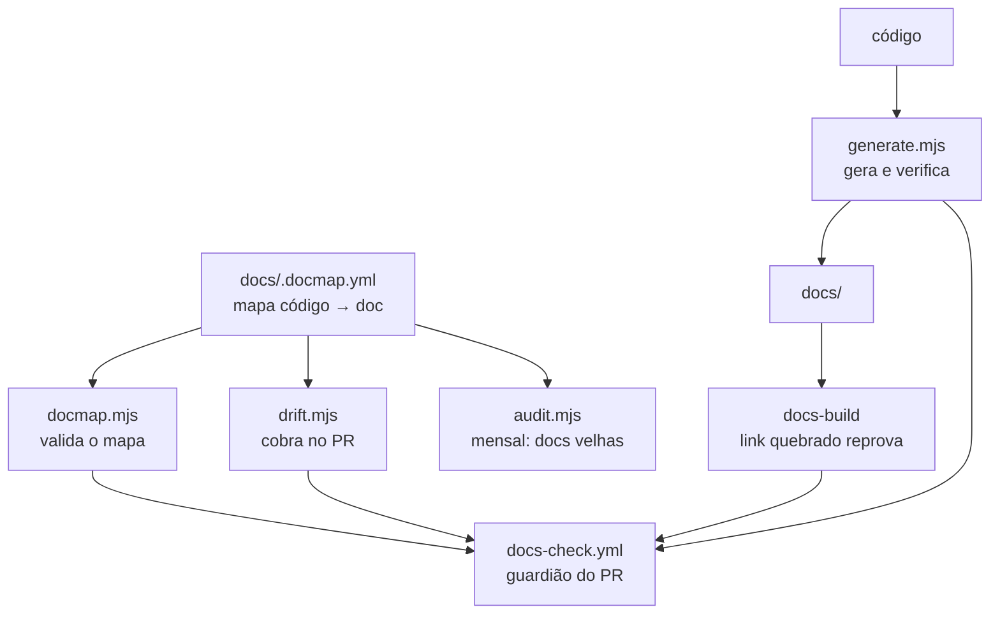

# 文档如何保持鲜活 {#how-documentation-stays-alive}

文档不是因为最初没写而死的。它死于**漂移**：代码变了，文档没变，有一天有人发现它描述的是一个已经
不存在的系统。从那一刻起，没有人再信任任何页面，包括那些正确的页面。

本页解释为避免这种情况而存在的机制。如果 CI 对你抱怨了，读它——并且在关闭它的任何部分之前读它。

## 原则：生成 > 验证 > 提醒 {#the-principle-generate--verify--remember}

三个层次，按可靠性递减排列：

| 层次 | 如何运作 | 何时使用 |
|---|---|---|
| **生成** | 文档从代码中产出；漂移不可能 | 列表**就是**内容 |
| **验证** | 文档手写，CI 核对它是完整的 | 散文比列表更重要 |
| **提醒** | CI 提醒打开 PR 的人 | 需要人类判断时 |

最后一层是最弱的，这就是为什么它是最后的手段。一个没人读的提醒保护不了任何东西。

### 散文中的数字属于*验证*的情况 {#a-number-in-prose-is-a-verify-case}

句子中间的数字——"os 30 ADRs"、"o próximo é `0031`"——是不可生成的：它住在文本里面，把它换成
标记会让源中的散文难以阅读。但它是**可验证的**，它应该住在那里。

没有这个，它会悄悄变老。事情就是这样发生的：已发布的网站在已经有 30 个时写着 "28 deles" 和
"as 29 decisões"，并在 0030 已经完成时写着 "o próximo é 0030"。没有任何东西坏掉，没有任何检查
抱怨——只是错了。

**在第三个案例证明了同一点之后，被验证的数字列表增长了。** 一次外部审查发现 README 宣称
"as 158 RNs"，而实际已写了 331 条——错了一倍多，就在介绍仓库的表格中。它被手工修正了（PR #412），
这只是让时钟归零：下一条 RN 又会让它过时。于是检查不再只覆盖 ADR 计数，而是覆盖**三个**家族，每个
都从**工件**读取，绝不从其他散文读取：

| 散文中的数字 | 事实来源 |
|---|---|
| ADR 计数、下一个 ADR 的编号 | `docs/adr/` 中的文件 |
| RN 计数 | `business-rules.md` 中的 `### RN-NNN` 标题 |
| LLM provider 计数 | `descobrirProviders()` 找到的 `capabilities` 字面量——与 `llm-providers.md` 中生成的表格同一来源 |

provider 的计数以**文字**写出（"nove providers"），检查与这个词比较，而不是强迫散文变成数字：检查
的存在是为了保护文本，而不是重塑它。

**自 AT-399（2026-10-03）起，这些数字也会被改写。** 每个都添加一条 RN 或一个 ADR 的并行 PR 手工
写入共享的数字，每次合并都让其他的过时：文档守卫仅因此就在三小时内的 30 次执行中失败了 8 次。所以
`pnpm docs:generate`（写入模式）现在就地修正来源所决定的东西——上面的 ADR 和 RN 计数、下一个 ADR 的
编号（丢弃合并留下的重复的 "o próximo é" 行）、`docs/adr/temas.yml` 中写在第 0 列的条目的缩进，以及
带符号引用的行号（见下文）。纯函数位于 `scripts/docs/reescrita.mjs`、`refs-com-simbolo.mjs`
（`novaLinha`、`reancorar`）和 `temas-de-adr.mjs`（`corrigirRecuo`）。`--check` 保持同样的严重性：
已提交的过时文件仍然让 CI 失败，修正方法是 `pnpm docs:generate` 再加一次提交，与生成的文件一样。
仍需要人类的：模式不再匹配的句子（`CEGO`）、没有主题的 ADR、没有描述的变量，以及符号离开了文件、
移动超过 40 行或在两个最近的出现之间打平的引用。

代价最高的案例是**散文中宣布的版本**：README 从 Fase 5 一直宣布 `v0.1.0` 直到 v2.1.0——比现实落后
七个版本，就在新人读到的第一件东西上。检查把散文与 CHANGELOG 的第一个 `## vX.Y.Z` 比较，它由 release
workflow 写入并通过 PR 回来；从 git 读取 tag 行不通，因为 CI 的浅检出可能一个 tag 都没有。另一方面，
**徽章**离开了检查，变成了生成：它直接读取 GitHub 的 release（`shields.io/github/v/release`）并自行
更新——只验证无法生成的东西。

而这在**每个入口都发生了一次**。`docs/intro.md`——已发布网站的第一页，并不是每个人都通过 README 到达
那里——在产品已处于 Fase 26 时仍写着 "Fases 1 a 5 concluídas, v0.1.0"。只核对 README 从来没有保护
第二个入口，因此 `verificarVersaoAnunciada` 改为在一个列表中接收两个文件，而
`scripts/ci/readme-version.ts` 改为在 CHANGELOG 的同一个提交中写入两者。两半故意一起移动：一个要求
生成器不写之物的检查，会让每个发布都在一个由机器人打开、没人能修复的 PR 中生来就是红的。

`intro.md` 的模式要求**整个**句子——"Phases 1 through NN complete, version vX.Y.Z"——而不只是版本：
两半一起变老，只匹配一半会让阶段计数在正确的版本旁边撒谎。阶段计数无法从这里生成：release 知道版本，
不知道阶段。

`generate.mjs` 现在把这些断言与目录的现实核对。而且**不再匹配的模式也会失败**：一个正则不再能找到
句子的检查比没有检查更糟，因为它会永远绿着，声称核对了它从未看过的东西。当句子改变时，CI 说 `CEGO`
并要求调整模式。

向检查添加一个新断言，就是在某个 `afericoes` 列表中加一项——当事实来源是 ADR 目录时是
`verificarContagensDeAdr`（文件、模式、期望值），当它是 CHANGELOG 的最新 release 时是
`verificarVersaoAnunciada`——或者，当两者都不是时，在它们旁边写一个自己的函数。

**从代码派生的计数（AT-123）。** 2026-09-25 对 `docs/`、`README.md`、`CONTRIBUTING.md`、
`THIRD_PARTY_NOTICES.md` 和 `CLAUDE.md` 的一次扫描发现五个已经错了的数字——"nove schemas"（十一个）、
git 契约的 "doze operações"（十五个）、"dez abas"（十二个）、CI 构建的 "três imagens"（五个）、
`proposed_action` 的 "Thirteen types"（二十一个）——背后都没有检查。来源是代码中某个位置的计数现在
位于 `scripts/docs/contagens-do-codigo.mjs`，由 `verificarContagensDerivadasDoCodigo` 调用：每个
**句子**一行表格（同一计数在两个文件中说出，是两个分别变老的句子），每行指向一个统计工件的提取器——
两个 `pnpm-workspace.yaml` 的 `overrides` 块、golden-set 的 `CASOS` 和 `ARQUIVOS_CURADOS` 及其
`floor.json`、`scripts/ci/imagens-pinadas.ts` 打印的总数、`ALVOS`、smoke 的非 root 循环、
`GitProviderContract` 和 `DockerPort` 的方法、标签页的 `REGISTRO`、dev compose 中没有 `profiles:` 的
服务（它们必须**全部**有 healthcheck，否则期望值会变成散文中没有的句子）、`ACTION_TYPES`、枚举
`action_status` 以及 `pgTable(` 调用。比较忽略大小写并遵循句子的形式（阴性/阳性的葡萄牙语单词、英语
单词或数字）。由于提取器很多，每一个都在 `contagens-do-codigo.spec.ts` 中经过**变异**证明：改变工件
而不改散文，它必须以 `DESATUAL` 失败；删除句子或来源，它必须以 `CEGO` 失败。

被**标注日期而不是派生**的，以及原因：`architecture.md` 中每个应用的文件计数和 broker 的
"seis rotas" 几乎随每个 PR 变化，或从一个 `switch` 读出，因此检查只会增加噪音——它们带着
"medido em 2026-09-25"。描述设计不变量（"duas camadas"、"três estados"）或已就地标注日期的过去测量
（`THIRD_PARTY_NOTICES.md`、runbook 的恢复记录）的数字保持原样。

### 带符号的行引用 {#line-references-with-a-symbol}

RN 通过 `caminho:linha` 引用代码，而每次有人编辑文件，行号就会变老。RN-547 引用了 `install.sh:966` 中
的 `fechar_a_instalacao` 和 `:682` 中的 `post_interno`。在 2026-09-17 它们在 `:1107` 和 `:809`，在
2026-09-18 在 `:1463` 和 `:1165`。行号无法生成，一般来说也无法验证，因为单独的
`apps/api/src/foo.ts:40` 并不说明那里应该有什么。然而，当 RN 也在行号旁边**命名符号**时，这一行*就
可以*被验证。这是 `generate.mjs` 核对的唯一情况（`verificarRefsComSimbolo`，逻辑在
`scripts/docs/refs-com-simbolo.mjs` 中，已测试）。

**模式故意很窄。** 嘈杂的检查会在第一个月就被关掉。它读取三个 RN 文件（`business-rules.md`、
`business-rules/custo.md`、`business-rules/autenticacao.md`），只捕获这两种形式：

```
`<path>:<N>` (`<symbol>`     explicit reference
`:<N>` (`<symbol>`           continuation — inherits the path
```

- 符号必须**紧跟**在引用之后，以括号开头并在反引号之间。它们之间只能有空白，包括换行。
- 符号必须是一个**标识符**：`fechar_a_instalacao`、`join/3`、`git_dir?`、
  `Engine.Runners.RunnerReadiness`、`decide()`。`MARCADOR_SCHEMA=3`、一个句子或一个路径不是符号，
  会被跳过。
- **有歧义的成对引用被跳过**：`:640`/`:647`（`a`/`b`），或一个符号前有两个引用。检查无法知道哪个
  符号对应哪一行。
- 续接继承**同一列表项中**最后一个显式路径。空行或新的 `- ` 结束该项。
- 路径从仓库根目录解析。如果不在那里，检查使用路径以它结尾的**唯一**被跟踪文件。如果没有文件匹配，
  或有多个匹配，该引用被单独计为未解析。

当符号或其 `.` 之后的最后一段作为完整单词出现在 `N` 的 **±3 行**之内时，引用**匹配**。这个窗口允许
指向文档块而不是签名的引用。它保持很小，因为漂移会移动几十或几百行。当引用不匹配时，输出会点名符号
出现的最近一行。自 AT-399 起，当最近的出现是**唯一**的（在相同距离上没有并列）且最多在 **40 行**之内
（`DISTANCIA_MAXIMA_DE_REANCORA`）时，`pnpm docs:generate` 把 `N` 改写为那一行；当符号从文件中消失、
移动得更远或两个出现打平时，引用保持原样，必须按符号手工重读。最近的出现可能是一次调用而不是定义——
这是为了不在并行 PR 之间手工编辑数字而接受的代价，重新生成文件的 diff 会显示每次移动以供审查。

**于 2026-09-18 测量**，针对三个文件中的每个 `caminho:N`：

| | 计数 |
|---|---|
| `…:N` 引用总数 | 592 |
| 匹配模式 | 187 |
| 正确（±3 之内） | 116 |
| 错误 | 71 |
| 路径未解析 | 0 |

对这 71 个的一次抽样核对没有发现误报：它覆盖的每个引用都是真实的漂移、一次重命名或一个换了文件的
符号。把窗口放宽到 ±5 只会清除其中三个。九个偏差在 4 到 10 行之间，其余 62 个更远。RN-547 的代码项
按符号重读并在同一个 PR 中修正，剩下 **63** 个。在这次改动中逐个修正太多了，而最近的出现并不总是
定义。列表就是 `pnpm docs:check` 打印的内容。

**诞生时的严重性：`warn`。** 它报告而不失败，因为 `block` 会因为别人留下的债务而阻止每一个触及 RN
文件的 PR。有一个例外，即本仓库的规则：如果检查提取到**零**个引用，那就是 `CEGO` 并且**失败**。零
意味着 RN 的语法变了或提取器坏了，而一个盲的检查会永远绿着。

**升级为 `block` 的原始标准**（PR #593）：当列表**为空**，并且在 `dev` 上连续**四周**的 `docs:check`
中，这几周触及的 RN 里没有新的错误引用。从那时起，每个新的错误引用都是当前 PR 的责任，PR 可以修正
它。更早升级会让每个 PR 为别人的债务买单。如果在此之前模式显示出真实的误报，就收窄模式。不要放宽
窗口。

**列表在 2026-09-26 清零**（AT-122）。在检查加入后的八天里，已知错误的 63 个引用增长到了 **75** 个。
这种增长就是检查要展示的漂移。这 75 个按符号对照当天的代码重读，没有一个是模式的误报。大多数移动了
几十行。一个是重命名：`modo_de_execucao/1` 在 RN-516 中变成了 `exigencias_do_projeto/1`。一个换了
文件：`escreverEnv` 从 `preflight.mjs` 移到了 `env-file.mjs`。两个
指向正确的测试，但指在 `it(` 那一行，而符号（`types`）只在下面几行的正文中出现。这两个现在指向正文
那一行。窗口保持 ±3。漂移最严重的条目（RN-566、RN-567、RN-570 和 RN-514）在同一轮中重读了相邻的
未核对引用。此后，**273 个引用匹配模式，273 个正确，0 个错误**。四周将从这次改动到达 `dev` 时开始
计算。

**于 2026-10-01 升级为 `block`**（AT-122），由维护者决定，没有等待四周。列表清零五天后，`dev` 在
896 个匹配模式的引用中又有了 **140** 个错误：`warn` 没有拦住漂移，因为一个没有人必须对其采取行动的
警告是没人读的警告。这 140 个在升级检查的同一次改动中按符号重读，从不累加差量，窗口保持 ±3。没有
一个是模式的误报，也没有任何符号在它的文件中缺失。这一轮在行漂移之外发现的：

- **合并残留。** 三个条目被冲突解决复制了，一个带旧数字的副本挨着一个带新数字的副本（RN-120 的
  `Where`、RN-547 的 `Código` 和 RN-626 的 `SessionPage.tsx` 那一行）。过时的副本被删除，这就是
  总数从 896 变为 **883** 的原因。
- **一个主题发生了变化的引用（状态漂移，而不是行漂移）。** RN-587 引用了一条 `infra` 消息的测试；
  自 RN-617 起 Infra Lead 会对话，测试现在使用 `qa` 作为花名册中不对话的智能体。引用现在这样说。
  RN 的规则没有变。
- 漂移最严重的条目（RN-547、RN-567、RN-587、RN-609、RN-663、RN-566）中未核对的相邻引用在同一轮中
  重读，前提是它们所命名的测试或子句能被识别。

此后，**883 个引用匹配模式，883 个正确，0 个错误**。

**现在的严重性：`block`。** 一个不匹配的引用，**或**路径不再解析为单一被跟踪文件的引用，会让
`docs:check` 失败。两者是同一种漂移：RN 指向代码不在的地方。零个引用仍是 `CEGO` 并仍会失败。裁决是
`refs-com-simbolo.mjs` 中的 `veredito`，由旁边的 spec 经变异证明：移出窗口的引用失败，离开文件的符号
失败，不再解析的路径失败，被改写到提取结果为零的文本是 `CEGO`，绝不是 `ok`。失败时，**按符号**修正
引用（输出点名符号出现的最近一行，这是一个线索，不是修正）。不要放宽窗口，也不要为了让一个真实的引用
消失而收窄模式；只有在出现真实的误报时才收窄，并把该用例放进 spec。

`website/i18n/` 下三个 RN 文件的 pt-BR 翻译**不**被核对。它们的引用很少（23 个匹配模式，2026-10-01
时其中 15 个是错的），而且翻译无论如何都落后于英语源；核对一份没人保持更新的副本，会因翻译的滞后而
让每个 PR 失败。

### 每个 RN 标题都带有其锚点 {#every-rn-heading-carries-its-anchor}

RN 标题上的锚点 `{#rn-NNN}` 是外部链接的契约：它能在 RN 改标题和 RN 移到另一个文件后存活。在
2026-09-26（AT-230），`dev` 有 **451** 个 `### RN-` 标题和 **449** 个锚点。RN-305 和 RN-306 在
`business-rules.md` 及其 pt-BR 翻译中写的时候没有锚点，而没有任何东西失败。网站构建抓不到这个：
没有显式锚点时 Docusaurus 从标题文本推导 id，页面照样编译。坏掉的是之后有人写的 `#rn-305` 链接。
RN 计数也抓不到，因为它计的是标题，不是锚点。

`generate.mjs` 现在核对这一点（`verificarAncorasDeRn`，逻辑在 `scripts/docs/ancoras-de-rn.mjs`，在
`ancoras-de-rn.spec.ts` 中经变异证明）。每个以 `RN-<dígitos>` **开头**的标题，无论哪一级，都必须以
`{#rn-<mesmos
dígitos>}` **结尾**，包括前导零（`RN-001` → `rn-001`）。缺失的锚点和带其他编号或名称的锚点
都会失败，每个标题一行，带文件和行号。找到零个标题是 `CEGO`，同样失败。

**严重性：`block`**，与上面的行引用不同：没有继承的债务（两个缺失的锚点在同一次改动中补上了），每个
新标题都由添加它的 PR 写入。

**翻译也被覆盖。** 文件通过 glob 找到：`docs/business-rules.md`、`docs/business-rules/*.md`
（pt-BR 源，ADR 0216），以及 `LOCALES_TRADUZIDOS`（`en`、`ru`、`zh-Hans`）中每个已翻译 locale 在
`website/i18n/<locale>/docusaurus-plugin-content-docs/current/` 下的同样两个路径。一个 locale 的网站
从翻译后的文件提供 `business-rules#rn-305`，而之前的一次翻译复制了标题却没有锚点。规则是按标题的，
因此部分翻译不是问题：未翻译的 RN 回落到 pt-BR 源，而源无论如何都会被核对。

### runbook 的步骤表 {#the-runbook-procedures-table}

runbook 以其**运维**步骤的表格结尾——`procedure | anchor | verification | schedule`——说明证明每个
步骤的是什么以及运行这个证明的是什么（[Procedures and how each is verified](../runbook.md#procedimentos-e-verificacao)）。
它的存在是因为 EP-015 的关闭标准：没有一行的验证为空或写着"见下文"，而存在的证明按计划运行，不靠
记忆。于 2026-09-25 测量（AT-129），标准所说的那张表并不在仓库中：一份七行的副本在维护者的笔记里，
而这里有 28 个运维步骤，其中一行指向另一条笔记。一张手写的文件名表格与散文中的数字以同样的方式变老
——一个 spec 被重命名，一个 workflow 失去了 `schedule:`，而单元格仍在断言。

`generate.mjs` 核对它（`verificarProcedimentosDoRunbook`，逻辑在
`scripts/docs/procedimentos-do-runbook.mjs`，在 `procedimentos-do-runbook.spec.ts` 中经变异证明）。
对每一行，在以下情况下失败：

- **anchor** 单元格没有 `(#id)` 链接，或者该 id 不是 runbook 某个标题上的显式 `{#id}`——与 RN 锚点
  相同的契约：改了标题的小节不能破坏链接；
- **verification** 单元格为空、写着 "see below/above"、点名一个不被 git 跟踪的文件或一个 `Makefile`
  没有的 `make` 目标，或者没有点名任何可核对的东西且不以 `**None**` 开头——这是不存在证明的显式声明；
- **schedule** 的某个片段（以 `;` 分隔）不以其触发类别开头——`weekly`/`daily`/`monthly`、`every PR`、
  `every tag` 或 `manual`——或者它引用的 workflow 不存在，或在读取到的 `on:` 中没有该触发器
  （`schedule:`、`pull_request`、`push: tags`）。`manual` 片段不能引用 workflow。

这一列叫 `schedule` 却仍故意接受 `every PR` 和 `every tag`。标准的问题是"没人记着它也会运行吗？"，
而一个 `ci.yml` 在每个 pull request 上都运行的 spec 回答是的；把它叫做 `manual` 会在相反的方向上犯错。
检查保证的是写下的类别就是 workflow **拥有**的：指向没有 `schedule:` 的 workflow 的 `weekly` 会失败，
这正是 AT-193 点名的情况。

缺少小节、缺少表格、列标题改变或零行都是 `CEGO` 并失败。

**严重性：`block`**，原因与 RN 锚点相同：表格诞生时每一行都已核对，因此没有继承的债务，之后破坏它的
东西（一个被重命名的 spec，一个失去计划的 workflow）是破坏它的 PR 的责任，而那个 PR 也能修复它。

**只有源的 runbook（`docs/runbook.md`）有这张表。** 它旧的 pt-BR 副本落后了（AT-209），并随 ADR 0216
移除；`website/i18n/<locale>/` 下的未来翻译落入 docmap 的 `traducao` 规则（`warn`），也不会有这张表
添加的十个显式 id。在那里放第二份未经核对的表格副本，正是这张表要取代的那种副本。

### ADR 索引按主题分组 {#the-adr-index-is-grouped-by-theme}

ADR 索引过去按阶段分组。阶段结束后，最后一节变成了索引本身：于 2026-10-01 测量，191 行中有 148 行
位于 `## Phase 12` 之下。[ADR 0202](../adr/0202-o-indice-de-adr-por-tema.md) 把它按**主题**分组，并把
主题放在 ADR **之外**——已接受的 ADR 永不编辑，即使是为了在 frontmatter 中加一个 `tema:` 键。

主题位于 `docs/adr/temas.yml`，挨着索引：`temas:` 是封闭且有序的列表（`id`、`titulo`、`descricao`），
`adrs:` 把每个 ADR 编号映射到**一个**主题。索引是**核对的，不是生成的**——单行描述是精心编写的，
没有脚本写它们，这与 `verificarIndiceAdr` 给出的原因相同——每个主题是一个 `## <titulo> {#tema-<id>}`
小节，按列表顺序，各行按编号排序。

`generate.mjs` 核对它（`verificarTemasDeAdr`，紧接在 `verificarIndiceAdr` 之后；逻辑在
`scripts/docs/temas-de-adr.mjs`，在 `temas-de-adr.spec.ts` 中经变异证明）。它在以下情况失败：没有主题
的 ADR 文件、映射中不在列表里的主题、映射中指向不存在的 ADR 的条目、没有 ADR 的列出主题、重复或格式
错误的主题 id 或标题，以及在索引中：缺失、重复、名称错误、顺序错误或未知的主题小节，或者一行 ADR 位于
另一个主题的小节下、在任何主题小节之外、重复或不按编号排序。不可读的 YAML、空的列表或映射，或一个完全
没有主题小节的索引（旧的按阶段索引）是 `CEGO` 并失败。

**严重性：`block`**，与 runbook 表格一样：它诞生时每个 ADR 都已分类，因此之后破坏它的是一个新 ADR，
其 PR 忘了在 `temas.yml` 中加它的那一行——也就是能修复它的 PR。索引的翻译位于
`website/i18n/<locale>/` 之下，不被核对；`traducao` 规则照常提醒。

## 部件 {#the-pieces}



### `docs/.docmap.yml`——映射 {#docsdocmapyml--the-map}

把代码路径与依赖它们的文档联系起来。它是唯一说明"改动这个的人需要审阅那个"的来源。

两种严重性：`block` 让 PR 失败，`warn` 只评论。还有一个属性 `generated: true`，标记从生成器产出的
文档。

一条要求无意义之事的规则会教人们条件反射地使用紧急出口。这就是为什么 `politica-de-branches` 监视
`scripts/ci/` 中的一个**允许列表**——那些*就是*分支策略的脚本及其 spec——而不是 `scripts/ci/**` 减去
一个手工维护的排除列表，在那个列表中，该文件夹里每个新的全仓库范围的 spec 都必须加入（到 AT-206 时
已有十一个）。允许列表并没有放弃失败即关闭：`scripts/docs/politica-de-branches.spec.ts` 从仓库推导出
这个集合——`scripts/ci/` 中开头文档块引用了 `branching-policy.md` 的每个文件，加上它的 spec——并在规则
偏离时失败。新的策略脚本像其他脚本一样在文件头中声明其来源，spec 负责其余的事。

### `docmap.mjs`——验证映射 {#docmapmjs--validates-the-map}

在其他一切之前运行，因为坏掉的映射会让其余部分撒谎。在以下情况下失败：

- **一个 glob 不匹配任何文件**——一条死规则。它永远不会触发，并给人一种并不存在的覆盖的印象。这是
  docmap 可能有的最安静的缺陷，验证器加入时在 8 个 glob 中发现了它。
- 映射指向的文档不存在
- 有重复的 id 或无效的 `severity`

### `generate.mjs`——生成并验证 {#generatemjs--generates-and-verifies}

两种输出模式：

**整个文件**——`docs/reference/scripts.md`。没有需要保留的散文：命令列表就是内容。它来自每个包的
`package.json` 和 `Makefile` 中带注释的目标。包列表在 `gerarScripts` 中声明，包括 workspace 之外的
两个包（`website/`、`e2e/`，用 `--dir` 运行），缺失或无法解析的 `package.json` 会让生成失败并点名
它——以前它会悄悄丢弃这个包（AT-224）。

**标记块**——手写文件中 `<!-- BEGIN:GENERATED:<id> -->` 与 `<!-- END:GENERATED:<id> -->` 之间的
片段。这是 `configuration.md` 和 `events.md` 的情况：在那里，散文（"这个变量错了时什么会坏"）比列表
价值高得多，但**列表**必须完整。块是清单；周围的文本
是解释。

清单用 ⚠️ 标记出现在代码中却**没有**散文描述的东西。`tool.result` 和 `agent.response`——两种真实的
事件类型——就是这样在被第一稿遗漏之后出现的。

**环境清单能捕获什么，已测量（AT-124，2026-09-25）。** 来源及其 glob 位于
`scripts/docs/fontes-de-env.mjs`，由 `fontes-de-env.spec.ts` 对照真实的树证明。每个来源一次变异——在
直接位于 `e2e/` 下、嵌套在 `e2e/suporte/` 中、直接位于 `apps/api/scripts/` 下以及在它下面嵌套一层的
文件中加一个新的 `process.env.X`，每个都 `git add`——在四种情况下都让 `--check` 以 `configuration.md`
中的 `DESATUAL` 失败。发现并关闭了一个漏洞：`.spec.` 过滤器对于 spec 是代码旁单元测试的来源是对的，
但它也丢弃了 `e2e/testes/*.spec.ts`——Playwright 测试本身，`e2e/` 的新变量最可能在那里诞生——而那个
变异是绿的。一个限制被声明：清单只读取**版本化**的文件（`git ls-files`），因此未跟踪的文件在
`git add` 之前是不可见的。

**`deploy/k8s/*.sh` 成为来源（AT-212，2026-09-28）。** bootstrap 和属性证明从环境中读取二十多个变量——
集群名称、命名空间、smoke 账户、每个证明的上限——没有一个在清单中。它们是 `ferramenta` 来源，通过 shell
的**带默认值的展开**（`${X:-…}`、`${X:=…}`、`${X:?…}`）匹配，并且只通过它：单纯的 `${X}` 几乎总是脚本
自己的变量。变异：在 `deploy/k8s/validate.sh` 中暂存一个新的 `${X:-x}`，让 `--check` 以 `DESATUAL` 和
一行点名变量和文件的 `SEM DESC.` 失败。

**环境的 ⚠️ 是闸门（AT-211，2026-09-27）。** 在那之前失败的只是**过时的块**：一旦 `docs:generate`
重写了它，变量就带着 ⚠️ 留在那里，`--check` 通过——`HUGGINGFACE_API_TOKEN` 和 `HUGGINGFACE_HUB_URL`
就这样过了好几个月。按维护者的决定，`--check` 现在对环境清单中的**任何** ⚠️ 失败，针对**两种**来源
（`produto` 和 `ferramenta`），即使块是最新的。失败会点名变量、读取它的文件以及描述应放在
`configuration.md` 的哪个小节（`SEM DESC.` 行）。规则位于 `scripts/docs/inventario-de-env.mjs`，在
`inventario-de-env.spec.ts` 中经变异证明：没有描述的新变量失败，带描述的同一变量通过。

在引用该变量的那一行中的 `**TODO(humano):**` **算作描述**，不会失败：文档规则是"绝不编造；没有信息，
就 TODO(humano)"，而一个让 TODO 失败的闸门会把不知道变量做什么的人推向编一句话来变绿。TODO 是一个
**已声明**的缺口，问题写在答案应该在的地方；⚠️ 是一个**沉默**的缺口。`--check` 仍会在一行 `TODO` 中
列出只由 TODO 描述的变量，而不失败。`events.md` 中的事件清单保留它的 ⚠️ 作为可见的缺口——这个决定只
涵盖环境清单。

`--check` 不写任何东西，如果任何东西会变得不同就失败。这是 CI 的模式。

### `drift.mjs`——在 PR 中强制执行 {#driftmjs--enforces-it-in-the-pr}

把 `git diff --name-only <base>...HEAD` 与映射交叉。对于每条被触发而其文档未被触及的规则：`block`
失败，`warn` 评论。

在一个 diff 只是 action 固定版本更换的 Dependabot PR 中，漂移检查之前的一个步骤
（`scripts/ci/dependabot-justifica-pin.ts`）在同一个 job 中把 `docs-not-needed:` 这一行写入正文，以便
在一次执行中写入和读取。workflow 监听 `edited`，而 `@dependabot rebase` 同时发出 `synchronize` 和
`edited`；`concurrency` 取消其中一个，因此幸存的执行可能是 `edited` 的那个。因此该步骤也在**编辑者是
机器人时**的 `edited` 上评估（AT-100），而在编辑者是人类时绝不评估（他删除这一行会胜出）。它不会进入
循环：用 workflow 的 token 做的正文编辑不会触发 `edited`。失败保持关闭：如果写入失败，漂移检查读取
事件的正文，PR 仍被阻止。

### `audit.mjs`——每月审计 {#auditmjs--the-monthly-audit}

漂移检查捕获在 PR 中变**错**的文档。审计捕获在无人改动的情况下变**旧**的文档——这更难察觉。它报告：

- 几个月没有改动、而对应代码此后已改变的页面
- 待处理的 `TODO(human)` 条目
- 不再能解析的 `arquivo:linha` 引用
- 处于 `proposed` 状态超过 60 天的 ADR

始终在**同一个** issue 中，原地更新。每个月一个新 issue 会变成垃圾信息，而垃圾信息会被关掉。

### 网站构建 {#the-site-build}

`onBrokenLinks`、`onBrokenAnchors` 和 `onBrokenMarkdownLinks` 设为 `throw`。移动一个文件而不修正指向它
的东西会让 CI 失败，而不是变成生产中的 404。这是整套机制中最便宜的一个。

### 新页面需要手工加入 `sidebars.ts` {#a-new-page-needs-to-be-added-to-sidebarsts-by-hand}

Markdown 内容在 `docs/` 中，但**路由**在 `website/sidebars.ts` 中——它的各节逐一列举条目，而不是扫描
目录。在 `docs/` 中创建一个文件而不在那里加入它，会产生一个存在的、可通过直接 URL 访问却**不出现在
导航中**的页面。

构建**不会**因此失败：孤立页面不是坏链接。这是一项目视检查，也是机制中唯一没有安全网的步骤——在
`pnpm docs:build` 之后，打开侧边栏确认页面在那里。

### `api-render-check.mjs`——绿色的构建不等于能渲染的页面 {#api-render-checkmjs--a-green-build-isnt-a-page-that-renders}

这个部件的存在源于一个昂贵的教训：**API 参考的 117 个操作页面在 `v1.0.0` 和 `v1.0.1` 版本中以死掉的
状态上线**，而没有任何检查捕获到。

Docusaurus 配置没有声明 `docItemComponent:
'@theme/ApiItem'`，因此 Docusaurus 使用了默认的 `@theme/DocItem`。`ApiItem` 是
`docusaurus-theme-openapi-docs` 中唯一挂载 redux `<Provider>` 的地方，而每个 `.api.mdx` 导入的
`@theme/ApiExplorer/MethodEndpoint` 用 `useSelector` 读取这个 store。没有这层包装，上下文为空——错误
边界把整个页面换成了 *"This page crashed."*

这里重要的是失败模式，因为它击败了这个机制的所有其他部件：

| 阶段 | 结果 |
|---|---|
| MDX 编译 | ✅ 主题组件存在并能解析 |
| SSR 渲染 | ✅ 提供的 HTML 有路由的内容 |
| `pnpm docs:build` | ✅ **绿色** |
| 浏览器中的水合 | ❌ 页面被清空 |

换句话说：**"构建通过了"从来不是页面能工作的证明。**

自 ADR 0206 起该插件被移除：参考是 `/reference/api/` 下的**一个 Redoc 页面**（redocusaurus，服务端
渲染），没有可忘记的 `ApiItem`。教训留下了，因此守卫也留下：`api-render-check.mjs` 在 `docs:build`
之后运行，在两个 locale 中断言 `reference/api.html` 存在、带有 spec 的 `info.title`，并为
`docs/reference/openapi.json` 的每个操作包含一个服务端渲染的小节（Redoc 的
`data-section-id=tag/<tag>/operation/<id>`）。

它能捕获页面消失、渲染为空或丢失操作——而不是水合失败，那需要一个无头浏览器。

同一事件产生了映射中的规则 `site-e-publicacao`：`website/**` 没有被任何规则覆盖，改动网站配置不要求
文档。

### 四个 locale，以 pt-BR 为源（ADR 0216） {#four-locales-with-pt-br-as-the-source-adr-0216}

`docs/` 是 **pt-BR** 树，是源，也是默认 locale（`defaultLocale: 'pt-BR'`，在每个环境的根路径提供）。
已翻译的 locale 是 `en`、`ru` 和 `zh-Hans`，位于
`website/i18n/<locale>/docusaurus-plugin-content-docs/current/` 下，主题的标签在
`website/i18n/<locale>/docusaurus-theme-classic/` 中，侧边栏的标签在
`.../docusaurus-plugin-content-docs/current.json` 中。在某个 locale 中没有翻译的页面以同一 slug 从
pt-BR 源提供。本地搜索为 `pt`、`en`、`ru` 和 `zh` 建立索引。旧的 pt-BR 副本已过时的页面，以它们当前的
语言留在 `docs/` 中，直到轮到它们那一批。

英文网站从根路径移到了 `/brabo/<environment>/en/…`，指向 `/brabo/<environment>/pt-BR/…` 的旧链接由根
路径的 `404.html`（`scripts/docs/landing.mjs`）改写为 `/brabo/<environment>/…`，与 `/main/` → `/prd/`
（ADR 0073）同一模式。

docmap 的规则 `traducao`（原为 `traducao-pt-br`）监视源并指向 `website/i18n/`。它是 `warn`，绝不是
`block`：在每个文档 PR 中要求翻译会让每次改动付出三份翻译的代价。

### 翻译一致性是生成的，页面会说明何时落后（AT-550） {#translation-parity-is-generated-and-the-page-says-when-it-is-behind-at-550}

拦住滞后的是测量，而不是 docmap。`scripts/docs/paridade-de-traducao.mjs`（由旁边的 spec 经变异证明）在
`pnpm docs:generate` 内部运行并写入两个文件：`docs/reference/paridade-de-traducao.md`
（`generated: true`）和 `website/src/data/traducao.json`。对每个 locale，它统计相对于源（`docs/` 减去
`docs/reference/**`）已翻译的页面和字符，并把已翻译的页面分为**最新**、**过时**和**无来源**。来源是
翻译页面 frontmatter 中的 `traducao_de: <SHA>`，即它所翻译的源的最后一次提交。当源有一个 COMMIT DATE
晚于该 SHA 的提交、源有未提交的改动，或该 SHA 不存在时，页面就是过时的。它从不使用时钟，因此
`--check` 在触及源的提交之前和之后给出相同的答案。对于 UI，它把 `apps/web/src/locales/<l>/` 中每个
命名空间的键与 pt-BR 比较，并要求 `Intl.PluralRules` 为该 locale 给出的每种复数形式。当两个文件中任何
一个过时时，`--check` 失败。

横幅是对 `@theme/DocItem/Content` 的 wrap swizzle（`website/src/theme/DocItem/Content/index.tsx`）。在
pt-BR 之外，`metadata.source` 位于 `@site/docs/` 下的页面是 pt-BR 回落并说明这一点；被
`traducao.json` 标记为过时的翻译页面显示翻译日期并说明原文已改变。文本位于每个 locale 的 `code.json`
中。`scripts/docs/faixa-de-traducao-check.mjs` 在 `pnpm docs:build` 之后运行并核对静态 HTML：一个回落
页面有横幅（样本来自第一个仍有未翻译页面的 locale，`en`、`ru` 或 `zh-Hans`；全部完成时就没有可核对的
回落），而根路径上的同一页面以及一个不过时的 `en` 翻译页面没有。给译者的规则在
[本地化](localizacao.md) 中。

### `links-do-locale.mjs`——被改写的链接逃过了坏链接检查 {#links-do-localemjs--a-rewritten-link-skips-the-broken-link-check}

`website/docusaurus.config.ts` 中的钩子 `markdown.hooks.onBrokenMarkdownLinks` 把仅因已知翻译缺口
（`reference/`、`adr/`、`explanation/`）而断掉的链接改写为 `pathname://`。这是 Docusaurus 官方的紧急
出口，而逃避正是目的：**一个 `pathname://` 链接再也不会被核对**，因此错误的改写无法让构建失败。

有一次让整个 pt-BR 网站失败了（AT-221）。改写返回 `pathname:///pt-BR/<slug>`，但 `pathname://` 不是
域上的绝对路径——`<Link>` 让它经过 `useBaseUrl`，而 pt-BR 构建的 baseUrl 已经是 `/brabo/prd/pt-BR/`。
每个被改写的链接都变成了 `/brabo/prd/pt-BR/pt-BR/...`：56 个页面中 441 个 href，全部 404，而
`docs:build` 是绿的。

改写现在作为带 spec 的纯函数位于 `scripts/docs/links-do-locale.mjs`，返回单纯的 slug——locale 来自
正在编译的那个 locale 的 baseUrl，而目标页面在那里存在（已翻译，或以同一 slug 回落提供）。同一个模块
在 `docs-check.yml` 中于 `docs:build` 之后运行，扫描生成的 HTML，并让任何带重复 locale 前缀的 `href`
失败。新的 locale 也要加入 `LOCALES_COM_PREFIXO`，否则它的重复会悄悄通过。自 ADR 0216 起这个列表是
`en`、`ru` 和 `zh-Hans`——pt-BR 是默认的，没有前缀。

在部分翻译的情况下，编译 `en` 会破坏一个从未翻译页面（从 pt-BR 源提供）指向一个已翻译页面的链接，在任何
文件夹中，而不只是在三个区域中。因此，当目标**存在于源 `docs/`** 中时（`paginaExisteNaFonte`），链接也
被视为缺口——那就是该 locale 提供的页面，无论已翻译还是回落。一个在任何地方都不存在的目标仍会让构建
失败。

`adr/` 的豁免也吞掉了拼错的 ADR 文件名：它只看名称的*形式*（`NNNN-*.md`），因此
`0055-politica-de-terminal.md`——一个从未以这个名字存在的 ADR——被改写为一个没有任何 locale 拥有的
slug。文档中有二十三个这样的链接，都是 404（AT-227）。从那以后，一个看起来像 ADR 的目标必须**先**存在
于 `docs/adr/` 中，任何缺口豁免才生效，包括来自 `adr/`、`reference/` 或 `explanation/` 内部的源；错误的
slug 会在每个 locale 中让 `docs:build` 失败。

守卫仍然**抓不到**的：来自某个缺口区域内部、不是 ADR、且目标在仓库中不存在的链接。

### 发布，每一级一个网站 {#publishing-one-site-per-rung}

每个永久分支都发布到同一个 GitHub Pages 中自己的位置：

| 分支 | URL | 被搜索引擎索引 |
|---|---|---|
| —（索引） | `https://daneiel.github.io/brabo/` | ❌ |
| `main` | `https://daneiel.github.io/brabo/prd/` | ✅ |
| `qa` | `https://daneiel.github.io/brabo/qa/` | ❌ |
| `dev` | `https://daneiel.github.io/brabo/dev/` | ❌ |

自 [ADR 0071](../adr/0071-publicacao-simetrica-por-degrau.md) 起三者是**对称**的；根路径是一个生成的
页面，列出三者及各自盖章的版本，每个网站顶部都有一个切换级别的选择器。在此之前，`main` 发布到根路径，
这个特殊情况迫使 workflow 在一条只有三分之一时间运行的路径中保留 `/dev/` 和 `/qa/`。

**路径不是分支的名称。**
[ADR 0073](../adr/0073-o-caminho-publicado-nomeia-o-ambiente.md) 把两者分开了：地址为读者命名
**环境**，而 `main` 是提交者的词汇。这就是 `main` 发布到 `/prd/` 的原因；`qa` 和 `dev` 的一致是巧合，
不是规则。分支→路径的映射在每个进程中存在于一个点——workflow 中"哪一级，发布到哪里"的步骤、
`docusaurus.config.ts` 中的 `DEGRAUS` 表以及 `landing.mjs` 中的那个——其余一切都从它派生。

在动它之前值得记住的两个后果：

- **`/brabo/main/` 曾被发布，现在不再发布。** 由于树是以 `keep_files: false` 组装和推送的，这个目录
  会消失。保留已保存链接的是根路径的 `404.html`，它作为一个独立情况**改写**前缀（`/brabo/main/<algo>`
  → `/brabo/prd/<algo>`），与通用重定向分开——通用重定向会产生 `/brabo/prd/main/<algo>`。防循环守卫
  只覆盖存在的路径（`prd|qa|dev`）。
- **`/prd/` 在过渡时从 `gh-pages:main` 播种**，原因与 ADR 0071 从旧根路径播种 `/main/` 相同：没有它，
  在 `dev` 的第一次推送和下一次晋升到 `main` 之间，`/brabo/prd/` 会返回 404。种子被从 `/brabo/main/`
  **改写**为 `/brabo/prd/`，因为 `404.html` 救不了子资源——在旧地址请求的 CSS 和 JS 会收到状态 404 的
  HTML，网站会提供原始文本。

这关闭了流水线的一个缺口：在合并到 `dev` 和最终晋升之间，阅读那个状态的文档需要克隆仓库。`docs-check`
在每个 PR 中构建网站，但**丢弃构建结果**——它的裁决是"构建时没有坏链接"，从来不是"住在某个我能打开的
地方"。而正是写与看之间的这个缺口，让 API 参考坏着上线了两个版本。

三个并不显而易见、各自已经造成过一个 bug 的细节：

- **`baseUrl` 来自 `DOCS_BASE_URL`**，默认是生产值。它进入每个资源 URL：一个在 `/brabo/dev/` 下、
  `baseUrl: '/brabo/'` 的网站只加载 HTML 而什么都不加载，页面*坏了却没有错误*。
- **级别在 `DOCS_BRANCH` 中声明，而不是从 `baseUrl` 推断。** 以前是 `BASE_URL === '/brabo/'`，在
  `main` 是唯一在根路径的时候它有效。三者都在子目录下时，这个比较对 `main` 也变成假，效果会是**真实**
  文档上的 `noIndex`——从 Google 消失，悄无声息，CI 绿着，因为构建中没有任何东西会因索引不足而失败。
  ADR 0073 正是这种分离所针对的场景：路径改成了 `/prd/`，而 `E_PRODUCAO` 不需要知道。
- **`main` 之外的 `noIndex` 需要搜索中的 `forceIgnoreNoIndex`。** `@easyops-cn/docusaurus-search-local`
  丢弃每个带 `<meta name="robots" content="noindex">` 的页面，因此两个保护措施会相互抵消：各级会带着
  死掉的搜索发布，一个 666 字节的索引，对一切都是 *"No results"*。`noIndex` 面向**外部**搜索引擎；
  `forceIgnoreNoIndex` 面向**本地**索引。
- **`main` 在发布前组装树**，把 `/dev/` 和 `/qa/` 带回来。`keep_files: true` 会更简单但是错的：它永远
  不会删除任何东西，从仓库中删除的页面会永远保持发布状态。

### 发布是**两个** workflow，只有一个是我们的 {#publishing-is-two-workflows-and-only-one-is-ours}

这会骗过在 Actions 标签页寻找部署的人：

| 顺序 | workflow | 位于哪里 | 做什么 |
|---|---|---|---|
| 1 | **`Documentação`**（`docs-deploy.yml`） | `.github/workflows/` | 构建网站并**提交到 `gh-pages`** |
| 2 | **`pages build and deployment`** | `dynamic/pages/`——**由 GitHub 生成** | 读取 `gh-pages` 并**提供它** |

第二个不在仓库中，也不出现在版本化 workflow 的列表中；当 Pages 的来源是一个分支时，GitHub 自己创建它。
我们的 workflow 在提交处结束——它**不**发布到 Pages，尽管它的 job 仍叫 "Publish to GitHub Pages"。

> **实际后果：** 即使 `Documentação` 是绿的，网站也可能是旧的。如果 Pages 的 `build_type` 不是
> `legacy`/`gh-pages`，提交会发生而没人提供它——CI 中也没有任何东西变红。核对方法是
> `gh api repos/daneiel/brabo/pages`，记录在 [Rulesets](../reference/rulesets.md) 中。

整个设计，连同被放弃的替代方案，在 [ADR 0034](../adr/0034-documentacao-publicada-por-degrau.md) 中。

## 在你的机器上运行 {#running-it-on-your-machine}

自 [ADR 0117](../adr/0117-lockfile-proprio-para-o-website.md) 起 `website/` 有自己的 `pnpm-lock.yaml`——
根目录的 `pnpm install` 不再覆盖它，因此第一次（或它的 lockfile 改变之后）需要多一步：

```bash
cd website && pnpm install && cd ..  # only the first time, or when website/pnpm-lock.yaml changes

pnpm docs:check      # validates the map + checks generated content is up to date
pnpm docs:generate   # regenerates
pnpm docs:drift      # simulates the PR check (origin/dev...HEAD)
pnpm docs:build      # the build CI runs — pnpm --dir website build under the hood
pnpm docs:start      # local server, with hot reload

# does the API reference render? needs the build above, and isn't part
# of docs:check because that one doesn't build the site
node scripts/docs/api-render-check.mjs
node scripts/docs/links-do-locale.mjs   # no href with a doubled locale prefix (AT-221)
```

或者，如果你在 Claude Code 中，`/sync-docs` 会运行整个循环，并交付一份报告，说明改了什么、什么变成了
`TODO(human)`，以及什么被故意**保留**不变。

### 默认是合取，文档被拆分时是析取 {#conjunction-by-default-disjunction-when-the-doc-was-split}

规则的 `docs:` 列表是一个**合取**：列出的每个文档都必须改变，否则规则触发。这是正确的默认——正是它让
"改了 gate，就更新 gate 的文档**和**规则"变得可以强制执行。

它恰好错过一次，修正是 `docs_alternativos:`，一个**析取**：列出的任何一个文档都能满足规则。它存在是因为
`business-rules.md` 按大小被拆分了（仅 Custo 和 Autenticação 就占了一个 640 KB 页面的一半），因此一条
业务规则现在位于三个文件之一。在合取下，改一条认证规则也会要求改索引——一个已不再包含那条规则的文件——
而被要求的人的出路会是紧急出口 `docs-not-needed`。**一条教人使用紧急出口的规则比没有规则更糟**：它训练
人们忽略检查。

`docmap.mjs` 以同样的方式验证两个列表：一个不存在的路径与死 glob 是同一种沉默的错误——一个有拼写错误的
替代项永远无法满足规则，而没人会看到。

## 当检查不公正地抱怨时 {#when-the-check-complains-unfairly}

它有时会不公正地抱怨。一次重命名内部变量的重构会触发 `dominio-e-regras` 而没有改变任何业务规则。这是
预期的：映射按文件路径而不是语义工作。

有**两个**出口，两者都需要有人解释原因：

```
PR label:      docs-not-needed
or in the body: docs-not-needed: internal refactor, no RN changed
```

合适时问心无愧地使用。紧急出口是**故意**存在的：没有合法的出口，形成的习惯就是作弊——为了让检查通过而
对文档做一次装饰性提交。那时机制就开始撒谎，这比它不存在更糟。

**有一类 PR 从机器人那里得到正文中的这一行**，而且只有一类：一个 diff 只是 action 固定版本更换（`uses:`
的 SHA 及其版本注释）的 Dependabot PR。漂移检查之前的一个步骤写入这一行，标记为机器人写的，漂移检查
仍然只读取这一行——见
[A pin bump justifies itself](./branching-policy.md#a-pin-bump-justifies-itself)。由于用 `GITHUB_TOKEN`
编辑正文不会触发 `edited` 事件，而重新运行会复用原始载荷，当该步骤改写了正文时，漂移检查从
`PR_BODY_FILE` 读取正文，否则从事件读取。

**不**对的是因为匆忙而使用紧急出口。如果你在同一周内为同一条规则用了三次，问题在规则：调整
`docs/.docmap.yml` 中的 glob，或把严重性从 `block` 降为 `warn`。

## 当机制本身是错的 {#when-the-mechanism-itself-is-wrong}

| 症状 | 修正 |
|---|---|
| 规则在无关的改动上触发 | glob 太宽——收窄 `watch` |
| 规则从不触发 | 死 glob——`pnpm docs:check` 会指出它 |
| 生成的内容在 CI 中总是过时 | 有人手工编辑了它；修正生成器或来源 |
| 构建在一个 `{` 或游离的 HTML 上崩溃 | `.md` 是 CommonMark；如果需要 React 组件，重命名为 `.mdx` |
| 审计报告了它自己 | 把该文件加入 `audit.mjs` 中的 `META` 列表 |

## 这个机制不做什么 {#what-this-mechanism-doesnt-do}

**它不核对文本是否正确。** 它核对代码改变时文本是否被*审阅*过，以及列表是否完整。一个没人碰过的事实
错误的句子会通过每一项检查——这正是人类阅读和 `/sync-docs` 的用处。

**它不写文档。** 它生成清单并要求审阅。一个变量错了时会做什么、一个上限为什么存在、事故中要调查什么——
这些仍是必须写下来的工作。

**它不要求 `README.md`，也不要求任何没有规则监视的东西。** docmap 是下限，不是上限：在 2026-07-29，没有
任何规则监视可观测性的核心（`tracing.ts`、`infrastructure/observability/**`、`telemetry/**`、
`lib/logger.ts`），而 `README.md` 几乎不被任何规则要求。只交付 CI 要求的东西，正是关于
`OTEL_EXPORTER_OTLP_ENDPOINT` 的两句话错了好几个月的原因。当你改代码时，扫描 `docs/`，寻找这次改动变成
错误的东西——包括没有人要你看的东西。
