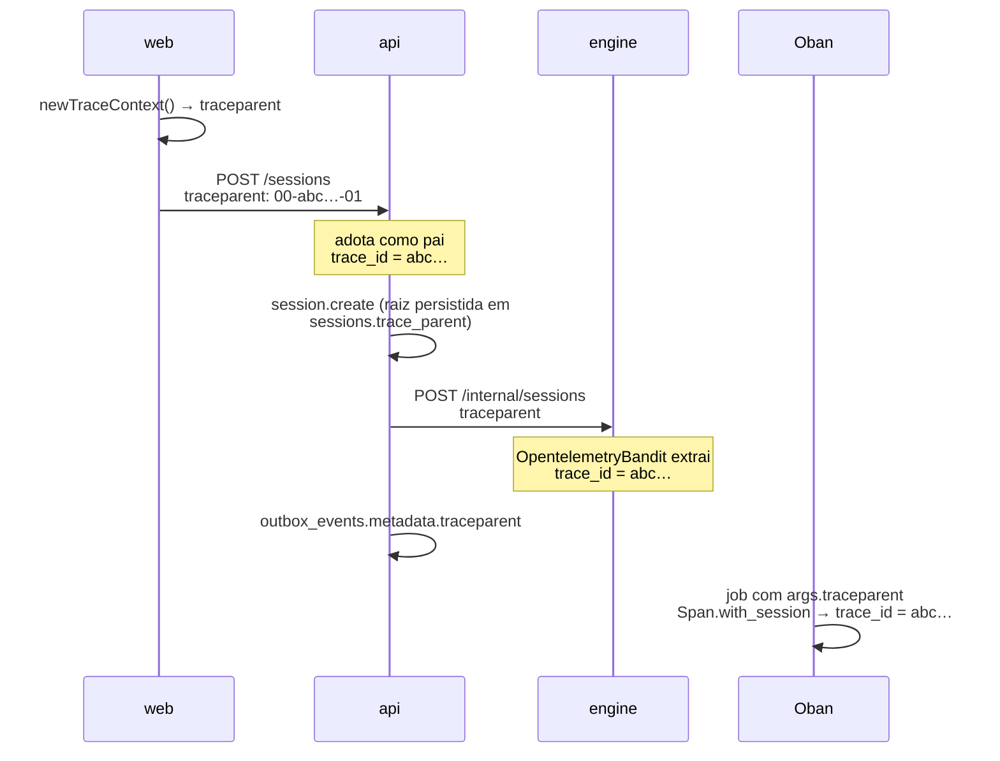

# 如何在系统中追踪一个动作 {#how-an-action-is-followed-through-the-system}

Brabo 中用户的一个动作会穿过三个进程再返回：web 上的点击调用 api，api 通过 HTTP 指挥 engine，engine 通过 HTTP 响应并通过 Oban 触发异步工作，结果再经由 api 回到界面。当中途出了问题时，问题总是同一个——**它经过了哪里，又停在了哪里？**

本页解释回答这个问题的机制。决策在
[ADR 0026](../adr/0026-fase5-observabilidade-e-graceful-shutdown.md)（模型）和
[ADR 0035](../adr/0035-observabilidade-legivel-e-trace-sem-coletor.md)（之后的变化）中；运维流程在
[runbook](../runbook.md#observabilidade) 中。

## 两件不应混淆的事 {#the-two-things-that-dont-get-confused-with-each-other}

**创建遥测**和**交付遥测**是相互独立的，这是这里最重要的设计选择。

span 总是会被创建——在生产、开发和测试套件中都是。`OTEL_EXPORTER_OTLP_ENDPOINT` 决定的是它是否**离开进程**：

| 环境 | 创建 span | 日志中有 `trace_id` | span 送往 Tempo |
|---|---|---|---|
| 生产（有 Collector） | 是 | 是 | 是 |
| `pnpm dev` | 是 | 是 | 否 |
| 测试套件 | 是 | 是 | 否 |

这很重要，因为**关联不依赖收集器**。出现在三个服务日志中的 `trace_id` 来自上下文，而不是来自导出器。在开发中你在 Grafana 里看不到树形图，但你拥有日常最常用的东西：三个服务的日志行都标有同一个 id。

在 ADR 0035 之前，这两件事是绑在一起的，后果是开发——最常读日志的环境——成了唯一完全没有关联的环境。如果你看到文档、注释或 runbook 说“没有这个变量就没有埋点”，那是这次修正之前的文本。

## `trace_id` 在哪里诞生 {#where-the-trace_id-is-born}

在 **web**，而不是 api。浏览器为每个请求生成一个 W3C `traceparent`
（`apps/web/src/lib/logger.ts`）并放在 header 中发送；api 把它作为父级采用，engine 采用 api 的。所以三方的 id 相同。



web **不**加载浏览器 SDK：那是约 90 kB，外加收集器上的 CORS 以及 CSP `connect-src` 中的一条，只为解决 20 行代码就能解决的问题。接受的后果是浏览器的日志行留在控制台——Alloy 只读取 pod 的 stdout——它供人与服务器 span 对照。

### 会话是根，并且被持久化 {#the-session-is-the-root-and-its-persisted}

一个会话持续数分钟或数小时，而 span 只有在关闭时才到达后端。在这么长时间里让根保持打开，会让会话恰恰在发生时不可见。因此 `session.create` 很短，它的 `traceparent` 被写入 `sessions.trace_parent`；之后的所有工作都把它用作**远程父级**。

正是这让此刻的一次 tool call 出现在与昨天的 `session.create` 同一棵树中。三个注入点刻意是唯一的——各自一个漏斗：

| 路径 | 注入点 |
|---|---|
| api → engine | `HttpApiToEngineClient.buildHeaders()` |
| engine → api | `EngineApiClient.headers/0` |
| outbox → Oban | `DrizzleOutboxRepository.append()` → `metadata` jsonb |

## 跨层路径 {#the-cross-layer-path}

`trace_id` 说明这个动作*存在过*。路径说明它*经过了哪里*。

在 api 中，每个请求在 `AsyncLocalStorage`
（`infrastructure/observability/request-context.ts`）中携带一个上下文，各个边界在其中登记自己。登记者是装饰器 `@Traced('<camada>')`，HTTP 边界则通过 interceptor 免费进入。结果是每个请求一行：

```
14:02:11.418 INFO  POST /projects/…/sessions — 34.1ms trace=4bf92f35
    trace_id: 4bf92f3577b34da6a3ce929d0e0e4736
    layers:
      interfaces        SessionsController.create         0ms
        ↳ application     CreateSessionUseCase.execute    31.2ms
          ↳ infrastructure  DrizzleUnitOfWork.runInTransaction  28.9ms
          ↳ infrastructure  DrizzleOutboxRepository.append       2.1ms
```

在生产中，同样的信息以 `path` 字段出现在一行 JSON 中。

关于这个机制有三点值得知道，因为它们解释了你所看到的东西：

- **路径不依赖 span。** 它来自 `AsyncLocalStorage`，这就是它在没有收集器时也能工作的原因。
- **guard 在 interceptor 之前运行。** 认证、速率限制和 RBAC 在上下文存在之前发生，因此不出现在路径中。它们约 1-3ms，已经作为 `pg` span 出现在 Tempo 中。
- **`@Traced` 在关键路径上，而不是到处都有。** 会话、动作、认证以及 api↔engine 桥。没有装饰器的方法根本不出现在这一行中——那里的缺席并不意味着它没有被调用。

### 为什么没有任何 controller 带 `@Traced` {#why-no-controller-has-traced}

因为那会是危险的，而不是因为不方便。Nest 把路由元数据（`@Public`、`@RequireRole`、`@ApiOperation`）记录在方法的**函数对象**上，而一个替换 `descriptor.value` 的 legacy 装饰器会丢弃下面已有的东西。在 controller 中，这就是一个授权注解编译通过、通过测试套件却消失了。

interceptor 从 `ExecutionContext` 中读取 `getClass()` 和 `getHandler()`，在不触碰任何 controller 文件的情况下获得同一对类/方法。

出于同样的技术原因，`@Traced` 也不用于任何返回 `Observable` 的东西或生成器：“是 thenable 吗？”的启发式会把它们归为同步，在流产出之前就关闭 span。

## 日志：对人可读，对机器可解析 {#logging-readable-for-people-parseable-for-machines}

同一个事件有两种输出，由 `NODE_ENV` 选择：

- **开发**——彩色、缩进，带有层级树。在 api 中，`pino-pretty` 在进程内运行（不经 `transport`，后者不允许在 `customPrettifiers` 中传函数）；在 engine 中是 `PrettyLogFormatter`。
- **生产**——每个事件**一行** JSON。这不是偏好：Alloy 逐行读取 pod 的 stdout，缩进的 JSON 会破坏解析器。

### `trace_id` 是合约 {#trace_id-is-a-contract}

带下划线，在三个服务中都是。这个名字被三样彼此看不见的东西读取：

1. Alloy 的 `stage.json`，它把它提升为结构化元数据；
2. Loki 数据源的 `derivedFields`，它把日志行变成指向 Tempo 的链接；
3. 本 runbook 中的查询。

重命名为 `traceId` 能编译、通过整个测试套件，却会摧毁可点击的关联。三个服务中各有一个测试专门保护这个**名字**，而不是格式。

### 秘密永不进入日志 {#secrets-never-enter-the-log}

api 有一份刻意保守的 `redact` 列表——多遮蔽一个字段毫无代价，少遮蔽一个就是在 Loki 中的永久泄漏。它覆盖 `Authorization`、cookie、LLM 的 API 密钥、访问令牌和 refresh 令牌、密码、api↔engine 的服务令牌以及信封加密的 DEK 材料。

## 当某样东西没有出现时去哪里看 {#where-to-look-when-something-doesnt-show-up}

第一刀总是相同的，而日志自己就会回答：

- **日志中有 `trace_id` 但 Grafana 中没有 trace** → 是导出问题。在开发中这是预期的；在集群中，见
  [runbook](../runbook.md#quando-nao-ha-trace-no-tempo)。
- **日志中没有 `trace_id`** → 是上下文问题，很少见。在 api 中，`startTracing()` 必须是进程中的第一件事（`src/tracing-boot.ts`）；在 engine 中，`Engine.Telemetry.Otel.setup/0` 在监督树之前运行。
- **有 trace 但路径只有一步** → 该方法没有 `@Traced`，或者它位于 `interfaces/http/` 之下，在那里不能有。
