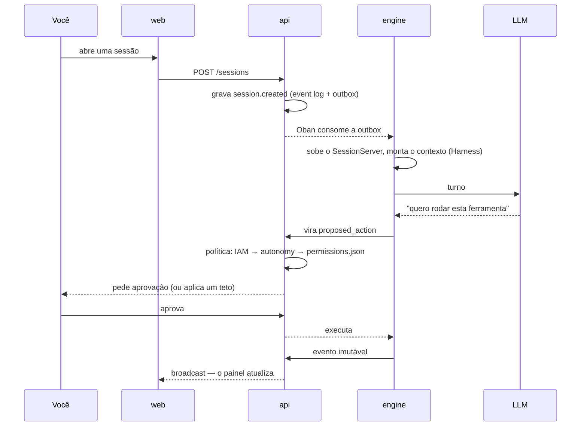

# Brabo 是什么 {#o-que-é-o-brabo}

Brabo 推进一个应用的完整生命周期——从需求简报到部署——由一支 AI 智能体团队在真实的 git
仓库上工作。Criativo、PO、Arquiteto、按模块划分的开发者、Infra、QA、SecOps、Psicólogo
和 Anamnese。

**最终决定权属于你**，这不是口号：这是架构本身的一项属性。

## 它与代码助手有何不同 {#o-que-o-separa-de-um-assistente-de-código}

**任何带有外部影响的动作都不会自行发生。** 终端命令、commit、push、PR、merge、token
消耗——一切都以 `proposed_action` 的形式产生，经过项目的策略（其中 `deny` 永远优先于
`allow`），然后才执行。有两种情况连策略也无法放行：**合并到受保护分支**和**修改智能体的指令**。
这些是上限，而不是默认值。

**智能体在构造上就不可信，系统也如此假定。** 它是一个语言模型：可能产生幻觉、陷入循环，
或者请求某种破坏性操作。限制是结构性的——迭代上限、每个 task 的修正上限、会拒绝调用的预算、
Anamnese 能够画像内容的封闭目录。提示词不是保证；代码才是。

**发生过的一切都有记录且不可变。** 事件日志（event log）只能追加，每个会话内编号连续。
正是它让 Psicólogo 的证据可追溯、成本可审计、备份可验证。

**团队会自我改进，而你始终在回路中。** Psicólogo 分析会话，并提出锚定于真实事件的假设；
Anamnese 推导出你的熟练度画像，并提出带版本的指令补丁。每个补丁都需要你的认可，而回滚会创建
一个新版本，而不是抹去历史。

## 一个回合，从头到尾 {#um-turno-do-começo-ao-fim}

## 从哪里开始 {#por-onde-começar}

| 你想要 | 前往 |
|---|---|
| 启动并运行第一个智能体 | [快速开始](getting-started.md) |
| 了解它是如何组装的 | [架构](architecture.md) |
| 知道系统保证了什么，以及这些保证在代码中的位置 | [业务规则](business-rules.md) |
| 运维：启动、恢复、轮换密钥、救火 | [Runbook](runbook.md) |
| 弄懂一个术语 | [术语表](glossary.md) |
| 知道某件事**为什么**这样决定 | [ADR](adr/index.md) |
| 配置 | [配置](reference/configuration.md) |
| 调整审批策略 | [权限](reference/permissions.md) |
| 理解 api ↔ engine 的契约 | [内部 API](reference/internal-api.md) |

## 状态 {#estado}

**第 1 至 26 阶段已完成**，版本 **v7.0.0**。已有的内容：

- IAM/RBAC、带不可变事件日志的会话、LLM 路由器、计量与预算、基于 `permissions.json`
  的审批流水线
- 适用于 Local、GitHub、GitLab、Bitbucket 及通用实现的 GitProvider，遵循统一契约，
  capability 只在被证明后才声明；幂等的 Gitflow bootstrap，以及以计划为闸门接管已有仓库
- 完整的 Harness 和按领域划分的智能体层级——lead 作为对外联系人、私有的内部委派、汇总的裁决；
  Criativo、PO、Arquiteto 和 Dev Lead 为对话式智能体，按模块划分的开发者在隔离的 worktree
  中工作，QA 和 SecOps 作为 PR 的 gate，Infra 负责提案，Psicólogo 和 Anamnese 形成闭环
- 自有认证（argon2id、Ed25519 访问令牌、带家族吊销的 refresh 轮换）——Keycloak 已整体移除；
  OpenAPI 在 controller 中按类型锁定，[参考文档](/reference/api/)由其生成
- 九个 LLM provider，构建于统一的 OpenAI 兼容基础之上，目录经人工策划，价格在计量时冻结
- 非 root 的生产镜像、Kustomize 部署并按 Oban 队列进行 HPA、优雅关闭、OpenTelemetry、
  **经过测试**的备份与恢复
- 机械化的发布流水线：版本由分支的功能计算得出、approval-ladder、promote/tag-release，
  以及带反向传播的 backmerge
- 应用本身：设计交接中的八个界面、只读的 Code 标签页（文件树、带自有高亮的文件、搜索、
  PR 的 diff、blame 以及 API 中的 PR）、面向两类受众的花费标签页、树状时间线、由 Arquiteto
  决定的每项目容器，以及概览中由他绘制的 C4 图

第 15 阶段之后的内容并非来自路线图：而是来自**使用产品**。16–26 计划诞生于对应用的第一次真实
浏览，测试会话中的每个发现都变成了带有 `arquivo:linha` 和测试的规则。整条链路已在真实的
GitHub 上得到证明——接管仓库、提升用户故事、dev agent 编写代码、打开 PR、gate 进行评判、
裁决返回。

尚不存在的东西已在重要的地方写明，值得一读：

- [已知技术债](architecture.md#divida-tecnica)是一个章节，而不是遗漏；
- [真实执行的发现](explanation/achados-execucao-real.md)记录了**出于决定**而保持开放的问题——
  包括两种情况，其结论是：通往自主性的道路并不经过放松策略；
- 每项目容器的生命周期是第 25 阶段**声明的削减**，并非遗忘：在它上线之前，
  [ADR 0055](adr/0055-escopo-de-caminho-na-politica-de-terminal.md) 的终端策略保持原样有效。
