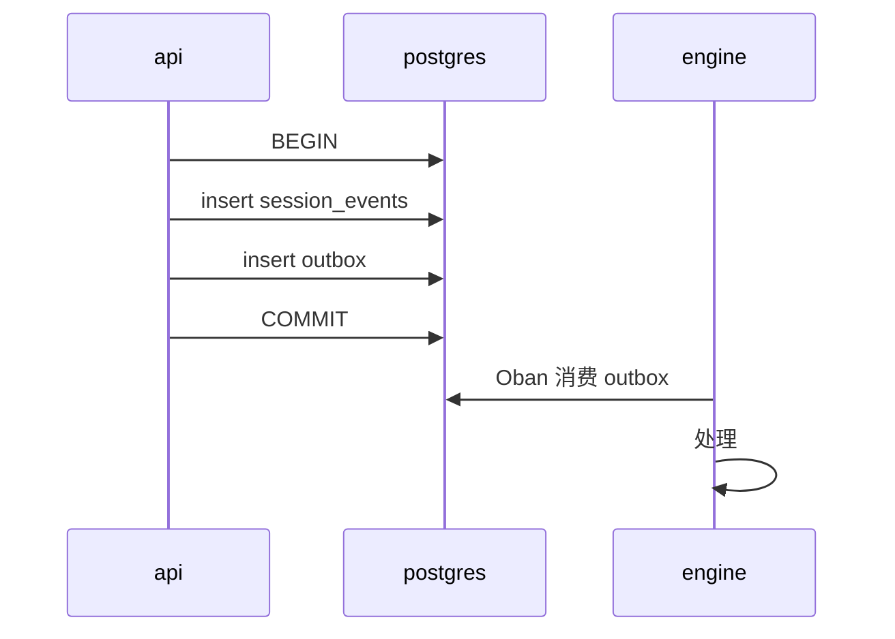

# 事件

Brabo 中并存着三族名称，而且很容易混淆，因为它们都使用 `主题.动词` 的形式：

| 族 | 所在位置 | 持久性 |
|---|---|---|
| **领域事件** | `session_events` 中的一行 | **永久且不可变** |
| **Broadcast** | Phoenix 通道 → 浏览器 | 短暂，不持久化 |
| **Span** | OpenTelemetry 的 trace | Tempo 的保留期（本地为 24 小时） |

只有第一种是契约。另外两种是传输和观测。

## 领域事件

`session_events` 中的一行，只追加，每个会话有一个连续的 `seq`（[RN-002](../business-rules.md#rn-002)）。列：

| 列 | 含义 |
|---|---|
| `id` | uuid |
| `session_id` | 所属会话 |
| `seq` | 会话内的顺序，从 1 开始，没有空洞 |
| `type` | 下面的标识符 |
| `actor` | 由谁引起：`{kind, id}`——用户、agent 或系统 |
| `payload` | jsonb，每种类型有自己的格式 |
| `created_at` | — |

> **`type` 在代码中是自由的 `string`**——没有 TypeScript 的 union，也没有数据库 enum 列出合法的类型。下面的列表是从发出事件的位置提取的，因此可能过时而不会弄坏任何东西。参见本页末尾的说明。

### 会话

| 类型 | 时机 |
|---|---|
| `session.created` | 会话以 `created` 状态诞生 |
| `session.activated` | 转为 `active` |
| `session.draining` | 承载它的节点正在排空 |
| `session.closed` | 正常结束 |
| `session.closed_abnormally` | 带原因的结束——`node_shutdown` 是最常见的 |
| `session.reopened` | 一个 `closed`/`closed_abnormally` 的会话回到了 `active`（ADR 0183） |

**终止状态的会话不再接收对话（[RN-581](../business-rules.md#rn-581)）。** 当会话处于 `closed` 或 `closed_abnormally` 时，写入对话事件会被以 **409** 和 `reason: "sessao_encerrada"` 拒绝。对话是指只作为对话存在的类型（`chat.message`、`chat.message_cancelled`、`chat.structured_question`、`chat.structured_question_answered`、`agent.status`、`agent.activated`、`handoff.offered`、`handoff.accepted`、`readiness.confirmed`、`necessity.validated`、`architecture.readiness_confirmed`），或者任何 actor 是对话 agent 的事件——所以创意 agent 的 `tool.call`/`agent.response` 会被拒绝，而来自心理学家的同类事件——它运行在已关闭的会话**之上**——仍然可以写入。对待处理动作的人工决策（`action.approved`/`action.denied`）也仍然可以写入：动作队列比会话活得久。因对话停滞超过上限而关闭的会话带有 `termination_reason: "conversation_idle_timeout"`，并以 `closed` 结束，与 `heartbeat_timeout` 相同。

**已关闭的会话可以重新打开（[RN-649](../business-rules.md#rn-649)，ADR 0183）。** `POST /projects/:projectId/sessions/:sessionId/reopen`（`developer`，ADR 0184）把一个 `closed`/`closed_abnormally` 会话带回 `active`，并写入 `session.reopened`，内容为 `{from, to, closedAt, terminationReason}`——这是它处于关闭状态那段时间的唯一记录，因为该行的 `closed_at` 和 `termination_reason` 会被清空。不会编辑任何之前的事件，会话的 `kind` 也不变。已有 `execution.activated` 的会话会被以 409 `sessao_com_execucao` 拒绝。

### 聊天与 agent

| 类型 | 时机 |
|---|---|
| `chat.message` | 会话对话流中的消息，来自用户或 agent |
| `chat.message_queued` | 消息在 agent 回合进行中到达，进入了它的**队列**而不是被拒绝（[RN-673](../business-rules.md#rn-673)，[ADR 0191](../adr/0191-a-mensagem-com-turno-em-curso-entra-numa-fila.md)）。Actor：该 agent。Payload：`mensagemId`（`chat.message` 的 id）、`texto`、`idioma` 和 `posicao`。文本放在这里是因为 engine 重启后队列要重新读取它。入队的消息保持**待处理**，直到某个 `chat.message_delivered` 或 `chat.message_cancelled` 指名它；每个 agent 每个会话最多 10 条 |
| `chat.message_delivered` | 读取队列的回合开始了：待处理的消息被**一起**、按顺序在一个回合中读取。Actor：该 agent。Payload：`mensagemIds` |
| `chat.message_cancelled` | **发送**待处理消息的人取消了它——没有 agent 读过它。Actor：该用户。Payload：`mensagemId`、`agente`。由 engine 写入；在已关闭的会话中被拒绝（[RN-581](../business-rules.md#rn-581)） |
| `chat.structured_question` | 创意 agent 通过表单一次请求**多个**回答——工具 `ask_structured_questions`（RN-162）。每个问题带有 `id`、`label`、`type`、`options` 和 `allowOther`——后者是 `select` 的自由文本出口，模型未声明时为 `true`（[RN-171](../business-rules/autenticacao.md#rn-171)） |
| `chat.structured_question_answered` | 用户回答了表单；回答也会作为 `chat.message` 返回给 agent 阅读 |
| `agent.activated` | 某个 agent 在会话中接手了工作 |
| `agent.response` | agent 完整、合并后的回应。`modelName` 说明是**哪个**模型生成的，三个生产方都会写（五个对话 agent、每个执行/gate agent 的 `ToolLoop`，以及没有活动 agent 时 api 的聊天）——回合在解析 binding 之前就失败时为 `null`，在该规则存在之前写入的事件中不存在（[RN-175](../business-rules/autenticacao.md#rn-175)）。来自对话 agent 时，`content` 只是回合的**收尾**文本，`passos`（没有时不存在）按顺序列出之前各轮的文本，对话流把它们折叠在"回合步骤"之下（[RN-698](../business-rules.md#rn-698)，AT-395） |
| `agent.error` | agent 的失败，带有 `origem`（`infra`/`modelo`/`codigo`/`politica`）以及它在对话流中说出的 `mensagem`（[RN-059](../business-rules/custo.md#rn-059)）。当 engine 在回合中途重启、孤立的 `working` 状态在启动时或 agent 启动时被关闭时，也会以 `reason: turno_interrompido_por_reinicio`（origem `infra`）发出，随后是 `agent.status: idle`（[RN-586](../business-rules.md#rn-586)）。它覆盖整个回合，也覆盖循环中途**某一个**工具的失败，payload 中带有 `tool` 和 `retentativa`（[RN-163](../business-rules/autenticacao.md#rn-163)） |
| `tool_router.decided` | Jev 选择工具的那一步（[RN-625](../business-rules.md#rn-625)，[ADR 0179](../adr/0179-o-laco-pergunta-ao-jev-qual-ferramenta.md)）：`menuAntes`/`menuDepois`、`escolha`、`confianca`、`segunda`、`anterior`、`aplicado`（菜单比目录小）、Jev 失败时的 `motivoDaQueda` + `origemDaQueda`（`infra`/`modelo`/`codigo`）、`latenciaMs`、`custoMicros`（**真实**的 `usage.cost`）和 `foraDoCardapio`（模型调用了但未被提供的工具）。由 engine 的门面为每个 agent 写入；没有咨询路由器时不存在（provider 不是 OpenRouter、工具少于两个、workspace 开关关闭）。收益的度量（AT-239）从这个事件和 `token_usage` 中读取，从不手工记录 |
| `tool.result` | 工具执行的结果，由 hook `Engine.Harness.Hooks.EventLog` 写入，对七个对话 agent（Infra Lead 自 [RN-617](../business-rules.md#rn-617) 起）则由它们的服务器写入，带 `tool`、`ok` 和 `resultado`（或 `erro`），截断为 2.000 个字符，截断时带 `resultadoTotal`（[RN-589](../business-rules.md#rn-589)）。Infra Lead 为它内联分派的每个工具产生同样的 payload，Dev Lead 在挂起的调用被解决时也会产生——但在它等待审批期间绝不会（[RN-593](../business-rules.md#rn-593)） |
| `handoff.offered` | 一个 agent 把工作提供给另一个 |
| `handoff.accepted` | 接收方接受了。通常由人接受（actor `user`）。当接受隐含在"我准备好了"点击中时（[RN-658](../business-rules.md#rn-658)），actor 仍是这个人，payload——以及随后的 `agent.activated` 的 payload——还带有 `implicito: { via: "readiness.confirmed", readinessEventId }`。自 [RN-660](../business-rules.md#rn-660)（[ADR 0186](../adr/0186-aceite-automatico-do-handoff-ao-arquiteto.md)）起，PO 向架构师的提议可以由 `system` actor `handoff-auto-accept` 接受，此时 payload 还带有 `automatico: true`、`emNomeDe`（打开会话的人——仓库以此人的名义创建）和 `criterio`（`regras`、`cobertas`、`repositorio`） |
| `handoff.auto_accept_failed` | 系统决定接受 PO 向架构师的提议（[RN-660](../business-rules.md#rn-660)），但接受失败了。Payload：`handoffId`、`toAgent`、`origem`（`infra`）和 `error`。Actor `system` `handoff-auto-accept`。提议未被标记为 `accepted` 时保留按钮 |
| `handoff.superseded` | 一个 `offered` 状态的 handoff 不再是现行的，也不能再被接受（[RN-635](../business-rules.md#rn-635)，[ADR 0182](../adr/0182-ciclo-de-vida-do-handoff.md)）。Payload：`handoffId`、`toAgent`、`motivo`（`agente_ativado`——目标通过任何途径被激活；`nova_oferta`——项目中对同一目标的更新提议取代了它）和 `substitutaId`（取代它的提议，`agente_ativado` 时为 `null`）。由 `system` actor `handoff-lifecycle` 写入**旧**提议所在的会话，该会话可能已关闭——这是记录而不是对话，所以 RN-581 允许它写入。该行的 `status` 变为 `superseded`；事件即历史 |
| `context.compacted` | 上下文管理器把某个 agent 历史中较早的回合做了摘要，以适应窗口。自 [RN-580](../business-rules.md#rn-580) 起，payload 除了 `tokensBefore`/`tokensAfter` 之外，还带有替代这些回合的 `summary`、拥有该历史的 `agent` 以及 `messagesSummarized`。在此之前写入的事件只带两个计数——摘要已经丢失，重新水合时会说明这一点，而不是编造一个 |

**对话 agent 重新读取什么（[RN-580](../business-rules.md#rn-580)）。** 当七个对话 agent 之一在已有对话的会话上启动时，`Engine.Agents.Reidratacao` 从这个日志的**尾部**（最近 200 个事件）重建它的历史：`chat.message`、`agent.response`、`chat.structured_question`（作为 agent 自己的回合，带标签和选项）以及它**自己**的 `tool.call`/`tool.result`（作为文本注记——事件不带调用 id，所以绝不会被重放为 `role: tool`）。`chat.structured_question_answered` 被故意跳过：api 随后会把同样的回答写成 `chat.message`，agent 实时读到的就是那个。在队列中被取消的 `chat.message`，或对该 agent 仍待处理的 `chat.message`，也会被跳过（[RN-673](../business-rules.md#rn-673)）：前者从未被说出，后者会通过读取队列的回合到达。自 [RN-589](../business-rules.md#rn-589) 起，七者都会把工具返回的文本写入 `tool.result`（`resultado`，截断为 2.000 个字符，截断时 `resultadoTotal` 给出真实长度）；在此之前写入的会话调用没有 `tool.result`，注记会说明日志中没有结果。当对话长于尾部时，历史以一条系统消息开头，说明有多少更早的事件被省略，然后是最后写入的压缩摘要和开场消息。

### 提议的动作

| 类型 | 时机 |
|---|---|
| `proposed_action.created` | 动作诞生——在任何执行之前。`payload.status` 说明它如何诞生（`pending`、`auto_approved` 或 `denied`），这正是区分人工决策与策略的依据（[RN-049](../business-rules/custo.md#rn-049)）。`payload.reason` 说明是策略的**哪条**规则做了决定——即 `decide()` 返回的字符串，三种结果都有；在该规则存在之前写入的事件中不存在，这意味着"未记录"，绝不意味着"没有原因"。同名的 outbox 行**不**带它（[RN-567](../business-rules.md#rn-567)）。在 `terminal` 动作中——唯一一种决策会参考路径范围的类型——`payload.scopeRoot` 说明范围是与**哪个**根比较的，形式为 `{ executionMode, ancora, segmento }`：`container` → `ancora: raiz_gerenciada` 和 `workspace_dir_name`；`mounted` → `ancora: base_de_projetos` 和 `BRABO_PROJECTS_BASE` 之下的路径段（文件夹在基础目录之外或没有基础目录时为 `ancora: indisponivel`、`segmento: null`）；`runner` → `ancora: nome_da_pasta` 和 `workspace_dir_name`。**绝不**是绝对路径，那会把用户的 `$HOME` 暴露给每个成员。在旧事件和其他动作类型中不存在；也不在 outbox 中（[RN-609](../business-rules.md#rn-609)） |
| `proposed_action.approved` | 由用户决定——`actor` 是**点击的人**。自动批准**不**经过这里：它出现在 `created` 中，带 `status: auto_approved` 和 agent actor |
| `proposed_action.denied` | 被拒绝——终止状态。`actor` 是拒绝的人，`payload.reason` 是原因 |
| `proposed_action.executed` | 执行成功 |
| `action.failed` | 已执行但失败 |
| `permission.granted` | 授权已写入策略 |

### Backlog

| 类型 | 时机 |
|---|---|
| `backlog.epic_created` | — |
| `backlog.story_created` | — |
| `backlog.story_transitioned` | 故事的状态变更。`actor` 说明是谁推进的：`auto` 模式下是 `agent/po`，`manual` 模式下是 `user`（[RN-048](../business-rules/custo.md#rn-048)） |
| `backlog.story_completed` | PO 用 `complete_story` 补全了一个已有的 `draft` 故事——关联规则，填写 RF/DoD/DoR——而不是重新创建它（[RN-720](../business-rules.md#rn-720)） |
| `backlog.story_promotion_proposed` | PO 在 `manual` 模式的项目中完成了一个**完整**的故事：它保持 `draft`，等待用户决定，在此之前它的任何任务都不可领取（[RN-048](../business-rules/custo.md#rn-048)） |
| `backlog.story_promotion_returned` | 用户**拒绝**了推进，并带着原因把故事退回给 PO——原因成为其会话中的置顶消息，就像退回给 dev 的 gate 一样（[RN-048](../business-rules/custo.md#rn-048)） |
| `backlog.story_updated` | 一个没有执行中任务的 `draft` 故事的标题和/或描述被修正，由用户（Backlog 标签页）或 PO（`update_story`）完成。带有 `previousTitle`、`title` 和 `descriptionChanged`（RN-727） |
| `backlog.story_archived` | 一个没有执行中任务的 `draft` 故事被**归档**，由用户或 PO（`archive_story`）完成：它及其任务离开 backlog、覆盖率、计划和领取；该行保留。带有 `reason` 和 `taskIds`（RN-727，ADR 0212） |
| `backlog.story_demoted` | 某个模块从 `module_map` 中消失；故事回到 `draft`（[RN-012](../business-rules.md#rn-012)） |
| `backlog.story_overlap_warned` | 故事已创建，但它引用的**所有**规则都已被另一个故事覆盖——是警告，不是阻止：由用户判断是否重叠（[RN-081](../business-rules/custo.md#rn-081)） |
| `backlog.semantic_duplicate_warned` | 写入了一个故事或业务规则，其**标题**通过 embedding 与项目中同类型的已有项相比达到或超过阈值——是警告，绝不拒绝；payload 指出相似项和余弦值。Actor `system`/`duplicata-semantica`（[RN-681](../business-rules/custo.md#rn-681)） |
| `backlog.semantic_duplicate_check_skipped` | 语义重复检查**未能**运行——没有 embedding provider、daemon 宕机、10 秒上限——`reason` 说明是哪一种；该项照样被写入（[RN-681](../business-rules/custo.md#rn-681)） |
| `backlog.story_modules_assigned` | 故事 ↔ 模块的关联 |
| `backlog.task_created` | — |
| `backlog.task_claimed` | 某个 dev agent 领取了任务 |
| `backlog.task_status_changed` | — |
| `backlog.task_merge_conflict` | 任务 PR 已批准的合并因合并冲突被拒：`taskId`、`pullRequestId`、`conflictingFiles`、`actionId`。自 [RN-715](../business-rules.md#rn-715) 起，任务回到 `in_progress`，所属 dev agent 被 outbox 中的 `task.merge_conflict` 行唤醒（[RN-705](../business-rules.md#rn-705)） |
| `backlog.task_blocked` | 修正尝试次数耗尽，或登记了一个阻碍 |
| `backlog.task_unblocked` | — |
| `backlog.epic_without_story` | PO 结束了一个回合，创建了一个史诗却**没有**为它创建任何故事。史诗不产生任务——故事才产生——所以这是一个在没有可见错误的情况下卡住执行的状态。按 [RN-059](../business-rules/custo.md#rn-059) 模式的显式结果：带 `origem`、`epicIds`/`epicTitles` 和消息的持久事件，外加 broadcast `agent.error`。每次发生只报告**一次**，绝不循环（[RN-165](../business-rules/autenticacao.md#rn-165)） |
| `backlog.handoff_not_offered` | PO 结束了一个回合，所有业务规则都已覆盖，但未能向架构师提供 handoff：某个故事没有任务（`origem: modelo`，带 `storyIds`/`storyTitles`），或者读取 backlog 或创建提议失败（`origem: infra`）。当每个故事都有任务时，PO 的服务器自己会提供 handoff（[RN-700](../business-rules.md#rn-700)） |

### 执行与 gate

| 类型 | 时机 |
|---|---|
| `execution.plan_proposed` | **自 ADR 0086 起已弃用**（[RN-284](../business-rules.md#rn-284)）——旧会话的日志中仍可能有这个类型；新会话使用 `propose_execution_plan` 类型的 `proposed_action`（参见 `docs/reference/permissions.md`），因为 Dev Lead 的计划变成了真正的决策，在"审批"中被批准或拒绝，而不再是一个简单事件 |
| `execution.activated` | 执行阶段开始了。**只能写入 `criativa` 会话**——在 `consultiva` 会话中写入会返回 409（[RN-097](../business-rules.md#rn-097)）。说明一个会话**是否正在**执行的，仍然是这个事件，而不是 `sessions.kind` 列 |
| `execution.parallelization_suggested` | 系统提议并行化——只有当项目有一个登记为 `running` 的容器时才在激活时发出（否则 dev agent 会被阻塞，`dev.blocked_by_container`，更多 agent 只会让被阻塞的数量翻倍；AT-104） |
| `execution.plan_applied` | 人**批准**了 Dev Lead 的 `propose_execution_plan`（或它被自动批准），而这次批准**激活**了执行：计划中的每个任务获得了自己的模块，`ActivateExecutionUseCase` 运行了（[RN-677](../business-rules.md#rn-677)，[RN-678](../business-rules.md#rn-678)）。Payload：`actionId`、`sessaoDeExecucao`、`modulos`、`tarefasAtribuidas`，以及——当计划带有 `tarefas` 时——`tarefasPorModulo` 和 `modulosSemTarefa`（没有 agent 的模块，RN-709）。写入 Dev Lead 的会话，actor `system`/`action-executor` |
| `execution.plan_failed` | 已批准的计划**没有**激活执行——计划与现行的 `module_map` 不再吻合，或激活被拒绝（例如没有仓库时的 409）。Payload：相同的字段外加 `motivo`，即 api 自己的说法。人工决策被记录下来；当计划本身被拒时，任务上什么都没有写入 |
| `execution.parallelization_accepted` | 已接受——子 agent 继承基础 agent 的上限 |
| `dev.started` | dev agent 开始了周期（激活、并行化——**不**包括重新水合，后者从不重新触发） |
| `dev.working` | 领取了任务并搭建了 worktree |
| `dev.idle` | 模块的队列为空——现在没有可领取的任务 |
| `dev.blocked_by_container` | agent **没有**领取任务，因为项目没有**登记**为 `running` 的容器（[RN-502](../business-rules.md#rn-502)）。它像上面两个一样停在 `:idle`——`idle` 是唤醒仍能救回的唯一状态——而这个事件是区分"没有容器"、"队列为空"（`dev.idle`）和"领取失败"（`dev.error`）的唯一依据。api 从不被调用：这个守卫在 `claim_task/1` **之前**运行，所以不会有任务被领取却没有活着的主人。它会自行解决：outbox 中的 `container.running` 会唤醒项目中每个 `:idle` 的 agent |
| `dev.awaiting_approval` | git 动作等待审批（Fase 12e）：**gate 不会打开**——没有 PR 就没有可评判的东西——worktree 一直被占用，直到 `task.pr_settled`（[RN-050](../business-rules/custo.md#rn-050)） |
| `dev.awaiting_gate` | PR 已打开，等待 gate（Fase 12b）——`task_id`/`worktree` 仍被占用 |
| `dev.blocked` | 任务带着诊断被退回（迭代上限、预算超支、`report_blocked`、worktree/上下文失败）。自 [RN-743](../business-rules.md#rn-743) 起带有 `trabalhoPreservado`（`{branch, commit}` 或 `null`）：未提交的工作以 `<agente>[bot]` 身份提交到任务分支，agent 的下一个任务从这个分支出发 |
| `dev.idle_tripped` | 断路器跳闸（RN-047）——连续 N 个被阻塞的任务会让 agent 停下 |
| `dev.credit_exhausted` | 模型的 provider 因额度不足而拒绝（RN-726）——agent 暂停在 `idle_tripped`，不计入断路器，也不领取下一个任务；"重新启用"会恢复 |
| `dev.rearmed` | 用户重新启用了一个被卡住的 agent（Fase 12b）——`actor` 是点击的**用户**，而不是 agent |
| `pr.gate_changed` | PR 进入新的 gate（`awaiting_qa` → `awaiting_secops` → `awaiting_user`） |
| `infra.gate_changed` | Infra 的 gate |
| `gate.rescue_parked` | `GateRescuer` **搁置**了一个停滞超过 2 小时的 QA/SecOps 周期，而不是重启它（[RN-722](../business-rules.md#rn-722)，ADR 0207）；对话流显示一个"恢复 gate"按钮（[RN-724](../business-rules.md#rn-724)）。Payload：`taskId`、`gate`、`idadeSegundos`、`motivo`。Actor `system`/`gate-rescuer` |
| `gate.interrupted` | 在 engine **启动**时，一个最近的 `in_progress` gate 周期在集群的任何节点上都没有活着的进程：是重启杀死了它，救援者立即重启它，而不是等待 15 分钟的阈值（[RN-823](../business-rules.md#rn-823)）。Payload：`taskId`、`gate`、`ultimaAtividadeEm`、`retomadoEm`。Actor `system`/`gate-rescuer`；对话流把它显示为提示。不投影到图谱 |
| `infra.artifact_blocked` | Infra 的产物被拒绝 |

### 委派（Fase 8b，ADR 0038）

| 类型 | 时机 |
|---|---|
| `delegation.completed` | 子专业完成了；`payload.parecerArtifactId` 引用它**内部**的 `artifact.qa_verdict`——绝不是到达 gate 的那个 |
| `delegation.failed` | 子专业没有完成；`payload.failureOrigin` 是**来源**（`infra`\|`modelo`\|`codigo`\|`politica`，绝不靠排除法——ADR 0020） |
| `delegation.dispensed` | lead 决定**不**委派；`payload.justification` 解释原因——免除从不沉默 |

这三个都由 `QaLeadServer` 发出，每个子专业一个，与对 `record_gate_verdict` 的调用**分开**——上面的 `pr.gate_changed` 事件仍然是唯一描述 gate 本身的事件；这些描述的是 gate 背后的领域。

### 工具循环

| 类型 | 时机 |
|---|---|
| `toolloop.limit_reached` | 循环达到了迭代上限。`payload` 带有 `iteration` 和 `max_iterations`——上限按 agent **类型**设定（[RN-085](../business-rules/custo.md#rn-085)） |
| `toolloop.budget_exceeded` | 该循环的 token 预算在工作完成前耗尽；`payload` 带有 `tokens_spent_micros` 和 `token_budget_micros` |

由 `Engine.Harness.ToolLoop` 发出，而且——自 [RN-166](../business-rules/autenticacao.md#rn-166) 起——也由 `PoServer` 发出，它有**自己**的循环，在此之前耗尽上限时是**沉默**的。类型和 payload 故意相同：这是同一个事实，读日志的人不应该仅仅因为对话 agent 不使用 `ToolLoop` 就去学第二个名字。

### 产物

| 类型 | schema |
|---|---|
| `artifact.product_brief` | `title`、`summary`、`rules` |
| `artifact.business_rule` | `title`、`description`、`origin` |
| `artifact.decision_record` | `context`、`options`、`choice`、`consequences`——一个"精简 ADR"，六个对话 agent 中任何一个都可以发出；复用通用模式而不是专用模式，并与 `open_adr_pr`（只有架构师，真正提交的文档）共存（[RN-505](../business-rules.md#rn-505)） |
| `artifact.module_map` | 架构师的模块地图 |
| `artifact.module_routing` | 架构师为每个模块给出的候选镜像，现行 `module_map` 中每个模块一项——架构师**提名**，Infra **选定**（[RN-487](../business-rules.md#rn-487)，[ADR 0131](../adr/0131-roteamento-de-modulos-para-infra.md)） |
| `artifact.module_contracts` | 架构师给出的模块间契约：每个模块**暴露**什么（`modulo`、`expoe: [{tipo, assinatura, descricao}]`），带 `version`——每次都是完整列表，现行的取代之前的；模块消费什么是 `module_map` 的 `dependsOn`（[RN-684](../business-rules.md#rn-684)，[ADR 0200](../adr/0200-contrato-entre-modulos-artefato-do-arquiteto.md)） |
| `artifact.project_image` | `image`、`rationale`、`network`、`resources`、`version`（谁决定的由 actor 表示：`arquiteto` 或 `infra-lead`）——项目的容器镜像，当架构师决定它或 Infra Lead 选定一个候选时由 api 发出（`DecidirImagemDoProjetoUseCase`）（[RN-491](../business-rules.md#rn-491)）；有版本，没有表。engine 只**读取**它是否存在，以便在没有它时本地拒绝 `container_start_via_runner`（[RN-610](../business-rules.md#rn-610)） |
| `artifact.insight` | — |
| `artifact.prototipo_navegavel` | `personas`、`jornadas`、`prototipo`（`telas`、`anotacoes`）、`resumo`——UX Designer 的原型（[RN-286](../business-rules.md#rn-286)，ADR 0087） |
| `artifact.rfc_staff` | —（在 `Engine.Agents.StaffTools` 中校验，而不是由 `ArtifactSchemas` 校验——与 `artifact.insight` 情况相同）：`problema`、`opcoes`（`descricao`/`tradeoffs` 的列表）、`recomendacao`、`poc`（`escopo`，固定为 `descartavel: true`）。Staff 的 RFC（ADR 0088），在同一次工具调用中通过 handoff 返回给架构师 |
| `artifact.plano_de_teste` | `storyId`、`taskId`、`planoDeTeste`、`criteriosExecutaveis`、`estrategiaDeAutomacao`——qa-estratégia 的交付物（ADR 0090），在 dev 交付**之后**撰写，自 [ADR 0192](../adr/0192-plano-de-teste-depois-da-entrega.md) 起由 `qa-verificada` 周期消费（[RN-674](../business-rules.md#rn-674)） |
| `artifact.threat_model` | `storyId`、`threatModel`、`requisitosDeSeguranca`——SecOps 针对故事**设计**的"第二时刻"（[RN-360](../business-rules.md#rn-360)，ADR 0090） |

schema 是封闭的：缺少字段会拒绝发出（`Engine.Harness.ArtifactSchemas`）。

### 架构与就绪

| 类型 | 时机 |
|---|---|
| `architecture.readiness_confirmed` | — |
| `readiness.confirmed` | 用户在创意 agent 处点击了"我准备好了——需求已验证"。自 [ADR 0185](../adr/0185-estou-pronto-fecha-os-dois-gates.md) 起，payload 带有 `necessidadeValidada: true` 和 `aceiteImplicitoDoPo: true`，这是 PO 隐式接受所读取的标记（[RN-658](../business-rules.md#rn-658)）；更早的事件带 `{}` |
| `necessity.validated` | gate `necessidade-validada`（创意 → PO）：由一个人——绝不是模型的推断——声明创意 agent 整合的业务需求是正确的。自 [ADR 0185](../adr/0185-estou-pronto-fecha-os-dois-gates.md) 起，它由 `readiness.confirmed` 的**同一次**点击写入，在 engine 接受回合时立即写入，带 `productBriefId: null`（brief 来自这个回合）、`via: "readiness.confirmed"` 和 `readinessEventId`（[RN-657](../business-rules.md#rn-657)）。ADR 0095 那种单独点击产生的事件（[RN-406](../business-rules.md#rn-406)）带有指向被验证的 `artifact.product_brief` 的 `productBriefId` |

### Git 与 bootstrap

| 类型 | 时机 |
|---|---|
| `project.git_connected` | git 凭据关联到项目 |
| `project.repository_provisioned` | 仓库由 Brabo **创建** |
| `project.repository_adopted` | 一个**已存在**的仓库归入项目（[RN-046](../business-rules/custo.md#rn-046)） |
| `bootstrap.repository_adopted` | 专用会话中的同一事实，带有在 provider 中观察到的 `defaultBranch` |
| `bootstrap.step_started` | Gitflow 的六个步骤之一开始了 |
| `bootstrap.step_completed` | 已完成 |
| `bootstrap.step_skipped` | 早已完成——**这是成功**，不是错误（[RN-029](../business-rules.md#rn-029)） |
| `bootstrap.step_degraded` | 完成了，但缺少 provider 的某项能力（例如 Local 上的分支保护） |
| `bootstrap.step_failed` | 失败；bootstrap 可以从这一点恢复 |
| `bootstrap.plan_approved` | 用户批准了接管计划——**只有从这里开始，bootstrap 才会在被接管的仓库上运行**（[RN-045](../business-rules/custo.md#rn-045)） |
| `bootstrap.adopted_as_is` | 用户免除了 bootstrap；没有任何步骤运行，计划作为未应用内容的证据保留 |

### 成本

| 类型 | 时机 |
|---|---|
| `budget.threshold_crossed` | 70%、90% 或 100%——**每个阈值一次**（[RN-018](../business-rules/custo.md#rn-018)） |

### RAG 遥测（RN-479/480/481）

这两个是**叙述，绝不是度量的来源**，而且只在有会话时存在——也就是 agent 的路径上。来自 RAG 标签页的搜索是*项目*搜索，根本没有会话，而 `session_events.session_id` 是 `NOT NULL`，所以用 event log 度量会悄无声息地丢掉恰恰是人看着分数做的那些搜索。度量的来源是 `rag_searches`/`rag_feedback` 这对表（由 `pnpm --filter api medir:rag` 读取）；事件只是把同一事实放到会话的时间线上。

| 类型 | 时机 |
|---|---|
| `rag.search` | 某个 agent 在会话中做了一次混合搜索——payload 带有遥测行的 `searchId`、查询、`topK`、有多少结果超过阈值、搜索是否 `degraded` 以及 chunk 的 id（[RN-479](../business-rules.md#rn-479)，[RN-481](../business-rules.md#rn-481)） |
| `rag.feedback` | 某个 agent 把检索到的 chunk 判为 `util`/`irrelevante`——payload 带有 `searchId`、`chunkId`、判定以及该 chunk 在那次搜索中所处的**位置**（[RN-480](../business-rules.md#rn-480)） |

### 本地 runner（ADR 0103/0104）

| 类型 | 时机 |
|---|---|
| `project.workspace_verified` | `brabo-runner` 已连接，并确认了一个 `execution_mode: runner` 项目的路径——runner 是路径的事实来源，覆盖创建时输入的内容（[RN-423](../business-rules.md#rn-423)） |

### 心理学家

| 类型 | 时机 |
|---|---|
| `psychologist.analysis_completed` | — |
| `psychologist.analysis_failed` | 带分类后的原因：`infra`、`modelo`、`código` 或 `política` |
| `psychologist.analysis_skipped` | 会话没有**可分析**的事件，分析没有运行——`payload.analisaveis` 和 `payload.eventCount` 显示差别（[RN-079](../business-rules/custo.md#rn-079)） |
| `psychologist.hypothesis_proposed` | 一个带有有效 `evidenceEventIds` 的假设（[RN-021](../business-rules.md#rn-021)） |
| `psychologist.hypothesis_accepted` | — |
| `psychologist.hypothesis_dismissed` | — |
| `psychologist.hypothesis_accepted_for_anamnese` | 已接受并转交——闭合与 Anamnese 之间循环的环节 |

### Anamnese 与指令

| 类型 | 时机 |
|---|---|
| `anamnese.run_completed` | — |
| `anamnese.run_failed` | — |
| `anamnese.run_skipped` | 这一轮故意以**没有**画像结束——`payload.motivo` 说明原因（[RN-063](../business-rules/custo.md#rn-063)） |
| `anamnese.analysis` | Anamnese 的模型在这一轮中写下的文本（`payload.content`）；从不在会话对话流中绘制（[RN-695](../business-rules.md#rn-695)） |
| `anamnese.profile_updated` | `proficiency_profile` 发生了变化 |
| `anamnese.agent_deviation` | Anamnese 观察到的 **agent** 偏差（循环、被用户取消、被用户修复）——是产品的信号，绝不是用户的特征；`payload` 只有 `agente`、`tipo` 和 `evidenceEventIds`，不含个人数据，不投影到图谱（[RN-717](../business-rules.md#rn-717)，[ADR 0205](../adr/0205-desvio-do-agente-como-sinal-do-produto.md)） |
| `instruction.rolled_back` | 某个指令版本的回滚——创建新版本，不删除（[RN-027](../business-rules.md#rn-027)） |

---

## Broadcast

从 Phoenix 通道发往浏览器的消息。它们**不**被持久化：重新加载页面的人收不到它们——收到的是 event log。

| broadcast | 含义 |
|---|---|
| `agent.delta` | 模型流式输出的文本片段 |
| `agent.status` | agent 可见的状态变化 |
| `agent.done` | 回合结束了 |
| `agent.error` | 回合失败了 |
| `event.appended` | 有新事件进入日志——面板刷新的触发器；只带 `type` 和 `actorId` |

一个领域事件几乎总会产生一个 `event.appended`；反过来则不成立。自 [RN-579](../business-rules.md#rn-579) 起，engine 会为 api 通过 `EngineApiClient` 门面确认的**每一次**写入（记录、提议的动作、handoff、PO 的 backlog）发出它，而对被拒绝的写入从不发出。api 自己完成的写入——人对动作做决定、会话状态转换——自 AT-157 起也会到达同一个 broadcast：api 在写入提交之后向 engine 请求它（`POST /internal/sessions/:id/event-appended`），而对来自 engine 的写入不请求，因为 engine 已经宣布过了。浏览器只把它当作触发器：使 `type` 影响的东西失效（事件和预算总是；动作、handoff 或 backlog 按前缀），每个目标有一个最小窗口，通道活着时，会话页面的轮询降到 15 秒（预算为 30 秒）。

### 谁可以收听（RN-108）

进入 `session:<id>` 通道——从而接收这些 broadcast 中的任何一个——需要一个由 `POST /projects/:projectId/sessions/:sessionId/socket-ticket` 签发的一次性不透明 ticket（TTL 30 秒）。在 RN-108 之前，Phoenix socket 的 `connect/3` 除了 `session_id` 存在之外什么都不检查：发现了 UUID 的人就可以进入并收听一切。ticket 既不持久化也不在 event log 中读取——它存放在 `session_socket_tickets` 中，由 engine 自己验证和消费——因此不会出现在下面的领域事件清单中。参见 [RN-108](../business-rules/autenticacao.md#rn-108)。

## Span

OpenTelemetry 的 span 名称。一个会话是贯穿 api 和 engine 的**根 trace**（[ADR 0026](../adr/0026-fase5-observabilidade-e-graceful-shutdown.md)）。

### 领域名称

手工命名，每个重要操作一个。它们是在 Tempo 中会去搜索的名字：

| span | 位置 |
|---|---|
| `session.create` | api——根 |
| `agent.turn` | engine——ToolLoop 的一轮 |
| `llm.turn` | engine——对模型的调用 |
| `tool.call` | engine——一个工具的执行 |
| `gate.scanner` | engine——SecOps 的一个扫描器，扫描器名称在一个属性中 |
| `outbox.session_lifecycle` | engine——Oban 的 job，挂在会话的 trace 上 |
| `outbox.psychologist` | engine——同上，心理学家的分析 |

### 从代码派生的名称

api 的 `@Traced` 装饰器（[ADR 0035](../adr/0035-observabilidade-legivel-e-trace-sem-coletor.md)）把 span 命名为 **`类.方法`**——例如 `TransitionSessionUseCase.execute`、`DrizzleOutboxRepository.append`。它们无法列在这里：它们随代码生灭，列表会在第一次改名时过时。

这个区别在查询时很重要：领域名称是稳定的，可以放进保存的查询或仪表盘；从代码派生的名称则不行。

这些 span 带的属性——`brabo.layer`、`code.namespace`、`code.function`——用于在 Tempo 中搜索，与 `trace_id` 不同，它们**不是契约**。它们可以被重命名，而不会弄坏 Tempo 之外的任何东西。

如何从一个会话导航到一个 `tool.call`，记录在 [runbook](../runbook.md#observabilidade) 中；完整的模型记录在[可观测性](../explanation/observability.md)中。

---

## 事件如何到达 engine

不是通过外部队列。api 在**同一个事务**中写入事件以及发布它的意图（transactional outbox）；Oban 直接从 Postgres 消费。正是这一点防止了"事件已写入，但 engine 从不知道"。

---

## 完整清单

上面各节说明每个事件**何时**发生。这一节是对发出位置的机械扫描，每次 `pnpm docs:generate` 时重做——正是它让新的标识符即使没人写过也会出现在这里。

<!-- BEGIN:GENERATED:eventos-inventario -->

> ⚠️ 此区块由 `pnpm docs:generate` 生成。请勿手动编辑——下次构建会覆盖它。

从发出点提取：**115 个标识符**，其中 **3** 个未在上文描述。

- `action.failed` (apps/api/src/application/use-cases/actions/execute-git-action.use-case.ts)
- `agent.activated` (apps/api/src/application/use-cases/agents/activate-agent.use-case.ts)
- `agent.delta` (apps/engine/lib/engine/agents/arquiteto_server.ex)
- `agent.done` (apps/engine/lib/engine/agents/turno_assincrono.ex)
- `agent.error` (apps/api/src/application/use-cases/agents/aceite-implicito-do-po.use-case.ts)
- `agent.plan` (apps/engine/lib/engine/agents/diario.ex)
- `agent.response` (apps/api/src/application/use-cases/llm/send-chat-message.use-case.ts)
- `agent.status` (apps/engine/lib/engine/agents/diario.ex)
- `agent.turn` (apps/engine/lib/engine/harness/tool_loop.ex)
- `agent.turn_resumed` (apps/engine/lib/engine/agents/diario.ex)
- `anamnese.agent_deviation` (apps/engine/lib/engine/anamnese/tools/report_agent_deviation.ex)
- `anamnese.analysis` (apps/engine/lib/engine/workers/anamnese_worker.ex)
- `anamnese.profile_updated` (apps/api/src/application/use-cases/anamnese/record-proficiency.use-case.ts)
- `anamnese.run_completed` (apps/api/src/application/use-cases/anamnese/record-proficiency.use-case.ts)
- `anamnese.run_failed` (apps/engine/lib/engine/session_events/event.ex)
- `anamnese.run_skipped` (apps/engine/lib/engine/session_events/event.ex)
- `architecture.readiness_confirmed` (apps/api/src/application/use-cases/agents/offer-infra-handoff.use-case.ts)
- `artifact.business_rule` (apps/engine/lib/engine/agents/arquiteto_server.ex)
- `artifact.decision_record` (apps/api/src/application/use-cases/backlog/perguntas-em-aberto.use-case.ts)
- `artifact.insight` (apps/engine/lib/engine/harness/tools/emit_insight.ex)
- `artifact.module_map` (apps/api/src/application/use-cases/architecture/create-module-map.use-case.ts)
- `artifact.open_question` — ⚠️ **上文未描述** (apps/engine/lib/engine/harness/decisoes_do_projeto.ex)
- `artifact.plano_de_teste` (apps/engine/lib/engine/gates/qa_lead_server.ex)
- `artifact.product_brief` (apps/engine/lib/engine/agents/arquiteto_server.ex)
- `artifact.project_image` (apps/engine/lib/engine/harness/ambiente_do_agente.ex)
- `artifact.prototipo_navegavel` (apps/engine/lib/engine/agents/ux_designer_tools.ex)
- `artifact.qa_verdict` (apps/engine/lib/engine/gates/qa_lead_server.ex)
- `artifact.rfc_staff` (apps/engine/lib/engine/agents/staff_tools.ex)
- `artifact.secops_verdict` — ⚠️ **上文未描述** (apps/engine/lib/engine/gates/secops_agent_server.ex)
- `artifact.threat_model` (apps/engine/lib/engine/agents/dev_lead_tools.ex)
- `backlog.epic_created` (apps/api/src/application/use-cases/backlog/create-epic.use-case.ts)
- `backlog.epic_without_story` (apps/engine/lib/engine/agents/po_server.ex)
- `backlog.handoff_not_offered` (apps/engine/lib/engine/agents/po_server.ex)
- `backlog.semantic_duplicate_check_skipped` (apps/api/src/application/use-cases/backlog/verificar-duplicata-semantica.use-case.ts)
- `backlog.semantic_duplicate_warned` (apps/api/src/application/use-cases/backlog/verificar-duplicata-semantica.use-case.ts)
- `backlog.story_archived` (apps/api/src/application/use-cases/backlog/corrigir-historia.use-case.ts)
- `backlog.story_completed` (apps/api/src/application/use-cases/backlog/complete-story.use-case.ts)
- `backlog.story_created` (apps/api/src/application/use-cases/backlog/create-story.use-case.ts)
- `backlog.story_demoted` (apps/api/src/application/use-cases/architecture/create-module-map.use-case.ts)
- `backlog.story_modules_assigned` (apps/api/src/application/use-cases/architecture/assign-story-modules.use-case.ts)
- `backlog.story_overlap_warned` (apps/api/src/application/use-cases/backlog/create-story.use-case.ts)
- `backlog.story_promotion_proposed` (apps/api/src/application/use-cases/backlog/complete-story.use-case.ts)
- `backlog.story_promotion_returned` (apps/api/src/application/use-cases/backlog/return-story.use-case.ts)
- `backlog.story_transitioned` (apps/api/src/application/use-cases/backlog/transition-story.use-case.ts)
- `backlog.story_updated` (apps/api/src/application/use-cases/backlog/corrigir-historia.use-case.ts)
- `backlog.task_blocked` (apps/api/src/application/use-cases/execution/mark-task-blocked.use-case.ts)
- `backlog.task_claimed` (apps/api/src/application/use-cases/execution/claim-next-task.use-case.ts)
- `backlog.task_created` (apps/api/src/application/use-cases/backlog/create-task.use-case.ts)
- `backlog.task_merge_conflict` (apps/api/src/application/use-cases/actions/execute-git-action.use-case.ts)
- `backlog.task_status_changed` (apps/api/src/application/use-cases/actions/execute-git-action.use-case.ts)
- `backlog.task_unblocked` (apps/api/src/application/use-cases/execution/unblock-task.use-case.ts)
- `bootstrap.adopted_as_is` (apps/api/src/application/use-cases/git/decide-bootstrap-plan.use-case.ts)
- `bootstrap.plan_approved` (apps/api/src/application/use-cases/git/decide-bootstrap-plan.use-case.ts)
- `bootstrap.repository_adopted` (apps/api/src/application/use-cases/git/adopt-repository.use-case.ts)
- `bootstrap.step_acknowledged` — ⚠️ **上文未描述** (apps/api/src/application/use-cases/git/acknowledge-protection-failure.use-case.ts)
- `bootstrap.step_completed` (apps/api/src/application/use-cases/git/bootstrap-runner.ts)
- `bootstrap.step_degraded` (apps/api/src/application/use-cases/git/bootstrap-runner.ts)
- `bootstrap.step_failed` (apps/api/src/application/use-cases/git/bootstrap-runner.ts)
- `bootstrap.step_skipped` (apps/api/src/application/use-cases/git/bootstrap-runner.ts)
- `bootstrap.step_started` (apps/api/src/application/use-cases/git/bootstrap-runner.ts)
- `budget.threshold_crossed` (apps/api/src/application/use-cases/llm/record-llm-usage.use-case.ts)
- `chat.message` (apps/api/src/application/use-cases/agents/send-agent-message.use-case.ts)
- `chat.message_cancelled` (apps/engine/lib/engine/agents/fila_de_mensagens.ex)
- `chat.message_delivered` (apps/engine/lib/engine/agents/fila_de_mensagens.ex)
- `chat.message_queued` (apps/engine/lib/engine/agents/fila_de_mensagens.ex)
- `chat.structured_question` (apps/engine/lib/engine/agents/reidratacao.ex)
- `chat.structured_question_answered` (apps/api/src/application/use-cases/agents/answer-structured-question.use-case.ts)
- `delegation.completed` (apps/api/src/application/use-cases/execution/record-delegation.use-case.ts)
- `delegation.dispensed` (apps/api/src/application/use-cases/execution/record-delegation.use-case.ts)
- `delegation.failed` (apps/api/src/application/use-cases/execution/record-delegation.use-case.ts)
- `event.appended` (apps/engine/lib/engine/sessions/live_broadcast.ex)
- `execution.activated` (apps/api/src/application/use-cases/execution/activate-execution.use-case.ts)
- `execution.parallelization_accepted` (apps/api/src/application/use-cases/execution/accept-parallelization.use-case.ts)
- `execution.parallelization_suggested` (apps/api/src/application/use-cases/execution/activate-execution.use-case.ts)
- `gate.interrupted` (apps/engine/lib/engine/gates/gate_rescuer.ex)
- `gate.rescue_parked` (apps/engine/lib/engine/gates/gate_rescuer.ex)
- `gate.scanner` (apps/engine/lib/engine/gates/scanner.ex)
- `handoff.accepted` (apps/api/src/application/use-cases/agents/accept-handoff.use-case.ts)
- `handoff.auto_accept_failed` (apps/api/src/application/use-cases/agents/aceitar-handoff-automaticamente.use-case.ts)
- `handoff.offered` (apps/api/src/application/use-cases/agents/create-handoff.use-case.ts)
- `handoff.superseded` (apps/api/src/application/use-cases/agents/ciclo-de-vida-do-handoff.service.ts)
- `infra.artifact_blocked` (apps/api/src/application/use-cases/execution/mark-infra-artifact-blocked.use-case.ts)
- `infra.correction_delivered` (apps/engine/lib/engine/infra/infra_lead_server.ex)
- `infra.correction_queued` (apps/engine/lib/engine/infra/infra_lead_server.ex)
- `infra.gate_changed` (apps/api/src/application/use-cases/execution/record-infra-gate-verdict.use-case.ts)
- `instruction.rolled_back` (apps/api/src/application/use-cases/instructions/rollback-instruction.use-case.ts)
- `llm.turn` (apps/engine/lib/engine/sessions/engine_api_client.ex)
- `necessity.validated` (apps/api/src/application/use-cases/agents/confirm-readiness.use-case.ts)
- `permission.granted` (apps/api/src/application/use-cases/actions/approve-always-action.use-case.ts)
- `pr.gate_changed` (apps/api/src/application/use-cases/execution/open-gate.use-case.ts)
- `project.git_connected` (apps/api/src/application/use-cases/git/handle-git-oauth-callback.use-case.ts)
- `project.repository_adopted` (apps/api/src/application/use-cases/git/adopt-repository.use-case.ts)
- `project.repository_provisioned` (apps/api/src/application/use-cases/git/provision-repository.use-case.ts)
- `project.workspace_verified` (apps/api/src/application/use-cases/iam/confirm-project-workspace.use-case.ts)
- `proposed_action.approved` (apps/api/src/application/use-cases/actions/approve-action.use-case.ts)
- `proposed_action.created` (apps/api/src/application/use-cases/actions/propose-action.use-case.ts)
- `proposed_action.denied` (apps/api/src/application/use-cases/actions/deny-action.use-case.ts)
- `proposed_action.executed` (apps/api/src/application/use-cases/actions/execute-git-action.use-case.ts)
- `psychologist.analysis_completed` (apps/api/src/application/use-cases/execution/propose-hypotheses.use-case.ts)
- `psychologist.analysis_failed` (apps/engine/lib/engine/workers/psychologist_worker.ex)
- `psychologist.analysis_skipped` (apps/engine/lib/engine/workers/psychologist_worker.ex)
- `psychologist.hypothesis_accepted` (apps/api/src/application/use-cases/execution/accept-hypothesis.use-case.ts)
- `psychologist.hypothesis_accepted_for_anamnese` (apps/api/src/application/use-cases/execution/accept-hypothesis.use-case.ts)
- `psychologist.hypothesis_dismissed` (apps/api/src/application/use-cases/execution/dismiss-hypothesis.use-case.ts)
- `psychologist.hypothesis_proposed` (apps/api/src/application/use-cases/execution/propose-hypotheses.use-case.ts)
- `rag.feedback` (apps/api/src/application/use-cases/rag/record-rag-feedback.use-case.ts)
- `rag.search` (apps/api/src/application/use-cases/rag/hybrid-search.use-case.ts)
- `readiness.confirmed` (apps/api/src/application/use-cases/agents/confirm-readiness.use-case.ts)
- `session.activated` (apps/api/src/db/seed.ts)
- `session.closed` (apps/engine/lib/engine/outbox/drain.ex)
- `session.closed_abnormally` (apps/engine/lib/engine/outbox/drain.ex)
- `session.created` (apps/api/src/application/use-cases/sessions/create-session.use-case.ts)
- `session.draining` (apps/engine/lib/engine/shutdown.ex)
- `tool.call` (apps/engine/lib/engine/agents/arquiteto_server.ex)
- `tool.result` (apps/engine/lib/engine/agents/arquiteto_server.ex)
<!-- END:GENERATED:eventos-inventario -->

---

> **TODO(humano):** `type` 在 `application/ports/session-event-repository.port.ts` 中是自由的 `string`——没有任何东西能阻止一个拼写错误悄无声息地创建新类型，也没有任何东西保证本页覆盖了全部类型。从 `packages/shared` 导出一个 TypeScript union 可以同时解决这两个问题，并让这个列表可以被**生成**而不是手工维护。在它出现之前，上面的列表是对发出位置的一次带日期的提取。
