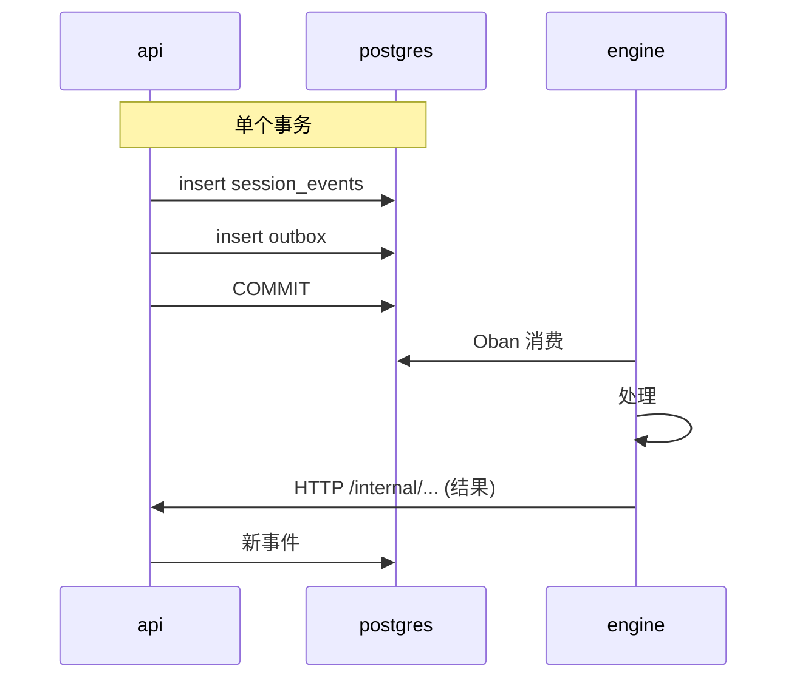

# 内部 API（api ↔ engine）

api 和 engine 之间以**两种**方式对话，二者之间的选择不是风格问题：

| 方向 | 机制 | 何时使用 |
|---|---|---|
| api → engine | **outbox + Oban** | 事件：某件事发生了，engine 在能处理时做出反应 |
| api → engine | **HTTP** | 同步命令：我现在就需要响应 |
| engine → api | **HTTP**（`/internal/*`） | engine 请求数据或登记一个结果 |

判断标准：如果操作需要与一次数据库写入保持原子性，它就走 outbox——api 在同一个事务里写入事件以及发布它的意图，不存在其中一个存在而另一个不存在的窗口。如果需要即时响应，就走 HTTP。

**不在本页范围内**：由用户的普通 JWT 认证的 HTTP 路由（按角色的 RBAC，`@RequireRole`）——例如
`/projects/:projectId/agent-autonomy`、`/projects/:projectId/container/lifecycle`
（[RN-267](../business-rules.md#rn-267)）、
`.../agents/criativo/validate-necessity`（gate `necessidade-validada`，
[RN-406](../business-rules.md#rn-406)，ADR 0095）或
`/projects/:projectId/personal-access-tokens` 的 CRUD（[RN-426](../business-rules.md#rn-426)，
ADR 0105）——包括两条 `maintainer` 路由
（`GET .../personal-access-tokens/all`、
`DELETE .../personal-access-tokens/:tokenId/admin`，
[RN-427](../business-rules.md#rn-427)）——都不是本文意义上的“内部”路由，即使实际调用它们的是某个智能体。`/workspaces/:workspaceId/huggingface/*` 下 `HuggingFaceModelsController` 的四条路由
（[RN-462](../business-rules.md#rn-462)、[RN-463](../business-rules.md#rn-463)，
ADR 0115）同理：`role:maintainer`，是人在项目/工作区设置中的直接操作，engine 从不调用。两条成员关联路由 `POST`/`DELETE /projects/:projectId/members`
（[RN-471](../business-rules.md#rn-471)、
[RN-472](../business-rules.md#rn-472)，ADR 0127）也同理——而且在那里这是结构上的事实，而不只是碰巧为真：该路由现在施加的两个降级上限（没有人能降级工作区的 `owner`，没有人能降级自己）位于 `AddProjectMemberUseCase` 内部，因此任何通往 `project_members` 的第二扇门都能绕过它们。这样的门一扇也没有——没有任何 `/internal/*` 路由写这张表，该用例只有一个调用者，就是那条 RBAC 路由本身。共享的 service token 在这些路由上**绝不**充当凭据，用户的 JWT 也从不在 `/internal/*` 上生效——两种机制互不重叠
（[RN-035](../business-rules/autenticacao.md#rn-035)）。

**第三种凭据，既不是 service token 也不是用户 JWT**：
`POST /projects/:projectId/runner-ticket` 与任何 RBAC 路由一样是 `role:developer`，但不接受普通会话 JWT——只接受两种设备范围凭据之一，二者都由同一个 `PatAuthGuard`/
`@RequirePatAuth()` 处理，并在构造上仅限于这一条路由：一个
Personal Access Token（`brb_…`，[RN-424](../business-rules.md#rn-424)，ADR
0105），或者一个短寿命（≤60s）的自签名 EdDSA JWT，用来证明持有 `runner_device_keys` 中的一把 Ed25519 设备密钥——它可以是在终端创建、由安装器登记的机器密钥
（[RN-552](../business-rules.md#rn-552)），也可以是浏览器在
[ADR 0203](../adr/0203-aposenta-o-fluxo-do-runner-pelo-navegador.md)
退役该流程之前登记的项目密钥（[RN-465](../business-rules.md#rn-465)，ADR 0118）——它是对 PAT 的补充，从不取而代之。之所以在这里记下，是因为这正是本页要解释的区别：“不是 `/internal/*`”并不意味着“那就是用户 JWT”——两种设备凭据是第三种机制，与另外两种没有重叠。

同样不在范围内的还有：作为事实上入口点、在任何会话存在之前的 `@Public()` 路由——`POST /auth/login`、`POST /auth/register`、
`GET /auth/oauth/:provider/start`/`callback`（社交登录，ADR 0084）以及
`auth.controller.ts` 的其余部分。它们都不使用 service token，也不使用用户 JWT（那是它们签发的东西，而不是它们要求的东西），所以本页要解释的 service token × JWT 之分对它们不适用——它们在入口处根本没有凭据。每条 HTTP 路由（无论是否内部）的暴露分类都在
[docs/security-surface.md](../security-surface.md)。

## 认证

没有任何一端信任私有网络。所有端都出示**同一个 service token**——一个通过环境变量共享、可轮换的密钥，放在 `X-Brabo-Service-Token` 请求头中：

| 调用方 | 校验者 | 比较方式 |
|---|---|---|
| engine → api | `EngineServiceGuard` | `comparaEmTempoConstante` |
| api → engine | `EngineWeb.Plugs.VerifyServiceToken` | `Plug.Crypto.secure_compare/2` |
| broker → api | `EngineServiceGuard` | `comparaEmTempoConstante` |
| api → broker | `tokenConfere`（`apps/broker/src/config.ts`） | `timingSafeEqual` |
| `install.sh` → api | `EngineServiceGuard` | `comparaEmTempoConstante` |

broker（[ADR 0130](../adr/0130-broker-de-container.md)）加入这张表时没有改变它：同样的请求头、同样的密钥、同样的轮换。在 api 回 `403` 的地方它回 `401`，与 engine 一样——缺的是调用方的认证，而 api 的 `403` 是一个有文档记录的兼容性约束，并非分歧。

> **这部分流量不经过 JWT。** `/internal/*` 路由标注了
> `@ServiceRoute()`，这使它们脱离 `JwtAuthGuard`，并免于
> `RateLimitGuard`（它在控制器的 guard 之前运行，所以豁免必须来自元数据）。用户的 access token，即使是 `owner` 的，也打不开其中任何一条；service token 也打不开任何其他路由。见
> [RN-035](../business-rules/autenticacao.md#rn-035)。

> **无停机轮换。** `BRABO_SERVICE_TOKEN` 是发送的值；
> `BRABO_SERVICE_TOKEN_PREVIOUS` **只在校验时**被接受。由于两端都发送当前值并接受两者，轮换就是与
> `AUTH_JWT_SECRET` 相同的三步舞，见
> [runbook](../runbook.md#rotacao-das-chaves-do-auth)。

## 关联

两个服务之间的每次调用还会携带 `traceparent` 请求头（W3C），这在**两个方向、所有方法**上都成立——GET、POST 以及 LLM 轮次的 SSE 流。每一侧都有唯一一个组装请求头的漏斗：

| 调用方 | 漏斗 |
|---|---|
| api → engine | `HttpApiToEngineClient.buildHeaders()` |
| engine → api | `EngineApiClient.headers/0` |

在 [ADR 0035](../adr/0035-observabilidade-legivel-e-trace-sem-coletor.md) 之前，engine 一侧的 `traceparent` 只注入到 POST 中，所以读取操作（`list_events`、智能体上下文）和 `llm_turn_stream` 到达 api 时没有关联——在 Tempo 中显示为孤立的 trace。如果你为这份契约新增一个调用，请使用该漏斗：正是它保证新调用不会生来就是孤立的。

> service token 被拒绝时，两侧都会记录日志，带上路由和来源
> ——并且**不**带出示的 token。没有日志的话，这里的 401 与“engine 宕机”无法区分，而那正是以前的症状。

> `/internal/*` 路由**并不是靠命名约定才成为内部的。** 前缀是为了可读性；保护它们的是校验 service token 的 guard。完整分类见
> [`docs/security-surface.md`](../security-surface.md)，一个表格测试会让没有分类的新路由不通过。

## engine → api

二十八条路由，除非另有说明，都位于 `/internal/sessions/:sessionId/` 之下。按用途分组。

这一族中有一条路由的调用者**不是** engine——见下文
[broker → api](#broker--api)。分类命名的是机制，而不是发送方。

### 事件日志与动作

| 方法 | 路径 |
|---|---|
| GET · POST | `/events` |
| POST | `/actions` |
| POST | `/termination` |
| POST | `/handoffs` |

engine 从不直接写事件表——它**请求** api，由 api 控制 `seq` 以及与 outbox 的原子性。

`POST /handoffs` 对每个（项目，目标）**最多保持一个 `offered` 状态的 handoff**
（[RN-635](../business-rules.md#rn-635)，
[ADR 0182](../adr/0182-ciclo-de-vida-do-handoff.md)）。响应是**当前有效**的提议加上 `desfecho`：`criado`、`substituiu_oferta`（待处理的那个变成
`superseded`，并产生一个 `handoff.superseded` 事件）或 `ja_oferecido`（没有新行——同一会话且没有新工件）。目标已在该项目某个未关闭会话中活跃时，以 **409** `reason: "agente_ja_ativo"` 拒绝，其
`message` 就是智能体读到的工具结果文本
（`Engine.Harness.Tools.OfferHandoff` 原样转发；
`FalhaDeTurno.origem/1` 将其归类为 `politica`）。请求体中的可选字段
`seAusente: true`——由 AppSec 通过 `create_handoff_if_absent/5` 发送
（[RN-636](../business-rules.md#rn-636)）——会返回指向该目标的**任意**待处理提议，而不是替换它。

由“Estou pronto — a necessidade está validada”点击所请求的 Criativo→PO 提议，会在同一次调用中以点击者的名义被**接受**
（[RN-658](../business-rules.md#rn-658)，
[ADR 0185](../adr/0185-estou-pronto-fecha-os-dois-gates.md)）：该提议是
`criativo` → `po`、属于本会话，并携带在最后一个被标记的 `readiness.confirmed` 之后产生的 `product_brief`。接受走的是卡片上同一个
`AcceptHandoffUseCase`（同样的事件，以该人为行为者，带一个
`implicito` 标记），此时响应携带 `status: "accepted"`。engine 只匹配 `{:ok, _}`，所以它那一侧什么都不变；失败的隐式接受永远不会变成 engine 的错误——它变成一个持久的
`agent.error`，提议照常返回。

`GET /events` 是七个对话型智能体在其进程于已有对话的会话上启动时读取的内容，也是 kickoff 读取以找到 brief、规则、模块地图和用户故事的内容
（[RN-580](../business-rules.md#rn-580)）。在那之前，这条路由只理解
`afterSeq` 和 `limit`，而 engine 只发送 `limit=200`——于是它收到的是**最早的** 200 个事件，一个在 201 个事件的对话中被唤醒的智能体，启动时就缺了它正在回复的那条消息。新增了两个查询参数，二者都是**增量的**（不带它们时响应与旧的逐字节相同）：

| 参数 | 效果 |
|---|---|
| `latest=true` | 返回**尾部**——最后 `limit` 个事件，仍按 `seq` 递增排列——并忽略 `afterSeq`；与面向人的路由语义相同（ADR 0021） |
| `types=a.b,c.d` | 只返回这些类型的事件，`limit` 只计算它们；最多 20 个类型，每个都要匹配 `^[a-z][a-z0-9_]*(\.[a-z0-9_]+)*$`，否则 **400** |

每页的上限仍是 **200**（[ADR 0060](../adr/0060-superficie-de-leitura-de-codigo.md)）：
这两个参数都不会让读取变得无上限。在 engine 一侧，新的读取通过 `EngineApiClient.list_events/3` 进行；`list_events/2` 依然存在、没有改动，供尚未迁移的调用方使用（`InfraLeadServer`、`DevLeadTools`）。

这也是为什么会话类型的守卫位于 append 用例中，而不是在
`ActivateExecutionUseCase` 中：这里的 `POST /events` 与用户的路由汇入同一个漏斗。自 FASE 20 起，在 `consultiva` 会话中写入 `execution.activated` 走这条路径时同样回 **409**——类型是创建意图，事件并不会提升它（[RN-097](../business-rules.md#rn-097)）。契约没有其他变化：其他事件类型保持不变，并且拒绝发生在 `incrementSeq` **之前**，所以被拒绝的尝试不会在 `seq` 中留下空洞。

自 [RN-581](../business-rules.md#rn-581) 起，同一个漏斗还会拒绝在已经 `closed`/`closed_abnormally` 的会话中进行**对话**：
**409**，带具名的响应体——`{ message, reason: "sessao_encerrada", status,
type }`。“对话”指只作为对话存在的类型
（`chat.message`、`chat.structured_question[_answered]`、`agent.status`、
`agent.activated`、`handoff.offered`/`accepted`、就绪类事件）**或**
行为者是对话型智能体的任意事件（六个，加上 `dev-lead` 和
`infra`）。关闭本身产生的东西仍然可以写入——心理师（Psicólogo）的
`ToolLoop`、Anamnese 的结局、人对待处理动作的决定。状态来自预留 `seq` 的**同一个** `UPDATE`，拒绝会撤销这次递增：同样不留空洞。engine 的
`append_event/3` 会把拒绝记为警告而不是丢弃它，因为它的大多数调用方会丢弃返回值。

`ActivateExecutionUseCase` 新增了第二个副作用，它**不**经过本文的任何路由（[RN-135](../business-rules/custo.md#rn-135)）：在激活结束时，如果用户路由提供了 `originSessionId`（点击来源的那个 CHAT 会话），它会通过
`TransitionSessionUseCase` 关闭该会话——与本页 `POST /termination` 供 engine 报告结束所用的路径相同，但由 api 触发，完全不去 engine。没有新路由，现有的 `engine → api` 契约也没有任何变化。

`GET /projects/:projectId/execution/session`（[RN-139](../business-rules/autenticacao.md#rn-139)）
是同一个故事的反面：它通过外部 HTTP 暴露了一项读取
（`findActiveExecutionSession`），此前它只存在于
`ActivateExecutionUseCase` 内部。没有新的 `engine → api` 路径，没有副作用——它就是一个 `SELECT`，其判据（一个已记录 `execution.activated` 的 `active` 会话）丝毫不改变 engine 已经在做的事。

自 [RN-579](../business-rules.md#rn-579)（AT-093）起，门面 `EngineApiClient`
在这些路由之上有一个副作用，它发生在 engine **自己的**通道上，而不是在 api 中：当 api **确认**了对某个会话的一次写入——
`POST /events`（`append_event` 和 `append_event_returning` 都算）、
`POST /actions`（`proposed_action.created`）、`POST /handoffs`
（`handoff.offered`）以及 PO 的 `create_epic`/`create_story`/`create_task`
（`backlog.*_created`）——门面就在 `session:<id>` 上广播 `event.appended`，只带 `type` 和 `actorId`。被拒绝的写入什么都不广播。没有任何路由或请求体发生变化；在此之前，只有
`ArtifactEmitter` 和 Infra Lead 手动广播，甚至对 api 已经拒绝的写入也广播。正是它让浏览器在通道存活时可以放弃 3s 轮询。

api 自己发起的写入——人决定一个动作、一次会话状态迁移、一条由 api 自身 LLM 轮次回复的聊天消息——不经过这个门面，自 AT-157 起它们沿相反的路径到达通道：写入**提交**之后，api 调用
`POST /internal/sessions/:id/event-appended`（见 *api → engine*），由 engine 广播同样的 `event.appended`。来自 engine 本身（`/internal/*`）的写入不会被第二次通告——例外是 api 作为它在那次内部请求中自动批准并执行的某个动作的结果、**自行**写入的事件（`infra.pr_opened`、
`adr.pr_opened`、`action.*`）：engine 的门面只通告它自己请求的写入，所以这些由 api 通告一次
（[RN-848](../business-rules.md#rn-848)）。该调用是尽力而为的，从不等待；如果丢失，浏览器 15s 的后备轮询会兜底，和以前一样。只有当会话 id 是 UUID（该列的类型）时才会发送 `:id`：api 在组装 URL 的地方检查它，对路径段编码，并确认结果保持 `ENGINE_URL` 的源和预期路径——其他任何情况都会被丢弃，不发起调用（AT-344）。

### LLM

| 方法 | 路径 |
|---|---|
| POST | `/llm-turn` |
| POST | `/llm-turn-stream` |

每一次模型调用都经过 api。这不是无谓的间接：这里是计量发生的地方，也是预算可以**拒绝**调用的地方。一个直接与 provider 对话的 engine 会让支出上限无法强制执行。

**两条**路径使用同一个时间上限 `LLM_TURN_TIMEOUT_MS`（默认
300.000 ms）。一次 LLM 轮次不是普通的 API 调用：使用本地模型时，第一个轮次在出第一个 token 之前还要加载好几 GB 的权重；使用 API provider 时，大上下文也很慢。在 `/llm-turn-stream` 中这个值**按每个**收到的 chunk 计——也就是
[ADR 0041](../adr/0041-base-openai-compativel-e-contrato-de-llm-providers.md)
要求的**不活动**上限——而不是整个响应的上限。

两条路径都必须显式设置该上限：不传的话，`Req` 会用它的默认值 15 秒。当只有非流式路径传了它时，四个对话型智能体——它们只用流式路径——会在 15s 时以
`%Req.TransportError{reason: :timeout}` 失败，被归类为 `infra` 来源。使用本地模型时轮次能在 15s 内完成，缺陷就不会出现。

#### 每次非流式调用都在独立进程中运行（[RN-742](../business-rules.md#rn-742)）

`post_returning/3` 和 `EngineApiClient.Live` 的所有 GET 都在一个一次性的 `Task`（`isolado/1`）中执行 `Req` 调用；请求头事先在调用方组装好。在 `receive_timeout` 之后到达的响应会落入一个已经结束的进程，而不会落入调用方的邮箱——10 月 8 日，这样一条丢失的消息在**下一次**调用时击垮了 dev agent。流式路径留在调用方（它的 `into:` 会写调用方的进程字典，而对话型智能体本来就是在轮次的 `Task` 中调用它）。

#### 最后一条消息可能是语言指引（[RN-622](../business-rules.md#rn-622)）

engine 发给两条路径的 `messages` 可能以多出的**一条**
`role: "system"` 消息结尾——回复语言的指引，由门面 `EngineApiClient` 在智能体轮次的每次调用中追加（有人输入的轮次用作者的语言，其他情况用项目的语言；对摘要器 `context-manager` 从不追加）。它是短暂的：从不进入智能体的历史。api 对它不做任何特殊处理——它和其他系统消息一样，其输入 token 也和其余部分一样被计量（用 cl100k/o200k 测得每次调用 18–29 个，上限 50 个 token）。

自 [RN-623](../business-rules.md#rn-623) 起，门面还会读取**同一次**调用的 `tools`：在有作者的轮次中，当这些工具包含会写入项目共享工件的工具、且项目语言与作者语言不同时，同一条消息会多出第二句话（"Write project artifacts
in X." / "Artefatos do projeto: em X."）。仍然是一条消息，仍然是短暂的，在实测最坏的真实语言对中最多 42 个 token。请求体不变。

自 [RN-706](../business-rules.md#rn-706) 起，`dev-*` 智能体和 QA 子智能体（`ToolLoop`）的调用可能再多带**一条**短暂的 `role: "system"` 消息，位于作者画像和语言指引**之前**（语言指引仍在最后）：智能体的环境，由 `Engine.Harness.AmbienteDoAgente` 组装——真实的工作目录（有 `running` 容器时为 `/work/...`）、最后一个 `artifact.project_image` 的镜像和网络、git 要经过类型化动作，以及它所属的模块和它消费的契约。上限 1 200 个字符；读取失败时会省略它。api 像对待其他系统消息一样对待它，并像其余部分一样计量它的 token。请求体不变。

自 [RN-711](../business-rules.md#rn-711) 起，七个对话型智能体的调用再多带**一条**短暂的 `role: "system"` 消息，位于环境消息之后、作者画像和语言指引**之前**：交付流程，由 `Engine.Harness.FluxoDoTime` 组装——按顺序排列的七个阶段、智能体所处的位置、真实的下一步以及由谁触发（人或系统）。同一智能体的每个轮次文本相同；从不保存到智能体的历史中。请求体不变。自
[RN-862](../business-rules.md#rn-862) 起，同一条消息——仅对 Criativo、
PO、Arquiteto 和 Dev Lead（拥有 `declare_open_question` 的智能体）——以一句核心的话结尾：留给用户的每个疑问都要变成
`declare_open_question`，带上智能体的建议以及它影响什么——绝不只是轮次文本里的一个问题。

自 [RN-874](../business-rules.md#rn-874) 起，PO 的调用在流程消息之后紧接着再带一条短暂的 `role: "system"` 消息，由
`Engine.Harness.DecisoesDoProjeto` 组装：用户的决定（`decision_record`）以及项目中仍未解决的问题，从事件日志本地读取，上限 10 + 10 项、3 000 个字符。没有可说的内容或读取失败时省略。

#### 最终帧携带模型名称（[RN-146](../business-rules/autenticacao.md#rn-146)）

`RunLlmTurnResult` 和 `LlmTurnStreamEvent` 的 `final` 帧新增
`modelName: string | null`——api 在调用 provider 之前解析出的模型名称
（`resolveModelBinding` → `models.findById`）。
只有当轮次在解析出任何模型**之前**就失败时（没有 binding，或 binding 指向一个已不存在的模型）才是 `null`；在其他所有情况下——包括预算超限——binding 都已解析，名称甚至会随错误帧传回。engine 的四个对话型智能体从帧中提取该字段并放入 `agent.response` 的 payload
（`modelName`），`SessionPage.tsx` 读取它，把模型显示在智能体名称旁边。

#### Jev 可以收窄工具菜单（[RN-625](../business-rules.md#rn-625)）

自 [ADR 0179](../adr/0179-o-laco-pergunta-ao-jev-qual-ferramenta.md) 起，两条路径都可以在调用聊天模型之前询问工具路由器 Jev 哪个工具适合这一步，然后只把剩下的菜单提供给模型。契约变更都是增量的：

- **请求：** 两种请求体都接受一个可选的 `catalogoCompleto: boolean`。
  `true` 会在那次调用中跳过路由器，提供完整的 `tools` 列表。engine 在重复某一步时开启它——那一步的受限菜单使模型没有调用工具就作答了（每步一次）。
- **响应：** `RunLlmTurnResult` 和 `LlmTurnStreamEvent` 的 `final` 帧新增一个可选的 `toolRouting`——前后的菜单、所做的选择及其置信度、本次执行的上一个工具、延迟、Jev 的真实成本，以及在任何回退到完整目录的情况下的 `motivoDaQueda` 和
  `origemDaQueda`（`infra`/`modelo`/`codigo`）。当没有咨询路由器时它**不存在**：provider 不是 OpenRouter、工具少于两个，或工作区开关（`tool_router_enabled`）关闭。engine 将其记录为
  `tool_router.decided` 事件。
- **流：** `/llm-turn-stream` 可能在任何 `delta` **之前**发出 `tool_routing_started` 帧。不认识它的 engine 会把它当作未知帧类型忽略。

轮次从不因路由器而失败：任何错误都回退到完整目录，原因写在 `toolRouting` 中。没有路由新增或移除。

#### 当 provider 报告时，`usage.costMicros` 就是真实成本（[RN-665](../business-rules/custo.md#rn-665)）

自 [ADR 0188](../adr/0188-o-custo-real-do-provider-vira-o-numero-do-metering.md) 起，两条路径返回的 `usage.costMicros`——engine 把它累加到区域预算中——是 provider 返回的**真实**成本，前提是它返回了（目前只有 OpenRouter 的
`usage.cost`，且从不出现在 BYOK 调用中）。否则就是目录中冻结的价格，和以前一样（[ADR 0042](../adr/0042-catalogo-vivo-ciclo-de-vida-do-modelo-e-preco-auditavel.md)）。
字段的名称和形式不变；变化的是 engine 对同一次调用收到的数字，它可能高于目录价格。

#### provider 错误码：`errorCode`

在 `error` 旁边，`/llm-turn` 的响应体和
`/llm-turn-stream` 的 `final` 帧携带一个增量的 `errorCode`——provider 错误归一化后的 `code`（[ADR 0041](../adr/0041-base-openai-compativel-e-contrato-de-llm-providers.md)），
没有错误或错误不是来自 provider（预算、缺少模型 binding）时为 `null`。provider 的 402 是 `insufficient_credit`
（[RN-730](../business-rules.md#rn-730)）：engine 首先依据这个码判断“额度耗尽”（`FalhaDeTurno.credito_esgotado?/1`），文本比较只作为比该字段更旧的 api 的后备（[RN-726](../business-rules.md#rn-726)）。

#### 在输出上限处被截断的响应：`truncated`

当 provider 在输出上限处结束响应时（OpenAI 兼容方言中的 `finish_reason:
"length"`，Anthropic 中的 `stop_reason: "max_tokens"`），`/llm-turn` 的响应体和 `/llm-turn-stream` 的 `final` 帧携带 `truncated: true`（[RN-737](../business-rules.md#rn-737)）。该字段是增量的，其他情况下不存在。文本和 `toolCalls` 的参数都是被截断的：engine 不执行被截断响应中的 tool call（向循环返回一个具名的工具错误），并在被截断的收尾文本后追加一行简短的“已截断”。

#### 支出报告**不**经过这里

计量在**这条**路径上写入：每次 `/llm-turn` 在响应返回 engine 之前都会在
`token_usage` 中写一行。**读取**这些数据——owner 的账单（`/workspaces/:id/credential-spend` 和
`/workspaces/:id/spend-report`）以及成员的消耗
（`/projects/:id/spend/me`）——是**外部**接口，由 JWT 认证，并在 [security-surface.md](../security-surface.md) 中分类。

这不是组织层面的细节：这三条路由按**人的角色**分支——账单要 `owner`，自己的消耗要 `viewer`
（[RN-101](../business-rules/custo.md#rn-101)）。`X-Brabo-Service-Token` 不携带任何人，所以一个内部对应物要么只能不区分受众，要么只能把行为者 id 当作参数接收——而这正是 [ADR 0063](../adr/0063-duas-audiencias-para-o-mesmo-gasto.md)
所拒绝的。engine 写入支出；读取它的是人。

[ADR 0076](../adr/0076-provider-volta-a-ser-dimensao-de-gasto.md) 修订了
0063，重新开放了按 **provider** 的拆分，这是按**凭据**的拆分。路由和角色都没有变——二者仍按上文分类——但 owner 路由**返回**的内容变了，这就是为什么值得在这里说明边界：`porProvider` 只存在于工作区报告（`owner`）中，成员的消耗仍然没有 provider，也没有凭据。真正改变的是保证机制：按行为者范围请求的维度**无法编译**
（[RN-187](../business-rules/custo.md#rn-187)），而不再依赖路由不提供该参数。上一段的论证依然成立——正是它解释了为什么这项读取永远不会下沉到这里。

### 会话生命周期

| 方法 | 路径 |
|---|---|
| GET | `/internal/sessions/:id/pending-work`（与其他路由**不同**，它不是在会话范围内：它是关于会话的，而不是在会话之内） |

`SessionServer` 在因心跳而关闭会话之前会先询问。超时衡量的是**标签页**的不活动——30 秒——而关闭会话关乎**工作**是否已完成，而不是谁还在看。在一次真实执行中，这曾把一个提议给 Arquiteto 的 `offered` handoff 困在一个已关闭的会话里
（[RN-064](../business-rules/custo.md#rn-064)）。

响应：`{ pending, motivo, aguardandoUsuarioDesde }`。`motivo` 会写入 engine 的日志——一个拒绝关闭却不说明原因的会话是无法诊断的。而 api 宕机**不会**阻止关闭：用不朽的会话换掉孤儿会话，只是用一个缺陷换另一个缺陷。

`aguardandoUsuarioDesde` 是第五个信号
（[RN-581](../business-rules.md#rn-581)），也是唯一一个有**上限**的：
当对话中最近的轮次结束事件（智能体一侧的 `agent.response`、
`chat.structured_question`、`agent.error`；用户一侧的 `chat.message`、
`chat.structured_question_answered`）来自对话型智能体时，对话就在等待用户，api 返回该轮次结束时的 ISO 时间点。api 说的是*从何时起*；engine 决定*等多久*（`SESSION_CONVERSATION_IDLE_TIMEOUT_MS`，8h），超过之后就以 `closed` 关闭会话，原因为 `conversation_idle_timeout`。只要四个无上限信号中有任何一个存在，它就是 `null`——那些信号优先，一如既往。engine 无法解析的非空值被视为错误（即按心跳关闭），从不视为“无上限”。

### gate 注册表

| 方法 | 路径 |
|---|---|
| GET | `/internal/gates`（**不**在会话范围内） |

读取 `docs/gates.yml` 中的声明式注册表
（[ADR 0054](../adr/0054-gates-como-registro-declarativo.md)）。它不在会话范围内，理由与模型目录相同：注册表是全局的——存在哪些 gate 是关于产品的事实，对每个项目都一样。

只读，并且**有意**没有写路由：注册表通过 PR 审查改变，而不是在运行时。写路由会把一项工程决策变成生产配置，而这正是该 ADR 选择 YAML 而非数据表时所拒绝的。

该文件随镜像一起发布（`docker/api/Dockerfile.prod` 中的 `COPY docs/gates.yml`），和 migrations 一样：加载器从
`__dirname` 向上查找它，在生产中会在 `/app/docs/gates.yml` 找到。加载是惰性的——文件不可读时在这条路由上返回错误，而不是阻止 api 启动。

完整机制记录在
[docs/explanation/gates.md](../explanation/gates.md)。

**同一个注册表还有第二条路由，而它不是内部的。** 团队面板（FASE 15b）读取 `GET /gates`，与任何产品路由一样由用户 JWT 认证。这不是疏忽造成的重复：`/internal/*` 由 **service token** 认证，浏览器没有也不能拥有它——把它交给前端就等于把整个内部接口交给前端，而不仅仅是 gate。两者返回的内容也不同：内部路由按 YAML 原样交付注册表，公开路由**只返回 `active` 的 gate**，因为 `planned` 的 gate 是工程规划，没有理由出现在等待 PR 的人的界面上。两者的分类见
[docs/security-surface.md](../security-surface.md)。

### 模型目录

| 方法 | 路径 |
|---|---|
| POST | `/internal/models/sync`（**不**在会话范围内） |

两条位于 `/internal/sessions/:sessionId/` 之外的 `engine → api` 路由之一（另一条是[项目的工作远程](#project-working-remote)），因为目录同步既不属于会话也不属于工作区：目录是**全局的**——名称、价格、窗口和 capability 都是关于 provider 的事实，对所有人都一样。自 [ADR 0051](../adr/0051-facetas-de-capability-e-curadoria-por-uso.md)
起，这还包括模态维度（读图、生图、thinking），同一次调用会根据远程目录对其进行调和——provider 未声明的模态会被保留，而不是清零。按工作区区分的是**策展**，同步触及不到它
（[ADR 0049](../adr/0049-curadoria-de-modelo-por-workspace.md)）。负责**调度**的是 engine（`ModelSyncSchedulerWorker`，Oban，采用与 `AnamneseSchedulerWorker` 相同的自我重新调度的 worker 惯用法）；拥有凭据和 provider 注册表的是 api。在 Elixir 中复制注册表意味着要维护两份目录——见 [ADR 0042](../adr/0042-catalogo-vivo-ciclo-de-vida-do-modelo-e-preco-auditavel.md)。

响应 **200**，附带按 provider 的报告（`porProvider[]`），从不因为某个 provider 而返回 5xx：每一行带有 `descobertos`、`reencontrados`、
`indisponibilizados`，以及——当该 provider 未被同步时——`pulado`
（`sem_capability` | `sem_credencial` | `falha`），附带 `origemDaFalha`
（`infra` | `modelo`）和 `detalhe`。被跳过的 provider **不会停用任何东西**：
“我不知道那里有什么”不等于“那里什么都没有”
（[RN-043](../business-rules/custo.md#rn-043)）。完整的响应体在
[生成的 OpenAPI](/reference/api/) 的 `internal` 标签下。

这条路由**不**做的两件事，过去曾经不是这样：

- **它不在任何工作区中启用或停用模型。** `descobertos` 计算的是
  `models` 中的新行；它们都不会获得策展。新发现的模型在 `workspace_models` 中没有行，而没有行就是停用状态
  （[RN-052](../business-rules/custo.md#rn-052)）。
- **它不会悄悄改价。** 标记为 `manual_pricing` 的价格原样保留，同步所做的每一次改动都会在
  `model_price_changes` 中写一行，来源为 `sync`——与写入在同一个事务中
  （[RN-044](../business-rules/custo.md#rn-044)、[RN-051](../business-rules/custo.md#rn-051)）。

### 项目的工作远程 {#project-working-remote}

| 方法 | 路径 |
|---|---|
| GET | `/internal/projects/:projectId/git-remote`（**不**在会话范围内） |

第二条出现在 `/internal/sessions/:sessionId/` 之外的 `engine → api` 路由——下一节中 PO 的两项读取是后来才有的——也是**产品中唯一返回已解密秘密的路由**
（[ADR 0056](../adr/0056-o-engine-trabalha-em-repositorio-remoto.md)）。

它的存在源于与目录同步相同的分工，只是应用到了另一种资源上：在文件系统上工作的是 engine，持有主密钥的是 api。没有它，使用远程 provider 的项目只能完成对话那一半，在构建那一半停下——`get_local_repo_path/1` 拒绝一切非 `local` 的东西，worktree、终端、gate 的 diff 和上下文也随之停摆。

它返回**干净的**源（`origin`）、默认分支，以及——对于远程 provider——分开的 `token` 和 `username`。这种分离不是装饰性的：

> **`origin` 从不携带凭据。** 这是写入工作区
> `.git/config` 的值，**位于 dev agent 拥有自动批准读取权限的目录中**（[RN-075](../business-rules/custo.md#rn-075)）。像
> `https://x-access-token:TOKEN@…` 这样的 URL 放在那里，离变成 LLM 上下文只差一个 `cat .git/config`。

使用它的一方负有对称的义务：**按每次调用**注入 token，放在每次 git 调用的子进程环境中，绝不放进 argv 或文件
（[RN-076](../business-rules/custo.md#rn-076)，`Engine.Actions.GitAuth`）。

凭据是**工作区 owner** 的，经由
[RN-058](../business-rules/custo.md#rn-058) 的同一个解析器。provider `local` **不会到达这里**：它由 engine 直接从数据库解析，没有 token，也不依赖 api 在线——这正是 `pnpm dev` 和整个测试套件所走的路径。

#### 代码标签页**不**经过这里，而这种不对称正是要点

FASE 26b 的代码读取接口（`/projects/:projectId/code/*`）**没有内部对应物**，值得解释原因——上面那条路由是为相反的情况而存在的，二者放在一起就展示了这种分工。

engine 需要 `git-remote`，因为它在**文件系统**上工作：克隆、创建 worktree、运行命令。代码标签页不在任何地方工作——它通过 api，用 api 已有的凭据，向 **provider** 请求某个 ref 的内容。这条路径上没有任何东西需要让已解密的秘密跨越进程，这就是为什么这条路径上没有任何东西开启内部路由。

真正重要的是实际后果：产品中返回已解密秘密的路由仍然只有**一条**。读取代码并没有让它增多。

#### 聊天 RAG 的索引（Onda 4/G2）同样不开启内部路由

`docs`/`adr` 由 `ReadProjectCodeUseCase` 索引——与代码标签页**相同**的接口、相同的 owner 凭据、相同的容器关卡（RN-105）——原因如上：这条路径上没有任何东西在独立进程中解密秘密。`session` 直接从事件日志读取 `chat.message`/`agent.response`，不离开 api。嵌入（`RagEmbeddingService`）从不经过 RN-058 的凭据解析器：它直接向 `LLMProviderRegistry` 请求**固定的** provider `ollama`，这正是 RN-058 已经为该 provider 描述为“跳过搜索”的路径——这里没有需要解密的用户秘密，这也是为什么同样没有需要开启的内部路由（[RN-232](../business-rules.md#rn-232)，
[ADR 0080](../adr/0080-busca-hibrida-pesos-limiar-e-citacao.md)）。

### PO 重读的内容：业务规则与待办列表

| 方法 | 路径 |
|---|---|
| GET | `/internal/projects/:projectId/business-rules`（**不**在会话范围内） |
| GET | `/internal/projects/:projectId/backlog`（**不**在会话范围内） |

另外两条位于 `/internal/sessions/:sessionId/` 之外的路由，判据与前面相同：资源属于**项目**，这里的会话路径段只会是装饰——更糟的是会产生误导，因为正是会话范围造成了这些路由所修正的缺陷
（[RN-164](../business-rules/autenticacao.md#rn-164)）。

PO 曾有**四个工具，全是写入工具**（`create_epic`、
`create_story`、`create_task`、`offer_handoff`）。它的上下文只在 kickoff 时组装一次，取自**当前会话**的**最早** 200 个事件（本页曾写“最后”；实际是最早的，这正是
[RN-580](../business-rules.md#rn-580) 测量并修正的）——此后它再也不重读任何东西。在长会话或恢复的会话中，它不知道存在哪些规则、哪些已经覆盖，也不知道自己已经创建了什么。真实使用中出现的症状是一个只有一个史诗、**没有任何用户故事**的待办列表：没有故事就没有任务，没有任务执行就会在没有任何错误的情况下卡住。

`/business-rules` 返回项目各会话中的所有 `artifact.business_rule`
——带有完整的 `description`、哪些故事已经引用了每条规则
（`coveredByStoryIds`）以及 `uncoveredCount`。这不是又一个 `GetCoverageUseCase`：那个为**界面**回答“产品有多少已经变成了故事”，因此只带标题；这个为**模型**回答“我需要把什么变成故事”，没有描述的话 PO 只有规则的陈述而没有它的内容。覆盖率的**计算**是同一个（`computeCoverage`，纯函数）——对同一事实的两种计算会在第一次调整时出现分歧。

`/backlog` 返回与待办列表标签页**相同**的史诗 → 故事 → 任务树，经由同一个 `ListBacklogUseCase`（每个项目三次读取，绝不 N+1）。

两者都不返回秘密，**两者都不接受项目 id 之外的任何参数**：没有搜索词，没有分页，没有过滤。这是有意为之，正是它让它们站在
[ADR 0060](../adr/0060-superficie-de-leitura-de-codigo.md) 正确的一边：读取不是外部效应，不会变成 `proposed_action`，但智能体的读取必须是**受控的**——没有参数的路由就没有地方让模型随意写入。每次调用的成本是常数，交给模型的文本有行数上限，截断时总会声明真实的总数。

### PO 重读的内容：产品指标

| 方法 | 路径 |
|---|---|
| GET | `/internal/projects/:projectId/product-metrics`（**不**在会话范围内） |

PO 的**第三条**读取路由，设计与上面两条相同
（[RN-407](../business-rules.md#rn-407)）——它关闭了 `fluxo.yml` × 代码审计中最后一个待办项
（[item B4](../explanation/auditoria-fluxo-vs-codigo.md#b-gaps-in-active-roles-already-implementable-work)）：
`docs/fluxo.yml`（角色 `po`，条目 `metricas-de-produto`）自 ADR 0089 起就声明
`status: lacuna`——**数据**早已存在（脚本 `analise:funil` 测量会话 → commit → PR → merge 的漏斗、真实的 lead time 和真实的部署频率），缺的只是在轮次内读取它的**机制**。

报告由与脚本**相同**的纯函数和**相同**的查询组装——
`calcularFunil`/`calcularLeadTimes`/`leadTimeMedioMs`/
`deploymentFrequencyPorDia`/`buscarAcoesGitDoFunil`，它们被提取到
`apps/api/src/application/services/funil-metrics.ts`（`scripts/` 不能反向导入 `src/`，用例也不能从 `scripts/` 导入），这样 PO 的读取和面向人的报告在同一事实上永远不会出现分歧。`apps/api/scripts/analise-funil.ts` 现在从那里**重新导出**，而不是在本地定义——签名和行为都没有变化。

JSON 响应体中没有任何字段对应脚本声明的三项永久缺失（“Não medido, de propósito”：完整的产品漏斗 构思 → commit、按功能的采用证据、MTTR/change failure
rate）——PO 的工具（`listar_metricas_de_produto`）在返回给模型的**文本**中逐一点名这三项，绝不让模型因为缺失而得出不存在空白的结论。

### dev agent 读取的内容：模块之间的契约

| 方法 | 路径 |
|---|---|
| GET | `/internal/projects/:projectId/module-contracts`（**不**在会话范围内） |

dev agent 对 Arquiteto 契约的读取
（[RN-684](../business-rules.md#rn-684)，
[ADR 0200](../adr/0200-contrato-entre-modulos-artefato-do-arquiteto.md)），目的是让它不再通过读取另一个模块的 worktree 来发现接口。设计与 PO 的读取相同：除项目之外没有任何参数，成本恒定（当前有效的 `module_map` 加上每种事件类型一次读取）。响应中**当前有效**的 `module_map` 的每个模块各占一项——`modulo`、`dependeDe`（地图中的 `dependsOn`：它消费什么）和 `expoe`（当前有效契约的条目，Arquiteto 未声明任何条目时为 `null`）——外加
`contratosForaDoMapa`，即地图中已不再存在的模块的契约，会被说明，但从不挂靠到任何东西上。`status: sem_contratos` 且 `version: 0` 是合法的响应，而不是错误。engine 的工具（`listar_contratos_de_modulos`）只完整渲染 dev 自己的模块以及它所消费的模块，上限
120 项，并说明被截掉了什么。

### 项目工作区在哪里——以及为什么**读取**仍然不是路由

项目的 `execution_mode`（[ADR 0072](../adr/0072-projeto-local-ou-container.md)/
[ADR 0104](../adr/0104-execution-mode-tres-valores-e-workspace-verificado-pelo-runner.md)，
[RN-169](../business-rules/autenticacao.md#rn-169)/[RN-421](../business-rules.md#rn-421)）
遵循同样的分工。通过它，一个项目可以是 `container`（位于 `PROJECT_WORKSPACES_ROOT` 中的托管目录，默认值）、`mounted`（用户的绝对路径，通过 bind-mount 挂载）或 `runner`（用户的绝对路径，**没有** bind-mount，由一个已连接的 `brabo-runner` 确认）——engine 需要知道是哪一种，因为创建 worktree 并在其中运行命令的是它。

**读取仍然没有内部路由。** engine 通过读取**同一个**数据库的**同样的**列（`projects.execution_mode` 和
`projects.workspace_path`）来解析定位符，正如自
[ADR 0066](../adr/0066-nome-de-pasta-legivel-do-workspace.md) 起它对 `workspace_dir_name` 所做的那样。论证一如既往：api 和 engine 两边的推导必须一致，而通过读取同一行来达成一致，比通过 HTTP 契约达成一致更便宜，也更不容易出现分歧。不涉及秘密，所以没有理由设立读取路由。

engine 通过定位符的**前导斜杠**区分 `container` 和另外两者：`container` 中是目录名，
`mounted`/`runner` 中是绝对路径——二者共享**同一个**根推导；它们之间的区别在于**何时/由谁**确认路径确实存在（见下一节）。

**项目基础目录改变了 `mounted` 目录所在的位置，而这里有意没有任何改变**（[ADR 0141](../adr/0141-base-unica-dos-projetos-montados.md)，
[RN-500](../business-rules.md#rn-500)）。自该 ADR 起，`mounted` 项目位于运维人员配置的单一基础目录——`BRABO_PROJECTS_BASE`——之下，而不必在两个服务中各手写一行 bind-mount。该基础目录在 `api` 和 `engine` 中以**恒等**方式（`$X:$X`）挂载，正因为如此，这份契约保持不变：写入
`projects.workspace_path` 的绝对路径在两个容器和宿主机上含义相同，所以上面基于前导斜杠的判别仍然有效，`projectScopeRoot`
（api）和 `Engine.Actions.Workspace.workspace_dir/2`（engine）仍然一致，
**任何方向都没有新增路由**。固定的挂载点会迫使这份契约做一次转换；恒等挂载换来的正是无需转换。

**推迟磁盘检查在这里同样不改变任何东西**
（[ADR 0142](../adr/0142-validacao-de-workspace-montado-adiada.md)，
[RN-501](../business-rules.md#rn-501)）。创建 `mounted` 项目不再要求目录已经存在——创建时校验词法形式以及基础目录，目录在 Infra 启动容器时创建——所以在这两个时刻之间，engine 可能读到一个指向尚不存在目录的 `workspace_path`。这不是契约变更，也不需要路由：engine 本来就必须扛住这种情况，因为自 ADR 0104 起 `runner` 就有同样的窗口（路径在创建时写入，之后才确认），而
`Engine.Actions.Workspace.ensure!/4` 已经会创建所需的东西。这个窗口的代价在 ADR 中已经说明，它属于**界面**，而不属于这份契约：处于该状态的项目 `workspace_verified_at = null`，界面必须说明目录尚不存在，而不是把路径显示得好像它已经在那里。

#### 浏览这个基础目录同样**不是**内部路由

帮助人选择 `mounted` 项目放在哪里的目录选择器是 `GET /workspaces/:workspaceId/project-folders`
（[RN-504](../business-rules.md#rn-504)）——`workspaces` 控制器的一条**公开**路由，位于 `@RequireRole('maintainer')` 之后，记录在
[安全接口](../security-surface.md)中，而不是 `internal/` 路由。

这一区分与本页处处划出的界线相同：`internal/` 是为 **engine** 需要、却无法从数据库读取的东西而存在的——从不为**浏览器**需要的东西。engine 中没有谁浏览目录；这里的调用者是一个在项目向导中点击选择器的人，以其本人身份认证，并由其在工作区中的角色授权。让它经由 service token 会把按用户的授权换成共享秘密，而这条路由的全部功能就是暴露运维人员文件系统拓扑的一部分。

以前做这件事的两种机制都位于这份契约**之外**：
`FolderBrowserModal` 通过 runner 自己的 websocket 浏览
（`fs_list_dir`/`fs_home_dir`，即 `terminal:<projectId>` 通道——所以列表来自用户的机器，从不来自服务器），而
`RunnerOnboardingPanel` 使用 `showDirectoryPicker`，它返回的是浏览器句柄，从不是绝对路径。

这条路由为 `mounted` 模式取代了前者，而且只为它。RN-504 曾在 `runner` 模式会退出项目创建的前提下把**两种**模式都指向这里；它没有退出，于是
[RN-533](../business-rules.md#rn-533)（[ADR 0151](../adr/0151-base-consentida-no-runner.md)
第 7 点）把 `runner` 的选择器送回了通道。两者并不冗余——它们读取不同的磁盘，谁也不能替谁回答：这条路由回答的是 api 能看到的**唯一**目录，即上面的基础目录；通道回答的是服务器根本看不到的那台机器。这条路由的契约并未因此改变。

#### 声明镜像目标同样不是

`PUT /projects/:projectId/mirror-path`（[RN-515](../business-rules.md#rn-515)，
[ADR 0147](../adr/0147-agente-local-com-capacidades.md) 第 4 点）记录 `espelho` 能力把项目工作复制到的目录——一个位于挂载基础目录**之外**的目录。它是 `projects` 控制器的一条**公开**路由，
`@RequireRole('maintainer')`，记录在
[安全接口](../security-surface.md)中，理由与上面的选择器相同：调用者是一个在配置自己项目的**人**，而不是在读取某些无法从数据库获得的东西的 engine。

这条路由只决定**目标在哪里，以及什么算作有效目标**。把它送到 runner 的协议以及复制本身属于 engine 和 runner，自
[RN-516](../business-rules.md#rn-516) 起就已存在——**没有新的内部路由**，这正是值得在这里写下的一点。engine 直接读取该列——
`projects` 中的 `mirror_path`，项目没有镜像时为 `null`，这是正常状态——通过它已经用来读取 `workspace_path` 和 `execution_mode` 的同一组 `Engine.Projects.Project` 读取，该值也随每个项目响应一起返回（`ProjectResponseDto.mirrorPath`），所以 web 也不需要任何路由。

目标到达 runner 的地方是 **`terminal:<projectId>` 通道 `join` 的响应**，别无他处：当项目有目标且 `espelho` 能力已被授予时，响应携带
`%{espelho: %{destino: "<path>"}}`。runner 会拒绝针对那次连接中未被授予的任何目标的 `mirror_sync`——绝不是它那一侧的全局配置，也绝不是环境变量，因为全局目标会把项目 B 的工件落到项目 A 的目录里，而用户会通过内容、而不是通过一个错误发现这一点。由此有两个后果，二者都是有意的：
已声明的目标使 `espelho` 成为一项**必需**能力，所以比该版本更旧的
`brabo-runner` 将不再能连接该项目（具名拒绝，致命，不重试——见 [RN-514](../business-rules.md#rn-514)）；而在 runner 已连接时更换目标需要重新连接它，因为授予属于 join。

值得写下的一个不对称：api **只在词法上**校验这个路径，并且明说这一点。它没有可以询问的磁盘——目标位于用户的机器上，正如 `runner` 模式一样。守卫中 `realpath` 的那一半（目标某个路径段中的符号链接指回源内部）属于 runner（`apps/runner/src/espelho-guard.ts`，RN-516），这份契约中的任何内容都不应被理解为 api 已经确立了它。

### 镜像轮次**做了**什么——报告，它**是**新路由（[RN-517](../business-rules.md#rn-517)）

| 方法 | 路径 |
|---|---|
| POST | `/internal/projects/:projectId/mirror-sync-result`（**不**在会话范围内） |

同样的例外，晚了一步，理由也相同：唯一知道用户机器上发生了什么的是 `brabo-runner`。它在轮次**结束**后通过 `terminal:<projectId>` 通道推送 `mirror_sync_result`——从不提前给出乐观的“ok”——engine 把它转发到这里（`Engine.Sessions.EngineApiClient.report_mirror_sync/2`）。通道的处理器有意仿照下文的 `workspace_confirm`：那是 runner 告诉服务器关于自身的事情的唯一先例，第二种机制就会成为同一事实的第二个来源。

engine **不**写这张表。它把协议的 pt-BR 词汇
（`sucesso`/`erro`/`destino`/`copiados`，与
`container_start_result` 形式相同）翻译成这条路由的请求体（`ok`/`error`/`destination`/
`filesCopied`）并 POST 过来。`ok` 从不由计数是否存在推断出来：
复制了 0 个文件的轮次是正常的，推断会使它与从未运行过的轮次无法区分。

api 写入 `project_mirror_states`——一张**表**，从不是事件日志，因为镜像轮次没有会话而 `session_events.session_id` 是 `NOT NULL`
（与把 `rag_searches` 做成表的理由相同，
[RN-479](../business-rules.md#rn-479)）——也从不是 `proposed_action`，因为镜像写入是用户声明的配置，而不是智能体请求行动。

**记录从不破坏它所测量的东西。** 调用这条路由时复制已经发生了；`404`、超时或任何其他拒绝都只会被通道处理器**记录日志**，runner 的连接保持不变。这也是为什么一个目标在此期间被清除的项目仍然会记录：轮次已经发生了，它的错误往往正是解释出了什么问题的东西。

界面读取的是一条**公开**路由，而不是这条：
`GET /projects/:projectId/mirror-state`（`viewer`），它在 api 一侧解析 [RN-088](../business-rules.md#rn-088) 的三种状态——`never`（没有行）、`synced`
（可能带 `filesCopied: 0`）和 `failed`——这样决定两个时间戳中哪个当前有效的规则就只有唯一来源。

### runner 对工作区的确认——**写入**，它是新路由（[RN-423](../business-rules.md#rn-423)）

| 方法 | 路径 |
|---|---|
| POST | `/internal/projects/:projectId/workspace-verification`（**不**在会话范围内） |

这是上一节规则的例外：**写入** `runner` 项目的路径不能是直接读列，因为对该路径有权威的既不是 api 也不是 engine——而是运行在真实**宿主机**上的 `brabo-runner`。`terminal:<projectId>` 通道在 `join` 之后立即收到 runner 的 `workspace_confirm`；engine 把它转发到这条路由
（`Engine.Sessions.EngineApiClient.confirm_workspace/4`），这条路由：

1. 如果项目不处于 `execution_mode: "runner"`，以 `400` 拒绝；
2. 用与创建时**相同**的词法谓词重新校验路径
   （`caminhoDeWorkspaceLocalValido`）——系统根目录以及与 Brabo checkout 的重叠，即使来自 runner 也仍然被禁止；
3. **覆盖** `workspacePath` 并写入 `workspaceVerifiedAt = now()`——runner 是事实来源，不要求与向导中输入的内容一致；
4. 是幂等的：用**同一个**路径重新连接不会重写任何东西
   （`changed: false`）；
5. 尝试在项目最近一个会话的事件日志中写入 `project.workspace_verified`——尚无会话时，`UPDATE` 照样发生，只跳过事件，这与 `pty_open`/`pty_close` 已经接受的降级相同。

**消费**这个结果的是 `Engine.Actions.TerminalExecutor.decisao_de_execucao/1`：只有在 `workspaceVerifiedAt` 非空**并且**此刻有 runner 已连接时，它才路由到 runner；两者缺一，就明确拒绝——绝不回落到 `mounted` 的 `System.cmd`/bind-mount，那对 `runner` 项目并不存在。

### 在真实容器中执行终端命令——新路由（[RN-492](../business-rules.md#rn-492)，[ADR 0134](../adr/0134-dev-agents-executam-dentro-do-container.md)）

| 方法 | 路径 |
|---|---|
| POST | `/internal/projects/:projectId/container-exec` |

`decisao_de_execucao/1` 的第五种结局，`:executar_no_container`：当项目是 `execution_mode: container`，**并且**在 `project_containers` 中有一个**已登记**为 `running` 的容器（直接读取，
`Engine.Containers.ProjectContainerLifecycle.running?/1`——与上面工作区定位符的读取模式相同，这项检查同样没有路由），命令就不再通过 engine 进程内的 `System.cmd` 运行。它穿过这条路由（`Engine.Sessions.EngineApiClient.executar_comando_no_container/4`），该路由代理到 `ContainerBrokerPort.exec`（`ExecutarComandoNoContainerUseCase`），并通过 `docker exec` 在真实容器内运行它。

这条路由位于 `InternalProjectsController`，而不是
`InternalContainersController`（**broker** 读取它来组装 spec 的那个）——方向相反：这里是 **engine** 调用 api，而且这次调用完全不写 `project_containers`，所以不落入那个控制器“这里不要 `@Post`”的规则（那条规则关乎谁有权**写入**生命周期状态，而这条路由从不触碰它）。

`cwd` 如果存在，到达时**已经**从**宿主机**路径（位于
`PROJECT_WORKSPACES_ROOT` 内）转换为 `/work` 内的路径——engine 在调用这条路由之前完成这一转换（`cwd_para_container/2`）；api 在这里从不看到宿主机路径。

响应体从不因 broker 拒绝或容器已死/已移除而抛出异常
（`RN-486`：已登记与已观测从不合并——一行 `running` 并不保证容器此刻在运行）。`{ sucesso: false,
motivo }` 是这种情况的**正常**形式；engine 把它变成一个普通的
`failed_result`，和任何其他失败的命令一样——从不崩溃，也从不悄悄回落到容器外的 `System.cmd`。

**每一跳都比下面那一跳等得更久**
（[RN-604](../business-rules.md#rn-604)）。broker 在 `timeoutMs` 处切断命令并回复 `timedOut: true`；api 对 broker 的调用等待
`timeoutMs` 加上 broker 自身的开销（`container-broker.client.ts` 中的 `tetoDaOperacao`——最多 `timeoutMs` + 45s，界面的 `inspect` 为 5s，`start`/`stop`/`remove` 为 195s——[RN-605](../business-rules.md#rn-605)）；engine 对这条路由的调用传入 `receive_timeout: timeoutMs + 90s`
（`teto_do_container_exec_ms/1`）。在 AT-233 之前，engine 会落入 Req 的 15s 默认值——与 `TERMINAL_ACTION_TIMEOUT_MS` 相同的数字——而 api 对一切都用 5s，所以任何超过 5s 的命令都会以“broker 没有响应”返回。现在耗尽的上限会如实说明：`motivo` 点出操作和数字（`teto-excedido`），与 broker 不可达区分开来。

**外面**那一跳也有上限（[RN-757](../business-rules.md#rn-757)）：api 自动批准的 `terminal` 动作在同一个
`POST /internal/sessions/:sessionId/actions` 请求中执行（api →
`/internal/actions/execute` → 这条路由），所以 engine 调用它时使用
`receive_timeout: TERMINAL_ACTION_TIMEOUT_MS + 120s`
（`teto_do_propose_action_de_terminal_ms/0`）。在 AT-440 之前它使用 Req 的 15s 默认值，一次 `npm install` 会以原始的
`%Req.TransportError{reason: :timeout}` 到达智能体；现在这种结局到达模型时会点出上限并建议使用 `nohup … &`。

### 按智能体的上下文

| 方法 | 路径 |
|---|---|
| GET | `/dev-context` |
| GET | `/infra-context` |
| GET | `/psychologist-context` |
| GET | `/anamnese-context` |
| GET | `/infra-artifacts/:prActionId/files` |

每个智能体一个端点，而不是一个通用端点：每个端点恰好组装该角色所需的内容，Harness 也就不必在 engine 中过滤那些 api 本可以干脆不发送的东西。

`/dev-context` 在 AT-448 中新增了 `siblingTasks`（[RN-765](../business-rules.md#rn-765)）
——同一故事的**其他**任务，每个为 `{id, title, status}`，不含本任务（`get-dev-task-context.use-case.ts` 中的 `tarefasIrmas`），故事只有一个任务时为空列表。`Engine.Gates.RecorteDaTarefa` 把它放在 QA 测试计划和 `qa-automacao` 评审的前面，这样裁决针对的是**本**任务交付的内容，兄弟任务的需求就成为观察意见而不是驳回理由。只读，同一路由，同一个 `engine-service` guard：HTTP 接口不变。

`/dev-context` 在 AT-433 中还新增了 `task.primeiraDoModulo`
（[RN-774](../business-rules/custo.md#rn-774)）——当项目中该模块最早的
`backlog.task_claimed` 就是本任务时为 `true`（`get-dev-task-context.use-case.ts` 中的 `ehPrimeiraTarefaDoModulo`），没有模块或没有任何 claim 时为 `false`。`Engine.Dev.TetoDaTarefa.efetivo/2`
读取它，给每个模块的第一个任务双倍的单任务预算。只读，同一路由，同一个 `engine-service` guard：HTTP 接口不变。

`/dev-context` 在 AT-461 中还新增了 `moduleOpenTasks` 和 `moduleOpenTasksTotal`（[RN-785](../business-rules.md#rn-785)）——同一模块中**其他**故事尚未完成的任务，每个都带故事标题，最多 20 个，旁边给出真实总数（`get-dev-task-context.use-case.ts` 中的 `tarefasAbertasDoModulo`）；已归档的故事不计入。`Engine.Gates.RecorteDaTarefa` 把它们列给 QA，这样依赖于另一个尚未交付故事的需求就成为观察意见而不是驳回。只读，同一路由，同一个 `engine-service` guard：HTTP 接口不变。

`/dev-context` 在 AT-462 中还新增了 `moduleContract`
（[RN-786](../business-rules.md#rn-786)）——任务所属模块当前有效的契约
（`artifact.module_contracts`），故事有多个模块而任务没有模块时为 `null`。QA 的切片把它呈现为接口的来源：当故事与契约不一致时，裁决会点出这一分歧，而不是驳回遵循了契约的 dev。只读，同一路由，同一个 `engine-service` guard：HTTP 接口不变。

`/dev-context` 在 AT-521 中还新增了 `decisoes`
（[RN-859](../business-rules.md#rn-859)）——用户的 `decision_record` 中 `afeta` 涉及该任务、其故事或故事某条规则的那些，最新的在前，最多 10 条，每条文本截断到 1.500 个字符。发生冲突时它们优先于 RF/DoR。只读，同一路由：HTTP 接口不变。

自 AT-526（[RN-872](../business-rules.md#rn-872)，
[ADR 0215](../adr/0215-decisao-do-projeto-chega-ao-dev-e-ao-qa.md)）起，它还返回 `decisoesDoProjeto`：项目的其他决定，即 `afeta` 不涉及该任务的那些，放在一个单独的列表中，共用**同一个** 10 条上限（任务的决定优先占用）。`decisoes` 也会匹配旧的决定——其
`afeta.regras` 存的是规则的**标题**而不是 id。增量字段：不认识它的 engine 会忽略它。

`/infra-context` 在 FASE 8c 中新增了 `gitProvider`（没有已开通的仓库时为 `null`）——Workflows 子智能体正是据此在 `.github/workflows/
ci.yml` × `.gitlab-ci.yml` 之间作出选择，没有新路由（同样是“每个智能体一个 GET”的模式——见 [RN-037](../business-rules.md#rn-037)）。它**不是** `GitProvider` 的
`capabilities`：GitHub 和 GitLab 拥有**相同**的 capability
（`{protectBranch: true, pullRequests: true}`）——只有 `provider.name` 能区分它们。

`/infra-context` 还新增了 `moduleRouting`（ADR 0131/0133，[RN-491](../business-rules.md#rn-491)）
——Arquiteto 路由出的候选（`artifact.module_routing`，`GetModuleRoutingUseCase` 的第一个 HTTP 消费者），`{status, roteamento,
version, eventId, createdAt}`，Arquiteto 尚未运行 `route_modules_to_infra` 时为 `SEM_ROTEAMENTO`。`InfraLeadServer.build_kickoff/1` 列出它们，让模型通过 `propose_container_start` 在候选中选出一个，而不是在候选之外编造一个镜像。

`/infra-context` 还新增了 `projectImage`（[RN-852](../business-rules.md#rn-852)，
ADR 0213）——`artifact.project_image` 的**当前有效**决定（`{image,
rationale, network, resources}`），尚未作出任何决定时为 `null`。它是 Dockerfile 的 `FROM`，也是 Infra 的 compose 所遵循的网络。

### 待办列表与架构

| 方法 | 路径 |
|---|---|
| POST | `/epics` · `/stories` · `/tasks` |
| POST | `/stories/:storyId/complete`（RN-720） |
| POST | `/stories/:storyId/update` · `/stories/:storyId/archive`（RN-727） |
| POST | `/story-modules` |
| POST | `/module-map` |
| POST | `/c4-diagram` |
| POST | `/module-routing` |
| POST | `/module-contracts` |
| POST | `/project-image` |
| POST | `/tasks/claim` |
| POST | `/tasks/:taskId/status` |
| POST | `/tasks/:taskId/block` |
| POST | `/tasks/:taskId/unblock`（RN-864） |
| GET | `/tasks/in-progress-by-dev`（RN-856） |

`tasks/claim` 在 api 一侧是原子的——正是它防止两个 dev agent 领取同一个任务。自 RN-856 起，它会在 `todo` 队列之前先返回该智能体**自己的** `in_progress` 任务（不在 gate 中、未被阻塞）。
`tasks/:taskId/unblock` 是 engine 在网络/provider 瞬时故障之后的自动重试（[RN-864](../business-rules.md#rn-864)）：与人工解除阻塞相同的用例，行为者为 `system`，任务已不再被阻塞时不产生效果。
`tasks/in-progress-by-dev` 列出项目中由某个 `dev-*` 智能体持有的 `in_progress` 任务（除非会话是执行会话，否则为空）；engine 在停止一次执行时，会阻塞那些没有任何存活 dev agent 持有的任务。

`/stories/:storyId/update`（标题和/或描述）和
`/stories/:storyId/archive`（可选的 `reason`）是 PO 的 `update_story` 和
`archive_story`（[RN-727](../business-rules.md#rn-727)，
[ADR 0212](../adr/0212-historia-arquivada.md)）。二者遵循与用户路由相同的规则——只有 `draft` 且没有 `in_progress` 或
`in_review` 任务的故事——并以具名的 409（`historia_arquivada`、
`historia_nao_draft`、`historia_com_tarefa_em_execucao`）拒绝，该拒绝作为工具结果到达模型。已归档的故事会退出待办列表、覆盖率、晋升队列、Dev Lead 的计划和 claim；`/stories/:storyId/complete`
和 `/tasks` 会拒绝它。请求体：更新时为 `projectId` 加上 `title`（≤ 200）和/或
`description`（`UpdateStoryInternalDto`），归档时为 `projectId` 加上可选的
`reason`——二者都在 `create-story-internal.dto.ts` 中。

`/module-map` 对每个模块接受一个可选的 `resources` 对象（`cpus`、
`memoryMb`、`pidsLimit`——三个都给或都不给）：**该**模块单独在项目容器中所需的资源（[RN-683](../business-rules.md#rn-683)，
[ADR 0199](../adr/0199-recurso-minimo-derivado-do-module-map.md)）。部分声明、超过容器上限的值，或各模块之和超过上限，都会返回带原因的 `400`——各模块共享**一个**容器，所以总和就是 Infra 启动它所用的最小值。

`/project-image` 是 Arquiteto 的 `choose_project_image` 工具（FASE 25a，
[ADR 0065](../adr/0065-container-por-projeto-a-fronteira-deixa-de-ser-politica.md)）：
确定项目的容器镜像。与 `/module-map` 同一量级——工件**就是** `artifact.project_image` 事件，没有专门的表，带版本（当前有效的是 `version` 最大的那个）。没有显式 tag 的镜像
（拒绝 `latest`）、过短的 `rationale` 或超过上限的资源都返回 `400`，响应体中带完整原因——这让模型能通过 tool-result 自我纠正，而不是重新发出同样的东西（[RN-061](../business-rules/custo.md#rn-061)）。
在没有任何版本之前，`GET /projects/:projectId/container`（公开路由，
`role:viewer`）返回 `status: "sem_decisao"`，这与让代码标签页回 `409` 的是同一个状态（[RN-105](../business-rules/autenticacao.md#rn-105)）。

`/c4-diagram` 是 Arquiteto 的 `create_c4_diagram` 工具
（[RN-149](../business-rules/autenticacao.md#rn-149)，
[ADR 0068](../adr/0068-diagrama-c4-do-arquiteto.md)）：生成 C4 图（Simon
Brown 的模型）Context 和 Container 两个层级的 Mermaid 语法。与 `/module-map`/`/project-image` 同一量级——工件**就是**
`artifact.c4_diagram` 事件，没有表，带版本（当前有效的是 `version` 最大的那个；修订就是重新生成）。请求体只带
`system_name`/`system_description`/`actors`——Container 层级的模块**不**在请求体中：用例查找项目**当前有效**的 `module_map` 并从中推导，从不取自模型改写的内容。没有当前有效的 module_map 时返回 `400`（没有模块就没有 Container 层级）。`GET
/projects/:projectId/architecture`（公开路由，`role:viewer`）在 `c4Diagram` 中返回当前有效的图，与已经携带 `moduleMap` 和 `adrs` 的是同一个对象。

`/module-routing` 是 Arquiteto 的 `route_modules_to_infra` 工具
（[RN-487](../business-rules.md#rn-487)，
[ADR 0131](../adr/0131-roteamento-de-modulos-para-infra.md)）：为**当前有效** `module_map` 的每个模块给出一个候选镜像，每个都附带 `porque`。与 `/module-map`/`/c4-diagram`/`/project-image` 同一量级——工件**就是**
`artifact.module_routing` 事件，没有表，带版本。请求体携带
`roteamento: [{modulo, imagemCandidata, porque}, ...]`；每一项的镜像都按 `/project-image` 使用的**同一**规则校验（显式 tag/digest，拒绝 `latest`，`rationale` 不能过于简单），`modulo` 必须指名当前有效 `module_map` 中存在的模块——未知名称、空列表或重复模块都返回 `400`，并点出哪里有错。Arquiteto 只负责**提名候选**：在候选中选出一个（或全部拒绝）是之后由 Infra 完成的步骤。

`/module-contracts` 是 Arquiteto 的 `declare_module_contracts` 工具
（[RN-684](../business-rules.md#rn-684)，
[ADR 0200](../adr/0200-contrato-entre-modulos-artefato-do-arquiteto.md)）：对**当前有效** `module_map` 的每个模块，说明它向依赖它的模块**暴露**什么。
与 `/module-routing` 同一量级——工件**就是**
`artifact.module_contracts` 事件，没有表，带版本，每次调用都携带**完整**列表并替换前一个版本。请求体携带
`contratos: [{modulo, expoe: [{tipo, assinatura, descricao}]}]`，`tipo` 取值于
`funcao | rota | evento | dado`。模块**消费**什么不在请求体中：它是当前有效 `module_map` 的 `dependsOn`，在读取时推导。空列表、重复模块、不在当前有效 `module_map` 中的模块（或没有任何 `module_map`）、`expoe` 为空或过大（1 到 40 项）、未知的 `tipo`，或 `assinatura` 缺失或过长（300 个字符），都返回 `400`，并点出模块和条目。它是与 `module_map` **分开**的工件，从不是它的一个字段。

**没有可领取的任务时，响应是 `201` 加上空的响应体**，而不是响应体中的 `null`：用例返回 `null`，NestJS 将其序列化为 `content-length: 0`。消费方必须把空响应体视为“没有可领取的”——而这正是 `EngineApiClient.claim_task/4` 所做的，它在交给 `AgentIo` 之前将其规范化为 `nil`。

之所以值得写下，是因为相反的假设代价惨重：客户端假设会解码出
`null`，结果收到 `""`，dev agent 把空字符串当成了一个任务——在最常见不过的时刻崩溃，也就是模块队列被清空的时候（发现 W，见
[achados-execucao-real.md](../explanation/achados-execucao-real.md)）。

### gate

| 方法 | 路径 |
|---|---|
| POST | `/tasks/:taskId/gate/open` |
| POST | `/gates/verdict` |
| POST | `/infra-gates/verdict` |
| POST | `/delegations` |

**gate 的状态机位于 api 中**，而不在 engine 中。engine 报告裁决；决定状态迁移是否合法——并拒绝 QA 试图跳到
`awaiting_user`——的是领域（[RN-014](../business-rules.md#rn-014)）。

自 AT-521 起，`/gates/verdict` 还接受 `veredito: "needs_user_decision"`
（仅限 QA——[RN-860](../business-rules.md#rn-860)，ADR 0214），带 `pergunta`
和 `sugestao`，或一个已存在的 `openQuestionId`。它保持同一个 gate，**不**计入修正次数；在没有给出 `openQuestionId` 时写入一个 `artifact.open_question`（作者 `qa-agent`，影响该任务），标记 `pr.gate_changed`
并带 `esperandoUsuario: true`，并回复 `nextAction: "await_user"` 以及
`openQuestionId`——engine 将循环挂起（ADR 0207），回答该问题即可恢复它。engine 像写任何其他工件一样通过
`POST /events` 写入 `artifact.open_question`；api 在那里校验其 payload
（[RN-858](../business-rules.md#rn-858)）。`stories/:storyId/update` 和
`stories/:storyId/complete` 接受一个可选的 `questionId`：`ready` 的故事只有在引用了用户已经回答的问题时才能被修正
（[RN-859](../business-rules.md#rn-859)）。

自 AT-526 起，裁决中的 `openQuestionId` 必须存在于该项目中且处于**未解决**状态，这在任何写入之前就会检查（[RN-870](../business-rules.md#rn-870)）：
未知（或属于其他项目）为 **404** `reason: "pergunta_nao_encontrada"`；
已回答为 **409** `reason: "pergunta_ja_respondida"`，用户的决定放在 `decisao` 中——什么都不写入，也不发出任何 `pr.gate_changed`。
在 `POST /events` 中，`afeta.regras` 存放了项目中某个 `artifact.business_rule` 精确**标题**的 `artifact.open_question` 会被转换为 id；既不是 id 也不是精确标题的任何东西都是 **400**
（[RN-871](../business-rules.md#rn-871)）。

在 engine 一侧（[RN-862](../business-rules.md#rn-862)，
[ADR 0214](../adr/0214-pergunta-em-aberto-vira-pendencia.md)），`needs_user_decision` 裁决的请求体在常规字段之外还携带 `pergunta`、`sugestao` 和/或
`openQuestionId`（缺失的键会被省略；其他裁决发送与以往相同的请求体）。发送之后，`QaLeadServer` 自己挂起循环——在 `gate_states` 中写一行，步骤为 `awaiting_user_decision`，
`parked_at` 已填写，日志中有 `gate.rescue_parked`——所以周期性救援永远不会重启它；这不依赖于读回 `await_user`。api 会恢复它，经由现有的 `POST /internal/projects/:p/tasks/:t/gates/qa/resume`
（[RN-724](../business-rules.md#rn-724)）。

`/delegations` 与其他三条**不同**：它不推动 gate 的状态机——只记录某个区域受托者的结局（QA，FASE 8b；Infra，
FASE 8c——[ADR 0038](../adr/0038-hierarquia-de-agentes.md)）。区域的 lead 对每个受托者调用一次这条路由（`completed`/`failed`/`dispensed`），这与区域用来对外报告汇总结果的那次调用是**分开**的（QA 用 `/gates/verdict`，Infra 用 `open_infra_pr`）——见
[RN-036](../business-rules.md#rn-036)/[RN-037](../business-rules.md#rn-037)。
它在会话范围内，而不是任务范围内：`taskId` 放在**请求体**中，可选——QA 总是发送它，Infra 从不发送（委托是关于会话的，infra 的 PR 背后没有待办任务）。

### 心理师（Psicólogo）与 Anamnese

| 方法 | 路径 |
|---|---|
| POST | `/hypotheses` |
| POST | `/proficiency` |
| POST | `/anamnese-window` |
| POST | `/instruction-patches` |
| POST | `/max-parallel-proposals` |

证据校验（[RN-021](../business-rules.md#rn-021)）和封闭的能力目录（[RN-024](../business-rules.md#rn-024)）是在**这里**、在 api 中强制执行的。即使模型要求，engine 也无法写入没有有效证据的假设，也无法对目录之外的能力建立画像。

`/anamnese-window`（[RN-722](../business-rules.md#rn-722)）在一轮**没有**画像就结束时（`skip_proficiency`）关闭所分析的窗口：在
`anamnese_runs` 中写一行零画像的记录，让下一轮从它的 `window_to` 开始，而不是永远重读——并为之付费——同一个窗口。
`/proficiency` 仍然要求非空列表；这里的失败只是 engine 日志中的一条警告，从不是失败的一轮。engine 一侧是
`engine_api_client.ex` 中的 `EngineApiClient`。

`/max-parallel-proposals`（FASE 14d）遵循同样的分工：Anamnese 提议提高某个区域的并行上限，而拒绝一个什么都没提高的提议的是 **api**——Anamnese 周期性运行，没有这个拒绝，它会在每一轮重复提议同样的东西。由此产生的动作**从不可自动批准**（[RN-086](../business-rules/custo.md#rn-086)）：把这种调整自动化就等于产品自己提高自己的支出上限。

这条路由在 FASE 18 之前**在每个项目上都回 `400`**，而契约中没有任何东西揭示这一点：校验 `área "<key>" não existe neste projeto` 是它做的第一件事，而 `agent_areas` 从未被写入——仓储的 `upsert` 根本没有调用者。现在区域随项目一同创建
（[RN-094](../business-rules/custo.md#rn-094)），拒绝重新意味着它所说的：区域键不存在。修正之前的项目由回填 migration 覆盖。

### 知识图谱与 RAG（[ADR 0099](../adr/0099-neo4j-grafo-de-conhecimento-e-templates.md)/[0100](../adr/0100-rag-search-e-modelos-garantidos-no-boot.md)/[0101](../adr/0101-memoria-relacional-como-projecao-do-event-log.md)）

| 方法 | 路径 |
|---|---|
| GET | `/internal/graph/prompt-templates/:name` |
| POST | `/internal/graph/prompt-templates` |
| POST | `/internal/rag/search` |
| POST | `/internal/rag/feedback` |

两条模板路由在 Neo4j 中写入/读取 prompt 版本，按哈希幂等——`Engine.Harness.InstructionFiles`（来源 `:graph`）以及心理师/Anamnese 的 worker 通过这里解析 kickoff/身份，任何失败时总会回退到内联文本（[RN-413](../business-rules.md#rn-413)/[RN-417](../business-rules.md#rn-417)）。
`scripts/dev/seed-prompts.ts` 从 `prompts/*.md` 填充图谱。

`/internal/rag/search` 是 `HybridSearchUseCase` 之上的一层薄**投影**（与“Chat RAG”标签页已在使用的同一个向量+词法混合搜索）——用 service token 代替用户 JWT，响应格式相同，嵌入不可用时显式带有 `degraded`
（[RN-414](../business-rules.md#rn-414)）。自 [RN-479](../business-rules.md#rn-479)
起，它的请求体还携带**可选的** `sessionId`/`agent`：api 无法推断其中任何一个，而正是它们让它能够记录遥测的行为者，并且——只在有会话时——在时间线上叙述 `rag.search`。响应新增了
`searchId` 以及每个结果一个 `chunkId`，二者合起来构成智能体投票所需的引用。

`/internal/rag/feedback` 就是这次投票（[RN-480](../business-rules.md#rn-480)），即 engine 一侧的 `rag_feedback` 工具。它复用与面向人的路由**相同**的用例——不存在第二条评判路径——未知的
`searchId`/`chunkId` 会以 **400 返回，工具将其转为错误的 tool-result**，让模型自行纠正（[RN-061](../business-rules/custo.md#rn-061)），从不崩溃。**这四条都不是关系记忆的写入路径**——handoff、假设、画像和会话关闭通过 api 一侧的 `GraphProjector` 到达图谱，它消费事务性 outbox 的第二条线；engine 从不直接写图谱
（[RN-416](../business-rules.md#rn-416)）。

## broker → api {#broker--api}

自 [ADR 0130](../adr/0130-broker-de-container.md) 起存在**第三个**服务，它说同样的内部协议：容器 **broker**
（`apps/broker`），产品中唯一能访问服务器上 Docker 守护进程的进程。

| 方法 | 路径 |
|---|---|
| GET | `/internal/projects/:projectId/container-spec`（**不**在会话范围内） |

认证与上面所有内容相同（`X-Brabo-Service-Token`，常数时间比较，轮换期间接受 `BRABO_SERVICE_TOKEN_PREVIOUS`），使用同一个共享密钥。曾考虑过第二个密钥并予以拒绝：三个服务运行在同一个集群中并读取同一个 Secret，所以它只会给人一种隔离的印象，实际上什么都没隔离，代价却是需要一起轮换的东西翻倍——完整推理位于
`apps/api/src/infrastructure/security/service-token.ts`。

**这次调用的方向就是全部要点**（[RN-485](../business-rules.md#rn-485)）。
broker 并不**接收**容器 spec——它接收一个 `projectId` 加上五种操作之一，然后来这里读取：

1. 项目的身份（`projectId`、`projectSlug`、`workspaceId`）以及
   `workspaceDirName`，即创建时冻结的目录名（[RN-109](../business-rules/autenticacao.md#rn-109)）；
2. `executionMode`。broker 服务 `container` **和** `mounted`，并以 `409` 拒绝
   `runner`——runner 项目的目录在用户的机器上，这台主机看不到它（[RN-503](../business-rules.md#rn-503)）；
3. `localizacao`，项目目录的可区分定位符——见下文；
4. Arquiteto 当前有效的镜像决定，在还没有任何决定时为 `null`
   （[RN-105](../business-rules/autenticacao.md#rn-105)），此时只有 `start` 被拒绝，其他四种操作照常工作。

broker 据此**组装**镜像、网络、资源和唯一的挂载，并在把任何东西交给守护进程之前重新校验一切。不存在任何可让调用方写入 `privileged`、`cap_add`、`network: host` 或任意 `-v` 的字段，因为根本没有字段。

**这条路由有意不返回的两样东西。** `rationale`，它是为了让人审查决定而存在的，在 `docker run` 中没有消费者；以及
**任何绝对路径**——bind 的来源由守护进程对照**宿主机**的文件系统解析，所以 `/data/project-workspaces/<x>`（api 容器内的路径）会让守护进程创建并挂载一个**空**目录。

**`localizacao`：哪个根，加上该根未覆盖的那一段**
（[RN-503](../business-rules.md#rn-503)，
[ADR 0144](../adr/0144-a-segunda-raiz-do-broker.md)）。broker 有**两个**自己的根，spec 会说明一个路径段属于哪一个，而不是让 broker 去猜：

| `localizacao.tipo` | `segmento` | 解析所对照的根 |
|---|---|---|
| `gerenciada` | `workspaceDirName`（[RN-109](../business-rules/autenticacao.md#rn-109)） | `PROJECT_WORKSPACES_HOST_ROOT` |
| `montada` | 基础目录下的**相对**路径（可能包含 `/`） | `BRABO_PROJECTS_HOST_BASE` |
| `indisponivel` | 不存在——取而代之的是一个 `motivo` | 无 |

`BRABO_PROJECTS_HOST_BASE` 在 compose 中由
`BRABO_PROJECTS_BASE` 推导而来（[ADR 0141](../adr/0141-base-unica-dos-projetos-montados.md)），
broker 拒绝 `start` 时会**点名**缺的是哪一个，且不触碰容器。它从不回落到另一个：托管根由 `workspace_dir_name` 命名，基础目录由用户命名，所以同一个名字指向不同的目录，容器会带着别人的代码启动。

**三种变体，不是两种。** `indisponivel` 不是伪装的 `null`：它表示“这台服务器的任何根都够不到那个目录”，并且有两种不同的修正方式——`runner` 项目（修正：在另一端的 runner）和在基础目录之外创建的**旧** `mounted` 项目（修正：移动目录）。把它们合并会让运维人员有一半的时间去错地方。**就是**基础目录本身的目录也落在这里，而不是变成空路径段：`<root>/` 会把整个基础目录——所有挂载的项目——挂进某一个项目的容器里。

`usuarioDaPasta`（`{ uid, gid }` 或 `null`）是 api 测得的目录**所有者**（[ADR 0180](../adr/0180-container-com-o-dono-da-pasta.md)，
[RN-627](../business-rules.md#rn-627)）：broker 以
`--user uid:gid` 启动容器，使 dev agent 能在 `--cap-drop ALL` 下写入 `/work`。
目录无法测量、所有者是 root 或项目是 `runner` 时为 `null`。它从不随发往 broker 的请求传送。

这个方向上没有写路由。**写入**容器生命周期的仍然是 `RegistrarTransicaoDeContainerUseCase`，经由已有的路由；让 broker 对它所产生的状态拥有权威，会夺走 api 的权威。

### api → broker

另一个方向在这一侧不是 `/internal/*`——它是 broker 自己的接口，五种操作外加 `/health`，只有 api 能访问（一个 `internal: true` 的 Compose 网络，没有发布端口）。api 的端口是
`ContainerBrokerPort`，如今这**五种**都有调用者。`inspect` 是唯一的读取：`GET /projects/:projectId/container/lifecycle` 用它把**观测到的**状态与**已登记的**状态并列返回（[RN-486](../business-rules.md#rn-486)）。
其他四种是外部效应，没有
`proposed_action` 就不会发生——`start`/`stop`/`remove` 位于三种生命周期动作类型之后（[ADR 0133](../adr/0133-infra-elege-imagem-do-roteamento.md)，
[ADR 0136](../adr/0136-pagina-global-de-containers.md)），`exec` 位于 dev agent 在运行中容器里的终端命令之后
（[ADR 0134](../adr/0134-dev-agents-executam-dentro-do-container.md)）。自
[RN-503](../business-rules.md#rn-503) 起，这些调用者为 `container` **和** `mounted` 项目访问 broker；只有 `runner` 改走 runner。

## install.sh → api

自 [RN-546](../business-rules.md#rn-546) /
[ADR 0155](../adr/0155-a-primeira-conta-nasce-no-terminal.md) 起存在**第四个**调用者，而它不是长期运行的服务：**一行命令安装器**，在一次安装结束时调用一次。

| 方法 | 路径 |
|---|---|
| POST | `/internal/first-account`（**不**在会话范围内，**不**在项目范围内） |
| POST | `/internal/machine-device-keys`（同上——[RN-552](../business-rules.md#rn-552)） |

认证与上面所有内容相同——而在这里，机制的选择承担了比平常更多的工作。`BRABO_SERVICE_TOKEN` 由 `install.sh` 自己生成，并以 `600` 模式写入 `.env`，所以出示它证明的是对**机器**的控制，而这正是这一步想要的凭据。

**这条路由为什么存在。** 全新的安装不让任何人进入。生成的
`.env` 不带邮件变量，`MAIL_TRANSPORT` 回落为 `log`，而普通注册会等待一封永远不会发出的验证邮件——唯一能通过的办法是从 `docker compose logs api` 中捞出链接。于是安装器自己创建第一个账号，使用在 TTY 中输入的密码，账号**生来就已验证**。

**为什么生来已验证不是放松。** 邮件验证所证明的是*“这个人控制着这个邮箱”*。运行安装器的人已经证明了更强的东西——机器、带有五个秘密的 `.env` 以及 Docker 守护进程。通过一个安装明知已关闭的渠道去要求更弱的证明，是走过场。普通注册保持不变。

**当安装中有**任何**用户时它会拒绝**（`409`）。条件针对的是**安装**，而不是所请求的邮箱——一个从未有人用过的邮箱也同样被拒绝。这就是它与账号生成器的区别：无法用不同的地址反复调用它。迁移恢复（[RN-530](../business-rules.md#rn-530)）通过同一项检查让这一步保持沉默。

**没有诞生任何公开路由。** 一条公开的“创建第一个 owner”路由，是安装者与扫描端口者之间的赛跑，而输掉这场赛跑就会失去整个安装——第一个工作区的 `owner` 不是能通过 HTTP 找回的角色。

**传送什么，以及永远不传送什么。** 请求体是 `{ email, senha, nome? }`；
响应是 `{ userId, email, workspaceId }`。密码用完即弃——从不进入 `.env`，从不进入安装器的标记，从不进入任何日志——也从不由任何代码生成，所以没有任何安装会带着别人知道的密码诞生。个人工作区
（[RN-410](../business-rules.md#rn-410)）在**同一个**事务中创建：没有它的账号会进入一个“Novo projeto”无处可建的面板。

没有询问“这个安装有用户吗？”的 `GET`。`POST` 已经用 `201` 或 `409` 回答了这个问题，而读取路由只会用多出来的一块接口公布同样的事实——而它的响应恰恰是扫描器想要的信号。

### 下一步：**机器**设备密钥

安装器并不止步于账号。它的下一步
（[ADR 0155](../adr/0155-a-primeira-conta-nasce-no-terminal.md) 第 4 点）是配对本地智能体，而配对需要凭据——此前唯一存在的凭据绑定在一个**项目**上
（[ADR 0118](../adr/0118-configuracao-automatica-do-runner-pelo-navegador.md)），而这个安装还没有项目。自
[RN-543](../business-rules.md#rn-543) 起，机器密钥只是 `project_id NULL` 的设备密钥；缺的是一条能创建它的路由，而
[RN-552](../business-rules.md#rn-552) 就是这条路由。

**凭据是同一个 service token，替代方案出于一个写明的理由被拒绝。** 要求刚创建的用户本人的凭据，就会迫使用 TTY 中输入的密码登录——这个密码按决定是*用完即弃*的，而这条路由自己的 ADR 说安装器*“不替任何人登录”*，这也是为什么第一个账号的响应不带会话 token。证明对机器的控制才是这一步真正关心的，而 service token 恰好证明这一点。

**传送什么。** 请求体是 `{ name, publicKeyJwk }`，响应是
`{ id, userId, name, createdAt, replacedKeyIds }`。密钥对在**机器上**生成，只发送公钥那一半；携带 `d` 的 JWK 会被以说明这一点的 `400` 拒绝，从不保存。`id` 是关键字段：它作为 `kid` 放进私有 JWK **内部**（[RN-475](../business-rules.md#rn-475)），是磁盘上的文件与服务器上公钥一半之间的唯一联系——之后的每一步都只是转交它。

**请求体中没有 `userId`，这种缺失就是约束。** 所有者是安装中**唯一**的用户，由 api 解析；没有用户或多于一个时，它回 `409`，什么都不写。与第一个账号的条件形式相同——针对**安装**，从不针对所请求的参数——所以持有 token 永远换不来为谁铸造凭据的选择权，而当安装有一个团队时，这条路由就彻底沉默。

**登记即**替换**。** 所有者有效的**机器**密钥在同一个事务中被吊销，它们的 id 在 `replacedKeyIds` 中返回。重新安装的机器是合法情形，仍然可以工作；一千把机器密钥成为不可能，由一个条款而不是一个会过时的数字来限制。项目密钥从不被触碰——它们来自浏览器流程，而这条路由对那个流程一无所知。

这里也没有 `GET` 或 `DELETE`。列出会把一个人的凭据清单公布给只持有机器秘密的人，而吊销在有人类所有者的地方已经存在
（`DELETE /projects/:projectId/runner-device-keys/:deviceKeyId`，它按
`{id, user}` 匹配，从不按项目匹配）。

## api → engine

二十一条命令路由，外加健康检查路由。位于 `/internal` 之下，使用 `VerifyServiceToken`：

| 方法 | 路径 | 触发什么 |
|---|---|---|
| POST | `/sessions` | 启动 `SessionServer` |
| POST | `/sessions/:id/event-appended` | 请求体 `{type, actorId}`——api 自行写入了一个事件（AT-157，[RN-579](../business-rules.md#rn-579)）；engine 在 `session:<id>` 上广播 `event.appended`，只带这两个字段。`204`；没有 `type` 时 `400`。不需要会话进程：没有订阅者时广播什么也不做 |
| POST | `/sessions/:id/agent/start` | 启动一个智能体轮次 |
| POST | `/sessions/:id/agent/message` | 用户在对话流中的消息——请求体 `{projectId, agent, text, idiomaDaResposta?, mensagemId?, perfilDoAutor?}`。**在接受时回 `202`**，早于轮次结束：轮次已开始时响应体为空（`lida`），智能体正处于某个轮次中、消息进入其**队列**时为 `{entrega: "enfileirada", posicao}`——当前轮次结束后与其他消息在一个轮次中一并读取（[RN-673](../business-rules.md#rn-673)，[ADR 0191](../adr/0191-a-mensagem-com-turno-em-curso-entra-numa-fila.md)）。智能体在开始前拒绝时 **`409`** `{error, motivo}`：`aguardando_aprovacao`（Dev Lead 挂起）或 `fila_de_mensagens_cheia`（队列中已有 10 条）——消息不再收到 `turno_em_andamento`（[RN-578](../business-rules.md#rn-578)，[ADR 0163](../adr/0163-o-clique-responde-ao-aceitar.md)）。`mensagemId` 是 api 写入的 `chat.message` 的 id；取消排队消息靠的就是它。`idiomaDaResposta` 是**可选的**：api 为该会话中消息**作者**解析出的语言；engine 在该轮次每次 LLM 调用的末尾把它作为短暂的系统消息追加（[RN-622](../business-rules.md#rn-622)）。缺失（更旧的 api，或解析失败）意味着没有指引——从不拒绝 |
| POST | `/sessions/:id/agent/queued-message/cancel` | 请求体 `{projectId, agent, mensagemId, userId}`——取消在智能体队列中等待的**一条**消息（[RN-673](../business-rules.md#rn-673)）；api 已经确认发送者是 `userId`。智能体在运行时由其进程决定：`204`，或 **`409`** `mensagem_fora_da_fila`（已读取或已取消）。智能体不在运行时直接写入 `chat.message_cancelled`——队列就是日志。对没有对话的智能体或不完整的请求体回 **`422`** |
| POST | `/sessions/:id/agent/cancel` | 取消当前活跃智能体正在进行的轮次（[RN-122](../business-rules.md#rn-122)）——杀掉持有 LLM 调用的 Task（`Task.shutdown/2`，`:brutal_kill`）；幂等，没有进行中的轮次时为空操作 |
| POST | `/sessions/:id/agent/readiness` | 就绪确认——接受时 `202`；轮次进行中 `409`，**`422`** `sem_regra_de_negocio`（[RN-578](../business-rules.md#rn-578)） |
| POST | `/sessions/:id/agent/revise` | 把用户拒绝晋升的故事退回给 PO（FASE 12c——RN-048）；**PO 不在运行时回 404**，这对 api 来说不是错误；接受时 `202`，轮次进行中 `409`（[RN-578](../business-rules.md#rn-578)） |
| POST | `/sessions/:id/agent/offer-infra-handoff` | 向 Infra 提议 handoff——接受时 `202`，收尾轮次仍在运行；轮次进行中 `409`（[RN-578](../business-rules.md#rn-578)）。这是架构确认所做的**唯一**提议：`offer-dev-handoff` 路由已移除，Dev Lead 由 Infra Lead 在项目容器处于 `running` 时提议（[RN-672](../business-rules.md#rn-672)） |
| POST | `/sessions/:id/execution/start` | 激活执行阶段 |
| POST | `/sessions/:id/execution/parallelize` | 创建子智能体——**执行，不决定**（见下文） |
| POST | `/sessions/:id/dev-agents/:agentId/rearm` | 重新武装一个卡住的 dev agent（FASE 12b——RN-047）；不存在时 404，**不处于 `idle_tripped` 时 409** |
| POST | `/sessions/:id/psychologist/reanalyze` | 按需重新分析 |
| GET | `/psychologist/status` | 读取全局开关 `PSYCHOLOGIST_ENABLED`（[RN-454](../business-rules.md#rn-454)）——无副作用，全局（不在会话范围内） |
| POST | `/projects/:id/anamnese/run` | Anamnese 的一轮，以 `origem: "manual"` 入队：没有合格主体的一轮不发起 LLM 调用，并写入 `anamnese.run_skipped`，`causa: "sem_sujeito_elegivel"`（[RN-680](../business-rules.md#rn-680)） |
| POST | `/projects/:id/tasks/:taskId/gates/:gate/resume` | 通过人的操作恢复一个**已挂起**的 gate 循环（[RN-724](../business-rules.md#rn-724)，[ADR 0207](../adr/0207-ciclo-de-gate-velho-estaciona.md)）——`202`，gate 被重新派发；循环未挂起（或 gate 不是 `qa`/`secops`）时 `409` `gate_nao_estacionado` |
| POST | `/projects/:id/agents/:agent/instructions/invalidate` | 使指令缓存失效 |
| POST | `/actions/execute` · `/actions/execute-git` | 执行一个**已批准**的动作 |
| POST | `/projects/:id/containers/start` · `/containers/stop` · `/containers/remove` | 请求连接到该项目的 **runner** 启动/停止/移除它的容器（[RN-497](../business-rules.md#rn-497)，[ADR 0137](../adr/0137-o-runner-sobe-o-container-do-projeto.md)）——仅用于 `mounted`/`runner` 项目；`container` 仍然经过 broker，从不经过这里 |
| POST | `/projects/:id/runner/disconnect` | 断开该用户在该项目中 runner 的**活跃**连接，无论所用凭据为何（[RN-520](../business-rules.md#rn-520)，[ADR 0147](../adr/0147-agente-local-com-capacidades.md)）——自 [ADR 0201](../adr/0201-revogacao-por-chave.md) 起由成员移除调用（[RN-615](../business-rules.md#rn-615)），并作为密钥吊销的后备；总是 `200`，`desfecho` = `derrubado` \| `sem_runner` \| `de_outro_dono` \| `timeout` |
| POST | `/runner/disconnect-credential` | 断开以某个凭据打开的所有 runner 连接，跨任何项目，并作废其待处理的 ticket（[RN-685](../business-rules.md#rn-685)，[ADR 0201](../adr/0201-revogacao-por-chave.md)）——在设备密钥或 PAT 被吊销时调用。请求体：`credentialKind`（`device_key` \| `pat`）、`credentialId`，以及仅针对**旧式**连接（没有凭据的 ticket）的 `userId` + `projectIds`。`200`，附带计数 `derrubados`/`legados`/`intocados`/`semResposta`/`ticketsAnulados`；只有凭据格式错误时 `400` |

**`runner/disconnect` 是吊销的另一半，决定权属于 api。** `RevokeRunnerDeviceKeyUseCase` 先写入吊销，然后再来这里询问——相反的顺序会留下一个窗口，runner 掉线后用仍然有效的密钥重新连接。engine **不**读设备密钥表：它只找到通道的 pid
（`Engine.Runners.Registry.whereis/1`），比较该连接的 `user_id`，断开传输，然后停止。api 也**不**与通道对话。每种结局都是 `200`：在调用方一侧 `DELETE` 是 204 且幂等，吊销不能因为恰好没人连接而失败。

**自 [ADR 0201](../adr/0201-revogacao-por-chave.md) 起，吊销的目标是**凭据**，`runner/disconnect-credential` 就是它的路由。**
`runner_socket_tickets` 记录每个 ticket 是由哪个凭据请求的
（`credential_kind`/`credential_id`，由 api 在 `runner-tickets` 中以
`credentialKind`/`credentialId` 发送），socket 把它保存在
`assigns` 和自己的 `id` 中，engine 询问**每个**已登记的 runner 是否由被吊销的凭据产生——机器密钥没有可以寻址的项目。同一用户的另一个 runner，用 PAT 或另一把密钥，保持运行。
`{项目, 用户}` 路由留给成员移除，以及在 engine 对凭据路由回 404 时作为 api 的后备。

**三条 `containers/*` 路由是下文 `container-exec` 在相反方向上的镜像。** `container-exec` 是 **engine** 请求 api 在**服务器**的容器中运行一条命令（经由 broker）；`containers/*` 是 **api** 请求 **engine** 对位于**用户**机器上的容器执行一项操作（经由 runner，经由 `terminal:<projectId>` 通道）。
响应总是 `200`：“没有已连接的 runner”/“超时”为 `{ sucesso: false, motivoCodigo, motivo }`，“runner 尝试了但拒绝了”为 `{ sucesso: false, motivo }`——两者都从不返回错误的 HTTP 状态，与 `container-exec` 的纪律相同。

**`containers/start` 的 `spec` 对 engine 是不透明的，对 runner 是精确的。** `ContainerCommandController.start/2` 原样转交这个映射，不读其中任何一个字段，所以契约存在于两端之间：api 组装 `EspecificacaoDeContainerParaRunner` 的十个字段
（`workspaceDirName`、`projectId`、`projectSlug`、`workspaceId`、`imagem`、
`imagemVersao`、`rede`、`cpus`、`memoriaMb`、`pidsLimit`），runner 把这个映射，加上只有它知道的 `raizDoProjeto`，交给 `especificacaoValidada`
（`packages/docker-port`），缺少其中任何一个，它就拒绝整个规格。在 [RN-508](../business-rules.md#rn-508) 在代码中成为事实之前，它每次都拒绝：`projectId` 从未被复制，所以这条路径从未启动过容器。由于中间没有任何东西校验这个映射，缺失的字段对三个测试套件都是不可见的——这条链由
`apps/api/test/contract/especificacao-de-container-para-runner.contract.spec.ts`
证明，它让 api 的 payload 通过真实的校验器，并且还把
`raizDoProjeto` 固定为服务器从不发送的唯一字段（没有任何宿主机绝对路径跨越线路，[ADR 0130](../adr/0130-broker-de-container.md)）。

`containers/stop` 和 `containers/remove` **不**带 spec：它们只发送
`workspaceDirName`，别无其他，因为另一端只需要
`nomeDeWorkspaceValidado` 来推导容器名。要求一个字段，发送一个字段——已经对照同一个校验器核对过，是正确的。

#### **请求** `containers/start` 的一方变了，它仍然不是内部路由

在 [RN-521](../business-rules.md#rn-521) 之前，到达这三条路由恰好只有**一种**方式：Infra Lead 在某个会话中调用自己的工具。当这条路径在 `exp004` 的一次真实执行中失败时，除了开一个新会话并与智能体对话之外，没有办法重复一次机器操作——五个 dev agent 花了好几个小时不断发出 `dev.blocked_by_container`。

RN-521 增加的人工路径位于全局容器页面
（`/containers`），它**不**增加内部路由，也不绕过任何一条。点击会通过**公开** api 提出一个 `proposed_action`
（`POST /projects/:id/sessions/:sessionId/actions`，`maintainer`），完全按照后端已有的方式依据 `execution_mode` 分支：
`container`/`mounted` 提出 `container_start`（broker），`runner` 提出
`container_start_via_runner`。只有该动作的**批准**才会到达这里——
`ExecuteContainerStartViaRunnerUseCase` 组装上面的十字段 spec 并调用 `POST /projects/:id/containers/start`。顺序就是不变量，而不是细节：api 决定，engine 执行，一个能直接请求 engine 的界面将是绕过审批管道的后门，这也正是 `/actions/execute` 以现有形式存在的原因。

两个 handoff 提议来自**同一次**架构就绪确认，它们有意是分开的路由：Infra 和 Dev 是结局相互独立的区域，单一调用会让其中一个的失败拖垮另一个。顺序很重要——Infra 在前，因为事件日志是不可变的，一个已经提出的 handoff 无法撤回。

`/actions/execute` 值得注意：它执行，不决定。决定已经在 api 中作出。如果 engine 能够决定，审批管道就会有后门。

**`execution/parallelize` 是同样的情况，自 FASE 14d 起这一点清晰可见。**
同名的**公开**路由（`POST /projects/:projectId/sessions/:sessionId/execution/parallelize`）
首先经过区域上限（[RN-083](../business-rules/custo.md#rn-083)）：在上限之内，智能体立即启动；超过上限，api 创建一个 `proposed_action` 并且**不调用 engine**。当 engine 收到这条命令时，决定已经作出——由上限或由你。

值得注意的是，两边重复的名称掩盖了这种不对称：公开路由是**关卡**，内部路由是**执行者**。这与 `/actions/execute` 的分工相同，存在的理由也完全一样。

**Criativo 的结构化问题（RN-162）不开启新的内部路由。** 公开路由 `POST /projects/:projectId/sessions/:sessionId/agents/:agent/structured-question/:questionSetId/answer`
（`AnswerStructuredQuestionUseCase`）写入 `chat.structured_question_answered`，
然后调用上面**同一个** `/sessions/:id/agent/message`——表单的回答变成一条拼接的消息（"1. {label}: {resposta}"），就好像用户在对话流中输入了它。engine 一侧没有用于“读取结构化回答”的单独通道：Criativo 在下一个轮次中照常读取下一条 `chat.message`。

### 健康与指标

| 路径 | 响应 |
|---|---|
| `/health` | 与 Postgres 的连接 |
| `/live` | **不触碰数据库**——绑定在 Postgres 上的 liveness 会在数据库变慢时一次性重启所有副本 |
| `/ready` | 只在会话再水合完成后才开放流量；drain 期间变为 503 |
| `/metrics` | Prometheus，包括 `oban_queue_depth{queue,state}` |

三个探针，因为问题各不相同
（[ADR 0025](../adr/0025-fase5-deploy-kubernetes-kustomize.md)）。

## 事件的路径

没有消息中间件。队列就是 Postgres，经由 Oban——这也是为什么它的深度是一个数据库指标，可以用 SQL 查询，并作为 HPA 的信号。

上图是 `aggregate_type = "session"` 的路径——每个领域事件都会在与 outbox 相同的事务中向 `session_events` 写一行。FASE 12b
增加了 `aggregate_type = "task"`（`task.gate_resolved`、
`task.became_claimable`、dev agent 的重新调度）：没有对应的
`session_events`，只有 outbox 的那一行——Drain 将其路由到
`Engine.Workers.DevAgentWakeWorker`，后者通过 PubSub 投递给**某一个**特定智能体，或投递给某个模块所有 `idle` 的智能体。见
[ADR 0045](../adr/0045-reagendamento-por-evento-do-dev-agent.md)。

## 契约在哪里

自 FASE 7b 起，engine → api 方向有了 **OpenAPI**：下面的 32 条路由都在[生成的参考](/reference/api/)中，位于 `internal` 标签下，包含请求体、响应体和错误码。该文档由 `pnpm docs:generate` 从代码生成，过时时 `docs:check` 会使其不通过。

| 一侧 | 来源 |
|---|---|
| api 的路由 | [生成的 OpenAPI](/reference/api/)（契约）和 [`security-surface.md`](../security-surface.md)（暴露） |
| engine 的路由 | `apps/engine/lib/engine_web/router.ex` |
| 共享类型 | `packages/shared/src/index.ts`（仅 api ↔ web） |
| engine 的客户端 | `apps/engine/lib/engine/sessions/engine_api_client.ex` |

> **TODO(humano):** 生成的参考为两端提供了可供核对的同一来源，但**并没有填补这个空白**：目前仍没有自动核对 `engine_api_client.ex` 是否与 api 的路由相符。它是 engine 中改动最频繁的文件，签名变更仍然只会在运行时暴露。真正能填补空白的是从
> `openapi.json` 生成 Elixir 客户端，或者在两端之间建立契约测试。
