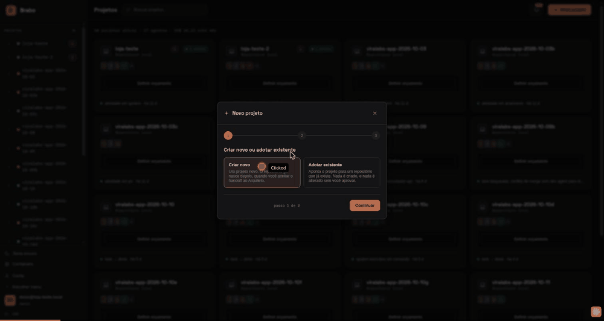
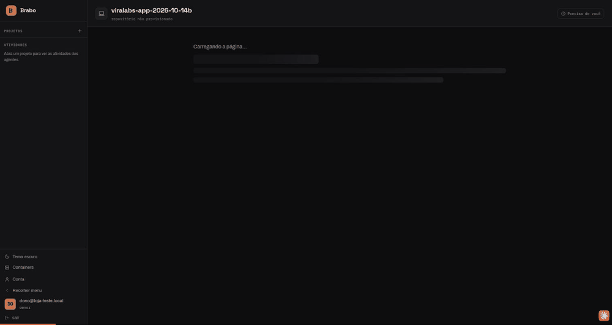
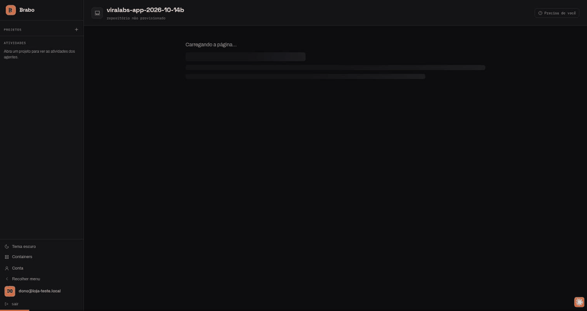
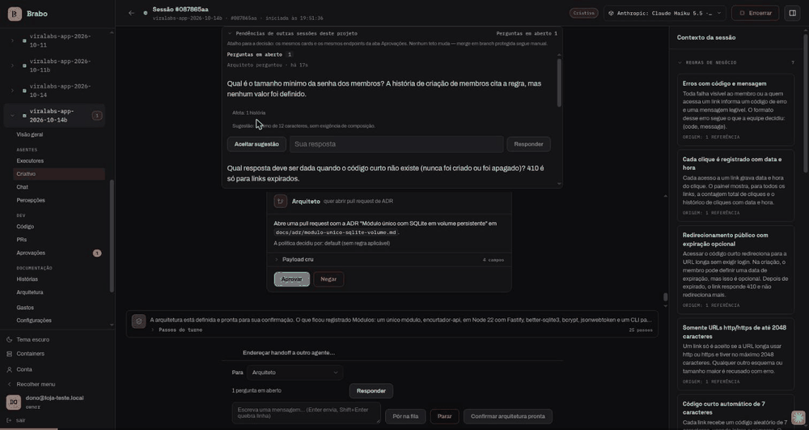
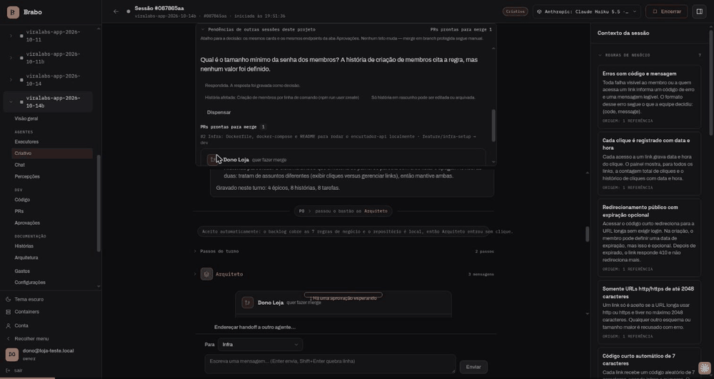
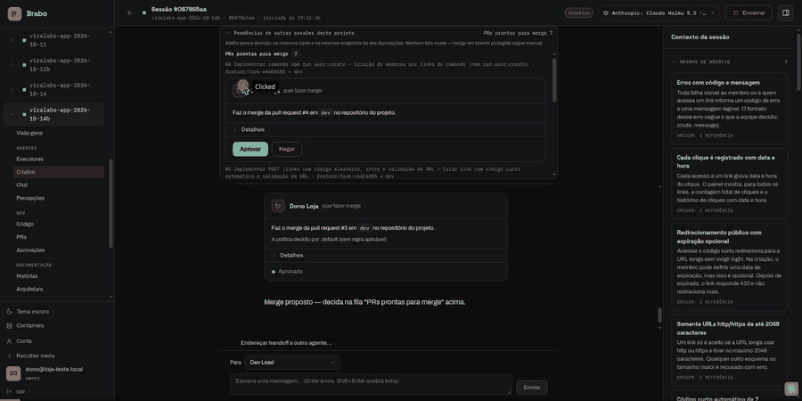

# 从零到交付物 {#from-zero-to-a-deliverable}

本页跟随一个真实项目，于 2026-10-14 现场录制，从一个空工作区到一个可运行的交付物。项目
`viralabs-app-2026-10-14b` 是一个短链接服务（Node 22 + SQLite）。整个团队都运行在 **Claude Haiku
5.5** 上，这次运行花费 **US$ 1.07**。从想法到开始执行用了 **13 分钟**，到最后一次合并约 **57 分钟**的交互。

最后产出的是：**8 个任务中的 8 个**，外加 ADR 和基础设施 pull request，合并进项目的 `dev` 分支；以及一个
交付物，其测试套件在干净克隆中通过 **102/102**，并可用 `docker compose up` 启动。

整个运行都在**一个地方——Criativo 的会话聊天**中驱动：开放问题、架构确认和每一次合并都在那里决定，无需
刷新页面或打开其他标签页。下面每一步都说明你要做什么以及智能体交回什么。录屏是 Brabo 的真实界面；第 1 步中
挂载文件夹的路径已做模糊处理。

## 1. 创建项目 {#1-create-the-project}

你在向导中创建项目，并选择代码存放的位置。这里是一个**挂载文件夹**：向导会在安装的项目根目录中建议一个路径，
而该文件夹只需在 Infra 启动容器时存在。此时还没有任何东西被供应——仓库要到之后 Arquiteto 被引入时才诞生。

## 2. 给团队一个模型 {#2-give-the-team-a-model}

在设置中，你可以通过一个操作把一个模型应用到所有智能体。这次运行把 Claude Haiku 5.5 应用到了整个团队。

## 3. 想法，以及智能体反问的问题 {#3-the-idea-and-the-questions-the-agents-ask-back}

你在 Criativo 的聊天中描述产品。在第一个回合中，**Criativo** 记录了 **7 条业务规则和 1 项决定**，并把它
无法独自决定的内容变成**开放问题**，每个问题都附有建议答案以及它影响的规则（"删除一个链接时，它的点击历史
也要删除吗？"）。这些问题位于聊天顶部的"开放问题"队列中：你接受建议或输入自己的答案，答案会被记录为一项决定。
回合的结束语会说明写入了什么（"本回合已记录：7 条业务规则、1 项决定、2 个开放问题"）。完成后，
**"我准备好了——需求已验证"**会把工作交给 PO。

## 4. PO、Arquiteto 与 ADR {#4-po-architect-and-the-adr}

**PO** 把规则拆分成 backlog——**4 个史诗、8 个用户故事和 8 个任务**，用时约一分半——并且在某条规则缺少取值时
也会反问（"密码的最小长度是多少？"）。当每条规则都被用户故事覆盖后，交给 **Arquiteto** 的 handoff 会被自动
接受。Arquiteto 以 pull request 的形式提出 ADR（`arquiteto[bot]`，PR #1，"单模块，SQLite 位于持久卷上"），
并在架构定义后请你确认：**"确认架构就绪"**会把 Infra 引入。

## 5. Infra、计划与自动模式 {#5-infra-the-plan-and-automatic-mode}

**Infra Lead** 自行启动项目的容器，并打开基础设施 pull request（`infra[bot]`，PR #2）。**Dev Lead** 读取
backlog 和模块图并提出执行计划；批准计划就会激活执行。界面一键为整个团队提供**自动模式**，并说明它不放行
什么：合并到受保护分支仍由你决定。从那时起，dev agent 在容器内（`/work`）工作，你可以在聊天中查看它运行的
每条命令及其输出。

## 6. 从聊天中合并 {#6-merges-from-the-chat}

每个任务都在 dev agent 中运行（从认领任务到 pull request 平均 90 秒，介于 36 秒和 144 秒之间），并经过流水线
**Dev → QA → SecOps → 你**。通过 gate 的 pull request 会进入 Criativo 聊天顶部的**"可合并的 PR"**队列：
**Merge** 提出合并，同一区块中的 **Approve** 确认合并。在这次运行中，最后七个 pull request（#4 到 #10）在
约两分钟内合并完毕，无需刷新页面。

## 交付物 {#the-deliverable}

项目仓库的 `dev` 分支，干净克隆后在 `node:22` 中运行 `npm test`，通过了 **102/102** 个测试。
`docker compose up` 在 8080 端口启动了 API，每条规则都通过 HTTP 进行了检查：错误的登录和不带 token 的请求
得到 401；`ftp` URL 或超过 2048 个字符的 URL 得到 400 `INVALID_URL`；短码有 7 个字符；公共重定向是记录点击
的 302；未知短码得到 404 `LINK_NOT_FOUND`，过期链接得到 410 `LINK_EXPIRED` 且不计入点击；删除链接返回 204
并移除其点击记录；面板显示点击数和点击历史；`npm run user:create` 拒绝短于 12 个字符的密码；`/docs` 提供 API
参考。来自 `127.0.0.1:8080` 和 `localhost:8080` 的 CORS 预检各自得到自己的 `Access-Control-Allow-Origin`，
而外部来源一个也得不到。
